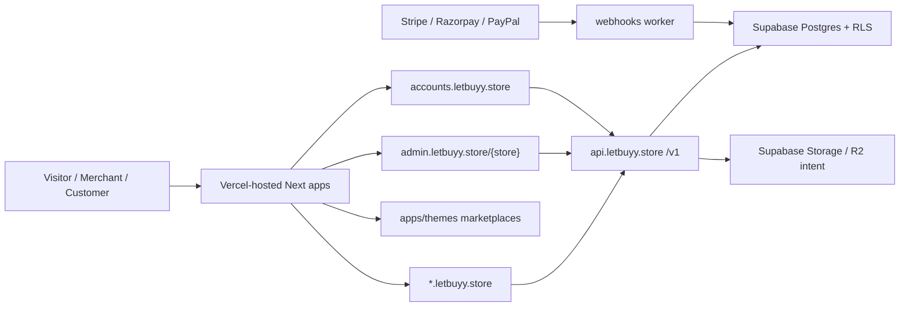
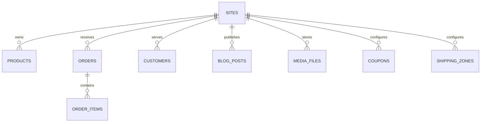

<!-- GENERATED BY scripts/generate-repository-intelligence.mjs ON 2026-06-06T16:25:23.607Z. Regenerate after architecture, routing, schema, or deployment changes. -->
# LetBuyy Master System Intelligence

> This is the repository brain for LetBuyy. It is generated from actual source files, manifests, migrations, route handlers, middleware, workers, package boundaries, infrastructure files, tasks, and lessons. It intentionally uses env variable names only and never copies secret values.

## 1. Platform Overview

LetBuyy is a multi-tenant SaaS platform for e-commerce stores, portfolios, resumes, blogs, landing pages, theme marketplace, app marketplace, internal platform operations, and native builder workflows. The platform strategy is Shopify-class: tenants own sites/stores, storefronts are resolved by subdomain or custom domain, merchants manage operations through an admin dashboard, and shared backend APIs enforce identity, isolation, payments, inventory, content, and analytics.

- Business model: Free, Starter, Business, Enterprise tiers plus app/theme marketplace revenue.
- Current platform source roots: apps/app-marketplace, apps/identity-platform, apps/marketing-site, apps/merchant-control-plane, apps/mobile/merchant-app, apps/platform-console, apps/platform-operations-portal, apps/storefront-runtime, apps/theme-marketplace, packages/auth-core, packages/billing-core, packages/checkout-core, packages/cms-core, packages/commerce-core, packages/dart/core, packages/dart/models, packages/dart/services, packages/dart/ui_kit, packages/event-core, packages/notification-core, packages/payments, packages/search-core, packages/shared-types, packages/tenant-core, packages/theme-engine, packages/typescript/api-client, packages/typescript/api-types, packages/typescript/ui, services/api-gateway, services/webhook-service.
- Current source files scanned: 2702.
- Current package manifests: 38.
- Current Supabase migrations: 18.
- Current Next routes/pages/layouts/handlers: 306.
- Current Hono route modules: 45.

## 2. Complete Tech Stack Analysis

### Package Manifests

#### @letbuyy/app-marketplace

- Package: @letbuyy/app-marketplace
- File: apps/app-marketplace/package.json
- Scripts: build, start, lint, typecheck, test
- Runtime dependencies: @letbuyy/api-client, @letbuyy/auth-core, @letbuyy/shared-types, @letbuyy/ui, jose, lucide-react, next, react, react-dom, server-only
- Dev dependencies: @tailwindcss/postcss, @types/node, @types/react, @types/react-dom, eslint, eslint-config-next, postcss-load-config, tailwindcss, typescript
- Peer dependencies: none declared

#### @letbuyy/developer-portal

- Package: @letbuyy/developer-portal
- File: apps/developer-portal/package.json
- Scripts: build, start, lint, typecheck, test
- Runtime dependencies: @letbuyy/ui, next, react, react-dom
- Dev dependencies: @tailwindcss/postcss, @types/node, @types/react, @types/react-dom, eslint, eslint-config-next, postcss-load-config, tailwindcss, typescript
- Peer dependencies: none declared

#### @letbuyy/identity-platform

- Package: @letbuyy/identity-platform
- File: apps/identity-platform/package.json
- Scripts: build, start, lint, typecheck, test
- Runtime dependencies: @letbuyy/api-client, @letbuyy/auth-core, @letbuyy/ui, @react-email/components, bcryptjs, jose, next, react, react-dom, react-email
- Dev dependencies: @tailwindcss/postcss, @types/node, @types/react, @types/react-dom, eslint, eslint-config-next, tailwindcss, typescript
- Peer dependencies: none declared

#### @letbuyy/marketing-site

- Package: @letbuyy/marketing-site
- File: apps/marketing-site/package.json
- Scripts: build, start, lint, typecheck, test
- Runtime dependencies: @gsap/react, @letbuyy/api-client, @letbuyy/api-types, @letbuyy/ui, framer-motion, gsap, lenis, next, react, react-dom
- Dev dependencies: @tailwindcss/postcss, @types/node, @types/react, @types/react-dom, eslint, eslint-config-next, tailwindcss, typescript
- Peer dependencies: none declared

#### @letbuyy/merchant-control-plane

- Package: @letbuyy/merchant-control-plane
- File: apps/merchant-control-plane/package.json
- Scripts: build, start, lint, typecheck, test
- Runtime dependencies: @letbuyy/api-client, @letbuyy/auth-core, @letbuyy/cms-core, @letbuyy/extension-host, @letbuyy/shared-types, @letbuyy/theme-engine, @letbuyy/ui, lucide-react, next, react, react-dom
- Dev dependencies: @tailwindcss/postcss, @types/node, @types/react, @types/react-dom, eslint, eslint-config-next, tailwindcss, typescript
- Peer dependencies: none declared

#### @letbuyy/platform-console

- Package: @letbuyy/platform-console
- File: apps/platform-console/package.json
- Scripts: build, start, lint, typecheck, test
- Runtime dependencies: @letbuyy/api-client, @letbuyy/auth-core, @letbuyy/ui, lucide-react, next, react, react-dom, server-only, zod
- Dev dependencies: @tailwindcss/postcss, @types/node, @types/react, @types/react-dom, eslint, eslint-config-next, tailwindcss, typescript
- Peer dependencies: none declared

#### @letbuyy/platform-operations-portal

- Package: @letbuyy/platform-operations-portal
- File: apps/platform-operations-portal/package.json
- Scripts: build, start, lint, typecheck, test
- Runtime dependencies: @letbuyy/api-client, @letbuyy/auth-core, @letbuyy/shared-types, @letbuyy/ui, lucide-react, next, react, react-dom
- Dev dependencies: @tailwindcss/postcss, @types/node, @types/react, @types/react-dom, eslint, eslint-config-next, tailwindcss, typescript
- Peer dependencies: none declared

#### @letbuyy/storefront-runtime

- Package: @letbuyy/storefront-runtime
- File: apps/storefront-runtime/package.json
- Scripts: build, start, lint, typecheck, test
- Runtime dependencies: @letbuyy/api-client, @letbuyy/app-engine, @letbuyy/auth-core, @letbuyy/checkout-core, @letbuyy/cms-core, @letbuyy/commerce-core, @letbuyy/extension-host, @letbuyy/runtime-composition, @letbuyy/shared-types, @letbuyy/tenant-core, @letbuyy/theme-engine, @letbuyy/ui, @vercel/speed-insights, clsx, framer-motion, jose, lucide-react, next, react, react-dom, server-only, tailwind-merge
- Dev dependencies: @tailwindcss/postcss, @types/node, @types/react, @types/react-dom, eslint, eslint-config-next, tailwindcss, typescript
- Peer dependencies: none declared

#### @letbuyy/theme-marketplace

- Package: @letbuyy/theme-marketplace
- File: apps/theme-marketplace/package.json
- Scripts: build, start, lint, typecheck, test
- Runtime dependencies: @letbuyy/api-client, @letbuyy/auth-core, @letbuyy/shared-types, @letbuyy/theme-engine, @letbuyy/ui, clsx, framer-motion, lucide-react, next, react, react-dom, server-only, tailwind-merge
- Dev dependencies: @tailwindcss/postcss, @types/node, @types/react, @types/react-dom, eslint, eslint-config-next, postcss-load-config, tailwindcss, typescript
- Peer dependencies: none declared

#### letbuyy-functions

- Package: letbuyy-functions
- File: legacy/firebase/functions/package.json
- Scripts: lint, build, serve, predeploy, deploy, logs
- Runtime dependencies: @google-cloud/run, @google-cloud/vision, bcryptjs, cors, firebase-admin, firebase-functions, googleapis, nodemailer, otplib
- Dev dependencies: @types/bcryptjs, @types/cors, @types/node, @types/nodemailer, @typescript-eslint/eslint-plugin, @typescript-eslint/parser, eslint, eslint-config-google, eslint-plugin-import, firebase-functions-test, typescript
- Peer dependencies: none declared

#### letbuyy-store

- Package: letbuyy-store
- File: package.json
- Scripts: build, lint, validate:architecture, validate:governance, validate:workspace, validate:lifecycle, validate:production, validate:cloudflare, cloudflare:bootstrap:staging, cloudflare:bootstrap:production, cloudflare:provider:capabilities, validate:dependencies, validate:dependency-graph, validate:runtime, validate:distributed-execution, validate:durable-execution, validate:distributed-survivability, validate:operational-certification, validate:production-certification, validate:migrations, validate:deployment, validate:rollback, validate:queues, validate:topology, validate:reconciliation, validate:tests, validate:typescript, validate:replay, validate:security, validate:observability, validate:chaos, validate:survivability, validate:survivability-intelligence, validate:operational-proof, validate:ci, certify:production, certify:production:provider, certify:production:plan-report, test, test:governance, test:behavioral, test:contracts, test:workspaces, load:plan, load:execute, chaos:plan, chaos:execute, survivability:plan, typecheck
- Runtime dependencies: none declared
- Dev dependencies: @cloudflare/workers-types, @playwright/test, tsx, turbo, typescript
- Peer dependencies: none declared

#### @letbuyy/app-engine

- Package: @letbuyy/app-engine
- File: packages/app-engine/package.json
- Scripts: build, test, typecheck
- Runtime dependencies: @letbuyy/shared-types, zod
- Dev dependencies: typescript
- Peer dependencies: none declared

#### @letbuyy/application-services

- Package: @letbuyy/application-services
- File: packages/application-services/package.json
- Scripts: build, typecheck
- Runtime dependencies: @letbuyy/auth-core, @letbuyy/billing-core, @letbuyy/checkout-core, @letbuyy/cms-core, @letbuyy/commerce-core, @letbuyy/event-core, @letbuyy/notification-core, @letbuyy/orchestration, @letbuyy/search-core, @letbuyy/shared-types, @letbuyy/tenant-core, @letbuyy/theme-engine
- Dev dependencies: typescript
- Peer dependencies: none declared

#### @letbuyy/auth-core

- Package: @letbuyy/auth-core
- File: packages/auth-core/package.json
- Scripts: build, test, typecheck
- Runtime dependencies: @letbuyy/shared-types, zod
- Dev dependencies: typescript
- Peer dependencies: none declared

#### @letbuyy/billing-core

- Package: @letbuyy/billing-core
- File: packages/billing-core/package.json
- Scripts: build, test, typecheck
- Runtime dependencies: @letbuyy/event-core, @letbuyy/shared-types, zod
- Dev dependencies: typescript
- Peer dependencies: none declared

#### @letbuyy/checkout-core

- Package: @letbuyy/checkout-core
- File: packages/checkout-core/package.json
- Scripts: build, test, typecheck
- Runtime dependencies: @letbuyy/commerce-core, @letbuyy/shared-types, zod
- Dev dependencies: typescript
- Peer dependencies: none declared

#### @letbuyy/cms-core

- Package: @letbuyy/cms-core
- File: packages/cms-core/package.json
- Scripts: build, typecheck
- Runtime dependencies: @letbuyy/shared-types, zod
- Dev dependencies: typescript
- Peer dependencies: none declared

#### @letbuyy/commerce-core

- Package: @letbuyy/commerce-core
- File: packages/commerce-core/package.json
- Scripts: build, typecheck
- Runtime dependencies: @letbuyy/shared-types, zod
- Dev dependencies: typescript
- Peer dependencies: none declared

#### @letbuyy/distributed-runtime

- Package: @letbuyy/distributed-runtime
- File: packages/distributed-runtime/package.json
- Scripts: build, typecheck
- Runtime dependencies: @letbuyy/event-core, @letbuyy/shared-types
- Dev dependencies: typescript
- Peer dependencies: none declared

#### @letbuyy/event-core

- Package: @letbuyy/event-core
- File: packages/event-core/package.json
- Scripts: build, test, typecheck
- Runtime dependencies: @letbuyy/shared-types, zod
- Dev dependencies: typescript
- Peer dependencies: none declared

#### @letbuyy/extension-host

- Package: @letbuyy/extension-host
- File: packages/extension-host/package.json
- Scripts: build, typecheck
- Runtime dependencies: @letbuyy/shared-types
- Dev dependencies: typescript
- Peer dependencies: none declared

#### @letbuyy/infrastructure

- Package: @letbuyy/infrastructure
- File: packages/infrastructure/package.json
- Scripts: build, typecheck
- Runtime dependencies: @letbuyy/payments, @supabase/ssr, @supabase/supabase-js, @upstash/ratelimit, @upstash/redis, postgres, resend, stripe
- Dev dependencies: @types/node, typescript
- Peer dependencies: none declared

#### @letbuyy/notification-core

- Package: @letbuyy/notification-core
- File: packages/notification-core/package.json
- Scripts: build, typecheck
- Runtime dependencies: @letbuyy/event-core, @letbuyy/shared-types, zod
- Dev dependencies: typescript
- Peer dependencies: none declared

#### @letbuyy/orchestration

- Package: @letbuyy/orchestration
- File: packages/orchestration/package.json
- Scripts: build, typecheck
- Runtime dependencies: @letbuyy/distributed-runtime, @letbuyy/event-core, @letbuyy/shared-types
- Dev dependencies: typescript
- Peer dependencies: none declared

#### @letbuyy/payments

- Package: @letbuyy/payments
- File: packages/payments/package.json
- Scripts: build, test, typecheck
- Runtime dependencies: @letbuyy/shared-types
- Dev dependencies: typescript
- Peer dependencies: none declared

#### @letbuyy/projection-runtime

- Package: @letbuyy/projection-runtime
- File: packages/projection-runtime/package.json
- Scripts: build, typecheck
- Runtime dependencies: @letbuyy/distributed-runtime, @letbuyy/event-core, @letbuyy/shared-types
- Dev dependencies: typescript
- Peer dependencies: none declared

#### @letbuyy/runtime-composition

- Package: @letbuyy/runtime-composition
- File: packages/runtime-composition/package.json
- Scripts: build, typecheck
- Runtime dependencies: @letbuyy/application-services, @letbuyy/checkout-core, @letbuyy/cms-core, @letbuyy/commerce-core, @letbuyy/infrastructure, @letbuyy/projection-runtime, @letbuyy/search-core, @letbuyy/shared-types, @letbuyy/tenant-core, @letbuyy/theme-engine
- Dev dependencies: typescript
- Peer dependencies: none declared

#### @letbuyy/search-core

- Package: @letbuyy/search-core
- File: packages/search-core/package.json
- Scripts: build, typecheck
- Runtime dependencies: @letbuyy/shared-types, zod
- Dev dependencies: typescript
- Peer dependencies: none declared

#### @letbuyy/shared-types

- Package: @letbuyy/shared-types
- File: packages/shared-types/package.json
- Scripts: build, typecheck
- Runtime dependencies: zod
- Dev dependencies: typescript
- Peer dependencies: none declared

#### @letbuyy/tenant-core

- Package: @letbuyy/tenant-core
- File: packages/tenant-core/package.json
- Scripts: build, typecheck
- Runtime dependencies: @letbuyy/shared-types, @letbuyy/theme-engine, zod
- Dev dependencies: typescript
- Peer dependencies: none declared

#### @letbuyy/theme-engine

- Package: @letbuyy/theme-engine
- File: packages/theme-engine/package.json
- Scripts: build, test, typecheck
- Runtime dependencies: @letbuyy/shared-types, liquidjs, zod
- Dev dependencies: typescript
- Peer dependencies: none declared

#### @letbuyy/api-client

- Package: @letbuyy/api-client
- File: packages/typescript/api-client/package.json
- Scripts: build, typecheck
- Runtime dependencies: @letbuyy/shared-types
- Dev dependencies: typescript
- Peer dependencies: none declared

#### @letbuyy/api-types

- Package: @letbuyy/api-types
- File: packages/typescript/api-types/package.json
- Scripts: build, typecheck
- Runtime dependencies: @letbuyy/app-engine, @letbuyy/auth-core, @letbuyy/billing-core, @letbuyy/checkout-core, @letbuyy/cms-core, @letbuyy/commerce-core, @letbuyy/event-core, @letbuyy/notification-core, @letbuyy/payments, @letbuyy/search-core, @letbuyy/shared-types, @letbuyy/tenant-core, @letbuyy/theme-engine
- Dev dependencies: typescript
- Peer dependencies: none declared

#### @letbuyy/ui

- Package: @letbuyy/ui
- File: packages/typescript/ui/package.json
- Scripts: build, typecheck, storybook, build-storybook
- Runtime dependencies: @tailwindcss/vite, lucide-react
- Dev dependencies: @storybook/react-vite, @testing-library/dom, @types/react, @types/react-dom, react, react-dom, storybook, tailwindcss, typescript, vite
- Peer dependencies: react, react-dom

#### @letbuyy/api-gateway

- Package: @letbuyy/api-gateway
- File: services/api-gateway/package.json
- Scripts: build, deploy, typecheck, test
- Runtime dependencies: @letbuyy/api-types, @letbuyy/app-engine, @letbuyy/application-services, @letbuyy/auth-core, @letbuyy/billing-core, @letbuyy/checkout-core, @letbuyy/cms-core, @letbuyy/commerce-core, @letbuyy/event-core, @letbuyy/infrastructure, @letbuyy/notification-core, @letbuyy/orchestration, @letbuyy/runtime-composition, @letbuyy/shared-types, @letbuyy/tenant-core, @letbuyy/theme-engine, bcryptjs, hono, zod
- Dev dependencies: @cloudflare/workers-types, tsx, typescript, wrangler
- Peer dependencies: none declared

#### @letbuyy/mobile-bff

- Package: @letbuyy/mobile-bff
- File: services/mobile-bff/package.json
- Scripts: build, deploy, typecheck, test
- Runtime dependencies: @letbuyy/auth-core, hono
- Dev dependencies: @cloudflare/workers-types, @types/node, tsx, typescript, wrangler
- Peer dependencies: none declared

#### @letbuyy/queue-workers

- Package: @letbuyy/queue-workers
- File: services/queue-workers/package.json
- Scripts: build, deploy, typecheck, test
- Runtime dependencies: @letbuyy/event-core, @letbuyy/infrastructure, @letbuyy/notification-core, @letbuyy/orchestration, @letbuyy/runtime-composition
- Dev dependencies: @cloudflare/workers-types, typescript, wrangler
- Peer dependencies: none declared

#### @letbuyy/webhook-service

- Package: @letbuyy/webhook-service
- File: services/webhook-service/package.json
- Scripts: build, deploy, typecheck, test
- Runtime dependencies: @letbuyy/auth-core, @letbuyy/infrastructure, hono
- Dev dependencies: @cloudflare/workers-types, typescript, wrangler
- Peer dependencies: none declared

### Workspace and Build System

- Root package manager: `pnpm@10.6.2` from root `package.json`.
- Turborepo tasks: build, dev, lint, test, typecheck.
- pnpm workspace roots: explicit app runtimes, mobile runtimes, TypeScript packages, and service runtimes.
- Flutter/Dart workspace exists through root `pubspec.yaml`, `analysis_options.yaml`, and package/app `pubspec.yaml` files, but Dart packages are not part of pnpm workspace.
- Vercel install command currently removes app-local Next copies before install, which signals dependency skew debt rather than a normal deployment primitive.

### Config Files

- `apps/app-marketplace/next.config.ts`
- `apps/developer-portal/next.config.ts`
- `apps/identity-platform/next.config.ts`
- `apps/marketing-site/next.config.ts`
- `apps/merchant-control-plane/next.config.ts`
- `apps/platform-console/next.config.ts`
- `apps/platform-operations-portal/next.config.ts`
- `apps/storefront-runtime/next.config.ts`
- `apps/theme-marketplace/next.config.ts`
- `services/api-gateway/wrangler.toml`
- `services/mobile-bff/wrangler.toml`
- `services/queue-workers/wrangler.toml`
- `services/webhook-service/wrangler.toml`
- `infrastructure/cloudflare/queues.tf`
- `infrastructure/cloudflare/storage.tf`
- `infrastructure/dns/dns.tf`
- `pnpm-workspace.yaml`
- `turbo.json`
- `vercel.json`
- `pubspec.yaml`

## 3. Complete Monorepo Intelligence

### Source Area Counts

| Area | Files |
|---|---:|
| api gateway service | 117 |
| app marketplace | 43 |
| auth core package | 5 |
| billing core package | 4 |
| checkout core package | 4 |
| cms core package | 3 |
| commerce core package | 3 |
| documentation | 814 |
| event core package | 4 |
| firebase legacy | 30 |
| identity platform | 61 |
| infrastructure as code | 52 |
| lessons memory | 1 |
| marketing site | 28 |
| merchant control plane | 171 |
| mobile merchant app | 152 |
| mobile operator app | 1 |
| notification core package | 3 |
| payments package | 4 |
| platform console | 41 |
| platform operations portal | 38 |
| root or shared config | 777 |
| search core package | 3 |
| shared api types package | 4 |
| shared commerce api client package | 4 |
| shared dart core package | 25 |
| shared dart models package | 17 |
| shared dart services package | 3 |
| shared dart ui kit package | 25 |
| shared types package | 3 |
| shared web ui package | 29 |
| storefront runtime | 130 |
| supabase database | 38 |
| task memory | 2 |
| tenant core package | 3 |
| theme engine package | 8 |
| theme marketplace | 41 |
| webhook service | 11 |

### Extension Counts

| Extension | Files |
|---|---:|
| .css | 12 |
| .dart | 263 |
| .js | 8 |
| .json | 206 |
| .kts | 6 |
| .md | 700 |
| .mjs | 387 |
| .properties | 4 |
| .sql | 118 |
| .tf | 3 |
| .toml | 6 |
| .ts | 594 |
| .tsx | 355 |
| .yaml | 30 |
| .yml | 10 |

### Application Boundaries

- Identity Platform: `apps/identity-platform`, 61 scanned files, All merchant authentication, signup, password, OTP, OAuth callback, session, onboarding and store selection UI.
- Merchant Control Plane: `apps/merchant-control-plane`, 171 scanned files, Per-store merchant dashboard, adaptive CMS, products, orders, settings, themes, analytics, and site-type-specific operations.
- Storefront Runtime: `apps/storefront-runtime`, 130 scanned files, Wildcard tenant storefronts, public product catalog, customer accounts, cart, checkout, policy pages, and theme previews.
- Marketing Site: `apps/marketing-site`, 28 scanned files, Public marketing site, pricing, and conversion flow. Must not host auth pages.
- App Marketplace: `apps/app-marketplace`, 43 scanned files, Extension marketplace, developer app submission, app search, install routes and app review APIs.
- Developer Portal: `apps/developer-portal`, 25 scanned files, Developer documentation, API reference, SDK quick-starts, and partner dashboard shell.
- Theme Marketplace: `apps/theme-marketplace`, 41 scanned files, Theme catalog, theme detail pages, checkout, Supabase-backed theme service, and theme acquisition workflow.
- Platform Console: `apps/platform-console`, 41 scanned files, Super admin scaffold for platform operations, users, stores, subscriptions, analytics, employees, audit logs, and MFA.
- Platform Operations Portal: `apps/platform-operations-portal`, 38 scanned files, Employee portal scaffold for support, operations, users, stores, marketing and invite flows.
- Mobile Shopper App: `apps/mobile/shopper-app`, 1 scanned files, Reserved/not-implemented native shopper root; no deployable mobile source is active until a human-approved shopper app scope is built.
- Mobile Merchant App: `apps/mobile/merchant-app`, 152 scanned files, Native/mobile store builder, editor, dashboard, products, themes, preview systems and merchant operations.
- Mobile Operator App: `apps/mobile/operator-app`, 1 scanned files, Reserved/not-implemented native operator companion root; the generated Flutter counter starter is archived and no deployable mobile source is active.

### Package Boundaries

- Shared Types: `packages/shared-types`, 3 scanned files, Canonical cross-runtime primitives, pagination, address, SEO, money, and API response contracts.
- Tenant Core: `packages/tenant-core`, 3 scanned files, Tenant resolution, site/store ownership, subdomain, store model, navigation, and tenant isolation contracts.
- Commerce Core: `packages/commerce-core`, 3 scanned files, Product, catalog, inventory, customer, collection, and merchant commerce contracts.
- Checkout Core: `packages/checkout-core`, 4 scanned files, Cart, order, checkout, fulfillment, refund, shipping, tax, coupon, and payment orchestration contracts.
- Payments: `packages/payments`, 4 scanned files, Provider-neutral payment orchestration contracts, India-first money handling, idempotency, and provider adapter interfaces.
- Auth Core: `packages/auth-core`, 5 scanned files, Identity, session, actor, RBAC, OTP, password, and auth validation contracts.
- Theme Engine: `packages/theme-engine`, 8 scanned files, Theme registry, sections, blocks, templates, releases, hydration, and storefront composition contracts.
- CMS Core: `packages/cms-core`, 3 scanned files, Pages, policies, navigation, content, portfolio, resume, and dynamic section contracts.
- Event Core: `packages/event-core`, 4 scanned files, Domain events, outbox, webhooks, audit events, queues, and usage event contracts.
- Notification Core: `packages/notification-core`, 3 scanned files, Notification templates, recipients, channels, and event-to-notification mapping contracts.
- Search Core: `packages/search-core`, 3 scanned files, Search documents, indexing jobs, ranking policy, query DTOs, and provider-neutral search contracts.
- Billing Core: `packages/billing-core`, 4 scanned files, Plans, subscriptions, invoices, billing events, entitlements, and usage billing contracts.
- Application Services: `packages/application-services`, 14 scanned files, Application workflow sequencing, use-case contracts, execution policy inputs, transaction boundaries, and cross-domain coordination contracts.
- Distributed Runtime: `packages/distributed-runtime`, 76 scanned files, Durable event persistence, distributed queues, CQRS, checkpoints, replay, worker coordination, resilience, telemetry, cache, tenant scaling, regional execution, and operations contracts.
- Orchestration: `packages/orchestration`, 15 scanned files, Workflow, event, outbox, replay, async execution, recovery, checkpoint, saga, retry, and orchestration coordination contracts.
- Projection Runtime: `packages/projection-runtime`, 17 scanned files, Projection persistence, aggregation stores, cache-aware read models, rebuild/replay execution, snapshots, hydration, invalidation, and lifecycle contracts.
- Runtime Composition: `packages/runtime-composition`, 14 scanned files, Read orchestration, query aggregation, projection assembly, cache policy, hydration, and runtime response shaping contracts.
- Infrastructure: `packages/infrastructure`, 23 scanned files, Provider SDKs, external APIs, storage, queue, cache, analytics, search, payment, provider resilience, retries, and adapter normalization contracts.
- TypeScript UI: `packages/typescript/ui`, 29 scanned files, Shared Button, Input, DataTable package and design-system extraction point.
- API Client: `packages/typescript/api-client`, 4 scanned files, Shared typed Commerce API client package.
- API Types: `packages/typescript/api-types`, 4 scanned files, Shared TypeScript domain and API contract package.
- Dart Core: `packages/dart/core`, 25 scanned files, Dart constants, config, responsive helpers and platform utility package.
- Dart Models: `packages/dart/models`, 17 scanned files, Dart commerce, seller, order, cart, analytics, return and notification models.
- Dart Services: `packages/dart/services`, 3 scanned files, Dart data, payment, analytics, order, auth, storage and notification services.
- Dart UI Kit: `packages/dart/ui_kit`, 25 scanned files, Flutter widgets, themes, empty/loading/error states, and app UI primitives.

## 4. Full Authentication Intelligence

| File | Area | Lines | Route Surface | Flags |
|---|---:|---:|---|---|
| `FORENSIC_REPORT/00-EXECUTIVE-SUMMARY.md` | root or shared config | 82 | source | uses localStorage, webhook reference |
| `FORENSIC_REPORT/03-application-reports.md` | root or shared config | 65 | source | CSRF reference, client component, console.error, payment provider reference |
| `apps/app-marketplace/src/app/(auth)/developers/apps/new/page.tsx` | app marketplace | 298 | page:/developers/apps/new | client component, inline React style |
| `apps/app-marketplace/src/app/(auth)/developers/dashboard/page.tsx` | app marketplace | 400 | page:/developers/dashboard | inline React style |
| `apps/app-marketplace/src/app/(auth)/developers/page.tsx` | app marketplace | 127 | page:/developers | inline React style, webhook reference |
| `apps/app-marketplace/src/app/(auth)/developers/register/page.tsx` | app marketplace | 275 | page:/developers/register | client component, inline React style |
| `apps/app-marketplace/src/app/(auth)/my-apps/page.tsx` | app marketplace | 63 | page:/my-apps | inline React style |
| `apps/app-marketplace/src/proxy.ts` | app marketplace | 43 | source | none |
| `apps/developer-portal/src/app/docs/page.tsx` | root or shared config | 64 | page:/docs | webhook reference |
| `apps/developer-portal/src/app/oauth/page.tsx` | root or shared config | 142 | page:/oauth | none |
| `apps/identity-platform/src/__tests__/auth-flow.test.ts` | identity platform | 68 | source | rate limiting reference |
| `apps/identity-platform/src/__tests__/rate-limit.test.ts` | identity platform | 34 | source | rate limiting reference |
| `apps/identity-platform/src/app/api/auth/accounts/route.ts` | identity platform | 18 | route:/api/auth/accounts | none |
| `apps/identity-platform/src/app/api/auth/create-store/route.ts` | identity platform | 136 | route:/api/auth/create-store | CSRF reference, console.error |
| `apps/identity-platform/src/app/api/auth/login/route.ts` | identity platform | 133 | route:/api/auth/login | CSRF reference, console.error, rate limiting reference |
| `apps/identity-platform/src/app/api/auth/logout/route.ts` | identity platform | 71 | route:/api/auth/logout | CSRF reference, console.error |
| `apps/identity-platform/src/app/api/auth/lookup/route.ts` | identity platform | 66 | route:/api/auth/lookup | console.error, rate limiting reference |
| `apps/identity-platform/src/app/api/auth/reset-password/route.ts` | identity platform | 127 | route:/api/auth/reset-password | CSRF reference, console.error, rate limiting reference |
| `apps/identity-platform/src/app/api/auth/send-magic/route.ts` | identity platform | 96 | route:/api/auth/send-magic | CSRF reference, console.error, rate limiting reference |
| `apps/identity-platform/src/app/api/auth/send-reset/route.ts` | identity platform | 84 | route:/api/auth/send-reset | CSRF reference, console.error, rate limiting reference |
| `apps/identity-platform/src/app/api/auth/session/route.ts` | identity platform | 27 | route:/api/auth/session | console.error |
| `apps/identity-platform/src/app/api/auth/set-password/route.ts` | identity platform | 121 | route:/api/auth/set-password | CSRF reference, console.error, rate limiting reference |
| `apps/identity-platform/src/app/api/auth/signup/route.ts` | identity platform | 144 | route:/api/auth/signup | CSRF reference, console.error, rate limiting reference |
| `apps/identity-platform/src/app/api/auth/stores/route.ts` | identity platform | 54 | route:/api/auth/stores | console.error |
| `apps/identity-platform/src/app/api/auth/switch/route.ts` | identity platform | 94 | route:/api/auth/switch | CSRF reference, console.error |
| `apps/identity-platform/src/app/api/auth/validate-subdomain/route.ts` | identity platform | 29 | route:/api/auth/validate-subdomain | none |
| `apps/identity-platform/src/app/api/auth/verify-otp/route.ts` | identity platform | 90 | route:/api/auth/verify-otp | CSRF reference, console.error, rate limiting reference |
| `apps/identity-platform/src/app/api/auth/verify/route.ts` | identity platform | 131 | route:/api/auth/verify | console.error, rate limiting reference |
| `apps/identity-platform/src/app/auth/callback/route.ts` | identity platform | 11 | route:/auth/callback | none |
| `apps/identity-platform/src/app/forgot-password/page.tsx` | identity platform | 189 | page:/forgot-password | CSRF reference, client component, rate limiting reference, uses localStorage |
| `apps/identity-platform/src/app/login/page.tsx` | identity platform | 386 | page:/login | CSRF reference, client component, inline React style, uses localStorage |
| `apps/identity-platform/src/app/lookup/page.tsx` | identity platform | 601 | page:/lookup | CSRF reference, TypeScript any, client component, inline React style |
| `apps/identity-platform/src/app/page.tsx` | identity platform | 7 | page:/ | none |
| `apps/identity-platform/src/app/reset-password/page.tsx` | identity platform | 277 | page:/reset-password | CSRF reference, client component, uses localStorage |
| `apps/identity-platform/src/app/select/page.tsx` | identity platform | 256 | page:/select | client component, inline React style, uses localStorage |
| `apps/identity-platform/src/app/set-password/page.tsx` | identity platform | 291 | page:/set-password | CSRF reference, client component, uses localStorage |
| `apps/identity-platform/src/app/signup/page.tsx` | identity platform | 738 | page:/signup | CSRF reference, client component, inline React style, rate limiting reference |
| `apps/identity-platform/src/components/AuthIcon.tsx` | identity platform | 62 | source | none |
| `apps/identity-platform/src/lib/auth/cookies.ts` | identity platform | 209 | source | CSRF reference, TypeScript any |
| `apps/identity-platform/src/lib/auth/csrf.ts` | identity platform | 26 | source | CSRF reference |
| `apps/identity-platform/src/lib/auth/device.ts` | identity platform | 102 | source | none |
| `apps/identity-platform/src/lib/auth/password-set-intent.ts` | identity platform | 52 | source | none |
| `apps/identity-platform/src/lib/auth/password.ts` | identity platform | 24 | source | none |
| `apps/identity-platform/src/lib/auth/session.ts` | identity platform | 88 | source | none |
| `apps/identity-platform/src/lib/auth/tokens.ts` | identity platform | 122 | source | TypeScript any |
| `apps/identity-platform/src/lib/config/features.ts` | identity platform | 18 | source | none |
| `apps/identity-platform/src/lib/db/schema.sql` | identity platform | 73 | source | none |
| `apps/identity-platform/src/lib/dev-auth-bypass.ts` | identity platform | 25 | source | none |
| `apps/identity-platform/src/lib/turnstile.ts` | identity platform | 36 | source | console.error |
| `apps/identity-platform/src/proxy.ts` | identity platform | 71 | source | CSRF reference |
| `apps/marketing-site/src/app/signup/page.tsx` | marketing site | 23 | page:/signup | client component |
| `apps/merchant-control-plane/src/app/[store]/access_account/checkout/select-plan/page.tsx` | merchant control plane | 50 | page:/[store]/access_account/checkout/select-plan | none |
| `apps/merchant-control-plane/src/app/[store]/apps/[installationId]/page.tsx` | merchant control plane | 29 | page:/[store]/apps/[installationId] | none |
| `apps/merchant-control-plane/src/app/[store]/dashboard/page.tsx` | merchant control plane | 302 | page:/[store]/dashboard | none |
| `apps/merchant-control-plane/src/app/[store]/layout.tsx` | merchant control plane | 44 | layout:/[store] | none |
| `apps/merchant-control-plane/src/app/[store]/login/page.tsx` | merchant control plane | 31 | page:/[store]/login | client component |
| `apps/merchant-control-plane/src/app/[store]/settings/apps/page.tsx` | merchant control plane | 49 | page:/[store]/settings/apps | none |
| `apps/merchant-control-plane/src/app/[store]/settings/business/page.tsx` | merchant control plane | 40 | page:/[store]/settings/business | none |
| `apps/merchant-control-plane/src/app/[store]/settings/layout.tsx` | merchant control plane | 33 | layout:/[store]/settings | none |
| `apps/merchant-control-plane/src/app/[store]/settings/localization/page.tsx` | merchant control plane | 39 | page:/[store]/settings/localization | none |
| `apps/merchant-control-plane/src/app/[store]/settings/subscribe/checkout/page.tsx` | merchant control plane | 92 | page:/[store]/settings/subscribe/checkout | none |
| `apps/merchant-control-plane/src/app/api/auth/logout/route.ts` | merchant control plane | 60 | route:/api/auth/logout | console.error |
| `apps/merchant-control-plane/src/app/api/themes/[themeId]/preview-session/route.ts` | merchant control plane | 43 | route:/api/themes/[themeId]/preview-session | none |
| `apps/merchant-control-plane/src/app/page.tsx` | merchant control plane | 35 | page:/ | none |
| `apps/merchant-control-plane/src/app/stores/page.tsx` | merchant control plane | 22 | page:/stores | none |
| `apps/merchant-control-plane/src/lib/auth/session.ts` | merchant control plane | 92 | source | none |
| `apps/merchant-control-plane/src/proxy.ts` | merchant control plane | 44 | source | none |
| `apps/mobile/merchant-app/ios/Runner/Assets.xcassets/AppIcon.appiconset/Contents.json` | mobile merchant app | 1 | source | none |
| `apps/mobile/merchant-app/lib/app/auth_wrapper.dart` | mobile merchant app | 156 | source | none |
| `apps/mobile/merchant-app/lib/models/store_auth_request_model.dart` | mobile merchant app | 3 | source | none |
| `apps/mobile/merchant-app/lib/screens/auth/error_screen.dart` | mobile merchant app | 92 | source | TODO/FIXME/HACK |
| `apps/mobile/merchant-app/lib/screens/auth/login_screen.dart` | mobile merchant app | 848 | source | none |
| `apps/mobile/merchant-app/lib/screens/auth/otp_screen.dart` | mobile merchant app | 236 | source | none |
| `apps/mobile/merchant-app/lib/screens/auth/turnstile_challenge_screen.dart` | mobile merchant app | 244 | source | none |
| `apps/mobile/merchant-app/lib/services/store_auth_service.dart` | mobile merchant app | 503 | source | CSRF reference |
| `apps/platform-console/src/app/(auth)/login/page.tsx` | platform console | 108 | page:/login | none |
| `apps/platform-console/src/app/(auth)/mfa/page.tsx` | platform console | 79 | page:/mfa | none |
| `apps/platform-console/src/app/(dashboard)/audit-logs/AuditLogIndexTable.tsx` | platform console | 129 | source | client component |
| `apps/platform-console/src/app/api/console-auth/callback/route.ts` | platform console | 71 | route:/api/console-auth/callback | none |
| `apps/platform-console/src/app/api/console-auth/login/route.ts` | platform console | 56 | route:/api/console-auth/login | none |
| `apps/platform-console/src/app/api/console-auth/logout/route.ts` | platform console | 24 | route:/api/console-auth/logout | none |
| `apps/platform-console/src/app/api/console-auth/mfa/route.ts` | platform console | 56 | route:/api/console-auth/mfa | none |
| `apps/platform-console/src/app/page.tsx` | platform console | 17 | page:/ | none |
| `apps/platform-console/src/lib/console-auth-server.ts` | platform console | 211 | source | console.error |
| `apps/platform-console/src/lib/console-session.ts` | platform console | 58 | source | none |
| `apps/platform-console/src/proxy.ts` | platform console | 93 | source | none |
| `apps/platform-operations-portal/src/app/(auth)/invite/page.tsx` | platform operations portal | 49 | page:/invite | TODO/FIXME/HACK |
| `apps/platform-operations-portal/src/app/(auth)/login/page.tsx` | platform operations portal | 47 | page:/login | TODO/FIXME/HACK |
| `apps/platform-operations-portal/src/proxy.ts` | platform operations portal | 68 | source | none |
| `apps/storefront-runtime/src/app/api/customer/check/route.ts` | storefront runtime | 30 | route:/api/customer/check | console.error |
| ... | 141 more |  | See master intelligence |  |

- Accounts app has routes for lookup, login, signup, reset password, set password, check email, select store, OAuth callback, and multiple auth API handlers.
- API worker has `auth.ts`, auth schema, auth middleware, auth rate limit, and service role references for server-side Supabase operations.
- Storefront customer auth is implemented separately under storefront API routes and customer auth context.
- Console/team apps are scaffolded auth surfaces requiring production allowlists, 2FA, and audit controls before real internal operations.

## 5. Complete Storefront Architecture

| File | Area | Lines | Route Surface | Flags |
|---|---:|---:|---|---|
| `.github/workflows/live-production-certification.yml` | root or shared config | 171 | source | CSRF reference, payment provider reference, service role reference, webhook reference |
| `.github/workflows/production-deploy.yml` | root or shared config | 474 | source | CSRF reference, payment provider reference, service role reference, webhook reference |
| `.github/workflows/production-rollout.yml` | root or shared config | 209 | source | none |
| `FORENSIC_REPORT/00-EXECUTIVE-SUMMARY.md` | root or shared config | 82 | source | uses localStorage, webhook reference |
| `FORENSIC_REPORT/05-storefront-runtime.md` | root or shared config | 268 | source | uses localStorage, webhook reference |
| `FORENSIC_REPORT/11-shopify-gap-analysis.md` | root or shared config | 64 | source | TODO/FIXME/HACK, payment provider reference, webhook reference |
| `FORENSIC_REPORT/12-shopify-compatibility.md` | root or shared config | 364 | hono:1 | CSRF reference, payment provider reference, rate limiting reference, uses localStorage |
| `FORENSIC_REPORT/13-risk-assessment.md` | root or shared config | 64 | source | CSRF reference, TODO/FIXME/HACK, payment provider reference, rate limiting reference |
| `FORENSIC_REPORT/15-production-readiness.md` | root or shared config | 73 | source | webhook reference |
| `FORENSIC_REPORT_OPERATIONS/10-operational-gap-analysis.md` | root or shared config | 50 | source | TODO/FIXME/HACK, payment provider reference, webhook reference |
| `FORENSIC_REPORT_OPERATIONS/11-ui-ux-research-report.md` | root or shared config | 54 | source | payment provider reference |
| `FORENSIC_REPORT_OPERATIONS/14-production-operations-readiness-assessment.md` | root or shared config | 50 | source | none |
| `README.md` | root or shared config | 20 | source | none |
| `apps/identity-platform/src/lib/api/client.ts` | identity platform | 185 | source | none |
| `apps/identity-platform/src/lib/config/urls.ts` | identity platform | 31 | source | none |
| `apps/merchant-control-plane/src/app/[store]/products/[productId]/page.tsx` | merchant control plane | 2 | page:/[store]/products/[productId] | none |
| `apps/merchant-control-plane/src/app/[store]/products/collections/page.tsx` | merchant control plane | 350 | page:/[store]/products/collections | client component |
| `apps/merchant-control-plane/src/app/[store]/products/gift-cards/page.tsx` | merchant control plane | 347 | page:/[store]/products/gift-cards | client component |
| `apps/merchant-control-plane/src/app/[store]/products/inventory/page.tsx` | merchant control plane | 392 | page:/[store]/products/inventory | client component |
| `apps/merchant-control-plane/src/app/[store]/products/new/page.tsx` | merchant control plane | 1098 | page:/[store]/products/new | client component |
| `apps/merchant-control-plane/src/app/[store]/products/page.tsx` | merchant control plane | 416 | page:/[store]/products | client component |
| `apps/merchant-control-plane/src/app/[store]/products/purchase-orders/page.tsx` | merchant control plane | 47 | page:/[store]/products/purchase-orders | client component |
| `apps/merchant-control-plane/src/app/[store]/products/transfers/page.tsx` | merchant control plane | 47 | page:/[store]/products/transfers | client component |
| `apps/merchant-control-plane/src/app/api/stores/[store]/products/[productId]/route.ts` | merchant control plane | 61 | route:/api/stores/[store]/products/[productId] | none |
| `apps/merchant-control-plane/src/app/api/stores/[store]/products/import/route.ts` | merchant control plane | 26 | route:/api/stores/[store]/products/import | none |
| `apps/merchant-control-plane/src/app/api/stores/[store]/products/route.ts` | merchant control plane | 72 | route:/api/stores/[store]/products | none |
| `apps/merchant-control-plane/src/app/api/stores/[store]/reviews/[reviewId]/route.ts` | merchant control plane | 42 | route:/api/stores/[store]/reviews/[reviewId] | none |
| `apps/merchant-control-plane/src/app/api/stores/[store]/reviews/route.ts` | merchant control plane | 46 | route:/api/stores/[store]/reviews | none |
| `apps/merchant-control-plane/src/lib/api/client.ts` | merchant control plane | 140 | source | none |
| `apps/merchant-control-plane/src/lib/public-urls.ts` | merchant control plane | 53 | source | none |
| `apps/mobile/merchant-app/dart-defines/production.json` | mobile merchant app | 11 | source | payment provider reference |
| `apps/mobile/merchant-app/lib/screens/products/collections_screen.dart` | mobile merchant app | 577 | source | none |
| `apps/mobile/merchant-app/lib/screens/products/import_products_screen.dart` | mobile merchant app | 710 | source | none |
| `apps/mobile/merchant-app/lib/screens/products/product_form_screen.dart` | mobile merchant app | 1176 | source | none |
| `apps/mobile/merchant-app/lib/screens/products/products_screen.dart` | mobile merchant app | 1333 | source | TODO/FIXME/HACK |
| `apps/mobile/merchant-app/lib/services/product_service.dart` | mobile merchant app | 413 | source | none |
| `apps/mobile/merchant-app/test/product_contract_test.dart` | mobile merchant app | 35 | source | none |
| `apps/mobile/shopper-app/runtime.manifest.json` | root or shared config | 128 | source | none |
| `apps/platform-console/src/lib/console-api.ts` | platform console | 116 | source | none |
| `apps/platform-operations-portal/src/app/(dashboard)/operations/onboarding/page.tsx` | platform operations portal | 503 | page:/operations/onboarding | payment provider reference |
| `apps/platform-operations-portal/src/lib/api/client.ts` | platform operations portal | 76 | source | none |
| `apps/storefront-runtime/README.md` | storefront runtime | 40 | source | none |
| `apps/storefront-runtime/eslint.config.mjs` | storefront runtime | 30 | source | none |
| `apps/storefront-runtime/next.config.ts` | storefront runtime | 100 | source | none |
| `apps/storefront-runtime/package.json` | storefront runtime | 47 | source | none |
| `apps/storefront-runtime/postcss.config.mjs` | storefront runtime | 8 | source | none |
| `apps/storefront-runtime/runtime.manifest.json` | storefront runtime | 137 | source | none |
| `apps/storefront-runtime/src/app/api/coupons/validate/route.ts` | storefront runtime | 32 | route:/api/coupons/validate | none |
| `apps/storefront-runtime/src/app/api/customer/addresses/route.ts` | storefront runtime | 135 | route:/api/customer/addresses | console.error |
| `apps/storefront-runtime/src/app/api/customer/auto-create/route.ts` | storefront runtime | 30 | route:/api/customer/auto-create | none |
| `apps/storefront-runtime/src/app/api/customer/check/route.ts` | storefront runtime | 30 | route:/api/customer/check | console.error |
| `apps/storefront-runtime/src/app/api/customer/login/route.ts` | storefront runtime | 87 | route:/api/customer/login | console.error |
| `apps/storefront-runtime/src/app/api/customer/logout/route.ts` | storefront runtime | 17 | route:/api/customer/logout | console.error |
| `apps/storefront-runtime/src/app/api/customer/orders/route.ts` | storefront runtime | 25 | route:/api/customer/orders | console.error |
| `apps/storefront-runtime/src/app/api/customer/profile/route.ts` | storefront runtime | 37 | route:/api/customer/profile | console.error |
| `apps/storefront-runtime/src/app/api/customer/session/route.ts` | storefront runtime | 33 | route:/api/customer/session | console.error |
| `apps/storefront-runtime/src/app/api/customer/set-password/route.ts` | storefront runtime | 97 | route:/api/customer/set-password | console.error |
| `apps/storefront-runtime/src/app/api/customer/wishlist/route.ts` | storefront runtime | 78 | route:/api/customer/wishlist | none |
| `apps/storefront-runtime/src/app/api/customer/wishlist/sync/route.ts` | storefront runtime | 30 | route:/api/customer/wishlist/sync | uses localStorage |
| `apps/storefront-runtime/src/app/api/orders/check/route.ts` | storefront runtime | 25 | route:/api/orders/check | console.error |
| `apps/storefront-runtime/src/app/api/orders/login/route.ts` | storefront runtime | 31 | route:/api/orders/login | console.error |
| `apps/storefront-runtime/src/app/api/orders/route.ts` | storefront runtime | 79 | route:/api/orders | payment provider reference |
| `apps/storefront-runtime/src/app/api/orders/set-password/route.ts` | storefront runtime | 31 | route:/api/orders/set-password | console.error |
| `apps/storefront-runtime/src/app/api/reviews/route.ts` | storefront runtime | 104 | route:/api/reviews | none |
| `apps/storefront-runtime/src/app/api/seed/route.ts` | storefront runtime | 25 | route:/api/seed | none |
| `apps/storefront-runtime/src/app/api/store-lookup/route.ts` | storefront runtime | 29 | route:/api/store-lookup | console.error |
| `apps/storefront-runtime/src/app/api/themes/install/route.ts` | storefront runtime | 17 | route:/api/themes/install | none |
| `apps/storefront-runtime/src/app/api/themes/route.ts` | storefront runtime | 65 | route:/api/themes | console.error |
| `apps/storefront-runtime/src/app/demo/urban-kicks/page.tsx` | storefront runtime | 7 | page:/demo/urban-kicks | none |
| `apps/storefront-runtime/src/app/globals.css` | storefront runtime | 552 | source | none |
| `apps/storefront-runtime/src/app/layout.tsx` | storefront runtime | 51 | layout:/ | none |
| `apps/storefront-runtime/src/app/page.tsx` | storefront runtime | 99 | page:/ | console.error |
| `apps/storefront-runtime/src/app/preview/coming-soon/page.tsx` | storefront runtime | 53 | page:/preview/coming-soon | client component, inline React style |
| `apps/storefront-runtime/src/app/preview/page.tsx` | storefront runtime | 410 | page:/preview | none |
| `apps/storefront-runtime/src/app/preview/storefront-preview-bridge.tsx` | storefront runtime | 93 | source | client component |
| `apps/storefront-runtime/src/app/robots.ts` | storefront runtime | 46 | source | none |
| `apps/storefront-runtime/src/app/sitemap.ts` | storefront runtime | 77 | source | none |
| `apps/storefront-runtime/src/app/store/[subdomain]/[...path]/page.tsx` | storefront runtime | 67 | page:/store/[subdomain]/[...path] | none |
| `apps/storefront-runtime/src/app/store/[subdomain]/account/addresses/page.tsx` | storefront runtime | 384 | page:/store/[subdomain]/account/addresses | client component, inline React style |
| `apps/storefront-runtime/src/app/store/[subdomain]/account/layout.tsx` | storefront runtime | 143 | layout:/store/[subdomain]/account | client component, inline React style |
| `apps/storefront-runtime/src/app/store/[subdomain]/account/orders/page.tsx` | storefront runtime | 229 | page:/store/[subdomain]/account/orders | client component, inline React style |
| `apps/storefront-runtime/src/app/store/[subdomain]/account/settings/page.tsx` | storefront runtime | 297 | page:/store/[subdomain]/account/settings | client component, inline React style |
| `apps/storefront-runtime/src/app/store/[subdomain]/account/wishlist/page.tsx` | storefront runtime | 74 | page:/store/[subdomain]/account/wishlist | client component, inline React style |
| `apps/storefront-runtime/src/app/store/[subdomain]/blog/[slug]/page.tsx` | storefront runtime | 53 | page:/store/[subdomain]/blog/[slug] | none |
| `apps/storefront-runtime/src/app/store/[subdomain]/cart/layout.tsx` | storefront runtime | 23 | layout:/store/[subdomain]/cart | none |
| `apps/storefront-runtime/src/app/store/[subdomain]/cart/page.tsx` | storefront runtime | 200 | page:/store/[subdomain]/cart | client component, inline React style |
| `apps/storefront-runtime/src/app/store/[subdomain]/checkout/checkout-client.tsx` | storefront runtime | 1258 | source | client component, inline React style, payment provider reference |
| `apps/storefront-runtime/src/app/store/[subdomain]/checkout/page.tsx` | storefront runtime | 46 | page:/store/[subdomain]/checkout | none |
| `apps/storefront-runtime/src/app/store/[subdomain]/checkout/paypal-return/page.tsx` | storefront runtime | 129 | page:/store/[subdomain]/checkout/paypal-return | client component, console.error, inline React style, payment provider reference |
| `apps/storefront-runtime/src/app/store/[subdomain]/checkout/success/layout.tsx` | storefront runtime | 23 | layout:/store/[subdomain]/checkout/success | none |
| `apps/storefront-runtime/src/app/store/[subdomain]/checkout/success/page.tsx` | storefront runtime | 91 | page:/store/[subdomain]/checkout/success | client component, inline React style, payment provider reference |
| `apps/storefront-runtime/src/app/store/[subdomain]/layout.tsx` | storefront runtime | 257 | layout:/store/[subdomain] | console.error, inline React style |
| `apps/storefront-runtime/src/app/store/[subdomain]/loading.tsx` | storefront runtime | 6 | loading:/store/[subdomain] | none |
| `apps/storefront-runtime/src/app/store/[subdomain]/orders/orders-client.tsx` | storefront runtime | 448 | source | client component, inline React style |
| `apps/storefront-runtime/src/app/store/[subdomain]/orders/page.tsx` | storefront runtime | 20 | page:/store/[subdomain]/orders | none |
| `apps/storefront-runtime/src/app/store/[subdomain]/page.tsx` | storefront runtime | 83 | page:/store/[subdomain] | none |
| `apps/storefront-runtime/src/app/store/[subdomain]/privacy/page.tsx` | storefront runtime | 58 | page:/store/[subdomain]/privacy | none |
| `apps/storefront-runtime/src/app/store/[subdomain]/product/[productId]/page.tsx` | storefront runtime | 68 | page:/store/[subdomain]/product/[productId] | none |
| `apps/storefront-runtime/src/app/store/[subdomain]/product/[productId]/product-details-client.tsx` | storefront runtime | 480 | source | client component, inline React style |
| `apps/storefront-runtime/src/app/store/[subdomain]/products/page.tsx` | storefront runtime | 68 | page:/store/[subdomain]/products | none |
| `apps/storefront-runtime/src/app/store/[subdomain]/returns/page.tsx` | storefront runtime | 61 | page:/store/[subdomain]/returns | none |
| `apps/storefront-runtime/src/app/store/[subdomain]/shipping/page.tsx` | storefront runtime | 58 | page:/store/[subdomain]/shipping | none |
| `apps/storefront-runtime/src/app/store/[subdomain]/shop/page.tsx` | storefront runtime | 64 | page:/store/[subdomain]/shop | none |
| `apps/storefront-runtime/src/app/store/[subdomain]/terms/page.tsx` | storefront runtime | 58 | page:/store/[subdomain]/terms | none |
| `apps/storefront-runtime/src/app/storefront-landing.css` | storefront runtime | 942 | source | none |
| `apps/storefront-runtime/src/app/storefront-landing.tsx` | storefront runtime | 537 | source | client component, inline React style |
| `apps/storefront-runtime/src/components/account/account-bottom-sheet.tsx` | storefront runtime | 485 | source | client component, inline React style |
| `apps/storefront-runtime/src/components/cart/cart-drawer.tsx` | storefront runtime | 243 | source | client component, inline React style |
| `apps/storefront-runtime/src/components/checkout-extensions/CheckoutExtensionHost.tsx` | storefront runtime | 156 | source | client component, inline React style |
| `apps/storefront-runtime/src/components/coming-soon/components/blog/blog-coming-soon.tsx` | storefront runtime | 132 | source | client component, inline React style |
| `apps/storefront-runtime/src/components/coming-soon/components/landing/landing-coming-soon.tsx` | storefront runtime | 133 | source | client component, inline React style |
| `apps/storefront-runtime/src/components/coming-soon/components/portfolio/portfolio-coming-soon.tsx` | storefront runtime | 140 | source | client component, inline React style |
| `apps/storefront-runtime/src/components/coming-soon/components/resume/resume-coming-soon.tsx` | storefront runtime | 138 | source | client component, inline React style |
| `apps/storefront-runtime/src/components/coming-soon/components/store/store-coming-soon.tsx` | storefront runtime | 142 | source | client component, inline React style |
| `apps/storefront-runtime/src/components/coming-soon/index.tsx` | storefront runtime | 37 | source | client component |
| `apps/storefront-runtime/src/components/coming-soon/styles/coming-soon.css` | storefront runtime | 533 | source | none |
| `apps/storefront-runtime/src/components/content/content-resource-renderer.tsx` | storefront runtime | 45 | source | none |
| `apps/storefront-runtime/src/components/content/rich-content.tsx` | storefront runtime | 99 | source | none |
| `apps/storefront-runtime/src/components/layout/dynamic-footer.tsx` | storefront runtime | 251 | source | client component, inline React style |
| `apps/storefront-runtime/src/components/layout/dynamic-header.tsx` | storefront runtime | 545 | source | client component, inline React style |
| ... | 426 more |  | See master intelligence |  |

- Storefront runtime owns wildcard-style routes under `src/app/store/[subdomain]` and theme previews under `src/app/theme-preview/urban-kicks`.
- Storefront includes customer account pages, cart, checkout, orders, returns, shop, product detail, policy pages, and dynamic layout.
- Storefront coming-soon rendering is source-owned under `src/components/coming-soon`; nested `consumer-storefront` runtime trees are forbidden.

## 6. UI/UX System Intelligence

| File | Area | Lines | Route Surface | Flags |
|---|---:|---:|---|---|
| `FORENSIC_REPORT/00-EXECUTIVE-SUMMARY.md` | root or shared config | 82 | source | uses localStorage, webhook reference |
| `FORENSIC_REPORT/03-application-reports.md` | root or shared config | 65 | source | CSRF reference, client component, console.error, payment provider reference |
| `FORENSIC_REPORT/04-theme-system.md` | root or shared config | 259 | hono:1 | payment provider reference |
| `FORENSIC_REPORT/08-error-misconfiguration.md` | root or shared config | 251 | source | payment provider reference, webhook reference |
| `FORENSIC_REPORT/09-duplication.md` | root or shared config | 27 | source | none |
| `FORENSIC_REPORT/10-architecture-violations.md` | root or shared config | 63 | source | CSRF reference, console.error, payment provider reference, rate limiting reference |
| `FORENSIC_REPORT_OPERATIONS/01-internal-operations-audit.md` | root or shared config | 53 | source | TODO/FIXME/HACK, payment provider reference, webhook reference |
| `FORENSIC_REPORT_OPERATIONS/05-theme-marketplace-operations-report.md` | root or shared config | 53 | source | payment provider reference |
| `FORENSIC_REPORT_OPERATIONS/11-ui-ux-research-report.md` | root or shared config | 54 | source | payment provider reference |
| `FORENSIC_REPORT_OPERATIONS/13-critical-missing-systems-report.md` | root or shared config | 69 | source | webhook reference |
| `MERGE_RUNBOOK.md` | root or shared config | 89 | source | none |
| `README.md` | root or shared config | 20 | source | none |
| `analysis_options.yaml` | root or shared config | 48 | source | none |
| `apps/app-marketplace/src/app/(auth)/developers/apps/new/page.tsx` | app marketplace | 298 | page:/developers/apps/new | client component, inline React style |
| `apps/app-marketplace/src/app/(auth)/developers/dashboard/page.tsx` | app marketplace | 400 | page:/developers/dashboard | inline React style |
| `apps/app-marketplace/src/app/(auth)/developers/page.tsx` | app marketplace | 127 | page:/developers | inline React style, webhook reference |
| `apps/app-marketplace/src/app/(auth)/developers/register/page.tsx` | app marketplace | 275 | page:/developers/register | client component, inline React style |
| `apps/app-marketplace/src/app/(auth)/my-apps/page.tsx` | app marketplace | 63 | page:/my-apps | inline React style |
| `apps/app-marketplace/src/app/(store)/apps/[slug]/page.tsx` | app marketplace | 497 | page:/apps/[slug] | none |
| `apps/app-marketplace/src/app/(store)/categories/[slug]/page.tsx` | app marketplace | 95 | page:/categories/[slug] | inline React style |
| `apps/app-marketplace/src/app/(store)/categories/page.tsx` | app marketplace | 29 | page:/categories | inline React style |
| `apps/app-marketplace/src/app/(store)/collections/[slug]/page.tsx` | app marketplace | 94 | page:/collections/[slug] | inline React style |
| `apps/app-marketplace/src/app/(store)/search/page.tsx` | app marketplace | 194 | page:/search | client component, inline React style |
| `apps/app-marketplace/src/app/api/apps/[id]/install/route.ts` | app marketplace | 52 | route:/api/apps/[id]/install | webhook reference |
| `apps/app-marketplace/src/app/api/apps/[id]/reviews/route.ts` | app marketplace | 56 | route:/api/apps/[id]/reviews | none |
| `apps/app-marketplace/src/app/api/developers/apps/route.ts` | app marketplace | 38 | route:/api/developers/apps | none |
| `apps/app-marketplace/src/app/api/developers/register/route.ts` | app marketplace | 33 | route:/api/developers/register | none |
| `apps/app-marketplace/src/app/api/developers/route.ts` | app marketplace | 49 | route:/api/developers | none |
| `apps/app-marketplace/src/app/globals.css` | app marketplace | 2429 | source | none |
| `apps/app-marketplace/src/app/layout.tsx` | app marketplace | 74 | layout:/ | uses localStorage |
| `apps/app-marketplace/src/app/page.tsx` | app marketplace | 264 | page:/ | none |
| `apps/app-marketplace/src/components/AppCard.tsx` | app marketplace | 120 | source | none |
| `apps/app-marketplace/src/components/AppInstallConsentPanel.tsx` | app marketplace | 256 | source | client component |
| `apps/app-marketplace/src/components/CategoryGrid.tsx` | app marketplace | 56 | source | none |
| `apps/app-marketplace/src/components/Footer.tsx` | app marketplace | 50 | source | none |
| `apps/app-marketplace/src/components/Header.tsx` | app marketplace | 68 | source | client component, uses localStorage |
| `apps/app-marketplace/src/components/InstalledAppsGrid.tsx` | app marketplace | 160 | source | client component, webhook reference |
| `apps/app-marketplace/src/components/MarketplaceUnavailable.tsx` | app marketplace | 43 | source | client component, inline React style |
| `apps/app-marketplace/src/components/StarRating.tsx` | app marketplace | 31 | source | none |
| `apps/app-marketplace/src/lib/api/client.ts` | app marketplace | 88 | source | none |
| `apps/app-marketplace/src/lib/logger.ts` | app marketplace | 4 | source | none |
| `apps/app-marketplace/vercel.json` | app marketplace | 19 | source | none |
| `apps/developer-portal/src/app/api-reference/page.tsx` | root or shared config | 136 | page:/api-reference | webhook reference |
| `apps/developer-portal/src/app/api/page.tsx` | root or shared config | 77 | page:/api | rate limiting reference |
| `apps/developer-portal/src/app/dashboard/page.tsx` | root or shared config | 47 | page:/dashboard | none |
| `apps/developer-portal/src/app/docs/page.tsx` | root or shared config | 64 | page:/docs | webhook reference |
| `apps/developer-portal/src/app/error.tsx` | root or shared config | 21 | error:/ | client component |
| `apps/developer-portal/src/app/globals.css` | root or shared config | 438 | source | none |
| `apps/developer-portal/src/app/layout.tsx` | root or shared config | 49 | layout:/ | webhook reference |
| `apps/developer-portal/src/app/loading.tsx` | root or shared config | 18 | loading:/ | none |
| `apps/developer-portal/src/app/not-found.tsx` | root or shared config | 15 | not-found:/ | none |
| `apps/developer-portal/src/app/oauth/page.tsx` | root or shared config | 142 | page:/oauth | none |
| `apps/developer-portal/src/app/page.tsx` | root or shared config | 75 | page:/ | webhook reference |
| `apps/developer-portal/src/app/sdk/page.tsx` | root or shared config | 57 | page:/sdk | webhook reference |
| `apps/developer-portal/src/app/sdks/page.tsx` | root or shared config | 127 | page:/sdks | none |
| `apps/developer-portal/src/app/webhooks/page.tsx` | root or shared config | 86 | page:/webhooks | webhook reference |
| `apps/developer-portal/src/components/PortalChrome.tsx` | root or shared config | 161 | source | webhook reference |
| `apps/developer-portal/src/components/_local-ui/developer-docs.tsx` | root or shared config | 553 | source | webhook reference |
| `apps/identity-platform/src/app/api/auth/create-store/route.ts` | identity platform | 136 | route:/api/auth/create-store | CSRF reference, console.error |
| `apps/identity-platform/src/app/api/auth/login/route.ts` | identity platform | 133 | route:/api/auth/login | CSRF reference, console.error, rate limiting reference |
| `apps/identity-platform/src/app/api/auth/logout/route.ts` | identity platform | 71 | route:/api/auth/logout | CSRF reference, console.error |
| `apps/identity-platform/src/app/api/auth/lookup/route.ts` | identity platform | 66 | route:/api/auth/lookup | console.error, rate limiting reference |
| `apps/identity-platform/src/app/api/auth/reset-password/route.ts` | identity platform | 127 | route:/api/auth/reset-password | CSRF reference, console.error, rate limiting reference |
| `apps/identity-platform/src/app/api/auth/send-magic/route.ts` | identity platform | 96 | route:/api/auth/send-magic | CSRF reference, console.error, rate limiting reference |
| `apps/identity-platform/src/app/api/auth/send-reset/route.ts` | identity platform | 84 | route:/api/auth/send-reset | CSRF reference, console.error, rate limiting reference |
| `apps/identity-platform/src/app/api/auth/session/route.ts` | identity platform | 27 | route:/api/auth/session | console.error |
| `apps/identity-platform/src/app/api/auth/set-password/route.ts` | identity platform | 121 | route:/api/auth/set-password | CSRF reference, console.error, rate limiting reference |
| `apps/identity-platform/src/app/api/auth/signup/route.ts` | identity platform | 144 | route:/api/auth/signup | CSRF reference, console.error, rate limiting reference |
| `apps/identity-platform/src/app/api/auth/stores/route.ts` | identity platform | 54 | route:/api/auth/stores | console.error |
| `apps/identity-platform/src/app/api/auth/switch/route.ts` | identity platform | 94 | route:/api/auth/switch | CSRF reference, console.error |
| `apps/identity-platform/src/app/api/auth/verify-otp/route.ts` | identity platform | 90 | route:/api/auth/verify-otp | CSRF reference, console.error, rate limiting reference |
| `apps/identity-platform/src/app/api/auth/verify/route.ts` | identity platform | 131 | route:/api/auth/verify | console.error, rate limiting reference |
| `apps/identity-platform/src/app/api/email/store-creation-failure/route.ts` | identity platform | 59 | route:/api/email/store-creation-failure | console.error |
| `apps/identity-platform/src/app/api/email/store-creation-success/route.ts` | identity platform | 47 | route:/api/email/store-creation-success | console.error |
| `apps/identity-platform/src/app/check-email/page.tsx` | identity platform | 228 | page:/check-email | CSRF reference, client component, uses localStorage |
| `apps/identity-platform/src/app/forgot-password/page.tsx` | identity platform | 189 | page:/forgot-password | CSRF reference, client component, rate limiting reference, uses localStorage |
| `apps/identity-platform/src/app/globals.css` | identity platform | 1261 | source | none |
| `apps/identity-platform/src/app/layout.tsx` | identity platform | 83 | layout:/ | TypeScript any, uses localStorage |
| `apps/identity-platform/src/app/login/page.tsx` | identity platform | 386 | page:/login | CSRF reference, client component, inline React style, uses localStorage |
| `apps/identity-platform/src/app/lookup/page.tsx` | identity platform | 601 | page:/lookup | CSRF reference, TypeScript any, client component, inline React style |
| `apps/identity-platform/src/app/onboarding/page.tsx` | identity platform | 1041 | page:/onboarding | CSRF reference, client component, inline React style, uses localStorage |
| `apps/identity-platform/src/app/page.tsx` | identity platform | 7 | page:/ | none |
| `apps/identity-platform/src/app/reset-password/page.tsx` | identity platform | 277 | page:/reset-password | CSRF reference, client component, uses localStorage |
| `apps/identity-platform/src/app/select/page.tsx` | identity platform | 256 | page:/select | client component, inline React style, uses localStorage |
| `apps/identity-platform/src/app/set-password/page.tsx` | identity platform | 291 | page:/set-password | CSRF reference, client component, uses localStorage |
| `apps/identity-platform/src/app/signup/page.tsx` | identity platform | 738 | page:/signup | CSRF reference, client component, inline React style, rate limiting reference |
| `apps/identity-platform/src/components/AuthIcon.tsx` | identity platform | 62 | source | none |
| `apps/identity-platform/src/components/TurnstileWidget.tsx` | identity platform | 139 | source | TypeScript any, client component |
| `apps/identity-platform/src/lib/api/client.ts` | identity platform | 185 | source | none |
| `apps/identity-platform/src/lib/auth/password.ts` | identity platform | 24 | source | none |
| `apps/identity-platform/src/lib/email/resend.ts` | identity platform | 392 | source | console.error |
| `apps/identity-platform/src/lib/turnstile.ts` | identity platform | 36 | source | console.error |
| `apps/identity-platform/vercel.json` | identity platform | 19 | source | none |
| `apps/marketing-site/src/app/create/page.tsx` | marketing site | 217 | page:/create | client component |
| `apps/marketing-site/src/app/globals.css` | marketing site | 4312 | source | none |
| `apps/marketing-site/src/app/layout.tsx` | marketing site | 172 | layout:/ | uses localStorage |
| `apps/marketing-site/src/app/page.tsx` | marketing site | 52 | page:/ | client component |
| `apps/marketing-site/src/app/pricing/page.tsx` | marketing site | 51 | page:/pricing | none |
| `apps/marketing-site/src/app/signup/page.tsx` | marketing site | 23 | page:/signup | client component |
| `apps/marketing-site/src/components/BrandLogo.tsx` | marketing site | 49 | source | none |
| `apps/marketing-site/src/components/FAQ.tsx` | marketing site | 87 | source | TypeScript any, client component, payment provider reference |
| `apps/marketing-site/src/components/Features.tsx` | marketing site | 267 | source | client component |
| `apps/marketing-site/src/components/FinalCTA.tsx` | marketing site | 51 | source | client component |
| `apps/marketing-site/src/components/Footer.tsx` | marketing site | 91 | source | client component |
| `apps/marketing-site/src/components/Header.tsx` | marketing site | 621 | source | client component, webhook reference |
| `apps/marketing-site/src/components/Hero.tsx` | marketing site | 41 | source | client component |
| `apps/marketing-site/src/components/HowItWorks.tsx` | marketing site | 75 | source | client component |
| `apps/marketing-site/src/components/Pricing.tsx` | marketing site | 220 | source | client component |
| `apps/marketing-site/src/components/SiteTypes.tsx` | marketing site | 211 | source | client component |
| `apps/marketing-site/src/components/ThemeProvider.tsx` | marketing site | 96 | source | client component, uses localStorage |
| `apps/marketing-site/vercel.json` | marketing site | 19 | source | none |
| `apps/merchant-control-plane/src/app/[store]/access_account/checkout/select-plan/SelectPlanClient.tsx` | merchant control plane | 283 | source | client component |
| `apps/merchant-control-plane/src/app/[store]/access_account/checkout/select-plan/layout.tsx` | merchant control plane | 37 | layout:/[store]/access_account/checkout/select-plan | none |
| `apps/merchant-control-plane/src/app/[store]/access_account/checkout/select-plan/page.tsx` | merchant control plane | 50 | page:/[store]/access_account/checkout/select-plan | none |
| `apps/merchant-control-plane/src/app/[store]/ai/page.tsx` | merchant control plane | 346 | page:/[store]/ai | client component |
| `apps/merchant-control-plane/src/app/[store]/analytics/page.tsx` | merchant control plane | 315 | page:/[store]/analytics | client component |
| `apps/merchant-control-plane/src/app/[store]/appearance/page.tsx` | merchant control plane | 437 | page:/[store]/appearance | client component |
| `apps/merchant-control-plane/src/app/[store]/apps/[installationId]/page.tsx` | merchant control plane | 29 | page:/[store]/apps/[installationId] | none |
| `apps/merchant-control-plane/src/app/[store]/apps/page.tsx` | merchant control plane | 98 | page:/[store]/apps | none |
| `apps/merchant-control-plane/src/app/[store]/ats-score/page.tsx` | merchant control plane | 5 | page:/[store]/ats-score | none |
| ... | 936 more |  | See master intelligence |  |

- Shared web UI package currently exposes Button, Input, DataTable.
- Dart UI kit includes themes and reusable widgets including shimmer loading, empty state, error views, badges, buttons, text fields, and rating widgets.
- UI debt signals: 227 client component files, 90 inline-style files, 72 localStorage files.

## 7. Database Intelligence

### Migration Files

- `database/supabase/migrations/000_baseline.sql`
- `database/supabase/migrations/073_order_item_required_field_compatibility.sql`
- `database/supabase/migrations/074_cod_pending_status.sql`
- `database/supabase/migrations/075_cashfree_payment_provider.sql`
- `database/supabase/migrations/076_app_extension_registry.sql`
- `database/supabase/migrations/077_customer_reset_tokens.sql`
- `database/supabase/migrations/078_password_set_intents.sql`
- `database/supabase/migrations/079_partition_worker_request_logs.sql`
- `database/supabase/migrations/080_partition_runtime_telemetry_metrics.sql`
- `database/supabase/migrations/081_partition_outbox_events.sql`
- `database/supabase/migrations/082_partition_platform_queue_jobs.sql`
- `database/supabase/migrations/083_partition_webhook_deliveries.sql`
- `database/supabase/migrations/084_trigram_search_indexes.sql`
- `database/supabase/migrations/085_orders_items_reconcile.sql`
- `database/supabase/migrations/086_products_variants_reconcile.sql`
- `database/supabase/migrations/087_theme_template_drafts.sql`
- `database/supabase/migrations/088_inventory_available_batch.sql`
- `database/supabase/migrations/089_quarantine_platform_queue_job.sql`

### Tables Created

- `public.`
- `public.ai_credits`
- `public.ai_usage`
- `public.analytics_event_stream`
- `public.analytics_events`
- `public.analytics_rollups_daily`
- `public.app_billing_charges`
- `public.app_categories`
- `public.app_developers`
- `public.app_extension_registrations`
- `public.app_extensions`
- `public.app_function_registrations`
- `public.app_installations`
- `public.app_reviews`
- `public.app_webhooks`
- `public.audit_activity_events`
- `public.audit_logs`
- `public.auth_password_set_intents`
- `public.billing_history`
- `public.blog_categories`
- `public.blog_comments`
- `public.blog_post_tags`
- `public.blog_posts`
- `public.blog_tags`
- `public.cache_invalidation_events`
- `public.cache_operation_snapshots`
- `public.carts`
- `public.certifications`
- `public.chaos_experiment_runs`
- `public.checkout_sessions`
- `public.collection_products`
- `public.collections`
- `public.contact_submissions`
- `public.contacts`
- `public.coordination_operation_diagnostics`
- `public.coupons`
- `public.customer_activity_log`
- `public.customer_addresses`
- `public.customer_credentials`
- `public.customer_wishlists`
- `public.database_operation_snapshots`
- `public.deployment_health_gate_results`
- `public.deployment_promotion_runs`
- `public.device_tokens`
- `public.devices`
- `public.distributed_event_store`
- `public.distributed_event_streams`
- `public.distributed_queue_heartbeats`
- `public.distributed_queue_messages`
- `public.dual_model_reconciliation_reports`
- `public.education`
- `public.email_logs`
- `public.employee_invites`
- `public.employee_permissions`
- `public.employee_roles`
- `public.employees`
- `public.event_store_integrity_checks`
- `public.event_stream_snapshots`
- `public.execution_audit_trail`
- `public.failover_drill_runs`
- `public.form_submissions`
- `public.fulfillment_order_lines`
- `public.fulfillment_orders`
- `public.gallery_items`
- `public.gift_card_accounts`
- `public.gift_card_ledger_entries`
- `public.gift_card_redemptions`
- `public.gift_cards`
- `public.idempotency_keys`
- `public.inventory_adjustments`
- `public.inventory_events`
- `public.inventory_level_duplicate_snapshots`
- `public.inventory_levels`
- `public.inventory_locations`
- `public.inventory_reservations`
- `public.inventory_transfer_lines`
- `public.inventory_transfer_receipts`
- `public.inventory_transfers`
- `public.lead_forms`
- `public.leads`
- `public.load_test_runs`
- `public.marketplace_apps`
- `public.marketplace_review_records`
- `public.media`
- `public.media_assets`
- `public.navigation_menu_items`
- `public.navigation_menus`
- `public.notification_preferences`
- `public.notifications`
- `public.onboarding_attempts`
- `public.operation_metrics`
- `public.operational_certification_reports`
- `public.operational_dashboard_snapshots`
- `public.operational_feature_flag_audit_events`
- `public.operational_feature_flag_exposures`
- `public.operational_feature_flags`
- `public.order_items`
- `public.order_line_adjustments`
- `public.order_shipping_lines`
- `public.order_tax_lines`
- `public.orders`
- `public.outbox_dead_letters`
- `public.outbox_events`
- `public.outbox_events_partitioned`
- `public.outbox_events_partitioned_default`
- `public.pages`
- `public.partition_lifecycle_partitions`
- `public.partner_payout_ledger_entries`
- `public.payment_attempts`
- `public.payment_transactions`
- `public.payment_webhook_events`
- `public.plan_entitlements`
- `public.plans`
- `public.platform_queue_jobs`
- `public.platform_queue_jobs_partitioned`
- `public.platform_queue_jobs_partitioned_default`
- `public.portfolio_projects`
- `public.product_options`
- `public.product_reviews`
- `public.product_variants`
- `public.production_db_rollout_plans`
- `public.production_incident_events`
- `public.production_incidents`
- `public.production_readiness_gate_runs`
- `public.products`
- `public.projection_checkpoints`
- `public.projection_operation_snapshots`
- `public.projection_rebuilds`
- `public.projection_store`
- `public.projects`
- `public.promotion_codes`
- `public.promotion_effects`
- `public.promotion_redemptions`
- `public.promotion_rules`
- `public.promotion_usage_counters`
- `public.promotions`
- `public.provider_health_snapshots`
- `public.provider_outage_events`
- `public.provider_recovery_plans`
- `public.purchase_order_lines`
- `public.purchase_order_receipts`
- `public.purchase_orders`
- `public.query_snapshots`
- `public.queue_operation_snapshots`
- `public.queue_recovery_operations`
- `public.refund_attempts`
- `public.refund_lines`
- `public.refund_transactions`
- `public.refunds`
- `public.regional_execution_diagnostics`
- `public.regional_routing_overrides`
- `public.replay_dry_run_results`
- `public.replay_operation_schedules`
- `public.restock_events`
- `public.resume_versions`
- `public.retention_policies`
- `public.return_lines`
- `public.return_requests`
- `public.returns`
- `public.rollout_stage_evidence`
- `public.runtime_alert_evaluations`
- `public.runtime_checkpoints`
- `public.runtime_command_journal`
- `public.runtime_control_commands`
- `public.runtime_deployment_topology_records`
- `public.runtime_diagnostics`
- `public.runtime_event_retention_policies`
- `public.runtime_health_projections`
- `public.runtime_leases`
- `public.runtime_replay_executions`
- `public.runtime_secret_rotation_events`
- `public.runtime_slo_definitions`
- `public.runtime_structured_logs`
- `public.runtime_telemetry_metrics`
- `public.runtime_telemetry_metrics_partitioned`
- `public.runtime_telemetry_metrics_partitioned_default`
- `public.runtime_telemetry_spans`
- `public.sandbox_provider_contracts`
- `public.search_documents`
- `public.security_enforcement_events`
- `public.sessions`
- `public.shadow_traffic_comparison_runs`
- `public.shipment_events`
- `public.shipments`
- `public.shipping_rates`
- `public.shipping_zones`
- `public.site_api_clients`
- `public.site_entitlement_overrides`
- `public.site_memberships`
- `public.site_role_permissions`
- `public.site_roles`
- `public.site_usage_meters`
- `public.sites`
- `public.skill_endorsements`
- `public.skills`
- `public.smart_collections`
- `public.sre_error_budget_snapshots`
- `public.store_customers`
- `public.store_surveys`
- `public.store_themes`
- `public.storefront_cache_tags`
- `public.storefront_page_revisions`
- `public.storefront_pages`
- `public.storefront_policies`
- `public.storefront_slug_redirects`
- `public.subscriptions`
- `public.super_admin_allowlist`
- `public.suppliers`
- `public.tax_rates`
- `public.tenant_execution_quotas`
- `public.tenant_operation_projections`
- `public.testimonials`
- `public.theme_assets`
- `public.theme_block_definitions`
- `public.theme_draft_patches`
- `public.theme_editor_drafts`
- `public.theme_instance_drafts`
- `public.theme_instances`
- `public.theme_layouts`
- `public.theme_migrations`
- `public.theme_package_versions`
- `public.theme_packages`
- `public.theme_presets`
- `public.theme_preview_sessions`
- `public.theme_purchases`
- `public.theme_releases`
- `public.theme_renderer_manifests`
- `public.theme_reviews`
- `public.theme_schema_manifests`
- `public.theme_section_definitions`
- `public.theme_template_assignments`
- `public.theme_templates`
- `public.themes`
- `public.usage_meter_entries`
- `public.user_profiles`
- `public.users`
- `public.users_custom`
- `public.verification_tokens`
- `public.webhook_deliveries`
- `public.webhook_deliveries_partitioned`
- ... 10 additional entries omitted here; see master intelligence catalog.

### Indexes Created

- `idx_activity_log_customer`
- `idx_activity_log_store`
- `idx_activity_log_type`
- `idx_adjustments_product`
- `idx_ai_credits_store`
- `idx_ai_usage_feature`
- `idx_ai_usage_store`
- `idx_analytics_event_stream_site_created`
- `idx_analytics_event_stream_type_created`
- `idx_analytics_rollups_daily_site_date`
- `idx_analytics_store`
- `idx_analytics_type`
- `idx_app_billing_charges_installation_created`
- `idx_app_billing_charges_partner_created`
- `idx_app_billing_charges_site_created`
- `idx_app_billing_charges_status_created`
- `idx_app_developers_country`
- `idx_app_developers_status`
- `idx_app_developers_user`
- `idx_app_extension_registrations_installation`
- `idx_app_extension_registrations_site_status`
- `idx_app_extension_registrations_surface_target`
- `idx_app_extensions_app`
- `idx_app_extensions_type`
- `idx_app_function_registrations_hooks`
- `idx_app_function_registrations_installation`
- `idx_app_function_registrations_site_status`
- `idx_app_installations_app`
- `idx_app_installations_status`
- `idx_app_installations_store`
- `idx_app_reviews_app`
- `idx_app_reviews_rating`
- `idx_app_reviews_user`
- `idx_app_webhooks_app`
- `idx_audit_activity_events_action_created`
- `idx_audit_activity_events_actor_created`
- `idx_audit_activity_events_store_created`
- `idx_audit_logs_action_trgm`
- `idx_audit_logs_actor`
- `idx_audit_logs_actor_email_trgm`
- `idx_audit_logs_actor_type_trgm`
- `idx_audit_logs_created`
- `idx_audit_logs_resource`
- `idx_audit_logs_resource_type_trgm`
- `idx_auth_password_set_intents_active`
- `idx_auth_password_set_intents_user_email`
- `idx_billing_history_payment_id`
- `idx_billing_history_store`
- `idx_billing_history_user`
- `idx_blog_categories_store`
- `idx_blog_comments_post`
- `idx_blog_comments_store`
- `idx_blog_posts_active`
- `idx_blog_posts_author`
- `idx_blog_posts_category`
- `idx_blog_posts_featured`
- `idx_blog_posts_published`
- `idx_blog_posts_search`
- `idx_blog_posts_store`
- `idx_blog_tags_store`
- `idx_cache_invalidation_events_claim`
- `idx_cache_operation_snapshots_key`
- `idx_carts_abandoned`
- `idx_carts_active`
- `idx_carts_session`
- `idx_carts_store_customer`
- `idx_certifications_store_active`
- `idx_checkout_sessions_order`
- `idx_checkout_sessions_site_created`
- `idx_collections_store_active`
- `idx_collections_store_id`
- `idx_contact_submissions_store`
- `idx_contacts_active`
- `idx_coupons_active`
- `idx_coupons_store_code_active`
- `idx_customer_addresses_store`
- `idx_customer_credentials_reset_expiry`
- `idx_customer_credentials_reset_token`
- `idx_customer_credentials_store`
- `idx_customer_wishlists_customer`
- `idx_customer_wishlists_store`
- `idx_deployment_health_gate_results_runtime`
- `idx_devices_user`
- `idx_distributed_event_store_retention_archive`
- `idx_distributed_event_store_site_position`
- `idx_distributed_event_store_stream_position`
- `idx_distributed_event_store_type_position`
- `idx_distributed_event_streams_site`
- `idx_distributed_queue_heartbeats_message`
- `idx_distributed_queue_messages_claim`
- `idx_distributed_queue_messages_site`
- `idx_distributed_queue_messages_status_available`
- `idx_dual_model_reconciliation_reports_model_created`
- `idx_education_store_active`
- `idx_email_logs_created`
- `idx_email_logs_recipient`
- `idx_email_logs_status`
- `idx_email_logs_type`
- `idx_employee_invites_email`
- `idx_employee_invites_token`
- `idx_employees_email`
- `idx_employees_email_trgm`
- `idx_employees_full_name_trgm`
- `idx_employees_role`
- `idx_employees_role_trgm`
- `idx_employees_store_status_active`
- `idx_event_store_integrity_checks_stream`
- `idx_event_stream_snapshots_stream`
- `idx_execution_audit_trail_resource`
- `idx_execution_audit_trail_site`
- `idx_form_submissions_created`
- `idx_form_submissions_store`
- `idx_form_submissions_store_type_status_active`
- `idx_form_submissions_type`
- `idx_fulfillment_order_lines_fulfillment`
- `idx_fulfillment_order_lines_order_item`
- `idx_fulfillment_orders_order`
- `idx_fulfillment_orders_site_status`
- `idx_gallery_store`
- `idx_gift_card_accounts_site_status`
- `idx_gift_card_ledger_account_created`
- `idx_gift_card_redemptions_order`
- `idx_gift_cards_code`
- `idx_gift_cards_store_active`
- `idx_gift_cards_store_id`
- `idx_idempotency_keys_expires_at`
- `idx_idempotency_keys_site_scope`
- `idx_idempotency_keys_status_locked`
- `idx_inventory_events_order`
- `idx_inventory_events_product_created`
- `idx_inventory_events_site_created`
- `idx_inventory_level_duplicate_snapshots_product`
- `idx_inventory_levels_default_variant_unique`
- `idx_inventory_levels_location`
- `idx_inventory_levels_product`
- `idx_inventory_levels_variant_unique`
- `idx_inventory_locations_store`
- `idx_inventory_reservations_order`
- `idx_inventory_reservations_product_status`
- `idx_inventory_reservations_store_status`
- `idx_inventory_transfer_lines_transfer`
- `idx_inventory_transfer_receipts_transfer`
- `idx_inventory_transfers_site_status`
- `idx_leads_active`
- `idx_leads_store`
- `idx_marketplace_apps_category`
- `idx_marketplace_apps_developer`
- `idx_marketplace_apps_name_trgm`
- `idx_marketplace_apps_pricing`
- `idx_marketplace_apps_slug`
- `idx_marketplace_apps_status`
- `idx_marketplace_apps_tagline_trgm`
- `idx_marketplace_review_records_developer_created`
- `idx_marketplace_review_records_partner_created`
- `idx_marketplace_review_records_resource`
- `idx_marketplace_review_records_status_created`
- `idx_marketplace_review_records_type_status`
- `idx_media_active`
- `idx_media_assets_store_type`
- `idx_media_created`
- `idx_media_filename_trgm`
- `idx_media_folder`
- `idx_media_original_name_trgm`
- `idx_media_store`
- `idx_navigation_menu_items_menu_order`
- `idx_navigation_menus_store_location`
- `idx_notification_prefs_user_store`
- `idx_notifications_active`
- `idx_notifications_created`
- `idx_notifications_type`
- `idx_notifications_user`
- `idx_onboarding_created`
- `idx_onboarding_status`
- `idx_onboarding_user`
- `idx_operation_metrics_name_recorded`
- `idx_operation_metrics_site_recorded`
- `idx_operational_certification_reports_env`
- `idx_operational_certification_reports_expiry`
- `idx_operational_dashboard_snapshots_name`
- `idx_operational_feature_flag_audit_events_flag`
- `idx_operational_feature_flag_exposures_flag`
- `idx_operational_feature_flag_exposures_site`
- `idx_operational_feature_flags_runtime`
- `idx_operational_feature_flags_site`
- `idx_order_items_active`
- `idx_order_items_hsn`
- `idx_order_items_order`
- `idx_order_items_product`
- `idx_order_line_adjustments_order`
- `idx_order_shipping_lines_order`
- `idx_order_tax_lines_order`
- `idx_orders_active`
- `idx_orders_customer_email_trgm`
- `idx_orders_customer_name_trgm`
- `idx_orders_last_payment_event_id`
- `idx_orders_order_number_trgm`
- `idx_orders_payment_id`
- `idx_orders_status`
- `idx_orders_store`
- `idx_orders_store_gst_invoice_number`
- `idx_outbox_dead_letters_event_type`
- `idx_outbox_dead_letters_site_created`
- `idx_outbox_events_dead_lettered`
- `idx_outbox_events_dispatch_claim`
- `idx_outbox_events_event_id`
- `idx_outbox_events_locked_by`
- `idx_outbox_events_partitioned_dead_lettered`
- `idx_outbox_events_partitioned_dispatch_claim`
- `idx_outbox_events_partitioned_event_id`
- `idx_outbox_events_partitioned_locked_by`
- `idx_outbox_events_partitioned_site_status_available`
- `idx_outbox_events_partitioned_status_available`
- `idx_outbox_events_partitioned_store_created`
- `idx_outbox_events_partitioned_type_created`
- `idx_outbox_events_site_status_available`
- `idx_outbox_events_status_available`
- `idx_outbox_events_store_created`
- `idx_outbox_events_type_created`
- `idx_pages_store`
- `idx_pages_store_slug_active`
- `idx_pages_store_status_active`
- `idx_partition_lifecycle_partitions_retention`
- `idx_partition_lifecycle_partitions_target_name`
- `idx_partner_payout_ledger_partner_created`
- `idx_partner_payout_ledger_site_created`
- `idx_partner_payout_ledger_status_created`
- `idx_payment_attempts_order_created`
- `idx_payment_attempts_provider_event`
- `idx_payment_attempts_site_status`
- `idx_payment_transactions_idempotency`
- `idx_payment_transactions_provider_order`
- `idx_payment_transactions_site_status`
- `idx_payment_txn_gateway`
- `idx_payment_txn_order`
- `idx_payment_txn_store`
- `idx_payment_webhook_events_event_type`
- `idx_payment_webhook_events_provider_status`
- `idx_plan_entitlements_active`
- `idx_plans_active`
- `idx_plans_site_type`
- ... 203 additional entries omitted here; see master intelligence catalog.

### RLS Tables Detected

- `public.ai_credits`
- `public.ai_usage`
- `public.analytics_event_stream`
- `public.analytics_events`
- `public.analytics_rollups_daily`
- `public.app_billing_charges`
- `public.app_categories`
- `public.app_developers`
- `public.app_extension_registrations`
- `public.app_extensions`
- `public.app_function_registrations`
- `public.app_installations`
- `public.app_reviews`
- `public.app_webhooks`
- `public.audit_activity_events`
- `public.audit_logs`
- `public.auth_password_set_intents`
- `public.billing_history`
- `public.blog_categories`
- `public.blog_comments`
- `public.blog_post_tags`
- `public.blog_posts`
- `public.blog_tags`
- `public.cache_invalidation_events`
- `public.cache_operation_snapshots`
- `public.carts`
- `public.certifications`
- `public.chaos_experiment_runs`
- `public.checkout_sessions`
- `public.collection_products`
- `public.collections`
- `public.contact_submissions`
- `public.coordination_operation_diagnostics`
- `public.coupons`
- `public.customer_activity_log`
- `public.customer_addresses`
- `public.customer_credentials`
- `public.customer_wishlists`
- `public.database_operation_snapshots`
- `public.deployment_health_gate_results`
- `public.deployment_promotion_runs`
- `public.device_tokens`
- `public.devices`
- `public.distributed_event_store`
- `public.distributed_event_streams`
- `public.distributed_queue_heartbeats`
- `public.distributed_queue_messages`
- `public.dual_model_reconciliation_reports`
- `public.education`
- `public.email_logs`
- `public.employee_invites`
- `public.employee_roles`
- `public.employees`
- `public.event_store_integrity_checks`
- `public.event_stream_snapshots`
- `public.execution_audit_trail`
- `public.failover_drill_runs`
- `public.form_submissions`
- `public.fulfillment_order_lines`
- `public.fulfillment_orders`
- `public.gallery_items`
- `public.gift_card_accounts`
- `public.gift_card_ledger_entries`
- `public.gift_card_redemptions`
- `public.gift_cards`
- `public.idempotency_keys`
- `public.inventory_adjustments`
- `public.inventory_events`
- `public.inventory_level_duplicate_snapshots`
- `public.inventory_levels`
- `public.inventory_locations`
- `public.inventory_reservations`
- `public.inventory_transfer_lines`
- `public.inventory_transfer_receipts`
- `public.inventory_transfers`
- `public.lead_forms`
- `public.leads`
- `public.load_test_runs`
- `public.marketplace_apps`
- `public.marketplace_review_records`
- `public.media`
- `public.media_assets`
- `public.navigation_menu_items`
- `public.navigation_menus`
- `public.notification_preferences`
- `public.notifications`
- `public.onboarding_attempts`
- `public.operation_metrics`
- `public.operational_certification_reports`
- `public.operational_dashboard_snapshots`
- `public.operational_feature_flag_audit_events`
- `public.operational_feature_flag_exposures`
- `public.operational_feature_flags`
- `public.order_items`
- `public.order_line_adjustments`
- `public.order_shipping_lines`
- `public.order_tax_lines`
- `public.orders`
- `public.outbox_dead_letters`
- `public.outbox_events`
- `public.outbox_events_partitioned`
- `public.pages`
- `public.partition_lifecycle_partitions`
- `public.partner_payout_ledger_entries`
- `public.payment_attempts`
- `public.payment_transactions`
- `public.payment_webhook_events`
- `public.plan_entitlements`
- `public.plans`
- `public.platform_queue_jobs`
- `public.platform_queue_jobs_partitioned`
- `public.portfolio_projects`
- `public.product_options`
- `public.product_reviews`
- `public.product_variants`
- `public.production_db_rollout_plans`
- `public.production_incident_events`
- `public.production_incidents`
- `public.production_readiness_gate_runs`
- `public.products`
- `public.projection_checkpoints`
- `public.projection_operation_snapshots`
- `public.projection_rebuilds`
- `public.projection_store`
- `public.promotion_codes`
- `public.promotion_effects`
- `public.promotion_redemptions`
- `public.promotion_rules`
- `public.promotion_usage_counters`
- `public.promotions`
- `public.provider_health_snapshots`
- `public.provider_outage_events`
- `public.provider_recovery_plans`
- `public.purchase_order_lines`
- `public.purchase_order_receipts`
- `public.purchase_orders`
- `public.query_snapshots`
- `public.queue_operation_snapshots`
- `public.queue_recovery_operations`
- `public.refund_attempts`
- `public.refund_lines`
- `public.refund_transactions`
- `public.refunds`
- `public.regional_execution_diagnostics`
- `public.regional_routing_overrides`
- `public.replay_dry_run_results`
- `public.replay_operation_schedules`
- `public.restock_events`
- `public.resume_versions`
- `public.retention_policies`
- `public.return_lines`
- `public.return_requests`
- `public.returns`
- `public.rollout_stage_evidence`
- `public.runtime_alert_evaluations`
- `public.runtime_checkpoints`
- `public.runtime_command_journal`
- `public.runtime_control_commands`
- `public.runtime_deployment_topology_records`
- `public.runtime_diagnostics`
- `public.runtime_event_retention_policies`
- `public.runtime_health_projections`
- `public.runtime_leases`
- `public.runtime_replay_executions`
- `public.runtime_secret_rotation_events`
- `public.runtime_slo_definitions`
- `public.runtime_structured_logs`
- `public.runtime_telemetry_metrics`
- `public.runtime_telemetry_metrics_partitioned`
- `public.runtime_telemetry_spans`
- `public.sandbox_provider_contracts`
- `public.search_documents`
- `public.security_enforcement_events`
- `public.sessions`
- `public.shadow_traffic_comparison_runs`
- `public.shipment_events`
- `public.shipments`
- `public.shipping_rates`
- `public.shipping_zones`
- `public.site_api_clients`
- `public.site_entitlement_overrides`
- `public.site_memberships`
- `public.site_role_permissions`
- `public.site_roles`
- `public.site_usage_meters`
- `public.sites`
- `public.skill_endorsements`
- `public.skills`
- `public.smart_collections`
- `public.sre_error_budget_snapshots`
- `public.store_customers`
- `public.store_surveys`
- `public.store_themes`
- `public.storefront_cache_tags`
- `public.storefront_page_revisions`
- `public.storefront_pages`
- `public.storefront_policies`
- `public.storefront_slug_redirects`
- `public.subscriptions`
- `public.super_admin_allowlist`
- `public.suppliers`
- `public.tax_rates`
- `public.tenant_execution_quotas`
- `public.tenant_operation_projections`
- `public.testimonials`
- `public.theme_assets`
- `public.theme_block_definitions`
- `public.theme_draft_patches`
- `public.theme_editor_drafts`
- `public.theme_instance_drafts`
- `public.theme_instances`
- `public.theme_layouts`
- `public.theme_migrations`
- `public.theme_package_versions`
- `public.theme_packages`
- `public.theme_presets`
- `public.theme_preview_sessions`
- `public.theme_purchases`
- `public.theme_releases`
- `public.theme_renderer_manifests`
- `public.theme_reviews`
- `public.theme_schema_manifests`
- `public.theme_section_definitions`
- `public.theme_template_assignments`
- `public.theme_templates`
- `public.themes`
- `public.usage_meter_entries`
- `public.user_profiles`
- `public.users`
- `public.users_custom`
- `public.verification_tokens`
- `public.webhook_deliveries`
- `public.webhook_deliveries_partitioned`
- `public.webhook_subscriptions`
- `public.wishlists`
- `public.work_experience`
- `public.worker_request_logs`
- `public.worker_request_logs_partitioned`
- `public.workflow_heartbeats`
- `public.workflow_lifecycle`
- ... 1 additional entries omitted here; see master intelligence catalog.

### Functions and Triggers

- Functions: `public.adjust_inventory_level`, `public.append_distributed_event`, `public.archive_distributed_events`, `public.attach_order_payment_reference`, `public.attach_order_payment_reference_with_ledger`, `public.authorize_runtime_replay_operation`, `public.backfill_hot_table_partition_shadow`, `public.backfill_order_items_from_jsonb`, `public.backfill_product_variants_from_jsonb`, `public.claim_distributed_queue_messages`, `public.claim_operational_control_command`, `public.claim_outbox_events`, `public.claim_platform_queue_jobs`, `public.claim_runtime_lease`, `public.claim_webhook_deliveries`, `public.complete_distributed_queue_message`, `public.complete_order_refund`, `public.complete_outbox_event`, `public.complete_platform_queue_job`, `public.complete_webhook_delivery`, `public.configure_hot_table_partition_cron`, `public.confirm_order_payment`, `public.confirm_order_payment_with_ledger`, `public.create_checkout_order`, `public.create_inventory_transfer_with_lines`, `public.create_notification`, `public.create_order_fulfillment`, `public.create_order_return_and_refund`, `public.create_order_with_inventory_reservations`, `public.create_purchase_order_with_lines`, `public.dead_letter_distributed_queue_message`, `public.detach_expired_hot_table_partitions`, `public.ensure_default_inventory_location`, `public.ensure_inventory_level_for_location`, `public.ensure_monthly_hot_table_partition`, `public.ensure_next_hot_table_partitions`, `public.evaluate_checkout_promotion`, `public.fail_outbox_event`, `public.fail_platform_queue_job`, `public.fail_webhook_delivery`, `public.fill_order_item_required_fields`, `public.fill_theme_release_required_fields`, `public.generate_order_number`, `public.get_usage_limit_from_entitlements`, `public.heartbeat_distributed_queue_message`, `public.increment_analytics_rollup`, `public.increment_version`, `public.inspect_distributed_queue`, `public.is_super_admin`, `public.log_audit_event`, `public.notify_on_app_install`, `public.notify_on_theme_purchase`, `public.publish_theme_release`, `public.quarantine_platform_queue_job`, `public.receive_inventory_transfer`, `public.receive_inventory_transfer_line`, `public.receive_purchase_order`, `public.receive_purchase_order_line`, `public.reconcile_orders_items_dual_model`, `public.reconcile_products_variants_dual_model`, `public.record_chaos_experiment_run`, `public.record_deployment_health_gate_result`, `public.record_deployment_promotion_run`, `public.record_dual_model_reconciliation_report`, `public.record_failover_drill_run`, `public.record_load_test_run`, `public.record_operational_certification_report`, `public.record_operational_dashboard_snapshot`, `public.record_operational_feature_flag_exposure`, `public.record_order_payment_failure`, `public.record_order_payment_failure_with_ledger`, `public.record_production_incident`, `public.record_production_readiness_gate_run`, `public.record_projection_operation_snapshot`, `public.record_provider_recovery_plan`, `public.record_regional_routing_override`, `public.record_rollout_stage_evidence`, `public.record_runtime_diagnostic`, `public.record_security_enforcement_event`, `public.record_site_usage`, `public.record_sre_error_budget_snapshot`, `public.record_tenant_operation_projection`, `public.recover_stuck_distributed_queue_leases`, `public.redrive_distributed_dead_letters`, `public.refresh_orders_items_jsonb_cache`, `public.refresh_products_variants_jsonb_cache`, `public.release_order_inventory`, `public.release_order_inventory_with_ledger`, `public.replay_outbox_dead_letter`, `public.report_orders_items_reconciliation`, `public.report_products_variants_reconciliation`, `public.resolve_site_entitlements`, `public.retry_distributed_queue_message`, `public.schedule_runtime_replay_operation`, `public.set_inventory_level_available`, `public.set_inventory_levels_available_batch`, `public.set_pending_cod_order_status`, `public.ship_inventory_transfer`, `public.stores_delete_fn`, `public.stores_insert_fn`, `public.stores_update_fn`, `public.sync_product_review_moderation_status`, `public.update_app_install_count`, `public.update_app_rating`, `public.update_production_incident_status`, `public.update_store_customers_updated_at`, `public.update_theme_install_count`, `public.update_theme_rating`, `public.update_updated_at`, `public.upsert_retention_policy`, `public.validate_event_stream_consistency`, `public.validate_subdomain`, `public.verify_hot_table_partition_shadow`.
- Triggers: `audit_employee_invites`, `audit_employees`, `audit_subscriptions`, `audit_super_admins`, `notify_app_install`, `notify_theme_purchase`, `set_order_number`, `shipping_rates_updated_at`, `shipping_zones_updated_at`, `trg_ai_credits_updated_at`, `trg_auth_password_set_intents_updated_at`, `trg_blog_categories_updated_at`, `trg_blog_comments_updated_at`, `trg_blog_posts_updated_at`, `trg_blog_posts_version`, `trg_checkout_sessions_updated_at`, `trg_coupons_updated_at`, `trg_coupons_version`, `trg_customer_addresses_updated_at`, `trg_customer_credentials_updated_at`, `trg_form_submissions_updated_at`, `trg_fulfillment_order_lines_updated_at`, `trg_fulfillment_orders_updated_at`, `trg_gift_card_accounts_updated_at`, `trg_gift_card_ledger_entries_updated_at`, `trg_gift_card_redemptions_updated_at`, `trg_inventory_events_updated_at`, `trg_inventory_transfer_lines_updated_at`, `trg_inventory_transfer_receipts_updated_at`, `trg_inventory_transfers_updated_at`, `trg_lead_forms_version`, `trg_media_updated_at`, `trg_notification_prefs_updated_at`, `trg_order_items_required_fields`, `trg_order_items_updated_at`, `trg_order_line_adjustments_updated_at`, `trg_order_shipping_lines_updated_at`, `trg_order_tax_lines_updated_at`, `trg_orders_pending_cod_status`, `trg_orders_version`, `trg_payment_attempts_updated_at`, `trg_payment_transactions_updated_at`, `trg_plans_version`, `trg_product_reviews_moderation_status`, `trg_products_version`, `trg_projects_version`, `trg_promotion_codes_updated_at`, `trg_promotion_effects_updated_at`, `trg_promotion_redemptions_updated_at`, `trg_promotion_rules_updated_at`, `trg_promotion_usage_counters_updated_at`, `trg_promotions_updated_at`, `trg_purchase_order_lines_updated_at`, `trg_purchase_order_receipts_updated_at`, `trg_purchase_orders_updated_at`, `trg_refund_attempts_updated_at`, `trg_refund_lines_updated_at`, `trg_refund_transactions_updated_at`, `trg_refunds_updated_at`, `trg_restock_events_updated_at`, `trg_return_lines_updated_at`, `trg_return_requests_updated_at`, `trg_returns_updated_at`, `trg_shipment_events_updated_at`, `trg_shipments_updated_at`, `trg_sites_version`, `trg_smart_collections_version`, `trg_store_customers_updated`, `trg_suppliers_updated_at`, `trg_tax_rates_version`, `trg_theme_releases_required_fields`, `trg_users_version`, `update_analytics_event_stream_updated_at`, `update_analytics_rollups_daily_updated_at`, `update_app_billing_charges_updated_at`, `update_app_developers_updated_at`, `update_app_extension_registrations_updated_at`, `update_app_function_registrations_updated_at`, `update_app_rating_on_review`, `update_app_reviews_updated_at`, `update_cache_invalidation_events_updated_at`, `update_cache_operation_snapshots_updated_at`, `update_carts_updated_at`, `update_chaos_experiment_runs_updated_at`, `update_coordination_operation_diagnostics_updated_at`, `update_database_operation_snapshots_updated_at`, `update_deployment_health_gate_results_updated_at`, `update_deployment_promotion_runs_updated_at`, `update_distributed_event_store_updated_at`, `update_distributed_event_streams_updated_at`, `update_distributed_queue_heartbeats_updated_at`, `update_distributed_queue_messages_updated_at`, `update_dual_model_reconciliation_reports_updated_at`, `update_event_store_integrity_checks_updated_at`, `update_event_stream_snapshots_updated_at`, `update_execution_audit_trail_updated_at`, `update_failover_drill_runs_updated_at`, `update_idempotency_keys_updated_at`, `update_install_count_on_change`, `update_inventory_levels_updated_at`, `update_inventory_reservations_updated_at`, `update_load_test_runs_updated_at`, `update_marketplace_apps_updated_at`, `update_marketplace_review_records_updated_at`, `update_media_assets_updated_at`, `update_navigation_menu_items_updated_at`, `update_navigation_menus_updated_at`, `update_notification_prefs_updated_at`, `update_operation_metrics_updated_at`, `update_operational_certification_reports_updated_at`, `update_operational_dashboard_snapshots_updated_at`, `update_operational_feature_flag_audit_events_updated_at`, `update_operational_feature_flag_exposures_updated_at`, `update_operational_feature_flags_updated_at`, `update_orders_updated_at`, `update_outbox_dead_letters_updated_at`, `update_outbox_events_partitioned_updated_at`, `update_outbox_events_updated_at`, `update_pages_updated_at`, `update_partition_lifecycle_partitions_updated_at`, `update_partner_payout_ledger_entries_updated_at`, `update_payment_webhook_events_updated_at`, `update_plan_entitlements_updated_at`, `update_plans_updated_at`, `update_platform_queue_jobs_partitioned_updated_at`, `update_platform_queue_jobs_updated_at`, `update_portfolio_projects_updated_at`, `update_production_db_rollout_plans_updated_at`, `update_production_incident_events_updated_at`, `update_production_incidents_updated_at`, `update_production_readiness_gate_runs_updated_at`, `update_products_updated_at`, `update_projection_checkpoints_updated_at`, `update_projection_operation_snapshots_updated_at`, `update_projection_rebuilds_updated_at`, `update_projection_store_updated_at`, `update_provider_health_snapshots_updated_at`, `update_provider_outage_events_updated_at`, `update_provider_recovery_plans_updated_at`, `update_query_snapshots_updated_at`, `update_queue_operation_snapshots_updated_at`, `update_queue_recovery_operations_updated_at`, `update_regional_execution_diagnostics_updated_at`, `update_regional_routing_overrides_updated_at`, `update_replay_dry_run_results_updated_at`, `update_replay_operation_schedules_updated_at`, `update_retention_policies_updated_at`, `update_rollout_stage_evidence_updated_at`, `update_runtime_alert_evaluations_updated_at`, `update_runtime_checkpoints_updated_at`, `update_runtime_command_journal_updated_at`, `update_runtime_control_commands_updated_at`, `update_runtime_deployment_topology_records_updated_at`, `update_runtime_diagnostics_updated_at`, `update_runtime_event_retention_policies_updated_at`, `update_runtime_health_projections_updated_at`, `update_runtime_leases_updated_at`, `update_runtime_replay_executions_updated_at`, `update_runtime_secret_rotation_events_updated_at`, `update_runtime_slo_definitions_updated_at`, `update_runtime_structured_logs_updated_at`, `update_runtime_telemetry_metrics_partitioned_updated_at`, `update_runtime_telemetry_metrics_updated_at`, `update_runtime_telemetry_spans_updated_at`, `update_sandbox_provider_contracts_updated_at`, `update_search_documents_updated_at`, `update_security_enforcement_events_updated_at`, `update_shadow_traffic_comparison_runs_updated_at`, `update_site_api_clients_updated_at`, `update_site_entitlement_overrides_updated_at`, `update_site_memberships_updated_at`, `update_site_role_permissions_updated_at`, `update_site_roles_updated_at`, `update_site_usage_meters_updated_at`, `update_sre_error_budget_snapshots_updated_at`, `update_storefront_cache_tags_updated_at`, `update_storefront_pages_updated_at`, `update_storefront_policies_updated_at`, `update_storefront_slug_redirects_updated_at`, `update_stores_updated_at`, `update_subscriptions_updated_at`, `update_tenant_execution_quotas_updated_at`, `update_tenant_operation_projections_updated_at`, `update_theme_assets_updated_at`, `update_theme_block_definitions_updated_at`, `update_theme_editor_drafts_updated_at`, `update_theme_install_count_on_change`, `update_theme_instance_drafts_updated_at`, `update_theme_instances_updated_at`, `update_theme_layouts_updated_at`, `update_theme_package_versions_updated_at`, `update_theme_packages_updated_at`, `update_theme_presets_updated_at`, `update_theme_preview_sessions_updated_at`, `update_theme_purchases_updated_at`, `update_theme_rating_on_review`, `update_theme_releases_updated_at`, `update_theme_renderer_manifests_updated_at`, `update_theme_reviews_updated_at`, `update_theme_schema_manifests_updated_at`, `update_theme_section_definitions_updated_at`, `update_theme_template_assignments_updated_at`, `update_theme_templates_updated_at`, `update_usage_meter_entries_updated_at`, `update_user_profiles_updated_at`, `update_users_updated_at`, `update_webhook_deliveries_partitioned_updated_at`, `update_webhook_deliveries_updated_at`, `update_webhook_subscriptions_updated_at`, `update_worker_request_logs_partitioned_updated_at`, `update_worker_request_logs_updated_at`, `update_workflow_heartbeats_updated_at`, `update_workflow_lifecycle_updated_at`, `update_workflow_operation_snapshots_updated_at`.

## 8. Complete API Intelligence

### Hono Route Modules

#### services/api-gateway/src/routes/admin.ts
- USE *
- GET /dashboard
- GET /users
- GET /stores
- PATCH /stores/:id/status
- DELETE /stores/:id
- GET /subscriptions
- GET /analytics
- GET /audit-logs
- GET /employees
- POST /employees/invite
- PATCH /employees/:id/deactivate
- DELETE /employees/:id
- Flags: TODO/FIXME/HACK, TypeScript any.

#### services/api-gateway/src/routes/ai.ts
- GET /credits
- GET /usage
- POST /generate
- POST /usage/:id/rate
- POST /credits/purchase

#### services/api-gateway/src/routes/analytics.ts
- GET /dashboard
- GET /revenue
- GET /top-products
- GET /orders

#### services/api-gateway/src/routes/app-api.ts
- GET /products
- GET /orders
- PATCH /installation/metadata

#### services/api-gateway/src/routes/app-store.ts
- GET /categories
- GET /apps
- GET /apps/:id
- GET /apps/:id/reviews
- POST /apps/:id/reviews

#### services/api-gateway/src/routes/app-store/billing-oauth-routes.ts
- POST /installations/:id/charges
- POST /charges/:id/approve
- POST /apps/:id/oauth/authorize
- POST /oauth/token
- POST /oauth/token-exchange
- Flags: payment provider reference, webhook reference.

#### services/api-gateway/src/routes/app-store/compliance-routes.ts
- POST /compliance/customers/data-request
- POST /compliance/customers/redact
- POST /compliance/shop/redact
- Flags: webhook reference.

#### services/api-gateway/src/routes/app-store/developer-routes.ts
- GET /developers/me
- POST /developers/register
- POST /developers/apps/manifest/validate
- GET /developers/apps
- GET /partners/dashboard
- POST /partners/collaborator-code
- POST /developers/apps
- POST /developers/apps/:id/api-key
- GET /developers/:id

#### services/api-gateway/src/routes/app-store/extension-routes.ts
- GET /installations
- GET /installations/:id/extensions
- PATCH /installations/:id/extensions/:registrationId
- PATCH /installations/:id/functions/:registrationId
- POST /installations/:id/embed-session
- POST /bridge/fetch

#### services/api-gateway/src/routes/app-store/install-lifecycle-routes.ts
- POST /apps/:id/install
- DELETE /apps/:id/install
- Flags: TypeScript any, webhook reference.

#### services/api-gateway/src/routes/app-store/shared.ts
- No direct route regex matches; inspect module for nested router behavior.
- Flags: payment provider reference, webhook reference.

#### services/api-gateway/src/routes/auth.ts
- No direct route regex matches; inspect module for nested router behavior.
- Flags: console.error, rate limiting reference.

#### services/api-gateway/src/routes/blog.ts
- GET /posts
- GET /posts/:id
- POST /posts
- PATCH /posts/:id
- DELETE /posts/:id
- GET /categories
- POST /categories
- DELETE /categories/:id
- GET /tags
- POST /tags
- GET /comments
- PATCH /comments/:id
- DELETE /comments/:id

#### services/api-gateway/src/routes/categories.ts
- GET /
- POST /
- GET /:id
- PATCH /:id
- DELETE /:id

#### services/api-gateway/src/routes/contacts.ts
- POST /
- GET /
- Flags: TODO/FIXME/HACK.

#### services/api-gateway/src/routes/coupons.ts
- GET /
- POST /
- GET /:id
- PATCH /:id
- DELETE /:id
- POST /validate

#### services/api-gateway/src/routes/customers.ts
- GET /
- GET /:email
- GET /:email/addresses
- POST /:email/addresses
- PATCH /:email/addresses/:id
- DELETE /:email/addresses/:id

#### services/api-gateway/src/routes/employee.ts
- POST /auth/login
- POST /auth/accept-invite
- GET /
- POST /
- GET /me
- POST /invite
- GET /tickets
- GET /analytics
- PATCH /:id
- DELETE /:id
- Flags: TODO/FIXME/HACK.

#### services/api-gateway/src/routes/export.ts
- GET /jobs/:id
- GET /jobs/:id/download
- GET /products
- GET /orders
- POST /import-products

#### services/api-gateway/src/routes/form-submissions.ts
- GET /
- PATCH /:id
- DELETE /:id

#### services/api-gateway/src/routes/internal-billing.ts
- POST /subscriptions/activate
- POST /subscriptions/sync
- POST /subscriptions/invoice
- Flags: payment provider reference.

#### services/api-gateway/src/routes/internal-console.ts
- USE *
- GET /summary
- GET /analytics
- GET /settings
- GET /users
- GET /stores
- GET /subscriptions
- GET /employees
- GET /audit-logs
- POST /audit-logs
- Flags: CSRF reference, webhook reference.

#### services/api-gateway/src/routes/internal-events.ts
- POST /domain

#### services/api-gateway/src/routes/inventory.ts
- GET /locations
- POST /locations
- GET /suppliers
- POST /suppliers
- GET /purchase-orders
- POST /purchase-orders
- POST /purchase-orders/:id/receive
- GET /transfers
- POST /transfers
- POST /transfers/:id/ship
- POST /transfers/:id/receive
- GET /levels
- POST /adjust
- POST /bulk-adjust
- GET /history
- Flags: TypeScript any.

#### services/api-gateway/src/routes/media.ts
- GET /
- POST /
- PATCH /:id
- DELETE /:id
- Flags: webhook reference.

#### services/api-gateway/src/routes/notifications.ts
- GET /
- GET /count
- PATCH /:id/read
- POST /read-all
- GET /preferences
- PUT /preferences
- POST /email-log
- POST /onboarding-failure-log
- DELETE /:id

#### services/api-gateway/src/routes/onboarding.ts
- POST /start
- GET /status
- PUT /:attemptId/step/:step
- POST /:attemptId/complete
- POST /check-subdomain
- GET /templates
- Flags: TypeScript any.

#### services/api-gateway/src/routes/operations.ts
- USE *
- GET /marketplace-reviews
- POST /marketplace-reviews/:id/decision
- POST /outbox/dispatch
- POST /webhook-deliveries/dispatch
- GET /outbox
- GET /outbox/dead-letters
- POST /outbox/dead-letters/:id/replay
- GET /jobs
- POST /jobs/consume
- GET /webhook-deliveries
- GET /webhook-subscriptions
- POST /webhook-subscriptions
- PATCH /webhook-subscriptions/:id
- GET /request-logs
- GET /entitlements/:siteId
- GET /usage
- POST /usage/record
- GET /runtime/overview
- GET /runtime/queues/:queueName
- POST /runtime/queues/:queueName/recover-leases
- POST /runtime/queues/:queueName/redrive-dead-letters
- GET /runtime/replays
- POST /runtime/replays
- POST /runtime/replays/:replayId/authorize
- GET /runtime/control-commands
- POST /runtime/control-commands
- GET /runtime/incidents
- POST /runtime/incidents
- PATCH /runtime/incidents/:incidentId/status
- POST /runtime/failover-drills
- POST /runtime/chaos-experiments
- POST /runtime/load-tests
- POST /runtime/deployments
- POST /runtime/readiness-gates
- POST /runtime/deployment-health-gates
- GET /runtime/event-store/integrity
- POST /runtime/event-store/integrity
- POST /runtime/event-store/archive
- POST /runtime/dashboards
- POST /runtime/sre/error-budgets
- POST /runtime/security/enforcement-events
- POST /runtime/regional-routing-overrides
- GET /runtime/certification-reports
- POST /runtime/certification-reports
- Flags: webhook reference.

#### services/api-gateway/src/routes/orders.ts
- GET /
- GET /:id
- PATCH /:id
- POST /
- POST /:id/fulfill
- POST /:id/refund/complete
- POST /:id/refund
- Flags: TypeScript any.

#### services/api-gateway/src/routes/pages.ts
- GET /
- POST /
- GET /policies
- POST /policies
- PATCH /policies/:id
- DELETE /policies/:id
- GET /navigation
- PUT /navigation/:location
- PATCH /:id
- DELETE /:id

#### services/api-gateway/src/routes/payments.ts
- GET /plans
- GET /subscription
- GET /subscription/history
- POST /subscription/cancel
- POST /subscription/order
- POST /subscription/verify
- POST /razorpay/order
- POST /razorpay/verify
- POST /stripe/checkout
- Flags: payment provider reference.

#### services/api-gateway/src/routes/portfolio.ts
- GET /
- POST /
- PATCH /:id
- DELETE /:id

#### services/api-gateway/src/routes/products.ts
- GET /
- GET /collections
- POST /collections
- GET /gift-cards
- POST /gift-cards
- GET /:id
- POST /
- PATCH /:id
- POST /bulk
- DELETE /:id

#### services/api-gateway/src/routes/resume.ts
- GET /section/:section
- POST /section/:section
- PATCH /section/:section/:id
- DELETE /section/:section/:id
- GET /
- POST /:section
- PATCH /:section/:id
- DELETE /:section/:id
- POST /export
- GET /versions

#### services/api-gateway/src/routes/reviews.ts
- GET /
- PATCH /:id
- DELETE /:id

#### services/api-gateway/src/routes/shipping-tax.ts
- GET /shipping/zones
- POST /shipping/zones
- PATCH /shipping/zones/:id
- DELETE /shipping/zones/:id
- GET /shipping
- POST /shipping
- PATCH /shipping/:id
- DELETE /shipping/:id
- GET /taxes
- POST /taxes
- PATCH /taxes/:id
- DELETE /taxes/:id

#### services/api-gateway/src/routes/storefront.ts
- USE /customer/wishlist
- USE /customer/wishlist/*
- USE /customer/orders
- USE /customer/activity
- USE /customer/profile
- USE /customer/addresses
- USE /customer/addresses/*
- USE /customer/wishlist
- USE /customer/wishlist/*
- USE /customer/activity
- USE /customer/profile
- USE /customer/addresses
- USE /customer/addresses/*
- USE /reviews
- USE /:subdomain/contact
- Flags: CSRF reference, TypeScript any, payment provider reference.

#### services/api-gateway/src/routes/storefront/cart-routes.ts
- POST /:subdomain/cart
- GET /:subdomain/cart/:cartToken
- PATCH /:subdomain/cart/:cartToken
- DELETE /:subdomain/cart/:cartToken

#### services/api-gateway/src/routes/storefront/checkout-payment-routes.ts
- POST /:subdomain/orders
- POST /:subdomain/payments/razorpay/order
- POST /:subdomain/payments/razorpay/verify
- POST /:subdomain/payments/cashfree/order
- POST /:subdomain/payments/cashfree/verify
- POST /:subdomain/payments/stripe/checkout
- POST /:subdomain/payments/paypal/order
- POST /:subdomain/payments/paypal/capture
- Flags: TypeScript any, console.error, payment provider reference, webhook reference.

#### services/api-gateway/src/routes/storefront/customer-engagement-routes.ts
- POST /customer/find-or-create
- POST /customer/password
- POST /customer/password/request-reset
- POST /customer/password/confirm-reset
- GET /customer/by-email
- GET /customer/status
- POST /customer/login
- POST /customer/login-success
- POST /customer/order-credential
- POST /customer/order-credential/login
- POST /customer/order-credential/login-success
- POST /customer/order-stats
- GET /customer/wishlist
- GET /customer/orders
- GET /:subdomain/orders/contact
- POST /customer/wishlist
- DELETE /customer/wishlist
- POST /customer/wishlist/sync
- POST /customer/activity
- PATCH /customer/profile
- POST /reviews
- GET /customer/addresses
- POST /customer/addresses
- PATCH /customer/addresses/:id
- DELETE /customer/addresses/:id
- Flags: CSRF reference, rate limiting reference.

#### services/api-gateway/src/routes/storefront/internal-payment-routes.ts
- GET /internal/orders/:orderId/payable
- POST /internal/payments/reference
- POST /internal/payments/confirm
- POST /internal/payments/failure
- POST /internal/payments/event
- Flags: payment provider reference.

#### services/api-gateway/src/routes/storefront/public-routes.ts
- GET /lookup
- GET /directory
- GET /store/:storeId
- GET /store/:storeId/products
- GET /store/:storeId/coupons/validate
- GET /reviews
- GET /:subdomain/checkout/extensions
- GET /:subdomain/theme-preview
- GET /:subdomain
- GET /:subdomain/status
- GET /:subdomain/products
- GET /:subdomain/products/by-ids
- GET /:subdomain/products/:slug
- GET /:subdomain/coupons/validate
- GET /:subdomain/categories
- GET /:subdomain/navigation
- GET /:subdomain/pages
- GET /:subdomain/policies
- GET /:subdomain/policies/:policyType
- GET /:subdomain/pages/:slug
- GET /:subdomain/blog
- GET /:subdomain/blog/:slug
- POST /:subdomain/contact

#### services/api-gateway/src/routes/stores.ts
- GET /:id/payment-config
- POST /:id/payment-config
- GET /
- GET /public/:subdomain
- GET /handle/:handle
- GET /:id
- POST /
- PATCH /:id
- POST /:id/publish
- DELETE /:id
- Flags: payment provider reference.

#### services/api-gateway/src/routes/themes.ts
- USE /
- USE /packages/upload
- USE /:slug/editor
- USE /:slug/editor/*
- USE /:slug/publish
- USE /:slug/preview-session
- USE /:slug/releases
- USE /:slug/releases/*
- USE /:slug/install
- USE /:slug/purchase
- USE /:slug/purchase/*
- USE /purchases/list
- USE /installations/list
- GET /
- GET /categories
- GET /industries
- GET /purchases/list
- GET /installations/list
- GET /:slug/schema
- GET /:slug/editor
- PUT /:slug/editor/draft
- DELETE /:slug/editor/draft
- POST /:slug/publish
- POST /:slug/preview-session
- GET /:slug/releases
- POST /:slug/releases/:releaseId/rollback
- POST /packages/upload
- GET /:slug
- POST /:slug/install
- POST /:slug/purchase
- POST /:slug/purchase/verify
- Flags: payment provider reference.

#### services/api-gateway/src/routes/upload.ts
- POST /
- DELETE /*
- Flags: console.error.

### Next API Route Handlers

| File | Area | Lines | Route Surface | Flags |
|---|---:|---:|---|---|
| `apps/app-marketplace/src/app/api/apps/[id]/install/route.ts` | app marketplace | 52 | route:/api/apps/[id]/install | webhook reference |
| `apps/app-marketplace/src/app/api/apps/[id]/reviews/route.ts` | app marketplace | 56 | route:/api/apps/[id]/reviews | none |
| `apps/app-marketplace/src/app/api/apps/[id]/route.ts` | app marketplace | 30 | route:/api/apps/[id] | none |
| `apps/app-marketplace/src/app/api/apps/route.ts` | app marketplace | 44 | route:/api/apps | none |
| `apps/app-marketplace/src/app/api/apps/search/route.ts` | app marketplace | 38 | route:/api/apps/search | none |
| `apps/app-marketplace/src/app/api/developers/apps/route.ts` | app marketplace | 38 | route:/api/developers/apps | none |
| `apps/app-marketplace/src/app/api/developers/register/route.ts` | app marketplace | 33 | route:/api/developers/register | none |
| `apps/app-marketplace/src/app/api/developers/route.ts` | app marketplace | 49 | route:/api/developers | none |
| `apps/identity-platform/src/app/api/auth/accounts/route.ts` | identity platform | 18 | route:/api/auth/accounts | none |
| `apps/identity-platform/src/app/api/auth/create-store/route.ts` | identity platform | 136 | route:/api/auth/create-store | CSRF reference, console.error |
| `apps/identity-platform/src/app/api/auth/login/route.ts` | identity platform | 133 | route:/api/auth/login | CSRF reference, console.error, rate limiting reference |
| `apps/identity-platform/src/app/api/auth/logout/route.ts` | identity platform | 71 | route:/api/auth/logout | CSRF reference, console.error |
| `apps/identity-platform/src/app/api/auth/lookup/route.ts` | identity platform | 66 | route:/api/auth/lookup | console.error, rate limiting reference |
| `apps/identity-platform/src/app/api/auth/reset-password/route.ts` | identity platform | 127 | route:/api/auth/reset-password | CSRF reference, console.error, rate limiting reference |
| `apps/identity-platform/src/app/api/auth/send-magic/route.ts` | identity platform | 96 | route:/api/auth/send-magic | CSRF reference, console.error, rate limiting reference |
| `apps/identity-platform/src/app/api/auth/send-reset/route.ts` | identity platform | 84 | route:/api/auth/send-reset | CSRF reference, console.error, rate limiting reference |
| `apps/identity-platform/src/app/api/auth/session/route.ts` | identity platform | 27 | route:/api/auth/session | console.error |
| `apps/identity-platform/src/app/api/auth/set-password/route.ts` | identity platform | 121 | route:/api/auth/set-password | CSRF reference, console.error, rate limiting reference |
| `apps/identity-platform/src/app/api/auth/signup/route.ts` | identity platform | 144 | route:/api/auth/signup | CSRF reference, console.error, rate limiting reference |
| `apps/identity-platform/src/app/api/auth/stores/route.ts` | identity platform | 54 | route:/api/auth/stores | console.error |
| `apps/identity-platform/src/app/api/auth/switch/route.ts` | identity platform | 94 | route:/api/auth/switch | CSRF reference, console.error |
| `apps/identity-platform/src/app/api/auth/validate-subdomain/route.ts` | identity platform | 29 | route:/api/auth/validate-subdomain | none |
| `apps/identity-platform/src/app/api/auth/verify-otp/route.ts` | identity platform | 90 | route:/api/auth/verify-otp | CSRF reference, console.error, rate limiting reference |
| `apps/identity-platform/src/app/api/auth/verify/route.ts` | identity platform | 131 | route:/api/auth/verify | console.error, rate limiting reference |
| `apps/identity-platform/src/app/api/email/store-creation-failure/route.ts` | identity platform | 59 | route:/api/email/store-creation-failure | console.error |
| `apps/identity-platform/src/app/api/email/store-creation-success/route.ts` | identity platform | 47 | route:/api/email/store-creation-success | console.error |
| `apps/merchant-control-plane/src/app/api/auth/logout/route.ts` | merchant control plane | 60 | route:/api/auth/logout | console.error |
| `apps/merchant-control-plane/src/app/api/plans/route.ts` | merchant control plane | 32 | route:/api/plans | none |
| `apps/merchant-control-plane/src/app/api/stores/[store]/ai/route.ts` | merchant control plane | 31 | route:/api/stores/[store]/ai | none |
| `apps/merchant-control-plane/src/app/api/stores/[store]/analytics/route.ts` | merchant control plane | 39 | route:/api/stores/[store]/analytics | none |
| `apps/merchant-control-plane/src/app/api/stores/[store]/billing/route.ts` | merchant control plane | 33 | route:/api/stores/[store]/billing | none |
| `apps/merchant-control-plane/src/app/api/stores/[store]/blog-comments/[commentId]/route.ts` | merchant control plane | 45 | route:/api/stores/[store]/blog-comments/[commentId] | none |
| `apps/merchant-control-plane/src/app/api/stores/[store]/blog-comments/route.ts` | merchant control plane | 48 | route:/api/stores/[store]/blog-comments | none |
| `apps/merchant-control-plane/src/app/api/stores/[store]/categories/[categoryId]/route.ts` | merchant control plane | 41 | route:/api/stores/[store]/categories/[categoryId] | none |
| `apps/merchant-control-plane/src/app/api/stores/[store]/categories/route.ts` | merchant control plane | 47 | route:/api/stores/[store]/categories | none |
| `apps/merchant-control-plane/src/app/api/stores/[store]/collections/route.ts` | merchant control plane | 46 | route:/api/stores/[store]/collections | none |
| `apps/merchant-control-plane/src/app/api/stores/[store]/content/[section]/[itemId]/route.ts` | merchant control plane | 46 | route:/api/stores/[store]/content/[section]/[itemId] | none |
| `apps/merchant-control-plane/src/app/api/stores/[store]/content/[section]/route.ts` | merchant control plane | 50 | route:/api/stores/[store]/content/[section] | none |
| `apps/merchant-control-plane/src/app/api/stores/[store]/coupons/[couponId]/route.ts` | merchant control plane | 69 | route:/api/stores/[store]/coupons/[couponId] | none |
| `apps/merchant-control-plane/src/app/api/stores/[store]/coupons/route.ts` | merchant control plane | 109 | route:/api/stores/[store]/coupons | none |
| `apps/merchant-control-plane/src/app/api/stores/[store]/customers/route.ts` | merchant control plane | 40 | route:/api/stores/[store]/customers | none |
| `apps/merchant-control-plane/src/app/api/stores/[store]/dashboard/setup/route.ts` | merchant control plane | 33 | route:/api/stores/[store]/dashboard/setup | none |
| `apps/merchant-control-plane/src/app/api/stores/[store]/form-submissions/[submissionId]/route.ts` | merchant control plane | 48 | route:/api/stores/[store]/form-submissions/[submissionId] | none |
| `apps/merchant-control-plane/src/app/api/stores/[store]/form-submissions/route.ts` | merchant control plane | 59 | route:/api/stores/[store]/form-submissions | none |
| `apps/merchant-control-plane/src/app/api/stores/[store]/gift-cards/route.ts` | merchant control plane | 46 | route:/api/stores/[store]/gift-cards | none |
| `apps/merchant-control-plane/src/app/api/stores/[store]/inventory/adjust/route.ts` | merchant control plane | 40 | route:/api/stores/[store]/inventory/adjust | none |
| `apps/merchant-control-plane/src/app/api/stores/[store]/inventory/levels/route.ts` | merchant control plane | 41 | route:/api/stores/[store]/inventory/levels | none |
| `apps/merchant-control-plane/src/app/api/stores/[store]/media/[mediaId]/route.ts` | merchant control plane | 22 | route:/api/stores/[store]/media/[mediaId] | none |
| `apps/merchant-control-plane/src/app/api/stores/[store]/media/route.ts` | merchant control plane | 47 | route:/api/stores/[store]/media | none |
| `apps/merchant-control-plane/src/app/api/stores/[store]/navigation/[location]/route.ts` | merchant control plane | 25 | route:/api/stores/[store]/navigation/[location] | none |
| `apps/merchant-control-plane/src/app/api/stores/[store]/navigation/route.ts` | merchant control plane | 24 | route:/api/stores/[store]/navigation | none |
| `apps/merchant-control-plane/src/app/api/stores/[store]/notifications/route.ts` | merchant control plane | 71 | route:/api/stores/[store]/notifications | none |
| `apps/merchant-control-plane/src/app/api/stores/[store]/orders/[orderId]/route.ts` | merchant control plane | 48 | route:/api/stores/[store]/orders/[orderId] | none |
| `apps/merchant-control-plane/src/app/api/stores/[store]/orders/route.ts` | merchant control plane | 44 | route:/api/stores/[store]/orders | none |
| `apps/merchant-control-plane/src/app/api/stores/[store]/pages/[pageId]/route.ts` | merchant control plane | 41 | route:/api/stores/[store]/pages/[pageId] | none |
| `apps/merchant-control-plane/src/app/api/stores/[store]/pages/route.ts` | merchant control plane | 67 | route:/api/stores/[store]/pages | none |
| `apps/merchant-control-plane/src/app/api/stores/[store]/payment-config/route.ts` | merchant control plane | 49 | route:/api/stores/[store]/payment-config | none |
| `apps/merchant-control-plane/src/app/api/stores/[store]/plan/cancel/route.ts` | merchant control plane | 26 | route:/api/stores/[store]/plan/cancel | none |
| `apps/merchant-control-plane/src/app/api/stores/[store]/plan/route.ts` | merchant control plane | 22 | route:/api/stores/[store]/plan | none |
| `apps/merchant-control-plane/src/app/api/stores/[store]/policies/[policyId]/route.ts` | merchant control plane | 37 | route:/api/stores/[store]/policies/[policyId] | none |
| `apps/merchant-control-plane/src/app/api/stores/[store]/policies/route.ts` | merchant control plane | 48 | route:/api/stores/[store]/policies | none |
| `apps/merchant-control-plane/src/app/api/stores/[store]/posts/[postId]/route.ts` | merchant control plane | 48 | route:/api/stores/[store]/posts/[postId] | none |
| `apps/merchant-control-plane/src/app/api/stores/[store]/posts/route.ts` | merchant control plane | 74 | route:/api/stores/[store]/posts | none |
| `apps/merchant-control-plane/src/app/api/stores/[store]/products/[productId]/route.ts` | merchant control plane | 61 | route:/api/stores/[store]/products/[productId] | none |
| `apps/merchant-control-plane/src/app/api/stores/[store]/products/import/route.ts` | merchant control plane | 26 | route:/api/stores/[store]/products/import | none |
| `apps/merchant-control-plane/src/app/api/stores/[store]/products/route.ts` | merchant control plane | 72 | route:/api/stores/[store]/products | none |
| `apps/merchant-control-plane/src/app/api/stores/[store]/reviews/[reviewId]/route.ts` | merchant control plane | 42 | route:/api/stores/[store]/reviews/[reviewId] | none |
| `apps/merchant-control-plane/src/app/api/stores/[store]/reviews/route.ts` | merchant control plane | 46 | route:/api/stores/[store]/reviews | none |
| `apps/merchant-control-plane/src/app/api/stores/[store]/settings/route.ts` | merchant control plane | 60 | route:/api/stores/[store]/settings | none |
| `apps/merchant-control-plane/src/app/api/stores/[store]/shipping/zones/[zoneId]/route.ts` | merchant control plane | 42 | route:/api/stores/[store]/shipping/zones/[zoneId] | none |
| `apps/merchant-control-plane/src/app/api/stores/[store]/shipping/zones/route.ts` | merchant control plane | 55 | route:/api/stores/[store]/shipping/zones | none |
| `apps/merchant-control-plane/src/app/api/stores/[store]/taxes/[taxId]/route.ts` | merchant control plane | 42 | route:/api/stores/[store]/taxes/[taxId] | none |
| `apps/merchant-control-plane/src/app/api/stores/[store]/taxes/route.ts` | merchant control plane | 76 | route:/api/stores/[store]/taxes | none |
| `apps/merchant-control-plane/src/app/api/stores/[store]/upload/route.ts` | merchant control plane | 45 | route:/api/stores/[store]/upload | none |
| `apps/merchant-control-plane/src/app/api/stores/[store]/users/[employeeId]/route.ts` | merchant control plane | 42 | route:/api/stores/[store]/users/[employeeId] | none |
| `apps/merchant-control-plane/src/app/api/stores/[store]/users/route.ts` | merchant control plane | 45 | route:/api/stores/[store]/users | none |
| `apps/merchant-control-plane/src/app/api/subscribe/route.ts` | merchant control plane | 20 | route:/api/subscribe | none |
| `apps/merchant-control-plane/src/app/api/subscribe/verify/route.ts` | merchant control plane | 26 | route:/api/subscribe/verify | none |
| `apps/merchant-control-plane/src/app/api/themes/[themeId]/editor/draft/route.ts` | merchant control plane | 110 | route:/api/themes/[themeId]/editor/draft | none |
| `apps/merchant-control-plane/src/app/api/themes/[themeId]/editor/route.ts` | merchant control plane | 120 | route:/api/themes/[themeId]/editor | none |
| `apps/merchant-control-plane/src/app/api/themes/[themeId]/preview-session/route.ts` | merchant control plane | 43 | route:/api/themes/[themeId]/preview-session | none |
| `apps/merchant-control-plane/src/app/api/themes/[themeId]/releases/[releaseId]/rollback/route.ts` | merchant control plane | 36 | route:/api/themes/[themeId]/releases/[releaseId]/rollback | none |
| `apps/merchant-control-plane/src/app/api/themes/[themeId]/releases/route.ts` | merchant control plane | 31 | route:/api/themes/[themeId]/releases | none |
| `apps/merchant-control-plane/src/app/api/themes/[themeId]/sections/reorder/route.ts` | merchant control plane | 84 | route:/api/themes/[themeId]/sections/reorder | TypeScript any |
| `apps/merchant-control-plane/src/app/api/themes/[themeId]/sections/route.ts` | merchant control plane | 33 | route:/api/themes/[themeId]/sections | none |
| `apps/merchant-control-plane/src/app/api/themes/install/route.ts` | merchant control plane | 59 | route:/api/themes/install | none |
| `apps/merchant-control-plane/src/app/api/themes/publish/route.ts` | merchant control plane | 42 | route:/api/themes/publish | none |
| `apps/merchant-control-plane/src/app/api/themes/route.ts` | merchant control plane | 48 | route:/api/themes | none |
| `apps/platform-console/src/app/api/console-auth/callback/route.ts` | platform console | 71 | route:/api/console-auth/callback | none |
| `apps/platform-console/src/app/api/console-auth/login/route.ts` | platform console | 56 | route:/api/console-auth/login | none |
| `apps/platform-console/src/app/api/console-auth/logout/route.ts` | platform console | 24 | route:/api/console-auth/logout | none |
| `apps/platform-console/src/app/api/console-auth/mfa/route.ts` | platform console | 56 | route:/api/console-auth/mfa | none |
| `apps/storefront-runtime/src/app/api/coupons/validate/route.ts` | storefront runtime | 32 | route:/api/coupons/validate | none |
| `apps/storefront-runtime/src/app/api/customer/addresses/route.ts` | storefront runtime | 135 | route:/api/customer/addresses | console.error |
| `apps/storefront-runtime/src/app/api/customer/auto-create/route.ts` | storefront runtime | 30 | route:/api/customer/auto-create | none |
| `apps/storefront-runtime/src/app/api/customer/check/route.ts` | storefront runtime | 30 | route:/api/customer/check | console.error |
| `apps/storefront-runtime/src/app/api/customer/login/route.ts` | storefront runtime | 87 | route:/api/customer/login | console.error |
| `apps/storefront-runtime/src/app/api/customer/logout/route.ts` | storefront runtime | 17 | route:/api/customer/logout | console.error |
| `apps/storefront-runtime/src/app/api/customer/orders/route.ts` | storefront runtime | 25 | route:/api/customer/orders | console.error |
| `apps/storefront-runtime/src/app/api/customer/profile/route.ts` | storefront runtime | 37 | route:/api/customer/profile | console.error |
| `apps/storefront-runtime/src/app/api/customer/session/route.ts` | storefront runtime | 33 | route:/api/customer/session | console.error |
| `apps/storefront-runtime/src/app/api/customer/set-password/route.ts` | storefront runtime | 97 | route:/api/customer/set-password | console.error |
| `apps/storefront-runtime/src/app/api/customer/wishlist/route.ts` | storefront runtime | 78 | route:/api/customer/wishlist | none |
| `apps/storefront-runtime/src/app/api/customer/wishlist/sync/route.ts` | storefront runtime | 30 | route:/api/customer/wishlist/sync | uses localStorage |
| `apps/storefront-runtime/src/app/api/orders/check/route.ts` | storefront runtime | 25 | route:/api/orders/check | console.error |
| `apps/storefront-runtime/src/app/api/orders/login/route.ts` | storefront runtime | 31 | route:/api/orders/login | console.error |
| `apps/storefront-runtime/src/app/api/orders/route.ts` | storefront runtime | 79 | route:/api/orders | payment provider reference |
| `apps/storefront-runtime/src/app/api/orders/set-password/route.ts` | storefront runtime | 31 | route:/api/orders/set-password | console.error |
| `apps/storefront-runtime/src/app/api/reviews/route.ts` | storefront runtime | 104 | route:/api/reviews | none |
| `apps/storefront-runtime/src/app/api/seed/route.ts` | storefront runtime | 25 | route:/api/seed | none |
| `apps/storefront-runtime/src/app/api/store-lookup/route.ts` | storefront runtime | 29 | route:/api/store-lookup | console.error |
| `apps/storefront-runtime/src/app/api/themes/install/route.ts` | storefront runtime | 17 | route:/api/themes/install | none |
| `apps/storefront-runtime/src/app/api/themes/route.ts` | storefront runtime | 65 | route:/api/themes | console.error |
| `apps/theme-marketplace/src/app/api/themes/[slug]/route.ts` | theme marketplace | 95 | route:/api/themes/[slug] | none |
| `apps/theme-marketplace/src/app/api/themes/route.ts` | theme marketplace | 65 | route:/api/themes | TypeScript any |

## 9. Cloudflare and Vercel Intelligence

- Wrangler files: `services/api-gateway/wrangler.toml`, `services/mobile-bff/wrangler.toml`, `services/queue-workers/wrangler.toml`, `services/webhook-service/wrangler.toml`.
- Terraform files: `infrastructure/cloudflare/queues.tf`, `infrastructure/cloudflare/storage.tf`, `infrastructure/dns/dns.tf`.
- Vercel config: `vercel.json`.
- Middleware files: .
- Cloudflare DNS intent is represented through Terraform. Worker runtime intent is represented through `wrangler.toml` files.

## 10. Checkout and Payment Intelligence

| File | Area | Lines | Route Surface | Flags |
|---|---:|---:|---|---|
| `.github/workflows/live-production-certification.yml` | root or shared config | 171 | source | CSRF reference, payment provider reference, service role reference, webhook reference |
| `.github/workflows/production-deploy.yml` | root or shared config | 474 | source | CSRF reference, payment provider reference, service role reference, webhook reference |
| `.github/workflows/staging-deploy.yml` | root or shared config | 268 | source | CSRF reference, payment provider reference, service role reference, webhook reference |
| `CODEX_FOUNDATION_HARDENING_LEDGER.md` | root or shared config | 220 | source | CSRF reference, payment provider reference, rate limiting reference, uses localStorage |
| `CODEX_FOUNDATION_HARDENING_STATUS.md` | root or shared config | 947 | source | CSRF reference, payment provider reference, rate limiting reference, service role reference |
| `FORENSIC_REPORT/01-repository-inventory.md` | root or shared config | 493 | hono:1 | payment provider reference, rate limiting reference, webhook reference |
| `FORENSIC_REPORT/02-domain-ownership.md` | root or shared config | 219 | source | CSRF reference, payment provider reference, rate limiting reference, service role reference |
| `FORENSIC_REPORT/03-application-investigation.md` | root or shared config | 418 | source | CSRF reference, TODO/FIXME/HACK, payment provider reference, rate limiting reference |
| `FORENSIC_REPORT/03-application-reports.md` | root or shared config | 65 | source | CSRF reference, client component, console.error, payment provider reference |
| `FORENSIC_REPORT/04-theme-system.md` | root or shared config | 259 | hono:1 | payment provider reference |
| `FORENSIC_REPORT/06-apps-ecosystem.md` | root or shared config | 282 | hono:1 | payment provider reference, webhook reference |
| `FORENSIC_REPORT/07-integration.md` | root or shared config | 374 | source | payment provider reference, rate limiting reference, webhook reference |
| `FORENSIC_REPORT/08-dead-code.md` | root or shared config | 52 | source | payment provider reference |
| `FORENSIC_REPORT/08-error-misconfiguration.md` | root or shared config | 251 | source | payment provider reference, webhook reference |
| `FORENSIC_REPORT/09-dead-code.md` | root or shared config | 398 | source | client component, payment provider reference, webhook reference |
| `FORENSIC_REPORT/10-architecture-violations.md` | root or shared config | 63 | source | CSRF reference, console.error, payment provider reference, rate limiting reference |
| `FORENSIC_REPORT/10-duplication.md` | root or shared config | 373 | source | payment provider reference, webhook reference |
| `FORENSIC_REPORT/11-shopify-gap-analysis.md` | root or shared config | 64 | source | TODO/FIXME/HACK, payment provider reference, webhook reference |
| `FORENSIC_REPORT/12-shopify-compatibility.md` | root or shared config | 364 | hono:1 | CSRF reference, payment provider reference, rate limiting reference, uses localStorage |
| `FORENSIC_REPORT/13-risk-assessment.md` | root or shared config | 64 | source | CSRF reference, TODO/FIXME/HACK, payment provider reference, rate limiting reference |
| `FORENSIC_REPORT/13-technical-debt.md` | root or shared config | 216 | source | TODO/FIXME/HACK, console.log, payment provider reference, webhook reference |
| `FORENSIC_REPORT_OPERATIONS/01-internal-operations-audit.md` | root or shared config | 53 | source | TODO/FIXME/HACK, payment provider reference, webhook reference |
| `FORENSIC_REPORT_OPERATIONS/03-merchant-lifecycle-investigation.md` | root or shared config | 68 | source | payment provider reference, rate limiting reference, webhook reference |
| `FORENSIC_REPORT_OPERATIONS/04-app-marketplace-operations-report.md` | root or shared config | 55 | source | TODO/FIXME/HACK, payment provider reference |
| `FORENSIC_REPORT_OPERATIONS/05-theme-marketplace-operations-report.md` | root or shared config | 53 | source | payment provider reference |
| `FORENSIC_REPORT_OPERATIONS/10-operational-gap-analysis.md` | root or shared config | 50 | source | TODO/FIXME/HACK, payment provider reference, webhook reference |
| `FORENSIC_REPORT_OPERATIONS/11-ui-ux-research-report.md` | root or shared config | 54 | source | payment provider reference |
| `FORENSIC_REPORT_OPERATIONS/12-operational-risk-assessment.md` | root or shared config | 47 | source | TODO/FIXME/HACK, payment provider reference, webhook reference |
| `FORENSIC_REPORT_OPERATIONS/13-critical-missing-systems-report.md` | root or shared config | 69 | source | webhook reference |
| `FORENSIC_REPORT_OPERATIONS/15-evidence-appendix.md` | root or shared config | 98 | source | TODO/FIXME/HACK, payment provider reference, webhook reference |
| `apps/developer-portal/src/lib/developer-surface.ts` | root or shared config | 2206 | source | CSRF reference, payment provider reference, rate limiting reference, webhook reference |
| `apps/developer-portal/src/lib/reference.ts` | root or shared config | 418 | source | CSRF reference, payment provider reference, rate limiting reference, webhook reference |
| `apps/marketing-site/src/components/FAQ.tsx` | marketing site | 87 | source | TypeScript any, client component, payment provider reference |
| `apps/merchant-control-plane/src/app/[store]/access_account/checkout/select-plan/SelectPlanClient.tsx` | merchant control plane | 283 | source | client component |
| `apps/merchant-control-plane/src/app/[store]/access_account/checkout/select-plan/layout.tsx` | merchant control plane | 37 | layout:/[store]/access_account/checkout/select-plan | none |
| `apps/merchant-control-plane/src/app/[store]/access_account/checkout/select-plan/page.tsx` | merchant control plane | 50 | page:/[store]/access_account/checkout/select-plan | none |
| `apps/merchant-control-plane/src/app/[store]/orders/page.tsx` | merchant control plane | 831 | page:/[store]/orders | client component |
| `apps/merchant-control-plane/src/app/[store]/products/purchase-orders/page.tsx` | merchant control plane | 47 | page:/[store]/products/purchase-orders | client component |
| `apps/merchant-control-plane/src/app/[store]/settings/billing/page.tsx` | merchant control plane | 376 | page:/[store]/settings/billing | client component, payment provider reference |
| `apps/merchant-control-plane/src/app/[store]/settings/checkout/page.tsx` | merchant control plane | 374 | page:/[store]/settings/checkout | client component |
| `apps/merchant-control-plane/src/app/[store]/settings/payments/page.tsx` | merchant control plane | 410 | page:/[store]/settings/payments | client component, payment provider reference |
| `apps/merchant-control-plane/src/app/[store]/settings/subscribe/checkout/SubscribeCheckoutClient.tsx` | merchant control plane | 571 | source | client component, payment provider reference |
| `apps/merchant-control-plane/src/app/[store]/settings/subscribe/checkout/layout.tsx` | merchant control plane | 8 | layout:/[store]/settings/subscribe/checkout | none |
| `apps/merchant-control-plane/src/app/[store]/settings/subscribe/checkout/page.tsx` | merchant control plane | 92 | page:/[store]/settings/subscribe/checkout | none |
| `apps/merchant-control-plane/src/app/api/stores/[store]/orders/[orderId]/route.ts` | merchant control plane | 48 | route:/api/stores/[store]/orders/[orderId] | none |
| `apps/merchant-control-plane/src/app/api/stores/[store]/orders/route.ts` | merchant control plane | 44 | route:/api/stores/[store]/orders | none |
| `apps/merchant-control-plane/src/app/api/stores/[store]/payment-config/route.ts` | merchant control plane | 49 | route:/api/stores/[store]/payment-config | none |
| `apps/merchant-control-plane/src/app/api/subscribe/route.ts` | merchant control plane | 20 | route:/api/subscribe | none |
| `apps/merchant-control-plane/src/app/api/themes/[themeId]/sections/reorder/route.ts` | merchant control plane | 84 | route:/api/themes/[themeId]/sections/reorder | TypeScript any |
| `apps/merchant-control-plane/src/components/settings/settings-navigation.ts` | merchant control plane | 199 | source | payment provider reference |
| `apps/mobile/merchant-app/dart-defines/production.json` | mobile merchant app | 11 | source | payment provider reference |
| `apps/mobile/merchant-app/dart-defines/staging.json` | mobile merchant app | 11 | source | payment provider reference |
| `apps/mobile/merchant-app/lib/app/routes.dart` | mobile merchant app | 418 | source | payment provider reference |
| `apps/mobile/merchant-app/lib/config/app_config.dart` | mobile merchant app | 47 | source | payment provider reference |
| `apps/mobile/merchant-app/lib/models/order_model.dart` | mobile merchant app | 11 | source | none |
| `apps/mobile/merchant-app/lib/screens/inventory/purchase_orders_screen.dart` | mobile merchant app | 492 | source | none |
| `apps/mobile/merchant-app/lib/screens/orders/order_detail_screen.dart` | mobile merchant app | 1165 | source | none |
| `apps/mobile/merchant-app/lib/screens/orders/orders_screen.dart` | mobile merchant app | 1463 | source | none |
| `apps/mobile/merchant-app/lib/screens/parity/merchant_feature_definitions.dart` | mobile merchant app | 604 | source | payment provider reference |
| `apps/mobile/merchant-app/lib/screens/premium/upgrade_screen.dart` | mobile merchant app | 310 | source | payment provider reference |
| `apps/mobile/merchant-app/lib/screens/settings/settings_screen.dart` | mobile merchant app | 558 | source | TODO/FIXME/HACK, payment provider reference |
| `apps/mobile/merchant-app/lib/screens/subscription/connect_razorpay_screen.dart` | mobile merchant app | 599 | source | payment provider reference |
| `apps/mobile/merchant-app/lib/screens/subscription/pricing_screen.dart` | mobile merchant app | 652 | source | payment provider reference |
| `apps/mobile/merchant-app/lib/screens/subscription/razorpay_checkout_screen.dart` | mobile merchant app | 301 | source | payment provider reference |
| `apps/mobile/merchant-app/lib/services/order_service.dart` | mobile merchant app | 187 | source | none |
| `apps/mobile/merchant-app/lib/services/subscription_service.dart` | mobile merchant app | 419 | source | payment provider reference |
| `apps/mobile/merchant-app/test/mobile_services_test.dart` | mobile merchant app | 3143 | source | CSRF reference, hardcoded payment key id, payment provider reference |
| `apps/platform-operations-portal/src/app/(auth)/invite/page.tsx` | platform operations portal | 49 | page:/invite | TODO/FIXME/HACK |
| `apps/platform-operations-portal/src/app/(auth)/login/page.tsx` | platform operations portal | 47 | page:/login | TODO/FIXME/HACK |
| `apps/platform-operations-portal/src/app/(dashboard)/operations/onboarding/page.tsx` | platform operations portal | 503 | page:/operations/onboarding | payment provider reference |
| `apps/storefront-runtime/src/app/api/coupons/validate/route.ts` | storefront runtime | 32 | route:/api/coupons/validate | none |
| `apps/storefront-runtime/src/app/api/customer/auto-create/route.ts` | storefront runtime | 30 | route:/api/customer/auto-create | none |
| `apps/storefront-runtime/src/app/api/customer/orders/route.ts` | storefront runtime | 25 | route:/api/customer/orders | console.error |
| `apps/storefront-runtime/src/app/api/orders/check/route.ts` | storefront runtime | 25 | route:/api/orders/check | console.error |
| `apps/storefront-runtime/src/app/api/orders/login/route.ts` | storefront runtime | 31 | route:/api/orders/login | console.error |
| `apps/storefront-runtime/src/app/api/orders/route.ts` | storefront runtime | 79 | route:/api/orders | payment provider reference |
| `apps/storefront-runtime/src/app/api/orders/set-password/route.ts` | storefront runtime | 31 | route:/api/orders/set-password | console.error |
| `apps/storefront-runtime/src/app/preview/page.tsx` | storefront runtime | 410 | page:/preview | none |
| `apps/storefront-runtime/src/app/store/[subdomain]/account/orders/page.tsx` | storefront runtime | 229 | page:/store/[subdomain]/account/orders | client component, inline React style |
| `apps/storefront-runtime/src/app/store/[subdomain]/cart/layout.tsx` | storefront runtime | 23 | layout:/store/[subdomain]/cart | none |
| `apps/storefront-runtime/src/app/store/[subdomain]/cart/page.tsx` | storefront runtime | 200 | page:/store/[subdomain]/cart | client component, inline React style |
| `apps/storefront-runtime/src/app/store/[subdomain]/checkout/checkout-client.tsx` | storefront runtime | 1258 | source | client component, inline React style, payment provider reference |
| `apps/storefront-runtime/src/app/store/[subdomain]/checkout/page.tsx` | storefront runtime | 46 | page:/store/[subdomain]/checkout | none |
| `apps/storefront-runtime/src/app/store/[subdomain]/checkout/paypal-return/page.tsx` | storefront runtime | 129 | page:/store/[subdomain]/checkout/paypal-return | client component, console.error, inline React style, payment provider reference |
| `apps/storefront-runtime/src/app/store/[subdomain]/checkout/success/layout.tsx` | storefront runtime | 23 | layout:/store/[subdomain]/checkout/success | none |
| `apps/storefront-runtime/src/app/store/[subdomain]/checkout/success/page.tsx` | storefront runtime | 91 | page:/store/[subdomain]/checkout/success | client component, inline React style, payment provider reference |
| `apps/storefront-runtime/src/app/store/[subdomain]/orders/orders-client.tsx` | storefront runtime | 448 | source | client component, inline React style |
| `apps/storefront-runtime/src/app/store/[subdomain]/orders/page.tsx` | storefront runtime | 20 | page:/store/[subdomain]/orders | none |
| `apps/storefront-runtime/src/components/cart/cart-drawer.tsx` | storefront runtime | 243 | source | client component, inline React style |
| `apps/storefront-runtime/src/components/checkout-extensions/CheckoutExtensionHost.tsx` | storefront runtime | 156 | source | client component, inline React style |
| `apps/storefront-runtime/src/context/cart-context.tsx` | storefront runtime | 222 | source | client component, uses localStorage |
| `apps/storefront-runtime/src/lib/demo/urban-kicks-demo.ts` | storefront runtime | 341 | source | payment provider reference |
| `apps/storefront-runtime/src/lib/order-service.ts` | storefront runtime | 224 | source | payment provider reference |
| `apps/storefront-runtime/src/lib/store-service.ts` | storefront runtime | 732 | source | console.error, payment provider reference |
| `apps/theme-marketplace/src/app/checkout/page.tsx` | theme marketplace | 494 | page:/checkout | client component, payment provider reference |
| `apps/theme-marketplace/src/app/checkout/success/page.tsx` | theme marketplace | 108 | page:/checkout/success | none |
| `apps/theme-marketplace/src/app/page.tsx` | theme marketplace | 458 | page:/ | TypeScript any, inline React style, payment provider reference |
| `apps/theme-marketplace/src/lib/theme-service.ts` | theme marketplace | 176 | source | none |
| `apps/theme-marketplace/src/proxy.ts` | theme marketplace | 39 | source | none |
| `config/env/environment-governance.md` | root or shared config | 37 | source | payment provider reference, service role reference, webhook reference |
| `config/env/schemas/mobile.schema.json` | root or shared config | 17 | source | payment provider reference |
| `config/env/schemas/next-app.schema.json` | root or shared config | 60 | source | CSRF reference, payment provider reference, webhook reference |
| `config/env/schemas/worker.schema.json` | root or shared config | 185 | source | CSRF reference, payment provider reference, service role reference, webhook reference |
| `config/env/staging-production-secret-matrix.json` | root or shared config | 215 | source | CSRF reference, payment provider reference, service role reference, webhook reference |
| `config/runtime/environment-lifecycle.json` | root or shared config | 215 | source | payment provider reference |
| `config/runtime/rollout-lifecycle.json` | root or shared config | 113 | source | payment provider reference |
| `database/supabase/migrations/073_order_item_required_field_compatibility.sql` | supabase database | 884 | source | orders JSONB items schema, payment provider reference |
| `database/supabase/migrations/074_cod_pending_status.sql` | supabase database | 60 | source | none |
| `database/supabase/migrations/075_cashfree_payment_provider.sql` | supabase database | 64 | source | payment provider reference |
| `database/supabase/migrations/077_customer_reset_tokens.sql` | supabase database | 22 | source | none |
| `database/supabase/migrations/085_orders_items_reconcile.sql` | supabase database | 382 | source | orders JSONB items schema, service role reference |
| `database/supabase/verification/032_inventory_reservations_order_commit.sql` | supabase database | 119 | source | none |
| `database/supabase/verification/033_payment_state_machine.sql` | supabase database | 68 | source | webhook reference |
| `database/supabase/verification/035_payment_failure_state.sql` | supabase database | 22 | source | none |
| `database/supabase/verification/044_theme_purchase_payment_runtime.sql` | supabase database | 60 | source | none |
| `docs/Codex_waves/CODEX_EXTENSION_PLATFORM_MISSION.md` | documentation | 72 | source | none |
| `docs/Codex_waves/CODEX_LETBUYY_REMEDIATION_MISSION.md` | documentation | 187 | source | CSRF reference, rate limiting reference, webhook reference |
| `docs/Codex_waves/CODEX_MASTER_SEQUENTIAL_MISSION.md` | documentation | 121 | source | webhook reference |
| `docs/Codex_waves/CODEX_MOBILE_PARITY_MISSION.md` | documentation | 191 | source | payment provider reference |
| `docs/Codex_waves/CODEX_PRODUCTION_HARDENING_MISSION.md` | documentation | 60 | source | none |
| `docs/Codex_waves/CODEX_SETTINGS_ARCHITECTURE_MISSION.md` | documentation | 123 | source | payment provider reference |
| `docs/Codex_waves/LETBUYY_MASTER_EXECUTION_BLUEPRINT.md` | documentation | 505 | source | payment provider reference, webhook reference |
| `docs/LETBUYY.md` | documentation | 1212 | source | CSRF reference, TODO/FIXME/HACK, non-standard updated_at trigger name, payment provider reference |
| `docs/LETBUYY_APPS_MARKETPLACE_MASTER_AUDIT.md` | documentation | 390 | source | payment provider reference, rate limiting reference, webhook reference |
| `docs/LETBUYY_CODEX_IMPLEMENTATION_MASTER.md` | documentation | 217 | source | CSRF reference, rate limiting reference, webhook reference |
| `docs/LETBUYY_CTO_WAR_ROOM_REPORT.md` | documentation | 833 | source | CSRF reference, console.error, orders JSONB items schema, payment provider reference |
| `docs/LETBUYY_DEEP_AUDIT_REPORT.md` | documentation | 1814 | source | CSRF reference, console.error, orders JSONB items schema, payment provider reference |
| `docs/LETBUYY_DEVELOPER_PLATFORM_MASTER_AUDIT.md` | documentation | 240 | source | payment provider reference, webhook reference |
| `docs/LETBUYY_INTERNAL_OPERATING_SYSTEM.md` | documentation | 302 | source | payment provider reference, webhook reference |
| `docs/LETBUYY_MASTER_EXECUTION_PLAN.md` | documentation | 348 | hono:1 | CSRF reference, console.error, orders JSONB items schema, payment provider reference |
| `docs/LETBUYY_THEMES_MARKETPLACE_MASTER_AUDIT.md` | documentation | 406 | source | payment provider reference |
| `docs/LETBUYY_UI_SYSTEM_MASTER_AUDIT.md` | documentation | 154 | source | payment provider reference |
| `docs/P3_SCALABILITY_MASTER.md` | documentation | 148 | source | orders JSONB items schema, webhook reference |
| `docs/agents/dependency-graph.md` | documentation | 57 | source | payment provider reference, webhook reference |
| `docs/agents/subagents/checkout-agent.md` | documentation | 76 | source | payment provider reference, webhook reference |
| `docs/analysis/Part1_Platform_Architecture_Overview.md` | documentation | 446 | source | payment provider reference, webhook reference |
| `docs/analysis/Part2_Auth_Database_Security.md` | documentation | 623 | source | CSRF reference, payment provider reference, webhook reference |
| `docs/analysis/Part3_Admin_Dashboard_SiteBuilders.md` | documentation | 572 | source | payment provider reference, webhook reference |
| `docs/analysis/Part4_Implementation_Roadmap_Operations.md` | documentation | 623 | source | CSRF reference, payment provider reference, rate limiting reference, service role reference |
| `docs/apps-marketplace-audit/LETBUYY_APPS_MARKETPLACE_V2.md` | documentation | 94 | source | payment provider reference, webhook reference |
| ... | 316 more |  | See master intelligence |  |

- Providers detected: Razorpay, Stripe, PayPal.
- Webhook surfaces detected in storefront Next API routes and separate Cloudflare webhooks worker.
- Admin subscription checkout currently references Razorpay checkout script and test signature behavior in source flags.

## 11. Analytics and Events Intelligence

| File | Area | Lines | Route Surface | Flags |
|---|---:|---:|---|---|
| `.github/workflows/deploy-staging.yml` | root or shared config | 182 | source | webhook reference |
| `.github/workflows/live-production-certification.yml` | root or shared config | 171 | source | CSRF reference, payment provider reference, service role reference, webhook reference |
| `.github/workflows/production-deploy.yml` | root or shared config | 474 | source | CSRF reference, payment provider reference, service role reference, webhook reference |
| `.github/workflows/staging-deploy.yml` | root or shared config | 268 | source | CSRF reference, payment provider reference, service role reference, webhook reference |
| `.github/workflows/staging-runtime-deployment.yml` | root or shared config | 90 | source | webhook reference |
| `CLAUDE.md` | root or shared config | 51 | source | webhook reference |
| `CODEX_FOUNDATION_HARDENING_LEDGER.md` | root or shared config | 220 | source | CSRF reference, payment provider reference, rate limiting reference, uses localStorage |
| `CODEX_FOUNDATION_HARDENING_STATUS.md` | root or shared config | 947 | source | CSRF reference, payment provider reference, rate limiting reference, service role reference |
| `FORENSIC_REPORT/00-EXECUTIVE-SUMMARY.md` | root or shared config | 82 | source | uses localStorage, webhook reference |
| `FORENSIC_REPORT/01-repository-inventory.md` | root or shared config | 493 | hono:1 | payment provider reference, rate limiting reference, webhook reference |
| `FORENSIC_REPORT/02-domain-ownership.md` | root or shared config | 219 | source | CSRF reference, payment provider reference, rate limiting reference, service role reference |
| `FORENSIC_REPORT/03-application-investigation.md` | root or shared config | 418 | source | CSRF reference, TODO/FIXME/HACK, payment provider reference, rate limiting reference |
| `FORENSIC_REPORT/05-storefront-runtime.md` | root or shared config | 268 | source | uses localStorage, webhook reference |
| `FORENSIC_REPORT/06-apps-ecosystem.md` | root or shared config | 282 | hono:1 | payment provider reference, webhook reference |
| `FORENSIC_REPORT/07-integration.md` | root or shared config | 374 | source | payment provider reference, rate limiting reference, webhook reference |
| `FORENSIC_REPORT/08-error-misconfiguration.md` | root or shared config | 251 | source | payment provider reference, webhook reference |
| `FORENSIC_REPORT/09-dead-code.md` | root or shared config | 398 | source | client component, payment provider reference, webhook reference |
| `FORENSIC_REPORT/10-architecture-violations.md` | root or shared config | 63 | source | CSRF reference, console.error, payment provider reference, rate limiting reference |
| `FORENSIC_REPORT/10-duplication.md` | root or shared config | 373 | source | payment provider reference, webhook reference |
| `FORENSIC_REPORT/11-architecture-violations.md` | root or shared config | 254 | source | CSRF reference, TODO/FIXME/HACK, console.log, rate limiting reference |
| `FORENSIC_REPORT/11-shopify-gap-analysis.md` | root or shared config | 64 | source | TODO/FIXME/HACK, payment provider reference, webhook reference |
| `FORENSIC_REPORT/12-shopify-compatibility.md` | root or shared config | 364 | hono:1 | CSRF reference, payment provider reference, rate limiting reference, uses localStorage |
| `FORENSIC_REPORT/13-risk-assessment.md` | root or shared config | 64 | source | CSRF reference, TODO/FIXME/HACK, payment provider reference, rate limiting reference |
| `FORENSIC_REPORT/13-technical-debt.md` | root or shared config | 216 | source | TODO/FIXME/HACK, console.log, payment provider reference, webhook reference |
| `FORENSIC_REPORT/14-evidence-appendix.md` | root or shared config | 52 | hono:1 | CSRF reference, TODO/FIXME/HACK, client component, rate limiting reference |
| `FORENSIC_REPORT/14-risk-assessment.md` | root or shared config | 324 | hono:1 | rate limiting reference, service role reference, webhook reference |
| `FORENSIC_REPORT/15-production-readiness.md` | root or shared config | 73 | source | webhook reference |
| `FORENSIC_REPORT/16-critical-findings-summary.md` | root or shared config | 115 | source | console.log, uses localStorage, webhook reference |
| `FORENSIC_REPORT/17-evidence-appendix.md` | root or shared config | 84 | source | webhook reference |
| `FORENSIC_REPORT/README.md` | root or shared config | 52 | source | webhook reference |
| `FORENSIC_REPORT_OPERATIONS/01-internal-operations-audit.md` | root or shared config | 53 | source | TODO/FIXME/HACK, payment provider reference, webhook reference |
| `FORENSIC_REPORT_OPERATIONS/03-merchant-lifecycle-investigation.md` | root or shared config | 68 | source | payment provider reference, rate limiting reference, webhook reference |
| `FORENSIC_REPORT_OPERATIONS/10-operational-gap-analysis.md` | root or shared config | 50 | source | TODO/FIXME/HACK, payment provider reference, webhook reference |
| `FORENSIC_REPORT_OPERATIONS/11-ui-ux-research-report.md` | root or shared config | 54 | source | payment provider reference |
| `FORENSIC_REPORT_OPERATIONS/12-operational-risk-assessment.md` | root or shared config | 47 | source | TODO/FIXME/HACK, payment provider reference, webhook reference |
| `FORENSIC_REPORT_OPERATIONS/13-critical-missing-systems-report.md` | root or shared config | 69 | source | webhook reference |
| `FORENSIC_REPORT_OPERATIONS/15-evidence-appendix.md` | root or shared config | 98 | source | TODO/FIXME/HACK, payment provider reference, webhook reference |
| `apps/app-marketplace/src/app/(auth)/developers/dashboard/page.tsx` | app marketplace | 400 | page:/developers/dashboard | inline React style |
| `apps/app-marketplace/src/app/(auth)/developers/page.tsx` | app marketplace | 127 | page:/developers | inline React style, webhook reference |
| `apps/app-marketplace/src/app/api/apps/[id]/install/route.ts` | app marketplace | 52 | route:/api/apps/[id]/install | webhook reference |
| `apps/app-marketplace/src/components/InstalledAppsGrid.tsx` | app marketplace | 160 | source | client component, webhook reference |
| `apps/developer-portal/runtime.manifest.json` | root or shared config | 127 | source | webhook reference |
| `apps/developer-portal/src/app/api-reference/page.tsx` | root or shared config | 136 | page:/api-reference | webhook reference |
| `apps/developer-portal/src/app/dashboard/page.tsx` | root or shared config | 47 | page:/dashboard | none |
| `apps/developer-portal/src/app/docs/page.tsx` | root or shared config | 64 | page:/docs | webhook reference |
| `apps/developer-portal/src/app/layout.tsx` | root or shared config | 49 | layout:/ | webhook reference |
| `apps/developer-portal/src/app/page.tsx` | root or shared config | 75 | page:/ | webhook reference |
| `apps/developer-portal/src/app/sdk/page.tsx` | root or shared config | 57 | page:/sdk | webhook reference |
| `apps/developer-portal/src/app/webhooks/page.tsx` | root or shared config | 86 | page:/webhooks | webhook reference |
| `apps/developer-portal/src/components/PortalChrome.tsx` | root or shared config | 161 | source | webhook reference |
| `apps/developer-portal/src/components/_local-ui/developer-docs.tsx` | root or shared config | 553 | source | webhook reference |
| `apps/developer-portal/src/lib/developer-surface.ts` | root or shared config | 2206 | source | CSRF reference, payment provider reference, rate limiting reference, webhook reference |
| `apps/developer-portal/src/lib/reference.ts` | root or shared config | 418 | source | CSRF reference, payment provider reference, rate limiting reference, webhook reference |
| `apps/identity-platform/public/sw.js` | identity platform | 8 | source | none |
| `apps/marketing-site/src/components/Header.tsx` | marketing site | 621 | source | client component, webhook reference |
| `apps/merchant-control-plane/src/app/[store]/analytics/page.tsx` | merchant control plane | 315 | page:/[store]/analytics | client component |
| `apps/merchant-control-plane/src/app/[store]/ats-score/page.tsx` | merchant control plane | 5 | page:/[store]/ats-score | none |
| `apps/merchant-control-plane/src/app/[store]/dashboard/DashboardClient.tsx` | merchant control plane | 639 | source | client component, inline React style |
| `apps/merchant-control-plane/src/app/[store]/dashboard/loading.tsx` | merchant control plane | 6 | loading:/[store]/dashboard | none |
| `apps/merchant-control-plane/src/app/[store]/dashboard/page.tsx` | merchant control plane | 302 | page:/[store]/dashboard | none |
| `apps/merchant-control-plane/src/app/[store]/export/page.tsx` | merchant control plane | 482 | page:/[store]/export | client component |
| `apps/merchant-control-plane/src/app/[store]/online-store/themes/page.tsx` | merchant control plane | 616 | page:/[store]/online-store/themes | client component, console.error |
| `apps/merchant-control-plane/src/app/[store]/orders/page.tsx` | merchant control plane | 831 | page:/[store]/orders | client component |
| `apps/merchant-control-plane/src/app/[store]/products/new/page.tsx` | merchant control plane | 1098 | page:/[store]/products/new | client component |
| `apps/merchant-control-plane/src/app/[store]/products/page.tsx` | merchant control plane | 416 | page:/[store]/products | client component |
| `apps/merchant-control-plane/src/app/[store]/settings/payments/page.tsx` | merchant control plane | 410 | page:/[store]/settings/payments | client component, payment provider reference |
| `apps/merchant-control-plane/src/app/api/stores/[store]/analytics/route.ts` | merchant control plane | 39 | route:/api/stores/[store]/analytics | none |
| `apps/merchant-control-plane/src/app/api/stores/[store]/dashboard/setup/route.ts` | merchant control plane | 33 | route:/api/stores/[store]/dashboard/setup | none |
| `apps/merchant-control-plane/src/components/theme-editor/SchemaFormRenderer.tsx` | merchant control plane | 455 | source | client component |
| `apps/mobile/merchant-app/lib/screens/analytics/analytics_screen.dart` | mobile merchant app | 385 | source | none |
| `apps/mobile/merchant-app/lib/screens/dashboard/home_screen.dart` | mobile merchant app | 760 | source | none |
| `apps/mobile/merchant-app/lib/screens/main/store_main_screen.dart` | mobile merchant app | 217 | source | none |
| `apps/mobile/merchant-app/lib/services/analytics_service.dart` | mobile merchant app | 188 | source | none |
| `apps/mobile/merchant-app/lib/widgets/dashboard/activity_timeline.dart` | mobile merchant app | 264 | source | none |
| `apps/mobile/merchant-app/lib/widgets/dashboard/animated_revenue_chart.dart` | mobile merchant app | 685 | source | none |
| `apps/mobile/merchant-app/lib/widgets/dashboard/hero_store_card.dart` | mobile merchant app | 1065 | source | none |
| `apps/mobile/merchant-app/lib/widgets/dashboard/quick_actions_grid.dart` | mobile merchant app | 276 | source | none |
| `apps/mobile/merchant-app/lib/widgets/dashboard/skeleton_loader.dart` | mobile merchant app | 184 | source | none |
| `apps/mobile/merchant-app/lib/widgets/home/stats_row.dart` | mobile merchant app | 238 | source | none |
| `apps/mobile/merchant-app/test/analytics_model_test.dart` | mobile merchant app | 26 | source | none |
| `apps/platform-console/src/app/(dashboard)/analytics/page.tsx` | platform console | 46 | page:/analytics | none |
| `apps/platform-console/src/app/(dashboard)/audit-logs/AuditLogIndexTable.tsx` | platform console | 129 | source | client component |
| `apps/platform-console/src/app/(dashboard)/audit-logs/page.tsx` | platform console | 365 | page:/audit-logs | none |
| `apps/platform-console/src/app/(dashboard)/dashboard/page.tsx` | platform console | 134 | page:/dashboard | none |
| `apps/platform-console/src/app/(dashboard)/employees/page.tsx` | platform console | 120 | page:/employees | none |
| `apps/platform-console/src/app/(dashboard)/layout.tsx` | platform console | 80 | layout:/ | none |
| `apps/platform-console/src/app/(dashboard)/marketplace-governance/page.tsx` | platform console | 63 | page:/marketplace-governance | none |
| `apps/platform-console/src/app/(dashboard)/operations/page.tsx` | platform console | 226 | page:/operations | none |
| `apps/platform-console/src/app/(dashboard)/page.tsx` | platform console | 6 | page:/ | none |
| `apps/platform-console/src/app/(dashboard)/revenue/page.tsx` | platform console | 116 | page:/revenue | none |
| `apps/platform-console/src/app/(dashboard)/settings/page.tsx` | platform console | 95 | page:/settings | CSRF reference |
| `apps/platform-console/src/app/(dashboard)/stores/StoreDirectoryIndexTable.tsx` | platform console | 194 | source | client component |
| `apps/platform-console/src/app/(dashboard)/stores/page.tsx` | platform console | 124 | page:/stores | none |
| `apps/platform-console/src/app/(dashboard)/subscriptions/SubscriptionManagementIndexTable.tsx` | platform console | 136 | source | client component |
| `apps/platform-console/src/app/(dashboard)/subscriptions/page.tsx` | platform console | 148 | page:/subscriptions | none |
| `apps/platform-console/src/app/(dashboard)/trust-safety/TrustSafetyIndexTable.tsx` | platform console | 120 | source | client component |
| `apps/platform-console/src/app/(dashboard)/trust-safety/page.tsx` | platform console | 125 | page:/trust-safety | none |
| `apps/platform-console/src/app/(dashboard)/users/page.tsx` | platform console | 104 | page:/users | none |
| `apps/platform-console/src/components/_local-ui/console-workspace.tsx` | platform console | 201 | source | none |
| `apps/platform-operations-portal/src/app/(dashboard)/campaigns/page.tsx` | platform operations portal | 15 | page:/campaigns | none |
| ... | 586 more |  | See master intelligence |  |

## 12. Performance Intelligence

| File | Area | Lines | Route Surface | Flags |
|---|---:|---:|---|---|
| `apps/app-marketplace/next-env.d.ts` | app marketplace | 7 | source | none |
| `apps/app-marketplace/next.config.ts` | app marketplace | 12 | source | none |
| `apps/developer-portal/next-env.d.ts` | root or shared config | 7 | source | none |
| `apps/developer-portal/src/app/loading.tsx` | root or shared config | 18 | loading:/ | none |
| `apps/developer-portal/src/app/sdk/page.tsx` | root or shared config | 57 | page:/sdk | webhook reference |
| `apps/marketing-site/src/components/BrandLogo.tsx` | marketing site | 49 | source | none |
| `apps/merchant-control-plane/src/app/[store]/dashboard/loading.tsx` | merchant control plane | 6 | loading:/[store]/dashboard | none |
| `apps/merchant-control-plane/src/app/[store]/gallery/page.tsx` | merchant control plane | 360 | page:/[store]/gallery | client component |
| `apps/merchant-control-plane/src/lib/auth/session.ts` | merchant control plane | 92 | source | none |
| `apps/mobile/merchant-app/android/gradle.properties` | mobile merchant app | 3 | source | none |
| `apps/mobile/merchant-app/ios/Runner/Assets.xcassets/AppIcon.appiconset/Contents.json` | mobile merchant app | 1 | source | none |
| `apps/mobile/merchant-app/ios/Runner/Assets.xcassets/LaunchImage.imageset/Contents.json` | mobile merchant app | 24 | source | none |
| `apps/mobile/merchant-app/ios/Runner/Assets.xcassets/LaunchImage.imageset/README.md` | mobile merchant app | 5 | source | none |
| `apps/mobile/merchant-app/lib/screens/content/media_library_screen.dart` | mobile merchant app | 618 | source | none |
| `apps/mobile/merchant-app/lib/screens/settings/store_details_screen.dart` | mobile merchant app | 278 | source | none |
| `apps/mobile/merchant-app/lib/services/cache_service.dart` | mobile merchant app | 95 | source | none |
| `apps/mobile/merchant-app/lib/widgets/shared/image_picker_widget.dart` | mobile merchant app | 161 | source | none |
| `apps/mobile/merchant-app/lib/widgets/shared/loading_overlay.dart` | mobile merchant app | 89 | source | none |
| `apps/platform-operations-portal/src/app/(dashboard)/operations/page.tsx` | platform operations portal | 205 | page:/operations | none |
| `apps/storefront-runtime/src/app/store/[subdomain]/loading.tsx` | storefront runtime | 6 | loading:/store/[subdomain] | none |
| `apps/storefront-runtime/src/components/content/rich-content.tsx` | storefront runtime | 99 | source | none |
| `apps/storefront-runtime/src/components/sections/category-grid.tsx` | storefront runtime | 117 | source | client component |
| `apps/storefront-runtime/src/lib/store-service.ts` | storefront runtime | 732 | source | console.error, payment provider reference |
| `apps/storefront-runtime/src/lib/theme-engine/template-resolver.ts` | storefront runtime | 257 | source | none |
| `apps/storefront-runtime/src/lib/theme-engine/types.ts` | storefront runtime | 71 | source | none |
| `apps/theme-marketplace/src/app/dashboard/installations/page.tsx` | theme marketplace | 168 | page:/dashboard/installations | none |
| `apps/theme-marketplace/src/app/loading.tsx` | theme marketplace | 31 | loading:/ | none |
| `apps/theme-marketplace/src/app/themes/[slug]/page.tsx` | theme marketplace | 596 | page:/themes/[slug] | none |
| `apps/theme-marketplace/src/components/theme-card.tsx` | theme marketplace | 129 | source | client component |
| `database/supabase/migrations/086_products_variants_reconcile.sql` | supabase database | 285 | source | none |
| `docs/archive/dead-code/mobile-merchant-app/widgets/editor/preview_sections/preview_header.dart` | documentation | 256 | source | none |
| `docs/archive/dead-code/mobile-merchant-app/widgets/editor/preview_sections/preview_hero.dart` | documentation | 159 | source | none |
| `docs/archive/migrations-history/031_enterprise_events_theme_releases.sql` | documentation | 599 | source | service role reference, webhook reference |
| `docs/archive/migrations-history/059_distributed_runtime_operations_foundation.sql` | documentation | 676 | source | service role reference |
| `docs/archive/migrations-history/061_operational_readiness_runtime.sql` | documentation | 993 | source | service role reference |
| `docs/archive/mobile-topology/operator-app-starter/android/gradle.properties` | documentation | 3 | source | none |
| `docs/archive/mobile-topology/operator-app-starter/ios/Runner/Assets.xcassets/AppIcon.appiconset/Contents.json` | documentation | 123 | source | none |
| `docs/archive/mobile-topology/operator-app-starter/ios/Runner/Assets.xcassets/LaunchImage.imageset/Contents.json` | documentation | 24 | source | none |
| `docs/archive/mobile-topology/operator-app-starter/ios/Runner/Assets.xcassets/LaunchImage.imageset/README.md` | documentation | 5 | source | none |
| `docs/audits/apps-platform/11-theme-app-extensions-blueprint.md` | documentation | 101 | source | webhook reference |
| `docs/governance/cache-runtime-governance.md` | documentation | 26 | source | none |
| `docs/governance/global-operations-governance.md` | documentation | 12 | source | none |
| `docs/governance/production-runtime-governance.md` | documentation | 27 | source | none |
| `infrastructure/cloudflare/storage.tf` | infrastructure as code | 55 | source | none |
| `packages/dart/core/lib/src/utils/image_picker_helper.dart` | shared dart core package | 146 | source | none |
| `packages/dart/ui_kit/lib/src/widgets/loading_indicator.dart` | shared dart ui kit package | 0 | source | none |
| `packages/dart/ui_kit/lib/src/widgets/loading_overlay.dart` | shared dart ui kit package | 56 | source | none |
| `packages/dart/ui_kit/lib/src/widgets/network_image_widget.dart` | shared dart ui kit package | 0 | source | none |
| `packages/dart/ui_kit/lib/src/widgets/shimmer_loading.dart` | shared dart ui kit package | 0 | source | none |
| `packages/distributed-runtime/src/cache-operations-runtime.ts` | root or shared config | 71 | source | none |
| `packages/distributed-runtime/src/cache-runtime.ts` | root or shared config | 111 | source | none |
| `packages/distributed-runtime/src/runtime-reconciliation-runtime.ts` | root or shared config | 99 | source | none |
| `packages/infrastructure/cache-adapter/index.ts` | root or shared config | 33 | source | rate limiting reference |
| `packages/infrastructure/cloudflare-adapter/index.ts` | root or shared config | 13 | source | none |
| `packages/infrastructure/provider-resilience-adapter/index.ts` | root or shared config | 270 | source | payment provider reference, rate limiting reference |
| `packages/projection-runtime/src/index.ts` | root or shared config | 15 | source | none |
| `packages/projection-runtime/src/projection-cache-runtime.ts` | root or shared config | 37 | source | none |
| `packages/projection-runtime/src/projection-invalidation-runtime.ts` | root or shared config | 66 | source | none |
| `packages/runtime-composition/src/projection.ts` | root or shared config | 26 | source | none |
| `packages/theme-engine/src/theme-bundle.ts` | theme engine package | 2101 | source | none |
| `services/api-gateway/src/lib/storefront-cache.ts` | api gateway service | 137 | source | none |
| `services/api-gateway/src/schemas/ai.schema.ts` | api gateway service | 11 | source | none |
| `services/api-gateway/src/schemas/theme.schema.ts` | api gateway service | 34 | source | none |
| `tests/e2e/federation/theme-lifecycle.spec.ts` | root or shared config | 85 | source | none |
| `tests/performance/storefront-cache.test.mjs` | root or shared config | 86 | source | none |
| `tests/theme-engine/liquid-bundle-contract.test.mjs` | root or shared config | 45 | source | none |

- Performance debt includes localStorage-heavy preview/client flows, missing service-level performance budgets, and unverified Lighthouse targets.
- Storefront performance depends on tenant lookup caching, image optimization, ISR/cache invalidation, and minimizing hydration for commerce pages.

## 13. Security Intelligence

| File | Area | Lines | Route Surface | Flags |
|---|---:|---:|---|---|
| `.github/workflows/deploy-staging.yml` | root or shared config | 182 | source | webhook reference |
| `.github/workflows/live-production-certification.yml` | root or shared config | 171 | source | CSRF reference, payment provider reference, service role reference, webhook reference |
| `.github/workflows/production-deploy.yml` | root or shared config | 474 | source | CSRF reference, payment provider reference, service role reference, webhook reference |
| `.github/workflows/staging-deploy.yml` | root or shared config | 268 | source | CSRF reference, payment provider reference, service role reference, webhook reference |
| `.github/workflows/staging-runtime-deployment.yml` | root or shared config | 90 | source | webhook reference |
| `CLAUDE.md` | root or shared config | 51 | source | webhook reference |
| `CODEX_FOUNDATION_HARDENING_LEDGER.md` | root or shared config | 220 | source | CSRF reference, payment provider reference, rate limiting reference, uses localStorage |
| `CODEX_FOUNDATION_HARDENING_STATUS.md` | root or shared config | 947 | source | CSRF reference, payment provider reference, rate limiting reference, service role reference |
| `FORENSIC_REPORT/00-EXECUTIVE-SUMMARY.md` | root or shared config | 82 | source | uses localStorage, webhook reference |
| `FORENSIC_REPORT/01-repository-inventory.md` | root or shared config | 493 | hono:1 | payment provider reference, rate limiting reference, webhook reference |
| `FORENSIC_REPORT/02-domain-ownership.md` | root or shared config | 219 | source | CSRF reference, payment provider reference, rate limiting reference, service role reference |
| `FORENSIC_REPORT/03-application-investigation.md` | root or shared config | 418 | source | CSRF reference, TODO/FIXME/HACK, payment provider reference, rate limiting reference |
| `FORENSIC_REPORT/03-application-reports.md` | root or shared config | 65 | source | CSRF reference, client component, console.error, payment provider reference |
| `FORENSIC_REPORT/05-storefront-runtime.md` | root or shared config | 268 | source | uses localStorage, webhook reference |
| `FORENSIC_REPORT/06-apps-ecosystem.md` | root or shared config | 282 | hono:1 | payment provider reference, webhook reference |
| `FORENSIC_REPORT/07-integration.md` | root or shared config | 374 | source | payment provider reference, rate limiting reference, webhook reference |
| `FORENSIC_REPORT/08-error-misconfiguration.md` | root or shared config | 251 | source | payment provider reference, webhook reference |
| `FORENSIC_REPORT/09-dead-code.md` | root or shared config | 398 | source | client component, payment provider reference, webhook reference |
| `FORENSIC_REPORT/10-architecture-violations.md` | root or shared config | 63 | source | CSRF reference, console.error, payment provider reference, rate limiting reference |
| `FORENSIC_REPORT/10-duplication.md` | root or shared config | 373 | source | payment provider reference, webhook reference |
| `FORENSIC_REPORT/11-architecture-violations.md` | root or shared config | 254 | source | CSRF reference, TODO/FIXME/HACK, console.log, rate limiting reference |
| `FORENSIC_REPORT/11-shopify-gap-analysis.md` | root or shared config | 64 | source | TODO/FIXME/HACK, payment provider reference, webhook reference |
| `FORENSIC_REPORT/12-shopify-compatibility.md` | root or shared config | 364 | hono:1 | CSRF reference, payment provider reference, rate limiting reference, uses localStorage |
| `FORENSIC_REPORT/13-risk-assessment.md` | root or shared config | 64 | source | CSRF reference, TODO/FIXME/HACK, payment provider reference, rate limiting reference |
| `FORENSIC_REPORT/13-technical-debt.md` | root or shared config | 216 | source | TODO/FIXME/HACK, console.log, payment provider reference, webhook reference |
| `FORENSIC_REPORT/14-evidence-appendix.md` | root or shared config | 52 | hono:1 | CSRF reference, TODO/FIXME/HACK, client component, rate limiting reference |
| `FORENSIC_REPORT/14-risk-assessment.md` | root or shared config | 324 | hono:1 | rate limiting reference, service role reference, webhook reference |
| `FORENSIC_REPORT/15-production-readiness.md` | root or shared config | 73 | source | webhook reference |
| `FORENSIC_REPORT/16-critical-findings-summary.md` | root or shared config | 115 | source | console.log, uses localStorage, webhook reference |
| `FORENSIC_REPORT/17-evidence-appendix.md` | root or shared config | 84 | source | webhook reference |
| `FORENSIC_REPORT/README.md` | root or shared config | 52 | source | webhook reference |
| `FORENSIC_REPORT_OPERATIONS/01-internal-operations-audit.md` | root or shared config | 53 | source | TODO/FIXME/HACK, payment provider reference, webhook reference |
| `FORENSIC_REPORT_OPERATIONS/03-merchant-lifecycle-investigation.md` | root or shared config | 68 | source | payment provider reference, rate limiting reference, webhook reference |
| `FORENSIC_REPORT_OPERATIONS/10-operational-gap-analysis.md` | root or shared config | 50 | source | TODO/FIXME/HACK, payment provider reference, webhook reference |
| `FORENSIC_REPORT_OPERATIONS/12-operational-risk-assessment.md` | root or shared config | 47 | source | TODO/FIXME/HACK, payment provider reference, webhook reference |
| `FORENSIC_REPORT_OPERATIONS/13-critical-missing-systems-report.md` | root or shared config | 69 | source | webhook reference |
| `FORENSIC_REPORT_OPERATIONS/15-evidence-appendix.md` | root or shared config | 98 | source | TODO/FIXME/HACK, payment provider reference, webhook reference |
| `apps/app-marketplace/src/app/(auth)/developers/apps/new/page.tsx` | app marketplace | 298 | page:/developers/apps/new | client component, inline React style |
| `apps/app-marketplace/src/app/(auth)/developers/dashboard/page.tsx` | app marketplace | 400 | page:/developers/dashboard | inline React style |
| `apps/app-marketplace/src/app/(auth)/developers/page.tsx` | app marketplace | 127 | page:/developers | inline React style, webhook reference |
| `apps/app-marketplace/src/app/(auth)/developers/register/page.tsx` | app marketplace | 275 | page:/developers/register | client component, inline React style |
| `apps/app-marketplace/src/app/(auth)/my-apps/page.tsx` | app marketplace | 63 | page:/my-apps | inline React style |
| `apps/app-marketplace/src/app/api/apps/[id]/install/route.ts` | app marketplace | 52 | route:/api/apps/[id]/install | webhook reference |
| `apps/app-marketplace/src/components/InstalledAppsGrid.tsx` | app marketplace | 160 | source | client component, webhook reference |
| `apps/app-marketplace/src/proxy.ts` | app marketplace | 43 | source | none |
| `apps/developer-portal/runtime.manifest.json` | root or shared config | 127 | source | webhook reference |
| `apps/developer-portal/src/app/api-reference/page.tsx` | root or shared config | 136 | page:/api-reference | webhook reference |
| `apps/developer-portal/src/app/docs/page.tsx` | root or shared config | 64 | page:/docs | webhook reference |
| `apps/developer-portal/src/app/layout.tsx` | root or shared config | 49 | layout:/ | webhook reference |
| `apps/developer-portal/src/app/oauth/page.tsx` | root or shared config | 142 | page:/oauth | none |
| `apps/developer-portal/src/app/page.tsx` | root or shared config | 75 | page:/ | webhook reference |
| `apps/developer-portal/src/app/sdk/page.tsx` | root or shared config | 57 | page:/sdk | webhook reference |
| `apps/developer-portal/src/app/webhooks/page.tsx` | root or shared config | 86 | page:/webhooks | webhook reference |
| `apps/developer-portal/src/components/PortalChrome.tsx` | root or shared config | 161 | source | webhook reference |
| `apps/developer-portal/src/components/_local-ui/developer-docs.tsx` | root or shared config | 553 | source | webhook reference |
| `apps/developer-portal/src/lib/developer-surface.ts` | root or shared config | 2206 | source | CSRF reference, payment provider reference, rate limiting reference, webhook reference |
| `apps/developer-portal/src/lib/reference.ts` | root or shared config | 418 | source | CSRF reference, payment provider reference, rate limiting reference, webhook reference |
| `apps/identity-platform/src/__tests__/auth-flow.test.ts` | identity platform | 68 | source | rate limiting reference |
| `apps/identity-platform/src/__tests__/rate-limit.test.ts` | identity platform | 34 | source | rate limiting reference |
| `apps/identity-platform/src/app/api/auth/accounts/route.ts` | identity platform | 18 | route:/api/auth/accounts | none |
| `apps/identity-platform/src/app/api/auth/create-store/route.ts` | identity platform | 136 | route:/api/auth/create-store | CSRF reference, console.error |
| `apps/identity-platform/src/app/api/auth/login/route.ts` | identity platform | 133 | route:/api/auth/login | CSRF reference, console.error, rate limiting reference |
| `apps/identity-platform/src/app/api/auth/logout/route.ts` | identity platform | 71 | route:/api/auth/logout | CSRF reference, console.error |
| `apps/identity-platform/src/app/api/auth/lookup/route.ts` | identity platform | 66 | route:/api/auth/lookup | console.error, rate limiting reference |
| `apps/identity-platform/src/app/api/auth/reset-password/route.ts` | identity platform | 127 | route:/api/auth/reset-password | CSRF reference, console.error, rate limiting reference |
| `apps/identity-platform/src/app/api/auth/send-magic/route.ts` | identity platform | 96 | route:/api/auth/send-magic | CSRF reference, console.error, rate limiting reference |
| `apps/identity-platform/src/app/api/auth/send-reset/route.ts` | identity platform | 84 | route:/api/auth/send-reset | CSRF reference, console.error, rate limiting reference |
| `apps/identity-platform/src/app/api/auth/session/route.ts` | identity platform | 27 | route:/api/auth/session | console.error |
| `apps/identity-platform/src/app/api/auth/set-password/route.ts` | identity platform | 121 | route:/api/auth/set-password | CSRF reference, console.error, rate limiting reference |
| `apps/identity-platform/src/app/api/auth/signup/route.ts` | identity platform | 144 | route:/api/auth/signup | CSRF reference, console.error, rate limiting reference |
| `apps/identity-platform/src/app/api/auth/stores/route.ts` | identity platform | 54 | route:/api/auth/stores | console.error |
| `apps/identity-platform/src/app/api/auth/switch/route.ts` | identity platform | 94 | route:/api/auth/switch | CSRF reference, console.error |
| `apps/identity-platform/src/app/api/auth/validate-subdomain/route.ts` | identity platform | 29 | route:/api/auth/validate-subdomain | none |
| `apps/identity-platform/src/app/api/auth/verify-otp/route.ts` | identity platform | 90 | route:/api/auth/verify-otp | CSRF reference, console.error, rate limiting reference |
| `apps/identity-platform/src/app/api/auth/verify/route.ts` | identity platform | 131 | route:/api/auth/verify | console.error, rate limiting reference |
| `apps/identity-platform/src/app/auth/callback/route.ts` | identity platform | 11 | route:/auth/callback | none |
| `apps/identity-platform/src/app/check-email/page.tsx` | identity platform | 228 | page:/check-email | CSRF reference, client component, uses localStorage |
| `apps/identity-platform/src/app/forgot-password/page.tsx` | identity platform | 189 | page:/forgot-password | CSRF reference, client component, rate limiting reference, uses localStorage |
| `apps/identity-platform/src/app/login/page.tsx` | identity platform | 386 | page:/login | CSRF reference, client component, inline React style, uses localStorage |
| `apps/identity-platform/src/app/lookup/page.tsx` | identity platform | 601 | page:/lookup | CSRF reference, TypeScript any, client component, inline React style |
| `apps/identity-platform/src/app/onboarding/page.tsx` | identity platform | 1041 | page:/onboarding | CSRF reference, client component, inline React style, uses localStorage |
| `apps/identity-platform/src/app/reset-password/page.tsx` | identity platform | 277 | page:/reset-password | CSRF reference, client component, uses localStorage |
| `apps/identity-platform/src/app/select/page.tsx` | identity platform | 256 | page:/select | client component, inline React style, uses localStorage |
| `apps/identity-platform/src/app/set-password/page.tsx` | identity platform | 291 | page:/set-password | CSRF reference, client component, uses localStorage |
| `apps/identity-platform/src/app/signup/page.tsx` | identity platform | 738 | page:/signup | CSRF reference, client component, inline React style, rate limiting reference |
| `apps/identity-platform/src/components/AuthIcon.tsx` | identity platform | 62 | source | none |
| `apps/identity-platform/src/lib/auth/cookies.ts` | identity platform | 209 | source | CSRF reference, TypeScript any |
| `apps/identity-platform/src/lib/auth/csrf.ts` | identity platform | 26 | source | CSRF reference |
| `apps/identity-platform/src/lib/auth/device.ts` | identity platform | 102 | source | none |
| `apps/identity-platform/src/lib/auth/password-set-intent.ts` | identity platform | 52 | source | none |
| `apps/identity-platform/src/lib/auth/password.ts` | identity platform | 24 | source | none |
| `apps/identity-platform/src/lib/auth/session.ts` | identity platform | 88 | source | none |
| `apps/identity-platform/src/lib/auth/tokens.ts` | identity platform | 122 | source | TypeScript any |
| `apps/identity-platform/src/lib/config/features.ts` | identity platform | 18 | source | none |
| `apps/identity-platform/src/lib/csrf-client.ts` | identity platform | 25 | source | CSRF reference |
| `apps/identity-platform/src/lib/db/schema.sql` | identity platform | 73 | source | none |
| `apps/identity-platform/src/lib/dev-auth-bypass.ts` | identity platform | 25 | source | none |
| `apps/identity-platform/src/lib/turnstile.ts` | identity platform | 36 | source | console.error |
| `apps/identity-platform/src/proxy.ts` | identity platform | 71 | source | CSRF reference |
| `apps/marketing-site/src/components/Header.tsx` | marketing site | 621 | source | client component, webhook reference |
| `apps/merchant-control-plane/src/app/[store]/access_account/checkout/select-plan/page.tsx` | merchant control plane | 50 | page:/[store]/access_account/checkout/select-plan | none |
| `apps/merchant-control-plane/src/app/[store]/apps/[installationId]/page.tsx` | merchant control plane | 29 | page:/[store]/apps/[installationId] | none |
| `apps/merchant-control-plane/src/app/[store]/dashboard/page.tsx` | merchant control plane | 302 | page:/[store]/dashboard | none |
| `apps/merchant-control-plane/src/app/[store]/layout.tsx` | merchant control plane | 44 | layout:/[store] | none |
| `apps/merchant-control-plane/src/app/[store]/settings/apps/page.tsx` | merchant control plane | 49 | page:/[store]/settings/apps | none |
| `apps/merchant-control-plane/src/app/[store]/settings/business/page.tsx` | merchant control plane | 40 | page:/[store]/settings/business | none |
| `apps/merchant-control-plane/src/app/[store]/settings/layout.tsx` | merchant control plane | 33 | layout:/[store]/settings | none |
| `apps/merchant-control-plane/src/app/[store]/settings/localization/page.tsx` | merchant control plane | 39 | page:/[store]/settings/localization | none |
| `apps/merchant-control-plane/src/app/[store]/settings/security/page.tsx` | merchant control plane | 24 | page:/[store]/settings/security | none |
| `apps/merchant-control-plane/src/app/[store]/settings/subscribe/checkout/page.tsx` | merchant control plane | 92 | page:/[store]/settings/subscribe/checkout | none |
| `apps/merchant-control-plane/src/app/api/auth/logout/route.ts` | merchant control plane | 60 | route:/api/auth/logout | console.error |
| `apps/merchant-control-plane/src/app/page.tsx` | merchant control plane | 35 | page:/ | none |
| `apps/merchant-control-plane/src/app/stores/page.tsx` | merchant control plane | 22 | page:/stores | none |
| `apps/merchant-control-plane/src/lib/auth/session.ts` | merchant control plane | 92 | source | none |
| `apps/merchant-control-plane/src/proxy.ts` | merchant control plane | 44 | source | none |
| `apps/mobile/merchant-app/ios/Runner/Assets.xcassets/AppIcon.appiconset/Contents.json` | mobile merchant app | 1 | source | none |
| `apps/mobile/merchant-app/lib/app/auth_wrapper.dart` | mobile merchant app | 156 | source | none |
| `apps/mobile/merchant-app/lib/models/store_auth_request_model.dart` | mobile merchant app | 3 | source | none |
| `apps/mobile/merchant-app/lib/screens/auth/error_screen.dart` | mobile merchant app | 92 | source | TODO/FIXME/HACK |
| `apps/mobile/merchant-app/lib/screens/auth/login_screen.dart` | mobile merchant app | 848 | source | none |
| `apps/mobile/merchant-app/lib/screens/auth/otp_screen.dart` | mobile merchant app | 236 | source | none |
| `apps/mobile/merchant-app/lib/screens/auth/turnstile_challenge_screen.dart` | mobile merchant app | 244 | source | none |
| `apps/mobile/merchant-app/lib/services/store_auth_service.dart` | mobile merchant app | 503 | source | CSRF reference |
| `apps/mobile/merchant-app/test/mobile_services_test.dart` | mobile merchant app | 3143 | source | CSRF reference, hardcoded payment key id, payment provider reference |
| `apps/platform-console/src/app/(auth)/login/page.tsx` | platform console | 108 | page:/login | none |
| `apps/platform-console/src/app/(auth)/mfa/page.tsx` | platform console | 79 | page:/mfa | none |
| `apps/platform-console/src/app/(dashboard)/settings/page.tsx` | platform console | 95 | page:/settings | CSRF reference |
| `apps/platform-console/src/app/api/console-auth/callback/route.ts` | platform console | 71 | route:/api/console-auth/callback | none |
| `apps/platform-console/src/app/api/console-auth/login/route.ts` | platform console | 56 | route:/api/console-auth/login | none |
| `apps/platform-console/src/app/api/console-auth/logout/route.ts` | platform console | 24 | route:/api/console-auth/logout | none |
| `apps/platform-console/src/app/api/console-auth/mfa/route.ts` | platform console | 56 | route:/api/console-auth/mfa | none |
| `apps/platform-console/src/app/page.tsx` | platform console | 17 | page:/ | none |
| `apps/platform-console/src/lib/console-auth-server.ts` | platform console | 211 | source | console.error |
| `apps/platform-console/src/proxy.ts` | platform console | 93 | source | none |
| `apps/platform-operations-portal/src/app/(auth)/invite/page.tsx` | platform operations portal | 49 | page:/invite | TODO/FIXME/HACK |
| `apps/platform-operations-portal/src/app/(auth)/login/page.tsx` | platform operations portal | 47 | page:/login | TODO/FIXME/HACK |
| `apps/platform-operations-portal/src/proxy.ts` | platform operations portal | 68 | source | none |
| `apps/storefront-runtime/src/app/api/customer/login/route.ts` | storefront runtime | 87 | route:/api/customer/login | console.error |
| `apps/storefront-runtime/src/app/preview/page.tsx` | storefront runtime | 410 | page:/preview | none |
| `apps/storefront-runtime/src/app/store/[subdomain]/account/layout.tsx` | storefront runtime | 143 | layout:/store/[subdomain]/account | client component, inline React style |
| ... | 529 more |  | See master intelligence |  |

### Environment Variable Names Referenced

- `ACCOUNTS_URL`
- `ACTION_ICONS`
- `ADMIN_ORIGIN`
- `ADMIN_URL`
- `AI`
- `AI_TOOLS`
- `ANALYTICS_KV`
- `ANALYTICS_PROJECTION_READS`
- `ANALYTICS_QUEUE`
- `ANALYTICS_WIDGETS`
- `ANTHROPIC_KEY`
- `API_BASE_URL`
- `API_GATEWAY_SERVICE`
- `API_URL`
- `APNS_BUNDLE_ID`
- `APNS_ENVIRONMENT`
- `APNS_KEY_ID`
- `APNS_PRIVATE_KEY`
- `APNS_TEAM_ID`
- `APPS_RESULT`
- `APP_BILLING_PROVIDER_ERROR`
- `APP_CATEGORIES`
- `APP_ENV`
- `APP_FUNCTION_EXECUTION_HOOK_ORDER`
- `APP_NAME`
- `APP_URL`
- `ASSET_PUBLIC_BASE_URL`
- `AUTH_ERROR`
- `AUTH_OTP_EXPIRY_MS`
- `AUTH_SECRET`
- `AUTH_TOKEN_EXPIRY_MS`
- `BASE_URL`
- `BLOG_POSTS`
- `BRAND_COLOR`
- `BROWSER`
- `CACHE`
- `CASHFREE_API_VERSION`
- `CASHFREE_APP_ID`
- `CASHFREE_ENVIRONMENT`
- `CASHFREE_SECRET_KEY`
- `CATEGORY_LABELS`
- `CATEGORY_OPTIONS`
- `CATEGORY_PREVIEW_FALLBACK`
- `CHAOS_DURATION_MS`
- `CHAOS_OPERATION`
- `CHAOS_PROVIDER`
- `CHAOS_QUEUE_NAME`
- `CHAOS_SCENARIO`
- `CHECKOUT_POSTCOMMIT_DEFERRAL`
- `CI`
- `CLOUDFLARE_ACCOUNT_ID`
- `CLOUDFLARE_ACCOUNT_ID_PLACEHOLDER`
- `CLOUDFLARE_API_TOKEN`
- `CODEX_FOUNDATION_HARDENING_LEDGER`
- `COOKIE_DOMAIN`
- `COOKIE_SECRET`
- `CORS_CREDENTIAL_ORIGINS`
- `COUPON_COLUMN_MAP`
- `CSRF_SECRET`
- `CUSTOMER_LEGACY_AUTH`
- `CUSTOMER_PASSWORD_RESET_URL`
- `CUSTOMER_SESSION_SECRET`
- `DATABASE_URL`
- `DB_ERROR`
- `DEFAULT_APP_BRIDGE_CAPABILITIES`
- `DEFAULT_EVENT_RETENTION_POLICIES`
- `DEFAULT_NAV_PAGES`
- `DEFAULT_PREFS`
- `DEFAULT_RESUME_SECTIONS`
- `DEFAULT_RETRY_POLICY`
- `DEFAULT_TEMPLATE_OPTIONS`
- `DEFAULT_THEME_SETTINGS`
- `DEPLOYMENT_ENV`
- `DEVICE_TRUST`
- `DOCKER_HOST`
- `DOMAIN_EVENT_CONTRACTS`
- `DOMAIN_EVENT_EMIT_FAILED`
- `DOMAIN_EVENT_PRODUCER_CONSUMER_CONTRACTS`
- `EMAIL_PROVIDER_ERROR`
- `EMAIL_QUEUE`
- `EMAIL_SEND`
- `EMAIL_VERIFICATION`
- `EMAIL_VERIFY`
- `EMPTY_PAGE`
- `EMPTY_POLICY`
- `EMPTY_SETTINGS_SCHEMA`
- `EMPTY_STATE`
- `EMPTY_TEMPLATE`
- `EMPTY_THEME_SETTINGS_SCHEMA`
- `ENCRYPTION_KEY`
- `ENVIRONMENT`
- `EVENT_QUEUE`
- `EXECUTE_MAINTENANCE`
- `EXPORT_UNAVAILABLE`
- `FAILOVER_REGION`
- `FCM_CLIENT_EMAIL`
- `FCM_OAUTH_TOKEN_URL`
- `FCM_PRIVATE_KEY`
- `FCM_PROJECT_ID`
- `FCM_SEND_URL`
- `FEATURE_DEVICE_TRUST`
- `FEATURE_EMAIL_VERIFICATION`
- `FEATURE_GRAPHQL`
- `FEATURE_LIQUID`
- `FEATURE_LOGIN_ALERTS`
- `FEATURE_MAGIC_LINK`
- `FEATURE_MULTI_ACCOUNT`
- `FEATURE_PASSKEY`
- `FEATURE_RATE_LIMITING`
- `FEATURE_RESEND_RESET`
- `FEATURE_TURNSTILE`
- `FIREBASE_WEB_API_KEY`
- `FIXED_PUBLIC_ERROR_MESSAGES`
- `FONT_MAP`
- `FORBIDDEN_AT_RULES`
- `FORBIDDEN_PROPERTIES`
- `FORBIDDEN_VALUES`
- `GITHUB_REPOSITORY_TARGET`
- `GITHUB_SHA`
- `GLOBAL_SHORTCUTS`
- `GOOGLE_AI_KEY`
- `GOOGLE_FONTS_MAP`
- `GRAFANA_TOKEN`
- `GRAFANA_URL`
- `HAS_CLOUDFLARE_CREDS`
- `HAS_PRODUCTION_APP_MARKETPLACE_PROJECT_ID`
- `HAS_PRODUCTION_AUTH_SECRET`
- `HAS_PRODUCTION_BACKUP_ARTIFACT_PASSPHRASE`
- `HAS_PRODUCTION_CSRF_SECRET`
- `HAS_PRODUCTION_CUSTOMER_SESSION_SECRET`
- `HAS_PRODUCTION_DEVELOPER_PORTAL_PROJECT_ID`
- `HAS_PRODUCTION_E2E_IDENTITY_EMAIL`
- `HAS_PRODUCTION_E2E_IDENTITY_PASSWORD`
- `HAS_PRODUCTION_IDENTITY_PROJECT_ID`
- `HAS_PRODUCTION_INTERNAL_API_SECRET`
- `HAS_PRODUCTION_MARKETING_PROJECT_ID`
- `HAS_PRODUCTION_MERCHANT_PROJECT_ID`
- `HAS_PRODUCTION_PAYMENT_CONFIG_ENCRYPTION_KEY`
- `HAS_PRODUCTION_PLATFORM_CONSOLE_API_TOKEN`
- `HAS_PRODUCTION_PLATFORM_CONSOLE_PROJECT_ID`
- `HAS_PRODUCTION_PLATFORM_OPERATIONS_PORTAL_PROJECT_ID`
- `HAS_PRODUCTION_RAZORPAY_KEY_ID`
- `HAS_PRODUCTION_RAZORPAY_KEY_SECRET`
- `HAS_PRODUCTION_RAZORPAY_WEBHOOK_SECRET`
- `HAS_PRODUCTION_RESEND_API_KEY`
- `HAS_PRODUCTION_STOREFRONT_PROJECT_ID`
- `HAS_PRODUCTION_STRIPE_WEBHOOK_SECRET`
- `HAS_PRODUCTION_SUPABASE_ANON_KEY`
- `HAS_PRODUCTION_SUPABASE_SERVICE_ROLE_KEY`
- `HAS_PRODUCTION_SUPABASE_URL`
- `HAS_PRODUCTION_THEME_MARKETPLACE_PROJECT_ID`
- `HAS_PRODUCTION_TURNSTILE_SECRET_KEY`
- `HAS_PRODUCTION_TURNSTILE_SITE_KEY`
- `HAS_PRODUCTION_UPSTASH_REDIS_REST_TOKEN`
- `HAS_PRODUCTION_UPSTASH_REDIS_REST_URL`
- `HAS_STAGING_E2E_IDENTITY_EMAIL`
- `HAS_STAGING_E2E_IDENTITY_PASSWORD`
- `HAS_SUPABASE_CREDS`
- `HAS_VERCEL_CREDS`
- `HAS_VERCEL_ORG_ID`
- `HOME`
- `HYPERDRIVE`
- `ICON_MAP`
- `IMAGE_QUEUE`
- `IMPORT_UNAVAILABLE`
- `INDIA_APP_PAYOUT_RAILS`
- `INDIA_DATE_WITH_TIME_OPTIONS`
- `INDIA_DAY_MONTH_TIME_OPTIONS`
- `INDIA_SHORT_DATE_OPTIONS`
- `INTERNAL_API_SECRET`
- `INTERNAL_ERROR`
- `KEY_NAME`
- `KV`
- `LABEL_ICONS`
- `LAYOUT_OPTIONS`
- `LB_APP_CLIENT_ID`
- `LB_APP_CLIENT_SECRET`
- `LB_PROXY_SECRET`
- `LEGACY_SITE_TYPES`
- `LETBUYY_API_BASE_URL`
- `LETBUYY_API_URL`
- `LETBUYY_CHAOS_EXECUTION_APPROVED`
- `LETBUYY_E2E_API_URL`
- `LETBUYY_E2E_APP_MARKETPLACE_URL`
- `LETBUYY_E2E_BASE_URL`
- `LETBUYY_E2E_CUSTOMER_SESSION_SECRET`
- `LETBUYY_E2E_ENABLE_MUTATING_SMOKE`
- `LETBUYY_E2E_GATEWAY_URL`
- `LETBUYY_E2E_IDENTITY_EMAIL`
- `LETBUYY_E2E_IDENTITY_PASSWORD`
- `LETBUYY_E2E_IDENTITY_URL`
- `LETBUYY_E2E_INTERNAL_API_SECRET`
- `LETBUYY_E2E_MARKETING_URL`
- `LETBUYY_E2E_MERCHANT_URL`
- `LETBUYY_E2E_OPERATIONS_PORTAL_URL`
- `LETBUYY_E2E_PLATFORM_CONSOLE_URL`
- `LETBUYY_E2E_REQUIRE_REAL_STACK`
- `LETBUYY_E2E_STOREFRONT_URL`
- `LETBUYY_E2E_STORE_HOST_URL`
- `LETBUYY_E2E_STORE_SUBDOMAIN`
- ... 252 additional entries omitted here; see master intelligence catalog.

### Env-like Files Detected

- `config/env/templates/next-app.env.example`
- `config/env/templates/worker.env.example`

### Service Role References

- `.github/workflows/live-production-certification.yml`
- `.github/workflows/production-deploy.yml`
- `.github/workflows/staging-deploy.yml`
- `CODEX_FOUNDATION_HARDENING_STATUS.md`
- `FORENSIC_REPORT/02-domain-ownership.md`
- `FORENSIC_REPORT/11-architecture-violations.md`
- `FORENSIC_REPORT/14-risk-assessment.md`
- `config/env/environment-governance.md`
- `config/env/schemas/worker.schema.json`
- `config/env/staging-production-secret-matrix.json`
- `config/supabase/production.json`
- `config/supabase/staging.json`
- `database/supabase/migrations/076_app_extension_registry.sql`
- `database/supabase/migrations/079_partition_worker_request_logs.sql`
- `database/supabase/migrations/080_partition_runtime_telemetry_metrics.sql`
- `database/supabase/migrations/081_partition_outbox_events.sql`
- `database/supabase/migrations/082_partition_platform_queue_jobs.sql`
- `database/supabase/migrations/083_partition_webhook_deliveries.sql`
- `database/supabase/migrations/085_orders_items_reconcile.sql`
- `docs/LETBUYY.md`
- `docs/analysis/Part4_Implementation_Roadmap_Operations.md`
- `docs/archive/administrative/08_Database_API_Roadmap.md`
- `docs/archive/analysis/Analysis_Part3_Admin_Storefront_Deploy.md`
- `docs/archive/analysis/Part2_Architecture.md`
- `docs/archive/analysis/Part7_Deployment_and_Migration.md`
- `docs/archive/architecture/generate-system-intelligence-report.mjs`
- `docs/archive/consumer/01_Architecture.md`
- `docs/archive/consumer/02_Authentication_and_Security.md`
- `docs/archive/consumer/08_Database_Schema.md`
- `docs/archive/consumer/12_Implementation_Roadmap.md`
- `docs/archive/consumer/14_Theme_Implementation.md`
- `docs/archive/consumer/15_App_Store_Implementation.md`
- `docs/archive/consumer/16_Customer_Management.md`
- `docs/archive/consumer/17_Storefront_Landing.md`
- `docs/archive/implementation/enterprise-reconstruction/09_DATABASE_ARCHITECTURE.md`
- `docs/archive/marketplace/THEME_MARKETPLACE_MASTER_PLAN.md`
- `docs/archive/marketplace/Theme_Integration_Original.md`
- `docs/archive/migrations-history/006_store_platform.sql`
- `docs/archive/migrations-history/008_fix_constraints_and_columns.sql`
- `docs/archive/migrations-history/012_fix_rls_recursion.sql`
- `docs/archive/migrations-history/013_fix_subscription_rls.sql`
- `docs/archive/migrations-history/017_app_store_ecosystem.sql`
- `docs/archive/migrations-history/019_fix_product_rls.sql`
- `docs/archive/migrations-history/027_missing_tables.sql`
- `docs/archive/migrations-history/029_order_items.sql`
- `docs/archive/migrations-history/030_theme_editor_and_payment_events.sql`
- `docs/archive/migrations-history/031_enterprise_events_theme_releases.sql`
- `docs/archive/migrations-history/032_inventory_reservations_order_commit.sql`
- `docs/archive/migrations-history/033_payment_state_machine.sql`
- `docs/archive/migrations-history/034_inventory_level_runtime.sql`
- `docs/archive/migrations-history/035_payment_failure_state.sql`
- `docs/archive/migrations-history/045_tenant_context_idempotency_foundation.sql`
- `docs/archive/migrations-history/046_checkout_payment_inventory_ledgers.sql`
- `docs/archive/migrations-history/047_enterprise_theme_engine_foundation.sql`
- `docs/archive/migrations-history/048_promotions_and_gift_card_ledgers.sql`
- `docs/archive/migrations-history/049_fulfillment_returns_refund_engine.sql`
- `docs/archive/migrations-history/050_purchase_orders_and_transfers_engine.sql`
- `docs/archive/migrations-history/051_outbox_dispatcher_observability.sql`
- `docs/archive/migrations-history/052_saas_entitlements_usage_metering.sql`
- `docs/archive/migrations-history/053_search_analytics_queue_consumers.sql`
- `docs/archive/migrations-history/059_distributed_runtime_operations_foundation.sql`
- `docs/archive/migrations-history/060_operational_runtime_finalization.sql`
- `docs/archive/migrations-history/061_operational_readiness_runtime.sql`
- `docs/archive/migrations-history/062_production_rollout_operations.sql`
- `docs/archive/migrations-history/063_absolute_production_operationalization.sql`
- `docs/archive/migrations-history/064_live_production_certification.sql`
- `docs/archive/migrations-history/065_enterprise_sdlc_lifecycle.sql`
- `docs/archive/migrations-history/070_partner_payout_ledger.sql`
- `docs/archive/migrations-history/071_app_billing_charges.sql`
- `docs/archive/migrations-history/072_marketplace_review_records.sql`
- `docs/archive/root-residue/2026-06-05-foundation-hardening/FOUNDATION_STATUS.md`
- `docs/archive/root-residue/2026-06-05-foundation-hardening/LETBUYY_FOUNDATION_MISSION.md`
- `docs/archive/root-residue/2026-06-05-foundation-hardening/LETBUYY_STATE.md`
- `docs/archive/root-residue/2026-06-06-foundation-v2/CODEX_FOUNDATION_REMEDIATION_MISSION.md`
- `docs/archive/root-residue/2026-06-06-foundation-v2/CODEX_WS10_LEDGER.md`
- `docs/archive/security/LetBuyy_Authentication_System_Transformation.md`
- `docs/archive/security/Secrets_Rotation_Checklist.md`
- `docs/audits/apps-platform/02-current-apps-ecosystem-audit.md`
- `docs/audits/apps-platform/07-error-misconfiguration-report.md`
- `docs/audits/apps-platform/16-database-refactor-blueprint.md`
- `docs/audits/letbuyy-full-codebase-architecture-audit-2026-06-01.md`
- `docs/env-setup/env-master-list.md`
- `docs/governance/environment-governance.md`
- `docs/internal-operating-system-audit/scaffolding/README.md`
- `docs/internal-operating-system-audit/scaffolding/migrations/090_risk_detection.sql`
- `docs/internal-operating-system-audit/scaffolding/migrations/091_trust_safety_cases.sql`
- `docs/internal-operating-system-audit/scaffolding/migrations/092_support_ticketing.sql`
- `docs/internal-operating-system-audit/scaffolding/migrations/093_review_checks.sql`
- `docs/internal-operating-system-audit/scaffolding/migrations/094_exec_analytics_rollups.sql`
- `docs/internal-operating-system-audit/scaffolding/migrations/095_incident_oncall.sql`
- `docs/internal-operating-system-audit/scaffolding/migrations/096_internal_case_audit.sql`
- `infrastructure/scripts/operations/phase4-live-certify.mjs`
- `infrastructure/scripts/security/rotate-secrets.mjs`
- `packages/infrastructure/supabase-adapter/index.ts`
- `scripts/generate-repository-intelligence.mjs`
- `scripts/github/set-secrets.mjs`
- `scripts/utilities/local-stack-up.mjs`
- `scripts/validators/app-utils-service-role-edge-validator.mjs`
- `scripts/validators/domain-boundary-validator.mjs`
- `scripts/validators/production-readiness-validator.mjs`
- ... 4 additional entries omitted here; see master intelligence catalog.

## 14. Conflict and Technical Debt Intelligence

- Files with TODO/FIXME/HACK: 47.
- Files with `any`: 28.
- Files with `console.log`: 32.
- Files with inline React styles: 90.
- Files with localStorage: 72.
- Files with hardcoded payment key ids: 1.
- Duplicate/non-standard migration numeric prefixes: none.
- Tracked generated artifacts detected: none in fixed scan list.

### Risk-Flagged Files

- `.github/workflows/deploy-staging.yml`: webhook reference.
- `.github/workflows/live-production-certification.yml`: CSRF reference, payment provider reference, service role reference, webhook reference.
- `.github/workflows/production-deploy.yml`: CSRF reference, payment provider reference, service role reference, webhook reference.
- `.github/workflows/staging-deploy.yml`: CSRF reference, payment provider reference, service role reference, webhook reference.
- `.github/workflows/staging-runtime-deployment.yml`: webhook reference.
- `CLAUDE.md`: webhook reference.
- `CODEX_FOUNDATION_HARDENING_LEDGER.md`: CSRF reference, payment provider reference, rate limiting reference, uses localStorage, webhook reference.
- `CODEX_FOUNDATION_HARDENING_STATUS.md`: CSRF reference, payment provider reference, rate limiting reference, service role reference, uses localStorage, webhook reference.
- `FORENSIC_REPORT/00-EXECUTIVE-SUMMARY.md`: uses localStorage, webhook reference.
- `FORENSIC_REPORT/01-repository-inventory.md`: payment provider reference, rate limiting reference, webhook reference.
- `FORENSIC_REPORT/02-domain-ownership.md`: CSRF reference, payment provider reference, rate limiting reference, service role reference, webhook reference.
- `FORENSIC_REPORT/03-application-investigation.md`: CSRF reference, TODO/FIXME/HACK, payment provider reference, rate limiting reference, webhook reference.
- `FORENSIC_REPORT/03-application-reports.md`: CSRF reference, client component, console.error, payment provider reference, rate limiting reference, uses localStorage.
- `FORENSIC_REPORT/04-theme-system.md`: payment provider reference.
- `FORENSIC_REPORT/05-storefront-runtime.md`: uses localStorage, webhook reference.
- `FORENSIC_REPORT/06-apps-ecosystem.md`: payment provider reference, webhook reference.
- `FORENSIC_REPORT/07-integration.md`: payment provider reference, rate limiting reference, webhook reference.
- `FORENSIC_REPORT/08-dead-code.md`: payment provider reference.
- `FORENSIC_REPORT/08-error-misconfiguration.md`: payment provider reference, webhook reference.
- `FORENSIC_REPORT/09-dead-code.md`: client component, payment provider reference, webhook reference.
- `FORENSIC_REPORT/10-architecture-violations.md`: CSRF reference, console.error, payment provider reference, rate limiting reference, uses localStorage, webhook reference.
- `FORENSIC_REPORT/10-duplication.md`: payment provider reference, webhook reference.
- `FORENSIC_REPORT/11-architecture-violations.md`: CSRF reference, TODO/FIXME/HACK, console.log, rate limiting reference, service role reference, uses localStorage, webhook reference.
- `FORENSIC_REPORT/11-shopify-gap-analysis.md`: TODO/FIXME/HACK, payment provider reference, webhook reference.
- `FORENSIC_REPORT/12-shopify-compatibility.md`: CSRF reference, payment provider reference, rate limiting reference, uses localStorage, webhook reference.
- `FORENSIC_REPORT/12-technical-debt.md`: TODO/FIXME/HACK.
- `FORENSIC_REPORT/13-risk-assessment.md`: CSRF reference, TODO/FIXME/HACK, payment provider reference, rate limiting reference, webhook reference.
- `FORENSIC_REPORT/13-technical-debt.md`: TODO/FIXME/HACK, console.log, payment provider reference, webhook reference.
- `FORENSIC_REPORT/14-evidence-appendix.md`: CSRF reference, TODO/FIXME/HACK, client component, rate limiting reference, webhook reference.
- `FORENSIC_REPORT/14-risk-assessment.md`: rate limiting reference, service role reference, webhook reference.
- `FORENSIC_REPORT/15-production-readiness.md`: webhook reference.
- `FORENSIC_REPORT/16-critical-findings-summary.md`: console.log, uses localStorage, webhook reference.
- `FORENSIC_REPORT/17-evidence-appendix.md`: webhook reference.
- `FORENSIC_REPORT/README.md`: webhook reference.
- `FORENSIC_REPORT_OPERATIONS/01-internal-operations-audit.md`: TODO/FIXME/HACK, payment provider reference, webhook reference.
- `FORENSIC_REPORT_OPERATIONS/02-employee-workflow-report.md`: TODO/FIXME/HACK.
- `FORENSIC_REPORT_OPERATIONS/03-merchant-lifecycle-investigation.md`: payment provider reference, rate limiting reference, webhook reference.
- `FORENSIC_REPORT_OPERATIONS/04-app-marketplace-operations-report.md`: TODO/FIXME/HACK, payment provider reference.
- `FORENSIC_REPORT_OPERATIONS/05-theme-marketplace-operations-report.md`: payment provider reference.
- `FORENSIC_REPORT_OPERATIONS/07-teams-platform-investigation.md`: TODO/FIXME/HACK.
- `FORENSIC_REPORT_OPERATIONS/08-internal-admin-investigation.md`: TODO/FIXME/HACK.
- `FORENSIC_REPORT_OPERATIONS/09-permission-system-report.md`: TODO/FIXME/HACK.
- `FORENSIC_REPORT_OPERATIONS/10-operational-gap-analysis.md`: TODO/FIXME/HACK, payment provider reference, webhook reference.
- `FORENSIC_REPORT_OPERATIONS/11-ui-ux-research-report.md`: payment provider reference.
- `FORENSIC_REPORT_OPERATIONS/12-operational-risk-assessment.md`: TODO/FIXME/HACK, payment provider reference, webhook reference.
- `FORENSIC_REPORT_OPERATIONS/13-critical-missing-systems-report.md`: webhook reference.
- `FORENSIC_REPORT_OPERATIONS/15-evidence-appendix.md`: TODO/FIXME/HACK, payment provider reference, webhook reference.
- `FORENSIC_REPORT_OPERATIONS/README.md`: TODO/FIXME/HACK.
- `apps/app-marketplace/src/app/(auth)/developers/apps/new/page.tsx`: client component, inline React style.
- `apps/app-marketplace/src/app/(auth)/developers/dashboard/page.tsx`: inline React style.
- `apps/app-marketplace/src/app/(auth)/developers/page.tsx`: inline React style, webhook reference.
- `apps/app-marketplace/src/app/(auth)/developers/register/page.tsx`: client component, inline React style.
- `apps/app-marketplace/src/app/(auth)/my-apps/page.tsx`: inline React style.
- `apps/app-marketplace/src/app/(store)/categories/[slug]/page.tsx`: inline React style.
- `apps/app-marketplace/src/app/(store)/categories/page.tsx`: inline React style.
- `apps/app-marketplace/src/app/(store)/collections/[slug]/page.tsx`: inline React style.
- `apps/app-marketplace/src/app/(store)/search/page.tsx`: client component, inline React style.
- `apps/app-marketplace/src/app/api/apps/[id]/install/route.ts`: webhook reference.
- `apps/app-marketplace/src/app/layout.tsx`: uses localStorage.
- `apps/app-marketplace/src/components/AppInstallConsentPanel.tsx`: client component.
- `apps/app-marketplace/src/components/Header.tsx`: client component, uses localStorage.
- `apps/app-marketplace/src/components/InstalledAppsGrid.tsx`: client component, webhook reference.
- `apps/app-marketplace/src/components/MarketplaceUnavailable.tsx`: client component, inline React style.
- `apps/developer-portal/runtime.manifest.json`: webhook reference.
- `apps/developer-portal/src/app/api-reference/page.tsx`: webhook reference.
- `apps/developer-portal/src/app/api/page.tsx`: rate limiting reference.
- `apps/developer-portal/src/app/docs/page.tsx`: webhook reference.
- `apps/developer-portal/src/app/error.tsx`: client component.
- `apps/developer-portal/src/app/layout.tsx`: webhook reference.
- `apps/developer-portal/src/app/page.tsx`: webhook reference.
- `apps/developer-portal/src/app/sdk/page.tsx`: webhook reference.
- `apps/developer-portal/src/app/webhooks/page.tsx`: webhook reference.
- `apps/developer-portal/src/components/PortalChrome.tsx`: webhook reference.
- `apps/developer-portal/src/components/_local-ui/developer-docs.tsx`: webhook reference.
- `apps/developer-portal/src/lib/developer-surface.ts`: CSRF reference, payment provider reference, rate limiting reference, webhook reference.
- `apps/developer-portal/src/lib/reference.ts`: CSRF reference, payment provider reference, rate limiting reference, webhook reference.
- `apps/identity-platform/src/__tests__/auth-flow.test.ts`: rate limiting reference.
- `apps/identity-platform/src/__tests__/rate-limit.test.ts`: rate limiting reference.
- `apps/identity-platform/src/app/api/auth/create-store/route.ts`: CSRF reference, console.error.
- `apps/identity-platform/src/app/api/auth/login/route.ts`: CSRF reference, console.error, rate limiting reference.
- `apps/identity-platform/src/app/api/auth/logout/route.ts`: CSRF reference, console.error.
- `apps/identity-platform/src/app/api/auth/lookup/route.ts`: console.error, rate limiting reference.
- `apps/identity-platform/src/app/api/auth/reset-password/route.ts`: CSRF reference, console.error, rate limiting reference.
- `apps/identity-platform/src/app/api/auth/send-magic/route.ts`: CSRF reference, console.error, rate limiting reference.
- `apps/identity-platform/src/app/api/auth/send-reset/route.ts`: CSRF reference, console.error, rate limiting reference.
- `apps/identity-platform/src/app/api/auth/session/route.ts`: console.error.
- `apps/identity-platform/src/app/api/auth/set-password/route.ts`: CSRF reference, console.error, rate limiting reference.
- `apps/identity-platform/src/app/api/auth/signup/route.ts`: CSRF reference, console.error, rate limiting reference.
- `apps/identity-platform/src/app/api/auth/stores/route.ts`: console.error.
- `apps/identity-platform/src/app/api/auth/switch/route.ts`: CSRF reference, console.error.
- `apps/identity-platform/src/app/api/auth/verify-otp/route.ts`: CSRF reference, console.error, rate limiting reference.
- `apps/identity-platform/src/app/api/auth/verify/route.ts`: console.error, rate limiting reference.
- `apps/identity-platform/src/app/api/email/store-creation-failure/route.ts`: console.error.
- `apps/identity-platform/src/app/api/email/store-creation-success/route.ts`: console.error.
- `apps/identity-platform/src/app/check-email/page.tsx`: CSRF reference, client component, uses localStorage.
- `apps/identity-platform/src/app/forgot-password/page.tsx`: CSRF reference, client component, rate limiting reference, uses localStorage.
- `apps/identity-platform/src/app/layout.tsx`: TypeScript any, uses localStorage.
- `apps/identity-platform/src/app/login/page.tsx`: CSRF reference, client component, inline React style, uses localStorage.
- `apps/identity-platform/src/app/lookup/page.tsx`: CSRF reference, TypeScript any, client component, inline React style, rate limiting reference, uses localStorage.
- `apps/identity-platform/src/app/onboarding/page.tsx`: CSRF reference, client component, inline React style, uses localStorage.
- `apps/identity-platform/src/app/reset-password/page.tsx`: CSRF reference, client component, uses localStorage.
- `apps/identity-platform/src/app/select/page.tsx`: client component, inline React style, uses localStorage.
- `apps/identity-platform/src/app/set-password/page.tsx`: CSRF reference, client component, uses localStorage.
- `apps/identity-platform/src/app/signup/page.tsx`: CSRF reference, client component, inline React style, rate limiting reference, uses localStorage.
- `apps/identity-platform/src/components/TurnstileWidget.tsx`: TypeScript any, client component.
- `apps/identity-platform/src/lib/auth/cookies.ts`: CSRF reference, TypeScript any.
- `apps/identity-platform/src/lib/auth/csrf.ts`: CSRF reference.
- `apps/identity-platform/src/lib/auth/tokens.ts`: TypeScript any.
- `apps/identity-platform/src/lib/csrf-client.ts`: CSRF reference.
- `apps/identity-platform/src/lib/email/resend.ts`: console.error.
- `apps/identity-platform/src/lib/rate-limit.ts`: rate limiting reference.
- `apps/identity-platform/src/lib/turnstile.ts`: console.error.
- `apps/identity-platform/src/proxy.ts`: CSRF reference.
- `apps/marketing-site/src/app/create/page.tsx`: client component.
- `apps/marketing-site/src/app/layout.tsx`: uses localStorage.
- `apps/marketing-site/src/app/page.tsx`: client component.
- `apps/marketing-site/src/app/signup/page.tsx`: client component.
- `apps/marketing-site/src/components/FAQ.tsx`: TypeScript any, client component, payment provider reference.
- `apps/marketing-site/src/components/Features.tsx`: client component.
- `apps/marketing-site/src/components/FinalCTA.tsx`: client component.
- `apps/marketing-site/src/components/Footer.tsx`: client component.
- `apps/marketing-site/src/components/Header.tsx`: client component, webhook reference.
- `apps/marketing-site/src/components/Hero.tsx`: client component.
- `apps/marketing-site/src/components/HowItWorks.tsx`: client component.
- `apps/marketing-site/src/components/Pricing.tsx`: client component.
- `apps/marketing-site/src/components/SiteTypes.tsx`: client component.
- `apps/marketing-site/src/components/ThemeProvider.tsx`: client component, uses localStorage.
- `apps/merchant-control-plane/src/app/[store]/access_account/checkout/select-plan/SelectPlanClient.tsx`: client component.
- `apps/merchant-control-plane/src/app/[store]/ai/page.tsx`: client component.
- `apps/merchant-control-plane/src/app/[store]/analytics/page.tsx`: client component.
- `apps/merchant-control-plane/src/app/[store]/appearance/page.tsx`: client component.
- `apps/merchant-control-plane/src/app/[store]/categories/page.tsx`: client component.
- `apps/merchant-control-plane/src/app/[store]/certifications/page.tsx`: client component.
- `apps/merchant-control-plane/src/app/[store]/comments/page.tsx`: client component.
- `apps/merchant-control-plane/src/app/[store]/contact/page.tsx`: client component.
- `apps/merchant-control-plane/src/app/[store]/coupons/page.tsx`: client component.
- `apps/merchant-control-plane/src/app/[store]/customers/page.tsx`: client component.
- `apps/merchant-control-plane/src/app/[store]/dashboard/DashboardClient.tsx`: client component, inline React style.
- `apps/merchant-control-plane/src/app/[store]/education/page.tsx`: client component.
- `apps/merchant-control-plane/src/app/[store]/experience/page.tsx`: client component.
- `apps/merchant-control-plane/src/app/[store]/export/page.tsx`: client component.
- `apps/merchant-control-plane/src/app/[store]/gallery/page.tsx`: client component.
- `apps/merchant-control-plane/src/app/[store]/leads/page.tsx`: client component.
- `apps/merchant-control-plane/src/app/[store]/login/page.tsx`: client component.
- `apps/merchant-control-plane/src/app/[store]/online-store/page.tsx`: client component.
- `apps/merchant-control-plane/src/app/[store]/online-store/pages/page.tsx`: client component.
- `apps/merchant-control-plane/src/app/[store]/online-store/preferences/page.tsx`: client component.
- `apps/merchant-control-plane/src/app/[store]/online-store/themes/[themeId]/editor/page.tsx`: client component.
- `apps/merchant-control-plane/src/app/[store]/online-store/themes/page.tsx`: client component, console.error.
- `apps/merchant-control-plane/src/app/[store]/orders/page.tsx`: client component.
- `apps/merchant-control-plane/src/app/[store]/pages/page.tsx`: client component.
- `apps/merchant-control-plane/src/app/[store]/posts/page.tsx`: client component.
- `apps/merchant-control-plane/src/app/[store]/products/collections/page.tsx`: client component.
- `apps/merchant-control-plane/src/app/[store]/products/gift-cards/page.tsx`: client component.
- `apps/merchant-control-plane/src/app/[store]/products/inventory/page.tsx`: client component.
- `apps/merchant-control-plane/src/app/[store]/products/new/page.tsx`: client component.
- `apps/merchant-control-plane/src/app/[store]/products/page.tsx`: client component.
- `apps/merchant-control-plane/src/app/[store]/products/purchase-orders/page.tsx`: client component.
- `apps/merchant-control-plane/src/app/[store]/products/transfers/page.tsx`: client component.
- `apps/merchant-control-plane/src/app/[store]/projects/page.tsx`: client component.
- `apps/merchant-control-plane/src/app/[store]/reviews/page.tsx`: client component.
- `apps/merchant-control-plane/src/app/[store]/settings/apps/AppsSettingsClient.tsx`: client component.
- `apps/merchant-control-plane/src/app/[store]/settings/billing/page.tsx`: client component, payment provider reference.
- `apps/merchant-control-plane/src/app/[store]/settings/checkout/page.tsx`: client component.
- `apps/merchant-control-plane/src/app/[store]/settings/domains/page.tsx`: client component.
- `apps/merchant-control-plane/src/app/[store]/settings/general/page.tsx`: TypeScript any, client component.
- `apps/merchant-control-plane/src/app/[store]/settings/notifications/page.tsx`: client component.
- `apps/merchant-control-plane/src/app/[store]/settings/page.tsx`: client component.
- `apps/merchant-control-plane/src/app/[store]/settings/payments/page.tsx`: client component, payment provider reference.
- `apps/merchant-control-plane/src/app/[store]/settings/plan/page.tsx`: TypeScript any, client component.
- `apps/merchant-control-plane/src/app/[store]/settings/policies/page.tsx`: client component.
- `apps/merchant-control-plane/src/app/[store]/settings/shipping/page.tsx`: client component.
- `apps/merchant-control-plane/src/app/[store]/settings/subscribe/checkout/SubscribeCheckoutClient.tsx`: client component, payment provider reference.
- `apps/merchant-control-plane/src/app/[store]/settings/taxes/page.tsx`: client component.
- `apps/merchant-control-plane/src/app/[store]/settings/users/page.tsx`: client component.
- `apps/merchant-control-plane/src/app/[store]/skills/page.tsx`: client component.
- `apps/merchant-control-plane/src/app/[store]/testimonials/page.tsx`: client component.
- `apps/merchant-control-plane/src/app/api/auth/logout/route.ts`: console.error.
- `apps/merchant-control-plane/src/app/api/themes/[themeId]/sections/reorder/route.ts`: TypeScript any.
- `apps/merchant-control-plane/src/app/layout.tsx`: uses localStorage.
- `apps/merchant-control-plane/src/app/stores/AllStoresClient.tsx`: client component, uses localStorage.
- `apps/merchant-control-plane/src/components/AISidebar.tsx`: client component.
- `apps/merchant-control-plane/src/components/AdminShell.tsx`: client component.
- `apps/merchant-control-plane/src/components/CommandPalette.tsx`: client component.
- `apps/merchant-control-plane/src/components/HeaderBar.tsx`: client component, uses localStorage.
- `apps/merchant-control-plane/src/components/NotificationsPanel.tsx`: client component.
- `apps/merchant-control-plane/src/components/Sidebar.tsx`: client component.
- `apps/merchant-control-plane/src/components/StubPage.tsx`: client component.
- `apps/merchant-control-plane/src/components/TrialBanner.tsx`: client component.
- `apps/merchant-control-plane/src/components/apps/EmbeddedAppBridgeClient.tsx`: client component.
- `apps/merchant-control-plane/src/components/settings/SettingsIndex.tsx`: client component.
- `apps/merchant-control-plane/src/components/settings/SettingsPane.tsx`: client component.
- `apps/merchant-control-plane/src/components/settings/SettingsSearch.tsx`: client component.
- `apps/merchant-control-plane/src/components/settings/SettingsShell.tsx`: client component.
- `apps/merchant-control-plane/src/components/settings/settings-navigation.ts`: payment provider reference.
- `apps/merchant-control-plane/src/components/theme-editor/CenterPanel.tsx`: client component.
- `apps/merchant-control-plane/src/components/theme-editor/SchemaFormRenderer.tsx`: client component.
- `apps/mobile/merchant-app/android/app/build.gradle.kts`: TODO/FIXME/HACK.
- `apps/mobile/merchant-app/dart-defines/production.json`: payment provider reference.
- `apps/mobile/merchant-app/dart-defines/staging.json`: payment provider reference.
- `apps/mobile/merchant-app/lib/app/routes.dart`: payment provider reference.
- `apps/mobile/merchant-app/lib/config/app_config.dart`: payment provider reference.
- `apps/mobile/merchant-app/lib/screens/auth/error_screen.dart`: TODO/FIXME/HACK.
- `apps/mobile/merchant-app/lib/screens/parity/merchant_feature_definitions.dart`: payment provider reference.
- `apps/mobile/merchant-app/lib/screens/premium/upgrade_screen.dart`: payment provider reference.
- `apps/mobile/merchant-app/lib/screens/products/products_screen.dart`: TODO/FIXME/HACK.
- `apps/mobile/merchant-app/lib/screens/settings/settings_screen.dart`: TODO/FIXME/HACK, payment provider reference.
- `apps/mobile/merchant-app/lib/screens/subscription/connect_razorpay_screen.dart`: payment provider reference.
- `apps/mobile/merchant-app/lib/screens/subscription/pricing_screen.dart`: payment provider reference.
- `apps/mobile/merchant-app/lib/screens/subscription/razorpay_checkout_screen.dart`: payment provider reference.
- `apps/mobile/merchant-app/lib/screens/wizard/create_store_wizard.dart`: TODO/FIXME/HACK.
- `apps/mobile/merchant-app/lib/services/store_auth_service.dart`: CSRF reference.
- `apps/mobile/merchant-app/lib/services/subscription_service.dart`: payment provider reference.
- `apps/mobile/merchant-app/test/mobile_services_test.dart`: CSRF reference, hardcoded payment key id, payment provider reference.
- `apps/platform-console/src/app/(dashboard)/audit-logs/AuditLogIndexTable.tsx`: client component.
- `apps/platform-console/src/app/(dashboard)/settings/page.tsx`: CSRF reference.
- `apps/platform-console/src/app/(dashboard)/stores/StoreDirectoryIndexTable.tsx`: client component.
- `apps/platform-console/src/app/(dashboard)/subscriptions/SubscriptionManagementIndexTable.tsx`: client component.
- `apps/platform-console/src/app/(dashboard)/trust-safety/TrustSafetyIndexTable.tsx`: client component.
- `apps/platform-console/src/lib/console-auth-server.ts`: console.error.
- `apps/platform-operations-portal/src/app/(auth)/invite/page.tsx`: TODO/FIXME/HACK.
- `apps/platform-operations-portal/src/app/(auth)/login/page.tsx`: TODO/FIXME/HACK.
- `apps/platform-operations-portal/src/app/(dashboard)/crm/CrmContactIndexTable.tsx`: client component.
- `apps/platform-operations-portal/src/app/(dashboard)/merchant-health/MerchantHealthIndexTable.tsx`: client component.
- `apps/platform-operations-portal/src/app/(dashboard)/operations/communications/CommunicationTemplateIndexTable.tsx`: client component.
- `apps/platform-operations-portal/src/app/(dashboard)/operations/communications/page.tsx`: rate limiting reference.
- `apps/platform-operations-portal/src/app/(dashboard)/operations/onboarding/OnboardingQueueIndexTable.tsx`: client component.
- `apps/platform-operations-portal/src/app/(dashboard)/operations/onboarding/page.tsx`: payment provider reference.
- `apps/platform-operations-portal/src/app/(dashboard)/support/TicketIndexTable.tsx`: client component.
- `apps/storefront-runtime/src/app/api/customer/addresses/route.ts`: console.error.
- `apps/storefront-runtime/src/app/api/customer/check/route.ts`: console.error.
- `apps/storefront-runtime/src/app/api/customer/login/route.ts`: console.error.
- `apps/storefront-runtime/src/app/api/customer/logout/route.ts`: console.error.
- `apps/storefront-runtime/src/app/api/customer/orders/route.ts`: console.error.
- `apps/storefront-runtime/src/app/api/customer/profile/route.ts`: console.error.
- `apps/storefront-runtime/src/app/api/customer/session/route.ts`: console.error.
- `apps/storefront-runtime/src/app/api/customer/set-password/route.ts`: console.error.
- `apps/storefront-runtime/src/app/api/customer/wishlist/sync/route.ts`: uses localStorage.
- `apps/storefront-runtime/src/app/api/orders/check/route.ts`: console.error.
- `apps/storefront-runtime/src/app/api/orders/login/route.ts`: console.error.
- `apps/storefront-runtime/src/app/api/orders/route.ts`: payment provider reference.
- `apps/storefront-runtime/src/app/api/orders/set-password/route.ts`: console.error.
- `apps/storefront-runtime/src/app/api/store-lookup/route.ts`: console.error.
- `apps/storefront-runtime/src/app/api/themes/route.ts`: console.error.
- `apps/storefront-runtime/src/app/page.tsx`: console.error.
- `apps/storefront-runtime/src/app/preview/coming-soon/page.tsx`: client component, inline React style.
- `apps/storefront-runtime/src/app/preview/storefront-preview-bridge.tsx`: client component.
- `apps/storefront-runtime/src/app/store/[subdomain]/account/addresses/page.tsx`: client component, inline React style.
- `apps/storefront-runtime/src/app/store/[subdomain]/account/layout.tsx`: client component, inline React style.
- `apps/storefront-runtime/src/app/store/[subdomain]/account/orders/page.tsx`: client component, inline React style.
- `apps/storefront-runtime/src/app/store/[subdomain]/account/settings/page.tsx`: client component, inline React style.
- `apps/storefront-runtime/src/app/store/[subdomain]/account/wishlist/page.tsx`: client component, inline React style.
- `apps/storefront-runtime/src/app/store/[subdomain]/cart/page.tsx`: client component, inline React style.
- `apps/storefront-runtime/src/app/store/[subdomain]/checkout/checkout-client.tsx`: client component, inline React style, payment provider reference.
- `apps/storefront-runtime/src/app/store/[subdomain]/checkout/paypal-return/page.tsx`: client component, console.error, inline React style, payment provider reference.
- `apps/storefront-runtime/src/app/store/[subdomain]/checkout/success/page.tsx`: client component, inline React style, payment provider reference.
- `apps/storefront-runtime/src/app/store/[subdomain]/layout.tsx`: console.error, inline React style.
- `apps/storefront-runtime/src/app/store/[subdomain]/orders/orders-client.tsx`: client component, inline React style.
- `apps/storefront-runtime/src/app/store/[subdomain]/product/[productId]/product-details-client.tsx`: client component, inline React style.
- `apps/storefront-runtime/src/app/storefront-landing.tsx`: client component, inline React style.
- `apps/storefront-runtime/src/components/account/account-bottom-sheet.tsx`: client component, inline React style.
- `apps/storefront-runtime/src/components/cart/cart-drawer.tsx`: client component, inline React style.
- `apps/storefront-runtime/src/components/checkout-extensions/CheckoutExtensionHost.tsx`: client component, inline React style.
- `apps/storefront-runtime/src/components/coming-soon/components/blog/blog-coming-soon.tsx`: client component, inline React style.
- `apps/storefront-runtime/src/components/coming-soon/components/landing/landing-coming-soon.tsx`: client component, inline React style.
- `apps/storefront-runtime/src/components/coming-soon/components/portfolio/portfolio-coming-soon.tsx`: client component, inline React style.
- `apps/storefront-runtime/src/components/coming-soon/components/resume/resume-coming-soon.tsx`: client component, inline React style.
- `apps/storefront-runtime/src/components/coming-soon/components/store/store-coming-soon.tsx`: client component, inline React style.
- `apps/storefront-runtime/src/components/coming-soon/index.tsx`: client component.
- `apps/storefront-runtime/src/components/layout/dynamic-footer.tsx`: client component, inline React style.
- `apps/storefront-runtime/src/components/layout/dynamic-header.tsx`: client component, inline React style.
- `apps/storefront-runtime/src/components/product/product-reviews.tsx`: client component, inline React style.
- `apps/storefront-runtime/src/components/sections/about-section.tsx`: client component, inline React style.
- `apps/storefront-runtime/src/components/sections/app-block-slot.tsx`: inline React style.
- `apps/storefront-runtime/src/components/sections/banner-carousel.tsx`: client component, inline React style.
- `apps/storefront-runtime/src/components/sections/brand-marquee.tsx`: client component.
- `apps/storefront-runtime/src/components/sections/category-grid.tsx`: client component.
- `apps/storefront-runtime/src/components/sections/contact-form.tsx`: client component, inline React style.
- `apps/storefront-runtime/src/components/sections/cta-section.tsx`: client component, inline React style.
- `apps/storefront-runtime/src/components/sections/experience-timeline.tsx`: client component, inline React style.
- `apps/storefront-runtime/src/components/sections/featured-products.tsx`: client component, inline React style.
- `apps/storefront-runtime/src/components/sections/hero.tsx`: client component, inline React style.
- `apps/storefront-runtime/src/components/sections/marquee.tsx`: client component.
- `apps/storefront-runtime/src/components/sections/newsletter.tsx`: TypeScript any, client component, inline React style.
- `apps/storefront-runtime/src/components/sections/portfolio-grid.tsx`: client component, inline React style.
- `apps/storefront-runtime/src/components/sections/product-grid.tsx`: client component, inline React style.
- `apps/storefront-runtime/src/components/sections/rich-content-section.tsx`: inline React style.
- `apps/storefront-runtime/src/components/sections/services-grid.tsx`: client component, inline React style.
- `apps/storefront-runtime/src/components/sections/skills-section.tsx`: client component, inline React style.
- `apps/storefront-runtime/src/components/sections/testimonials.tsx`: client component.
- `apps/storefront-runtime/src/components/sections/trust-badges.tsx`: client component.
- `apps/storefront-runtime/src/components/security/turnstile-widget.tsx`: client component.
- `apps/storefront-runtime/src/context/cart-context.tsx`: client component, uses localStorage.
- `apps/storefront-runtime/src/context/customer-auth-context.tsx`: client component, uses localStorage.
- `apps/storefront-runtime/src/context/wishlist-context.tsx`: client component, uses localStorage.
- `apps/storefront-runtime/src/lib/demo/urban-kicks-demo.ts`: payment provider reference.
- `apps/storefront-runtime/src/lib/order-service.ts`: payment provider reference.
- `apps/storefront-runtime/src/lib/product-service.ts`: console.error.
- `apps/storefront-runtime/src/lib/store-service.ts`: console.error, payment provider reference.
- `apps/storefront-runtime/src/lib/theme-engine/editor-preview-section-frame.tsx`: client component.

## 15. Future Roadmap Intelligence

- AI-powered storefront generation should build on theme schemas, merchant onboarding, product/content models, and preview rendering.
- AI analytics should consume structured event tables, order/product/customer aggregates, and tenant-isolated dashboards.
- Passkeys/WebAuthn should be added through the accounts app and API worker with device/session revocation.
- Edge-native rendering requires tenant lookup cache, custom domain verification, and clear ISR invalidation semantics.
- App ecosystem work should unify developer app submissions, OAuth permissions, webhook delivery, install lifecycle, billing, and review moderation.
- Global scale requires multi-region data strategy, cache-key hardening, queue-backed webhooks, and observable order/payment reconciliation.

# Exhaustive Source File Intelligence Catalog

The following catalog is intentionally verbose to satisfy autonomous execution needs. Each record is derived from the current source tree and is meant to give future agents file-level orientation without opening the whole repository first.

## File: .github/BRANCH_STRATEGY.md

- Path: `.github/BRANCH_STRATEGY.md`
- Area: root or shared config
- Ownership root: `.`
- Extension/type: `.md`
- Size bytes: 1480
- Line count: 38
- Route classification: not a directly detected Next route
- Next handlers: none detected
- Hono routes detected: none detected
- Import count: 0
- Import sample: none detected
- Env names referenced: none detected
- Flags: none detected
- Leading source signals: # LetBuyy Branch Strategy | ## Branches
- Contains client component directive: no
- Contains localStorage usage: no
- Contains inline React styles: no
- Contains console.log: no
- Contains TypeScript any signal: no
- Contains TODO/FIXME/HACK: no
- Contains service role reference: no
- Contains payment provider reference: no
- Contains webhook reference: no
- Contains CSRF reference: no
- Contains rate limiting reference: no
- Database tables created: not a SQL table creation file
- Database tables altered: not detected
- Database indexes created: not detected
- Database RLS tables enabled: not detected
- Database policies created: not detected
- Database functions created: not detected
- Database triggers created: not detected
- Database references: not detected
- Tenant isolation relevance: not directly signaled by filename/header
- Auth relevance: not directly signaled by path
- Payment relevance: not directly signaled by path
- Storefront relevance: not directly signaled by path
- Admin relevance: not directly signaled by path
- API relevance: not directly signaled by path
- UI relevance: not directly signaled by path
- Operational caution: inspect this file before touching root or shared config behavior.
- Verification hint: changes here should be checked with the owning app/package command where available.
- Documentation cross-reference: local AGENTS.md for `.` plus topic docs under `docs/`.
- Source authority: this record is generated from file metadata and lightweight content scanning, not from archived docs.
- Route governance note: not a direct route, but imports may still affect route behavior.
- Schema governance note: no direct SQL schema ownership detected.
- Runtime governance note: runtime effects are indirect unless imported by routes or services.
- Security governance note: no high-signal security marker from scanner.
- Data ownership note: no commerce entity marker in path/header.
- Shared boundary note: app/local changes should stay within ownership boundary unless intentionally extracted.
- Frontend boundary note: not under a Next app route directory.
- Worker boundary note: not directly in a service runtime.
- Database boundary note: not directly under Supabase database boundary.
- Mobile boundary note: not directly a Flutter/Dart runtime file.
- Deployment boundary note: no direct deployment config marker detected.
- Observability note: no direct observability marker detected.
- Caching note: no direct cache marker detected.
- External integration note: no direct external integration marker detected.
- Testing note: not a test file by path.
- Refactor note: if this file is touched, preserve existing import style and local folder conventions.
- Review note: if this file has risk flags, inspect adjacent services and schemas before patching.
- Tenant-safety note: changes that read or write merchant data must prove store ownership before access.
- Payment-safety note: changes that affect totals, checkout, subscriptions, refunds, or webhooks must be idempotent.
- Auth-safety note: changes that affect cookies, sessions, redirects, or credentials must be reviewed against accounts/app worker ownership.
- Regeneration rule: rerun `node scripts/generate-repository-intelligence.mjs` after changing this file if it alters routes, schemas, env, auth, payments, or deployment.

## File: .github/workflows/architecture-governance.yml

- Path: `.github/workflows/architecture-governance.yml`
- Area: root or shared config
- Ownership root: `.`
- Extension/type: `.yml`
- Size bytes: 3451
- Line count: 122
- Route classification: not a directly detected Next route
- Next handlers: none detected
- Hono routes detected: none detected
- Import count: 0
- Import sample: none detected
- Env names referenced: none detected
- Flags: none detected
- Leading source signals: name: Architecture Governance | on: | pull_request:
- Contains client component directive: no
- Contains localStorage usage: no
- Contains inline React styles: no
- Contains console.log: no
- Contains TypeScript any signal: no
- Contains TODO/FIXME/HACK: no
- Contains service role reference: no
- Contains payment provider reference: no
- Contains webhook reference: no
- Contains CSRF reference: no
- Contains rate limiting reference: no
- Database tables created: not a SQL table creation file
- Database tables altered: not detected
- Database indexes created: not detected
- Database RLS tables enabled: not detected
- Database policies created: not detected
- Database functions created: not detected
- Database triggers created: not detected
- Database references: not detected
- Tenant isolation relevance: not directly signaled by filename/header
- Auth relevance: not directly signaled by path
- Payment relevance: not directly signaled by path
- Storefront relevance: not directly signaled by path
- Admin relevance: not directly signaled by path
- API relevance: not directly signaled by path
- UI relevance: not directly signaled by path
- Operational caution: inspect this file before touching root or shared config behavior.
- Verification hint: changes here should be checked with the owning app/package command where available.
- Documentation cross-reference: local AGENTS.md for `.` plus topic docs under `docs/`.
- Source authority: this record is generated from file metadata and lightweight content scanning, not from archived docs.
- Route governance note: not a direct route, but imports may still affect route behavior.
- Schema governance note: no direct SQL schema ownership detected.
- Runtime governance note: runtime effects are indirect unless imported by routes or services.
- Security governance note: no high-signal security marker from scanner.
- Data ownership note: no commerce entity marker in path/header.
- Shared boundary note: app/local changes should stay within ownership boundary unless intentionally extracted.
- Frontend boundary note: not under a Next app route directory.
- Worker boundary note: not directly in a service runtime.
- Database boundary note: not directly under Supabase database boundary.
- Mobile boundary note: not directly a Flutter/Dart runtime file.
- Deployment boundary note: no direct deployment config marker detected.
- Observability note: observability/event/logging marker detected.
- Caching note: no direct cache marker detected.
- External integration note: no direct external integration marker detected.
- Testing note: not a test file by path.
- Refactor note: if this file is touched, preserve existing import style and local folder conventions.
- Review note: if this file has risk flags, inspect adjacent services and schemas before patching.
- Tenant-safety note: changes that read or write merchant data must prove store ownership before access.
- Payment-safety note: changes that affect totals, checkout, subscriptions, refunds, or webhooks must be idempotent.
- Auth-safety note: changes that affect cookies, sessions, redirects, or credentials must be reviewed against accounts/app worker ownership.
- Regeneration rule: rerun `node scripts/generate-repository-intelligence.mjs` after changing this file if it alters routes, schemas, env, auth, payments, or deployment.

## File: .github/workflows/ci.yml

- Path: `.github/workflows/ci.yml`
- Area: root or shared config
- Ownership root: `.`
- Extension/type: `.yml`
- Size bytes: 4419
- Line count: 183
- Route classification: not a directly detected Next route
- Next handlers: none detected
- Hono routes detected: none detected
- Import count: 0
- Import sample: none detected
- Env names referenced: NEXT_PUBLIC_ACCOUNTS_URL, NEXT_PUBLIC_ADMIN_URL, NEXT_PUBLIC_API_URL, NEXT_PUBLIC_APP_URL, NEXT_PUBLIC_SUPABASE_ANON_KEY, NEXT_PUBLIC_SUPABASE_URL, NEXT_PUBLIC_TURNSTILE_SITE_KEY, NODE_ENV, NODE_VERSION, PNPM_VERSION, TURBO_TEAM, TURBO_TOKEN
- Flags: none detected
- Leading source signals: name: CI | on: | pull_request:
- Contains client component directive: no
- Contains localStorage usage: no
- Contains inline React styles: no
- Contains console.log: no
- Contains TypeScript any signal: no
- Contains TODO/FIXME/HACK: no
- Contains service role reference: no
- Contains payment provider reference: no
- Contains webhook reference: no
- Contains CSRF reference: no
- Contains rate limiting reference: no
- Database tables created: not a SQL table creation file
- Database tables altered: not detected
- Database indexes created: not detected
- Database RLS tables enabled: not detected
- Database policies created: not detected
- Database functions created: not detected
- Database triggers created: not detected
- Database references: not detected
- Tenant isolation relevance: not directly signaled by filename/header
- Auth relevance: not directly signaled by path
- Payment relevance: not directly signaled by path
- Storefront relevance: not directly signaled by path
- Admin relevance: not directly signaled by path
- API relevance: not directly signaled by path
- UI relevance: not directly signaled by path
- Operational caution: inspect this file before touching root or shared config behavior.
- Verification hint: changes here should be checked with the owning app/package command where available.
- Documentation cross-reference: local AGENTS.md for `.` plus topic docs under `docs/`.
- Source authority: this record is generated from file metadata and lightweight content scanning, not from archived docs.
- Route governance note: not a direct route, but imports may still affect route behavior.
- Schema governance note: no direct SQL schema ownership detected.
- Runtime governance note: runtime effects are indirect unless imported by routes or services.
- Security governance note: no high-signal security marker from scanner.
- Data ownership note: no commerce entity marker in path/header.
- Shared boundary note: app/local changes should stay within ownership boundary unless intentionally extracted.
- Frontend boundary note: not under a Next app route directory.
- Worker boundary note: not directly in a service runtime.
- Database boundary note: not directly under Supabase database boundary.
- Mobile boundary note: not directly a Flutter/Dart runtime file.
- Deployment boundary note: no direct deployment config marker detected.
- Observability note: observability/event/logging marker detected.
- Caching note: no direct cache marker detected.
- External integration note: no direct external integration marker detected.
- Testing note: not a test file by path.
- Refactor note: if this file is touched, preserve existing import style and local folder conventions.
- Review note: if this file has risk flags, inspect adjacent services and schemas before patching.
- Tenant-safety note: changes that read or write merchant data must prove store ownership before access.
- Payment-safety note: changes that affect totals, checkout, subscriptions, refunds, or webhooks must be idempotent.
- Auth-safety note: changes that affect cookies, sessions, redirects, or credentials must be reviewed against accounts/app worker ownership.
- Regeneration rule: rerun `node scripts/generate-repository-intelligence.mjs` after changing this file if it alters routes, schemas, env, auth, payments, or deployment.

## File: .github/workflows/deploy-staging.yml

- Path: `.github/workflows/deploy-staging.yml`
- Area: root or shared config
- Ownership root: `.`
- Extension/type: `.yml`
- Size bytes: 6795
- Line count: 182
- Route classification: not a directly detected Next route
- Next handlers: none detected
- Hono routes detected: none detected
- Import count: 0
- Import sample: none detected
- Env names referenced: CLOUDFLARE_ACCOUNT_ID, CLOUDFLARE_API_TOKEN, HAS_CLOUDFLARE_CREDS, HAS_VERCEL_CREDS, VERCEL_ORG_ID, VERCEL_PROJECT_ID, VERCEL_TOKEN
- Flags: webhook reference
- Leading source signals: name: Deploy Staging | on: | push:
- Contains client component directive: no
- Contains localStorage usage: no
- Contains inline React styles: no
- Contains console.log: no
- Contains TypeScript any signal: no
- Contains TODO/FIXME/HACK: no
- Contains service role reference: no
- Contains payment provider reference: no
- Contains webhook reference: yes
- Contains CSRF reference: no
- Contains rate limiting reference: no
- Database tables created: not a SQL table creation file
- Database tables altered: not detected
- Database indexes created: not detected
- Database RLS tables enabled: not detected
- Database policies created: not detected
- Database functions created: not detected
- Database triggers created: not detected
- Database references: not detected
- Tenant isolation relevance: not directly signaled by filename/header
- Auth relevance: not directly signaled by path
- Payment relevance: not directly signaled by path
- Storefront relevance: not directly signaled by path
- Admin relevance: not directly signaled by path
- API relevance: not directly signaled by path
- UI relevance: not directly signaled by path
- Operational caution: inspect this file before touching root or shared config behavior.
- Verification hint: changes here should be checked with the owning app/package command where available.
- Documentation cross-reference: local AGENTS.md for `.` plus topic docs under `docs/`.
- Source authority: this record is generated from file metadata and lightweight content scanning, not from archived docs.
- Route governance note: not a direct route, but imports may still affect route behavior.
- Schema governance note: no direct SQL schema ownership detected.
- Runtime governance note: runtime effects are indirect unless imported by routes or services.
- Security governance note: security-sensitive surface, require explicit threat review.
- Data ownership note: no commerce entity marker in path/header.
- Shared boundary note: app/local changes should stay within ownership boundary unless intentionally extracted.
- Frontend boundary note: not under a Next app route directory.
- Worker boundary note: not directly in a service runtime.
- Database boundary note: not directly under Supabase database boundary.
- Mobile boundary note: not directly a Flutter/Dart runtime file.
- Deployment boundary note: no direct deployment config marker detected.
- Observability note: no direct observability marker detected.
- Caching note: no direct cache marker detected.
- External integration note: no direct external integration marker detected.
- Testing note: not a test file by path.
- Refactor note: if this file is touched, preserve existing import style and local folder conventions.
- Review note: if this file has risk flags, inspect adjacent services and schemas before patching.
- Tenant-safety note: changes that read or write merchant data must prove store ownership before access.
- Payment-safety note: changes that affect totals, checkout, subscriptions, refunds, or webhooks must be idempotent.
- Auth-safety note: changes that affect cookies, sessions, redirects, or credentials must be reviewed against accounts/app worker ownership.
- Regeneration rule: rerun `node scripts/generate-repository-intelligence.mjs` after changing this file if it alters routes, schemas, env, auth, payments, or deployment.

## File: .github/workflows/environment-lifecycle.yml

- Path: `.github/workflows/environment-lifecycle.yml`
- Area: root or shared config
- Ownership root: `.`
- Extension/type: `.yml`
- Size bytes: 2891
- Line count: 89
- Route classification: not a directly detected Next route
- Next handlers: none detected
- Hono routes detected: none detected
- Import count: 0
- Import sample: none detected
- Env names referenced: CLOUDFLARE_ACCOUNT_ID, CLOUDFLARE_API_TOKEN, LETBUYY_API_BASE_URL, LETBUYY_E2E_BASE_URL, LETBUYY_OPERATIONS_TOKEN, LETBUYY_PROVIDER_MUTATION_APPROVED, LETBUYY_RUNTIME_CACHE_STAGING_NAMESPACE_ID, LETBUYY_RUNTIME_D1_STAGING_DATABASE_ID, STAGING_DATABASE_URL
- Flags: none detected
- Leading source signals: name: Environment Lifecycle | on: | pull_request:
- Contains client component directive: no
- Contains localStorage usage: no
- Contains inline React styles: no
- Contains console.log: no
- Contains TypeScript any signal: no
- Contains TODO/FIXME/HACK: no
- Contains service role reference: no
- Contains payment provider reference: no
- Contains webhook reference: no
- Contains CSRF reference: no
- Contains rate limiting reference: no
- Database tables created: not a SQL table creation file
- Database tables altered: not detected
- Database indexes created: not detected
- Database RLS tables enabled: not detected
- Database policies created: not detected
- Database functions created: not detected
- Database triggers created: not detected
- Database references: not detected
- Tenant isolation relevance: not directly signaled by filename/header
- Auth relevance: not directly signaled by path
- Payment relevance: not directly signaled by path
- Storefront relevance: not directly signaled by path
- Admin relevance: not directly signaled by path
- API relevance: not directly signaled by path
- UI relevance: not directly signaled by path
- Operational caution: inspect this file before touching root or shared config behavior.
- Verification hint: changes here should be checked with the owning app/package command where available.
- Documentation cross-reference: local AGENTS.md for `.` plus topic docs under `docs/`.
- Source authority: this record is generated from file metadata and lightweight content scanning, not from archived docs.
- Route governance note: not a direct route, but imports may still affect route behavior.
- Schema governance note: no direct SQL schema ownership detected.
- Runtime governance note: runtime effects are indirect unless imported by routes or services.
- Security governance note: no high-signal security marker from scanner.
- Data ownership note: no commerce entity marker in path/header.
- Shared boundary note: app/local changes should stay within ownership boundary unless intentionally extracted.
- Frontend boundary note: not under a Next app route directory.
- Worker boundary note: not directly in a service runtime.
- Database boundary note: not directly under Supabase database boundary.
- Mobile boundary note: not directly a Flutter/Dart runtime file.
- Deployment boundary note: no direct deployment config marker detected.
- Observability note: observability/event/logging marker detected.
- Caching note: no direct cache marker detected.
- External integration note: no direct external integration marker detected.
- Testing note: not a test file by path.
- Refactor note: if this file is touched, preserve existing import style and local folder conventions.
- Review note: if this file has risk flags, inspect adjacent services and schemas before patching.
- Tenant-safety note: changes that read or write merchant data must prove store ownership before access.
- Payment-safety note: changes that affect totals, checkout, subscriptions, refunds, or webhooks must be idempotent.
- Auth-safety note: changes that affect cookies, sessions, redirects, or credentials must be reviewed against accounts/app worker ownership.
- Regeneration rule: rerun `node scripts/generate-repository-intelligence.mjs` after changing this file if it alters routes, schemas, env, auth, payments, or deployment.

## File: .github/workflows/hot-table-partition-maintenance.yml

- Path: `.github/workflows/hot-table-partition-maintenance.yml`
- Area: root or shared config
- Ownership root: `.`
- Extension/type: `.yml`
- Size bytes: 1769
- Line count: 60
- Route classification: not a directly detected Next route
- Next handlers: none detected
- Hono routes detected: none detected
- Import count: 0
- Import sample: none detected
- Env names referenced: EXECUTE_MAINTENANCE, SUPABASE_DB_URL, TARGET_ENVIRONMENT
- Flags: none detected
- Leading source signals: name: Hot table partition maintenance | on: | schedule:
- Contains client component directive: no
- Contains localStorage usage: no
- Contains inline React styles: no
- Contains console.log: no
- Contains TypeScript any signal: no
- Contains TODO/FIXME/HACK: no
- Contains service role reference: no
- Contains payment provider reference: no
- Contains webhook reference: no
- Contains CSRF reference: no
- Contains rate limiting reference: no
- Database tables created: not a SQL table creation file
- Database tables altered: not detected
- Database indexes created: not detected
- Database RLS tables enabled: not detected
- Database policies created: not detected
- Database functions created: not detected
- Database triggers created: not detected
- Database references: not detected
- Tenant isolation relevance: not directly signaled by filename/header
- Auth relevance: not directly signaled by path
- Payment relevance: not directly signaled by path
- Storefront relevance: not directly signaled by path
- Admin relevance: not directly signaled by path
- API relevance: not directly signaled by path
- UI relevance: not directly signaled by path
- Operational caution: inspect this file before touching root or shared config behavior.
- Verification hint: changes here should be checked with the owning app/package command where available.
- Documentation cross-reference: local AGENTS.md for `.` plus topic docs under `docs/`.
- Source authority: this record is generated from file metadata and lightweight content scanning, not from archived docs.
- Route governance note: not a direct route, but imports may still affect route behavior.
- Schema governance note: no direct SQL schema ownership detected.
- Runtime governance note: runtime effects are indirect unless imported by routes or services.
- Security governance note: no high-signal security marker from scanner.
- Data ownership note: no commerce entity marker in path/header.
- Shared boundary note: app/local changes should stay within ownership boundary unless intentionally extracted.
- Frontend boundary note: not under a Next app route directory.
- Worker boundary note: not directly in a service runtime.
- Database boundary note: not directly under Supabase database boundary.
- Mobile boundary note: not directly a Flutter/Dart runtime file.
- Deployment boundary note: no direct deployment config marker detected.
- Observability note: no direct observability marker detected.
- Caching note: no direct cache marker detected.
- External integration note: no direct external integration marker detected.
- Testing note: not a test file by path.
- Refactor note: if this file is touched, preserve existing import style and local folder conventions.
- Review note: if this file has risk flags, inspect adjacent services and schemas before patching.
- Tenant-safety note: changes that read or write merchant data must prove store ownership before access.
- Payment-safety note: changes that affect totals, checkout, subscriptions, refunds, or webhooks must be idempotent.
- Auth-safety note: changes that affect cookies, sessions, redirects, or credentials must be reviewed against accounts/app worker ownership.
- Regeneration rule: rerun `node scripts/generate-repository-intelligence.mjs` after changing this file if it alters routes, schemas, env, auth, payments, or deployment.

## File: .github/workflows/live-production-certification.yml

- Path: `.github/workflows/live-production-certification.yml`
- Area: root or shared config
- Ownership root: `.`
- Extension/type: `.yml`
- Size bytes: 6205
- Line count: 171
- Route classification: not a directly detected Next route
- Next handlers: none detected
- Hono routes detected: none detected
- Import count: 0
- Import sample: none detected
- Env names referenced: CLOUDFLARE_ACCOUNT_ID, CLOUDFLARE_API_TOKEN, GRAFANA_TOKEN, GRAFANA_URL, LETBUYY_OPERATIONS_TOKEN, LETBUYY_PROVIDER_CERTIFICATION_APPROVED, LETBUYY_PROVIDER_MUTATION_APPROVED, LETBUYY_RUNTIME_CACHE_DEV_NAMESPACE_ID, LETBUYY_SURVIVABILITY_EXECUTION_APPROVED, OTEL_COLLECTOR_HEALTH_URL, PROMETHEUS_URL, ROTATE_SECRET_AUTH_SECRET, ROTATE_SECRET_CSRF_SECRET, ROTATE_SECRET_CUSTOMER_SESSION_SECRET, ROTATE_SECRET_PAYPAL_WEBHOOK_SECRET, ROTATE_SECRET_RAZORPAY_KEY_SECRET, ROTATE_SECRET_RAZORPAY_WEBHOOK_SECRET, ROTATE_SECRET_RESEND_API_KEY, ROTATE_SECRET_STRIPE_WEBHOOK_SECRET, ROTATE_SECRET_SUPABASE_SERVICE_ROLE_KEY, ROTATE_SECRET_UPSTASH_REDIS_REST_TOKEN, SUPABASE_DB_URL, VERCEL_ORG_ID, VERCEL_TOKEN
- Flags: CSRF reference, payment provider reference, service role reference, webhook reference
- Leading source signals: name: Live Production Certification | on: | workflow_dispatch:
- Contains client component directive: no
- Contains localStorage usage: no
- Contains inline React styles: no
- Contains console.log: no
- Contains TypeScript any signal: no
- Contains TODO/FIXME/HACK: no
- Contains service role reference: yes
- Contains payment provider reference: yes
- Contains webhook reference: yes
- Contains CSRF reference: yes
- Contains rate limiting reference: no
- Database tables created: not a SQL table creation file
- Database tables altered: not detected
- Database indexes created: not detected
- Database RLS tables enabled: not detected
- Database policies created: not detected
- Database functions created: not detected
- Database triggers created: not detected
- Database references: not detected
- Tenant isolation relevance: not directly signaled by filename/header
- Auth relevance: not directly signaled by path
- Payment relevance: not directly signaled by path
- Storefront relevance: yes
- Admin relevance: not directly signaled by path
- API relevance: not directly signaled by path
- UI relevance: not directly signaled by path
- Operational caution: inspect this file before touching root or shared config behavior.
- Verification hint: changes here should be checked with the owning app/package command where available.
- Documentation cross-reference: local AGENTS.md for `.` plus topic docs under `docs/`.
- Source authority: this record is generated from file metadata and lightweight content scanning, not from archived docs.
- Route governance note: not a direct route, but imports may still affect route behavior.
- Schema governance note: no direct SQL schema ownership detected.
- Runtime governance note: runtime effects are indirect unless imported by routes or services.
- Security governance note: security-sensitive surface, require explicit threat review.
- Data ownership note: contains commerce or tenant-owned domain language.
- Shared boundary note: app/local changes should stay within ownership boundary unless intentionally extracted.
- Frontend boundary note: not under a Next app route directory.
- Worker boundary note: not directly in a service runtime.
- Database boundary note: not directly under Supabase database boundary.
- Mobile boundary note: not directly a Flutter/Dart runtime file.
- Deployment boundary note: no direct deployment config marker detected.
- Observability note: no direct observability marker detected.
- Caching note: no direct cache marker detected.
- External integration note: no direct external integration marker detected.
- Testing note: not a test file by path.
- Refactor note: if this file is touched, preserve existing import style and local folder conventions.
- Review note: if this file has risk flags, inspect adjacent services and schemas before patching.
- Tenant-safety note: changes that read or write merchant data must prove store ownership before access.
- Payment-safety note: changes that affect totals, checkout, subscriptions, refunds, or webhooks must be idempotent.
- Auth-safety note: changes that affect cookies, sessions, redirects, or credentials must be reviewed against accounts/app worker ownership.
- Regeneration rule: rerun `node scripts/generate-repository-intelligence.mjs` after changing this file if it alters routes, schemas, env, auth, payments, or deployment.

## File: .github/workflows/production-deploy.yml

- Path: `.github/workflows/production-deploy.yml`
- Area: root or shared config
- Ownership root: `.`
- Extension/type: `.yml`
- Size bytes: 24715
- Line count: 474
- Route classification: not a directly detected Next route
- Next handlers: none detected
- Hono routes detected: none detected
- Import count: 0
- Import sample: none detected
- Env names referenced: ACCOUNTS_URL, ADMIN_URL, API_BASE_URL, API_URL, APPS_RESULT, AUTH_SECRET, BASE_URL, CLOUDFLARE_ACCOUNT_ID, CLOUDFLARE_API_TOKEN, COOKIE_DOMAIN, CSRF_SECRET, CUSTOMER_SESSION_SECRET, HAS_CLOUDFLARE_CREDS, HAS_PRODUCTION_APP_MARKETPLACE_PROJECT_ID, HAS_PRODUCTION_AUTH_SECRET, HAS_PRODUCTION_BACKUP_ARTIFACT_PASSPHRASE, HAS_PRODUCTION_CSRF_SECRET, HAS_PRODUCTION_CUSTOMER_SESSION_SECRET, HAS_PRODUCTION_DEVELOPER_PORTAL_PROJECT_ID, HAS_PRODUCTION_E2E_IDENTITY_EMAIL, HAS_PRODUCTION_E2E_IDENTITY_PASSWORD, HAS_PRODUCTION_IDENTITY_PROJECT_ID, HAS_PRODUCTION_INTERNAL_API_SECRET, HAS_PRODUCTION_MARKETING_PROJECT_ID, HAS_PRODUCTION_MERCHANT_PROJECT_ID, HAS_PRODUCTION_PAYMENT_CONFIG_ENCRYPTION_KEY, HAS_PRODUCTION_PLATFORM_CONSOLE_API_TOKEN, HAS_PRODUCTION_PLATFORM_CONSOLE_PROJECT_ID, HAS_PRODUCTION_PLATFORM_OPERATIONS_PORTAL_PROJECT_ID, HAS_PRODUCTION_RAZORPAY_KEY_ID, HAS_PRODUCTION_RAZORPAY_KEY_SECRET, HAS_PRODUCTION_RAZORPAY_WEBHOOK_SECRET, HAS_PRODUCTION_RESEND_API_KEY, HAS_PRODUCTION_STOREFRONT_PROJECT_ID, HAS_PRODUCTION_STRIPE_WEBHOOK_SECRET, HAS_PRODUCTION_SUPABASE_ANON_KEY, HAS_PRODUCTION_SUPABASE_SERVICE_ROLE_KEY, HAS_PRODUCTION_SUPABASE_URL, HAS_PRODUCTION_THEME_MARKETPLACE_PROJECT_ID, HAS_PRODUCTION_TURNSTILE_SECRET_KEY, HAS_PRODUCTION_TURNSTILE_SITE_KEY, HAS_PRODUCTION_UPSTASH_REDIS_REST_TOKEN, HAS_PRODUCTION_UPSTASH_REDIS_REST_URL, HAS_STAGING_E2E_IDENTITY_EMAIL, HAS_STAGING_E2E_IDENTITY_PASSWORD, HAS_SUPABASE_CREDS, HAS_VERCEL_CREDS, HAS_VERCEL_ORG_ID, INTERNAL_API_SECRET, LETBUYY_API_BASE_URL, LETBUYY_API_URL, LETBUYY_E2E_API_URL, LETBUYY_E2E_IDENTITY_EMAIL, LETBUYY_E2E_IDENTITY_PASSWORD, LETBUYY_E2E_IDENTITY_URL, LETBUYY_E2E_MARKETING_URL, LETBUYY_E2E_MERCHANT_URL, LETBUYY_E2E_REQUIRE_REAL_STACK, LETBUYY_E2E_STOREFRONT_URL, LETBUYY_E2E_STORE_SUBDOMAIN, LETBUYY_E2E_TURNSTILE_TOKEN, LETBUYY_E2E_WEBHOOK_URL, MIGRATE_RESULT, MIGRATION_PREFLIGHT_RESULT, NEXT_PUBLIC_ACCOUNTS_URL, NEXT_PUBLIC_ADMIN_URL, NEXT_PUBLIC_API_BASE_URL, NEXT_PUBLIC_API_URL, NEXT_PUBLIC_APP_URL, NEXT_PUBLIC_RAZORPAY_KEY_ID, NEXT_PUBLIC_SUPABASE_ANON_KEY, NEXT_PUBLIC_SUPABASE_URL, NEXT_PUBLIC_TURNSTILE_SITE_KEY, NODE_ENV, NODE_VERSION, PNPM_VERSION, PREFLIGHT_RESULT, RESEND_API_KEY, STAGING_E2E_RESULT, SUPABASE_ACCESS_TOKEN, VERCEL_PROJECT_ID, WORKERS_RESULT, WORKER_API_BASE_URL
- Flags: CSRF reference, payment provider reference, service role reference, webhook reference
- Leading source signals: name: Production deploy | on: | push:
- Contains client component directive: no
- Contains localStorage usage: no
- Contains inline React styles: no
- Contains console.log: no
- Contains TypeScript any signal: no
- Contains TODO/FIXME/HACK: no
- Contains service role reference: yes
- Contains payment provider reference: yes
- Contains webhook reference: yes
- Contains CSRF reference: yes
- Contains rate limiting reference: no
- Database tables created: not a SQL table creation file
- Database tables altered: not detected
- Database indexes created: not detected
- Database RLS tables enabled: not detected
- Database policies created: not detected
- Database functions created: not detected
- Database triggers created: not detected
- Database references: not detected
- Tenant isolation relevance: not directly signaled by filename/header
- Auth relevance: not directly signaled by path
- Payment relevance: not directly signaled by path
- Storefront relevance: yes
- Admin relevance: not directly signaled by path
- API relevance: not directly signaled by path
- UI relevance: not directly signaled by path
- Operational caution: inspect this file before touching root or shared config behavior.
- Verification hint: changes here should be checked with the owning app/package command where available.
- Documentation cross-reference: local AGENTS.md for `.` plus topic docs under `docs/`.
- Source authority: this record is generated from file metadata and lightweight content scanning, not from archived docs.
- Route governance note: not a direct route, but imports may still affect route behavior.
- Schema governance note: no direct SQL schema ownership detected.
- Runtime governance note: runtime effects are indirect unless imported by routes or services.
- Security governance note: security-sensitive surface, require explicit threat review.
- Data ownership note: contains commerce or tenant-owned domain language.
- Shared boundary note: app/local changes should stay within ownership boundary unless intentionally extracted.
- Frontend boundary note: not under a Next app route directory.
- Worker boundary note: not directly in a service runtime.
- Database boundary note: not directly under Supabase database boundary.
- Mobile boundary note: not directly a Flutter/Dart runtime file.
- Deployment boundary note: no direct deployment config marker detected.
- Observability note: no direct observability marker detected.
- Caching note: no direct cache marker detected.
- External integration note: no direct external integration marker detected.
- Testing note: not a test file by path.
- Refactor note: if this file is touched, preserve existing import style and local folder conventions.
- Review note: if this file has risk flags, inspect adjacent services and schemas before patching.
- Tenant-safety note: changes that read or write merchant data must prove store ownership before access.
- Payment-safety note: changes that affect totals, checkout, subscriptions, refunds, or webhooks must be idempotent.
- Auth-safety note: changes that affect cookies, sessions, redirects, or credentials must be reviewed against accounts/app worker ownership.
- Regeneration rule: rerun `node scripts/generate-repository-intelligence.mjs` after changing this file if it alters routes, schemas, env, auth, payments, or deployment.

## File: .github/workflows/production-rollout.yml

- Path: `.github/workflows/production-rollout.yml`
- Area: root or shared config
- Ownership root: `.`
- Extension/type: `.yml`
- Size bytes: 8348
- Line count: 209
- Route classification: not a directly detected Next route
- Next handlers: none detected
- Hono routes detected: none detected
- Import count: 0
- Import sample: none detected
- Env names referenced: CLOUDFLARE_ACCOUNT_ID, CLOUDFLARE_API_TOKEN, GRAFANA_TOKEN, GRAFANA_URL, LETBUYY_OPERATIONS_TOKEN, LETBUYY_PROVIDER_MUTATION_APPROVED, LETBUYY_RUNTIME_CACHE_DEV_NAMESPACE_ID, LETBUYY_RUNTIME_CACHE_PRODUCTION_NAMESPACE_ID, LETBUYY_RUNTIME_CACHE_STAGING_NAMESPACE_ID, LETBUYY_RUNTIME_D1_DEV_DATABASE_ID, LETBUYY_RUNTIME_D1_PRODUCTION_DATABASE_ID, LETBUYY_RUNTIME_D1_STAGING_DATABASE_ID, LETBUYY_SURVIVABILITY_EXECUTION_APPROVED, OTEL_COLLECTOR_HEALTH_URL, PROMETHEUS_URL, SUPABASE_DB_URL, VERCEL_ORG_ID, VERCEL_TOKEN
- Flags: none detected
- Leading source signals: name: Production Rollout | on: | workflow_dispatch:
- Contains client component directive: no
- Contains localStorage usage: no
- Contains inline React styles: no
- Contains console.log: no
- Contains TypeScript any signal: no
- Contains TODO/FIXME/HACK: no
- Contains service role reference: no
- Contains payment provider reference: no
- Contains webhook reference: no
- Contains CSRF reference: no
- Contains rate limiting reference: no
- Database tables created: not a SQL table creation file
- Database tables altered: not detected
- Database indexes created: not detected
- Database RLS tables enabled: not detected
- Database policies created: not detected
- Database functions created: not detected
- Database triggers created: not detected
- Database references: not detected
- Tenant isolation relevance: not directly signaled by filename/header
- Auth relevance: not directly signaled by path
- Payment relevance: not directly signaled by path
- Storefront relevance: yes
- Admin relevance: not directly signaled by path
- API relevance: not directly signaled by path
- UI relevance: not directly signaled by path
- Operational caution: inspect this file before touching root or shared config behavior.
- Verification hint: changes here should be checked with the owning app/package command where available.
- Documentation cross-reference: local AGENTS.md for `.` plus topic docs under `docs/`.
- Source authority: this record is generated from file metadata and lightweight content scanning, not from archived docs.
- Route governance note: not a direct route, but imports may still affect route behavior.
- Schema governance note: no direct SQL schema ownership detected.
- Runtime governance note: runtime effects are indirect unless imported by routes or services.
- Security governance note: no high-signal security marker from scanner.
- Data ownership note: contains commerce or tenant-owned domain language.
- Shared boundary note: app/local changes should stay within ownership boundary unless intentionally extracted.
- Frontend boundary note: not under a Next app route directory.
- Worker boundary note: not directly in a service runtime.
- Database boundary note: not directly under Supabase database boundary.
- Mobile boundary note: not directly a Flutter/Dart runtime file.
- Deployment boundary note: no direct deployment config marker detected.
- Observability note: no direct observability marker detected.
- Caching note: no direct cache marker detected.
- External integration note: no direct external integration marker detected.
- Testing note: not a test file by path.
- Refactor note: if this file is touched, preserve existing import style and local folder conventions.
- Review note: if this file has risk flags, inspect adjacent services and schemas before patching.
- Tenant-safety note: changes that read or write merchant data must prove store ownership before access.
- Payment-safety note: changes that affect totals, checkout, subscriptions, refunds, or webhooks must be idempotent.
- Auth-safety note: changes that affect cookies, sessions, redirects, or credentials must be reviewed against accounts/app worker ownership.
- Regeneration rule: rerun `node scripts/generate-repository-intelligence.mjs` after changing this file if it alters routes, schemas, env, auth, payments, or deployment.

## File: .github/workflows/staging-deploy.yml

- Path: `.github/workflows/staging-deploy.yml`
- Area: root or shared config
- Ownership root: `.`
- Extension/type: `.yml`
- Size bytes: 12029
- Line count: 268
- Route classification: not a directly detected Next route
- Next handlers: none detected
- Hono routes detected: none detected
- Import count: 0
- Import sample: none detected
- Env names referenced: ACCOUNTS_URL, ADMIN_URL, API_BASE_URL, API_URL, AUTH_SECRET, BASE_URL, CLOUDFLARE_ACCOUNT_ID, CLOUDFLARE_API_TOKEN, COOKIE_DOMAIN, CSRF_SECRET, CUSTOMER_SESSION_SECRET, HAS_CLOUDFLARE_CREDS, HAS_SUPABASE_CREDS, HAS_VERCEL_CREDS, INTERNAL_API_SECRET, LETBUYY_API_BASE_URL, LETBUYY_API_URL, LETBUYY_E2E_API_URL, LETBUYY_E2E_IDENTITY_EMAIL, LETBUYY_E2E_IDENTITY_PASSWORD, LETBUYY_E2E_IDENTITY_URL, LETBUYY_E2E_MARKETING_URL, LETBUYY_E2E_MERCHANT_URL, LETBUYY_E2E_REQUIRE_REAL_STACK, LETBUYY_E2E_STOREFRONT_URL, LETBUYY_E2E_STORE_SUBDOMAIN, LETBUYY_E2E_TURNSTILE_TOKEN, LETBUYY_E2E_WEBHOOK_URL, NEXT_PUBLIC_ACCOUNTS_URL, NEXT_PUBLIC_ADMIN_URL, NEXT_PUBLIC_API_BASE_URL, NEXT_PUBLIC_API_URL, NEXT_PUBLIC_APP_URL, NEXT_PUBLIC_RAZORPAY_KEY_ID, NEXT_PUBLIC_SUPABASE_ANON_KEY, NEXT_PUBLIC_SUPABASE_URL, NEXT_PUBLIC_TURNSTILE_SITE_KEY, NODE_ENV, NODE_VERSION, PNPM_VERSION, RESEND_API_KEY, SUPABASE_ACCESS_TOKEN, VERCEL_PROJECT_ID, WORKER_API_BASE_URL
- Flags: CSRF reference, payment provider reference, service role reference, webhook reference
- Leading source signals: name: Staging deploy | on: | push:
- Contains client component directive: no
- Contains localStorage usage: no
- Contains inline React styles: no
- Contains console.log: no
- Contains TypeScript any signal: no
- Contains TODO/FIXME/HACK: no
- Contains service role reference: yes
- Contains payment provider reference: yes
- Contains webhook reference: yes
- Contains CSRF reference: yes
- Contains rate limiting reference: no
- Database tables created: not a SQL table creation file
- Database tables altered: not detected
- Database indexes created: not detected
- Database RLS tables enabled: not detected
- Database policies created: not detected
- Database functions created: not detected
- Database triggers created: not detected
- Database references: not detected
- Tenant isolation relevance: not directly signaled by filename/header
- Auth relevance: not directly signaled by path
- Payment relevance: not directly signaled by path
- Storefront relevance: not directly signaled by path
- Admin relevance: not directly signaled by path
- API relevance: not directly signaled by path
- UI relevance: not directly signaled by path
- Operational caution: inspect this file before touching root or shared config behavior.
- Verification hint: changes here should be checked with the owning app/package command where available.
- Documentation cross-reference: local AGENTS.md for `.` plus topic docs under `docs/`.
- Source authority: this record is generated from file metadata and lightweight content scanning, not from archived docs.
- Route governance note: not a direct route, but imports may still affect route behavior.
- Schema governance note: no direct SQL schema ownership detected.
- Runtime governance note: runtime effects are indirect unless imported by routes or services.
- Security governance note: security-sensitive surface, require explicit threat review.
- Data ownership note: no commerce entity marker in path/header.
- Shared boundary note: app/local changes should stay within ownership boundary unless intentionally extracted.
- Frontend boundary note: not under a Next app route directory.
- Worker boundary note: not directly in a service runtime.
- Database boundary note: not directly under Supabase database boundary.
- Mobile boundary note: not directly a Flutter/Dart runtime file.
- Deployment boundary note: no direct deployment config marker detected.
- Observability note: no direct observability marker detected.
- Caching note: no direct cache marker detected.
- External integration note: no direct external integration marker detected.
- Testing note: not a test file by path.
- Refactor note: if this file is touched, preserve existing import style and local folder conventions.
- Review note: if this file has risk flags, inspect adjacent services and schemas before patching.
- Tenant-safety note: changes that read or write merchant data must prove store ownership before access.
- Payment-safety note: changes that affect totals, checkout, subscriptions, refunds, or webhooks must be idempotent.
- Auth-safety note: changes that affect cookies, sessions, redirects, or credentials must be reviewed against accounts/app worker ownership.
- Regeneration rule: rerun `node scripts/generate-repository-intelligence.mjs` after changing this file if it alters routes, schemas, env, auth, payments, or deployment.

## File: .github/workflows/staging-runtime-deployment.yml

- Path: `.github/workflows/staging-runtime-deployment.yml`
- Area: root or shared config
- Ownership root: `.`
- Extension/type: `.yml`
- Size bytes: 2844
- Line count: 90
- Route classification: not a directly detected Next route
- Next handlers: none detected
- Hono routes detected: none detected
- Import count: 0
- Import sample: none detected
- Env names referenced: CLOUDFLARE_ACCOUNT_ID, CLOUDFLARE_API_TOKEN, LETBUYY_OPERATIONS_TOKEN, LETBUYY_PROVIDER_MUTATION_APPROVED, LETBUYY_RUNTIME_CACHE_STAGING_NAMESPACE_ID, LETBUYY_RUNTIME_D1_STAGING_DATABASE_ID
- Flags: webhook reference
- Leading source signals: name: Staging Runtime Deployment | on: | workflow_dispatch:
- Contains client component directive: no
- Contains localStorage usage: no
- Contains inline React styles: no
- Contains console.log: no
- Contains TypeScript any signal: no
- Contains TODO/FIXME/HACK: no
- Contains service role reference: no
- Contains payment provider reference: no
- Contains webhook reference: yes
- Contains CSRF reference: no
- Contains rate limiting reference: no
- Database tables created: not a SQL table creation file
- Database tables altered: not detected
- Database indexes created: not detected
- Database RLS tables enabled: not detected
- Database policies created: not detected
- Database functions created: not detected
- Database triggers created: not detected
- Database references: not detected
- Tenant isolation relevance: not directly signaled by filename/header
- Auth relevance: not directly signaled by path
- Payment relevance: not directly signaled by path
- Storefront relevance: not directly signaled by path
- Admin relevance: not directly signaled by path
- API relevance: not directly signaled by path
- UI relevance: not directly signaled by path
- Operational caution: inspect this file before touching root or shared config behavior.
- Verification hint: changes here should be checked with the owning app/package command where available.
- Documentation cross-reference: local AGENTS.md for `.` plus topic docs under `docs/`.
- Source authority: this record is generated from file metadata and lightweight content scanning, not from archived docs.
- Route governance note: not a direct route, but imports may still affect route behavior.
- Schema governance note: no direct SQL schema ownership detected.
- Runtime governance note: runtime effects are indirect unless imported by routes or services.
- Security governance note: security-sensitive surface, require explicit threat review.
- Data ownership note: no commerce entity marker in path/header.
- Shared boundary note: app/local changes should stay within ownership boundary unless intentionally extracted.
- Frontend boundary note: not under a Next app route directory.
- Worker boundary note: not directly in a service runtime.
- Database boundary note: not directly under Supabase database boundary.
- Mobile boundary note: not directly a Flutter/Dart runtime file.
- Deployment boundary note: no direct deployment config marker detected.
- Observability note: no direct observability marker detected.
- Caching note: no direct cache marker detected.
- External integration note: no direct external integration marker detected.
- Testing note: not a test file by path.
- Refactor note: if this file is touched, preserve existing import style and local folder conventions.
- Review note: if this file has risk flags, inspect adjacent services and schemas before patching.
- Tenant-safety note: changes that read or write merchant data must prove store ownership before access.
- Payment-safety note: changes that affect totals, checkout, subscriptions, refunds, or webhooks must be idempotent.
- Auth-safety note: changes that affect cookies, sessions, redirects, or credentials must be reviewed against accounts/app worker ownership.
- Regeneration rule: rerun `node scripts/generate-repository-intelligence.mjs` after changing this file if it alters routes, schemas, env, auth, payments, or deployment.

## File: CLAUDE.md

- Path: `CLAUDE.md`
- Area: root or shared config
- Ownership root: `.`
- Extension/type: `.md`
- Size bytes: 1865
- Line count: 51
- Route classification: not a directly detected Next route
- Next handlers: none detected
- Hono routes detected: none detected
- Import count: 0
- Import sample: none detected
- Env names referenced: none detected
- Flags: webhook reference
- Leading source signals: # LetBuyy AI Operating Context | `AGENTS.md` is the canonical engineering constitution for this repository. Claude, Codex, humans, and other automation must follow `AGENTS.md` first, then the relevant local `AGENTS.md`, then `docs/governance/`.
- Contains client component directive: no
- Contains localStorage usage: no
- Contains inline React styles: no
- Contains console.log: no
- Contains TypeScript any signal: no
- Contains TODO/FIXME/HACK: no
- Contains service role reference: no
- Contains payment provider reference: no
- Contains webhook reference: yes
- Contains CSRF reference: no
- Contains rate limiting reference: no
- Database tables created: not a SQL table creation file
- Database tables altered: not detected
- Database indexes created: not detected
- Database RLS tables enabled: not detected
- Database policies created: not detected
- Database functions created: not detected
- Database triggers created: not detected
- Database references: not detected
- Tenant isolation relevance: not directly signaled by filename/header
- Auth relevance: not directly signaled by path
- Payment relevance: not directly signaled by path
- Storefront relevance: not directly signaled by path
- Admin relevance: not directly signaled by path
- API relevance: not directly signaled by path
- UI relevance: not directly signaled by path
- Operational caution: inspect this file before touching root or shared config behavior.
- Verification hint: changes here should be checked with the owning app/package command where available.
- Documentation cross-reference: local AGENTS.md for `.` plus topic docs under `docs/`.
- Source authority: this record is generated from file metadata and lightweight content scanning, not from archived docs.
- Route governance note: not a direct route, but imports may still affect route behavior.
- Schema governance note: no direct SQL schema ownership detected.
- Runtime governance note: runtime effects are indirect unless imported by routes or services.
- Security governance note: security-sensitive surface, require explicit threat review.
- Data ownership note: no commerce entity marker in path/header.
- Shared boundary note: app/local changes should stay within ownership boundary unless intentionally extracted.
- Frontend boundary note: not under a Next app route directory.
- Worker boundary note: not directly in a service runtime.
- Database boundary note: not directly under Supabase database boundary.
- Mobile boundary note: not directly a Flutter/Dart runtime file.
- Deployment boundary note: no direct deployment config marker detected.
- Observability note: no direct observability marker detected.
- Caching note: no direct cache marker detected.
- External integration note: no direct external integration marker detected.
- Testing note: not a test file by path.
- Refactor note: if this file is touched, preserve existing import style and local folder conventions.
- Review note: if this file has risk flags, inspect adjacent services and schemas before patching.
- Tenant-safety note: changes that read or write merchant data must prove store ownership before access.
- Payment-safety note: changes that affect totals, checkout, subscriptions, refunds, or webhooks must be idempotent.
- Auth-safety note: changes that affect cookies, sessions, redirects, or credentials must be reviewed against accounts/app worker ownership.
- Regeneration rule: rerun `node scripts/generate-repository-intelligence.mjs` after changing this file if it alters routes, schemas, env, auth, payments, or deployment.

## File: CODEX_FOUNDATION_HARDENING_LEDGER.md

- Path: `CODEX_FOUNDATION_HARDENING_LEDGER.md`
- Area: root or shared config
- Ownership root: `.`
- Extension/type: `.md`
- Size bytes: 118925
- Line count: 220
- Route classification: not a directly detected Next route
- Next handlers: none detected
- Hono routes detected: none detected
- Import count: 0
- Import sample: none detected
- Env names referenced: none detected
- Flags: CSRF reference, payment provider reference, rate limiting reference, uses localStorage, webhook reference
- Leading source signals: # CODEX FOUNDATION-HARDENING LEDGER - started 2026-06-05T13:54:14Z | ## ARCHITECTURE-DIRECTION DECISIONS
- Contains client component directive: no
- Contains localStorage usage: yes
- Contains inline React styles: no
- Contains console.log: no
- Contains TypeScript any signal: no
- Contains TODO/FIXME/HACK: no
- Contains service role reference: no
- Contains payment provider reference: yes
- Contains webhook reference: yes
- Contains CSRF reference: yes
- Contains rate limiting reference: yes
- Database tables created: not a SQL table creation file
- Database tables altered: not detected
- Database indexes created: not detected
- Database RLS tables enabled: not detected
- Database policies created: not detected
- Database functions created: not detected
- Database triggers created: not detected
- Database references: not detected
- Tenant isolation relevance: not directly signaled by filename/header
- Auth relevance: not directly signaled by path
- Payment relevance: not directly signaled by path
- Storefront relevance: not directly signaled by path
- Admin relevance: not directly signaled by path
- API relevance: not directly signaled by path
- UI relevance: not directly signaled by path
- Operational caution: inspect this file before touching root or shared config behavior.
- Verification hint: changes here should be checked with the owning app/package command where available.
- Documentation cross-reference: local AGENTS.md for `.` plus topic docs under `docs/`.
- Source authority: this record is generated from file metadata and lightweight content scanning, not from archived docs.
- Route governance note: not a direct route, but imports may still affect route behavior.
- Schema governance note: no direct SQL schema ownership detected.
- Runtime governance note: runtime effects are indirect unless imported by routes or services.
- Security governance note: security-sensitive surface, require explicit threat review.
- Data ownership note: no commerce entity marker in path/header.
- Shared boundary note: app/local changes should stay within ownership boundary unless intentionally extracted.
- Frontend boundary note: not under a Next app route directory.
- Worker boundary note: not directly in a service runtime.
- Database boundary note: not directly under Supabase database boundary.
- Mobile boundary note: not directly a Flutter/Dart runtime file.
- Deployment boundary note: no direct deployment config marker detected.
- Observability note: no direct observability marker detected.
- Caching note: no direct cache marker detected.
- External integration note: no direct external integration marker detected.
- Testing note: not a test file by path.
- Refactor note: if this file is touched, preserve existing import style and local folder conventions.
- Review note: if this file has risk flags, inspect adjacent services and schemas before patching.
- Tenant-safety note: changes that read or write merchant data must prove store ownership before access.
- Payment-safety note: changes that affect totals, checkout, subscriptions, refunds, or webhooks must be idempotent.
- Auth-safety note: changes that affect cookies, sessions, redirects, or credentials must be reviewed against accounts/app worker ownership.
- Regeneration rule: rerun `node scripts/generate-repository-intelligence.mjs` after changing this file if it alters routes, schemas, env, auth, payments, or deployment.

## File: CODEX_FOUNDATION_HARDENING_STATUS.md

- Path: `CODEX_FOUNDATION_HARDENING_STATUS.md`
- Area: root or shared config
- Ownership root: `.`
- Extension/type: `.md`
- Size bytes: 100884
- Line count: 947
- Route classification: not a directly detected Next route
- Next handlers: none detected
- Hono routes detected: none detected
- Import count: 0
- Import sample: none detected
- Env names referenced: none detected
- Flags: CSRF reference, payment provider reference, rate limiting reference, service role reference, uses localStorage, webhook reference
- Leading source signals: # CODEX FOUNDATION-HARDENING STATUS | Started: 2026-06-05T13:54:14Z
- Contains client component directive: no
- Contains localStorage usage: yes
- Contains inline React styles: no
- Contains console.log: no
- Contains TypeScript any signal: no
- Contains TODO/FIXME/HACK: no
- Contains service role reference: yes
- Contains payment provider reference: yes
- Contains webhook reference: yes
- Contains CSRF reference: yes
- Contains rate limiting reference: yes
- Database tables created: not a SQL table creation file
- Database tables altered: not detected
- Database indexes created: not detected
- Database RLS tables enabled: not detected
- Database policies created: not detected
- Database functions created: not detected
- Database triggers created: not detected
- Database references: not detected
- Tenant isolation relevance: not directly signaled by filename/header
- Auth relevance: not directly signaled by path
- Payment relevance: not directly signaled by path
- Storefront relevance: not directly signaled by path
- Admin relevance: not directly signaled by path
- API relevance: not directly signaled by path
- UI relevance: not directly signaled by path
- Operational caution: inspect this file before touching root or shared config behavior.
- Verification hint: changes here should be checked with the owning app/package command where available.
- Documentation cross-reference: local AGENTS.md for `.` plus topic docs under `docs/`.
- Source authority: this record is generated from file metadata and lightweight content scanning, not from archived docs.
- Route governance note: not a direct route, but imports may still affect route behavior.
- Schema governance note: no direct SQL schema ownership detected.
- Runtime governance note: runtime effects are indirect unless imported by routes or services.
- Security governance note: security-sensitive surface, require explicit threat review.
- Data ownership note: no commerce entity marker in path/header.
- Shared boundary note: app/local changes should stay within ownership boundary unless intentionally extracted.
- Frontend boundary note: not under a Next app route directory.
- Worker boundary note: not directly in a service runtime.
- Database boundary note: not directly under Supabase database boundary.
- Mobile boundary note: not directly a Flutter/Dart runtime file.
- Deployment boundary note: no direct deployment config marker detected.
- Observability note: no direct observability marker detected.
- Caching note: no direct cache marker detected.
- External integration note: no direct external integration marker detected.
- Testing note: not a test file by path.
- Refactor note: if this file is touched, preserve existing import style and local folder conventions.
- Review note: if this file has risk flags, inspect adjacent services and schemas before patching.
- Tenant-safety note: changes that read or write merchant data must prove store ownership before access.
- Payment-safety note: changes that affect totals, checkout, subscriptions, refunds, or webhooks must be idempotent.
- Auth-safety note: changes that affect cookies, sessions, redirects, or credentials must be reviewed against accounts/app worker ownership.
- Regeneration rule: rerun `node scripts/generate-repository-intelligence.mjs` after changing this file if it alters routes, schemas, env, auth, payments, or deployment.

## File: FORENSIC_REPORT/00-EXECUTIVE-SUMMARY.md

- Path: `FORENSIC_REPORT/00-EXECUTIVE-SUMMARY.md`
- Area: root or shared config
- Ownership root: `.`
- Extension/type: `.md`
- Size bytes: 8741
- Line count: 82
- Route classification: not a directly detected Next route
- Next handlers: none detected
- Hono routes detected: none detected
- Import count: 0
- Import sample: none detected
- Env names referenced: none detected
- Flags: uses localStorage, webhook reference
- Leading source signals: # LetBuyy Platform — Forensic Investigation: Executive Summary | **Investigation date:** 2026-06-05 (second pass, post-remediation; HEAD `127a850e` on `develop`) | **Scope:** Entire LetBuyy monorepo — merchant admin, theme system, storefront runtime, apps ecosystem, OAuth/billing/permissions, database, APIs, events, workers, queues, CI/CD, infrastructure.
- Contains client component directive: no
- Contains localStorage usage: yes
- Contains inline React styles: no
- Contains console.log: no
- Contains TypeScript any signal: no
- Contains TODO/FIXME/HACK: no
- Contains service role reference: no
- Contains payment provider reference: no
- Contains webhook reference: yes
- Contains CSRF reference: no
- Contains rate limiting reference: no
- Database tables created: not a SQL table creation file
- Database tables altered: not detected
- Database indexes created: not detected
- Database RLS tables enabled: not detected
- Database policies created: not detected
- Database functions created: not detected
- Database triggers created: not detected
- Database references: not detected
- Tenant isolation relevance: not directly signaled by filename/header
- Auth relevance: not directly signaled by path
- Payment relevance: not directly signaled by path
- Storefront relevance: not directly signaled by path
- Admin relevance: not directly signaled by path
- API relevance: not directly signaled by path
- UI relevance: not directly signaled by path
- Operational caution: inspect this file before touching root or shared config behavior.
- Verification hint: changes here should be checked with the owning app/package command where available.
- Documentation cross-reference: local AGENTS.md for `.` plus topic docs under `docs/`.
- Source authority: this record is generated from file metadata and lightweight content scanning, not from archived docs.
- Route governance note: not a direct route, but imports may still affect route behavior.
- Schema governance note: no direct SQL schema ownership detected.
- Runtime governance note: runtime effects are indirect unless imported by routes or services.
- Security governance note: security-sensitive surface, require explicit threat review.
- Data ownership note: contains commerce or tenant-owned domain language.
- Shared boundary note: app/local changes should stay within ownership boundary unless intentionally extracted.
- Frontend boundary note: not under a Next app route directory.
- Worker boundary note: not directly in a service runtime.
- Database boundary note: not directly under Supabase database boundary.
- Mobile boundary note: not directly a Flutter/Dart runtime file.
- Deployment boundary note: no direct deployment config marker detected.
- Observability note: observability/event/logging marker detected.
- Caching note: no direct cache marker detected.
- External integration note: no direct external integration marker detected.
- Testing note: not a test file by path.
- Refactor note: if this file is touched, preserve existing import style and local folder conventions.
- Review note: if this file has risk flags, inspect adjacent services and schemas before patching.
- Tenant-safety note: changes that read or write merchant data must prove store ownership before access.
- Payment-safety note: changes that affect totals, checkout, subscriptions, refunds, or webhooks must be idempotent.
- Auth-safety note: changes that affect cookies, sessions, redirects, or credentials must be reviewed against accounts/app worker ownership.
- Regeneration rule: rerun `node scripts/generate-repository-intelligence.mjs` after changing this file if it alters routes, schemas, env, auth, payments, or deployment.

## File: FORENSIC_REPORT/01-repository-inventory.md

- Path: `FORENSIC_REPORT/01-repository-inventory.md`
- Area: root or shared config
- Ownership root: `.`
- Extension/type: `.md`
- Size bytes: 62655
- Line count: 493
- Route classification: Hono route module
- Next handlers: none detected
- Hono routes detected: ROUTE  mounts** over 33 route files + 1 
- Import count: 0
- Import sample: none detected
- Env names referenced: none detected
- Flags: payment provider reference, rate limiting reference, webhook reference
- Leading source signals: # Phase 1 — Repository Inventory (LetBuyy Platform) | Investigation date: 2026-06-05 (second pass, post-remediation)
- Contains client component directive: no
- Contains localStorage usage: no
- Contains inline React styles: no
- Contains console.log: no
- Contains TypeScript any signal: no
- Contains TODO/FIXME/HACK: no
- Contains service role reference: no
- Contains payment provider reference: yes
- Contains webhook reference: yes
- Contains CSRF reference: no
- Contains rate limiting reference: yes
- Database tables created: not a SQL table creation file
- Database tables altered: not detected
- Database indexes created: not detected
- Database RLS tables enabled: not detected
- Database policies created: not detected
- Database functions created: not detected
- Database triggers created: not detected
- Database references: not detected
- Tenant isolation relevance: not directly signaled by filename/header
- Auth relevance: not directly signaled by path
- Payment relevance: not directly signaled by path
- Storefront relevance: not directly signaled by path
- Admin relevance: not directly signaled by path
- API relevance: not directly signaled by path
- UI relevance: not directly signaled by path
- Operational caution: inspect this file before touching root or shared config behavior.
- Verification hint: changes here should be checked with the owning app/package command where available.
- Documentation cross-reference: local AGENTS.md for `.` plus topic docs under `docs/`.
- Source authority: this record is generated from file metadata and lightweight content scanning, not from archived docs.
- Route governance note: not a direct route, but imports may still affect route behavior.
- Schema governance note: no direct SQL schema ownership detected.
- Runtime governance note: runtime effects are indirect unless imported by routes or services.
- Security governance note: security-sensitive surface, require explicit threat review.
- Data ownership note: contains commerce or tenant-owned domain language.
- Shared boundary note: app/local changes should stay within ownership boundary unless intentionally extracted.
- Frontend boundary note: not under a Next app route directory.
- Worker boundary note: not directly in a service runtime.
- Database boundary note: not directly under Supabase database boundary.
- Mobile boundary note: not directly a Flutter/Dart runtime file.
- Deployment boundary note: no direct deployment config marker detected.
- Observability note: no direct observability marker detected.
- Caching note: no direct cache marker detected.
- External integration note: no direct external integration marker detected.
- Testing note: not a test file by path.
- Refactor note: if this file is touched, preserve existing import style and local folder conventions.
- Review note: if this file has risk flags, inspect adjacent services and schemas before patching.
- Tenant-safety note: changes that read or write merchant data must prove store ownership before access.
- Payment-safety note: changes that affect totals, checkout, subscriptions, refunds, or webhooks must be idempotent.
- Auth-safety note: changes that affect cookies, sessions, redirects, or credentials must be reviewed against accounts/app worker ownership.
- Regeneration rule: rerun `node scripts/generate-repository-intelligence.mjs` after changing this file if it alters routes, schemas, env, auth, payments, or deployment.

## File: FORENSIC_REPORT/02-domain-ownership.md

- Path: `FORENSIC_REPORT/02-domain-ownership.md`
- Area: root or shared config
- Ownership root: `.`
- Extension/type: `.md`
- Size bytes: 44818
- Line count: 219
- Route classification: not a directly detected Next route
- Next handlers: none detected
- Hono routes detected: none detected
- Import count: 0
- Import sample: none detected
- Env names referenced: FEATURE_GRAPHQL, R2_BUCKET
- Flags: CSRF reference, payment provider reference, rate limiting reference, service role reference, webhook reference
- Leading source signals: # Phase 2 — Domain Discovery & Ownership (LetBuyy Platform) | Investigation date: 2026-06-05 (second pass, post-remediation)
- Contains client component directive: no
- Contains localStorage usage: no
- Contains inline React styles: no
- Contains console.log: no
- Contains TypeScript any signal: no
- Contains TODO/FIXME/HACK: no
- Contains service role reference: yes
- Contains payment provider reference: yes
- Contains webhook reference: yes
- Contains CSRF reference: yes
- Contains rate limiting reference: yes
- Database tables created: not a SQL table creation file
- Database tables altered: not detected
- Database indexes created: not detected
- Database RLS tables enabled: not detected
- Database policies created: not detected
- Database functions created: not detected
- Database triggers created: not detected
- Database references: not detected
- Tenant isolation relevance: not directly signaled by filename/header
- Auth relevance: not directly signaled by path
- Payment relevance: not directly signaled by path
- Storefront relevance: not directly signaled by path
- Admin relevance: not directly signaled by path
- API relevance: not directly signaled by path
- UI relevance: not directly signaled by path
- Operational caution: inspect this file before touching root or shared config behavior.
- Verification hint: changes here should be checked with the owning app/package command where available.
- Documentation cross-reference: local AGENTS.md for `.` plus topic docs under `docs/`.
- Source authority: this record is generated from file metadata and lightweight content scanning, not from archived docs.
- Route governance note: not a direct route, but imports may still affect route behavior.
- Schema governance note: no direct SQL schema ownership detected.
- Runtime governance note: runtime effects are indirect unless imported by routes or services.
- Security governance note: security-sensitive surface, require explicit threat review.
- Data ownership note: contains commerce or tenant-owned domain language.
- Shared boundary note: app/local changes should stay within ownership boundary unless intentionally extracted.
- Frontend boundary note: not under a Next app route directory.
- Worker boundary note: not directly in a service runtime.
- Database boundary note: not directly under Supabase database boundary.
- Mobile boundary note: not directly a Flutter/Dart runtime file.
- Deployment boundary note: no direct deployment config marker detected.
- Observability note: no direct observability marker detected.
- Caching note: no direct cache marker detected.
- External integration note: no direct external integration marker detected.
- Testing note: not a test file by path.
- Refactor note: if this file is touched, preserve existing import style and local folder conventions.
- Review note: if this file has risk flags, inspect adjacent services and schemas before patching.
- Tenant-safety note: changes that read or write merchant data must prove store ownership before access.
- Payment-safety note: changes that affect totals, checkout, subscriptions, refunds, or webhooks must be idempotent.
- Auth-safety note: changes that affect cookies, sessions, redirects, or credentials must be reviewed against accounts/app worker ownership.
- Regeneration rule: rerun `node scripts/generate-repository-intelligence.mjs` after changing this file if it alters routes, schemas, env, auth, payments, or deployment.

## File: FORENSIC_REPORT/03-application-investigation.md

- Path: `FORENSIC_REPORT/03-application-investigation.md`
- Area: root or shared config
- Ownership root: `.`
- Extension/type: `.md`
- Size bytes: 60790
- Line count: 418
- Route classification: not a directly detected Next route
- Next handlers: none detected
- Hono routes detected: none detected
- Import count: 0
- Import sample: none detected
- Env names referenced: INTERNAL_API_SECRET
- Flags: CSRF reference, TODO/FIXME/HACK, payment provider reference, rate limiting reference, webhook reference
- Leading source signals: # Phase 3 — Platform Application & Service Investigation | Investigation date: 2026-06-05 (second pass, post-remediation)
- Contains client component directive: no
- Contains localStorage usage: no
- Contains inline React styles: no
- Contains console.log: no
- Contains TypeScript any signal: no
- Contains TODO/FIXME/HACK: yes
- Contains service role reference: no
- Contains payment provider reference: yes
- Contains webhook reference: yes
- Contains CSRF reference: yes
- Contains rate limiting reference: yes
- Database tables created: not a SQL table creation file
- Database tables altered: not detected
- Database indexes created: not detected
- Database RLS tables enabled: not detected
- Database policies created: not detected
- Database functions created: not detected
- Database triggers created: not detected
- Database references: not detected
- Tenant isolation relevance: not directly signaled by filename/header
- Auth relevance: not directly signaled by path
- Payment relevance: not directly signaled by path
- Storefront relevance: not directly signaled by path
- Admin relevance: not directly signaled by path
- API relevance: not directly signaled by path
- UI relevance: not directly signaled by path
- Operational caution: inspect this file before touching root or shared config behavior.
- Verification hint: changes here should be checked with the owning app/package command where available.
- Documentation cross-reference: local AGENTS.md for `.` plus topic docs under `docs/`.
- Source authority: this record is generated from file metadata and lightweight content scanning, not from archived docs.
- Route governance note: not a direct route, but imports may still affect route behavior.
- Schema governance note: no direct SQL schema ownership detected.
- Runtime governance note: runtime effects are indirect unless imported by routes or services.
- Security governance note: security-sensitive surface, require explicit threat review.
- Data ownership note: contains commerce or tenant-owned domain language.
- Shared boundary note: app/local changes should stay within ownership boundary unless intentionally extracted.
- Frontend boundary note: not under a Next app route directory.
- Worker boundary note: not directly in a service runtime.
- Database boundary note: not directly under Supabase database boundary.
- Mobile boundary note: not directly a Flutter/Dart runtime file.
- Deployment boundary note: no direct deployment config marker detected.
- Observability note: no direct observability marker detected.
- Caching note: no direct cache marker detected.
- External integration note: no direct external integration marker detected.
- Testing note: not a test file by path.
- Refactor note: if this file is touched, preserve existing import style and local folder conventions.
- Review note: if this file has risk flags, inspect adjacent services and schemas before patching.
- Tenant-safety note: changes that read or write merchant data must prove store ownership before access.
- Payment-safety note: changes that affect totals, checkout, subscriptions, refunds, or webhooks must be idempotent.
- Auth-safety note: changes that affect cookies, sessions, redirects, or credentials must be reviewed against accounts/app worker ownership.
- Regeneration rule: rerun `node scripts/generate-repository-intelligence.mjs` after changing this file if it alters routes, schemas, env, auth, payments, or deployment.

## File: FORENSIC_REPORT/03-application-reports.md

- Path: `FORENSIC_REPORT/03-application-reports.md`
- Area: root or shared config
- Ownership root: `.`
- Extension/type: `.md`
- Size bytes: 8166
- Line count: 65
- Route classification: not a directly detected Next route
- Next handlers: none detected
- Hono routes detected: none detected
- Import count: 0
- Import sample: none detected
- Env names referenced: none detected
- Flags: CSRF reference, client component, console.error, payment provider reference, rate limiting reference, uses localStorage
- Leading source signals: # Application Investigation Report | All web apps: Next.js 16.1.6 App Router, React 19.2.3, TypeScript 5.x, JWT httpOnly-cookie sessions, data exclusively via `@letbuyy/api-client` → api-gateway (`https://api.letbuyy.store/v1`). No app imports another app; none touch Supabase directly (grep-verified, 0 hits for `@supabase/supabase-js` under `apps/`).
- Contains client component directive: yes
- Contains localStorage usage: yes
- Contains inline React styles: no
- Contains console.log: no
- Contains TypeScript any signal: no
- Contains TODO/FIXME/HACK: no
- Contains service role reference: no
- Contains payment provider reference: yes
- Contains webhook reference: no
- Contains CSRF reference: yes
- Contains rate limiting reference: yes
- Database tables created: not a SQL table creation file
- Database tables altered: not detected
- Database indexes created: not detected
- Database RLS tables enabled: not detected
- Database policies created: not detected
- Database functions created: not detected
- Database triggers created: not detected
- Database references: not detected
- Tenant isolation relevance: not directly signaled by filename/header
- Auth relevance: not directly signaled by path
- Payment relevance: not directly signaled by path
- Storefront relevance: not directly signaled by path
- Admin relevance: not directly signaled by path
- API relevance: not directly signaled by path
- UI relevance: not directly signaled by path
- Operational caution: inspect this file before touching root or shared config behavior.
- Verification hint: changes here should be checked with the owning app/package command where available.
- Documentation cross-reference: local AGENTS.md for `.` plus topic docs under `docs/`.
- Source authority: this record is generated from file metadata and lightweight content scanning, not from archived docs.
- Route governance note: not a direct route, but imports may still affect route behavior.
- Schema governance note: no direct SQL schema ownership detected.
- Runtime governance note: runtime effects are indirect unless imported by routes or services.
- Security governance note: security-sensitive surface, require explicit threat review.
- Data ownership note: no commerce entity marker in path/header.
- Shared boundary note: app/local changes should stay within ownership boundary unless intentionally extracted.
- Frontend boundary note: not under a Next app route directory.
- Worker boundary note: not directly in a service runtime.
- Database boundary note: not directly under Supabase database boundary.
- Mobile boundary note: not directly a Flutter/Dart runtime file.
- Deployment boundary note: no direct deployment config marker detected.
- Observability note: no direct observability marker detected.
- Caching note: no direct cache marker detected.
- External integration note: external integration marker detected.
- Testing note: not a test file by path.
- Refactor note: if this file is touched, preserve existing import style and local folder conventions.
- Review note: if this file has risk flags, inspect adjacent services and schemas before patching.
- Tenant-safety note: changes that read or write merchant data must prove store ownership before access.
- Payment-safety note: changes that affect totals, checkout, subscriptions, refunds, or webhooks must be idempotent.
- Auth-safety note: changes that affect cookies, sessions, redirects, or credentials must be reviewed against accounts/app worker ownership.
- Regeneration rule: rerun `node scripts/generate-repository-intelligence.mjs` after changing this file if it alters routes, schemas, env, auth, payments, or deployment.

## File: FORENSIC_REPORT/04-theme-system.md

- Path: `FORENSIC_REPORT/04-theme-system.md`
- Area: root or shared config
- Ownership root: `.`
- Extension/type: `.md`
- Size bytes: 63423
- Line count: 259
- Route classification: Hono route module
- Next handlers: none detected
- Hono routes detected: ROUTE /themes
- Import count: 0
- Import sample: none detected
- Env names referenced: none detected
- Flags: payment provider reference
- Leading source signals: # Phase 4 — Theme System Investigation | Investigation date: 2026-06-05 (second pass, post-remediation)
- Contains client component directive: no
- Contains localStorage usage: no
- Contains inline React styles: no
- Contains console.log: no
- Contains TypeScript any signal: no
- Contains TODO/FIXME/HACK: no
- Contains service role reference: no
- Contains payment provider reference: yes
- Contains webhook reference: no
- Contains CSRF reference: no
- Contains rate limiting reference: no
- Database tables created: not a SQL table creation file
- Database tables altered: not detected
- Database indexes created: not detected
- Database RLS tables enabled: not detected
- Database policies created: not detected
- Database functions created: not detected
- Database triggers created: not detected
- Database references: not detected
- Tenant isolation relevance: not directly signaled by filename/header
- Auth relevance: not directly signaled by path
- Payment relevance: not directly signaled by path
- Storefront relevance: not directly signaled by path
- Admin relevance: not directly signaled by path
- API relevance: not directly signaled by path
- UI relevance: yes
- Operational caution: inspect this file before touching root or shared config behavior.
- Verification hint: changes here should be checked with the owning app/package command where available.
- Documentation cross-reference: local AGENTS.md for `.` plus topic docs under `docs/`.
- Source authority: this record is generated from file metadata and lightweight content scanning, not from archived docs.
- Route governance note: not a direct route, but imports may still affect route behavior.
- Schema governance note: no direct SQL schema ownership detected.
- Runtime governance note: runtime effects are indirect unless imported by routes or services.
- Security governance note: security-sensitive surface, require explicit threat review.
- Data ownership note: contains commerce or tenant-owned domain language.
- Shared boundary note: app/local changes should stay within ownership boundary unless intentionally extracted.
- Frontend boundary note: not under a Next app route directory.
- Worker boundary note: not directly in a service runtime.
- Database boundary note: not directly under Supabase database boundary.
- Mobile boundary note: not directly a Flutter/Dart runtime file.
- Deployment boundary note: no direct deployment config marker detected.
- Observability note: no direct observability marker detected.
- Caching note: no direct cache marker detected.
- External integration note: no direct external integration marker detected.
- Testing note: not a test file by path.
- Refactor note: if this file is touched, preserve existing import style and local folder conventions.
- Review note: if this file has risk flags, inspect adjacent services and schemas before patching.
- Tenant-safety note: changes that read or write merchant data must prove store ownership before access.
- Payment-safety note: changes that affect totals, checkout, subscriptions, refunds, or webhooks must be idempotent.
- Auth-safety note: changes that affect cookies, sessions, redirects, or credentials must be reviewed against accounts/app worker ownership.
- Regeneration rule: rerun `node scripts/generate-repository-intelligence.mjs` after changing this file if it alters routes, schemas, env, auth, payments, or deployment.

## File: FORENSIC_REPORT/05-storefront-runtime.md

- Path: `FORENSIC_REPORT/05-storefront-runtime.md`
- Area: root or shared config
- Ownership root: `.`
- Extension/type: `.md`
- Size bytes: 41325
- Line count: 268
- Route classification: not a directly detected Next route
- Next handlers: none detected
- Hono routes detected: none detected
- Import count: 0
- Import sample: none detected
- Env names referenced: none detected
- Flags: uses localStorage, webhook reference
- Leading source signals: # Phase 5 — Storefront Runtime Investigation | Investigation date: 2026-06-05 (second pass, post-remediation)
- Contains client component directive: no
- Contains localStorage usage: yes
- Contains inline React styles: no
- Contains console.log: no
- Contains TypeScript any signal: no
- Contains TODO/FIXME/HACK: no
- Contains service role reference: no
- Contains payment provider reference: no
- Contains webhook reference: yes
- Contains CSRF reference: no
- Contains rate limiting reference: no
- Database tables created: not a SQL table creation file
- Database tables altered: not detected
- Database indexes created: not detected
- Database RLS tables enabled: not detected
- Database policies created: not detected
- Database functions created: not detected
- Database triggers created: not detected
- Database references: not detected
- Tenant isolation relevance: not directly signaled by filename/header
- Auth relevance: not directly signaled by path
- Payment relevance: not directly signaled by path
- Storefront relevance: yes
- Admin relevance: not directly signaled by path
- API relevance: not directly signaled by path
- UI relevance: not directly signaled by path
- Operational caution: inspect this file before touching root or shared config behavior.
- Verification hint: changes here should be checked with the owning app/package command where available.
- Documentation cross-reference: local AGENTS.md for `.` plus topic docs under `docs/`.
- Source authority: this record is generated from file metadata and lightweight content scanning, not from archived docs.
- Route governance note: not a direct route, but imports may still affect route behavior.
- Schema governance note: no direct SQL schema ownership detected.
- Runtime governance note: runtime effects are indirect unless imported by routes or services.
- Security governance note: security-sensitive surface, require explicit threat review.
- Data ownership note: contains commerce or tenant-owned domain language.
- Shared boundary note: app/local changes should stay within ownership boundary unless intentionally extracted.
- Frontend boundary note: not under a Next app route directory.
- Worker boundary note: not directly in a service runtime.
- Database boundary note: not directly under Supabase database boundary.
- Mobile boundary note: not directly a Flutter/Dart runtime file.
- Deployment boundary note: no direct deployment config marker detected.
- Observability note: no direct observability marker detected.
- Caching note: no direct cache marker detected.
- External integration note: no direct external integration marker detected.
- Testing note: not a test file by path.
- Refactor note: if this file is touched, preserve existing import style and local folder conventions.
- Review note: if this file has risk flags, inspect adjacent services and schemas before patching.
- Tenant-safety note: changes that read or write merchant data must prove store ownership before access.
- Payment-safety note: changes that affect totals, checkout, subscriptions, refunds, or webhooks must be idempotent.
- Auth-safety note: changes that affect cookies, sessions, redirects, or credentials must be reviewed against accounts/app worker ownership.
- Regeneration rule: rerun `node scripts/generate-repository-intelligence.mjs` after changing this file if it alters routes, schemas, env, auth, payments, or deployment.

## File: FORENSIC_REPORT/06-apps-ecosystem.md

- Path: `FORENSIC_REPORT/06-apps-ecosystem.md`
- Area: root or shared config
- Ownership root: `.`
- Extension/type: `.md`
- Size bytes: 60355
- Line count: 282
- Route classification: Hono route module
- Next handlers: none detected
- Hono routes detected: USE *
- Import count: 0
- Import sample: none detected
- Env names referenced: CODEX_FOUNDATION_HARDENING_LEDGER, DOMAIN_EVENT_PRODUCER_CONSUMER_CONTRACTS
- Flags: payment provider reference, webhook reference
- Leading source signals: # Phase 6 — Apps Ecosystem Investigation | Investigation date: 2026-06-05 (second pass, post-remediation)
- Contains client component directive: no
- Contains localStorage usage: no
- Contains inline React styles: no
- Contains console.log: no
- Contains TypeScript any signal: no
- Contains TODO/FIXME/HACK: no
- Contains service role reference: no
- Contains payment provider reference: yes
- Contains webhook reference: yes
- Contains CSRF reference: no
- Contains rate limiting reference: no
- Database tables created: not a SQL table creation file
- Database tables altered: not detected
- Database indexes created: not detected
- Database RLS tables enabled: not detected
- Database policies created: not detected
- Database functions created: not detected
- Database triggers created: not detected
- Database references: not detected
- Tenant isolation relevance: not directly signaled by filename/header
- Auth relevance: not directly signaled by path
- Payment relevance: not directly signaled by path
- Storefront relevance: not directly signaled by path
- Admin relevance: not directly signaled by path
- API relevance: not directly signaled by path
- UI relevance: not directly signaled by path
- Operational caution: inspect this file before touching root or shared config behavior.
- Verification hint: changes here should be checked with the owning app/package command where available.
- Documentation cross-reference: local AGENTS.md for `.` plus topic docs under `docs/`.
- Source authority: this record is generated from file metadata and lightweight content scanning, not from archived docs.
- Route governance note: not a direct route, but imports may still affect route behavior.
- Schema governance note: no direct SQL schema ownership detected.
- Runtime governance note: runtime effects are indirect unless imported by routes or services.
- Security governance note: security-sensitive surface, require explicit threat review.
- Data ownership note: contains commerce or tenant-owned domain language.
- Shared boundary note: app/local changes should stay within ownership boundary unless intentionally extracted.
- Frontend boundary note: not under a Next app route directory.
- Worker boundary note: not directly in a service runtime.
- Database boundary note: not directly under Supabase database boundary.
- Mobile boundary note: not directly a Flutter/Dart runtime file.
- Deployment boundary note: no direct deployment config marker detected.
- Observability note: no direct observability marker detected.
- Caching note: no direct cache marker detected.
- External integration note: no direct external integration marker detected.
- Testing note: not a test file by path.
- Refactor note: if this file is touched, preserve existing import style and local folder conventions.
- Review note: if this file has risk flags, inspect adjacent services and schemas before patching.
- Tenant-safety note: changes that read or write merchant data must prove store ownership before access.
- Payment-safety note: changes that affect totals, checkout, subscriptions, refunds, or webhooks must be idempotent.
- Auth-safety note: changes that affect cookies, sessions, redirects, or credentials must be reviewed against accounts/app worker ownership.
- Regeneration rule: rerun `node scripts/generate-repository-intelligence.mjs` after changing this file if it alters routes, schemas, env, auth, payments, or deployment.

## File: FORENSIC_REPORT/07-integration.md

- Path: `FORENSIC_REPORT/07-integration.md`
- Area: root or shared config
- Ownership root: `.`
- Extension/type: `.md`
- Size bytes: 40960
- Line count: 374
- Route classification: not a directly detected Next route
- Next handlers: none detected
- Hono routes detected: none detected
- Import count: 0
- Import sample: none detected
- Env names referenced: FEATURE_LIQUID, WEBHOOK_SERVICE
- Flags: payment provider reference, rate limiting reference, webhook reference
- Leading source signals: # Phase 7 — Integration Investigation | Investigation date: 2026-06-05 (second pass, post-remediation)
- Contains client component directive: no
- Contains localStorage usage: no
- Contains inline React styles: no
- Contains console.log: no
- Contains TypeScript any signal: no
- Contains TODO/FIXME/HACK: no
- Contains service role reference: no
- Contains payment provider reference: yes
- Contains webhook reference: yes
- Contains CSRF reference: no
- Contains rate limiting reference: yes
- Database tables created: not a SQL table creation file
- Database tables altered: not detected
- Database indexes created: not detected
- Database RLS tables enabled: not detected
- Database policies created: not detected
- Database functions created: not detected
- Database triggers created: not detected
- Database references: not detected
- Tenant isolation relevance: not directly signaled by filename/header
- Auth relevance: not directly signaled by path
- Payment relevance: not directly signaled by path
- Storefront relevance: not directly signaled by path
- Admin relevance: not directly signaled by path
- API relevance: not directly signaled by path
- UI relevance: not directly signaled by path
- Operational caution: inspect this file before touching root or shared config behavior.
- Verification hint: changes here should be checked with the owning app/package command where available.
- Documentation cross-reference: local AGENTS.md for `.` plus topic docs under `docs/`.
- Source authority: this record is generated from file metadata and lightweight content scanning, not from archived docs.
- Route governance note: not a direct route, but imports may still affect route behavior.
- Schema governance note: no direct SQL schema ownership detected.
- Runtime governance note: runtime effects are indirect unless imported by routes or services.
- Security governance note: security-sensitive surface, require explicit threat review.
- Data ownership note: contains commerce or tenant-owned domain language.
- Shared boundary note: app/local changes should stay within ownership boundary unless intentionally extracted.
- Frontend boundary note: not under a Next app route directory.
- Worker boundary note: not directly in a service runtime.
- Database boundary note: not directly under Supabase database boundary.
- Mobile boundary note: not directly a Flutter/Dart runtime file.
- Deployment boundary note: no direct deployment config marker detected.
- Observability note: no direct observability marker detected.
- Caching note: no direct cache marker detected.
- External integration note: no direct external integration marker detected.
- Testing note: not a test file by path.
- Refactor note: if this file is touched, preserve existing import style and local folder conventions.
- Review note: if this file has risk flags, inspect adjacent services and schemas before patching.
- Tenant-safety note: changes that read or write merchant data must prove store ownership before access.
- Payment-safety note: changes that affect totals, checkout, subscriptions, refunds, or webhooks must be idempotent.
- Auth-safety note: changes that affect cookies, sessions, redirects, or credentials must be reviewed against accounts/app worker ownership.
- Regeneration rule: rerun `node scripts/generate-repository-intelligence.mjs` after changing this file if it alters routes, schemas, env, auth, payments, or deployment.

## File: FORENSIC_REPORT/08-dead-code.md

- Path: `FORENSIC_REPORT/08-dead-code.md`
- Area: root or shared config
- Ownership root: `.`
- Extension/type: `.md`
- Size bytes: 5989
- Line count: 52
- Route classification: not a directly detected Next route
- Next handlers: none detected
- Hono routes detected: none detected
- Import count: 0
- Import sample: none detected
- Env names referenced: none detected
- Flags: payment provider reference
- Leading source signals: # Dead Code Investigation Report | Documenting only — nothing was deleted.
- Contains client component directive: no
- Contains localStorage usage: no
- Contains inline React styles: no
- Contains console.log: no
- Contains TypeScript any signal: no
- Contains TODO/FIXME/HACK: no
- Contains service role reference: no
- Contains payment provider reference: yes
- Contains webhook reference: no
- Contains CSRF reference: no
- Contains rate limiting reference: no
- Database tables created: not a SQL table creation file
- Database tables altered: not detected
- Database indexes created: not detected
- Database RLS tables enabled: not detected
- Database policies created: not detected
- Database functions created: not detected
- Database triggers created: not detected
- Database references: not detected
- Tenant isolation relevance: not directly signaled by filename/header
- Auth relevance: not directly signaled by path
- Payment relevance: not directly signaled by path
- Storefront relevance: not directly signaled by path
- Admin relevance: not directly signaled by path
- API relevance: not directly signaled by path
- UI relevance: not directly signaled by path
- Operational caution: inspect this file before touching root or shared config behavior.
- Verification hint: changes here should be checked with the owning app/package command where available.
- Documentation cross-reference: local AGENTS.md for `.` plus topic docs under `docs/`.
- Source authority: this record is generated from file metadata and lightweight content scanning, not from archived docs.
- Route governance note: not a direct route, but imports may still affect route behavior.
- Schema governance note: no direct SQL schema ownership detected.
- Runtime governance note: runtime effects are indirect unless imported by routes or services.
- Security governance note: security-sensitive surface, require explicit threat review.
- Data ownership note: no commerce entity marker in path/header.
- Shared boundary note: app/local changes should stay within ownership boundary unless intentionally extracted.
- Frontend boundary note: not under a Next app route directory.
- Worker boundary note: not directly in a service runtime.
- Database boundary note: not directly under Supabase database boundary.
- Mobile boundary note: not directly a Flutter/Dart runtime file.
- Deployment boundary note: no direct deployment config marker detected.
- Observability note: no direct observability marker detected.
- Caching note: no direct cache marker detected.
- External integration note: no direct external integration marker detected.
- Testing note: not a test file by path.
- Refactor note: if this file is touched, preserve existing import style and local folder conventions.
- Review note: if this file has risk flags, inspect adjacent services and schemas before patching.
- Tenant-safety note: changes that read or write merchant data must prove store ownership before access.
- Payment-safety note: changes that affect totals, checkout, subscriptions, refunds, or webhooks must be idempotent.
- Auth-safety note: changes that affect cookies, sessions, redirects, or credentials must be reviewed against accounts/app worker ownership.
- Regeneration rule: rerun `node scripts/generate-repository-intelligence.mjs` after changing this file if it alters routes, schemas, env, auth, payments, or deployment.

## File: FORENSIC_REPORT/08-error-misconfiguration.md

- Path: `FORENSIC_REPORT/08-error-misconfiguration.md`
- Area: root or shared config
- Ownership root: `.`
- Extension/type: `.md`
- Size bytes: 34577
- Line count: 251
- Route classification: not a directly detected Next route
- Next handlers: none detected
- Hono routes detected: none detected
- Import count: 0
- Import sample: none detected
- Env names referenced: ENVIRONMENT, FEATURE_LIQUID, INTERNAL_API_SECRET
- Flags: payment provider reference, webhook reference
- Leading source signals: # Phase 8 — Error & Misconfiguration Audit | Investigation date: 2026-06-05 (second pass, post-remediation)
- Contains client component directive: no
- Contains localStorage usage: no
- Contains inline React styles: no
- Contains console.log: no
- Contains TypeScript any signal: no
- Contains TODO/FIXME/HACK: no
- Contains service role reference: no
- Contains payment provider reference: yes
- Contains webhook reference: yes
- Contains CSRF reference: no
- Contains rate limiting reference: no
- Database tables created: not a SQL table creation file
- Database tables altered: not detected
- Database indexes created: not detected
- Database RLS tables enabled: not detected
- Database policies created: not detected
- Database functions created: not detected
- Database triggers created: not detected
- Database references: not detected
- Tenant isolation relevance: not directly signaled by filename/header
- Auth relevance: not directly signaled by path
- Payment relevance: not directly signaled by path
- Storefront relevance: not directly signaled by path
- Admin relevance: not directly signaled by path
- API relevance: not directly signaled by path
- UI relevance: not directly signaled by path
- Operational caution: inspect this file before touching root or shared config behavior.
- Verification hint: changes here should be checked with the owning app/package command where available.
- Documentation cross-reference: local AGENTS.md for `.` plus topic docs under `docs/`.
- Source authority: this record is generated from file metadata and lightweight content scanning, not from archived docs.
- Route governance note: not a direct route, but imports may still affect route behavior.
- Schema governance note: no direct SQL schema ownership detected.
- Runtime governance note: runtime effects are indirect unless imported by routes or services.
- Security governance note: security-sensitive surface, require explicit threat review.
- Data ownership note: contains commerce or tenant-owned domain language.
- Shared boundary note: app/local changes should stay within ownership boundary unless intentionally extracted.
- Frontend boundary note: not under a Next app route directory.
- Worker boundary note: not directly in a service runtime.
- Database boundary note: not directly under Supabase database boundary.
- Mobile boundary note: not directly a Flutter/Dart runtime file.
- Deployment boundary note: no direct deployment config marker detected.
- Observability note: no direct observability marker detected.
- Caching note: no direct cache marker detected.
- External integration note: no direct external integration marker detected.
- Testing note: not a test file by path.
- Refactor note: if this file is touched, preserve existing import style and local folder conventions.
- Review note: if this file has risk flags, inspect adjacent services and schemas before patching.
- Tenant-safety note: changes that read or write merchant data must prove store ownership before access.
- Payment-safety note: changes that affect totals, checkout, subscriptions, refunds, or webhooks must be idempotent.
- Auth-safety note: changes that affect cookies, sessions, redirects, or credentials must be reviewed against accounts/app worker ownership.
- Regeneration rule: rerun `node scripts/generate-repository-intelligence.mjs` after changing this file if it alters routes, schemas, env, auth, payments, or deployment.

## File: FORENSIC_REPORT/09-dead-code.md

- Path: `FORENSIC_REPORT/09-dead-code.md`
- Area: root or shared config
- Ownership root: `.`
- Extension/type: `.md`
- Size bytes: 48788
- Line count: 398
- Route classification: not a directly detected Next route
- Next handlers: none detected
- Hono routes detected: none detected
- Import count: 0
- Import sample: none detected
- Env names referenced: none detected
- Flags: client component, payment provider reference, webhook reference
- Leading source signals: # Phase 9 — Dead Code Investigation | Investigation date: 2026-06-05 (second pass, post-remediation)
- Contains client component directive: yes
- Contains localStorage usage: no
- Contains inline React styles: no
- Contains console.log: no
- Contains TypeScript any signal: no
- Contains TODO/FIXME/HACK: no
- Contains service role reference: no
- Contains payment provider reference: yes
- Contains webhook reference: yes
- Contains CSRF reference: no
- Contains rate limiting reference: no
- Database tables created: not a SQL table creation file
- Database tables altered: not detected
- Database indexes created: not detected
- Database RLS tables enabled: not detected
- Database policies created: not detected
- Database functions created: not detected
- Database triggers created: not detected
- Database references: not detected
- Tenant isolation relevance: not directly signaled by filename/header
- Auth relevance: not directly signaled by path
- Payment relevance: not directly signaled by path
- Storefront relevance: not directly signaled by path
- Admin relevance: not directly signaled by path
- API relevance: not directly signaled by path
- UI relevance: not directly signaled by path
- Operational caution: inspect this file before touching root or shared config behavior.
- Verification hint: changes here should be checked with the owning app/package command where available.
- Documentation cross-reference: local AGENTS.md for `.` plus topic docs under `docs/`.
- Source authority: this record is generated from file metadata and lightweight content scanning, not from archived docs.
- Route governance note: not a direct route, but imports may still affect route behavior.
- Schema governance note: no direct SQL schema ownership detected.
- Runtime governance note: runtime effects are indirect unless imported by routes or services.
- Security governance note: security-sensitive surface, require explicit threat review.
- Data ownership note: contains commerce or tenant-owned domain language.
- Shared boundary note: app/local changes should stay within ownership boundary unless intentionally extracted.
- Frontend boundary note: not under a Next app route directory.
- Worker boundary note: not directly in a service runtime.
- Database boundary note: not directly under Supabase database boundary.
- Mobile boundary note: not directly a Flutter/Dart runtime file.
- Deployment boundary note: no direct deployment config marker detected.
- Observability note: no direct observability marker detected.
- Caching note: no direct cache marker detected.
- External integration note: no direct external integration marker detected.
- Testing note: not a test file by path.
- Refactor note: if this file is touched, preserve existing import style and local folder conventions.
- Review note: if this file has risk flags, inspect adjacent services and schemas before patching.
- Tenant-safety note: changes that read or write merchant data must prove store ownership before access.
- Payment-safety note: changes that affect totals, checkout, subscriptions, refunds, or webhooks must be idempotent.
- Auth-safety note: changes that affect cookies, sessions, redirects, or credentials must be reviewed against accounts/app worker ownership.
- Regeneration rule: rerun `node scripts/generate-repository-intelligence.mjs` after changing this file if it alters routes, schemas, env, auth, payments, or deployment.

## File: FORENSIC_REPORT/09-duplication.md

- Path: `FORENSIC_REPORT/09-duplication.md`
- Area: root or shared config
- Ownership root: `.`
- Extension/type: `.md`
- Size bytes: 3934
- Line count: 27
- Route classification: not a directly detected Next route
- Next handlers: none detected
- Hono routes detected: none detected
- Import count: 0
- Import sample: none detected
- Env names referenced: none detected
- Flags: none detected
- Leading source signals: # Duplication Report | Overall duplication is **low for a monorepo of this size** — one client factory, one types source, one UI package. The notable duplication is conceptual (schemas and theme definitions existing in three layers) rather than copy-paste.
- Contains client component directive: no
- Contains localStorage usage: no
- Contains inline React styles: no
- Contains console.log: no
- Contains TypeScript any signal: no
- Contains TODO/FIXME/HACK: no
- Contains service role reference: no
- Contains payment provider reference: no
- Contains webhook reference: no
- Contains CSRF reference: no
- Contains rate limiting reference: no
- Database tables created: not a SQL table creation file
- Database tables altered: not detected
- Database indexes created: not detected
- Database RLS tables enabled: not detected
- Database policies created: not detected
- Database functions created: not detected
- Database triggers created: not detected
- Database references: not detected
- Tenant isolation relevance: not directly signaled by filename/header
- Auth relevance: not directly signaled by path
- Payment relevance: not directly signaled by path
- Storefront relevance: not directly signaled by path
- Admin relevance: not directly signaled by path
- API relevance: not directly signaled by path
- UI relevance: not directly signaled by path
- Operational caution: inspect this file before touching root or shared config behavior.
- Verification hint: changes here should be checked with the owning app/package command where available.
- Documentation cross-reference: local AGENTS.md for `.` plus topic docs under `docs/`.
- Source authority: this record is generated from file metadata and lightweight content scanning, not from archived docs.
- Route governance note: not a direct route, but imports may still affect route behavior.
- Schema governance note: no direct SQL schema ownership detected.
- Runtime governance note: runtime effects are indirect unless imported by routes or services.
- Security governance note: no high-signal security marker from scanner.
- Data ownership note: contains commerce or tenant-owned domain language.
- Shared boundary note: app/local changes should stay within ownership boundary unless intentionally extracted.
- Frontend boundary note: not under a Next app route directory.
- Worker boundary note: not directly in a service runtime.
- Database boundary note: not directly under Supabase database boundary.
- Mobile boundary note: not directly a Flutter/Dart runtime file.
- Deployment boundary note: no direct deployment config marker detected.
- Observability note: no direct observability marker detected.
- Caching note: no direct cache marker detected.
- External integration note: no direct external integration marker detected.
- Testing note: not a test file by path.
- Refactor note: if this file is touched, preserve existing import style and local folder conventions.
- Review note: if this file has risk flags, inspect adjacent services and schemas before patching.
- Tenant-safety note: changes that read or write merchant data must prove store ownership before access.
- Payment-safety note: changes that affect totals, checkout, subscriptions, refunds, or webhooks must be idempotent.
- Auth-safety note: changes that affect cookies, sessions, redirects, or credentials must be reviewed against accounts/app worker ownership.
- Regeneration rule: rerun `node scripts/generate-repository-intelligence.mjs` after changing this file if it alters routes, schemas, env, auth, payments, or deployment.

## File: FORENSIC_REPORT/10-architecture-violations.md

- Path: `FORENSIC_REPORT/10-architecture-violations.md`
- Area: root or shared config
- Ownership root: `.`
- Extension/type: `.md`
- Size bytes: 6844
- Line count: 63
- Route classification: not a directly detected Next route
- Next handlers: none detected
- Hono routes detected: none detected
- Import count: 0
- Import sample: none detected
- Env names referenced: none detected
- Flags: CSRF reference, console.error, payment provider reference, rate limiting reference, uses localStorage, webhook reference
- Leading source signals: # Architecture Violation Report | Severity scale: **Critical** (undermines platform model/single points of failure) · **High** (will block scaling or mislead engineering) · **Medium** (drift/debt with concrete cost) · **Low** (hygiene).
- Contains client component directive: no
- Contains localStorage usage: yes
- Contains inline React styles: no
- Contains console.log: no
- Contains TypeScript any signal: no
- Contains TODO/FIXME/HACK: no
- Contains service role reference: no
- Contains payment provider reference: yes
- Contains webhook reference: yes
- Contains CSRF reference: yes
- Contains rate limiting reference: yes
- Database tables created: not a SQL table creation file
- Database tables altered: not detected
- Database indexes created: not detected
- Database RLS tables enabled: not detected
- Database policies created: not detected
- Database functions created: not detected
- Database triggers created: not detected
- Database references: not detected
- Tenant isolation relevance: not directly signaled by filename/header
- Auth relevance: not directly signaled by path
- Payment relevance: not directly signaled by path
- Storefront relevance: not directly signaled by path
- Admin relevance: not directly signaled by path
- API relevance: not directly signaled by path
- UI relevance: not directly signaled by path
- Operational caution: inspect this file before touching root or shared config behavior.
- Verification hint: changes here should be checked with the owning app/package command where available.
- Documentation cross-reference: local AGENTS.md for `.` plus topic docs under `docs/`.
- Source authority: this record is generated from file metadata and lightweight content scanning, not from archived docs.
- Route governance note: not a direct route, but imports may still affect route behavior.
- Schema governance note: no direct SQL schema ownership detected.
- Runtime governance note: runtime effects are indirect unless imported by routes or services.
- Security governance note: security-sensitive surface, require explicit threat review.
- Data ownership note: no commerce entity marker in path/header.
- Shared boundary note: app/local changes should stay within ownership boundary unless intentionally extracted.
- Frontend boundary note: not under a Next app route directory.
- Worker boundary note: not directly in a service runtime.
- Database boundary note: not directly under Supabase database boundary.
- Mobile boundary note: not directly a Flutter/Dart runtime file.
- Deployment boundary note: no direct deployment config marker detected.
- Observability note: no direct observability marker detected.
- Caching note: no direct cache marker detected.
- External integration note: no direct external integration marker detected.
- Testing note: not a test file by path.
- Refactor note: if this file is touched, preserve existing import style and local folder conventions.
- Review note: if this file has risk flags, inspect adjacent services and schemas before patching.
- Tenant-safety note: changes that read or write merchant data must prove store ownership before access.
- Payment-safety note: changes that affect totals, checkout, subscriptions, refunds, or webhooks must be idempotent.
- Auth-safety note: changes that affect cookies, sessions, redirects, or credentials must be reviewed against accounts/app worker ownership.
- Regeneration rule: rerun `node scripts/generate-repository-intelligence.mjs` after changing this file if it alters routes, schemas, env, auth, payments, or deployment.

## File: FORENSIC_REPORT/10-duplication.md

- Path: `FORENSIC_REPORT/10-duplication.md`
- Area: root or shared config
- Ownership root: `.`
- Extension/type: `.md`
- Size bytes: 42671
- Line count: 373
- Route classification: not a directly detected Next route
- Next handlers: none detected
- Hono routes detected: none detected
- Import count: 2
- Import sample: @letbuyy/api-client, @letbuyy/auth-core
- Env names referenced: API_GATEWAY_SERVICE, API_URL, LETBUYY_API_URL, NEXT_PUBLIC_API_URL
- Flags: payment provider reference, webhook reference
- Leading source signals: # Phase 10 — Duplication Investigation | Investigation date: 2026-06-05 (second pass, post-remediation)
- Contains client component directive: no
- Contains localStorage usage: no
- Contains inline React styles: no
- Contains console.log: no
- Contains TypeScript any signal: no
- Contains TODO/FIXME/HACK: no
- Contains service role reference: no
- Contains payment provider reference: yes
- Contains webhook reference: yes
- Contains CSRF reference: no
- Contains rate limiting reference: no
- Database tables created: not a SQL table creation file
- Database tables altered: not detected
- Database indexes created: not detected
- Database RLS tables enabled: not detected
- Database policies created: not detected
- Database functions created: not detected
- Database triggers created: not detected
- Database references: not detected
- Tenant isolation relevance: not directly signaled by filename/header
- Auth relevance: not directly signaled by path
- Payment relevance: not directly signaled by path
- Storefront relevance: not directly signaled by path
- Admin relevance: not directly signaled by path
- API relevance: not directly signaled by path
- UI relevance: not directly signaled by path
- Operational caution: inspect this file before touching root or shared config behavior.
- Verification hint: changes here should be checked with the owning app/package command where available.
- Documentation cross-reference: local AGENTS.md for `.` plus topic docs under `docs/`.
- Source authority: this record is generated from file metadata and lightweight content scanning, not from archived docs.
- Route governance note: not a direct route, but imports may still affect route behavior.
- Schema governance note: no direct SQL schema ownership detected.
- Runtime governance note: runtime effects are indirect unless imported by routes or services.
- Security governance note: security-sensitive surface, require explicit threat review.
- Data ownership note: contains commerce or tenant-owned domain language.
- Shared boundary note: app/local changes should stay within ownership boundary unless intentionally extracted.
- Frontend boundary note: not under a Next app route directory.
- Worker boundary note: not directly in a service runtime.
- Database boundary note: not directly under Supabase database boundary.
- Mobile boundary note: not directly a Flutter/Dart runtime file.
- Deployment boundary note: no direct deployment config marker detected.
- Observability note: no direct observability marker detected.
- Caching note: no direct cache marker detected.
- External integration note: no direct external integration marker detected.
- Testing note: not a test file by path.
- Refactor note: if this file is touched, preserve existing import style and local folder conventions.
- Review note: if this file has risk flags, inspect adjacent services and schemas before patching.
- Tenant-safety note: changes that read or write merchant data must prove store ownership before access.
- Payment-safety note: changes that affect totals, checkout, subscriptions, refunds, or webhooks must be idempotent.
- Auth-safety note: changes that affect cookies, sessions, redirects, or credentials must be reviewed against accounts/app worker ownership.
- Regeneration rule: rerun `node scripts/generate-repository-intelligence.mjs` after changing this file if it alters routes, schemas, env, auth, payments, or deployment.

## File: FORENSIC_REPORT/11-architecture-violations.md

- Path: `FORENSIC_REPORT/11-architecture-violations.md`
- Area: root or shared config
- Ownership root: `.`
- Extension/type: `.md`
- Size bytes: 42790
- Line count: 254
- Route classification: not a directly detected Next route
- Next handlers: none detected
- Hono routes detected: none detected
- Import count: 0
- Import sample: none detected
- Env names referenced: ENVIRONMENT
- Flags: CSRF reference, TODO/FIXME/HACK, console.log, rate limiting reference, service role reference, uses localStorage, webhook reference
- Leading source signals: # Phase 11 — Architecture Violation Report | Investigation date: 2026-06-05 (second pass, post-remediation)
- Contains client component directive: no
- Contains localStorage usage: yes
- Contains inline React styles: no
- Contains console.log: yes
- Contains TypeScript any signal: no
- Contains TODO/FIXME/HACK: yes
- Contains service role reference: yes
- Contains payment provider reference: no
- Contains webhook reference: yes
- Contains CSRF reference: yes
- Contains rate limiting reference: yes
- Database tables created: not a SQL table creation file
- Database tables altered: not detected
- Database indexes created: not detected
- Database RLS tables enabled: not detected
- Database policies created: not detected
- Database functions created: not detected
- Database triggers created: not detected
- Database references: not detected
- Tenant isolation relevance: not directly signaled by filename/header
- Auth relevance: not directly signaled by path
- Payment relevance: not directly signaled by path
- Storefront relevance: not directly signaled by path
- Admin relevance: not directly signaled by path
- API relevance: not directly signaled by path
- UI relevance: not directly signaled by path
- Operational caution: inspect this file before touching root or shared config behavior.
- Verification hint: changes here should be checked with the owning app/package command where available.
- Documentation cross-reference: local AGENTS.md for `.` plus topic docs under `docs/`.
- Source authority: this record is generated from file metadata and lightweight content scanning, not from archived docs.
- Route governance note: not a direct route, but imports may still affect route behavior.
- Schema governance note: no direct SQL schema ownership detected.
- Runtime governance note: runtime effects are indirect unless imported by routes or services.
- Security governance note: security-sensitive surface, require explicit threat review.
- Data ownership note: contains commerce or tenant-owned domain language.
- Shared boundary note: app/local changes should stay within ownership boundary unless intentionally extracted.
- Frontend boundary note: not under a Next app route directory.
- Worker boundary note: not directly in a service runtime.
- Database boundary note: not directly under Supabase database boundary.
- Mobile boundary note: not directly a Flutter/Dart runtime file.
- Deployment boundary note: no direct deployment config marker detected.
- Observability note: no direct observability marker detected.
- Caching note: no direct cache marker detected.
- External integration note: no direct external integration marker detected.
- Testing note: not a test file by path.
- Refactor note: if this file is touched, preserve existing import style and local folder conventions.
- Review note: if this file has risk flags, inspect adjacent services and schemas before patching.
- Tenant-safety note: changes that read or write merchant data must prove store ownership before access.
- Payment-safety note: changes that affect totals, checkout, subscriptions, refunds, or webhooks must be idempotent.
- Auth-safety note: changes that affect cookies, sessions, redirects, or credentials must be reviewed against accounts/app worker ownership.
- Regeneration rule: rerun `node scripts/generate-repository-intelligence.mjs` after changing this file if it alters routes, schemas, env, auth, payments, or deployment.

## File: FORENSIC_REPORT/11-shopify-gap-analysis.md

- Path: `FORENSIC_REPORT/11-shopify-gap-analysis.md`
- Area: root or shared config
- Ownership root: `.`
- Extension/type: `.md`
- Size bytes: 5646
- Line count: 64
- Route classification: not a directly detected Next route
- Next handlers: none detected
- Hono routes detected: none detected
- Import count: 0
- Import sample: none detected
- Env names referenced: none detected
- Flags: TODO/FIXME/HACK, payment provider reference, webhook reference
- Leading source signals: # Shopify Gap Analysis | Comparison of observed LetBuyy capabilities against the Shopify Online Store 2.0 / app-platform reference model named in the investigation brief. "Present" means implemented with cited evidence elsewhere in this report; this file consolidates the gaps.
- Contains client component directive: no
- Contains localStorage usage: no
- Contains inline React styles: no
- Contains console.log: no
- Contains TypeScript any signal: no
- Contains TODO/FIXME/HACK: yes
- Contains service role reference: no
- Contains payment provider reference: yes
- Contains webhook reference: yes
- Contains CSRF reference: no
- Contains rate limiting reference: no
- Database tables created: not a SQL table creation file
- Database tables altered: not detected
- Database indexes created: not detected
- Database RLS tables enabled: not detected
- Database policies created: not detected
- Database functions created: not detected
- Database triggers created: not detected
- Database references: not detected
- Tenant isolation relevance: not directly signaled by filename/header
- Auth relevance: not directly signaled by path
- Payment relevance: not directly signaled by path
- Storefront relevance: yes
- Admin relevance: not directly signaled by path
- API relevance: not directly signaled by path
- UI relevance: not directly signaled by path
- Operational caution: inspect this file before touching root or shared config behavior.
- Verification hint: changes here should be checked with the owning app/package command where available.
- Documentation cross-reference: local AGENTS.md for `.` plus topic docs under `docs/`.
- Source authority: this record is generated from file metadata and lightweight content scanning, not from archived docs.
- Route governance note: not a direct route, but imports may still affect route behavior.
- Schema governance note: no direct SQL schema ownership detected.
- Runtime governance note: runtime effects are indirect unless imported by routes or services.
- Security governance note: security-sensitive surface, require explicit threat review.
- Data ownership note: no commerce entity marker in path/header.
- Shared boundary note: app/local changes should stay within ownership boundary unless intentionally extracted.
- Frontend boundary note: not under a Next app route directory.
- Worker boundary note: not directly in a service runtime.
- Database boundary note: not directly under Supabase database boundary.
- Mobile boundary note: not directly a Flutter/Dart runtime file.
- Deployment boundary note: no direct deployment config marker detected.
- Observability note: no direct observability marker detected.
- Caching note: no direct cache marker detected.
- External integration note: no direct external integration marker detected.
- Testing note: not a test file by path.
- Refactor note: if this file is touched, preserve existing import style and local folder conventions.
- Review note: if this file has risk flags, inspect adjacent services and schemas before patching.
- Tenant-safety note: changes that read or write merchant data must prove store ownership before access.
- Payment-safety note: changes that affect totals, checkout, subscriptions, refunds, or webhooks must be idempotent.
- Auth-safety note: changes that affect cookies, sessions, redirects, or credentials must be reviewed against accounts/app worker ownership.
- Regeneration rule: rerun `node scripts/generate-repository-intelligence.mjs` after changing this file if it alters routes, schemas, env, auth, payments, or deployment.

## File: FORENSIC_REPORT/12-shopify-compatibility.md

- Path: `FORENSIC_REPORT/12-shopify-compatibility.md`
- Area: root or shared config
- Ownership root: `.`
- Extension/type: `.md`
- Size bytes: 71840
- Line count: 364
- Route classification: Hono route module
- Next handlers: none detected
- Hono routes detected: POST /:subdomain/orders
- Import count: 0
- Import sample: none detected
- Env names referenced: none detected
- Flags: CSRF reference, payment provider reference, rate limiting reference, uses localStorage, webhook reference
- Leading source signals: # Phase 12 — Shopify Compatibility Investigation | Investigation date: 2026-06-05 (second pass, post-remediation)
- Contains client component directive: no
- Contains localStorage usage: yes
- Contains inline React styles: no
- Contains console.log: no
- Contains TypeScript any signal: no
- Contains TODO/FIXME/HACK: no
- Contains service role reference: no
- Contains payment provider reference: yes
- Contains webhook reference: yes
- Contains CSRF reference: yes
- Contains rate limiting reference: yes
- Database tables created: not a SQL table creation file
- Database tables altered: not detected
- Database indexes created: not detected
- Database RLS tables enabled: not detected
- Database policies created: not detected
- Database functions created: not detected
- Database triggers created: not detected
- Database references: not detected
- Tenant isolation relevance: not directly signaled by filename/header
- Auth relevance: not directly signaled by path
- Payment relevance: not directly signaled by path
- Storefront relevance: yes
- Admin relevance: not directly signaled by path
- API relevance: not directly signaled by path
- UI relevance: not directly signaled by path
- Operational caution: inspect this file before touching root or shared config behavior.
- Verification hint: changes here should be checked with the owning app/package command where available.
- Documentation cross-reference: local AGENTS.md for `.` plus topic docs under `docs/`.
- Source authority: this record is generated from file metadata and lightweight content scanning, not from archived docs.
- Route governance note: not a direct route, but imports may still affect route behavior.
- Schema governance note: no direct SQL schema ownership detected.
- Runtime governance note: runtime effects are indirect unless imported by routes or services.
- Security governance note: security-sensitive surface, require explicit threat review.
- Data ownership note: contains commerce or tenant-owned domain language.
- Shared boundary note: app/local changes should stay within ownership boundary unless intentionally extracted.
- Frontend boundary note: not under a Next app route directory.
- Worker boundary note: not directly in a service runtime.
- Database boundary note: not directly under Supabase database boundary.
- Mobile boundary note: not directly a Flutter/Dart runtime file.
- Deployment boundary note: no direct deployment config marker detected.
- Observability note: no direct observability marker detected.
- Caching note: no direct cache marker detected.
- External integration note: no direct external integration marker detected.
- Testing note: not a test file by path.
- Refactor note: if this file is touched, preserve existing import style and local folder conventions.
- Review note: if this file has risk flags, inspect adjacent services and schemas before patching.
- Tenant-safety note: changes that read or write merchant data must prove store ownership before access.
- Payment-safety note: changes that affect totals, checkout, subscriptions, refunds, or webhooks must be idempotent.
- Auth-safety note: changes that affect cookies, sessions, redirects, or credentials must be reviewed against accounts/app worker ownership.
- Regeneration rule: rerun `node scripts/generate-repository-intelligence.mjs` after changing this file if it alters routes, schemas, env, auth, payments, or deployment.

## File: FORENSIC_REPORT/12-technical-debt.md

- Path: `FORENSIC_REPORT/12-technical-debt.md`
- Area: root or shared config
- Ownership root: `.`
- Extension/type: `.md`
- Size bytes: 4455
- Line count: 66
- Route classification: not a directly detected Next route
- Next handlers: none detected
- Hono routes detected: none detected
- Import count: 0
- Import sample: none detected
- Env names referenced: none detected
- Flags: TODO/FIXME/HACK
- Leading source signals: # Technical Debt Report | ## Debt class 1 — Legacy systems carried forward
- Contains client component directive: no
- Contains localStorage usage: no
- Contains inline React styles: no
- Contains console.log: no
- Contains TypeScript any signal: no
- Contains TODO/FIXME/HACK: yes
- Contains service role reference: no
- Contains payment provider reference: no
- Contains webhook reference: no
- Contains CSRF reference: no
- Contains rate limiting reference: no
- Database tables created: not a SQL table creation file
- Database tables altered: not detected
- Database indexes created: not detected
- Database RLS tables enabled: not detected
- Database policies created: not detected
- Database functions created: not detected
- Database triggers created: not detected
- Database references: not detected
- Tenant isolation relevance: not directly signaled by filename/header
- Auth relevance: not directly signaled by path
- Payment relevance: not directly signaled by path
- Storefront relevance: not directly signaled by path
- Admin relevance: not directly signaled by path
- API relevance: not directly signaled by path
- UI relevance: not directly signaled by path
- Operational caution: inspect this file before touching root or shared config behavior.
- Verification hint: changes here should be checked with the owning app/package command where available.
- Documentation cross-reference: local AGENTS.md for `.` plus topic docs under `docs/`.
- Source authority: this record is generated from file metadata and lightweight content scanning, not from archived docs.
- Route governance note: not a direct route, but imports may still affect route behavior.
- Schema governance note: no direct SQL schema ownership detected.
- Runtime governance note: runtime effects are indirect unless imported by routes or services.
- Security governance note: no high-signal security marker from scanner.
- Data ownership note: no commerce entity marker in path/header.
- Shared boundary note: app/local changes should stay within ownership boundary unless intentionally extracted.
- Frontend boundary note: not under a Next app route directory.
- Worker boundary note: not directly in a service runtime.
- Database boundary note: not directly under Supabase database boundary.
- Mobile boundary note: not directly a Flutter/Dart runtime file.
- Deployment boundary note: no direct deployment config marker detected.
- Observability note: no direct observability marker detected.
- Caching note: no direct cache marker detected.
- External integration note: no direct external integration marker detected.
- Testing note: not a test file by path.
- Refactor note: if this file is touched, preserve existing import style and local folder conventions.
- Review note: if this file has risk flags, inspect adjacent services and schemas before patching.
- Tenant-safety note: changes that read or write merchant data must prove store ownership before access.
- Payment-safety note: changes that affect totals, checkout, subscriptions, refunds, or webhooks must be idempotent.
- Auth-safety note: changes that affect cookies, sessions, redirects, or credentials must be reviewed against accounts/app worker ownership.
- Regeneration rule: rerun `node scripts/generate-repository-intelligence.mjs` after changing this file if it alters routes, schemas, env, auth, payments, or deployment.

## File: FORENSIC_REPORT/13-risk-assessment.md

- Path: `FORENSIC_REPORT/13-risk-assessment.md`
- Area: root or shared config
- Ownership root: `.`
- Extension/type: `.md`
- Size bytes: 5505
- Line count: 64
- Route classification: not a directly detected Next route
- Next handlers: none detected
- Hono routes detected: none detected
- Import count: 0
- Import sample: none detected
- Env names referenced: none detected
- Flags: CSRF reference, TODO/FIXME/HACK, payment provider reference, rate limiting reference, webhook reference
- Leading source signals: # Risk Assessment & Production Readiness | ## Production risks
- Contains client component directive: no
- Contains localStorage usage: no
- Contains inline React styles: no
- Contains console.log: no
- Contains TypeScript any signal: no
- Contains TODO/FIXME/HACK: yes
- Contains service role reference: no
- Contains payment provider reference: yes
- Contains webhook reference: yes
- Contains CSRF reference: yes
- Contains rate limiting reference: yes
- Database tables created: not a SQL table creation file
- Database tables altered: not detected
- Database indexes created: not detected
- Database RLS tables enabled: not detected
- Database policies created: not detected
- Database functions created: not detected
- Database triggers created: not detected
- Database references: not detected
- Tenant isolation relevance: not directly signaled by filename/header
- Auth relevance: not directly signaled by path
- Payment relevance: not directly signaled by path
- Storefront relevance: not directly signaled by path
- Admin relevance: not directly signaled by path
- API relevance: not directly signaled by path
- UI relevance: not directly signaled by path
- Operational caution: inspect this file before touching root or shared config behavior.
- Verification hint: changes here should be checked with the owning app/package command where available.
- Documentation cross-reference: local AGENTS.md for `.` plus topic docs under `docs/`.
- Source authority: this record is generated from file metadata and lightweight content scanning, not from archived docs.
- Route governance note: not a direct route, but imports may still affect route behavior.
- Schema governance note: no direct SQL schema ownership detected.
- Runtime governance note: runtime effects are indirect unless imported by routes or services.
- Security governance note: security-sensitive surface, require explicit threat review.
- Data ownership note: contains commerce or tenant-owned domain language.
- Shared boundary note: app/local changes should stay within ownership boundary unless intentionally extracted.
- Frontend boundary note: not under a Next app route directory.
- Worker boundary note: not directly in a service runtime.
- Database boundary note: not directly under Supabase database boundary.
- Mobile boundary note: not directly a Flutter/Dart runtime file.
- Deployment boundary note: no direct deployment config marker detected.
- Observability note: no direct observability marker detected.
- Caching note: no direct cache marker detected.
- External integration note: no direct external integration marker detected.
- Testing note: not a test file by path.
- Refactor note: if this file is touched, preserve existing import style and local folder conventions.
- Review note: if this file has risk flags, inspect adjacent services and schemas before patching.
- Tenant-safety note: changes that read or write merchant data must prove store ownership before access.
- Payment-safety note: changes that affect totals, checkout, subscriptions, refunds, or webhooks must be idempotent.
- Auth-safety note: changes that affect cookies, sessions, redirects, or credentials must be reviewed against accounts/app worker ownership.
- Regeneration rule: rerun `node scripts/generate-repository-intelligence.mjs` after changing this file if it alters routes, schemas, env, auth, payments, or deployment.

## File: FORENSIC_REPORT/13-technical-debt.md

- Path: `FORENSIC_REPORT/13-technical-debt.md`
- Area: root or shared config
- Ownership root: `.`
- Extension/type: `.md`
- Size bytes: 32024
- Line count: 216
- Route classification: not a directly detected Next route
- Next handlers: none detected
- Hono routes detected: none detected
- Import count: 0
- Import sample: none detected
- Env names referenced: none detected
- Flags: TODO/FIXME/HACK, console.log, payment provider reference, webhook reference
- Leading source signals: # Phase 13 — Technical Debt Report | Investigation date: 2026-06-05 (second pass, post-remediation)
- Contains client component directive: no
- Contains localStorage usage: no
- Contains inline React styles: no
- Contains console.log: yes
- Contains TypeScript any signal: no
- Contains TODO/FIXME/HACK: yes
- Contains service role reference: no
- Contains payment provider reference: yes
- Contains webhook reference: yes
- Contains CSRF reference: no
- Contains rate limiting reference: no
- Database tables created: not a SQL table creation file
- Database tables altered: not detected
- Database indexes created: not detected
- Database RLS tables enabled: not detected
- Database policies created: not detected
- Database functions created: not detected
- Database triggers created: not detected
- Database references: not detected
- Tenant isolation relevance: not directly signaled by filename/header
- Auth relevance: not directly signaled by path
- Payment relevance: not directly signaled by path
- Storefront relevance: not directly signaled by path
- Admin relevance: not directly signaled by path
- API relevance: not directly signaled by path
- UI relevance: not directly signaled by path
- Operational caution: inspect this file before touching root or shared config behavior.
- Verification hint: changes here should be checked with the owning app/package command where available.
- Documentation cross-reference: local AGENTS.md for `.` plus topic docs under `docs/`.
- Source authority: this record is generated from file metadata and lightweight content scanning, not from archived docs.
- Route governance note: not a direct route, but imports may still affect route behavior.
- Schema governance note: no direct SQL schema ownership detected.
- Runtime governance note: runtime effects are indirect unless imported by routes or services.
- Security governance note: security-sensitive surface, require explicit threat review.
- Data ownership note: contains commerce or tenant-owned domain language.
- Shared boundary note: app/local changes should stay within ownership boundary unless intentionally extracted.
- Frontend boundary note: not under a Next app route directory.
- Worker boundary note: not directly in a service runtime.
- Database boundary note: not directly under Supabase database boundary.
- Mobile boundary note: not directly a Flutter/Dart runtime file.
- Deployment boundary note: no direct deployment config marker detected.
- Observability note: no direct observability marker detected.
- Caching note: no direct cache marker detected.
- External integration note: no direct external integration marker detected.
- Testing note: not a test file by path.
- Refactor note: if this file is touched, preserve existing import style and local folder conventions.
- Review note: if this file has risk flags, inspect adjacent services and schemas before patching.
- Tenant-safety note: changes that read or write merchant data must prove store ownership before access.
- Payment-safety note: changes that affect totals, checkout, subscriptions, refunds, or webhooks must be idempotent.
- Auth-safety note: changes that affect cookies, sessions, redirects, or credentials must be reviewed against accounts/app worker ownership.
- Regeneration rule: rerun `node scripts/generate-repository-intelligence.mjs` after changing this file if it alters routes, schemas, env, auth, payments, or deployment.

## File: FORENSIC_REPORT/14-evidence-appendix.md

- Path: `FORENSIC_REPORT/14-evidence-appendix.md`
- Area: root or shared config
- Ownership root: `.`
- Extension/type: `.md`
- Size bytes: 7159
- Line count: 52
- Route classification: Hono route module
- Next handlers: none detected
- Hono routes detected: ROUTE /portfolio
- Import count: 0
- Import sample: none detected
- Env names referenced: none detected
- Flags: CSRF reference, TODO/FIXME/HACK, client component, rate limiting reference, webhook reference
- Leading source signals: # Evidence Appendix | ## A. Independently verified measurements (commands run 2026-06-05)
- Contains client component directive: yes
- Contains localStorage usage: no
- Contains inline React styles: no
- Contains console.log: no
- Contains TypeScript any signal: no
- Contains TODO/FIXME/HACK: yes
- Contains service role reference: no
- Contains payment provider reference: no
- Contains webhook reference: yes
- Contains CSRF reference: yes
- Contains rate limiting reference: yes
- Database tables created: not a SQL table creation file
- Database tables altered: not detected
- Database indexes created: not detected
- Database RLS tables enabled: not detected
- Database policies created: not detected
- Database functions created: not detected
- Database triggers created: not detected
- Database references: not detected
- Tenant isolation relevance: not directly signaled by filename/header
- Auth relevance: not directly signaled by path
- Payment relevance: not directly signaled by path
- Storefront relevance: not directly signaled by path
- Admin relevance: not directly signaled by path
- API relevance: not directly signaled by path
- UI relevance: not directly signaled by path
- Operational caution: inspect this file before touching root or shared config behavior.
- Verification hint: changes here should be checked with the owning app/package command where available.
- Documentation cross-reference: local AGENTS.md for `.` plus topic docs under `docs/`.
- Source authority: this record is generated from file metadata and lightweight content scanning, not from archived docs.
- Route governance note: not a direct route, but imports may still affect route behavior.
- Schema governance note: no direct SQL schema ownership detected.
- Runtime governance note: runtime effects are indirect unless imported by routes or services.
- Security governance note: security-sensitive surface, require explicit threat review.
- Data ownership note: no commerce entity marker in path/header.
- Shared boundary note: app/local changes should stay within ownership boundary unless intentionally extracted.
- Frontend boundary note: not under a Next app route directory.
- Worker boundary note: not directly in a service runtime.
- Database boundary note: not directly under Supabase database boundary.
- Mobile boundary note: not directly a Flutter/Dart runtime file.
- Deployment boundary note: no direct deployment config marker detected.
- Observability note: no direct observability marker detected.
- Caching note: no direct cache marker detected.
- External integration note: no direct external integration marker detected.
- Testing note: not a test file by path.
- Refactor note: if this file is touched, preserve existing import style and local folder conventions.
- Review note: if this file has risk flags, inspect adjacent services and schemas before patching.
- Tenant-safety note: changes that read or write merchant data must prove store ownership before access.
- Payment-safety note: changes that affect totals, checkout, subscriptions, refunds, or webhooks must be idempotent.
- Auth-safety note: changes that affect cookies, sessions, redirects, or credentials must be reviewed against accounts/app worker ownership.
- Regeneration rule: rerun `node scripts/generate-repository-intelligence.mjs` after changing this file if it alters routes, schemas, env, auth, payments, or deployment.

## File: FORENSIC_REPORT/14-risk-assessment.md

- Path: `FORENSIC_REPORT/14-risk-assessment.md`
- Area: root or shared config
- Ownership root: `.`
- Extension/type: `.md`
- Size bytes: 59816
- Line count: 324
- Route classification: Hono route module
- Next handlers: none detected
- Hono routes detected: ROUTE  services/api-gateway/src/index.ts
- Import count: 0
- Import sample: none detected
- Env names referenced: FAILOVER_REGION
- Flags: rate limiting reference, service role reference, webhook reference
- Leading source signals: # Phase 14 — Risk Assessment (Operational Focus) | Investigation date: 2026-06-05 (second pass, post-remediation)
- Contains client component directive: no
- Contains localStorage usage: no
- Contains inline React styles: no
- Contains console.log: no
- Contains TypeScript any signal: no
- Contains TODO/FIXME/HACK: no
- Contains service role reference: yes
- Contains payment provider reference: no
- Contains webhook reference: yes
- Contains CSRF reference: no
- Contains rate limiting reference: yes
- Database tables created: not a SQL table creation file
- Database tables altered: not detected
- Database indexes created: not detected
- Database RLS tables enabled: not detected
- Database policies created: not detected
- Database functions created: not detected
- Database triggers created: not detected
- Database references: not detected
- Tenant isolation relevance: not directly signaled by filename/header
- Auth relevance: not directly signaled by path
- Payment relevance: not directly signaled by path
- Storefront relevance: not directly signaled by path
- Admin relevance: not directly signaled by path
- API relevance: not directly signaled by path
- UI relevance: not directly signaled by path
- Operational caution: inspect this file before touching root or shared config behavior.
- Verification hint: changes here should be checked with the owning app/package command where available.
- Documentation cross-reference: local AGENTS.md for `.` plus topic docs under `docs/`.
- Source authority: this record is generated from file metadata and lightweight content scanning, not from archived docs.
- Route governance note: not a direct route, but imports may still affect route behavior.
- Schema governance note: no direct SQL schema ownership detected.
- Runtime governance note: runtime effects are indirect unless imported by routes or services.
- Security governance note: security-sensitive surface, require explicit threat review.
- Data ownership note: contains commerce or tenant-owned domain language.
- Shared boundary note: app/local changes should stay within ownership boundary unless intentionally extracted.
- Frontend boundary note: not under a Next app route directory.
- Worker boundary note: not directly in a service runtime.
- Database boundary note: not directly under Supabase database boundary.
- Mobile boundary note: not directly a Flutter/Dart runtime file.
- Deployment boundary note: no direct deployment config marker detected.
- Observability note: no direct observability marker detected.
- Caching note: no direct cache marker detected.
- External integration note: no direct external integration marker detected.
- Testing note: not a test file by path.
- Refactor note: if this file is touched, preserve existing import style and local folder conventions.
- Review note: if this file has risk flags, inspect adjacent services and schemas before patching.
- Tenant-safety note: changes that read or write merchant data must prove store ownership before access.
- Payment-safety note: changes that affect totals, checkout, subscriptions, refunds, or webhooks must be idempotent.
- Auth-safety note: changes that affect cookies, sessions, redirects, or credentials must be reviewed against accounts/app worker ownership.
- Regeneration rule: rerun `node scripts/generate-repository-intelligence.mjs` after changing this file if it alters routes, schemas, env, auth, payments, or deployment.

## File: FORENSIC_REPORT/15-production-readiness.md

- Path: `FORENSIC_REPORT/15-production-readiness.md`
- Area: root or shared config
- Ownership root: `.`
- Extension/type: `.md`
- Size bytes: 10185
- Line count: 73
- Route classification: not a directly detected Next route
- Next handlers: none detected
- Hono routes detected: none detected
- Import count: 0
- Import sample: none detected
- Env names referenced: none detected
- Flags: webhook reference
- Leading source signals: # Production Readiness Assessment | **Investigation date:** 2026-06-05 (second pass, post-remediation; HEAD `127a850e`) | **Nature:** A factual, evidence‑cited assessment of the platform's *current* readiness across the dimensions a production‑operations review examines, now carrying a **delta vs. the first pass** for each dimension. Documents what exists and what is absent; prescribes nothing.
- Contains client component directive: no
- Contains localStorage usage: no
- Contains inline React styles: no
- Contains console.log: no
- Contains TypeScript any signal: no
- Contains TODO/FIXME/HACK: no
- Contains service role reference: no
- Contains payment provider reference: no
- Contains webhook reference: yes
- Contains CSRF reference: no
- Contains rate limiting reference: no
- Database tables created: not a SQL table creation file
- Database tables altered: not detected
- Database indexes created: not detected
- Database RLS tables enabled: not detected
- Database policies created: not detected
- Database functions created: not detected
- Database triggers created: not detected
- Database references: not detected
- Tenant isolation relevance: not directly signaled by filename/header
- Auth relevance: not directly signaled by path
- Payment relevance: not directly signaled by path
- Storefront relevance: yes
- Admin relevance: not directly signaled by path
- API relevance: not directly signaled by path
- UI relevance: not directly signaled by path
- Operational caution: inspect this file before touching root or shared config behavior.
- Verification hint: changes here should be checked with the owning app/package command where available.
- Documentation cross-reference: local AGENTS.md for `.` plus topic docs under `docs/`.
- Source authority: this record is generated from file metadata and lightweight content scanning, not from archived docs.
- Route governance note: not a direct route, but imports may still affect route behavior.
- Schema governance note: no direct SQL schema ownership detected.
- Runtime governance note: runtime effects are indirect unless imported by routes or services.
- Security governance note: security-sensitive surface, require explicit threat review.
- Data ownership note: contains commerce or tenant-owned domain language.
- Shared boundary note: app/local changes should stay within ownership boundary unless intentionally extracted.
- Frontend boundary note: not under a Next app route directory.
- Worker boundary note: not directly in a service runtime.
- Database boundary note: not directly under Supabase database boundary.
- Mobile boundary note: not directly a Flutter/Dart runtime file.
- Deployment boundary note: no direct deployment config marker detected.
- Observability note: no direct observability marker detected.
- Caching note: no direct cache marker detected.
- External integration note: no direct external integration marker detected.
- Testing note: not a test file by path.
- Refactor note: if this file is touched, preserve existing import style and local folder conventions.
- Review note: if this file has risk flags, inspect adjacent services and schemas before patching.
- Tenant-safety note: changes that read or write merchant data must prove store ownership before access.
- Payment-safety note: changes that affect totals, checkout, subscriptions, refunds, or webhooks must be idempotent.
- Auth-safety note: changes that affect cookies, sessions, redirects, or credentials must be reviewed against accounts/app worker ownership.
- Regeneration rule: rerun `node scripts/generate-repository-intelligence.mjs` after changing this file if it alters routes, schemas, env, auth, payments, or deployment.

## File: FORENSIC_REPORT/16-critical-findings-summary.md

- Path: `FORENSIC_REPORT/16-critical-findings-summary.md`
- Area: root or shared config
- Ownership root: `.`
- Extension/type: `.md`
- Size bytes: 15593
- Line count: 115
- Route classification: not a directly detected Next route
- Next handlers: none detected
- Hono routes detected: none detected
- Import count: 0
- Import sample: none detected
- Env names referenced: none detected
- Flags: console.log, uses localStorage, webhook reference
- Leading source signals: # Critical Findings Summary | **Investigation date:** 2026-06-05 (second pass, post-remediation; HEAD `127a850e` on `develop`) | **Purpose:** A single reconciled, severity-ranked register of the most significant findings across all 14 domain reports, now carrying a **resolution status** for every first-pass finding plus the **new findings introduced by the remediation work**. Severities were normalized across reports; where reports disagreed, the rating reflects blast radius × evidence strength. This document records facts and observed impact only — it proposes no remediation.
- Contains client component directive: no
- Contains localStorage usage: yes
- Contains inline React styles: no
- Contains console.log: yes
- Contains TypeScript any signal: no
- Contains TODO/FIXME/HACK: no
- Contains service role reference: no
- Contains payment provider reference: no
- Contains webhook reference: yes
- Contains CSRF reference: no
- Contains rate limiting reference: no
- Database tables created: not a SQL table creation file
- Database tables altered: not detected
- Database indexes created: not detected
- Database RLS tables enabled: not detected
- Database policies created: not detected
- Database functions created: not detected
- Database triggers created: not detected
- Database references: not detected
- Tenant isolation relevance: not directly signaled by filename/header
- Auth relevance: not directly signaled by path
- Payment relevance: not directly signaled by path
- Storefront relevance: not directly signaled by path
- Admin relevance: not directly signaled by path
- API relevance: not directly signaled by path
- UI relevance: not directly signaled by path
- Operational caution: inspect this file before touching root or shared config behavior.
- Verification hint: changes here should be checked with the owning app/package command where available.
- Documentation cross-reference: local AGENTS.md for `.` plus topic docs under `docs/`.
- Source authority: this record is generated from file metadata and lightweight content scanning, not from archived docs.
- Route governance note: not a direct route, but imports may still affect route behavior.
- Schema governance note: no direct SQL schema ownership detected.
- Runtime governance note: runtime effects are indirect unless imported by routes or services.
- Security governance note: security-sensitive surface, require explicit threat review.
- Data ownership note: contains commerce or tenant-owned domain language.
- Shared boundary note: app/local changes should stay within ownership boundary unless intentionally extracted.
- Frontend boundary note: not under a Next app route directory.
- Worker boundary note: not directly in a service runtime.
- Database boundary note: not directly under Supabase database boundary.
- Mobile boundary note: not directly a Flutter/Dart runtime file.
- Deployment boundary note: no direct deployment config marker detected.
- Observability note: no direct observability marker detected.
- Caching note: no direct cache marker detected.
- External integration note: no direct external integration marker detected.
- Testing note: not a test file by path.
- Refactor note: if this file is touched, preserve existing import style and local folder conventions.
- Review note: if this file has risk flags, inspect adjacent services and schemas before patching.
- Tenant-safety note: changes that read or write merchant data must prove store ownership before access.
- Payment-safety note: changes that affect totals, checkout, subscriptions, refunds, or webhooks must be idempotent.
- Auth-safety note: changes that affect cookies, sessions, redirects, or credentials must be reviewed against accounts/app worker ownership.
- Regeneration rule: rerun `node scripts/generate-repository-intelligence.mjs` after changing this file if it alters routes, schemas, env, auth, payments, or deployment.

## File: FORENSIC_REPORT/17-evidence-appendix.md

- Path: `FORENSIC_REPORT/17-evidence-appendix.md`
- Area: root or shared config
- Ownership root: `.`
- Extension/type: `.md`
- Size bytes: 9778
- Line count: 84
- Route classification: not a directly detected Next route
- Next handlers: none detected
- Hono routes detected: none detected
- Import count: 0
- Import sample: none detected
- Env names referenced: ENVIRONMENT
- Flags: webhook reference
- Leading source signals: # Evidence Appendix | **Investigation date:** 2026-06-05 (second pass, post-remediation; HEAD `127a850e` on `develop`) | **Purpose:** Consolidated proof layer for the report set: (A) the second‑pass fact‑check log re‑verifying resolved and newly‑introduced findings, (B) the first‑pass fact‑check log (retained), (C) reproducible commands, (D) corrections and investigation conditions. Per‑finding evidence lives in each domain report's own "Evidence Index"; this appendix records the *cross‑checking*.
- Contains client component directive: no
- Contains localStorage usage: no
- Contains inline React styles: no
- Contains console.log: no
- Contains TypeScript any signal: no
- Contains TODO/FIXME/HACK: no
- Contains service role reference: no
- Contains payment provider reference: no
- Contains webhook reference: yes
- Contains CSRF reference: no
- Contains rate limiting reference: no
- Database tables created: not a SQL table creation file
- Database tables altered: not detected
- Database indexes created: not detected
- Database RLS tables enabled: not detected
- Database policies created: not detected
- Database functions created: not detected
- Database triggers created: not detected
- Database references: not detected
- Tenant isolation relevance: not directly signaled by filename/header
- Auth relevance: not directly signaled by path
- Payment relevance: not directly signaled by path
- Storefront relevance: not directly signaled by path
- Admin relevance: not directly signaled by path
- API relevance: not directly signaled by path
- UI relevance: not directly signaled by path
- Operational caution: inspect this file before touching root or shared config behavior.
- Verification hint: changes here should be checked with the owning app/package command where available.
- Documentation cross-reference: local AGENTS.md for `.` plus topic docs under `docs/`.
- Source authority: this record is generated from file metadata and lightweight content scanning, not from archived docs.
- Route governance note: not a direct route, but imports may still affect route behavior.
- Schema governance note: no direct SQL schema ownership detected.
- Runtime governance note: runtime effects are indirect unless imported by routes or services.
- Security governance note: security-sensitive surface, require explicit threat review.
- Data ownership note: contains commerce or tenant-owned domain language.
- Shared boundary note: app/local changes should stay within ownership boundary unless intentionally extracted.
- Frontend boundary note: not under a Next app route directory.
- Worker boundary note: not directly in a service runtime.
- Database boundary note: not directly under Supabase database boundary.
- Mobile boundary note: not directly a Flutter/Dart runtime file.
- Deployment boundary note: no direct deployment config marker detected.
- Observability note: no direct observability marker detected.
- Caching note: no direct cache marker detected.
- External integration note: no direct external integration marker detected.
- Testing note: not a test file by path.
- Refactor note: if this file is touched, preserve existing import style and local folder conventions.
- Review note: if this file has risk flags, inspect adjacent services and schemas before patching.
- Tenant-safety note: changes that read or write merchant data must prove store ownership before access.
- Payment-safety note: changes that affect totals, checkout, subscriptions, refunds, or webhooks must be idempotent.
- Auth-safety note: changes that affect cookies, sessions, redirects, or credentials must be reviewed against accounts/app worker ownership.
- Regeneration rule: rerun `node scripts/generate-repository-intelligence.mjs` after changing this file if it alters routes, schemas, env, auth, payments, or deployment.

## File: FORENSIC_REPORT/README.md

- Path: `FORENSIC_REPORT/README.md`
- Area: root or shared config
- Ownership root: `.`
- Extension/type: `.md`
- Size bytes: 5494
- Line count: 52
- Route classification: not a directly detected Next route
- Next handlers: none detected
- Hono routes detected: none detected
- Import count: 0
- Import sample: none detected
- Env names referenced: none detected
- Flags: webhook reference
- Leading source signals: # LetBuyy Platform — Forensic Codebase Investigation | **Engagement:** Platform forensic investigation — *documentation only, no code changed.* | **Date:** 2026-06-05 — **second pass, post-remediation** (HEAD `127a850e` on `develop`)
- Contains client component directive: no
- Contains localStorage usage: no
- Contains inline React styles: no
- Contains console.log: no
- Contains TypeScript any signal: no
- Contains TODO/FIXME/HACK: no
- Contains service role reference: no
- Contains payment provider reference: no
- Contains webhook reference: yes
- Contains CSRF reference: no
- Contains rate limiting reference: no
- Database tables created: not a SQL table creation file
- Database tables altered: not detected
- Database indexes created: not detected
- Database RLS tables enabled: not detected
- Database policies created: not detected
- Database functions created: not detected
- Database triggers created: not detected
- Database references: not detected
- Tenant isolation relevance: not directly signaled by filename/header
- Auth relevance: not directly signaled by path
- Payment relevance: not directly signaled by path
- Storefront relevance: not directly signaled by path
- Admin relevance: not directly signaled by path
- API relevance: not directly signaled by path
- UI relevance: not directly signaled by path
- Operational caution: inspect this file before touching root or shared config behavior.
- Verification hint: changes here should be checked with the owning app/package command where available.
- Documentation cross-reference: local AGENTS.md for `.` plus topic docs under `docs/`.
- Source authority: this record is generated from file metadata and lightweight content scanning, not from archived docs.
- Route governance note: not a direct route, but imports may still affect route behavior.
- Schema governance note: no direct SQL schema ownership detected.
- Runtime governance note: runtime effects are indirect unless imported by routes or services.
- Security governance note: security-sensitive surface, require explicit threat review.
- Data ownership note: contains commerce or tenant-owned domain language.
- Shared boundary note: app/local changes should stay within ownership boundary unless intentionally extracted.
- Frontend boundary note: not under a Next app route directory.
- Worker boundary note: not directly in a service runtime.
- Database boundary note: not directly under Supabase database boundary.
- Mobile boundary note: not directly a Flutter/Dart runtime file.
- Deployment boundary note: no direct deployment config marker detected.
- Observability note: no direct observability marker detected.
- Caching note: no direct cache marker detected.
- External integration note: no direct external integration marker detected.
- Testing note: not a test file by path.
- Refactor note: if this file is touched, preserve existing import style and local folder conventions.
- Review note: if this file has risk flags, inspect adjacent services and schemas before patching.
- Tenant-safety note: changes that read or write merchant data must prove store ownership before access.
- Payment-safety note: changes that affect totals, checkout, subscriptions, refunds, or webhooks must be idempotent.
- Auth-safety note: changes that affect cookies, sessions, redirects, or credentials must be reviewed against accounts/app worker ownership.
- Regeneration rule: rerun `node scripts/generate-repository-intelligence.mjs` after changing this file if it alters routes, schemas, env, auth, payments, or deployment.

## File: FORENSIC_REPORT_OPERATIONS/01-internal-operations-audit.md

- Path: `FORENSIC_REPORT_OPERATIONS/01-internal-operations-audit.md`
- Area: root or shared config
- Ownership root: `.`
- Extension/type: `.md`
- Size bytes: 7340
- Line count: 53
- Route classification: not a directly detected Next route
- Next handlers: none detected
- Hono routes detected: none detected
- Import count: 0
- Import sample: none detected
- Env names referenced: none detected
- Flags: TODO/FIXME/HACK, payment provider reference, webhook reference
- Leading source signals: # 1. Internal Operations Audit | Verdict per platform capability. **EXISTS** = implemented and usable. **PARTIAL** = schema/API/UI exists but incomplete or not wired end-to-end. **MISSING** = no meaningful implementation.
- Contains client component directive: no
- Contains localStorage usage: no
- Contains inline React styles: no
- Contains console.log: no
- Contains TypeScript any signal: no
- Contains TODO/FIXME/HACK: yes
- Contains service role reference: no
- Contains payment provider reference: yes
- Contains webhook reference: yes
- Contains CSRF reference: no
- Contains rate limiting reference: no
- Database tables created: not a SQL table creation file
- Database tables altered: not detected
- Database indexes created: not detected
- Database RLS tables enabled: not detected
- Database policies created: not detected
- Database functions created: not detected
- Database triggers created: not detected
- Database references: not detected
- Tenant isolation relevance: not directly signaled by filename/header
- Auth relevance: not directly signaled by path
- Payment relevance: not directly signaled by path
- Storefront relevance: not directly signaled by path
- Admin relevance: not directly signaled by path
- API relevance: not directly signaled by path
- UI relevance: not directly signaled by path
- Operational caution: inspect this file before touching root or shared config behavior.
- Verification hint: changes here should be checked with the owning app/package command where available.
- Documentation cross-reference: local AGENTS.md for `.` plus topic docs under `docs/`.
- Source authority: this record is generated from file metadata and lightweight content scanning, not from archived docs.
- Route governance note: not a direct route, but imports may still affect route behavior.
- Schema governance note: no direct SQL schema ownership detected.
- Runtime governance note: runtime effects are indirect unless imported by routes or services.
- Security governance note: security-sensitive surface, require explicit threat review.
- Data ownership note: no commerce entity marker in path/header.
- Shared boundary note: app/local changes should stay within ownership boundary unless intentionally extracted.
- Frontend boundary note: not under a Next app route directory.
- Worker boundary note: not directly in a service runtime.
- Database boundary note: not directly under Supabase database boundary.
- Mobile boundary note: not directly a Flutter/Dart runtime file.
- Deployment boundary note: no direct deployment config marker detected.
- Observability note: no direct observability marker detected.
- Caching note: no direct cache marker detected.
- External integration note: no direct external integration marker detected.
- Testing note: not a test file by path.
- Refactor note: if this file is touched, preserve existing import style and local folder conventions.
- Review note: if this file has risk flags, inspect adjacent services and schemas before patching.
- Tenant-safety note: changes that read or write merchant data must prove store ownership before access.
- Payment-safety note: changes that affect totals, checkout, subscriptions, refunds, or webhooks must be idempotent.
- Auth-safety note: changes that affect cookies, sessions, redirects, or credentials must be reviewed against accounts/app worker ownership.
- Regeneration rule: rerun `node scripts/generate-repository-intelligence.mjs` after changing this file if it alters routes, schemas, env, auth, payments, or deployment.

## File: FORENSIC_REPORT_OPERATIONS/02-employee-workflow-report.md

- Path: `FORENSIC_REPORT_OPERATIONS/02-employee-workflow-report.md`
- Area: root or shared config
- Ownership root: `.`
- Extension/type: `.md`
- Size bytes: 6474
- Line count: 70
- Route classification: not a directly detected Next route
- Next handlers: none detected
- Hono routes detected: none detected
- Import count: 0
- Import sample: none detected
- Env names referenced: none detected
- Flags: TODO/FIXME/HACK
- Leading source signals: # 2. Employee Workflow Report | Simulation of each role attempting to do their job with the current platform. Classification: **Workable / Degraded / Blocked**.
- Contains client component directive: no
- Contains localStorage usage: no
- Contains inline React styles: no
- Contains console.log: no
- Contains TypeScript any signal: no
- Contains TODO/FIXME/HACK: yes
- Contains service role reference: no
- Contains payment provider reference: no
- Contains webhook reference: no
- Contains CSRF reference: no
- Contains rate limiting reference: no
- Database tables created: not a SQL table creation file
- Database tables altered: not detected
- Database indexes created: not detected
- Database RLS tables enabled: not detected
- Database policies created: not detected
- Database functions created: not detected
- Database triggers created: not detected
- Database references: not detected
- Tenant isolation relevance: not directly signaled by filename/header
- Auth relevance: not directly signaled by path
- Payment relevance: not directly signaled by path
- Storefront relevance: not directly signaled by path
- Admin relevance: not directly signaled by path
- API relevance: not directly signaled by path
- UI relevance: not directly signaled by path
- Operational caution: inspect this file before touching root or shared config behavior.
- Verification hint: changes here should be checked with the owning app/package command where available.
- Documentation cross-reference: local AGENTS.md for `.` plus topic docs under `docs/`.
- Source authority: this record is generated from file metadata and lightweight content scanning, not from archived docs.
- Route governance note: not a direct route, but imports may still affect route behavior.
- Schema governance note: no direct SQL schema ownership detected.
- Runtime governance note: runtime effects are indirect unless imported by routes or services.
- Security governance note: no high-signal security marker from scanner.
- Data ownership note: no commerce entity marker in path/header.
- Shared boundary note: app/local changes should stay within ownership boundary unless intentionally extracted.
- Frontend boundary note: not under a Next app route directory.
- Worker boundary note: not directly in a service runtime.
- Database boundary note: not directly under Supabase database boundary.
- Mobile boundary note: not directly a Flutter/Dart runtime file.
- Deployment boundary note: no direct deployment config marker detected.
- Observability note: no direct observability marker detected.
- Caching note: no direct cache marker detected.
- External integration note: no direct external integration marker detected.
- Testing note: not a test file by path.
- Refactor note: if this file is touched, preserve existing import style and local folder conventions.
- Review note: if this file has risk flags, inspect adjacent services and schemas before patching.
- Tenant-safety note: changes that read or write merchant data must prove store ownership before access.
- Payment-safety note: changes that affect totals, checkout, subscriptions, refunds, or webhooks must be idempotent.
- Auth-safety note: changes that affect cookies, sessions, redirects, or credentials must be reviewed against accounts/app worker ownership.
- Regeneration rule: rerun `node scripts/generate-repository-intelligence.mjs` after changing this file if it alters routes, schemas, env, auth, payments, or deployment.

## File: FORENSIC_REPORT_OPERATIONS/03-merchant-lifecycle-investigation.md

- Path: `FORENSIC_REPORT_OPERATIONS/03-merchant-lifecycle-investigation.md`
- Area: root or shared config
- Ownership root: `.`
- Extension/type: `.md`
- Size bytes: 5413
- Line count: 68
- Route classification: not a directly detected Next route
- Next handlers: none detected
- Hono routes detected: none detected
- Import count: 0
- Import sample: none detected
- Env names referenced: none detected
- Flags: payment provider reference, rate limiting reference, webhook reference
- Leading source signals: # 3. Merchant Lifecycle Investigation | Lifecycle traced stage-by-stage through code. For each: mechanism, owning internal team (as it would be), internal tool available, gaps.
- Contains client component directive: no
- Contains localStorage usage: no
- Contains inline React styles: no
- Contains console.log: no
- Contains TypeScript any signal: no
- Contains TODO/FIXME/HACK: no
- Contains service role reference: no
- Contains payment provider reference: yes
- Contains webhook reference: yes
- Contains CSRF reference: no
- Contains rate limiting reference: yes
- Database tables created: not a SQL table creation file
- Database tables altered: not detected
- Database indexes created: not detected
- Database RLS tables enabled: not detected
- Database policies created: not detected
- Database functions created: not detected
- Database triggers created: not detected
- Database references: not detected
- Tenant isolation relevance: not directly signaled by filename/header
- Auth relevance: not directly signaled by path
- Payment relevance: not directly signaled by path
- Storefront relevance: not directly signaled by path
- Admin relevance: not directly signaled by path
- API relevance: not directly signaled by path
- UI relevance: not directly signaled by path
- Operational caution: inspect this file before touching root or shared config behavior.
- Verification hint: changes here should be checked with the owning app/package command where available.
- Documentation cross-reference: local AGENTS.md for `.` plus topic docs under `docs/`.
- Source authority: this record is generated from file metadata and lightweight content scanning, not from archived docs.
- Route governance note: not a direct route, but imports may still affect route behavior.
- Schema governance note: no direct SQL schema ownership detected.
- Runtime governance note: runtime effects are indirect unless imported by routes or services.
- Security governance note: security-sensitive surface, require explicit threat review.
- Data ownership note: no commerce entity marker in path/header.
- Shared boundary note: app/local changes should stay within ownership boundary unless intentionally extracted.
- Frontend boundary note: not under a Next app route directory.
- Worker boundary note: not directly in a service runtime.
- Database boundary note: not directly under Supabase database boundary.
- Mobile boundary note: not directly a Flutter/Dart runtime file.
- Deployment boundary note: no direct deployment config marker detected.
- Observability note: no direct observability marker detected.
- Caching note: no direct cache marker detected.
- External integration note: no direct external integration marker detected.
- Testing note: not a test file by path.
- Refactor note: if this file is touched, preserve existing import style and local folder conventions.
- Review note: if this file has risk flags, inspect adjacent services and schemas before patching.
- Tenant-safety note: changes that read or write merchant data must prove store ownership before access.
- Payment-safety note: changes that affect totals, checkout, subscriptions, refunds, or webhooks must be idempotent.
- Auth-safety note: changes that affect cookies, sessions, redirects, or credentials must be reviewed against accounts/app worker ownership.
- Regeneration rule: rerun `node scripts/generate-repository-intelligence.mjs` after changing this file if it alters routes, schemas, env, auth, payments, or deployment.

## File: FORENSIC_REPORT_OPERATIONS/04-app-marketplace-operations-report.md

- Path: `FORENSIC_REPORT_OPERATIONS/04-app-marketplace-operations-report.md`
- Area: root or shared config
- Ownership root: `.`
- Extension/type: `.md`
- Size bytes: 4813
- Line count: 55
- Route classification: not a directly detected Next route
- Next handlers: none detected
- Hono routes detected: none detected
- Import count: 0
- Import sample: none detected
- Env names referenced: none detected
- Flags: TODO/FIXME/HACK, payment provider reference
- Leading source signals: # 4. App Marketplace Operations Report | ## Lifecycle State Machines (database-enforced)
- Contains client component directive: no
- Contains localStorage usage: no
- Contains inline React styles: no
- Contains console.log: no
- Contains TypeScript any signal: no
- Contains TODO/FIXME/HACK: yes
- Contains service role reference: no
- Contains payment provider reference: yes
- Contains webhook reference: no
- Contains CSRF reference: no
- Contains rate limiting reference: no
- Database tables created: not a SQL table creation file
- Database tables altered: not detected
- Database indexes created: not detected
- Database RLS tables enabled: not detected
- Database policies created: not detected
- Database functions created: not detected
- Database triggers created: not detected
- Database references: not detected
- Tenant isolation relevance: not directly signaled by filename/header
- Auth relevance: not directly signaled by path
- Payment relevance: not directly signaled by path
- Storefront relevance: not directly signaled by path
- Admin relevance: not directly signaled by path
- API relevance: not directly signaled by path
- UI relevance: not directly signaled by path
- Operational caution: inspect this file before touching root or shared config behavior.
- Verification hint: changes here should be checked with the owning app/package command where available.
- Documentation cross-reference: local AGENTS.md for `.` plus topic docs under `docs/`.
- Source authority: this record is generated from file metadata and lightweight content scanning, not from archived docs.
- Route governance note: not a direct route, but imports may still affect route behavior.
- Schema governance note: no direct SQL schema ownership detected.
- Runtime governance note: runtime effects are indirect unless imported by routes or services.
- Security governance note: security-sensitive surface, require explicit threat review.
- Data ownership note: no commerce entity marker in path/header.
- Shared boundary note: app/local changes should stay within ownership boundary unless intentionally extracted.
- Frontend boundary note: not under a Next app route directory.
- Worker boundary note: not directly in a service runtime.
- Database boundary note: not directly under Supabase database boundary.
- Mobile boundary note: not directly a Flutter/Dart runtime file.
- Deployment boundary note: no direct deployment config marker detected.
- Observability note: no direct observability marker detected.
- Caching note: no direct cache marker detected.
- External integration note: no direct external integration marker detected.
- Testing note: not a test file by path.
- Refactor note: if this file is touched, preserve existing import style and local folder conventions.
- Review note: if this file has risk flags, inspect adjacent services and schemas before patching.
- Tenant-safety note: changes that read or write merchant data must prove store ownership before access.
- Payment-safety note: changes that affect totals, checkout, subscriptions, refunds, or webhooks must be idempotent.
- Auth-safety note: changes that affect cookies, sessions, redirects, or credentials must be reviewed against accounts/app worker ownership.
- Regeneration rule: rerun `node scripts/generate-repository-intelligence.mjs` after changing this file if it alters routes, schemas, env, auth, payments, or deployment.

## File: FORENSIC_REPORT_OPERATIONS/05-theme-marketplace-operations-report.md

- Path: `FORENSIC_REPORT_OPERATIONS/05-theme-marketplace-operations-report.md`
- Area: root or shared config
- Ownership root: `.`
- Extension/type: `.md`
- Size bytes: 4502
- Line count: 53
- Route classification: not a directly detected Next route
- Next handlers: none detected
- Hono routes detected: none detected
- Import count: 0
- Import sample: none detected
- Env names referenced: none detected
- Flags: payment provider reference
- Leading source signals: # 5. Theme Marketplace Operations Report | ## Lifecycle State Machines
- Contains client component directive: no
- Contains localStorage usage: no
- Contains inline React styles: no
- Contains console.log: no
- Contains TypeScript any signal: no
- Contains TODO/FIXME/HACK: no
- Contains service role reference: no
- Contains payment provider reference: yes
- Contains webhook reference: no
- Contains CSRF reference: no
- Contains rate limiting reference: no
- Database tables created: not a SQL table creation file
- Database tables altered: not detected
- Database indexes created: not detected
- Database RLS tables enabled: not detected
- Database policies created: not detected
- Database functions created: not detected
- Database triggers created: not detected
- Database references: not detected
- Tenant isolation relevance: not directly signaled by filename/header
- Auth relevance: not directly signaled by path
- Payment relevance: not directly signaled by path
- Storefront relevance: not directly signaled by path
- Admin relevance: not directly signaled by path
- API relevance: not directly signaled by path
- UI relevance: yes
- Operational caution: inspect this file before touching root or shared config behavior.
- Verification hint: changes here should be checked with the owning app/package command where available.
- Documentation cross-reference: local AGENTS.md for `.` plus topic docs under `docs/`.
- Source authority: this record is generated from file metadata and lightweight content scanning, not from archived docs.
- Route governance note: not a direct route, but imports may still affect route behavior.
- Schema governance note: no direct SQL schema ownership detected.
- Runtime governance note: runtime effects are indirect unless imported by routes or services.
- Security governance note: security-sensitive surface, require explicit threat review.
- Data ownership note: contains commerce or tenant-owned domain language.
- Shared boundary note: app/local changes should stay within ownership boundary unless intentionally extracted.
- Frontend boundary note: not under a Next app route directory.
- Worker boundary note: not directly in a service runtime.
- Database boundary note: not directly under Supabase database boundary.
- Mobile boundary note: not directly a Flutter/Dart runtime file.
- Deployment boundary note: no direct deployment config marker detected.
- Observability note: no direct observability marker detected.
- Caching note: no direct cache marker detected.
- External integration note: no direct external integration marker detected.
- Testing note: not a test file by path.
- Refactor note: if this file is touched, preserve existing import style and local folder conventions.
- Review note: if this file has risk flags, inspect adjacent services and schemas before patching.
- Tenant-safety note: changes that read or write merchant data must prove store ownership before access.
- Payment-safety note: changes that affect totals, checkout, subscriptions, refunds, or webhooks must be idempotent.
- Auth-safety note: changes that affect cookies, sessions, redirects, or credentials must be reviewed against accounts/app worker ownership.
- Regeneration rule: rerun `node scripts/generate-repository-intelligence.mjs` after changing this file if it alters routes, schemas, env, auth, payments, or deployment.

## File: FORENSIC_REPORT_OPERATIONS/06-support-platform-investigation.md

- Path: `FORENSIC_REPORT_OPERATIONS/06-support-platform-investigation.md`
- Area: root or shared config
- Ownership root: `.`
- Extension/type: `.md`
- Size bytes: 3601
- Line count: 52
- Route classification: Hono route module
- Next handlers: none detected
- Hono routes detected: GET /tickets
- Import count: 0
- Import sample: none detected
- Env names referenced: none detected
- Flags: none detected
- Leading source signals: # 6. Support Platform Investigation | ## Direct Evidence: Support Is Explicitly Unimplemented
- Contains client component directive: no
- Contains localStorage usage: no
- Contains inline React styles: no
- Contains console.log: no
- Contains TypeScript any signal: no
- Contains TODO/FIXME/HACK: no
- Contains service role reference: no
- Contains payment provider reference: no
- Contains webhook reference: no
- Contains CSRF reference: no
- Contains rate limiting reference: no
- Database tables created: not a SQL table creation file
- Database tables altered: not detected
- Database indexes created: not detected
- Database RLS tables enabled: not detected
- Database policies created: not detected
- Database functions created: not detected
- Database triggers created: not detected
- Database references: not detected
- Tenant isolation relevance: not directly signaled by filename/header
- Auth relevance: not directly signaled by path
- Payment relevance: not directly signaled by path
- Storefront relevance: not directly signaled by path
- Admin relevance: not directly signaled by path
- API relevance: not directly signaled by path
- UI relevance: not directly signaled by path
- Operational caution: inspect this file before touching root or shared config behavior.
- Verification hint: changes here should be checked with the owning app/package command where available.
- Documentation cross-reference: local AGENTS.md for `.` plus topic docs under `docs/`.
- Source authority: this record is generated from file metadata and lightweight content scanning, not from archived docs.
- Route governance note: not a direct route, but imports may still affect route behavior.
- Schema governance note: no direct SQL schema ownership detected.
- Runtime governance note: runtime effects are indirect unless imported by routes or services.
- Security governance note: no high-signal security marker from scanner.
- Data ownership note: no commerce entity marker in path/header.
- Shared boundary note: app/local changes should stay within ownership boundary unless intentionally extracted.
- Frontend boundary note: not under a Next app route directory.
- Worker boundary note: not directly in a service runtime.
- Database boundary note: not directly under Supabase database boundary.
- Mobile boundary note: not directly a Flutter/Dart runtime file.
- Deployment boundary note: no direct deployment config marker detected.
- Observability note: no direct observability marker detected.
- Caching note: no direct cache marker detected.
- External integration note: no direct external integration marker detected.
- Testing note: not a test file by path.
- Refactor note: if this file is touched, preserve existing import style and local folder conventions.
- Review note: if this file has risk flags, inspect adjacent services and schemas before patching.
- Tenant-safety note: changes that read or write merchant data must prove store ownership before access.
- Payment-safety note: changes that affect totals, checkout, subscriptions, refunds, or webhooks must be idempotent.
- Auth-safety note: changes that affect cookies, sessions, redirects, or credentials must be reviewed against accounts/app worker ownership.
- Regeneration rule: rerun `node scripts/generate-repository-intelligence.mjs` after changing this file if it alters routes, schemas, env, auth, payments, or deployment.

## File: FORENSIC_REPORT_OPERATIONS/07-teams-platform-investigation.md

- Path: `FORENSIC_REPORT_OPERATIONS/07-teams-platform-investigation.md`
- Area: root or shared config
- Ownership root: `.`
- Extension/type: `.md`
- Size bytes: 5138
- Line count: 57
- Route classification: not a directly detected Next route
- Next handlers: none detected
- Hono routes detected: none detected
- Import count: 0
- Import sample: none detected
- Env names referenced: none detected
- Flags: TODO/FIXME/HACK
- Leading source signals: # 7. Teams Platform Investigation | How LetBuyy's own workforce is modeled, managed, and coordinated.
- Contains client component directive: no
- Contains localStorage usage: no
- Contains inline React styles: no
- Contains console.log: no
- Contains TypeScript any signal: no
- Contains TODO/FIXME/HACK: yes
- Contains service role reference: no
- Contains payment provider reference: no
- Contains webhook reference: no
- Contains CSRF reference: no
- Contains rate limiting reference: no
- Database tables created: not a SQL table creation file
- Database tables altered: not detected
- Database indexes created: not detected
- Database RLS tables enabled: not detected
- Database policies created: not detected
- Database functions created: not detected
- Database triggers created: not detected
- Database references: not detected
- Tenant isolation relevance: not directly signaled by filename/header
- Auth relevance: not directly signaled by path
- Payment relevance: not directly signaled by path
- Storefront relevance: not directly signaled by path
- Admin relevance: not directly signaled by path
- API relevance: not directly signaled by path
- UI relevance: not directly signaled by path
- Operational caution: inspect this file before touching root or shared config behavior.
- Verification hint: changes here should be checked with the owning app/package command where available.
- Documentation cross-reference: local AGENTS.md for `.` plus topic docs under `docs/`.
- Source authority: this record is generated from file metadata and lightweight content scanning, not from archived docs.
- Route governance note: not a direct route, but imports may still affect route behavior.
- Schema governance note: no direct SQL schema ownership detected.
- Runtime governance note: runtime effects are indirect unless imported by routes or services.
- Security governance note: no high-signal security marker from scanner.
- Data ownership note: no commerce entity marker in path/header.
- Shared boundary note: app/local changes should stay within ownership boundary unless intentionally extracted.
- Frontend boundary note: not under a Next app route directory.
- Worker boundary note: not directly in a service runtime.
- Database boundary note: not directly under Supabase database boundary.
- Mobile boundary note: not directly a Flutter/Dart runtime file.
- Deployment boundary note: no direct deployment config marker detected.
- Observability note: no direct observability marker detected.
- Caching note: no direct cache marker detected.
- External integration note: no direct external integration marker detected.
- Testing note: not a test file by path.
- Refactor note: if this file is touched, preserve existing import style and local folder conventions.
- Review note: if this file has risk flags, inspect adjacent services and schemas before patching.
- Tenant-safety note: changes that read or write merchant data must prove store ownership before access.
- Payment-safety note: changes that affect totals, checkout, subscriptions, refunds, or webhooks must be idempotent.
- Auth-safety note: changes that affect cookies, sessions, redirects, or credentials must be reviewed against accounts/app worker ownership.
- Regeneration rule: rerun `node scripts/generate-repository-intelligence.mjs` after changing this file if it alters routes, schemas, env, auth, payments, or deployment.

## File: FORENSIC_REPORT_OPERATIONS/08-internal-admin-investigation.md

- Path: `FORENSIC_REPORT_OPERATIONS/08-internal-admin-investigation.md`
- Area: root or shared config
- Ownership root: `.`
- Extension/type: `.md`
- Size bytes: 5016
- Line count: 66
- Route classification: not a directly detected Next route
- Next handlers: none detected
- Hono routes detected: none detected
- Import count: 0
- Import sample: none detected
- Env names referenced: none detected
- Flags: TODO/FIXME/HACK
- Leading source signals: # 8. Internal Admin Investigation | Does a super-admin platform exist? **Yes — read-mostly, two heads, one real lock.**
- Contains client component directive: no
- Contains localStorage usage: no
- Contains inline React styles: no
- Contains console.log: no
- Contains TypeScript any signal: no
- Contains TODO/FIXME/HACK: yes
- Contains service role reference: no
- Contains payment provider reference: no
- Contains webhook reference: no
- Contains CSRF reference: no
- Contains rate limiting reference: no
- Database tables created: not a SQL table creation file
- Database tables altered: not detected
- Database indexes created: not detected
- Database RLS tables enabled: not detected
- Database policies created: not detected
- Database functions created: not detected
- Database triggers created: not detected
- Database references: not detected
- Tenant isolation relevance: not directly signaled by filename/header
- Auth relevance: not directly signaled by path
- Payment relevance: not directly signaled by path
- Storefront relevance: not directly signaled by path
- Admin relevance: yes
- API relevance: not directly signaled by path
- UI relevance: not directly signaled by path
- Operational caution: inspect this file before touching root or shared config behavior.
- Verification hint: changes here should be checked with the owning app/package command where available.
- Documentation cross-reference: local AGENTS.md for `.` plus topic docs under `docs/`.
- Source authority: this record is generated from file metadata and lightweight content scanning, not from archived docs.
- Route governance note: not a direct route, but imports may still affect route behavior.
- Schema governance note: no direct SQL schema ownership detected.
- Runtime governance note: runtime effects are indirect unless imported by routes or services.
- Security governance note: no high-signal security marker from scanner.
- Data ownership note: no commerce entity marker in path/header.
- Shared boundary note: app/local changes should stay within ownership boundary unless intentionally extracted.
- Frontend boundary note: not under a Next app route directory.
- Worker boundary note: not directly in a service runtime.
- Database boundary note: not directly under Supabase database boundary.
- Mobile boundary note: not directly a Flutter/Dart runtime file.
- Deployment boundary note: no direct deployment config marker detected.
- Observability note: no direct observability marker detected.
- Caching note: no direct cache marker detected.
- External integration note: no direct external integration marker detected.
- Testing note: not a test file by path.
- Refactor note: if this file is touched, preserve existing import style and local folder conventions.
- Review note: if this file has risk flags, inspect adjacent services and schemas before patching.
- Tenant-safety note: changes that read or write merchant data must prove store ownership before access.
- Payment-safety note: changes that affect totals, checkout, subscriptions, refunds, or webhooks must be idempotent.
- Auth-safety note: changes that affect cookies, sessions, redirects, or credentials must be reviewed against accounts/app worker ownership.
- Regeneration rule: rerun `node scripts/generate-repository-intelligence.mjs` after changing this file if it alters routes, schemas, env, auth, payments, or deployment.

## File: FORENSIC_REPORT_OPERATIONS/09-permission-system-report.md

- Path: `FORENSIC_REPORT_OPERATIONS/09-permission-system-report.md`
- Area: root or shared config
- Ownership root: `.`
- Extension/type: `.md`
- Size bytes: 4684
- Line count: 52
- Route classification: not a directly detected Next route
- Next handlers: none detected
- Hono routes detected: none detected
- Import count: 0
- Import sample: none detected
- Env names referenced: none detected
- Flags: TODO/FIXME/HACK
- Leading source signals: # 9. Permission System Report | ## The Designed Model (four layers)
- Contains client component directive: no
- Contains localStorage usage: no
- Contains inline React styles: no
- Contains console.log: no
- Contains TypeScript any signal: no
- Contains TODO/FIXME/HACK: yes
- Contains service role reference: no
- Contains payment provider reference: no
- Contains webhook reference: no
- Contains CSRF reference: no
- Contains rate limiting reference: no
- Database tables created: not a SQL table creation file
- Database tables altered: not detected
- Database indexes created: not detected
- Database RLS tables enabled: not detected
- Database policies created: not detected
- Database functions created: not detected
- Database triggers created: not detected
- Database references: not detected
- Tenant isolation relevance: not directly signaled by filename/header
- Auth relevance: not directly signaled by path
- Payment relevance: not directly signaled by path
- Storefront relevance: not directly signaled by path
- Admin relevance: not directly signaled by path
- API relevance: not directly signaled by path
- UI relevance: not directly signaled by path
- Operational caution: inspect this file before touching root or shared config behavior.
- Verification hint: changes here should be checked with the owning app/package command where available.
- Documentation cross-reference: local AGENTS.md for `.` plus topic docs under `docs/`.
- Source authority: this record is generated from file metadata and lightweight content scanning, not from archived docs.
- Route governance note: not a direct route, but imports may still affect route behavior.
- Schema governance note: no direct SQL schema ownership detected.
- Runtime governance note: runtime effects are indirect unless imported by routes or services.
- Security governance note: no high-signal security marker from scanner.
- Data ownership note: no commerce entity marker in path/header.
- Shared boundary note: app/local changes should stay within ownership boundary unless intentionally extracted.
- Frontend boundary note: not under a Next app route directory.
- Worker boundary note: not directly in a service runtime.
- Database boundary note: not directly under Supabase database boundary.
- Mobile boundary note: not directly a Flutter/Dart runtime file.
- Deployment boundary note: no direct deployment config marker detected.
- Observability note: no direct observability marker detected.
- Caching note: no direct cache marker detected.
- External integration note: no direct external integration marker detected.
- Testing note: not a test file by path.
- Refactor note: if this file is touched, preserve existing import style and local folder conventions.
- Review note: if this file has risk flags, inspect adjacent services and schemas before patching.
- Tenant-safety note: changes that read or write merchant data must prove store ownership before access.
- Payment-safety note: changes that affect totals, checkout, subscriptions, refunds, or webhooks must be idempotent.
- Auth-safety note: changes that affect cookies, sessions, redirects, or credentials must be reviewed against accounts/app worker ownership.
- Regeneration rule: rerun `node scripts/generate-repository-intelligence.mjs` after changing this file if it alters routes, schemas, env, auth, payments, or deployment.

## File: FORENSIC_REPORT_OPERATIONS/10-operational-gap-analysis.md

- Path: `FORENSIC_REPORT_OPERATIONS/10-operational-gap-analysis.md`
- Area: root or shared config
- Ownership root: `.`
- Extension/type: `.md`
- Size bytes: 5465
- Line count: 50
- Route classification: not a directly detected Next route
- Next handlers: none detected
- Hono routes detected: none detected
- Import count: 0
- Import sample: none detected
- Env names referenced: none detected
- Flags: TODO/FIXME/HACK, payment provider reference, webhook reference
- Leading source signals: # 10. Operational Gap Analysis | LetBuyy compared against the internal operational capability set of Shopify, Stripe, Atlassian, and HubSpot. Benchmark capabilities are the publicly known internal/admin functions these companies operate; LetBuyy column reflects repository evidence.
- Contains client component directive: no
- Contains localStorage usage: no
- Contains inline React styles: no
- Contains console.log: no
- Contains TypeScript any signal: no
- Contains TODO/FIXME/HACK: yes
- Contains service role reference: no
- Contains payment provider reference: yes
- Contains webhook reference: yes
- Contains CSRF reference: no
- Contains rate limiting reference: no
- Database tables created: not a SQL table creation file
- Database tables altered: not detected
- Database indexes created: not detected
- Database RLS tables enabled: not detected
- Database policies created: not detected
- Database functions created: not detected
- Database triggers created: not detected
- Database references: not detected
- Tenant isolation relevance: not directly signaled by filename/header
- Auth relevance: not directly signaled by path
- Payment relevance: not directly signaled by path
- Storefront relevance: not directly signaled by path
- Admin relevance: not directly signaled by path
- API relevance: not directly signaled by path
- UI relevance: not directly signaled by path
- Operational caution: inspect this file before touching root or shared config behavior.
- Verification hint: changes here should be checked with the owning app/package command where available.
- Documentation cross-reference: local AGENTS.md for `.` plus topic docs under `docs/`.
- Source authority: this record is generated from file metadata and lightweight content scanning, not from archived docs.
- Route governance note: not a direct route, but imports may still affect route behavior.
- Schema governance note: no direct SQL schema ownership detected.
- Runtime governance note: runtime effects are indirect unless imported by routes or services.
- Security governance note: security-sensitive surface, require explicit threat review.
- Data ownership note: no commerce entity marker in path/header.
- Shared boundary note: app/local changes should stay within ownership boundary unless intentionally extracted.
- Frontend boundary note: not under a Next app route directory.
- Worker boundary note: not directly in a service runtime.
- Database boundary note: not directly under Supabase database boundary.
- Mobile boundary note: not directly a Flutter/Dart runtime file.
- Deployment boundary note: no direct deployment config marker detected.
- Observability note: no direct observability marker detected.
- Caching note: no direct cache marker detected.
- External integration note: external integration marker detected.
- Testing note: not a test file by path.
- Refactor note: if this file is touched, preserve existing import style and local folder conventions.
- Review note: if this file has risk flags, inspect adjacent services and schemas before patching.
- Tenant-safety note: changes that read or write merchant data must prove store ownership before access.
- Payment-safety note: changes that affect totals, checkout, subscriptions, refunds, or webhooks must be idempotent.
- Auth-safety note: changes that affect cookies, sessions, redirects, or credentials must be reviewed against accounts/app worker ownership.
- Regeneration rule: rerun `node scripts/generate-repository-intelligence.mjs` after changing this file if it alters routes, schemas, env, auth, payments, or deployment.

## File: FORENSIC_REPORT_OPERATIONS/11-ui-ux-research-report.md

- Path: `FORENSIC_REPORT_OPERATIONS/11-ui-ux-research-report.md`
- Area: root or shared config
- Ownership root: `.`
- Extension/type: `.md`
- Size bytes: 9465
- Line count: 54
- Route classification: not a directly detected Next route
- Next handlers: none detected
- Hono routes detected: none detected
- Import count: 0
- Import sample: none detected
- Env names referenced: none detected
- Flags: payment provider reference
- Leading source signals: # 11. Enterprise SaaS UI/UX Research Report | Patterns extracted (not copied) from Shopify Admin, Stripe Dashboard, Atlassian Admin, Linear, HubSpot, Zendesk, Intercom, and Salesforce, for adaptation to LetBuyy's internal tooling. Verified against current (2025–26) vendor documentation; sources at end.
- Contains client component directive: no
- Contains localStorage usage: no
- Contains inline React styles: no
- Contains console.log: no
- Contains TypeScript any signal: no
- Contains TODO/FIXME/HACK: no
- Contains service role reference: no
- Contains payment provider reference: yes
- Contains webhook reference: no
- Contains CSRF reference: no
- Contains rate limiting reference: no
- Database tables created: not a SQL table creation file
- Database tables altered: not detected
- Database indexes created: not detected
- Database RLS tables enabled: not detected
- Database policies created: not detected
- Database functions created: not detected
- Database triggers created: not detected
- Database references: not detected
- Tenant isolation relevance: not directly signaled by filename/header
- Auth relevance: not directly signaled by path
- Payment relevance: not directly signaled by path
- Storefront relevance: not directly signaled by path
- Admin relevance: not directly signaled by path
- API relevance: not directly signaled by path
- UI relevance: yes
- Operational caution: inspect this file before touching root or shared config behavior.
- Verification hint: changes here should be checked with the owning app/package command where available.
- Documentation cross-reference: local AGENTS.md for `.` plus topic docs under `docs/`.
- Source authority: this record is generated from file metadata and lightweight content scanning, not from archived docs.
- Route governance note: not a direct route, but imports may still affect route behavior.
- Schema governance note: no direct SQL schema ownership detected.
- Runtime governance note: runtime effects are indirect unless imported by routes or services.
- Security governance note: security-sensitive surface, require explicit threat review.
- Data ownership note: no commerce entity marker in path/header.
- Shared boundary note: app/local changes should stay within ownership boundary unless intentionally extracted.
- Frontend boundary note: not under a Next app route directory.
- Worker boundary note: not directly in a service runtime.
- Database boundary note: not directly under Supabase database boundary.
- Mobile boundary note: not directly a Flutter/Dart runtime file.
- Deployment boundary note: no direct deployment config marker detected.
- Observability note: no direct observability marker detected.
- Caching note: no direct cache marker detected.
- External integration note: external integration marker detected.
- Testing note: not a test file by path.
- Refactor note: if this file is touched, preserve existing import style and local folder conventions.
- Review note: if this file has risk flags, inspect adjacent services and schemas before patching.
- Tenant-safety note: changes that read or write merchant data must prove store ownership before access.
- Payment-safety note: changes that affect totals, checkout, subscriptions, refunds, or webhooks must be idempotent.
- Auth-safety note: changes that affect cookies, sessions, redirects, or credentials must be reviewed against accounts/app worker ownership.
- Regeneration rule: rerun `node scripts/generate-repository-intelligence.mjs` after changing this file if it alters routes, schemas, env, auth, payments, or deployment.

## File: FORENSIC_REPORT_OPERATIONS/12-operational-risk-assessment.md

- Path: `FORENSIC_REPORT_OPERATIONS/12-operational-risk-assessment.md`
- Area: root or shared config
- Ownership root: `.`
- Extension/type: `.md`
- Size bytes: 5798
- Line count: 47
- Route classification: not a directly detected Next route
- Next handlers: none detected
- Hono routes detected: none detected
- Import count: 0
- Import sample: none detected
- Env names referenced: none detected
- Flags: TODO/FIXME/HACK, payment provider reference, webhook reference
- Leading source signals: # 12. Operational Risk Assessment | What happens to LetBuyy at each merchant scale with current internal systems. Assumes typical SaaS-commerce ratios: ~5% of merchants generate a support contact weekly; ~0.5–1% of payment volume generates disputes; review submissions scale with partner ecosystem growth.
- Contains client component directive: no
- Contains localStorage usage: no
- Contains inline React styles: no
- Contains console.log: no
- Contains TypeScript any signal: no
- Contains TODO/FIXME/HACK: yes
- Contains service role reference: no
- Contains payment provider reference: yes
- Contains webhook reference: yes
- Contains CSRF reference: no
- Contains rate limiting reference: no
- Database tables created: not a SQL table creation file
- Database tables altered: not detected
- Database indexes created: not detected
- Database RLS tables enabled: not detected
- Database policies created: not detected
- Database functions created: not detected
- Database triggers created: not detected
- Database references: not detected
- Tenant isolation relevance: not directly signaled by filename/header
- Auth relevance: not directly signaled by path
- Payment relevance: not directly signaled by path
- Storefront relevance: not directly signaled by path
- Admin relevance: not directly signaled by path
- API relevance: not directly signaled by path
- UI relevance: not directly signaled by path
- Operational caution: inspect this file before touching root or shared config behavior.
- Verification hint: changes here should be checked with the owning app/package command where available.
- Documentation cross-reference: local AGENTS.md for `.` plus topic docs under `docs/`.
- Source authority: this record is generated from file metadata and lightweight content scanning, not from archived docs.
- Route governance note: not a direct route, but imports may still affect route behavior.
- Schema governance note: no direct SQL schema ownership detected.
- Runtime governance note: runtime effects are indirect unless imported by routes or services.
- Security governance note: security-sensitive surface, require explicit threat review.
- Data ownership note: no commerce entity marker in path/header.
- Shared boundary note: app/local changes should stay within ownership boundary unless intentionally extracted.
- Frontend boundary note: not under a Next app route directory.
- Worker boundary note: not directly in a service runtime.
- Database boundary note: not directly under Supabase database boundary.
- Mobile boundary note: not directly a Flutter/Dart runtime file.
- Deployment boundary note: no direct deployment config marker detected.
- Observability note: no direct observability marker detected.
- Caching note: no direct cache marker detected.
- External integration note: no direct external integration marker detected.
- Testing note: not a test file by path.
- Refactor note: if this file is touched, preserve existing import style and local folder conventions.
- Review note: if this file has risk flags, inspect adjacent services and schemas before patching.
- Tenant-safety note: changes that read or write merchant data must prove store ownership before access.
- Payment-safety note: changes that affect totals, checkout, subscriptions, refunds, or webhooks must be idempotent.
- Auth-safety note: changes that affect cookies, sessions, redirects, or credentials must be reviewed against accounts/app worker ownership.
- Regeneration rule: rerun `node scripts/generate-repository-intelligence.mjs` after changing this file if it alters routes, schemas, env, auth, payments, or deployment.

## File: FORENSIC_REPORT_OPERATIONS/13-critical-missing-systems-report.md

- Path: `FORENSIC_REPORT_OPERATIONS/13-critical-missing-systems-report.md`
- Area: root or shared config
- Ownership root: `.`
- Extension/type: `.md`
- Size bytes: 5401
- Line count: 69
- Route classification: not a directly detected Next route
- Next handlers: none detected
- Hono routes detected: none detected
- Import count: 0
- Import sample: none detected
- Env names referenced: none detected
- Flags: webhook reference
- Leading source signals: # 13. Critical Missing Systems Report | The systems whose absence blocks LetBuyy from operating as a company (not a codebase). Ordered by criticality. "Foundation present" notes what already exists to build on — documented as fact, not as a design proposal.
- Contains client component directive: no
- Contains localStorage usage: no
- Contains inline React styles: no
- Contains console.log: no
- Contains TypeScript any signal: no
- Contains TODO/FIXME/HACK: no
- Contains service role reference: no
- Contains payment provider reference: no
- Contains webhook reference: yes
- Contains CSRF reference: no
- Contains rate limiting reference: no
- Database tables created: not a SQL table creation file
- Database tables altered: not detected
- Database indexes created: not detected
- Database RLS tables enabled: not detected
- Database policies created: not detected
- Database functions created: not detected
- Database triggers created: not detected
- Database references: not detected
- Tenant isolation relevance: not directly signaled by filename/header
- Auth relevance: not directly signaled by path
- Payment relevance: not directly signaled by path
- Storefront relevance: not directly signaled by path
- Admin relevance: not directly signaled by path
- API relevance: not directly signaled by path
- UI relevance: not directly signaled by path
- Operational caution: inspect this file before touching root or shared config behavior.
- Verification hint: changes here should be checked with the owning app/package command where available.
- Documentation cross-reference: local AGENTS.md for `.` plus topic docs under `docs/`.
- Source authority: this record is generated from file metadata and lightweight content scanning, not from archived docs.
- Route governance note: not a direct route, but imports may still affect route behavior.
- Schema governance note: no direct SQL schema ownership detected.
- Runtime governance note: runtime effects are indirect unless imported by routes or services.
- Security governance note: security-sensitive surface, require explicit threat review.
- Data ownership note: contains commerce or tenant-owned domain language.
- Shared boundary note: app/local changes should stay within ownership boundary unless intentionally extracted.
- Frontend boundary note: not under a Next app route directory.
- Worker boundary note: not directly in a service runtime.
- Database boundary note: not directly under Supabase database boundary.
- Mobile boundary note: not directly a Flutter/Dart runtime file.
- Deployment boundary note: no direct deployment config marker detected.
- Observability note: no direct observability marker detected.
- Caching note: no direct cache marker detected.
- External integration note: no direct external integration marker detected.
- Testing note: not a test file by path.
- Refactor note: if this file is touched, preserve existing import style and local folder conventions.
- Review note: if this file has risk flags, inspect adjacent services and schemas before patching.
- Tenant-safety note: changes that read or write merchant data must prove store ownership before access.
- Payment-safety note: changes that affect totals, checkout, subscriptions, refunds, or webhooks must be idempotent.
- Auth-safety note: changes that affect cookies, sessions, redirects, or credentials must be reviewed against accounts/app worker ownership.
- Regeneration rule: rerun `node scripts/generate-repository-intelligence.mjs` after changing this file if it alters routes, schemas, env, auth, payments, or deployment.

## File: FORENSIC_REPORT_OPERATIONS/14-production-operations-readiness-assessment.md

- Path: `FORENSIC_REPORT_OPERATIONS/14-production-operations-readiness-assessment.md`
- Area: root or shared config
- Ownership root: `.`
- Extension/type: `.md`
- Size bytes: 4510
- Line count: 50
- Route classification: not a directly detected Next route
- Next handlers: none detected
- Hono routes detected: none detected
- Import count: 0
- Import sample: none detected
- Env names referenced: none detected
- Flags: none detected
- Leading source signals: # 14. Production Operations Readiness Assessment | Readiness of LetBuyy to be *operated as a production business* — distinct from runtime/deployment readiness, which the repo's own certification machinery already tracks.
- Contains client component directive: no
- Contains localStorage usage: no
- Contains inline React styles: no
- Contains console.log: no
- Contains TypeScript any signal: no
- Contains TODO/FIXME/HACK: no
- Contains service role reference: no
- Contains payment provider reference: no
- Contains webhook reference: no
- Contains CSRF reference: no
- Contains rate limiting reference: no
- Database tables created: not a SQL table creation file
- Database tables altered: not detected
- Database indexes created: not detected
- Database RLS tables enabled: not detected
- Database policies created: not detected
- Database functions created: not detected
- Database triggers created: not detected
- Database references: not detected
- Tenant isolation relevance: not directly signaled by filename/header
- Auth relevance: not directly signaled by path
- Payment relevance: not directly signaled by path
- Storefront relevance: yes
- Admin relevance: not directly signaled by path
- API relevance: not directly signaled by path
- UI relevance: not directly signaled by path
- Operational caution: inspect this file before touching root or shared config behavior.
- Verification hint: changes here should be checked with the owning app/package command where available.
- Documentation cross-reference: local AGENTS.md for `.` plus topic docs under `docs/`.
- Source authority: this record is generated from file metadata and lightweight content scanning, not from archived docs.
- Route governance note: not a direct route, but imports may still affect route behavior.
- Schema governance note: no direct SQL schema ownership detected.
- Runtime governance note: runtime effects are indirect unless imported by routes or services.
- Security governance note: no high-signal security marker from scanner.
- Data ownership note: contains commerce or tenant-owned domain language.
- Shared boundary note: app/local changes should stay within ownership boundary unless intentionally extracted.
- Frontend boundary note: not under a Next app route directory.
- Worker boundary note: not directly in a service runtime.
- Database boundary note: not directly under Supabase database boundary.
- Mobile boundary note: not directly a Flutter/Dart runtime file.
- Deployment boundary note: no direct deployment config marker detected.
- Observability note: no direct observability marker detected.
- Caching note: no direct cache marker detected.
- External integration note: no direct external integration marker detected.
- Testing note: not a test file by path.
- Refactor note: if this file is touched, preserve existing import style and local folder conventions.
- Review note: if this file has risk flags, inspect adjacent services and schemas before patching.
- Tenant-safety note: changes that read or write merchant data must prove store ownership before access.
- Payment-safety note: changes that affect totals, checkout, subscriptions, refunds, or webhooks must be idempotent.
- Auth-safety note: changes that affect cookies, sessions, redirects, or credentials must be reviewed against accounts/app worker ownership.
- Regeneration rule: rerun `node scripts/generate-repository-intelligence.mjs` after changing this file if it alters routes, schemas, env, auth, payments, or deployment.

## File: FORENSIC_REPORT_OPERATIONS/15-evidence-appendix.md

- Path: `FORENSIC_REPORT_OPERATIONS/15-evidence-appendix.md`
- Area: root or shared config
- Ownership root: `.`
- Extension/type: `.md`
- Size bytes: 9329
- Line count: 98
- Route classification: not a directly detected Next route
- Next handlers: none detected
- Hono routes detected: none detected
- Import count: 0
- Import sample: none detected
- Env names referenced: none detected
- Flags: TODO/FIXME/HACK, payment provider reference, webhook reference
- Leading source signals: # 15. Evidence Appendix | Primary evidence index. Paths relative to repository root. Line numbers from `database/supabase/migrations/000_baseline.sql` ("baseline") and route files as of 2026-06-05.
- Contains client component directive: no
- Contains localStorage usage: no
- Contains inline React styles: no
- Contains console.log: no
- Contains TypeScript any signal: no
- Contains TODO/FIXME/HACK: yes
- Contains service role reference: no
- Contains payment provider reference: yes
- Contains webhook reference: yes
- Contains CSRF reference: no
- Contains rate limiting reference: no
- Database tables created: not a SQL table creation file
- Database tables altered: not detected
- Database indexes created: not detected
- Database RLS tables enabled: not detected
- Database policies created: not detected
- Database functions created: not detected
- Database triggers created: not detected
- Database references: not detected
- Tenant isolation relevance: not directly signaled by filename/header
- Auth relevance: not directly signaled by path
- Payment relevance: not directly signaled by path
- Storefront relevance: not directly signaled by path
- Admin relevance: not directly signaled by path
- API relevance: not directly signaled by path
- UI relevance: not directly signaled by path
- Operational caution: inspect this file before touching root or shared config behavior.
- Verification hint: changes here should be checked with the owning app/package command where available.
- Documentation cross-reference: local AGENTS.md for `.` plus topic docs under `docs/`.
- Source authority: this record is generated from file metadata and lightweight content scanning, not from archived docs.
- Route governance note: not a direct route, but imports may still affect route behavior.
- Schema governance note: no direct SQL schema ownership detected.
- Runtime governance note: runtime effects are indirect unless imported by routes or services.
- Security governance note: security-sensitive surface, require explicit threat review.
- Data ownership note: no commerce entity marker in path/header.
- Shared boundary note: app/local changes should stay within ownership boundary unless intentionally extracted.
- Frontend boundary note: not under a Next app route directory.
- Worker boundary note: not directly in a service runtime.
- Database boundary note: not directly under Supabase database boundary.
- Mobile boundary note: not directly a Flutter/Dart runtime file.
- Deployment boundary note: no direct deployment config marker detected.
- Observability note: no direct observability marker detected.
- Caching note: no direct cache marker detected.
- External integration note: external integration marker detected.
- Testing note: not a test file by path.
- Refactor note: if this file is touched, preserve existing import style and local folder conventions.
- Review note: if this file has risk flags, inspect adjacent services and schemas before patching.
- Tenant-safety note: changes that read or write merchant data must prove store ownership before access.
- Payment-safety note: changes that affect totals, checkout, subscriptions, refunds, or webhooks must be idempotent.
- Auth-safety note: changes that affect cookies, sessions, redirects, or credentials must be reviewed against accounts/app worker ownership.
- Regeneration rule: rerun `node scripts/generate-repository-intelligence.mjs` after changing this file if it alters routes, schemas, env, auth, payments, or deployment.

## File: FORENSIC_REPORT_OPERATIONS/README.md

- Path: `FORENSIC_REPORT_OPERATIONS/README.md`
- Area: root or shared config
- Ownership root: `.`
- Extension/type: `.md`
- Size bytes: 3768
- Line count: 36
- Route classification: not a directly detected Next route
- Next handlers: none detected
- Hono routes detected: none detected
- Import count: 0
- Import sample: none detected
- Env names referenced: none detected
- Flags: TODO/FIXME/HACK
- Leading source signals: # LetBuyy Operations, Internal Admin & Teams Platform — Forensic Investigation | **Date:** 2026-06-05 | **Scope:** Internal operational systems, employee tooling, support, review, moderation, permissions, and team management capabilities of the current LetBuyy platform.
- Contains client component directive: no
- Contains localStorage usage: no
- Contains inline React styles: no
- Contains console.log: no
- Contains TypeScript any signal: no
- Contains TODO/FIXME/HACK: yes
- Contains service role reference: no
- Contains payment provider reference: no
- Contains webhook reference: no
- Contains CSRF reference: no
- Contains rate limiting reference: no
- Database tables created: not a SQL table creation file
- Database tables altered: not detected
- Database indexes created: not detected
- Database RLS tables enabled: not detected
- Database policies created: not detected
- Database functions created: not detected
- Database triggers created: not detected
- Database references: not detected
- Tenant isolation relevance: not directly signaled by filename/header
- Auth relevance: not directly signaled by path
- Payment relevance: not directly signaled by path
- Storefront relevance: not directly signaled by path
- Admin relevance: not directly signaled by path
- API relevance: not directly signaled by path
- UI relevance: not directly signaled by path
- Operational caution: inspect this file before touching root or shared config behavior.
- Verification hint: changes here should be checked with the owning app/package command where available.
- Documentation cross-reference: local AGENTS.md for `.` plus topic docs under `docs/`.
- Source authority: this record is generated from file metadata and lightweight content scanning, not from archived docs.
- Route governance note: not a direct route, but imports may still affect route behavior.
- Schema governance note: no direct SQL schema ownership detected.
- Runtime governance note: runtime effects are indirect unless imported by routes or services.
- Security governance note: no high-signal security marker from scanner.
- Data ownership note: no commerce entity marker in path/header.
- Shared boundary note: app/local changes should stay within ownership boundary unless intentionally extracted.
- Frontend boundary note: not under a Next app route directory.
- Worker boundary note: not directly in a service runtime.
- Database boundary note: not directly under Supabase database boundary.
- Mobile boundary note: not directly a Flutter/Dart runtime file.
- Deployment boundary note: no direct deployment config marker detected.
- Observability note: no direct observability marker detected.
- Caching note: no direct cache marker detected.
- External integration note: no direct external integration marker detected.
- Testing note: not a test file by path.
- Refactor note: if this file is touched, preserve existing import style and local folder conventions.
- Review note: if this file has risk flags, inspect adjacent services and schemas before patching.
- Tenant-safety note: changes that read or write merchant data must prove store ownership before access.
- Payment-safety note: changes that affect totals, checkout, subscriptions, refunds, or webhooks must be idempotent.
- Auth-safety note: changes that affect cookies, sessions, redirects, or credentials must be reviewed against accounts/app worker ownership.
- Regeneration rule: rerun `node scripts/generate-repository-intelligence.mjs` after changing this file if it alters routes, schemas, env, auth, payments, or deployment.

## File: MERGE_RUNBOOK.md

- Path: `MERGE_RUNBOOK.md`
- Area: root or shared config
- Ownership root: `.`
- Extension/type: `.md`
- Size bytes: 6910
- Line count: 89
- Route classification: not a directly detected Next route
- Next handlers: none detected
- Hono routes detected: none detected
- Import count: 1
- Import sample: ./formatting
- Env names referenced: none detected
- Flags: none detected
- Leading source signals: # MERGE RUNBOOK — land both streams into `develop`, then run V2 | **Why this exists:** the V2 precondition gate correctly **blocked** (neither branch is in `develop`; Codex made zero changes). But inspection found the two streams have an **unintended scope overlap inside `packages/typescript/ui`** that a naive merge would resolve wrong and **silently break ~29 app files**. Follow this exactly.
- Contains client component directive: no
- Contains localStorage usage: no
- Contains inline React styles: no
- Contains console.log: no
- Contains TypeScript any signal: no
- Contains TODO/FIXME/HACK: no
- Contains service role reference: no
- Contains payment provider reference: no
- Contains webhook reference: no
- Contains CSRF reference: no
- Contains rate limiting reference: no
- Database tables created: not a SQL table creation file
- Database tables altered: not detected
- Database indexes created: not detected
- Database RLS tables enabled: not detected
- Database policies created: not detected
- Database functions created: not detected
- Database triggers created: not detected
- Database references: not detected
- Tenant isolation relevance: not directly signaled by filename/header
- Auth relevance: not directly signaled by path
- Payment relevance: not directly signaled by path
- Storefront relevance: not directly signaled by path
- Admin relevance: not directly signaled by path
- API relevance: not directly signaled by path
- UI relevance: not directly signaled by path
- Operational caution: inspect this file before touching root or shared config behavior.
- Verification hint: changes here should be checked with the owning app/package command where available.
- Documentation cross-reference: local AGENTS.md for `.` plus topic docs under `docs/`.
- Source authority: this record is generated from file metadata and lightweight content scanning, not from archived docs.
- Route governance note: not a direct route, but imports may still affect route behavior.
- Schema governance note: no direct SQL schema ownership detected.
- Runtime governance note: runtime effects are indirect unless imported by routes or services.
- Security governance note: no high-signal security marker from scanner.
- Data ownership note: no commerce entity marker in path/header.
- Shared boundary note: app/local changes should stay within ownership boundary unless intentionally extracted.
- Frontend boundary note: not under a Next app route directory.
- Worker boundary note: not directly in a service runtime.
- Database boundary note: not directly under Supabase database boundary.
- Mobile boundary note: not directly a Flutter/Dart runtime file.
- Deployment boundary note: no direct deployment config marker detected.
- Observability note: no direct observability marker detected.
- Caching note: no direct cache marker detected.
- External integration note: no direct external integration marker detected.
- Testing note: not a test file by path.
- Refactor note: if this file is touched, preserve existing import style and local folder conventions.
- Review note: if this file has risk flags, inspect adjacent services and schemas before patching.
- Tenant-safety note: changes that read or write merchant data must prove store ownership before access.
- Payment-safety note: changes that affect totals, checkout, subscriptions, refunds, or webhooks must be idempotent.
- Auth-safety note: changes that affect cookies, sessions, redirects, or credentials must be reviewed against accounts/app worker ownership.
- Regeneration rule: rerun `node scripts/generate-repository-intelligence.mjs` after changing this file if it alters routes, schemas, env, auth, payments, or deployment.

## File: README.md

- Path: `README.md`
- Area: root or shared config
- Ownership root: `.`
- Extension/type: `.md`
- Size bytes: 631
- Line count: 20
- Route classification: not a directly detected Next route
- Next handlers: none detected
- Hono routes detected: none detected
- Import count: 0
- Import sample: none detected
- Env names referenced: none detected
- Flags: none detected
- Leading source signals: # LetBuyy Store | LetBuyy is a governed multi-tenant commerce and site-builder SaaS. Runtime boundaries, tenant rules, and production constraints are defined in `AGENTS.md`.
- Contains client component directive: no
- Contains localStorage usage: no
- Contains inline React styles: no
- Contains console.log: no
- Contains TypeScript any signal: no
- Contains TODO/FIXME/HACK: no
- Contains service role reference: no
- Contains payment provider reference: no
- Contains webhook reference: no
- Contains CSRF reference: no
- Contains rate limiting reference: no
- Database tables created: not a SQL table creation file
- Database tables altered: not detected
- Database indexes created: not detected
- Database RLS tables enabled: not detected
- Database policies created: not detected
- Database functions created: not detected
- Database triggers created: not detected
- Database references: not detected
- Tenant isolation relevance: yes, inspect ownership and RLS assumptions
- Auth relevance: not directly signaled by path
- Payment relevance: not directly signaled by path
- Storefront relevance: not directly signaled by path
- Admin relevance: not directly signaled by path
- API relevance: not directly signaled by path
- UI relevance: not directly signaled by path
- Operational caution: inspect this file before touching root or shared config behavior.
- Verification hint: changes here should be checked with the owning app/package command where available.
- Documentation cross-reference: local AGENTS.md for `.` plus topic docs under `docs/`.
- Source authority: this record is generated from file metadata and lightweight content scanning, not from archived docs.
- Route governance note: not a direct route, but imports may still affect route behavior.
- Schema governance note: no direct SQL schema ownership detected.
- Runtime governance note: runtime effects are indirect unless imported by routes or services.
- Security governance note: no high-signal security marker from scanner.
- Data ownership note: contains commerce or tenant-owned domain language.
- Shared boundary note: app/local changes should stay within ownership boundary unless intentionally extracted.
- Frontend boundary note: not under a Next app route directory.
- Worker boundary note: not directly in a service runtime.
- Database boundary note: not directly under Supabase database boundary.
- Mobile boundary note: not directly a Flutter/Dart runtime file.
- Deployment boundary note: no direct deployment config marker detected.
- Observability note: no direct observability marker detected.
- Caching note: no direct cache marker detected.
- External integration note: no direct external integration marker detected.
- Testing note: not a test file by path.
- Refactor note: if this file is touched, preserve existing import style and local folder conventions.
- Review note: if this file has risk flags, inspect adjacent services and schemas before patching.
- Tenant-safety note: changes that read or write merchant data must prove store ownership before access.
- Payment-safety note: changes that affect totals, checkout, subscriptions, refunds, or webhooks must be idempotent.
- Auth-safety note: changes that affect cookies, sessions, redirects, or credentials must be reviewed against accounts/app worker ownership.
- Regeneration rule: rerun `node scripts/generate-repository-intelligence.mjs` after changing this file if it alters routes, schemas, env, auth, payments, or deployment.

## File: analysis_options.yaml

- Path: `analysis_options.yaml`
- Area: root or shared config
- Ownership root: `.`
- Extension/type: `.yaml`
- Size bytes: 1690
- Line count: 48
- Route classification: not a directly detected Next route
- Next handlers: none detected
- Hono routes detected: none detected
- Import count: 0
- Import sample: none detected
- Env names referenced: none detected
- Flags: none detected
- Leading source signals: # This file configures the analyzer, which statically analyzes Dart code to | # check for errors, warnings, and lints. | # | # The issues identified by the analyzer are surfaced in the UI of Dart-enabled
- Contains client component directive: no
- Contains localStorage usage: no
- Contains inline React styles: no
- Contains console.log: no
- Contains TypeScript any signal: no
- Contains TODO/FIXME/HACK: no
- Contains service role reference: no
- Contains payment provider reference: no
- Contains webhook reference: no
- Contains CSRF reference: no
- Contains rate limiting reference: no
- Database tables created: not a SQL table creation file
- Database tables altered: not detected
- Database indexes created: not detected
- Database RLS tables enabled: not detected
- Database policies created: not detected
- Database functions created: not detected
- Database triggers created: not detected
- Database references: not detected
- Tenant isolation relevance: not directly signaled by filename/header
- Auth relevance: not directly signaled by path
- Payment relevance: not directly signaled by path
- Storefront relevance: not directly signaled by path
- Admin relevance: not directly signaled by path
- API relevance: not directly signaled by path
- UI relevance: not directly signaled by path
- Operational caution: inspect this file before touching root or shared config behavior.
- Verification hint: changes here should be checked with the owning app/package command where available.
- Documentation cross-reference: local AGENTS.md for `.` plus topic docs under `docs/`.
- Source authority: this record is generated from file metadata and lightweight content scanning, not from archived docs.
- Route governance note: not a direct route, but imports may still affect route behavior.
- Schema governance note: no direct SQL schema ownership detected.
- Runtime governance note: runtime effects are indirect unless imported by routes or services.
- Security governance note: no high-signal security marker from scanner.
- Data ownership note: no commerce entity marker in path/header.
- Shared boundary note: app/local changes should stay within ownership boundary unless intentionally extracted.
- Frontend boundary note: not under a Next app route directory.
- Worker boundary note: not directly in a service runtime.
- Database boundary note: not directly under Supabase database boundary.
- Mobile boundary note: not directly a Flutter/Dart runtime file.
- Deployment boundary note: no direct deployment config marker detected.
- Observability note: no direct observability marker detected.
- Caching note: no direct cache marker detected.
- External integration note: no direct external integration marker detected.
- Testing note: not a test file by path.
- Refactor note: if this file is touched, preserve existing import style and local folder conventions.
- Review note: if this file has risk flags, inspect adjacent services and schemas before patching.
- Tenant-safety note: changes that read or write merchant data must prove store ownership before access.
- Payment-safety note: changes that affect totals, checkout, subscriptions, refunds, or webhooks must be idempotent.
- Auth-safety note: changes that affect cookies, sessions, redirects, or credentials must be reviewed against accounts/app worker ownership.
- Regeneration rule: rerun `node scripts/generate-repository-intelligence.mjs` after changing this file if it alters routes, schemas, env, auth, payments, or deployment.

## File: apps/app-marketplace/eslint.config.mjs

- Path: `apps/app-marketplace/eslint.config.mjs`
- Area: app marketplace
- Ownership root: `apps/app-marketplace`
- Extension/type: `.mjs`
- Size bytes: 771
- Line count: 29
- Route classification: not a directly detected Next route
- Next handlers: none detected
- Hono routes detected: none detected
- Import count: 4
- Import sample: ../../config/eslint/letbuyy-boundaries.mjs, eslint-config-next/core-web-vitals, eslint-config-next/typescript, eslint/config
- Env names referenced: none detected
- Flags: none detected
- Leading source signals: import { defineConfig, globalIgnores } from "eslint/config"; | import nextVitals from "eslint-config-next/core-web-vitals"; | import nextTs from "eslint-config-next/typescript"; | import { createLetbuyyBoundaryConfig } from "../../config/eslint/letbuyy-boundaries.mjs";
- Contains client component directive: no
- Contains localStorage usage: no
- Contains inline React styles: no
- Contains console.log: no
- Contains TypeScript any signal: no
- Contains TODO/FIXME/HACK: no
- Contains service role reference: no
- Contains payment provider reference: no
- Contains webhook reference: no
- Contains CSRF reference: no
- Contains rate limiting reference: no
- Database tables created: not a SQL table creation file
- Database tables altered: not detected
- Database indexes created: not detected
- Database RLS tables enabled: not detected
- Database policies created: not detected
- Database functions created: not detected
- Database triggers created: not detected
- Database references: not detected
- Tenant isolation relevance: not directly signaled by filename/header
- Auth relevance: not directly signaled by path
- Payment relevance: not directly signaled by path
- Storefront relevance: not directly signaled by path
- Admin relevance: not directly signaled by path
- API relevance: not directly signaled by path
- UI relevance: not directly signaled by path
- Operational caution: inspect this file before touching app marketplace behavior.
- Verification hint: changes here should be checked with the owning app/package command where available.
- Documentation cross-reference: local AGENTS.md for `apps/app-marketplace` plus topic docs under `docs/`.
- Source authority: this record is generated from file metadata and lightweight content scanning, not from archived docs.
- Route governance note: not a direct route, but imports may still affect route behavior.
- Schema governance note: no direct SQL schema ownership detected.
- Runtime governance note: runtime effects are indirect unless imported by routes or services.
- Security governance note: no high-signal security marker from scanner.
- Data ownership note: no commerce entity marker in path/header.
- Shared boundary note: app/local changes should stay within ownership boundary unless intentionally extracted.
- Frontend boundary note: not under a Next app route directory.
- Worker boundary note: not directly in a service runtime.
- Database boundary note: not directly under Supabase database boundary.
- Mobile boundary note: not directly a Flutter/Dart runtime file.
- Deployment boundary note: no direct deployment config marker detected.
- Observability note: no direct observability marker detected.
- Caching note: no direct cache marker detected.
- External integration note: no direct external integration marker detected.
- Testing note: not a test file by path.
- Refactor note: if this file is touched, preserve existing import style and local folder conventions.
- Review note: if this file has risk flags, inspect adjacent services and schemas before patching.
- Tenant-safety note: changes that read or write merchant data must prove store ownership before access.
- Payment-safety note: changes that affect totals, checkout, subscriptions, refunds, or webhooks must be idempotent.
- Auth-safety note: changes that affect cookies, sessions, redirects, or credentials must be reviewed against accounts/app worker ownership.
- Regeneration rule: rerun `node scripts/generate-repository-intelligence.mjs` after changing this file if it alters routes, schemas, env, auth, payments, or deployment.

## File: apps/app-marketplace/next-env.d.ts

- Path: `apps/app-marketplace/next-env.d.ts`
- Area: app marketplace
- Ownership root: `apps/app-marketplace`
- Extension/type: `.ts`
- Size bytes: 247
- Line count: 7
- Route classification: not a directly detected Next route
- Next handlers: none detected
- Hono routes detected: none detected
- Import count: 1
- Import sample: ./.next/types/routes.d.ts
- Env names referenced: none detected
- Flags: none detected
- Leading source signals: /// <reference types="next" /> | /// <reference types="next/image-types/global" /> | import "./.next/types/routes.d.ts";
- Contains client component directive: no
- Contains localStorage usage: no
- Contains inline React styles: no
- Contains console.log: no
- Contains TypeScript any signal: no
- Contains TODO/FIXME/HACK: no
- Contains service role reference: no
- Contains payment provider reference: no
- Contains webhook reference: no
- Contains CSRF reference: no
- Contains rate limiting reference: no
- Database tables created: not a SQL table creation file
- Database tables altered: not detected
- Database indexes created: not detected
- Database RLS tables enabled: not detected
- Database policies created: not detected
- Database functions created: not detected
- Database triggers created: not detected
- Database references: not detected
- Tenant isolation relevance: not directly signaled by filename/header
- Auth relevance: not directly signaled by path
- Payment relevance: not directly signaled by path
- Storefront relevance: not directly signaled by path
- Admin relevance: not directly signaled by path
- API relevance: not directly signaled by path
- UI relevance: not directly signaled by path
- Operational caution: inspect this file before touching app marketplace behavior.
- Verification hint: changes here should be checked with the owning app/package command where available.
- Documentation cross-reference: local AGENTS.md for `apps/app-marketplace` plus topic docs under `docs/`.
- Source authority: this record is generated from file metadata and lightweight content scanning, not from archived docs.
- Route governance note: not a direct route, but imports may still affect route behavior.
- Schema governance note: no direct SQL schema ownership detected.
- Runtime governance note: runtime effects are indirect unless imported by routes or services.
- Security governance note: no high-signal security marker from scanner.
- Data ownership note: no commerce entity marker in path/header.
- Shared boundary note: app/local changes should stay within ownership boundary unless intentionally extracted.
- Frontend boundary note: not under a Next app route directory.
- Worker boundary note: not directly in a service runtime.
- Database boundary note: not directly under Supabase database boundary.
- Mobile boundary note: not directly a Flutter/Dart runtime file.
- Deployment boundary note: no direct deployment config marker detected.
- Observability note: no direct observability marker detected.
- Caching note: no direct cache marker detected.
- External integration note: no direct external integration marker detected.
- Testing note: not a test file by path.
- Refactor note: if this file is touched, preserve existing import style and local folder conventions.
- Review note: if this file has risk flags, inspect adjacent services and schemas before patching.
- Tenant-safety note: changes that read or write merchant data must prove store ownership before access.
- Payment-safety note: changes that affect totals, checkout, subscriptions, refunds, or webhooks must be idempotent.
- Auth-safety note: changes that affect cookies, sessions, redirects, or credentials must be reviewed against accounts/app worker ownership.
- Regeneration rule: rerun `node scripts/generate-repository-intelligence.mjs` after changing this file if it alters routes, schemas, env, auth, payments, or deployment.

## File: apps/app-marketplace/next.config.ts

- Path: `apps/app-marketplace/next.config.ts`
- Area: app marketplace
- Ownership root: `apps/app-marketplace`
- Extension/type: `.ts`
- Size bytes: 214
- Line count: 12
- Route classification: not a directly detected Next route
- Next handlers: none detected
- Hono routes detected: none detected
- Import count: 1
- Import sample: next
- Env names referenced: none detected
- Flags: none detected
- Leading source signals: import type { NextConfig } from "next"; | const nextConfig: NextConfig = { | images: {
- Contains client component directive: no
- Contains localStorage usage: no
- Contains inline React styles: no
- Contains console.log: no
- Contains TypeScript any signal: no
- Contains TODO/FIXME/HACK: no
- Contains service role reference: no
- Contains payment provider reference: no
- Contains webhook reference: no
- Contains CSRF reference: no
- Contains rate limiting reference: no
- Database tables created: not a SQL table creation file
- Database tables altered: not detected
- Database indexes created: not detected
- Database RLS tables enabled: not detected
- Database policies created: not detected
- Database functions created: not detected
- Database triggers created: not detected
- Database references: not detected
- Tenant isolation relevance: not directly signaled by filename/header
- Auth relevance: not directly signaled by path
- Payment relevance: not directly signaled by path
- Storefront relevance: not directly signaled by path
- Admin relevance: not directly signaled by path
- API relevance: not directly signaled by path
- UI relevance: not directly signaled by path
- Operational caution: inspect this file before touching app marketplace behavior.
- Verification hint: changes here should be checked with the owning app/package command where available.
- Documentation cross-reference: local AGENTS.md for `apps/app-marketplace` plus topic docs under `docs/`.
- Source authority: this record is generated from file metadata and lightweight content scanning, not from archived docs.
- Route governance note: not a direct route, but imports may still affect route behavior.
- Schema governance note: no direct SQL schema ownership detected.
- Runtime governance note: runtime/config file, review deployment effects before editing.
- Security governance note: no high-signal security marker from scanner.
- Data ownership note: no commerce entity marker in path/header.
- Shared boundary note: app/local changes should stay within ownership boundary unless intentionally extracted.
- Frontend boundary note: not under a Next app route directory.
- Worker boundary note: not directly in a service runtime.
- Database boundary note: not directly under Supabase database boundary.
- Mobile boundary note: not directly a Flutter/Dart runtime file.
- Deployment boundary note: no direct deployment config marker detected.
- Observability note: no direct observability marker detected.
- Caching note: no direct cache marker detected.
- External integration note: no direct external integration marker detected.
- Testing note: not a test file by path.
- Refactor note: if this file is touched, preserve existing import style and local folder conventions.
- Review note: if this file has risk flags, inspect adjacent services and schemas before patching.
- Tenant-safety note: changes that read or write merchant data must prove store ownership before access.
- Payment-safety note: changes that affect totals, checkout, subscriptions, refunds, or webhooks must be idempotent.
- Auth-safety note: changes that affect cookies, sessions, redirects, or credentials must be reviewed against accounts/app worker ownership.
- Regeneration rule: rerun `node scripts/generate-repository-intelligence.mjs` after changing this file if it alters routes, schemas, env, auth, payments, or deployment.

## File: apps/app-marketplace/package.json

- Path: `apps/app-marketplace/package.json`
- Area: app marketplace
- Ownership root: `apps/app-marketplace`
- Extension/type: `.json`
- Size bytes: 1257
- Line count: 36
- Route classification: not a directly detected Next route
- Next handlers: none detected
- Hono routes detected: none detected
- Import count: 0
- Import sample: none detected
- Env names referenced: none detected
- Flags: none detected
- Leading source signals: { | "name": "@letbuyy/app-marketplace", | "version": "0.1.0", | "private": true,
- Contains client component directive: no
- Contains localStorage usage: no
- Contains inline React styles: no
- Contains console.log: no
- Contains TypeScript any signal: no
- Contains TODO/FIXME/HACK: no
- Contains service role reference: no
- Contains payment provider reference: no
- Contains webhook reference: no
- Contains CSRF reference: no
- Contains rate limiting reference: no
- Database tables created: not a SQL table creation file
- Database tables altered: not detected
- Database indexes created: not detected
- Database RLS tables enabled: not detected
- Database policies created: not detected
- Database functions created: not detected
- Database triggers created: not detected
- Database references: not detected
- Tenant isolation relevance: not directly signaled by filename/header
- Auth relevance: not directly signaled by path
- Payment relevance: not directly signaled by path
- Storefront relevance: not directly signaled by path
- Admin relevance: not directly signaled by path
- API relevance: not directly signaled by path
- UI relevance: not directly signaled by path
- Operational caution: inspect this file before touching app marketplace behavior.
- Verification hint: changes here should be checked with the owning app/package command where available.
- Documentation cross-reference: local AGENTS.md for `apps/app-marketplace` plus topic docs under `docs/`.
- Source authority: this record is generated from file metadata and lightweight content scanning, not from archived docs.
- Route governance note: not a direct route, but imports may still affect route behavior.
- Schema governance note: no direct SQL schema ownership detected.
- Runtime governance note: runtime/config file, review deployment effects before editing.
- Security governance note: no high-signal security marker from scanner.
- Data ownership note: no commerce entity marker in path/header.
- Shared boundary note: app/local changes should stay within ownership boundary unless intentionally extracted.
- Frontend boundary note: not under a Next app route directory.
- Worker boundary note: not directly in a service runtime.
- Database boundary note: not directly under Supabase database boundary.
- Mobile boundary note: not directly a Flutter/Dart runtime file.
- Deployment boundary note: deployment or build config marker detected.
- Observability note: no direct observability marker detected.
- Caching note: no direct cache marker detected.
- External integration note: no direct external integration marker detected.
- Testing note: not a test file by path.
- Refactor note: if this file is touched, preserve existing import style and local folder conventions.
- Review note: if this file has risk flags, inspect adjacent services and schemas before patching.
- Tenant-safety note: changes that read or write merchant data must prove store ownership before access.
- Payment-safety note: changes that affect totals, checkout, subscriptions, refunds, or webhooks must be idempotent.
- Auth-safety note: changes that affect cookies, sessions, redirects, or credentials must be reviewed against accounts/app worker ownership.
- Regeneration rule: rerun `node scripts/generate-repository-intelligence.mjs` after changing this file if it alters routes, schemas, env, auth, payments, or deployment.

## File: apps/app-marketplace/postcss.config.mjs

- Path: `apps/app-marketplace/postcss.config.mjs`
- Area: app marketplace
- Ownership root: `apps/app-marketplace`
- Extension/type: `.mjs`
- Size bytes: 154
- Line count: 9
- Route classification: not a directly detected Next route
- Next handlers: none detected
- Hono routes detected: none detected
- Import count: 0
- Import sample: none detected
- Env names referenced: none detected
- Flags: none detected
- Leading source signals: /** @type {import('postcss-load-config').Config} */ | const config = { | plugins: { | "@tailwindcss/postcss": {},
- Contains client component directive: no
- Contains localStorage usage: no
- Contains inline React styles: no
- Contains console.log: no
- Contains TypeScript any signal: no
- Contains TODO/FIXME/HACK: no
- Contains service role reference: no
- Contains payment provider reference: no
- Contains webhook reference: no
- Contains CSRF reference: no
- Contains rate limiting reference: no
- Database tables created: not a SQL table creation file
- Database tables altered: not detected
- Database indexes created: not detected
- Database RLS tables enabled: not detected
- Database policies created: not detected
- Database functions created: not detected
- Database triggers created: not detected
- Database references: not detected
- Tenant isolation relevance: not directly signaled by filename/header
- Auth relevance: not directly signaled by path
- Payment relevance: not directly signaled by path
- Storefront relevance: not directly signaled by path
- Admin relevance: not directly signaled by path
- API relevance: not directly signaled by path
- UI relevance: not directly signaled by path
- Operational caution: inspect this file before touching app marketplace behavior.
- Verification hint: changes here should be checked with the owning app/package command where available.
- Documentation cross-reference: local AGENTS.md for `apps/app-marketplace` plus topic docs under `docs/`.
- Source authority: this record is generated from file metadata and lightweight content scanning, not from archived docs.
- Route governance note: not a direct route, but imports may still affect route behavior.
- Schema governance note: no direct SQL schema ownership detected.
- Runtime governance note: runtime effects are indirect unless imported by routes or services.
- Security governance note: no high-signal security marker from scanner.
- Data ownership note: no commerce entity marker in path/header.
- Shared boundary note: app/local changes should stay within ownership boundary unless intentionally extracted.
- Frontend boundary note: not under a Next app route directory.
- Worker boundary note: not directly in a service runtime.
- Database boundary note: not directly under Supabase database boundary.
- Mobile boundary note: not directly a Flutter/Dart runtime file.
- Deployment boundary note: no direct deployment config marker detected.
- Observability note: no direct observability marker detected.
- Caching note: no direct cache marker detected.
- External integration note: no direct external integration marker detected.
- Testing note: not a test file by path.
- Refactor note: if this file is touched, preserve existing import style and local folder conventions.
- Review note: if this file has risk flags, inspect adjacent services and schemas before patching.
- Tenant-safety note: changes that read or write merchant data must prove store ownership before access.
- Payment-safety note: changes that affect totals, checkout, subscriptions, refunds, or webhooks must be idempotent.
- Auth-safety note: changes that affect cookies, sessions, redirects, or credentials must be reviewed against accounts/app worker ownership.
- Regeneration rule: rerun `node scripts/generate-repository-intelligence.mjs` after changing this file if it alters routes, schemas, env, auth, payments, or deployment.

## File: apps/app-marketplace/runtime.manifest.json

- Path: `apps/app-marketplace/runtime.manifest.json`
- Area: app marketplace
- Ownership root: `apps/app-marketplace`
- Extension/type: `.json`
- Size bytes: 12554
- Line count: 129
- Route classification: not a directly detected Next route
- Next handlers: none detected
- Hono routes detected: none detected
- Import count: 0
- Import sample: none detected
- Env names referenced: none detected
- Flags: none detected
- Leading source signals: { | "$schema": "config/runtime/runtime-manifest.schema.json", | "runtimeName": "App Marketplace", | "runtimeRoot": "apps/app-marketplace",
- Contains client component directive: no
- Contains localStorage usage: no
- Contains inline React styles: no
- Contains console.log: no
- Contains TypeScript any signal: no
- Contains TODO/FIXME/HACK: no
- Contains service role reference: no
- Contains payment provider reference: no
- Contains webhook reference: no
- Contains CSRF reference: no
- Contains rate limiting reference: no
- Database tables created: not a SQL table creation file
- Database tables altered: not detected
- Database indexes created: not detected
- Database RLS tables enabled: not detected
- Database policies created: not detected
- Database functions created: not detected
- Database triggers created: not detected
- Database references: not detected
- Tenant isolation relevance: not directly signaled by filename/header
- Auth relevance: not directly signaled by path
- Payment relevance: not directly signaled by path
- Storefront relevance: not directly signaled by path
- Admin relevance: not directly signaled by path
- API relevance: not directly signaled by path
- UI relevance: not directly signaled by path
- Operational caution: inspect this file before touching app marketplace behavior.
- Verification hint: changes here should be checked with the owning app/package command where available.
- Documentation cross-reference: local AGENTS.md for `apps/app-marketplace` plus topic docs under `docs/`.
- Source authority: this record is generated from file metadata and lightweight content scanning, not from archived docs.
- Route governance note: not a direct route, but imports may still affect route behavior.
- Schema governance note: no direct SQL schema ownership detected.
- Runtime governance note: runtime effects are indirect unless imported by routes or services.
- Security governance note: no high-signal security marker from scanner.
- Data ownership note: no commerce entity marker in path/header.
- Shared boundary note: app/local changes should stay within ownership boundary unless intentionally extracted.
- Frontend boundary note: not under a Next app route directory.
- Worker boundary note: not directly in a service runtime.
- Database boundary note: not directly under Supabase database boundary.
- Mobile boundary note: not directly a Flutter/Dart runtime file.
- Deployment boundary note: no direct deployment config marker detected.
- Observability note: no direct observability marker detected.
- Caching note: no direct cache marker detected.
- External integration note: no direct external integration marker detected.
- Testing note: not a test file by path.
- Refactor note: if this file is touched, preserve existing import style and local folder conventions.
- Review note: if this file has risk flags, inspect adjacent services and schemas before patching.
- Tenant-safety note: changes that read or write merchant data must prove store ownership before access.
- Payment-safety note: changes that affect totals, checkout, subscriptions, refunds, or webhooks must be idempotent.
- Auth-safety note: changes that affect cookies, sessions, redirects, or credentials must be reviewed against accounts/app worker ownership.
- Regeneration rule: rerun `node scripts/generate-repository-intelligence.mjs` after changing this file if it alters routes, schemas, env, auth, payments, or deployment.

## File: apps/app-marketplace/src/app/(auth)/developers/apps/new/page.tsx

- Path: `apps/app-marketplace/src/app/(auth)/developers/apps/new/page.tsx`
- Area: app marketplace
- Ownership root: `apps/app-marketplace`
- Extension/type: `.tsx`
- Size bytes: 14000
- Line count: 298
- Route classification: page at /developers/apps/new
- Next handlers: none detected
- Hono routes detected: none detected
- Import count: 6
- Import sample: @/components/Footer, @/components/Header, @/lib/constants/categories, @letbuyy/ui, next/navigation, react
- Env names referenced: none detected
- Flags: client component, inline React style
- Leading source signals: 'use client'; | import { Header } from '@/components/Header'; | import { Footer } from '@/components/Footer';
- Contains client component directive: yes
- Contains localStorage usage: no
- Contains inline React styles: yes
- Contains console.log: no
- Contains TypeScript any signal: no
- Contains TODO/FIXME/HACK: no
- Contains service role reference: no
- Contains payment provider reference: no
- Contains webhook reference: no
- Contains CSRF reference: no
- Contains rate limiting reference: no
- Database tables created: not a SQL table creation file
- Database tables altered: not detected
- Database indexes created: not detected
- Database RLS tables enabled: not detected
- Database policies created: not detected
- Database functions created: not detected
- Database triggers created: not detected
- Database references: not detected
- Tenant isolation relevance: not directly signaled by filename/header
- Auth relevance: yes
- Payment relevance: not directly signaled by path
- Storefront relevance: not directly signaled by path
- Admin relevance: not directly signaled by path
- API relevance: not directly signaled by path
- UI relevance: yes
- Operational caution: inspect this file before touching app marketplace behavior.
- Verification hint: changes here should be checked with the owning app/package command where available.
- Documentation cross-reference: local AGENTS.md for `apps/app-marketplace` plus topic docs under `docs/`.
- Source authority: this record is generated from file metadata and lightweight content scanning, not from archived docs.
- Route governance note: route changes can affect navigation, auth, caching, SEO, and tenant boundaries.
- Schema governance note: no direct SQL schema ownership detected.
- Runtime governance note: runtime effects are indirect unless imported by routes or services.
- Security governance note: no high-signal security marker from scanner.
- Data ownership note: no commerce entity marker in path/header.
- Shared boundary note: app/local changes should stay within ownership boundary unless intentionally extracted.
- Frontend boundary note: App Router file, preserve server/client component contract.
- Worker boundary note: not directly in a service runtime.
- Database boundary note: not directly under Supabase database boundary.
- Mobile boundary note: not directly a Flutter/Dart runtime file.
- Deployment boundary note: no direct deployment config marker detected.
- Observability note: no direct observability marker detected.
- Caching note: no direct cache marker detected.
- External integration note: no direct external integration marker detected.
- Testing note: not a test file by path.
- Refactor note: if this file is touched, preserve existing import style and local folder conventions.
- Review note: if this file has risk flags, inspect adjacent services and schemas before patching.
- Tenant-safety note: changes that read or write merchant data must prove store ownership before access.
- Payment-safety note: changes that affect totals, checkout, subscriptions, refunds, or webhooks must be idempotent.
- Auth-safety note: changes that affect cookies, sessions, redirects, or credentials must be reviewed against accounts/app worker ownership.
- Regeneration rule: rerun `node scripts/generate-repository-intelligence.mjs` after changing this file if it alters routes, schemas, env, auth, payments, or deployment.

## File: apps/app-marketplace/src/app/(auth)/developers/dashboard/page.tsx

- Path: `apps/app-marketplace/src/app/(auth)/developers/dashboard/page.tsx`
- Area: app marketplace
- Ownership root: `apps/app-marketplace`
- Extension/type: `.tsx`
- Size bytes: 24972
- Line count: 400
- Route classification: page at /developers/dashboard
- Next handlers: none detected
- Hono routes detected: none detected
- Import count: 8
- Import sample: @/components/Footer, @/components/Header, @/lib/api/client, @letbuyy/api-client, @letbuyy/shared-types, @letbuyy/ui, next/link, next/navigation
- Env names referenced: none detected
- Flags: inline React style
- Leading source signals: import { Header } from '@/components/Header'; | import { Footer } from '@/components/Footer'; | import Link from 'next/link'; | import {
- Contains client component directive: no
- Contains localStorage usage: no
- Contains inline React styles: yes
- Contains console.log: no
- Contains TypeScript any signal: no
- Contains TODO/FIXME/HACK: no
- Contains service role reference: no
- Contains payment provider reference: no
- Contains webhook reference: no
- Contains CSRF reference: no
- Contains rate limiting reference: no
- Database tables created: not a SQL table creation file
- Database tables altered: not detected
- Database indexes created: not detected
- Database RLS tables enabled: not detected
- Database policies created: not detected
- Database functions created: not detected
- Database triggers created: not detected
- Database references: not detected
- Tenant isolation relevance: not directly signaled by filename/header
- Auth relevance: yes
- Payment relevance: not directly signaled by path
- Storefront relevance: not directly signaled by path
- Admin relevance: yes
- API relevance: not directly signaled by path
- UI relevance: yes
- Operational caution: inspect this file before touching app marketplace behavior.
- Verification hint: changes here should be checked with the owning app/package command where available.
- Documentation cross-reference: local AGENTS.md for `apps/app-marketplace` plus topic docs under `docs/`.
- Source authority: this record is generated from file metadata and lightweight content scanning, not from archived docs.
- Route governance note: route changes can affect navigation, auth, caching, SEO, and tenant boundaries.
- Schema governance note: no direct SQL schema ownership detected.
- Runtime governance note: runtime effects are indirect unless imported by routes or services.
- Security governance note: no high-signal security marker from scanner.
- Data ownership note: no commerce entity marker in path/header.
- Shared boundary note: app/local changes should stay within ownership boundary unless intentionally extracted.
- Frontend boundary note: App Router file, preserve server/client component contract.
- Worker boundary note: not directly in a service runtime.
- Database boundary note: not directly under Supabase database boundary.
- Mobile boundary note: not directly a Flutter/Dart runtime file.
- Deployment boundary note: no direct deployment config marker detected.
- Observability note: no direct observability marker detected.
- Caching note: no direct cache marker detected.
- External integration note: no direct external integration marker detected.
- Testing note: not a test file by path.
- Refactor note: if this file is touched, preserve existing import style and local folder conventions.
- Review note: if this file has risk flags, inspect adjacent services and schemas before patching.
- Tenant-safety note: changes that read or write merchant data must prove store ownership before access.
- Payment-safety note: changes that affect totals, checkout, subscriptions, refunds, or webhooks must be idempotent.
- Auth-safety note: changes that affect cookies, sessions, redirects, or credentials must be reviewed against accounts/app worker ownership.
- Regeneration rule: rerun `node scripts/generate-repository-intelligence.mjs` after changing this file if it alters routes, schemas, env, auth, payments, or deployment.

## File: apps/app-marketplace/src/app/(auth)/developers/page.tsx

- Path: `apps/app-marketplace/src/app/(auth)/developers/page.tsx`
- Area: app marketplace
- Ownership root: `apps/app-marketplace`
- Extension/type: `.tsx`
- Size bytes: 6976
- Line count: 127
- Route classification: page at /developers
- Next handlers: none detected
- Hono routes detected: none detected
- Import count: 4
- Import sample: @/components/Footer, @/components/Header, @letbuyy/ui, next/link
- Env names referenced: none detected
- Flags: inline React style, webhook reference
- Leading source signals: import { Header } from '@/components/Header'; | import { Footer } from '@/components/Footer'; | import Link from 'next/link'; | import { Code2, DollarSign, Users, Zap, BookOpen, Shield } from '@letbuyy/ui';
- Contains client component directive: no
- Contains localStorage usage: no
- Contains inline React styles: yes
- Contains console.log: no
- Contains TypeScript any signal: no
- Contains TODO/FIXME/HACK: no
- Contains service role reference: no
- Contains payment provider reference: no
- Contains webhook reference: yes
- Contains CSRF reference: no
- Contains rate limiting reference: no
- Database tables created: not a SQL table creation file
- Database tables altered: not detected
- Database indexes created: not detected
- Database RLS tables enabled: not detected
- Database policies created: not detected
- Database functions created: not detected
- Database triggers created: not detected
- Database references: not detected
- Tenant isolation relevance: not directly signaled by filename/header
- Auth relevance: yes
- Payment relevance: not directly signaled by path
- Storefront relevance: not directly signaled by path
- Admin relevance: not directly signaled by path
- API relevance: not directly signaled by path
- UI relevance: yes
- Operational caution: inspect this file before touching app marketplace behavior.
- Verification hint: changes here should be checked with the owning app/package command where available.
- Documentation cross-reference: local AGENTS.md for `apps/app-marketplace` plus topic docs under `docs/`.
- Source authority: this record is generated from file metadata and lightweight content scanning, not from archived docs.
- Route governance note: route changes can affect navigation, auth, caching, SEO, and tenant boundaries.
- Schema governance note: no direct SQL schema ownership detected.
- Runtime governance note: runtime effects are indirect unless imported by routes or services.
- Security governance note: security-sensitive surface, require explicit threat review.
- Data ownership note: no commerce entity marker in path/header.
- Shared boundary note: app/local changes should stay within ownership boundary unless intentionally extracted.
- Frontend boundary note: App Router file, preserve server/client component contract.
- Worker boundary note: not directly in a service runtime.
- Database boundary note: not directly under Supabase database boundary.
- Mobile boundary note: not directly a Flutter/Dart runtime file.
- Deployment boundary note: no direct deployment config marker detected.
- Observability note: no direct observability marker detected.
- Caching note: no direct cache marker detected.
- External integration note: no direct external integration marker detected.
- Testing note: not a test file by path.
- Refactor note: if this file is touched, preserve existing import style and local folder conventions.
- Review note: if this file has risk flags, inspect adjacent services and schemas before patching.
- Tenant-safety note: changes that read or write merchant data must prove store ownership before access.
- Payment-safety note: changes that affect totals, checkout, subscriptions, refunds, or webhooks must be idempotent.
- Auth-safety note: changes that affect cookies, sessions, redirects, or credentials must be reviewed against accounts/app worker ownership.
- Regeneration rule: rerun `node scripts/generate-repository-intelligence.mjs` after changing this file if it alters routes, schemas, env, auth, payments, or deployment.

## File: apps/app-marketplace/src/app/(auth)/developers/register/page.tsx

- Path: `apps/app-marketplace/src/app/(auth)/developers/register/page.tsx`
- Area: app marketplace
- Ownership root: `apps/app-marketplace`
- Extension/type: `.tsx`
- Size bytes: 14372
- Line count: 275
- Route classification: page at /developers/register
- Next handlers: none detected
- Hono routes detected: none detected
- Import count: 5
- Import sample: @/components/Footer, @/components/Header, @letbuyy/ui, next/navigation, react
- Env names referenced: none detected
- Flags: client component, inline React style
- Leading source signals: 'use client'; | import { Header } from '@/components/Header'; | import { Footer } from '@/components/Footer';
- Contains client component directive: yes
- Contains localStorage usage: no
- Contains inline React styles: yes
- Contains console.log: no
- Contains TypeScript any signal: no
- Contains TODO/FIXME/HACK: no
- Contains service role reference: no
- Contains payment provider reference: no
- Contains webhook reference: no
- Contains CSRF reference: no
- Contains rate limiting reference: no
- Database tables created: not a SQL table creation file
- Database tables altered: not detected
- Database indexes created: not detected
- Database RLS tables enabled: not detected
- Database policies created: not detected
- Database functions created: not detected
- Database triggers created: not detected
- Database references: not detected
- Tenant isolation relevance: not directly signaled by filename/header
- Auth relevance: yes
- Payment relevance: not directly signaled by path
- Storefront relevance: not directly signaled by path
- Admin relevance: not directly signaled by path
- API relevance: not directly signaled by path
- UI relevance: yes
- Operational caution: inspect this file before touching app marketplace behavior.
- Verification hint: changes here should be checked with the owning app/package command where available.
- Documentation cross-reference: local AGENTS.md for `apps/app-marketplace` plus topic docs under `docs/`.
- Source authority: this record is generated from file metadata and lightweight content scanning, not from archived docs.
- Route governance note: route changes can affect navigation, auth, caching, SEO, and tenant boundaries.
- Schema governance note: no direct SQL schema ownership detected.
- Runtime governance note: runtime effects are indirect unless imported by routes or services.
- Security governance note: no high-signal security marker from scanner.
- Data ownership note: no commerce entity marker in path/header.
- Shared boundary note: app/local changes should stay within ownership boundary unless intentionally extracted.
- Frontend boundary note: App Router file, preserve server/client component contract.
- Worker boundary note: not directly in a service runtime.
- Database boundary note: not directly under Supabase database boundary.
- Mobile boundary note: not directly a Flutter/Dart runtime file.
- Deployment boundary note: no direct deployment config marker detected.
- Observability note: no direct observability marker detected.
- Caching note: no direct cache marker detected.
- External integration note: no direct external integration marker detected.
- Testing note: not a test file by path.
- Refactor note: if this file is touched, preserve existing import style and local folder conventions.
- Review note: if this file has risk flags, inspect adjacent services and schemas before patching.
- Tenant-safety note: changes that read or write merchant data must prove store ownership before access.
- Payment-safety note: changes that affect totals, checkout, subscriptions, refunds, or webhooks must be idempotent.
- Auth-safety note: changes that affect cookies, sessions, redirects, or credentials must be reviewed against accounts/app worker ownership.
- Regeneration rule: rerun `node scripts/generate-repository-intelligence.mjs` after changing this file if it alters routes, schemas, env, auth, payments, or deployment.

## File: apps/app-marketplace/src/app/(auth)/my-apps/page.tsx

- Path: `apps/app-marketplace/src/app/(auth)/my-apps/page.tsx`
- Area: app marketplace
- Ownership root: `apps/app-marketplace`
- Extension/type: `.tsx`
- Size bytes: 2683
- Line count: 63
- Route classification: page at /my-apps
- Next handlers: none detected
- Hono routes detected: none detected
- Import count: 7
- Import sample: @/components/Footer, @/components/Header, @/components/InstalledAppsGrid, @/lib/api/client, @letbuyy/api-client, @letbuyy/ui, next/link
- Env names referenced: none detected
- Flags: inline React style
- Leading source signals: import { Header } from '@/components/Header'; | import { Footer } from '@/components/Footer'; | import { InstalledAppsGrid } from '@/components/InstalledAppsGrid'; | import { LetbuyyApiError } from '@letbuyy/api-client';
- Contains client component directive: no
- Contains localStorage usage: no
- Contains inline React styles: yes
- Contains console.log: no
- Contains TypeScript any signal: no
- Contains TODO/FIXME/HACK: no
- Contains service role reference: no
- Contains payment provider reference: no
- Contains webhook reference: no
- Contains CSRF reference: no
- Contains rate limiting reference: no
- Database tables created: not a SQL table creation file
- Database tables altered: not detected
- Database indexes created: not detected
- Database RLS tables enabled: not detected
- Database policies created: not detected
- Database functions created: not detected
- Database triggers created: not detected
- Database references: not detected
- Tenant isolation relevance: not directly signaled by filename/header
- Auth relevance: yes
- Payment relevance: not directly signaled by path
- Storefront relevance: not directly signaled by path
- Admin relevance: not directly signaled by path
- API relevance: not directly signaled by path
- UI relevance: yes
- Operational caution: inspect this file before touching app marketplace behavior.
- Verification hint: changes here should be checked with the owning app/package command where available.
- Documentation cross-reference: local AGENTS.md for `apps/app-marketplace` plus topic docs under `docs/`.
- Source authority: this record is generated from file metadata and lightweight content scanning, not from archived docs.
- Route governance note: route changes can affect navigation, auth, caching, SEO, and tenant boundaries.
- Schema governance note: no direct SQL schema ownership detected.
- Runtime governance note: runtime effects are indirect unless imported by routes or services.
- Security governance note: no high-signal security marker from scanner.
- Data ownership note: no commerce entity marker in path/header.
- Shared boundary note: app/local changes should stay within ownership boundary unless intentionally extracted.
- Frontend boundary note: App Router file, preserve server/client component contract.
- Worker boundary note: not directly in a service runtime.
- Database boundary note: not directly under Supabase database boundary.
- Mobile boundary note: not directly a Flutter/Dart runtime file.
- Deployment boundary note: no direct deployment config marker detected.
- Observability note: no direct observability marker detected.
- Caching note: no direct cache marker detected.
- External integration note: no direct external integration marker detected.
- Testing note: not a test file by path.
- Refactor note: if this file is touched, preserve existing import style and local folder conventions.
- Review note: if this file has risk flags, inspect adjacent services and schemas before patching.
- Tenant-safety note: changes that read or write merchant data must prove store ownership before access.
- Payment-safety note: changes that affect totals, checkout, subscriptions, refunds, or webhooks must be idempotent.
- Auth-safety note: changes that affect cookies, sessions, redirects, or credentials must be reviewed against accounts/app worker ownership.
- Regeneration rule: rerun `node scripts/generate-repository-intelligence.mjs` after changing this file if it alters routes, schemas, env, auth, payments, or deployment.

## File: apps/app-marketplace/src/app/(store)/apps/[slug]/page.tsx

- Path: `apps/app-marketplace/src/app/(store)/apps/[slug]/page.tsx`
- Area: app marketplace
- Ownership root: `apps/app-marketplace`
- Extension/type: `.tsx`
- Size bytes: 24642
- Line count: 497
- Route classification: page at /apps/[slug]
- Next handlers: none detected
- Hono routes detected: none detected
- Import count: 13
- Import sample: @/components/AppCard, @/components/AppInstallConsentPanel, @/components/Footer, @/components/Header, @/components/StarRating, @/lib/app-service, @/lib/constants/categories, @/lib/marketplace-display
- Env names referenced: none detected
- Flags: none detected
- Leading source signals: import { Footer } from '@/components/Footer'; | import { Header } from '@/components/Header'; | import { AppCard } from '@/components/AppCard'; | import { AppInstallConsentPanel } from '@/components/AppInstallConsentPanel';
- Contains client component directive: no
- Contains localStorage usage: no
- Contains inline React styles: no
- Contains console.log: no
- Contains TypeScript any signal: no
- Contains TODO/FIXME/HACK: no
- Contains service role reference: no
- Contains payment provider reference: no
- Contains webhook reference: no
- Contains CSRF reference: no
- Contains rate limiting reference: no
- Database tables created: not a SQL table creation file
- Database tables altered: not detected
- Database indexes created: not detected
- Database RLS tables enabled: not detected
- Database policies created: not detected
- Database functions created: not detected
- Database triggers created: not detected
- Database references: not detected
- Tenant isolation relevance: not directly signaled by filename/header
- Auth relevance: not directly signaled by path
- Payment relevance: not directly signaled by path
- Storefront relevance: not directly signaled by path
- Admin relevance: not directly signaled by path
- API relevance: not directly signaled by path
- UI relevance: yes
- Operational caution: inspect this file before touching app marketplace behavior.
- Verification hint: changes here should be checked with the owning app/package command where available.
- Documentation cross-reference: local AGENTS.md for `apps/app-marketplace` plus topic docs under `docs/`.
- Source authority: this record is generated from file metadata and lightweight content scanning, not from archived docs.
- Route governance note: route changes can affect navigation, auth, caching, SEO, and tenant boundaries.
- Schema governance note: no direct SQL schema ownership detected.
- Runtime governance note: runtime effects are indirect unless imported by routes or services.
- Security governance note: no high-signal security marker from scanner.
- Data ownership note: no commerce entity marker in path/header.
- Shared boundary note: app/local changes should stay within ownership boundary unless intentionally extracted.
- Frontend boundary note: App Router file, preserve server/client component contract.
- Worker boundary note: not directly in a service runtime.
- Database boundary note: not directly under Supabase database boundary.
- Mobile boundary note: not directly a Flutter/Dart runtime file.
- Deployment boundary note: no direct deployment config marker detected.
- Observability note: no direct observability marker detected.
- Caching note: no direct cache marker detected.
- External integration note: no direct external integration marker detected.
- Testing note: not a test file by path.
- Refactor note: if this file is touched, preserve existing import style and local folder conventions.
- Review note: if this file has risk flags, inspect adjacent services and schemas before patching.
- Tenant-safety note: changes that read or write merchant data must prove store ownership before access.
- Payment-safety note: changes that affect totals, checkout, subscriptions, refunds, or webhooks must be idempotent.
- Auth-safety note: changes that affect cookies, sessions, redirects, or credentials must be reviewed against accounts/app worker ownership.
- Regeneration rule: rerun `node scripts/generate-repository-intelligence.mjs` after changing this file if it alters routes, schemas, env, auth, payments, or deployment.

## File: apps/app-marketplace/src/app/(store)/categories/[slug]/page.tsx

- Path: `apps/app-marketplace/src/app/(store)/categories/[slug]/page.tsx`
- Area: app marketplace
- Ownership root: `apps/app-marketplace`
- Extension/type: `.tsx`
- Size bytes: 4108
- Line count: 95
- Route classification: page at /categories/[slug]
- Next handlers: none detected
- Hono routes detected: none detected
- Import count: 9
- Import sample: @/components/AppCard, @/components/Footer, @/components/Header, @/components/MarketplaceUnavailable, @/lib/app-service, @/lib/constants/categories, @letbuyy/ui, next/link
- Env names referenced: none detected
- Flags: inline React style
- Leading source signals: import { Header } from '@/components/Header'; | import { Footer } from '@/components/Footer'; | import { AppCard } from '@/components/AppCard'; | import { APP_CATEGORIES } from '@/lib/constants/categories';
- Contains client component directive: no
- Contains localStorage usage: no
- Contains inline React styles: yes
- Contains console.log: no
- Contains TypeScript any signal: no
- Contains TODO/FIXME/HACK: no
- Contains service role reference: no
- Contains payment provider reference: no
- Contains webhook reference: no
- Contains CSRF reference: no
- Contains rate limiting reference: no
- Database tables created: not a SQL table creation file
- Database tables altered: not detected
- Database indexes created: not detected
- Database RLS tables enabled: not detected
- Database policies created: not detected
- Database functions created: not detected
- Database triggers created: not detected
- Database references: not detected
- Tenant isolation relevance: not directly signaled by filename/header
- Auth relevance: not directly signaled by path
- Payment relevance: not directly signaled by path
- Storefront relevance: not directly signaled by path
- Admin relevance: not directly signaled by path
- API relevance: not directly signaled by path
- UI relevance: yes
- Operational caution: inspect this file before touching app marketplace behavior.
- Verification hint: changes here should be checked with the owning app/package command where available.
- Documentation cross-reference: local AGENTS.md for `apps/app-marketplace` plus topic docs under `docs/`.
- Source authority: this record is generated from file metadata and lightweight content scanning, not from archived docs.
- Route governance note: route changes can affect navigation, auth, caching, SEO, and tenant boundaries.
- Schema governance note: no direct SQL schema ownership detected.
- Runtime governance note: runtime effects are indirect unless imported by routes or services.
- Security governance note: no high-signal security marker from scanner.
- Data ownership note: no commerce entity marker in path/header.
- Shared boundary note: app/local changes should stay within ownership boundary unless intentionally extracted.
- Frontend boundary note: App Router file, preserve server/client component contract.
- Worker boundary note: not directly in a service runtime.
- Database boundary note: not directly under Supabase database boundary.
- Mobile boundary note: not directly a Flutter/Dart runtime file.
- Deployment boundary note: no direct deployment config marker detected.
- Observability note: no direct observability marker detected.
- Caching note: no direct cache marker detected.
- External integration note: no direct external integration marker detected.
- Testing note: not a test file by path.
- Refactor note: if this file is touched, preserve existing import style and local folder conventions.
- Review note: if this file has risk flags, inspect adjacent services and schemas before patching.
- Tenant-safety note: changes that read or write merchant data must prove store ownership before access.
- Payment-safety note: changes that affect totals, checkout, subscriptions, refunds, or webhooks must be idempotent.
- Auth-safety note: changes that affect cookies, sessions, redirects, or credentials must be reviewed against accounts/app worker ownership.
- Regeneration rule: rerun `node scripts/generate-repository-intelligence.mjs` after changing this file if it alters routes, schemas, env, auth, payments, or deployment.

## File: apps/app-marketplace/src/app/(store)/categories/page.tsx

- Path: `apps/app-marketplace/src/app/(store)/categories/page.tsx`
- Area: app marketplace
- Ownership root: `apps/app-marketplace`
- Extension/type: `.tsx`
- Size bytes: 1051
- Line count: 29
- Route classification: page at /categories
- Next handlers: none detected
- Hono routes detected: none detected
- Import count: 3
- Import sample: @/components/CategoryGrid, @/components/Footer, @/components/Header
- Env names referenced: none detected
- Flags: inline React style
- Leading source signals: import { Header } from '@/components/Header'; | import { Footer } from '@/components/Footer'; | import { CategoryGrid } from '@/components/CategoryGrid';
- Contains client component directive: no
- Contains localStorage usage: no
- Contains inline React styles: yes
- Contains console.log: no
- Contains TypeScript any signal: no
- Contains TODO/FIXME/HACK: no
- Contains service role reference: no
- Contains payment provider reference: no
- Contains webhook reference: no
- Contains CSRF reference: no
- Contains rate limiting reference: no
- Database tables created: not a SQL table creation file
- Database tables altered: not detected
- Database indexes created: not detected
- Database RLS tables enabled: not detected
- Database policies created: not detected
- Database functions created: not detected
- Database triggers created: not detected
- Database references: not detected
- Tenant isolation relevance: not directly signaled by filename/header
- Auth relevance: not directly signaled by path
- Payment relevance: not directly signaled by path
- Storefront relevance: not directly signaled by path
- Admin relevance: not directly signaled by path
- API relevance: not directly signaled by path
- UI relevance: yes
- Operational caution: inspect this file before touching app marketplace behavior.
- Verification hint: changes here should be checked with the owning app/package command where available.
- Documentation cross-reference: local AGENTS.md for `apps/app-marketplace` plus topic docs under `docs/`.
- Source authority: this record is generated from file metadata and lightweight content scanning, not from archived docs.
- Route governance note: route changes can affect navigation, auth, caching, SEO, and tenant boundaries.
- Schema governance note: no direct SQL schema ownership detected.
- Runtime governance note: runtime effects are indirect unless imported by routes or services.
- Security governance note: no high-signal security marker from scanner.
- Data ownership note: no commerce entity marker in path/header.
- Shared boundary note: app/local changes should stay within ownership boundary unless intentionally extracted.
- Frontend boundary note: App Router file, preserve server/client component contract.
- Worker boundary note: not directly in a service runtime.
- Database boundary note: not directly under Supabase database boundary.
- Mobile boundary note: not directly a Flutter/Dart runtime file.
- Deployment boundary note: no direct deployment config marker detected.
- Observability note: no direct observability marker detected.
- Caching note: no direct cache marker detected.
- External integration note: no direct external integration marker detected.
- Testing note: not a test file by path.
- Refactor note: if this file is touched, preserve existing import style and local folder conventions.
- Review note: if this file has risk flags, inspect adjacent services and schemas before patching.
- Tenant-safety note: changes that read or write merchant data must prove store ownership before access.
- Payment-safety note: changes that affect totals, checkout, subscriptions, refunds, or webhooks must be idempotent.
- Auth-safety note: changes that affect cookies, sessions, redirects, or credentials must be reviewed against accounts/app worker ownership.
- Regeneration rule: rerun `node scripts/generate-repository-intelligence.mjs` after changing this file if it alters routes, schemas, env, auth, payments, or deployment.

## File: apps/app-marketplace/src/app/(store)/collections/[slug]/page.tsx

- Path: `apps/app-marketplace/src/app/(store)/collections/[slug]/page.tsx`
- Area: app marketplace
- Ownership root: `apps/app-marketplace`
- Extension/type: `.tsx`
- Size bytes: 3529
- Line count: 94
- Route classification: page at /collections/[slug]
- Next handlers: none detected
- Hono routes detected: none detected
- Import count: 8
- Import sample: @/components/AppCard, @/components/Footer, @/components/Header, @/components/MarketplaceUnavailable, @/lib/app-service, @letbuyy/ui, next/link, next/navigation
- Env names referenced: none detected
- Flags: inline React style
- Leading source signals: import { Header } from '@/components/Header'; | import { Footer } from '@/components/Footer'; | import { AppCard } from '@/components/AppCard'; | import { AppService } from '@/lib/app-service';
- Contains client component directive: no
- Contains localStorage usage: no
- Contains inline React styles: yes
- Contains console.log: no
- Contains TypeScript any signal: no
- Contains TODO/FIXME/HACK: no
- Contains service role reference: no
- Contains payment provider reference: no
- Contains webhook reference: no
- Contains CSRF reference: no
- Contains rate limiting reference: no
- Database tables created: not a SQL table creation file
- Database tables altered: not detected
- Database indexes created: not detected
- Database RLS tables enabled: not detected
- Database policies created: not detected
- Database functions created: not detected
- Database triggers created: not detected
- Database references: not detected
- Tenant isolation relevance: not directly signaled by filename/header
- Auth relevance: not directly signaled by path
- Payment relevance: not directly signaled by path
- Storefront relevance: not directly signaled by path
- Admin relevance: not directly signaled by path
- API relevance: not directly signaled by path
- UI relevance: yes
- Operational caution: inspect this file before touching app marketplace behavior.
- Verification hint: changes here should be checked with the owning app/package command where available.
- Documentation cross-reference: local AGENTS.md for `apps/app-marketplace` plus topic docs under `docs/`.
- Source authority: this record is generated from file metadata and lightweight content scanning, not from archived docs.
- Route governance note: route changes can affect navigation, auth, caching, SEO, and tenant boundaries.
- Schema governance note: no direct SQL schema ownership detected.
- Runtime governance note: runtime effects are indirect unless imported by routes or services.
- Security governance note: no high-signal security marker from scanner.
- Data ownership note: no commerce entity marker in path/header.
- Shared boundary note: app/local changes should stay within ownership boundary unless intentionally extracted.
- Frontend boundary note: App Router file, preserve server/client component contract.
- Worker boundary note: not directly in a service runtime.
- Database boundary note: not directly under Supabase database boundary.
- Mobile boundary note: not directly a Flutter/Dart runtime file.
- Deployment boundary note: no direct deployment config marker detected.
- Observability note: no direct observability marker detected.
- Caching note: no direct cache marker detected.
- External integration note: no direct external integration marker detected.
- Testing note: not a test file by path.
- Refactor note: if this file is touched, preserve existing import style and local folder conventions.
- Review note: if this file has risk flags, inspect adjacent services and schemas before patching.
- Tenant-safety note: changes that read or write merchant data must prove store ownership before access.
- Payment-safety note: changes that affect totals, checkout, subscriptions, refunds, or webhooks must be idempotent.
- Auth-safety note: changes that affect cookies, sessions, redirects, or credentials must be reviewed against accounts/app worker ownership.
- Regeneration rule: rerun `node scripts/generate-repository-intelligence.mjs` after changing this file if it alters routes, schemas, env, auth, payments, or deployment.

## File: apps/app-marketplace/src/app/(store)/search/page.tsx

- Path: `apps/app-marketplace/src/app/(store)/search/page.tsx`
- Area: app marketplace
- Ownership root: `apps/app-marketplace`
- Extension/type: `.tsx`
- Size bytes: 8706
- Line count: 194
- Route classification: page at /search
- Next handlers: none detected
- Hono routes detected: none detected
- Import count: 10
- Import sample: @/components/AppCard, @/components/Footer, @/components/Header, @/components/MarketplaceUnavailable, @/lib/constants/categories, @/lib/logger, @letbuyy/shared-types, @letbuyy/ui
- Env names referenced: none detected
- Flags: client component, inline React style
- Leading source signals: 'use client'; | import { Header } from '@/components/Header'; | import { Footer } from '@/components/Footer';
- Contains client component directive: yes
- Contains localStorage usage: no
- Contains inline React styles: yes
- Contains console.log: no
- Contains TypeScript any signal: no
- Contains TODO/FIXME/HACK: no
- Contains service role reference: no
- Contains payment provider reference: no
- Contains webhook reference: no
- Contains CSRF reference: no
- Contains rate limiting reference: no
- Database tables created: not a SQL table creation file
- Database tables altered: not detected
- Database indexes created: not detected
- Database RLS tables enabled: not detected
- Database policies created: not detected
- Database functions created: not detected
- Database triggers created: not detected
- Database references: not detected
- Tenant isolation relevance: not directly signaled by filename/header
- Auth relevance: not directly signaled by path
- Payment relevance: not directly signaled by path
- Storefront relevance: not directly signaled by path
- Admin relevance: not directly signaled by path
- API relevance: not directly signaled by path
- UI relevance: yes
- Operational caution: inspect this file before touching app marketplace behavior.
- Verification hint: changes here should be checked with the owning app/package command where available.
- Documentation cross-reference: local AGENTS.md for `apps/app-marketplace` plus topic docs under `docs/`.
- Source authority: this record is generated from file metadata and lightweight content scanning, not from archived docs.
- Route governance note: route changes can affect navigation, auth, caching, SEO, and tenant boundaries.
- Schema governance note: no direct SQL schema ownership detected.
- Runtime governance note: runtime effects are indirect unless imported by routes or services.
- Security governance note: no high-signal security marker from scanner.
- Data ownership note: no commerce entity marker in path/header.
- Shared boundary note: app/local changes should stay within ownership boundary unless intentionally extracted.
- Frontend boundary note: App Router file, preserve server/client component contract.
- Worker boundary note: not directly in a service runtime.
- Database boundary note: not directly under Supabase database boundary.
- Mobile boundary note: not directly a Flutter/Dart runtime file.
- Deployment boundary note: no direct deployment config marker detected.
- Observability note: no direct observability marker detected.
- Caching note: no direct cache marker detected.
- External integration note: no direct external integration marker detected.
- Testing note: not a test file by path.
- Refactor note: if this file is touched, preserve existing import style and local folder conventions.
- Review note: if this file has risk flags, inspect adjacent services and schemas before patching.
- Tenant-safety note: changes that read or write merchant data must prove store ownership before access.
- Payment-safety note: changes that affect totals, checkout, subscriptions, refunds, or webhooks must be idempotent.
- Auth-safety note: changes that affect cookies, sessions, redirects, or credentials must be reviewed against accounts/app worker ownership.
- Regeneration rule: rerun `node scripts/generate-repository-intelligence.mjs` after changing this file if it alters routes, schemas, env, auth, payments, or deployment.

## File: apps/app-marketplace/src/app/api/apps/[id]/install/route.ts

- Path: `apps/app-marketplace/src/app/api/apps/[id]/install/route.ts`
- Area: app marketplace
- Ownership root: `apps/app-marketplace`
- Extension/type: `.ts`
- Size bytes: 2697
- Line count: 52
- Route classification: route at /api/apps/[id]/install
- Next handlers: DELETE, POST
- Hono routes detected: none detected
- Import count: 3
- Import sample: @/lib/api/client, @/lib/logger, next/server
- Env names referenced: none detected
- Flags: webhook reference
- Leading source signals: import { NextRequest, NextResponse } from 'next/server'; | import { appMarketplaceErrorResponse, createAppMarketplaceApiClient } from '@/lib/api/client'; | import { logger } from '@/lib/logger';
- Contains client component directive: no
- Contains localStorage usage: no
- Contains inline React styles: no
- Contains console.log: no
- Contains TypeScript any signal: no
- Contains TODO/FIXME/HACK: no
- Contains service role reference: no
- Contains payment provider reference: no
- Contains webhook reference: yes
- Contains CSRF reference: no
- Contains rate limiting reference: no
- Database tables created: not a SQL table creation file
- Database tables altered: not detected
- Database indexes created: not detected
- Database RLS tables enabled: not detected
- Database policies created: not detected
- Database functions created: not detected
- Database triggers created: not detected
- Database references: not detected
- Tenant isolation relevance: not directly signaled by filename/header
- Auth relevance: not directly signaled by path
- Payment relevance: not directly signaled by path
- Storefront relevance: not directly signaled by path
- Admin relevance: not directly signaled by path
- API relevance: yes
- UI relevance: not directly signaled by path
- Operational caution: inspect this file before touching app marketplace behavior.
- Verification hint: changes here should be checked with the owning app/package command where available.
- Documentation cross-reference: local AGENTS.md for `apps/app-marketplace` plus topic docs under `docs/`.
- Source authority: this record is generated from file metadata and lightweight content scanning, not from archived docs.
- Route governance note: route changes can affect navigation, auth, caching, SEO, and tenant boundaries.
- Schema governance note: no direct SQL schema ownership detected.
- Runtime governance note: runtime effects are indirect unless imported by routes or services.
- Security governance note: security-sensitive surface, require explicit threat review.
- Data ownership note: no commerce entity marker in path/header.
- Shared boundary note: app/local changes should stay within ownership boundary unless intentionally extracted.
- Frontend boundary note: App Router file, preserve server/client component contract.
- Worker boundary note: not directly in a service runtime.
- Database boundary note: not directly under Supabase database boundary.
- Mobile boundary note: not directly a Flutter/Dart runtime file.
- Deployment boundary note: no direct deployment config marker detected.
- Observability note: observability/event/logging marker detected.
- Caching note: no direct cache marker detected.
- External integration note: no direct external integration marker detected.
- Testing note: not a test file by path.
- Refactor note: if this file is touched, preserve existing import style and local folder conventions.
- Review note: if this file has risk flags, inspect adjacent services and schemas before patching.
- Tenant-safety note: changes that read or write merchant data must prove store ownership before access.
- Payment-safety note: changes that affect totals, checkout, subscriptions, refunds, or webhooks must be idempotent.
- Auth-safety note: changes that affect cookies, sessions, redirects, or credentials must be reviewed against accounts/app worker ownership.
- Regeneration rule: rerun `node scripts/generate-repository-intelligence.mjs` after changing this file if it alters routes, schemas, env, auth, payments, or deployment.

## File: apps/app-marketplace/src/app/api/apps/[id]/reviews/route.ts

- Path: `apps/app-marketplace/src/app/api/apps/[id]/reviews/route.ts`
- Area: app marketplace
- Ownership root: `apps/app-marketplace`
- Extension/type: `.ts`
- Size bytes: 1698
- Line count: 56
- Route classification: route at /api/apps/[id]/reviews
- Next handlers: GET, POST
- Hono routes detected: none detected
- Import count: 3
- Import sample: @/lib/api/client, @/lib/app-service, next/server
- Env names referenced: none detected
- Flags: none detected
- Leading source signals: import { NextRequest, NextResponse } from 'next/server'; | import { AppService } from '@/lib/app-service'; | import { appMarketplaceErrorResponse, createAppMarketplaceApiClient } from '@/lib/api/client';
- Contains client component directive: no
- Contains localStorage usage: no
- Contains inline React styles: no
- Contains console.log: no
- Contains TypeScript any signal: no
- Contains TODO/FIXME/HACK: no
- Contains service role reference: no
- Contains payment provider reference: no
- Contains webhook reference: no
- Contains CSRF reference: no
- Contains rate limiting reference: no
- Database tables created: not a SQL table creation file
- Database tables altered: not detected
- Database indexes created: not detected
- Database RLS tables enabled: not detected
- Database policies created: not detected
- Database functions created: not detected
- Database triggers created: not detected
- Database references: not detected
- Tenant isolation relevance: not directly signaled by filename/header
- Auth relevance: not directly signaled by path
- Payment relevance: not directly signaled by path
- Storefront relevance: not directly signaled by path
- Admin relevance: not directly signaled by path
- API relevance: yes
- UI relevance: not directly signaled by path
- Operational caution: inspect this file before touching app marketplace behavior.
- Verification hint: changes here should be checked with the owning app/package command where available.
- Documentation cross-reference: local AGENTS.md for `apps/app-marketplace` plus topic docs under `docs/`.
- Source authority: this record is generated from file metadata and lightweight content scanning, not from archived docs.
- Route governance note: route changes can affect navigation, auth, caching, SEO, and tenant boundaries.
- Schema governance note: no direct SQL schema ownership detected.
- Runtime governance note: runtime effects are indirect unless imported by routes or services.
- Security governance note: no high-signal security marker from scanner.
- Data ownership note: no commerce entity marker in path/header.
- Shared boundary note: app/local changes should stay within ownership boundary unless intentionally extracted.
- Frontend boundary note: App Router file, preserve server/client component contract.
- Worker boundary note: not directly in a service runtime.
- Database boundary note: not directly under Supabase database boundary.
- Mobile boundary note: not directly a Flutter/Dart runtime file.
- Deployment boundary note: no direct deployment config marker detected.
- Observability note: observability/event/logging marker detected.
- Caching note: no direct cache marker detected.
- External integration note: no direct external integration marker detected.
- Testing note: not a test file by path.
- Refactor note: if this file is touched, preserve existing import style and local folder conventions.
- Review note: if this file has risk flags, inspect adjacent services and schemas before patching.
- Tenant-safety note: changes that read or write merchant data must prove store ownership before access.
- Payment-safety note: changes that affect totals, checkout, subscriptions, refunds, or webhooks must be idempotent.
- Auth-safety note: changes that affect cookies, sessions, redirects, or credentials must be reviewed against accounts/app worker ownership.
- Regeneration rule: rerun `node scripts/generate-repository-intelligence.mjs` after changing this file if it alters routes, schemas, env, auth, payments, or deployment.

## File: apps/app-marketplace/src/app/api/apps/[id]/route.ts

- Path: `apps/app-marketplace/src/app/api/apps/[id]/route.ts`
- Area: app marketplace
- Ownership root: `apps/app-marketplace`
- Extension/type: `.ts`
- Size bytes: 677
- Line count: 30
- Route classification: route at /api/apps/[id]
- Next handlers: GET
- Hono routes detected: none detected
- Import count: 2
- Import sample: @/lib/app-service, next/server
- Env names referenced: none detected
- Flags: none detected
- Leading source signals: import { NextRequest, NextResponse } from 'next/server'; | import { AppService } from '@/lib/app-service'; | interface RouteParams {
- Contains client component directive: no
- Contains localStorage usage: no
- Contains inline React styles: no
- Contains console.log: no
- Contains TypeScript any signal: no
- Contains TODO/FIXME/HACK: no
- Contains service role reference: no
- Contains payment provider reference: no
- Contains webhook reference: no
- Contains CSRF reference: no
- Contains rate limiting reference: no
- Database tables created: not a SQL table creation file
- Database tables altered: not detected
- Database indexes created: not detected
- Database RLS tables enabled: not detected
- Database policies created: not detected
- Database functions created: not detected
- Database triggers created: not detected
- Database references: not detected
- Tenant isolation relevance: not directly signaled by filename/header
- Auth relevance: not directly signaled by path
- Payment relevance: not directly signaled by path
- Storefront relevance: not directly signaled by path
- Admin relevance: not directly signaled by path
- API relevance: yes
- UI relevance: not directly signaled by path
- Operational caution: inspect this file before touching app marketplace behavior.
- Verification hint: changes here should be checked with the owning app/package command where available.
- Documentation cross-reference: local AGENTS.md for `apps/app-marketplace` plus topic docs under `docs/`.
- Source authority: this record is generated from file metadata and lightweight content scanning, not from archived docs.
- Route governance note: route changes can affect navigation, auth, caching, SEO, and tenant boundaries.
- Schema governance note: no direct SQL schema ownership detected.
- Runtime governance note: runtime effects are indirect unless imported by routes or services.
- Security governance note: no high-signal security marker from scanner.
- Data ownership note: no commerce entity marker in path/header.
- Shared boundary note: app/local changes should stay within ownership boundary unless intentionally extracted.
- Frontend boundary note: App Router file, preserve server/client component contract.
- Worker boundary note: not directly in a service runtime.
- Database boundary note: not directly under Supabase database boundary.
- Mobile boundary note: not directly a Flutter/Dart runtime file.
- Deployment boundary note: no direct deployment config marker detected.
- Observability note: observability/event/logging marker detected.
- Caching note: no direct cache marker detected.
- External integration note: no direct external integration marker detected.
- Testing note: not a test file by path.
- Refactor note: if this file is touched, preserve existing import style and local folder conventions.
- Review note: if this file has risk flags, inspect adjacent services and schemas before patching.
- Tenant-safety note: changes that read or write merchant data must prove store ownership before access.
- Payment-safety note: changes that affect totals, checkout, subscriptions, refunds, or webhooks must be idempotent.
- Auth-safety note: changes that affect cookies, sessions, redirects, or credentials must be reviewed against accounts/app worker ownership.
- Regeneration rule: rerun `node scripts/generate-repository-intelligence.mjs` after changing this file if it alters routes, schemas, env, auth, payments, or deployment.

## File: apps/app-marketplace/src/app/api/apps/route.ts

- Path: `apps/app-marketplace/src/app/api/apps/route.ts`
- Area: app marketplace
- Ownership root: `apps/app-marketplace`
- Extension/type: `.ts`
- Size bytes: 1525
- Line count: 44
- Route classification: route at /api/apps
- Next handlers: GET
- Hono routes detected: none detected
- Import count: 3
- Import sample: @/lib/app-service, @/lib/logger, next/server
- Env names referenced: none detected
- Flags: none detected
- Leading source signals: import { NextRequest, NextResponse } from 'next/server'; | import { AppService } from '@/lib/app-service'; | import { logger } from '@/lib/logger';
- Contains client component directive: no
- Contains localStorage usage: no
- Contains inline React styles: no
- Contains console.log: no
- Contains TypeScript any signal: no
- Contains TODO/FIXME/HACK: no
- Contains service role reference: no
- Contains payment provider reference: no
- Contains webhook reference: no
- Contains CSRF reference: no
- Contains rate limiting reference: no
- Database tables created: not a SQL table creation file
- Database tables altered: not detected
- Database indexes created: not detected
- Database RLS tables enabled: not detected
- Database policies created: not detected
- Database functions created: not detected
- Database triggers created: not detected
- Database references: not detected
- Tenant isolation relevance: not directly signaled by filename/header
- Auth relevance: not directly signaled by path
- Payment relevance: not directly signaled by path
- Storefront relevance: not directly signaled by path
- Admin relevance: not directly signaled by path
- API relevance: yes
- UI relevance: not directly signaled by path
- Operational caution: inspect this file before touching app marketplace behavior.
- Verification hint: changes here should be checked with the owning app/package command where available.
- Documentation cross-reference: local AGENTS.md for `apps/app-marketplace` plus topic docs under `docs/`.
- Source authority: this record is generated from file metadata and lightweight content scanning, not from archived docs.
- Route governance note: route changes can affect navigation, auth, caching, SEO, and tenant boundaries.
- Schema governance note: no direct SQL schema ownership detected.
- Runtime governance note: runtime effects are indirect unless imported by routes or services.
- Security governance note: no high-signal security marker from scanner.
- Data ownership note: no commerce entity marker in path/header.
- Shared boundary note: app/local changes should stay within ownership boundary unless intentionally extracted.
- Frontend boundary note: App Router file, preserve server/client component contract.
- Worker boundary note: not directly in a service runtime.
- Database boundary note: not directly under Supabase database boundary.
- Mobile boundary note: not directly a Flutter/Dart runtime file.
- Deployment boundary note: no direct deployment config marker detected.
- Observability note: observability/event/logging marker detected.
- Caching note: no direct cache marker detected.
- External integration note: no direct external integration marker detected.
- Testing note: not a test file by path.
- Refactor note: if this file is touched, preserve existing import style and local folder conventions.
- Review note: if this file has risk flags, inspect adjacent services and schemas before patching.
- Tenant-safety note: changes that read or write merchant data must prove store ownership before access.
- Payment-safety note: changes that affect totals, checkout, subscriptions, refunds, or webhooks must be idempotent.
- Auth-safety note: changes that affect cookies, sessions, redirects, or credentials must be reviewed against accounts/app worker ownership.
- Regeneration rule: rerun `node scripts/generate-repository-intelligence.mjs` after changing this file if it alters routes, schemas, env, auth, payments, or deployment.

## File: apps/app-marketplace/src/app/api/apps/search/route.ts

- Path: `apps/app-marketplace/src/app/api/apps/search/route.ts`
- Area: app marketplace
- Ownership root: `apps/app-marketplace`
- Extension/type: `.ts`
- Size bytes: 1186
- Line count: 38
- Route classification: route at /api/apps/search
- Next handlers: GET
- Hono routes detected: none detected
- Import count: 3
- Import sample: @/lib/app-service, @/lib/logger, next/server
- Env names referenced: none detected
- Flags: none detected
- Leading source signals: import { NextRequest, NextResponse } from 'next/server'; | import { AppService } from '@/lib/app-service'; | import { logger } from '@/lib/logger';
- Contains client component directive: no
- Contains localStorage usage: no
- Contains inline React styles: no
- Contains console.log: no
- Contains TypeScript any signal: no
- Contains TODO/FIXME/HACK: no
- Contains service role reference: no
- Contains payment provider reference: no
- Contains webhook reference: no
- Contains CSRF reference: no
- Contains rate limiting reference: no
- Database tables created: not a SQL table creation file
- Database tables altered: not detected
- Database indexes created: not detected
- Database RLS tables enabled: not detected
- Database policies created: not detected
- Database functions created: not detected
- Database triggers created: not detected
- Database references: not detected
- Tenant isolation relevance: not directly signaled by filename/header
- Auth relevance: not directly signaled by path
- Payment relevance: not directly signaled by path
- Storefront relevance: not directly signaled by path
- Admin relevance: not directly signaled by path
- API relevance: yes
- UI relevance: not directly signaled by path
- Operational caution: inspect this file before touching app marketplace behavior.
- Verification hint: changes here should be checked with the owning app/package command where available.
- Documentation cross-reference: local AGENTS.md for `apps/app-marketplace` plus topic docs under `docs/`.
- Source authority: this record is generated from file metadata and lightweight content scanning, not from archived docs.
- Route governance note: route changes can affect navigation, auth, caching, SEO, and tenant boundaries.
- Schema governance note: no direct SQL schema ownership detected.
- Runtime governance note: runtime effects are indirect unless imported by routes or services.
- Security governance note: no high-signal security marker from scanner.
- Data ownership note: no commerce entity marker in path/header.
- Shared boundary note: app/local changes should stay within ownership boundary unless intentionally extracted.
- Frontend boundary note: App Router file, preserve server/client component contract.
- Worker boundary note: not directly in a service runtime.
- Database boundary note: not directly under Supabase database boundary.
- Mobile boundary note: not directly a Flutter/Dart runtime file.
- Deployment boundary note: no direct deployment config marker detected.
- Observability note: observability/event/logging marker detected.
- Caching note: no direct cache marker detected.
- External integration note: no direct external integration marker detected.
- Testing note: not a test file by path.
- Refactor note: if this file is touched, preserve existing import style and local folder conventions.
- Review note: if this file has risk flags, inspect adjacent services and schemas before patching.
- Tenant-safety note: changes that read or write merchant data must prove store ownership before access.
- Payment-safety note: changes that affect totals, checkout, subscriptions, refunds, or webhooks must be idempotent.
- Auth-safety note: changes that affect cookies, sessions, redirects, or credentials must be reviewed against accounts/app worker ownership.
- Regeneration rule: rerun `node scripts/generate-repository-intelligence.mjs` after changing this file if it alters routes, schemas, env, auth, payments, or deployment.

## File: apps/app-marketplace/src/app/api/developers/apps/route.ts

- Path: `apps/app-marketplace/src/app/api/developers/apps/route.ts`
- Area: app marketplace
- Ownership root: `apps/app-marketplace`
- Extension/type: `.ts`
- Size bytes: 1491
- Line count: 38
- Route classification: route at /api/developers/apps
- Next handlers: POST
- Hono routes detected: none detected
- Import count: 2
- Import sample: @/lib/api/client, next/server
- Env names referenced: none detected
- Flags: none detected
- Leading source signals: import { NextRequest, NextResponse } from 'next/server'; | import { appMarketplaceErrorResponse, createAppMarketplaceApiClient } from '@/lib/api/client'; | /**
- Contains client component directive: no
- Contains localStorage usage: no
- Contains inline React styles: no
- Contains console.log: no
- Contains TypeScript any signal: no
- Contains TODO/FIXME/HACK: no
- Contains service role reference: no
- Contains payment provider reference: no
- Contains webhook reference: no
- Contains CSRF reference: no
- Contains rate limiting reference: no
- Database tables created: not a SQL table creation file
- Database tables altered: not detected
- Database indexes created: not detected
- Database RLS tables enabled: not detected
- Database policies created: not detected
- Database functions created: not detected
- Database triggers created: not detected
- Database references: not detected
- Tenant isolation relevance: not directly signaled by filename/header
- Auth relevance: not directly signaled by path
- Payment relevance: not directly signaled by path
- Storefront relevance: not directly signaled by path
- Admin relevance: not directly signaled by path
- API relevance: yes
- UI relevance: not directly signaled by path
- Operational caution: inspect this file before touching app marketplace behavior.
- Verification hint: changes here should be checked with the owning app/package command where available.
- Documentation cross-reference: local AGENTS.md for `apps/app-marketplace` plus topic docs under `docs/`.
- Source authority: this record is generated from file metadata and lightweight content scanning, not from archived docs.
- Route governance note: route changes can affect navigation, auth, caching, SEO, and tenant boundaries.
- Schema governance note: no direct SQL schema ownership detected.
- Runtime governance note: runtime effects are indirect unless imported by routes or services.
- Security governance note: no high-signal security marker from scanner.
- Data ownership note: no commerce entity marker in path/header.
- Shared boundary note: app/local changes should stay within ownership boundary unless intentionally extracted.
- Frontend boundary note: App Router file, preserve server/client component contract.
- Worker boundary note: not directly in a service runtime.
- Database boundary note: not directly under Supabase database boundary.
- Mobile boundary note: not directly a Flutter/Dart runtime file.
- Deployment boundary note: no direct deployment config marker detected.
- Observability note: observability/event/logging marker detected.
- Caching note: no direct cache marker detected.
- External integration note: no direct external integration marker detected.
- Testing note: not a test file by path.
- Refactor note: if this file is touched, preserve existing import style and local folder conventions.
- Review note: if this file has risk flags, inspect adjacent services and schemas before patching.
- Tenant-safety note: changes that read or write merchant data must prove store ownership before access.
- Payment-safety note: changes that affect totals, checkout, subscriptions, refunds, or webhooks must be idempotent.
- Auth-safety note: changes that affect cookies, sessions, redirects, or credentials must be reviewed against accounts/app worker ownership.
- Regeneration rule: rerun `node scripts/generate-repository-intelligence.mjs` after changing this file if it alters routes, schemas, env, auth, payments, or deployment.

## File: apps/app-marketplace/src/app/api/developers/register/route.ts

- Path: `apps/app-marketplace/src/app/api/developers/register/route.ts`
- Area: app marketplace
- Ownership root: `apps/app-marketplace`
- Extension/type: `.ts`
- Size bytes: 1170
- Line count: 33
- Route classification: route at /api/developers/register
- Next handlers: POST
- Hono routes detected: none detected
- Import count: 2
- Import sample: @/lib/api/client, next/server
- Env names referenced: none detected
- Flags: none detected
- Leading source signals: import { NextRequest, NextResponse } from 'next/server'; | import { appMarketplaceErrorResponse, createAppMarketplaceApiClient } from '@/lib/api/client'; | /**
- Contains client component directive: no
- Contains localStorage usage: no
- Contains inline React styles: no
- Contains console.log: no
- Contains TypeScript any signal: no
- Contains TODO/FIXME/HACK: no
- Contains service role reference: no
- Contains payment provider reference: no
- Contains webhook reference: no
- Contains CSRF reference: no
- Contains rate limiting reference: no
- Database tables created: not a SQL table creation file
- Database tables altered: not detected
- Database indexes created: not detected
- Database RLS tables enabled: not detected
- Database policies created: not detected
- Database functions created: not detected
- Database triggers created: not detected
- Database references: not detected
- Tenant isolation relevance: not directly signaled by filename/header
- Auth relevance: not directly signaled by path
- Payment relevance: not directly signaled by path
- Storefront relevance: not directly signaled by path
- Admin relevance: not directly signaled by path
- API relevance: yes
- UI relevance: not directly signaled by path
- Operational caution: inspect this file before touching app marketplace behavior.
- Verification hint: changes here should be checked with the owning app/package command where available.
- Documentation cross-reference: local AGENTS.md for `apps/app-marketplace` plus topic docs under `docs/`.
- Source authority: this record is generated from file metadata and lightweight content scanning, not from archived docs.
- Route governance note: route changes can affect navigation, auth, caching, SEO, and tenant boundaries.
- Schema governance note: no direct SQL schema ownership detected.
- Runtime governance note: runtime effects are indirect unless imported by routes or services.
- Security governance note: no high-signal security marker from scanner.
- Data ownership note: no commerce entity marker in path/header.
- Shared boundary note: app/local changes should stay within ownership boundary unless intentionally extracted.
- Frontend boundary note: App Router file, preserve server/client component contract.
- Worker boundary note: not directly in a service runtime.
- Database boundary note: not directly under Supabase database boundary.
- Mobile boundary note: not directly a Flutter/Dart runtime file.
- Deployment boundary note: no direct deployment config marker detected.
- Observability note: observability/event/logging marker detected.
- Caching note: no direct cache marker detected.
- External integration note: no direct external integration marker detected.
- Testing note: not a test file by path.
- Refactor note: if this file is touched, preserve existing import style and local folder conventions.
- Review note: if this file has risk flags, inspect adjacent services and schemas before patching.
- Tenant-safety note: changes that read or write merchant data must prove store ownership before access.
- Payment-safety note: changes that affect totals, checkout, subscriptions, refunds, or webhooks must be idempotent.
- Auth-safety note: changes that affect cookies, sessions, redirects, or credentials must be reviewed against accounts/app worker ownership.
- Regeneration rule: rerun `node scripts/generate-repository-intelligence.mjs` after changing this file if it alters routes, schemas, env, auth, payments, or deployment.

## File: apps/app-marketplace/src/app/api/developers/route.ts

- Path: `apps/app-marketplace/src/app/api/developers/route.ts`
- Area: app marketplace
- Ownership root: `apps/app-marketplace`
- Extension/type: `.ts`
- Size bytes: 1720
- Line count: 49
- Route classification: route at /api/developers
- Next handlers: GET, POST
- Hono routes detected: none detected
- Import count: 3
- Import sample: @/lib/api/client, @/lib/logger, next/server
- Env names referenced: none detected
- Flags: none detected
- Leading source signals: import { NextRequest, NextResponse } from 'next/server'; | import { appMarketplaceErrorResponse, createAppMarketplaceApiClient } from '@/lib/api/client'; | import { logger } from '@/lib/logger';
- Contains client component directive: no
- Contains localStorage usage: no
- Contains inline React styles: no
- Contains console.log: no
- Contains TypeScript any signal: no
- Contains TODO/FIXME/HACK: no
- Contains service role reference: no
- Contains payment provider reference: no
- Contains webhook reference: no
- Contains CSRF reference: no
- Contains rate limiting reference: no
- Database tables created: not a SQL table creation file
- Database tables altered: not detected
- Database indexes created: not detected
- Database RLS tables enabled: not detected
- Database policies created: not detected
- Database functions created: not detected
- Database triggers created: not detected
- Database references: not detected
- Tenant isolation relevance: not directly signaled by filename/header
- Auth relevance: not directly signaled by path
- Payment relevance: not directly signaled by path
- Storefront relevance: not directly signaled by path
- Admin relevance: not directly signaled by path
- API relevance: yes
- UI relevance: not directly signaled by path
- Operational caution: inspect this file before touching app marketplace behavior.
- Verification hint: changes here should be checked with the owning app/package command where available.
- Documentation cross-reference: local AGENTS.md for `apps/app-marketplace` plus topic docs under `docs/`.
- Source authority: this record is generated from file metadata and lightweight content scanning, not from archived docs.
- Route governance note: route changes can affect navigation, auth, caching, SEO, and tenant boundaries.
- Schema governance note: no direct SQL schema ownership detected.
- Runtime governance note: runtime effects are indirect unless imported by routes or services.
- Security governance note: no high-signal security marker from scanner.
- Data ownership note: no commerce entity marker in path/header.
- Shared boundary note: app/local changes should stay within ownership boundary unless intentionally extracted.
- Frontend boundary note: App Router file, preserve server/client component contract.
- Worker boundary note: not directly in a service runtime.
- Database boundary note: not directly under Supabase database boundary.
- Mobile boundary note: not directly a Flutter/Dart runtime file.
- Deployment boundary note: no direct deployment config marker detected.
- Observability note: observability/event/logging marker detected.
- Caching note: no direct cache marker detected.
- External integration note: no direct external integration marker detected.
- Testing note: not a test file by path.
- Refactor note: if this file is touched, preserve existing import style and local folder conventions.
- Review note: if this file has risk flags, inspect adjacent services and schemas before patching.
- Tenant-safety note: changes that read or write merchant data must prove store ownership before access.
- Payment-safety note: changes that affect totals, checkout, subscriptions, refunds, or webhooks must be idempotent.
- Auth-safety note: changes that affect cookies, sessions, redirects, or credentials must be reviewed against accounts/app worker ownership.
- Regeneration rule: rerun `node scripts/generate-repository-intelligence.mjs` after changing this file if it alters routes, schemas, env, auth, payments, or deployment.

## File: apps/app-marketplace/src/app/globals.css

- Path: `apps/app-marketplace/src/app/globals.css`
- Area: app marketplace
- Ownership root: `apps/app-marketplace`
- Extension/type: `.css`
- Size bytes: 47619
- Line count: 2429
- Route classification: not a directly detected Next route
- Next handlers: none detected
- Hono routes detected: none detected
- Import count: 0
- Import sample: none detected
- Env names referenced: none detected
- Flags: none detected
- Leading source signals: @import "tailwindcss"; | @source "./**/*.{ts,tsx}"; | @source "../../../../packages/typescript/ui/src/**/*.{ts,tsx}";
- Contains client component directive: no
- Contains localStorage usage: no
- Contains inline React styles: no
- Contains console.log: no
- Contains TypeScript any signal: no
- Contains TODO/FIXME/HACK: no
- Contains service role reference: no
- Contains payment provider reference: no
- Contains webhook reference: no
- Contains CSRF reference: no
- Contains rate limiting reference: no
- Database tables created: not a SQL table creation file
- Database tables altered: not detected
- Database indexes created: not detected
- Database RLS tables enabled: not detected
- Database policies created: not detected
- Database functions created: not detected
- Database triggers created: not detected
- Database references: not detected
- Tenant isolation relevance: not directly signaled by filename/header
- Auth relevance: not directly signaled by path
- Payment relevance: not directly signaled by path
- Storefront relevance: not directly signaled by path
- Admin relevance: not directly signaled by path
- API relevance: not directly signaled by path
- UI relevance: yes
- Operational caution: inspect this file before touching app marketplace behavior.
- Verification hint: changes here should be checked with the owning app/package command where available.
- Documentation cross-reference: local AGENTS.md for `apps/app-marketplace` plus topic docs under `docs/`.
- Source authority: this record is generated from file metadata and lightweight content scanning, not from archived docs.
- Route governance note: not a direct route, but imports may still affect route behavior.
- Schema governance note: no direct SQL schema ownership detected.
- Runtime governance note: runtime effects are indirect unless imported by routes or services.
- Security governance note: no high-signal security marker from scanner.
- Data ownership note: no commerce entity marker in path/header.
- Shared boundary note: app/local changes should stay within ownership boundary unless intentionally extracted.
- Frontend boundary note: App Router file, preserve server/client component contract.
- Worker boundary note: not directly in a service runtime.
- Database boundary note: not directly under Supabase database boundary.
- Mobile boundary note: not directly a Flutter/Dart runtime file.
- Deployment boundary note: no direct deployment config marker detected.
- Observability note: no direct observability marker detected.
- Caching note: no direct cache marker detected.
- External integration note: no direct external integration marker detected.
- Testing note: not a test file by path.
- Refactor note: if this file is touched, preserve existing import style and local folder conventions.
- Review note: if this file has risk flags, inspect adjacent services and schemas before patching.
- Tenant-safety note: changes that read or write merchant data must prove store ownership before access.
- Payment-safety note: changes that affect totals, checkout, subscriptions, refunds, or webhooks must be idempotent.
- Auth-safety note: changes that affect cookies, sessions, redirects, or credentials must be reviewed against accounts/app worker ownership.
- Regeneration rule: rerun `node scripts/generate-repository-intelligence.mjs` after changing this file if it alters routes, schemas, env, auth, payments, or deployment.

## File: apps/app-marketplace/src/app/layout.tsx

- Path: `apps/app-marketplace/src/app/layout.tsx`
- Area: app marketplace
- Ownership root: `apps/app-marketplace`
- Extension/type: `.tsx`
- Size bytes: 2647
- Line count: 74
- Route classification: layout at /
- Next handlers: none detected
- Hono routes detected: none detected
- Import count: 4
- Import sample: ./globals.css, @letbuyy/ui, next, next/font/local
- Env names referenced: none detected
- Flags: uses localStorage
- Leading source signals: import type { Metadata } from "next"; | import localFont from "next/font/local"; | import { DesignSystemRoot } from "@letbuyy/ui"; | import "./globals.css";
- Contains client component directive: no
- Contains localStorage usage: yes
- Contains inline React styles: no
- Contains console.log: no
- Contains TypeScript any signal: no
- Contains TODO/FIXME/HACK: no
- Contains service role reference: no
- Contains payment provider reference: no
- Contains webhook reference: no
- Contains CSRF reference: no
- Contains rate limiting reference: no
- Database tables created: not a SQL table creation file
- Database tables altered: not detected
- Database indexes created: not detected
- Database RLS tables enabled: not detected
- Database policies created: not detected
- Database functions created: not detected
- Database triggers created: not detected
- Database references: not detected
- Tenant isolation relevance: not directly signaled by filename/header
- Auth relevance: not directly signaled by path
- Payment relevance: not directly signaled by path
- Storefront relevance: not directly signaled by path
- Admin relevance: not directly signaled by path
- API relevance: not directly signaled by path
- UI relevance: yes
- Operational caution: inspect this file before touching app marketplace behavior.
- Verification hint: changes here should be checked with the owning app/package command where available.
- Documentation cross-reference: local AGENTS.md for `apps/app-marketplace` plus topic docs under `docs/`.
- Source authority: this record is generated from file metadata and lightweight content scanning, not from archived docs.
- Route governance note: route changes can affect navigation, auth, caching, SEO, and tenant boundaries.
- Schema governance note: no direct SQL schema ownership detected.
- Runtime governance note: runtime effects are indirect unless imported by routes or services.
- Security governance note: no high-signal security marker from scanner.
- Data ownership note: no commerce entity marker in path/header.
- Shared boundary note: app/local changes should stay within ownership boundary unless intentionally extracted.
- Frontend boundary note: App Router file, preserve server/client component contract.
- Worker boundary note: not directly in a service runtime.
- Database boundary note: not directly under Supabase database boundary.
- Mobile boundary note: not directly a Flutter/Dart runtime file.
- Deployment boundary note: no direct deployment config marker detected.
- Observability note: no direct observability marker detected.
- Caching note: no direct cache marker detected.
- External integration note: no direct external integration marker detected.
- Testing note: not a test file by path.
- Refactor note: if this file is touched, preserve existing import style and local folder conventions.
- Review note: if this file has risk flags, inspect adjacent services and schemas before patching.
- Tenant-safety note: changes that read or write merchant data must prove store ownership before access.
- Payment-safety note: changes that affect totals, checkout, subscriptions, refunds, or webhooks must be idempotent.
- Auth-safety note: changes that affect cookies, sessions, redirects, or credentials must be reviewed against accounts/app worker ownership.
- Regeneration rule: rerun `node scripts/generate-repository-intelligence.mjs` after changing this file if it alters routes, schemas, env, auth, payments, or deployment.

## File: apps/app-marketplace/src/app/page.tsx

- Path: `apps/app-marketplace/src/app/page.tsx`
- Area: app marketplace
- Ownership root: `apps/app-marketplace`
- Extension/type: `.tsx`
- Size bytes: 16048
- Line count: 264
- Route classification: page at /
- Next handlers: none detected
- Hono routes detected: none detected
- Import count: 8
- Import sample: @/components/AppCard, @/components/Footer, @/components/Header, @/components/MarketplaceUnavailable, @/lib/app-service, @/lib/constants/categories, @letbuyy/ui, next/link
- Env names referenced: SORT_OPTIONS
- Flags: none detected
- Leading source signals: import Link from 'next/link'; | import { Header } from '@/components/Header'; | import { Footer } from '@/components/Footer'; | import { AppCard } from '@/components/AppCard';
- Contains client component directive: no
- Contains localStorage usage: no
- Contains inline React styles: no
- Contains console.log: no
- Contains TypeScript any signal: no
- Contains TODO/FIXME/HACK: no
- Contains service role reference: no
- Contains payment provider reference: no
- Contains webhook reference: no
- Contains CSRF reference: no
- Contains rate limiting reference: no
- Database tables created: not a SQL table creation file
- Database tables altered: not detected
- Database indexes created: not detected
- Database RLS tables enabled: not detected
- Database policies created: not detected
- Database functions created: not detected
- Database triggers created: not detected
- Database references: not detected
- Tenant isolation relevance: not directly signaled by filename/header
- Auth relevance: not directly signaled by path
- Payment relevance: not directly signaled by path
- Storefront relevance: not directly signaled by path
- Admin relevance: not directly signaled by path
- API relevance: not directly signaled by path
- UI relevance: yes
- Operational caution: inspect this file before touching app marketplace behavior.
- Verification hint: changes here should be checked with the owning app/package command where available.
- Documentation cross-reference: local AGENTS.md for `apps/app-marketplace` plus topic docs under `docs/`.
- Source authority: this record is generated from file metadata and lightweight content scanning, not from archived docs.
- Route governance note: route changes can affect navigation, auth, caching, SEO, and tenant boundaries.
- Schema governance note: no direct SQL schema ownership detected.
- Runtime governance note: runtime effects are indirect unless imported by routes or services.
- Security governance note: no high-signal security marker from scanner.
- Data ownership note: no commerce entity marker in path/header.
- Shared boundary note: app/local changes should stay within ownership boundary unless intentionally extracted.
- Frontend boundary note: App Router file, preserve server/client component contract.
- Worker boundary note: not directly in a service runtime.
- Database boundary note: not directly under Supabase database boundary.
- Mobile boundary note: not directly a Flutter/Dart runtime file.
- Deployment boundary note: no direct deployment config marker detected.
- Observability note: no direct observability marker detected.
- Caching note: no direct cache marker detected.
- External integration note: no direct external integration marker detected.
- Testing note: not a test file by path.
- Refactor note: if this file is touched, preserve existing import style and local folder conventions.
- Review note: if this file has risk flags, inspect adjacent services and schemas before patching.
- Tenant-safety note: changes that read or write merchant data must prove store ownership before access.
- Payment-safety note: changes that affect totals, checkout, subscriptions, refunds, or webhooks must be idempotent.
- Auth-safety note: changes that affect cookies, sessions, redirects, or credentials must be reviewed against accounts/app worker ownership.
- Regeneration rule: rerun `node scripts/generate-repository-intelligence.mjs` after changing this file if it alters routes, schemas, env, auth, payments, or deployment.

## File: apps/app-marketplace/src/components/AppCard.tsx

- Path: `apps/app-marketplace/src/components/AppCard.tsx`
- Area: app marketplace
- Ownership root: `apps/app-marketplace`
- Extension/type: `.tsx`
- Size bytes: 5000
- Line count: 120
- Route classification: not a directly detected Next route
- Next handlers: none detected
- Hono routes detected: none detected
- Import count: 4
- Import sample: @/lib/marketplace-display, @letbuyy/shared-types, @letbuyy/ui, next/link
- Env names referenced: none detected
- Flags: none detected
- Leading source signals: import Link from 'next/link'; | import { BadgeCheck, Download, ShieldCheck, Star, Tag } from '@letbuyy/ui'; | import type { MarketplaceApp } from '@letbuyy/shared-types'; | import {
- Contains client component directive: no
- Contains localStorage usage: no
- Contains inline React styles: no
- Contains console.log: no
- Contains TypeScript any signal: no
- Contains TODO/FIXME/HACK: no
- Contains service role reference: no
- Contains payment provider reference: no
- Contains webhook reference: no
- Contains CSRF reference: no
- Contains rate limiting reference: no
- Database tables created: not a SQL table creation file
- Database tables altered: not detected
- Database indexes created: not detected
- Database RLS tables enabled: not detected
- Database policies created: not detected
- Database functions created: not detected
- Database triggers created: not detected
- Database references: not detected
- Tenant isolation relevance: not directly signaled by filename/header
- Auth relevance: not directly signaled by path
- Payment relevance: not directly signaled by path
- Storefront relevance: not directly signaled by path
- Admin relevance: not directly signaled by path
- API relevance: not directly signaled by path
- UI relevance: yes
- Operational caution: inspect this file before touching app marketplace behavior.
- Verification hint: changes here should be checked with the owning app/package command where available.
- Documentation cross-reference: local AGENTS.md for `apps/app-marketplace` plus topic docs under `docs/`.
- Source authority: this record is generated from file metadata and lightweight content scanning, not from archived docs.
- Route governance note: not a direct route, but imports may still affect route behavior.
- Schema governance note: no direct SQL schema ownership detected.
- Runtime governance note: runtime effects are indirect unless imported by routes or services.
- Security governance note: no high-signal security marker from scanner.
- Data ownership note: no commerce entity marker in path/header.
- Shared boundary note: app/local changes should stay within ownership boundary unless intentionally extracted.
- Frontend boundary note: not under a Next app route directory.
- Worker boundary note: not directly in a service runtime.
- Database boundary note: not directly under Supabase database boundary.
- Mobile boundary note: not directly a Flutter/Dart runtime file.
- Deployment boundary note: no direct deployment config marker detected.
- Observability note: no direct observability marker detected.
- Caching note: no direct cache marker detected.
- External integration note: no direct external integration marker detected.
- Testing note: not a test file by path.
- Refactor note: if this file is touched, preserve existing import style and local folder conventions.
- Review note: if this file has risk flags, inspect adjacent services and schemas before patching.
- Tenant-safety note: changes that read or write merchant data must prove store ownership before access.
- Payment-safety note: changes that affect totals, checkout, subscriptions, refunds, or webhooks must be idempotent.
- Auth-safety note: changes that affect cookies, sessions, redirects, or credentials must be reviewed against accounts/app worker ownership.
- Regeneration rule: rerun `node scripts/generate-repository-intelligence.mjs` after changing this file if it alters routes, schemas, env, auth, payments, or deployment.

## File: apps/app-marketplace/src/components/AppInstallConsentPanel.tsx

- Path: `apps/app-marketplace/src/components/AppInstallConsentPanel.tsx`
- Area: app marketplace
- Ownership root: `apps/app-marketplace`
- Extension/type: `.tsx`
- Size bytes: 10185
- Line count: 256
- Route classification: not a directly detected Next route
- Next handlers: none detected
- Hono routes detected: none detected
- Import count: 3
- Import sample: @/lib/marketplace-display, @letbuyy/ui, react
- Env names referenced: none detected
- Flags: client component
- Leading source signals: 'use client'; | import { useEffect, useMemo, useRef, useState } from 'react'; | import {
- Contains client component directive: yes
- Contains localStorage usage: no
- Contains inline React styles: no
- Contains console.log: no
- Contains TypeScript any signal: no
- Contains TODO/FIXME/HACK: no
- Contains service role reference: no
- Contains payment provider reference: no
- Contains webhook reference: no
- Contains CSRF reference: no
- Contains rate limiting reference: no
- Database tables created: not a SQL table creation file
- Database tables altered: not detected
- Database indexes created: not detected
- Database RLS tables enabled: not detected
- Database policies created: not detected
- Database functions created: not detected
- Database triggers created: not detected
- Database references: not detected
- Tenant isolation relevance: not directly signaled by filename/header
- Auth relevance: not directly signaled by path
- Payment relevance: not directly signaled by path
- Storefront relevance: not directly signaled by path
- Admin relevance: not directly signaled by path
- API relevance: not directly signaled by path
- UI relevance: yes
- Operational caution: inspect this file before touching app marketplace behavior.
- Verification hint: changes here should be checked with the owning app/package command where available.
- Documentation cross-reference: local AGENTS.md for `apps/app-marketplace` plus topic docs under `docs/`.
- Source authority: this record is generated from file metadata and lightweight content scanning, not from archived docs.
- Route governance note: not a direct route, but imports may still affect route behavior.
- Schema governance note: no direct SQL schema ownership detected.
- Runtime governance note: runtime effects are indirect unless imported by routes or services.
- Security governance note: no high-signal security marker from scanner.
- Data ownership note: no commerce entity marker in path/header.
- Shared boundary note: app/local changes should stay within ownership boundary unless intentionally extracted.
- Frontend boundary note: not under a Next app route directory.
- Worker boundary note: not directly in a service runtime.
- Database boundary note: not directly under Supabase database boundary.
- Mobile boundary note: not directly a Flutter/Dart runtime file.
- Deployment boundary note: no direct deployment config marker detected.
- Observability note: no direct observability marker detected.
- Caching note: no direct cache marker detected.
- External integration note: no direct external integration marker detected.
- Testing note: not a test file by path.
- Refactor note: if this file is touched, preserve existing import style and local folder conventions.
- Review note: if this file has risk flags, inspect adjacent services and schemas before patching.
- Tenant-safety note: changes that read or write merchant data must prove store ownership before access.
- Payment-safety note: changes that affect totals, checkout, subscriptions, refunds, or webhooks must be idempotent.
- Auth-safety note: changes that affect cookies, sessions, redirects, or credentials must be reviewed against accounts/app worker ownership.
- Regeneration rule: rerun `node scripts/generate-repository-intelligence.mjs` after changing this file if it alters routes, schemas, env, auth, payments, or deployment.

## File: apps/app-marketplace/src/components/CategoryGrid.tsx

- Path: `apps/app-marketplace/src/components/CategoryGrid.tsx`
- Area: app marketplace
- Ownership root: `apps/app-marketplace`
- Extension/type: `.tsx`
- Size bytes: 1990
- Line count: 56
- Route classification: not a directly detected Next route
- Next handlers: none detected
- Hono routes detected: none detected
- Import count: 3
- Import sample: @/lib/constants/categories, @letbuyy/ui, next/link
- Env names referenced: none detected
- Flags: none detected
- Leading source signals: import Link from 'next/link'; | import { MaterialIcon, type MaterialIconName } from '@letbuyy/ui'; | import { APP_CATEGORIES } from '@/lib/constants/categories';
- Contains client component directive: no
- Contains localStorage usage: no
- Contains inline React styles: no
- Contains console.log: no
- Contains TypeScript any signal: no
- Contains TODO/FIXME/HACK: no
- Contains service role reference: no
- Contains payment provider reference: no
- Contains webhook reference: no
- Contains CSRF reference: no
- Contains rate limiting reference: no
- Database tables created: not a SQL table creation file
- Database tables altered: not detected
- Database indexes created: not detected
- Database RLS tables enabled: not detected
- Database policies created: not detected
- Database functions created: not detected
- Database triggers created: not detected
- Database references: not detected
- Tenant isolation relevance: not directly signaled by filename/header
- Auth relevance: not directly signaled by path
- Payment relevance: not directly signaled by path
- Storefront relevance: not directly signaled by path
- Admin relevance: not directly signaled by path
- API relevance: not directly signaled by path
- UI relevance: yes
- Operational caution: inspect this file before touching app marketplace behavior.
- Verification hint: changes here should be checked with the owning app/package command where available.
- Documentation cross-reference: local AGENTS.md for `apps/app-marketplace` plus topic docs under `docs/`.
- Source authority: this record is generated from file metadata and lightweight content scanning, not from archived docs.
- Route governance note: not a direct route, but imports may still affect route behavior.
- Schema governance note: no direct SQL schema ownership detected.
- Runtime governance note: runtime effects are indirect unless imported by routes or services.
- Security governance note: no high-signal security marker from scanner.
- Data ownership note: no commerce entity marker in path/header.
- Shared boundary note: app/local changes should stay within ownership boundary unless intentionally extracted.
- Frontend boundary note: not under a Next app route directory.
- Worker boundary note: not directly in a service runtime.
- Database boundary note: not directly under Supabase database boundary.
- Mobile boundary note: not directly a Flutter/Dart runtime file.
- Deployment boundary note: no direct deployment config marker detected.
- Observability note: no direct observability marker detected.
- Caching note: no direct cache marker detected.
- External integration note: no direct external integration marker detected.
- Testing note: not a test file by path.
- Refactor note: if this file is touched, preserve existing import style and local folder conventions.
- Review note: if this file has risk flags, inspect adjacent services and schemas before patching.
- Tenant-safety note: changes that read or write merchant data must prove store ownership before access.
- Payment-safety note: changes that affect totals, checkout, subscriptions, refunds, or webhooks must be idempotent.
- Auth-safety note: changes that affect cookies, sessions, redirects, or credentials must be reviewed against accounts/app worker ownership.
- Regeneration rule: rerun `node scripts/generate-repository-intelligence.mjs` after changing this file if it alters routes, schemas, env, auth, payments, or deployment.

## File: apps/app-marketplace/src/components/Footer.tsx

- Path: `apps/app-marketplace/src/components/Footer.tsx`
- Area: app marketplace
- Ownership root: `apps/app-marketplace`
- Extension/type: `.tsx`
- Size bytes: 2260
- Line count: 50
- Route classification: not a directly detected Next route
- Next handlers: none detected
- Hono routes detected: none detected
- Import count: 2
- Import sample: @letbuyy/ui, next/link
- Env names referenced: none detected
- Flags: none detected
- Leading source signals: import Link from 'next/link'; | import { Heart } from '@letbuyy/ui'; | export function Footer() {
- Contains client component directive: no
- Contains localStorage usage: no
- Contains inline React styles: no
- Contains console.log: no
- Contains TypeScript any signal: no
- Contains TODO/FIXME/HACK: no
- Contains service role reference: no
- Contains payment provider reference: no
- Contains webhook reference: no
- Contains CSRF reference: no
- Contains rate limiting reference: no
- Database tables created: not a SQL table creation file
- Database tables altered: not detected
- Database indexes created: not detected
- Database RLS tables enabled: not detected
- Database policies created: not detected
- Database functions created: not detected
- Database triggers created: not detected
- Database references: not detected
- Tenant isolation relevance: not directly signaled by filename/header
- Auth relevance: not directly signaled by path
- Payment relevance: not directly signaled by path
- Storefront relevance: not directly signaled by path
- Admin relevance: not directly signaled by path
- API relevance: not directly signaled by path
- UI relevance: yes
- Operational caution: inspect this file before touching app marketplace behavior.
- Verification hint: changes here should be checked with the owning app/package command where available.
- Documentation cross-reference: local AGENTS.md for `apps/app-marketplace` plus topic docs under `docs/`.
- Source authority: this record is generated from file metadata and lightweight content scanning, not from archived docs.
- Route governance note: not a direct route, but imports may still affect route behavior.
- Schema governance note: no direct SQL schema ownership detected.
- Runtime governance note: runtime effects are indirect unless imported by routes or services.
- Security governance note: no high-signal security marker from scanner.
- Data ownership note: no commerce entity marker in path/header.
- Shared boundary note: app/local changes should stay within ownership boundary unless intentionally extracted.
- Frontend boundary note: not under a Next app route directory.
- Worker boundary note: not directly in a service runtime.
- Database boundary note: not directly under Supabase database boundary.
- Mobile boundary note: not directly a Flutter/Dart runtime file.
- Deployment boundary note: no direct deployment config marker detected.
- Observability note: no direct observability marker detected.
- Caching note: no direct cache marker detected.
- External integration note: no direct external integration marker detected.
- Testing note: not a test file by path.
- Refactor note: if this file is touched, preserve existing import style and local folder conventions.
- Review note: if this file has risk flags, inspect adjacent services and schemas before patching.
- Tenant-safety note: changes that read or write merchant data must prove store ownership before access.
- Payment-safety note: changes that affect totals, checkout, subscriptions, refunds, or webhooks must be idempotent.
- Auth-safety note: changes that affect cookies, sessions, redirects, or credentials must be reviewed against accounts/app worker ownership.
- Regeneration rule: rerun `node scripts/generate-repository-intelligence.mjs` after changing this file if it alters routes, schemas, env, auth, payments, or deployment.

## File: apps/app-marketplace/src/components/Header.tsx

- Path: `apps/app-marketplace/src/components/Header.tsx`
- Area: app marketplace
- Ownership root: `apps/app-marketplace`
- Extension/type: `.tsx`
- Size bytes: 2513
- Line count: 68
- Route classification: not a directly detected Next route
- Next handlers: none detected
- Hono routes detected: none detected
- Import count: 3
- Import sample: @letbuyy/ui, next/link, react
- Env names referenced: none detected
- Flags: client component, uses localStorage
- Leading source signals: 'use client'; | import Link from 'next/link'; | import { Search, Moon, Sun, Package } from '@letbuyy/ui';
- Contains client component directive: yes
- Contains localStorage usage: yes
- Contains inline React styles: no
- Contains console.log: no
- Contains TypeScript any signal: no
- Contains TODO/FIXME/HACK: no
- Contains service role reference: no
- Contains payment provider reference: no
- Contains webhook reference: no
- Contains CSRF reference: no
- Contains rate limiting reference: no
- Database tables created: not a SQL table creation file
- Database tables altered: not detected
- Database indexes created: not detected
- Database RLS tables enabled: not detected
- Database policies created: not detected
- Database functions created: not detected
- Database triggers created: not detected
- Database references: not detected
- Tenant isolation relevance: not directly signaled by filename/header
- Auth relevance: not directly signaled by path
- Payment relevance: not directly signaled by path
- Storefront relevance: not directly signaled by path
- Admin relevance: not directly signaled by path
- API relevance: not directly signaled by path
- UI relevance: yes
- Operational caution: inspect this file before touching app marketplace behavior.
- Verification hint: changes here should be checked with the owning app/package command where available.
- Documentation cross-reference: local AGENTS.md for `apps/app-marketplace` plus topic docs under `docs/`.
- Source authority: this record is generated from file metadata and lightweight content scanning, not from archived docs.
- Route governance note: not a direct route, but imports may still affect route behavior.
- Schema governance note: no direct SQL schema ownership detected.
- Runtime governance note: runtime effects are indirect unless imported by routes or services.
- Security governance note: no high-signal security marker from scanner.
- Data ownership note: no commerce entity marker in path/header.
- Shared boundary note: app/local changes should stay within ownership boundary unless intentionally extracted.
- Frontend boundary note: not under a Next app route directory.
- Worker boundary note: not directly in a service runtime.
- Database boundary note: not directly under Supabase database boundary.
- Mobile boundary note: not directly a Flutter/Dart runtime file.
- Deployment boundary note: no direct deployment config marker detected.
- Observability note: no direct observability marker detected.
- Caching note: no direct cache marker detected.
- External integration note: no direct external integration marker detected.
- Testing note: not a test file by path.
- Refactor note: if this file is touched, preserve existing import style and local folder conventions.
- Review note: if this file has risk flags, inspect adjacent services and schemas before patching.
- Tenant-safety note: changes that read or write merchant data must prove store ownership before access.
- Payment-safety note: changes that affect totals, checkout, subscriptions, refunds, or webhooks must be idempotent.
- Auth-safety note: changes that affect cookies, sessions, redirects, or credentials must be reviewed against accounts/app worker ownership.
- Regeneration rule: rerun `node scripts/generate-repository-intelligence.mjs` after changing this file if it alters routes, schemas, env, auth, payments, or deployment.

## File: apps/app-marketplace/src/components/InstalledAppsGrid.tsx

- Path: `apps/app-marketplace/src/components/InstalledAppsGrid.tsx`
- Area: app marketplace
- Ownership root: `apps/app-marketplace`
- Extension/type: `.tsx`
- Size bytes: 7365
- Line count: 160
- Route classification: not a directly detected Next route
- Next handlers: none detected
- Hono routes detected: none detected
- Import count: 4
- Import sample: @letbuyy/shared-types, @letbuyy/ui, next/link, react
- Env names referenced: none detected
- Flags: client component, webhook reference
- Leading source signals: 'use client'; | import { useState } from 'react'; | import { ConfirmDialog, Package, Settings, Trash2 } from '@letbuyy/ui';
- Contains client component directive: yes
- Contains localStorage usage: no
- Contains inline React styles: no
- Contains console.log: no
- Contains TypeScript any signal: no
- Contains TODO/FIXME/HACK: no
- Contains service role reference: no
- Contains payment provider reference: no
- Contains webhook reference: yes
- Contains CSRF reference: no
- Contains rate limiting reference: no
- Database tables created: not a SQL table creation file
- Database tables altered: not detected
- Database indexes created: not detected
- Database RLS tables enabled: not detected
- Database policies created: not detected
- Database functions created: not detected
- Database triggers created: not detected
- Database references: not detected
- Tenant isolation relevance: not directly signaled by filename/header
- Auth relevance: not directly signaled by path
- Payment relevance: not directly signaled by path
- Storefront relevance: not directly signaled by path
- Admin relevance: not directly signaled by path
- API relevance: not directly signaled by path
- UI relevance: yes
- Operational caution: inspect this file before touching app marketplace behavior.
- Verification hint: changes here should be checked with the owning app/package command where available.
- Documentation cross-reference: local AGENTS.md for `apps/app-marketplace` plus topic docs under `docs/`.
- Source authority: this record is generated from file metadata and lightweight content scanning, not from archived docs.
- Route governance note: not a direct route, but imports may still affect route behavior.
- Schema governance note: no direct SQL schema ownership detected.
- Runtime governance note: runtime effects are indirect unless imported by routes or services.
- Security governance note: security-sensitive surface, require explicit threat review.
- Data ownership note: no commerce entity marker in path/header.
- Shared boundary note: app/local changes should stay within ownership boundary unless intentionally extracted.
- Frontend boundary note: not under a Next app route directory.
- Worker boundary note: not directly in a service runtime.
- Database boundary note: not directly under Supabase database boundary.
- Mobile boundary note: not directly a Flutter/Dart runtime file.
- Deployment boundary note: no direct deployment config marker detected.
- Observability note: no direct observability marker detected.
- Caching note: no direct cache marker detected.
- External integration note: no direct external integration marker detected.
- Testing note: not a test file by path.
- Refactor note: if this file is touched, preserve existing import style and local folder conventions.
- Review note: if this file has risk flags, inspect adjacent services and schemas before patching.
- Tenant-safety note: changes that read or write merchant data must prove store ownership before access.
- Payment-safety note: changes that affect totals, checkout, subscriptions, refunds, or webhooks must be idempotent.
- Auth-safety note: changes that affect cookies, sessions, redirects, or credentials must be reviewed against accounts/app worker ownership.
- Regeneration rule: rerun `node scripts/generate-repository-intelligence.mjs` after changing this file if it alters routes, schemas, env, auth, payments, or deployment.

## File: apps/app-marketplace/src/components/MarketplaceUnavailable.tsx

- Path: `apps/app-marketplace/src/components/MarketplaceUnavailable.tsx`
- Area: app marketplace
- Ownership root: `apps/app-marketplace`
- Extension/type: `.tsx`
- Size bytes: 1631
- Line count: 43
- Route classification: not a directly detected Next route
- Next handlers: none detected
- Hono routes detected: none detected
- Import count: 2
- Import sample: @letbuyy/ui/marketplace, next/navigation
- Env names referenced: none detected
- Flags: client component, inline React style
- Leading source signals: 'use client'; | import { MarketplaceUnavailable as SharedMarketplaceUnavailable } from '@letbuyy/ui/marketplace'; | import { useRouter } from 'next/navigation';
- Contains client component directive: yes
- Contains localStorage usage: no
- Contains inline React styles: yes
- Contains console.log: no
- Contains TypeScript any signal: no
- Contains TODO/FIXME/HACK: no
- Contains service role reference: no
- Contains payment provider reference: no
- Contains webhook reference: no
- Contains CSRF reference: no
- Contains rate limiting reference: no
- Database tables created: not a SQL table creation file
- Database tables altered: not detected
- Database indexes created: not detected
- Database RLS tables enabled: not detected
- Database policies created: not detected
- Database functions created: not detected
- Database triggers created: not detected
- Database references: not detected
- Tenant isolation relevance: not directly signaled by filename/header
- Auth relevance: not directly signaled by path
- Payment relevance: not directly signaled by path
- Storefront relevance: not directly signaled by path
- Admin relevance: not directly signaled by path
- API relevance: not directly signaled by path
- UI relevance: yes
- Operational caution: inspect this file before touching app marketplace behavior.
- Verification hint: changes here should be checked with the owning app/package command where available.
- Documentation cross-reference: local AGENTS.md for `apps/app-marketplace` plus topic docs under `docs/`.
- Source authority: this record is generated from file metadata and lightweight content scanning, not from archived docs.
- Route governance note: not a direct route, but imports may still affect route behavior.
- Schema governance note: no direct SQL schema ownership detected.
- Runtime governance note: runtime effects are indirect unless imported by routes or services.
- Security governance note: no high-signal security marker from scanner.
- Data ownership note: no commerce entity marker in path/header.
- Shared boundary note: app/local changes should stay within ownership boundary unless intentionally extracted.
- Frontend boundary note: not under a Next app route directory.
- Worker boundary note: not directly in a service runtime.
- Database boundary note: not directly under Supabase database boundary.
- Mobile boundary note: not directly a Flutter/Dart runtime file.
- Deployment boundary note: no direct deployment config marker detected.
- Observability note: no direct observability marker detected.
- Caching note: no direct cache marker detected.
- External integration note: no direct external integration marker detected.
- Testing note: not a test file by path.
- Refactor note: if this file is touched, preserve existing import style and local folder conventions.
- Review note: if this file has risk flags, inspect adjacent services and schemas before patching.
- Tenant-safety note: changes that read or write merchant data must prove store ownership before access.
- Payment-safety note: changes that affect totals, checkout, subscriptions, refunds, or webhooks must be idempotent.
- Auth-safety note: changes that affect cookies, sessions, redirects, or credentials must be reviewed against accounts/app worker ownership.
- Regeneration rule: rerun `node scripts/generate-repository-intelligence.mjs` after changing this file if it alters routes, schemas, env, auth, payments, or deployment.

## File: apps/app-marketplace/src/components/StarRating.tsx

- Path: `apps/app-marketplace/src/components/StarRating.tsx`
- Area: app marketplace
- Ownership root: `apps/app-marketplace`
- Extension/type: `.tsx`
- Size bytes: 1209
- Line count: 31
- Route classification: not a directly detected Next route
- Next handlers: none detected
- Hono routes detected: none detected
- Import count: 1
- Import sample: @letbuyy/ui
- Env names referenced: none detected
- Flags: none detected
- Leading source signals: import { Star } from '@letbuyy/ui'; | interface StarRatingProps { | rating: number;
- Contains client component directive: no
- Contains localStorage usage: no
- Contains inline React styles: no
- Contains console.log: no
- Contains TypeScript any signal: no
- Contains TODO/FIXME/HACK: no
- Contains service role reference: no
- Contains payment provider reference: no
- Contains webhook reference: no
- Contains CSRF reference: no
- Contains rate limiting reference: no
- Database tables created: not a SQL table creation file
- Database tables altered: not detected
- Database indexes created: not detected
- Database RLS tables enabled: not detected
- Database policies created: not detected
- Database functions created: not detected
- Database triggers created: not detected
- Database references: not detected
- Tenant isolation relevance: not directly signaled by filename/header
- Auth relevance: not directly signaled by path
- Payment relevance: not directly signaled by path
- Storefront relevance: not directly signaled by path
- Admin relevance: not directly signaled by path
- API relevance: not directly signaled by path
- UI relevance: yes
- Operational caution: inspect this file before touching app marketplace behavior.
- Verification hint: changes here should be checked with the owning app/package command where available.
- Documentation cross-reference: local AGENTS.md for `apps/app-marketplace` plus topic docs under `docs/`.
- Source authority: this record is generated from file metadata and lightweight content scanning, not from archived docs.
- Route governance note: not a direct route, but imports may still affect route behavior.
- Schema governance note: no direct SQL schema ownership detected.
- Runtime governance note: runtime effects are indirect unless imported by routes or services.
- Security governance note: no high-signal security marker from scanner.
- Data ownership note: no commerce entity marker in path/header.
- Shared boundary note: app/local changes should stay within ownership boundary unless intentionally extracted.
- Frontend boundary note: not under a Next app route directory.
- Worker boundary note: not directly in a service runtime.
- Database boundary note: not directly under Supabase database boundary.
- Mobile boundary note: not directly a Flutter/Dart runtime file.
- Deployment boundary note: no direct deployment config marker detected.
- Observability note: no direct observability marker detected.
- Caching note: no direct cache marker detected.
- External integration note: no direct external integration marker detected.
- Testing note: not a test file by path.
- Refactor note: if this file is touched, preserve existing import style and local folder conventions.
- Review note: if this file has risk flags, inspect adjacent services and schemas before patching.
- Tenant-safety note: changes that read or write merchant data must prove store ownership before access.
- Payment-safety note: changes that affect totals, checkout, subscriptions, refunds, or webhooks must be idempotent.
- Auth-safety note: changes that affect cookies, sessions, redirects, or credentials must be reviewed against accounts/app worker ownership.
- Regeneration rule: rerun `node scripts/generate-repository-intelligence.mjs` after changing this file if it alters routes, schemas, env, auth, payments, or deployment.

## File: apps/app-marketplace/src/lib/api/client.ts

- Path: `apps/app-marketplace/src/lib/api/client.ts`
- Area: app marketplace
- Ownership root: `apps/app-marketplace`
- Extension/type: `.ts`
- Size bytes: 2815
- Line count: 88
- Route classification: not a directly detected Next route
- Next handlers: none detected
- Hono routes detected: none detected
- Import count: 5
- Import sample: @letbuyy/api-client, @letbuyy/auth-core, next/headers, next/server, server-only
- Env names referenced: API_URL, AUTH_SECRET, INTERNAL_API_SECRET, LETBUYY_API_URL, NEXT_PUBLIC_API_URL
- Flags: none detected
- Leading source signals: import 'server-only'; | import { | LetbuyyApiError,
- Contains client component directive: no
- Contains localStorage usage: no
- Contains inline React styles: no
- Contains console.log: no
- Contains TypeScript any signal: no
- Contains TODO/FIXME/HACK: no
- Contains service role reference: no
- Contains payment provider reference: no
- Contains webhook reference: no
- Contains CSRF reference: no
- Contains rate limiting reference: no
- Database tables created: not a SQL table creation file
- Database tables altered: not detected
- Database indexes created: not detected
- Database RLS tables enabled: not detected
- Database policies created: not detected
- Database functions created: not detected
- Database triggers created: not detected
- Database references: not detected
- Tenant isolation relevance: not directly signaled by filename/header
- Auth relevance: not directly signaled by path
- Payment relevance: not directly signaled by path
- Storefront relevance: not directly signaled by path
- Admin relevance: not directly signaled by path
- API relevance: yes
- UI relevance: not directly signaled by path
- Operational caution: inspect this file before touching app marketplace behavior.
- Verification hint: changes here should be checked with the owning app/package command where available.
- Documentation cross-reference: local AGENTS.md for `apps/app-marketplace` plus topic docs under `docs/`.
- Source authority: this record is generated from file metadata and lightweight content scanning, not from archived docs.
- Route governance note: not a direct route, but imports may still affect route behavior.
- Schema governance note: no direct SQL schema ownership detected.
- Runtime governance note: runtime effects are indirect unless imported by routes or services.
- Security governance note: no high-signal security marker from scanner.
- Data ownership note: no commerce entity marker in path/header.
- Shared boundary note: app/local changes should stay within ownership boundary unless intentionally extracted.
- Frontend boundary note: not under a Next app route directory.
- Worker boundary note: not directly in a service runtime.
- Database boundary note: not directly under Supabase database boundary.
- Mobile boundary note: not directly a Flutter/Dart runtime file.
- Deployment boundary note: no direct deployment config marker detected.
- Observability note: no direct observability marker detected.
- Caching note: no direct cache marker detected.
- External integration note: no direct external integration marker detected.
- Testing note: not a test file by path.
- Refactor note: if this file is touched, preserve existing import style and local folder conventions.
- Review note: if this file has risk flags, inspect adjacent services and schemas before patching.
- Tenant-safety note: changes that read or write merchant data must prove store ownership before access.
- Payment-safety note: changes that affect totals, checkout, subscriptions, refunds, or webhooks must be idempotent.
- Auth-safety note: changes that affect cookies, sessions, redirects, or credentials must be reviewed against accounts/app worker ownership.
- Regeneration rule: rerun `node scripts/generate-repository-intelligence.mjs` after changing this file if it alters routes, schemas, env, auth, payments, or deployment.

## File: apps/app-marketplace/src/lib/app-service.ts

- Path: `apps/app-marketplace/src/lib/app-service.ts`
- Area: app marketplace
- Ownership root: `apps/app-marketplace`
- Extension/type: `.ts`
- Size bytes: 4072
- Line count: 121
- Route classification: not a directly detected Next route
- Next handlers: none detected
- Hono routes detected: none detected
- Import count: 3
- Import sample: @/lib/api/client, @letbuyy/shared-types, server-only
- Env names referenced: none detected
- Flags: none detected
- Leading source signals: import 'server-only'; | import { createAppMarketplaceApiClient } from '@/lib/api/client'; | import type { MarketplaceApp, MarketplaceAppCategory, MarketplaceAppReview } from '@letbuyy/shared-types';
- Contains client component directive: no
- Contains localStorage usage: no
- Contains inline React styles: no
- Contains console.log: no
- Contains TypeScript any signal: no
- Contains TODO/FIXME/HACK: no
- Contains service role reference: no
- Contains payment provider reference: no
- Contains webhook reference: no
- Contains CSRF reference: no
- Contains rate limiting reference: no
- Database tables created: not a SQL table creation file
- Database tables altered: not detected
- Database indexes created: not detected
- Database RLS tables enabled: not detected
- Database policies created: not detected
- Database functions created: not detected
- Database triggers created: not detected
- Database references: not detected
- Tenant isolation relevance: not directly signaled by filename/header
- Auth relevance: not directly signaled by path
- Payment relevance: not directly signaled by path
- Storefront relevance: not directly signaled by path
- Admin relevance: not directly signaled by path
- API relevance: yes
- UI relevance: not directly signaled by path
- Operational caution: inspect this file before touching app marketplace behavior.
- Verification hint: changes here should be checked with the owning app/package command where available.
- Documentation cross-reference: local AGENTS.md for `apps/app-marketplace` plus topic docs under `docs/`.
- Source authority: this record is generated from file metadata and lightweight content scanning, not from archived docs.
- Route governance note: not a direct route, but imports may still affect route behavior.
- Schema governance note: no direct SQL schema ownership detected.
- Runtime governance note: runtime effects are indirect unless imported by routes or services.
- Security governance note: no high-signal security marker from scanner.
- Data ownership note: no commerce entity marker in path/header.
- Shared boundary note: app/local changes should stay within ownership boundary unless intentionally extracted.
- Frontend boundary note: not under a Next app route directory.
- Worker boundary note: not directly in a service runtime.
- Database boundary note: not directly under Supabase database boundary.
- Mobile boundary note: not directly a Flutter/Dart runtime file.
- Deployment boundary note: no direct deployment config marker detected.
- Observability note: no direct observability marker detected.
- Caching note: no direct cache marker detected.
- External integration note: no direct external integration marker detected.
- Testing note: not a test file by path.
- Refactor note: if this file is touched, preserve existing import style and local folder conventions.
- Review note: if this file has risk flags, inspect adjacent services and schemas before patching.
- Tenant-safety note: changes that read or write merchant data must prove store ownership before access.
- Payment-safety note: changes that affect totals, checkout, subscriptions, refunds, or webhooks must be idempotent.
- Auth-safety note: changes that affect cookies, sessions, redirects, or credentials must be reviewed against accounts/app worker ownership.
- Regeneration rule: rerun `node scripts/generate-repository-intelligence.mjs` after changing this file if it alters routes, schemas, env, auth, payments, or deployment.

## File: apps/app-marketplace/src/lib/constants/categories.ts

- Path: `apps/app-marketplace/src/lib/constants/categories.ts`
- Area: app marketplace
- Ownership root: `apps/app-marketplace`
- Extension/type: `.ts`
- Size bytes: 3158
- Line count: 55
- Route classification: not a directly detected Next route
- Next handlers: none detected
- Hono routes detected: none detected
- Import count: 1
- Import sample: @letbuyy/shared-types
- Env names referenced: APP_CATEGORIES
- Flags: none detected
- Leading source signals: // App categories from Doc 15 §4 | import type { MarketplaceAppCategory } from '@letbuyy/shared-types';
- Contains client component directive: no
- Contains localStorage usage: no
- Contains inline React styles: no
- Contains console.log: no
- Contains TypeScript any signal: no
- Contains TODO/FIXME/HACK: no
- Contains service role reference: no
- Contains payment provider reference: no
- Contains webhook reference: no
- Contains CSRF reference: no
- Contains rate limiting reference: no
- Database tables created: not a SQL table creation file
- Database tables altered: not detected
- Database indexes created: not detected
- Database RLS tables enabled: not detected
- Database policies created: not detected
- Database functions created: not detected
- Database triggers created: not detected
- Database references: not detected
- Tenant isolation relevance: not directly signaled by filename/header
- Auth relevance: not directly signaled by path
- Payment relevance: not directly signaled by path
- Storefront relevance: not directly signaled by path
- Admin relevance: not directly signaled by path
- API relevance: not directly signaled by path
- UI relevance: not directly signaled by path
- Operational caution: inspect this file before touching app marketplace behavior.
- Verification hint: changes here should be checked with the owning app/package command where available.
- Documentation cross-reference: local AGENTS.md for `apps/app-marketplace` plus topic docs under `docs/`.
- Source authority: this record is generated from file metadata and lightweight content scanning, not from archived docs.
- Route governance note: not a direct route, but imports may still affect route behavior.
- Schema governance note: no direct SQL schema ownership detected.
- Runtime governance note: runtime effects are indirect unless imported by routes or services.
- Security governance note: no high-signal security marker from scanner.
- Data ownership note: no commerce entity marker in path/header.
- Shared boundary note: app/local changes should stay within ownership boundary unless intentionally extracted.
- Frontend boundary note: not under a Next app route directory.
- Worker boundary note: not directly in a service runtime.
- Database boundary note: not directly under Supabase database boundary.
- Mobile boundary note: not directly a Flutter/Dart runtime file.
- Deployment boundary note: no direct deployment config marker detected.
- Observability note: no direct observability marker detected.
- Caching note: no direct cache marker detected.
- External integration note: no direct external integration marker detected.
- Testing note: not a test file by path.
- Refactor note: if this file is touched, preserve existing import style and local folder conventions.
- Review note: if this file has risk flags, inspect adjacent services and schemas before patching.
- Tenant-safety note: changes that read or write merchant data must prove store ownership before access.
- Payment-safety note: changes that affect totals, checkout, subscriptions, refunds, or webhooks must be idempotent.
- Auth-safety note: changes that affect cookies, sessions, redirects, or credentials must be reviewed against accounts/app worker ownership.
- Regeneration rule: rerun `node scripts/generate-repository-intelligence.mjs` after changing this file if it alters routes, schemas, env, auth, payments, or deployment.

## File: apps/app-marketplace/src/lib/logger.ts

- Path: `apps/app-marketplace/src/lib/logger.ts`
- Area: app marketplace
- Ownership root: `apps/app-marketplace`
- Extension/type: `.ts`
- Size bytes: 128
- Line count: 4
- Route classification: not a directly detected Next route
- Next handlers: none detected
- Hono routes detected: none detected
- Import count: 1
- Import sample: @letbuyy/ui/logging
- Env names referenced: none detected
- Flags: none detected
- Leading source signals: import { createStructuredLogger } from '@letbuyy/ui/logging'; | export const logger = createStructuredLogger('app-marketplace');
- Contains client component directive: no
- Contains localStorage usage: no
- Contains inline React styles: no
- Contains console.log: no
- Contains TypeScript any signal: no
- Contains TODO/FIXME/HACK: no
- Contains service role reference: no
- Contains payment provider reference: no
- Contains webhook reference: no
- Contains CSRF reference: no
- Contains rate limiting reference: no
- Database tables created: not a SQL table creation file
- Database tables altered: not detected
- Database indexes created: not detected
- Database RLS tables enabled: not detected
- Database policies created: not detected
- Database functions created: not detected
- Database triggers created: not detected
- Database references: not detected
- Tenant isolation relevance: not directly signaled by filename/header
- Auth relevance: not directly signaled by path
- Payment relevance: not directly signaled by path
- Storefront relevance: not directly signaled by path
- Admin relevance: not directly signaled by path
- API relevance: not directly signaled by path
- UI relevance: not directly signaled by path
- Operational caution: inspect this file before touching app marketplace behavior.
- Verification hint: changes here should be checked with the owning app/package command where available.
- Documentation cross-reference: local AGENTS.md for `apps/app-marketplace` plus topic docs under `docs/`.
- Source authority: this record is generated from file metadata and lightweight content scanning, not from archived docs.
- Route governance note: not a direct route, but imports may still affect route behavior.
- Schema governance note: no direct SQL schema ownership detected.
- Runtime governance note: runtime effects are indirect unless imported by routes or services.
- Security governance note: no high-signal security marker from scanner.
- Data ownership note: no commerce entity marker in path/header.
- Shared boundary note: app/local changes should stay within ownership boundary unless intentionally extracted.
- Frontend boundary note: not under a Next app route directory.
- Worker boundary note: not directly in a service runtime.
- Database boundary note: not directly under Supabase database boundary.
- Mobile boundary note: not directly a Flutter/Dart runtime file.
- Deployment boundary note: no direct deployment config marker detected.
- Observability note: observability/event/logging marker detected.
- Caching note: no direct cache marker detected.
- External integration note: no direct external integration marker detected.
- Testing note: not a test file by path.
- Refactor note: if this file is touched, preserve existing import style and local folder conventions.
- Review note: if this file has risk flags, inspect adjacent services and schemas before patching.
- Tenant-safety note: changes that read or write merchant data must prove store ownership before access.
- Payment-safety note: changes that affect totals, checkout, subscriptions, refunds, or webhooks must be idempotent.
- Auth-safety note: changes that affect cookies, sessions, redirects, or credentials must be reviewed against accounts/app worker ownership.
- Regeneration rule: rerun `node scripts/generate-repository-intelligence.mjs` after changing this file if it alters routes, schemas, env, auth, payments, or deployment.

## File: apps/app-marketplace/src/lib/marketplace-display.ts

- Path: `apps/app-marketplace/src/lib/marketplace-display.ts`
- Area: app marketplace
- Ownership root: `apps/app-marketplace`
- Extension/type: `.ts`
- Size bytes: 2979
- Line count: 76
- Route classification: not a directly detected Next route
- Next handlers: none detected
- Hono routes detected: none detected
- Import count: 1
- Import sample: @letbuyy/shared-types
- Env names referenced: none detected
- Flags: none detected
- Leading source signals: import type { MarketplaceApp, MarketplaceAppExtension } from '@letbuyy/shared-types'; | export interface AppPriceDisplay { | label: string;
- Contains client component directive: no
- Contains localStorage usage: no
- Contains inline React styles: no
- Contains console.log: no
- Contains TypeScript any signal: no
- Contains TODO/FIXME/HACK: no
- Contains service role reference: no
- Contains payment provider reference: no
- Contains webhook reference: no
- Contains CSRF reference: no
- Contains rate limiting reference: no
- Database tables created: not a SQL table creation file
- Database tables altered: not detected
- Database indexes created: not detected
- Database RLS tables enabled: not detected
- Database policies created: not detected
- Database functions created: not detected
- Database triggers created: not detected
- Database references: not detected
- Tenant isolation relevance: not directly signaled by filename/header
- Auth relevance: not directly signaled by path
- Payment relevance: not directly signaled by path
- Storefront relevance: not directly signaled by path
- Admin relevance: not directly signaled by path
- API relevance: not directly signaled by path
- UI relevance: not directly signaled by path
- Operational caution: inspect this file before touching app marketplace behavior.
- Verification hint: changes here should be checked with the owning app/package command where available.
- Documentation cross-reference: local AGENTS.md for `apps/app-marketplace` plus topic docs under `docs/`.
- Source authority: this record is generated from file metadata and lightweight content scanning, not from archived docs.
- Route governance note: not a direct route, but imports may still affect route behavior.
- Schema governance note: no direct SQL schema ownership detected.
- Runtime governance note: runtime effects are indirect unless imported by routes or services.
- Security governance note: no high-signal security marker from scanner.
- Data ownership note: no commerce entity marker in path/header.
- Shared boundary note: app/local changes should stay within ownership boundary unless intentionally extracted.
- Frontend boundary note: not under a Next app route directory.
- Worker boundary note: not directly in a service runtime.
- Database boundary note: not directly under Supabase database boundary.
- Mobile boundary note: not directly a Flutter/Dart runtime file.
- Deployment boundary note: no direct deployment config marker detected.
- Observability note: no direct observability marker detected.
- Caching note: no direct cache marker detected.
- External integration note: no direct external integration marker detected.
- Testing note: not a test file by path.
- Refactor note: if this file is touched, preserve existing import style and local folder conventions.
- Review note: if this file has risk flags, inspect adjacent services and schemas before patching.
- Tenant-safety note: changes that read or write merchant data must prove store ownership before access.
- Payment-safety note: changes that affect totals, checkout, subscriptions, refunds, or webhooks must be idempotent.
- Auth-safety note: changes that affect cookies, sessions, redirects, or credentials must be reviewed against accounts/app worker ownership.
- Regeneration rule: rerun `node scripts/generate-repository-intelligence.mjs` after changing this file if it alters routes, schemas, env, auth, payments, or deployment.

## File: apps/app-marketplace/src/proxy.ts

- Path: `apps/app-marketplace/src/proxy.ts`
- Area: app marketplace
- Ownership root: `apps/app-marketplace`
- Extension/type: `.ts`
- Size bytes: 1566
- Line count: 43
- Route classification: not a directly detected Next route
- Next handlers: none detected
- Hono routes detected: none detected
- Import count: 2
- Import sample: @letbuyy/auth-core, next/server
- Env names referenced: NEXT_PUBLIC_ACCOUNTS_URL
- Flags: none detected
- Leading source signals: import { NextResponse } from 'next/server' | import type { NextRequest } from 'next/server' | import { LETBUYY_MERCHANT_SESSION_COOKIE, verifyLetbuyySessionCookieValue } from '@letbuyy/auth-core'
- Contains client component directive: no
- Contains localStorage usage: no
- Contains inline React styles: no
- Contains console.log: no
- Contains TypeScript any signal: no
- Contains TODO/FIXME/HACK: no
- Contains service role reference: no
- Contains payment provider reference: no
- Contains webhook reference: no
- Contains CSRF reference: no
- Contains rate limiting reference: no
- Database tables created: not a SQL table creation file
- Database tables altered: not detected
- Database indexes created: not detected
- Database RLS tables enabled: not detected
- Database policies created: not detected
- Database functions created: not detected
- Database triggers created: not detected
- Database references: not detected
- Tenant isolation relevance: not directly signaled by filename/header
- Auth relevance: not directly signaled by path
- Payment relevance: not directly signaled by path
- Storefront relevance: not directly signaled by path
- Admin relevance: not directly signaled by path
- API relevance: not directly signaled by path
- UI relevance: not directly signaled by path
- Operational caution: inspect this file before touching app marketplace behavior.
- Verification hint: changes here should be checked with the owning app/package command where available.
- Documentation cross-reference: local AGENTS.md for `apps/app-marketplace` plus topic docs under `docs/`.
- Source authority: this record is generated from file metadata and lightweight content scanning, not from archived docs.
- Route governance note: not a direct route, but imports may still affect route behavior.
- Schema governance note: no direct SQL schema ownership detected.
- Runtime governance note: runtime effects are indirect unless imported by routes or services.
- Security governance note: no high-signal security marker from scanner.
- Data ownership note: no commerce entity marker in path/header.
- Shared boundary note: app/local changes should stay within ownership boundary unless intentionally extracted.
- Frontend boundary note: not under a Next app route directory.
- Worker boundary note: not directly in a service runtime.
- Database boundary note: not directly under Supabase database boundary.
- Mobile boundary note: not directly a Flutter/Dart runtime file.
- Deployment boundary note: no direct deployment config marker detected.
- Observability note: observability/event/logging marker detected.
- Caching note: no direct cache marker detected.
- External integration note: no direct external integration marker detected.
- Testing note: not a test file by path.
- Refactor note: if this file is touched, preserve existing import style and local folder conventions.
- Review note: if this file has risk flags, inspect adjacent services and schemas before patching.
- Tenant-safety note: changes that read or write merchant data must prove store ownership before access.
- Payment-safety note: changes that affect totals, checkout, subscriptions, refunds, or webhooks must be idempotent.
- Auth-safety note: changes that affect cookies, sessions, redirects, or credentials must be reviewed against accounts/app worker ownership.
- Regeneration rule: rerun `node scripts/generate-repository-intelligence.mjs` after changing this file if it alters routes, schemas, env, auth, payments, or deployment.

## File: apps/app-marketplace/tsconfig.json

- Path: `apps/app-marketplace/tsconfig.json`
- Area: app marketplace
- Ownership root: `apps/app-marketplace`
- Extension/type: `.json`
- Size bytes: 952
- Line count: 50
- Route classification: not a directly detected Next route
- Next handlers: none detected
- Hono routes detected: none detected
- Import count: 0
- Import sample: none detected
- Env names referenced: none detected
- Flags: none detected
- Leading source signals: { | "compilerOptions": { | "target": "ES2017", | "lib": [
- Contains client component directive: no
- Contains localStorage usage: no
- Contains inline React styles: no
- Contains console.log: no
- Contains TypeScript any signal: no
- Contains TODO/FIXME/HACK: no
- Contains service role reference: no
- Contains payment provider reference: no
- Contains webhook reference: no
- Contains CSRF reference: no
- Contains rate limiting reference: no
- Database tables created: not a SQL table creation file
- Database tables altered: not detected
- Database indexes created: not detected
- Database RLS tables enabled: not detected
- Database policies created: not detected
- Database functions created: not detected
- Database triggers created: not detected
- Database references: not detected
- Tenant isolation relevance: not directly signaled by filename/header
- Auth relevance: not directly signaled by path
- Payment relevance: not directly signaled by path
- Storefront relevance: not directly signaled by path
- Admin relevance: not directly signaled by path
- API relevance: not directly signaled by path
- UI relevance: not directly signaled by path
- Operational caution: inspect this file before touching app marketplace behavior.
- Verification hint: changes here should be checked with the owning app/package command where available.
- Documentation cross-reference: local AGENTS.md for `apps/app-marketplace` plus topic docs under `docs/`.
- Source authority: this record is generated from file metadata and lightweight content scanning, not from archived docs.
- Route governance note: not a direct route, but imports may still affect route behavior.
- Schema governance note: no direct SQL schema ownership detected.
- Runtime governance note: runtime effects are indirect unless imported by routes or services.
- Security governance note: no high-signal security marker from scanner.
- Data ownership note: no commerce entity marker in path/header.
- Shared boundary note: app/local changes should stay within ownership boundary unless intentionally extracted.
- Frontend boundary note: not under a Next app route directory.
- Worker boundary note: not directly in a service runtime.
- Database boundary note: not directly under Supabase database boundary.
- Mobile boundary note: not directly a Flutter/Dart runtime file.
- Deployment boundary note: no direct deployment config marker detected.
- Observability note: no direct observability marker detected.
- Caching note: no direct cache marker detected.
- External integration note: no direct external integration marker detected.
- Testing note: not a test file by path.
- Refactor note: if this file is touched, preserve existing import style and local folder conventions.
- Review note: if this file has risk flags, inspect adjacent services and schemas before patching.
- Tenant-safety note: changes that read or write merchant data must prove store ownership before access.
- Payment-safety note: changes that affect totals, checkout, subscriptions, refunds, or webhooks must be idempotent.
- Auth-safety note: changes that affect cookies, sessions, redirects, or credentials must be reviewed against accounts/app worker ownership.
- Regeneration rule: rerun `node scripts/generate-repository-intelligence.mjs` after changing this file if it alters routes, schemas, env, auth, payments, or deployment.

## File: apps/app-marketplace/vercel.json

- Path: `apps/app-marketplace/vercel.json`
- Area: app marketplace
- Ownership root: `apps/app-marketplace`
- Extension/type: `.json`
- Size bytes: 598
- Line count: 19
- Route classification: not a directly detected Next route
- Next handlers: none detected
- Hono routes detected: none detected
- Import count: 0
- Import sample: none detected
- Env names referenced: none detected
- Flags: none detected
- Leading source signals: { | "framework": "nextjs", | "buildCommand": "cd ../.. && pnpm turbo build --filter=@letbuyy/app-marketplace", | "outputDirectory": ".next",
- Contains client component directive: no
- Contains localStorage usage: no
- Contains inline React styles: no
- Contains console.log: no
- Contains TypeScript any signal: no
- Contains TODO/FIXME/HACK: no
- Contains service role reference: no
- Contains payment provider reference: no
- Contains webhook reference: no
- Contains CSRF reference: no
- Contains rate limiting reference: no
- Database tables created: not a SQL table creation file
- Database tables altered: not detected
- Database indexes created: not detected
- Database RLS tables enabled: not detected
- Database policies created: not detected
- Database functions created: not detected
- Database triggers created: not detected
- Database references: not detected
- Tenant isolation relevance: not directly signaled by filename/header
- Auth relevance: not directly signaled by path
- Payment relevance: not directly signaled by path
- Storefront relevance: not directly signaled by path
- Admin relevance: not directly signaled by path
- API relevance: not directly signaled by path
- UI relevance: not directly signaled by path
- Operational caution: inspect this file before touching app marketplace behavior.
- Verification hint: changes here should be checked with the owning app/package command where available.
- Documentation cross-reference: local AGENTS.md for `apps/app-marketplace` plus topic docs under `docs/`.
- Source authority: this record is generated from file metadata and lightweight content scanning, not from archived docs.
- Route governance note: not a direct route, but imports may still affect route behavior.
- Schema governance note: no direct SQL schema ownership detected.
- Runtime governance note: runtime/config file, review deployment effects before editing.
- Security governance note: no high-signal security marker from scanner.
- Data ownership note: no commerce entity marker in path/header.
- Shared boundary note: app/local changes should stay within ownership boundary unless intentionally extracted.
- Frontend boundary note: not under a Next app route directory.
- Worker boundary note: not directly in a service runtime.
- Database boundary note: not directly under Supabase database boundary.
- Mobile boundary note: not directly a Flutter/Dart runtime file.
- Deployment boundary note: deployment or build config marker detected.
- Observability note: no direct observability marker detected.
- Caching note: no direct cache marker detected.
- External integration note: external integration marker detected.
- Testing note: not a test file by path.
- Refactor note: if this file is touched, preserve existing import style and local folder conventions.
- Review note: if this file has risk flags, inspect adjacent services and schemas before patching.
- Tenant-safety note: changes that read or write merchant data must prove store ownership before access.
- Payment-safety note: changes that affect totals, checkout, subscriptions, refunds, or webhooks must be idempotent.
- Auth-safety note: changes that affect cookies, sessions, redirects, or credentials must be reviewed against accounts/app worker ownership.
- Regeneration rule: rerun `node scripts/generate-repository-intelligence.mjs` after changing this file if it alters routes, schemas, env, auth, payments, or deployment.

## File: apps/developer-portal/eslint.config.mjs

- Path: `apps/developer-portal/eslint.config.mjs`
- Area: root or shared config
- Ownership root: `.`
- Extension/type: `.mjs`
- Size bytes: 742
- Line count: 28
- Route classification: not a directly detected Next route
- Next handlers: none detected
- Hono routes detected: none detected
- Import count: 4
- Import sample: ../../config/eslint/letbuyy-boundaries.mjs, eslint-config-next/core-web-vitals, eslint-config-next/typescript, eslint/config
- Env names referenced: none detected
- Flags: none detected
- Leading source signals: import { defineConfig, globalIgnores } from "eslint/config"; | import nextVitals from "eslint-config-next/core-web-vitals"; | import nextTs from "eslint-config-next/typescript"; | import { createLetbuyyBoundaryConfig } from "../../config/eslint/letbuyy-boundaries.mjs";
- Contains client component directive: no
- Contains localStorage usage: no
- Contains inline React styles: no
- Contains console.log: no
- Contains TypeScript any signal: no
- Contains TODO/FIXME/HACK: no
- Contains service role reference: no
- Contains payment provider reference: no
- Contains webhook reference: no
- Contains CSRF reference: no
- Contains rate limiting reference: no
- Database tables created: not a SQL table creation file
- Database tables altered: not detected
- Database indexes created: not detected
- Database RLS tables enabled: not detected
- Database policies created: not detected
- Database functions created: not detected
- Database triggers created: not detected
- Database references: not detected
- Tenant isolation relevance: not directly signaled by filename/header
- Auth relevance: not directly signaled by path
- Payment relevance: not directly signaled by path
- Storefront relevance: not directly signaled by path
- Admin relevance: not directly signaled by path
- API relevance: not directly signaled by path
- UI relevance: not directly signaled by path
- Operational caution: inspect this file before touching root or shared config behavior.
- Verification hint: changes here should be checked with the owning app/package command where available.
- Documentation cross-reference: local AGENTS.md for `.` plus topic docs under `docs/`.
- Source authority: this record is generated from file metadata and lightweight content scanning, not from archived docs.
- Route governance note: not a direct route, but imports may still affect route behavior.
- Schema governance note: no direct SQL schema ownership detected.
- Runtime governance note: runtime effects are indirect unless imported by routes or services.
- Security governance note: no high-signal security marker from scanner.
- Data ownership note: no commerce entity marker in path/header.
- Shared boundary note: app/local changes should stay within ownership boundary unless intentionally extracted.
- Frontend boundary note: not under a Next app route directory.
- Worker boundary note: not directly in a service runtime.
- Database boundary note: not directly under Supabase database boundary.
- Mobile boundary note: not directly a Flutter/Dart runtime file.
- Deployment boundary note: no direct deployment config marker detected.
- Observability note: no direct observability marker detected.
- Caching note: no direct cache marker detected.
- External integration note: no direct external integration marker detected.
- Testing note: not a test file by path.
- Refactor note: if this file is touched, preserve existing import style and local folder conventions.
- Review note: if this file has risk flags, inspect adjacent services and schemas before patching.
- Tenant-safety note: changes that read or write merchant data must prove store ownership before access.
- Payment-safety note: changes that affect totals, checkout, subscriptions, refunds, or webhooks must be idempotent.
- Auth-safety note: changes that affect cookies, sessions, redirects, or credentials must be reviewed against accounts/app worker ownership.
- Regeneration rule: rerun `node scripts/generate-repository-intelligence.mjs` after changing this file if it alters routes, schemas, env, auth, payments, or deployment.

## File: apps/developer-portal/next-env.d.ts

- Path: `apps/developer-portal/next-env.d.ts`
- Area: root or shared config
- Ownership root: `.`
- Extension/type: `.ts`
- Size bytes: 247
- Line count: 7
- Route classification: not a directly detected Next route
- Next handlers: none detected
- Hono routes detected: none detected
- Import count: 1
- Import sample: ./.next/types/routes.d.ts
- Env names referenced: none detected
- Flags: none detected
- Leading source signals: /// <reference types="next" /> | /// <reference types="next/image-types/global" /> | import "./.next/types/routes.d.ts";
- Contains client component directive: no
- Contains localStorage usage: no
- Contains inline React styles: no
- Contains console.log: no
- Contains TypeScript any signal: no
- Contains TODO/FIXME/HACK: no
- Contains service role reference: no
- Contains payment provider reference: no
- Contains webhook reference: no
- Contains CSRF reference: no
- Contains rate limiting reference: no
- Database tables created: not a SQL table creation file
- Database tables altered: not detected
- Database indexes created: not detected
- Database RLS tables enabled: not detected
- Database policies created: not detected
- Database functions created: not detected
- Database triggers created: not detected
- Database references: not detected
- Tenant isolation relevance: not directly signaled by filename/header
- Auth relevance: not directly signaled by path
- Payment relevance: not directly signaled by path
- Storefront relevance: not directly signaled by path
- Admin relevance: not directly signaled by path
- API relevance: not directly signaled by path
- UI relevance: not directly signaled by path
- Operational caution: inspect this file before touching root or shared config behavior.
- Verification hint: changes here should be checked with the owning app/package command where available.
- Documentation cross-reference: local AGENTS.md for `.` plus topic docs under `docs/`.
- Source authority: this record is generated from file metadata and lightweight content scanning, not from archived docs.
- Route governance note: not a direct route, but imports may still affect route behavior.
- Schema governance note: no direct SQL schema ownership detected.
- Runtime governance note: runtime effects are indirect unless imported by routes or services.
- Security governance note: no high-signal security marker from scanner.
- Data ownership note: no commerce entity marker in path/header.
- Shared boundary note: app/local changes should stay within ownership boundary unless intentionally extracted.
- Frontend boundary note: not under a Next app route directory.
- Worker boundary note: not directly in a service runtime.
- Database boundary note: not directly under Supabase database boundary.
- Mobile boundary note: not directly a Flutter/Dart runtime file.
- Deployment boundary note: no direct deployment config marker detected.
- Observability note: no direct observability marker detected.
- Caching note: no direct cache marker detected.
- External integration note: no direct external integration marker detected.
- Testing note: not a test file by path.
- Refactor note: if this file is touched, preserve existing import style and local folder conventions.
- Review note: if this file has risk flags, inspect adjacent services and schemas before patching.
- Tenant-safety note: changes that read or write merchant data must prove store ownership before access.
- Payment-safety note: changes that affect totals, checkout, subscriptions, refunds, or webhooks must be idempotent.
- Auth-safety note: changes that affect cookies, sessions, redirects, or credentials must be reviewed against accounts/app worker ownership.
- Regeneration rule: rerun `node scripts/generate-repository-intelligence.mjs` after changing this file if it alters routes, schemas, env, auth, payments, or deployment.

## File: apps/developer-portal/next.config.ts

- Path: `apps/developer-portal/next.config.ts`
- Area: root or shared config
- Ownership root: `.`
- Extension/type: `.ts`
- Size bytes: 104
- Line count: 6
- Route classification: not a directly detected Next route
- Next handlers: none detected
- Hono routes detected: none detected
- Import count: 1
- Import sample: next
- Env names referenced: none detected
- Flags: none detected
- Leading source signals: import type { NextConfig } from "next"; | const nextConfig: NextConfig = {};
- Contains client component directive: no
- Contains localStorage usage: no
- Contains inline React styles: no
- Contains console.log: no
- Contains TypeScript any signal: no
- Contains TODO/FIXME/HACK: no
- Contains service role reference: no
- Contains payment provider reference: no
- Contains webhook reference: no
- Contains CSRF reference: no
- Contains rate limiting reference: no
- Database tables created: not a SQL table creation file
- Database tables altered: not detected
- Database indexes created: not detected
- Database RLS tables enabled: not detected
- Database policies created: not detected
- Database functions created: not detected
- Database triggers created: not detected
- Database references: not detected
- Tenant isolation relevance: not directly signaled by filename/header
- Auth relevance: not directly signaled by path
- Payment relevance: not directly signaled by path
- Storefront relevance: not directly signaled by path
- Admin relevance: not directly signaled by path
- API relevance: not directly signaled by path
- UI relevance: not directly signaled by path
- Operational caution: inspect this file before touching root or shared config behavior.
- Verification hint: changes here should be checked with the owning app/package command where available.
- Documentation cross-reference: local AGENTS.md for `.` plus topic docs under `docs/`.
- Source authority: this record is generated from file metadata and lightweight content scanning, not from archived docs.
- Route governance note: not a direct route, but imports may still affect route behavior.
- Schema governance note: no direct SQL schema ownership detected.
- Runtime governance note: runtime/config file, review deployment effects before editing.
- Security governance note: no high-signal security marker from scanner.
- Data ownership note: no commerce entity marker in path/header.
- Shared boundary note: app/local changes should stay within ownership boundary unless intentionally extracted.
- Frontend boundary note: not under a Next app route directory.
- Worker boundary note: not directly in a service runtime.
- Database boundary note: not directly under Supabase database boundary.
- Mobile boundary note: not directly a Flutter/Dart runtime file.
- Deployment boundary note: no direct deployment config marker detected.
- Observability note: no direct observability marker detected.
- Caching note: no direct cache marker detected.
- External integration note: no direct external integration marker detected.
- Testing note: not a test file by path.
- Refactor note: if this file is touched, preserve existing import style and local folder conventions.
- Review note: if this file has risk flags, inspect adjacent services and schemas before patching.
- Tenant-safety note: changes that read or write merchant data must prove store ownership before access.
- Payment-safety note: changes that affect totals, checkout, subscriptions, refunds, or webhooks must be idempotent.
- Auth-safety note: changes that affect cookies, sessions, redirects, or credentials must be reviewed against accounts/app worker ownership.
- Regeneration rule: rerun `node scripts/generate-repository-intelligence.mjs` after changing this file if it alters routes, schemas, env, auth, payments, or deployment.

## File: apps/developer-portal/package.json

- Path: `apps/developer-portal/package.json`
- Area: root or shared config
- Ownership root: `.`
- Extension/type: `.json`
- Size bytes: 771
- Line count: 30
- Route classification: not a directly detected Next route
- Next handlers: none detected
- Hono routes detected: none detected
- Import count: 0
- Import sample: none detected
- Env names referenced: none detected
- Flags: none detected
- Leading source signals: { | "name": "@letbuyy/developer-portal", | "version": "0.1.0", | "private": true,
- Contains client component directive: no
- Contains localStorage usage: no
- Contains inline React styles: no
- Contains console.log: no
- Contains TypeScript any signal: no
- Contains TODO/FIXME/HACK: no
- Contains service role reference: no
- Contains payment provider reference: no
- Contains webhook reference: no
- Contains CSRF reference: no
- Contains rate limiting reference: no
- Database tables created: not a SQL table creation file
- Database tables altered: not detected
- Database indexes created: not detected
- Database RLS tables enabled: not detected
- Database policies created: not detected
- Database functions created: not detected
- Database triggers created: not detected
- Database references: not detected
- Tenant isolation relevance: not directly signaled by filename/header
- Auth relevance: not directly signaled by path
- Payment relevance: not directly signaled by path
- Storefront relevance: not directly signaled by path
- Admin relevance: not directly signaled by path
- API relevance: not directly signaled by path
- UI relevance: not directly signaled by path
- Operational caution: inspect this file before touching root or shared config behavior.
- Verification hint: changes here should be checked with the owning app/package command where available.
- Documentation cross-reference: local AGENTS.md for `.` plus topic docs under `docs/`.
- Source authority: this record is generated from file metadata and lightweight content scanning, not from archived docs.
- Route governance note: not a direct route, but imports may still affect route behavior.
- Schema governance note: no direct SQL schema ownership detected.
- Runtime governance note: runtime/config file, review deployment effects before editing.
- Security governance note: no high-signal security marker from scanner.
- Data ownership note: no commerce entity marker in path/header.
- Shared boundary note: app/local changes should stay within ownership boundary unless intentionally extracted.
- Frontend boundary note: not under a Next app route directory.
- Worker boundary note: not directly in a service runtime.
- Database boundary note: not directly under Supabase database boundary.
- Mobile boundary note: not directly a Flutter/Dart runtime file.
- Deployment boundary note: deployment or build config marker detected.
- Observability note: no direct observability marker detected.
- Caching note: no direct cache marker detected.
- External integration note: no direct external integration marker detected.
- Testing note: not a test file by path.
- Refactor note: if this file is touched, preserve existing import style and local folder conventions.
- Review note: if this file has risk flags, inspect adjacent services and schemas before patching.
- Tenant-safety note: changes that read or write merchant data must prove store ownership before access.
- Payment-safety note: changes that affect totals, checkout, subscriptions, refunds, or webhooks must be idempotent.
- Auth-safety note: changes that affect cookies, sessions, redirects, or credentials must be reviewed against accounts/app worker ownership.
- Regeneration rule: rerun `node scripts/generate-repository-intelligence.mjs` after changing this file if it alters routes, schemas, env, auth, payments, or deployment.

## File: apps/developer-portal/postcss.config.mjs

- Path: `apps/developer-portal/postcss.config.mjs`
- Area: root or shared config
- Ownership root: `.`
- Extension/type: `.mjs`
- Size bytes: 146
- Line count: 9
- Route classification: not a directly detected Next route
- Next handlers: none detected
- Hono routes detected: none detected
- Import count: 0
- Import sample: none detected
- Env names referenced: none detected
- Flags: none detected
- Leading source signals: /** @type {import('postcss-load-config').Config} */ | const config = { | plugins: { | "@tailwindcss/postcss": {},
- Contains client component directive: no
- Contains localStorage usage: no
- Contains inline React styles: no
- Contains console.log: no
- Contains TypeScript any signal: no
- Contains TODO/FIXME/HACK: no
- Contains service role reference: no
- Contains payment provider reference: no
- Contains webhook reference: no
- Contains CSRF reference: no
- Contains rate limiting reference: no
- Database tables created: not a SQL table creation file
- Database tables altered: not detected
- Database indexes created: not detected
- Database RLS tables enabled: not detected
- Database policies created: not detected
- Database functions created: not detected
- Database triggers created: not detected
- Database references: not detected
- Tenant isolation relevance: not directly signaled by filename/header
- Auth relevance: not directly signaled by path
- Payment relevance: not directly signaled by path
- Storefront relevance: not directly signaled by path
- Admin relevance: not directly signaled by path
- API relevance: not directly signaled by path
- UI relevance: not directly signaled by path
- Operational caution: inspect this file before touching root or shared config behavior.
- Verification hint: changes here should be checked with the owning app/package command where available.
- Documentation cross-reference: local AGENTS.md for `.` plus topic docs under `docs/`.
- Source authority: this record is generated from file metadata and lightweight content scanning, not from archived docs.
- Route governance note: not a direct route, but imports may still affect route behavior.
- Schema governance note: no direct SQL schema ownership detected.
- Runtime governance note: runtime effects are indirect unless imported by routes or services.
- Security governance note: no high-signal security marker from scanner.
- Data ownership note: no commerce entity marker in path/header.
- Shared boundary note: app/local changes should stay within ownership boundary unless intentionally extracted.
- Frontend boundary note: not under a Next app route directory.
- Worker boundary note: not directly in a service runtime.
- Database boundary note: not directly under Supabase database boundary.
- Mobile boundary note: not directly a Flutter/Dart runtime file.
- Deployment boundary note: no direct deployment config marker detected.
- Observability note: no direct observability marker detected.
- Caching note: no direct cache marker detected.
- External integration note: no direct external integration marker detected.
- Testing note: not a test file by path.
- Refactor note: if this file is touched, preserve existing import style and local folder conventions.
- Review note: if this file has risk flags, inspect adjacent services and schemas before patching.
- Tenant-safety note: changes that read or write merchant data must prove store ownership before access.
- Payment-safety note: changes that affect totals, checkout, subscriptions, refunds, or webhooks must be idempotent.
- Auth-safety note: changes that affect cookies, sessions, redirects, or credentials must be reviewed against accounts/app worker ownership.
- Regeneration rule: rerun `node scripts/generate-repository-intelligence.mjs` after changing this file if it alters routes, schemas, env, auth, payments, or deployment.

## File: apps/developer-portal/runtime.manifest.json

- Path: `apps/developer-portal/runtime.manifest.json`
- Area: root or shared config
- Ownership root: `.`
- Extension/type: `.json`
- Size bytes: 12622
- Line count: 127
- Route classification: not a directly detected Next route
- Next handlers: none detected
- Hono routes detected: none detected
- Import count: 0
- Import sample: none detected
- Env names referenced: none detected
- Flags: webhook reference
- Leading source signals: { | "$schema": "config/runtime/runtime-manifest.schema.json", | "runtimeName": "Developer Portal", | "runtimeRoot": "apps/developer-portal",
- Contains client component directive: no
- Contains localStorage usage: no
- Contains inline React styles: no
- Contains console.log: no
- Contains TypeScript any signal: no
- Contains TODO/FIXME/HACK: no
- Contains service role reference: no
- Contains payment provider reference: no
- Contains webhook reference: yes
- Contains CSRF reference: no
- Contains rate limiting reference: no
- Database tables created: not a SQL table creation file
- Database tables altered: not detected
- Database indexes created: not detected
- Database RLS tables enabled: not detected
- Database policies created: not detected
- Database functions created: not detected
- Database triggers created: not detected
- Database references: not detected
- Tenant isolation relevance: not directly signaled by filename/header
- Auth relevance: not directly signaled by path
- Payment relevance: not directly signaled by path
- Storefront relevance: not directly signaled by path
- Admin relevance: not directly signaled by path
- API relevance: not directly signaled by path
- UI relevance: not directly signaled by path
- Operational caution: inspect this file before touching root or shared config behavior.
- Verification hint: changes here should be checked with the owning app/package command where available.
- Documentation cross-reference: local AGENTS.md for `.` plus topic docs under `docs/`.
- Source authority: this record is generated from file metadata and lightweight content scanning, not from archived docs.
- Route governance note: not a direct route, but imports may still affect route behavior.
- Schema governance note: no direct SQL schema ownership detected.
- Runtime governance note: runtime effects are indirect unless imported by routes or services.
- Security governance note: security-sensitive surface, require explicit threat review.
- Data ownership note: no commerce entity marker in path/header.
- Shared boundary note: app/local changes should stay within ownership boundary unless intentionally extracted.
- Frontend boundary note: not under a Next app route directory.
- Worker boundary note: not directly in a service runtime.
- Database boundary note: not directly under Supabase database boundary.
- Mobile boundary note: not directly a Flutter/Dart runtime file.
- Deployment boundary note: no direct deployment config marker detected.
- Observability note: no direct observability marker detected.
- Caching note: no direct cache marker detected.
- External integration note: no direct external integration marker detected.
- Testing note: not a test file by path.
- Refactor note: if this file is touched, preserve existing import style and local folder conventions.
- Review note: if this file has risk flags, inspect adjacent services and schemas before patching.
- Tenant-safety note: changes that read or write merchant data must prove store ownership before access.
- Payment-safety note: changes that affect totals, checkout, subscriptions, refunds, or webhooks must be idempotent.
- Auth-safety note: changes that affect cookies, sessions, redirects, or credentials must be reviewed against accounts/app worker ownership.
- Regeneration rule: rerun `node scripts/generate-repository-intelligence.mjs` after changing this file if it alters routes, schemas, env, auth, payments, or deployment.

## File: apps/developer-portal/src/app/api-reference/page.tsx

- Path: `apps/developer-portal/src/app/api-reference/page.tsx`
- Area: root or shared config
- Ownership root: `.`
- Extension/type: `.tsx`
- Size bytes: 4946
- Line count: 136
- Route classification: page at /api-reference
- Next handlers: none detected
- Hono routes detected: none detected
- Import count: 3
- Import sample: @/components/_local-ui/developer-docs, @/lib/developer-surface, @letbuyy/ui
- Env names referenced: none detected
- Flags: webhook reference
- Leading source signals: import { | BookOpen, | Card, | Code2,
- Contains client component directive: no
- Contains localStorage usage: no
- Contains inline React styles: no
- Contains console.log: no
- Contains TypeScript any signal: no
- Contains TODO/FIXME/HACK: no
- Contains service role reference: no
- Contains payment provider reference: no
- Contains webhook reference: yes
- Contains CSRF reference: no
- Contains rate limiting reference: no
- Database tables created: not a SQL table creation file
- Database tables altered: not detected
- Database indexes created: not detected
- Database RLS tables enabled: not detected
- Database policies created: not detected
- Database functions created: not detected
- Database triggers created: not detected
- Database references: not detected
- Tenant isolation relevance: not directly signaled by filename/header
- Auth relevance: not directly signaled by path
- Payment relevance: not directly signaled by path
- Storefront relevance: not directly signaled by path
- Admin relevance: not directly signaled by path
- API relevance: yes
- UI relevance: yes
- Operational caution: inspect this file before touching root or shared config behavior.
- Verification hint: changes here should be checked with the owning app/package command where available.
- Documentation cross-reference: local AGENTS.md for `.` plus topic docs under `docs/`.
- Source authority: this record is generated from file metadata and lightweight content scanning, not from archived docs.
- Route governance note: route changes can affect navigation, auth, caching, SEO, and tenant boundaries.
- Schema governance note: no direct SQL schema ownership detected.
- Runtime governance note: runtime effects are indirect unless imported by routes or services.
- Security governance note: security-sensitive surface, require explicit threat review.
- Data ownership note: no commerce entity marker in path/header.
- Shared boundary note: app/local changes should stay within ownership boundary unless intentionally extracted.
- Frontend boundary note: App Router file, preserve server/client component contract.
- Worker boundary note: not directly in a service runtime.
- Database boundary note: not directly under Supabase database boundary.
- Mobile boundary note: not directly a Flutter/Dart runtime file.
- Deployment boundary note: no direct deployment config marker detected.
- Observability note: no direct observability marker detected.
- Caching note: no direct cache marker detected.
- External integration note: no direct external integration marker detected.
- Testing note: not a test file by path.
- Refactor note: if this file is touched, preserve existing import style and local folder conventions.
- Review note: if this file has risk flags, inspect adjacent services and schemas before patching.
- Tenant-safety note: changes that read or write merchant data must prove store ownership before access.
- Payment-safety note: changes that affect totals, checkout, subscriptions, refunds, or webhooks must be idempotent.
- Auth-safety note: changes that affect cookies, sessions, redirects, or credentials must be reviewed against accounts/app worker ownership.
- Regeneration rule: rerun `node scripts/generate-repository-intelligence.mjs` after changing this file if it alters routes, schemas, env, auth, payments, or deployment.

## File: apps/developer-portal/src/app/api/page.tsx

- Path: `apps/developer-portal/src/app/api/page.tsx`
- Area: root or shared config
- Ownership root: `.`
- Extension/type: `.tsx`
- Size bytes: 3548
- Line count: 77
- Route classification: page at /api
- Next handlers: none detected
- Hono routes detected: none detected
- Import count: 3
- Import sample: @/components/PortalChrome, @/lib/reference, @letbuyy/ui
- Env names referenced: none detected
- Flags: rate limiting reference
- Leading source signals: import { Badge } from "@letbuyy/ui"; | import { PortalLayout, SectionHeading, StatusPill } from "@/components/PortalChrome"; | import { apiRouteGroups, rateLimitFacts } from "@/lib/reference";
- Contains client component directive: no
- Contains localStorage usage: no
- Contains inline React styles: no
- Contains console.log: no
- Contains TypeScript any signal: no
- Contains TODO/FIXME/HACK: no
- Contains service role reference: no
- Contains payment provider reference: no
- Contains webhook reference: no
- Contains CSRF reference: no
- Contains rate limiting reference: yes
- Database tables created: not a SQL table creation file
- Database tables altered: not detected
- Database indexes created: not detected
- Database RLS tables enabled: not detected
- Database policies created: not detected
- Database functions created: not detected
- Database triggers created: not detected
- Database references: not detected
- Tenant isolation relevance: not directly signaled by filename/header
- Auth relevance: not directly signaled by path
- Payment relevance: not directly signaled by path
- Storefront relevance: not directly signaled by path
- Admin relevance: not directly signaled by path
- API relevance: yes
- UI relevance: yes
- Operational caution: inspect this file before touching root or shared config behavior.
- Verification hint: changes here should be checked with the owning app/package command where available.
- Documentation cross-reference: local AGENTS.md for `.` plus topic docs under `docs/`.
- Source authority: this record is generated from file metadata and lightweight content scanning, not from archived docs.
- Route governance note: route changes can affect navigation, auth, caching, SEO, and tenant boundaries.
- Schema governance note: no direct SQL schema ownership detected.
- Runtime governance note: runtime effects are indirect unless imported by routes or services.
- Security governance note: no high-signal security marker from scanner.
- Data ownership note: no commerce entity marker in path/header.
- Shared boundary note: app/local changes should stay within ownership boundary unless intentionally extracted.
- Frontend boundary note: App Router file, preserve server/client component contract.
- Worker boundary note: not directly in a service runtime.
- Database boundary note: not directly under Supabase database boundary.
- Mobile boundary note: not directly a Flutter/Dart runtime file.
- Deployment boundary note: no direct deployment config marker detected.
- Observability note: no direct observability marker detected.
- Caching note: no direct cache marker detected.
- External integration note: no direct external integration marker detected.
- Testing note: not a test file by path.
- Refactor note: if this file is touched, preserve existing import style and local folder conventions.
- Review note: if this file has risk flags, inspect adjacent services and schemas before patching.
- Tenant-safety note: changes that read or write merchant data must prove store ownership before access.
- Payment-safety note: changes that affect totals, checkout, subscriptions, refunds, or webhooks must be idempotent.
- Auth-safety note: changes that affect cookies, sessions, redirects, or credentials must be reviewed against accounts/app worker ownership.
- Regeneration rule: rerun `node scripts/generate-repository-intelligence.mjs` after changing this file if it alters routes, schemas, env, auth, payments, or deployment.

## File: apps/developer-portal/src/app/dashboard/page.tsx

- Path: `apps/developer-portal/src/app/dashboard/page.tsx`
- Area: root or shared config
- Ownership root: `.`
- Extension/type: `.tsx`
- Size bytes: 2251
- Line count: 47
- Route classification: page at /dashboard
- Next handlers: none detected
- Hono routes detected: none detected
- Import count: 3
- Import sample: @/components/PortalChrome, @/lib/reference, @letbuyy/ui
- Env names referenced: none detected
- Flags: none detected
- Leading source signals: import { Badge } from "@letbuyy/ui"; | import { PortalLayout, SectionHeading, StatusPill } from "@/components/PortalChrome"; | import { dashboardShell } from "@/lib/reference";
- Contains client component directive: no
- Contains localStorage usage: no
- Contains inline React styles: no
- Contains console.log: no
- Contains TypeScript any signal: no
- Contains TODO/FIXME/HACK: no
- Contains service role reference: no
- Contains payment provider reference: no
- Contains webhook reference: no
- Contains CSRF reference: no
- Contains rate limiting reference: no
- Database tables created: not a SQL table creation file
- Database tables altered: not detected
- Database indexes created: not detected
- Database RLS tables enabled: not detected
- Database policies created: not detected
- Database functions created: not detected
- Database triggers created: not detected
- Database references: not detected
- Tenant isolation relevance: not directly signaled by filename/header
- Auth relevance: not directly signaled by path
- Payment relevance: not directly signaled by path
- Storefront relevance: not directly signaled by path
- Admin relevance: yes
- API relevance: not directly signaled by path
- UI relevance: yes
- Operational caution: inspect this file before touching root or shared config behavior.
- Verification hint: changes here should be checked with the owning app/package command where available.
- Documentation cross-reference: local AGENTS.md for `.` plus topic docs under `docs/`.
- Source authority: this record is generated from file metadata and lightweight content scanning, not from archived docs.
- Route governance note: route changes can affect navigation, auth, caching, SEO, and tenant boundaries.
- Schema governance note: no direct SQL schema ownership detected.
- Runtime governance note: runtime effects are indirect unless imported by routes or services.
- Security governance note: no high-signal security marker from scanner.
- Data ownership note: no commerce entity marker in path/header.
- Shared boundary note: app/local changes should stay within ownership boundary unless intentionally extracted.
- Frontend boundary note: App Router file, preserve server/client component contract.
- Worker boundary note: not directly in a service runtime.
- Database boundary note: not directly under Supabase database boundary.
- Mobile boundary note: not directly a Flutter/Dart runtime file.
- Deployment boundary note: no direct deployment config marker detected.
- Observability note: no direct observability marker detected.
- Caching note: no direct cache marker detected.
- External integration note: no direct external integration marker detected.
- Testing note: not a test file by path.
- Refactor note: if this file is touched, preserve existing import style and local folder conventions.
- Review note: if this file has risk flags, inspect adjacent services and schemas before patching.
- Tenant-safety note: changes that read or write merchant data must prove store ownership before access.
- Payment-safety note: changes that affect totals, checkout, subscriptions, refunds, or webhooks must be idempotent.
- Auth-safety note: changes that affect cookies, sessions, redirects, or credentials must be reviewed against accounts/app worker ownership.
- Regeneration rule: rerun `node scripts/generate-repository-intelligence.mjs` after changing this file if it alters routes, schemas, env, auth, payments, or deployment.

## File: apps/developer-portal/src/app/docs/page.tsx

- Path: `apps/developer-portal/src/app/docs/page.tsx`
- Area: root or shared config
- Ownership root: `.`
- Extension/type: `.tsx`
- Size bytes: 2311
- Line count: 64
- Route classification: page at /docs
- Next handlers: none detected
- Hono routes detected: none detected
- Import count: 2
- Import sample: @/components/PortalChrome, @/lib/reference
- Env names referenced: none detected
- Flags: webhook reference
- Leading source signals: import { CodePanel, PortalLayout, SectionHeading, StatusPill } from "@/components/PortalChrome"; | import { oauthGuide, webhookGuide } from "@/lib/reference"; | const verifySnippet = `const payload = timestamp + "." + rawBody;
- Contains client component directive: no
- Contains localStorage usage: no
- Contains inline React styles: no
- Contains console.log: no
- Contains TypeScript any signal: no
- Contains TODO/FIXME/HACK: no
- Contains service role reference: no
- Contains payment provider reference: no
- Contains webhook reference: yes
- Contains CSRF reference: no
- Contains rate limiting reference: no
- Database tables created: not a SQL table creation file
- Database tables altered: not detected
- Database indexes created: not detected
- Database RLS tables enabled: not detected
- Database policies created: not detected
- Database functions created: not detected
- Database triggers created: not detected
- Database references: not detected
- Tenant isolation relevance: not directly signaled by filename/header
- Auth relevance: not directly signaled by path
- Payment relevance: not directly signaled by path
- Storefront relevance: not directly signaled by path
- Admin relevance: not directly signaled by path
- API relevance: not directly signaled by path
- UI relevance: yes
- Operational caution: inspect this file before touching root or shared config behavior.
- Verification hint: changes here should be checked with the owning app/package command where available.
- Documentation cross-reference: local AGENTS.md for `.` plus topic docs under `docs/`.
- Source authority: this record is generated from file metadata and lightweight content scanning, not from archived docs.
- Route governance note: route changes can affect navigation, auth, caching, SEO, and tenant boundaries.
- Schema governance note: no direct SQL schema ownership detected.
- Runtime governance note: runtime effects are indirect unless imported by routes or services.
- Security governance note: security-sensitive surface, require explicit threat review.
- Data ownership note: no commerce entity marker in path/header.
- Shared boundary note: app/local changes should stay within ownership boundary unless intentionally extracted.
- Frontend boundary note: App Router file, preserve server/client component contract.
- Worker boundary note: not directly in a service runtime.
- Database boundary note: not directly under Supabase database boundary.
- Mobile boundary note: not directly a Flutter/Dart runtime file.
- Deployment boundary note: no direct deployment config marker detected.
- Observability note: no direct observability marker detected.
- Caching note: no direct cache marker detected.
- External integration note: no direct external integration marker detected.
- Testing note: not a test file by path.
- Refactor note: if this file is touched, preserve existing import style and local folder conventions.
- Review note: if this file has risk flags, inspect adjacent services and schemas before patching.
- Tenant-safety note: changes that read or write merchant data must prove store ownership before access.
- Payment-safety note: changes that affect totals, checkout, subscriptions, refunds, or webhooks must be idempotent.
- Auth-safety note: changes that affect cookies, sessions, redirects, or credentials must be reviewed against accounts/app worker ownership.
- Regeneration rule: rerun `node scripts/generate-repository-intelligence.mjs` after changing this file if it alters routes, schemas, env, auth, payments, or deployment.

## File: apps/developer-portal/src/app/error.tsx

- Path: `apps/developer-portal/src/app/error.tsx`
- Area: root or shared config
- Ownership root: `.`
- Extension/type: `.tsx`
- Size bytes: 542
- Line count: 21
- Route classification: error at /
- Next handlers: none detected
- Hono routes detected: none detected
- Import count: 1
- Import sample: @letbuyy/ui
- Env names referenced: none detected
- Flags: client component
- Leading source signals: "use client"; | import { Card, Section } from "@letbuyy/ui";
- Contains client component directive: yes
- Contains localStorage usage: no
- Contains inline React styles: no
- Contains console.log: no
- Contains TypeScript any signal: no
- Contains TODO/FIXME/HACK: no
- Contains service role reference: no
- Contains payment provider reference: no
- Contains webhook reference: no
- Contains CSRF reference: no
- Contains rate limiting reference: no
- Database tables created: not a SQL table creation file
- Database tables altered: not detected
- Database indexes created: not detected
- Database RLS tables enabled: not detected
- Database policies created: not detected
- Database functions created: not detected
- Database triggers created: not detected
- Database references: not detected
- Tenant isolation relevance: not directly signaled by filename/header
- Auth relevance: not directly signaled by path
- Payment relevance: not directly signaled by path
- Storefront relevance: not directly signaled by path
- Admin relevance: not directly signaled by path
- API relevance: not directly signaled by path
- UI relevance: not directly signaled by path
- Operational caution: inspect this file before touching root or shared config behavior.
- Verification hint: changes here should be checked with the owning app/package command where available.
- Documentation cross-reference: local AGENTS.md for `.` plus topic docs under `docs/`.
- Source authority: this record is generated from file metadata and lightweight content scanning, not from archived docs.
- Route governance note: route changes can affect navigation, auth, caching, SEO, and tenant boundaries.
- Schema governance note: no direct SQL schema ownership detected.
- Runtime governance note: runtime effects are indirect unless imported by routes or services.
- Security governance note: no high-signal security marker from scanner.
- Data ownership note: no commerce entity marker in path/header.
- Shared boundary note: app/local changes should stay within ownership boundary unless intentionally extracted.
- Frontend boundary note: App Router file, preserve server/client component contract.
- Worker boundary note: not directly in a service runtime.
- Database boundary note: not directly under Supabase database boundary.
- Mobile boundary note: not directly a Flutter/Dart runtime file.
- Deployment boundary note: no direct deployment config marker detected.
- Observability note: no direct observability marker detected.
- Caching note: no direct cache marker detected.
- External integration note: no direct external integration marker detected.
- Testing note: not a test file by path.
- Refactor note: if this file is touched, preserve existing import style and local folder conventions.
- Review note: if this file has risk flags, inspect adjacent services and schemas before patching.
- Tenant-safety note: changes that read or write merchant data must prove store ownership before access.
- Payment-safety note: changes that affect totals, checkout, subscriptions, refunds, or webhooks must be idempotent.
- Auth-safety note: changes that affect cookies, sessions, redirects, or credentials must be reviewed against accounts/app worker ownership.
- Regeneration rule: rerun `node scripts/generate-repository-intelligence.mjs` after changing this file if it alters routes, schemas, env, auth, payments, or deployment.

## File: apps/developer-portal/src/app/globals.css

- Path: `apps/developer-portal/src/app/globals.css`
- Area: root or shared config
- Ownership root: `.`
- Extension/type: `.css`
- Size bytes: 9379
- Line count: 438
- Route classification: not a directly detected Next route
- Next handlers: none detected
- Hono routes detected: none detected
- Import count: 0
- Import sample: none detected
- Env names referenced: none detected
- Flags: none detected
- Leading source signals: @import "tailwindcss"; | @source "./**/*.{ts,tsx}"; | @source "../../../../packages/typescript/ui/src/**/*.{ts,tsx}";
- Contains client component directive: no
- Contains localStorage usage: no
- Contains inline React styles: no
- Contains console.log: no
- Contains TypeScript any signal: no
- Contains TODO/FIXME/HACK: no
- Contains service role reference: no
- Contains payment provider reference: no
- Contains webhook reference: no
- Contains CSRF reference: no
- Contains rate limiting reference: no
- Database tables created: not a SQL table creation file
- Database tables altered: not detected
- Database indexes created: not detected
- Database RLS tables enabled: not detected
- Database policies created: not detected
- Database functions created: not detected
- Database triggers created: not detected
- Database references: not detected
- Tenant isolation relevance: not directly signaled by filename/header
- Auth relevance: not directly signaled by path
- Payment relevance: not directly signaled by path
- Storefront relevance: not directly signaled by path
- Admin relevance: not directly signaled by path
- API relevance: not directly signaled by path
- UI relevance: yes
- Operational caution: inspect this file before touching root or shared config behavior.
- Verification hint: changes here should be checked with the owning app/package command where available.
- Documentation cross-reference: local AGENTS.md for `.` plus topic docs under `docs/`.
- Source authority: this record is generated from file metadata and lightweight content scanning, not from archived docs.
- Route governance note: not a direct route, but imports may still affect route behavior.
- Schema governance note: no direct SQL schema ownership detected.
- Runtime governance note: runtime effects are indirect unless imported by routes or services.
- Security governance note: no high-signal security marker from scanner.
- Data ownership note: no commerce entity marker in path/header.
- Shared boundary note: app/local changes should stay within ownership boundary unless intentionally extracted.
- Frontend boundary note: App Router file, preserve server/client component contract.
- Worker boundary note: not directly in a service runtime.
- Database boundary note: not directly under Supabase database boundary.
- Mobile boundary note: not directly a Flutter/Dart runtime file.
- Deployment boundary note: no direct deployment config marker detected.
- Observability note: no direct observability marker detected.
- Caching note: no direct cache marker detected.
- External integration note: no direct external integration marker detected.
- Testing note: not a test file by path.
- Refactor note: if this file is touched, preserve existing import style and local folder conventions.
- Review note: if this file has risk flags, inspect adjacent services and schemas before patching.
- Tenant-safety note: changes that read or write merchant data must prove store ownership before access.
- Payment-safety note: changes that affect totals, checkout, subscriptions, refunds, or webhooks must be idempotent.
- Auth-safety note: changes that affect cookies, sessions, redirects, or credentials must be reviewed against accounts/app worker ownership.
- Regeneration rule: rerun `node scripts/generate-repository-intelligence.mjs` after changing this file if it alters routes, schemas, env, auth, payments, or deployment.

## File: apps/developer-portal/src/app/layout.tsx

- Path: `apps/developer-portal/src/app/layout.tsx`
- Area: root or shared config
- Ownership root: `.`
- Extension/type: `.tsx`
- Size bytes: 1378
- Line count: 49
- Route classification: layout at /
- Next handlers: none detected
- Hono routes detected: none detected
- Import count: 4
- Import sample: ./globals.css, @letbuyy/ui, next, next/font/local
- Env names referenced: none detected
- Flags: webhook reference
- Leading source signals: import type { Metadata } from "next"; | import localFont from "next/font/local"; | import { DesignSystemRoot } from "@letbuyy/ui"; | import "./globals.css";
- Contains client component directive: no
- Contains localStorage usage: no
- Contains inline React styles: no
- Contains console.log: no
- Contains TypeScript any signal: no
- Contains TODO/FIXME/HACK: no
- Contains service role reference: no
- Contains payment provider reference: no
- Contains webhook reference: yes
- Contains CSRF reference: no
- Contains rate limiting reference: no
- Database tables created: not a SQL table creation file
- Database tables altered: not detected
- Database indexes created: not detected
- Database RLS tables enabled: not detected
- Database policies created: not detected
- Database functions created: not detected
- Database triggers created: not detected
- Database references: not detected
- Tenant isolation relevance: not directly signaled by filename/header
- Auth relevance: not directly signaled by path
- Payment relevance: not directly signaled by path
- Storefront relevance: not directly signaled by path
- Admin relevance: not directly signaled by path
- API relevance: not directly signaled by path
- UI relevance: yes
- Operational caution: inspect this file before touching root or shared config behavior.
- Verification hint: changes here should be checked with the owning app/package command where available.
- Documentation cross-reference: local AGENTS.md for `.` plus topic docs under `docs/`.
- Source authority: this record is generated from file metadata and lightweight content scanning, not from archived docs.
- Route governance note: route changes can affect navigation, auth, caching, SEO, and tenant boundaries.
- Schema governance note: no direct SQL schema ownership detected.
- Runtime governance note: runtime effects are indirect unless imported by routes or services.
- Security governance note: security-sensitive surface, require explicit threat review.
- Data ownership note: no commerce entity marker in path/header.
- Shared boundary note: app/local changes should stay within ownership boundary unless intentionally extracted.
- Frontend boundary note: App Router file, preserve server/client component contract.
- Worker boundary note: not directly in a service runtime.
- Database boundary note: not directly under Supabase database boundary.
- Mobile boundary note: not directly a Flutter/Dart runtime file.
- Deployment boundary note: no direct deployment config marker detected.
- Observability note: no direct observability marker detected.
- Caching note: no direct cache marker detected.
- External integration note: no direct external integration marker detected.
- Testing note: not a test file by path.
- Refactor note: if this file is touched, preserve existing import style and local folder conventions.
- Review note: if this file has risk flags, inspect adjacent services and schemas before patching.
- Tenant-safety note: changes that read or write merchant data must prove store ownership before access.
- Payment-safety note: changes that affect totals, checkout, subscriptions, refunds, or webhooks must be idempotent.
- Auth-safety note: changes that affect cookies, sessions, redirects, or credentials must be reviewed against accounts/app worker ownership.
- Regeneration rule: rerun `node scripts/generate-repository-intelligence.mjs` after changing this file if it alters routes, schemas, env, auth, payments, or deployment.

## File: apps/developer-portal/src/app/loading.tsx

- Path: `apps/developer-portal/src/app/loading.tsx`
- Area: root or shared config
- Ownership root: `.`
- Extension/type: `.tsx`
- Size bytes: 568
- Line count: 18
- Route classification: loading at /
- Next handlers: none detected
- Hono routes detected: none detected
- Import count: 1
- Import sample: @letbuyy/ui
- Env names referenced: none detected
- Flags: none detected
- Leading source signals: import { Card, Skeleton } from "@letbuyy/ui"; | export default function Loading() { | return (
- Contains client component directive: no
- Contains localStorage usage: no
- Contains inline React styles: no
- Contains console.log: no
- Contains TypeScript any signal: no
- Contains TODO/FIXME/HACK: no
- Contains service role reference: no
- Contains payment provider reference: no
- Contains webhook reference: no
- Contains CSRF reference: no
- Contains rate limiting reference: no
- Database tables created: not a SQL table creation file
- Database tables altered: not detected
- Database indexes created: not detected
- Database RLS tables enabled: not detected
- Database policies created: not detected
- Database functions created: not detected
- Database triggers created: not detected
- Database references: not detected
- Tenant isolation relevance: not directly signaled by filename/header
- Auth relevance: not directly signaled by path
- Payment relevance: not directly signaled by path
- Storefront relevance: not directly signaled by path
- Admin relevance: not directly signaled by path
- API relevance: not directly signaled by path
- UI relevance: not directly signaled by path
- Operational caution: inspect this file before touching root or shared config behavior.
- Verification hint: changes here should be checked with the owning app/package command where available.
- Documentation cross-reference: local AGENTS.md for `.` plus topic docs under `docs/`.
- Source authority: this record is generated from file metadata and lightweight content scanning, not from archived docs.
- Route governance note: route changes can affect navigation, auth, caching, SEO, and tenant boundaries.
- Schema governance note: no direct SQL schema ownership detected.
- Runtime governance note: runtime effects are indirect unless imported by routes or services.
- Security governance note: no high-signal security marker from scanner.
- Data ownership note: no commerce entity marker in path/header.
- Shared boundary note: app/local changes should stay within ownership boundary unless intentionally extracted.
- Frontend boundary note: App Router file, preserve server/client component contract.
- Worker boundary note: not directly in a service runtime.
- Database boundary note: not directly under Supabase database boundary.
- Mobile boundary note: not directly a Flutter/Dart runtime file.
- Deployment boundary note: no direct deployment config marker detected.
- Observability note: no direct observability marker detected.
- Caching note: no direct cache marker detected.
- External integration note: no direct external integration marker detected.
- Testing note: not a test file by path.
- Refactor note: if this file is touched, preserve existing import style and local folder conventions.
- Review note: if this file has risk flags, inspect adjacent services and schemas before patching.
- Tenant-safety note: changes that read or write merchant data must prove store ownership before access.
- Payment-safety note: changes that affect totals, checkout, subscriptions, refunds, or webhooks must be idempotent.
- Auth-safety note: changes that affect cookies, sessions, redirects, or credentials must be reviewed against accounts/app worker ownership.
- Regeneration rule: rerun `node scripts/generate-repository-intelligence.mjs` after changing this file if it alters routes, schemas, env, auth, payments, or deployment.

## File: apps/developer-portal/src/app/not-found.tsx

- Path: `apps/developer-portal/src/app/not-found.tsx`
- Area: root or shared config
- Ownership root: `.`
- Extension/type: `.tsx`
- Size bytes: 439
- Line count: 15
- Route classification: not-found at /
- Next handlers: none detected
- Hono routes detected: none detected
- Import count: 2
- Import sample: @letbuyy/ui, next/link
- Env names referenced: none detected
- Flags: none detected
- Leading source signals: import Link from "next/link"; | import { Card, Section } from "@letbuyy/ui"; | export default function NotFound() {
- Contains client component directive: no
- Contains localStorage usage: no
- Contains inline React styles: no
- Contains console.log: no
- Contains TypeScript any signal: no
- Contains TODO/FIXME/HACK: no
- Contains service role reference: no
- Contains payment provider reference: no
- Contains webhook reference: no
- Contains CSRF reference: no
- Contains rate limiting reference: no
- Database tables created: not a SQL table creation file
- Database tables altered: not detected
- Database indexes created: not detected
- Database RLS tables enabled: not detected
- Database policies created: not detected
- Database functions created: not detected
- Database triggers created: not detected
- Database references: not detected
- Tenant isolation relevance: not directly signaled by filename/header
- Auth relevance: not directly signaled by path
- Payment relevance: not directly signaled by path
- Storefront relevance: not directly signaled by path
- Admin relevance: not directly signaled by path
- API relevance: not directly signaled by path
- UI relevance: not directly signaled by path
- Operational caution: inspect this file before touching root or shared config behavior.
- Verification hint: changes here should be checked with the owning app/package command where available.
- Documentation cross-reference: local AGENTS.md for `.` plus topic docs under `docs/`.
- Source authority: this record is generated from file metadata and lightweight content scanning, not from archived docs.
- Route governance note: route changes can affect navigation, auth, caching, SEO, and tenant boundaries.
- Schema governance note: no direct SQL schema ownership detected.
- Runtime governance note: runtime effects are indirect unless imported by routes or services.
- Security governance note: no high-signal security marker from scanner.
- Data ownership note: no commerce entity marker in path/header.
- Shared boundary note: app/local changes should stay within ownership boundary unless intentionally extracted.
- Frontend boundary note: App Router file, preserve server/client component contract.
- Worker boundary note: not directly in a service runtime.
- Database boundary note: not directly under Supabase database boundary.
- Mobile boundary note: not directly a Flutter/Dart runtime file.
- Deployment boundary note: no direct deployment config marker detected.
- Observability note: no direct observability marker detected.
- Caching note: no direct cache marker detected.
- External integration note: no direct external integration marker detected.
- Testing note: not a test file by path.
- Refactor note: if this file is touched, preserve existing import style and local folder conventions.
- Review note: if this file has risk flags, inspect adjacent services and schemas before patching.
- Tenant-safety note: changes that read or write merchant data must prove store ownership before access.
- Payment-safety note: changes that affect totals, checkout, subscriptions, refunds, or webhooks must be idempotent.
- Auth-safety note: changes that affect cookies, sessions, redirects, or credentials must be reviewed against accounts/app worker ownership.
- Regeneration rule: rerun `node scripts/generate-repository-intelligence.mjs` after changing this file if it alters routes, schemas, env, auth, payments, or deployment.

## File: apps/developer-portal/src/app/oauth/page.tsx

- Path: `apps/developer-portal/src/app/oauth/page.tsx`
- Area: root or shared config
- Ownership root: `.`
- Extension/type: `.tsx`
- Size bytes: 4978
- Line count: 142
- Route classification: page at /oauth
- Next handlers: none detected
- Hono routes detected: none detected
- Import count: 3
- Import sample: @/components/_local-ui/developer-docs, @/lib/developer-surface, @letbuyy/ui
- Env names referenced: none detected
- Flags: none detected
- Leading source signals: import { | Card, | KeyRound, | Page,
- Contains client component directive: no
- Contains localStorage usage: no
- Contains inline React styles: no
- Contains console.log: no
- Contains TypeScript any signal: no
- Contains TODO/FIXME/HACK: no
- Contains service role reference: no
- Contains payment provider reference: no
- Contains webhook reference: no
- Contains CSRF reference: no
- Contains rate limiting reference: no
- Database tables created: not a SQL table creation file
- Database tables altered: not detected
- Database indexes created: not detected
- Database RLS tables enabled: not detected
- Database policies created: not detected
- Database functions created: not detected
- Database triggers created: not detected
- Database references: not detected
- Tenant isolation relevance: not directly signaled by filename/header
- Auth relevance: yes
- Payment relevance: not directly signaled by path
- Storefront relevance: not directly signaled by path
- Admin relevance: not directly signaled by path
- API relevance: not directly signaled by path
- UI relevance: yes
- Operational caution: inspect this file before touching root or shared config behavior.
- Verification hint: changes here should be checked with the owning app/package command where available.
- Documentation cross-reference: local AGENTS.md for `.` plus topic docs under `docs/`.
- Source authority: this record is generated from file metadata and lightweight content scanning, not from archived docs.
- Route governance note: route changes can affect navigation, auth, caching, SEO, and tenant boundaries.
- Schema governance note: no direct SQL schema ownership detected.
- Runtime governance note: runtime effects are indirect unless imported by routes or services.
- Security governance note: no high-signal security marker from scanner.
- Data ownership note: no commerce entity marker in path/header.
- Shared boundary note: app/local changes should stay within ownership boundary unless intentionally extracted.
- Frontend boundary note: App Router file, preserve server/client component contract.
- Worker boundary note: not directly in a service runtime.
- Database boundary note: not directly under Supabase database boundary.
- Mobile boundary note: not directly a Flutter/Dart runtime file.
- Deployment boundary note: no direct deployment config marker detected.
- Observability note: no direct observability marker detected.
- Caching note: no direct cache marker detected.
- External integration note: no direct external integration marker detected.
- Testing note: not a test file by path.
- Refactor note: if this file is touched, preserve existing import style and local folder conventions.
- Review note: if this file has risk flags, inspect adjacent services and schemas before patching.
- Tenant-safety note: changes that read or write merchant data must prove store ownership before access.
- Payment-safety note: changes that affect totals, checkout, subscriptions, refunds, or webhooks must be idempotent.
- Auth-safety note: changes that affect cookies, sessions, redirects, or credentials must be reviewed against accounts/app worker ownership.
- Regeneration rule: rerun `node scripts/generate-repository-intelligence.mjs` after changing this file if it alters routes, schemas, env, auth, payments, or deployment.

## File: apps/developer-portal/src/app/page.tsx

- Path: `apps/developer-portal/src/app/page.tsx`
- Area: root or shared config
- Ownership root: `.`
- Extension/type: `.tsx`
- Size bytes: 3867
- Line count: 75
- Route classification: page at /
- Next handlers: none detected
- Hono routes detected: none detected
- Import count: 4
- Import sample: @/components/PortalChrome, @/lib/reference, @letbuyy/ui, next/link
- Env names referenced: none detected
- Flags: webhook reference
- Leading source signals: import Link from "next/link"; | import { Badge } from "@letbuyy/ui"; | import { CodePanel, ContractStat, HighlightGrid, PortalLayout, SectionHeading, SourceBadgeList } from "@/components/PortalChrome"; | import { appInstallExample, sourceFiles } from "@/lib/reference";
- Contains client component directive: no
- Contains localStorage usage: no
- Contains inline React styles: no
- Contains console.log: no
- Contains TypeScript any signal: no
- Contains TODO/FIXME/HACK: no
- Contains service role reference: no
- Contains payment provider reference: no
- Contains webhook reference: yes
- Contains CSRF reference: no
- Contains rate limiting reference: no
- Database tables created: not a SQL table creation file
- Database tables altered: not detected
- Database indexes created: not detected
- Database RLS tables enabled: not detected
- Database policies created: not detected
- Database functions created: not detected
- Database triggers created: not detected
- Database references: not detected
- Tenant isolation relevance: not directly signaled by filename/header
- Auth relevance: not directly signaled by path
- Payment relevance: not directly signaled by path
- Storefront relevance: not directly signaled by path
- Admin relevance: not directly signaled by path
- API relevance: not directly signaled by path
- UI relevance: yes
- Operational caution: inspect this file before touching root or shared config behavior.
- Verification hint: changes here should be checked with the owning app/package command where available.
- Documentation cross-reference: local AGENTS.md for `.` plus topic docs under `docs/`.
- Source authority: this record is generated from file metadata and lightweight content scanning, not from archived docs.
- Route governance note: route changes can affect navigation, auth, caching, SEO, and tenant boundaries.
- Schema governance note: no direct SQL schema ownership detected.
- Runtime governance note: runtime effects are indirect unless imported by routes or services.
- Security governance note: security-sensitive surface, require explicit threat review.
- Data ownership note: no commerce entity marker in path/header.
- Shared boundary note: app/local changes should stay within ownership boundary unless intentionally extracted.
- Frontend boundary note: App Router file, preserve server/client component contract.
- Worker boundary note: not directly in a service runtime.
- Database boundary note: not directly under Supabase database boundary.
- Mobile boundary note: not directly a Flutter/Dart runtime file.
- Deployment boundary note: no direct deployment config marker detected.
- Observability note: no direct observability marker detected.
- Caching note: no direct cache marker detected.
- External integration note: no direct external integration marker detected.
- Testing note: not a test file by path.
- Refactor note: if this file is touched, preserve existing import style and local folder conventions.
- Review note: if this file has risk flags, inspect adjacent services and schemas before patching.
- Tenant-safety note: changes that read or write merchant data must prove store ownership before access.
- Payment-safety note: changes that affect totals, checkout, subscriptions, refunds, or webhooks must be idempotent.
- Auth-safety note: changes that affect cookies, sessions, redirects, or credentials must be reviewed against accounts/app worker ownership.
- Regeneration rule: rerun `node scripts/generate-repository-intelligence.mjs` after changing this file if it alters routes, schemas, env, auth, payments, or deployment.

## File: apps/developer-portal/src/app/sdk/page.tsx

- Path: `apps/developer-portal/src/app/sdk/page.tsx`
- Area: root or shared config
- Ownership root: `.`
- Extension/type: `.tsx`
- Size bytes: 2798
- Line count: 57
- Route classification: page at /sdk
- Next handlers: none detected
- Hono routes detected: none detected
- Import count: 2
- Import sample: @/components/PortalChrome, @/lib/reference
- Env names referenced: none detected
- Flags: webhook reference
- Leading source signals: import { CodePanel, PortalLayout, SectionHeading, StatusPill } from "@/components/PortalChrome"; | import { sdkGuides, themeBundleExample } from "@/lib/reference"; | export default function SdkPage() {
- Contains client component directive: no
- Contains localStorage usage: no
- Contains inline React styles: no
- Contains console.log: no
- Contains TypeScript any signal: no
- Contains TODO/FIXME/HACK: no
- Contains service role reference: no
- Contains payment provider reference: no
- Contains webhook reference: yes
- Contains CSRF reference: no
- Contains rate limiting reference: no
- Database tables created: not a SQL table creation file
- Database tables altered: not detected
- Database indexes created: not detected
- Database RLS tables enabled: not detected
- Database policies created: not detected
- Database functions created: not detected
- Database triggers created: not detected
- Database references: not detected
- Tenant isolation relevance: not directly signaled by filename/header
- Auth relevance: not directly signaled by path
- Payment relevance: not directly signaled by path
- Storefront relevance: not directly signaled by path
- Admin relevance: not directly signaled by path
- API relevance: not directly signaled by path
- UI relevance: yes
- Operational caution: inspect this file before touching root or shared config behavior.
- Verification hint: changes here should be checked with the owning app/package command where available.
- Documentation cross-reference: local AGENTS.md for `.` plus topic docs under `docs/`.
- Source authority: this record is generated from file metadata and lightweight content scanning, not from archived docs.
- Route governance note: route changes can affect navigation, auth, caching, SEO, and tenant boundaries.
- Schema governance note: no direct SQL schema ownership detected.
- Runtime governance note: runtime effects are indirect unless imported by routes or services.
- Security governance note: security-sensitive surface, require explicit threat review.
- Data ownership note: contains commerce or tenant-owned domain language.
- Shared boundary note: app/local changes should stay within ownership boundary unless intentionally extracted.
- Frontend boundary note: App Router file, preserve server/client component contract.
- Worker boundary note: not directly in a service runtime.
- Database boundary note: not directly under Supabase database boundary.
- Mobile boundary note: not directly a Flutter/Dart runtime file.
- Deployment boundary note: no direct deployment config marker detected.
- Observability note: no direct observability marker detected.
- Caching note: no direct cache marker detected.
- External integration note: no direct external integration marker detected.
- Testing note: not a test file by path.
- Refactor note: if this file is touched, preserve existing import style and local folder conventions.
- Review note: if this file has risk flags, inspect adjacent services and schemas before patching.
- Tenant-safety note: changes that read or write merchant data must prove store ownership before access.
- Payment-safety note: changes that affect totals, checkout, subscriptions, refunds, or webhooks must be idempotent.
- Auth-safety note: changes that affect cookies, sessions, redirects, or credentials must be reviewed against accounts/app worker ownership.
- Regeneration rule: rerun `node scripts/generate-repository-intelligence.mjs` after changing this file if it alters routes, schemas, env, auth, payments, or deployment.

## File: apps/developer-portal/src/app/sdks/page.tsx

- Path: `apps/developer-portal/src/app/sdks/page.tsx`
- Area: root or shared config
- Ownership root: `.`
- Extension/type: `.tsx`
- Size bytes: 4435
- Line count: 127
- Route classification: page at /sdks
- Next handlers: none detected
- Hono routes detected: none detected
- Import count: 3
- Import sample: @/components/_local-ui/developer-docs, @/lib/developer-surface, @letbuyy/ui
- Env names referenced: none detected
- Flags: none detected
- Leading source signals: import { | AppWindow, | Card, | FileJson,
- Contains client component directive: no
- Contains localStorage usage: no
- Contains inline React styles: no
- Contains console.log: no
- Contains TypeScript any signal: no
- Contains TODO/FIXME/HACK: no
- Contains service role reference: no
- Contains payment provider reference: no
- Contains webhook reference: no
- Contains CSRF reference: no
- Contains rate limiting reference: no
- Database tables created: not a SQL table creation file
- Database tables altered: not detected
- Database indexes created: not detected
- Database RLS tables enabled: not detected
- Database policies created: not detected
- Database functions created: not detected
- Database triggers created: not detected
- Database references: not detected
- Tenant isolation relevance: not directly signaled by filename/header
- Auth relevance: not directly signaled by path
- Payment relevance: not directly signaled by path
- Storefront relevance: not directly signaled by path
- Admin relevance: not directly signaled by path
- API relevance: not directly signaled by path
- UI relevance: yes
- Operational caution: inspect this file before touching root or shared config behavior.
- Verification hint: changes here should be checked with the owning app/package command where available.
- Documentation cross-reference: local AGENTS.md for `.` plus topic docs under `docs/`.
- Source authority: this record is generated from file metadata and lightweight content scanning, not from archived docs.
- Route governance note: route changes can affect navigation, auth, caching, SEO, and tenant boundaries.
- Schema governance note: no direct SQL schema ownership detected.
- Runtime governance note: runtime effects are indirect unless imported by routes or services.
- Security governance note: no high-signal security marker from scanner.
- Data ownership note: no commerce entity marker in path/header.
- Shared boundary note: app/local changes should stay within ownership boundary unless intentionally extracted.
- Frontend boundary note: App Router file, preserve server/client component contract.
- Worker boundary note: not directly in a service runtime.
- Database boundary note: not directly under Supabase database boundary.
- Mobile boundary note: not directly a Flutter/Dart runtime file.
- Deployment boundary note: no direct deployment config marker detected.
- Observability note: no direct observability marker detected.
- Caching note: no direct cache marker detected.
- External integration note: no direct external integration marker detected.
- Testing note: not a test file by path.
- Refactor note: if this file is touched, preserve existing import style and local folder conventions.
- Review note: if this file has risk flags, inspect adjacent services and schemas before patching.
- Tenant-safety note: changes that read or write merchant data must prove store ownership before access.
- Payment-safety note: changes that affect totals, checkout, subscriptions, refunds, or webhooks must be idempotent.
- Auth-safety note: changes that affect cookies, sessions, redirects, or credentials must be reviewed against accounts/app worker ownership.
- Regeneration rule: rerun `node scripts/generate-repository-intelligence.mjs` after changing this file if it alters routes, schemas, env, auth, payments, or deployment.

## File: apps/developer-portal/src/app/webhooks/page.tsx

- Path: `apps/developer-portal/src/app/webhooks/page.tsx`
- Area: root or shared config
- Ownership root: `.`
- Extension/type: `.tsx`
- Size bytes: 3031
- Line count: 86
- Route classification: page at /webhooks
- Next handlers: none detected
- Hono routes detected: none detected
- Import count: 3
- Import sample: @/components/_local-ui/developer-docs, @/lib/developer-surface, @letbuyy/ui
- Env names referenced: none detected
- Flags: webhook reference
- Leading source signals: import { | Card, | Page, | RadioTower,
- Contains client component directive: no
- Contains localStorage usage: no
- Contains inline React styles: no
- Contains console.log: no
- Contains TypeScript any signal: no
- Contains TODO/FIXME/HACK: no
- Contains service role reference: no
- Contains payment provider reference: no
- Contains webhook reference: yes
- Contains CSRF reference: no
- Contains rate limiting reference: no
- Database tables created: not a SQL table creation file
- Database tables altered: not detected
- Database indexes created: not detected
- Database RLS tables enabled: not detected
- Database policies created: not detected
- Database functions created: not detected
- Database triggers created: not detected
- Database references: not detected
- Tenant isolation relevance: not directly signaled by filename/header
- Auth relevance: not directly signaled by path
- Payment relevance: not directly signaled by path
- Storefront relevance: not directly signaled by path
- Admin relevance: not directly signaled by path
- API relevance: not directly signaled by path
- UI relevance: yes
- Operational caution: inspect this file before touching root or shared config behavior.
- Verification hint: changes here should be checked with the owning app/package command where available.
- Documentation cross-reference: local AGENTS.md for `.` plus topic docs under `docs/`.
- Source authority: this record is generated from file metadata and lightweight content scanning, not from archived docs.
- Route governance note: route changes can affect navigation, auth, caching, SEO, and tenant boundaries.
- Schema governance note: no direct SQL schema ownership detected.
- Runtime governance note: runtime effects are indirect unless imported by routes or services.
- Security governance note: security-sensitive surface, require explicit threat review.
- Data ownership note: no commerce entity marker in path/header.
- Shared boundary note: app/local changes should stay within ownership boundary unless intentionally extracted.
- Frontend boundary note: App Router file, preserve server/client component contract.
- Worker boundary note: not directly in a service runtime.
- Database boundary note: not directly under Supabase database boundary.
- Mobile boundary note: not directly a Flutter/Dart runtime file.
- Deployment boundary note: no direct deployment config marker detected.
- Observability note: no direct observability marker detected.
- Caching note: no direct cache marker detected.
- External integration note: no direct external integration marker detected.
- Testing note: not a test file by path.
- Refactor note: if this file is touched, preserve existing import style and local folder conventions.
- Review note: if this file has risk flags, inspect adjacent services and schemas before patching.
- Tenant-safety note: changes that read or write merchant data must prove store ownership before access.
- Payment-safety note: changes that affect totals, checkout, subscriptions, refunds, or webhooks must be idempotent.
- Auth-safety note: changes that affect cookies, sessions, redirects, or credentials must be reviewed against accounts/app worker ownership.
- Regeneration rule: rerun `node scripts/generate-repository-intelligence.mjs` after changing this file if it alters routes, schemas, env, auth, payments, or deployment.

## File: apps/developer-portal/src/components/PortalChrome.tsx

- Path: `apps/developer-portal/src/components/PortalChrome.tsx`
- Area: root or shared config
- Ownership root: `.`
- Extension/type: `.tsx`
- Size bytes: 4668
- Line count: 161
- Route classification: not a directly detected Next route
- Next handlers: none detected
- Hono routes detected: none detected
- Import count: 3
- Import sample: @letbuyy/ui, next/link, react
- Env names referenced: none detected
- Flags: webhook reference
- Leading source signals: import Link from "next/link"; | import type { ReactNode } from "react"; | import { ArrowRight, BookOpen, Code2, LayoutDashboard, Puzzle, ShieldCheck } from "@letbuyy/ui";
- Contains client component directive: no
- Contains localStorage usage: no
- Contains inline React styles: no
- Contains console.log: no
- Contains TypeScript any signal: no
- Contains TODO/FIXME/HACK: no
- Contains service role reference: no
- Contains payment provider reference: no
- Contains webhook reference: yes
- Contains CSRF reference: no
- Contains rate limiting reference: no
- Database tables created: not a SQL table creation file
- Database tables altered: not detected
- Database indexes created: not detected
- Database RLS tables enabled: not detected
- Database policies created: not detected
- Database functions created: not detected
- Database triggers created: not detected
- Database references: not detected
- Tenant isolation relevance: not directly signaled by filename/header
- Auth relevance: not directly signaled by path
- Payment relevance: not directly signaled by path
- Storefront relevance: not directly signaled by path
- Admin relevance: not directly signaled by path
- API relevance: not directly signaled by path
- UI relevance: yes
- Operational caution: inspect this file before touching root or shared config behavior.
- Verification hint: changes here should be checked with the owning app/package command where available.
- Documentation cross-reference: local AGENTS.md for `.` plus topic docs under `docs/`.
- Source authority: this record is generated from file metadata and lightweight content scanning, not from archived docs.
- Route governance note: not a direct route, but imports may still affect route behavior.
- Schema governance note: no direct SQL schema ownership detected.
- Runtime governance note: runtime effects are indirect unless imported by routes or services.
- Security governance note: security-sensitive surface, require explicit threat review.
- Data ownership note: no commerce entity marker in path/header.
- Shared boundary note: app/local changes should stay within ownership boundary unless intentionally extracted.
- Frontend boundary note: not under a Next app route directory.
- Worker boundary note: not directly in a service runtime.
- Database boundary note: not directly under Supabase database boundary.
- Mobile boundary note: not directly a Flutter/Dart runtime file.
- Deployment boundary note: no direct deployment config marker detected.
- Observability note: no direct observability marker detected.
- Caching note: no direct cache marker detected.
- External integration note: no direct external integration marker detected.
- Testing note: not a test file by path.
- Refactor note: if this file is touched, preserve existing import style and local folder conventions.
- Review note: if this file has risk flags, inspect adjacent services and schemas before patching.
- Tenant-safety note: changes that read or write merchant data must prove store ownership before access.
- Payment-safety note: changes that affect totals, checkout, subscriptions, refunds, or webhooks must be idempotent.
- Auth-safety note: changes that affect cookies, sessions, redirects, or credentials must be reviewed against accounts/app worker ownership.
- Regeneration rule: rerun `node scripts/generate-repository-intelligence.mjs` after changing this file if it alters routes, schemas, env, auth, payments, or deployment.

## File: apps/developer-portal/src/components/_local-ui/developer-docs.tsx

- Path: `apps/developer-portal/src/components/_local-ui/developer-docs.tsx`
- Area: root or shared config
- Ownership root: `.`
- Extension/type: `.tsx`
- Size bytes: 15799
- Line count: 553
- Route classification: not a directly detected Next route
- Next handlers: none detected
- Hono routes detected: none detected
- Import count: 3
- Import sample: @/lib/developer-surface, @letbuyy/ui, next/link
- Env names referenced: none detected
- Flags: webhook reference
- Leading source signals: import Link from "next/link"; | import { | Badge, | Card,
- Contains client component directive: no
- Contains localStorage usage: no
- Contains inline React styles: no
- Contains console.log: no
- Contains TypeScript any signal: no
- Contains TODO/FIXME/HACK: no
- Contains service role reference: no
- Contains payment provider reference: no
- Contains webhook reference: yes
- Contains CSRF reference: no
- Contains rate limiting reference: no
- Database tables created: not a SQL table creation file
- Database tables altered: not detected
- Database indexes created: not detected
- Database RLS tables enabled: not detected
- Database policies created: not detected
- Database functions created: not detected
- Database triggers created: not detected
- Database references: not detected
- Tenant isolation relevance: not directly signaled by filename/header
- Auth relevance: not directly signaled by path
- Payment relevance: not directly signaled by path
- Storefront relevance: not directly signaled by path
- Admin relevance: not directly signaled by path
- API relevance: not directly signaled by path
- UI relevance: yes
- Operational caution: inspect this file before touching root or shared config behavior.
- Verification hint: changes here should be checked with the owning app/package command where available.
- Documentation cross-reference: local AGENTS.md for `.` plus topic docs under `docs/`.
- Source authority: this record is generated from file metadata and lightweight content scanning, not from archived docs.
- Route governance note: not a direct route, but imports may still affect route behavior.
- Schema governance note: no direct SQL schema ownership detected.
- Runtime governance note: runtime effects are indirect unless imported by routes or services.
- Security governance note: security-sensitive surface, require explicit threat review.
- Data ownership note: no commerce entity marker in path/header.
- Shared boundary note: app/local changes should stay within ownership boundary unless intentionally extracted.
- Frontend boundary note: not under a Next app route directory.
- Worker boundary note: not directly in a service runtime.
- Database boundary note: not directly under Supabase database boundary.
- Mobile boundary note: not directly a Flutter/Dart runtime file.
- Deployment boundary note: no direct deployment config marker detected.
- Observability note: no direct observability marker detected.
- Caching note: no direct cache marker detected.
- External integration note: no direct external integration marker detected.
- Testing note: not a test file by path.
- Refactor note: if this file is touched, preserve existing import style and local folder conventions.
- Review note: if this file has risk flags, inspect adjacent services and schemas before patching.
- Tenant-safety note: changes that read or write merchant data must prove store ownership before access.
- Payment-safety note: changes that affect totals, checkout, subscriptions, refunds, or webhooks must be idempotent.
- Auth-safety note: changes that affect cookies, sessions, redirects, or credentials must be reviewed against accounts/app worker ownership.
- Regeneration rule: rerun `node scripts/generate-repository-intelligence.mjs` after changing this file if it alters routes, schemas, env, auth, payments, or deployment.

## File: apps/developer-portal/src/lib/developer-surface.ts

- Path: `apps/developer-portal/src/lib/developer-surface.ts`
- Area: root or shared config
- Ownership root: `.`
- Extension/type: `.ts`
- Size bytes: 98313
- Line count: 2206
- Route classification: not a directly detected Next route
- Next handlers: none detected
- Hono routes detected: none detected
- Import count: 0
- Import sample: none detected
- Env names referenced: none detected
- Flags: CSRF reference, payment provider reference, rate limiting reference, webhook reference
- Leading source signals: export type CapabilityStatus = "available" | "partial" | "planned" | "skip"; | export interface EvidenceSource { | label: string;
- Contains client component directive: no
- Contains localStorage usage: no
- Contains inline React styles: no
- Contains console.log: no
- Contains TypeScript any signal: no
- Contains TODO/FIXME/HACK: no
- Contains service role reference: no
- Contains payment provider reference: yes
- Contains webhook reference: yes
- Contains CSRF reference: yes
- Contains rate limiting reference: yes
- Database tables created: not a SQL table creation file
- Database tables altered: not detected
- Database indexes created: not detected
- Database RLS tables enabled: not detected
- Database policies created: not detected
- Database functions created: not detected
- Database triggers created: not detected
- Database references: not detected
- Tenant isolation relevance: not directly signaled by filename/header
- Auth relevance: not directly signaled by path
- Payment relevance: not directly signaled by path
- Storefront relevance: not directly signaled by path
- Admin relevance: not directly signaled by path
- API relevance: not directly signaled by path
- UI relevance: not directly signaled by path
- Operational caution: inspect this file before touching root or shared config behavior.
- Verification hint: changes here should be checked with the owning app/package command where available.
- Documentation cross-reference: local AGENTS.md for `.` plus topic docs under `docs/`.
- Source authority: this record is generated from file metadata and lightweight content scanning, not from archived docs.
- Route governance note: not a direct route, but imports may still affect route behavior.
- Schema governance note: no direct SQL schema ownership detected.
- Runtime governance note: runtime effects are indirect unless imported by routes or services.
- Security governance note: security-sensitive surface, require explicit threat review.
- Data ownership note: no commerce entity marker in path/header.
- Shared boundary note: app/local changes should stay within ownership boundary unless intentionally extracted.
- Frontend boundary note: not under a Next app route directory.
- Worker boundary note: not directly in a service runtime.
- Database boundary note: not directly under Supabase database boundary.
- Mobile boundary note: not directly a Flutter/Dart runtime file.
- Deployment boundary note: no direct deployment config marker detected.
- Observability note: no direct observability marker detected.
- Caching note: no direct cache marker detected.
- External integration note: no direct external integration marker detected.
- Testing note: not a test file by path.
- Refactor note: if this file is touched, preserve existing import style and local folder conventions.
- Review note: if this file has risk flags, inspect adjacent services and schemas before patching.
- Tenant-safety note: changes that read or write merchant data must prove store ownership before access.
- Payment-safety note: changes that affect totals, checkout, subscriptions, refunds, or webhooks must be idempotent.
- Auth-safety note: changes that affect cookies, sessions, redirects, or credentials must be reviewed against accounts/app worker ownership.
- Regeneration rule: rerun `node scripts/generate-repository-intelligence.mjs` after changing this file if it alters routes, schemas, env, auth, payments, or deployment.

## File: apps/developer-portal/src/lib/reference.ts

- Path: `apps/developer-portal/src/lib/reference.ts`
- Area: root or shared config
- Ownership root: `.`
- Extension/type: `.ts`
- Size bytes: 19027
- Line count: 418
- Route classification: not a directly detected Next route
- Next handlers: none detected
- Hono routes detected: none detected
- Import count: 0
- Import sample: none detected
- Env names referenced: none detected
- Flags: CSRF reference, payment provider reference, rate limiting reference, webhook reference
- Leading source signals: export type RouteGroup = { | title: string; | source: string; | status: "Live" | "Partial" | "Planned";
- Contains client component directive: no
- Contains localStorage usage: no
- Contains inline React styles: no
- Contains console.log: no
- Contains TypeScript any signal: no
- Contains TODO/FIXME/HACK: no
- Contains service role reference: no
- Contains payment provider reference: yes
- Contains webhook reference: yes
- Contains CSRF reference: yes
- Contains rate limiting reference: yes
- Database tables created: not a SQL table creation file
- Database tables altered: not detected
- Database indexes created: not detected
- Database RLS tables enabled: not detected
- Database policies created: not detected
- Database functions created: not detected
- Database triggers created: not detected
- Database references: not detected
- Tenant isolation relevance: not directly signaled by filename/header
- Auth relevance: not directly signaled by path
- Payment relevance: not directly signaled by path
- Storefront relevance: not directly signaled by path
- Admin relevance: not directly signaled by path
- API relevance: not directly signaled by path
- UI relevance: not directly signaled by path
- Operational caution: inspect this file before touching root or shared config behavior.
- Verification hint: changes here should be checked with the owning app/package command where available.
- Documentation cross-reference: local AGENTS.md for `.` plus topic docs under `docs/`.
- Source authority: this record is generated from file metadata and lightweight content scanning, not from archived docs.
- Route governance note: not a direct route, but imports may still affect route behavior.
- Schema governance note: no direct SQL schema ownership detected.
- Runtime governance note: runtime effects are indirect unless imported by routes or services.
- Security governance note: security-sensitive surface, require explicit threat review.
- Data ownership note: no commerce entity marker in path/header.
- Shared boundary note: app/local changes should stay within ownership boundary unless intentionally extracted.
- Frontend boundary note: not under a Next app route directory.
- Worker boundary note: not directly in a service runtime.
- Database boundary note: not directly under Supabase database boundary.
- Mobile boundary note: not directly a Flutter/Dart runtime file.
- Deployment boundary note: no direct deployment config marker detected.
- Observability note: no direct observability marker detected.
- Caching note: no direct cache marker detected.
- External integration note: no direct external integration marker detected.
- Testing note: not a test file by path.
- Refactor note: if this file is touched, preserve existing import style and local folder conventions.
- Review note: if this file has risk flags, inspect adjacent services and schemas before patching.
- Tenant-safety note: changes that read or write merchant data must prove store ownership before access.
- Payment-safety note: changes that affect totals, checkout, subscriptions, refunds, or webhooks must be idempotent.
- Auth-safety note: changes that affect cookies, sessions, redirects, or credentials must be reviewed against accounts/app worker ownership.
- Regeneration rule: rerun `node scripts/generate-repository-intelligence.mjs` after changing this file if it alters routes, schemas, env, auth, payments, or deployment.

## File: apps/developer-portal/tsconfig.json

- Path: `apps/developer-portal/tsconfig.json`
- Area: root or shared config
- Ownership root: `.`
- Extension/type: `.json`
- Size bytes: 759
- Line count: 44
- Route classification: not a directly detected Next route
- Next handlers: none detected
- Hono routes detected: none detected
- Import count: 0
- Import sample: none detected
- Env names referenced: none detected
- Flags: none detected
- Leading source signals: { | "compilerOptions": { | "target": "ES2017", | "lib": [
- Contains client component directive: no
- Contains localStorage usage: no
- Contains inline React styles: no
- Contains console.log: no
- Contains TypeScript any signal: no
- Contains TODO/FIXME/HACK: no
- Contains service role reference: no
- Contains payment provider reference: no
- Contains webhook reference: no
- Contains CSRF reference: no
- Contains rate limiting reference: no
- Database tables created: not a SQL table creation file
- Database tables altered: not detected
- Database indexes created: not detected
- Database RLS tables enabled: not detected
- Database policies created: not detected
- Database functions created: not detected
- Database triggers created: not detected
- Database references: not detected
- Tenant isolation relevance: not directly signaled by filename/header
- Auth relevance: not directly signaled by path
- Payment relevance: not directly signaled by path
- Storefront relevance: not directly signaled by path
- Admin relevance: not directly signaled by path
- API relevance: not directly signaled by path
- UI relevance: not directly signaled by path
- Operational caution: inspect this file before touching root or shared config behavior.
- Verification hint: changes here should be checked with the owning app/package command where available.
- Documentation cross-reference: local AGENTS.md for `.` plus topic docs under `docs/`.
- Source authority: this record is generated from file metadata and lightweight content scanning, not from archived docs.
- Route governance note: not a direct route, but imports may still affect route behavior.
- Schema governance note: no direct SQL schema ownership detected.
- Runtime governance note: runtime effects are indirect unless imported by routes or services.
- Security governance note: no high-signal security marker from scanner.
- Data ownership note: no commerce entity marker in path/header.
- Shared boundary note: app/local changes should stay within ownership boundary unless intentionally extracted.
- Frontend boundary note: not under a Next app route directory.
- Worker boundary note: not directly in a service runtime.
- Database boundary note: not directly under Supabase database boundary.
- Mobile boundary note: not directly a Flutter/Dart runtime file.
- Deployment boundary note: no direct deployment config marker detected.
- Observability note: no direct observability marker detected.
- Caching note: no direct cache marker detected.
- External integration note: no direct external integration marker detected.
- Testing note: not a test file by path.
- Refactor note: if this file is touched, preserve existing import style and local folder conventions.
- Review note: if this file has risk flags, inspect adjacent services and schemas before patching.
- Tenant-safety note: changes that read or write merchant data must prove store ownership before access.
- Payment-safety note: changes that affect totals, checkout, subscriptions, refunds, or webhooks must be idempotent.
- Auth-safety note: changes that affect cookies, sessions, redirects, or credentials must be reviewed against accounts/app worker ownership.
- Regeneration rule: rerun `node scripts/generate-repository-intelligence.mjs` after changing this file if it alters routes, schemas, env, auth, payments, or deployment.

## File: apps/identity-platform/README.md

- Path: `apps/identity-platform/README.md`
- Area: identity platform
- Ownership root: `apps/identity-platform`
- Extension/type: `.md`
- Size bytes: 1478
- Line count: 39
- Route classification: not a directly detected Next route
- Next handlers: none detected
- Hono routes detected: none detected
- Import count: 0
- Import sample: none detected
- Env names referenced: none detected
- Flags: none detected
- Leading source signals: This is a [Next.js](https://nextjs.org) project bootstrapped with [`create-next-app`](https://nextjs.org/docs/app/api-reference/cli/create-next-app). | ## Getting Started
- Contains client component directive: no
- Contains localStorage usage: no
- Contains inline React styles: no
- Contains console.log: no
- Contains TypeScript any signal: no
- Contains TODO/FIXME/HACK: no
- Contains service role reference: no
- Contains payment provider reference: no
- Contains webhook reference: no
- Contains CSRF reference: no
- Contains rate limiting reference: no
- Database tables created: not a SQL table creation file
- Database tables altered: not detected
- Database indexes created: not detected
- Database RLS tables enabled: not detected
- Database policies created: not detected
- Database functions created: not detected
- Database triggers created: not detected
- Database references: not detected
- Tenant isolation relevance: not directly signaled by filename/header
- Auth relevance: not directly signaled by path
- Payment relevance: not directly signaled by path
- Storefront relevance: not directly signaled by path
- Admin relevance: not directly signaled by path
- API relevance: not directly signaled by path
- UI relevance: not directly signaled by path
- Operational caution: inspect this file before touching identity platform behavior.
- Verification hint: changes here should be checked with the owning app/package command where available.
- Documentation cross-reference: local AGENTS.md for `apps/identity-platform` plus topic docs under `docs/`.
- Source authority: this record is generated from file metadata and lightweight content scanning, not from archived docs.
- Route governance note: not a direct route, but imports may still affect route behavior.
- Schema governance note: no direct SQL schema ownership detected.
- Runtime governance note: runtime effects are indirect unless imported by routes or services.
- Security governance note: no high-signal security marker from scanner.
- Data ownership note: no commerce entity marker in path/header.
- Shared boundary note: app/local changes should stay within ownership boundary unless intentionally extracted.
- Frontend boundary note: not under a Next app route directory.
- Worker boundary note: not directly in a service runtime.
- Database boundary note: not directly under Supabase database boundary.
- Mobile boundary note: not directly a Flutter/Dart runtime file.
- Deployment boundary note: no direct deployment config marker detected.
- Observability note: no direct observability marker detected.
- Caching note: no direct cache marker detected.
- External integration note: no direct external integration marker detected.
- Testing note: not a test file by path.
- Refactor note: if this file is touched, preserve existing import style and local folder conventions.
- Review note: if this file has risk flags, inspect adjacent services and schemas before patching.
- Tenant-safety note: changes that read or write merchant data must prove store ownership before access.
- Payment-safety note: changes that affect totals, checkout, subscriptions, refunds, or webhooks must be idempotent.
- Auth-safety note: changes that affect cookies, sessions, redirects, or credentials must be reviewed against accounts/app worker ownership.
- Regeneration rule: rerun `node scripts/generate-repository-intelligence.mjs` after changing this file if it alters routes, schemas, env, auth, payments, or deployment.

## File: apps/identity-platform/eslint.config.mjs

- Path: `apps/identity-platform/eslint.config.mjs`
- Area: identity platform
- Ownership root: `apps/identity-platform`
- Extension/type: `.mjs`
- Size bytes: 841
- Line count: 30
- Route classification: not a directly detected Next route
- Next handlers: none detected
- Hono routes detected: none detected
- Import count: 4
- Import sample: ../../config/eslint/letbuyy-boundaries.mjs, eslint-config-next/core-web-vitals, eslint-config-next/typescript, eslint/config
- Env names referenced: none detected
- Flags: none detected
- Leading source signals: import { defineConfig, globalIgnores } from "eslint/config"; | import nextVitals from "eslint-config-next/core-web-vitals"; | import nextTs from "eslint-config-next/typescript"; | import { createLetbuyyBoundaryConfig } from "../../config/eslint/letbuyy-boundaries.mjs";
- Contains client component directive: no
- Contains localStorage usage: no
- Contains inline React styles: no
- Contains console.log: no
- Contains TypeScript any signal: no
- Contains TODO/FIXME/HACK: no
- Contains service role reference: no
- Contains payment provider reference: no
- Contains webhook reference: no
- Contains CSRF reference: no
- Contains rate limiting reference: no
- Database tables created: not a SQL table creation file
- Database tables altered: not detected
- Database indexes created: not detected
- Database RLS tables enabled: not detected
- Database policies created: not detected
- Database functions created: not detected
- Database triggers created: not detected
- Database references: not detected
- Tenant isolation relevance: not directly signaled by filename/header
- Auth relevance: not directly signaled by path
- Payment relevance: not directly signaled by path
- Storefront relevance: not directly signaled by path
- Admin relevance: not directly signaled by path
- API relevance: not directly signaled by path
- UI relevance: not directly signaled by path
- Operational caution: inspect this file before touching identity platform behavior.
- Verification hint: changes here should be checked with the owning app/package command where available.
- Documentation cross-reference: local AGENTS.md for `apps/identity-platform` plus topic docs under `docs/`.
- Source authority: this record is generated from file metadata and lightweight content scanning, not from archived docs.
- Route governance note: not a direct route, but imports may still affect route behavior.
- Schema governance note: no direct SQL schema ownership detected.
- Runtime governance note: runtime effects are indirect unless imported by routes or services.
- Security governance note: no high-signal security marker from scanner.
- Data ownership note: no commerce entity marker in path/header.
- Shared boundary note: app/local changes should stay within ownership boundary unless intentionally extracted.
- Frontend boundary note: not under a Next app route directory.
- Worker boundary note: not directly in a service runtime.
- Database boundary note: not directly under Supabase database boundary.
- Mobile boundary note: not directly a Flutter/Dart runtime file.
- Deployment boundary note: no direct deployment config marker detected.
- Observability note: no direct observability marker detected.
- Caching note: no direct cache marker detected.
- External integration note: no direct external integration marker detected.
- Testing note: not a test file by path.
- Refactor note: if this file is touched, preserve existing import style and local folder conventions.
- Review note: if this file has risk flags, inspect adjacent services and schemas before patching.
- Tenant-safety note: changes that read or write merchant data must prove store ownership before access.
- Payment-safety note: changes that affect totals, checkout, subscriptions, refunds, or webhooks must be idempotent.
- Auth-safety note: changes that affect cookies, sessions, redirects, or credentials must be reviewed against accounts/app worker ownership.
- Regeneration rule: rerun `node scripts/generate-repository-intelligence.mjs` after changing this file if it alters routes, schemas, env, auth, payments, or deployment.

## File: apps/identity-platform/next.config.ts

- Path: `apps/identity-platform/next.config.ts`
- Area: identity platform
- Ownership root: `apps/identity-platform`
- Extension/type: `.ts`
- Size bytes: 163
- Line count: 10
- Route classification: not a directly detected Next route
- Next handlers: none detected
- Hono routes detected: none detected
- Import count: 1
- Import sample: next
- Env names referenced: none detected
- Flags: none detected
- Leading source signals: import type { NextConfig } from "next"; | const nextConfig: NextConfig = { | /* config options here */
- Contains client component directive: no
- Contains localStorage usage: no
- Contains inline React styles: no
- Contains console.log: no
- Contains TypeScript any signal: no
- Contains TODO/FIXME/HACK: no
- Contains service role reference: no
- Contains payment provider reference: no
- Contains webhook reference: no
- Contains CSRF reference: no
- Contains rate limiting reference: no
- Database tables created: not a SQL table creation file
- Database tables altered: not detected
- Database indexes created: not detected
- Database RLS tables enabled: not detected
- Database policies created: not detected
- Database functions created: not detected
- Database triggers created: not detected
- Database references: not detected
- Tenant isolation relevance: not directly signaled by filename/header
- Auth relevance: not directly signaled by path
- Payment relevance: not directly signaled by path
- Storefront relevance: not directly signaled by path
- Admin relevance: not directly signaled by path
- API relevance: not directly signaled by path
- UI relevance: not directly signaled by path
- Operational caution: inspect this file before touching identity platform behavior.
- Verification hint: changes here should be checked with the owning app/package command where available.
- Documentation cross-reference: local AGENTS.md for `apps/identity-platform` plus topic docs under `docs/`.
- Source authority: this record is generated from file metadata and lightweight content scanning, not from archived docs.
- Route governance note: not a direct route, but imports may still affect route behavior.
- Schema governance note: no direct SQL schema ownership detected.
- Runtime governance note: runtime/config file, review deployment effects before editing.
- Security governance note: no high-signal security marker from scanner.
- Data ownership note: no commerce entity marker in path/header.
- Shared boundary note: app/local changes should stay within ownership boundary unless intentionally extracted.
- Frontend boundary note: not under a Next app route directory.
- Worker boundary note: not directly in a service runtime.
- Database boundary note: not directly under Supabase database boundary.
- Mobile boundary note: not directly a Flutter/Dart runtime file.
- Deployment boundary note: no direct deployment config marker detected.
- Observability note: no direct observability marker detected.
- Caching note: no direct cache marker detected.
- External integration note: no direct external integration marker detected.
- Testing note: not a test file by path.
- Refactor note: if this file is touched, preserve existing import style and local folder conventions.
- Review note: if this file has risk flags, inspect adjacent services and schemas before patching.
- Tenant-safety note: changes that read or write merchant data must prove store ownership before access.
- Payment-safety note: changes that affect totals, checkout, subscriptions, refunds, or webhooks must be idempotent.
- Auth-safety note: changes that affect cookies, sessions, redirects, or credentials must be reviewed against accounts/app worker ownership.
- Regeneration rule: rerun `node scripts/generate-repository-intelligence.mjs` after changing this file if it alters routes, schemas, env, auth, payments, or deployment.

## File: apps/identity-platform/package.json

- Path: `apps/identity-platform/package.json`
- Area: identity platform
- Ownership root: `apps/identity-platform`
- Extension/type: `.json`
- Size bytes: 1014
- Line count: 35
- Route classification: not a directly detected Next route
- Next handlers: none detected
- Hono routes detected: none detected
- Import count: 0
- Import sample: none detected
- Env names referenced: none detected
- Flags: none detected
- Leading source signals: { | "name": "@letbuyy/identity-platform", | "version": "0.1.0", | "private": true,
- Contains client component directive: no
- Contains localStorage usage: no
- Contains inline React styles: no
- Contains console.log: no
- Contains TypeScript any signal: no
- Contains TODO/FIXME/HACK: no
- Contains service role reference: no
- Contains payment provider reference: no
- Contains webhook reference: no
- Contains CSRF reference: no
- Contains rate limiting reference: no
- Database tables created: not a SQL table creation file
- Database tables altered: not detected
- Database indexes created: not detected
- Database RLS tables enabled: not detected
- Database policies created: not detected
- Database functions created: not detected
- Database triggers created: not detected
- Database references: not detected
- Tenant isolation relevance: not directly signaled by filename/header
- Auth relevance: not directly signaled by path
- Payment relevance: not directly signaled by path
- Storefront relevance: not directly signaled by path
- Admin relevance: not directly signaled by path
- API relevance: not directly signaled by path
- UI relevance: not directly signaled by path
- Operational caution: inspect this file before touching identity platform behavior.
- Verification hint: changes here should be checked with the owning app/package command where available.
- Documentation cross-reference: local AGENTS.md for `apps/identity-platform` plus topic docs under `docs/`.
- Source authority: this record is generated from file metadata and lightweight content scanning, not from archived docs.
- Route governance note: not a direct route, but imports may still affect route behavior.
- Schema governance note: no direct SQL schema ownership detected.
- Runtime governance note: runtime/config file, review deployment effects before editing.
- Security governance note: no high-signal security marker from scanner.
- Data ownership note: no commerce entity marker in path/header.
- Shared boundary note: app/local changes should stay within ownership boundary unless intentionally extracted.
- Frontend boundary note: not under a Next app route directory.
- Worker boundary note: not directly in a service runtime.
- Database boundary note: not directly under Supabase database boundary.
- Mobile boundary note: not directly a Flutter/Dart runtime file.
- Deployment boundary note: deployment or build config marker detected.
- Observability note: no direct observability marker detected.
- Caching note: no direct cache marker detected.
- External integration note: no direct external integration marker detected.
- Testing note: not a test file by path.
- Refactor note: if this file is touched, preserve existing import style and local folder conventions.
- Review note: if this file has risk flags, inspect adjacent services and schemas before patching.
- Tenant-safety note: changes that read or write merchant data must prove store ownership before access.
- Payment-safety note: changes that affect totals, checkout, subscriptions, refunds, or webhooks must be idempotent.
- Auth-safety note: changes that affect cookies, sessions, redirects, or credentials must be reviewed against accounts/app worker ownership.
- Regeneration rule: rerun `node scripts/generate-repository-intelligence.mjs` after changing this file if it alters routes, schemas, env, auth, payments, or deployment.

## File: apps/identity-platform/postcss.config.mjs

- Path: `apps/identity-platform/postcss.config.mjs`
- Area: identity platform
- Ownership root: `apps/identity-platform`
- Extension/type: `.mjs`
- Size bytes: 94
- Line count: 8
- Route classification: not a directly detected Next route
- Next handlers: none detected
- Hono routes detected: none detected
- Import count: 0
- Import sample: none detected
- Env names referenced: none detected
- Flags: none detected
- Leading source signals: const config = { | plugins: { | "@tailwindcss/postcss": {}, | },
- Contains client component directive: no
- Contains localStorage usage: no
- Contains inline React styles: no
- Contains console.log: no
- Contains TypeScript any signal: no
- Contains TODO/FIXME/HACK: no
- Contains service role reference: no
- Contains payment provider reference: no
- Contains webhook reference: no
- Contains CSRF reference: no
- Contains rate limiting reference: no
- Database tables created: not a SQL table creation file
- Database tables altered: not detected
- Database indexes created: not detected
- Database RLS tables enabled: not detected
- Database policies created: not detected
- Database functions created: not detected
- Database triggers created: not detected
- Database references: not detected
- Tenant isolation relevance: not directly signaled by filename/header
- Auth relevance: not directly signaled by path
- Payment relevance: not directly signaled by path
- Storefront relevance: not directly signaled by path
- Admin relevance: not directly signaled by path
- API relevance: not directly signaled by path
- UI relevance: not directly signaled by path
- Operational caution: inspect this file before touching identity platform behavior.
- Verification hint: changes here should be checked with the owning app/package command where available.
- Documentation cross-reference: local AGENTS.md for `apps/identity-platform` plus topic docs under `docs/`.
- Source authority: this record is generated from file metadata and lightweight content scanning, not from archived docs.
- Route governance note: not a direct route, but imports may still affect route behavior.
- Schema governance note: no direct SQL schema ownership detected.
- Runtime governance note: runtime effects are indirect unless imported by routes or services.
- Security governance note: no high-signal security marker from scanner.
- Data ownership note: no commerce entity marker in path/header.
- Shared boundary note: app/local changes should stay within ownership boundary unless intentionally extracted.
- Frontend boundary note: not under a Next app route directory.
- Worker boundary note: not directly in a service runtime.
- Database boundary note: not directly under Supabase database boundary.
- Mobile boundary note: not directly a Flutter/Dart runtime file.
- Deployment boundary note: no direct deployment config marker detected.
- Observability note: no direct observability marker detected.
- Caching note: no direct cache marker detected.
- External integration note: no direct external integration marker detected.
- Testing note: not a test file by path.
- Refactor note: if this file is touched, preserve existing import style and local folder conventions.
- Review note: if this file has risk flags, inspect adjacent services and schemas before patching.
- Tenant-safety note: changes that read or write merchant data must prove store ownership before access.
- Payment-safety note: changes that affect totals, checkout, subscriptions, refunds, or webhooks must be idempotent.
- Auth-safety note: changes that affect cookies, sessions, redirects, or credentials must be reviewed against accounts/app worker ownership.
- Regeneration rule: rerun `node scripts/generate-repository-intelligence.mjs` after changing this file if it alters routes, schemas, env, auth, payments, or deployment.

## File: apps/identity-platform/public/sw.js

- Path: `apps/identity-platform/public/sw.js`
- Area: identity platform
- Ownership root: `apps/identity-platform`
- Extension/type: `.js`
- Size bytes: 156
- Line count: 8
- Route classification: not a directly detected Next route
- Next handlers: none detected
- Hono routes detected: none detected
- Import count: 0
- Import sample: none detected
- Env names referenced: none detected
- Flags: none detected
- Leading source signals: self.addEventListener('install', () => { | self.skipWaiting() | })
- Contains client component directive: no
- Contains localStorage usage: no
- Contains inline React styles: no
- Contains console.log: no
- Contains TypeScript any signal: no
- Contains TODO/FIXME/HACK: no
- Contains service role reference: no
- Contains payment provider reference: no
- Contains webhook reference: no
- Contains CSRF reference: no
- Contains rate limiting reference: no
- Database tables created: not a SQL table creation file
- Database tables altered: not detected
- Database indexes created: not detected
- Database RLS tables enabled: not detected
- Database policies created: not detected
- Database functions created: not detected
- Database triggers created: not detected
- Database references: not detected
- Tenant isolation relevance: not directly signaled by filename/header
- Auth relevance: not directly signaled by path
- Payment relevance: not directly signaled by path
- Storefront relevance: not directly signaled by path
- Admin relevance: not directly signaled by path
- API relevance: not directly signaled by path
- UI relevance: not directly signaled by path
- Operational caution: inspect this file before touching identity platform behavior.
- Verification hint: changes here should be checked with the owning app/package command where available.
- Documentation cross-reference: local AGENTS.md for `apps/identity-platform` plus topic docs under `docs/`.
- Source authority: this record is generated from file metadata and lightweight content scanning, not from archived docs.
- Route governance note: not a direct route, but imports may still affect route behavior.
- Schema governance note: no direct SQL schema ownership detected.
- Runtime governance note: runtime effects are indirect unless imported by routes or services.
- Security governance note: no high-signal security marker from scanner.
- Data ownership note: no commerce entity marker in path/header.
- Shared boundary note: app/local changes should stay within ownership boundary unless intentionally extracted.
- Frontend boundary note: not under a Next app route directory.
- Worker boundary note: not directly in a service runtime.
- Database boundary note: not directly under Supabase database boundary.
- Mobile boundary note: not directly a Flutter/Dart runtime file.
- Deployment boundary note: no direct deployment config marker detected.
- Observability note: observability/event/logging marker detected.
- Caching note: no direct cache marker detected.
- External integration note: no direct external integration marker detected.
- Testing note: not a test file by path.
- Refactor note: if this file is touched, preserve existing import style and local folder conventions.
- Review note: if this file has risk flags, inspect adjacent services and schemas before patching.
- Tenant-safety note: changes that read or write merchant data must prove store ownership before access.
- Payment-safety note: changes that affect totals, checkout, subscriptions, refunds, or webhooks must be idempotent.
- Auth-safety note: changes that affect cookies, sessions, redirects, or credentials must be reviewed against accounts/app worker ownership.
- Regeneration rule: rerun `node scripts/generate-repository-intelligence.mjs` after changing this file if it alters routes, schemas, env, auth, payments, or deployment.

## File: apps/identity-platform/runtime.manifest.json

- Path: `apps/identity-platform/runtime.manifest.json`
- Area: identity platform
- Ownership root: `apps/identity-platform`
- Extension/type: `.json`
- Size bytes: 12519
- Line count: 128
- Route classification: not a directly detected Next route
- Next handlers: none detected
- Hono routes detected: none detected
- Import count: 0
- Import sample: none detected
- Env names referenced: none detected
- Flags: none detected
- Leading source signals: { | "$schema": "config/runtime/runtime-manifest.schema.json", | "runtimeName": "Identity Platform", | "runtimeRoot": "apps/identity-platform",
- Contains client component directive: no
- Contains localStorage usage: no
- Contains inline React styles: no
- Contains console.log: no
- Contains TypeScript any signal: no
- Contains TODO/FIXME/HACK: no
- Contains service role reference: no
- Contains payment provider reference: no
- Contains webhook reference: no
- Contains CSRF reference: no
- Contains rate limiting reference: no
- Database tables created: not a SQL table creation file
- Database tables altered: not detected
- Database indexes created: not detected
- Database RLS tables enabled: not detected
- Database policies created: not detected
- Database functions created: not detected
- Database triggers created: not detected
- Database references: not detected
- Tenant isolation relevance: not directly signaled by filename/header
- Auth relevance: not directly signaled by path
- Payment relevance: not directly signaled by path
- Storefront relevance: not directly signaled by path
- Admin relevance: not directly signaled by path
- API relevance: not directly signaled by path
- UI relevance: not directly signaled by path
- Operational caution: inspect this file before touching identity platform behavior.
- Verification hint: changes here should be checked with the owning app/package command where available.
- Documentation cross-reference: local AGENTS.md for `apps/identity-platform` plus topic docs under `docs/`.
- Source authority: this record is generated from file metadata and lightweight content scanning, not from archived docs.
- Route governance note: not a direct route, but imports may still affect route behavior.
- Schema governance note: no direct SQL schema ownership detected.
- Runtime governance note: runtime effects are indirect unless imported by routes or services.
- Security governance note: no high-signal security marker from scanner.
- Data ownership note: no commerce entity marker in path/header.
- Shared boundary note: app/local changes should stay within ownership boundary unless intentionally extracted.
- Frontend boundary note: not under a Next app route directory.
- Worker boundary note: not directly in a service runtime.
- Database boundary note: not directly under Supabase database boundary.
- Mobile boundary note: not directly a Flutter/Dart runtime file.
- Deployment boundary note: no direct deployment config marker detected.
- Observability note: no direct observability marker detected.
- Caching note: no direct cache marker detected.
- External integration note: no direct external integration marker detected.
- Testing note: not a test file by path.
- Refactor note: if this file is touched, preserve existing import style and local folder conventions.
- Review note: if this file has risk flags, inspect adjacent services and schemas before patching.
- Tenant-safety note: changes that read or write merchant data must prove store ownership before access.
- Payment-safety note: changes that affect totals, checkout, subscriptions, refunds, or webhooks must be idempotent.
- Auth-safety note: changes that affect cookies, sessions, redirects, or credentials must be reviewed against accounts/app worker ownership.
- Regeneration rule: rerun `node scripts/generate-repository-intelligence.mjs` after changing this file if it alters routes, schemas, env, auth, payments, or deployment.

## File: apps/identity-platform/src/__tests__/auth-flow.test.ts

- Path: `apps/identity-platform/src/__tests__/auth-flow.test.ts`
- Area: identity platform
- Ownership root: `apps/identity-platform`
- Extension/type: `.ts`
- Size bytes: 3325
- Line count: 68
- Route classification: not a directly detected Next route
- Next handlers: none detected
- Hono routes detected: none detected
- Import count: 5
- Import sample: node:assert/strict, node:fs, node:path, node:test, node:url
- Env names referenced: none detected
- Flags: rate limiting reference
- Leading source signals: import assert from 'node:assert/strict' | import { readFileSync } from 'node:fs' | import { dirname, join } from 'node:path' | import { fileURLToPath } from 'node:url'
- Contains client component directive: no
- Contains localStorage usage: no
- Contains inline React styles: no
- Contains console.log: no
- Contains TypeScript any signal: no
- Contains TODO/FIXME/HACK: no
- Contains service role reference: no
- Contains payment provider reference: no
- Contains webhook reference: no
- Contains CSRF reference: no
- Contains rate limiting reference: yes
- Database tables created: not a SQL table creation file
- Database tables altered: not detected
- Database indexes created: not detected
- Database RLS tables enabled: not detected
- Database policies created: not detected
- Database functions created: not detected
- Database triggers created: not detected
- Database references: not detected
- Tenant isolation relevance: not directly signaled by filename/header
- Auth relevance: yes
- Payment relevance: not directly signaled by path
- Storefront relevance: not directly signaled by path
- Admin relevance: not directly signaled by path
- API relevance: not directly signaled by path
- UI relevance: not directly signaled by path
- Operational caution: inspect this file before touching identity platform behavior.
- Verification hint: changes here should be checked with the owning app/package command where available.
- Documentation cross-reference: local AGENTS.md for `apps/identity-platform` plus topic docs under `docs/`.
- Source authority: this record is generated from file metadata and lightweight content scanning, not from archived docs.
- Route governance note: not a direct route, but imports may still affect route behavior.
- Schema governance note: no direct SQL schema ownership detected.
- Runtime governance note: runtime effects are indirect unless imported by routes or services.
- Security governance note: no high-signal security marker from scanner.
- Data ownership note: no commerce entity marker in path/header.
- Shared boundary note: app/local changes should stay within ownership boundary unless intentionally extracted.
- Frontend boundary note: not under a Next app route directory.
- Worker boundary note: not directly in a service runtime.
- Database boundary note: not directly under Supabase database boundary.
- Mobile boundary note: not directly a Flutter/Dart runtime file.
- Deployment boundary note: no direct deployment config marker detected.
- Observability note: no direct observability marker detected.
- Caching note: no direct cache marker detected.
- External integration note: no direct external integration marker detected.
- Testing note: test surface, keep deterministic and focused.
- Refactor note: if this file is touched, preserve existing import style and local folder conventions.
- Review note: if this file has risk flags, inspect adjacent services and schemas before patching.
- Tenant-safety note: changes that read or write merchant data must prove store ownership before access.
- Payment-safety note: changes that affect totals, checkout, subscriptions, refunds, or webhooks must be idempotent.
- Auth-safety note: changes that affect cookies, sessions, redirects, or credentials must be reviewed against accounts/app worker ownership.
- Regeneration rule: rerun `node scripts/generate-repository-intelligence.mjs` after changing this file if it alters routes, schemas, env, auth, payments, or deployment.

## File: apps/identity-platform/src/__tests__/rate-limit.test.ts

- Path: `apps/identity-platform/src/__tests__/rate-limit.test.ts`
- Area: identity platform
- Ownership root: `apps/identity-platform`
- Extension/type: `.ts`
- Size bytes: 1190
- Line count: 34
- Route classification: not a directly detected Next route
- Next handlers: none detected
- Hono routes detected: none detected
- Import count: 3
- Import sample: ../lib/rate-limit, node:assert/strict, node:test
- Env names referenced: none detected
- Flags: rate limiting reference
- Leading source signals: import assert from 'node:assert/strict' | import test from 'node:test' | import { AUTH_RATE_LIMITS, checkRateLimitWithLimiters, type RateLimiterPort } from '../lib/rate-limit'
- Contains client component directive: no
- Contains localStorage usage: no
- Contains inline React styles: no
- Contains console.log: no
- Contains TypeScript any signal: no
- Contains TODO/FIXME/HACK: no
- Contains service role reference: no
- Contains payment provider reference: no
- Contains webhook reference: no
- Contains CSRF reference: no
- Contains rate limiting reference: yes
- Database tables created: not a SQL table creation file
- Database tables altered: not detected
- Database indexes created: not detected
- Database RLS tables enabled: not detected
- Database policies created: not detected
- Database functions created: not detected
- Database triggers created: not detected
- Database references: not detected
- Tenant isolation relevance: not directly signaled by filename/header
- Auth relevance: not directly signaled by path
- Payment relevance: not directly signaled by path
- Storefront relevance: not directly signaled by path
- Admin relevance: not directly signaled by path
- API relevance: not directly signaled by path
- UI relevance: not directly signaled by path
- Operational caution: inspect this file before touching identity platform behavior.
- Verification hint: changes here should be checked with the owning app/package command where available.
- Documentation cross-reference: local AGENTS.md for `apps/identity-platform` plus topic docs under `docs/`.
- Source authority: this record is generated from file metadata and lightweight content scanning, not from archived docs.
- Route governance note: not a direct route, but imports may still affect route behavior.
- Schema governance note: no direct SQL schema ownership detected.
- Runtime governance note: runtime effects are indirect unless imported by routes or services.
- Security governance note: no high-signal security marker from scanner.
- Data ownership note: no commerce entity marker in path/header.
- Shared boundary note: app/local changes should stay within ownership boundary unless intentionally extracted.
- Frontend boundary note: not under a Next app route directory.
- Worker boundary note: not directly in a service runtime.
- Database boundary note: not directly under Supabase database boundary.
- Mobile boundary note: not directly a Flutter/Dart runtime file.
- Deployment boundary note: no direct deployment config marker detected.
- Observability note: no direct observability marker detected.
- Caching note: no direct cache marker detected.
- External integration note: no direct external integration marker detected.
- Testing note: test surface, keep deterministic and focused.
- Refactor note: if this file is touched, preserve existing import style and local folder conventions.
- Review note: if this file has risk flags, inspect adjacent services and schemas before patching.
- Tenant-safety note: changes that read or write merchant data must prove store ownership before access.
- Payment-safety note: changes that affect totals, checkout, subscriptions, refunds, or webhooks must be idempotent.
- Auth-safety note: changes that affect cookies, sessions, redirects, or credentials must be reviewed against accounts/app worker ownership.
- Regeneration rule: rerun `node scripts/generate-repository-intelligence.mjs` after changing this file if it alters routes, schemas, env, auth, payments, or deployment.

## File: apps/identity-platform/src/app/api/auth/accounts/route.ts

- Path: `apps/identity-platform/src/app/api/auth/accounts/route.ts`
- Area: identity platform
- Ownership root: `apps/identity-platform`
- Extension/type: `.ts`
- Size bytes: 515
- Line count: 18
- Route classification: route at /api/auth/accounts
- Next handlers: GET
- Hono routes detected: none detected
- Import count: 2
- Import sample: @/lib/auth/cookies, next/server
- Env names referenced: none detected
- Flags: none detected
- Leading source signals: import { NextResponse } from 'next/server' | import { getAccounts } from '@/lib/auth/cookies' | /**
- Contains client component directive: no
- Contains localStorage usage: no
- Contains inline React styles: no
- Contains console.log: no
- Contains TypeScript any signal: no
- Contains TODO/FIXME/HACK: no
- Contains service role reference: no
- Contains payment provider reference: no
- Contains webhook reference: no
- Contains CSRF reference: no
- Contains rate limiting reference: no
- Database tables created: not a SQL table creation file
- Database tables altered: not detected
- Database indexes created: not detected
- Database RLS tables enabled: not detected
- Database policies created: not detected
- Database functions created: not detected
- Database triggers created: not detected
- Database references: not detected
- Tenant isolation relevance: not directly signaled by filename/header
- Auth relevance: yes
- Payment relevance: not directly signaled by path
- Storefront relevance: not directly signaled by path
- Admin relevance: not directly signaled by path
- API relevance: yes
- UI relevance: not directly signaled by path
- Operational caution: inspect this file before touching identity platform behavior.
- Verification hint: changes here should be checked with the owning app/package command where available.
- Documentation cross-reference: local AGENTS.md for `apps/identity-platform` plus topic docs under `docs/`.
- Source authority: this record is generated from file metadata and lightweight content scanning, not from archived docs.
- Route governance note: route changes can affect navigation, auth, caching, SEO, and tenant boundaries.
- Schema governance note: no direct SQL schema ownership detected.
- Runtime governance note: runtime effects are indirect unless imported by routes or services.
- Security governance note: no high-signal security marker from scanner.
- Data ownership note: no commerce entity marker in path/header.
- Shared boundary note: app/local changes should stay within ownership boundary unless intentionally extracted.
- Frontend boundary note: App Router file, preserve server/client component contract.
- Worker boundary note: not directly in a service runtime.
- Database boundary note: not directly under Supabase database boundary.
- Mobile boundary note: not directly a Flutter/Dart runtime file.
- Deployment boundary note: no direct deployment config marker detected.
- Observability note: no direct observability marker detected.
- Caching note: no direct cache marker detected.
- External integration note: no direct external integration marker detected.
- Testing note: not a test file by path.
- Refactor note: if this file is touched, preserve existing import style and local folder conventions.
- Review note: if this file has risk flags, inspect adjacent services and schemas before patching.
- Tenant-safety note: changes that read or write merchant data must prove store ownership before access.
- Payment-safety note: changes that affect totals, checkout, subscriptions, refunds, or webhooks must be idempotent.
- Auth-safety note: changes that affect cookies, sessions, redirects, or credentials must be reviewed against accounts/app worker ownership.
- Regeneration rule: rerun `node scripts/generate-repository-intelligence.mjs` after changing this file if it alters routes, schemas, env, auth, payments, or deployment.

## File: apps/identity-platform/src/app/api/auth/create-store/route.ts

- Path: `apps/identity-platform/src/app/api/auth/create-store/route.ts`
- Area: identity platform
- Ownership root: `apps/identity-platform`
- Extension/type: `.ts`
- Size bytes: 4706
- Line count: 136
- Route classification: route at /api/auth/create-store
- Next handlers: POST
- Hono routes detected: none detected
- Import count: 6
- Import sample: @/lib/api/client, @/lib/auth/cookies, @/lib/auth/csrf, @/lib/auth/session, @/lib/config/urls, next/server
- Env names referenced: LEGACY_SITE_TYPES, LETBUYY_ENABLE_LEGACY_SITE_TYPES
- Flags: CSRF reference, console.error
- Leading source signals: import { NextRequest, NextResponse } from 'next/server' | import { validateSession } from '@/lib/auth/session' | import { getSessionCookie } from '@/lib/auth/cookies' | import { validateCsrf } from '@/lib/auth/csrf'
- Contains client component directive: no
- Contains localStorage usage: no
- Contains inline React styles: no
- Contains console.log: no
- Contains TypeScript any signal: no
- Contains TODO/FIXME/HACK: no
- Contains service role reference: no
- Contains payment provider reference: no
- Contains webhook reference: no
- Contains CSRF reference: yes
- Contains rate limiting reference: no
- Database tables created: not a SQL table creation file
- Database tables altered: not detected
- Database indexes created: not detected
- Database RLS tables enabled: not detected
- Database policies created: not detected
- Database functions created: not detected
- Database triggers created: not detected
- Database references: not detected
- Tenant isolation relevance: not directly signaled by filename/header
- Auth relevance: yes
- Payment relevance: not directly signaled by path
- Storefront relevance: not directly signaled by path
- Admin relevance: not directly signaled by path
- API relevance: yes
- UI relevance: not directly signaled by path
- Operational caution: inspect this file before touching identity platform behavior.
- Verification hint: changes here should be checked with the owning app/package command where available.
- Documentation cross-reference: local AGENTS.md for `apps/identity-platform` plus topic docs under `docs/`.
- Source authority: this record is generated from file metadata and lightweight content scanning, not from archived docs.
- Route governance note: route changes can affect navigation, auth, caching, SEO, and tenant boundaries.
- Schema governance note: no direct SQL schema ownership detected.
- Runtime governance note: runtime effects are indirect unless imported by routes or services.
- Security governance note: security-sensitive surface, require explicit threat review.
- Data ownership note: no commerce entity marker in path/header.
- Shared boundary note: app/local changes should stay within ownership boundary unless intentionally extracted.
- Frontend boundary note: App Router file, preserve server/client component contract.
- Worker boundary note: not directly in a service runtime.
- Database boundary note: not directly under Supabase database boundary.
- Mobile boundary note: not directly a Flutter/Dart runtime file.
- Deployment boundary note: no direct deployment config marker detected.
- Observability note: observability/event/logging marker detected.
- Caching note: no direct cache marker detected.
- External integration note: no direct external integration marker detected.
- Testing note: not a test file by path.
- Refactor note: if this file is touched, preserve existing import style and local folder conventions.
- Review note: if this file has risk flags, inspect adjacent services and schemas before patching.
- Tenant-safety note: changes that read or write merchant data must prove store ownership before access.
- Payment-safety note: changes that affect totals, checkout, subscriptions, refunds, or webhooks must be idempotent.
- Auth-safety note: changes that affect cookies, sessions, redirects, or credentials must be reviewed against accounts/app worker ownership.
- Regeneration rule: rerun `node scripts/generate-repository-intelligence.mjs` after changing this file if it alters routes, schemas, env, auth, payments, or deployment.

## File: apps/identity-platform/src/app/api/auth/login/route.ts

- Path: `apps/identity-platform/src/app/api/auth/login/route.ts`
- Area: identity platform
- Ownership root: `apps/identity-platform`
- Extension/type: `.ts`
- Size bytes: 5207
- Line count: 133
- Route classification: route at /api/auth/login
- Next handlers: POST
- Hono routes detected: none detected
- Import count: 10
- Import sample: @/lib/api/client, @/lib/auth/cookies, @/lib/auth/csrf, @/lib/auth/device, @/lib/auth/session, @/lib/config/urls, @/lib/email/resend, @/lib/rate-limit
- Env names referenced: none detected
- Flags: CSRF reference, console.error, rate limiting reference
- Leading source signals: import { NextRequest, NextResponse } from 'next/server' | import { identityApiRequest, getIdentityApiFailureMessage } from '@/lib/api/client' | import { checkRateLimit } from '@/lib/rate-limit' | import { verifyTurnstileToken } from '@/lib/turnstile'
- Contains client component directive: no
- Contains localStorage usage: no
- Contains inline React styles: no
- Contains console.log: no
- Contains TypeScript any signal: no
- Contains TODO/FIXME/HACK: no
- Contains service role reference: no
- Contains payment provider reference: no
- Contains webhook reference: no
- Contains CSRF reference: yes
- Contains rate limiting reference: yes
- Database tables created: not a SQL table creation file
- Database tables altered: not detected
- Database indexes created: not detected
- Database RLS tables enabled: not detected
- Database policies created: not detected
- Database functions created: not detected
- Database triggers created: not detected
- Database references: not detected
- Tenant isolation relevance: not directly signaled by filename/header
- Auth relevance: yes
- Payment relevance: not directly signaled by path
- Storefront relevance: not directly signaled by path
- Admin relevance: not directly signaled by path
- API relevance: yes
- UI relevance: not directly signaled by path
- Operational caution: inspect this file before touching identity platform behavior.
- Verification hint: changes here should be checked with the owning app/package command where available.
- Documentation cross-reference: local AGENTS.md for `apps/identity-platform` plus topic docs under `docs/`.
- Source authority: this record is generated from file metadata and lightweight content scanning, not from archived docs.
- Route governance note: route changes can affect navigation, auth, caching, SEO, and tenant boundaries.
- Schema governance note: no direct SQL schema ownership detected.
- Runtime governance note: runtime effects are indirect unless imported by routes or services.
- Security governance note: security-sensitive surface, require explicit threat review.
- Data ownership note: no commerce entity marker in path/header.
- Shared boundary note: app/local changes should stay within ownership boundary unless intentionally extracted.
- Frontend boundary note: App Router file, preserve server/client component contract.
- Worker boundary note: not directly in a service runtime.
- Database boundary note: not directly under Supabase database boundary.
- Mobile boundary note: not directly a Flutter/Dart runtime file.
- Deployment boundary note: no direct deployment config marker detected.
- Observability note: observability/event/logging marker detected.
- Caching note: no direct cache marker detected.
- External integration note: external integration marker detected.
- Testing note: not a test file by path.
- Refactor note: if this file is touched, preserve existing import style and local folder conventions.
- Review note: if this file has risk flags, inspect adjacent services and schemas before patching.
- Tenant-safety note: changes that read or write merchant data must prove store ownership before access.
- Payment-safety note: changes that affect totals, checkout, subscriptions, refunds, or webhooks must be idempotent.
- Auth-safety note: changes that affect cookies, sessions, redirects, or credentials must be reviewed against accounts/app worker ownership.
- Regeneration rule: rerun `node scripts/generate-repository-intelligence.mjs` after changing this file if it alters routes, schemas, env, auth, payments, or deployment.

## File: apps/identity-platform/src/app/api/auth/logout/route.ts

- Path: `apps/identity-platform/src/app/api/auth/logout/route.ts`
- Area: identity platform
- Ownership root: `apps/identity-platform`
- Extension/type: `.ts`
- Size bytes: 2334
- Line count: 71
- Route classification: route at /api/auth/logout
- Next handlers: OPTIONS, POST
- Hono routes detected: none detected
- Import count: 4
- Import sample: @/lib/auth/cookies, @/lib/auth/session, @/lib/config/urls, next/server
- Env names referenced: ADMIN_ORIGIN, NEXT_PUBLIC_ACCOUNTS_URL, NEXT_PUBLIC_ADMIN_URL
- Flags: CSRF reference, console.error
- Leading source signals: import { NextRequest, NextResponse } from 'next/server' | import { destroySession } from '@/lib/auth/session' | import { getSessionCookie, clearSessionCookie } from '@/lib/auth/cookies' | import { getAccountsUrl, getAdminUrl } from '@/lib/config/urls'
- Contains client component directive: no
- Contains localStorage usage: no
- Contains inline React styles: no
- Contains console.log: no
- Contains TypeScript any signal: no
- Contains TODO/FIXME/HACK: no
- Contains service role reference: no
- Contains payment provider reference: no
- Contains webhook reference: no
- Contains CSRF reference: yes
- Contains rate limiting reference: no
- Database tables created: not a SQL table creation file
- Database tables altered: not detected
- Database indexes created: not detected
- Database RLS tables enabled: not detected
- Database policies created: not detected
- Database functions created: not detected
- Database triggers created: not detected
- Database references: not detected
- Tenant isolation relevance: yes, inspect ownership and RLS assumptions
- Auth relevance: yes
- Payment relevance: not directly signaled by path
- Storefront relevance: not directly signaled by path
- Admin relevance: not directly signaled by path
- API relevance: yes
- UI relevance: not directly signaled by path
- Operational caution: inspect this file before touching identity platform behavior.
- Verification hint: changes here should be checked with the owning app/package command where available.
- Documentation cross-reference: local AGENTS.md for `apps/identity-platform` plus topic docs under `docs/`.
- Source authority: this record is generated from file metadata and lightweight content scanning, not from archived docs.
- Route governance note: route changes can affect navigation, auth, caching, SEO, and tenant boundaries.
- Schema governance note: no direct SQL schema ownership detected.
- Runtime governance note: runtime effects are indirect unless imported by routes or services.
- Security governance note: security-sensitive surface, require explicit threat review.
- Data ownership note: no commerce entity marker in path/header.
- Shared boundary note: app/local changes should stay within ownership boundary unless intentionally extracted.
- Frontend boundary note: App Router file, preserve server/client component contract.
- Worker boundary note: not directly in a service runtime.
- Database boundary note: not directly under Supabase database boundary.
- Mobile boundary note: not directly a Flutter/Dart runtime file.
- Deployment boundary note: no direct deployment config marker detected.
- Observability note: observability/event/logging marker detected.
- Caching note: no direct cache marker detected.
- External integration note: no direct external integration marker detected.
- Testing note: not a test file by path.
- Refactor note: if this file is touched, preserve existing import style and local folder conventions.
- Review note: if this file has risk flags, inspect adjacent services and schemas before patching.
- Tenant-safety note: changes that read or write merchant data must prove store ownership before access.
- Payment-safety note: changes that affect totals, checkout, subscriptions, refunds, or webhooks must be idempotent.
- Auth-safety note: changes that affect cookies, sessions, redirects, or credentials must be reviewed against accounts/app worker ownership.
- Regeneration rule: rerun `node scripts/generate-repository-intelligence.mjs` after changing this file if it alters routes, schemas, env, auth, payments, or deployment.

## File: apps/identity-platform/src/app/api/auth/lookup/route.ts

- Path: `apps/identity-platform/src/app/api/auth/lookup/route.ts`
- Area: identity platform
- Ownership root: `apps/identity-platform`
- Extension/type: `.ts`
- Size bytes: 2205
- Line count: 66
- Route classification: route at /api/auth/lookup
- Next handlers: POST
- Hono routes detected: none detected
- Import count: 3
- Import sample: @/lib/api/client, @/lib/rate-limit, next/server
- Env names referenced: none detected
- Flags: console.error, rate limiting reference
- Leading source signals: import { NextRequest, NextResponse } from 'next/server' | import { identityApiRequest, getIdentityApiFailureMessage } from '@/lib/api/client' | import { checkRateLimit } from '@/lib/rate-limit'
- Contains client component directive: no
- Contains localStorage usage: no
- Contains inline React styles: no
- Contains console.log: no
- Contains TypeScript any signal: no
- Contains TODO/FIXME/HACK: no
- Contains service role reference: no
- Contains payment provider reference: no
- Contains webhook reference: no
- Contains CSRF reference: no
- Contains rate limiting reference: yes
- Database tables created: not a SQL table creation file
- Database tables altered: not detected
- Database indexes created: not detected
- Database RLS tables enabled: not detected
- Database policies created: not detected
- Database functions created: not detected
- Database triggers created: not detected
- Database references: not detected
- Tenant isolation relevance: not directly signaled by filename/header
- Auth relevance: yes
- Payment relevance: not directly signaled by path
- Storefront relevance: not directly signaled by path
- Admin relevance: not directly signaled by path
- API relevance: yes
- UI relevance: not directly signaled by path
- Operational caution: inspect this file before touching identity platform behavior.
- Verification hint: changes here should be checked with the owning app/package command where available.
- Documentation cross-reference: local AGENTS.md for `apps/identity-platform` plus topic docs under `docs/`.
- Source authority: this record is generated from file metadata and lightweight content scanning, not from archived docs.
- Route governance note: route changes can affect navigation, auth, caching, SEO, and tenant boundaries.
- Schema governance note: no direct SQL schema ownership detected.
- Runtime governance note: runtime effects are indirect unless imported by routes or services.
- Security governance note: no high-signal security marker from scanner.
- Data ownership note: no commerce entity marker in path/header.
- Shared boundary note: app/local changes should stay within ownership boundary unless intentionally extracted.
- Frontend boundary note: App Router file, preserve server/client component contract.
- Worker boundary note: not directly in a service runtime.
- Database boundary note: not directly under Supabase database boundary.
- Mobile boundary note: not directly a Flutter/Dart runtime file.
- Deployment boundary note: no direct deployment config marker detected.
- Observability note: observability/event/logging marker detected.
- Caching note: no direct cache marker detected.
- External integration note: no direct external integration marker detected.
- Testing note: not a test file by path.
- Refactor note: if this file is touched, preserve existing import style and local folder conventions.
- Review note: if this file has risk flags, inspect adjacent services and schemas before patching.
- Tenant-safety note: changes that read or write merchant data must prove store ownership before access.
- Payment-safety note: changes that affect totals, checkout, subscriptions, refunds, or webhooks must be idempotent.
- Auth-safety note: changes that affect cookies, sessions, redirects, or credentials must be reviewed against accounts/app worker ownership.
- Regeneration rule: rerun `node scripts/generate-repository-intelligence.mjs` after changing this file if it alters routes, schemas, env, auth, payments, or deployment.

## File: apps/identity-platform/src/app/api/auth/reset-password/route.ts

- Path: `apps/identity-platform/src/app/api/auth/reset-password/route.ts`
- Area: identity platform
- Ownership root: `apps/identity-platform`
- Extension/type: `.ts`
- Size bytes: 4845
- Line count: 127
- Route classification: route at /api/auth/reset-password
- Next handlers: POST
- Hono routes detected: none detected
- Import count: 11
- Import sample: @/lib/api/client, @/lib/auth/cookies, @/lib/auth/csrf, @/lib/auth/device, @/lib/auth/password, @/lib/auth/session, @/lib/auth/tokens, @/lib/config/urls
- Env names referenced: none detected
- Flags: CSRF reference, console.error, rate limiting reference
- Leading source signals: import { NextRequest, NextResponse } from 'next/server' | import { identityApiRequest } from '@/lib/api/client' | import { checkRateLimit } from '@/lib/rate-limit' | import { validateToken } from '@/lib/auth/tokens'
- Contains client component directive: no
- Contains localStorage usage: no
- Contains inline React styles: no
- Contains console.log: no
- Contains TypeScript any signal: no
- Contains TODO/FIXME/HACK: no
- Contains service role reference: no
- Contains payment provider reference: no
- Contains webhook reference: no
- Contains CSRF reference: yes
- Contains rate limiting reference: yes
- Database tables created: not a SQL table creation file
- Database tables altered: not detected
- Database indexes created: not detected
- Database RLS tables enabled: not detected
- Database policies created: not detected
- Database functions created: not detected
- Database triggers created: not detected
- Database references: not detected
- Tenant isolation relevance: not directly signaled by filename/header
- Auth relevance: yes
- Payment relevance: not directly signaled by path
- Storefront relevance: not directly signaled by path
- Admin relevance: not directly signaled by path
- API relevance: yes
- UI relevance: not directly signaled by path
- Operational caution: inspect this file before touching identity platform behavior.
- Verification hint: changes here should be checked with the owning app/package command where available.
- Documentation cross-reference: local AGENTS.md for `apps/identity-platform` plus topic docs under `docs/`.
- Source authority: this record is generated from file metadata and lightweight content scanning, not from archived docs.
- Route governance note: route changes can affect navigation, auth, caching, SEO, and tenant boundaries.
- Schema governance note: no direct SQL schema ownership detected.
- Runtime governance note: runtime effects are indirect unless imported by routes or services.
- Security governance note: security-sensitive surface, require explicit threat review.
- Data ownership note: no commerce entity marker in path/header.
- Shared boundary note: app/local changes should stay within ownership boundary unless intentionally extracted.
- Frontend boundary note: App Router file, preserve server/client component contract.
- Worker boundary note: not directly in a service runtime.
- Database boundary note: not directly under Supabase database boundary.
- Mobile boundary note: not directly a Flutter/Dart runtime file.
- Deployment boundary note: no direct deployment config marker detected.
- Observability note: observability/event/logging marker detected.
- Caching note: no direct cache marker detected.
- External integration note: no direct external integration marker detected.
- Testing note: not a test file by path.
- Refactor note: if this file is touched, preserve existing import style and local folder conventions.
- Review note: if this file has risk flags, inspect adjacent services and schemas before patching.
- Tenant-safety note: changes that read or write merchant data must prove store ownership before access.
- Payment-safety note: changes that affect totals, checkout, subscriptions, refunds, or webhooks must be idempotent.
- Auth-safety note: changes that affect cookies, sessions, redirects, or credentials must be reviewed against accounts/app worker ownership.
- Regeneration rule: rerun `node scripts/generate-repository-intelligence.mjs` after changing this file if it alters routes, schemas, env, auth, payments, or deployment.

## File: apps/identity-platform/src/app/api/auth/send-magic/route.ts

- Path: `apps/identity-platform/src/app/api/auth/send-magic/route.ts`
- Area: identity platform
- Ownership root: `apps/identity-platform`
- Extension/type: `.ts`
- Size bytes: 3806
- Line count: 96
- Route classification: route at /api/auth/send-magic
- Next handlers: POST
- Hono routes detected: none detected
- Import count: 7
- Import sample: @/lib/api/client, @/lib/auth/csrf, @/lib/auth/tokens, @/lib/email/resend, @/lib/rate-limit, @/lib/turnstile, next/server
- Env names referenced: none detected
- Flags: CSRF reference, console.error, rate limiting reference
- Leading source signals: import { NextRequest, NextResponse } from 'next/server' | import { identityApiRequest, getIdentityApiFailureMessage } from '@/lib/api/client' | import { checkRateLimit } from '@/lib/rate-limit' | import { verifyTurnstileToken } from '@/lib/turnstile'
- Contains client component directive: no
- Contains localStorage usage: no
- Contains inline React styles: no
- Contains console.log: no
- Contains TypeScript any signal: no
- Contains TODO/FIXME/HACK: no
- Contains service role reference: no
- Contains payment provider reference: no
- Contains webhook reference: no
- Contains CSRF reference: yes
- Contains rate limiting reference: yes
- Database tables created: not a SQL table creation file
- Database tables altered: not detected
- Database indexes created: not detected
- Database RLS tables enabled: not detected
- Database policies created: not detected
- Database functions created: not detected
- Database triggers created: not detected
- Database references: not detected
- Tenant isolation relevance: not directly signaled by filename/header
- Auth relevance: yes
- Payment relevance: not directly signaled by path
- Storefront relevance: not directly signaled by path
- Admin relevance: not directly signaled by path
- API relevance: yes
- UI relevance: not directly signaled by path
- Operational caution: inspect this file before touching identity platform behavior.
- Verification hint: changes here should be checked with the owning app/package command where available.
- Documentation cross-reference: local AGENTS.md for `apps/identity-platform` plus topic docs under `docs/`.
- Source authority: this record is generated from file metadata and lightweight content scanning, not from archived docs.
- Route governance note: route changes can affect navigation, auth, caching, SEO, and tenant boundaries.
- Schema governance note: no direct SQL schema ownership detected.
- Runtime governance note: runtime effects are indirect unless imported by routes or services.
- Security governance note: security-sensitive surface, require explicit threat review.
- Data ownership note: no commerce entity marker in path/header.
- Shared boundary note: app/local changes should stay within ownership boundary unless intentionally extracted.
- Frontend boundary note: App Router file, preserve server/client component contract.
- Worker boundary note: not directly in a service runtime.
- Database boundary note: not directly under Supabase database boundary.
- Mobile boundary note: not directly a Flutter/Dart runtime file.
- Deployment boundary note: no direct deployment config marker detected.
- Observability note: observability/event/logging marker detected.
- Caching note: no direct cache marker detected.
- External integration note: external integration marker detected.
- Testing note: not a test file by path.
- Refactor note: if this file is touched, preserve existing import style and local folder conventions.
- Review note: if this file has risk flags, inspect adjacent services and schemas before patching.
- Tenant-safety note: changes that read or write merchant data must prove store ownership before access.
- Payment-safety note: changes that affect totals, checkout, subscriptions, refunds, or webhooks must be idempotent.
- Auth-safety note: changes that affect cookies, sessions, redirects, or credentials must be reviewed against accounts/app worker ownership.
- Regeneration rule: rerun `node scripts/generate-repository-intelligence.mjs` after changing this file if it alters routes, schemas, env, auth, payments, or deployment.

## File: apps/identity-platform/src/app/api/auth/send-reset/route.ts

- Path: `apps/identity-platform/src/app/api/auth/send-reset/route.ts`
- Area: identity platform
- Ownership root: `apps/identity-platform`
- Extension/type: `.ts`
- Size bytes: 3135
- Line count: 84
- Route classification: route at /api/auth/send-reset
- Next handlers: POST
- Hono routes detected: none detected
- Import count: 7
- Import sample: @/lib/api/client, @/lib/auth/csrf, @/lib/auth/tokens, @/lib/email/resend, @/lib/rate-limit, @/lib/turnstile, next/server
- Env names referenced: none detected
- Flags: CSRF reference, console.error, rate limiting reference
- Leading source signals: import { NextRequest, NextResponse } from 'next/server' | import { identityApiRequest, getIdentityApiFailureMessage } from '@/lib/api/client' | import { checkRateLimit } from '@/lib/rate-limit' | import { verifyTurnstileToken } from '@/lib/turnstile'
- Contains client component directive: no
- Contains localStorage usage: no
- Contains inline React styles: no
- Contains console.log: no
- Contains TypeScript any signal: no
- Contains TODO/FIXME/HACK: no
- Contains service role reference: no
- Contains payment provider reference: no
- Contains webhook reference: no
- Contains CSRF reference: yes
- Contains rate limiting reference: yes
- Database tables created: not a SQL table creation file
- Database tables altered: not detected
- Database indexes created: not detected
- Database RLS tables enabled: not detected
- Database policies created: not detected
- Database functions created: not detected
- Database triggers created: not detected
- Database references: not detected
- Tenant isolation relevance: not directly signaled by filename/header
- Auth relevance: yes
- Payment relevance: not directly signaled by path
- Storefront relevance: not directly signaled by path
- Admin relevance: not directly signaled by path
- API relevance: yes
- UI relevance: not directly signaled by path
- Operational caution: inspect this file before touching identity platform behavior.
- Verification hint: changes here should be checked with the owning app/package command where available.
- Documentation cross-reference: local AGENTS.md for `apps/identity-platform` plus topic docs under `docs/`.
- Source authority: this record is generated from file metadata and lightweight content scanning, not from archived docs.
- Route governance note: route changes can affect navigation, auth, caching, SEO, and tenant boundaries.
- Schema governance note: no direct SQL schema ownership detected.
- Runtime governance note: runtime effects are indirect unless imported by routes or services.
- Security governance note: security-sensitive surface, require explicit threat review.
- Data ownership note: no commerce entity marker in path/header.
- Shared boundary note: app/local changes should stay within ownership boundary unless intentionally extracted.
- Frontend boundary note: App Router file, preserve server/client component contract.
- Worker boundary note: not directly in a service runtime.
- Database boundary note: not directly under Supabase database boundary.
- Mobile boundary note: not directly a Flutter/Dart runtime file.
- Deployment boundary note: no direct deployment config marker detected.
- Observability note: observability/event/logging marker detected.
- Caching note: no direct cache marker detected.
- External integration note: external integration marker detected.
- Testing note: not a test file by path.
- Refactor note: if this file is touched, preserve existing import style and local folder conventions.
- Review note: if this file has risk flags, inspect adjacent services and schemas before patching.
- Tenant-safety note: changes that read or write merchant data must prove store ownership before access.
- Payment-safety note: changes that affect totals, checkout, subscriptions, refunds, or webhooks must be idempotent.
- Auth-safety note: changes that affect cookies, sessions, redirects, or credentials must be reviewed against accounts/app worker ownership.
- Regeneration rule: rerun `node scripts/generate-repository-intelligence.mjs` after changing this file if it alters routes, schemas, env, auth, payments, or deployment.

## File: apps/identity-platform/src/app/api/auth/session/route.ts

- Path: `apps/identity-platform/src/app/api/auth/session/route.ts`
- Area: identity platform
- Ownership root: `apps/identity-platform`
- Extension/type: `.ts`
- Size bytes: 756
- Line count: 27
- Route classification: route at /api/auth/session
- Next handlers: GET
- Hono routes detected: none detected
- Import count: 2
- Import sample: @/lib/api/client, next/server
- Env names referenced: none detected
- Flags: console.error
- Leading source signals: import { NextResponse } from 'next/server' | import { identityApiRequest } from '@/lib/api/client' | /**
- Contains client component directive: no
- Contains localStorage usage: no
- Contains inline React styles: no
- Contains console.log: no
- Contains TypeScript any signal: no
- Contains TODO/FIXME/HACK: no
- Contains service role reference: no
- Contains payment provider reference: no
- Contains webhook reference: no
- Contains CSRF reference: no
- Contains rate limiting reference: no
- Database tables created: not a SQL table creation file
- Database tables altered: not detected
- Database indexes created: not detected
- Database RLS tables enabled: not detected
- Database policies created: not detected
- Database functions created: not detected
- Database triggers created: not detected
- Database references: not detected
- Tenant isolation relevance: not directly signaled by filename/header
- Auth relevance: yes
- Payment relevance: not directly signaled by path
- Storefront relevance: not directly signaled by path
- Admin relevance: not directly signaled by path
- API relevance: yes
- UI relevance: not directly signaled by path
- Operational caution: inspect this file before touching identity platform behavior.
- Verification hint: changes here should be checked with the owning app/package command where available.
- Documentation cross-reference: local AGENTS.md for `apps/identity-platform` plus topic docs under `docs/`.
- Source authority: this record is generated from file metadata and lightweight content scanning, not from archived docs.
- Route governance note: route changes can affect navigation, auth, caching, SEO, and tenant boundaries.
- Schema governance note: no direct SQL schema ownership detected.
- Runtime governance note: runtime effects are indirect unless imported by routes or services.
- Security governance note: no high-signal security marker from scanner.
- Data ownership note: no commerce entity marker in path/header.
- Shared boundary note: app/local changes should stay within ownership boundary unless intentionally extracted.
- Frontend boundary note: App Router file, preserve server/client component contract.
- Worker boundary note: not directly in a service runtime.
- Database boundary note: not directly under Supabase database boundary.
- Mobile boundary note: not directly a Flutter/Dart runtime file.
- Deployment boundary note: no direct deployment config marker detected.
- Observability note: observability/event/logging marker detected.
- Caching note: no direct cache marker detected.
- External integration note: no direct external integration marker detected.
- Testing note: not a test file by path.
- Refactor note: if this file is touched, preserve existing import style and local folder conventions.
- Review note: if this file has risk flags, inspect adjacent services and schemas before patching.
- Tenant-safety note: changes that read or write merchant data must prove store ownership before access.
- Payment-safety note: changes that affect totals, checkout, subscriptions, refunds, or webhooks must be idempotent.
- Auth-safety note: changes that affect cookies, sessions, redirects, or credentials must be reviewed against accounts/app worker ownership.
- Regeneration rule: rerun `node scripts/generate-repository-intelligence.mjs` after changing this file if it alters routes, schemas, env, auth, payments, or deployment.

## File: apps/identity-platform/src/app/api/auth/set-password/route.ts

- Path: `apps/identity-platform/src/app/api/auth/set-password/route.ts`
- Area: identity platform
- Ownership root: `apps/identity-platform`
- Extension/type: `.ts`
- Size bytes: 4425
- Line count: 121
- Route classification: route at /api/auth/set-password
- Next handlers: POST
- Hono routes detected: none detected
- Import count: 9
- Import sample: @/lib/api/client, @/lib/auth/cookies, @/lib/auth/csrf, @/lib/auth/device, @/lib/auth/password, @/lib/auth/password-set-intent, @/lib/auth/session, @/lib/rate-limit
- Env names referenced: none detected
- Flags: CSRF reference, console.error, rate limiting reference
- Leading source signals: import { NextRequest, NextResponse } from 'next/server' | import { identityApiRequest } from '@/lib/api/client' | import { checkRateLimit } from '@/lib/rate-limit' | import { validatePasswordStrength } from '@/lib/auth/password'
- Contains client component directive: no
- Contains localStorage usage: no
- Contains inline React styles: no
- Contains console.log: no
- Contains TypeScript any signal: no
- Contains TODO/FIXME/HACK: no
- Contains service role reference: no
- Contains payment provider reference: no
- Contains webhook reference: no
- Contains CSRF reference: yes
- Contains rate limiting reference: yes
- Database tables created: not a SQL table creation file
- Database tables altered: not detected
- Database indexes created: not detected
- Database RLS tables enabled: not detected
- Database policies created: not detected
- Database functions created: not detected
- Database triggers created: not detected
- Database references: not detected
- Tenant isolation relevance: not directly signaled by filename/header
- Auth relevance: yes
- Payment relevance: not directly signaled by path
- Storefront relevance: not directly signaled by path
- Admin relevance: not directly signaled by path
- API relevance: yes
- UI relevance: not directly signaled by path
- Operational caution: inspect this file before touching identity platform behavior.
- Verification hint: changes here should be checked with the owning app/package command where available.
- Documentation cross-reference: local AGENTS.md for `apps/identity-platform` plus topic docs under `docs/`.
- Source authority: this record is generated from file metadata and lightweight content scanning, not from archived docs.
- Route governance note: route changes can affect navigation, auth, caching, SEO, and tenant boundaries.
- Schema governance note: no direct SQL schema ownership detected.
- Runtime governance note: runtime effects are indirect unless imported by routes or services.
- Security governance note: security-sensitive surface, require explicit threat review.
- Data ownership note: no commerce entity marker in path/header.
- Shared boundary note: app/local changes should stay within ownership boundary unless intentionally extracted.
- Frontend boundary note: App Router file, preserve server/client component contract.
- Worker boundary note: not directly in a service runtime.
- Database boundary note: not directly under Supabase database boundary.
- Mobile boundary note: not directly a Flutter/Dart runtime file.
- Deployment boundary note: no direct deployment config marker detected.
- Observability note: observability/event/logging marker detected.
- Caching note: no direct cache marker detected.
- External integration note: no direct external integration marker detected.
- Testing note: not a test file by path.
- Refactor note: if this file is touched, preserve existing import style and local folder conventions.
- Review note: if this file has risk flags, inspect adjacent services and schemas before patching.
- Tenant-safety note: changes that read or write merchant data must prove store ownership before access.
- Payment-safety note: changes that affect totals, checkout, subscriptions, refunds, or webhooks must be idempotent.
- Auth-safety note: changes that affect cookies, sessions, redirects, or credentials must be reviewed against accounts/app worker ownership.
- Regeneration rule: rerun `node scripts/generate-repository-intelligence.mjs` after changing this file if it alters routes, schemas, env, auth, payments, or deployment.

## File: apps/identity-platform/src/app/api/auth/signup/route.ts

- Path: `apps/identity-platform/src/app/api/auth/signup/route.ts`
- Area: identity platform
- Ownership root: `apps/identity-platform`
- Extension/type: `.ts`
- Size bytes: 5473
- Line count: 144
- Route classification: route at /api/auth/signup
- Next handlers: POST
- Hono routes detected: none detected
- Import count: 8
- Import sample: @/lib/api/client, @/lib/auth/csrf, @/lib/auth/tokens, @/lib/dev-auth-bypass, @/lib/email/resend, @/lib/rate-limit, @/lib/turnstile, next/server
- Env names referenced: none detected
- Flags: CSRF reference, console.error, rate limiting reference
- Leading source signals: import { NextRequest, NextResponse } from 'next/server' | import { identityApiRequest, getIdentityApiFailureMessage } from '@/lib/api/client' | import { checkRateLimit } from '@/lib/rate-limit' | import { verifyTurnstileToken } from '@/lib/turnstile'
- Contains client component directive: no
- Contains localStorage usage: no
- Contains inline React styles: no
- Contains console.log: no
- Contains TypeScript any signal: no
- Contains TODO/FIXME/HACK: no
- Contains service role reference: no
- Contains payment provider reference: no
- Contains webhook reference: no
- Contains CSRF reference: yes
- Contains rate limiting reference: yes
- Database tables created: not a SQL table creation file
- Database tables altered: not detected
- Database indexes created: not detected
- Database RLS tables enabled: not detected
- Database policies created: not detected
- Database functions created: not detected
- Database triggers created: not detected
- Database references: not detected
- Tenant isolation relevance: not directly signaled by filename/header
- Auth relevance: yes
- Payment relevance: not directly signaled by path
- Storefront relevance: not directly signaled by path
- Admin relevance: not directly signaled by path
- API relevance: yes
- UI relevance: not directly signaled by path
- Operational caution: inspect this file before touching identity platform behavior.
- Verification hint: changes here should be checked with the owning app/package command where available.
- Documentation cross-reference: local AGENTS.md for `apps/identity-platform` plus topic docs under `docs/`.
- Source authority: this record is generated from file metadata and lightweight content scanning, not from archived docs.
- Route governance note: route changes can affect navigation, auth, caching, SEO, and tenant boundaries.
- Schema governance note: no direct SQL schema ownership detected.
- Runtime governance note: runtime effects are indirect unless imported by routes or services.
- Security governance note: security-sensitive surface, require explicit threat review.
- Data ownership note: no commerce entity marker in path/header.
- Shared boundary note: app/local changes should stay within ownership boundary unless intentionally extracted.
- Frontend boundary note: App Router file, preserve server/client component contract.
- Worker boundary note: not directly in a service runtime.
- Database boundary note: not directly under Supabase database boundary.
- Mobile boundary note: not directly a Flutter/Dart runtime file.
- Deployment boundary note: no direct deployment config marker detected.
- Observability note: observability/event/logging marker detected.
- Caching note: no direct cache marker detected.
- External integration note: external integration marker detected.
- Testing note: not a test file by path.
- Refactor note: if this file is touched, preserve existing import style and local folder conventions.
- Review note: if this file has risk flags, inspect adjacent services and schemas before patching.
- Tenant-safety note: changes that read or write merchant data must prove store ownership before access.
- Payment-safety note: changes that affect totals, checkout, subscriptions, refunds, or webhooks must be idempotent.
- Auth-safety note: changes that affect cookies, sessions, redirects, or credentials must be reviewed against accounts/app worker ownership.
- Regeneration rule: rerun `node scripts/generate-repository-intelligence.mjs` after changing this file if it alters routes, schemas, env, auth, payments, or deployment.

## File: apps/identity-platform/src/app/api/auth/stores/route.ts

- Path: `apps/identity-platform/src/app/api/auth/stores/route.ts`
- Area: identity platform
- Ownership root: `apps/identity-platform`
- Extension/type: `.ts`
- Size bytes: 1634
- Line count: 54
- Route classification: route at /api/auth/stores
- Next handlers: GET
- Hono routes detected: none detected
- Import count: 4
- Import sample: @/lib/api/client, @/lib/auth/cookies, @/lib/auth/session, next/server
- Env names referenced: none detected
- Flags: console.error
- Leading source signals: import { NextResponse } from 'next/server' | import { validateSession } from '@/lib/auth/session' | import { getSessionCookie } from '@/lib/auth/cookies' | import { identityApiRequest } from '@/lib/api/client'
- Contains client component directive: no
- Contains localStorage usage: no
- Contains inline React styles: no
- Contains console.log: no
- Contains TypeScript any signal: no
- Contains TODO/FIXME/HACK: no
- Contains service role reference: no
- Contains payment provider reference: no
- Contains webhook reference: no
- Contains CSRF reference: no
- Contains rate limiting reference: no
- Database tables created: not a SQL table creation file
- Database tables altered: not detected
- Database indexes created: not detected
- Database RLS tables enabled: not detected
- Database policies created: not detected
- Database functions created: not detected
- Database triggers created: not detected
- Database references: not detected
- Tenant isolation relevance: not directly signaled by filename/header
- Auth relevance: yes
- Payment relevance: not directly signaled by path
- Storefront relevance: not directly signaled by path
- Admin relevance: not directly signaled by path
- API relevance: yes
- UI relevance: not directly signaled by path
- Operational caution: inspect this file before touching identity platform behavior.
- Verification hint: changes here should be checked with the owning app/package command where available.
- Documentation cross-reference: local AGENTS.md for `apps/identity-platform` plus topic docs under `docs/`.
- Source authority: this record is generated from file metadata and lightweight content scanning, not from archived docs.
- Route governance note: route changes can affect navigation, auth, caching, SEO, and tenant boundaries.
- Schema governance note: no direct SQL schema ownership detected.
- Runtime governance note: runtime effects are indirect unless imported by routes or services.
- Security governance note: no high-signal security marker from scanner.
- Data ownership note: no commerce entity marker in path/header.
- Shared boundary note: app/local changes should stay within ownership boundary unless intentionally extracted.
- Frontend boundary note: App Router file, preserve server/client component contract.
- Worker boundary note: not directly in a service runtime.
- Database boundary note: not directly under Supabase database boundary.
- Mobile boundary note: not directly a Flutter/Dart runtime file.
- Deployment boundary note: no direct deployment config marker detected.
- Observability note: observability/event/logging marker detected.
- Caching note: no direct cache marker detected.
- External integration note: no direct external integration marker detected.
- Testing note: not a test file by path.
- Refactor note: if this file is touched, preserve existing import style and local folder conventions.
- Review note: if this file has risk flags, inspect adjacent services and schemas before patching.
- Tenant-safety note: changes that read or write merchant data must prove store ownership before access.
- Payment-safety note: changes that affect totals, checkout, subscriptions, refunds, or webhooks must be idempotent.
- Auth-safety note: changes that affect cookies, sessions, redirects, or credentials must be reviewed against accounts/app worker ownership.
- Regeneration rule: rerun `node scripts/generate-repository-intelligence.mjs` after changing this file if it alters routes, schemas, env, auth, payments, or deployment.

## File: apps/identity-platform/src/app/api/auth/switch/route.ts

- Path: `apps/identity-platform/src/app/api/auth/switch/route.ts`
- Area: identity platform
- Ownership root: `apps/identity-platform`
- Extension/type: `.ts`
- Size bytes: 3586
- Line count: 94
- Route classification: route at /api/auth/switch
- Next handlers: POST
- Hono routes detected: none detected
- Import count: 7
- Import sample: @/lib/api/client, @/lib/auth/cookies, @/lib/auth/csrf, @/lib/auth/device, @/lib/auth/session, @/lib/config/urls, next/server
- Env names referenced: none detected
- Flags: CSRF reference, console.error
- Leading source signals: import { NextRequest, NextResponse } from 'next/server' | import { createSession, destroySession } from '@/lib/auth/session' | import { getSessionCookie, setSessionCookie, addAccount } from '@/lib/auth/cookies' | import { generateDeviceFingerprint, getOrCreateDevice } from '@/lib/auth/device'
- Contains client component directive: no
- Contains localStorage usage: no
- Contains inline React styles: no
- Contains console.log: no
- Contains TypeScript any signal: no
- Contains TODO/FIXME/HACK: no
- Contains service role reference: no
- Contains payment provider reference: no
- Contains webhook reference: no
- Contains CSRF reference: yes
- Contains rate limiting reference: no
- Database tables created: not a SQL table creation file
- Database tables altered: not detected
- Database indexes created: not detected
- Database RLS tables enabled: not detected
- Database policies created: not detected
- Database functions created: not detected
- Database triggers created: not detected
- Database references: not detected
- Tenant isolation relevance: not directly signaled by filename/header
- Auth relevance: yes
- Payment relevance: not directly signaled by path
- Storefront relevance: not directly signaled by path
- Admin relevance: not directly signaled by path
- API relevance: yes
- UI relevance: not directly signaled by path
- Operational caution: inspect this file before touching identity platform behavior.
- Verification hint: changes here should be checked with the owning app/package command where available.
- Documentation cross-reference: local AGENTS.md for `apps/identity-platform` plus topic docs under `docs/`.
- Source authority: this record is generated from file metadata and lightweight content scanning, not from archived docs.
- Route governance note: route changes can affect navigation, auth, caching, SEO, and tenant boundaries.
- Schema governance note: no direct SQL schema ownership detected.
- Runtime governance note: runtime effects are indirect unless imported by routes or services.
- Security governance note: security-sensitive surface, require explicit threat review.
- Data ownership note: no commerce entity marker in path/header.
- Shared boundary note: app/local changes should stay within ownership boundary unless intentionally extracted.
- Frontend boundary note: App Router file, preserve server/client component contract.
- Worker boundary note: not directly in a service runtime.
- Database boundary note: not directly under Supabase database boundary.
- Mobile boundary note: not directly a Flutter/Dart runtime file.
- Deployment boundary note: no direct deployment config marker detected.
- Observability note: observability/event/logging marker detected.
- Caching note: no direct cache marker detected.
- External integration note: no direct external integration marker detected.
- Testing note: not a test file by path.
- Refactor note: if this file is touched, preserve existing import style and local folder conventions.
- Review note: if this file has risk flags, inspect adjacent services and schemas before patching.
- Tenant-safety note: changes that read or write merchant data must prove store ownership before access.
- Payment-safety note: changes that affect totals, checkout, subscriptions, refunds, or webhooks must be idempotent.
- Auth-safety note: changes that affect cookies, sessions, redirects, or credentials must be reviewed against accounts/app worker ownership.
- Regeneration rule: rerun `node scripts/generate-repository-intelligence.mjs` after changing this file if it alters routes, schemas, env, auth, payments, or deployment.

## File: apps/identity-platform/src/app/api/auth/validate-subdomain/route.ts

- Path: `apps/identity-platform/src/app/api/auth/validate-subdomain/route.ts`
- Area: identity platform
- Ownership root: `apps/identity-platform`
- Extension/type: `.ts`
- Size bytes: 1017
- Line count: 29
- Route classification: route at /api/auth/validate-subdomain
- Next handlers: GET
- Hono routes detected: none detected
- Import count: 2
- Import sample: @/lib/api/client, next/server
- Env names referenced: none detected
- Flags: none detected
- Leading source signals: import { NextRequest, NextResponse } from 'next/server' | import { identityApiRequest } from '@/lib/api/client' | /**
- Contains client component directive: no
- Contains localStorage usage: no
- Contains inline React styles: no
- Contains console.log: no
- Contains TypeScript any signal: no
- Contains TODO/FIXME/HACK: no
- Contains service role reference: no
- Contains payment provider reference: no
- Contains webhook reference: no
- Contains CSRF reference: no
- Contains rate limiting reference: no
- Database tables created: not a SQL table creation file
- Database tables altered: not detected
- Database indexes created: not detected
- Database RLS tables enabled: not detected
- Database policies created: not detected
- Database functions created: not detected
- Database triggers created: not detected
- Database references: not detected
- Tenant isolation relevance: not directly signaled by filename/header
- Auth relevance: yes
- Payment relevance: not directly signaled by path
- Storefront relevance: not directly signaled by path
- Admin relevance: not directly signaled by path
- API relevance: yes
- UI relevance: not directly signaled by path
- Operational caution: inspect this file before touching identity platform behavior.
- Verification hint: changes here should be checked with the owning app/package command where available.
- Documentation cross-reference: local AGENTS.md for `apps/identity-platform` plus topic docs under `docs/`.
- Source authority: this record is generated from file metadata and lightweight content scanning, not from archived docs.
- Route governance note: route changes can affect navigation, auth, caching, SEO, and tenant boundaries.
- Schema governance note: no direct SQL schema ownership detected.
- Runtime governance note: runtime effects are indirect unless imported by routes or services.
- Security governance note: no high-signal security marker from scanner.
- Data ownership note: no commerce entity marker in path/header.
- Shared boundary note: app/local changes should stay within ownership boundary unless intentionally extracted.
- Frontend boundary note: App Router file, preserve server/client component contract.
- Worker boundary note: not directly in a service runtime.
- Database boundary note: not directly under Supabase database boundary.
- Mobile boundary note: not directly a Flutter/Dart runtime file.
- Deployment boundary note: no direct deployment config marker detected.
- Observability note: observability/event/logging marker detected.
- Caching note: no direct cache marker detected.
- External integration note: no direct external integration marker detected.
- Testing note: not a test file by path.
- Refactor note: if this file is touched, preserve existing import style and local folder conventions.
- Review note: if this file has risk flags, inspect adjacent services and schemas before patching.
- Tenant-safety note: changes that read or write merchant data must prove store ownership before access.
- Payment-safety note: changes that affect totals, checkout, subscriptions, refunds, or webhooks must be idempotent.
- Auth-safety note: changes that affect cookies, sessions, redirects, or credentials must be reviewed against accounts/app worker ownership.
- Regeneration rule: rerun `node scripts/generate-repository-intelligence.mjs` after changing this file if it alters routes, schemas, env, auth, payments, or deployment.

## File: apps/identity-platform/src/app/api/auth/verify-otp/route.ts

- Path: `apps/identity-platform/src/app/api/auth/verify-otp/route.ts`
- Area: identity platform
- Ownership root: `apps/identity-platform`
- Extension/type: `.ts`
- Size bytes: 3312
- Line count: 90
- Route classification: route at /api/auth/verify-otp
- Next handlers: POST
- Hono routes detected: none detected
- Import count: 7
- Import sample: @/lib/api/client, @/lib/auth/cookies, @/lib/auth/csrf, @/lib/auth/password-set-intent, @/lib/auth/tokens, @/lib/rate-limit, next/server
- Env names referenced: none detected
- Flags: CSRF reference, console.error, rate limiting reference
- Leading source signals: import { NextRequest, NextResponse } from 'next/server' | import { identityApiRequest, getIdentityApiFailureMessage } from '@/lib/api/client' | import { checkRateLimit } from '@/lib/rate-limit' | import { validateOTPToken } from '@/lib/auth/tokens'
- Contains client component directive: no
- Contains localStorage usage: no
- Contains inline React styles: no
- Contains console.log: no
- Contains TypeScript any signal: no
- Contains TODO/FIXME/HACK: no
- Contains service role reference: no
- Contains payment provider reference: no
- Contains webhook reference: no
- Contains CSRF reference: yes
- Contains rate limiting reference: yes
- Database tables created: not a SQL table creation file
- Database tables altered: not detected
- Database indexes created: not detected
- Database RLS tables enabled: not detected
- Database policies created: not detected
- Database functions created: not detected
- Database triggers created: not detected
- Database references: not detected
- Tenant isolation relevance: not directly signaled by filename/header
- Auth relevance: yes
- Payment relevance: not directly signaled by path
- Storefront relevance: not directly signaled by path
- Admin relevance: not directly signaled by path
- API relevance: yes
- UI relevance: not directly signaled by path
- Operational caution: inspect this file before touching identity platform behavior.
- Verification hint: changes here should be checked with the owning app/package command where available.
- Documentation cross-reference: local AGENTS.md for `apps/identity-platform` plus topic docs under `docs/`.
- Source authority: this record is generated from file metadata and lightweight content scanning, not from archived docs.
- Route governance note: route changes can affect navigation, auth, caching, SEO, and tenant boundaries.
- Schema governance note: no direct SQL schema ownership detected.
- Runtime governance note: runtime effects are indirect unless imported by routes or services.
- Security governance note: security-sensitive surface, require explicit threat review.
- Data ownership note: no commerce entity marker in path/header.
- Shared boundary note: app/local changes should stay within ownership boundary unless intentionally extracted.
- Frontend boundary note: App Router file, preserve server/client component contract.
- Worker boundary note: not directly in a service runtime.
- Database boundary note: not directly under Supabase database boundary.
- Mobile boundary note: not directly a Flutter/Dart runtime file.
- Deployment boundary note: no direct deployment config marker detected.
- Observability note: observability/event/logging marker detected.
- Caching note: no direct cache marker detected.
- External integration note: no direct external integration marker detected.
- Testing note: not a test file by path.
- Refactor note: if this file is touched, preserve existing import style and local folder conventions.
- Review note: if this file has risk flags, inspect adjacent services and schemas before patching.
- Tenant-safety note: changes that read or write merchant data must prove store ownership before access.
- Payment-safety note: changes that affect totals, checkout, subscriptions, refunds, or webhooks must be idempotent.
- Auth-safety note: changes that affect cookies, sessions, redirects, or credentials must be reviewed against accounts/app worker ownership.
- Regeneration rule: rerun `node scripts/generate-repository-intelligence.mjs` after changing this file if it alters routes, schemas, env, auth, payments, or deployment.

## File: apps/identity-platform/src/app/api/auth/verify/route.ts

- Path: `apps/identity-platform/src/app/api/auth/verify/route.ts`
- Area: identity platform
- Ownership root: `apps/identity-platform`
- Extension/type: `.ts`
- Size bytes: 5473
- Line count: 131
- Route classification: route at /api/auth/verify
- Next handlers: GET
- Hono routes detected: none detected
- Import count: 9
- Import sample: @/lib/api/client, @/lib/auth/cookies, @/lib/auth/device, @/lib/auth/password-set-intent, @/lib/auth/session, @/lib/auth/tokens, @/lib/config/urls, @/lib/rate-limit
- Env names referenced: none detected
- Flags: console.error, rate limiting reference
- Leading source signals: import { NextRequest, NextResponse } from 'next/server' | import { checkRateLimit } from '@/lib/rate-limit' | import { validateToken } from '@/lib/auth/tokens' | import { createSession } from '@/lib/auth/session'
- Contains client component directive: no
- Contains localStorage usage: no
- Contains inline React styles: no
- Contains console.log: no
- Contains TypeScript any signal: no
- Contains TODO/FIXME/HACK: no
- Contains service role reference: no
- Contains payment provider reference: no
- Contains webhook reference: no
- Contains CSRF reference: no
- Contains rate limiting reference: yes
- Database tables created: not a SQL table creation file
- Database tables altered: not detected
- Database indexes created: not detected
- Database RLS tables enabled: not detected
- Database policies created: not detected
- Database functions created: not detected
- Database triggers created: not detected
- Database references: not detected
- Tenant isolation relevance: not directly signaled by filename/header
- Auth relevance: yes
- Payment relevance: not directly signaled by path
- Storefront relevance: not directly signaled by path
- Admin relevance: not directly signaled by path
- API relevance: yes
- UI relevance: not directly signaled by path
- Operational caution: inspect this file before touching identity platform behavior.
- Verification hint: changes here should be checked with the owning app/package command where available.
- Documentation cross-reference: local AGENTS.md for `apps/identity-platform` plus topic docs under `docs/`.
- Source authority: this record is generated from file metadata and lightweight content scanning, not from archived docs.
- Route governance note: route changes can affect navigation, auth, caching, SEO, and tenant boundaries.
- Schema governance note: no direct SQL schema ownership detected.
- Runtime governance note: runtime effects are indirect unless imported by routes or services.
- Security governance note: no high-signal security marker from scanner.
- Data ownership note: no commerce entity marker in path/header.
- Shared boundary note: app/local changes should stay within ownership boundary unless intentionally extracted.
- Frontend boundary note: App Router file, preserve server/client component contract.
- Worker boundary note: not directly in a service runtime.
- Database boundary note: not directly under Supabase database boundary.
- Mobile boundary note: not directly a Flutter/Dart runtime file.
- Deployment boundary note: no direct deployment config marker detected.
- Observability note: observability/event/logging marker detected.
- Caching note: no direct cache marker detected.
- External integration note: no direct external integration marker detected.
- Testing note: not a test file by path.
- Refactor note: if this file is touched, preserve existing import style and local folder conventions.
- Review note: if this file has risk flags, inspect adjacent services and schemas before patching.
- Tenant-safety note: changes that read or write merchant data must prove store ownership before access.
- Payment-safety note: changes that affect totals, checkout, subscriptions, refunds, or webhooks must be idempotent.
- Auth-safety note: changes that affect cookies, sessions, redirects, or credentials must be reviewed against accounts/app worker ownership.
- Regeneration rule: rerun `node scripts/generate-repository-intelligence.mjs` after changing this file if it alters routes, schemas, env, auth, payments, or deployment.

## File: apps/identity-platform/src/app/api/email/store-creation-failure/route.ts

- Path: `apps/identity-platform/src/app/api/email/store-creation-failure/route.ts`
- Area: identity platform
- Ownership root: `apps/identity-platform`
- Extension/type: `.ts`
- Size bytes: 2267
- Line count: 59
- Route classification: route at /api/email/store-creation-failure
- Next handlers: POST
- Hono routes detected: none detected
- Import count: 3
- Import sample: @/lib/api/client, @/lib/email/resend, next/server
- Env names referenced: none detected
- Flags: console.error
- Leading source signals: import { NextRequest, NextResponse } from 'next/server' | import { identityApiRequest } from '@/lib/api/client' | import { sendStoreCreationFailedEmail } from '@/lib/email/resend'
- Contains client component directive: no
- Contains localStorage usage: no
- Contains inline React styles: no
- Contains console.log: no
- Contains TypeScript any signal: no
- Contains TODO/FIXME/HACK: no
- Contains service role reference: no
- Contains payment provider reference: no
- Contains webhook reference: no
- Contains CSRF reference: no
- Contains rate limiting reference: no
- Database tables created: not a SQL table creation file
- Database tables altered: not detected
- Database indexes created: not detected
- Database RLS tables enabled: not detected
- Database policies created: not detected
- Database functions created: not detected
- Database triggers created: not detected
- Database references: not detected
- Tenant isolation relevance: not directly signaled by filename/header
- Auth relevance: not directly signaled by path
- Payment relevance: not directly signaled by path
- Storefront relevance: not directly signaled by path
- Admin relevance: not directly signaled by path
- API relevance: yes
- UI relevance: not directly signaled by path
- Operational caution: inspect this file before touching identity platform behavior.
- Verification hint: changes here should be checked with the owning app/package command where available.
- Documentation cross-reference: local AGENTS.md for `apps/identity-platform` plus topic docs under `docs/`.
- Source authority: this record is generated from file metadata and lightweight content scanning, not from archived docs.
- Route governance note: route changes can affect navigation, auth, caching, SEO, and tenant boundaries.
- Schema governance note: no direct SQL schema ownership detected.
- Runtime governance note: runtime effects are indirect unless imported by routes or services.
- Security governance note: no high-signal security marker from scanner.
- Data ownership note: no commerce entity marker in path/header.
- Shared boundary note: app/local changes should stay within ownership boundary unless intentionally extracted.
- Frontend boundary note: App Router file, preserve server/client component contract.
- Worker boundary note: not directly in a service runtime.
- Database boundary note: not directly under Supabase database boundary.
- Mobile boundary note: not directly a Flutter/Dart runtime file.
- Deployment boundary note: no direct deployment config marker detected.
- Observability note: observability/event/logging marker detected.
- Caching note: no direct cache marker detected.
- External integration note: external integration marker detected.
- Testing note: not a test file by path.
- Refactor note: if this file is touched, preserve existing import style and local folder conventions.
- Review note: if this file has risk flags, inspect adjacent services and schemas before patching.
- Tenant-safety note: changes that read or write merchant data must prove store ownership before access.
- Payment-safety note: changes that affect totals, checkout, subscriptions, refunds, or webhooks must be idempotent.
- Auth-safety note: changes that affect cookies, sessions, redirects, or credentials must be reviewed against accounts/app worker ownership.
- Regeneration rule: rerun `node scripts/generate-repository-intelligence.mjs` after changing this file if it alters routes, schemas, env, auth, payments, or deployment.

## File: apps/identity-platform/src/app/api/email/store-creation-success/route.ts

- Path: `apps/identity-platform/src/app/api/email/store-creation-success/route.ts`
- Area: identity platform
- Ownership root: `apps/identity-platform`
- Extension/type: `.ts`
- Size bytes: 1750
- Line count: 47
- Route classification: route at /api/email/store-creation-success
- Next handlers: POST
- Hono routes detected: none detected
- Import count: 3
- Import sample: @/lib/api/client, @/lib/email/resend, next/server
- Env names referenced: none detected
- Flags: console.error
- Leading source signals: import { NextRequest, NextResponse } from 'next/server' | import { identityApiRequest } from '@/lib/api/client' | import { sendStoreCreatedEmail } from '@/lib/email/resend'
- Contains client component directive: no
- Contains localStorage usage: no
- Contains inline React styles: no
- Contains console.log: no
- Contains TypeScript any signal: no
- Contains TODO/FIXME/HACK: no
- Contains service role reference: no
- Contains payment provider reference: no
- Contains webhook reference: no
- Contains CSRF reference: no
- Contains rate limiting reference: no
- Database tables created: not a SQL table creation file
- Database tables altered: not detected
- Database indexes created: not detected
- Database RLS tables enabled: not detected
- Database policies created: not detected
- Database functions created: not detected
- Database triggers created: not detected
- Database references: not detected
- Tenant isolation relevance: not directly signaled by filename/header
- Auth relevance: not directly signaled by path
- Payment relevance: not directly signaled by path
- Storefront relevance: not directly signaled by path
- Admin relevance: not directly signaled by path
- API relevance: yes
- UI relevance: not directly signaled by path
- Operational caution: inspect this file before touching identity platform behavior.
- Verification hint: changes here should be checked with the owning app/package command where available.
- Documentation cross-reference: local AGENTS.md for `apps/identity-platform` plus topic docs under `docs/`.
- Source authority: this record is generated from file metadata and lightweight content scanning, not from archived docs.
- Route governance note: route changes can affect navigation, auth, caching, SEO, and tenant boundaries.
- Schema governance note: no direct SQL schema ownership detected.
- Runtime governance note: runtime effects are indirect unless imported by routes or services.
- Security governance note: no high-signal security marker from scanner.
- Data ownership note: no commerce entity marker in path/header.
- Shared boundary note: app/local changes should stay within ownership boundary unless intentionally extracted.
- Frontend boundary note: App Router file, preserve server/client component contract.
- Worker boundary note: not directly in a service runtime.
- Database boundary note: not directly under Supabase database boundary.
- Mobile boundary note: not directly a Flutter/Dart runtime file.
- Deployment boundary note: no direct deployment config marker detected.
- Observability note: observability/event/logging marker detected.
- Caching note: no direct cache marker detected.
- External integration note: external integration marker detected.
- Testing note: not a test file by path.
- Refactor note: if this file is touched, preserve existing import style and local folder conventions.
- Review note: if this file has risk flags, inspect adjacent services and schemas before patching.
- Tenant-safety note: changes that read or write merchant data must prove store ownership before access.
- Payment-safety note: changes that affect totals, checkout, subscriptions, refunds, or webhooks must be idempotent.
- Auth-safety note: changes that affect cookies, sessions, redirects, or credentials must be reviewed against accounts/app worker ownership.
- Regeneration rule: rerun `node scripts/generate-repository-intelligence.mjs` after changing this file if it alters routes, schemas, env, auth, payments, or deployment.

## File: apps/identity-platform/src/app/auth/callback/route.ts

- Path: `apps/identity-platform/src/app/auth/callback/route.ts`
- Area: identity platform
- Ownership root: `apps/identity-platform`
- Extension/type: `.ts`
- Size bytes: 327
- Line count: 11
- Route classification: route at /auth/callback
- Next handlers: GET
- Hono routes detected: none detected
- Import count: 1
- Import sample: next/server
- Env names referenced: none detected
- Flags: none detected
- Leading source signals: import { NextResponse } from 'next/server' | /** | * GET /auth/callback
- Contains client component directive: no
- Contains localStorage usage: no
- Contains inline React styles: no
- Contains console.log: no
- Contains TypeScript any signal: no
- Contains TODO/FIXME/HACK: no
- Contains service role reference: no
- Contains payment provider reference: no
- Contains webhook reference: no
- Contains CSRF reference: no
- Contains rate limiting reference: no
- Database tables created: not a SQL table creation file
- Database tables altered: not detected
- Database indexes created: not detected
- Database RLS tables enabled: not detected
- Database policies created: not detected
- Database functions created: not detected
- Database triggers created: not detected
- Database references: not detected
- Tenant isolation relevance: not directly signaled by filename/header
- Auth relevance: yes
- Payment relevance: not directly signaled by path
- Storefront relevance: not directly signaled by path
- Admin relevance: not directly signaled by path
- API relevance: yes
- UI relevance: not directly signaled by path
- Operational caution: inspect this file before touching identity platform behavior.
- Verification hint: changes here should be checked with the owning app/package command where available.
- Documentation cross-reference: local AGENTS.md for `apps/identity-platform` plus topic docs under `docs/`.
- Source authority: this record is generated from file metadata and lightweight content scanning, not from archived docs.
- Route governance note: route changes can affect navigation, auth, caching, SEO, and tenant boundaries.
- Schema governance note: no direct SQL schema ownership detected.
- Runtime governance note: runtime effects are indirect unless imported by routes or services.
- Security governance note: no high-signal security marker from scanner.
- Data ownership note: no commerce entity marker in path/header.
- Shared boundary note: app/local changes should stay within ownership boundary unless intentionally extracted.
- Frontend boundary note: App Router file, preserve server/client component contract.
- Worker boundary note: not directly in a service runtime.
- Database boundary note: not directly under Supabase database boundary.
- Mobile boundary note: not directly a Flutter/Dart runtime file.
- Deployment boundary note: no direct deployment config marker detected.
- Observability note: no direct observability marker detected.
- Caching note: no direct cache marker detected.
- External integration note: no direct external integration marker detected.
- Testing note: not a test file by path.
- Refactor note: if this file is touched, preserve existing import style and local folder conventions.
- Review note: if this file has risk flags, inspect adjacent services and schemas before patching.
- Tenant-safety note: changes that read or write merchant data must prove store ownership before access.
- Payment-safety note: changes that affect totals, checkout, subscriptions, refunds, or webhooks must be idempotent.
- Auth-safety note: changes that affect cookies, sessions, redirects, or credentials must be reviewed against accounts/app worker ownership.
- Regeneration rule: rerun `node scripts/generate-repository-intelligence.mjs` after changing this file if it alters routes, schemas, env, auth, payments, or deployment.

## File: apps/identity-platform/src/app/check-email/page.tsx

- Path: `apps/identity-platform/src/app/check-email/page.tsx`
- Area: identity platform
- Ownership root: `apps/identity-platform`
- Extension/type: `.tsx`
- Size bytes: 9805
- Line count: 228
- Route classification: page at /check-email
- Next handlers: none detected
- Hono routes detected: none detected
- Import count: 5
- Import sample: @/components/AuthIcon, @/lib/csrf-client, @letbuyy/ui, next/navigation, react
- Env names referenced: none detected
- Flags: CSRF reference, client component, uses localStorage
- Leading source signals: 'use client' | import { useState, useEffect, Suspense } from 'react' | import { useSearchParams } from 'next/navigation'
- Contains client component directive: yes
- Contains localStorage usage: yes
- Contains inline React styles: no
- Contains console.log: no
- Contains TypeScript any signal: no
- Contains TODO/FIXME/HACK: no
- Contains service role reference: no
- Contains payment provider reference: no
- Contains webhook reference: no
- Contains CSRF reference: yes
- Contains rate limiting reference: no
- Database tables created: not a SQL table creation file
- Database tables altered: not detected
- Database indexes created: not detected
- Database RLS tables enabled: not detected
- Database policies created: not detected
- Database functions created: not detected
- Database triggers created: not detected
- Database references: not detected
- Tenant isolation relevance: not directly signaled by filename/header
- Auth relevance: not directly signaled by path
- Payment relevance: not directly signaled by path
- Storefront relevance: not directly signaled by path
- Admin relevance: not directly signaled by path
- API relevance: not directly signaled by path
- UI relevance: yes
- Operational caution: inspect this file before touching identity platform behavior.
- Verification hint: changes here should be checked with the owning app/package command where available.
- Documentation cross-reference: local AGENTS.md for `apps/identity-platform` plus topic docs under `docs/`.
- Source authority: this record is generated from file metadata and lightweight content scanning, not from archived docs.
- Route governance note: route changes can affect navigation, auth, caching, SEO, and tenant boundaries.
- Schema governance note: no direct SQL schema ownership detected.
- Runtime governance note: runtime effects are indirect unless imported by routes or services.
- Security governance note: security-sensitive surface, require explicit threat review.
- Data ownership note: no commerce entity marker in path/header.
- Shared boundary note: app/local changes should stay within ownership boundary unless intentionally extracted.
- Frontend boundary note: App Router file, preserve server/client component contract.
- Worker boundary note: not directly in a service runtime.
- Database boundary note: not directly under Supabase database boundary.
- Mobile boundary note: not directly a Flutter/Dart runtime file.
- Deployment boundary note: no direct deployment config marker detected.
- Observability note: no direct observability marker detected.
- Caching note: no direct cache marker detected.
- External integration note: no direct external integration marker detected.
- Testing note: not a test file by path.
- Refactor note: if this file is touched, preserve existing import style and local folder conventions.
- Review note: if this file has risk flags, inspect adjacent services and schemas before patching.
- Tenant-safety note: changes that read or write merchant data must prove store ownership before access.
- Payment-safety note: changes that affect totals, checkout, subscriptions, refunds, or webhooks must be idempotent.
- Auth-safety note: changes that affect cookies, sessions, redirects, or credentials must be reviewed against accounts/app worker ownership.
- Regeneration rule: rerun `node scripts/generate-repository-intelligence.mjs` after changing this file if it alters routes, schemas, env, auth, payments, or deployment.

## File: apps/identity-platform/src/app/forgot-password/page.tsx

- Path: `apps/identity-platform/src/app/forgot-password/page.tsx`
- Area: identity platform
- Ownership root: `apps/identity-platform`
- Extension/type: `.tsx`
- Size bytes: 8182
- Line count: 189
- Route classification: page at /forgot-password
- Next handlers: none detected
- Hono routes detected: none detected
- Import count: 5
- Import sample: @/components/AuthIcon, @/components/TurnstileWidget, @/lib/csrf-client, @letbuyy/ui, react
- Env names referenced: none detected
- Flags: CSRF reference, client component, rate limiting reference, uses localStorage
- Leading source signals: 'use client' | import { useState, useEffect, useCallback } from 'react' | import TurnstileWidget from '@/components/TurnstileWidget'
- Contains client component directive: yes
- Contains localStorage usage: yes
- Contains inline React styles: no
- Contains console.log: no
- Contains TypeScript any signal: no
- Contains TODO/FIXME/HACK: no
- Contains service role reference: no
- Contains payment provider reference: no
- Contains webhook reference: no
- Contains CSRF reference: yes
- Contains rate limiting reference: yes
- Database tables created: not a SQL table creation file
- Database tables altered: not detected
- Database indexes created: not detected
- Database RLS tables enabled: not detected
- Database policies created: not detected
- Database functions created: not detected
- Database triggers created: not detected
- Database references: not detected
- Tenant isolation relevance: not directly signaled by filename/header
- Auth relevance: yes
- Payment relevance: not directly signaled by path
- Storefront relevance: not directly signaled by path
- Admin relevance: not directly signaled by path
- API relevance: not directly signaled by path
- UI relevance: yes
- Operational caution: inspect this file before touching identity platform behavior.
- Verification hint: changes here should be checked with the owning app/package command where available.
- Documentation cross-reference: local AGENTS.md for `apps/identity-platform` plus topic docs under `docs/`.
- Source authority: this record is generated from file metadata and lightweight content scanning, not from archived docs.
- Route governance note: route changes can affect navigation, auth, caching, SEO, and tenant boundaries.
- Schema governance note: no direct SQL schema ownership detected.
- Runtime governance note: runtime effects are indirect unless imported by routes or services.
- Security governance note: security-sensitive surface, require explicit threat review.
- Data ownership note: no commerce entity marker in path/header.
- Shared boundary note: app/local changes should stay within ownership boundary unless intentionally extracted.
- Frontend boundary note: App Router file, preserve server/client component contract.
- Worker boundary note: not directly in a service runtime.
- Database boundary note: not directly under Supabase database boundary.
- Mobile boundary note: not directly a Flutter/Dart runtime file.
- Deployment boundary note: no direct deployment config marker detected.
- Observability note: no direct observability marker detected.
- Caching note: no direct cache marker detected.
- External integration note: external integration marker detected.
- Testing note: not a test file by path.
- Refactor note: if this file is touched, preserve existing import style and local folder conventions.
- Review note: if this file has risk flags, inspect adjacent services and schemas before patching.
- Tenant-safety note: changes that read or write merchant data must prove store ownership before access.
- Payment-safety note: changes that affect totals, checkout, subscriptions, refunds, or webhooks must be idempotent.
- Auth-safety note: changes that affect cookies, sessions, redirects, or credentials must be reviewed against accounts/app worker ownership.
- Regeneration rule: rerun `node scripts/generate-repository-intelligence.mjs` after changing this file if it alters routes, schemas, env, auth, payments, or deployment.

## File: apps/identity-platform/src/app/globals.css

- Path: `apps/identity-platform/src/app/globals.css`
- Area: identity platform
- Ownership root: `apps/identity-platform`
- Extension/type: `.css`
- Size bytes: 22358
- Line count: 1261
- Route classification: not a directly detected Next route
- Next handlers: none detected
- Hono routes detected: none detected
- Import count: 0
- Import sample: none detected
- Env names referenced: none detected
- Flags: none detected
- Leading source signals: @import 'tailwindcss'; | @source "../../../../packages/typescript/ui/src"; | :root {
- Contains client component directive: no
- Contains localStorage usage: no
- Contains inline React styles: no
- Contains console.log: no
- Contains TypeScript any signal: no
- Contains TODO/FIXME/HACK: no
- Contains service role reference: no
- Contains payment provider reference: no
- Contains webhook reference: no
- Contains CSRF reference: no
- Contains rate limiting reference: no
- Database tables created: not a SQL table creation file
- Database tables altered: not detected
- Database indexes created: not detected
- Database RLS tables enabled: not detected
- Database policies created: not detected
- Database functions created: not detected
- Database triggers created: not detected
- Database references: not detected
- Tenant isolation relevance: not directly signaled by filename/header
- Auth relevance: not directly signaled by path
- Payment relevance: not directly signaled by path
- Storefront relevance: not directly signaled by path
- Admin relevance: not directly signaled by path
- API relevance: not directly signaled by path
- UI relevance: yes
- Operational caution: inspect this file before touching identity platform behavior.
- Verification hint: changes here should be checked with the owning app/package command where available.
- Documentation cross-reference: local AGENTS.md for `apps/identity-platform` plus topic docs under `docs/`.
- Source authority: this record is generated from file metadata and lightweight content scanning, not from archived docs.
- Route governance note: not a direct route, but imports may still affect route behavior.
- Schema governance note: no direct SQL schema ownership detected.
- Runtime governance note: runtime effects are indirect unless imported by routes or services.
- Security governance note: no high-signal security marker from scanner.
- Data ownership note: no commerce entity marker in path/header.
- Shared boundary note: app/local changes should stay within ownership boundary unless intentionally extracted.
- Frontend boundary note: App Router file, preserve server/client component contract.
- Worker boundary note: not directly in a service runtime.
- Database boundary note: not directly under Supabase database boundary.
- Mobile boundary note: not directly a Flutter/Dart runtime file.
- Deployment boundary note: no direct deployment config marker detected.
- Observability note: no direct observability marker detected.
- Caching note: no direct cache marker detected.
- External integration note: no direct external integration marker detected.
- Testing note: not a test file by path.
- Refactor note: if this file is touched, preserve existing import style and local folder conventions.
- Review note: if this file has risk flags, inspect adjacent services and schemas before patching.
- Tenant-safety note: changes that read or write merchant data must prove store ownership before access.
- Payment-safety note: changes that affect totals, checkout, subscriptions, refunds, or webhooks must be idempotent.
- Auth-safety note: changes that affect cookies, sessions, redirects, or credentials must be reviewed against accounts/app worker ownership.
- Regeneration rule: rerun `node scripts/generate-repository-intelligence.mjs` after changing this file if it alters routes, schemas, env, auth, payments, or deployment.

## File: apps/identity-platform/src/app/layout.tsx

- Path: `apps/identity-platform/src/app/layout.tsx`
- Area: identity platform
- Ownership root: `apps/identity-platform`
- Extension/type: `.tsx`
- Size bytes: 2548
- Line count: 83
- Route classification: layout at /
- Next handlers: none detected
- Hono routes detected: none detected
- Import count: 4
- Import sample: ./globals.css, @letbuyy/ui, next, next/font/local
- Env names referenced: NEXT_PUBLIC_ACCOUNTS_URL
- Flags: TypeScript any, uses localStorage
- Leading source signals: import type { Metadata } from "next"; | import localFont from "next/font/local"; | import { DesignSystemRoot } from "@letbuyy/ui"; | import "./globals.css";
- Contains client component directive: no
- Contains localStorage usage: yes
- Contains inline React styles: no
- Contains console.log: no
- Contains TypeScript any signal: yes
- Contains TODO/FIXME/HACK: no
- Contains service role reference: no
- Contains payment provider reference: no
- Contains webhook reference: no
- Contains CSRF reference: no
- Contains rate limiting reference: no
- Database tables created: not a SQL table creation file
- Database tables altered: not detected
- Database indexes created: not detected
- Database RLS tables enabled: not detected
- Database policies created: not detected
- Database functions created: not detected
- Database triggers created: not detected
- Database references: not detected
- Tenant isolation relevance: not directly signaled by filename/header
- Auth relevance: not directly signaled by path
- Payment relevance: not directly signaled by path
- Storefront relevance: not directly signaled by path
- Admin relevance: not directly signaled by path
- API relevance: not directly signaled by path
- UI relevance: yes
- Operational caution: inspect this file before touching identity platform behavior.
- Verification hint: changes here should be checked with the owning app/package command where available.
- Documentation cross-reference: local AGENTS.md for `apps/identity-platform` plus topic docs under `docs/`.
- Source authority: this record is generated from file metadata and lightweight content scanning, not from archived docs.
- Route governance note: route changes can affect navigation, auth, caching, SEO, and tenant boundaries.
- Schema governance note: no direct SQL schema ownership detected.
- Runtime governance note: runtime effects are indirect unless imported by routes or services.
- Security governance note: no high-signal security marker from scanner.
- Data ownership note: no commerce entity marker in path/header.
- Shared boundary note: app/local changes should stay within ownership boundary unless intentionally extracted.
- Frontend boundary note: App Router file, preserve server/client component contract.
- Worker boundary note: not directly in a service runtime.
- Database boundary note: not directly under Supabase database boundary.
- Mobile boundary note: not directly a Flutter/Dart runtime file.
- Deployment boundary note: no direct deployment config marker detected.
- Observability note: no direct observability marker detected.
- Caching note: no direct cache marker detected.
- External integration note: no direct external integration marker detected.
- Testing note: not a test file by path.
- Refactor note: if this file is touched, preserve existing import style and local folder conventions.
- Review note: if this file has risk flags, inspect adjacent services and schemas before patching.
- Tenant-safety note: changes that read or write merchant data must prove store ownership before access.
- Payment-safety note: changes that affect totals, checkout, subscriptions, refunds, or webhooks must be idempotent.
- Auth-safety note: changes that affect cookies, sessions, redirects, or credentials must be reviewed against accounts/app worker ownership.
- Regeneration rule: rerun `node scripts/generate-repository-intelligence.mjs` after changing this file if it alters routes, schemas, env, auth, payments, or deployment.

## File: apps/identity-platform/src/app/login/page.tsx

- Path: `apps/identity-platform/src/app/login/page.tsx`
- Area: identity platform
- Ownership root: `apps/identity-platform`
- Extension/type: `.tsx`
- Size bytes: 16467
- Line count: 386
- Route classification: page at /login
- Next handlers: none detected
- Hono routes detected: none detected
- Import count: 7
- Import sample: @/components/AuthIcon, @/components/TurnstileWidget, @/lib/config/features, @/lib/csrf-client, @letbuyy/ui, next/navigation, react
- Env names referenced: none detected
- Flags: CSRF reference, client component, inline React style, uses localStorage
- Leading source signals: 'use client' | import { useState, useEffect, useCallback, useRef, Suspense } from 'react' | import { getAuthHeaders } from '@/lib/csrf-client'
- Contains client component directive: yes
- Contains localStorage usage: yes
- Contains inline React styles: yes
- Contains console.log: no
- Contains TypeScript any signal: no
- Contains TODO/FIXME/HACK: no
- Contains service role reference: no
- Contains payment provider reference: no
- Contains webhook reference: no
- Contains CSRF reference: yes
- Contains rate limiting reference: no
- Database tables created: not a SQL table creation file
- Database tables altered: not detected
- Database indexes created: not detected
- Database RLS tables enabled: not detected
- Database policies created: not detected
- Database functions created: not detected
- Database triggers created: not detected
- Database references: not detected
- Tenant isolation relevance: not directly signaled by filename/header
- Auth relevance: yes
- Payment relevance: not directly signaled by path
- Storefront relevance: not directly signaled by path
- Admin relevance: not directly signaled by path
- API relevance: not directly signaled by path
- UI relevance: yes
- Operational caution: inspect this file before touching identity platform behavior.
- Verification hint: changes here should be checked with the owning app/package command where available.
- Documentation cross-reference: local AGENTS.md for `apps/identity-platform` plus topic docs under `docs/`.
- Source authority: this record is generated from file metadata and lightweight content scanning, not from archived docs.
- Route governance note: route changes can affect navigation, auth, caching, SEO, and tenant boundaries.
- Schema governance note: no direct SQL schema ownership detected.
- Runtime governance note: runtime effects are indirect unless imported by routes or services.
- Security governance note: security-sensitive surface, require explicit threat review.
- Data ownership note: no commerce entity marker in path/header.
- Shared boundary note: app/local changes should stay within ownership boundary unless intentionally extracted.
- Frontend boundary note: App Router file, preserve server/client component contract.
- Worker boundary note: not directly in a service runtime.
- Database boundary note: not directly under Supabase database boundary.
- Mobile boundary note: not directly a Flutter/Dart runtime file.
- Deployment boundary note: no direct deployment config marker detected.
- Observability note: no direct observability marker detected.
- Caching note: no direct cache marker detected.
- External integration note: no direct external integration marker detected.
- Testing note: not a test file by path.
- Refactor note: if this file is touched, preserve existing import style and local folder conventions.
- Review note: if this file has risk flags, inspect adjacent services and schemas before patching.
- Tenant-safety note: changes that read or write merchant data must prove store ownership before access.
- Payment-safety note: changes that affect totals, checkout, subscriptions, refunds, or webhooks must be idempotent.
- Auth-safety note: changes that affect cookies, sessions, redirects, or credentials must be reviewed against accounts/app worker ownership.
- Regeneration rule: rerun `node scripts/generate-repository-intelligence.mjs` after changing this file if it alters routes, schemas, env, auth, payments, or deployment.

## File: apps/identity-platform/src/app/lookup/page.tsx

- Path: `apps/identity-platform/src/app/lookup/page.tsx`
- Area: identity platform
- Ownership root: `apps/identity-platform`
- Extension/type: `.tsx`
- Size bytes: 25891
- Line count: 601
- Route classification: page at /lookup
- Next handlers: none detected
- Hono routes detected: none detected
- Import count: 8
- Import sample: @/components/AuthIcon, @/components/TurnstileWidget, @/lib/config/features, @/lib/config/urls, @/lib/csrf-client, @letbuyy/ui, next/navigation, react
- Env names referenced: none detected
- Flags: CSRF reference, TypeScript any, client component, inline React style, rate limiting reference, uses localStorage
- Leading source signals: 'use client' | import { useState, useEffect, useCallback, useRef, Suspense } from 'react' | import { getAuthHeaders } from '@/lib/csrf-client'
- Contains client component directive: yes
- Contains localStorage usage: yes
- Contains inline React styles: yes
- Contains console.log: no
- Contains TypeScript any signal: yes
- Contains TODO/FIXME/HACK: no
- Contains service role reference: no
- Contains payment provider reference: no
- Contains webhook reference: no
- Contains CSRF reference: yes
- Contains rate limiting reference: yes
- Database tables created: not a SQL table creation file
- Database tables altered: not detected
- Database indexes created: not detected
- Database RLS tables enabled: not detected
- Database policies created: not detected
- Database functions created: not detected
- Database triggers created: not detected
- Database references: not detected
- Tenant isolation relevance: not directly signaled by filename/header
- Auth relevance: not directly signaled by path
- Payment relevance: not directly signaled by path
- Storefront relevance: not directly signaled by path
- Admin relevance: not directly signaled by path
- API relevance: not directly signaled by path
- UI relevance: yes
- Operational caution: inspect this file before touching identity platform behavior.
- Verification hint: changes here should be checked with the owning app/package command where available.
- Documentation cross-reference: local AGENTS.md for `apps/identity-platform` plus topic docs under `docs/`.
- Source authority: this record is generated from file metadata and lightweight content scanning, not from archived docs.
- Route governance note: route changes can affect navigation, auth, caching, SEO, and tenant boundaries.
- Schema governance note: no direct SQL schema ownership detected.
- Runtime governance note: runtime effects are indirect unless imported by routes or services.
- Security governance note: security-sensitive surface, require explicit threat review.
- Data ownership note: no commerce entity marker in path/header.
- Shared boundary note: app/local changes should stay within ownership boundary unless intentionally extracted.
- Frontend boundary note: App Router file, preserve server/client component contract.
- Worker boundary note: not directly in a service runtime.
- Database boundary note: not directly under Supabase database boundary.
- Mobile boundary note: not directly a Flutter/Dart runtime file.
- Deployment boundary note: no direct deployment config marker detected.
- Observability note: no direct observability marker detected.
- Caching note: no direct cache marker detected.
- External integration note: no direct external integration marker detected.
- Testing note: not a test file by path.
- Refactor note: if this file is touched, preserve existing import style and local folder conventions.
- Review note: if this file has risk flags, inspect adjacent services and schemas before patching.
- Tenant-safety note: changes that read or write merchant data must prove store ownership before access.
- Payment-safety note: changes that affect totals, checkout, subscriptions, refunds, or webhooks must be idempotent.
- Auth-safety note: changes that affect cookies, sessions, redirects, or credentials must be reviewed against accounts/app worker ownership.
- Regeneration rule: rerun `node scripts/generate-repository-intelligence.mjs` after changing this file if it alters routes, schemas, env, auth, payments, or deployment.

## File: apps/identity-platform/src/app/onboarding/page.tsx

- Path: `apps/identity-platform/src/app/onboarding/page.tsx`
- Area: identity platform
- Ownership root: `apps/identity-platform`
- Extension/type: `.tsx`
- Size bytes: 51928
- Line count: 1041
- Route classification: page at /onboarding
- Next handlers: none detected
- Hono routes detected: none detected
- Import count: 5
- Import sample: @/components/AuthIcon, @/lib/config/urls, @/lib/csrf-client, @letbuyy/ui, react
- Env names referenced: LEGACY_SITE_TYPES, NEXT_PUBLIC_LETBUYY_ENABLE_LEGACY_SITE_TYPES, SITE_TYPES
- Flags: CSRF reference, client component, inline React style, uses localStorage
- Leading source signals: 'use client' | export const dynamic = 'force-dynamic'
- Contains client component directive: yes
- Contains localStorage usage: yes
- Contains inline React styles: yes
- Contains console.log: no
- Contains TypeScript any signal: no
- Contains TODO/FIXME/HACK: no
- Contains service role reference: no
- Contains payment provider reference: no
- Contains webhook reference: no
- Contains CSRF reference: yes
- Contains rate limiting reference: no
- Database tables created: not a SQL table creation file
- Database tables altered: not detected
- Database indexes created: not detected
- Database RLS tables enabled: not detected
- Database policies created: not detected
- Database functions created: not detected
- Database triggers created: not detected
- Database references: not detected
- Tenant isolation relevance: not directly signaled by filename/header
- Auth relevance: not directly signaled by path
- Payment relevance: not directly signaled by path
- Storefront relevance: not directly signaled by path
- Admin relevance: not directly signaled by path
- API relevance: not directly signaled by path
- UI relevance: yes
- Operational caution: inspect this file before touching identity platform behavior.
- Verification hint: changes here should be checked with the owning app/package command where available.
- Documentation cross-reference: local AGENTS.md for `apps/identity-platform` plus topic docs under `docs/`.
- Source authority: this record is generated from file metadata and lightweight content scanning, not from archived docs.
- Route governance note: route changes can affect navigation, auth, caching, SEO, and tenant boundaries.
- Schema governance note: no direct SQL schema ownership detected.
- Runtime governance note: runtime effects are indirect unless imported by routes or services.
- Security governance note: security-sensitive surface, require explicit threat review.
- Data ownership note: no commerce entity marker in path/header.
- Shared boundary note: app/local changes should stay within ownership boundary unless intentionally extracted.
- Frontend boundary note: App Router file, preserve server/client component contract.
- Worker boundary note: not directly in a service runtime.
- Database boundary note: not directly under Supabase database boundary.
- Mobile boundary note: not directly a Flutter/Dart runtime file.
- Deployment boundary note: no direct deployment config marker detected.
- Observability note: no direct observability marker detected.
- Caching note: no direct cache marker detected.
- External integration note: no direct external integration marker detected.
- Testing note: not a test file by path.
- Refactor note: if this file is touched, preserve existing import style and local folder conventions.
- Review note: if this file has risk flags, inspect adjacent services and schemas before patching.
- Tenant-safety note: changes that read or write merchant data must prove store ownership before access.
- Payment-safety note: changes that affect totals, checkout, subscriptions, refunds, or webhooks must be idempotent.
- Auth-safety note: changes that affect cookies, sessions, redirects, or credentials must be reviewed against accounts/app worker ownership.
- Regeneration rule: rerun `node scripts/generate-repository-intelligence.mjs` after changing this file if it alters routes, schemas, env, auth, payments, or deployment.

## File: apps/identity-platform/src/app/page.tsx

- Path: `apps/identity-platform/src/app/page.tsx`
- Area: identity platform
- Ownership root: `apps/identity-platform`
- Extension/type: `.tsx`
- Size bytes: 160
- Line count: 7
- Route classification: page at /
- Next handlers: none detected
- Hono routes detected: none detected
- Import count: 1
- Import sample: next/navigation
- Env names referenced: none detected
- Flags: none detected
- Leading source signals: import { redirect } from 'next/navigation' | export default function HomePage() { | // Redirect to lookup (progressive disclosure login)
- Contains client component directive: no
- Contains localStorage usage: no
- Contains inline React styles: no
- Contains console.log: no
- Contains TypeScript any signal: no
- Contains TODO/FIXME/HACK: no
- Contains service role reference: no
- Contains payment provider reference: no
- Contains webhook reference: no
- Contains CSRF reference: no
- Contains rate limiting reference: no
- Database tables created: not a SQL table creation file
- Database tables altered: not detected
- Database indexes created: not detected
- Database RLS tables enabled: not detected
- Database policies created: not detected
- Database functions created: not detected
- Database triggers created: not detected
- Database references: not detected
- Tenant isolation relevance: not directly signaled by filename/header
- Auth relevance: not directly signaled by path
- Payment relevance: not directly signaled by path
- Storefront relevance: not directly signaled by path
- Admin relevance: not directly signaled by path
- API relevance: not directly signaled by path
- UI relevance: yes
- Operational caution: inspect this file before touching identity platform behavior.
- Verification hint: changes here should be checked with the owning app/package command where available.
- Documentation cross-reference: local AGENTS.md for `apps/identity-platform` plus topic docs under `docs/`.
- Source authority: this record is generated from file metadata and lightweight content scanning, not from archived docs.
- Route governance note: route changes can affect navigation, auth, caching, SEO, and tenant boundaries.
- Schema governance note: no direct SQL schema ownership detected.
- Runtime governance note: runtime effects are indirect unless imported by routes or services.
- Security governance note: no high-signal security marker from scanner.
- Data ownership note: no commerce entity marker in path/header.
- Shared boundary note: app/local changes should stay within ownership boundary unless intentionally extracted.
- Frontend boundary note: App Router file, preserve server/client component contract.
- Worker boundary note: not directly in a service runtime.
- Database boundary note: not directly under Supabase database boundary.
- Mobile boundary note: not directly a Flutter/Dart runtime file.
- Deployment boundary note: no direct deployment config marker detected.
- Observability note: no direct observability marker detected.
- Caching note: no direct cache marker detected.
- External integration note: no direct external integration marker detected.
- Testing note: not a test file by path.
- Refactor note: if this file is touched, preserve existing import style and local folder conventions.
- Review note: if this file has risk flags, inspect adjacent services and schemas before patching.
- Tenant-safety note: changes that read or write merchant data must prove store ownership before access.
- Payment-safety note: changes that affect totals, checkout, subscriptions, refunds, or webhooks must be idempotent.
- Auth-safety note: changes that affect cookies, sessions, redirects, or credentials must be reviewed against accounts/app worker ownership.
- Regeneration rule: rerun `node scripts/generate-repository-intelligence.mjs` after changing this file if it alters routes, schemas, env, auth, payments, or deployment.

## File: apps/identity-platform/src/app/reset-password/page.tsx

- Path: `apps/identity-platform/src/app/reset-password/page.tsx`
- Area: identity platform
- Ownership root: `apps/identity-platform`
- Extension/type: `.tsx`
- Size bytes: 13208
- Line count: 277
- Route classification: page at /reset-password
- Next handlers: none detected
- Hono routes detected: none detected
- Import count: 5
- Import sample: @/components/AuthIcon, @/lib/csrf-client, @letbuyy/ui, next/navigation, react
- Env names referenced: none detected
- Flags: CSRF reference, client component, uses localStorage
- Leading source signals: 'use client' | import { useState, useEffect, useMemo, Suspense } from 'react' | import { useSearchParams } from 'next/navigation'
- Contains client component directive: yes
- Contains localStorage usage: yes
- Contains inline React styles: no
- Contains console.log: no
- Contains TypeScript any signal: no
- Contains TODO/FIXME/HACK: no
- Contains service role reference: no
- Contains payment provider reference: no
- Contains webhook reference: no
- Contains CSRF reference: yes
- Contains rate limiting reference: no
- Database tables created: not a SQL table creation file
- Database tables altered: not detected
- Database indexes created: not detected
- Database RLS tables enabled: not detected
- Database policies created: not detected
- Database functions created: not detected
- Database triggers created: not detected
- Database references: not detected
- Tenant isolation relevance: not directly signaled by filename/header
- Auth relevance: yes
- Payment relevance: not directly signaled by path
- Storefront relevance: not directly signaled by path
- Admin relevance: not directly signaled by path
- API relevance: not directly signaled by path
- UI relevance: yes
- Operational caution: inspect this file before touching identity platform behavior.
- Verification hint: changes here should be checked with the owning app/package command where available.
- Documentation cross-reference: local AGENTS.md for `apps/identity-platform` plus topic docs under `docs/`.
- Source authority: this record is generated from file metadata and lightweight content scanning, not from archived docs.
- Route governance note: route changes can affect navigation, auth, caching, SEO, and tenant boundaries.
- Schema governance note: no direct SQL schema ownership detected.
- Runtime governance note: runtime effects are indirect unless imported by routes or services.
- Security governance note: security-sensitive surface, require explicit threat review.
- Data ownership note: no commerce entity marker in path/header.
- Shared boundary note: app/local changes should stay within ownership boundary unless intentionally extracted.
- Frontend boundary note: App Router file, preserve server/client component contract.
- Worker boundary note: not directly in a service runtime.
- Database boundary note: not directly under Supabase database boundary.
- Mobile boundary note: not directly a Flutter/Dart runtime file.
- Deployment boundary note: no direct deployment config marker detected.
- Observability note: no direct observability marker detected.
- Caching note: no direct cache marker detected.
- External integration note: no direct external integration marker detected.
- Testing note: not a test file by path.
- Refactor note: if this file is touched, preserve existing import style and local folder conventions.
- Review note: if this file has risk flags, inspect adjacent services and schemas before patching.
- Tenant-safety note: changes that read or write merchant data must prove store ownership before access.
- Payment-safety note: changes that affect totals, checkout, subscriptions, refunds, or webhooks must be idempotent.
- Auth-safety note: changes that affect cookies, sessions, redirects, or credentials must be reviewed against accounts/app worker ownership.
- Regeneration rule: rerun `node scripts/generate-repository-intelligence.mjs` after changing this file if it alters routes, schemas, env, auth, payments, or deployment.

## File: apps/identity-platform/src/app/select/page.tsx

- Path: `apps/identity-platform/src/app/select/page.tsx`
- Area: identity platform
- Ownership root: `apps/identity-platform`
- Extension/type: `.tsx`
- Size bytes: 11174
- Line count: 256
- Route classification: page at /select
- Next handlers: none detected
- Hono routes detected: none detected
- Import count: 4
- Import sample: @/components/AuthIcon, @/lib/config/urls, @letbuyy/ui, react
- Env names referenced: none detected
- Flags: client component, inline React style, uses localStorage
- Leading source signals: 'use client' | import { useState, useEffect } from 'react' | import { AuthIcon, type AuthIconName } from '@/components/AuthIcon'
- Contains client component directive: yes
- Contains localStorage usage: yes
- Contains inline React styles: yes
- Contains console.log: no
- Contains TypeScript any signal: no
- Contains TODO/FIXME/HACK: no
- Contains service role reference: no
- Contains payment provider reference: no
- Contains webhook reference: no
- Contains CSRF reference: no
- Contains rate limiting reference: no
- Database tables created: not a SQL table creation file
- Database tables altered: not detected
- Database indexes created: not detected
- Database RLS tables enabled: not detected
- Database policies created: not detected
- Database functions created: not detected
- Database triggers created: not detected
- Database references: not detected
- Tenant isolation relevance: not directly signaled by filename/header
- Auth relevance: not directly signaled by path
- Payment relevance: not directly signaled by path
- Storefront relevance: not directly signaled by path
- Admin relevance: not directly signaled by path
- API relevance: not directly signaled by path
- UI relevance: yes
- Operational caution: inspect this file before touching identity platform behavior.
- Verification hint: changes here should be checked with the owning app/package command where available.
- Documentation cross-reference: local AGENTS.md for `apps/identity-platform` plus topic docs under `docs/`.
- Source authority: this record is generated from file metadata and lightweight content scanning, not from archived docs.
- Route governance note: route changes can affect navigation, auth, caching, SEO, and tenant boundaries.
- Schema governance note: no direct SQL schema ownership detected.
- Runtime governance note: runtime effects are indirect unless imported by routes or services.
- Security governance note: no high-signal security marker from scanner.
- Data ownership note: no commerce entity marker in path/header.
- Shared boundary note: app/local changes should stay within ownership boundary unless intentionally extracted.
- Frontend boundary note: App Router file, preserve server/client component contract.
- Worker boundary note: not directly in a service runtime.
- Database boundary note: not directly under Supabase database boundary.
- Mobile boundary note: not directly a Flutter/Dart runtime file.
- Deployment boundary note: no direct deployment config marker detected.
- Observability note: no direct observability marker detected.
- Caching note: no direct cache marker detected.
- External integration note: no direct external integration marker detected.
- Testing note: not a test file by path.
- Refactor note: if this file is touched, preserve existing import style and local folder conventions.
- Review note: if this file has risk flags, inspect adjacent services and schemas before patching.
- Tenant-safety note: changes that read or write merchant data must prove store ownership before access.
- Payment-safety note: changes that affect totals, checkout, subscriptions, refunds, or webhooks must be idempotent.
- Auth-safety note: changes that affect cookies, sessions, redirects, or credentials must be reviewed against accounts/app worker ownership.
- Regeneration rule: rerun `node scripts/generate-repository-intelligence.mjs` after changing this file if it alters routes, schemas, env, auth, payments, or deployment.

## File: apps/identity-platform/src/app/set-password/page.tsx

- Path: `apps/identity-platform/src/app/set-password/page.tsx`
- Area: identity platform
- Ownership root: `apps/identity-platform`
- Extension/type: `.tsx`
- Size bytes: 13236
- Line count: 291
- Route classification: page at /set-password
- Next handlers: none detected
- Hono routes detected: none detected
- Import count: 5
- Import sample: @/components/AuthIcon, @/lib/csrf-client, @letbuyy/ui, next/navigation, react
- Env names referenced: none detected
- Flags: CSRF reference, client component, uses localStorage
- Leading source signals: 'use client' | import { useState, useEffect, useMemo, Suspense } from 'react' | import { useSearchParams } from 'next/navigation'
- Contains client component directive: yes
- Contains localStorage usage: yes
- Contains inline React styles: no
- Contains console.log: no
- Contains TypeScript any signal: no
- Contains TODO/FIXME/HACK: no
- Contains service role reference: no
- Contains payment provider reference: no
- Contains webhook reference: no
- Contains CSRF reference: yes
- Contains rate limiting reference: no
- Database tables created: not a SQL table creation file
- Database tables altered: not detected
- Database indexes created: not detected
- Database RLS tables enabled: not detected
- Database policies created: not detected
- Database functions created: not detected
- Database triggers created: not detected
- Database references: not detected
- Tenant isolation relevance: not directly signaled by filename/header
- Auth relevance: yes
- Payment relevance: not directly signaled by path
- Storefront relevance: not directly signaled by path
- Admin relevance: not directly signaled by path
- API relevance: not directly signaled by path
- UI relevance: yes
- Operational caution: inspect this file before touching identity platform behavior.
- Verification hint: changes here should be checked with the owning app/package command where available.
- Documentation cross-reference: local AGENTS.md for `apps/identity-platform` plus topic docs under `docs/`.
- Source authority: this record is generated from file metadata and lightweight content scanning, not from archived docs.
- Route governance note: route changes can affect navigation, auth, caching, SEO, and tenant boundaries.
- Schema governance note: no direct SQL schema ownership detected.
- Runtime governance note: runtime effects are indirect unless imported by routes or services.
- Security governance note: security-sensitive surface, require explicit threat review.
- Data ownership note: no commerce entity marker in path/header.
- Shared boundary note: app/local changes should stay within ownership boundary unless intentionally extracted.
- Frontend boundary note: App Router file, preserve server/client component contract.
- Worker boundary note: not directly in a service runtime.
- Database boundary note: not directly under Supabase database boundary.
- Mobile boundary note: not directly a Flutter/Dart runtime file.
- Deployment boundary note: no direct deployment config marker detected.
- Observability note: no direct observability marker detected.
- Caching note: no direct cache marker detected.
- External integration note: no direct external integration marker detected.
- Testing note: not a test file by path.
- Refactor note: if this file is touched, preserve existing import style and local folder conventions.
- Review note: if this file has risk flags, inspect adjacent services and schemas before patching.
- Tenant-safety note: changes that read or write merchant data must prove store ownership before access.
- Payment-safety note: changes that affect totals, checkout, subscriptions, refunds, or webhooks must be idempotent.
- Auth-safety note: changes that affect cookies, sessions, redirects, or credentials must be reviewed against accounts/app worker ownership.
- Regeneration rule: rerun `node scripts/generate-repository-intelligence.mjs` after changing this file if it alters routes, schemas, env, auth, payments, or deployment.

## File: apps/identity-platform/src/app/signup/page.tsx

- Path: `apps/identity-platform/src/app/signup/page.tsx`
- Area: identity platform
- Ownership root: `apps/identity-platform`
- Extension/type: `.tsx`
- Size bytes: 32377
- Line count: 738
- Route classification: page at /signup
- Next handlers: none detected
- Hono routes detected: none detected
- Import count: 6
- Import sample: @/components/AuthIcon, @/components/TurnstileWidget, @/lib/csrf-client, @letbuyy/ui, next/navigation, react
- Env names referenced: none detected
- Flags: CSRF reference, client component, inline React style, rate limiting reference, uses localStorage
- Leading source signals: 'use client' | import { useState, useEffect, useCallback, useRef, Suspense } from 'react' | import { getAuthHeaders } from '@/lib/csrf-client'
- Contains client component directive: yes
- Contains localStorage usage: yes
- Contains inline React styles: yes
- Contains console.log: no
- Contains TypeScript any signal: no
- Contains TODO/FIXME/HACK: no
- Contains service role reference: no
- Contains payment provider reference: no
- Contains webhook reference: no
- Contains CSRF reference: yes
- Contains rate limiting reference: yes
- Database tables created: not a SQL table creation file
- Database tables altered: not detected
- Database indexes created: not detected
- Database RLS tables enabled: not detected
- Database policies created: not detected
- Database functions created: not detected
- Database triggers created: not detected
- Database references: not detected
- Tenant isolation relevance: not directly signaled by filename/header
- Auth relevance: yes
- Payment relevance: not directly signaled by path
- Storefront relevance: not directly signaled by path
- Admin relevance: not directly signaled by path
- API relevance: not directly signaled by path
- UI relevance: yes
- Operational caution: inspect this file before touching identity platform behavior.
- Verification hint: changes here should be checked with the owning app/package command where available.
- Documentation cross-reference: local AGENTS.md for `apps/identity-platform` plus topic docs under `docs/`.
- Source authority: this record is generated from file metadata and lightweight content scanning, not from archived docs.
- Route governance note: route changes can affect navigation, auth, caching, SEO, and tenant boundaries.
- Schema governance note: no direct SQL schema ownership detected.
- Runtime governance note: runtime effects are indirect unless imported by routes or services.
- Security governance note: security-sensitive surface, require explicit threat review.
- Data ownership note: no commerce entity marker in path/header.
- Shared boundary note: app/local changes should stay within ownership boundary unless intentionally extracted.
- Frontend boundary note: App Router file, preserve server/client component contract.
- Worker boundary note: not directly in a service runtime.
- Database boundary note: not directly under Supabase database boundary.
- Mobile boundary note: not directly a Flutter/Dart runtime file.
- Deployment boundary note: no direct deployment config marker detected.
- Observability note: no direct observability marker detected.
- Caching note: no direct cache marker detected.
- External integration note: no direct external integration marker detected.
- Testing note: not a test file by path.
- Refactor note: if this file is touched, preserve existing import style and local folder conventions.
- Review note: if this file has risk flags, inspect adjacent services and schemas before patching.
- Tenant-safety note: changes that read or write merchant data must prove store ownership before access.
- Payment-safety note: changes that affect totals, checkout, subscriptions, refunds, or webhooks must be idempotent.
- Auth-safety note: changes that affect cookies, sessions, redirects, or credentials must be reviewed against accounts/app worker ownership.
- Regeneration rule: rerun `node scripts/generate-repository-intelligence.mjs` after changing this file if it alters routes, schemas, env, auth, payments, or deployment.

## File: apps/identity-platform/src/components/AuthIcon.tsx

- Path: `apps/identity-platform/src/components/AuthIcon.tsx`
- Area: identity platform
- Ownership root: `apps/identity-platform`
- Extension/type: `.tsx`
- Size bytes: 1364
- Line count: 62
- Route classification: not a directly detected Next route
- Next handlers: none detected
- Hono routes detected: none detected
- Import count: 2
- Import sample: @letbuyy/ui, react
- Env names referenced: none detected
- Flags: none detected
- Leading source signals: import type { CSSProperties } from 'react' | import { MaterialIcon, type MaterialIconName } from '@letbuyy/ui' | export type AuthIconName =
- Contains client component directive: no
- Contains localStorage usage: no
- Contains inline React styles: no
- Contains console.log: no
- Contains TypeScript any signal: no
- Contains TODO/FIXME/HACK: no
- Contains service role reference: no
- Contains payment provider reference: no
- Contains webhook reference: no
- Contains CSRF reference: no
- Contains rate limiting reference: no
- Database tables created: not a SQL table creation file
- Database tables altered: not detected
- Database indexes created: not detected
- Database RLS tables enabled: not detected
- Database policies created: not detected
- Database functions created: not detected
- Database triggers created: not detected
- Database references: not detected
- Tenant isolation relevance: not directly signaled by filename/header
- Auth relevance: yes
- Payment relevance: not directly signaled by path
- Storefront relevance: not directly signaled by path
- Admin relevance: not directly signaled by path
- API relevance: not directly signaled by path
- UI relevance: yes
- Operational caution: inspect this file before touching identity platform behavior.
- Verification hint: changes here should be checked with the owning app/package command where available.
- Documentation cross-reference: local AGENTS.md for `apps/identity-platform` plus topic docs under `docs/`.
- Source authority: this record is generated from file metadata and lightweight content scanning, not from archived docs.
- Route governance note: not a direct route, but imports may still affect route behavior.
- Schema governance note: no direct SQL schema ownership detected.
- Runtime governance note: runtime effects are indirect unless imported by routes or services.
- Security governance note: no high-signal security marker from scanner.
- Data ownership note: no commerce entity marker in path/header.
- Shared boundary note: app/local changes should stay within ownership boundary unless intentionally extracted.
- Frontend boundary note: not under a Next app route directory.
- Worker boundary note: not directly in a service runtime.
- Database boundary note: not directly under Supabase database boundary.
- Mobile boundary note: not directly a Flutter/Dart runtime file.
- Deployment boundary note: no direct deployment config marker detected.
- Observability note: no direct observability marker detected.
- Caching note: no direct cache marker detected.
- External integration note: no direct external integration marker detected.
- Testing note: not a test file by path.
- Refactor note: if this file is touched, preserve existing import style and local folder conventions.
- Review note: if this file has risk flags, inspect adjacent services and schemas before patching.
- Tenant-safety note: changes that read or write merchant data must prove store ownership before access.
- Payment-safety note: changes that affect totals, checkout, subscriptions, refunds, or webhooks must be idempotent.
- Auth-safety note: changes that affect cookies, sessions, redirects, or credentials must be reviewed against accounts/app worker ownership.
- Regeneration rule: rerun `node scripts/generate-repository-intelligence.mjs` after changing this file if it alters routes, schemas, env, auth, payments, or deployment.

## File: apps/identity-platform/src/components/TurnstileWidget.tsx

- Path: `apps/identity-platform/src/components/TurnstileWidget.tsx`
- Area: identity platform
- Ownership root: `apps/identity-platform`
- Extension/type: `.tsx`
- Size bytes: 4870
- Line count: 139
- Route classification: not a directly detected Next route
- Next handlers: none detected
- Hono routes detected: none detected
- Import count: 1
- Import sample: react
- Env names referenced: NEXT_PUBLIC_LETBUYY_ENABLE_DEV_AUTH_BYPASS, NEXT_PUBLIC_TURNSTILE_SITE_KEY, NODE_ENV
- Flags: TypeScript any, client component
- Leading source signals: 'use client' | import { useEffect, useRef, useCallback, useImperativeHandle, forwardRef } from 'react'
- Contains client component directive: yes
- Contains localStorage usage: no
- Contains inline React styles: no
- Contains console.log: no
- Contains TypeScript any signal: yes
- Contains TODO/FIXME/HACK: no
- Contains service role reference: no
- Contains payment provider reference: no
- Contains webhook reference: no
- Contains CSRF reference: no
- Contains rate limiting reference: no
- Database tables created: not a SQL table creation file
- Database tables altered: not detected
- Database indexes created: not detected
- Database RLS tables enabled: not detected
- Database policies created: not detected
- Database functions created: not detected
- Database triggers created: not detected
- Database references: not detected
- Tenant isolation relevance: not directly signaled by filename/header
- Auth relevance: not directly signaled by path
- Payment relevance: not directly signaled by path
- Storefront relevance: not directly signaled by path
- Admin relevance: not directly signaled by path
- API relevance: not directly signaled by path
- UI relevance: yes
- Operational caution: inspect this file before touching identity platform behavior.
- Verification hint: changes here should be checked with the owning app/package command where available.
- Documentation cross-reference: local AGENTS.md for `apps/identity-platform` plus topic docs under `docs/`.
- Source authority: this record is generated from file metadata and lightweight content scanning, not from archived docs.
- Route governance note: not a direct route, but imports may still affect route behavior.
- Schema governance note: no direct SQL schema ownership detected.
- Runtime governance note: runtime effects are indirect unless imported by routes or services.
- Security governance note: no high-signal security marker from scanner.
- Data ownership note: no commerce entity marker in path/header.
- Shared boundary note: app/local changes should stay within ownership boundary unless intentionally extracted.
- Frontend boundary note: not under a Next app route directory.
- Worker boundary note: not directly in a service runtime.
- Database boundary note: not directly under Supabase database boundary.
- Mobile boundary note: not directly a Flutter/Dart runtime file.
- Deployment boundary note: no direct deployment config marker detected.
- Observability note: no direct observability marker detected.
- Caching note: no direct cache marker detected.
- External integration note: external integration marker detected.
- Testing note: not a test file by path.
- Refactor note: if this file is touched, preserve existing import style and local folder conventions.
- Review note: if this file has risk flags, inspect adjacent services and schemas before patching.
- Tenant-safety note: changes that read or write merchant data must prove store ownership before access.
- Payment-safety note: changes that affect totals, checkout, subscriptions, refunds, or webhooks must be idempotent.
- Auth-safety note: changes that affect cookies, sessions, redirects, or credentials must be reviewed against accounts/app worker ownership.
- Regeneration rule: rerun `node scripts/generate-repository-intelligence.mjs` after changing this file if it alters routes, schemas, env, auth, payments, or deployment.

## File: apps/identity-platform/src/lib/api/client.ts

- Path: `apps/identity-platform/src/lib/api/client.ts`
- Area: identity platform
- Ownership root: `apps/identity-platform`
- Extension/type: `.ts`
- Size bytes: 5641
- Line count: 185
- Route classification: not a directly detected Next route
- Next handlers: none detected
- Hono routes detected: none detected
- Import count: 3
- Import sample: ../auth/cookies, @letbuyy/api-client, @letbuyy/auth-core
- Env names referenced: API_URL, AUTH_SECRET, INTERNAL_API_SECRET, LETBUYY_API_URL, NEXT_PUBLIC_API_URL, NODE_ENV
- Flags: none detected
- Leading source signals: import { | LETBUYY_PRODUCTION_API_BASE_URL, | createLetbuyyApiClient, | LetbuyyApiError,
- Contains client component directive: no
- Contains localStorage usage: no
- Contains inline React styles: no
- Contains console.log: no
- Contains TypeScript any signal: no
- Contains TODO/FIXME/HACK: no
- Contains service role reference: no
- Contains payment provider reference: no
- Contains webhook reference: no
- Contains CSRF reference: no
- Contains rate limiting reference: no
- Database tables created: not a SQL table creation file
- Database tables altered: not detected
- Database indexes created: not detected
- Database RLS tables enabled: not detected
- Database policies created: not detected
- Database functions created: not detected
- Database triggers created: not detected
- Database references: not detected
- Tenant isolation relevance: not directly signaled by filename/header
- Auth relevance: not directly signaled by path
- Payment relevance: not directly signaled by path
- Storefront relevance: not directly signaled by path
- Admin relevance: not directly signaled by path
- API relevance: yes
- UI relevance: not directly signaled by path
- Operational caution: inspect this file before touching identity platform behavior.
- Verification hint: changes here should be checked with the owning app/package command where available.
- Documentation cross-reference: local AGENTS.md for `apps/identity-platform` plus topic docs under `docs/`.
- Source authority: this record is generated from file metadata and lightweight content scanning, not from archived docs.
- Route governance note: not a direct route, but imports may still affect route behavior.
- Schema governance note: no direct SQL schema ownership detected.
- Runtime governance note: runtime effects are indirect unless imported by routes or services.
- Security governance note: no high-signal security marker from scanner.
- Data ownership note: contains commerce or tenant-owned domain language.
- Shared boundary note: app/local changes should stay within ownership boundary unless intentionally extracted.
- Frontend boundary note: not under a Next app route directory.
- Worker boundary note: not directly in a service runtime.
- Database boundary note: not directly under Supabase database boundary.
- Mobile boundary note: not directly a Flutter/Dart runtime file.
- Deployment boundary note: no direct deployment config marker detected.
- Observability note: no direct observability marker detected.
- Caching note: no direct cache marker detected.
- External integration note: no direct external integration marker detected.
- Testing note: not a test file by path.
- Refactor note: if this file is touched, preserve existing import style and local folder conventions.
- Review note: if this file has risk flags, inspect adjacent services and schemas before patching.
- Tenant-safety note: changes that read or write merchant data must prove store ownership before access.
- Payment-safety note: changes that affect totals, checkout, subscriptions, refunds, or webhooks must be idempotent.
- Auth-safety note: changes that affect cookies, sessions, redirects, or credentials must be reviewed against accounts/app worker ownership.
- Regeneration rule: rerun `node scripts/generate-repository-intelligence.mjs` after changing this file if it alters routes, schemas, env, auth, payments, or deployment.

## File: apps/identity-platform/src/lib/auth/cookies.ts

- Path: `apps/identity-platform/src/lib/auth/cookies.ts`
- Area: identity platform
- Ownership root: `apps/identity-platform`
- Extension/type: `.ts`
- Size bytes: 6220
- Line count: 209
- Route classification: not a directly detected Next route
- Next handlers: none detected
- Hono routes detected: none detected
- Import count: 3
- Import sample: @letbuyy/auth-core, jose, next/headers
- Env names referenced: AUTH_SECRET, COOKIE_DOMAIN, NODE_ENV
- Flags: CSRF reference, TypeScript any
- Leading source signals: import { cookies } from 'next/headers' | import { SignJWT, jwtVerify } from 'jose' | import { LETBUYY_MERCHANT_SESSION_COOKIE } from '@letbuyy/auth-core'
- Contains client component directive: no
- Contains localStorage usage: no
- Contains inline React styles: no
- Contains console.log: no
- Contains TypeScript any signal: yes
- Contains TODO/FIXME/HACK: no
- Contains service role reference: no
- Contains payment provider reference: no
- Contains webhook reference: no
- Contains CSRF reference: yes
- Contains rate limiting reference: no
- Database tables created: not a SQL table creation file
- Database tables altered: not detected
- Database indexes created: not detected
- Database RLS tables enabled: not detected
- Database policies created: not detected
- Database functions created: not detected
- Database triggers created: not detected
- Database references: not detected
- Tenant isolation relevance: not directly signaled by filename/header
- Auth relevance: yes
- Payment relevance: not directly signaled by path
- Storefront relevance: not directly signaled by path
- Admin relevance: not directly signaled by path
- API relevance: not directly signaled by path
- UI relevance: not directly signaled by path
- Operational caution: inspect this file before touching identity platform behavior.
- Verification hint: changes here should be checked with the owning app/package command where available.
- Documentation cross-reference: local AGENTS.md for `apps/identity-platform` plus topic docs under `docs/`.
- Source authority: this record is generated from file metadata and lightweight content scanning, not from archived docs.
- Route governance note: not a direct route, but imports may still affect route behavior.
- Schema governance note: no direct SQL schema ownership detected.
- Runtime governance note: runtime effects are indirect unless imported by routes or services.
- Security governance note: security-sensitive surface, require explicit threat review.
- Data ownership note: no commerce entity marker in path/header.
- Shared boundary note: app/local changes should stay within ownership boundary unless intentionally extracted.
- Frontend boundary note: not under a Next app route directory.
- Worker boundary note: not directly in a service runtime.
- Database boundary note: not directly under Supabase database boundary.
- Mobile boundary note: not directly a Flutter/Dart runtime file.
- Deployment boundary note: no direct deployment config marker detected.
- Observability note: no direct observability marker detected.
- Caching note: no direct cache marker detected.
- External integration note: no direct external integration marker detected.
- Testing note: not a test file by path.
- Refactor note: if this file is touched, preserve existing import style and local folder conventions.
- Review note: if this file has risk flags, inspect adjacent services and schemas before patching.
- Tenant-safety note: changes that read or write merchant data must prove store ownership before access.
- Payment-safety note: changes that affect totals, checkout, subscriptions, refunds, or webhooks must be idempotent.
- Auth-safety note: changes that affect cookies, sessions, redirects, or credentials must be reviewed against accounts/app worker ownership.
- Regeneration rule: rerun `node scripts/generate-repository-intelligence.mjs` after changing this file if it alters routes, schemas, env, auth, payments, or deployment.

## File: apps/identity-platform/src/lib/auth/csrf.ts

- Path: `apps/identity-platform/src/lib/auth/csrf.ts`
- Area: identity platform
- Ownership root: `apps/identity-platform`
- Extension/type: `.ts`
- Size bytes: 1076
- Line count: 26
- Route classification: not a directly detected Next route
- Next handlers: none detected
- Hono routes detected: none detected
- Import count: 1
- Import sample: next/server
- Env names referenced: none detected
- Flags: CSRF reference
- Leading source signals: import { NextRequest } from 'next/server' | /** | * Validate a CSRF token by comparing the cookie value with the header value.
- Contains client component directive: no
- Contains localStorage usage: no
- Contains inline React styles: no
- Contains console.log: no
- Contains TypeScript any signal: no
- Contains TODO/FIXME/HACK: no
- Contains service role reference: no
- Contains payment provider reference: no
- Contains webhook reference: no
- Contains CSRF reference: yes
- Contains rate limiting reference: no
- Database tables created: not a SQL table creation file
- Database tables altered: not detected
- Database indexes created: not detected
- Database RLS tables enabled: not detected
- Database policies created: not detected
- Database functions created: not detected
- Database triggers created: not detected
- Database references: not detected
- Tenant isolation relevance: not directly signaled by filename/header
- Auth relevance: yes
- Payment relevance: not directly signaled by path
- Storefront relevance: not directly signaled by path
- Admin relevance: not directly signaled by path
- API relevance: not directly signaled by path
- UI relevance: not directly signaled by path
- Operational caution: inspect this file before touching identity platform behavior.
- Verification hint: changes here should be checked with the owning app/package command where available.
- Documentation cross-reference: local AGENTS.md for `apps/identity-platform` plus topic docs under `docs/`.
- Source authority: this record is generated from file metadata and lightweight content scanning, not from archived docs.
- Route governance note: not a direct route, but imports may still affect route behavior.
- Schema governance note: no direct SQL schema ownership detected.
- Runtime governance note: runtime effects are indirect unless imported by routes or services.
- Security governance note: security-sensitive surface, require explicit threat review.
- Data ownership note: no commerce entity marker in path/header.
- Shared boundary note: app/local changes should stay within ownership boundary unless intentionally extracted.
- Frontend boundary note: not under a Next app route directory.
- Worker boundary note: not directly in a service runtime.
- Database boundary note: not directly under Supabase database boundary.
- Mobile boundary note: not directly a Flutter/Dart runtime file.
- Deployment boundary note: no direct deployment config marker detected.
- Observability note: observability/event/logging marker detected.
- Caching note: no direct cache marker detected.
- External integration note: no direct external integration marker detected.
- Testing note: not a test file by path.
- Refactor note: if this file is touched, preserve existing import style and local folder conventions.
- Review note: if this file has risk flags, inspect adjacent services and schemas before patching.
- Tenant-safety note: changes that read or write merchant data must prove store ownership before access.
- Payment-safety note: changes that affect totals, checkout, subscriptions, refunds, or webhooks must be idempotent.
- Auth-safety note: changes that affect cookies, sessions, redirects, or credentials must be reviewed against accounts/app worker ownership.
- Regeneration rule: rerun `node scripts/generate-repository-intelligence.mjs` after changing this file if it alters routes, schemas, env, auth, payments, or deployment.

## File: apps/identity-platform/src/lib/auth/device.ts

- Path: `apps/identity-platform/src/lib/auth/device.ts`
- Area: identity platform
- Ownership root: `apps/identity-platform`
- Extension/type: `.ts`
- Size bytes: 3137
- Line count: 102
- Route classification: not a directly detected Next route
- Next handlers: none detected
- Hono routes detected: none detected
- Import count: 2
- Import sample: @/lib/api/client, crypto
- Env names referenced: none detected
- Flags: none detected
- Leading source signals: import { createHash } from 'crypto' | import { identityApiRequest } from '@/lib/api/client' | /**
- Contains client component directive: no
- Contains localStorage usage: no
- Contains inline React styles: no
- Contains console.log: no
- Contains TypeScript any signal: no
- Contains TODO/FIXME/HACK: no
- Contains service role reference: no
- Contains payment provider reference: no
- Contains webhook reference: no
- Contains CSRF reference: no
- Contains rate limiting reference: no
- Database tables created: not a SQL table creation file
- Database tables altered: not detected
- Database indexes created: not detected
- Database RLS tables enabled: not detected
- Database policies created: not detected
- Database functions created: not detected
- Database triggers created: not detected
- Database references: not detected
- Tenant isolation relevance: not directly signaled by filename/header
- Auth relevance: yes
- Payment relevance: not directly signaled by path
- Storefront relevance: not directly signaled by path
- Admin relevance: not directly signaled by path
- API relevance: not directly signaled by path
- UI relevance: not directly signaled by path
- Operational caution: inspect this file before touching identity platform behavior.
- Verification hint: changes here should be checked with the owning app/package command where available.
- Documentation cross-reference: local AGENTS.md for `apps/identity-platform` plus topic docs under `docs/`.
- Source authority: this record is generated from file metadata and lightweight content scanning, not from archived docs.
- Route governance note: not a direct route, but imports may still affect route behavior.
- Schema governance note: no direct SQL schema ownership detected.
- Runtime governance note: runtime effects are indirect unless imported by routes or services.
- Security governance note: no high-signal security marker from scanner.
- Data ownership note: no commerce entity marker in path/header.
- Shared boundary note: app/local changes should stay within ownership boundary unless intentionally extracted.
- Frontend boundary note: not under a Next app route directory.
- Worker boundary note: not directly in a service runtime.
- Database boundary note: not directly under Supabase database boundary.
- Mobile boundary note: not directly a Flutter/Dart runtime file.
- Deployment boundary note: no direct deployment config marker detected.
- Observability note: observability/event/logging marker detected.
- Caching note: no direct cache marker detected.
- External integration note: no direct external integration marker detected.
- Testing note: not a test file by path.
- Refactor note: if this file is touched, preserve existing import style and local folder conventions.
- Review note: if this file has risk flags, inspect adjacent services and schemas before patching.
- Tenant-safety note: changes that read or write merchant data must prove store ownership before access.
- Payment-safety note: changes that affect totals, checkout, subscriptions, refunds, or webhooks must be idempotent.
- Auth-safety note: changes that affect cookies, sessions, redirects, or credentials must be reviewed against accounts/app worker ownership.
- Regeneration rule: rerun `node scripts/generate-repository-intelligence.mjs` after changing this file if it alters routes, schemas, env, auth, payments, or deployment.

## File: apps/identity-platform/src/lib/auth/password-set-intent.ts

- Path: `apps/identity-platform/src/lib/auth/password-set-intent.ts`
- Area: identity platform
- Ownership root: `apps/identity-platform`
- Extension/type: `.ts`
- Size bytes: 1564
- Line count: 52
- Route classification: not a directly detected Next route
- Next handlers: none detected
- Hono routes detected: none detected
- Import count: 1
- Import sample: @/lib/api/client
- Env names referenced: none detected
- Flags: none detected
- Leading source signals: import { identityApiRequest } from '@/lib/api/client' | export const PASSWORD_SET_INTENT_COOKIE = [REDACTED] | export const PASSWORD_SET_INTENT_TTL_SECONDS = [REDACTED] * 60
- Contains client component directive: no
- Contains localStorage usage: no
- Contains inline React styles: no
- Contains console.log: no
- Contains TypeScript any signal: no
- Contains TODO/FIXME/HACK: no
- Contains service role reference: no
- Contains payment provider reference: no
- Contains webhook reference: no
- Contains CSRF reference: no
- Contains rate limiting reference: no
- Database tables created: not a SQL table creation file
- Database tables altered: not detected
- Database indexes created: not detected
- Database RLS tables enabled: not detected
- Database policies created: not detected
- Database functions created: not detected
- Database triggers created: not detected
- Database references: not detected
- Tenant isolation relevance: not directly signaled by filename/header
- Auth relevance: yes
- Payment relevance: not directly signaled by path
- Storefront relevance: not directly signaled by path
- Admin relevance: not directly signaled by path
- API relevance: not directly signaled by path
- UI relevance: not directly signaled by path
- Operational caution: inspect this file before touching identity platform behavior.
- Verification hint: changes here should be checked with the owning app/package command where available.
- Documentation cross-reference: local AGENTS.md for `apps/identity-platform` plus topic docs under `docs/`.
- Source authority: this record is generated from file metadata and lightweight content scanning, not from archived docs.
- Route governance note: not a direct route, but imports may still affect route behavior.
- Schema governance note: no direct SQL schema ownership detected.
- Runtime governance note: runtime effects are indirect unless imported by routes or services.
- Security governance note: no high-signal security marker from scanner.
- Data ownership note: no commerce entity marker in path/header.
- Shared boundary note: app/local changes should stay within ownership boundary unless intentionally extracted.
- Frontend boundary note: not under a Next app route directory.
- Worker boundary note: not directly in a service runtime.
- Database boundary note: not directly under Supabase database boundary.
- Mobile boundary note: not directly a Flutter/Dart runtime file.
- Deployment boundary note: no direct deployment config marker detected.
- Observability note: observability/event/logging marker detected.
- Caching note: no direct cache marker detected.
- External integration note: no direct external integration marker detected.
- Testing note: not a test file by path.
- Refactor note: if this file is touched, preserve existing import style and local folder conventions.
- Review note: if this file has risk flags, inspect adjacent services and schemas before patching.
- Tenant-safety note: changes that read or write merchant data must prove store ownership before access.
- Payment-safety note: changes that affect totals, checkout, subscriptions, refunds, or webhooks must be idempotent.
- Auth-safety note: changes that affect cookies, sessions, redirects, or credentials must be reviewed against accounts/app worker ownership.
- Regeneration rule: rerun `node scripts/generate-repository-intelligence.mjs` after changing this file if it alters routes, schemas, env, auth, payments, or deployment.

## File: apps/identity-platform/src/lib/auth/password.ts

- Path: `apps/identity-platform/src/lib/auth/password.ts`
- Area: identity platform
- Ownership root: `apps/identity-platform`
- Extension/type: `.ts`
- Size bytes: 540
- Line count: 24
- Route classification: not a directly detected Next route
- Next handlers: none detected
- Hono routes detected: none detected
- Import count: 0
- Import sample: none detected
- Env names referenced: none detected
- Flags: none detected
- Leading source signals: /** | * Validate password strength requirements. | * Returns an object with pass/fail for each rule. | */
- Contains client component directive: no
- Contains localStorage usage: no
- Contains inline React styles: no
- Contains console.log: no
- Contains TypeScript any signal: no
- Contains TODO/FIXME/HACK: no
- Contains service role reference: no
- Contains payment provider reference: no
- Contains webhook reference: no
- Contains CSRF reference: no
- Contains rate limiting reference: no
- Database tables created: not a SQL table creation file
- Database tables altered: not detected
- Database indexes created: not detected
- Database RLS tables enabled: not detected
- Database policies created: not detected
- Database functions created: not detected
- Database triggers created: not detected
- Database references: not detected
- Tenant isolation relevance: not directly signaled by filename/header
- Auth relevance: yes
- Payment relevance: not directly signaled by path
- Storefront relevance: not directly signaled by path
- Admin relevance: not directly signaled by path
- API relevance: not directly signaled by path
- UI relevance: not directly signaled by path
- Operational caution: inspect this file before touching identity platform behavior.
- Verification hint: changes here should be checked with the owning app/package command where available.
- Documentation cross-reference: local AGENTS.md for `apps/identity-platform` plus topic docs under `docs/`.
- Source authority: this record is generated from file metadata and lightweight content scanning, not from archived docs.
- Route governance note: not a direct route, but imports may still affect route behavior.
- Schema governance note: no direct SQL schema ownership detected.
- Runtime governance note: runtime effects are indirect unless imported by routes or services.
- Security governance note: no high-signal security marker from scanner.
- Data ownership note: no commerce entity marker in path/header.
- Shared boundary note: app/local changes should stay within ownership boundary unless intentionally extracted.
- Frontend boundary note: not under a Next app route directory.
- Worker boundary note: not directly in a service runtime.
- Database boundary note: not directly under Supabase database boundary.
- Mobile boundary note: not directly a Flutter/Dart runtime file.
- Deployment boundary note: no direct deployment config marker detected.
- Observability note: no direct observability marker detected.
- Caching note: no direct cache marker detected.
- External integration note: no direct external integration marker detected.
- Testing note: not a test file by path.
- Refactor note: if this file is touched, preserve existing import style and local folder conventions.
- Review note: if this file has risk flags, inspect adjacent services and schemas before patching.
- Tenant-safety note: changes that read or write merchant data must prove store ownership before access.
- Payment-safety note: changes that affect totals, checkout, subscriptions, refunds, or webhooks must be idempotent.
- Auth-safety note: changes that affect cookies, sessions, redirects, or credentials must be reviewed against accounts/app worker ownership.
- Regeneration rule: rerun `node scripts/generate-repository-intelligence.mjs` after changing this file if it alters routes, schemas, env, auth, payments, or deployment.

## File: apps/identity-platform/src/lib/auth/session.ts

- Path: `apps/identity-platform/src/lib/auth/session.ts`
- Area: identity platform
- Ownership root: `apps/identity-platform`
- Extension/type: `.ts`
- Size bytes: 2411
- Line count: 88
- Route classification: not a directly detected Next route
- Next handlers: none detected
- Hono routes detected: none detected
- Import count: 1
- Import sample: @/lib/api/client
- Env names referenced: none detected
- Flags: none detected
- Leading source signals: import { identityApiRequest } from '@/lib/api/client' | /** | * Create a new session for a user. Returns the session token.
- Contains client component directive: no
- Contains localStorage usage: no
- Contains inline React styles: no
- Contains console.log: no
- Contains TypeScript any signal: no
- Contains TODO/FIXME/HACK: no
- Contains service role reference: no
- Contains payment provider reference: no
- Contains webhook reference: no
- Contains CSRF reference: no
- Contains rate limiting reference: no
- Database tables created: not a SQL table creation file
- Database tables altered: not detected
- Database indexes created: not detected
- Database RLS tables enabled: not detected
- Database policies created: not detected
- Database functions created: not detected
- Database triggers created: not detected
- Database references: not detected
- Tenant isolation relevance: not directly signaled by filename/header
- Auth relevance: yes
- Payment relevance: not directly signaled by path
- Storefront relevance: not directly signaled by path
- Admin relevance: not directly signaled by path
- API relevance: not directly signaled by path
- UI relevance: not directly signaled by path
- Operational caution: inspect this file before touching identity platform behavior.
- Verification hint: changes here should be checked with the owning app/package command where available.
- Documentation cross-reference: local AGENTS.md for `apps/identity-platform` plus topic docs under `docs/`.
- Source authority: this record is generated from file metadata and lightweight content scanning, not from archived docs.
- Route governance note: not a direct route, but imports may still affect route behavior.
- Schema governance note: no direct SQL schema ownership detected.
- Runtime governance note: runtime effects are indirect unless imported by routes or services.
- Security governance note: no high-signal security marker from scanner.
- Data ownership note: no commerce entity marker in path/header.
- Shared boundary note: app/local changes should stay within ownership boundary unless intentionally extracted.
- Frontend boundary note: not under a Next app route directory.
- Worker boundary note: not directly in a service runtime.
- Database boundary note: not directly under Supabase database boundary.
- Mobile boundary note: not directly a Flutter/Dart runtime file.
- Deployment boundary note: no direct deployment config marker detected.
- Observability note: observability/event/logging marker detected.
- Caching note: no direct cache marker detected.
- External integration note: no direct external integration marker detected.
- Testing note: not a test file by path.
- Refactor note: if this file is touched, preserve existing import style and local folder conventions.
- Review note: if this file has risk flags, inspect adjacent services and schemas before patching.
- Tenant-safety note: changes that read or write merchant data must prove store ownership before access.
- Payment-safety note: changes that affect totals, checkout, subscriptions, refunds, or webhooks must be idempotent.
- Auth-safety note: changes that affect cookies, sessions, redirects, or credentials must be reviewed against accounts/app worker ownership.
- Regeneration rule: rerun `node scripts/generate-repository-intelligence.mjs` after changing this file if it alters routes, schemas, env, auth, payments, or deployment.

## File: apps/identity-platform/src/lib/auth/tokens.ts

- Path: `apps/identity-platform/src/lib/auth/tokens.ts`
- Area: identity platform
- Ownership root: `apps/identity-platform`
- Extension/type: `.ts`
- Size bytes: 3353
- Line count: 122
- Route classification: not a directly detected Next route
- Next handlers: none detected
- Hono routes detected: none detected
- Import count: 1
- Import sample: @/lib/api/client
- Env names referenced: none detected
- Flags: TypeScript any
- Leading source signals: import { identityApiRequest } from '@/lib/api/client' | type TokenType = [REDACTED] | 'magic_link' | 'password_reset'
- Contains client component directive: no
- Contains localStorage usage: no
- Contains inline React styles: no
- Contains console.log: no
- Contains TypeScript any signal: yes
- Contains TODO/FIXME/HACK: no
- Contains service role reference: no
- Contains payment provider reference: no
- Contains webhook reference: no
- Contains CSRF reference: no
- Contains rate limiting reference: no
- Database tables created: not a SQL table creation file
- Database tables altered: not detected
- Database indexes created: not detected
- Database RLS tables enabled: not detected
- Database policies created: not detected
- Database functions created: not detected
- Database triggers created: not detected
- Database references: not detected
- Tenant isolation relevance: not directly signaled by filename/header
- Auth relevance: yes
- Payment relevance: not directly signaled by path
- Storefront relevance: not directly signaled by path
- Admin relevance: not directly signaled by path
- API relevance: not directly signaled by path
- UI relevance: not directly signaled by path
- Operational caution: inspect this file before touching identity platform behavior.
- Verification hint: changes here should be checked with the owning app/package command where available.
- Documentation cross-reference: local AGENTS.md for `apps/identity-platform` plus topic docs under `docs/`.
- Source authority: this record is generated from file metadata and lightweight content scanning, not from archived docs.
- Route governance note: not a direct route, but imports may still affect route behavior.
- Schema governance note: no direct SQL schema ownership detected.
- Runtime governance note: runtime effects are indirect unless imported by routes or services.
- Security governance note: no high-signal security marker from scanner.
- Data ownership note: no commerce entity marker in path/header.
- Shared boundary note: app/local changes should stay within ownership boundary unless intentionally extracted.
- Frontend boundary note: not under a Next app route directory.
- Worker boundary note: not directly in a service runtime.
- Database boundary note: not directly under Supabase database boundary.
- Mobile boundary note: not directly a Flutter/Dart runtime file.
- Deployment boundary note: no direct deployment config marker detected.
- Observability note: observability/event/logging marker detected.
- Caching note: no direct cache marker detected.
- External integration note: no direct external integration marker detected.
- Testing note: not a test file by path.
- Refactor note: if this file is touched, preserve existing import style and local folder conventions.
- Review note: if this file has risk flags, inspect adjacent services and schemas before patching.
- Tenant-safety note: changes that read or write merchant data must prove store ownership before access.
- Payment-safety note: changes that affect totals, checkout, subscriptions, refunds, or webhooks must be idempotent.
- Auth-safety note: changes that affect cookies, sessions, redirects, or credentials must be reviewed against accounts/app worker ownership.
- Regeneration rule: rerun `node scripts/generate-repository-intelligence.mjs` after changing this file if it alters routes, schemas, env, auth, payments, or deployment.

## File: apps/identity-platform/src/lib/config/features.ts

- Path: `apps/identity-platform/src/lib/config/features.ts`
- Area: identity platform
- Ownership root: `apps/identity-platform`
- Extension/type: `.ts`
- Size bytes: 577
- Line count: 18
- Route classification: not a directly detected Next route
- Next handlers: none detected
- Hono routes detected: none detected
- Import count: 0
- Import sample: none detected
- Env names referenced: FEATURE_MAGIC_LINK, FEATURE_MULTI_ACCOUNT, FEATURE_PASSKEY, FEATURE_TURNSTILE
- Flags: none detected
- Leading source signals: /** | * Feature flags for gradual rollout of new auth features. | * Controlled via environment variables for easy toggling. | */
- Contains client component directive: no
- Contains localStorage usage: no
- Contains inline React styles: no
- Contains console.log: no
- Contains TypeScript any signal: no
- Contains TODO/FIXME/HACK: no
- Contains service role reference: no
- Contains payment provider reference: no
- Contains webhook reference: no
- Contains CSRF reference: no
- Contains rate limiting reference: no
- Database tables created: not a SQL table creation file
- Database tables altered: not detected
- Database indexes created: not detected
- Database RLS tables enabled: not detected
- Database policies created: not detected
- Database functions created: not detected
- Database triggers created: not detected
- Database references: not detected
- Tenant isolation relevance: not directly signaled by filename/header
- Auth relevance: not directly signaled by path
- Payment relevance: not directly signaled by path
- Storefront relevance: not directly signaled by path
- Admin relevance: not directly signaled by path
- API relevance: not directly signaled by path
- UI relevance: not directly signaled by path
- Operational caution: inspect this file before touching identity platform behavior.
- Verification hint: changes here should be checked with the owning app/package command where available.
- Documentation cross-reference: local AGENTS.md for `apps/identity-platform` plus topic docs under `docs/`.
- Source authority: this record is generated from file metadata and lightweight content scanning, not from archived docs.
- Route governance note: not a direct route, but imports may still affect route behavior.
- Schema governance note: no direct SQL schema ownership detected.
- Runtime governance note: runtime effects are indirect unless imported by routes or services.
- Security governance note: no high-signal security marker from scanner.
- Data ownership note: no commerce entity marker in path/header.
- Shared boundary note: app/local changes should stay within ownership boundary unless intentionally extracted.
- Frontend boundary note: not under a Next app route directory.
- Worker boundary note: not directly in a service runtime.
- Database boundary note: not directly under Supabase database boundary.
- Mobile boundary note: not directly a Flutter/Dart runtime file.
- Deployment boundary note: no direct deployment config marker detected.
- Observability note: no direct observability marker detected.
- Caching note: no direct cache marker detected.
- External integration note: no direct external integration marker detected.
- Testing note: not a test file by path.
- Refactor note: if this file is touched, preserve existing import style and local folder conventions.
- Review note: if this file has risk flags, inspect adjacent services and schemas before patching.
- Tenant-safety note: changes that read or write merchant data must prove store ownership before access.
- Payment-safety note: changes that affect totals, checkout, subscriptions, refunds, or webhooks must be idempotent.
- Auth-safety note: changes that affect cookies, sessions, redirects, or credentials must be reviewed against accounts/app worker ownership.
- Regeneration rule: rerun `node scripts/generate-repository-intelligence.mjs` after changing this file if it alters routes, schemas, env, auth, payments, or deployment.

## File: apps/identity-platform/src/lib/config/urls.ts

- Path: `apps/identity-platform/src/lib/config/urls.ts`
- Area: identity platform
- Ownership root: `apps/identity-platform`
- Extension/type: `.ts`
- Size bytes: 885
- Line count: 31
- Route classification: not a directly detected Next route
- Next handlers: none detected
- Hono routes detected: none detected
- Import count: 0
- Import sample: none detected
- Env names referenced: NEXT_PUBLIC_ACCOUNTS_URL, NEXT_PUBLIC_ADMIN_URL
- Flags: none detected
- Leading source signals: const PRODUCTION_ADMIN_URL = 'https://admin.letbuyy.store' | const PRODUCTION_ACCOUNTS_URL = 'https://accounts.letbuyy.store' | function trimTrailingSlash(value: string): string {
- Contains client component directive: no
- Contains localStorage usage: no
- Contains inline React styles: no
- Contains console.log: no
- Contains TypeScript any signal: no
- Contains TODO/FIXME/HACK: no
- Contains service role reference: no
- Contains payment provider reference: no
- Contains webhook reference: no
- Contains CSRF reference: no
- Contains rate limiting reference: no
- Database tables created: not a SQL table creation file
- Database tables altered: not detected
- Database indexes created: not detected
- Database RLS tables enabled: not detected
- Database policies created: not detected
- Database functions created: not detected
- Database triggers created: not detected
- Database references: not detected
- Tenant isolation relevance: yes, inspect ownership and RLS assumptions
- Auth relevance: not directly signaled by path
- Payment relevance: not directly signaled by path
- Storefront relevance: not directly signaled by path
- Admin relevance: not directly signaled by path
- API relevance: not directly signaled by path
- UI relevance: not directly signaled by path
- Operational caution: inspect this file before touching identity platform behavior.
- Verification hint: changes here should be checked with the owning app/package command where available.
- Documentation cross-reference: local AGENTS.md for `apps/identity-platform` plus topic docs under `docs/`.
- Source authority: this record is generated from file metadata and lightweight content scanning, not from archived docs.
- Route governance note: not a direct route, but imports may still affect route behavior.
- Schema governance note: no direct SQL schema ownership detected.
- Runtime governance note: runtime effects are indirect unless imported by routes or services.
- Security governance note: no high-signal security marker from scanner.
- Data ownership note: contains commerce or tenant-owned domain language.
- Shared boundary note: app/local changes should stay within ownership boundary unless intentionally extracted.
- Frontend boundary note: not under a Next app route directory.
- Worker boundary note: not directly in a service runtime.
- Database boundary note: not directly under Supabase database boundary.
- Mobile boundary note: not directly a Flutter/Dart runtime file.
- Deployment boundary note: no direct deployment config marker detected.
- Observability note: no direct observability marker detected.
- Caching note: no direct cache marker detected.
- External integration note: no direct external integration marker detected.
- Testing note: not a test file by path.
- Refactor note: if this file is touched, preserve existing import style and local folder conventions.
- Review note: if this file has risk flags, inspect adjacent services and schemas before patching.
- Tenant-safety note: changes that read or write merchant data must prove store ownership before access.
- Payment-safety note: changes that affect totals, checkout, subscriptions, refunds, or webhooks must be idempotent.
- Auth-safety note: changes that affect cookies, sessions, redirects, or credentials must be reviewed against accounts/app worker ownership.
- Regeneration rule: rerun `node scripts/generate-repository-intelligence.mjs` after changing this file if it alters routes, schemas, env, auth, payments, or deployment.

## File: apps/identity-platform/src/lib/csrf-client.ts

- Path: `apps/identity-platform/src/lib/csrf-client.ts`
- Area: identity platform
- Ownership root: `apps/identity-platform`
- Extension/type: `.ts`
- Size bytes: 736
- Line count: 25
- Route classification: not a directly detected Next route
- Next handlers: none detected
- Hono routes detected: none detected
- Import count: 0
- Import sample: none detected
- Env names referenced: none detected
- Flags: CSRF reference
- Leading source signals: /** | * Client-side utility to read the CSRF token from the letbuyy_csrf cookie. | * Used by all client-side fetch() calls to include the X-CSRF-Token header. | */
- Contains client component directive: no
- Contains localStorage usage: no
- Contains inline React styles: no
- Contains console.log: no
- Contains TypeScript any signal: no
- Contains TODO/FIXME/HACK: no
- Contains service role reference: no
- Contains payment provider reference: no
- Contains webhook reference: no
- Contains CSRF reference: yes
- Contains rate limiting reference: no
- Database tables created: not a SQL table creation file
- Database tables altered: not detected
- Database indexes created: not detected
- Database RLS tables enabled: not detected
- Database policies created: not detected
- Database functions created: not detected
- Database triggers created: not detected
- Database references: not detected
- Tenant isolation relevance: not directly signaled by filename/header
- Auth relevance: not directly signaled by path
- Payment relevance: not directly signaled by path
- Storefront relevance: not directly signaled by path
- Admin relevance: not directly signaled by path
- API relevance: not directly signaled by path
- UI relevance: not directly signaled by path
- Operational caution: inspect this file before touching identity platform behavior.
- Verification hint: changes here should be checked with the owning app/package command where available.
- Documentation cross-reference: local AGENTS.md for `apps/identity-platform` plus topic docs under `docs/`.
- Source authority: this record is generated from file metadata and lightweight content scanning, not from archived docs.
- Route governance note: not a direct route, but imports may still affect route behavior.
- Schema governance note: no direct SQL schema ownership detected.
- Runtime governance note: runtime effects are indirect unless imported by routes or services.
- Security governance note: security-sensitive surface, require explicit threat review.
- Data ownership note: no commerce entity marker in path/header.
- Shared boundary note: app/local changes should stay within ownership boundary unless intentionally extracted.
- Frontend boundary note: not under a Next app route directory.
- Worker boundary note: not directly in a service runtime.
- Database boundary note: not directly under Supabase database boundary.
- Mobile boundary note: not directly a Flutter/Dart runtime file.
- Deployment boundary note: no direct deployment config marker detected.
- Observability note: no direct observability marker detected.
- Caching note: no direct cache marker detected.
- External integration note: no direct external integration marker detected.
- Testing note: not a test file by path.
- Refactor note: if this file is touched, preserve existing import style and local folder conventions.
- Review note: if this file has risk flags, inspect adjacent services and schemas before patching.
- Tenant-safety note: changes that read or write merchant data must prove store ownership before access.
- Payment-safety note: changes that affect totals, checkout, subscriptions, refunds, or webhooks must be idempotent.
- Auth-safety note: changes that affect cookies, sessions, redirects, or credentials must be reviewed against accounts/app worker ownership.
- Regeneration rule: rerun `node scripts/generate-repository-intelligence.mjs` after changing this file if it alters routes, schemas, env, auth, payments, or deployment.

## File: apps/identity-platform/src/lib/db/schema.sql

- Path: `apps/identity-platform/src/lib/db/schema.sql`
- Area: identity platform
- Ownership root: `apps/identity-platform`
- Extension/type: `.sql`
- Size bytes: 3007
- Line count: 73
- Route classification: not a directly detected Next route
- Next handlers: none detected
- Hono routes detected: none detected
- Import count: 0
- Import sample: none detected
- Env names referenced: none detected
- Flags: none detected
- Leading source signals: -- LetBuyy Auth System - Database Schema | -- Run this in Supabase SQL Editor | -- Users: Core user data
- Contains client component directive: no
- Contains localStorage usage: no
- Contains inline React styles: no
- Contains console.log: no
- Contains TypeScript any signal: no
- Contains TODO/FIXME/HACK: no
- Contains service role reference: no
- Contains payment provider reference: no
- Contains webhook reference: no
- Contains CSRF reference: no
- Contains rate limiting reference: no
- Database tables created: devices, sessions, users_custom, verification_tokens
- Database tables altered: devices, sessions, users_custom, verification_tokens
- Database indexes created: idx_devices_user, idx_sessions_expires, idx_sessions_token, idx_sessions_user, idx_tokens_email, idx_tokens_expires, idx_tokens_token, idx_users_email
- Database RLS tables enabled: devices, sessions, users_custom, verification_tokens
- Database policies created: Service role full access on devices; Service role full access on sessions; Service role full access on users_custom; Service role full access on verification_tokens
- Database functions created: not detected
- Database triggers created: not detected
- Database references: devices, users_custom
- Tenant isolation relevance: not directly signaled by filename/header
- Auth relevance: not directly signaled by path
- Payment relevance: not directly signaled by path
- Storefront relevance: not directly signaled by path
- Admin relevance: not directly signaled by path
- API relevance: yes
- UI relevance: not directly signaled by path
- Operational caution: inspect this file before touching identity platform behavior.
- Verification hint: changes here should be checked with the owning app/package command where available.
- Documentation cross-reference: local AGENTS.md for `apps/identity-platform` plus topic docs under `docs/`.
- Source authority: this record is generated from file metadata and lightweight content scanning, not from archived docs.
- Route governance note: not a direct route, but imports may still affect route behavior.
- Schema governance note: migration changes require forward/backward deployment review and RLS checks.
- Runtime governance note: runtime effects are indirect unless imported by routes or services.
- Security governance note: no high-signal security marker from scanner.
- Data ownership note: no commerce entity marker in path/header.
- Shared boundary note: app/local changes should stay within ownership boundary unless intentionally extracted.
- Frontend boundary note: not under a Next app route directory.
- Worker boundary note: not directly in a service runtime.
- Database boundary note: not directly under Supabase database boundary.
- Mobile boundary note: not directly a Flutter/Dart runtime file.
- Deployment boundary note: no direct deployment config marker detected.
- Observability note: no direct observability marker detected.
- Caching note: no direct cache marker detected.
- External integration note: external integration marker detected.
- Testing note: not a test file by path.
- Refactor note: if this file is touched, preserve existing import style and local folder conventions.
- Review note: if this file has risk flags, inspect adjacent services and schemas before patching.
- Tenant-safety note: changes that read or write merchant data must prove store ownership before access.
- Payment-safety note: changes that affect totals, checkout, subscriptions, refunds, or webhooks must be idempotent.
- Auth-safety note: changes that affect cookies, sessions, redirects, or credentials must be reviewed against accounts/app worker ownership.
- Regeneration rule: rerun `node scripts/generate-repository-intelligence.mjs` after changing this file if it alters routes, schemas, env, auth, payments, or deployment.

## File: apps/identity-platform/src/lib/dev-auth-bypass.ts

- Path: `apps/identity-platform/src/lib/dev-auth-bypass.ts`
- Area: identity platform
- Ownership root: `apps/identity-platform`
- Extension/type: `.ts`
- Size bytes: 827
- Line count: 25
- Route classification: not a directly detected Next route
- Next handlers: none detected
- Hono routes detected: none detected
- Import count: 0
- Import sample: none detected
- Env names referenced: APP_ENV, LETBUYY_ENABLE_DEV_AUTH_BYPASS, NEXT_PUBLIC_ENV, NODE_ENV, VERCEL_ENV
- Flags: none detected
- Leading source signals: type DevAuthBypassEnv = { | NODE_ENV?: string | APP_ENV?: string | VERCEL_ENV?: string
- Contains client component directive: no
- Contains localStorage usage: no
- Contains inline React styles: no
- Contains console.log: no
- Contains TypeScript any signal: no
- Contains TODO/FIXME/HACK: no
- Contains service role reference: no
- Contains payment provider reference: no
- Contains webhook reference: no
- Contains CSRF reference: no
- Contains rate limiting reference: no
- Database tables created: not a SQL table creation file
- Database tables altered: not detected
- Database indexes created: not detected
- Database RLS tables enabled: not detected
- Database policies created: not detected
- Database functions created: not detected
- Database triggers created: not detected
- Database references: not detected
- Tenant isolation relevance: not directly signaled by filename/header
- Auth relevance: yes
- Payment relevance: not directly signaled by path
- Storefront relevance: not directly signaled by path
- Admin relevance: not directly signaled by path
- API relevance: not directly signaled by path
- UI relevance: not directly signaled by path
- Operational caution: inspect this file before touching identity platform behavior.
- Verification hint: changes here should be checked with the owning app/package command where available.
- Documentation cross-reference: local AGENTS.md for `apps/identity-platform` plus topic docs under `docs/`.
- Source authority: this record is generated from file metadata and lightweight content scanning, not from archived docs.
- Route governance note: not a direct route, but imports may still affect route behavior.
- Schema governance note: no direct SQL schema ownership detected.
- Runtime governance note: runtime effects are indirect unless imported by routes or services.
- Security governance note: no high-signal security marker from scanner.
- Data ownership note: no commerce entity marker in path/header.
- Shared boundary note: app/local changes should stay within ownership boundary unless intentionally extracted.
- Frontend boundary note: not under a Next app route directory.
- Worker boundary note: not directly in a service runtime.
- Database boundary note: not directly under Supabase database boundary.
- Mobile boundary note: not directly a Flutter/Dart runtime file.
- Deployment boundary note: no direct deployment config marker detected.
- Observability note: no direct observability marker detected.
- Caching note: no direct cache marker detected.
- External integration note: external integration marker detected.
- Testing note: not a test file by path.
- Refactor note: if this file is touched, preserve existing import style and local folder conventions.
- Review note: if this file has risk flags, inspect adjacent services and schemas before patching.
- Tenant-safety note: changes that read or write merchant data must prove store ownership before access.
- Payment-safety note: changes that affect totals, checkout, subscriptions, refunds, or webhooks must be idempotent.
- Auth-safety note: changes that affect cookies, sessions, redirects, or credentials must be reviewed against accounts/app worker ownership.
- Regeneration rule: rerun `node scripts/generate-repository-intelligence.mjs` after changing this file if it alters routes, schemas, env, auth, payments, or deployment.

## File: apps/identity-platform/src/lib/email/resend.ts

- Path: `apps/identity-platform/src/lib/email/resend.ts`
- Area: identity platform
- Ownership root: `apps/identity-platform`
- Extension/type: `.ts`
- Size bytes: 18230
- Line count: 392
- Route classification: not a directly detected Next route
- Next handlers: none detected
- Hono routes detected: none detected
- Import count: 2
- Import sample: ../api/client, ../config/urls
- Env names referenced: RESEND_FROM_EMAIL, SITE_TYPE_LABELS
- Flags: console.error
- Leading source signals: import { identityApiRequest } from '../api/client' | import { getAccountsUrl } from '../config/urls' | const FROM_EMAIL = process.env.RESEND_FROM_EMAIL || 'noreply@letbuyy.store'
- Contains client component directive: no
- Contains localStorage usage: no
- Contains inline React styles: no
- Contains console.log: no
- Contains TypeScript any signal: no
- Contains TODO/FIXME/HACK: no
- Contains service role reference: no
- Contains payment provider reference: no
- Contains webhook reference: no
- Contains CSRF reference: no
- Contains rate limiting reference: no
- Database tables created: not a SQL table creation file
- Database tables altered: not detected
- Database indexes created: not detected
- Database RLS tables enabled: not detected
- Database policies created: not detected
- Database functions created: not detected
- Database triggers created: not detected
- Database references: not detected
- Tenant isolation relevance: yes, inspect ownership and RLS assumptions
- Auth relevance: not directly signaled by path
- Payment relevance: not directly signaled by path
- Storefront relevance: not directly signaled by path
- Admin relevance: not directly signaled by path
- API relevance: not directly signaled by path
- UI relevance: not directly signaled by path
- Operational caution: inspect this file before touching identity platform behavior.
- Verification hint: changes here should be checked with the owning app/package command where available.
- Documentation cross-reference: local AGENTS.md for `apps/identity-platform` plus topic docs under `docs/`.
- Source authority: this record is generated from file metadata and lightweight content scanning, not from archived docs.
- Route governance note: not a direct route, but imports may still affect route behavior.
- Schema governance note: no direct SQL schema ownership detected.
- Runtime governance note: runtime effects are indirect unless imported by routes or services.
- Security governance note: no high-signal security marker from scanner.
- Data ownership note: no commerce entity marker in path/header.
- Shared boundary note: app/local changes should stay within ownership boundary unless intentionally extracted.
- Frontend boundary note: not under a Next app route directory.
- Worker boundary note: not directly in a service runtime.
- Database boundary note: not directly under Supabase database boundary.
- Mobile boundary note: not directly a Flutter/Dart runtime file.
- Deployment boundary note: no direct deployment config marker detected.
- Observability note: observability/event/logging marker detected.
- Caching note: no direct cache marker detected.
- External integration note: external integration marker detected.
- Testing note: not a test file by path.
- Refactor note: if this file is touched, preserve existing import style and local folder conventions.
- Review note: if this file has risk flags, inspect adjacent services and schemas before patching.
- Tenant-safety note: changes that read or write merchant data must prove store ownership before access.
- Payment-safety note: changes that affect totals, checkout, subscriptions, refunds, or webhooks must be idempotent.
- Auth-safety note: changes that affect cookies, sessions, redirects, or credentials must be reviewed against accounts/app worker ownership.
- Regeneration rule: rerun `node scripts/generate-repository-intelligence.mjs` after changing this file if it alters routes, schemas, env, auth, payments, or deployment.

## File: apps/identity-platform/src/lib/rate-limit.ts

- Path: `apps/identity-platform/src/lib/rate-limit.ts`
- Area: identity platform
- Ownership root: `apps/identity-platform`
- Extension/type: `.ts`
- Size bytes: 3500
- Line count: 115
- Route classification: not a directly detected Next route
- Next handlers: none detected
- Hono routes detected: none detected
- Import count: 1
- Import sample: ./api/client
- Env names referenced: LETBUYY_REMOTE_RATE_LIMIT, NODE_ENV
- Flags: rate limiting reference
- Leading source signals: import { identityApiRequest } from './api/client' | export type RateLimiterPort = { | limit(identifier: string): Promise<{ success: boolean; reset: number }>
- Contains client component directive: no
- Contains localStorage usage: no
- Contains inline React styles: no
- Contains console.log: no
- Contains TypeScript any signal: no
- Contains TODO/FIXME/HACK: no
- Contains service role reference: no
- Contains payment provider reference: no
- Contains webhook reference: no
- Contains CSRF reference: no
- Contains rate limiting reference: yes
- Database tables created: not a SQL table creation file
- Database tables altered: not detected
- Database indexes created: not detected
- Database RLS tables enabled: not detected
- Database policies created: not detected
- Database functions created: not detected
- Database triggers created: not detected
- Database references: not detected
- Tenant isolation relevance: not directly signaled by filename/header
- Auth relevance: not directly signaled by path
- Payment relevance: not directly signaled by path
- Storefront relevance: not directly signaled by path
- Admin relevance: not directly signaled by path
- API relevance: not directly signaled by path
- UI relevance: not directly signaled by path
- Operational caution: inspect this file before touching identity platform behavior.
- Verification hint: changes here should be checked with the owning app/package command where available.
- Documentation cross-reference: local AGENTS.md for `apps/identity-platform` plus topic docs under `docs/`.
- Source authority: this record is generated from file metadata and lightweight content scanning, not from archived docs.
- Route governance note: not a direct route, but imports may still affect route behavior.
- Schema governance note: no direct SQL schema ownership detected.
- Runtime governance note: runtime effects are indirect unless imported by routes or services.
- Security governance note: no high-signal security marker from scanner.
- Data ownership note: no commerce entity marker in path/header.
- Shared boundary note: app/local changes should stay within ownership boundary unless intentionally extracted.
- Frontend boundary note: not under a Next app route directory.
- Worker boundary note: not directly in a service runtime.
- Database boundary note: not directly under Supabase database boundary.
- Mobile boundary note: not directly a Flutter/Dart runtime file.
- Deployment boundary note: no direct deployment config marker detected.
- Observability note: observability/event/logging marker detected.
- Caching note: no direct cache marker detected.
- External integration note: no direct external integration marker detected.
- Testing note: not a test file by path.
- Refactor note: if this file is touched, preserve existing import style and local folder conventions.
- Review note: if this file has risk flags, inspect adjacent services and schemas before patching.
- Tenant-safety note: changes that read or write merchant data must prove store ownership before access.
- Payment-safety note: changes that affect totals, checkout, subscriptions, refunds, or webhooks must be idempotent.
- Auth-safety note: changes that affect cookies, sessions, redirects, or credentials must be reviewed against accounts/app worker ownership.
- Regeneration rule: rerun `node scripts/generate-repository-intelligence.mjs` after changing this file if it alters routes, schemas, env, auth, payments, or deployment.

## File: apps/identity-platform/src/lib/turnstile.ts

- Path: `apps/identity-platform/src/lib/turnstile.ts`
- Area: identity platform
- Ownership root: `apps/identity-platform`
- Extension/type: `.ts`
- Size bytes: 1133
- Line count: 36
- Route classification: not a directly detected Next route
- Next handlers: none detected
- Hono routes detected: none detected
- Import count: 1
- Import sample: ./dev-auth-bypass
- Env names referenced: TURNSTILE_SECRET_KEY
- Flags: console.error
- Leading source signals: import { canUseIdentityDevAuthBypass } from './dev-auth-bypass' | /** | * Server-side Cloudflare Turnstile token verification.
- Contains client component directive: no
- Contains localStorage usage: no
- Contains inline React styles: no
- Contains console.log: no
- Contains TypeScript any signal: no
- Contains TODO/FIXME/HACK: no
- Contains service role reference: no
- Contains payment provider reference: no
- Contains webhook reference: no
- Contains CSRF reference: no
- Contains rate limiting reference: no
- Database tables created: not a SQL table creation file
- Database tables altered: not detected
- Database indexes created: not detected
- Database RLS tables enabled: not detected
- Database policies created: not detected
- Database functions created: not detected
- Database triggers created: not detected
- Database references: not detected
- Tenant isolation relevance: not directly signaled by filename/header
- Auth relevance: not directly signaled by path
- Payment relevance: not directly signaled by path
- Storefront relevance: not directly signaled by path
- Admin relevance: not directly signaled by path
- API relevance: not directly signaled by path
- UI relevance: not directly signaled by path
- Operational caution: inspect this file before touching identity platform behavior.
- Verification hint: changes here should be checked with the owning app/package command where available.
- Documentation cross-reference: local AGENTS.md for `apps/identity-platform` plus topic docs under `docs/`.
- Source authority: this record is generated from file metadata and lightweight content scanning, not from archived docs.
- Route governance note: not a direct route, but imports may still affect route behavior.
- Schema governance note: no direct SQL schema ownership detected.
- Runtime governance note: runtime effects are indirect unless imported by routes or services.
- Security governance note: no high-signal security marker from scanner.
- Data ownership note: no commerce entity marker in path/header.
- Shared boundary note: app/local changes should stay within ownership boundary unless intentionally extracted.
- Frontend boundary note: not under a Next app route directory.
- Worker boundary note: not directly in a service runtime.
- Database boundary note: not directly under Supabase database boundary.
- Mobile boundary note: not directly a Flutter/Dart runtime file.
- Deployment boundary note: no direct deployment config marker detected.
- Observability note: no direct observability marker detected.
- Caching note: no direct cache marker detected.
- External integration note: external integration marker detected.
- Testing note: not a test file by path.
- Refactor note: if this file is touched, preserve existing import style and local folder conventions.
- Review note: if this file has risk flags, inspect adjacent services and schemas before patching.
- Tenant-safety note: changes that read or write merchant data must prove store ownership before access.
- Payment-safety note: changes that affect totals, checkout, subscriptions, refunds, or webhooks must be idempotent.
- Auth-safety note: changes that affect cookies, sessions, redirects, or credentials must be reviewed against accounts/app worker ownership.
- Regeneration rule: rerun `node scripts/generate-repository-intelligence.mjs` after changing this file if it alters routes, schemas, env, auth, payments, or deployment.

## File: apps/identity-platform/src/proxy.ts

- Path: `apps/identity-platform/src/proxy.ts`
- Area: identity platform
- Ownership root: `apps/identity-platform`
- Extension/type: `.ts`
- Size bytes: 2620
- Line count: 71
- Route classification: not a directly detected Next route
- Next handlers: none detected
- Hono routes detected: none detected
- Import count: 3
- Import sample: @/lib/config/urls, @letbuyy/auth-core, next/server
- Env names referenced: NODE_ENV
- Flags: CSRF reference
- Leading source signals: import { NextRequest, NextResponse } from 'next/server' | import { getAdminUrl } from '@/lib/config/urls' | import { LETBUYY_MERCHANT_SESSION_COOKIE, verifyLetbuyySessionCookieValue } from '@letbuyy/auth-core'
- Contains client component directive: no
- Contains localStorage usage: no
- Contains inline React styles: no
- Contains console.log: no
- Contains TypeScript any signal: no
- Contains TODO/FIXME/HACK: no
- Contains service role reference: no
- Contains payment provider reference: no
- Contains webhook reference: no
- Contains CSRF reference: yes
- Contains rate limiting reference: no
- Database tables created: not a SQL table creation file
- Database tables altered: not detected
- Database indexes created: not detected
- Database RLS tables enabled: not detected
- Database policies created: not detected
- Database functions created: not detected
- Database triggers created: not detected
- Database references: not detected
- Tenant isolation relevance: yes, inspect ownership and RLS assumptions
- Auth relevance: not directly signaled by path
- Payment relevance: not directly signaled by path
- Storefront relevance: not directly signaled by path
- Admin relevance: not directly signaled by path
- API relevance: not directly signaled by path
- UI relevance: not directly signaled by path
- Operational caution: inspect this file before touching identity platform behavior.
- Verification hint: changes here should be checked with the owning app/package command where available.
- Documentation cross-reference: local AGENTS.md for `apps/identity-platform` plus topic docs under `docs/`.
- Source authority: this record is generated from file metadata and lightweight content scanning, not from archived docs.
- Route governance note: not a direct route, but imports may still affect route behavior.
- Schema governance note: no direct SQL schema ownership detected.
- Runtime governance note: runtime effects are indirect unless imported by routes or services.
- Security governance note: security-sensitive surface, require explicit threat review.
- Data ownership note: no commerce entity marker in path/header.
- Shared boundary note: app/local changes should stay within ownership boundary unless intentionally extracted.
- Frontend boundary note: not under a Next app route directory.
- Worker boundary note: not directly in a service runtime.
- Database boundary note: not directly under Supabase database boundary.
- Mobile boundary note: not directly a Flutter/Dart runtime file.
- Deployment boundary note: no direct deployment config marker detected.
- Observability note: observability/event/logging marker detected.
- Caching note: no direct cache marker detected.
- External integration note: no direct external integration marker detected.
- Testing note: not a test file by path.
- Refactor note: if this file is touched, preserve existing import style and local folder conventions.
- Review note: if this file has risk flags, inspect adjacent services and schemas before patching.
- Tenant-safety note: changes that read or write merchant data must prove store ownership before access.
- Payment-safety note: changes that affect totals, checkout, subscriptions, refunds, or webhooks must be idempotent.
- Auth-safety note: changes that affect cookies, sessions, redirects, or credentials must be reviewed against accounts/app worker ownership.
- Regeneration rule: rerun `node scripts/generate-repository-intelligence.mjs` after changing this file if it alters routes, schemas, env, auth, payments, or deployment.

## File: apps/identity-platform/tsconfig.json

- Path: `apps/identity-platform/tsconfig.json`
- Area: identity platform
- Ownership root: `apps/identity-platform`
- Extension/type: `.json`
- Size bytes: 971
- Line count: 50
- Route classification: not a directly detected Next route
- Next handlers: none detected
- Hono routes detected: none detected
- Import count: 0
- Import sample: none detected
- Env names referenced: none detected
- Flags: none detected
- Leading source signals: { | "compilerOptions": { | "target": "ES2017", | "lib": [
- Contains client component directive: no
- Contains localStorage usage: no
- Contains inline React styles: no
- Contains console.log: no
- Contains TypeScript any signal: no
- Contains TODO/FIXME/HACK: no
- Contains service role reference: no
- Contains payment provider reference: no
- Contains webhook reference: no
- Contains CSRF reference: no
- Contains rate limiting reference: no
- Database tables created: not a SQL table creation file
- Database tables altered: not detected
- Database indexes created: not detected
- Database RLS tables enabled: not detected
- Database policies created: not detected
- Database functions created: not detected
- Database triggers created: not detected
- Database references: not detected
- Tenant isolation relevance: not directly signaled by filename/header
- Auth relevance: not directly signaled by path
- Payment relevance: not directly signaled by path
- Storefront relevance: not directly signaled by path
- Admin relevance: not directly signaled by path
- API relevance: not directly signaled by path
- UI relevance: not directly signaled by path
- Operational caution: inspect this file before touching identity platform behavior.
- Verification hint: changes here should be checked with the owning app/package command where available.
- Documentation cross-reference: local AGENTS.md for `apps/identity-platform` plus topic docs under `docs/`.
- Source authority: this record is generated from file metadata and lightweight content scanning, not from archived docs.
- Route governance note: not a direct route, but imports may still affect route behavior.
- Schema governance note: no direct SQL schema ownership detected.
- Runtime governance note: runtime effects are indirect unless imported by routes or services.
- Security governance note: no high-signal security marker from scanner.
- Data ownership note: no commerce entity marker in path/header.
- Shared boundary note: app/local changes should stay within ownership boundary unless intentionally extracted.
- Frontend boundary note: not under a Next app route directory.
- Worker boundary note: not directly in a service runtime.
- Database boundary note: not directly under Supabase database boundary.
- Mobile boundary note: not directly a Flutter/Dart runtime file.
- Deployment boundary note: no direct deployment config marker detected.
- Observability note: no direct observability marker detected.
- Caching note: no direct cache marker detected.
- External integration note: no direct external integration marker detected.
- Testing note: not a test file by path.
- Refactor note: if this file is touched, preserve existing import style and local folder conventions.
- Review note: if this file has risk flags, inspect adjacent services and schemas before patching.
- Tenant-safety note: changes that read or write merchant data must prove store ownership before access.
- Payment-safety note: changes that affect totals, checkout, subscriptions, refunds, or webhooks must be idempotent.
- Auth-safety note: changes that affect cookies, sessions, redirects, or credentials must be reviewed against accounts/app worker ownership.
- Regeneration rule: rerun `node scripts/generate-repository-intelligence.mjs` after changing this file if it alters routes, schemas, env, auth, payments, or deployment.

## File: apps/identity-platform/vercel.json

- Path: `apps/identity-platform/vercel.json`
- Area: identity platform
- Ownership root: `apps/identity-platform`
- Extension/type: `.json`
- Size bytes: 600
- Line count: 19
- Route classification: not a directly detected Next route
- Next handlers: none detected
- Hono routes detected: none detected
- Import count: 0
- Import sample: none detected
- Env names referenced: none detected
- Flags: none detected
- Leading source signals: { | "framework": "nextjs", | "buildCommand": "cd ../.. && pnpm turbo build --filter=@letbuyy/identity-platform", | "outputDirectory": ".next",
- Contains client component directive: no
- Contains localStorage usage: no
- Contains inline React styles: no
- Contains console.log: no
- Contains TypeScript any signal: no
- Contains TODO/FIXME/HACK: no
- Contains service role reference: no
- Contains payment provider reference: no
- Contains webhook reference: no
- Contains CSRF reference: no
- Contains rate limiting reference: no
- Database tables created: not a SQL table creation file
- Database tables altered: not detected
- Database indexes created: not detected
- Database RLS tables enabled: not detected
- Database policies created: not detected
- Database functions created: not detected
- Database triggers created: not detected
- Database references: not detected
- Tenant isolation relevance: not directly signaled by filename/header
- Auth relevance: not directly signaled by path
- Payment relevance: not directly signaled by path
- Storefront relevance: not directly signaled by path
- Admin relevance: not directly signaled by path
- API relevance: not directly signaled by path
- UI relevance: not directly signaled by path
- Operational caution: inspect this file before touching identity platform behavior.
- Verification hint: changes here should be checked with the owning app/package command where available.
- Documentation cross-reference: local AGENTS.md for `apps/identity-platform` plus topic docs under `docs/`.
- Source authority: this record is generated from file metadata and lightweight content scanning, not from archived docs.
- Route governance note: not a direct route, but imports may still affect route behavior.
- Schema governance note: no direct SQL schema ownership detected.
- Runtime governance note: runtime/config file, review deployment effects before editing.
- Security governance note: no high-signal security marker from scanner.
- Data ownership note: no commerce entity marker in path/header.
- Shared boundary note: app/local changes should stay within ownership boundary unless intentionally extracted.
- Frontend boundary note: not under a Next app route directory.
- Worker boundary note: not directly in a service runtime.
- Database boundary note: not directly under Supabase database boundary.
- Mobile boundary note: not directly a Flutter/Dart runtime file.
- Deployment boundary note: deployment or build config marker detected.
- Observability note: no direct observability marker detected.
- Caching note: no direct cache marker detected.
- External integration note: external integration marker detected.
- Testing note: not a test file by path.
- Refactor note: if this file is touched, preserve existing import style and local folder conventions.
- Review note: if this file has risk flags, inspect adjacent services and schemas before patching.
- Tenant-safety note: changes that read or write merchant data must prove store ownership before access.
- Payment-safety note: changes that affect totals, checkout, subscriptions, refunds, or webhooks must be idempotent.
- Auth-safety note: changes that affect cookies, sessions, redirects, or credentials must be reviewed against accounts/app worker ownership.
- Regeneration rule: rerun `node scripts/generate-repository-intelligence.mjs` after changing this file if it alters routes, schemas, env, auth, payments, or deployment.

## File: apps/marketing-site/README.md

- Path: `apps/marketing-site/README.md`
- Area: marketing site
- Ownership root: `apps/marketing-site`
- Extension/type: `.md`
- Size bytes: 1466
- Line count: 37
- Route classification: not a directly detected Next route
- Next handlers: none detected
- Hono routes detected: none detected
- Import count: 0
- Import sample: none detected
- Env names referenced: none detected
- Flags: none detected
- Leading source signals: This is a [Next.js](https://nextjs.org) project bootstrapped with [`create-next-app`](https://nextjs.org/docs/app/api-reference/cli/create-next-app). | ## Getting Started
- Contains client component directive: no
- Contains localStorage usage: no
- Contains inline React styles: no
- Contains console.log: no
- Contains TypeScript any signal: no
- Contains TODO/FIXME/HACK: no
- Contains service role reference: no
- Contains payment provider reference: no
- Contains webhook reference: no
- Contains CSRF reference: no
- Contains rate limiting reference: no
- Database tables created: not a SQL table creation file
- Database tables altered: not detected
- Database indexes created: not detected
- Database RLS tables enabled: not detected
- Database policies created: not detected
- Database functions created: not detected
- Database triggers created: not detected
- Database references: not detected
- Tenant isolation relevance: not directly signaled by filename/header
- Auth relevance: not directly signaled by path
- Payment relevance: not directly signaled by path
- Storefront relevance: not directly signaled by path
- Admin relevance: not directly signaled by path
- API relevance: not directly signaled by path
- UI relevance: not directly signaled by path
- Operational caution: inspect this file before touching marketing site behavior.
- Verification hint: changes here should be checked with the owning app/package command where available.
- Documentation cross-reference: local AGENTS.md for `apps/marketing-site` plus topic docs under `docs/`.
- Source authority: this record is generated from file metadata and lightweight content scanning, not from archived docs.
- Route governance note: not a direct route, but imports may still affect route behavior.
- Schema governance note: no direct SQL schema ownership detected.
- Runtime governance note: runtime effects are indirect unless imported by routes or services.
- Security governance note: no high-signal security marker from scanner.
- Data ownership note: no commerce entity marker in path/header.
- Shared boundary note: app/local changes should stay within ownership boundary unless intentionally extracted.
- Frontend boundary note: not under a Next app route directory.
- Worker boundary note: not directly in a service runtime.
- Database boundary note: not directly under Supabase database boundary.
- Mobile boundary note: not directly a Flutter/Dart runtime file.
- Deployment boundary note: no direct deployment config marker detected.
- Observability note: no direct observability marker detected.
- Caching note: no direct cache marker detected.
- External integration note: no direct external integration marker detected.
- Testing note: not a test file by path.
- Refactor note: if this file is touched, preserve existing import style and local folder conventions.
- Review note: if this file has risk flags, inspect adjacent services and schemas before patching.
- Tenant-safety note: changes that read or write merchant data must prove store ownership before access.
- Payment-safety note: changes that affect totals, checkout, subscriptions, refunds, or webhooks must be idempotent.
- Auth-safety note: changes that affect cookies, sessions, redirects, or credentials must be reviewed against accounts/app worker ownership.
- Regeneration rule: rerun `node scripts/generate-repository-intelligence.mjs` after changing this file if it alters routes, schemas, env, auth, payments, or deployment.

## File: apps/marketing-site/eslint.config.mjs

- Path: `apps/marketing-site/eslint.config.mjs`
- Area: marketing site
- Ownership root: `apps/marketing-site`
- Extension/type: `.mjs`
- Size bytes: 841
- Line count: 30
- Route classification: not a directly detected Next route
- Next handlers: none detected
- Hono routes detected: none detected
- Import count: 4
- Import sample: ../../config/eslint/letbuyy-boundaries.mjs, eslint-config-next/core-web-vitals, eslint-config-next/typescript, eslint/config
- Env names referenced: none detected
- Flags: none detected
- Leading source signals: import { defineConfig, globalIgnores } from "eslint/config"; | import nextVitals from "eslint-config-next/core-web-vitals"; | import nextTs from "eslint-config-next/typescript"; | import { createLetbuyyBoundaryConfig } from "../../config/eslint/letbuyy-boundaries.mjs";
- Contains client component directive: no
- Contains localStorage usage: no
- Contains inline React styles: no
- Contains console.log: no
- Contains TypeScript any signal: no
- Contains TODO/FIXME/HACK: no
- Contains service role reference: no
- Contains payment provider reference: no
- Contains webhook reference: no
- Contains CSRF reference: no
- Contains rate limiting reference: no
- Database tables created: not a SQL table creation file
- Database tables altered: not detected
- Database indexes created: not detected
- Database RLS tables enabled: not detected
- Database policies created: not detected
- Database functions created: not detected
- Database triggers created: not detected
- Database references: not detected
- Tenant isolation relevance: not directly signaled by filename/header
- Auth relevance: not directly signaled by path
- Payment relevance: not directly signaled by path
- Storefront relevance: not directly signaled by path
- Admin relevance: not directly signaled by path
- API relevance: not directly signaled by path
- UI relevance: not directly signaled by path
- Operational caution: inspect this file before touching marketing site behavior.
- Verification hint: changes here should be checked with the owning app/package command where available.
- Documentation cross-reference: local AGENTS.md for `apps/marketing-site` plus topic docs under `docs/`.
- Source authority: this record is generated from file metadata and lightweight content scanning, not from archived docs.
- Route governance note: not a direct route, but imports may still affect route behavior.
- Schema governance note: no direct SQL schema ownership detected.
- Runtime governance note: runtime effects are indirect unless imported by routes or services.
- Security governance note: no high-signal security marker from scanner.
- Data ownership note: no commerce entity marker in path/header.
- Shared boundary note: app/local changes should stay within ownership boundary unless intentionally extracted.
- Frontend boundary note: not under a Next app route directory.
- Worker boundary note: not directly in a service runtime.
- Database boundary note: not directly under Supabase database boundary.
- Mobile boundary note: not directly a Flutter/Dart runtime file.
- Deployment boundary note: no direct deployment config marker detected.
- Observability note: no direct observability marker detected.
- Caching note: no direct cache marker detected.
- External integration note: no direct external integration marker detected.
- Testing note: not a test file by path.
- Refactor note: if this file is touched, preserve existing import style and local folder conventions.
- Review note: if this file has risk flags, inspect adjacent services and schemas before patching.
- Tenant-safety note: changes that read or write merchant data must prove store ownership before access.
- Payment-safety note: changes that affect totals, checkout, subscriptions, refunds, or webhooks must be idempotent.
- Auth-safety note: changes that affect cookies, sessions, redirects, or credentials must be reviewed against accounts/app worker ownership.
- Regeneration rule: rerun `node scripts/generate-repository-intelligence.mjs` after changing this file if it alters routes, schemas, env, auth, payments, or deployment.

## File: apps/marketing-site/next.config.ts

- Path: `apps/marketing-site/next.config.ts`
- Area: marketing site
- Ownership root: `apps/marketing-site`
- Extension/type: `.ts`
- Size bytes: 134
- Line count: 9
- Route classification: not a directly detected Next route
- Next handlers: none detected
- Hono routes detected: none detected
- Import count: 1
- Import sample: next
- Env names referenced: none detected
- Flags: none detected
- Leading source signals: import type { NextConfig } from "next"; | const nextConfig: NextConfig = { | /* config options here */
- Contains client component directive: no
- Contains localStorage usage: no
- Contains inline React styles: no
- Contains console.log: no
- Contains TypeScript any signal: no
- Contains TODO/FIXME/HACK: no
- Contains service role reference: no
- Contains payment provider reference: no
- Contains webhook reference: no
- Contains CSRF reference: no
- Contains rate limiting reference: no
- Database tables created: not a SQL table creation file
- Database tables altered: not detected
- Database indexes created: not detected
- Database RLS tables enabled: not detected
- Database policies created: not detected
- Database functions created: not detected
- Database triggers created: not detected
- Database references: not detected
- Tenant isolation relevance: not directly signaled by filename/header
- Auth relevance: not directly signaled by path
- Payment relevance: not directly signaled by path
- Storefront relevance: not directly signaled by path
- Admin relevance: not directly signaled by path
- API relevance: not directly signaled by path
- UI relevance: not directly signaled by path
- Operational caution: inspect this file before touching marketing site behavior.
- Verification hint: changes here should be checked with the owning app/package command where available.
- Documentation cross-reference: local AGENTS.md for `apps/marketing-site` plus topic docs under `docs/`.
- Source authority: this record is generated from file metadata and lightweight content scanning, not from archived docs.
- Route governance note: not a direct route, but imports may still affect route behavior.
- Schema governance note: no direct SQL schema ownership detected.
- Runtime governance note: runtime/config file, review deployment effects before editing.
- Security governance note: no high-signal security marker from scanner.
- Data ownership note: no commerce entity marker in path/header.
- Shared boundary note: app/local changes should stay within ownership boundary unless intentionally extracted.
- Frontend boundary note: not under a Next app route directory.
- Worker boundary note: not directly in a service runtime.
- Database boundary note: not directly under Supabase database boundary.
- Mobile boundary note: not directly a Flutter/Dart runtime file.
- Deployment boundary note: no direct deployment config marker detected.
- Observability note: no direct observability marker detected.
- Caching note: no direct cache marker detected.
- External integration note: no direct external integration marker detected.
- Testing note: not a test file by path.
- Refactor note: if this file is touched, preserve existing import style and local folder conventions.
- Review note: if this file has risk flags, inspect adjacent services and schemas before patching.
- Tenant-safety note: changes that read or write merchant data must prove store ownership before access.
- Payment-safety note: changes that affect totals, checkout, subscriptions, refunds, or webhooks must be idempotent.
- Auth-safety note: changes that affect cookies, sessions, redirects, or credentials must be reviewed against accounts/app worker ownership.
- Regeneration rule: rerun `node scripts/generate-repository-intelligence.mjs` after changing this file if it alters routes, schemas, env, auth, payments, or deployment.

## File: apps/marketing-site/package.json

- Path: `apps/marketing-site/package.json`
- Area: marketing site
- Ownership root: `apps/marketing-site`
- Extension/type: `.json`
- Size bytes: 875
- Line count: 35
- Route classification: not a directly detected Next route
- Next handlers: none detected
- Hono routes detected: none detected
- Import count: 0
- Import sample: none detected
- Env names referenced: none detected
- Flags: none detected
- Leading source signals: { | "name": "@letbuyy/marketing-site", | "version": "0.1.0", | "private": true,
- Contains client component directive: no
- Contains localStorage usage: no
- Contains inline React styles: no
- Contains console.log: no
- Contains TypeScript any signal: no
- Contains TODO/FIXME/HACK: no
- Contains service role reference: no
- Contains payment provider reference: no
- Contains webhook reference: no
- Contains CSRF reference: no
- Contains rate limiting reference: no
- Database tables created: not a SQL table creation file
- Database tables altered: not detected
- Database indexes created: not detected
- Database RLS tables enabled: not detected
- Database policies created: not detected
- Database functions created: not detected
- Database triggers created: not detected
- Database references: not detected
- Tenant isolation relevance: not directly signaled by filename/header
- Auth relevance: not directly signaled by path
- Payment relevance: not directly signaled by path
- Storefront relevance: not directly signaled by path
- Admin relevance: not directly signaled by path
- API relevance: not directly signaled by path
- UI relevance: not directly signaled by path
- Operational caution: inspect this file before touching marketing site behavior.
- Verification hint: changes here should be checked with the owning app/package command where available.
- Documentation cross-reference: local AGENTS.md for `apps/marketing-site` plus topic docs under `docs/`.
- Source authority: this record is generated from file metadata and lightweight content scanning, not from archived docs.
- Route governance note: not a direct route, but imports may still affect route behavior.
- Schema governance note: no direct SQL schema ownership detected.
- Runtime governance note: runtime/config file, review deployment effects before editing.
- Security governance note: no high-signal security marker from scanner.
- Data ownership note: no commerce entity marker in path/header.
- Shared boundary note: app/local changes should stay within ownership boundary unless intentionally extracted.
- Frontend boundary note: not under a Next app route directory.
- Worker boundary note: not directly in a service runtime.
- Database boundary note: not directly under Supabase database boundary.
- Mobile boundary note: not directly a Flutter/Dart runtime file.
- Deployment boundary note: deployment or build config marker detected.
- Observability note: no direct observability marker detected.
- Caching note: no direct cache marker detected.
- External integration note: no direct external integration marker detected.
- Testing note: not a test file by path.
- Refactor note: if this file is touched, preserve existing import style and local folder conventions.
- Review note: if this file has risk flags, inspect adjacent services and schemas before patching.
- Tenant-safety note: changes that read or write merchant data must prove store ownership before access.
- Payment-safety note: changes that affect totals, checkout, subscriptions, refunds, or webhooks must be idempotent.
- Auth-safety note: changes that affect cookies, sessions, redirects, or credentials must be reviewed against accounts/app worker ownership.
- Regeneration rule: rerun `node scripts/generate-repository-intelligence.mjs` after changing this file if it alters routes, schemas, env, auth, payments, or deployment.

## File: apps/marketing-site/postcss.config.mjs

- Path: `apps/marketing-site/postcss.config.mjs`
- Area: marketing site
- Ownership root: `apps/marketing-site`
- Extension/type: `.mjs`
- Size bytes: 94
- Line count: 8
- Route classification: not a directly detected Next route
- Next handlers: none detected
- Hono routes detected: none detected
- Import count: 0
- Import sample: none detected
- Env names referenced: none detected
- Flags: none detected
- Leading source signals: const config = { | plugins: { | "@tailwindcss/postcss": {}, | },
- Contains client component directive: no
- Contains localStorage usage: no
- Contains inline React styles: no
- Contains console.log: no
- Contains TypeScript any signal: no
- Contains TODO/FIXME/HACK: no
- Contains service role reference: no
- Contains payment provider reference: no
- Contains webhook reference: no
- Contains CSRF reference: no
- Contains rate limiting reference: no
- Database tables created: not a SQL table creation file
- Database tables altered: not detected
- Database indexes created: not detected
- Database RLS tables enabled: not detected
- Database policies created: not detected
- Database functions created: not detected
- Database triggers created: not detected
- Database references: not detected
- Tenant isolation relevance: not directly signaled by filename/header
- Auth relevance: not directly signaled by path
- Payment relevance: not directly signaled by path
- Storefront relevance: not directly signaled by path
- Admin relevance: not directly signaled by path
- API relevance: not directly signaled by path
- UI relevance: not directly signaled by path
- Operational caution: inspect this file before touching marketing site behavior.
- Verification hint: changes here should be checked with the owning app/package command where available.
- Documentation cross-reference: local AGENTS.md for `apps/marketing-site` plus topic docs under `docs/`.
- Source authority: this record is generated from file metadata and lightweight content scanning, not from archived docs.
- Route governance note: not a direct route, but imports may still affect route behavior.
- Schema governance note: no direct SQL schema ownership detected.
- Runtime governance note: runtime effects are indirect unless imported by routes or services.
- Security governance note: no high-signal security marker from scanner.
- Data ownership note: no commerce entity marker in path/header.
- Shared boundary note: app/local changes should stay within ownership boundary unless intentionally extracted.
- Frontend boundary note: not under a Next app route directory.
- Worker boundary note: not directly in a service runtime.
- Database boundary note: not directly under Supabase database boundary.
- Mobile boundary note: not directly a Flutter/Dart runtime file.
- Deployment boundary note: no direct deployment config marker detected.
- Observability note: no direct observability marker detected.
- Caching note: no direct cache marker detected.
- External integration note: no direct external integration marker detected.
- Testing note: not a test file by path.
- Refactor note: if this file is touched, preserve existing import style and local folder conventions.
- Review note: if this file has risk flags, inspect adjacent services and schemas before patching.
- Tenant-safety note: changes that read or write merchant data must prove store ownership before access.
- Payment-safety note: changes that affect totals, checkout, subscriptions, refunds, or webhooks must be idempotent.
- Auth-safety note: changes that affect cookies, sessions, redirects, or credentials must be reviewed against accounts/app worker ownership.
- Regeneration rule: rerun `node scripts/generate-repository-intelligence.mjs` after changing this file if it alters routes, schemas, env, auth, payments, or deployment.

## File: apps/marketing-site/runtime.manifest.json

- Path: `apps/marketing-site/runtime.manifest.json`
- Area: marketing site
- Ownership root: `apps/marketing-site`
- Extension/type: `.json`
- Size bytes: 12815
- Line count: 129
- Route classification: not a directly detected Next route
- Next handlers: none detected
- Hono routes detected: none detected
- Import count: 0
- Import sample: none detected
- Env names referenced: none detected
- Flags: none detected
- Leading source signals: { | "$schema": "config/runtime/runtime-manifest.schema.json", | "runtimeName": "Marketing Site", | "runtimeRoot": "apps/marketing-site",
- Contains client component directive: no
- Contains localStorage usage: no
- Contains inline React styles: no
- Contains console.log: no
- Contains TypeScript any signal: no
- Contains TODO/FIXME/HACK: no
- Contains service role reference: no
- Contains payment provider reference: no
- Contains webhook reference: no
- Contains CSRF reference: no
- Contains rate limiting reference: no
- Database tables created: not a SQL table creation file
- Database tables altered: not detected
- Database indexes created: not detected
- Database RLS tables enabled: not detected
- Database policies created: not detected
- Database functions created: not detected
- Database triggers created: not detected
- Database references: not detected
- Tenant isolation relevance: not directly signaled by filename/header
- Auth relevance: not directly signaled by path
- Payment relevance: not directly signaled by path
- Storefront relevance: not directly signaled by path
- Admin relevance: not directly signaled by path
- API relevance: not directly signaled by path
- UI relevance: not directly signaled by path
- Operational caution: inspect this file before touching marketing site behavior.
- Verification hint: changes here should be checked with the owning app/package command where available.
- Documentation cross-reference: local AGENTS.md for `apps/marketing-site` plus topic docs under `docs/`.
- Source authority: this record is generated from file metadata and lightweight content scanning, not from archived docs.
- Route governance note: not a direct route, but imports may still affect route behavior.
- Schema governance note: no direct SQL schema ownership detected.
- Runtime governance note: runtime effects are indirect unless imported by routes or services.
- Security governance note: no high-signal security marker from scanner.
- Data ownership note: no commerce entity marker in path/header.
- Shared boundary note: app/local changes should stay within ownership boundary unless intentionally extracted.
- Frontend boundary note: not under a Next app route directory.
- Worker boundary note: not directly in a service runtime.
- Database boundary note: not directly under Supabase database boundary.
- Mobile boundary note: not directly a Flutter/Dart runtime file.
- Deployment boundary note: no direct deployment config marker detected.
- Observability note: no direct observability marker detected.
- Caching note: no direct cache marker detected.
- External integration note: no direct external integration marker detected.
- Testing note: not a test file by path.
- Refactor note: if this file is touched, preserve existing import style and local folder conventions.
- Review note: if this file has risk flags, inspect adjacent services and schemas before patching.
- Tenant-safety note: changes that read or write merchant data must prove store ownership before access.
- Payment-safety note: changes that affect totals, checkout, subscriptions, refunds, or webhooks must be idempotent.
- Auth-safety note: changes that affect cookies, sessions, redirects, or credentials must be reviewed against accounts/app worker ownership.
- Regeneration rule: rerun `node scripts/generate-repository-intelligence.mjs` after changing this file if it alters routes, schemas, env, auth, payments, or deployment.

## File: apps/marketing-site/src/app/create/page.tsx

- Path: `apps/marketing-site/src/app/create/page.tsx`
- Area: marketing site
- Ownership root: `apps/marketing-site`
- Extension/type: `.tsx`
- Size bytes: 11193
- Line count: 217
- Route classification: page at /create
- Next handlers: none detected
- Hono routes detected: none detected
- Import count: 4
- Import sample: @letbuyy/api-client, @letbuyy/ui, next/link, react
- Env names referenced: NEXT_PUBLIC_ACCOUNTS_URL, NEXT_PUBLIC_API_URL, NEXT_PUBLIC_LETBUYY_ENABLE_LEGACY_SITE_TYPES
- Flags: client component
- Leading source signals: 'use client' | import { useState } from 'react' | import Link from 'next/link'
- Contains client component directive: yes
- Contains localStorage usage: no
- Contains inline React styles: no
- Contains console.log: no
- Contains TypeScript any signal: no
- Contains TODO/FIXME/HACK: no
- Contains service role reference: no
- Contains payment provider reference: no
- Contains webhook reference: no
- Contains CSRF reference: no
- Contains rate limiting reference: no
- Database tables created: not a SQL table creation file
- Database tables altered: not detected
- Database indexes created: not detected
- Database RLS tables enabled: not detected
- Database policies created: not detected
- Database functions created: not detected
- Database triggers created: not detected
- Database references: not detected
- Tenant isolation relevance: not directly signaled by filename/header
- Auth relevance: not directly signaled by path
- Payment relevance: not directly signaled by path
- Storefront relevance: not directly signaled by path
- Admin relevance: not directly signaled by path
- API relevance: not directly signaled by path
- UI relevance: yes
- Operational caution: inspect this file before touching marketing site behavior.
- Verification hint: changes here should be checked with the owning app/package command where available.
- Documentation cross-reference: local AGENTS.md for `apps/marketing-site` plus topic docs under `docs/`.
- Source authority: this record is generated from file metadata and lightweight content scanning, not from archived docs.
- Route governance note: route changes can affect navigation, auth, caching, SEO, and tenant boundaries.
- Schema governance note: no direct SQL schema ownership detected.
- Runtime governance note: runtime effects are indirect unless imported by routes or services.
- Security governance note: no high-signal security marker from scanner.
- Data ownership note: no commerce entity marker in path/header.
- Shared boundary note: app/local changes should stay within ownership boundary unless intentionally extracted.
- Frontend boundary note: App Router file, preserve server/client component contract.
- Worker boundary note: not directly in a service runtime.
- Database boundary note: not directly under Supabase database boundary.
- Mobile boundary note: not directly a Flutter/Dart runtime file.
- Deployment boundary note: no direct deployment config marker detected.
- Observability note: no direct observability marker detected.
- Caching note: no direct cache marker detected.
- External integration note: no direct external integration marker detected.
- Testing note: not a test file by path.
- Refactor note: if this file is touched, preserve existing import style and local folder conventions.
- Review note: if this file has risk flags, inspect adjacent services and schemas before patching.
- Tenant-safety note: changes that read or write merchant data must prove store ownership before access.
- Payment-safety note: changes that affect totals, checkout, subscriptions, refunds, or webhooks must be idempotent.
- Auth-safety note: changes that affect cookies, sessions, redirects, or credentials must be reviewed against accounts/app worker ownership.
- Regeneration rule: rerun `node scripts/generate-repository-intelligence.mjs` after changing this file if it alters routes, schemas, env, auth, payments, or deployment.

## File: apps/marketing-site/src/app/globals.css

- Path: `apps/marketing-site/src/app/globals.css`
- Area: marketing site
- Ownership root: `apps/marketing-site`
- Extension/type: `.css`
- Size bytes: 79503
- Line count: 4312
- Route classification: not a directly detected Next route
- Next handlers: none detected
- Hono routes detected: none detected
- Import count: 0
- Import sample: none detected
- Env names referenced: none detected
- Flags: none detected
- Leading source signals: @import 'tailwindcss'; | /* ====================================== | PREMIUM DESIGN TOKENS - LIGHT MODE
- Contains client component directive: no
- Contains localStorage usage: no
- Contains inline React styles: no
- Contains console.log: no
- Contains TypeScript any signal: no
- Contains TODO/FIXME/HACK: no
- Contains service role reference: no
- Contains payment provider reference: no
- Contains webhook reference: no
- Contains CSRF reference: no
- Contains rate limiting reference: no
- Database tables created: not a SQL table creation file
- Database tables altered: not detected
- Database indexes created: not detected
- Database RLS tables enabled: not detected
- Database policies created: not detected
- Database functions created: not detected
- Database triggers created: not detected
- Database references: not detected
- Tenant isolation relevance: not directly signaled by filename/header
- Auth relevance: not directly signaled by path
- Payment relevance: not directly signaled by path
- Storefront relevance: not directly signaled by path
- Admin relevance: not directly signaled by path
- API relevance: not directly signaled by path
- UI relevance: yes
- Operational caution: inspect this file before touching marketing site behavior.
- Verification hint: changes here should be checked with the owning app/package command where available.
- Documentation cross-reference: local AGENTS.md for `apps/marketing-site` plus topic docs under `docs/`.
- Source authority: this record is generated from file metadata and lightweight content scanning, not from archived docs.
- Route governance note: not a direct route, but imports may still affect route behavior.
- Schema governance note: no direct SQL schema ownership detected.
- Runtime governance note: runtime effects are indirect unless imported by routes or services.
- Security governance note: no high-signal security marker from scanner.
- Data ownership note: no commerce entity marker in path/header.
- Shared boundary note: app/local changes should stay within ownership boundary unless intentionally extracted.
- Frontend boundary note: App Router file, preserve server/client component contract.
- Worker boundary note: not directly in a service runtime.
- Database boundary note: not directly under Supabase database boundary.
- Mobile boundary note: not directly a Flutter/Dart runtime file.
- Deployment boundary note: no direct deployment config marker detected.
- Observability note: no direct observability marker detected.
- Caching note: no direct cache marker detected.
- External integration note: no direct external integration marker detected.
- Testing note: not a test file by path.
- Refactor note: if this file is touched, preserve existing import style and local folder conventions.
- Review note: if this file has risk flags, inspect adjacent services and schemas before patching.
- Tenant-safety note: changes that read or write merchant data must prove store ownership before access.
- Payment-safety note: changes that affect totals, checkout, subscriptions, refunds, or webhooks must be idempotent.
- Auth-safety note: changes that affect cookies, sessions, redirects, or credentials must be reviewed against accounts/app worker ownership.
- Regeneration rule: rerun `node scripts/generate-repository-intelligence.mjs` after changing this file if it alters routes, schemas, env, auth, payments, or deployment.

## File: apps/marketing-site/src/app/layout.tsx

- Path: `apps/marketing-site/src/app/layout.tsx`
- Area: marketing site
- Ownership root: `apps/marketing-site`
- Extension/type: `.tsx`
- Size bytes: 4472
- Line count: 172
- Route classification: layout at /
- Next handlers: none detected
- Hono routes detected: none detected
- Import count: 5
- Import sample: ./globals.css, @/components/ThemeProvider, @/lib/public-urls, next, next/font/local
- Env names referenced: none detected
- Flags: uses localStorage
- Leading source signals: import type { Metadata } from "next"; | import localFont from "next/font/local"; | import "./globals.css"; | import { ThemeProvider } from "@/components/ThemeProvider";
- Contains client component directive: no
- Contains localStorage usage: yes
- Contains inline React styles: no
- Contains console.log: no
- Contains TypeScript any signal: no
- Contains TODO/FIXME/HACK: no
- Contains service role reference: no
- Contains payment provider reference: no
- Contains webhook reference: no
- Contains CSRF reference: no
- Contains rate limiting reference: no
- Database tables created: not a SQL table creation file
- Database tables altered: not detected
- Database indexes created: not detected
- Database RLS tables enabled: not detected
- Database policies created: not detected
- Database functions created: not detected
- Database triggers created: not detected
- Database references: not detected
- Tenant isolation relevance: not directly signaled by filename/header
- Auth relevance: not directly signaled by path
- Payment relevance: not directly signaled by path
- Storefront relevance: not directly signaled by path
- Admin relevance: not directly signaled by path
- API relevance: not directly signaled by path
- UI relevance: yes
- Operational caution: inspect this file before touching marketing site behavior.
- Verification hint: changes here should be checked with the owning app/package command where available.
- Documentation cross-reference: local AGENTS.md for `apps/marketing-site` plus topic docs under `docs/`.
- Source authority: this record is generated from file metadata and lightweight content scanning, not from archived docs.
- Route governance note: route changes can affect navigation, auth, caching, SEO, and tenant boundaries.
- Schema governance note: no direct SQL schema ownership detected.
- Runtime governance note: runtime effects are indirect unless imported by routes or services.
- Security governance note: no high-signal security marker from scanner.
- Data ownership note: contains commerce or tenant-owned domain language.
- Shared boundary note: app/local changes should stay within ownership boundary unless intentionally extracted.
- Frontend boundary note: App Router file, preserve server/client component contract.
- Worker boundary note: not directly in a service runtime.
- Database boundary note: not directly under Supabase database boundary.
- Mobile boundary note: not directly a Flutter/Dart runtime file.
- Deployment boundary note: no direct deployment config marker detected.
- Observability note: no direct observability marker detected.
- Caching note: no direct cache marker detected.
- External integration note: no direct external integration marker detected.
- Testing note: not a test file by path.
- Refactor note: if this file is touched, preserve existing import style and local folder conventions.
- Review note: if this file has risk flags, inspect adjacent services and schemas before patching.
- Tenant-safety note: changes that read or write merchant data must prove store ownership before access.
- Payment-safety note: changes that affect totals, checkout, subscriptions, refunds, or webhooks must be idempotent.
- Auth-safety note: changes that affect cookies, sessions, redirects, or credentials must be reviewed against accounts/app worker ownership.
- Regeneration rule: rerun `node scripts/generate-repository-intelligence.mjs` after changing this file if it alters routes, schemas, env, auth, payments, or deployment.

## File: apps/marketing-site/src/app/page.tsx

- Path: `apps/marketing-site/src/app/page.tsx`
- Area: marketing site
- Ownership root: `apps/marketing-site`
- Extension/type: `.tsx`
- Size bytes: 1107
- Line count: 52
- Route classification: page at /
- Next handlers: none detected
- Hono routes detected: none detected
- Import count: 11
- Import sample: @/components/FAQ, @/components/Features, @/components/FinalCTA, @/components/Footer, @/components/Header, @/components/Hero, @/components/HowItWorks, @/components/Pricing
- Env names referenced: none detected
- Flags: client component
- Leading source signals: 'use client' | import { useEffect } from 'react' | import Lenis from 'lenis'
- Contains client component directive: yes
- Contains localStorage usage: no
- Contains inline React styles: no
- Contains console.log: no
- Contains TypeScript any signal: no
- Contains TODO/FIXME/HACK: no
- Contains service role reference: no
- Contains payment provider reference: no
- Contains webhook reference: no
- Contains CSRF reference: no
- Contains rate limiting reference: no
- Database tables created: not a SQL table creation file
- Database tables altered: not detected
- Database indexes created: not detected
- Database RLS tables enabled: not detected
- Database policies created: not detected
- Database functions created: not detected
- Database triggers created: not detected
- Database references: not detected
- Tenant isolation relevance: not directly signaled by filename/header
- Auth relevance: not directly signaled by path
- Payment relevance: not directly signaled by path
- Storefront relevance: not directly signaled by path
- Admin relevance: not directly signaled by path
- API relevance: not directly signaled by path
- UI relevance: yes
- Operational caution: inspect this file before touching marketing site behavior.
- Verification hint: changes here should be checked with the owning app/package command where available.
- Documentation cross-reference: local AGENTS.md for `apps/marketing-site` plus topic docs under `docs/`.
- Source authority: this record is generated from file metadata and lightweight content scanning, not from archived docs.
- Route governance note: route changes can affect navigation, auth, caching, SEO, and tenant boundaries.
- Schema governance note: no direct SQL schema ownership detected.
- Runtime governance note: runtime effects are indirect unless imported by routes or services.
- Security governance note: no high-signal security marker from scanner.
- Data ownership note: no commerce entity marker in path/header.
- Shared boundary note: app/local changes should stay within ownership boundary unless intentionally extracted.
- Frontend boundary note: App Router file, preserve server/client component contract.
- Worker boundary note: not directly in a service runtime.
- Database boundary note: not directly under Supabase database boundary.
- Mobile boundary note: not directly a Flutter/Dart runtime file.
- Deployment boundary note: no direct deployment config marker detected.
- Observability note: no direct observability marker detected.
- Caching note: no direct cache marker detected.
- External integration note: no direct external integration marker detected.
- Testing note: not a test file by path.
- Refactor note: if this file is touched, preserve existing import style and local folder conventions.
- Review note: if this file has risk flags, inspect adjacent services and schemas before patching.
- Tenant-safety note: changes that read or write merchant data must prove store ownership before access.
- Payment-safety note: changes that affect totals, checkout, subscriptions, refunds, or webhooks must be idempotent.
- Auth-safety note: changes that affect cookies, sessions, redirects, or credentials must be reviewed against accounts/app worker ownership.
- Regeneration rule: rerun `node scripts/generate-repository-intelligence.mjs` after changing this file if it alters routes, schemas, env, auth, payments, or deployment.

## File: apps/marketing-site/src/app/pricing/page.tsx

- Path: `apps/marketing-site/src/app/pricing/page.tsx`
- Area: marketing site
- Ownership root: `apps/marketing-site`
- Extension/type: `.tsx`
- Size bytes: 1517
- Line count: 51
- Route classification: page at /pricing
- Next handlers: none detected
- Hono routes detected: none detected
- Import count: 6
- Import sample: @/components/FAQ, @/components/FinalCTA, @/components/Footer, @/components/Header, @/components/Pricing, next
- Env names referenced: none detected
- Flags: none detected
- Leading source signals: import type { Metadata } from 'next' | import Header from '@/components/Header' | import Pricing from '@/components/Pricing' | import FAQ from '@/components/FAQ'
- Contains client component directive: no
- Contains localStorage usage: no
- Contains inline React styles: no
- Contains console.log: no
- Contains TypeScript any signal: no
- Contains TODO/FIXME/HACK: no
- Contains service role reference: no
- Contains payment provider reference: no
- Contains webhook reference: no
- Contains CSRF reference: no
- Contains rate limiting reference: no
- Database tables created: not a SQL table creation file
- Database tables altered: not detected
- Database indexes created: not detected
- Database RLS tables enabled: not detected
- Database policies created: not detected
- Database functions created: not detected
- Database triggers created: not detected
- Database references: not detected
- Tenant isolation relevance: not directly signaled by filename/header
- Auth relevance: not directly signaled by path
- Payment relevance: not directly signaled by path
- Storefront relevance: not directly signaled by path
- Admin relevance: not directly signaled by path
- API relevance: not directly signaled by path
- UI relevance: yes
- Operational caution: inspect this file before touching marketing site behavior.
- Verification hint: changes here should be checked with the owning app/package command where available.
- Documentation cross-reference: local AGENTS.md for `apps/marketing-site` plus topic docs under `docs/`.
- Source authority: this record is generated from file metadata and lightweight content scanning, not from archived docs.
- Route governance note: route changes can affect navigation, auth, caching, SEO, and tenant boundaries.
- Schema governance note: no direct SQL schema ownership detected.
- Runtime governance note: runtime effects are indirect unless imported by routes or services.
- Security governance note: no high-signal security marker from scanner.
- Data ownership note: no commerce entity marker in path/header.
- Shared boundary note: app/local changes should stay within ownership boundary unless intentionally extracted.
- Frontend boundary note: App Router file, preserve server/client component contract.
- Worker boundary note: not directly in a service runtime.
- Database boundary note: not directly under Supabase database boundary.
- Mobile boundary note: not directly a Flutter/Dart runtime file.
- Deployment boundary note: no direct deployment config marker detected.
- Observability note: no direct observability marker detected.
- Caching note: no direct cache marker detected.
- External integration note: no direct external integration marker detected.
- Testing note: not a test file by path.
- Refactor note: if this file is touched, preserve existing import style and local folder conventions.
- Review note: if this file has risk flags, inspect adjacent services and schemas before patching.
- Tenant-safety note: changes that read or write merchant data must prove store ownership before access.
- Payment-safety note: changes that affect totals, checkout, subscriptions, refunds, or webhooks must be idempotent.
- Auth-safety note: changes that affect cookies, sessions, redirects, or credentials must be reviewed against accounts/app worker ownership.
- Regeneration rule: rerun `node scripts/generate-repository-intelligence.mjs` after changing this file if it alters routes, schemas, env, auth, payments, or deployment.

## File: apps/marketing-site/src/app/robots.ts

- Path: `apps/marketing-site/src/app/robots.ts`
- Area: marketing site
- Ownership root: `apps/marketing-site`
- Extension/type: `.ts`
- Size bytes: 387
- Line count: 16
- Route classification: not a directly detected Next route
- Next handlers: none detected
- Hono routes detected: none detected
- Import count: 2
- Import sample: @/lib/public-urls, next
- Env names referenced: none detected
- Flags: none detected
- Leading source signals: import type { MetadataRoute } from 'next' | import { getMarketingSiteUrl } from '@/lib/public-urls' | export default function robots(): MetadataRoute.Robots {
- Contains client component directive: no
- Contains localStorage usage: no
- Contains inline React styles: no
- Contains console.log: no
- Contains TypeScript any signal: no
- Contains TODO/FIXME/HACK: no
- Contains service role reference: no
- Contains payment provider reference: no
- Contains webhook reference: no
- Contains CSRF reference: no
- Contains rate limiting reference: no
- Database tables created: not a SQL table creation file
- Database tables altered: not detected
- Database indexes created: not detected
- Database RLS tables enabled: not detected
- Database policies created: not detected
- Database functions created: not detected
- Database triggers created: not detected
- Database references: not detected
- Tenant isolation relevance: yes, inspect ownership and RLS assumptions
- Auth relevance: not directly signaled by path
- Payment relevance: not directly signaled by path
- Storefront relevance: not directly signaled by path
- Admin relevance: not directly signaled by path
- API relevance: not directly signaled by path
- UI relevance: not directly signaled by path
- Operational caution: inspect this file before touching marketing site behavior.
- Verification hint: changes here should be checked with the owning app/package command where available.
- Documentation cross-reference: local AGENTS.md for `apps/marketing-site` plus topic docs under `docs/`.
- Source authority: this record is generated from file metadata and lightweight content scanning, not from archived docs.
- Route governance note: not a direct route, but imports may still affect route behavior.
- Schema governance note: no direct SQL schema ownership detected.
- Runtime governance note: runtime effects are indirect unless imported by routes or services.
- Security governance note: no high-signal security marker from scanner.
- Data ownership note: no commerce entity marker in path/header.
- Shared boundary note: app/local changes should stay within ownership boundary unless intentionally extracted.
- Frontend boundary note: App Router file, preserve server/client component contract.
- Worker boundary note: not directly in a service runtime.
- Database boundary note: not directly under Supabase database boundary.
- Mobile boundary note: not directly a Flutter/Dart runtime file.
- Deployment boundary note: no direct deployment config marker detected.
- Observability note: no direct observability marker detected.
- Caching note: no direct cache marker detected.
- External integration note: no direct external integration marker detected.
- Testing note: not a test file by path.
- Refactor note: if this file is touched, preserve existing import style and local folder conventions.
- Review note: if this file has risk flags, inspect adjacent services and schemas before patching.
- Tenant-safety note: changes that read or write merchant data must prove store ownership before access.
- Payment-safety note: changes that affect totals, checkout, subscriptions, refunds, or webhooks must be idempotent.
- Auth-safety note: changes that affect cookies, sessions, redirects, or credentials must be reviewed against accounts/app worker ownership.
- Regeneration rule: rerun `node scripts/generate-repository-intelligence.mjs` after changing this file if it alters routes, schemas, env, auth, payments, or deployment.

## File: apps/marketing-site/src/app/signup/page.tsx

- Path: `apps/marketing-site/src/app/signup/page.tsx`
- Area: marketing site
- Ownership root: `apps/marketing-site`
- Extension/type: `.tsx`
- Size bytes: 813
- Line count: 23
- Route classification: page at /signup
- Next handlers: none detected
- Hono routes detected: none detected
- Import count: 1
- Import sample: react
- Env names referenced: NEXT_PUBLIC_ACCOUNTS_URL
- Flags: client component
- Leading source signals: 'use client' | import { useEffect } from 'react'
- Contains client component directive: yes
- Contains localStorage usage: no
- Contains inline React styles: no
- Contains console.log: no
- Contains TypeScript any signal: no
- Contains TODO/FIXME/HACK: no
- Contains service role reference: no
- Contains payment provider reference: no
- Contains webhook reference: no
- Contains CSRF reference: no
- Contains rate limiting reference: no
- Database tables created: not a SQL table creation file
- Database tables altered: not detected
- Database indexes created: not detected
- Database RLS tables enabled: not detected
- Database policies created: not detected
- Database functions created: not detected
- Database triggers created: not detected
- Database references: not detected
- Tenant isolation relevance: not directly signaled by filename/header
- Auth relevance: yes
- Payment relevance: not directly signaled by path
- Storefront relevance: not directly signaled by path
- Admin relevance: not directly signaled by path
- API relevance: not directly signaled by path
- UI relevance: yes
- Operational caution: inspect this file before touching marketing site behavior.
- Verification hint: changes here should be checked with the owning app/package command where available.
- Documentation cross-reference: local AGENTS.md for `apps/marketing-site` plus topic docs under `docs/`.
- Source authority: this record is generated from file metadata and lightweight content scanning, not from archived docs.
- Route governance note: route changes can affect navigation, auth, caching, SEO, and tenant boundaries.
- Schema governance note: no direct SQL schema ownership detected.
- Runtime governance note: runtime effects are indirect unless imported by routes or services.
- Security governance note: no high-signal security marker from scanner.
- Data ownership note: no commerce entity marker in path/header.
- Shared boundary note: app/local changes should stay within ownership boundary unless intentionally extracted.
- Frontend boundary note: App Router file, preserve server/client component contract.
- Worker boundary note: not directly in a service runtime.
- Database boundary note: not directly under Supabase database boundary.
- Mobile boundary note: not directly a Flutter/Dart runtime file.
- Deployment boundary note: no direct deployment config marker detected.
- Observability note: no direct observability marker detected.
- Caching note: no direct cache marker detected.
- External integration note: no direct external integration marker detected.
- Testing note: not a test file by path.
- Refactor note: if this file is touched, preserve existing import style and local folder conventions.
- Review note: if this file has risk flags, inspect adjacent services and schemas before patching.
- Tenant-safety note: changes that read or write merchant data must prove store ownership before access.
- Payment-safety note: changes that affect totals, checkout, subscriptions, refunds, or webhooks must be idempotent.
- Auth-safety note: changes that affect cookies, sessions, redirects, or credentials must be reviewed against accounts/app worker ownership.
- Regeneration rule: rerun `node scripts/generate-repository-intelligence.mjs` after changing this file if it alters routes, schemas, env, auth, payments, or deployment.

## File: apps/marketing-site/src/app/sitemap.ts

- Path: `apps/marketing-site/src/app/sitemap.ts`
- Area: marketing site
- Ownership root: `apps/marketing-site`
- Extension/type: `.ts`
- Size bytes: 717
- Line count: 29
- Route classification: not a directly detected Next route
- Next handlers: none detected
- Hono routes detected: none detected
- Import count: 2
- Import sample: @/lib/public-urls, next
- Env names referenced: none detected
- Flags: none detected
- Leading source signals: import type { MetadataRoute } from 'next' | import { getMarketingSiteUrl } from '@/lib/public-urls' | const baseUrl = getMarketingSiteUrl()
- Contains client component directive: no
- Contains localStorage usage: no
- Contains inline React styles: no
- Contains console.log: no
- Contains TypeScript any signal: no
- Contains TODO/FIXME/HACK: no
- Contains service role reference: no
- Contains payment provider reference: no
- Contains webhook reference: no
- Contains CSRF reference: no
- Contains rate limiting reference: no
- Database tables created: not a SQL table creation file
- Database tables altered: not detected
- Database indexes created: not detected
- Database RLS tables enabled: not detected
- Database policies created: not detected
- Database functions created: not detected
- Database triggers created: not detected
- Database references: not detected
- Tenant isolation relevance: yes, inspect ownership and RLS assumptions
- Auth relevance: not directly signaled by path
- Payment relevance: not directly signaled by path
- Storefront relevance: not directly signaled by path
- Admin relevance: not directly signaled by path
- API relevance: not directly signaled by path
- UI relevance: not directly signaled by path
- Operational caution: inspect this file before touching marketing site behavior.
- Verification hint: changes here should be checked with the owning app/package command where available.
- Documentation cross-reference: local AGENTS.md for `apps/marketing-site` plus topic docs under `docs/`.
- Source authority: this record is generated from file metadata and lightweight content scanning, not from archived docs.
- Route governance note: not a direct route, but imports may still affect route behavior.
- Schema governance note: no direct SQL schema ownership detected.
- Runtime governance note: runtime effects are indirect unless imported by routes or services.
- Security governance note: no high-signal security marker from scanner.
- Data ownership note: no commerce entity marker in path/header.
- Shared boundary note: app/local changes should stay within ownership boundary unless intentionally extracted.
- Frontend boundary note: App Router file, preserve server/client component contract.
- Worker boundary note: not directly in a service runtime.
- Database boundary note: not directly under Supabase database boundary.
- Mobile boundary note: not directly a Flutter/Dart runtime file.
- Deployment boundary note: no direct deployment config marker detected.
- Observability note: no direct observability marker detected.
- Caching note: no direct cache marker detected.
- External integration note: no direct external integration marker detected.
- Testing note: not a test file by path.
- Refactor note: if this file is touched, preserve existing import style and local folder conventions.
- Review note: if this file has risk flags, inspect adjacent services and schemas before patching.
- Tenant-safety note: changes that read or write merchant data must prove store ownership before access.
- Payment-safety note: changes that affect totals, checkout, subscriptions, refunds, or webhooks must be idempotent.
- Auth-safety note: changes that affect cookies, sessions, redirects, or credentials must be reviewed against accounts/app worker ownership.
- Regeneration rule: rerun `node scripts/generate-repository-intelligence.mjs` after changing this file if it alters routes, schemas, env, auth, payments, or deployment.

## File: apps/marketing-site/src/components/BrandLogo.tsx

- Path: `apps/marketing-site/src/components/BrandLogo.tsx`
- Area: marketing site
- Ownership root: `apps/marketing-site`
- Extension/type: `.tsx`
- Size bytes: 1301
- Line count: 49
- Route classification: not a directly detected Next route
- Next handlers: none detected
- Hono routes detected: none detected
- Import count: 2
- Import sample: next/image, react
- Env names referenced: none detected
- Flags: none detected
- Leading source signals: import Image from 'next/image' | import type { CSSProperties } from 'react' | type BrandLogoProps = {
- Contains client component directive: no
- Contains localStorage usage: no
- Contains inline React styles: no
- Contains console.log: no
- Contains TypeScript any signal: no
- Contains TODO/FIXME/HACK: no
- Contains service role reference: no
- Contains payment provider reference: no
- Contains webhook reference: no
- Contains CSRF reference: no
- Contains rate limiting reference: no
- Database tables created: not a SQL table creation file
- Database tables altered: not detected
- Database indexes created: not detected
- Database RLS tables enabled: not detected
- Database policies created: not detected
- Database functions created: not detected
- Database triggers created: not detected
- Database references: not detected
- Tenant isolation relevance: not directly signaled by filename/header
- Auth relevance: not directly signaled by path
- Payment relevance: not directly signaled by path
- Storefront relevance: not directly signaled by path
- Admin relevance: not directly signaled by path
- API relevance: not directly signaled by path
- UI relevance: yes
- Operational caution: inspect this file before touching marketing site behavior.
- Verification hint: changes here should be checked with the owning app/package command where available.
- Documentation cross-reference: local AGENTS.md for `apps/marketing-site` plus topic docs under `docs/`.
- Source authority: this record is generated from file metadata and lightweight content scanning, not from archived docs.
- Route governance note: not a direct route, but imports may still affect route behavior.
- Schema governance note: no direct SQL schema ownership detected.
- Runtime governance note: runtime effects are indirect unless imported by routes or services.
- Security governance note: no high-signal security marker from scanner.
- Data ownership note: no commerce entity marker in path/header.
- Shared boundary note: app/local changes should stay within ownership boundary unless intentionally extracted.
- Frontend boundary note: not under a Next app route directory.
- Worker boundary note: not directly in a service runtime.
- Database boundary note: not directly under Supabase database boundary.
- Mobile boundary note: not directly a Flutter/Dart runtime file.
- Deployment boundary note: no direct deployment config marker detected.
- Observability note: no direct observability marker detected.
- Caching note: no direct cache marker detected.
- External integration note: no direct external integration marker detected.
- Testing note: not a test file by path.
- Refactor note: if this file is touched, preserve existing import style and local folder conventions.
- Review note: if this file has risk flags, inspect adjacent services and schemas before patching.
- Tenant-safety note: changes that read or write merchant data must prove store ownership before access.
- Payment-safety note: changes that affect totals, checkout, subscriptions, refunds, or webhooks must be idempotent.
- Auth-safety note: changes that affect cookies, sessions, redirects, or credentials must be reviewed against accounts/app worker ownership.
- Regeneration rule: rerun `node scripts/generate-repository-intelligence.mjs` after changing this file if it alters routes, schemas, env, auth, payments, or deployment.

## File: apps/marketing-site/src/components/FAQ.tsx

- Path: `apps/marketing-site/src/components/FAQ.tsx`
- Area: marketing site
- Ownership root: `apps/marketing-site`
- Extension/type: `.tsx`
- Size bytes: 4020
- Line count: 87
- Route classification: not a directly detected Next route
- Next handlers: none detected
- Hono routes detected: none detected
- Import count: 3
- Import sample: @letbuyy/ui, framer-motion, react
- Env names referenced: none detected
- Flags: TypeScript any, client component, payment provider reference
- Leading source signals: 'use client' | import { useState } from 'react' | import { motion, AnimatePresence } from 'framer-motion'
- Contains client component directive: yes
- Contains localStorage usage: no
- Contains inline React styles: no
- Contains console.log: no
- Contains TypeScript any signal: yes
- Contains TODO/FIXME/HACK: no
- Contains service role reference: no
- Contains payment provider reference: yes
- Contains webhook reference: no
- Contains CSRF reference: no
- Contains rate limiting reference: no
- Database tables created: not a SQL table creation file
- Database tables altered: not detected
- Database indexes created: not detected
- Database RLS tables enabled: not detected
- Database policies created: not detected
- Database functions created: not detected
- Database triggers created: not detected
- Database references: not detected
- Tenant isolation relevance: not directly signaled by filename/header
- Auth relevance: not directly signaled by path
- Payment relevance: not directly signaled by path
- Storefront relevance: not directly signaled by path
- Admin relevance: not directly signaled by path
- API relevance: not directly signaled by path
- UI relevance: yes
- Operational caution: inspect this file before touching marketing site behavior.
- Verification hint: changes here should be checked with the owning app/package command where available.
- Documentation cross-reference: local AGENTS.md for `apps/marketing-site` plus topic docs under `docs/`.
- Source authority: this record is generated from file metadata and lightweight content scanning, not from archived docs.
- Route governance note: not a direct route, but imports may still affect route behavior.
- Schema governance note: no direct SQL schema ownership detected.
- Runtime governance note: runtime effects are indirect unless imported by routes or services.
- Security governance note: security-sensitive surface, require explicit threat review.
- Data ownership note: no commerce entity marker in path/header.
- Shared boundary note: app/local changes should stay within ownership boundary unless intentionally extracted.
- Frontend boundary note: not under a Next app route directory.
- Worker boundary note: not directly in a service runtime.
- Database boundary note: not directly under Supabase database boundary.
- Mobile boundary note: not directly a Flutter/Dart runtime file.
- Deployment boundary note: no direct deployment config marker detected.
- Observability note: no direct observability marker detected.
- Caching note: no direct cache marker detected.
- External integration note: no direct external integration marker detected.
- Testing note: not a test file by path.
- Refactor note: if this file is touched, preserve existing import style and local folder conventions.
- Review note: if this file has risk flags, inspect adjacent services and schemas before patching.
- Tenant-safety note: changes that read or write merchant data must prove store ownership before access.
- Payment-safety note: changes that affect totals, checkout, subscriptions, refunds, or webhooks must be idempotent.
- Auth-safety note: changes that affect cookies, sessions, redirects, or credentials must be reviewed against accounts/app worker ownership.
- Regeneration rule: rerun `node scripts/generate-repository-intelligence.mjs` after changing this file if it alters routes, schemas, env, auth, payments, or deployment.

## File: apps/marketing-site/src/components/Features.tsx

- Path: `apps/marketing-site/src/components/Features.tsx`
- Area: marketing site
- Ownership root: `apps/marketing-site`
- Extension/type: `.tsx`
- Size bytes: 9948
- Line count: 267
- Route classification: not a directly detected Next route
- Next handlers: none detected
- Hono routes detected: none detected
- Import count: 2
- Import sample: @letbuyy/ui, framer-motion
- Env names referenced: none detected
- Flags: client component
- Leading source signals: 'use client' | import { motion } from 'framer-motion' | import {
- Contains client component directive: yes
- Contains localStorage usage: no
- Contains inline React styles: no
- Contains console.log: no
- Contains TypeScript any signal: no
- Contains TODO/FIXME/HACK: no
- Contains service role reference: no
- Contains payment provider reference: no
- Contains webhook reference: no
- Contains CSRF reference: no
- Contains rate limiting reference: no
- Database tables created: not a SQL table creation file
- Database tables altered: not detected
- Database indexes created: not detected
- Database RLS tables enabled: not detected
- Database policies created: not detected
- Database functions created: not detected
- Database triggers created: not detected
- Database references: not detected
- Tenant isolation relevance: not directly signaled by filename/header
- Auth relevance: not directly signaled by path
- Payment relevance: not directly signaled by path
- Storefront relevance: not directly signaled by path
- Admin relevance: not directly signaled by path
- API relevance: not directly signaled by path
- UI relevance: yes
- Operational caution: inspect this file before touching marketing site behavior.
- Verification hint: changes here should be checked with the owning app/package command where available.
- Documentation cross-reference: local AGENTS.md for `apps/marketing-site` plus topic docs under `docs/`.
- Source authority: this record is generated from file metadata and lightweight content scanning, not from archived docs.
- Route governance note: not a direct route, but imports may still affect route behavior.
- Schema governance note: no direct SQL schema ownership detected.
- Runtime governance note: runtime effects are indirect unless imported by routes or services.
- Security governance note: no high-signal security marker from scanner.
- Data ownership note: no commerce entity marker in path/header.
- Shared boundary note: app/local changes should stay within ownership boundary unless intentionally extracted.
- Frontend boundary note: not under a Next app route directory.
- Worker boundary note: not directly in a service runtime.
- Database boundary note: not directly under Supabase database boundary.
- Mobile boundary note: not directly a Flutter/Dart runtime file.
- Deployment boundary note: no direct deployment config marker detected.
- Observability note: no direct observability marker detected.
- Caching note: no direct cache marker detected.
- External integration note: no direct external integration marker detected.
- Testing note: not a test file by path.
- Refactor note: if this file is touched, preserve existing import style and local folder conventions.
- Review note: if this file has risk flags, inspect adjacent services and schemas before patching.
- Tenant-safety note: changes that read or write merchant data must prove store ownership before access.
- Payment-safety note: changes that affect totals, checkout, subscriptions, refunds, or webhooks must be idempotent.
- Auth-safety note: changes that affect cookies, sessions, redirects, or credentials must be reviewed against accounts/app worker ownership.
- Regeneration rule: rerun `node scripts/generate-repository-intelligence.mjs` after changing this file if it alters routes, schemas, env, auth, payments, or deployment.

## File: apps/marketing-site/src/components/FinalCTA.tsx

- Path: `apps/marketing-site/src/components/FinalCTA.tsx`
- Area: marketing site
- Ownership root: `apps/marketing-site`
- Extension/type: `.tsx`
- Size bytes: 2130
- Line count: 51
- Route classification: not a directly detected Next route
- Next handlers: none detected
- Hono routes detected: none detected
- Import count: 3
- Import sample: @/lib/public-urls, framer-motion, next/link
- Env names referenced: none detected
- Flags: client component
- Leading source signals: 'use client' | import Link from 'next/link' | import { motion } from 'framer-motion'
- Contains client component directive: yes
- Contains localStorage usage: no
- Contains inline React styles: no
- Contains console.log: no
- Contains TypeScript any signal: no
- Contains TODO/FIXME/HACK: no
- Contains service role reference: no
- Contains payment provider reference: no
- Contains webhook reference: no
- Contains CSRF reference: no
- Contains rate limiting reference: no
- Database tables created: not a SQL table creation file
- Database tables altered: not detected
- Database indexes created: not detected
- Database RLS tables enabled: not detected
- Database policies created: not detected
- Database functions created: not detected
- Database triggers created: not detected
- Database references: not detected
- Tenant isolation relevance: not directly signaled by filename/header
- Auth relevance: not directly signaled by path
- Payment relevance: not directly signaled by path
- Storefront relevance: not directly signaled by path
- Admin relevance: not directly signaled by path
- API relevance: not directly signaled by path
- UI relevance: yes
- Operational caution: inspect this file before touching marketing site behavior.
- Verification hint: changes here should be checked with the owning app/package command where available.
- Documentation cross-reference: local AGENTS.md for `apps/marketing-site` plus topic docs under `docs/`.
- Source authority: this record is generated from file metadata and lightweight content scanning, not from archived docs.
- Route governance note: not a direct route, but imports may still affect route behavior.
- Schema governance note: no direct SQL schema ownership detected.
- Runtime governance note: runtime effects are indirect unless imported by routes or services.
- Security governance note: no high-signal security marker from scanner.
- Data ownership note: no commerce entity marker in path/header.
- Shared boundary note: app/local changes should stay within ownership boundary unless intentionally extracted.
- Frontend boundary note: not under a Next app route directory.
- Worker boundary note: not directly in a service runtime.
- Database boundary note: not directly under Supabase database boundary.
- Mobile boundary note: not directly a Flutter/Dart runtime file.
- Deployment boundary note: no direct deployment config marker detected.
- Observability note: no direct observability marker detected.
- Caching note: no direct cache marker detected.
- External integration note: no direct external integration marker detected.
- Testing note: not a test file by path.
- Refactor note: if this file is touched, preserve existing import style and local folder conventions.
- Review note: if this file has risk flags, inspect adjacent services and schemas before patching.
- Tenant-safety note: changes that read or write merchant data must prove store ownership before access.
- Payment-safety note: changes that affect totals, checkout, subscriptions, refunds, or webhooks must be idempotent.
- Auth-safety note: changes that affect cookies, sessions, redirects, or credentials must be reviewed against accounts/app worker ownership.
- Regeneration rule: rerun `node scripts/generate-repository-intelligence.mjs` after changing this file if it alters routes, schemas, env, auth, payments, or deployment.

## File: apps/marketing-site/src/components/Footer.tsx

- Path: `apps/marketing-site/src/components/Footer.tsx`
- Area: marketing site
- Ownership root: `apps/marketing-site`
- Extension/type: `.tsx`
- Size bytes: 3865
- Line count: 91
- Route classification: not a directly detected Next route
- Next handlers: none detected
- Hono routes detected: none detected
- Import count: 3
- Import sample: ./BrandLogo, @letbuyy/ui, next/link
- Env names referenced: none detected
- Flags: client component
- Leading source signals: 'use client' | import Link from 'next/link' | import { Instagram, Linkedin, Twitter } from '@letbuyy/ui'
- Contains client component directive: yes
- Contains localStorage usage: no
- Contains inline React styles: no
- Contains console.log: no
- Contains TypeScript any signal: no
- Contains TODO/FIXME/HACK: no
- Contains service role reference: no
- Contains payment provider reference: no
- Contains webhook reference: no
- Contains CSRF reference: no
- Contains rate limiting reference: no
- Database tables created: not a SQL table creation file
- Database tables altered: not detected
- Database indexes created: not detected
- Database RLS tables enabled: not detected
- Database policies created: not detected
- Database functions created: not detected
- Database triggers created: not detected
- Database references: not detected
- Tenant isolation relevance: not directly signaled by filename/header
- Auth relevance: not directly signaled by path
- Payment relevance: not directly signaled by path
- Storefront relevance: not directly signaled by path
- Admin relevance: not directly signaled by path
- API relevance: not directly signaled by path
- UI relevance: yes
- Operational caution: inspect this file before touching marketing site behavior.
- Verification hint: changes here should be checked with the owning app/package command where available.
- Documentation cross-reference: local AGENTS.md for `apps/marketing-site` plus topic docs under `docs/`.
- Source authority: this record is generated from file metadata and lightweight content scanning, not from archived docs.
- Route governance note: not a direct route, but imports may still affect route behavior.
- Schema governance note: no direct SQL schema ownership detected.
- Runtime governance note: runtime effects are indirect unless imported by routes or services.
- Security governance note: no high-signal security marker from scanner.
- Data ownership note: no commerce entity marker in path/header.
- Shared boundary note: app/local changes should stay within ownership boundary unless intentionally extracted.
- Frontend boundary note: not under a Next app route directory.
- Worker boundary note: not directly in a service runtime.
- Database boundary note: not directly under Supabase database boundary.
- Mobile boundary note: not directly a Flutter/Dart runtime file.
- Deployment boundary note: no direct deployment config marker detected.
- Observability note: no direct observability marker detected.
- Caching note: no direct cache marker detected.
- External integration note: no direct external integration marker detected.
- Testing note: not a test file by path.
- Refactor note: if this file is touched, preserve existing import style and local folder conventions.
- Review note: if this file has risk flags, inspect adjacent services and schemas before patching.
- Tenant-safety note: changes that read or write merchant data must prove store ownership before access.
- Payment-safety note: changes that affect totals, checkout, subscriptions, refunds, or webhooks must be idempotent.
- Auth-safety note: changes that affect cookies, sessions, redirects, or credentials must be reviewed against accounts/app worker ownership.
- Regeneration rule: rerun `node scripts/generate-repository-intelligence.mjs` after changing this file if it alters routes, schemas, env, auth, payments, or deployment.

## File: apps/marketing-site/src/components/Header.tsx

- Path: `apps/marketing-site/src/components/Header.tsx`
- Area: marketing site
- Ownership root: `apps/marketing-site`
- Extension/type: `.tsx`
- Size bytes: 24254
- Line count: 621
- Route classification: not a directly detected Next route
- Next handlers: none detected
- Hono routes detected: none detected
- Import count: 5
- Import sample: ./BrandLogo, @letbuyy/ui, framer-motion, next/link, react
- Env names referenced: none detected
- Flags: client component, webhook reference
- Leading source signals: 'use client' | import Link from 'next/link' | import { useEffect, useState } from 'react'
- Contains client component directive: yes
- Contains localStorage usage: no
- Contains inline React styles: no
- Contains console.log: no
- Contains TypeScript any signal: no
- Contains TODO/FIXME/HACK: no
- Contains service role reference: no
- Contains payment provider reference: no
- Contains webhook reference: yes
- Contains CSRF reference: no
- Contains rate limiting reference: no
- Database tables created: not a SQL table creation file
- Database tables altered: not detected
- Database indexes created: not detected
- Database RLS tables enabled: not detected
- Database policies created: not detected
- Database functions created: not detected
- Database triggers created: not detected
- Database references: not detected
- Tenant isolation relevance: not directly signaled by filename/header
- Auth relevance: not directly signaled by path
- Payment relevance: not directly signaled by path
- Storefront relevance: not directly signaled by path
- Admin relevance: not directly signaled by path
- API relevance: not directly signaled by path
- UI relevance: yes
- Operational caution: inspect this file before touching marketing site behavior.
- Verification hint: changes here should be checked with the owning app/package command where available.
- Documentation cross-reference: local AGENTS.md for `apps/marketing-site` plus topic docs under `docs/`.
- Source authority: this record is generated from file metadata and lightweight content scanning, not from archived docs.
- Route governance note: not a direct route, but imports may still affect route behavior.
- Schema governance note: no direct SQL schema ownership detected.
- Runtime governance note: runtime effects are indirect unless imported by routes or services.
- Security governance note: security-sensitive surface, require explicit threat review.
- Data ownership note: no commerce entity marker in path/header.
- Shared boundary note: app/local changes should stay within ownership boundary unless intentionally extracted.
- Frontend boundary note: not under a Next app route directory.
- Worker boundary note: not directly in a service runtime.
- Database boundary note: not directly under Supabase database boundary.
- Mobile boundary note: not directly a Flutter/Dart runtime file.
- Deployment boundary note: no direct deployment config marker detected.
- Observability note: no direct observability marker detected.
- Caching note: no direct cache marker detected.
- External integration note: no direct external integration marker detected.
- Testing note: not a test file by path.
- Refactor note: if this file is touched, preserve existing import style and local folder conventions.
- Review note: if this file has risk flags, inspect adjacent services and schemas before patching.
- Tenant-safety note: changes that read or write merchant data must prove store ownership before access.
- Payment-safety note: changes that affect totals, checkout, subscriptions, refunds, or webhooks must be idempotent.
- Auth-safety note: changes that affect cookies, sessions, redirects, or credentials must be reviewed against accounts/app worker ownership.
- Regeneration rule: rerun `node scripts/generate-repository-intelligence.mjs` after changing this file if it alters routes, schemas, env, auth, payments, or deployment.

## File: apps/marketing-site/src/components/Hero.tsx

- Path: `apps/marketing-site/src/components/Hero.tsx`
- Area: marketing site
- Ownership root: `apps/marketing-site`
- Extension/type: `.tsx`
- Size bytes: 1697
- Line count: 41
- Route classification: not a directly detected Next route
- Next handlers: none detected
- Hono routes detected: none detected
- Import count: 3
- Import sample: @letbuyy/ui, framer-motion, next/link
- Env names referenced: none detected
- Flags: client component
- Leading source signals: 'use client' | import Link from 'next/link' | import { motion } from 'framer-motion'
- Contains client component directive: yes
- Contains localStorage usage: no
- Contains inline React styles: no
- Contains console.log: no
- Contains TypeScript any signal: no
- Contains TODO/FIXME/HACK: no
- Contains service role reference: no
- Contains payment provider reference: no
- Contains webhook reference: no
- Contains CSRF reference: no
- Contains rate limiting reference: no
- Database tables created: not a SQL table creation file
- Database tables altered: not detected
- Database indexes created: not detected
- Database RLS tables enabled: not detected
- Database policies created: not detected
- Database functions created: not detected
- Database triggers created: not detected
- Database references: not detected
- Tenant isolation relevance: not directly signaled by filename/header
- Auth relevance: not directly signaled by path
- Payment relevance: not directly signaled by path
- Storefront relevance: not directly signaled by path
- Admin relevance: not directly signaled by path
- API relevance: not directly signaled by path
- UI relevance: yes
- Operational caution: inspect this file before touching marketing site behavior.
- Verification hint: changes here should be checked with the owning app/package command where available.
- Documentation cross-reference: local AGENTS.md for `apps/marketing-site` plus topic docs under `docs/`.
- Source authority: this record is generated from file metadata and lightweight content scanning, not from archived docs.
- Route governance note: not a direct route, but imports may still affect route behavior.
- Schema governance note: no direct SQL schema ownership detected.
- Runtime governance note: runtime effects are indirect unless imported by routes or services.
- Security governance note: no high-signal security marker from scanner.
- Data ownership note: no commerce entity marker in path/header.
- Shared boundary note: app/local changes should stay within ownership boundary unless intentionally extracted.
- Frontend boundary note: not under a Next app route directory.
- Worker boundary note: not directly in a service runtime.
- Database boundary note: not directly under Supabase database boundary.
- Mobile boundary note: not directly a Flutter/Dart runtime file.
- Deployment boundary note: no direct deployment config marker detected.
- Observability note: no direct observability marker detected.
- Caching note: no direct cache marker detected.
- External integration note: no direct external integration marker detected.
- Testing note: not a test file by path.
- Refactor note: if this file is touched, preserve existing import style and local folder conventions.
- Review note: if this file has risk flags, inspect adjacent services and schemas before patching.
- Tenant-safety note: changes that read or write merchant data must prove store ownership before access.
- Payment-safety note: changes that affect totals, checkout, subscriptions, refunds, or webhooks must be idempotent.
- Auth-safety note: changes that affect cookies, sessions, redirects, or credentials must be reviewed against accounts/app worker ownership.
- Regeneration rule: rerun `node scripts/generate-repository-intelligence.mjs` after changing this file if it alters routes, schemas, env, auth, payments, or deployment.

## File: apps/marketing-site/src/components/HowItWorks.tsx

- Path: `apps/marketing-site/src/components/HowItWorks.tsx`
- Area: marketing site
- Ownership root: `apps/marketing-site`
- Extension/type: `.tsx`
- Size bytes: 2997
- Line count: 75
- Route classification: not a directly detected Next route
- Next handlers: none detected
- Hono routes detected: none detected
- Import count: 2
- Import sample: @letbuyy/ui, framer-motion
- Env names referenced: none detected
- Flags: client component
- Leading source signals: 'use client' | import { motion } from 'framer-motion' | import { Palette, Rocket, Sparkles, type LucideIcon } from '@letbuyy/ui'
- Contains client component directive: yes
- Contains localStorage usage: no
- Contains inline React styles: no
- Contains console.log: no
- Contains TypeScript any signal: no
- Contains TODO/FIXME/HACK: no
- Contains service role reference: no
- Contains payment provider reference: no
- Contains webhook reference: no
- Contains CSRF reference: no
- Contains rate limiting reference: no
- Database tables created: not a SQL table creation file
- Database tables altered: not detected
- Database indexes created: not detected
- Database RLS tables enabled: not detected
- Database policies created: not detected
- Database functions created: not detected
- Database triggers created: not detected
- Database references: not detected
- Tenant isolation relevance: not directly signaled by filename/header
- Auth relevance: not directly signaled by path
- Payment relevance: not directly signaled by path
- Storefront relevance: not directly signaled by path
- Admin relevance: not directly signaled by path
- API relevance: not directly signaled by path
- UI relevance: yes
- Operational caution: inspect this file before touching marketing site behavior.
- Verification hint: changes here should be checked with the owning app/package command where available.
- Documentation cross-reference: local AGENTS.md for `apps/marketing-site` plus topic docs under `docs/`.
- Source authority: this record is generated from file metadata and lightweight content scanning, not from archived docs.
- Route governance note: not a direct route, but imports may still affect route behavior.
- Schema governance note: no direct SQL schema ownership detected.
- Runtime governance note: runtime effects are indirect unless imported by routes or services.
- Security governance note: no high-signal security marker from scanner.
- Data ownership note: no commerce entity marker in path/header.
- Shared boundary note: app/local changes should stay within ownership boundary unless intentionally extracted.
- Frontend boundary note: not under a Next app route directory.
- Worker boundary note: not directly in a service runtime.
- Database boundary note: not directly under Supabase database boundary.
- Mobile boundary note: not directly a Flutter/Dart runtime file.
- Deployment boundary note: no direct deployment config marker detected.
- Observability note: no direct observability marker detected.
- Caching note: no direct cache marker detected.
- External integration note: no direct external integration marker detected.
- Testing note: not a test file by path.
- Refactor note: if this file is touched, preserve existing import style and local folder conventions.
- Review note: if this file has risk flags, inspect adjacent services and schemas before patching.
- Tenant-safety note: changes that read or write merchant data must prove store ownership before access.
- Payment-safety note: changes that affect totals, checkout, subscriptions, refunds, or webhooks must be idempotent.
- Auth-safety note: changes that affect cookies, sessions, redirects, or credentials must be reviewed against accounts/app worker ownership.
- Regeneration rule: rerun `node scripts/generate-repository-intelligence.mjs` after changing this file if it alters routes, schemas, env, auth, payments, or deployment.

## File: apps/marketing-site/src/components/Pricing.tsx

- Path: `apps/marketing-site/src/components/Pricing.tsx`
- Area: marketing site
- Ownership root: `apps/marketing-site`
- Extension/type: `.tsx`
- Size bytes: 8858
- Line count: 220
- Route classification: not a directly detected Next route
- Next handlers: none detected
- Hono routes detected: none detected
- Import count: 3
- Import sample: @/lib/public-urls, @letbuyy/ui, next/link
- Env names referenced: none detected
- Flags: client component
- Leading source signals: 'use client' | import Link from 'next/link' | import { AlertCircle, Check, Minus } from '@letbuyy/ui'
- Contains client component directive: yes
- Contains localStorage usage: no
- Contains inline React styles: no
- Contains console.log: no
- Contains TypeScript any signal: no
- Contains TODO/FIXME/HACK: no
- Contains service role reference: no
- Contains payment provider reference: no
- Contains webhook reference: no
- Contains CSRF reference: no
- Contains rate limiting reference: no
- Database tables created: not a SQL table creation file
- Database tables altered: not detected
- Database indexes created: not detected
- Database RLS tables enabled: not detected
- Database policies created: not detected
- Database functions created: not detected
- Database triggers created: not detected
- Database references: not detected
- Tenant isolation relevance: not directly signaled by filename/header
- Auth relevance: not directly signaled by path
- Payment relevance: not directly signaled by path
- Storefront relevance: not directly signaled by path
- Admin relevance: not directly signaled by path
- API relevance: not directly signaled by path
- UI relevance: yes
- Operational caution: inspect this file before touching marketing site behavior.
- Verification hint: changes here should be checked with the owning app/package command where available.
- Documentation cross-reference: local AGENTS.md for `apps/marketing-site` plus topic docs under `docs/`.
- Source authority: this record is generated from file metadata and lightweight content scanning, not from archived docs.
- Route governance note: not a direct route, but imports may still affect route behavior.
- Schema governance note: no direct SQL schema ownership detected.
- Runtime governance note: runtime effects are indirect unless imported by routes or services.
- Security governance note: no high-signal security marker from scanner.
- Data ownership note: no commerce entity marker in path/header.
- Shared boundary note: app/local changes should stay within ownership boundary unless intentionally extracted.
- Frontend boundary note: not under a Next app route directory.
- Worker boundary note: not directly in a service runtime.
- Database boundary note: not directly under Supabase database boundary.
- Mobile boundary note: not directly a Flutter/Dart runtime file.
- Deployment boundary note: no direct deployment config marker detected.
- Observability note: no direct observability marker detected.
- Caching note: no direct cache marker detected.
- External integration note: no direct external integration marker detected.
- Testing note: not a test file by path.
- Refactor note: if this file is touched, preserve existing import style and local folder conventions.
- Review note: if this file has risk flags, inspect adjacent services and schemas before patching.
- Tenant-safety note: changes that read or write merchant data must prove store ownership before access.
- Payment-safety note: changes that affect totals, checkout, subscriptions, refunds, or webhooks must be idempotent.
- Auth-safety note: changes that affect cookies, sessions, redirects, or credentials must be reviewed against accounts/app worker ownership.
- Regeneration rule: rerun `node scripts/generate-repository-intelligence.mjs` after changing this file if it alters routes, schemas, env, auth, payments, or deployment.

## File: apps/marketing-site/src/components/SiteTypes.tsx

- Path: `apps/marketing-site/src/components/SiteTypes.tsx`
- Area: marketing site
- Ownership root: `apps/marketing-site`
- Extension/type: `.tsx`
- Size bytes: 8975
- Line count: 211
- Route classification: not a directly detected Next route
- Next handlers: none detected
- Hono routes detected: none detected
- Import count: 2
- Import sample: @letbuyy/ui, framer-motion
- Env names referenced: NEXT_PUBLIC_LETBUYY_ENABLE_LEGACY_SITE_TYPES
- Flags: client component
- Leading source signals: 'use client' | import { motion } from 'framer-motion' | import { CheckCircle2 } from '@letbuyy/ui'
- Contains client component directive: yes
- Contains localStorage usage: no
- Contains inline React styles: no
- Contains console.log: no
- Contains TypeScript any signal: no
- Contains TODO/FIXME/HACK: no
- Contains service role reference: no
- Contains payment provider reference: no
- Contains webhook reference: no
- Contains CSRF reference: no
- Contains rate limiting reference: no
- Database tables created: not a SQL table creation file
- Database tables altered: not detected
- Database indexes created: not detected
- Database RLS tables enabled: not detected
- Database policies created: not detected
- Database functions created: not detected
- Database triggers created: not detected
- Database references: not detected
- Tenant isolation relevance: not directly signaled by filename/header
- Auth relevance: not directly signaled by path
- Payment relevance: not directly signaled by path
- Storefront relevance: not directly signaled by path
- Admin relevance: not directly signaled by path
- API relevance: not directly signaled by path
- UI relevance: yes
- Operational caution: inspect this file before touching marketing site behavior.
- Verification hint: changes here should be checked with the owning app/package command where available.
- Documentation cross-reference: local AGENTS.md for `apps/marketing-site` plus topic docs under `docs/`.
- Source authority: this record is generated from file metadata and lightweight content scanning, not from archived docs.
- Route governance note: not a direct route, but imports may still affect route behavior.
- Schema governance note: no direct SQL schema ownership detected.
- Runtime governance note: runtime effects are indirect unless imported by routes or services.
- Security governance note: no high-signal security marker from scanner.
- Data ownership note: no commerce entity marker in path/header.
- Shared boundary note: app/local changes should stay within ownership boundary unless intentionally extracted.
- Frontend boundary note: not under a Next app route directory.
- Worker boundary note: not directly in a service runtime.
- Database boundary note: not directly under Supabase database boundary.
- Mobile boundary note: not directly a Flutter/Dart runtime file.
- Deployment boundary note: no direct deployment config marker detected.
- Observability note: no direct observability marker detected.
- Caching note: no direct cache marker detected.
- External integration note: no direct external integration marker detected.
- Testing note: not a test file by path.
- Refactor note: if this file is touched, preserve existing import style and local folder conventions.
- Review note: if this file has risk flags, inspect adjacent services and schemas before patching.
- Tenant-safety note: changes that read or write merchant data must prove store ownership before access.
- Payment-safety note: changes that affect totals, checkout, subscriptions, refunds, or webhooks must be idempotent.
- Auth-safety note: changes that affect cookies, sessions, redirects, or credentials must be reviewed against accounts/app worker ownership.
- Regeneration rule: rerun `node scripts/generate-repository-intelligence.mjs` after changing this file if it alters routes, schemas, env, auth, payments, or deployment.

## File: apps/marketing-site/src/components/ThemeProvider.tsx

- Path: `apps/marketing-site/src/components/ThemeProvider.tsx`
- Area: marketing site
- Ownership root: `apps/marketing-site`
- Extension/type: `.tsx`
- Size bytes: 3271
- Line count: 96
- Route classification: not a directly detected Next route
- Next handlers: none detected
- Hono routes detected: none detected
- Import count: 1
- Import sample: react
- Env names referenced: none detected
- Flags: client component, uses localStorage
- Leading source signals: 'use client' | import { createContext, useContext, useEffect, useState } from 'react'
- Contains client component directive: yes
- Contains localStorage usage: yes
- Contains inline React styles: no
- Contains console.log: no
- Contains TypeScript any signal: no
- Contains TODO/FIXME/HACK: no
- Contains service role reference: no
- Contains payment provider reference: no
- Contains webhook reference: no
- Contains CSRF reference: no
- Contains rate limiting reference: no
- Database tables created: not a SQL table creation file
- Database tables altered: not detected
- Database indexes created: not detected
- Database RLS tables enabled: not detected
- Database policies created: not detected
- Database functions created: not detected
- Database triggers created: not detected
- Database references: not detected
- Tenant isolation relevance: not directly signaled by filename/header
- Auth relevance: not directly signaled by path
- Payment relevance: not directly signaled by path
- Storefront relevance: not directly signaled by path
- Admin relevance: not directly signaled by path
- API relevance: not directly signaled by path
- UI relevance: yes
- Operational caution: inspect this file before touching marketing site behavior.
- Verification hint: changes here should be checked with the owning app/package command where available.
- Documentation cross-reference: local AGENTS.md for `apps/marketing-site` plus topic docs under `docs/`.
- Source authority: this record is generated from file metadata and lightweight content scanning, not from archived docs.
- Route governance note: not a direct route, but imports may still affect route behavior.
- Schema governance note: no direct SQL schema ownership detected.
- Runtime governance note: runtime effects are indirect unless imported by routes or services.
- Security governance note: no high-signal security marker from scanner.
- Data ownership note: contains commerce or tenant-owned domain language.
- Shared boundary note: app/local changes should stay within ownership boundary unless intentionally extracted.
- Frontend boundary note: not under a Next app route directory.
- Worker boundary note: not directly in a service runtime.
- Database boundary note: not directly under Supabase database boundary.
- Mobile boundary note: not directly a Flutter/Dart runtime file.
- Deployment boundary note: no direct deployment config marker detected.
- Observability note: no direct observability marker detected.
- Caching note: no direct cache marker detected.
- External integration note: no direct external integration marker detected.
- Testing note: not a test file by path.
- Refactor note: if this file is touched, preserve existing import style and local folder conventions.
- Review note: if this file has risk flags, inspect adjacent services and schemas before patching.
- Tenant-safety note: changes that read or write merchant data must prove store ownership before access.
- Payment-safety note: changes that affect totals, checkout, subscriptions, refunds, or webhooks must be idempotent.
- Auth-safety note: changes that affect cookies, sessions, redirects, or credentials must be reviewed against accounts/app worker ownership.
- Regeneration rule: rerun `node scripts/generate-repository-intelligence.mjs` after changing this file if it alters routes, schemas, env, auth, payments, or deployment.

## File: apps/marketing-site/src/lib/public-urls.ts

- Path: `apps/marketing-site/src/lib/public-urls.ts`
- Area: marketing site
- Ownership root: `apps/marketing-site`
- Extension/type: `.ts`
- Size bytes: 721
- Line count: 21
- Route classification: not a directly detected Next route
- Next handlers: none detected
- Hono routes detected: none detected
- Import count: 0
- Import sample: none detected
- Env names referenced: NEXT_PUBLIC_ACCOUNTS_URL, NEXT_PUBLIC_MARKETING_URL
- Flags: none detected
- Leading source signals: const DEFAULT_ACCOUNTS_URL = 'https://accounts.letbuyy.store' | const DEFAULT_MARKETING_URL = 'https://letbuyy.store' | function trimTrailingSlash(value: string): string {
- Contains client component directive: no
- Contains localStorage usage: no
- Contains inline React styles: no
- Contains console.log: no
- Contains TypeScript any signal: no
- Contains TODO/FIXME/HACK: no
- Contains service role reference: no
- Contains payment provider reference: no
- Contains webhook reference: no
- Contains CSRF reference: no
- Contains rate limiting reference: no
- Database tables created: not a SQL table creation file
- Database tables altered: not detected
- Database indexes created: not detected
- Database RLS tables enabled: not detected
- Database policies created: not detected
- Database functions created: not detected
- Database triggers created: not detected
- Database references: not detected
- Tenant isolation relevance: yes, inspect ownership and RLS assumptions
- Auth relevance: not directly signaled by path
- Payment relevance: not directly signaled by path
- Storefront relevance: not directly signaled by path
- Admin relevance: not directly signaled by path
- API relevance: not directly signaled by path
- UI relevance: not directly signaled by path
- Operational caution: inspect this file before touching marketing site behavior.
- Verification hint: changes here should be checked with the owning app/package command where available.
- Documentation cross-reference: local AGENTS.md for `apps/marketing-site` plus topic docs under `docs/`.
- Source authority: this record is generated from file metadata and lightweight content scanning, not from archived docs.
- Route governance note: not a direct route, but imports may still affect route behavior.
- Schema governance note: no direct SQL schema ownership detected.
- Runtime governance note: runtime effects are indirect unless imported by routes or services.
- Security governance note: no high-signal security marker from scanner.
- Data ownership note: no commerce entity marker in path/header.
- Shared boundary note: app/local changes should stay within ownership boundary unless intentionally extracted.
- Frontend boundary note: not under a Next app route directory.
- Worker boundary note: not directly in a service runtime.
- Database boundary note: not directly under Supabase database boundary.
- Mobile boundary note: not directly a Flutter/Dart runtime file.
- Deployment boundary note: no direct deployment config marker detected.
- Observability note: no direct observability marker detected.
- Caching note: no direct cache marker detected.
- External integration note: no direct external integration marker detected.
- Testing note: not a test file by path.
- Refactor note: if this file is touched, preserve existing import style and local folder conventions.
- Review note: if this file has risk flags, inspect adjacent services and schemas before patching.
- Tenant-safety note: changes that read or write merchant data must prove store ownership before access.
- Payment-safety note: changes that affect totals, checkout, subscriptions, refunds, or webhooks must be idempotent.
- Auth-safety note: changes that affect cookies, sessions, redirects, or credentials must be reviewed against accounts/app worker ownership.
- Regeneration rule: rerun `node scripts/generate-repository-intelligence.mjs` after changing this file if it alters routes, schemas, env, auth, payments, or deployment.

## File: apps/marketing-site/tsconfig.json

- Path: `apps/marketing-site/tsconfig.json`
- Area: marketing site
- Ownership root: `apps/marketing-site`
- Extension/type: `.json`
- Size bytes: 759
- Line count: 44
- Route classification: not a directly detected Next route
- Next handlers: none detected
- Hono routes detected: none detected
- Import count: 0
- Import sample: none detected
- Env names referenced: none detected
- Flags: none detected
- Leading source signals: { | "compilerOptions": { | "target": "ES2017", | "lib": [
- Contains client component directive: no
- Contains localStorage usage: no
- Contains inline React styles: no
- Contains console.log: no
- Contains TypeScript any signal: no
- Contains TODO/FIXME/HACK: no
- Contains service role reference: no
- Contains payment provider reference: no
- Contains webhook reference: no
- Contains CSRF reference: no
- Contains rate limiting reference: no
- Database tables created: not a SQL table creation file
- Database tables altered: not detected
- Database indexes created: not detected
- Database RLS tables enabled: not detected
- Database policies created: not detected
- Database functions created: not detected
- Database triggers created: not detected
- Database references: not detected
- Tenant isolation relevance: not directly signaled by filename/header
- Auth relevance: not directly signaled by path
- Payment relevance: not directly signaled by path
- Storefront relevance: not directly signaled by path
- Admin relevance: not directly signaled by path
- API relevance: not directly signaled by path
- UI relevance: not directly signaled by path
- Operational caution: inspect this file before touching marketing site behavior.
- Verification hint: changes here should be checked with the owning app/package command where available.
- Documentation cross-reference: local AGENTS.md for `apps/marketing-site` plus topic docs under `docs/`.
- Source authority: this record is generated from file metadata and lightweight content scanning, not from archived docs.
- Route governance note: not a direct route, but imports may still affect route behavior.
- Schema governance note: no direct SQL schema ownership detected.
- Runtime governance note: runtime effects are indirect unless imported by routes or services.
- Security governance note: no high-signal security marker from scanner.
- Data ownership note: no commerce entity marker in path/header.
- Shared boundary note: app/local changes should stay within ownership boundary unless intentionally extracted.
- Frontend boundary note: not under a Next app route directory.
- Worker boundary note: not directly in a service runtime.
- Database boundary note: not directly under Supabase database boundary.
- Mobile boundary note: not directly a Flutter/Dart runtime file.
- Deployment boundary note: no direct deployment config marker detected.
- Observability note: no direct observability marker detected.
- Caching note: no direct cache marker detected.
- External integration note: no direct external integration marker detected.
- Testing note: not a test file by path.
- Refactor note: if this file is touched, preserve existing import style and local folder conventions.
- Review note: if this file has risk flags, inspect adjacent services and schemas before patching.
- Tenant-safety note: changes that read or write merchant data must prove store ownership before access.
- Payment-safety note: changes that affect totals, checkout, subscriptions, refunds, or webhooks must be idempotent.
- Auth-safety note: changes that affect cookies, sessions, redirects, or credentials must be reviewed against accounts/app worker ownership.
- Regeneration rule: rerun `node scripts/generate-repository-intelligence.mjs` after changing this file if it alters routes, schemas, env, auth, payments, or deployment.

## File: apps/marketing-site/vercel.json

- Path: `apps/marketing-site/vercel.json`
- Area: marketing site
- Ownership root: `apps/marketing-site`
- Extension/type: `.json`
- Size bytes: 597
- Line count: 19
- Route classification: not a directly detected Next route
- Next handlers: none detected
- Hono routes detected: none detected
- Import count: 0
- Import sample: none detected
- Env names referenced: none detected
- Flags: none detected
- Leading source signals: { | "framework": "nextjs", | "buildCommand": "cd ../.. && pnpm turbo build --filter=@letbuyy/marketing-site", | "outputDirectory": ".next",
- Contains client component directive: no
- Contains localStorage usage: no
- Contains inline React styles: no
- Contains console.log: no
- Contains TypeScript any signal: no
- Contains TODO/FIXME/HACK: no
- Contains service role reference: no
- Contains payment provider reference: no
- Contains webhook reference: no
- Contains CSRF reference: no
- Contains rate limiting reference: no
- Database tables created: not a SQL table creation file
- Database tables altered: not detected
- Database indexes created: not detected
- Database RLS tables enabled: not detected
- Database policies created: not detected
- Database functions created: not detected
- Database triggers created: not detected
- Database references: not detected
- Tenant isolation relevance: not directly signaled by filename/header
- Auth relevance: not directly signaled by path
- Payment relevance: not directly signaled by path
- Storefront relevance: not directly signaled by path
- Admin relevance: not directly signaled by path
- API relevance: not directly signaled by path
- UI relevance: not directly signaled by path
- Operational caution: inspect this file before touching marketing site behavior.
- Verification hint: changes here should be checked with the owning app/package command where available.
- Documentation cross-reference: local AGENTS.md for `apps/marketing-site` plus topic docs under `docs/`.
- Source authority: this record is generated from file metadata and lightweight content scanning, not from archived docs.
- Route governance note: not a direct route, but imports may still affect route behavior.
- Schema governance note: no direct SQL schema ownership detected.
- Runtime governance note: runtime/config file, review deployment effects before editing.
- Security governance note: no high-signal security marker from scanner.
- Data ownership note: no commerce entity marker in path/header.
- Shared boundary note: app/local changes should stay within ownership boundary unless intentionally extracted.
- Frontend boundary note: not under a Next app route directory.
- Worker boundary note: not directly in a service runtime.
- Database boundary note: not directly under Supabase database boundary.
- Mobile boundary note: not directly a Flutter/Dart runtime file.
- Deployment boundary note: deployment or build config marker detected.
- Observability note: no direct observability marker detected.
- Caching note: no direct cache marker detected.
- External integration note: external integration marker detected.
- Testing note: not a test file by path.
- Refactor note: if this file is touched, preserve existing import style and local folder conventions.
- Review note: if this file has risk flags, inspect adjacent services and schemas before patching.
- Tenant-safety note: changes that read or write merchant data must prove store ownership before access.
- Payment-safety note: changes that affect totals, checkout, subscriptions, refunds, or webhooks must be idempotent.
- Auth-safety note: changes that affect cookies, sessions, redirects, or credentials must be reviewed against accounts/app worker ownership.
- Regeneration rule: rerun `node scripts/generate-repository-intelligence.mjs` after changing this file if it alters routes, schemas, env, auth, payments, or deployment.

## File: apps/merchant-control-plane/README.md

- Path: `apps/merchant-control-plane/README.md`
- Area: merchant control plane
- Ownership root: `apps/merchant-control-plane`
- Extension/type: `.md`
- Size bytes: 1466
- Line count: 37
- Route classification: not a directly detected Next route
- Next handlers: none detected
- Hono routes detected: none detected
- Import count: 0
- Import sample: none detected
- Env names referenced: none detected
- Flags: none detected
- Leading source signals: This is a [Next.js](https://nextjs.org) project bootstrapped with [`create-next-app`](https://nextjs.org/docs/app/api-reference/cli/create-next-app). | ## Getting Started
- Contains client component directive: no
- Contains localStorage usage: no
- Contains inline React styles: no
- Contains console.log: no
- Contains TypeScript any signal: no
- Contains TODO/FIXME/HACK: no
- Contains service role reference: no
- Contains payment provider reference: no
- Contains webhook reference: no
- Contains CSRF reference: no
- Contains rate limiting reference: no
- Database tables created: not a SQL table creation file
- Database tables altered: not detected
- Database indexes created: not detected
- Database RLS tables enabled: not detected
- Database policies created: not detected
- Database functions created: not detected
- Database triggers created: not detected
- Database references: not detected
- Tenant isolation relevance: not directly signaled by filename/header
- Auth relevance: not directly signaled by path
- Payment relevance: not directly signaled by path
- Storefront relevance: not directly signaled by path
- Admin relevance: not directly signaled by path
- API relevance: not directly signaled by path
- UI relevance: not directly signaled by path
- Operational caution: inspect this file before touching merchant control plane behavior.
- Verification hint: changes here should be checked with the owning app/package command where available.
- Documentation cross-reference: local AGENTS.md for `apps/merchant-control-plane` plus topic docs under `docs/`.
- Source authority: this record is generated from file metadata and lightweight content scanning, not from archived docs.
- Route governance note: not a direct route, but imports may still affect route behavior.
- Schema governance note: no direct SQL schema ownership detected.
- Runtime governance note: runtime effects are indirect unless imported by routes or services.
- Security governance note: no high-signal security marker from scanner.
- Data ownership note: no commerce entity marker in path/header.
- Shared boundary note: app/local changes should stay within ownership boundary unless intentionally extracted.
- Frontend boundary note: not under a Next app route directory.
- Worker boundary note: not directly in a service runtime.
- Database boundary note: not directly under Supabase database boundary.
- Mobile boundary note: not directly a Flutter/Dart runtime file.
- Deployment boundary note: no direct deployment config marker detected.
- Observability note: no direct observability marker detected.
- Caching note: no direct cache marker detected.
- External integration note: no direct external integration marker detected.
- Testing note: not a test file by path.
- Refactor note: if this file is touched, preserve existing import style and local folder conventions.
- Review note: if this file has risk flags, inspect adjacent services and schemas before patching.
- Tenant-safety note: changes that read or write merchant data must prove store ownership before access.
- Payment-safety note: changes that affect totals, checkout, subscriptions, refunds, or webhooks must be idempotent.
- Auth-safety note: changes that affect cookies, sessions, redirects, or credentials must be reviewed against accounts/app worker ownership.
- Regeneration rule: rerun `node scripts/generate-repository-intelligence.mjs` after changing this file if it alters routes, schemas, env, auth, payments, or deployment.

## File: apps/merchant-control-plane/eslint.config.mjs

- Path: `apps/merchant-control-plane/eslint.config.mjs`
- Area: merchant control plane
- Ownership root: `apps/merchant-control-plane`
- Extension/type: `.mjs`
- Size bytes: 841
- Line count: 30
- Route classification: not a directly detected Next route
- Next handlers: none detected
- Hono routes detected: none detected
- Import count: 4
- Import sample: ../../config/eslint/letbuyy-boundaries.mjs, eslint-config-next/core-web-vitals, eslint-config-next/typescript, eslint/config
- Env names referenced: none detected
- Flags: none detected
- Leading source signals: import { defineConfig, globalIgnores } from "eslint/config"; | import nextVitals from "eslint-config-next/core-web-vitals"; | import nextTs from "eslint-config-next/typescript"; | import { createLetbuyyBoundaryConfig } from "../../config/eslint/letbuyy-boundaries.mjs";
- Contains client component directive: no
- Contains localStorage usage: no
- Contains inline React styles: no
- Contains console.log: no
- Contains TypeScript any signal: no
- Contains TODO/FIXME/HACK: no
- Contains service role reference: no
- Contains payment provider reference: no
- Contains webhook reference: no
- Contains CSRF reference: no
- Contains rate limiting reference: no
- Database tables created: not a SQL table creation file
- Database tables altered: not detected
- Database indexes created: not detected
- Database RLS tables enabled: not detected
- Database policies created: not detected
- Database functions created: not detected
- Database triggers created: not detected
- Database references: not detected
- Tenant isolation relevance: not directly signaled by filename/header
- Auth relevance: not directly signaled by path
- Payment relevance: not directly signaled by path
- Storefront relevance: not directly signaled by path
- Admin relevance: not directly signaled by path
- API relevance: not directly signaled by path
- UI relevance: not directly signaled by path
- Operational caution: inspect this file before touching merchant control plane behavior.
- Verification hint: changes here should be checked with the owning app/package command where available.
- Documentation cross-reference: local AGENTS.md for `apps/merchant-control-plane` plus topic docs under `docs/`.
- Source authority: this record is generated from file metadata and lightweight content scanning, not from archived docs.
- Route governance note: not a direct route, but imports may still affect route behavior.
- Schema governance note: no direct SQL schema ownership detected.
- Runtime governance note: runtime effects are indirect unless imported by routes or services.
- Security governance note: no high-signal security marker from scanner.
- Data ownership note: no commerce entity marker in path/header.
- Shared boundary note: app/local changes should stay within ownership boundary unless intentionally extracted.
- Frontend boundary note: not under a Next app route directory.
- Worker boundary note: not directly in a service runtime.
- Database boundary note: not directly under Supabase database boundary.
- Mobile boundary note: not directly a Flutter/Dart runtime file.
- Deployment boundary note: no direct deployment config marker detected.
- Observability note: no direct observability marker detected.
- Caching note: no direct cache marker detected.
- External integration note: no direct external integration marker detected.
- Testing note: not a test file by path.
- Refactor note: if this file is touched, preserve existing import style and local folder conventions.
- Review note: if this file has risk flags, inspect adjacent services and schemas before patching.
- Tenant-safety note: changes that read or write merchant data must prove store ownership before access.
- Payment-safety note: changes that affect totals, checkout, subscriptions, refunds, or webhooks must be idempotent.
- Auth-safety note: changes that affect cookies, sessions, redirects, or credentials must be reviewed against accounts/app worker ownership.
- Regeneration rule: rerun `node scripts/generate-repository-intelligence.mjs` after changing this file if it alters routes, schemas, env, auth, payments, or deployment.

## File: apps/merchant-control-plane/next.config.ts

- Path: `apps/merchant-control-plane/next.config.ts`
- Area: merchant control plane
- Ownership root: `apps/merchant-control-plane`
- Extension/type: `.ts`
- Size bytes: 676
- Line count: 23
- Route classification: not a directly detected Next route
- Next handlers: none detected
- Hono routes detected: none detected
- Import count: 1
- Import sample: next
- Env names referenced: none detected
- Flags: none detected
- Leading source signals: import type { NextConfig } from "next"; | const nextConfig: NextConfig = { | async headers() {
- Contains client component directive: no
- Contains localStorage usage: no
- Contains inline React styles: no
- Contains console.log: no
- Contains TypeScript any signal: no
- Contains TODO/FIXME/HACK: no
- Contains service role reference: no
- Contains payment provider reference: no
- Contains webhook reference: no
- Contains CSRF reference: no
- Contains rate limiting reference: no
- Database tables created: not a SQL table creation file
- Database tables altered: not detected
- Database indexes created: not detected
- Database RLS tables enabled: not detected
- Database policies created: not detected
- Database functions created: not detected
- Database triggers created: not detected
- Database references: not detected
- Tenant isolation relevance: not directly signaled by filename/header
- Auth relevance: not directly signaled by path
- Payment relevance: not directly signaled by path
- Storefront relevance: not directly signaled by path
- Admin relevance: not directly signaled by path
- API relevance: not directly signaled by path
- UI relevance: not directly signaled by path
- Operational caution: inspect this file before touching merchant control plane behavior.
- Verification hint: changes here should be checked with the owning app/package command where available.
- Documentation cross-reference: local AGENTS.md for `apps/merchant-control-plane` plus topic docs under `docs/`.
- Source authority: this record is generated from file metadata and lightweight content scanning, not from archived docs.
- Route governance note: not a direct route, but imports may still affect route behavior.
- Schema governance note: no direct SQL schema ownership detected.
- Runtime governance note: runtime/config file, review deployment effects before editing.
- Security governance note: no high-signal security marker from scanner.
- Data ownership note: no commerce entity marker in path/header.
- Shared boundary note: app/local changes should stay within ownership boundary unless intentionally extracted.
- Frontend boundary note: not under a Next app route directory.
- Worker boundary note: not directly in a service runtime.
- Database boundary note: not directly under Supabase database boundary.
- Mobile boundary note: not directly a Flutter/Dart runtime file.
- Deployment boundary note: no direct deployment config marker detected.
- Observability note: no direct observability marker detected.
- Caching note: no direct cache marker detected.
- External integration note: no direct external integration marker detected.
- Testing note: not a test file by path.
- Refactor note: if this file is touched, preserve existing import style and local folder conventions.
- Review note: if this file has risk flags, inspect adjacent services and schemas before patching.
- Tenant-safety note: changes that read or write merchant data must prove store ownership before access.
- Payment-safety note: changes that affect totals, checkout, subscriptions, refunds, or webhooks must be idempotent.
- Auth-safety note: changes that affect cookies, sessions, redirects, or credentials must be reviewed against accounts/app worker ownership.
- Regeneration rule: rerun `node scripts/generate-repository-intelligence.mjs` after changing this file if it alters routes, schemas, env, auth, payments, or deployment.

## File: apps/merchant-control-plane/package.json

- Path: `apps/merchant-control-plane/package.json`
- Area: merchant control plane
- Ownership root: `apps/merchant-control-plane`
- Extension/type: `.json`
- Size bytes: 1063
- Line count: 36
- Route classification: not a directly detected Next route
- Next handlers: none detected
- Hono routes detected: none detected
- Import count: 0
- Import sample: none detected
- Env names referenced: none detected
- Flags: none detected
- Leading source signals: { | "name": "@letbuyy/merchant-control-plane", | "version": "0.1.0", | "private": true,
- Contains client component directive: no
- Contains localStorage usage: no
- Contains inline React styles: no
- Contains console.log: no
- Contains TypeScript any signal: no
- Contains TODO/FIXME/HACK: no
- Contains service role reference: no
- Contains payment provider reference: no
- Contains webhook reference: no
- Contains CSRF reference: no
- Contains rate limiting reference: no
- Database tables created: not a SQL table creation file
- Database tables altered: not detected
- Database indexes created: not detected
- Database RLS tables enabled: not detected
- Database policies created: not detected
- Database functions created: not detected
- Database triggers created: not detected
- Database references: not detected
- Tenant isolation relevance: not directly signaled by filename/header
- Auth relevance: not directly signaled by path
- Payment relevance: not directly signaled by path
- Storefront relevance: not directly signaled by path
- Admin relevance: not directly signaled by path
- API relevance: not directly signaled by path
- UI relevance: not directly signaled by path
- Operational caution: inspect this file before touching merchant control plane behavior.
- Verification hint: changes here should be checked with the owning app/package command where available.
- Documentation cross-reference: local AGENTS.md for `apps/merchant-control-plane` plus topic docs under `docs/`.
- Source authority: this record is generated from file metadata and lightweight content scanning, not from archived docs.
- Route governance note: not a direct route, but imports may still affect route behavior.
- Schema governance note: no direct SQL schema ownership detected.
- Runtime governance note: runtime/config file, review deployment effects before editing.
- Security governance note: no high-signal security marker from scanner.
- Data ownership note: no commerce entity marker in path/header.
- Shared boundary note: app/local changes should stay within ownership boundary unless intentionally extracted.
- Frontend boundary note: not under a Next app route directory.
- Worker boundary note: not directly in a service runtime.
- Database boundary note: not directly under Supabase database boundary.
- Mobile boundary note: not directly a Flutter/Dart runtime file.
- Deployment boundary note: deployment or build config marker detected.
- Observability note: no direct observability marker detected.
- Caching note: no direct cache marker detected.
- External integration note: no direct external integration marker detected.
- Testing note: not a test file by path.
- Refactor note: if this file is touched, preserve existing import style and local folder conventions.
- Review note: if this file has risk flags, inspect adjacent services and schemas before patching.
- Tenant-safety note: changes that read or write merchant data must prove store ownership before access.
- Payment-safety note: changes that affect totals, checkout, subscriptions, refunds, or webhooks must be idempotent.
- Auth-safety note: changes that affect cookies, sessions, redirects, or credentials must be reviewed against accounts/app worker ownership.
- Regeneration rule: rerun `node scripts/generate-repository-intelligence.mjs` after changing this file if it alters routes, schemas, env, auth, payments, or deployment.

## File: apps/merchant-control-plane/postcss.config.mjs

- Path: `apps/merchant-control-plane/postcss.config.mjs`
- Area: merchant control plane
- Ownership root: `apps/merchant-control-plane`
- Extension/type: `.mjs`
- Size bytes: 94
- Line count: 8
- Route classification: not a directly detected Next route
- Next handlers: none detected
- Hono routes detected: none detected
- Import count: 0
- Import sample: none detected
- Env names referenced: none detected
- Flags: none detected
- Leading source signals: const config = { | plugins: { | "@tailwindcss/postcss": {}, | },
- Contains client component directive: no
- Contains localStorage usage: no
- Contains inline React styles: no
- Contains console.log: no
- Contains TypeScript any signal: no
- Contains TODO/FIXME/HACK: no
- Contains service role reference: no
- Contains payment provider reference: no
- Contains webhook reference: no
- Contains CSRF reference: no
- Contains rate limiting reference: no
- Database tables created: not a SQL table creation file
- Database tables altered: not detected
- Database indexes created: not detected
- Database RLS tables enabled: not detected
- Database policies created: not detected
- Database functions created: not detected
- Database triggers created: not detected
- Database references: not detected
- Tenant isolation relevance: not directly signaled by filename/header
- Auth relevance: not directly signaled by path
- Payment relevance: not directly signaled by path
- Storefront relevance: not directly signaled by path
- Admin relevance: not directly signaled by path
- API relevance: not directly signaled by path
- UI relevance: not directly signaled by path
- Operational caution: inspect this file before touching merchant control plane behavior.
- Verification hint: changes here should be checked with the owning app/package command where available.
- Documentation cross-reference: local AGENTS.md for `apps/merchant-control-plane` plus topic docs under `docs/`.
- Source authority: this record is generated from file metadata and lightweight content scanning, not from archived docs.
- Route governance note: not a direct route, but imports may still affect route behavior.
- Schema governance note: no direct SQL schema ownership detected.
- Runtime governance note: runtime effects are indirect unless imported by routes or services.
- Security governance note: no high-signal security marker from scanner.
- Data ownership note: no commerce entity marker in path/header.
- Shared boundary note: app/local changes should stay within ownership boundary unless intentionally extracted.
- Frontend boundary note: not under a Next app route directory.
- Worker boundary note: not directly in a service runtime.
- Database boundary note: not directly under Supabase database boundary.
- Mobile boundary note: not directly a Flutter/Dart runtime file.
- Deployment boundary note: no direct deployment config marker detected.
- Observability note: no direct observability marker detected.
- Caching note: no direct cache marker detected.
- External integration note: no direct external integration marker detected.
- Testing note: not a test file by path.
- Refactor note: if this file is touched, preserve existing import style and local folder conventions.
- Review note: if this file has risk flags, inspect adjacent services and schemas before patching.
- Tenant-safety note: changes that read or write merchant data must prove store ownership before access.
- Payment-safety note: changes that affect totals, checkout, subscriptions, refunds, or webhooks must be idempotent.
- Auth-safety note: changes that affect cookies, sessions, redirects, or credentials must be reviewed against accounts/app worker ownership.
- Regeneration rule: rerun `node scripts/generate-repository-intelligence.mjs` after changing this file if it alters routes, schemas, env, auth, payments, or deployment.

## File: apps/merchant-control-plane/public/letbuyy-app-bridge.js

- Path: `apps/merchant-control-plane/public/letbuyy-app-bridge.js`
- Area: merchant control plane
- Ownership root: `apps/merchant-control-plane`
- Extension/type: `.js`
- Size bytes: 3021
- Line count: 117
- Route classification: not a directly detected Next route
- Next handlers: none detected
- Hono routes detected: none detected
- Import count: 0
- Import sample: none detected
- Env names referenced: none detected
- Flags: none detected
- Leading source signals: (function () { | var context = null; | var pending = {}; | var sequence = 0;
- Contains client component directive: no
- Contains localStorage usage: no
- Contains inline React styles: no
- Contains console.log: no
- Contains TypeScript any signal: no
- Contains TODO/FIXME/HACK: no
- Contains service role reference: no
- Contains payment provider reference: no
- Contains webhook reference: no
- Contains CSRF reference: no
- Contains rate limiting reference: no
- Database tables created: not a SQL table creation file
- Database tables altered: not detected
- Database indexes created: not detected
- Database RLS tables enabled: not detected
- Database policies created: not detected
- Database functions created: not detected
- Database triggers created: not detected
- Database references: not detected
- Tenant isolation relevance: not directly signaled by filename/header
- Auth relevance: not directly signaled by path
- Payment relevance: not directly signaled by path
- Storefront relevance: not directly signaled by path
- Admin relevance: not directly signaled by path
- API relevance: not directly signaled by path
- UI relevance: not directly signaled by path
- Operational caution: inspect this file before touching merchant control plane behavior.
- Verification hint: changes here should be checked with the owning app/package command where available.
- Documentation cross-reference: local AGENTS.md for `apps/merchant-control-plane` plus topic docs under `docs/`.
- Source authority: this record is generated from file metadata and lightweight content scanning, not from archived docs.
- Route governance note: not a direct route, but imports may still affect route behavior.
- Schema governance note: no direct SQL schema ownership detected.
- Runtime governance note: runtime effects are indirect unless imported by routes or services.
- Security governance note: no high-signal security marker from scanner.
- Data ownership note: no commerce entity marker in path/header.
- Shared boundary note: app/local changes should stay within ownership boundary unless intentionally extracted.
- Frontend boundary note: not under a Next app route directory.
- Worker boundary note: not directly in a service runtime.
- Database boundary note: not directly under Supabase database boundary.
- Mobile boundary note: not directly a Flutter/Dart runtime file.
- Deployment boundary note: no direct deployment config marker detected.
- Observability note: no direct observability marker detected.
- Caching note: no direct cache marker detected.
- External integration note: no direct external integration marker detected.
- Testing note: not a test file by path.
- Refactor note: if this file is touched, preserve existing import style and local folder conventions.
- Review note: if this file has risk flags, inspect adjacent services and schemas before patching.
- Tenant-safety note: changes that read or write merchant data must prove store ownership before access.
- Payment-safety note: changes that affect totals, checkout, subscriptions, refunds, or webhooks must be idempotent.
- Auth-safety note: changes that affect cookies, sessions, redirects, or credentials must be reviewed against accounts/app worker ownership.
- Regeneration rule: rerun `node scripts/generate-repository-intelligence.mjs` after changing this file if it alters routes, schemas, env, auth, payments, or deployment.

## File: apps/merchant-control-plane/runtime.manifest.json

- Path: `apps/merchant-control-plane/runtime.manifest.json`
- Area: merchant control plane
- Ownership root: `apps/merchant-control-plane`
- Extension/type: `.json`
- Size bytes: 12983
- Line count: 132
- Route classification: not a directly detected Next route
- Next handlers: none detected
- Hono routes detected: none detected
- Import count: 0
- Import sample: none detected
- Env names referenced: none detected
- Flags: none detected
- Leading source signals: { | "$schema": "config/runtime/runtime-manifest.schema.json", | "runtimeName": "Merchant Control Plane", | "runtimeRoot": "apps/merchant-control-plane",
- Contains client component directive: no
- Contains localStorage usage: no
- Contains inline React styles: no
- Contains console.log: no
- Contains TypeScript any signal: no
- Contains TODO/FIXME/HACK: no
- Contains service role reference: no
- Contains payment provider reference: no
- Contains webhook reference: no
- Contains CSRF reference: no
- Contains rate limiting reference: no
- Database tables created: not a SQL table creation file
- Database tables altered: not detected
- Database indexes created: not detected
- Database RLS tables enabled: not detected
- Database policies created: not detected
- Database functions created: not detected
- Database triggers created: not detected
- Database references: not detected
- Tenant isolation relevance: not directly signaled by filename/header
- Auth relevance: not directly signaled by path
- Payment relevance: not directly signaled by path
- Storefront relevance: not directly signaled by path
- Admin relevance: not directly signaled by path
- API relevance: not directly signaled by path
- UI relevance: not directly signaled by path
- Operational caution: inspect this file before touching merchant control plane behavior.
- Verification hint: changes here should be checked with the owning app/package command where available.
- Documentation cross-reference: local AGENTS.md for `apps/merchant-control-plane` plus topic docs under `docs/`.
- Source authority: this record is generated from file metadata and lightweight content scanning, not from archived docs.
- Route governance note: not a direct route, but imports may still affect route behavior.
- Schema governance note: no direct SQL schema ownership detected.
- Runtime governance note: runtime effects are indirect unless imported by routes or services.
- Security governance note: no high-signal security marker from scanner.
- Data ownership note: no commerce entity marker in path/header.
- Shared boundary note: app/local changes should stay within ownership boundary unless intentionally extracted.
- Frontend boundary note: not under a Next app route directory.
- Worker boundary note: not directly in a service runtime.
- Database boundary note: not directly under Supabase database boundary.
- Mobile boundary note: not directly a Flutter/Dart runtime file.
- Deployment boundary note: no direct deployment config marker detected.
- Observability note: no direct observability marker detected.
- Caching note: no direct cache marker detected.
- External integration note: no direct external integration marker detected.
- Testing note: not a test file by path.
- Refactor note: if this file is touched, preserve existing import style and local folder conventions.
- Review note: if this file has risk flags, inspect adjacent services and schemas before patching.
- Tenant-safety note: changes that read or write merchant data must prove store ownership before access.
- Payment-safety note: changes that affect totals, checkout, subscriptions, refunds, or webhooks must be idempotent.
- Auth-safety note: changes that affect cookies, sessions, redirects, or credentials must be reviewed against accounts/app worker ownership.
- Regeneration rule: rerun `node scripts/generate-repository-intelligence.mjs` after changing this file if it alters routes, schemas, env, auth, payments, or deployment.

## File: apps/merchant-control-plane/src/app/[store]/access_account/checkout/select-plan/SelectPlanClient.tsx

- Path: `apps/merchant-control-plane/src/app/[store]/access_account/checkout/select-plan/SelectPlanClient.tsx`
- Area: merchant control plane
- Ownership root: `apps/merchant-control-plane`
- Extension/type: `.tsx`
- Size bytes: 14756
- Line count: 283
- Route classification: not a directly detected Next route
- Next handlers: none detected
- Hono routes detected: none detected
- Import count: 4
- Import sample: @/lib/billing/plan-ui, @letbuyy/ui, next/navigation, react
- Env names referenced: none detected
- Flags: client component
- Leading source signals: 'use client' | import { useState } from 'react' | import { useRouter } from 'next/navigation'
- Contains client component directive: yes
- Contains localStorage usage: no
- Contains inline React styles: no
- Contains console.log: no
- Contains TypeScript any signal: no
- Contains TODO/FIXME/HACK: no
- Contains service role reference: no
- Contains payment provider reference: no
- Contains webhook reference: no
- Contains CSRF reference: no
- Contains rate limiting reference: no
- Database tables created: not a SQL table creation file
- Database tables altered: not detected
- Database indexes created: not detected
- Database RLS tables enabled: not detected
- Database policies created: not detected
- Database functions created: not detected
- Database triggers created: not detected
- Database references: not detected
- Tenant isolation relevance: yes, inspect ownership and RLS assumptions
- Auth relevance: not directly signaled by path
- Payment relevance: yes
- Storefront relevance: not directly signaled by path
- Admin relevance: yes
- API relevance: not directly signaled by path
- UI relevance: not directly signaled by path
- Operational caution: inspect this file before touching merchant control plane behavior.
- Verification hint: changes here should be checked with the owning app/package command where available.
- Documentation cross-reference: local AGENTS.md for `apps/merchant-control-plane` plus topic docs under `docs/`.
- Source authority: this record is generated from file metadata and lightweight content scanning, not from archived docs.
- Route governance note: not a direct route, but imports may still affect route behavior.
- Schema governance note: no direct SQL schema ownership detected.
- Runtime governance note: runtime effects are indirect unless imported by routes or services.
- Security governance note: no high-signal security marker from scanner.
- Data ownership note: no commerce entity marker in path/header.
- Shared boundary note: app/local changes should stay within ownership boundary unless intentionally extracted.
- Frontend boundary note: App Router file, preserve server/client component contract.
- Worker boundary note: not directly in a service runtime.
- Database boundary note: not directly under Supabase database boundary.
- Mobile boundary note: not directly a Flutter/Dart runtime file.
- Deployment boundary note: no direct deployment config marker detected.
- Observability note: no direct observability marker detected.
- Caching note: no direct cache marker detected.
- External integration note: no direct external integration marker detected.
- Testing note: not a test file by path.
- Refactor note: if this file is touched, preserve existing import style and local folder conventions.
- Review note: if this file has risk flags, inspect adjacent services and schemas before patching.
- Tenant-safety note: changes that read or write merchant data must prove store ownership before access.
- Payment-safety note: changes that affect totals, checkout, subscriptions, refunds, or webhooks must be idempotent.
- Auth-safety note: changes that affect cookies, sessions, redirects, or credentials must be reviewed against accounts/app worker ownership.
- Regeneration rule: rerun `node scripts/generate-repository-intelligence.mjs` after changing this file if it alters routes, schemas, env, auth, payments, or deployment.

## File: apps/merchant-control-plane/src/app/[store]/access_account/checkout/select-plan/layout.tsx

- Path: `apps/merchant-control-plane/src/app/[store]/access_account/checkout/select-plan/layout.tsx`
- Area: merchant control plane
- Ownership root: `apps/merchant-control-plane`
- Extension/type: `.tsx`
- Size bytes: 1050
- Line count: 37
- Route classification: layout at /[store]/access_account/checkout/select-plan
- Next handlers: none detected
- Hono routes detected: none detected
- Import count: 2
- Import sample: @letbuyy/ui, next/link
- Env names referenced: none detected
- Flags: none detected
- Leading source signals: import Link from 'next/link' | import { MaterialIcon } from '@letbuyy/ui' | interface LayoutProps {
- Contains client component directive: no
- Contains localStorage usage: no
- Contains inline React styles: no
- Contains console.log: no
- Contains TypeScript any signal: no
- Contains TODO/FIXME/HACK: no
- Contains service role reference: no
- Contains payment provider reference: no
- Contains webhook reference: no
- Contains CSRF reference: no
- Contains rate limiting reference: no
- Database tables created: not a SQL table creation file
- Database tables altered: not detected
- Database indexes created: not detected
- Database RLS tables enabled: not detected
- Database policies created: not detected
- Database functions created: not detected
- Database triggers created: not detected
- Database references: not detected
- Tenant isolation relevance: yes, inspect ownership and RLS assumptions
- Auth relevance: not directly signaled by path
- Payment relevance: yes
- Storefront relevance: not directly signaled by path
- Admin relevance: yes
- API relevance: not directly signaled by path
- UI relevance: yes
- Operational caution: inspect this file before touching merchant control plane behavior.
- Verification hint: changes here should be checked with the owning app/package command where available.
- Documentation cross-reference: local AGENTS.md for `apps/merchant-control-plane` plus topic docs under `docs/`.
- Source authority: this record is generated from file metadata and lightweight content scanning, not from archived docs.
- Route governance note: route changes can affect navigation, auth, caching, SEO, and tenant boundaries.
- Schema governance note: no direct SQL schema ownership detected.
- Runtime governance note: runtime effects are indirect unless imported by routes or services.
- Security governance note: no high-signal security marker from scanner.
- Data ownership note: no commerce entity marker in path/header.
- Shared boundary note: app/local changes should stay within ownership boundary unless intentionally extracted.
- Frontend boundary note: App Router file, preserve server/client component contract.
- Worker boundary note: not directly in a service runtime.
- Database boundary note: not directly under Supabase database boundary.
- Mobile boundary note: not directly a Flutter/Dart runtime file.
- Deployment boundary note: no direct deployment config marker detected.
- Observability note: no direct observability marker detected.
- Caching note: no direct cache marker detected.
- External integration note: no direct external integration marker detected.
- Testing note: not a test file by path.
- Refactor note: if this file is touched, preserve existing import style and local folder conventions.
- Review note: if this file has risk flags, inspect adjacent services and schemas before patching.
- Tenant-safety note: changes that read or write merchant data must prove store ownership before access.
- Payment-safety note: changes that affect totals, checkout, subscriptions, refunds, or webhooks must be idempotent.
- Auth-safety note: changes that affect cookies, sessions, redirects, or credentials must be reviewed against accounts/app worker ownership.
- Regeneration rule: rerun `node scripts/generate-repository-intelligence.mjs` after changing this file if it alters routes, schemas, env, auth, payments, or deployment.

## File: apps/merchant-control-plane/src/app/[store]/access_account/checkout/select-plan/page.tsx

- Path: `apps/merchant-control-plane/src/app/[store]/access_account/checkout/select-plan/page.tsx`
- Area: merchant control plane
- Ownership root: `apps/merchant-control-plane`
- Extension/type: `.tsx`
- Size bytes: 1890
- Line count: 50
- Route classification: page at /[store]/access_account/checkout/select-plan
- Next handlers: none detected
- Hono routes detected: none detected
- Import count: 5
- Import sample: ./SelectPlanClient, @/lib/api/client, @/lib/auth/session, @/lib/billing/plan-ui, next/navigation
- Env names referenced: none detected
- Flags: none detected
- Leading source signals: import { notFound } from 'next/navigation' | import { getSessionUser, getStoreForUser } from '@/lib/auth/session' | import { createMerchantApiClient } from '@/lib/api/client' | import { toSubscriptionPlanView } from '@/lib/billing/plan-ui'
- Contains client component directive: no
- Contains localStorage usage: no
- Contains inline React styles: no
- Contains console.log: no
- Contains TypeScript any signal: no
- Contains TODO/FIXME/HACK: no
- Contains service role reference: no
- Contains payment provider reference: no
- Contains webhook reference: no
- Contains CSRF reference: no
- Contains rate limiting reference: no
- Database tables created: not a SQL table creation file
- Database tables altered: not detected
- Database indexes created: not detected
- Database RLS tables enabled: not detected
- Database policies created: not detected
- Database functions created: not detected
- Database triggers created: not detected
- Database references: not detected
- Tenant isolation relevance: yes, inspect ownership and RLS assumptions
- Auth relevance: not directly signaled by path
- Payment relevance: yes
- Storefront relevance: not directly signaled by path
- Admin relevance: yes
- API relevance: not directly signaled by path
- UI relevance: yes
- Operational caution: inspect this file before touching merchant control plane behavior.
- Verification hint: changes here should be checked with the owning app/package command where available.
- Documentation cross-reference: local AGENTS.md for `apps/merchant-control-plane` plus topic docs under `docs/`.
- Source authority: this record is generated from file metadata and lightweight content scanning, not from archived docs.
- Route governance note: route changes can affect navigation, auth, caching, SEO, and tenant boundaries.
- Schema governance note: no direct SQL schema ownership detected.
- Runtime governance note: runtime effects are indirect unless imported by routes or services.
- Security governance note: no high-signal security marker from scanner.
- Data ownership note: contains commerce or tenant-owned domain language.
- Shared boundary note: app/local changes should stay within ownership boundary unless intentionally extracted.
- Frontend boundary note: App Router file, preserve server/client component contract.
- Worker boundary note: not directly in a service runtime.
- Database boundary note: not directly under Supabase database boundary.
- Mobile boundary note: not directly a Flutter/Dart runtime file.
- Deployment boundary note: no direct deployment config marker detected.
- Observability note: no direct observability marker detected.
- Caching note: no direct cache marker detected.
- External integration note: no direct external integration marker detected.
- Testing note: not a test file by path.
- Refactor note: if this file is touched, preserve existing import style and local folder conventions.
- Review note: if this file has risk flags, inspect adjacent services and schemas before patching.
- Tenant-safety note: changes that read or write merchant data must prove store ownership before access.
- Payment-safety note: changes that affect totals, checkout, subscriptions, refunds, or webhooks must be idempotent.
- Auth-safety note: changes that affect cookies, sessions, redirects, or credentials must be reviewed against accounts/app worker ownership.
- Regeneration rule: rerun `node scripts/generate-repository-intelligence.mjs` after changing this file if it alters routes, schemas, env, auth, payments, or deployment.

## File: apps/merchant-control-plane/src/app/[store]/ai/page.tsx

- Path: `apps/merchant-control-plane/src/app/[store]/ai/page.tsx`
- Area: merchant control plane
- Ownership root: `apps/merchant-control-plane`
- Extension/type: `.tsx`
- Size bytes: 13537
- Line count: 346
- Route classification: page at /[store]/ai
- Next handlers: none detected
- Hono routes detected: none detected
- Import count: 4
- Import sample: @letbuyy/ui, @letbuyy/ui/formatting, next/navigation, react
- Env names referenced: none detected
- Flags: client component
- Leading source signals: 'use client' | import { useCallback, useEffect, useMemo, useState } from 'react' | import { useParams } from 'next/navigation'
- Contains client component directive: yes
- Contains localStorage usage: no
- Contains inline React styles: no
- Contains console.log: no
- Contains TypeScript any signal: no
- Contains TODO/FIXME/HACK: no
- Contains service role reference: no
- Contains payment provider reference: no
- Contains webhook reference: no
- Contains CSRF reference: no
- Contains rate limiting reference: no
- Database tables created: not a SQL table creation file
- Database tables altered: not detected
- Database indexes created: not detected
- Database RLS tables enabled: not detected
- Database policies created: not detected
- Database functions created: not detected
- Database triggers created: not detected
- Database references: not detected
- Tenant isolation relevance: yes, inspect ownership and RLS assumptions
- Auth relevance: not directly signaled by path
- Payment relevance: not directly signaled by path
- Storefront relevance: not directly signaled by path
- Admin relevance: yes
- API relevance: not directly signaled by path
- UI relevance: yes
- Operational caution: inspect this file before touching merchant control plane behavior.
- Verification hint: changes here should be checked with the owning app/package command where available.
- Documentation cross-reference: local AGENTS.md for `apps/merchant-control-plane` plus topic docs under `docs/`.
- Source authority: this record is generated from file metadata and lightweight content scanning, not from archived docs.
- Route governance note: route changes can affect navigation, auth, caching, SEO, and tenant boundaries.
- Schema governance note: no direct SQL schema ownership detected.
- Runtime governance note: runtime effects are indirect unless imported by routes or services.
- Security governance note: no high-signal security marker from scanner.
- Data ownership note: no commerce entity marker in path/header.
- Shared boundary note: app/local changes should stay within ownership boundary unless intentionally extracted.
- Frontend boundary note: App Router file, preserve server/client component contract.
- Worker boundary note: not directly in a service runtime.
- Database boundary note: not directly under Supabase database boundary.
- Mobile boundary note: not directly a Flutter/Dart runtime file.
- Deployment boundary note: no direct deployment config marker detected.
- Observability note: no direct observability marker detected.
- Caching note: no direct cache marker detected.
- External integration note: no direct external integration marker detected.
- Testing note: not a test file by path.
- Refactor note: if this file is touched, preserve existing import style and local folder conventions.
- Review note: if this file has risk flags, inspect adjacent services and schemas before patching.
- Tenant-safety note: changes that read or write merchant data must prove store ownership before access.
- Payment-safety note: changes that affect totals, checkout, subscriptions, refunds, or webhooks must be idempotent.
- Auth-safety note: changes that affect cookies, sessions, redirects, or credentials must be reviewed against accounts/app worker ownership.
- Regeneration rule: rerun `node scripts/generate-repository-intelligence.mjs` after changing this file if it alters routes, schemas, env, auth, payments, or deployment.

## File: apps/merchant-control-plane/src/app/[store]/analytics/page.tsx

- Path: `apps/merchant-control-plane/src/app/[store]/analytics/page.tsx`
- Area: merchant control plane
- Ownership root: `apps/merchant-control-plane`
- Extension/type: `.tsx`
- Size bytes: 15429
- Line count: 315
- Route classification: page at /[store]/analytics
- Next handlers: none detected
- Hono routes detected: none detected
- Import count: 4
- Import sample: @letbuyy/ui, @letbuyy/ui/formatting, next/navigation, react
- Env names referenced: none detected
- Flags: client component
- Leading source signals: 'use client' | import { useCallback, useEffect, useMemo, useState, type ReactNode } from 'react' | import { useParams } from 'next/navigation'
- Contains client component directive: yes
- Contains localStorage usage: no
- Contains inline React styles: no
- Contains console.log: no
- Contains TypeScript any signal: no
- Contains TODO/FIXME/HACK: no
- Contains service role reference: no
- Contains payment provider reference: no
- Contains webhook reference: no
- Contains CSRF reference: no
- Contains rate limiting reference: no
- Database tables created: not a SQL table creation file
- Database tables altered: not detected
- Database indexes created: not detected
- Database RLS tables enabled: not detected
- Database policies created: not detected
- Database functions created: not detected
- Database triggers created: not detected
- Database references: not detected
- Tenant isolation relevance: yes, inspect ownership and RLS assumptions
- Auth relevance: not directly signaled by path
- Payment relevance: not directly signaled by path
- Storefront relevance: not directly signaled by path
- Admin relevance: yes
- API relevance: not directly signaled by path
- UI relevance: yes
- Operational caution: inspect this file before touching merchant control plane behavior.
- Verification hint: changes here should be checked with the owning app/package command where available.
- Documentation cross-reference: local AGENTS.md for `apps/merchant-control-plane` plus topic docs under `docs/`.
- Source authority: this record is generated from file metadata and lightweight content scanning, not from archived docs.
- Route governance note: route changes can affect navigation, auth, caching, SEO, and tenant boundaries.
- Schema governance note: no direct SQL schema ownership detected.
- Runtime governance note: runtime effects are indirect unless imported by routes or services.
- Security governance note: no high-signal security marker from scanner.
- Data ownership note: no commerce entity marker in path/header.
- Shared boundary note: app/local changes should stay within ownership boundary unless intentionally extracted.
- Frontend boundary note: App Router file, preserve server/client component contract.
- Worker boundary note: not directly in a service runtime.
- Database boundary note: not directly under Supabase database boundary.
- Mobile boundary note: not directly a Flutter/Dart runtime file.
- Deployment boundary note: no direct deployment config marker detected.
- Observability note: observability/event/logging marker detected.
- Caching note: no direct cache marker detected.
- External integration note: no direct external integration marker detected.
- Testing note: not a test file by path.
- Refactor note: if this file is touched, preserve existing import style and local folder conventions.
- Review note: if this file has risk flags, inspect adjacent services and schemas before patching.
- Tenant-safety note: changes that read or write merchant data must prove store ownership before access.
- Payment-safety note: changes that affect totals, checkout, subscriptions, refunds, or webhooks must be idempotent.
- Auth-safety note: changes that affect cookies, sessions, redirects, or credentials must be reviewed against accounts/app worker ownership.
- Regeneration rule: rerun `node scripts/generate-repository-intelligence.mjs` after changing this file if it alters routes, schemas, env, auth, payments, or deployment.

## File: apps/merchant-control-plane/src/app/[store]/appearance/page.tsx

- Path: `apps/merchant-control-plane/src/app/[store]/appearance/page.tsx`
- Area: merchant control plane
- Ownership root: `apps/merchant-control-plane`
- Extension/type: `.tsx`
- Size bytes: 21486
- Line count: 437
- Route classification: page at /[store]/appearance
- Next handlers: none detected
- Hono routes detected: none detected
- Import count: 3
- Import sample: @letbuyy/ui, next/navigation, react
- Env names referenced: none detected
- Flags: client component
- Leading source signals: 'use client' | import { useCallback, useEffect, useMemo, useState } from 'react' | import { useParams } from 'next/navigation'
- Contains client component directive: yes
- Contains localStorage usage: no
- Contains inline React styles: no
- Contains console.log: no
- Contains TypeScript any signal: no
- Contains TODO/FIXME/HACK: no
- Contains service role reference: no
- Contains payment provider reference: no
- Contains webhook reference: no
- Contains CSRF reference: no
- Contains rate limiting reference: no
- Database tables created: not a SQL table creation file
- Database tables altered: not detected
- Database indexes created: not detected
- Database RLS tables enabled: not detected
- Database policies created: not detected
- Database functions created: not detected
- Database triggers created: not detected
- Database references: not detected
- Tenant isolation relevance: yes, inspect ownership and RLS assumptions
- Auth relevance: not directly signaled by path
- Payment relevance: not directly signaled by path
- Storefront relevance: not directly signaled by path
- Admin relevance: yes
- API relevance: not directly signaled by path
- UI relevance: yes
- Operational caution: inspect this file before touching merchant control plane behavior.
- Verification hint: changes here should be checked with the owning app/package command where available.
- Documentation cross-reference: local AGENTS.md for `apps/merchant-control-plane` plus topic docs under `docs/`.
- Source authority: this record is generated from file metadata and lightweight content scanning, not from archived docs.
- Route governance note: route changes can affect navigation, auth, caching, SEO, and tenant boundaries.
- Schema governance note: no direct SQL schema ownership detected.
- Runtime governance note: runtime effects are indirect unless imported by routes or services.
- Security governance note: no high-signal security marker from scanner.
- Data ownership note: no commerce entity marker in path/header.
- Shared boundary note: app/local changes should stay within ownership boundary unless intentionally extracted.
- Frontend boundary note: App Router file, preserve server/client component contract.
- Worker boundary note: not directly in a service runtime.
- Database boundary note: not directly under Supabase database boundary.
- Mobile boundary note: not directly a Flutter/Dart runtime file.
- Deployment boundary note: no direct deployment config marker detected.
- Observability note: no direct observability marker detected.
- Caching note: no direct cache marker detected.
- External integration note: no direct external integration marker detected.
- Testing note: not a test file by path.
- Refactor note: if this file is touched, preserve existing import style and local folder conventions.
- Review note: if this file has risk flags, inspect adjacent services and schemas before patching.
- Tenant-safety note: changes that read or write merchant data must prove store ownership before access.
- Payment-safety note: changes that affect totals, checkout, subscriptions, refunds, or webhooks must be idempotent.
- Auth-safety note: changes that affect cookies, sessions, redirects, or credentials must be reviewed against accounts/app worker ownership.
- Regeneration rule: rerun `node scripts/generate-repository-intelligence.mjs` after changing this file if it alters routes, schemas, env, auth, payments, or deployment.

## File: apps/merchant-control-plane/src/app/[store]/apps/[installationId]/page.tsx

- Path: `apps/merchant-control-plane/src/app/[store]/apps/[installationId]/page.tsx`
- Area: merchant control plane
- Ownership root: `apps/merchant-control-plane`
- Extension/type: `.tsx`
- Size bytes: 1081
- Line count: 29
- Route classification: page at /[store]/apps/[installationId]
- Next handlers: none detected
- Hono routes detected: none detected
- Import count: 4
- Import sample: @/components/apps/EmbeddedAppBridgeClient, @/lib/api/client, @/lib/auth/session, next/navigation
- Env names referenced: none detected
- Flags: none detected
- Leading source signals: import { notFound } from 'next/navigation' | import EmbeddedAppBridgeClient from '@/components/apps/EmbeddedAppBridgeClient' | import { createMerchantApiClient } from '@/lib/api/client' | import { getSessionUser, getStoreForUser } from '@/lib/auth/session'
- Contains client component directive: no
- Contains localStorage usage: no
- Contains inline React styles: no
- Contains console.log: no
- Contains TypeScript any signal: no
- Contains TODO/FIXME/HACK: no
- Contains service role reference: no
- Contains payment provider reference: no
- Contains webhook reference: no
- Contains CSRF reference: no
- Contains rate limiting reference: no
- Database tables created: not a SQL table creation file
- Database tables altered: not detected
- Database indexes created: not detected
- Database RLS tables enabled: not detected
- Database policies created: not detected
- Database functions created: not detected
- Database triggers created: not detected
- Database references: not detected
- Tenant isolation relevance: yes, inspect ownership and RLS assumptions
- Auth relevance: not directly signaled by path
- Payment relevance: not directly signaled by path
- Storefront relevance: not directly signaled by path
- Admin relevance: yes
- API relevance: not directly signaled by path
- UI relevance: yes
- Operational caution: inspect this file before touching merchant control plane behavior.
- Verification hint: changes here should be checked with the owning app/package command where available.
- Documentation cross-reference: local AGENTS.md for `apps/merchant-control-plane` plus topic docs under `docs/`.
- Source authority: this record is generated from file metadata and lightweight content scanning, not from archived docs.
- Route governance note: route changes can affect navigation, auth, caching, SEO, and tenant boundaries.
- Schema governance note: no direct SQL schema ownership detected.
- Runtime governance note: runtime effects are indirect unless imported by routes or services.
- Security governance note: no high-signal security marker from scanner.
- Data ownership note: no commerce entity marker in path/header.
- Shared boundary note: app/local changes should stay within ownership boundary unless intentionally extracted.
- Frontend boundary note: App Router file, preserve server/client component contract.
- Worker boundary note: not directly in a service runtime.
- Database boundary note: not directly under Supabase database boundary.
- Mobile boundary note: not directly a Flutter/Dart runtime file.
- Deployment boundary note: no direct deployment config marker detected.
- Observability note: no direct observability marker detected.
- Caching note: no direct cache marker detected.
- External integration note: no direct external integration marker detected.
- Testing note: not a test file by path.
- Refactor note: if this file is touched, preserve existing import style and local folder conventions.
- Review note: if this file has risk flags, inspect adjacent services and schemas before patching.
- Tenant-safety note: changes that read or write merchant data must prove store ownership before access.
- Payment-safety note: changes that affect totals, checkout, subscriptions, refunds, or webhooks must be idempotent.
- Auth-safety note: changes that affect cookies, sessions, redirects, or credentials must be reviewed against accounts/app worker ownership.
- Regeneration rule: rerun `node scripts/generate-repository-intelligence.mjs` after changing this file if it alters routes, schemas, env, auth, payments, or deployment.

## File: apps/merchant-control-plane/src/app/[store]/apps/page.tsx

- Path: `apps/merchant-control-plane/src/app/[store]/apps/page.tsx`
- Area: merchant control plane
- Ownership root: `apps/merchant-control-plane`
- Extension/type: `.tsx`
- Size bytes: 6020
- Line count: 98
- Route classification: page at /[store]/apps
- Next handlers: none detected
- Hono routes detected: none detected
- Import count: 6
- Import sample: @/lib/api/client, @/lib/auth/session, @letbuyy/shared-types, @letbuyy/ui, next/link, next/navigation
- Env names referenced: none detected
- Flags: none detected
- Leading source signals: import Link from 'next/link' | import { notFound } from 'next/navigation' | import type { InstalledApp } from '@letbuyy/shared-types' | import { createMerchantApiClient } from '@/lib/api/client'
- Contains client component directive: no
- Contains localStorage usage: no
- Contains inline React styles: no
- Contains console.log: no
- Contains TypeScript any signal: no
- Contains TODO/FIXME/HACK: no
- Contains service role reference: no
- Contains payment provider reference: no
- Contains webhook reference: no
- Contains CSRF reference: no
- Contains rate limiting reference: no
- Database tables created: not a SQL table creation file
- Database tables altered: not detected
- Database indexes created: not detected
- Database RLS tables enabled: not detected
- Database policies created: not detected
- Database functions created: not detected
- Database triggers created: not detected
- Database references: not detected
- Tenant isolation relevance: yes, inspect ownership and RLS assumptions
- Auth relevance: not directly signaled by path
- Payment relevance: not directly signaled by path
- Storefront relevance: not directly signaled by path
- Admin relevance: yes
- API relevance: not directly signaled by path
- UI relevance: yes
- Operational caution: inspect this file before touching merchant control plane behavior.
- Verification hint: changes here should be checked with the owning app/package command where available.
- Documentation cross-reference: local AGENTS.md for `apps/merchant-control-plane` plus topic docs under `docs/`.
- Source authority: this record is generated from file metadata and lightweight content scanning, not from archived docs.
- Route governance note: route changes can affect navigation, auth, caching, SEO, and tenant boundaries.
- Schema governance note: no direct SQL schema ownership detected.
- Runtime governance note: runtime effects are indirect unless imported by routes or services.
- Security governance note: no high-signal security marker from scanner.
- Data ownership note: no commerce entity marker in path/header.
- Shared boundary note: app/local changes should stay within ownership boundary unless intentionally extracted.
- Frontend boundary note: App Router file, preserve server/client component contract.
- Worker boundary note: not directly in a service runtime.
- Database boundary note: not directly under Supabase database boundary.
- Mobile boundary note: not directly a Flutter/Dart runtime file.
- Deployment boundary note: no direct deployment config marker detected.
- Observability note: no direct observability marker detected.
- Caching note: no direct cache marker detected.
- External integration note: no direct external integration marker detected.
- Testing note: not a test file by path.
- Refactor note: if this file is touched, preserve existing import style and local folder conventions.
- Review note: if this file has risk flags, inspect adjacent services and schemas before patching.
- Tenant-safety note: changes that read or write merchant data must prove store ownership before access.
- Payment-safety note: changes that affect totals, checkout, subscriptions, refunds, or webhooks must be idempotent.
- Auth-safety note: changes that affect cookies, sessions, redirects, or credentials must be reviewed against accounts/app worker ownership.
- Regeneration rule: rerun `node scripts/generate-repository-intelligence.mjs` after changing this file if it alters routes, schemas, env, auth, payments, or deployment.

## File: apps/merchant-control-plane/src/app/[store]/ats-score/page.tsx

- Path: `apps/merchant-control-plane/src/app/[store]/ats-score/page.tsx`
- Area: merchant control plane
- Ownership root: `apps/merchant-control-plane`
- Extension/type: `.tsx`
- Size bytes: 254
- Line count: 5
- Route classification: page at /[store]/ats-score
- Next handlers: none detected
- Hono routes detected: none detected
- Import count: 1
- Import sample: @/components/StubPage
- Env names referenced: none detected
- Flags: none detected
- Leading source signals: import StubPage from '@/components/StubPage' | export default function ATSScorePage() { | return <StubPage title="ATS Score" description="Check your resume's compatibility with Applicant Tracking Systems and get optimization tips." icon="analytics" /> | }
- Contains client component directive: no
- Contains localStorage usage: no
- Contains inline React styles: no
- Contains console.log: no
- Contains TypeScript any signal: no
- Contains TODO/FIXME/HACK: no
- Contains service role reference: no
- Contains payment provider reference: no
- Contains webhook reference: no
- Contains CSRF reference: no
- Contains rate limiting reference: no
- Database tables created: not a SQL table creation file
- Database tables altered: not detected
- Database indexes created: not detected
- Database RLS tables enabled: not detected
- Database policies created: not detected
- Database functions created: not detected
- Database triggers created: not detected
- Database references: not detected
- Tenant isolation relevance: yes, inspect ownership and RLS assumptions
- Auth relevance: not directly signaled by path
- Payment relevance: not directly signaled by path
- Storefront relevance: not directly signaled by path
- Admin relevance: yes
- API relevance: not directly signaled by path
- UI relevance: yes
- Operational caution: inspect this file before touching merchant control plane behavior.
- Verification hint: changes here should be checked with the owning app/package command where available.
- Documentation cross-reference: local AGENTS.md for `apps/merchant-control-plane` plus topic docs under `docs/`.
- Source authority: this record is generated from file metadata and lightweight content scanning, not from archived docs.
- Route governance note: route changes can affect navigation, auth, caching, SEO, and tenant boundaries.
- Schema governance note: no direct SQL schema ownership detected.
- Runtime governance note: runtime effects are indirect unless imported by routes or services.
- Security governance note: no high-signal security marker from scanner.
- Data ownership note: no commerce entity marker in path/header.
- Shared boundary note: app/local changes should stay within ownership boundary unless intentionally extracted.
- Frontend boundary note: App Router file, preserve server/client component contract.
- Worker boundary note: not directly in a service runtime.
- Database boundary note: not directly under Supabase database boundary.
- Mobile boundary note: not directly a Flutter/Dart runtime file.
- Deployment boundary note: no direct deployment config marker detected.
- Observability note: observability/event/logging marker detected.
- Caching note: no direct cache marker detected.
- External integration note: no direct external integration marker detected.
- Testing note: not a test file by path.
- Refactor note: if this file is touched, preserve existing import style and local folder conventions.
- Review note: if this file has risk flags, inspect adjacent services and schemas before patching.
- Tenant-safety note: changes that read or write merchant data must prove store ownership before access.
- Payment-safety note: changes that affect totals, checkout, subscriptions, refunds, or webhooks must be idempotent.
- Auth-safety note: changes that affect cookies, sessions, redirects, or credentials must be reviewed against accounts/app worker ownership.
- Regeneration rule: rerun `node scripts/generate-repository-intelligence.mjs` after changing this file if it alters routes, schemas, env, auth, payments, or deployment.

## File: apps/merchant-control-plane/src/app/[store]/categories/page.tsx

- Path: `apps/merchant-control-plane/src/app/[store]/categories/page.tsx`
- Area: merchant control plane
- Ownership root: `apps/merchant-control-plane`
- Extension/type: `.tsx`
- Size bytes: 23163
- Line count: 490
- Route classification: page at /[store]/categories
- Next handlers: none detected
- Hono routes detected: none detected
- Import count: 3
- Import sample: @letbuyy/ui, next/navigation, react
- Env names referenced: none detected
- Flags: client component
- Leading source signals: 'use client' | import { useCallback, useEffect, useMemo, useState } from 'react' | import { useParams } from 'next/navigation'
- Contains client component directive: yes
- Contains localStorage usage: no
- Contains inline React styles: no
- Contains console.log: no
- Contains TypeScript any signal: no
- Contains TODO/FIXME/HACK: no
- Contains service role reference: no
- Contains payment provider reference: no
- Contains webhook reference: no
- Contains CSRF reference: no
- Contains rate limiting reference: no
- Database tables created: not a SQL table creation file
- Database tables altered: not detected
- Database indexes created: not detected
- Database RLS tables enabled: not detected
- Database policies created: not detected
- Database functions created: not detected
- Database triggers created: not detected
- Database references: not detected
- Tenant isolation relevance: yes, inspect ownership and RLS assumptions
- Auth relevance: not directly signaled by path
- Payment relevance: not directly signaled by path
- Storefront relevance: not directly signaled by path
- Admin relevance: yes
- API relevance: not directly signaled by path
- UI relevance: yes
- Operational caution: inspect this file before touching merchant control plane behavior.
- Verification hint: changes here should be checked with the owning app/package command where available.
- Documentation cross-reference: local AGENTS.md for `apps/merchant-control-plane` plus topic docs under `docs/`.
- Source authority: this record is generated from file metadata and lightweight content scanning, not from archived docs.
- Route governance note: route changes can affect navigation, auth, caching, SEO, and tenant boundaries.
- Schema governance note: no direct SQL schema ownership detected.
- Runtime governance note: runtime effects are indirect unless imported by routes or services.
- Security governance note: no high-signal security marker from scanner.
- Data ownership note: no commerce entity marker in path/header.
- Shared boundary note: app/local changes should stay within ownership boundary unless intentionally extracted.
- Frontend boundary note: App Router file, preserve server/client component contract.
- Worker boundary note: not directly in a service runtime.
- Database boundary note: not directly under Supabase database boundary.
- Mobile boundary note: not directly a Flutter/Dart runtime file.
- Deployment boundary note: no direct deployment config marker detected.
- Observability note: no direct observability marker detected.
- Caching note: no direct cache marker detected.
- External integration note: no direct external integration marker detected.
- Testing note: not a test file by path.
- Refactor note: if this file is touched, preserve existing import style and local folder conventions.
- Review note: if this file has risk flags, inspect adjacent services and schemas before patching.
- Tenant-safety note: changes that read or write merchant data must prove store ownership before access.
- Payment-safety note: changes that affect totals, checkout, subscriptions, refunds, or webhooks must be idempotent.
- Auth-safety note: changes that affect cookies, sessions, redirects, or credentials must be reviewed against accounts/app worker ownership.
- Regeneration rule: rerun `node scripts/generate-repository-intelligence.mjs` after changing this file if it alters routes, schemas, env, auth, payments, or deployment.

## File: apps/merchant-control-plane/src/app/[store]/certifications/page.tsx

- Path: `apps/merchant-control-plane/src/app/[store]/certifications/page.tsx`
- Area: merchant control plane
- Ownership root: `apps/merchant-control-plane`
- Extension/type: `.tsx`
- Size bytes: 23929
- Line count: 510
- Route classification: page at /[store]/certifications
- Next handlers: none detected
- Hono routes detected: none detected
- Import count: 3
- Import sample: @letbuyy/ui, next/navigation, react
- Env names referenced: none detected
- Flags: client component
- Leading source signals: 'use client' | import { useCallback, useEffect, useMemo, useState } from 'react' | import { useParams } from 'next/navigation'
- Contains client component directive: yes
- Contains localStorage usage: no
- Contains inline React styles: no
- Contains console.log: no
- Contains TypeScript any signal: no
- Contains TODO/FIXME/HACK: no
- Contains service role reference: no
- Contains payment provider reference: no
- Contains webhook reference: no
- Contains CSRF reference: no
- Contains rate limiting reference: no
- Database tables created: not a SQL table creation file
- Database tables altered: not detected
- Database indexes created: not detected
- Database RLS tables enabled: not detected
- Database policies created: not detected
- Database functions created: not detected
- Database triggers created: not detected
- Database references: not detected
- Tenant isolation relevance: yes, inspect ownership and RLS assumptions
- Auth relevance: not directly signaled by path
- Payment relevance: not directly signaled by path
- Storefront relevance: not directly signaled by path
- Admin relevance: yes
- API relevance: not directly signaled by path
- UI relevance: yes
- Operational caution: inspect this file before touching merchant control plane behavior.
- Verification hint: changes here should be checked with the owning app/package command where available.
- Documentation cross-reference: local AGENTS.md for `apps/merchant-control-plane` plus topic docs under `docs/`.
- Source authority: this record is generated from file metadata and lightweight content scanning, not from archived docs.
- Route governance note: route changes can affect navigation, auth, caching, SEO, and tenant boundaries.
- Schema governance note: no direct SQL schema ownership detected.
- Runtime governance note: runtime effects are indirect unless imported by routes or services.
- Security governance note: no high-signal security marker from scanner.
- Data ownership note: no commerce entity marker in path/header.
- Shared boundary note: app/local changes should stay within ownership boundary unless intentionally extracted.
- Frontend boundary note: App Router file, preserve server/client component contract.
- Worker boundary note: not directly in a service runtime.
- Database boundary note: not directly under Supabase database boundary.
- Mobile boundary note: not directly a Flutter/Dart runtime file.
- Deployment boundary note: no direct deployment config marker detected.
- Observability note: no direct observability marker detected.
- Caching note: no direct cache marker detected.
- External integration note: no direct external integration marker detected.
- Testing note: not a test file by path.
- Refactor note: if this file is touched, preserve existing import style and local folder conventions.
- Review note: if this file has risk flags, inspect adjacent services and schemas before patching.
- Tenant-safety note: changes that read or write merchant data must prove store ownership before access.
- Payment-safety note: changes that affect totals, checkout, subscriptions, refunds, or webhooks must be idempotent.
- Auth-safety note: changes that affect cookies, sessions, redirects, or credentials must be reviewed against accounts/app worker ownership.
- Regeneration rule: rerun `node scripts/generate-repository-intelligence.mjs` after changing this file if it alters routes, schemas, env, auth, payments, or deployment.

## File: apps/merchant-control-plane/src/app/[store]/comments/page.tsx

- Path: `apps/merchant-control-plane/src/app/[store]/comments/page.tsx`
- Area: merchant control plane
- Ownership root: `apps/merchant-control-plane`
- Extension/type: `.tsx`
- Size bytes: 19511
- Line count: 413
- Route classification: page at /[store]/comments
- Next handlers: none detected
- Hono routes detected: none detected
- Import count: 4
- Import sample: @letbuyy/ui, @letbuyy/ui/formatting, next/navigation, react
- Env names referenced: none detected
- Flags: client component
- Leading source signals: 'use client' | import { useCallback, useEffect, useMemo, useState } from 'react' | import { useParams } from 'next/navigation'
- Contains client component directive: yes
- Contains localStorage usage: no
- Contains inline React styles: no
- Contains console.log: no
- Contains TypeScript any signal: no
- Contains TODO/FIXME/HACK: no
- Contains service role reference: no
- Contains payment provider reference: no
- Contains webhook reference: no
- Contains CSRF reference: no
- Contains rate limiting reference: no
- Database tables created: not a SQL table creation file
- Database tables altered: not detected
- Database indexes created: not detected
- Database RLS tables enabled: not detected
- Database policies created: not detected
- Database functions created: not detected
- Database triggers created: not detected
- Database references: not detected
- Tenant isolation relevance: yes, inspect ownership and RLS assumptions
- Auth relevance: not directly signaled by path
- Payment relevance: not directly signaled by path
- Storefront relevance: not directly signaled by path
- Admin relevance: yes
- API relevance: not directly signaled by path
- UI relevance: yes
- Operational caution: inspect this file before touching merchant control plane behavior.
- Verification hint: changes here should be checked with the owning app/package command where available.
- Documentation cross-reference: local AGENTS.md for `apps/merchant-control-plane` plus topic docs under `docs/`.
- Source authority: this record is generated from file metadata and lightweight content scanning, not from archived docs.
- Route governance note: route changes can affect navigation, auth, caching, SEO, and tenant boundaries.
- Schema governance note: no direct SQL schema ownership detected.
- Runtime governance note: runtime effects are indirect unless imported by routes or services.
- Security governance note: no high-signal security marker from scanner.
- Data ownership note: no commerce entity marker in path/header.
- Shared boundary note: app/local changes should stay within ownership boundary unless intentionally extracted.
- Frontend boundary note: App Router file, preserve server/client component contract.
- Worker boundary note: not directly in a service runtime.
- Database boundary note: not directly under Supabase database boundary.
- Mobile boundary note: not directly a Flutter/Dart runtime file.
- Deployment boundary note: no direct deployment config marker detected.
- Observability note: no direct observability marker detected.
- Caching note: no direct cache marker detected.
- External integration note: no direct external integration marker detected.
- Testing note: not a test file by path.
- Refactor note: if this file is touched, preserve existing import style and local folder conventions.
- Review note: if this file has risk flags, inspect adjacent services and schemas before patching.
- Tenant-safety note: changes that read or write merchant data must prove store ownership before access.
- Payment-safety note: changes that affect totals, checkout, subscriptions, refunds, or webhooks must be idempotent.
- Auth-safety note: changes that affect cookies, sessions, redirects, or credentials must be reviewed against accounts/app worker ownership.
- Regeneration rule: rerun `node scripts/generate-repository-intelligence.mjs` after changing this file if it alters routes, schemas, env, auth, payments, or deployment.

## File: apps/merchant-control-plane/src/app/[store]/contact/page.tsx

- Path: `apps/merchant-control-plane/src/app/[store]/contact/page.tsx`
- Area: merchant control plane
- Ownership root: `apps/merchant-control-plane`
- Extension/type: `.tsx`
- Size bytes: 23934
- Line count: 435
- Route classification: page at /[store]/contact
- Next handlers: none detected
- Hono routes detected: none detected
- Import count: 4
- Import sample: @letbuyy/ui, @letbuyy/ui/formatting, next/navigation, react
- Env names referenced: none detected
- Flags: client component
- Leading source signals: 'use client' | import { useCallback, useEffect, useMemo, useState } from 'react' | import { useParams } from 'next/navigation'
- Contains client component directive: yes
- Contains localStorage usage: no
- Contains inline React styles: no
- Contains console.log: no
- Contains TypeScript any signal: no
- Contains TODO/FIXME/HACK: no
- Contains service role reference: no
- Contains payment provider reference: no
- Contains webhook reference: no
- Contains CSRF reference: no
- Contains rate limiting reference: no
- Database tables created: not a SQL table creation file
- Database tables altered: not detected
- Database indexes created: not detected
- Database RLS tables enabled: not detected
- Database policies created: not detected
- Database functions created: not detected
- Database triggers created: not detected
- Database references: not detected
- Tenant isolation relevance: yes, inspect ownership and RLS assumptions
- Auth relevance: not directly signaled by path
- Payment relevance: not directly signaled by path
- Storefront relevance: not directly signaled by path
- Admin relevance: yes
- API relevance: not directly signaled by path
- UI relevance: yes
- Operational caution: inspect this file before touching merchant control plane behavior.
- Verification hint: changes here should be checked with the owning app/package command where available.
- Documentation cross-reference: local AGENTS.md for `apps/merchant-control-plane` plus topic docs under `docs/`.
- Source authority: this record is generated from file metadata and lightweight content scanning, not from archived docs.
- Route governance note: route changes can affect navigation, auth, caching, SEO, and tenant boundaries.
- Schema governance note: no direct SQL schema ownership detected.
- Runtime governance note: runtime effects are indirect unless imported by routes or services.
- Security governance note: no high-signal security marker from scanner.
- Data ownership note: no commerce entity marker in path/header.
- Shared boundary note: app/local changes should stay within ownership boundary unless intentionally extracted.
- Frontend boundary note: App Router file, preserve server/client component contract.
- Worker boundary note: not directly in a service runtime.
- Database boundary note: not directly under Supabase database boundary.
- Mobile boundary note: not directly a Flutter/Dart runtime file.
- Deployment boundary note: no direct deployment config marker detected.
- Observability note: no direct observability marker detected.
- Caching note: no direct cache marker detected.
- External integration note: no direct external integration marker detected.
- Testing note: not a test file by path.
- Refactor note: if this file is touched, preserve existing import style and local folder conventions.
- Review note: if this file has risk flags, inspect adjacent services and schemas before patching.
- Tenant-safety note: changes that read or write merchant data must prove store ownership before access.
- Payment-safety note: changes that affect totals, checkout, subscriptions, refunds, or webhooks must be idempotent.
- Auth-safety note: changes that affect cookies, sessions, redirects, or credentials must be reviewed against accounts/app worker ownership.
- Regeneration rule: rerun `node scripts/generate-repository-intelligence.mjs` after changing this file if it alters routes, schemas, env, auth, payments, or deployment.

## File: apps/merchant-control-plane/src/app/[store]/coupons/page.tsx

- Path: `apps/merchant-control-plane/src/app/[store]/coupons/page.tsx`
- Area: merchant control plane
- Ownership root: `apps/merchant-control-plane`
- Extension/type: `.tsx`
- Size bytes: 29078
- Line count: 594
- Route classification: page at /[store]/coupons
- Next handlers: none detected
- Hono routes detected: none detected
- Import count: 5
- Import sample: @letbuyy/shared-types, @letbuyy/ui, @letbuyy/ui/formatting, next/navigation, react
- Env names referenced: none detected
- Flags: client component
- Leading source signals: 'use client' | import { useCallback, useEffect, useMemo, useState } from 'react' | import { useParams } from 'next/navigation'
- Contains client component directive: yes
- Contains localStorage usage: no
- Contains inline React styles: no
- Contains console.log: no
- Contains TypeScript any signal: no
- Contains TODO/FIXME/HACK: no
- Contains service role reference: no
- Contains payment provider reference: no
- Contains webhook reference: no
- Contains CSRF reference: no
- Contains rate limiting reference: no
- Database tables created: not a SQL table creation file
- Database tables altered: not detected
- Database indexes created: not detected
- Database RLS tables enabled: not detected
- Database policies created: not detected
- Database functions created: not detected
- Database triggers created: not detected
- Database references: not detected
- Tenant isolation relevance: yes, inspect ownership and RLS assumptions
- Auth relevance: not directly signaled by path
- Payment relevance: not directly signaled by path
- Storefront relevance: not directly signaled by path
- Admin relevance: yes
- API relevance: not directly signaled by path
- UI relevance: yes
- Operational caution: inspect this file before touching merchant control plane behavior.
- Verification hint: changes here should be checked with the owning app/package command where available.
- Documentation cross-reference: local AGENTS.md for `apps/merchant-control-plane` plus topic docs under `docs/`.
- Source authority: this record is generated from file metadata and lightweight content scanning, not from archived docs.
- Route governance note: route changes can affect navigation, auth, caching, SEO, and tenant boundaries.
- Schema governance note: no direct SQL schema ownership detected.
- Runtime governance note: runtime effects are indirect unless imported by routes or services.
- Security governance note: no high-signal security marker from scanner.
- Data ownership note: no commerce entity marker in path/header.
- Shared boundary note: app/local changes should stay within ownership boundary unless intentionally extracted.
- Frontend boundary note: App Router file, preserve server/client component contract.
- Worker boundary note: not directly in a service runtime.
- Database boundary note: not directly under Supabase database boundary.
- Mobile boundary note: not directly a Flutter/Dart runtime file.
- Deployment boundary note: no direct deployment config marker detected.
- Observability note: no direct observability marker detected.
- Caching note: no direct cache marker detected.
- External integration note: no direct external integration marker detected.
- Testing note: not a test file by path.
- Refactor note: if this file is touched, preserve existing import style and local folder conventions.
- Review note: if this file has risk flags, inspect adjacent services and schemas before patching.
- Tenant-safety note: changes that read or write merchant data must prove store ownership before access.
- Payment-safety note: changes that affect totals, checkout, subscriptions, refunds, or webhooks must be idempotent.
- Auth-safety note: changes that affect cookies, sessions, redirects, or credentials must be reviewed against accounts/app worker ownership.
- Regeneration rule: rerun `node scripts/generate-repository-intelligence.mjs` after changing this file if it alters routes, schemas, env, auth, payments, or deployment.

## File: apps/merchant-control-plane/src/app/[store]/customers/page.tsx

- Path: `apps/merchant-control-plane/src/app/[store]/customers/page.tsx`
- Area: merchant control plane
- Ownership root: `apps/merchant-control-plane`
- Extension/type: `.tsx`
- Size bytes: 16247
- Line count: 417
- Route classification: page at /[store]/customers
- Next handlers: none detected
- Hono routes detected: none detected
- Import count: 5
- Import sample: @letbuyy/shared-types, @letbuyy/ui, @letbuyy/ui/formatting, next/navigation, react
- Env names referenced: none detected
- Flags: client component
- Leading source signals: 'use client' | import { useState, useEffect, useCallback, useMemo } from 'react' | import { useParams, useRouter } from 'next/navigation'
- Contains client component directive: yes
- Contains localStorage usage: no
- Contains inline React styles: no
- Contains console.log: no
- Contains TypeScript any signal: no
- Contains TODO/FIXME/HACK: no
- Contains service role reference: no
- Contains payment provider reference: no
- Contains webhook reference: no
- Contains CSRF reference: no
- Contains rate limiting reference: no
- Database tables created: not a SQL table creation file
- Database tables altered: not detected
- Database indexes created: not detected
- Database RLS tables enabled: not detected
- Database policies created: not detected
- Database functions created: not detected
- Database triggers created: not detected
- Database references: not detected
- Tenant isolation relevance: yes, inspect ownership and RLS assumptions
- Auth relevance: yes
- Payment relevance: not directly signaled by path
- Storefront relevance: not directly signaled by path
- Admin relevance: yes
- API relevance: not directly signaled by path
- UI relevance: yes
- Operational caution: inspect this file before touching merchant control plane behavior.
- Verification hint: changes here should be checked with the owning app/package command where available.
- Documentation cross-reference: local AGENTS.md for `apps/merchant-control-plane` plus topic docs under `docs/`.
- Source authority: this record is generated from file metadata and lightweight content scanning, not from archived docs.
- Route governance note: route changes can affect navigation, auth, caching, SEO, and tenant boundaries.
- Schema governance note: no direct SQL schema ownership detected.
- Runtime governance note: runtime effects are indirect unless imported by routes or services.
- Security governance note: no high-signal security marker from scanner.
- Data ownership note: contains commerce or tenant-owned domain language.
- Shared boundary note: app/local changes should stay within ownership boundary unless intentionally extracted.
- Frontend boundary note: App Router file, preserve server/client component contract.
- Worker boundary note: not directly in a service runtime.
- Database boundary note: not directly under Supabase database boundary.
- Mobile boundary note: not directly a Flutter/Dart runtime file.
- Deployment boundary note: no direct deployment config marker detected.
- Observability note: no direct observability marker detected.
- Caching note: no direct cache marker detected.
- External integration note: no direct external integration marker detected.
- Testing note: not a test file by path.
- Refactor note: if this file is touched, preserve existing import style and local folder conventions.
- Review note: if this file has risk flags, inspect adjacent services and schemas before patching.
- Tenant-safety note: changes that read or write merchant data must prove store ownership before access.
- Payment-safety note: changes that affect totals, checkout, subscriptions, refunds, or webhooks must be idempotent.
- Auth-safety note: changes that affect cookies, sessions, redirects, or credentials must be reviewed against accounts/app worker ownership.
- Regeneration rule: rerun `node scripts/generate-repository-intelligence.mjs` after changing this file if it alters routes, schemas, env, auth, payments, or deployment.

## File: apps/merchant-control-plane/src/app/[store]/dashboard/DashboardClient.tsx

- Path: `apps/merchant-control-plane/src/app/[store]/dashboard/DashboardClient.tsx`
- Area: merchant control plane
- Ownership root: `apps/merchant-control-plane`
- Extension/type: `.tsx`
- Size bytes: 32770
- Line count: 639
- Route classification: not a directly detected Next route
- Next handlers: none detected
- Hono routes detected: none detected
- Import count: 5
- Import sample: ./page, @letbuyy/ui, @letbuyy/ui/formatting, next/navigation, react
- Env names referenced: SETUP_CONFIGS
- Flags: client component, inline React style
- Leading source signals: 'use client' | import { useMemo, useState } from 'react' | import { useRouter } from 'next/navigation'
- Contains client component directive: yes
- Contains localStorage usage: no
- Contains inline React styles: yes
- Contains console.log: no
- Contains TypeScript any signal: no
- Contains TODO/FIXME/HACK: no
- Contains service role reference: no
- Contains payment provider reference: no
- Contains webhook reference: no
- Contains CSRF reference: no
- Contains rate limiting reference: no
- Database tables created: not a SQL table creation file
- Database tables altered: not detected
- Database indexes created: not detected
- Database RLS tables enabled: not detected
- Database policies created: not detected
- Database functions created: not detected
- Database triggers created: not detected
- Database references: not detected
- Tenant isolation relevance: yes, inspect ownership and RLS assumptions
- Auth relevance: not directly signaled by path
- Payment relevance: not directly signaled by path
- Storefront relevance: not directly signaled by path
- Admin relevance: yes
- API relevance: not directly signaled by path
- UI relevance: not directly signaled by path
- Operational caution: inspect this file before touching merchant control plane behavior.
- Verification hint: changes here should be checked with the owning app/package command where available.
- Documentation cross-reference: local AGENTS.md for `apps/merchant-control-plane` plus topic docs under `docs/`.
- Source authority: this record is generated from file metadata and lightweight content scanning, not from archived docs.
- Route governance note: not a direct route, but imports may still affect route behavior.
- Schema governance note: no direct SQL schema ownership detected.
- Runtime governance note: runtime effects are indirect unless imported by routes or services.
- Security governance note: no high-signal security marker from scanner.
- Data ownership note: no commerce entity marker in path/header.
- Shared boundary note: app/local changes should stay within ownership boundary unless intentionally extracted.
- Frontend boundary note: App Router file, preserve server/client component contract.
- Worker boundary note: not directly in a service runtime.
- Database boundary note: not directly under Supabase database boundary.
- Mobile boundary note: not directly a Flutter/Dart runtime file.
- Deployment boundary note: no direct deployment config marker detected.
- Observability note: no direct observability marker detected.
- Caching note: no direct cache marker detected.
- External integration note: no direct external integration marker detected.
- Testing note: not a test file by path.
- Refactor note: if this file is touched, preserve existing import style and local folder conventions.
- Review note: if this file has risk flags, inspect adjacent services and schemas before patching.
- Tenant-safety note: changes that read or write merchant data must prove store ownership before access.
- Payment-safety note: changes that affect totals, checkout, subscriptions, refunds, or webhooks must be idempotent.
- Auth-safety note: changes that affect cookies, sessions, redirects, or credentials must be reviewed against accounts/app worker ownership.
- Regeneration rule: rerun `node scripts/generate-repository-intelligence.mjs` after changing this file if it alters routes, schemas, env, auth, payments, or deployment.

## File: apps/merchant-control-plane/src/app/[store]/dashboard/loading.tsx

- Path: `apps/merchant-control-plane/src/app/[store]/dashboard/loading.tsx`
- Area: merchant control plane
- Ownership root: `apps/merchant-control-plane`
- Extension/type: `.tsx`
- Size bytes: 135
- Line count: 6
- Route classification: loading at /[store]/dashboard
- Next handlers: none detected
- Hono routes detected: none detected
- Import count: 1
- Import sample: ./DashboardClient
- Env names referenced: none detected
- Flags: none detected
- Leading source signals: import { DashboardSkeleton } from './DashboardClient' | export default function DashboardLoading() { | return <DashboardSkeleton />
- Contains client component directive: no
- Contains localStorage usage: no
- Contains inline React styles: no
- Contains console.log: no
- Contains TypeScript any signal: no
- Contains TODO/FIXME/HACK: no
- Contains service role reference: no
- Contains payment provider reference: no
- Contains webhook reference: no
- Contains CSRF reference: no
- Contains rate limiting reference: no
- Database tables created: not a SQL table creation file
- Database tables altered: not detected
- Database indexes created: not detected
- Database RLS tables enabled: not detected
- Database policies created: not detected
- Database functions created: not detected
- Database triggers created: not detected
- Database references: not detected
- Tenant isolation relevance: yes, inspect ownership and RLS assumptions
- Auth relevance: not directly signaled by path
- Payment relevance: not directly signaled by path
- Storefront relevance: not directly signaled by path
- Admin relevance: yes
- API relevance: not directly signaled by path
- UI relevance: not directly signaled by path
- Operational caution: inspect this file before touching merchant control plane behavior.
- Verification hint: changes here should be checked with the owning app/package command where available.
- Documentation cross-reference: local AGENTS.md for `apps/merchant-control-plane` plus topic docs under `docs/`.
- Source authority: this record is generated from file metadata and lightweight content scanning, not from archived docs.
- Route governance note: route changes can affect navigation, auth, caching, SEO, and tenant boundaries.
- Schema governance note: no direct SQL schema ownership detected.
- Runtime governance note: runtime effects are indirect unless imported by routes or services.
- Security governance note: no high-signal security marker from scanner.
- Data ownership note: no commerce entity marker in path/header.
- Shared boundary note: app/local changes should stay within ownership boundary unless intentionally extracted.
- Frontend boundary note: App Router file, preserve server/client component contract.
- Worker boundary note: not directly in a service runtime.
- Database boundary note: not directly under Supabase database boundary.
- Mobile boundary note: not directly a Flutter/Dart runtime file.
- Deployment boundary note: no direct deployment config marker detected.
- Observability note: no direct observability marker detected.
- Caching note: no direct cache marker detected.
- External integration note: no direct external integration marker detected.
- Testing note: not a test file by path.
- Refactor note: if this file is touched, preserve existing import style and local folder conventions.
- Review note: if this file has risk flags, inspect adjacent services and schemas before patching.
- Tenant-safety note: changes that read or write merchant data must prove store ownership before access.
- Payment-safety note: changes that affect totals, checkout, subscriptions, refunds, or webhooks must be idempotent.
- Auth-safety note: changes that affect cookies, sessions, redirects, or credentials must be reviewed against accounts/app worker ownership.
- Regeneration rule: rerun `node scripts/generate-repository-intelligence.mjs` after changing this file if it alters routes, schemas, env, auth, payments, or deployment.

## File: apps/merchant-control-plane/src/app/[store]/dashboard/page.tsx

- Path: `apps/merchant-control-plane/src/app/[store]/dashboard/page.tsx`
- Area: merchant control plane
- Ownership root: `apps/merchant-control-plane`
- Extension/type: `.tsx`
- Size bytes: 10780
- Line count: 302
- Route classification: page at /[store]/dashboard
- Next handlers: none detected
- Hono routes detected: none detected
- Import count: 6
- Import sample: ./DashboardClient, @/lib/api/client, @/lib/auth/session, @letbuyy/api-client, @letbuyy/ui/formatting, next/navigation
- Env names referenced: none detected
- Flags: none detected
- Leading source signals: import { notFound } from 'next/navigation' | import { getSessionUser, getStoreForUser } from '@/lib/auth/session' | import { createMerchantApiClient } from '@/lib/api/client' | import { formatInrCurrency } from '@letbuyy/ui/formatting'
- Contains client component directive: no
- Contains localStorage usage: no
- Contains inline React styles: no
- Contains console.log: no
- Contains TypeScript any signal: no
- Contains TODO/FIXME/HACK: no
- Contains service role reference: no
- Contains payment provider reference: no
- Contains webhook reference: no
- Contains CSRF reference: no
- Contains rate limiting reference: no
- Database tables created: not a SQL table creation file
- Database tables altered: not detected
- Database indexes created: not detected
- Database RLS tables enabled: not detected
- Database policies created: not detected
- Database functions created: not detected
- Database triggers created: not detected
- Database references: not detected
- Tenant isolation relevance: yes, inspect ownership and RLS assumptions
- Auth relevance: not directly signaled by path
- Payment relevance: not directly signaled by path
- Storefront relevance: not directly signaled by path
- Admin relevance: yes
- API relevance: not directly signaled by path
- UI relevance: yes
- Operational caution: inspect this file before touching merchant control plane behavior.
- Verification hint: changes here should be checked with the owning app/package command where available.
- Documentation cross-reference: local AGENTS.md for `apps/merchant-control-plane` plus topic docs under `docs/`.
- Source authority: this record is generated from file metadata and lightweight content scanning, not from archived docs.
- Route governance note: route changes can affect navigation, auth, caching, SEO, and tenant boundaries.
- Schema governance note: no direct SQL schema ownership detected.
- Runtime governance note: runtime effects are indirect unless imported by routes or services.
- Security governance note: no high-signal security marker from scanner.
- Data ownership note: no commerce entity marker in path/header.
- Shared boundary note: app/local changes should stay within ownership boundary unless intentionally extracted.
- Frontend boundary note: App Router file, preserve server/client component contract.
- Worker boundary note: not directly in a service runtime.
- Database boundary note: not directly under Supabase database boundary.
- Mobile boundary note: not directly a Flutter/Dart runtime file.
- Deployment boundary note: no direct deployment config marker detected.
- Observability note: no direct observability marker detected.
- Caching note: no direct cache marker detected.
- External integration note: no direct external integration marker detected.
- Testing note: not a test file by path.
- Refactor note: if this file is touched, preserve existing import style and local folder conventions.
- Review note: if this file has risk flags, inspect adjacent services and schemas before patching.
- Tenant-safety note: changes that read or write merchant data must prove store ownership before access.
- Payment-safety note: changes that affect totals, checkout, subscriptions, refunds, or webhooks must be idempotent.
- Auth-safety note: changes that affect cookies, sessions, redirects, or credentials must be reviewed against accounts/app worker ownership.
- Regeneration rule: rerun `node scripts/generate-repository-intelligence.mjs` after changing this file if it alters routes, schemas, env, auth, payments, or deployment.

## File: apps/merchant-control-plane/src/app/[store]/education/page.tsx

- Path: `apps/merchant-control-plane/src/app/[store]/education/page.tsx`
- Area: merchant control plane
- Ownership root: `apps/merchant-control-plane`
- Extension/type: `.tsx`
- Size bytes: 22774
- Line count: 500
- Route classification: page at /[store]/education
- Next handlers: none detected
- Hono routes detected: none detected
- Import count: 3
- Import sample: @letbuyy/ui, next/navigation, react
- Env names referenced: none detected
- Flags: client component
- Leading source signals: 'use client' | import { useCallback, useEffect, useMemo, useState } from 'react' | import { useParams } from 'next/navigation'
- Contains client component directive: yes
- Contains localStorage usage: no
- Contains inline React styles: no
- Contains console.log: no
- Contains TypeScript any signal: no
- Contains TODO/FIXME/HACK: no
- Contains service role reference: no
- Contains payment provider reference: no
- Contains webhook reference: no
- Contains CSRF reference: no
- Contains rate limiting reference: no
- Database tables created: not a SQL table creation file
- Database tables altered: not detected
- Database indexes created: not detected
- Database RLS tables enabled: not detected
- Database policies created: not detected
- Database functions created: not detected
- Database triggers created: not detected
- Database references: not detected
- Tenant isolation relevance: yes, inspect ownership and RLS assumptions
- Auth relevance: not directly signaled by path
- Payment relevance: not directly signaled by path
- Storefront relevance: not directly signaled by path
- Admin relevance: yes
- API relevance: not directly signaled by path
- UI relevance: yes
- Operational caution: inspect this file before touching merchant control plane behavior.
- Verification hint: changes here should be checked with the owning app/package command where available.
- Documentation cross-reference: local AGENTS.md for `apps/merchant-control-plane` plus topic docs under `docs/`.
- Source authority: this record is generated from file metadata and lightweight content scanning, not from archived docs.
- Route governance note: route changes can affect navigation, auth, caching, SEO, and tenant boundaries.
- Schema governance note: no direct SQL schema ownership detected.
- Runtime governance note: runtime effects are indirect unless imported by routes or services.
- Security governance note: no high-signal security marker from scanner.
- Data ownership note: no commerce entity marker in path/header.
- Shared boundary note: app/local changes should stay within ownership boundary unless intentionally extracted.
- Frontend boundary note: App Router file, preserve server/client component contract.
- Worker boundary note: not directly in a service runtime.
- Database boundary note: not directly under Supabase database boundary.
- Mobile boundary note: not directly a Flutter/Dart runtime file.
- Deployment boundary note: no direct deployment config marker detected.
- Observability note: no direct observability marker detected.
- Caching note: no direct cache marker detected.
- External integration note: no direct external integration marker detected.
- Testing note: not a test file by path.
- Refactor note: if this file is touched, preserve existing import style and local folder conventions.
- Review note: if this file has risk flags, inspect adjacent services and schemas before patching.
- Tenant-safety note: changes that read or write merchant data must prove store ownership before access.
- Payment-safety note: changes that affect totals, checkout, subscriptions, refunds, or webhooks must be idempotent.
- Auth-safety note: changes that affect cookies, sessions, redirects, or credentials must be reviewed against accounts/app worker ownership.
- Regeneration rule: rerun `node scripts/generate-repository-intelligence.mjs` after changing this file if it alters routes, schemas, env, auth, payments, or deployment.

## File: apps/merchant-control-plane/src/app/[store]/experience/page.tsx

- Path: `apps/merchant-control-plane/src/app/[store]/experience/page.tsx`
- Area: merchant control plane
- Ownership root: `apps/merchant-control-plane`
- Extension/type: `.tsx`
- Size bytes: 23372
- Line count: 504
- Route classification: page at /[store]/experience
- Next handlers: none detected
- Hono routes detected: none detected
- Import count: 3
- Import sample: @letbuyy/ui, next/navigation, react
- Env names referenced: none detected
- Flags: client component
- Leading source signals: 'use client' | import { useCallback, useEffect, useMemo, useState } from 'react' | import { useParams } from 'next/navigation'
- Contains client component directive: yes
- Contains localStorage usage: no
- Contains inline React styles: no
- Contains console.log: no
- Contains TypeScript any signal: no
- Contains TODO/FIXME/HACK: no
- Contains service role reference: no
- Contains payment provider reference: no
- Contains webhook reference: no
- Contains CSRF reference: no
- Contains rate limiting reference: no
- Database tables created: not a SQL table creation file
- Database tables altered: not detected
- Database indexes created: not detected
- Database RLS tables enabled: not detected
- Database policies created: not detected
- Database functions created: not detected
- Database triggers created: not detected
- Database references: not detected
- Tenant isolation relevance: yes, inspect ownership and RLS assumptions
- Auth relevance: not directly signaled by path
- Payment relevance: not directly signaled by path
- Storefront relevance: not directly signaled by path
- Admin relevance: yes
- API relevance: not directly signaled by path
- UI relevance: yes
- Operational caution: inspect this file before touching merchant control plane behavior.
- Verification hint: changes here should be checked with the owning app/package command where available.
- Documentation cross-reference: local AGENTS.md for `apps/merchant-control-plane` plus topic docs under `docs/`.
- Source authority: this record is generated from file metadata and lightweight content scanning, not from archived docs.
- Route governance note: route changes can affect navigation, auth, caching, SEO, and tenant boundaries.
- Schema governance note: no direct SQL schema ownership detected.
- Runtime governance note: runtime effects are indirect unless imported by routes or services.
- Security governance note: no high-signal security marker from scanner.
- Data ownership note: no commerce entity marker in path/header.
- Shared boundary note: app/local changes should stay within ownership boundary unless intentionally extracted.
- Frontend boundary note: App Router file, preserve server/client component contract.
- Worker boundary note: not directly in a service runtime.
- Database boundary note: not directly under Supabase database boundary.
- Mobile boundary note: not directly a Flutter/Dart runtime file.
- Deployment boundary note: no direct deployment config marker detected.
- Observability note: no direct observability marker detected.
- Caching note: no direct cache marker detected.
- External integration note: no direct external integration marker detected.
- Testing note: not a test file by path.
- Refactor note: if this file is touched, preserve existing import style and local folder conventions.
- Review note: if this file has risk flags, inspect adjacent services and schemas before patching.
- Tenant-safety note: changes that read or write merchant data must prove store ownership before access.
- Payment-safety note: changes that affect totals, checkout, subscriptions, refunds, or webhooks must be idempotent.
- Auth-safety note: changes that affect cookies, sessions, redirects, or credentials must be reviewed against accounts/app worker ownership.
- Regeneration rule: rerun `node scripts/generate-repository-intelligence.mjs` after changing this file if it alters routes, schemas, env, auth, payments, or deployment.

## File: apps/merchant-control-plane/src/app/[store]/export/page.tsx

- Path: `apps/merchant-control-plane/src/app/[store]/export/page.tsx`
- Area: merchant control plane
- Ownership root: `apps/merchant-control-plane`
- Extension/type: `.tsx`
- Size bytes: 21811
- Line count: 482
- Route classification: page at /[store]/export
- Next handlers: none detected
- Hono routes detected: none detected
- Import count: 3
- Import sample: @letbuyy/ui, next/navigation, react
- Env names referenced: none detected
- Flags: client component
- Leading source signals: 'use client' | import { useCallback, useMemo, useRef, useState } from 'react' | import type { ChangeEvent } from 'react'
- Contains client component directive: yes
- Contains localStorage usage: no
- Contains inline React styles: no
- Contains console.log: no
- Contains TypeScript any signal: no
- Contains TODO/FIXME/HACK: no
- Contains service role reference: no
- Contains payment provider reference: no
- Contains webhook reference: no
- Contains CSRF reference: no
- Contains rate limiting reference: no
- Database tables created: not a SQL table creation file
- Database tables altered: not detected
- Database indexes created: not detected
- Database RLS tables enabled: not detected
- Database policies created: not detected
- Database functions created: not detected
- Database triggers created: not detected
- Database references: not detected
- Tenant isolation relevance: yes, inspect ownership and RLS assumptions
- Auth relevance: not directly signaled by path
- Payment relevance: not directly signaled by path
- Storefront relevance: not directly signaled by path
- Admin relevance: yes
- API relevance: not directly signaled by path
- UI relevance: yes
- Operational caution: inspect this file before touching merchant control plane behavior.
- Verification hint: changes here should be checked with the owning app/package command where available.
- Documentation cross-reference: local AGENTS.md for `apps/merchant-control-plane` plus topic docs under `docs/`.
- Source authority: this record is generated from file metadata and lightweight content scanning, not from archived docs.
- Route governance note: route changes can affect navigation, auth, caching, SEO, and tenant boundaries.
- Schema governance note: no direct SQL schema ownership detected.
- Runtime governance note: runtime effects are indirect unless imported by routes or services.
- Security governance note: no high-signal security marker from scanner.
- Data ownership note: no commerce entity marker in path/header.
- Shared boundary note: app/local changes should stay within ownership boundary unless intentionally extracted.
- Frontend boundary note: App Router file, preserve server/client component contract.
- Worker boundary note: not directly in a service runtime.
- Database boundary note: not directly under Supabase database boundary.
- Mobile boundary note: not directly a Flutter/Dart runtime file.
- Deployment boundary note: no direct deployment config marker detected.
- Observability note: observability/event/logging marker detected.
- Caching note: no direct cache marker detected.
- External integration note: no direct external integration marker detected.
- Testing note: not a test file by path.
- Refactor note: if this file is touched, preserve existing import style and local folder conventions.
- Review note: if this file has risk flags, inspect adjacent services and schemas before patching.
- Tenant-safety note: changes that read or write merchant data must prove store ownership before access.
- Payment-safety note: changes that affect totals, checkout, subscriptions, refunds, or webhooks must be idempotent.
- Auth-safety note: changes that affect cookies, sessions, redirects, or credentials must be reviewed against accounts/app worker ownership.
- Regeneration rule: rerun `node scripts/generate-repository-intelligence.mjs` after changing this file if it alters routes, schemas, env, auth, payments, or deployment.

## File: apps/merchant-control-plane/src/app/[store]/gallery/page.tsx

- Path: `apps/merchant-control-plane/src/app/[store]/gallery/page.tsx`
- Area: merchant control plane
- Ownership root: `apps/merchant-control-plane`
- Extension/type: `.tsx`
- Size bytes: 17407
- Line count: 360
- Route classification: page at /[store]/gallery
- Next handlers: none detected
- Hono routes detected: none detected
- Import count: 5
- Import sample: @letbuyy/ui, @letbuyy/ui/formatting, next/image, next/navigation, react
- Env names referenced: none detected
- Flags: client component
- Leading source signals: 'use client' | import Image from 'next/image' | import { useCallback, useEffect, useMemo, useState } from 'react'
- Contains client component directive: yes
- Contains localStorage usage: no
- Contains inline React styles: no
- Contains console.log: no
- Contains TypeScript any signal: no
- Contains TODO/FIXME/HACK: no
- Contains service role reference: no
- Contains payment provider reference: no
- Contains webhook reference: no
- Contains CSRF reference: no
- Contains rate limiting reference: no
- Database tables created: not a SQL table creation file
- Database tables altered: not detected
- Database indexes created: not detected
- Database RLS tables enabled: not detected
- Database policies created: not detected
- Database functions created: not detected
- Database triggers created: not detected
- Database references: not detected
- Tenant isolation relevance: yes, inspect ownership and RLS assumptions
- Auth relevance: not directly signaled by path
- Payment relevance: not directly signaled by path
- Storefront relevance: not directly signaled by path
- Admin relevance: yes
- API relevance: not directly signaled by path
- UI relevance: yes
- Operational caution: inspect this file before touching merchant control plane behavior.
- Verification hint: changes here should be checked with the owning app/package command where available.
- Documentation cross-reference: local AGENTS.md for `apps/merchant-control-plane` plus topic docs under `docs/`.
- Source authority: this record is generated from file metadata and lightweight content scanning, not from archived docs.
- Route governance note: route changes can affect navigation, auth, caching, SEO, and tenant boundaries.
- Schema governance note: no direct SQL schema ownership detected.
- Runtime governance note: runtime effects are indirect unless imported by routes or services.
- Security governance note: no high-signal security marker from scanner.
- Data ownership note: no commerce entity marker in path/header.
- Shared boundary note: app/local changes should stay within ownership boundary unless intentionally extracted.
- Frontend boundary note: App Router file, preserve server/client component contract.
- Worker boundary note: not directly in a service runtime.
- Database boundary note: not directly under Supabase database boundary.
- Mobile boundary note: not directly a Flutter/Dart runtime file.
- Deployment boundary note: no direct deployment config marker detected.
- Observability note: no direct observability marker detected.
- Caching note: no direct cache marker detected.
- External integration note: no direct external integration marker detected.
- Testing note: not a test file by path.
- Refactor note: if this file is touched, preserve existing import style and local folder conventions.
- Review note: if this file has risk flags, inspect adjacent services and schemas before patching.
- Tenant-safety note: changes that read or write merchant data must prove store ownership before access.
- Payment-safety note: changes that affect totals, checkout, subscriptions, refunds, or webhooks must be idempotent.
- Auth-safety note: changes that affect cookies, sessions, redirects, or credentials must be reviewed against accounts/app worker ownership.
- Regeneration rule: rerun `node scripts/generate-repository-intelligence.mjs` after changing this file if it alters routes, schemas, env, auth, payments, or deployment.

## File: apps/merchant-control-plane/src/app/[store]/layout.tsx

- Path: `apps/merchant-control-plane/src/app/[store]/layout.tsx`
- Area: merchant control plane
- Ownership root: `apps/merchant-control-plane`
- Extension/type: `.tsx`
- Size bytes: 1104
- Line count: 44
- Route classification: layout at /[store]
- Next handlers: none detected
- Hono routes detected: none detected
- Import count: 4
- Import sample: @/components/AdminShell, @/lib/auth/session, @/lib/public-urls, next/navigation
- Env names referenced: none detected
- Flags: none detected
- Leading source signals: import { notFound, redirect } from "next/navigation"; | import { getSessionUser, getStoreForUser, getUserStores } from "@/lib/auth/session"; | import AdminShell from "@/components/AdminShell"; | import { getAccountsUrl } from "@/lib/public-urls";
- Contains client component directive: no
- Contains localStorage usage: no
- Contains inline React styles: no
- Contains console.log: no
- Contains TypeScript any signal: no
- Contains TODO/FIXME/HACK: no
- Contains service role reference: no
- Contains payment provider reference: no
- Contains webhook reference: no
- Contains CSRF reference: no
- Contains rate limiting reference: no
- Database tables created: not a SQL table creation file
- Database tables altered: not detected
- Database indexes created: not detected
- Database RLS tables enabled: not detected
- Database policies created: not detected
- Database functions created: not detected
- Database triggers created: not detected
- Database references: not detected
- Tenant isolation relevance: yes, inspect ownership and RLS assumptions
- Auth relevance: not directly signaled by path
- Payment relevance: not directly signaled by path
- Storefront relevance: not directly signaled by path
- Admin relevance: yes
- API relevance: not directly signaled by path
- UI relevance: yes
- Operational caution: inspect this file before touching merchant control plane behavior.
- Verification hint: changes here should be checked with the owning app/package command where available.
- Documentation cross-reference: local AGENTS.md for `apps/merchant-control-plane` plus topic docs under `docs/`.
- Source authority: this record is generated from file metadata and lightweight content scanning, not from archived docs.
- Route governance note: route changes can affect navigation, auth, caching, SEO, and tenant boundaries.
- Schema governance note: no direct SQL schema ownership detected.
- Runtime governance note: runtime effects are indirect unless imported by routes or services.
- Security governance note: no high-signal security marker from scanner.
- Data ownership note: no commerce entity marker in path/header.
- Shared boundary note: app/local changes should stay within ownership boundary unless intentionally extracted.
- Frontend boundary note: App Router file, preserve server/client component contract.
- Worker boundary note: not directly in a service runtime.
- Database boundary note: not directly under Supabase database boundary.
- Mobile boundary note: not directly a Flutter/Dart runtime file.
- Deployment boundary note: no direct deployment config marker detected.
- Observability note: no direct observability marker detected.
- Caching note: no direct cache marker detected.
- External integration note: no direct external integration marker detected.
- Testing note: not a test file by path.
- Refactor note: if this file is touched, preserve existing import style and local folder conventions.
- Review note: if this file has risk flags, inspect adjacent services and schemas before patching.
- Tenant-safety note: changes that read or write merchant data must prove store ownership before access.
- Payment-safety note: changes that affect totals, checkout, subscriptions, refunds, or webhooks must be idempotent.
- Auth-safety note: changes that affect cookies, sessions, redirects, or credentials must be reviewed against accounts/app worker ownership.
- Regeneration rule: rerun `node scripts/generate-repository-intelligence.mjs` after changing this file if it alters routes, schemas, env, auth, payments, or deployment.

## File: apps/merchant-control-plane/src/app/[store]/leads/page.tsx

- Path: `apps/merchant-control-plane/src/app/[store]/leads/page.tsx`
- Area: merchant control plane
- Ownership root: `apps/merchant-control-plane`
- Extension/type: `.tsx`
- Size bytes: 20947
- Line count: 437
- Route classification: page at /[store]/leads
- Next handlers: none detected
- Hono routes detected: none detected
- Import count: 4
- Import sample: @letbuyy/ui, @letbuyy/ui/formatting, next/navigation, react
- Env names referenced: none detected
- Flags: client component
- Leading source signals: 'use client' | import { useCallback, useEffect, useMemo, useState } from 'react' | import { useParams } from 'next/navigation'
- Contains client component directive: yes
- Contains localStorage usage: no
- Contains inline React styles: no
- Contains console.log: no
- Contains TypeScript any signal: no
- Contains TODO/FIXME/HACK: no
- Contains service role reference: no
- Contains payment provider reference: no
- Contains webhook reference: no
- Contains CSRF reference: no
- Contains rate limiting reference: no
- Database tables created: not a SQL table creation file
- Database tables altered: not detected
- Database indexes created: not detected
- Database RLS tables enabled: not detected
- Database policies created: not detected
- Database functions created: not detected
- Database triggers created: not detected
- Database references: not detected
- Tenant isolation relevance: yes, inspect ownership and RLS assumptions
- Auth relevance: not directly signaled by path
- Payment relevance: not directly signaled by path
- Storefront relevance: not directly signaled by path
- Admin relevance: yes
- API relevance: not directly signaled by path
- UI relevance: yes
- Operational caution: inspect this file before touching merchant control plane behavior.
- Verification hint: changes here should be checked with the owning app/package command where available.
- Documentation cross-reference: local AGENTS.md for `apps/merchant-control-plane` plus topic docs under `docs/`.
- Source authority: this record is generated from file metadata and lightweight content scanning, not from archived docs.
- Route governance note: route changes can affect navigation, auth, caching, SEO, and tenant boundaries.
- Schema governance note: no direct SQL schema ownership detected.
- Runtime governance note: runtime effects are indirect unless imported by routes or services.
- Security governance note: no high-signal security marker from scanner.
- Data ownership note: no commerce entity marker in path/header.
- Shared boundary note: app/local changes should stay within ownership boundary unless intentionally extracted.
- Frontend boundary note: App Router file, preserve server/client component contract.
- Worker boundary note: not directly in a service runtime.
- Database boundary note: not directly under Supabase database boundary.
- Mobile boundary note: not directly a Flutter/Dart runtime file.
- Deployment boundary note: no direct deployment config marker detected.
- Observability note: no direct observability marker detected.
- Caching note: no direct cache marker detected.
- External integration note: no direct external integration marker detected.
- Testing note: not a test file by path.
- Refactor note: if this file is touched, preserve existing import style and local folder conventions.
- Review note: if this file has risk flags, inspect adjacent services and schemas before patching.
- Tenant-safety note: changes that read or write merchant data must prove store ownership before access.
- Payment-safety note: changes that affect totals, checkout, subscriptions, refunds, or webhooks must be idempotent.
- Auth-safety note: changes that affect cookies, sessions, redirects, or credentials must be reviewed against accounts/app worker ownership.
- Regeneration rule: rerun `node scripts/generate-repository-intelligence.mjs` after changing this file if it alters routes, schemas, env, auth, payments, or deployment.

## File: apps/merchant-control-plane/src/app/[store]/login/page.tsx

- Path: `apps/merchant-control-plane/src/app/[store]/login/page.tsx`
- Area: merchant control plane
- Ownership root: `apps/merchant-control-plane`
- Extension/type: `.tsx`
- Size bytes: 1352
- Line count: 31
- Route classification: page at /[store]/login
- Next handlers: none detected
- Hono routes detected: none detected
- Import count: 2
- Import sample: next/navigation, react
- Env names referenced: NEXT_PUBLIC_ACCOUNTS_URL, NEXT_PUBLIC_ADMIN_URL
- Flags: client component
- Leading source signals: 'use client' | import { useEffect } from 'react' | import { useParams } from 'next/navigation'
- Contains client component directive: yes
- Contains localStorage usage: no
- Contains inline React styles: no
- Contains console.log: no
- Contains TypeScript any signal: no
- Contains TODO/FIXME/HACK: no
- Contains service role reference: no
- Contains payment provider reference: no
- Contains webhook reference: no
- Contains CSRF reference: no
- Contains rate limiting reference: no
- Database tables created: not a SQL table creation file
- Database tables altered: not detected
- Database indexes created: not detected
- Database RLS tables enabled: not detected
- Database policies created: not detected
- Database functions created: not detected
- Database triggers created: not detected
- Database references: not detected
- Tenant isolation relevance: yes, inspect ownership and RLS assumptions
- Auth relevance: yes
- Payment relevance: not directly signaled by path
- Storefront relevance: not directly signaled by path
- Admin relevance: yes
- API relevance: not directly signaled by path
- UI relevance: yes
- Operational caution: inspect this file before touching merchant control plane behavior.
- Verification hint: changes here should be checked with the owning app/package command where available.
- Documentation cross-reference: local AGENTS.md for `apps/merchant-control-plane` plus topic docs under `docs/`.
- Source authority: this record is generated from file metadata and lightweight content scanning, not from archived docs.
- Route governance note: route changes can affect navigation, auth, caching, SEO, and tenant boundaries.
- Schema governance note: no direct SQL schema ownership detected.
- Runtime governance note: runtime effects are indirect unless imported by routes or services.
- Security governance note: no high-signal security marker from scanner.
- Data ownership note: no commerce entity marker in path/header.
- Shared boundary note: app/local changes should stay within ownership boundary unless intentionally extracted.
- Frontend boundary note: App Router file, preserve server/client component contract.
- Worker boundary note: not directly in a service runtime.
- Database boundary note: not directly under Supabase database boundary.
- Mobile boundary note: not directly a Flutter/Dart runtime file.
- Deployment boundary note: no direct deployment config marker detected.
- Observability note: no direct observability marker detected.
- Caching note: no direct cache marker detected.
- External integration note: no direct external integration marker detected.
- Testing note: not a test file by path.
- Refactor note: if this file is touched, preserve existing import style and local folder conventions.
- Review note: if this file has risk flags, inspect adjacent services and schemas before patching.
- Tenant-safety note: changes that read or write merchant data must prove store ownership before access.
- Payment-safety note: changes that affect totals, checkout, subscriptions, refunds, or webhooks must be idempotent.
- Auth-safety note: changes that affect cookies, sessions, redirects, or credentials must be reviewed against accounts/app worker ownership.
- Regeneration rule: rerun `node scripts/generate-repository-intelligence.mjs` after changing this file if it alters routes, schemas, env, auth, payments, or deployment.

## File: apps/merchant-control-plane/src/app/[store]/online-store/page.tsx

- Path: `apps/merchant-control-plane/src/app/[store]/online-store/page.tsx`
- Area: merchant control plane
- Ownership root: `apps/merchant-control-plane`
- Extension/type: `.tsx`
- Size bytes: 377
- Line count: 17
- Route classification: page at /[store]/online-store
- Next handlers: none detected
- Hono routes detected: none detected
- Import count: 2
- Import sample: next/navigation, react
- Env names referenced: none detected
- Flags: client component
- Leading source signals: 'use client' | import { useEffect } from 'react' | import { useParams, useRouter } from 'next/navigation'
- Contains client component directive: yes
- Contains localStorage usage: no
- Contains inline React styles: no
- Contains console.log: no
- Contains TypeScript any signal: no
- Contains TODO/FIXME/HACK: no
- Contains service role reference: no
- Contains payment provider reference: no
- Contains webhook reference: no
- Contains CSRF reference: no
- Contains rate limiting reference: no
- Database tables created: not a SQL table creation file
- Database tables altered: not detected
- Database indexes created: not detected
- Database RLS tables enabled: not detected
- Database policies created: not detected
- Database functions created: not detected
- Database triggers created: not detected
- Database references: not detected
- Tenant isolation relevance: yes, inspect ownership and RLS assumptions
- Auth relevance: not directly signaled by path
- Payment relevance: not directly signaled by path
- Storefront relevance: not directly signaled by path
- Admin relevance: yes
- API relevance: not directly signaled by path
- UI relevance: yes
- Operational caution: inspect this file before touching merchant control plane behavior.
- Verification hint: changes here should be checked with the owning app/package command where available.
- Documentation cross-reference: local AGENTS.md for `apps/merchant-control-plane` plus topic docs under `docs/`.
- Source authority: this record is generated from file metadata and lightweight content scanning, not from archived docs.
- Route governance note: route changes can affect navigation, auth, caching, SEO, and tenant boundaries.
- Schema governance note: no direct SQL schema ownership detected.
- Runtime governance note: runtime effects are indirect unless imported by routes or services.
- Security governance note: no high-signal security marker from scanner.
- Data ownership note: no commerce entity marker in path/header.
- Shared boundary note: app/local changes should stay within ownership boundary unless intentionally extracted.
- Frontend boundary note: App Router file, preserve server/client component contract.
- Worker boundary note: not directly in a service runtime.
- Database boundary note: not directly under Supabase database boundary.
- Mobile boundary note: not directly a Flutter/Dart runtime file.
- Deployment boundary note: no direct deployment config marker detected.
- Observability note: no direct observability marker detected.
- Caching note: no direct cache marker detected.
- External integration note: no direct external integration marker detected.
- Testing note: not a test file by path.
- Refactor note: if this file is touched, preserve existing import style and local folder conventions.
- Review note: if this file has risk flags, inspect adjacent services and schemas before patching.
- Tenant-safety note: changes that read or write merchant data must prove store ownership before access.
- Payment-safety note: changes that affect totals, checkout, subscriptions, refunds, or webhooks must be idempotent.
- Auth-safety note: changes that affect cookies, sessions, redirects, or credentials must be reviewed against accounts/app worker ownership.
- Regeneration rule: rerun `node scripts/generate-repository-intelligence.mjs` after changing this file if it alters routes, schemas, env, auth, payments, or deployment.

## File: apps/merchant-control-plane/src/app/[store]/online-store/pages/page.tsx

- Path: `apps/merchant-control-plane/src/app/[store]/online-store/pages/page.tsx`
- Area: merchant control plane
- Ownership root: `apps/merchant-control-plane`
- Extension/type: `.tsx`
- Size bytes: 34448
- Line count: 854
- Route classification: page at /[store]/online-store/pages
- Next handlers: none detected
- Hono routes detected: none detected
- Import count: 5
- Import sample: @letbuyy/cms-core, @letbuyy/ui, @letbuyy/ui/formatting, next/navigation, react
- Env names referenced: EMPTY_PAGE, EMPTY_POLICY
- Flags: client component
- Leading source signals: 'use client' | import { useCallback, useEffect, useMemo, useState } from 'react' | import type { ReactNode } from 'react'
- Contains client component directive: yes
- Contains localStorage usage: no
- Contains inline React styles: no
- Contains console.log: no
- Contains TypeScript any signal: no
- Contains TODO/FIXME/HACK: no
- Contains service role reference: no
- Contains payment provider reference: no
- Contains webhook reference: no
- Contains CSRF reference: no
- Contains rate limiting reference: no
- Database tables created: not a SQL table creation file
- Database tables altered: not detected
- Database indexes created: not detected
- Database RLS tables enabled: not detected
- Database policies created: not detected
- Database functions created: not detected
- Database triggers created: not detected
- Database references: not detected
- Tenant isolation relevance: yes, inspect ownership and RLS assumptions
- Auth relevance: not directly signaled by path
- Payment relevance: not directly signaled by path
- Storefront relevance: not directly signaled by path
- Admin relevance: yes
- API relevance: not directly signaled by path
- UI relevance: yes
- Operational caution: inspect this file before touching merchant control plane behavior.
- Verification hint: changes here should be checked with the owning app/package command where available.
- Documentation cross-reference: local AGENTS.md for `apps/merchant-control-plane` plus topic docs under `docs/`.
- Source authority: this record is generated from file metadata and lightweight content scanning, not from archived docs.
- Route governance note: route changes can affect navigation, auth, caching, SEO, and tenant boundaries.
- Schema governance note: no direct SQL schema ownership detected.
- Runtime governance note: runtime effects are indirect unless imported by routes or services.
- Security governance note: no high-signal security marker from scanner.
- Data ownership note: no commerce entity marker in path/header.
- Shared boundary note: app/local changes should stay within ownership boundary unless intentionally extracted.
- Frontend boundary note: App Router file, preserve server/client component contract.
- Worker boundary note: not directly in a service runtime.
- Database boundary note: not directly under Supabase database boundary.
- Mobile boundary note: not directly a Flutter/Dart runtime file.
- Deployment boundary note: no direct deployment config marker detected.
- Observability note: no direct observability marker detected.
- Caching note: no direct cache marker detected.
- External integration note: no direct external integration marker detected.
- Testing note: not a test file by path.
- Refactor note: if this file is touched, preserve existing import style and local folder conventions.
- Review note: if this file has risk flags, inspect adjacent services and schemas before patching.
- Tenant-safety note: changes that read or write merchant data must prove store ownership before access.
- Payment-safety note: changes that affect totals, checkout, subscriptions, refunds, or webhooks must be idempotent.
- Auth-safety note: changes that affect cookies, sessions, redirects, or credentials must be reviewed against accounts/app worker ownership.
- Regeneration rule: rerun `node scripts/generate-repository-intelligence.mjs` after changing this file if it alters routes, schemas, env, auth, payments, or deployment.

## File: apps/merchant-control-plane/src/app/[store]/online-store/preferences/page.tsx

- Path: `apps/merchant-control-plane/src/app/[store]/online-store/preferences/page.tsx`
- Area: merchant control plane
- Ownership root: `apps/merchant-control-plane`
- Extension/type: `.tsx`
- Size bytes: 14465
- Line count: 336
- Route classification: page at /[store]/online-store/preferences
- Next handlers: none detected
- Hono routes detected: none detected
- Import count: 3
- Import sample: @letbuyy/ui, next/navigation, react
- Env names referenced: none detected
- Flags: client component
- Leading source signals: 'use client' | import { useCallback, useEffect, useMemo, useState } from 'react' | import { useParams } from 'next/navigation'
- Contains client component directive: yes
- Contains localStorage usage: no
- Contains inline React styles: no
- Contains console.log: no
- Contains TypeScript any signal: no
- Contains TODO/FIXME/HACK: no
- Contains service role reference: no
- Contains payment provider reference: no
- Contains webhook reference: no
- Contains CSRF reference: no
- Contains rate limiting reference: no
- Database tables created: not a SQL table creation file
- Database tables altered: not detected
- Database indexes created: not detected
- Database RLS tables enabled: not detected
- Database policies created: not detected
- Database functions created: not detected
- Database triggers created: not detected
- Database references: not detected
- Tenant isolation relevance: yes, inspect ownership and RLS assumptions
- Auth relevance: not directly signaled by path
- Payment relevance: not directly signaled by path
- Storefront relevance: not directly signaled by path
- Admin relevance: yes
- API relevance: not directly signaled by path
- UI relevance: yes
- Operational caution: inspect this file before touching merchant control plane behavior.
- Verification hint: changes here should be checked with the owning app/package command where available.
- Documentation cross-reference: local AGENTS.md for `apps/merchant-control-plane` plus topic docs under `docs/`.
- Source authority: this record is generated from file metadata and lightweight content scanning, not from archived docs.
- Route governance note: route changes can affect navigation, auth, caching, SEO, and tenant boundaries.
- Schema governance note: no direct SQL schema ownership detected.
- Runtime governance note: runtime effects are indirect unless imported by routes or services.
- Security governance note: no high-signal security marker from scanner.
- Data ownership note: no commerce entity marker in path/header.
- Shared boundary note: app/local changes should stay within ownership boundary unless intentionally extracted.
- Frontend boundary note: App Router file, preserve server/client component contract.
- Worker boundary note: not directly in a service runtime.
- Database boundary note: not directly under Supabase database boundary.
- Mobile boundary note: not directly a Flutter/Dart runtime file.
- Deployment boundary note: no direct deployment config marker detected.
- Observability note: no direct observability marker detected.
- Caching note: no direct cache marker detected.
- External integration note: no direct external integration marker detected.
- Testing note: not a test file by path.
- Refactor note: if this file is touched, preserve existing import style and local folder conventions.
- Review note: if this file has risk flags, inspect adjacent services and schemas before patching.
- Tenant-safety note: changes that read or write merchant data must prove store ownership before access.
- Payment-safety note: changes that affect totals, checkout, subscriptions, refunds, or webhooks must be idempotent.
- Auth-safety note: changes that affect cookies, sessions, redirects, or credentials must be reviewed against accounts/app worker ownership.
- Regeneration rule: rerun `node scripts/generate-repository-intelligence.mjs` after changing this file if it alters routes, schemas, env, auth, payments, or deployment.

## File: apps/merchant-control-plane/src/app/[store]/online-store/themes/[themeId]/editor/page.tsx

- Path: `apps/merchant-control-plane/src/app/[store]/online-store/themes/[themeId]/editor/page.tsx`
- Area: merchant control plane
- Ownership root: `apps/merchant-control-plane`
- Extension/type: `.tsx`
- Size bytes: 80418
- Line count: 1892
- Route classification: page at /[store]/online-store/themes/[themeId]/editor
- Next handlers: none detected
- Hono routes detected: none detected
- Import count: 9
- Import sample: @/components/theme-editor/CenterPanel, @/components/theme-editor/SchemaFormRenderer, @/lib/theme-schemas, @letbuyy/theme-engine, @letbuyy/ui, lucide-react, next/link, next/navigation
- Env names referenced: DEFAULT_TEMPLATE_OPTIONS, EMPTY_SETTINGS_SCHEMA, EMPTY_STATE, PREVIEW_DEVICES
- Flags: client component
- Leading source signals: 'use client' | import Link from 'next/link' | import { useParams } from 'next/navigation'
- Contains client component directive: yes
- Contains localStorage usage: no
- Contains inline React styles: no
- Contains console.log: no
- Contains TypeScript any signal: no
- Contains TODO/FIXME/HACK: no
- Contains service role reference: no
- Contains payment provider reference: no
- Contains webhook reference: no
- Contains CSRF reference: no
- Contains rate limiting reference: no
- Database tables created: not a SQL table creation file
- Database tables altered: not detected
- Database indexes created: not detected
- Database RLS tables enabled: not detected
- Database policies created: not detected
- Database functions created: not detected
- Database triggers created: not detected
- Database references: not detected
- Tenant isolation relevance: yes, inspect ownership and RLS assumptions
- Auth relevance: not directly signaled by path
- Payment relevance: not directly signaled by path
- Storefront relevance: not directly signaled by path
- Admin relevance: yes
- API relevance: not directly signaled by path
- UI relevance: yes
- Operational caution: inspect this file before touching merchant control plane behavior.
- Verification hint: changes here should be checked with the owning app/package command where available.
- Documentation cross-reference: local AGENTS.md for `apps/merchant-control-plane` plus topic docs under `docs/`.
- Source authority: this record is generated from file metadata and lightweight content scanning, not from archived docs.
- Route governance note: route changes can affect navigation, auth, caching, SEO, and tenant boundaries.
- Schema governance note: no direct SQL schema ownership detected.
- Runtime governance note: runtime effects are indirect unless imported by routes or services.
- Security governance note: no high-signal security marker from scanner.
- Data ownership note: contains commerce or tenant-owned domain language.
- Shared boundary note: app/local changes should stay within ownership boundary unless intentionally extracted.
- Frontend boundary note: App Router file, preserve server/client component contract.
- Worker boundary note: not directly in a service runtime.
- Database boundary note: not directly under Supabase database boundary.
- Mobile boundary note: not directly a Flutter/Dart runtime file.
- Deployment boundary note: no direct deployment config marker detected.
- Observability note: no direct observability marker detected.
- Caching note: no direct cache marker detected.
- External integration note: no direct external integration marker detected.
- Testing note: not a test file by path.
- Refactor note: if this file is touched, preserve existing import style and local folder conventions.
- Review note: if this file has risk flags, inspect adjacent services and schemas before patching.
- Tenant-safety note: changes that read or write merchant data must prove store ownership before access.
- Payment-safety note: changes that affect totals, checkout, subscriptions, refunds, or webhooks must be idempotent.
- Auth-safety note: changes that affect cookies, sessions, redirects, or credentials must be reviewed against accounts/app worker ownership.
- Regeneration rule: rerun `node scripts/generate-repository-intelligence.mjs` after changing this file if it alters routes, schemas, env, auth, payments, or deployment.

## File: apps/merchant-control-plane/src/app/[store]/online-store/themes/page.tsx

- Path: `apps/merchant-control-plane/src/app/[store]/online-store/themes/page.tsx`
- Area: merchant control plane
- Ownership root: `apps/merchant-control-plane`
- Extension/type: `.tsx`
- Size bytes: 24299
- Line count: 616
- Route classification: page at /[store]/online-store/themes
- Next handlers: none detected
- Hono routes detected: none detected
- Import count: 4
- Import sample: @/lib/public-urls, @letbuyy/ui, next/navigation, react
- Env names referenced: none detected
- Flags: client component, console.error
- Leading source signals: 'use client' | import { useCallback, useEffect, useRef, useState } from 'react' | import type { ChangeEvent, CSSProperties } from 'react'
- Contains client component directive: yes
- Contains localStorage usage: no
- Contains inline React styles: no
- Contains console.log: no
- Contains TypeScript any signal: no
- Contains TODO/FIXME/HACK: no
- Contains service role reference: no
- Contains payment provider reference: no
- Contains webhook reference: no
- Contains CSRF reference: no
- Contains rate limiting reference: no
- Database tables created: not a SQL table creation file
- Database tables altered: not detected
- Database indexes created: not detected
- Database RLS tables enabled: not detected
- Database policies created: not detected
- Database functions created: not detected
- Database triggers created: not detected
- Database references: not detected
- Tenant isolation relevance: yes, inspect ownership and RLS assumptions
- Auth relevance: not directly signaled by path
- Payment relevance: not directly signaled by path
- Storefront relevance: not directly signaled by path
- Admin relevance: yes
- API relevance: not directly signaled by path
- UI relevance: yes
- Operational caution: inspect this file before touching merchant control plane behavior.
- Verification hint: changes here should be checked with the owning app/package command where available.
- Documentation cross-reference: local AGENTS.md for `apps/merchant-control-plane` plus topic docs under `docs/`.
- Source authority: this record is generated from file metadata and lightweight content scanning, not from archived docs.
- Route governance note: route changes can affect navigation, auth, caching, SEO, and tenant boundaries.
- Schema governance note: no direct SQL schema ownership detected.
- Runtime governance note: runtime effects are indirect unless imported by routes or services.
- Security governance note: no high-signal security marker from scanner.
- Data ownership note: contains commerce or tenant-owned domain language.
- Shared boundary note: app/local changes should stay within ownership boundary unless intentionally extracted.
- Frontend boundary note: App Router file, preserve server/client component contract.
- Worker boundary note: not directly in a service runtime.
- Database boundary note: not directly under Supabase database boundary.
- Mobile boundary note: not directly a Flutter/Dart runtime file.
- Deployment boundary note: no direct deployment config marker detected.
- Observability note: observability/event/logging marker detected.
- Caching note: no direct cache marker detected.
- External integration note: no direct external integration marker detected.
- Testing note: not a test file by path.
- Refactor note: if this file is touched, preserve existing import style and local folder conventions.
- Review note: if this file has risk flags, inspect adjacent services and schemas before patching.
- Tenant-safety note: changes that read or write merchant data must prove store ownership before access.
- Payment-safety note: changes that affect totals, checkout, subscriptions, refunds, or webhooks must be idempotent.
- Auth-safety note: changes that affect cookies, sessions, redirects, or credentials must be reviewed against accounts/app worker ownership.
- Regeneration rule: rerun `node scripts/generate-repository-intelligence.mjs` after changing this file if it alters routes, schemas, env, auth, payments, or deployment.

## File: apps/merchant-control-plane/src/app/[store]/orders/page.tsx

- Path: `apps/merchant-control-plane/src/app/[store]/orders/page.tsx`
- Area: merchant control plane
- Ownership root: `apps/merchant-control-plane`
- Extension/type: `.tsx`
- Size bytes: 33037
- Line count: 831
- Route classification: page at /[store]/orders
- Next handlers: none detected
- Hono routes detected: none detected
- Import count: 5
- Import sample: @letbuyy/shared-types, @letbuyy/ui, @letbuyy/ui/formatting, next/navigation, react
- Env names referenced: none detected
- Flags: client component
- Leading source signals: 'use client' | import { useEffect, useState, useCallback, useMemo, type SyntheticEvent } from 'react' | import { useParams } from 'next/navigation'
- Contains client component directive: yes
- Contains localStorage usage: no
- Contains inline React styles: no
- Contains console.log: no
- Contains TypeScript any signal: no
- Contains TODO/FIXME/HACK: no
- Contains service role reference: no
- Contains payment provider reference: no
- Contains webhook reference: no
- Contains CSRF reference: no
- Contains rate limiting reference: no
- Database tables created: not a SQL table creation file
- Database tables altered: not detected
- Database indexes created: not detected
- Database RLS tables enabled: not detected
- Database policies created: not detected
- Database functions created: not detected
- Database triggers created: not detected
- Database references: not detected
- Tenant isolation relevance: yes, inspect ownership and RLS assumptions
- Auth relevance: not directly signaled by path
- Payment relevance: not directly signaled by path
- Storefront relevance: not directly signaled by path
- Admin relevance: yes
- API relevance: not directly signaled by path
- UI relevance: yes
- Operational caution: inspect this file before touching merchant control plane behavior.
- Verification hint: changes here should be checked with the owning app/package command where available.
- Documentation cross-reference: local AGENTS.md for `apps/merchant-control-plane` plus topic docs under `docs/`.
- Source authority: this record is generated from file metadata and lightweight content scanning, not from archived docs.
- Route governance note: route changes can affect navigation, auth, caching, SEO, and tenant boundaries.
- Schema governance note: no direct SQL schema ownership detected.
- Runtime governance note: runtime effects are indirect unless imported by routes or services.
- Security governance note: no high-signal security marker from scanner.
- Data ownership note: contains commerce or tenant-owned domain language.
- Shared boundary note: app/local changes should stay within ownership boundary unless intentionally extracted.
- Frontend boundary note: App Router file, preserve server/client component contract.
- Worker boundary note: not directly in a service runtime.
- Database boundary note: not directly under Supabase database boundary.
- Mobile boundary note: not directly a Flutter/Dart runtime file.
- Deployment boundary note: no direct deployment config marker detected.
- Observability note: observability/event/logging marker detected.
- Caching note: no direct cache marker detected.
- External integration note: no direct external integration marker detected.
- Testing note: not a test file by path.
- Refactor note: if this file is touched, preserve existing import style and local folder conventions.
- Review note: if this file has risk flags, inspect adjacent services and schemas before patching.
- Tenant-safety note: changes that read or write merchant data must prove store ownership before access.
- Payment-safety note: changes that affect totals, checkout, subscriptions, refunds, or webhooks must be idempotent.
- Auth-safety note: changes that affect cookies, sessions, redirects, or credentials must be reviewed against accounts/app worker ownership.
- Regeneration rule: rerun `node scripts/generate-repository-intelligence.mjs` after changing this file if it alters routes, schemas, env, auth, payments, or deployment.

## File: apps/merchant-control-plane/src/app/[store]/pages/page.tsx

- Path: `apps/merchant-control-plane/src/app/[store]/pages/page.tsx`
- Area: merchant control plane
- Ownership root: `apps/merchant-control-plane`
- Extension/type: `.tsx`
- Size bytes: 24556
- Line count: 529
- Route classification: page at /[store]/pages
- Next handlers: none detected
- Hono routes detected: none detected
- Import count: 5
- Import sample: @letbuyy/cms-core, @letbuyy/ui, @letbuyy/ui/formatting, next/navigation, react
- Env names referenced: none detected
- Flags: client component
- Leading source signals: 'use client' | import { useCallback, useEffect, useMemo, useState } from 'react' | import { useParams } from 'next/navigation'
- Contains client component directive: yes
- Contains localStorage usage: no
- Contains inline React styles: no
- Contains console.log: no
- Contains TypeScript any signal: no
- Contains TODO/FIXME/HACK: no
- Contains service role reference: no
- Contains payment provider reference: no
- Contains webhook reference: no
- Contains CSRF reference: no
- Contains rate limiting reference: no
- Database tables created: not a SQL table creation file
- Database tables altered: not detected
- Database indexes created: not detected
- Database RLS tables enabled: not detected
- Database policies created: not detected
- Database functions created: not detected
- Database triggers created: not detected
- Database references: not detected
- Tenant isolation relevance: yes, inspect ownership and RLS assumptions
- Auth relevance: not directly signaled by path
- Payment relevance: not directly signaled by path
- Storefront relevance: not directly signaled by path
- Admin relevance: yes
- API relevance: not directly signaled by path
- UI relevance: yes
- Operational caution: inspect this file before touching merchant control plane behavior.
- Verification hint: changes here should be checked with the owning app/package command where available.
- Documentation cross-reference: local AGENTS.md for `apps/merchant-control-plane` plus topic docs under `docs/`.
- Source authority: this record is generated from file metadata and lightweight content scanning, not from archived docs.
- Route governance note: route changes can affect navigation, auth, caching, SEO, and tenant boundaries.
- Schema governance note: no direct SQL schema ownership detected.
- Runtime governance note: runtime effects are indirect unless imported by routes or services.
- Security governance note: no high-signal security marker from scanner.
- Data ownership note: no commerce entity marker in path/header.
- Shared boundary note: app/local changes should stay within ownership boundary unless intentionally extracted.
- Frontend boundary note: App Router file, preserve server/client component contract.
- Worker boundary note: not directly in a service runtime.
- Database boundary note: not directly under Supabase database boundary.
- Mobile boundary note: not directly a Flutter/Dart runtime file.
- Deployment boundary note: no direct deployment config marker detected.
- Observability note: no direct observability marker detected.
- Caching note: no direct cache marker detected.
- External integration note: no direct external integration marker detected.
- Testing note: not a test file by path.
- Refactor note: if this file is touched, preserve existing import style and local folder conventions.
- Review note: if this file has risk flags, inspect adjacent services and schemas before patching.
- Tenant-safety note: changes that read or write merchant data must prove store ownership before access.
- Payment-safety note: changes that affect totals, checkout, subscriptions, refunds, or webhooks must be idempotent.
- Auth-safety note: changes that affect cookies, sessions, redirects, or credentials must be reviewed against accounts/app worker ownership.
- Regeneration rule: rerun `node scripts/generate-repository-intelligence.mjs` after changing this file if it alters routes, schemas, env, auth, payments, or deployment.

## File: apps/merchant-control-plane/src/app/[store]/posts/page.tsx

- Path: `apps/merchant-control-plane/src/app/[store]/posts/page.tsx`
- Area: merchant control plane
- Ownership root: `apps/merchant-control-plane`
- Extension/type: `.tsx`
- Size bytes: 24521
- Line count: 582
- Route classification: page at /[store]/posts
- Next handlers: none detected
- Hono routes detected: none detected
- Import count: 5
- Import sample: @letbuyy/cms-core, @letbuyy/ui, @letbuyy/ui/formatting, next/navigation, react
- Env names referenced: none detected
- Flags: client component
- Leading source signals: 'use client' | import { useCallback, useEffect, useMemo, useState } from 'react' | import { useParams } from 'next/navigation'
- Contains client component directive: yes
- Contains localStorage usage: no
- Contains inline React styles: no
- Contains console.log: no
- Contains TypeScript any signal: no
- Contains TODO/FIXME/HACK: no
- Contains service role reference: no
- Contains payment provider reference: no
- Contains webhook reference: no
- Contains CSRF reference: no
- Contains rate limiting reference: no
- Database tables created: not a SQL table creation file
- Database tables altered: not detected
- Database indexes created: not detected
- Database RLS tables enabled: not detected
- Database policies created: not detected
- Database functions created: not detected
- Database triggers created: not detected
- Database references: not detected
- Tenant isolation relevance: yes, inspect ownership and RLS assumptions
- Auth relevance: not directly signaled by path
- Payment relevance: not directly signaled by path
- Storefront relevance: not directly signaled by path
- Admin relevance: yes
- API relevance: not directly signaled by path
- UI relevance: yes
- Operational caution: inspect this file before touching merchant control plane behavior.
- Verification hint: changes here should be checked with the owning app/package command where available.
- Documentation cross-reference: local AGENTS.md for `apps/merchant-control-plane` plus topic docs under `docs/`.
- Source authority: this record is generated from file metadata and lightweight content scanning, not from archived docs.
- Route governance note: route changes can affect navigation, auth, caching, SEO, and tenant boundaries.
- Schema governance note: no direct SQL schema ownership detected.
- Runtime governance note: runtime effects are indirect unless imported by routes or services.
- Security governance note: no high-signal security marker from scanner.
- Data ownership note: no commerce entity marker in path/header.
- Shared boundary note: app/local changes should stay within ownership boundary unless intentionally extracted.
- Frontend boundary note: App Router file, preserve server/client component contract.
- Worker boundary note: not directly in a service runtime.
- Database boundary note: not directly under Supabase database boundary.
- Mobile boundary note: not directly a Flutter/Dart runtime file.
- Deployment boundary note: no direct deployment config marker detected.
- Observability note: no direct observability marker detected.
- Caching note: no direct cache marker detected.
- External integration note: no direct external integration marker detected.
- Testing note: not a test file by path.
- Refactor note: if this file is touched, preserve existing import style and local folder conventions.
- Review note: if this file has risk flags, inspect adjacent services and schemas before patching.
- Tenant-safety note: changes that read or write merchant data must prove store ownership before access.
- Payment-safety note: changes that affect totals, checkout, subscriptions, refunds, or webhooks must be idempotent.
- Auth-safety note: changes that affect cookies, sessions, redirects, or credentials must be reviewed against accounts/app worker ownership.
- Regeneration rule: rerun `node scripts/generate-repository-intelligence.mjs` after changing this file if it alters routes, schemas, env, auth, payments, or deployment.

## File: apps/merchant-control-plane/src/app/[store]/products/[productId]/page.tsx

- Path: `apps/merchant-control-plane/src/app/[store]/products/[productId]/page.tsx`
- Area: merchant control plane
- Ownership root: `apps/merchant-control-plane`
- Extension/type: `.tsx`
- Size bytes: 38
- Line count: 2
- Route classification: page at /[store]/products/[productId]
- Next handlers: none detected
- Hono routes detected: none detected
- Import count: 1
- Import sample: ../new/page
- Env names referenced: none detected
- Flags: none detected
- Leading source signals: export { default } from '../new/page'
- Contains client component directive: no
- Contains localStorage usage: no
- Contains inline React styles: no
- Contains console.log: no
- Contains TypeScript any signal: no
- Contains TODO/FIXME/HACK: no
- Contains service role reference: no
- Contains payment provider reference: no
- Contains webhook reference: no
- Contains CSRF reference: no
- Contains rate limiting reference: no
- Database tables created: not a SQL table creation file
- Database tables altered: not detected
- Database indexes created: not detected
- Database RLS tables enabled: not detected
- Database policies created: not detected
- Database functions created: not detected
- Database triggers created: not detected
- Database references: not detected
- Tenant isolation relevance: yes, inspect ownership and RLS assumptions
- Auth relevance: not directly signaled by path
- Payment relevance: not directly signaled by path
- Storefront relevance: yes
- Admin relevance: yes
- API relevance: not directly signaled by path
- UI relevance: yes
- Operational caution: inspect this file before touching merchant control plane behavior.
- Verification hint: changes here should be checked with the owning app/package command where available.
- Documentation cross-reference: local AGENTS.md for `apps/merchant-control-plane` plus topic docs under `docs/`.
- Source authority: this record is generated from file metadata and lightweight content scanning, not from archived docs.
- Route governance note: route changes can affect navigation, auth, caching, SEO, and tenant boundaries.
- Schema governance note: no direct SQL schema ownership detected.
- Runtime governance note: runtime effects are indirect unless imported by routes or services.
- Security governance note: no high-signal security marker from scanner.
- Data ownership note: contains commerce or tenant-owned domain language.
- Shared boundary note: app/local changes should stay within ownership boundary unless intentionally extracted.
- Frontend boundary note: App Router file, preserve server/client component contract.
- Worker boundary note: not directly in a service runtime.
- Database boundary note: not directly under Supabase database boundary.
- Mobile boundary note: not directly a Flutter/Dart runtime file.
- Deployment boundary note: no direct deployment config marker detected.
- Observability note: no direct observability marker detected.
- Caching note: no direct cache marker detected.
- External integration note: no direct external integration marker detected.
- Testing note: not a test file by path.
- Refactor note: if this file is touched, preserve existing import style and local folder conventions.
- Review note: if this file has risk flags, inspect adjacent services and schemas before patching.
- Tenant-safety note: changes that read or write merchant data must prove store ownership before access.
- Payment-safety note: changes that affect totals, checkout, subscriptions, refunds, or webhooks must be idempotent.
- Auth-safety note: changes that affect cookies, sessions, redirects, or credentials must be reviewed against accounts/app worker ownership.
- Regeneration rule: rerun `node scripts/generate-repository-intelligence.mjs` after changing this file if it alters routes, schemas, env, auth, payments, or deployment.

## File: apps/merchant-control-plane/src/app/[store]/products/collections/page.tsx

- Path: `apps/merchant-control-plane/src/app/[store]/products/collections/page.tsx`
- Area: merchant control plane
- Ownership root: `apps/merchant-control-plane`
- Extension/type: `.tsx`
- Size bytes: 13762
- Line count: 350
- Route classification: page at /[store]/products/collections
- Next handlers: none detected
- Hono routes detected: none detected
- Import count: 4
- Import sample: @letbuyy/shared-types, @letbuyy/ui, next/navigation, react
- Env names referenced: none detected
- Flags: client component
- Leading source signals: 'use client' | import { useCallback, useEffect, useMemo, useState } from 'react' | import { useParams } from 'next/navigation'
- Contains client component directive: yes
- Contains localStorage usage: no
- Contains inline React styles: no
- Contains console.log: no
- Contains TypeScript any signal: no
- Contains TODO/FIXME/HACK: no
- Contains service role reference: no
- Contains payment provider reference: no
- Contains webhook reference: no
- Contains CSRF reference: no
- Contains rate limiting reference: no
- Database tables created: not a SQL table creation file
- Database tables altered: not detected
- Database indexes created: not detected
- Database RLS tables enabled: not detected
- Database policies created: not detected
- Database functions created: not detected
- Database triggers created: not detected
- Database references: not detected
- Tenant isolation relevance: yes, inspect ownership and RLS assumptions
- Auth relevance: not directly signaled by path
- Payment relevance: not directly signaled by path
- Storefront relevance: yes
- Admin relevance: yes
- API relevance: not directly signaled by path
- UI relevance: yes
- Operational caution: inspect this file before touching merchant control plane behavior.
- Verification hint: changes here should be checked with the owning app/package command where available.
- Documentation cross-reference: local AGENTS.md for `apps/merchant-control-plane` plus topic docs under `docs/`.
- Source authority: this record is generated from file metadata and lightweight content scanning, not from archived docs.
- Route governance note: route changes can affect navigation, auth, caching, SEO, and tenant boundaries.
- Schema governance note: no direct SQL schema ownership detected.
- Runtime governance note: runtime effects are indirect unless imported by routes or services.
- Security governance note: no high-signal security marker from scanner.
- Data ownership note: contains commerce or tenant-owned domain language.
- Shared boundary note: app/local changes should stay within ownership boundary unless intentionally extracted.
- Frontend boundary note: App Router file, preserve server/client component contract.
- Worker boundary note: not directly in a service runtime.
- Database boundary note: not directly under Supabase database boundary.
- Mobile boundary note: not directly a Flutter/Dart runtime file.
- Deployment boundary note: no direct deployment config marker detected.
- Observability note: no direct observability marker detected.
- Caching note: no direct cache marker detected.
- External integration note: no direct external integration marker detected.
- Testing note: not a test file by path.
- Refactor note: if this file is touched, preserve existing import style and local folder conventions.
- Review note: if this file has risk flags, inspect adjacent services and schemas before patching.
- Tenant-safety note: changes that read or write merchant data must prove store ownership before access.
- Payment-safety note: changes that affect totals, checkout, subscriptions, refunds, or webhooks must be idempotent.
- Auth-safety note: changes that affect cookies, sessions, redirects, or credentials must be reviewed against accounts/app worker ownership.
- Regeneration rule: rerun `node scripts/generate-repository-intelligence.mjs` after changing this file if it alters routes, schemas, env, auth, payments, or deployment.

## File: apps/merchant-control-plane/src/app/[store]/products/gift-cards/page.tsx

- Path: `apps/merchant-control-plane/src/app/[store]/products/gift-cards/page.tsx`
- Area: merchant control plane
- Ownership root: `apps/merchant-control-plane`
- Extension/type: `.tsx`
- Size bytes: 13428
- Line count: 347
- Route classification: page at /[store]/products/gift-cards
- Next handlers: none detected
- Hono routes detected: none detected
- Import count: 4
- Import sample: @letbuyy/ui, @letbuyy/ui/formatting, next/navigation, react
- Env names referenced: none detected
- Flags: client component
- Leading source signals: 'use client' | import { useCallback, useEffect, useMemo, useState } from 'react' | import { useParams } from 'next/navigation'
- Contains client component directive: yes
- Contains localStorage usage: no
- Contains inline React styles: no
- Contains console.log: no
- Contains TypeScript any signal: no
- Contains TODO/FIXME/HACK: no
- Contains service role reference: no
- Contains payment provider reference: no
- Contains webhook reference: no
- Contains CSRF reference: no
- Contains rate limiting reference: no
- Database tables created: not a SQL table creation file
- Database tables altered: not detected
- Database indexes created: not detected
- Database RLS tables enabled: not detected
- Database policies created: not detected
- Database functions created: not detected
- Database triggers created: not detected
- Database references: not detected
- Tenant isolation relevance: yes, inspect ownership and RLS assumptions
- Auth relevance: not directly signaled by path
- Payment relevance: not directly signaled by path
- Storefront relevance: yes
- Admin relevance: yes
- API relevance: not directly signaled by path
- UI relevance: yes
- Operational caution: inspect this file before touching merchant control plane behavior.
- Verification hint: changes here should be checked with the owning app/package command where available.
- Documentation cross-reference: local AGENTS.md for `apps/merchant-control-plane` plus topic docs under `docs/`.
- Source authority: this record is generated from file metadata and lightweight content scanning, not from archived docs.
- Route governance note: route changes can affect navigation, auth, caching, SEO, and tenant boundaries.
- Schema governance note: no direct SQL schema ownership detected.
- Runtime governance note: runtime effects are indirect unless imported by routes or services.
- Security governance note: no high-signal security marker from scanner.
- Data ownership note: contains commerce or tenant-owned domain language.
- Shared boundary note: app/local changes should stay within ownership boundary unless intentionally extracted.
- Frontend boundary note: App Router file, preserve server/client component contract.
- Worker boundary note: not directly in a service runtime.
- Database boundary note: not directly under Supabase database boundary.
- Mobile boundary note: not directly a Flutter/Dart runtime file.
- Deployment boundary note: no direct deployment config marker detected.
- Observability note: no direct observability marker detected.
- Caching note: no direct cache marker detected.
- External integration note: no direct external integration marker detected.
- Testing note: not a test file by path.
- Refactor note: if this file is touched, preserve existing import style and local folder conventions.
- Review note: if this file has risk flags, inspect adjacent services and schemas before patching.
- Tenant-safety note: changes that read or write merchant data must prove store ownership before access.
- Payment-safety note: changes that affect totals, checkout, subscriptions, refunds, or webhooks must be idempotent.
- Auth-safety note: changes that affect cookies, sessions, redirects, or credentials must be reviewed against accounts/app worker ownership.
- Regeneration rule: rerun `node scripts/generate-repository-intelligence.mjs` after changing this file if it alters routes, schemas, env, auth, payments, or deployment.

## File: apps/merchant-control-plane/src/app/[store]/products/inventory/page.tsx

- Path: `apps/merchant-control-plane/src/app/[store]/products/inventory/page.tsx`
- Area: merchant control plane
- Ownership root: `apps/merchant-control-plane`
- Extension/type: `.tsx`
- Size bytes: 16286
- Line count: 392
- Route classification: page at /[store]/products/inventory
- Next handlers: none detected
- Hono routes detected: none detected
- Import count: 5
- Import sample: @letbuyy/shared-types, @letbuyy/ui, @letbuyy/ui/formatting, next/navigation, react
- Env names referenced: none detected
- Flags: client component
- Leading source signals: 'use client' | import { useCallback, useEffect, useMemo, useState } from 'react' | import { useParams } from 'next/navigation'
- Contains client component directive: yes
- Contains localStorage usage: no
- Contains inline React styles: no
- Contains console.log: no
- Contains TypeScript any signal: no
- Contains TODO/FIXME/HACK: no
- Contains service role reference: no
- Contains payment provider reference: no
- Contains webhook reference: no
- Contains CSRF reference: no
- Contains rate limiting reference: no
- Database tables created: not a SQL table creation file
- Database tables altered: not detected
- Database indexes created: not detected
- Database RLS tables enabled: not detected
- Database policies created: not detected
- Database functions created: not detected
- Database triggers created: not detected
- Database references: not detected
- Tenant isolation relevance: yes, inspect ownership and RLS assumptions
- Auth relevance: not directly signaled by path
- Payment relevance: not directly signaled by path
- Storefront relevance: yes
- Admin relevance: yes
- API relevance: not directly signaled by path
- UI relevance: yes
- Operational caution: inspect this file before touching merchant control plane behavior.
- Verification hint: changes here should be checked with the owning app/package command where available.
- Documentation cross-reference: local AGENTS.md for `apps/merchant-control-plane` plus topic docs under `docs/`.
- Source authority: this record is generated from file metadata and lightweight content scanning, not from archived docs.
- Route governance note: route changes can affect navigation, auth, caching, SEO, and tenant boundaries.
- Schema governance note: no direct SQL schema ownership detected.
- Runtime governance note: runtime effects are indirect unless imported by routes or services.
- Security governance note: no high-signal security marker from scanner.
- Data ownership note: contains commerce or tenant-owned domain language.
- Shared boundary note: app/local changes should stay within ownership boundary unless intentionally extracted.
- Frontend boundary note: App Router file, preserve server/client component contract.
- Worker boundary note: not directly in a service runtime.
- Database boundary note: not directly under Supabase database boundary.
- Mobile boundary note: not directly a Flutter/Dart runtime file.
- Deployment boundary note: no direct deployment config marker detected.
- Observability note: no direct observability marker detected.
- Caching note: no direct cache marker detected.
- External integration note: no direct external integration marker detected.
- Testing note: not a test file by path.
- Refactor note: if this file is touched, preserve existing import style and local folder conventions.
- Review note: if this file has risk flags, inspect adjacent services and schemas before patching.
- Tenant-safety note: changes that read or write merchant data must prove store ownership before access.
- Payment-safety note: changes that affect totals, checkout, subscriptions, refunds, or webhooks must be idempotent.
- Auth-safety note: changes that affect cookies, sessions, redirects, or credentials must be reviewed against accounts/app worker ownership.
- Regeneration rule: rerun `node scripts/generate-repository-intelligence.mjs` after changing this file if it alters routes, schemas, env, auth, payments, or deployment.

## File: apps/merchant-control-plane/src/app/[store]/products/new/page.tsx

- Path: `apps/merchant-control-plane/src/app/[store]/products/new/page.tsx`
- Area: merchant control plane
- Ownership root: `apps/merchant-control-plane`
- Extension/type: `.tsx`
- Size bytes: 50560
- Line count: 1098
- Route classification: page at /[store]/products/new
- Next handlers: none detected
- Hono routes detected: none detected
- Import count: 3
- Import sample: @letbuyy/ui, next/navigation, react
- Env names referenced: none detected
- Flags: client component
- Leading source signals: 'use client' | import { useCallback, useEffect, useMemo, useRef, useState } from 'react' | import type { ChangeEvent, ReactNode } from 'react'
- Contains client component directive: yes
- Contains localStorage usage: no
- Contains inline React styles: no
- Contains console.log: no
- Contains TypeScript any signal: no
- Contains TODO/FIXME/HACK: no
- Contains service role reference: no
- Contains payment provider reference: no
- Contains webhook reference: no
- Contains CSRF reference: no
- Contains rate limiting reference: no
- Database tables created: not a SQL table creation file
- Database tables altered: not detected
- Database indexes created: not detected
- Database RLS tables enabled: not detected
- Database policies created: not detected
- Database functions created: not detected
- Database triggers created: not detected
- Database references: not detected
- Tenant isolation relevance: yes, inspect ownership and RLS assumptions
- Auth relevance: not directly signaled by path
- Payment relevance: not directly signaled by path
- Storefront relevance: yes
- Admin relevance: yes
- API relevance: not directly signaled by path
- UI relevance: yes
- Operational caution: inspect this file before touching merchant control plane behavior.
- Verification hint: changes here should be checked with the owning app/package command where available.
- Documentation cross-reference: local AGENTS.md for `apps/merchant-control-plane` plus topic docs under `docs/`.
- Source authority: this record is generated from file metadata and lightweight content scanning, not from archived docs.
- Route governance note: route changes can affect navigation, auth, caching, SEO, and tenant boundaries.
- Schema governance note: no direct SQL schema ownership detected.
- Runtime governance note: runtime effects are indirect unless imported by routes or services.
- Security governance note: no high-signal security marker from scanner.
- Data ownership note: contains commerce or tenant-owned domain language.
- Shared boundary note: app/local changes should stay within ownership boundary unless intentionally extracted.
- Frontend boundary note: App Router file, preserve server/client component contract.
- Worker boundary note: not directly in a service runtime.
- Database boundary note: not directly under Supabase database boundary.
- Mobile boundary note: not directly a Flutter/Dart runtime file.
- Deployment boundary note: no direct deployment config marker detected.
- Observability note: observability/event/logging marker detected.
- Caching note: no direct cache marker detected.
- External integration note: no direct external integration marker detected.
- Testing note: not a test file by path.
- Refactor note: if this file is touched, preserve existing import style and local folder conventions.
- Review note: if this file has risk flags, inspect adjacent services and schemas before patching.
- Tenant-safety note: changes that read or write merchant data must prove store ownership before access.
- Payment-safety note: changes that affect totals, checkout, subscriptions, refunds, or webhooks must be idempotent.
- Auth-safety note: changes that affect cookies, sessions, redirects, or credentials must be reviewed against accounts/app worker ownership.
- Regeneration rule: rerun `node scripts/generate-repository-intelligence.mjs` after changing this file if it alters routes, schemas, env, auth, payments, or deployment.

## File: apps/merchant-control-plane/src/app/[store]/products/page.tsx

- Path: `apps/merchant-control-plane/src/app/[store]/products/page.tsx`
- Area: merchant control plane
- Ownership root: `apps/merchant-control-plane`
- Extension/type: `.tsx`
- Size bytes: 17265
- Line count: 416
- Route classification: page at /[store]/products
- Next handlers: none detected
- Hono routes detected: none detected
- Import count: 5
- Import sample: @letbuyy/shared-types, @letbuyy/ui, next/link, next/navigation, react
- Env names referenced: none detected
- Flags: client component
- Leading source signals: 'use client' | import { useState, useEffect, useCallback, useMemo, type SyntheticEvent } from 'react' | import Link from 'next/link'
- Contains client component directive: yes
- Contains localStorage usage: no
- Contains inline React styles: no
- Contains console.log: no
- Contains TypeScript any signal: no
- Contains TODO/FIXME/HACK: no
- Contains service role reference: no
- Contains payment provider reference: no
- Contains webhook reference: no
- Contains CSRF reference: no
- Contains rate limiting reference: no
- Database tables created: not a SQL table creation file
- Database tables altered: not detected
- Database indexes created: not detected
- Database RLS tables enabled: not detected
- Database policies created: not detected
- Database functions created: not detected
- Database triggers created: not detected
- Database references: not detected
- Tenant isolation relevance: yes, inspect ownership and RLS assumptions
- Auth relevance: not directly signaled by path
- Payment relevance: not directly signaled by path
- Storefront relevance: yes
- Admin relevance: yes
- API relevance: not directly signaled by path
- UI relevance: yes
- Operational caution: inspect this file before touching merchant control plane behavior.
- Verification hint: changes here should be checked with the owning app/package command where available.
- Documentation cross-reference: local AGENTS.md for `apps/merchant-control-plane` plus topic docs under `docs/`.
- Source authority: this record is generated from file metadata and lightweight content scanning, not from archived docs.
- Route governance note: route changes can affect navigation, auth, caching, SEO, and tenant boundaries.
- Schema governance note: no direct SQL schema ownership detected.
- Runtime governance note: runtime effects are indirect unless imported by routes or services.
- Security governance note: no high-signal security marker from scanner.
- Data ownership note: contains commerce or tenant-owned domain language.
- Shared boundary note: app/local changes should stay within ownership boundary unless intentionally extracted.
- Frontend boundary note: App Router file, preserve server/client component contract.
- Worker boundary note: not directly in a service runtime.
- Database boundary note: not directly under Supabase database boundary.
- Mobile boundary note: not directly a Flutter/Dart runtime file.
- Deployment boundary note: no direct deployment config marker detected.
- Observability note: observability/event/logging marker detected.
- Caching note: no direct cache marker detected.
- External integration note: no direct external integration marker detected.
- Testing note: not a test file by path.
- Refactor note: if this file is touched, preserve existing import style and local folder conventions.
- Review note: if this file has risk flags, inspect adjacent services and schemas before patching.
- Tenant-safety note: changes that read or write merchant data must prove store ownership before access.
- Payment-safety note: changes that affect totals, checkout, subscriptions, refunds, or webhooks must be idempotent.
- Auth-safety note: changes that affect cookies, sessions, redirects, or credentials must be reviewed against accounts/app worker ownership.
- Regeneration rule: rerun `node scripts/generate-repository-intelligence.mjs` after changing this file if it alters routes, schemas, env, auth, payments, or deployment.

## File: apps/merchant-control-plane/src/app/[store]/products/purchase-orders/page.tsx

- Path: `apps/merchant-control-plane/src/app/[store]/products/purchase-orders/page.tsx`
- Area: merchant control plane
- Ownership root: `apps/merchant-control-plane`
- Extension/type: `.tsx`
- Size bytes: 1776
- Line count: 47
- Route classification: page at /[store]/products/purchase-orders
- Next handlers: none detected
- Hono routes detected: none detected
- Import count: 1
- Import sample: @letbuyy/ui
- Env names referenced: none detected
- Flags: client component
- Leading source signals: 'use client' | import { | Banner,
- Contains client component directive: yes
- Contains localStorage usage: no
- Contains inline React styles: no
- Contains console.log: no
- Contains TypeScript any signal: no
- Contains TODO/FIXME/HACK: no
- Contains service role reference: no
- Contains payment provider reference: no
- Contains webhook reference: no
- Contains CSRF reference: no
- Contains rate limiting reference: no
- Database tables created: not a SQL table creation file
- Database tables altered: not detected
- Database indexes created: not detected
- Database RLS tables enabled: not detected
- Database policies created: not detected
- Database functions created: not detected
- Database triggers created: not detected
- Database references: not detected
- Tenant isolation relevance: yes, inspect ownership and RLS assumptions
- Auth relevance: not directly signaled by path
- Payment relevance: not directly signaled by path
- Storefront relevance: yes
- Admin relevance: yes
- API relevance: not directly signaled by path
- UI relevance: yes
- Operational caution: inspect this file before touching merchant control plane behavior.
- Verification hint: changes here should be checked with the owning app/package command where available.
- Documentation cross-reference: local AGENTS.md for `apps/merchant-control-plane` plus topic docs under `docs/`.
- Source authority: this record is generated from file metadata and lightweight content scanning, not from archived docs.
- Route governance note: route changes can affect navigation, auth, caching, SEO, and tenant boundaries.
- Schema governance note: no direct SQL schema ownership detected.
- Runtime governance note: runtime effects are indirect unless imported by routes or services.
- Security governance note: no high-signal security marker from scanner.
- Data ownership note: contains commerce or tenant-owned domain language.
- Shared boundary note: app/local changes should stay within ownership boundary unless intentionally extracted.
- Frontend boundary note: App Router file, preserve server/client component contract.
- Worker boundary note: not directly in a service runtime.
- Database boundary note: not directly under Supabase database boundary.
- Mobile boundary note: not directly a Flutter/Dart runtime file.
- Deployment boundary note: no direct deployment config marker detected.
- Observability note: no direct observability marker detected.
- Caching note: no direct cache marker detected.
- External integration note: no direct external integration marker detected.
- Testing note: not a test file by path.
- Refactor note: if this file is touched, preserve existing import style and local folder conventions.
- Review note: if this file has risk flags, inspect adjacent services and schemas before patching.
- Tenant-safety note: changes that read or write merchant data must prove store ownership before access.
- Payment-safety note: changes that affect totals, checkout, subscriptions, refunds, or webhooks must be idempotent.
- Auth-safety note: changes that affect cookies, sessions, redirects, or credentials must be reviewed against accounts/app worker ownership.
- Regeneration rule: rerun `node scripts/generate-repository-intelligence.mjs` after changing this file if it alters routes, schemas, env, auth, payments, or deployment.

## File: apps/merchant-control-plane/src/app/[store]/products/transfers/page.tsx

- Path: `apps/merchant-control-plane/src/app/[store]/products/transfers/page.tsx`
- Area: merchant control plane
- Ownership root: `apps/merchant-control-plane`
- Extension/type: `.tsx`
- Size bytes: 1727
- Line count: 47
- Route classification: page at /[store]/products/transfers
- Next handlers: none detected
- Hono routes detected: none detected
- Import count: 1
- Import sample: @letbuyy/ui
- Env names referenced: none detected
- Flags: client component
- Leading source signals: 'use client' | import { | Banner,
- Contains client component directive: yes
- Contains localStorage usage: no
- Contains inline React styles: no
- Contains console.log: no
- Contains TypeScript any signal: no
- Contains TODO/FIXME/HACK: no
- Contains service role reference: no
- Contains payment provider reference: no
- Contains webhook reference: no
- Contains CSRF reference: no
- Contains rate limiting reference: no
- Database tables created: not a SQL table creation file
- Database tables altered: not detected
- Database indexes created: not detected
- Database RLS tables enabled: not detected
- Database policies created: not detected
- Database functions created: not detected
- Database triggers created: not detected
- Database references: not detected
- Tenant isolation relevance: yes, inspect ownership and RLS assumptions
- Auth relevance: not directly signaled by path
- Payment relevance: not directly signaled by path
- Storefront relevance: yes
- Admin relevance: yes
- API relevance: not directly signaled by path
- UI relevance: yes
- Operational caution: inspect this file before touching merchant control plane behavior.
- Verification hint: changes here should be checked with the owning app/package command where available.
- Documentation cross-reference: local AGENTS.md for `apps/merchant-control-plane` plus topic docs under `docs/`.
- Source authority: this record is generated from file metadata and lightweight content scanning, not from archived docs.
- Route governance note: route changes can affect navigation, auth, caching, SEO, and tenant boundaries.
- Schema governance note: no direct SQL schema ownership detected.
- Runtime governance note: runtime effects are indirect unless imported by routes or services.
- Security governance note: no high-signal security marker from scanner.
- Data ownership note: contains commerce or tenant-owned domain language.
- Shared boundary note: app/local changes should stay within ownership boundary unless intentionally extracted.
- Frontend boundary note: App Router file, preserve server/client component contract.
- Worker boundary note: not directly in a service runtime.
- Database boundary note: not directly under Supabase database boundary.
- Mobile boundary note: not directly a Flutter/Dart runtime file.
- Deployment boundary note: no direct deployment config marker detected.
- Observability note: no direct observability marker detected.
- Caching note: no direct cache marker detected.
- External integration note: no direct external integration marker detected.
- Testing note: not a test file by path.
- Refactor note: if this file is touched, preserve existing import style and local folder conventions.
- Review note: if this file has risk flags, inspect adjacent services and schemas before patching.
- Tenant-safety note: changes that read or write merchant data must prove store ownership before access.
- Payment-safety note: changes that affect totals, checkout, subscriptions, refunds, or webhooks must be idempotent.
- Auth-safety note: changes that affect cookies, sessions, redirects, or credentials must be reviewed against accounts/app worker ownership.
- Regeneration rule: rerun `node scripts/generate-repository-intelligence.mjs` after changing this file if it alters routes, schemas, env, auth, payments, or deployment.

## File: apps/merchant-control-plane/src/app/[store]/projects/page.tsx

- Path: `apps/merchant-control-plane/src/app/[store]/projects/page.tsx`
- Area: merchant control plane
- Ownership root: `apps/merchant-control-plane`
- Extension/type: `.tsx`
- Size bytes: 21801
- Line count: 496
- Route classification: page at /[store]/projects
- Next handlers: none detected
- Hono routes detected: none detected
- Import count: 3
- Import sample: @letbuyy/ui, next/navigation, react
- Env names referenced: none detected
- Flags: client component
- Leading source signals: 'use client' | import { useCallback, useEffect, useMemo, useState } from 'react' | import { useParams } from 'next/navigation'
- Contains client component directive: yes
- Contains localStorage usage: no
- Contains inline React styles: no
- Contains console.log: no
- Contains TypeScript any signal: no
- Contains TODO/FIXME/HACK: no
- Contains service role reference: no
- Contains payment provider reference: no
- Contains webhook reference: no
- Contains CSRF reference: no
- Contains rate limiting reference: no
- Database tables created: not a SQL table creation file
- Database tables altered: not detected
- Database indexes created: not detected
- Database RLS tables enabled: not detected
- Database policies created: not detected
- Database functions created: not detected
- Database triggers created: not detected
- Database references: not detected
- Tenant isolation relevance: yes, inspect ownership and RLS assumptions
- Auth relevance: not directly signaled by path
- Payment relevance: not directly signaled by path
- Storefront relevance: not directly signaled by path
- Admin relevance: yes
- API relevance: not directly signaled by path
- UI relevance: yes
- Operational caution: inspect this file before touching merchant control plane behavior.
- Verification hint: changes here should be checked with the owning app/package command where available.
- Documentation cross-reference: local AGENTS.md for `apps/merchant-control-plane` plus topic docs under `docs/`.
- Source authority: this record is generated from file metadata and lightweight content scanning, not from archived docs.
- Route governance note: route changes can affect navigation, auth, caching, SEO, and tenant boundaries.
- Schema governance note: no direct SQL schema ownership detected.
- Runtime governance note: runtime effects are indirect unless imported by routes or services.
- Security governance note: no high-signal security marker from scanner.
- Data ownership note: no commerce entity marker in path/header.
- Shared boundary note: app/local changes should stay within ownership boundary unless intentionally extracted.
- Frontend boundary note: App Router file, preserve server/client component contract.
- Worker boundary note: not directly in a service runtime.
- Database boundary note: not directly under Supabase database boundary.
- Mobile boundary note: not directly a Flutter/Dart runtime file.
- Deployment boundary note: no direct deployment config marker detected.
- Observability note: no direct observability marker detected.
- Caching note: no direct cache marker detected.
- External integration note: no direct external integration marker detected.
- Testing note: not a test file by path.
- Refactor note: if this file is touched, preserve existing import style and local folder conventions.
- Review note: if this file has risk flags, inspect adjacent services and schemas before patching.
- Tenant-safety note: changes that read or write merchant data must prove store ownership before access.
- Payment-safety note: changes that affect totals, checkout, subscriptions, refunds, or webhooks must be idempotent.
- Auth-safety note: changes that affect cookies, sessions, redirects, or credentials must be reviewed against accounts/app worker ownership.
- Regeneration rule: rerun `node scripts/generate-repository-intelligence.mjs` after changing this file if it alters routes, schemas, env, auth, payments, or deployment.

## File: apps/merchant-control-plane/src/app/[store]/reviews/page.tsx

- Path: `apps/merchant-control-plane/src/app/[store]/reviews/page.tsx`
- Area: merchant control plane
- Ownership root: `apps/merchant-control-plane`
- Extension/type: `.tsx`
- Size bytes: 23122
- Line count: 451
- Route classification: page at /[store]/reviews
- Next handlers: none detected
- Hono routes detected: none detected
- Import count: 4
- Import sample: @letbuyy/ui, @letbuyy/ui/formatting, next/navigation, react
- Env names referenced: none detected
- Flags: client component
- Leading source signals: 'use client' | import { useCallback, useEffect, useMemo, useState } from 'react' | import { useParams } from 'next/navigation'
- Contains client component directive: yes
- Contains localStorage usage: no
- Contains inline React styles: no
- Contains console.log: no
- Contains TypeScript any signal: no
- Contains TODO/FIXME/HACK: no
- Contains service role reference: no
- Contains payment provider reference: no
- Contains webhook reference: no
- Contains CSRF reference: no
- Contains rate limiting reference: no
- Database tables created: not a SQL table creation file
- Database tables altered: not detected
- Database indexes created: not detected
- Database RLS tables enabled: not detected
- Database policies created: not detected
- Database functions created: not detected
- Database triggers created: not detected
- Database references: not detected
- Tenant isolation relevance: yes, inspect ownership and RLS assumptions
- Auth relevance: not directly signaled by path
- Payment relevance: not directly signaled by path
- Storefront relevance: not directly signaled by path
- Admin relevance: yes
- API relevance: not directly signaled by path
- UI relevance: yes
- Operational caution: inspect this file before touching merchant control plane behavior.
- Verification hint: changes here should be checked with the owning app/package command where available.
- Documentation cross-reference: local AGENTS.md for `apps/merchant-control-plane` plus topic docs under `docs/`.
- Source authority: this record is generated from file metadata and lightweight content scanning, not from archived docs.
- Route governance note: route changes can affect navigation, auth, caching, SEO, and tenant boundaries.
- Schema governance note: no direct SQL schema ownership detected.
- Runtime governance note: runtime effects are indirect unless imported by routes or services.
- Security governance note: no high-signal security marker from scanner.
- Data ownership note: no commerce entity marker in path/header.
- Shared boundary note: app/local changes should stay within ownership boundary unless intentionally extracted.
- Frontend boundary note: App Router file, preserve server/client component contract.
- Worker boundary note: not directly in a service runtime.
- Database boundary note: not directly under Supabase database boundary.
- Mobile boundary note: not directly a Flutter/Dart runtime file.
- Deployment boundary note: no direct deployment config marker detected.
- Observability note: no direct observability marker detected.
- Caching note: no direct cache marker detected.
- External integration note: no direct external integration marker detected.
- Testing note: not a test file by path.
- Refactor note: if this file is touched, preserve existing import style and local folder conventions.
- Review note: if this file has risk flags, inspect adjacent services and schemas before patching.
- Tenant-safety note: changes that read or write merchant data must prove store ownership before access.
- Payment-safety note: changes that affect totals, checkout, subscriptions, refunds, or webhooks must be idempotent.
- Auth-safety note: changes that affect cookies, sessions, redirects, or credentials must be reviewed against accounts/app worker ownership.
- Regeneration rule: rerun `node scripts/generate-repository-intelligence.mjs` after changing this file if it alters routes, schemas, env, auth, payments, or deployment.

## File: apps/merchant-control-plane/src/app/[store]/settings/apps/AppsSettingsClient.tsx

- Path: `apps/merchant-control-plane/src/app/[store]/settings/apps/AppsSettingsClient.tsx`
- Area: merchant control plane
- Ownership root: `apps/merchant-control-plane`
- Extension/type: `.tsx`
- Size bytes: 14248
- Line count: 275
- Route classification: not a directly detected Next route
- Next handlers: none detected
- Hono routes detected: none detected
- Import count: 5
- Import sample: @/components/settings/SettingsPane, @letbuyy/shared-types, @letbuyy/ui, @letbuyy/ui/formatting, react
- Env names referenced: none detected
- Flags: client component
- Leading source signals: 'use client' | import { useMemo, useState, useTransition } from 'react' | import type { InstalledApp } from '@letbuyy/shared-types'
- Contains client component directive: yes
- Contains localStorage usage: no
- Contains inline React styles: no
- Contains console.log: no
- Contains TypeScript any signal: no
- Contains TODO/FIXME/HACK: no
- Contains service role reference: no
- Contains payment provider reference: no
- Contains webhook reference: no
- Contains CSRF reference: no
- Contains rate limiting reference: no
- Database tables created: not a SQL table creation file
- Database tables altered: not detected
- Database indexes created: not detected
- Database RLS tables enabled: not detected
- Database policies created: not detected
- Database functions created: not detected
- Database triggers created: not detected
- Database references: not detected
- Tenant isolation relevance: yes, inspect ownership and RLS assumptions
- Auth relevance: not directly signaled by path
- Payment relevance: not directly signaled by path
- Storefront relevance: not directly signaled by path
- Admin relevance: yes
- API relevance: not directly signaled by path
- UI relevance: not directly signaled by path
- Operational caution: inspect this file before touching merchant control plane behavior.
- Verification hint: changes here should be checked with the owning app/package command where available.
- Documentation cross-reference: local AGENTS.md for `apps/merchant-control-plane` plus topic docs under `docs/`.
- Source authority: this record is generated from file metadata and lightweight content scanning, not from archived docs.
- Route governance note: not a direct route, but imports may still affect route behavior.
- Schema governance note: no direct SQL schema ownership detected.
- Runtime governance note: runtime effects are indirect unless imported by routes or services.
- Security governance note: no high-signal security marker from scanner.
- Data ownership note: no commerce entity marker in path/header.
- Shared boundary note: app/local changes should stay within ownership boundary unless intentionally extracted.
- Frontend boundary note: App Router file, preserve server/client component contract.
- Worker boundary note: not directly in a service runtime.
- Database boundary note: not directly under Supabase database boundary.
- Mobile boundary note: not directly a Flutter/Dart runtime file.
- Deployment boundary note: no direct deployment config marker detected.
- Observability note: no direct observability marker detected.
- Caching note: no direct cache marker detected.
- External integration note: no direct external integration marker detected.
- Testing note: not a test file by path.
- Refactor note: if this file is touched, preserve existing import style and local folder conventions.
- Review note: if this file has risk flags, inspect adjacent services and schemas before patching.
- Tenant-safety note: changes that read or write merchant data must prove store ownership before access.
- Payment-safety note: changes that affect totals, checkout, subscriptions, refunds, or webhooks must be idempotent.
- Auth-safety note: changes that affect cookies, sessions, redirects, or credentials must be reviewed against accounts/app worker ownership.
- Regeneration rule: rerun `node scripts/generate-repository-intelligence.mjs` after changing this file if it alters routes, schemas, env, auth, payments, or deployment.

## File: apps/merchant-control-plane/src/app/[store]/settings/apps/page.tsx

- Path: `apps/merchant-control-plane/src/app/[store]/settings/apps/page.tsx`
- Area: merchant control plane
- Ownership root: `apps/merchant-control-plane`
- Extension/type: `.tsx`
- Size bytes: 1679
- Line count: 49
- Route classification: page at /[store]/settings/apps
- Next handlers: none detected
- Hono routes detected: none detected
- Import count: 4
- Import sample: ./AppsSettingsClient, @/lib/api/client, @/lib/auth/session, next/navigation
- Env names referenced: none detected
- Flags: none detected
- Leading source signals: import { notFound } from 'next/navigation' | import { createMerchantApiClient } from '@/lib/api/client' | import { getSessionUser, getStoreForUser } from '@/lib/auth/session' | import { AppsSettingsClient } from './AppsSettingsClient'
- Contains client component directive: no
- Contains localStorage usage: no
- Contains inline React styles: no
- Contains console.log: no
- Contains TypeScript any signal: no
- Contains TODO/FIXME/HACK: no
- Contains service role reference: no
- Contains payment provider reference: no
- Contains webhook reference: no
- Contains CSRF reference: no
- Contains rate limiting reference: no
- Database tables created: not a SQL table creation file
- Database tables altered: not detected
- Database indexes created: not detected
- Database RLS tables enabled: not detected
- Database policies created: not detected
- Database functions created: not detected
- Database triggers created: not detected
- Database references: not detected
- Tenant isolation relevance: yes, inspect ownership and RLS assumptions
- Auth relevance: not directly signaled by path
- Payment relevance: not directly signaled by path
- Storefront relevance: not directly signaled by path
- Admin relevance: yes
- API relevance: not directly signaled by path
- UI relevance: yes
- Operational caution: inspect this file before touching merchant control plane behavior.
- Verification hint: changes here should be checked with the owning app/package command where available.
- Documentation cross-reference: local AGENTS.md for `apps/merchant-control-plane` plus topic docs under `docs/`.
- Source authority: this record is generated from file metadata and lightweight content scanning, not from archived docs.
- Route governance note: route changes can affect navigation, auth, caching, SEO, and tenant boundaries.
- Schema governance note: no direct SQL schema ownership detected.
- Runtime governance note: runtime effects are indirect unless imported by routes or services.
- Security governance note: no high-signal security marker from scanner.
- Data ownership note: no commerce entity marker in path/header.
- Shared boundary note: app/local changes should stay within ownership boundary unless intentionally extracted.
- Frontend boundary note: App Router file, preserve server/client component contract.
- Worker boundary note: not directly in a service runtime.
- Database boundary note: not directly under Supabase database boundary.
- Mobile boundary note: not directly a Flutter/Dart runtime file.
- Deployment boundary note: no direct deployment config marker detected.
- Observability note: no direct observability marker detected.
- Caching note: no direct cache marker detected.
- External integration note: no direct external integration marker detected.
- Testing note: not a test file by path.
- Refactor note: if this file is touched, preserve existing import style and local folder conventions.
- Review note: if this file has risk flags, inspect adjacent services and schemas before patching.
- Tenant-safety note: changes that read or write merchant data must prove store ownership before access.
- Payment-safety note: changes that affect totals, checkout, subscriptions, refunds, or webhooks must be idempotent.
- Auth-safety note: changes that affect cookies, sessions, redirects, or credentials must be reviewed against accounts/app worker ownership.
- Regeneration rule: rerun `node scripts/generate-repository-intelligence.mjs` after changing this file if it alters routes, schemas, env, auth, payments, or deployment.

## File: apps/merchant-control-plane/src/app/[store]/settings/billing/page.tsx

- Path: `apps/merchant-control-plane/src/app/[store]/settings/billing/page.tsx`
- Area: merchant control plane
- Ownership root: `apps/merchant-control-plane`
- Extension/type: `.tsx`
- Size bytes: 16777
- Line count: 376
- Route classification: page at /[store]/settings/billing
- Next handlers: none detected
- Hono routes detected: none detected
- Import count: 5
- Import sample: @/components/settings/SettingsPane, @letbuyy/ui, @letbuyy/ui/formatting, next/navigation, react
- Env names referenced: none detected
- Flags: client component, payment provider reference
- Leading source signals: 'use client' | import { useCallback, useEffect, useMemo, useState } from 'react' | import { useParams, useRouter } from 'next/navigation'
- Contains client component directive: yes
- Contains localStorage usage: no
- Contains inline React styles: no
- Contains console.log: no
- Contains TypeScript any signal: no
- Contains TODO/FIXME/HACK: no
- Contains service role reference: no
- Contains payment provider reference: yes
- Contains webhook reference: no
- Contains CSRF reference: no
- Contains rate limiting reference: no
- Database tables created: not a SQL table creation file
- Database tables altered: not detected
- Database indexes created: not detected
- Database RLS tables enabled: not detected
- Database policies created: not detected
- Database functions created: not detected
- Database triggers created: not detected
- Database references: not detected
- Tenant isolation relevance: yes, inspect ownership and RLS assumptions
- Auth relevance: not directly signaled by path
- Payment relevance: not directly signaled by path
- Storefront relevance: not directly signaled by path
- Admin relevance: yes
- API relevance: not directly signaled by path
- UI relevance: yes
- Operational caution: inspect this file before touching merchant control plane behavior.
- Verification hint: changes here should be checked with the owning app/package command where available.
- Documentation cross-reference: local AGENTS.md for `apps/merchant-control-plane` plus topic docs under `docs/`.
- Source authority: this record is generated from file metadata and lightweight content scanning, not from archived docs.
- Route governance note: route changes can affect navigation, auth, caching, SEO, and tenant boundaries.
- Schema governance note: no direct SQL schema ownership detected.
- Runtime governance note: runtime effects are indirect unless imported by routes or services.
- Security governance note: security-sensitive surface, require explicit threat review.
- Data ownership note: no commerce entity marker in path/header.
- Shared boundary note: app/local changes should stay within ownership boundary unless intentionally extracted.
- Frontend boundary note: App Router file, preserve server/client component contract.
- Worker boundary note: not directly in a service runtime.
- Database boundary note: not directly under Supabase database boundary.
- Mobile boundary note: not directly a Flutter/Dart runtime file.
- Deployment boundary note: no direct deployment config marker detected.
- Observability note: no direct observability marker detected.
- Caching note: no direct cache marker detected.
- External integration note: no direct external integration marker detected.
- Testing note: not a test file by path.
- Refactor note: if this file is touched, preserve existing import style and local folder conventions.
- Review note: if this file has risk flags, inspect adjacent services and schemas before patching.
- Tenant-safety note: changes that read or write merchant data must prove store ownership before access.
- Payment-safety note: changes that affect totals, checkout, subscriptions, refunds, or webhooks must be idempotent.
- Auth-safety note: changes that affect cookies, sessions, redirects, or credentials must be reviewed against accounts/app worker ownership.
- Regeneration rule: rerun `node scripts/generate-repository-intelligence.mjs` after changing this file if it alters routes, schemas, env, auth, payments, or deployment.

## File: apps/merchant-control-plane/src/app/[store]/settings/business/page.tsx

- Path: `apps/merchant-control-plane/src/app/[store]/settings/business/page.tsx`
- Area: merchant control plane
- Ownership root: `apps/merchant-control-plane`
- Extension/type: `.tsx`
- Size bytes: 1992
- Line count: 40
- Route classification: page at /[store]/settings/business
- Next handlers: none detected
- Hono routes detected: none detected
- Import count: 4
- Import sample: @/components/settings/BackendNeededPane, @/lib/api/client, @/lib/auth/session, next/navigation
- Env names referenced: none detected
- Flags: none detected
- Leading source signals: import { notFound } from 'next/navigation' | import { BackendNeededPane } from '@/components/settings/BackendNeededPane' | import { createMerchantApiClient } from '@/lib/api/client' | import { getSessionUser, getStoreForUser } from '@/lib/auth/session'
- Contains client component directive: no
- Contains localStorage usage: no
- Contains inline React styles: no
- Contains console.log: no
- Contains TypeScript any signal: no
- Contains TODO/FIXME/HACK: no
- Contains service role reference: no
- Contains payment provider reference: no
- Contains webhook reference: no
- Contains CSRF reference: no
- Contains rate limiting reference: no
- Database tables created: not a SQL table creation file
- Database tables altered: not detected
- Database indexes created: not detected
- Database RLS tables enabled: not detected
- Database policies created: not detected
- Database functions created: not detected
- Database triggers created: not detected
- Database references: not detected
- Tenant isolation relevance: yes, inspect ownership and RLS assumptions
- Auth relevance: not directly signaled by path
- Payment relevance: not directly signaled by path
- Storefront relevance: not directly signaled by path
- Admin relevance: yes
- API relevance: not directly signaled by path
- UI relevance: yes
- Operational caution: inspect this file before touching merchant control plane behavior.
- Verification hint: changes here should be checked with the owning app/package command where available.
- Documentation cross-reference: local AGENTS.md for `apps/merchant-control-plane` plus topic docs under `docs/`.
- Source authority: this record is generated from file metadata and lightweight content scanning, not from archived docs.
- Route governance note: route changes can affect navigation, auth, caching, SEO, and tenant boundaries.
- Schema governance note: no direct SQL schema ownership detected.
- Runtime governance note: runtime effects are indirect unless imported by routes or services.
- Security governance note: no high-signal security marker from scanner.
- Data ownership note: no commerce entity marker in path/header.
- Shared boundary note: app/local changes should stay within ownership boundary unless intentionally extracted.
- Frontend boundary note: App Router file, preserve server/client component contract.
- Worker boundary note: not directly in a service runtime.
- Database boundary note: not directly under Supabase database boundary.
- Mobile boundary note: not directly a Flutter/Dart runtime file.
- Deployment boundary note: no direct deployment config marker detected.
- Observability note: no direct observability marker detected.
- Caching note: no direct cache marker detected.
- External integration note: no direct external integration marker detected.
- Testing note: not a test file by path.
- Refactor note: if this file is touched, preserve existing import style and local folder conventions.
- Review note: if this file has risk flags, inspect adjacent services and schemas before patching.
- Tenant-safety note: changes that read or write merchant data must prove store ownership before access.
- Payment-safety note: changes that affect totals, checkout, subscriptions, refunds, or webhooks must be idempotent.
- Auth-safety note: changes that affect cookies, sessions, redirects, or credentials must be reviewed against accounts/app worker ownership.
- Regeneration rule: rerun `node scripts/generate-repository-intelligence.mjs` after changing this file if it alters routes, schemas, env, auth, payments, or deployment.

## File: apps/merchant-control-plane/src/app/[store]/settings/checkout/page.tsx

- Path: `apps/merchant-control-plane/src/app/[store]/settings/checkout/page.tsx`
- Area: merchant control plane
- Ownership root: `apps/merchant-control-plane`
- Extension/type: `.tsx`
- Size bytes: 14969
- Line count: 374
- Route classification: page at /[store]/settings/checkout
- Next handlers: none detected
- Hono routes detected: none detected
- Import count: 4
- Import sample: @/components/settings/SettingsPane, @letbuyy/ui, next/navigation, react
- Env names referenced: none detected
- Flags: client component
- Leading source signals: 'use client' | import { useCallback, useEffect, useMemo, useState } from 'react' | import { useParams } from 'next/navigation'
- Contains client component directive: yes
- Contains localStorage usage: no
- Contains inline React styles: no
- Contains console.log: no
- Contains TypeScript any signal: no
- Contains TODO/FIXME/HACK: no
- Contains service role reference: no
- Contains payment provider reference: no
- Contains webhook reference: no
- Contains CSRF reference: no
- Contains rate limiting reference: no
- Database tables created: not a SQL table creation file
- Database tables altered: not detected
- Database indexes created: not detected
- Database RLS tables enabled: not detected
- Database policies created: not detected
- Database functions created: not detected
- Database triggers created: not detected
- Database references: not detected
- Tenant isolation relevance: yes, inspect ownership and RLS assumptions
- Auth relevance: not directly signaled by path
- Payment relevance: yes
- Storefront relevance: not directly signaled by path
- Admin relevance: yes
- API relevance: not directly signaled by path
- UI relevance: yes
- Operational caution: inspect this file before touching merchant control plane behavior.
- Verification hint: changes here should be checked with the owning app/package command where available.
- Documentation cross-reference: local AGENTS.md for `apps/merchant-control-plane` plus topic docs under `docs/`.
- Source authority: this record is generated from file metadata and lightweight content scanning, not from archived docs.
- Route governance note: route changes can affect navigation, auth, caching, SEO, and tenant boundaries.
- Schema governance note: no direct SQL schema ownership detected.
- Runtime governance note: runtime effects are indirect unless imported by routes or services.
- Security governance note: no high-signal security marker from scanner.
- Data ownership note: no commerce entity marker in path/header.
- Shared boundary note: app/local changes should stay within ownership boundary unless intentionally extracted.
- Frontend boundary note: App Router file, preserve server/client component contract.
- Worker boundary note: not directly in a service runtime.
- Database boundary note: not directly under Supabase database boundary.
- Mobile boundary note: not directly a Flutter/Dart runtime file.
- Deployment boundary note: no direct deployment config marker detected.
- Observability note: no direct observability marker detected.
- Caching note: no direct cache marker detected.
- External integration note: no direct external integration marker detected.
- Testing note: not a test file by path.
- Refactor note: if this file is touched, preserve existing import style and local folder conventions.
- Review note: if this file has risk flags, inspect adjacent services and schemas before patching.
- Tenant-safety note: changes that read or write merchant data must prove store ownership before access.
- Payment-safety note: changes that affect totals, checkout, subscriptions, refunds, or webhooks must be idempotent.
- Auth-safety note: changes that affect cookies, sessions, redirects, or credentials must be reviewed against accounts/app worker ownership.
- Regeneration rule: rerun `node scripts/generate-repository-intelligence.mjs` after changing this file if it alters routes, schemas, env, auth, payments, or deployment.

## File: apps/merchant-control-plane/src/app/[store]/settings/custom-data/page.tsx

- Path: `apps/merchant-control-plane/src/app/[store]/settings/custom-data/page.tsx`
- Area: merchant control plane
- Ownership root: `apps/merchant-control-plane`
- Extension/type: `.tsx`
- Size bytes: 1101
- Line count: 24
- Route classification: page at /[store]/settings/custom-data
- Next handlers: none detected
- Hono routes detected: none detected
- Import count: 1
- Import sample: @/components/settings/BackendNeededPane
- Env names referenced: none detected
- Flags: none detected
- Leading source signals: import { BackendNeededPane } from '@/components/settings/BackendNeededPane' | interface CustomDataSettingsPageProps { | params: Promise<{ store: string }>
- Contains client component directive: no
- Contains localStorage usage: no
- Contains inline React styles: no
- Contains console.log: no
- Contains TypeScript any signal: no
- Contains TODO/FIXME/HACK: no
- Contains service role reference: no
- Contains payment provider reference: no
- Contains webhook reference: no
- Contains CSRF reference: no
- Contains rate limiting reference: no
- Database tables created: not a SQL table creation file
- Database tables altered: not detected
- Database indexes created: not detected
- Database RLS tables enabled: not detected
- Database policies created: not detected
- Database functions created: not detected
- Database triggers created: not detected
- Database references: not detected
- Tenant isolation relevance: yes, inspect ownership and RLS assumptions
- Auth relevance: not directly signaled by path
- Payment relevance: not directly signaled by path
- Storefront relevance: not directly signaled by path
- Admin relevance: yes
- API relevance: not directly signaled by path
- UI relevance: yes
- Operational caution: inspect this file before touching merchant control plane behavior.
- Verification hint: changes here should be checked with the owning app/package command where available.
- Documentation cross-reference: local AGENTS.md for `apps/merchant-control-plane` plus topic docs under `docs/`.
- Source authority: this record is generated from file metadata and lightweight content scanning, not from archived docs.
- Route governance note: route changes can affect navigation, auth, caching, SEO, and tenant boundaries.
- Schema governance note: no direct SQL schema ownership detected.
- Runtime governance note: runtime effects are indirect unless imported by routes or services.
- Security governance note: no high-signal security marker from scanner.
- Data ownership note: no commerce entity marker in path/header.
- Shared boundary note: app/local changes should stay within ownership boundary unless intentionally extracted.
- Frontend boundary note: App Router file, preserve server/client component contract.
- Worker boundary note: not directly in a service runtime.
- Database boundary note: not directly under Supabase database boundary.
- Mobile boundary note: not directly a Flutter/Dart runtime file.
- Deployment boundary note: no direct deployment config marker detected.
- Observability note: no direct observability marker detected.
- Caching note: no direct cache marker detected.
- External integration note: no direct external integration marker detected.
- Testing note: not a test file by path.
- Refactor note: if this file is touched, preserve existing import style and local folder conventions.
- Review note: if this file has risk flags, inspect adjacent services and schemas before patching.
- Tenant-safety note: changes that read or write merchant data must prove store ownership before access.
- Payment-safety note: changes that affect totals, checkout, subscriptions, refunds, or webhooks must be idempotent.
- Auth-safety note: changes that affect cookies, sessions, redirects, or credentials must be reviewed against accounts/app worker ownership.
- Regeneration rule: rerun `node scripts/generate-repository-intelligence.mjs` after changing this file if it alters routes, schemas, env, auth, payments, or deployment.

## File: apps/merchant-control-plane/src/app/[store]/settings/domains/page.tsx

- Path: `apps/merchant-control-plane/src/app/[store]/settings/domains/page.tsx`
- Area: merchant control plane
- Ownership root: `apps/merchant-control-plane`
- Extension/type: `.tsx`
- Size bytes: 10374
- Line count: 257
- Route classification: page at /[store]/settings/domains
- Next handlers: none detected
- Hono routes detected: none detected
- Import count: 4
- Import sample: @/components/settings/SettingsPane, @letbuyy/ui, next/navigation, react
- Env names referenced: none detected
- Flags: client component
- Leading source signals: 'use client' | import { useCallback, useEffect, useMemo, useState } from 'react' | import { useParams } from 'next/navigation'
- Contains client component directive: yes
- Contains localStorage usage: no
- Contains inline React styles: no
- Contains console.log: no
- Contains TypeScript any signal: no
- Contains TODO/FIXME/HACK: no
- Contains service role reference: no
- Contains payment provider reference: no
- Contains webhook reference: no
- Contains CSRF reference: no
- Contains rate limiting reference: no
- Database tables created: not a SQL table creation file
- Database tables altered: not detected
- Database indexes created: not detected
- Database RLS tables enabled: not detected
- Database policies created: not detected
- Database functions created: not detected
- Database triggers created: not detected
- Database references: not detected
- Tenant isolation relevance: yes, inspect ownership and RLS assumptions
- Auth relevance: not directly signaled by path
- Payment relevance: not directly signaled by path
- Storefront relevance: not directly signaled by path
- Admin relevance: yes
- API relevance: not directly signaled by path
- UI relevance: yes
- Operational caution: inspect this file before touching merchant control plane behavior.
- Verification hint: changes here should be checked with the owning app/package command where available.
- Documentation cross-reference: local AGENTS.md for `apps/merchant-control-plane` plus topic docs under `docs/`.
- Source authority: this record is generated from file metadata and lightweight content scanning, not from archived docs.
- Route governance note: route changes can affect navigation, auth, caching, SEO, and tenant boundaries.
- Schema governance note: no direct SQL schema ownership detected.
- Runtime governance note: runtime effects are indirect unless imported by routes or services.
- Security governance note: no high-signal security marker from scanner.
- Data ownership note: no commerce entity marker in path/header.
- Shared boundary note: app/local changes should stay within ownership boundary unless intentionally extracted.
- Frontend boundary note: App Router file, preserve server/client component contract.
- Worker boundary note: not directly in a service runtime.
- Database boundary note: not directly under Supabase database boundary.
- Mobile boundary note: not directly a Flutter/Dart runtime file.
- Deployment boundary note: no direct deployment config marker detected.
- Observability note: no direct observability marker detected.
- Caching note: no direct cache marker detected.
- External integration note: no direct external integration marker detected.
- Testing note: not a test file by path.
- Refactor note: if this file is touched, preserve existing import style and local folder conventions.
- Review note: if this file has risk flags, inspect adjacent services and schemas before patching.
- Tenant-safety note: changes that read or write merchant data must prove store ownership before access.
- Payment-safety note: changes that affect totals, checkout, subscriptions, refunds, or webhooks must be idempotent.
- Auth-safety note: changes that affect cookies, sessions, redirects, or credentials must be reviewed against accounts/app worker ownership.
- Regeneration rule: rerun `node scripts/generate-repository-intelligence.mjs` after changing this file if it alters routes, schemas, env, auth, payments, or deployment.

## File: apps/merchant-control-plane/src/app/[store]/settings/general/page.tsx

- Path: `apps/merchant-control-plane/src/app/[store]/settings/general/page.tsx`
- Area: merchant control plane
- Ownership root: `apps/merchant-control-plane`
- Extension/type: `.tsx`
- Size bytes: 15709
- Line count: 406
- Route classification: page at /[store]/settings/general
- Next handlers: none detected
- Hono routes detected: none detected
- Import count: 5
- Import sample: @/components/settings/SettingsPane, @/lib/i18n/admin-locales, @letbuyy/ui, next/navigation, react
- Env names referenced: NEXT_PUBLIC_ACCOUNTS_URL
- Flags: TypeScript any, client component
- Leading source signals: 'use client' | import { useCallback, useEffect, useMemo, useState } from 'react' | import { useParams } from 'next/navigation'
- Contains client component directive: yes
- Contains localStorage usage: no
- Contains inline React styles: no
- Contains console.log: no
- Contains TypeScript any signal: yes
- Contains TODO/FIXME/HACK: no
- Contains service role reference: no
- Contains payment provider reference: no
- Contains webhook reference: no
- Contains CSRF reference: no
- Contains rate limiting reference: no
- Database tables created: not a SQL table creation file
- Database tables altered: not detected
- Database indexes created: not detected
- Database RLS tables enabled: not detected
- Database policies created: not detected
- Database functions created: not detected
- Database triggers created: not detected
- Database references: not detected
- Tenant isolation relevance: yes, inspect ownership and RLS assumptions
- Auth relevance: not directly signaled by path
- Payment relevance: not directly signaled by path
- Storefront relevance: not directly signaled by path
- Admin relevance: yes
- API relevance: not directly signaled by path
- UI relevance: yes
- Operational caution: inspect this file before touching merchant control plane behavior.
- Verification hint: changes here should be checked with the owning app/package command where available.
- Documentation cross-reference: local AGENTS.md for `apps/merchant-control-plane` plus topic docs under `docs/`.
- Source authority: this record is generated from file metadata and lightweight content scanning, not from archived docs.
- Route governance note: route changes can affect navigation, auth, caching, SEO, and tenant boundaries.
- Schema governance note: no direct SQL schema ownership detected.
- Runtime governance note: runtime effects are indirect unless imported by routes or services.
- Security governance note: no high-signal security marker from scanner.
- Data ownership note: no commerce entity marker in path/header.
- Shared boundary note: app/local changes should stay within ownership boundary unless intentionally extracted.
- Frontend boundary note: App Router file, preserve server/client component contract.
- Worker boundary note: not directly in a service runtime.
- Database boundary note: not directly under Supabase database boundary.
- Mobile boundary note: not directly a Flutter/Dart runtime file.
- Deployment boundary note: no direct deployment config marker detected.
- Observability note: no direct observability marker detected.
- Caching note: no direct cache marker detected.
- External integration note: no direct external integration marker detected.
- Testing note: not a test file by path.
- Refactor note: if this file is touched, preserve existing import style and local folder conventions.
- Review note: if this file has risk flags, inspect adjacent services and schemas before patching.
- Tenant-safety note: changes that read or write merchant data must prove store ownership before access.
- Payment-safety note: changes that affect totals, checkout, subscriptions, refunds, or webhooks must be idempotent.
- Auth-safety note: changes that affect cookies, sessions, redirects, or credentials must be reviewed against accounts/app worker ownership.
- Regeneration rule: rerun `node scripts/generate-repository-intelligence.mjs` after changing this file if it alters routes, schemas, env, auth, payments, or deployment.

## File: apps/merchant-control-plane/src/app/[store]/settings/layout.tsx

- Path: `apps/merchant-control-plane/src/app/[store]/settings/layout.tsx`
- Area: merchant control plane
- Ownership root: `apps/merchant-control-plane`
- Extension/type: `.tsx`
- Size bytes: 1072
- Line count: 33
- Route classification: layout at /[store]/settings
- Next handlers: none detected
- Hono routes detected: none detected
- Import count: 3
- Import sample: @/components/settings/SettingsShell, @/lib/auth/session, next/navigation
- Env names referenced: none detected
- Flags: none detected
- Leading source signals: import { notFound } from 'next/navigation' | import { getSessionUser, getStoreForUser } from '@/lib/auth/session' | import { SettingsShell } from '@/components/settings/SettingsShell'
- Contains client component directive: no
- Contains localStorage usage: no
- Contains inline React styles: no
- Contains console.log: no
- Contains TypeScript any signal: no
- Contains TODO/FIXME/HACK: no
- Contains service role reference: no
- Contains payment provider reference: no
- Contains webhook reference: no
- Contains CSRF reference: no
- Contains rate limiting reference: no
- Database tables created: not a SQL table creation file
- Database tables altered: not detected
- Database indexes created: not detected
- Database RLS tables enabled: not detected
- Database policies created: not detected
- Database functions created: not detected
- Database triggers created: not detected
- Database references: not detected
- Tenant isolation relevance: yes, inspect ownership and RLS assumptions
- Auth relevance: not directly signaled by path
- Payment relevance: not directly signaled by path
- Storefront relevance: not directly signaled by path
- Admin relevance: yes
- API relevance: not directly signaled by path
- UI relevance: yes
- Operational caution: inspect this file before touching merchant control plane behavior.
- Verification hint: changes here should be checked with the owning app/package command where available.
- Documentation cross-reference: local AGENTS.md for `apps/merchant-control-plane` plus topic docs under `docs/`.
- Source authority: this record is generated from file metadata and lightweight content scanning, not from archived docs.
- Route governance note: route changes can affect navigation, auth, caching, SEO, and tenant boundaries.
- Schema governance note: no direct SQL schema ownership detected.
- Runtime governance note: runtime effects are indirect unless imported by routes or services.
- Security governance note: no high-signal security marker from scanner.
- Data ownership note: no commerce entity marker in path/header.
- Shared boundary note: app/local changes should stay within ownership boundary unless intentionally extracted.
- Frontend boundary note: App Router file, preserve server/client component contract.
- Worker boundary note: not directly in a service runtime.
- Database boundary note: not directly under Supabase database boundary.
- Mobile boundary note: not directly a Flutter/Dart runtime file.
- Deployment boundary note: no direct deployment config marker detected.
- Observability note: no direct observability marker detected.
- Caching note: no direct cache marker detected.
- External integration note: no direct external integration marker detected.
- Testing note: not a test file by path.
- Refactor note: if this file is touched, preserve existing import style and local folder conventions.
- Review note: if this file has risk flags, inspect adjacent services and schemas before patching.
- Tenant-safety note: changes that read or write merchant data must prove store ownership before access.
- Payment-safety note: changes that affect totals, checkout, subscriptions, refunds, or webhooks must be idempotent.
- Auth-safety note: changes that affect cookies, sessions, redirects, or credentials must be reviewed against accounts/app worker ownership.
- Regeneration rule: rerun `node scripts/generate-repository-intelligence.mjs` after changing this file if it alters routes, schemas, env, auth, payments, or deployment.

## File: apps/merchant-control-plane/src/app/[store]/settings/localization/page.tsx

- Path: `apps/merchant-control-plane/src/app/[store]/settings/localization/page.tsx`
- Area: merchant control plane
- Ownership root: `apps/merchant-control-plane`
- Extension/type: `.tsx`
- Size bytes: 1966
- Line count: 39
- Route classification: page at /[store]/settings/localization
- Next handlers: none detected
- Hono routes detected: none detected
- Import count: 4
- Import sample: @/components/settings/BackendNeededPane, @/lib/api/client, @/lib/auth/session, next/navigation
- Env names referenced: none detected
- Flags: none detected
- Leading source signals: import { notFound } from 'next/navigation' | import { BackendNeededPane } from '@/components/settings/BackendNeededPane' | import { createMerchantApiClient } from '@/lib/api/client' | import { getSessionUser, getStoreForUser } from '@/lib/auth/session'
- Contains client component directive: no
- Contains localStorage usage: no
- Contains inline React styles: no
- Contains console.log: no
- Contains TypeScript any signal: no
- Contains TODO/FIXME/HACK: no
- Contains service role reference: no
- Contains payment provider reference: no
- Contains webhook reference: no
- Contains CSRF reference: no
- Contains rate limiting reference: no
- Database tables created: not a SQL table creation file
- Database tables altered: not detected
- Database indexes created: not detected
- Database RLS tables enabled: not detected
- Database policies created: not detected
- Database functions created: not detected
- Database triggers created: not detected
- Database references: not detected
- Tenant isolation relevance: yes, inspect ownership and RLS assumptions
- Auth relevance: not directly signaled by path
- Payment relevance: not directly signaled by path
- Storefront relevance: not directly signaled by path
- Admin relevance: yes
- API relevance: not directly signaled by path
- UI relevance: yes
- Operational caution: inspect this file before touching merchant control plane behavior.
- Verification hint: changes here should be checked with the owning app/package command where available.
- Documentation cross-reference: local AGENTS.md for `apps/merchant-control-plane` plus topic docs under `docs/`.
- Source authority: this record is generated from file metadata and lightweight content scanning, not from archived docs.
- Route governance note: route changes can affect navigation, auth, caching, SEO, and tenant boundaries.
- Schema governance note: no direct SQL schema ownership detected.
- Runtime governance note: runtime effects are indirect unless imported by routes or services.
- Security governance note: no high-signal security marker from scanner.
- Data ownership note: no commerce entity marker in path/header.
- Shared boundary note: app/local changes should stay within ownership boundary unless intentionally extracted.
- Frontend boundary note: App Router file, preserve server/client component contract.
- Worker boundary note: not directly in a service runtime.
- Database boundary note: not directly under Supabase database boundary.
- Mobile boundary note: not directly a Flutter/Dart runtime file.
- Deployment boundary note: no direct deployment config marker detected.
- Observability note: no direct observability marker detected.
- Caching note: no direct cache marker detected.
- External integration note: no direct external integration marker detected.
- Testing note: not a test file by path.
- Refactor note: if this file is touched, preserve existing import style and local folder conventions.
- Review note: if this file has risk flags, inspect adjacent services and schemas before patching.
- Tenant-safety note: changes that read or write merchant data must prove store ownership before access.
- Payment-safety note: changes that affect totals, checkout, subscriptions, refunds, or webhooks must be idempotent.
- Auth-safety note: changes that affect cookies, sessions, redirects, or credentials must be reviewed against accounts/app worker ownership.
- Regeneration rule: rerun `node scripts/generate-repository-intelligence.mjs` after changing this file if it alters routes, schemas, env, auth, payments, or deployment.

## File: apps/merchant-control-plane/src/app/[store]/settings/notifications/page.tsx

- Path: `apps/merchant-control-plane/src/app/[store]/settings/notifications/page.tsx`
- Area: merchant control plane
- Ownership root: `apps/merchant-control-plane`
- Extension/type: `.tsx`
- Size bytes: 14527
- Line count: 314
- Route classification: page at /[store]/settings/notifications
- Next handlers: none detected
- Hono routes detected: none detected
- Import count: 4
- Import sample: @/components/settings/SettingsPane, @letbuyy/ui, next/navigation, react
- Env names referenced: DEFAULT_PREFS
- Flags: client component
- Leading source signals: 'use client' | import { useCallback, useEffect, useMemo, useState } from 'react' | import { useParams } from 'next/navigation'
- Contains client component directive: yes
- Contains localStorage usage: no
- Contains inline React styles: no
- Contains console.log: no
- Contains TypeScript any signal: no
- Contains TODO/FIXME/HACK: no
- Contains service role reference: no
- Contains payment provider reference: no
- Contains webhook reference: no
- Contains CSRF reference: no
- Contains rate limiting reference: no
- Database tables created: not a SQL table creation file
- Database tables altered: not detected
- Database indexes created: not detected
- Database RLS tables enabled: not detected
- Database policies created: not detected
- Database functions created: not detected
- Database triggers created: not detected
- Database references: not detected
- Tenant isolation relevance: yes, inspect ownership and RLS assumptions
- Auth relevance: not directly signaled by path
- Payment relevance: not directly signaled by path
- Storefront relevance: not directly signaled by path
- Admin relevance: yes
- API relevance: not directly signaled by path
- UI relevance: yes
- Operational caution: inspect this file before touching merchant control plane behavior.
- Verification hint: changes here should be checked with the owning app/package command where available.
- Documentation cross-reference: local AGENTS.md for `apps/merchant-control-plane` plus topic docs under `docs/`.
- Source authority: this record is generated from file metadata and lightweight content scanning, not from archived docs.
- Route governance note: route changes can affect navigation, auth, caching, SEO, and tenant boundaries.
- Schema governance note: no direct SQL schema ownership detected.
- Runtime governance note: runtime effects are indirect unless imported by routes or services.
- Security governance note: no high-signal security marker from scanner.
- Data ownership note: no commerce entity marker in path/header.
- Shared boundary note: app/local changes should stay within ownership boundary unless intentionally extracted.
- Frontend boundary note: App Router file, preserve server/client component contract.
- Worker boundary note: not directly in a service runtime.
- Database boundary note: not directly under Supabase database boundary.
- Mobile boundary note: not directly a Flutter/Dart runtime file.
- Deployment boundary note: no direct deployment config marker detected.
- Observability note: no direct observability marker detected.
- Caching note: no direct cache marker detected.
- External integration note: no direct external integration marker detected.
- Testing note: not a test file by path.
- Refactor note: if this file is touched, preserve existing import style and local folder conventions.
- Review note: if this file has risk flags, inspect adjacent services and schemas before patching.
- Tenant-safety note: changes that read or write merchant data must prove store ownership before access.
- Payment-safety note: changes that affect totals, checkout, subscriptions, refunds, or webhooks must be idempotent.
- Auth-safety note: changes that affect cookies, sessions, redirects, or credentials must be reviewed against accounts/app worker ownership.
- Regeneration rule: rerun `node scripts/generate-repository-intelligence.mjs` after changing this file if it alters routes, schemas, env, auth, payments, or deployment.

## File: apps/merchant-control-plane/src/app/[store]/settings/page.tsx

- Path: `apps/merchant-control-plane/src/app/[store]/settings/page.tsx`
- Area: merchant control plane
- Ownership root: `apps/merchant-control-plane`
- Extension/type: `.tsx`
- Size bytes: 5963
- Line count: 134
- Route classification: page at /[store]/settings
- Next handlers: none detected
- Hono routes detected: none detected
- Import count: 5
- Import sample: @/components/settings/SettingsPane, @/components/settings/settings-navigation, @letbuyy/ui, next/link, next/navigation
- Env names referenced: none detected
- Flags: client component
- Leading source signals: 'use client' | import Link from 'next/link' | import { useParams } from 'next/navigation'
- Contains client component directive: yes
- Contains localStorage usage: no
- Contains inline React styles: no
- Contains console.log: no
- Contains TypeScript any signal: no
- Contains TODO/FIXME/HACK: no
- Contains service role reference: no
- Contains payment provider reference: no
- Contains webhook reference: no
- Contains CSRF reference: no
- Contains rate limiting reference: no
- Database tables created: not a SQL table creation file
- Database tables altered: not detected
- Database indexes created: not detected
- Database RLS tables enabled: not detected
- Database policies created: not detected
- Database functions created: not detected
- Database triggers created: not detected
- Database references: not detected
- Tenant isolation relevance: yes, inspect ownership and RLS assumptions
- Auth relevance: not directly signaled by path
- Payment relevance: not directly signaled by path
- Storefront relevance: not directly signaled by path
- Admin relevance: yes
- API relevance: not directly signaled by path
- UI relevance: yes
- Operational caution: inspect this file before touching merchant control plane behavior.
- Verification hint: changes here should be checked with the owning app/package command where available.
- Documentation cross-reference: local AGENTS.md for `apps/merchant-control-plane` plus topic docs under `docs/`.
- Source authority: this record is generated from file metadata and lightweight content scanning, not from archived docs.
- Route governance note: route changes can affect navigation, auth, caching, SEO, and tenant boundaries.
- Schema governance note: no direct SQL schema ownership detected.
- Runtime governance note: runtime effects are indirect unless imported by routes or services.
- Security governance note: no high-signal security marker from scanner.
- Data ownership note: no commerce entity marker in path/header.
- Shared boundary note: app/local changes should stay within ownership boundary unless intentionally extracted.
- Frontend boundary note: App Router file, preserve server/client component contract.
- Worker boundary note: not directly in a service runtime.
- Database boundary note: not directly under Supabase database boundary.
- Mobile boundary note: not directly a Flutter/Dart runtime file.
- Deployment boundary note: no direct deployment config marker detected.
- Observability note: no direct observability marker detected.
- Caching note: no direct cache marker detected.
- External integration note: no direct external integration marker detected.
- Testing note: not a test file by path.
- Refactor note: if this file is touched, preserve existing import style and local folder conventions.
- Review note: if this file has risk flags, inspect adjacent services and schemas before patching.
- Tenant-safety note: changes that read or write merchant data must prove store ownership before access.
- Payment-safety note: changes that affect totals, checkout, subscriptions, refunds, or webhooks must be idempotent.
- Auth-safety note: changes that affect cookies, sessions, redirects, or credentials must be reviewed against accounts/app worker ownership.
- Regeneration rule: rerun `node scripts/generate-repository-intelligence.mjs` after changing this file if it alters routes, schemas, env, auth, payments, or deployment.

## File: apps/merchant-control-plane/src/app/[store]/settings/payments/page.tsx

- Path: `apps/merchant-control-plane/src/app/[store]/settings/payments/page.tsx`
- Area: merchant control plane
- Ownership root: `apps/merchant-control-plane`
- Extension/type: `.tsx`
- Size bytes: 18087
- Line count: 410
- Route classification: page at /[store]/settings/payments
- Next handlers: none detected
- Hono routes detected: none detected
- Import count: 4
- Import sample: @/components/settings/SettingsPane, @letbuyy/ui, next/navigation, react
- Env names referenced: none detected
- Flags: client component, payment provider reference
- Leading source signals: 'use client' | import { type FormEvent, type ReactNode, useCallback, useEffect, useMemo, useState } from 'react' | import { useParams } from 'next/navigation'
- Contains client component directive: yes
- Contains localStorage usage: no
- Contains inline React styles: no
- Contains console.log: no
- Contains TypeScript any signal: no
- Contains TODO/FIXME/HACK: no
- Contains service role reference: no
- Contains payment provider reference: yes
- Contains webhook reference: no
- Contains CSRF reference: no
- Contains rate limiting reference: no
- Database tables created: not a SQL table creation file
- Database tables altered: not detected
- Database indexes created: not detected
- Database RLS tables enabled: not detected
- Database policies created: not detected
- Database functions created: not detected
- Database triggers created: not detected
- Database references: not detected
- Tenant isolation relevance: yes, inspect ownership and RLS assumptions
- Auth relevance: not directly signaled by path
- Payment relevance: yes
- Storefront relevance: not directly signaled by path
- Admin relevance: yes
- API relevance: not directly signaled by path
- UI relevance: yes
- Operational caution: inspect this file before touching merchant control plane behavior.
- Verification hint: changes here should be checked with the owning app/package command where available.
- Documentation cross-reference: local AGENTS.md for `apps/merchant-control-plane` plus topic docs under `docs/`.
- Source authority: this record is generated from file metadata and lightweight content scanning, not from archived docs.
- Route governance note: route changes can affect navigation, auth, caching, SEO, and tenant boundaries.
- Schema governance note: no direct SQL schema ownership detected.
- Runtime governance note: runtime effects are indirect unless imported by routes or services.
- Security governance note: security-sensitive surface, require explicit threat review.
- Data ownership note: no commerce entity marker in path/header.
- Shared boundary note: app/local changes should stay within ownership boundary unless intentionally extracted.
- Frontend boundary note: App Router file, preserve server/client component contract.
- Worker boundary note: not directly in a service runtime.
- Database boundary note: not directly under Supabase database boundary.
- Mobile boundary note: not directly a Flutter/Dart runtime file.
- Deployment boundary note: no direct deployment config marker detected.
- Observability note: observability/event/logging marker detected.
- Caching note: no direct cache marker detected.
- External integration note: no direct external integration marker detected.
- Testing note: not a test file by path.
- Refactor note: if this file is touched, preserve existing import style and local folder conventions.
- Review note: if this file has risk flags, inspect adjacent services and schemas before patching.
- Tenant-safety note: changes that read or write merchant data must prove store ownership before access.
- Payment-safety note: changes that affect totals, checkout, subscriptions, refunds, or webhooks must be idempotent.
- Auth-safety note: changes that affect cookies, sessions, redirects, or credentials must be reviewed against accounts/app worker ownership.
- Regeneration rule: rerun `node scripts/generate-repository-intelligence.mjs` after changing this file if it alters routes, schemas, env, auth, payments, or deployment.

## File: apps/merchant-control-plane/src/app/[store]/settings/plan/page.tsx

- Path: `apps/merchant-control-plane/src/app/[store]/settings/plan/page.tsx`
- Area: merchant control plane
- Ownership root: `apps/merchant-control-plane`
- Extension/type: `.tsx`
- Size bytes: 26310
- Line count: 580
- Route classification: page at /[store]/settings/plan
- Next handlers: none detected
- Hono routes detected: none detected
- Import count: 5
- Import sample: @/components/settings/SettingsPane, @letbuyy/ui, @letbuyy/ui/formatting, next/navigation, react
- Env names referenced: none detected
- Flags: TypeScript any, client component
- Leading source signals: 'use client' | import { type ReactNode, useCallback, useEffect, useMemo, useState } from 'react' | import { useParams, useRouter } from 'next/navigation'
- Contains client component directive: yes
- Contains localStorage usage: no
- Contains inline React styles: no
- Contains console.log: no
- Contains TypeScript any signal: yes
- Contains TODO/FIXME/HACK: no
- Contains service role reference: no
- Contains payment provider reference: no
- Contains webhook reference: no
- Contains CSRF reference: no
- Contains rate limiting reference: no
- Database tables created: not a SQL table creation file
- Database tables altered: not detected
- Database indexes created: not detected
- Database RLS tables enabled: not detected
- Database policies created: not detected
- Database functions created: not detected
- Database triggers created: not detected
- Database references: not detected
- Tenant isolation relevance: yes, inspect ownership and RLS assumptions
- Auth relevance: not directly signaled by path
- Payment relevance: not directly signaled by path
- Storefront relevance: not directly signaled by path
- Admin relevance: yes
- API relevance: not directly signaled by path
- UI relevance: yes
- Operational caution: inspect this file before touching merchant control plane behavior.
- Verification hint: changes here should be checked with the owning app/package command where available.
- Documentation cross-reference: local AGENTS.md for `apps/merchant-control-plane` plus topic docs under `docs/`.
- Source authority: this record is generated from file metadata and lightweight content scanning, not from archived docs.
- Route governance note: route changes can affect navigation, auth, caching, SEO, and tenant boundaries.
- Schema governance note: no direct SQL schema ownership detected.
- Runtime governance note: runtime effects are indirect unless imported by routes or services.
- Security governance note: no high-signal security marker from scanner.
- Data ownership note: no commerce entity marker in path/header.
- Shared boundary note: app/local changes should stay within ownership boundary unless intentionally extracted.
- Frontend boundary note: App Router file, preserve server/client component contract.
- Worker boundary note: not directly in a service runtime.
- Database boundary note: not directly under Supabase database boundary.
- Mobile boundary note: not directly a Flutter/Dart runtime file.
- Deployment boundary note: no direct deployment config marker detected.
- Observability note: no direct observability marker detected.
- Caching note: no direct cache marker detected.
- External integration note: no direct external integration marker detected.
- Testing note: not a test file by path.
- Refactor note: if this file is touched, preserve existing import style and local folder conventions.
- Review note: if this file has risk flags, inspect adjacent services and schemas before patching.
- Tenant-safety note: changes that read or write merchant data must prove store ownership before access.
- Payment-safety note: changes that affect totals, checkout, subscriptions, refunds, or webhooks must be idempotent.
- Auth-safety note: changes that affect cookies, sessions, redirects, or credentials must be reviewed against accounts/app worker ownership.
- Regeneration rule: rerun `node scripts/generate-repository-intelligence.mjs` after changing this file if it alters routes, schemas, env, auth, payments, or deployment.

## File: apps/merchant-control-plane/src/app/[store]/settings/policies/page.tsx

- Path: `apps/merchant-control-plane/src/app/[store]/settings/policies/page.tsx`
- Area: merchant control plane
- Ownership root: `apps/merchant-control-plane`
- Extension/type: `.tsx`
- Size bytes: 11300
- Line count: 289
- Route classification: page at /[store]/settings/policies
- Next handlers: none detected
- Hono routes detected: none detected
- Import count: 4
- Import sample: @/components/settings/SettingsPane, @letbuyy/ui, next/navigation, react
- Env names referenced: POLICY_FIELDS
- Flags: client component
- Leading source signals: 'use client' | import { useCallback, useEffect, useMemo, useState } from 'react' | import { useParams } from 'next/navigation'
- Contains client component directive: yes
- Contains localStorage usage: no
- Contains inline React styles: no
- Contains console.log: no
- Contains TypeScript any signal: no
- Contains TODO/FIXME/HACK: no
- Contains service role reference: no
- Contains payment provider reference: no
- Contains webhook reference: no
- Contains CSRF reference: no
- Contains rate limiting reference: no
- Database tables created: not a SQL table creation file
- Database tables altered: not detected
- Database indexes created: not detected
- Database RLS tables enabled: not detected
- Database policies created: not detected
- Database functions created: not detected
- Database triggers created: not detected
- Database references: not detected
- Tenant isolation relevance: yes, inspect ownership and RLS assumptions
- Auth relevance: not directly signaled by path
- Payment relevance: not directly signaled by path
- Storefront relevance: not directly signaled by path
- Admin relevance: yes
- API relevance: not directly signaled by path
- UI relevance: yes
- Operational caution: inspect this file before touching merchant control plane behavior.
- Verification hint: changes here should be checked with the owning app/package command where available.
- Documentation cross-reference: local AGENTS.md for `apps/merchant-control-plane` plus topic docs under `docs/`.
- Source authority: this record is generated from file metadata and lightweight content scanning, not from archived docs.
- Route governance note: route changes can affect navigation, auth, caching, SEO, and tenant boundaries.
- Schema governance note: no direct SQL schema ownership detected.
- Runtime governance note: runtime effects are indirect unless imported by routes or services.
- Security governance note: no high-signal security marker from scanner.
- Data ownership note: no commerce entity marker in path/header.
- Shared boundary note: app/local changes should stay within ownership boundary unless intentionally extracted.
- Frontend boundary note: App Router file, preserve server/client component contract.
- Worker boundary note: not directly in a service runtime.
- Database boundary note: not directly under Supabase database boundary.
- Mobile boundary note: not directly a Flutter/Dart runtime file.
- Deployment boundary note: no direct deployment config marker detected.
- Observability note: no direct observability marker detected.
- Caching note: no direct cache marker detected.
- External integration note: no direct external integration marker detected.
- Testing note: not a test file by path.
- Refactor note: if this file is touched, preserve existing import style and local folder conventions.
- Review note: if this file has risk flags, inspect adjacent services and schemas before patching.
- Tenant-safety note: changes that read or write merchant data must prove store ownership before access.
- Payment-safety note: changes that affect totals, checkout, subscriptions, refunds, or webhooks must be idempotent.
- Auth-safety note: changes that affect cookies, sessions, redirects, or credentials must be reviewed against accounts/app worker ownership.
- Regeneration rule: rerun `node scripts/generate-repository-intelligence.mjs` after changing this file if it alters routes, schemas, env, auth, payments, or deployment.

## File: apps/merchant-control-plane/src/app/[store]/settings/security/page.tsx

- Path: `apps/merchant-control-plane/src/app/[store]/settings/security/page.tsx`
- Area: merchant control plane
- Ownership root: `apps/merchant-control-plane`
- Extension/type: `.tsx`
- Size bytes: 1198
- Line count: 24
- Route classification: page at /[store]/settings/security
- Next handlers: none detected
- Hono routes detected: none detected
- Import count: 1
- Import sample: @/components/settings/BackendNeededPane
- Env names referenced: none detected
- Flags: none detected
- Leading source signals: import { BackendNeededPane } from '@/components/settings/BackendNeededPane' | interface SecuritySettingsPageProps { | params: Promise<{ store: string }>
- Contains client component directive: no
- Contains localStorage usage: no
- Contains inline React styles: no
- Contains console.log: no
- Contains TypeScript any signal: no
- Contains TODO/FIXME/HACK: no
- Contains service role reference: no
- Contains payment provider reference: no
- Contains webhook reference: no
- Contains CSRF reference: no
- Contains rate limiting reference: no
- Database tables created: not a SQL table creation file
- Database tables altered: not detected
- Database indexes created: not detected
- Database RLS tables enabled: not detected
- Database policies created: not detected
- Database functions created: not detected
- Database triggers created: not detected
- Database references: not detected
- Tenant isolation relevance: yes, inspect ownership and RLS assumptions
- Auth relevance: not directly signaled by path
- Payment relevance: not directly signaled by path
- Storefront relevance: not directly signaled by path
- Admin relevance: yes
- API relevance: not directly signaled by path
- UI relevance: yes
- Operational caution: inspect this file before touching merchant control plane behavior.
- Verification hint: changes here should be checked with the owning app/package command where available.
- Documentation cross-reference: local AGENTS.md for `apps/merchant-control-plane` plus topic docs under `docs/`.
- Source authority: this record is generated from file metadata and lightweight content scanning, not from archived docs.
- Route governance note: route changes can affect navigation, auth, caching, SEO, and tenant boundaries.
- Schema governance note: no direct SQL schema ownership detected.
- Runtime governance note: runtime effects are indirect unless imported by routes or services.
- Security governance note: no high-signal security marker from scanner.
- Data ownership note: no commerce entity marker in path/header.
- Shared boundary note: app/local changes should stay within ownership boundary unless intentionally extracted.
- Frontend boundary note: App Router file, preserve server/client component contract.
- Worker boundary note: not directly in a service runtime.
- Database boundary note: not directly under Supabase database boundary.
- Mobile boundary note: not directly a Flutter/Dart runtime file.
- Deployment boundary note: no direct deployment config marker detected.
- Observability note: no direct observability marker detected.
- Caching note: no direct cache marker detected.
- External integration note: no direct external integration marker detected.
- Testing note: not a test file by path.
- Refactor note: if this file is touched, preserve existing import style and local folder conventions.
- Review note: if this file has risk flags, inspect adjacent services and schemas before patching.
- Tenant-safety note: changes that read or write merchant data must prove store ownership before access.
- Payment-safety note: changes that affect totals, checkout, subscriptions, refunds, or webhooks must be idempotent.
- Auth-safety note: changes that affect cookies, sessions, redirects, or credentials must be reviewed against accounts/app worker ownership.
- Regeneration rule: rerun `node scripts/generate-repository-intelligence.mjs` after changing this file if it alters routes, schemas, env, auth, payments, or deployment.

## File: apps/merchant-control-plane/src/app/[store]/settings/shipping/page.tsx

- Path: `apps/merchant-control-plane/src/app/[store]/settings/shipping/page.tsx`
- Area: merchant control plane
- Ownership root: `apps/merchant-control-plane`
- Extension/type: `.tsx`
- Size bytes: 20771
- Line count: 481
- Route classification: page at /[store]/settings/shipping
- Next handlers: none detected
- Hono routes detected: none detected
- Import count: 4
- Import sample: @/components/settings/SettingsPane, @letbuyy/ui, next/navigation, react
- Env names referenced: none detected
- Flags: client component
- Leading source signals: 'use client' | import { type ReactNode, useCallback, useEffect, useMemo, useState } from 'react' | import { useParams } from 'next/navigation'
- Contains client component directive: yes
- Contains localStorage usage: no
- Contains inline React styles: no
- Contains console.log: no
- Contains TypeScript any signal: no
- Contains TODO/FIXME/HACK: no
- Contains service role reference: no
- Contains payment provider reference: no
- Contains webhook reference: no
- Contains CSRF reference: no
- Contains rate limiting reference: no
- Database tables created: not a SQL table creation file
- Database tables altered: not detected
- Database indexes created: not detected
- Database RLS tables enabled: not detected
- Database policies created: not detected
- Database functions created: not detected
- Database triggers created: not detected
- Database references: not detected
- Tenant isolation relevance: yes, inspect ownership and RLS assumptions
- Auth relevance: not directly signaled by path
- Payment relevance: not directly signaled by path
- Storefront relevance: not directly signaled by path
- Admin relevance: yes
- API relevance: not directly signaled by path
- UI relevance: yes
- Operational caution: inspect this file before touching merchant control plane behavior.
- Verification hint: changes here should be checked with the owning app/package command where available.
- Documentation cross-reference: local AGENTS.md for `apps/merchant-control-plane` plus topic docs under `docs/`.
- Source authority: this record is generated from file metadata and lightweight content scanning, not from archived docs.
- Route governance note: route changes can affect navigation, auth, caching, SEO, and tenant boundaries.
- Schema governance note: no direct SQL schema ownership detected.
- Runtime governance note: runtime effects are indirect unless imported by routes or services.
- Security governance note: no high-signal security marker from scanner.
- Data ownership note: no commerce entity marker in path/header.
- Shared boundary note: app/local changes should stay within ownership boundary unless intentionally extracted.
- Frontend boundary note: App Router file, preserve server/client component contract.
- Worker boundary note: not directly in a service runtime.
- Database boundary note: not directly under Supabase database boundary.
- Mobile boundary note: not directly a Flutter/Dart runtime file.
- Deployment boundary note: no direct deployment config marker detected.
- Observability note: no direct observability marker detected.
- Caching note: no direct cache marker detected.
- External integration note: no direct external integration marker detected.
- Testing note: not a test file by path.
- Refactor note: if this file is touched, preserve existing import style and local folder conventions.
- Review note: if this file has risk flags, inspect adjacent services and schemas before patching.
- Tenant-safety note: changes that read or write merchant data must prove store ownership before access.
- Payment-safety note: changes that affect totals, checkout, subscriptions, refunds, or webhooks must be idempotent.
- Auth-safety note: changes that affect cookies, sessions, redirects, or credentials must be reviewed against accounts/app worker ownership.
- Regeneration rule: rerun `node scripts/generate-repository-intelligence.mjs` after changing this file if it alters routes, schemas, env, auth, payments, or deployment.

## File: apps/merchant-control-plane/src/app/[store]/settings/subscribe/checkout/SubscribeCheckoutClient.tsx

- Path: `apps/merchant-control-plane/src/app/[store]/settings/subscribe/checkout/SubscribeCheckoutClient.tsx`
- Area: merchant control plane
- Ownership root: `apps/merchant-control-plane`
- Extension/type: `.tsx`
- Size bytes: 29670
- Line count: 571
- Route classification: not a directly detected Next route
- Next handlers: none detected
- Hono routes detected: none detected
- Import count: 5
- Import sample: @/components/settings/SettingsPane, @/lib/billing/plan-ui, @letbuyy/ui, next/navigation, react
- Env names referenced: none detected
- Flags: client component, payment provider reference
- Leading source signals: 'use client' | import { useMemo, useState } from 'react' | import { useRouter } from 'next/navigation'
- Contains client component directive: yes
- Contains localStorage usage: no
- Contains inline React styles: no
- Contains console.log: no
- Contains TypeScript any signal: no
- Contains TODO/FIXME/HACK: no
- Contains service role reference: no
- Contains payment provider reference: yes
- Contains webhook reference: no
- Contains CSRF reference: no
- Contains rate limiting reference: no
- Database tables created: not a SQL table creation file
- Database tables altered: not detected
- Database indexes created: not detected
- Database RLS tables enabled: not detected
- Database policies created: not detected
- Database functions created: not detected
- Database triggers created: not detected
- Database references: not detected
- Tenant isolation relevance: yes, inspect ownership and RLS assumptions
- Auth relevance: not directly signaled by path
- Payment relevance: yes
- Storefront relevance: not directly signaled by path
- Admin relevance: yes
- API relevance: not directly signaled by path
- UI relevance: not directly signaled by path
- Operational caution: inspect this file before touching merchant control plane behavior.
- Verification hint: changes here should be checked with the owning app/package command where available.
- Documentation cross-reference: local AGENTS.md for `apps/merchant-control-plane` plus topic docs under `docs/`.
- Source authority: this record is generated from file metadata and lightweight content scanning, not from archived docs.
- Route governance note: not a direct route, but imports may still affect route behavior.
- Schema governance note: no direct SQL schema ownership detected.
- Runtime governance note: runtime effects are indirect unless imported by routes or services.
- Security governance note: security-sensitive surface, require explicit threat review.
- Data ownership note: no commerce entity marker in path/header.
- Shared boundary note: app/local changes should stay within ownership boundary unless intentionally extracted.
- Frontend boundary note: App Router file, preserve server/client component contract.
- Worker boundary note: not directly in a service runtime.
- Database boundary note: not directly under Supabase database boundary.
- Mobile boundary note: not directly a Flutter/Dart runtime file.
- Deployment boundary note: no direct deployment config marker detected.
- Observability note: no direct observability marker detected.
- Caching note: no direct cache marker detected.
- External integration note: no direct external integration marker detected.
- Testing note: not a test file by path.
- Refactor note: if this file is touched, preserve existing import style and local folder conventions.
- Review note: if this file has risk flags, inspect adjacent services and schemas before patching.
- Tenant-safety note: changes that read or write merchant data must prove store ownership before access.
- Payment-safety note: changes that affect totals, checkout, subscriptions, refunds, or webhooks must be idempotent.
- Auth-safety note: changes that affect cookies, sessions, redirects, or credentials must be reviewed against accounts/app worker ownership.
- Regeneration rule: rerun `node scripts/generate-repository-intelligence.mjs` after changing this file if it alters routes, schemas, env, auth, payments, or deployment.

## File: apps/merchant-control-plane/src/app/[store]/settings/subscribe/checkout/layout.tsx

- Path: `apps/merchant-control-plane/src/app/[store]/settings/subscribe/checkout/layout.tsx`
- Area: merchant control plane
- Ownership root: `apps/merchant-control-plane`
- Extension/type: `.tsx`
- Size bytes: 190
- Line count: 8
- Route classification: layout at /[store]/settings/subscribe/checkout
- Next handlers: none detected
- Hono routes detected: none detected
- Import count: 0
- Import sample: none detected
- Env names referenced: none detected
- Flags: none detected
- Leading source signals: interface SubscribeCheckoutLayoutProps { | children: React.ReactNode | }
- Contains client component directive: no
- Contains localStorage usage: no
- Contains inline React styles: no
- Contains console.log: no
- Contains TypeScript any signal: no
- Contains TODO/FIXME/HACK: no
- Contains service role reference: no
- Contains payment provider reference: no
- Contains webhook reference: no
- Contains CSRF reference: no
- Contains rate limiting reference: no
- Database tables created: not a SQL table creation file
- Database tables altered: not detected
- Database indexes created: not detected
- Database RLS tables enabled: not detected
- Database policies created: not detected
- Database functions created: not detected
- Database triggers created: not detected
- Database references: not detected
- Tenant isolation relevance: yes, inspect ownership and RLS assumptions
- Auth relevance: not directly signaled by path
- Payment relevance: yes
- Storefront relevance: not directly signaled by path
- Admin relevance: yes
- API relevance: not directly signaled by path
- UI relevance: yes
- Operational caution: inspect this file before touching merchant control plane behavior.
- Verification hint: changes here should be checked with the owning app/package command where available.
- Documentation cross-reference: local AGENTS.md for `apps/merchant-control-plane` plus topic docs under `docs/`.
- Source authority: this record is generated from file metadata and lightweight content scanning, not from archived docs.
- Route governance note: route changes can affect navigation, auth, caching, SEO, and tenant boundaries.
- Schema governance note: no direct SQL schema ownership detected.
- Runtime governance note: runtime effects are indirect unless imported by routes or services.
- Security governance note: no high-signal security marker from scanner.
- Data ownership note: no commerce entity marker in path/header.
- Shared boundary note: app/local changes should stay within ownership boundary unless intentionally extracted.
- Frontend boundary note: App Router file, preserve server/client component contract.
- Worker boundary note: not directly in a service runtime.
- Database boundary note: not directly under Supabase database boundary.
- Mobile boundary note: not directly a Flutter/Dart runtime file.
- Deployment boundary note: no direct deployment config marker detected.
- Observability note: no direct observability marker detected.
- Caching note: no direct cache marker detected.
- External integration note: no direct external integration marker detected.
- Testing note: not a test file by path.
- Refactor note: if this file is touched, preserve existing import style and local folder conventions.
- Review note: if this file has risk flags, inspect adjacent services and schemas before patching.
- Tenant-safety note: changes that read or write merchant data must prove store ownership before access.
- Payment-safety note: changes that affect totals, checkout, subscriptions, refunds, or webhooks must be idempotent.
- Auth-safety note: changes that affect cookies, sessions, redirects, or credentials must be reviewed against accounts/app worker ownership.
- Regeneration rule: rerun `node scripts/generate-repository-intelligence.mjs` after changing this file if it alters routes, schemas, env, auth, payments, or deployment.

## File: apps/merchant-control-plane/src/app/[store]/settings/subscribe/checkout/page.tsx

- Path: `apps/merchant-control-plane/src/app/[store]/settings/subscribe/checkout/page.tsx`
- Area: merchant control plane
- Ownership root: `apps/merchant-control-plane`
- Extension/type: `.tsx`
- Size bytes: 3300
- Line count: 92
- Route classification: page at /[store]/settings/subscribe/checkout
- Next handlers: none detected
- Hono routes detected: none detected
- Import count: 8
- Import sample: ./SubscribeCheckoutClient, @/components/settings, @/lib/api/client, @/lib/auth/session, @/lib/billing/plan-ui, @letbuyy/shared-types, @letbuyy/ui, next/navigation
- Env names referenced: none detected
- Flags: none detected
- Leading source signals: import { notFound } from 'next/navigation' | import type { SubscriptionPlan } from '@letbuyy/shared-types' | import { EmptyState } from '@letbuyy/ui' | import { getSessionUser, getStoreForUser } from '@/lib/auth/session'
- Contains client component directive: no
- Contains localStorage usage: no
- Contains inline React styles: no
- Contains console.log: no
- Contains TypeScript any signal: no
- Contains TODO/FIXME/HACK: no
- Contains service role reference: no
- Contains payment provider reference: no
- Contains webhook reference: no
- Contains CSRF reference: no
- Contains rate limiting reference: no
- Database tables created: not a SQL table creation file
- Database tables altered: not detected
- Database indexes created: not detected
- Database RLS tables enabled: not detected
- Database policies created: not detected
- Database functions created: not detected
- Database triggers created: not detected
- Database references: not detected
- Tenant isolation relevance: yes, inspect ownership and RLS assumptions
- Auth relevance: not directly signaled by path
- Payment relevance: yes
- Storefront relevance: not directly signaled by path
- Admin relevance: yes
- API relevance: not directly signaled by path
- UI relevance: yes
- Operational caution: inspect this file before touching merchant control plane behavior.
- Verification hint: changes here should be checked with the owning app/package command where available.
- Documentation cross-reference: local AGENTS.md for `apps/merchant-control-plane` plus topic docs under `docs/`.
- Source authority: this record is generated from file metadata and lightweight content scanning, not from archived docs.
- Route governance note: route changes can affect navigation, auth, caching, SEO, and tenant boundaries.
- Schema governance note: no direct SQL schema ownership detected.
- Runtime governance note: runtime effects are indirect unless imported by routes or services.
- Security governance note: no high-signal security marker from scanner.
- Data ownership note: contains commerce or tenant-owned domain language.
- Shared boundary note: app/local changes should stay within ownership boundary unless intentionally extracted.
- Frontend boundary note: App Router file, preserve server/client component contract.
- Worker boundary note: not directly in a service runtime.
- Database boundary note: not directly under Supabase database boundary.
- Mobile boundary note: not directly a Flutter/Dart runtime file.
- Deployment boundary note: no direct deployment config marker detected.
- Observability note: no direct observability marker detected.
- Caching note: no direct cache marker detected.
- External integration note: no direct external integration marker detected.
- Testing note: not a test file by path.
- Refactor note: if this file is touched, preserve existing import style and local folder conventions.
- Review note: if this file has risk flags, inspect adjacent services and schemas before patching.
- Tenant-safety note: changes that read or write merchant data must prove store ownership before access.
- Payment-safety note: changes that affect totals, checkout, subscriptions, refunds, or webhooks must be idempotent.
- Auth-safety note: changes that affect cookies, sessions, redirects, or credentials must be reviewed against accounts/app worker ownership.
- Regeneration rule: rerun `node scripts/generate-repository-intelligence.mjs` after changing this file if it alters routes, schemas, env, auth, payments, or deployment.

## File: apps/merchant-control-plane/src/app/[store]/settings/taxes/page.tsx

- Path: `apps/merchant-control-plane/src/app/[store]/settings/taxes/page.tsx`
- Area: merchant control plane
- Ownership root: `apps/merchant-control-plane`
- Extension/type: `.tsx`
- Size bytes: 32713
- Line count: 680
- Route classification: page at /[store]/settings/taxes
- Next handlers: none detected
- Hono routes detected: none detected
- Import count: 4
- Import sample: @/components/settings/SettingsPane, @letbuyy/ui, next/navigation, react
- Env names referenced: none detected
- Flags: client component
- Leading source signals: 'use client' | import { type ReactNode, useCallback, useEffect, useMemo, useState } from 'react' | import { useParams } from 'next/navigation'
- Contains client component directive: yes
- Contains localStorage usage: no
- Contains inline React styles: no
- Contains console.log: no
- Contains TypeScript any signal: no
- Contains TODO/FIXME/HACK: no
- Contains service role reference: no
- Contains payment provider reference: no
- Contains webhook reference: no
- Contains CSRF reference: no
- Contains rate limiting reference: no
- Database tables created: not a SQL table creation file
- Database tables altered: not detected
- Database indexes created: not detected
- Database RLS tables enabled: not detected
- Database policies created: not detected
- Database functions created: not detected
- Database triggers created: not detected
- Database references: not detected
- Tenant isolation relevance: yes, inspect ownership and RLS assumptions
- Auth relevance: not directly signaled by path
- Payment relevance: not directly signaled by path
- Storefront relevance: not directly signaled by path
- Admin relevance: yes
- API relevance: not directly signaled by path
- UI relevance: yes
- Operational caution: inspect this file before touching merchant control plane behavior.
- Verification hint: changes here should be checked with the owning app/package command where available.
- Documentation cross-reference: local AGENTS.md for `apps/merchant-control-plane` plus topic docs under `docs/`.
- Source authority: this record is generated from file metadata and lightweight content scanning, not from archived docs.
- Route governance note: route changes can affect navigation, auth, caching, SEO, and tenant boundaries.
- Schema governance note: no direct SQL schema ownership detected.
- Runtime governance note: runtime effects are indirect unless imported by routes or services.
- Security governance note: no high-signal security marker from scanner.
- Data ownership note: no commerce entity marker in path/header.
- Shared boundary note: app/local changes should stay within ownership boundary unless intentionally extracted.
- Frontend boundary note: App Router file, preserve server/client component contract.
- Worker boundary note: not directly in a service runtime.
- Database boundary note: not directly under Supabase database boundary.
- Mobile boundary note: not directly a Flutter/Dart runtime file.
- Deployment boundary note: no direct deployment config marker detected.
- Observability note: no direct observability marker detected.
- Caching note: no direct cache marker detected.
- External integration note: no direct external integration marker detected.
- Testing note: not a test file by path.
- Refactor note: if this file is touched, preserve existing import style and local folder conventions.
- Review note: if this file has risk flags, inspect adjacent services and schemas before patching.
- Tenant-safety note: changes that read or write merchant data must prove store ownership before access.
- Payment-safety note: changes that affect totals, checkout, subscriptions, refunds, or webhooks must be idempotent.
- Auth-safety note: changes that affect cookies, sessions, redirects, or credentials must be reviewed against accounts/app worker ownership.
- Regeneration rule: rerun `node scripts/generate-repository-intelligence.mjs` after changing this file if it alters routes, schemas, env, auth, payments, or deployment.

## File: apps/merchant-control-plane/src/app/[store]/settings/users/page.tsx

- Path: `apps/merchant-control-plane/src/app/[store]/settings/users/page.tsx`
- Area: merchant control plane
- Ownership root: `apps/merchant-control-plane`
- Extension/type: `.tsx`
- Size bytes: 23262
- Line count: 542
- Route classification: page at /[store]/settings/users
- Next handlers: none detected
- Hono routes detected: none detected
- Import count: 5
- Import sample: @/components/settings/SettingsPane, @letbuyy/ui, @letbuyy/ui/formatting, next/navigation, react
- Env names referenced: none detected
- Flags: client component
- Leading source signals: 'use client' | import { useCallback, useEffect, useMemo, useState } from 'react' | import { useParams } from 'next/navigation'
- Contains client component directive: yes
- Contains localStorage usage: no
- Contains inline React styles: no
- Contains console.log: no
- Contains TypeScript any signal: no
- Contains TODO/FIXME/HACK: no
- Contains service role reference: no
- Contains payment provider reference: no
- Contains webhook reference: no
- Contains CSRF reference: no
- Contains rate limiting reference: no
- Database tables created: not a SQL table creation file
- Database tables altered: not detected
- Database indexes created: not detected
- Database RLS tables enabled: not detected
- Database policies created: not detected
- Database functions created: not detected
- Database triggers created: not detected
- Database references: not detected
- Tenant isolation relevance: yes, inspect ownership and RLS assumptions
- Auth relevance: not directly signaled by path
- Payment relevance: not directly signaled by path
- Storefront relevance: not directly signaled by path
- Admin relevance: yes
- API relevance: not directly signaled by path
- UI relevance: yes
- Operational caution: inspect this file before touching merchant control plane behavior.
- Verification hint: changes here should be checked with the owning app/package command where available.
- Documentation cross-reference: local AGENTS.md for `apps/merchant-control-plane` plus topic docs under `docs/`.
- Source authority: this record is generated from file metadata and lightweight content scanning, not from archived docs.
- Route governance note: route changes can affect navigation, auth, caching, SEO, and tenant boundaries.
- Schema governance note: no direct SQL schema ownership detected.
- Runtime governance note: runtime effects are indirect unless imported by routes or services.
- Security governance note: no high-signal security marker from scanner.
- Data ownership note: no commerce entity marker in path/header.
- Shared boundary note: app/local changes should stay within ownership boundary unless intentionally extracted.
- Frontend boundary note: App Router file, preserve server/client component contract.
- Worker boundary note: not directly in a service runtime.
- Database boundary note: not directly under Supabase database boundary.
- Mobile boundary note: not directly a Flutter/Dart runtime file.
- Deployment boundary note: no direct deployment config marker detected.
- Observability note: no direct observability marker detected.
- Caching note: no direct cache marker detected.
- External integration note: no direct external integration marker detected.
- Testing note: not a test file by path.
- Refactor note: if this file is touched, preserve existing import style and local folder conventions.
- Review note: if this file has risk flags, inspect adjacent services and schemas before patching.
- Tenant-safety note: changes that read or write merchant data must prove store ownership before access.
- Payment-safety note: changes that affect totals, checkout, subscriptions, refunds, or webhooks must be idempotent.
- Auth-safety note: changes that affect cookies, sessions, redirects, or credentials must be reviewed against accounts/app worker ownership.
- Regeneration rule: rerun `node scripts/generate-repository-intelligence.mjs` after changing this file if it alters routes, schemas, env, auth, payments, or deployment.

## File: apps/merchant-control-plane/src/app/[store]/skills/page.tsx

- Path: `apps/merchant-control-plane/src/app/[store]/skills/page.tsx`
- Area: merchant control plane
- Ownership root: `apps/merchant-control-plane`
- Extension/type: `.tsx`
- Size bytes: 21241
- Line count: 474
- Route classification: page at /[store]/skills
- Next handlers: none detected
- Hono routes detected: none detected
- Import count: 3
- Import sample: @letbuyy/ui, next/navigation, react
- Env names referenced: none detected
- Flags: client component
- Leading source signals: 'use client' | import { useCallback, useEffect, useMemo, useState } from 'react' | import { useParams } from 'next/navigation'
- Contains client component directive: yes
- Contains localStorage usage: no
- Contains inline React styles: no
- Contains console.log: no
- Contains TypeScript any signal: no
- Contains TODO/FIXME/HACK: no
- Contains service role reference: no
- Contains payment provider reference: no
- Contains webhook reference: no
- Contains CSRF reference: no
- Contains rate limiting reference: no
- Database tables created: not a SQL table creation file
- Database tables altered: not detected
- Database indexes created: not detected
- Database RLS tables enabled: not detected
- Database policies created: not detected
- Database functions created: not detected
- Database triggers created: not detected
- Database references: not detected
- Tenant isolation relevance: yes, inspect ownership and RLS assumptions
- Auth relevance: not directly signaled by path
- Payment relevance: not directly signaled by path
- Storefront relevance: not directly signaled by path
- Admin relevance: yes
- API relevance: not directly signaled by path
- UI relevance: yes
- Operational caution: inspect this file before touching merchant control plane behavior.
- Verification hint: changes here should be checked with the owning app/package command where available.
- Documentation cross-reference: local AGENTS.md for `apps/merchant-control-plane` plus topic docs under `docs/`.
- Source authority: this record is generated from file metadata and lightweight content scanning, not from archived docs.
- Route governance note: route changes can affect navigation, auth, caching, SEO, and tenant boundaries.
- Schema governance note: no direct SQL schema ownership detected.
- Runtime governance note: runtime effects are indirect unless imported by routes or services.
- Security governance note: no high-signal security marker from scanner.
- Data ownership note: no commerce entity marker in path/header.
- Shared boundary note: app/local changes should stay within ownership boundary unless intentionally extracted.
- Frontend boundary note: App Router file, preserve server/client component contract.
- Worker boundary note: not directly in a service runtime.
- Database boundary note: not directly under Supabase database boundary.
- Mobile boundary note: not directly a Flutter/Dart runtime file.
- Deployment boundary note: no direct deployment config marker detected.
- Observability note: no direct observability marker detected.
- Caching note: no direct cache marker detected.
- External integration note: no direct external integration marker detected.
- Testing note: not a test file by path.
- Refactor note: if this file is touched, preserve existing import style and local folder conventions.
- Review note: if this file has risk flags, inspect adjacent services and schemas before patching.
- Tenant-safety note: changes that read or write merchant data must prove store ownership before access.
- Payment-safety note: changes that affect totals, checkout, subscriptions, refunds, or webhooks must be idempotent.
- Auth-safety note: changes that affect cookies, sessions, redirects, or credentials must be reviewed against accounts/app worker ownership.
- Regeneration rule: rerun `node scripts/generate-repository-intelligence.mjs` after changing this file if it alters routes, schemas, env, auth, payments, or deployment.

## File: apps/merchant-control-plane/src/app/[store]/testimonials/page.tsx

- Path: `apps/merchant-control-plane/src/app/[store]/testimonials/page.tsx`
- Area: merchant control plane
- Ownership root: `apps/merchant-control-plane`
- Extension/type: `.tsx`
- Size bytes: 21464
- Line count: 486
- Route classification: page at /[store]/testimonials
- Next handlers: none detected
- Hono routes detected: none detected
- Import count: 4
- Import sample: @letbuyy/ui, @letbuyy/ui/formatting, next/navigation, react
- Env names referenced: none detected
- Flags: client component
- Leading source signals: 'use client' | import { useCallback, useEffect, useMemo, useState } from 'react' | import { useParams } from 'next/navigation'
- Contains client component directive: yes
- Contains localStorage usage: no
- Contains inline React styles: no
- Contains console.log: no
- Contains TypeScript any signal: no
- Contains TODO/FIXME/HACK: no
- Contains service role reference: no
- Contains payment provider reference: no
- Contains webhook reference: no
- Contains CSRF reference: no
- Contains rate limiting reference: no
- Database tables created: not a SQL table creation file
- Database tables altered: not detected
- Database indexes created: not detected
- Database RLS tables enabled: not detected
- Database policies created: not detected
- Database functions created: not detected
- Database triggers created: not detected
- Database references: not detected
- Tenant isolation relevance: yes, inspect ownership and RLS assumptions
- Auth relevance: not directly signaled by path
- Payment relevance: not directly signaled by path
- Storefront relevance: not directly signaled by path
- Admin relevance: yes
- API relevance: not directly signaled by path
- UI relevance: yes
- Operational caution: inspect this file before touching merchant control plane behavior.
- Verification hint: changes here should be checked with the owning app/package command where available.
- Documentation cross-reference: local AGENTS.md for `apps/merchant-control-plane` plus topic docs under `docs/`.
- Source authority: this record is generated from file metadata and lightweight content scanning, not from archived docs.
- Route governance note: route changes can affect navigation, auth, caching, SEO, and tenant boundaries.
- Schema governance note: no direct SQL schema ownership detected.
- Runtime governance note: runtime effects are indirect unless imported by routes or services.
- Security governance note: no high-signal security marker from scanner.
- Data ownership note: no commerce entity marker in path/header.
- Shared boundary note: app/local changes should stay within ownership boundary unless intentionally extracted.
- Frontend boundary note: App Router file, preserve server/client component contract.
- Worker boundary note: not directly in a service runtime.
- Database boundary note: not directly under Supabase database boundary.
- Mobile boundary note: not directly a Flutter/Dart runtime file.
- Deployment boundary note: no direct deployment config marker detected.
- Observability note: no direct observability marker detected.
- Caching note: no direct cache marker detected.
- External integration note: no direct external integration marker detected.
- Testing note: test surface, keep deterministic and focused.
- Refactor note: if this file is touched, preserve existing import style and local folder conventions.
- Review note: if this file has risk flags, inspect adjacent services and schemas before patching.
- Tenant-safety note: changes that read or write merchant data must prove store ownership before access.
- Payment-safety note: changes that affect totals, checkout, subscriptions, refunds, or webhooks must be idempotent.
- Auth-safety note: changes that affect cookies, sessions, redirects, or credentials must be reviewed against accounts/app worker ownership.
- Regeneration rule: rerun `node scripts/generate-repository-intelligence.mjs` after changing this file if it alters routes, schemas, env, auth, payments, or deployment.

## File: apps/merchant-control-plane/src/app/api/auth/logout/route.ts

- Path: `apps/merchant-control-plane/src/app/api/auth/logout/route.ts`
- Area: merchant control plane
- Ownership root: `apps/merchant-control-plane`
- Extension/type: `.ts`
- Size bytes: 2134
- Line count: 60
- Route classification: route at /api/auth/logout
- Next handlers: POST
- Hono routes detected: none detected
- Import count: 4
- Import sample: @/lib/public-urls, @letbuyy/auth-core, next/headers, next/server
- Env names referenced: COOKIE_DOMAIN, NODE_ENV
- Flags: console.error
- Leading source signals: import { NextResponse } from 'next/server' | import { cookies } from 'next/headers' | import { LETBUYY_MERCHANT_SESSION_COOKIE } from '@letbuyy/auth-core' | import { getAccountsUrl, getAdminUrl } from '@/lib/public-urls'
- Contains client component directive: no
- Contains localStorage usage: no
- Contains inline React styles: no
- Contains console.log: no
- Contains TypeScript any signal: no
- Contains TODO/FIXME/HACK: no
- Contains service role reference: no
- Contains payment provider reference: no
- Contains webhook reference: no
- Contains CSRF reference: no
- Contains rate limiting reference: no
- Database tables created: not a SQL table creation file
- Database tables altered: not detected
- Database indexes created: not detected
- Database RLS tables enabled: not detected
- Database policies created: not detected
- Database functions created: not detected
- Database triggers created: not detected
- Database references: not detected
- Tenant isolation relevance: yes, inspect ownership and RLS assumptions
- Auth relevance: yes
- Payment relevance: not directly signaled by path
- Storefront relevance: not directly signaled by path
- Admin relevance: not directly signaled by path
- API relevance: yes
- UI relevance: not directly signaled by path
- Operational caution: inspect this file before touching merchant control plane behavior.
- Verification hint: changes here should be checked with the owning app/package command where available.
- Documentation cross-reference: local AGENTS.md for `apps/merchant-control-plane` plus topic docs under `docs/`.
- Source authority: this record is generated from file metadata and lightweight content scanning, not from archived docs.
- Route governance note: route changes can affect navigation, auth, caching, SEO, and tenant boundaries.
- Schema governance note: no direct SQL schema ownership detected.
- Runtime governance note: runtime effects are indirect unless imported by routes or services.
- Security governance note: no high-signal security marker from scanner.
- Data ownership note: no commerce entity marker in path/header.
- Shared boundary note: app/local changes should stay within ownership boundary unless intentionally extracted.
- Frontend boundary note: App Router file, preserve server/client component contract.
- Worker boundary note: not directly in a service runtime.
- Database boundary note: not directly under Supabase database boundary.
- Mobile boundary note: not directly a Flutter/Dart runtime file.
- Deployment boundary note: no direct deployment config marker detected.
- Observability note: no direct observability marker detected.
- Caching note: no direct cache marker detected.
- External integration note: no direct external integration marker detected.
- Testing note: not a test file by path.
- Refactor note: if this file is touched, preserve existing import style and local folder conventions.
- Review note: if this file has risk flags, inspect adjacent services and schemas before patching.
- Tenant-safety note: changes that read or write merchant data must prove store ownership before access.
- Payment-safety note: changes that affect totals, checkout, subscriptions, refunds, or webhooks must be idempotent.
- Auth-safety note: changes that affect cookies, sessions, redirects, or credentials must be reviewed against accounts/app worker ownership.
- Regeneration rule: rerun `node scripts/generate-repository-intelligence.mjs` after changing this file if it alters routes, schemas, env, auth, payments, or deployment.

## File: apps/merchant-control-plane/src/app/api/plans/route.ts

- Path: `apps/merchant-control-plane/src/app/api/plans/route.ts`
- Area: merchant control plane
- Ownership root: `apps/merchant-control-plane`
- Extension/type: `.ts`
- Size bytes: 957
- Line count: 32
- Route classification: route at /api/plans
- Next handlers: GET
- Hono routes detected: none detected
- Import count: 2
- Import sample: @/lib/api/client, next/server
- Env names referenced: none detected
- Flags: none detected
- Leading source signals: import { NextRequest, NextResponse } from 'next/server' | import { createMerchantApiClient, merchantApiErrorResponse } from '@/lib/api/client' | /**
- Contains client component directive: no
- Contains localStorage usage: no
- Contains inline React styles: no
- Contains console.log: no
- Contains TypeScript any signal: no
- Contains TODO/FIXME/HACK: no
- Contains service role reference: no
- Contains payment provider reference: no
- Contains webhook reference: no
- Contains CSRF reference: no
- Contains rate limiting reference: no
- Database tables created: not a SQL table creation file
- Database tables altered: not detected
- Database indexes created: not detected
- Database RLS tables enabled: not detected
- Database policies created: not detected
- Database functions created: not detected
- Database triggers created: not detected
- Database references: not detected
- Tenant isolation relevance: not directly signaled by filename/header
- Auth relevance: not directly signaled by path
- Payment relevance: not directly signaled by path
- Storefront relevance: not directly signaled by path
- Admin relevance: not directly signaled by path
- API relevance: yes
- UI relevance: not directly signaled by path
- Operational caution: inspect this file before touching merchant control plane behavior.
- Verification hint: changes here should be checked with the owning app/package command where available.
- Documentation cross-reference: local AGENTS.md for `apps/merchant-control-plane` plus topic docs under `docs/`.
- Source authority: this record is generated from file metadata and lightweight content scanning, not from archived docs.
- Route governance note: route changes can affect navigation, auth, caching, SEO, and tenant boundaries.
- Schema governance note: no direct SQL schema ownership detected.
- Runtime governance note: runtime effects are indirect unless imported by routes or services.
- Security governance note: no high-signal security marker from scanner.
- Data ownership note: no commerce entity marker in path/header.
- Shared boundary note: app/local changes should stay within ownership boundary unless intentionally extracted.
- Frontend boundary note: App Router file, preserve server/client component contract.
- Worker boundary note: not directly in a service runtime.
- Database boundary note: not directly under Supabase database boundary.
- Mobile boundary note: not directly a Flutter/Dart runtime file.
- Deployment boundary note: no direct deployment config marker detected.
- Observability note: observability/event/logging marker detected.
- Caching note: no direct cache marker detected.
- External integration note: no direct external integration marker detected.
- Testing note: not a test file by path.
- Refactor note: if this file is touched, preserve existing import style and local folder conventions.
- Review note: if this file has risk flags, inspect adjacent services and schemas before patching.
- Tenant-safety note: changes that read or write merchant data must prove store ownership before access.
- Payment-safety note: changes that affect totals, checkout, subscriptions, refunds, or webhooks must be idempotent.
- Auth-safety note: changes that affect cookies, sessions, redirects, or credentials must be reviewed against accounts/app worker ownership.
- Regeneration rule: rerun `node scripts/generate-repository-intelligence.mjs` after changing this file if it alters routes, schemas, env, auth, payments, or deployment.

## File: apps/merchant-control-plane/src/app/api/stores/[store]/ai/route.ts

- Path: `apps/merchant-control-plane/src/app/api/stores/[store]/ai/route.ts`
- Area: merchant control plane
- Ownership root: `apps/merchant-control-plane`
- Extension/type: `.ts`
- Size bytes: 1010
- Line count: 31
- Route classification: route at /api/stores/[store]/ai
- Next handlers: GET
- Hono routes detected: none detected
- Import count: 3
- Import sample: @/lib/api/client, @/lib/stores/resolve-owned-store, next/server
- Env names referenced: none detected
- Flags: none detected
- Leading source signals: import { NextRequest, NextResponse } from 'next/server' | import { createMerchantApiClient, merchantApiErrorResponse } from '@/lib/api/client' | import { resolveOwnedStoreId } from '@/lib/stores/resolve-owned-store'
- Contains client component directive: no
- Contains localStorage usage: no
- Contains inline React styles: no
- Contains console.log: no
- Contains TypeScript any signal: no
- Contains TODO/FIXME/HACK: no
- Contains service role reference: no
- Contains payment provider reference: no
- Contains webhook reference: no
- Contains CSRF reference: no
- Contains rate limiting reference: no
- Database tables created: not a SQL table creation file
- Database tables altered: not detected
- Database indexes created: not detected
- Database RLS tables enabled: not detected
- Database policies created: not detected
- Database functions created: not detected
- Database triggers created: not detected
- Database references: not detected
- Tenant isolation relevance: yes, inspect ownership and RLS assumptions
- Auth relevance: not directly signaled by path
- Payment relevance: not directly signaled by path
- Storefront relevance: not directly signaled by path
- Admin relevance: yes
- API relevance: yes
- UI relevance: not directly signaled by path
- Operational caution: inspect this file before touching merchant control plane behavior.
- Verification hint: changes here should be checked with the owning app/package command where available.
- Documentation cross-reference: local AGENTS.md for `apps/merchant-control-plane` plus topic docs under `docs/`.
- Source authority: this record is generated from file metadata and lightweight content scanning, not from archived docs.
- Route governance note: route changes can affect navigation, auth, caching, SEO, and tenant boundaries.
- Schema governance note: no direct SQL schema ownership detected.
- Runtime governance note: runtime effects are indirect unless imported by routes or services.
- Security governance note: no high-signal security marker from scanner.
- Data ownership note: no commerce entity marker in path/header.
- Shared boundary note: app/local changes should stay within ownership boundary unless intentionally extracted.
- Frontend boundary note: App Router file, preserve server/client component contract.
- Worker boundary note: not directly in a service runtime.
- Database boundary note: not directly under Supabase database boundary.
- Mobile boundary note: not directly a Flutter/Dart runtime file.
- Deployment boundary note: no direct deployment config marker detected.
- Observability note: observability/event/logging marker detected.
- Caching note: no direct cache marker detected.
- External integration note: no direct external integration marker detected.
- Testing note: not a test file by path.
- Refactor note: if this file is touched, preserve existing import style and local folder conventions.
- Review note: if this file has risk flags, inspect adjacent services and schemas before patching.
- Tenant-safety note: changes that read or write merchant data must prove store ownership before access.
- Payment-safety note: changes that affect totals, checkout, subscriptions, refunds, or webhooks must be idempotent.
- Auth-safety note: changes that affect cookies, sessions, redirects, or credentials must be reviewed against accounts/app worker ownership.
- Regeneration rule: rerun `node scripts/generate-repository-intelligence.mjs` after changing this file if it alters routes, schemas, env, auth, payments, or deployment.

## File: apps/merchant-control-plane/src/app/api/stores/[store]/analytics/route.ts

- Path: `apps/merchant-control-plane/src/app/api/stores/[store]/analytics/route.ts`
- Area: merchant control plane
- Ownership root: `apps/merchant-control-plane`
- Extension/type: `.ts`
- Size bytes: 1470
- Line count: 39
- Route classification: route at /api/stores/[store]/analytics
- Next handlers: GET
- Hono routes detected: none detected
- Import count: 3
- Import sample: @/lib/api/client, @/lib/stores/resolve-owned-store, next/server
- Env names referenced: none detected
- Flags: none detected
- Leading source signals: import { NextRequest, NextResponse } from 'next/server' | import { createMerchantApiClient, merchantApiErrorResponse } from '@/lib/api/client' | import { resolveOwnedStoreId } from '@/lib/stores/resolve-owned-store'
- Contains client component directive: no
- Contains localStorage usage: no
- Contains inline React styles: no
- Contains console.log: no
- Contains TypeScript any signal: no
- Contains TODO/FIXME/HACK: no
- Contains service role reference: no
- Contains payment provider reference: no
- Contains webhook reference: no
- Contains CSRF reference: no
- Contains rate limiting reference: no
- Database tables created: not a SQL table creation file
- Database tables altered: not detected
- Database indexes created: not detected
- Database RLS tables enabled: not detected
- Database policies created: not detected
- Database functions created: not detected
- Database triggers created: not detected
- Database references: not detected
- Tenant isolation relevance: yes, inspect ownership and RLS assumptions
- Auth relevance: not directly signaled by path
- Payment relevance: not directly signaled by path
- Storefront relevance: not directly signaled by path
- Admin relevance: yes
- API relevance: yes
- UI relevance: not directly signaled by path
- Operational caution: inspect this file before touching merchant control plane behavior.
- Verification hint: changes here should be checked with the owning app/package command where available.
- Documentation cross-reference: local AGENTS.md for `apps/merchant-control-plane` plus topic docs under `docs/`.
- Source authority: this record is generated from file metadata and lightweight content scanning, not from archived docs.
- Route governance note: route changes can affect navigation, auth, caching, SEO, and tenant boundaries.
- Schema governance note: no direct SQL schema ownership detected.
- Runtime governance note: runtime effects are indirect unless imported by routes or services.
- Security governance note: no high-signal security marker from scanner.
- Data ownership note: no commerce entity marker in path/header.
- Shared boundary note: app/local changes should stay within ownership boundary unless intentionally extracted.
- Frontend boundary note: App Router file, preserve server/client component contract.
- Worker boundary note: not directly in a service runtime.
- Database boundary note: not directly under Supabase database boundary.
- Mobile boundary note: not directly a Flutter/Dart runtime file.
- Deployment boundary note: no direct deployment config marker detected.
- Observability note: observability/event/logging marker detected.
- Caching note: no direct cache marker detected.
- External integration note: no direct external integration marker detected.
- Testing note: not a test file by path.
- Refactor note: if this file is touched, preserve existing import style and local folder conventions.
- Review note: if this file has risk flags, inspect adjacent services and schemas before patching.
- Tenant-safety note: changes that read or write merchant data must prove store ownership before access.
- Payment-safety note: changes that affect totals, checkout, subscriptions, refunds, or webhooks must be idempotent.
- Auth-safety note: changes that affect cookies, sessions, redirects, or credentials must be reviewed against accounts/app worker ownership.
- Regeneration rule: rerun `node scripts/generate-repository-intelligence.mjs` after changing this file if it alters routes, schemas, env, auth, payments, or deployment.

## File: apps/merchant-control-plane/src/app/api/stores/[store]/billing/route.ts

- Path: `apps/merchant-control-plane/src/app/api/stores/[store]/billing/route.ts`
- Area: merchant control plane
- Ownership root: `apps/merchant-control-plane`
- Extension/type: `.ts`
- Size bytes: 1239
- Line count: 33
- Route classification: route at /api/stores/[store]/billing
- Next handlers: GET
- Hono routes detected: none detected
- Import count: 3
- Import sample: @/lib/api/client, @/lib/stores/resolve-owned-store, next/server
- Env names referenced: none detected
- Flags: none detected
- Leading source signals: import { NextRequest, NextResponse } from 'next/server' | import { createMerchantApiClient, merchantApiErrorResponse } from '@/lib/api/client' | import { resolveOwnedStoreId } from '@/lib/stores/resolve-owned-store'
- Contains client component directive: no
- Contains localStorage usage: no
- Contains inline React styles: no
- Contains console.log: no
- Contains TypeScript any signal: no
- Contains TODO/FIXME/HACK: no
- Contains service role reference: no
- Contains payment provider reference: no
- Contains webhook reference: no
- Contains CSRF reference: no
- Contains rate limiting reference: no
- Database tables created: not a SQL table creation file
- Database tables altered: not detected
- Database indexes created: not detected
- Database RLS tables enabled: not detected
- Database policies created: not detected
- Database functions created: not detected
- Database triggers created: not detected
- Database references: not detected
- Tenant isolation relevance: yes, inspect ownership and RLS assumptions
- Auth relevance: not directly signaled by path
- Payment relevance: not directly signaled by path
- Storefront relevance: not directly signaled by path
- Admin relevance: yes
- API relevance: yes
- UI relevance: not directly signaled by path
- Operational caution: inspect this file before touching merchant control plane behavior.
- Verification hint: changes here should be checked with the owning app/package command where available.
- Documentation cross-reference: local AGENTS.md for `apps/merchant-control-plane` plus topic docs under `docs/`.
- Source authority: this record is generated from file metadata and lightweight content scanning, not from archived docs.
- Route governance note: route changes can affect navigation, auth, caching, SEO, and tenant boundaries.
- Schema governance note: no direct SQL schema ownership detected.
- Runtime governance note: runtime effects are indirect unless imported by routes or services.
- Security governance note: no high-signal security marker from scanner.
- Data ownership note: no commerce entity marker in path/header.
- Shared boundary note: app/local changes should stay within ownership boundary unless intentionally extracted.
- Frontend boundary note: App Router file, preserve server/client component contract.
- Worker boundary note: not directly in a service runtime.
- Database boundary note: not directly under Supabase database boundary.
- Mobile boundary note: not directly a Flutter/Dart runtime file.
- Deployment boundary note: no direct deployment config marker detected.
- Observability note: observability/event/logging marker detected.
- Caching note: no direct cache marker detected.
- External integration note: no direct external integration marker detected.
- Testing note: not a test file by path.
- Refactor note: if this file is touched, preserve existing import style and local folder conventions.
- Review note: if this file has risk flags, inspect adjacent services and schemas before patching.
- Tenant-safety note: changes that read or write merchant data must prove store ownership before access.
- Payment-safety note: changes that affect totals, checkout, subscriptions, refunds, or webhooks must be idempotent.
- Auth-safety note: changes that affect cookies, sessions, redirects, or credentials must be reviewed against accounts/app worker ownership.
- Regeneration rule: rerun `node scripts/generate-repository-intelligence.mjs` after changing this file if it alters routes, schemas, env, auth, payments, or deployment.

## File: apps/merchant-control-plane/src/app/api/stores/[store]/blog-comments/[commentId]/route.ts

- Path: `apps/merchant-control-plane/src/app/api/stores/[store]/blog-comments/[commentId]/route.ts`
- Area: merchant control plane
- Ownership root: `apps/merchant-control-plane`
- Extension/type: `.ts`
- Size bytes: 1549
- Line count: 45
- Route classification: route at /api/stores/[store]/blog-comments/[commentId]
- Next handlers: DELETE, PATCH
- Hono routes detected: none detected
- Import count: 4
- Import sample: @/lib/api/client, @/lib/stores/resolve-owned-store, @letbuyy/api-client, next/server
- Env names referenced: none detected
- Flags: none detected
- Leading source signals: import { NextRequest, NextResponse } from 'next/server' | import type { UpdateBlogCommentInput } from '@letbuyy/api-client' | import { createMerchantApiClient, merchantApiErrorResponse } from '@/lib/api/client' | import { resolveOwnedStoreId } from '@/lib/stores/resolve-owned-store'
- Contains client component directive: no
- Contains localStorage usage: no
- Contains inline React styles: no
- Contains console.log: no
- Contains TypeScript any signal: no
- Contains TODO/FIXME/HACK: no
- Contains service role reference: no
- Contains payment provider reference: no
- Contains webhook reference: no
- Contains CSRF reference: no
- Contains rate limiting reference: no
- Database tables created: not a SQL table creation file
- Database tables altered: not detected
- Database indexes created: not detected
- Database RLS tables enabled: not detected
- Database policies created: not detected
- Database functions created: not detected
- Database triggers created: not detected
- Database references: not detected
- Tenant isolation relevance: yes, inspect ownership and RLS assumptions
- Auth relevance: not directly signaled by path
- Payment relevance: not directly signaled by path
- Storefront relevance: not directly signaled by path
- Admin relevance: yes
- API relevance: yes
- UI relevance: not directly signaled by path
- Operational caution: inspect this file before touching merchant control plane behavior.
- Verification hint: changes here should be checked with the owning app/package command where available.
- Documentation cross-reference: local AGENTS.md for `apps/merchant-control-plane` plus topic docs under `docs/`.
- Source authority: this record is generated from file metadata and lightweight content scanning, not from archived docs.
- Route governance note: route changes can affect navigation, auth, caching, SEO, and tenant boundaries.
- Schema governance note: no direct SQL schema ownership detected.
- Runtime governance note: runtime effects are indirect unless imported by routes or services.
- Security governance note: no high-signal security marker from scanner.
- Data ownership note: contains commerce or tenant-owned domain language.
- Shared boundary note: app/local changes should stay within ownership boundary unless intentionally extracted.
- Frontend boundary note: App Router file, preserve server/client component contract.
- Worker boundary note: not directly in a service runtime.
- Database boundary note: not directly under Supabase database boundary.
- Mobile boundary note: not directly a Flutter/Dart runtime file.
- Deployment boundary note: no direct deployment config marker detected.
- Observability note: observability/event/logging marker detected.
- Caching note: no direct cache marker detected.
- External integration note: no direct external integration marker detected.
- Testing note: not a test file by path.
- Refactor note: if this file is touched, preserve existing import style and local folder conventions.
- Review note: if this file has risk flags, inspect adjacent services and schemas before patching.
- Tenant-safety note: changes that read or write merchant data must prove store ownership before access.
- Payment-safety note: changes that affect totals, checkout, subscriptions, refunds, or webhooks must be idempotent.
- Auth-safety note: changes that affect cookies, sessions, redirects, or credentials must be reviewed against accounts/app worker ownership.
- Regeneration rule: rerun `node scripts/generate-repository-intelligence.mjs` after changing this file if it alters routes, schemas, env, auth, payments, or deployment.

## File: apps/merchant-control-plane/src/app/api/stores/[store]/blog-comments/route.ts

- Path: `apps/merchant-control-plane/src/app/api/stores/[store]/blog-comments/route.ts`
- Area: merchant control plane
- Ownership root: `apps/merchant-control-plane`
- Extension/type: `.ts`
- Size bytes: 1747
- Line count: 48
- Route classification: route at /api/stores/[store]/blog-comments
- Next handlers: GET
- Hono routes detected: none detected
- Import count: 4
- Import sample: @/lib/api/client, @/lib/stores/resolve-owned-store, @letbuyy/api-client, next/server
- Env names referenced: none detected
- Flags: none detected
- Leading source signals: import { NextRequest, NextResponse } from 'next/server' | import type { BlogCommentListQuery } from '@letbuyy/api-client' | import { createMerchantApiClient, merchantApiErrorResponse } from '@/lib/api/client' | import { resolveOwnedStoreId } from '@/lib/stores/resolve-owned-store'
- Contains client component directive: no
- Contains localStorage usage: no
- Contains inline React styles: no
- Contains console.log: no
- Contains TypeScript any signal: no
- Contains TODO/FIXME/HACK: no
- Contains service role reference: no
- Contains payment provider reference: no
- Contains webhook reference: no
- Contains CSRF reference: no
- Contains rate limiting reference: no
- Database tables created: not a SQL table creation file
- Database tables altered: not detected
- Database indexes created: not detected
- Database RLS tables enabled: not detected
- Database policies created: not detected
- Database functions created: not detected
- Database triggers created: not detected
- Database references: not detected
- Tenant isolation relevance: yes, inspect ownership and RLS assumptions
- Auth relevance: not directly signaled by path
- Payment relevance: not directly signaled by path
- Storefront relevance: not directly signaled by path
- Admin relevance: yes
- API relevance: yes
- UI relevance: not directly signaled by path
- Operational caution: inspect this file before touching merchant control plane behavior.
- Verification hint: changes here should be checked with the owning app/package command where available.
- Documentation cross-reference: local AGENTS.md for `apps/merchant-control-plane` plus topic docs under `docs/`.
- Source authority: this record is generated from file metadata and lightweight content scanning, not from archived docs.
- Route governance note: route changes can affect navigation, auth, caching, SEO, and tenant boundaries.
- Schema governance note: no direct SQL schema ownership detected.
- Runtime governance note: runtime effects are indirect unless imported by routes or services.
- Security governance note: no high-signal security marker from scanner.
- Data ownership note: contains commerce or tenant-owned domain language.
- Shared boundary note: app/local changes should stay within ownership boundary unless intentionally extracted.
- Frontend boundary note: App Router file, preserve server/client component contract.
- Worker boundary note: not directly in a service runtime.
- Database boundary note: not directly under Supabase database boundary.
- Mobile boundary note: not directly a Flutter/Dart runtime file.
- Deployment boundary note: no direct deployment config marker detected.
- Observability note: observability/event/logging marker detected.
- Caching note: no direct cache marker detected.
- External integration note: no direct external integration marker detected.
- Testing note: not a test file by path.
- Refactor note: if this file is touched, preserve existing import style and local folder conventions.
- Review note: if this file has risk flags, inspect adjacent services and schemas before patching.
- Tenant-safety note: changes that read or write merchant data must prove store ownership before access.
- Payment-safety note: changes that affect totals, checkout, subscriptions, refunds, or webhooks must be idempotent.
- Auth-safety note: changes that affect cookies, sessions, redirects, or credentials must be reviewed against accounts/app worker ownership.
- Regeneration rule: rerun `node scripts/generate-repository-intelligence.mjs` after changing this file if it alters routes, schemas, env, auth, payments, or deployment.

## File: apps/merchant-control-plane/src/app/api/stores/[store]/categories/[categoryId]/route.ts

- Path: `apps/merchant-control-plane/src/app/api/stores/[store]/categories/[categoryId]/route.ts`
- Area: merchant control plane
- Ownership root: `apps/merchant-control-plane`
- Extension/type: `.ts`
- Size bytes: 1398
- Line count: 41
- Route classification: route at /api/stores/[store]/categories/[categoryId]
- Next handlers: DELETE, PATCH
- Hono routes detected: none detected
- Import count: 3
- Import sample: @/lib/api/client, @/lib/stores/resolve-owned-store, next/server
- Env names referenced: none detected
- Flags: none detected
- Leading source signals: import { NextRequest, NextResponse } from 'next/server' | import { createMerchantApiClient, merchantApiErrorResponse } from '@/lib/api/client' | import { resolveOwnedStoreId } from '@/lib/stores/resolve-owned-store'
- Contains client component directive: no
- Contains localStorage usage: no
- Contains inline React styles: no
- Contains console.log: no
- Contains TypeScript any signal: no
- Contains TODO/FIXME/HACK: no
- Contains service role reference: no
- Contains payment provider reference: no
- Contains webhook reference: no
- Contains CSRF reference: no
- Contains rate limiting reference: no
- Database tables created: not a SQL table creation file
- Database tables altered: not detected
- Database indexes created: not detected
- Database RLS tables enabled: not detected
- Database policies created: not detected
- Database functions created: not detected
- Database triggers created: not detected
- Database references: not detected
- Tenant isolation relevance: yes, inspect ownership and RLS assumptions
- Auth relevance: not directly signaled by path
- Payment relevance: not directly signaled by path
- Storefront relevance: not directly signaled by path
- Admin relevance: yes
- API relevance: yes
- UI relevance: not directly signaled by path
- Operational caution: inspect this file before touching merchant control plane behavior.
- Verification hint: changes here should be checked with the owning app/package command where available.
- Documentation cross-reference: local AGENTS.md for `apps/merchant-control-plane` plus topic docs under `docs/`.
- Source authority: this record is generated from file metadata and lightweight content scanning, not from archived docs.
- Route governance note: route changes can affect navigation, auth, caching, SEO, and tenant boundaries.
- Schema governance note: no direct SQL schema ownership detected.
- Runtime governance note: runtime effects are indirect unless imported by routes or services.
- Security governance note: no high-signal security marker from scanner.
- Data ownership note: no commerce entity marker in path/header.
- Shared boundary note: app/local changes should stay within ownership boundary unless intentionally extracted.
- Frontend boundary note: App Router file, preserve server/client component contract.
- Worker boundary note: not directly in a service runtime.
- Database boundary note: not directly under Supabase database boundary.
- Mobile boundary note: not directly a Flutter/Dart runtime file.
- Deployment boundary note: no direct deployment config marker detected.
- Observability note: observability/event/logging marker detected.
- Caching note: no direct cache marker detected.
- External integration note: no direct external integration marker detected.
- Testing note: not a test file by path.
- Refactor note: if this file is touched, preserve existing import style and local folder conventions.
- Review note: if this file has risk flags, inspect adjacent services and schemas before patching.
- Tenant-safety note: changes that read or write merchant data must prove store ownership before access.
- Payment-safety note: changes that affect totals, checkout, subscriptions, refunds, or webhooks must be idempotent.
- Auth-safety note: changes that affect cookies, sessions, redirects, or credentials must be reviewed against accounts/app worker ownership.
- Regeneration rule: rerun `node scripts/generate-repository-intelligence.mjs` after changing this file if it alters routes, schemas, env, auth, payments, or deployment.

## File: apps/merchant-control-plane/src/app/api/stores/[store]/categories/route.ts

- Path: `apps/merchant-control-plane/src/app/api/stores/[store]/categories/route.ts`
- Area: merchant control plane
- Ownership root: `apps/merchant-control-plane`
- Extension/type: `.ts`
- Size bytes: 1470
- Line count: 47
- Route classification: route at /api/stores/[store]/categories
- Next handlers: GET, POST
- Hono routes detected: none detected
- Import count: 3
- Import sample: @/lib/api/client, @/lib/stores/resolve-owned-store, next/server
- Env names referenced: none detected
- Flags: none detected
- Leading source signals: import { NextRequest, NextResponse } from 'next/server' | import { createMerchantApiClient, merchantApiErrorResponse } from '@/lib/api/client' | import { resolveOwnedStoreId } from '@/lib/stores/resolve-owned-store'
- Contains client component directive: no
- Contains localStorage usage: no
- Contains inline React styles: no
- Contains console.log: no
- Contains TypeScript any signal: no
- Contains TODO/FIXME/HACK: no
- Contains service role reference: no
- Contains payment provider reference: no
- Contains webhook reference: no
- Contains CSRF reference: no
- Contains rate limiting reference: no
- Database tables created: not a SQL table creation file
- Database tables altered: not detected
- Database indexes created: not detected
- Database RLS tables enabled: not detected
- Database policies created: not detected
- Database functions created: not detected
- Database triggers created: not detected
- Database references: not detected
- Tenant isolation relevance: yes, inspect ownership and RLS assumptions
- Auth relevance: not directly signaled by path
- Payment relevance: not directly signaled by path
- Storefront relevance: not directly signaled by path
- Admin relevance: yes
- API relevance: yes
- UI relevance: not directly signaled by path
- Operational caution: inspect this file before touching merchant control plane behavior.
- Verification hint: changes here should be checked with the owning app/package command where available.
- Documentation cross-reference: local AGENTS.md for `apps/merchant-control-plane` plus topic docs under `docs/`.
- Source authority: this record is generated from file metadata and lightweight content scanning, not from archived docs.
- Route governance note: route changes can affect navigation, auth, caching, SEO, and tenant boundaries.
- Schema governance note: no direct SQL schema ownership detected.
- Runtime governance note: runtime effects are indirect unless imported by routes or services.
- Security governance note: no high-signal security marker from scanner.
- Data ownership note: no commerce entity marker in path/header.
- Shared boundary note: app/local changes should stay within ownership boundary unless intentionally extracted.
- Frontend boundary note: App Router file, preserve server/client component contract.
- Worker boundary note: not directly in a service runtime.
- Database boundary note: not directly under Supabase database boundary.
- Mobile boundary note: not directly a Flutter/Dart runtime file.
- Deployment boundary note: no direct deployment config marker detected.
- Observability note: observability/event/logging marker detected.
- Caching note: no direct cache marker detected.
- External integration note: no direct external integration marker detected.
- Testing note: not a test file by path.
- Refactor note: if this file is touched, preserve existing import style and local folder conventions.
- Review note: if this file has risk flags, inspect adjacent services and schemas before patching.
- Tenant-safety note: changes that read or write merchant data must prove store ownership before access.
- Payment-safety note: changes that affect totals, checkout, subscriptions, refunds, or webhooks must be idempotent.
- Auth-safety note: changes that affect cookies, sessions, redirects, or credentials must be reviewed against accounts/app worker ownership.
- Regeneration rule: rerun `node scripts/generate-repository-intelligence.mjs` after changing this file if it alters routes, schemas, env, auth, payments, or deployment.

## File: apps/merchant-control-plane/src/app/api/stores/[store]/collections/route.ts

- Path: `apps/merchant-control-plane/src/app/api/stores/[store]/collections/route.ts`
- Area: merchant control plane
- Ownership root: `apps/merchant-control-plane`
- Extension/type: `.ts`
- Size bytes: 1477
- Line count: 46
- Route classification: route at /api/stores/[store]/collections
- Next handlers: GET, POST
- Hono routes detected: none detected
- Import count: 3
- Import sample: @/lib/api/client, @/lib/stores/resolve-owned-store, next/server
- Env names referenced: none detected
- Flags: none detected
- Leading source signals: import { NextRequest, NextResponse } from 'next/server' | import { createMerchantApiClient, merchantApiErrorResponse } from '@/lib/api/client' | import { resolveOwnedStoreId } from '@/lib/stores/resolve-owned-store'
- Contains client component directive: no
- Contains localStorage usage: no
- Contains inline React styles: no
- Contains console.log: no
- Contains TypeScript any signal: no
- Contains TODO/FIXME/HACK: no
- Contains service role reference: no
- Contains payment provider reference: no
- Contains webhook reference: no
- Contains CSRF reference: no
- Contains rate limiting reference: no
- Database tables created: not a SQL table creation file
- Database tables altered: not detected
- Database indexes created: not detected
- Database RLS tables enabled: not detected
- Database policies created: not detected
- Database functions created: not detected
- Database triggers created: not detected
- Database references: not detected
- Tenant isolation relevance: yes, inspect ownership and RLS assumptions
- Auth relevance: not directly signaled by path
- Payment relevance: not directly signaled by path
- Storefront relevance: not directly signaled by path
- Admin relevance: yes
- API relevance: yes
- UI relevance: not directly signaled by path
- Operational caution: inspect this file before touching merchant control plane behavior.
- Verification hint: changes here should be checked with the owning app/package command where available.
- Documentation cross-reference: local AGENTS.md for `apps/merchant-control-plane` plus topic docs under `docs/`.
- Source authority: this record is generated from file metadata and lightweight content scanning, not from archived docs.
- Route governance note: route changes can affect navigation, auth, caching, SEO, and tenant boundaries.
- Schema governance note: no direct SQL schema ownership detected.
- Runtime governance note: runtime effects are indirect unless imported by routes or services.
- Security governance note: no high-signal security marker from scanner.
- Data ownership note: no commerce entity marker in path/header.
- Shared boundary note: app/local changes should stay within ownership boundary unless intentionally extracted.
- Frontend boundary note: App Router file, preserve server/client component contract.
- Worker boundary note: not directly in a service runtime.
- Database boundary note: not directly under Supabase database boundary.
- Mobile boundary note: not directly a Flutter/Dart runtime file.
- Deployment boundary note: no direct deployment config marker detected.
- Observability note: observability/event/logging marker detected.
- Caching note: no direct cache marker detected.
- External integration note: no direct external integration marker detected.
- Testing note: not a test file by path.
- Refactor note: if this file is touched, preserve existing import style and local folder conventions.
- Review note: if this file has risk flags, inspect adjacent services and schemas before patching.
- Tenant-safety note: changes that read or write merchant data must prove store ownership before access.
- Payment-safety note: changes that affect totals, checkout, subscriptions, refunds, or webhooks must be idempotent.
- Auth-safety note: changes that affect cookies, sessions, redirects, or credentials must be reviewed against accounts/app worker ownership.
- Regeneration rule: rerun `node scripts/generate-repository-intelligence.mjs` after changing this file if it alters routes, schemas, env, auth, payments, or deployment.

## File: apps/merchant-control-plane/src/app/api/stores/[store]/content/[section]/[itemId]/route.ts

- Path: `apps/merchant-control-plane/src/app/api/stores/[store]/content/[section]/[itemId]/route.ts`
- Area: merchant control plane
- Ownership root: `apps/merchant-control-plane`
- Extension/type: `.ts`
- Size bytes: 1708
- Line count: 46
- Route classification: route at /api/stores/[store]/content/[section]/[itemId]
- Next handlers: DELETE, PATCH
- Hono routes detected: none detected
- Import count: 4
- Import sample: @/lib/api/client, @/lib/stores/resolve-owned-store, @letbuyy/api-client, next/server
- Env names referenced: none detected
- Flags: none detected
- Leading source signals: import { NextRequest, NextResponse } from 'next/server' | import type { ResumeContentSection, UpdateResumeContentItemInput } from '@letbuyy/api-client' | import { createMerchantApiClient, merchantApiErrorResponse } from '@/lib/api/client' | import { resolveOwnedStoreId } from '@/lib/stores/resolve-owned-store'
- Contains client component directive: no
- Contains localStorage usage: no
- Contains inline React styles: no
- Contains console.log: no
- Contains TypeScript any signal: no
- Contains TODO/FIXME/HACK: no
- Contains service role reference: no
- Contains payment provider reference: no
- Contains webhook reference: no
- Contains CSRF reference: no
- Contains rate limiting reference: no
- Database tables created: not a SQL table creation file
- Database tables altered: not detected
- Database indexes created: not detected
- Database RLS tables enabled: not detected
- Database policies created: not detected
- Database functions created: not detected
- Database triggers created: not detected
- Database references: not detected
- Tenant isolation relevance: yes, inspect ownership and RLS assumptions
- Auth relevance: not directly signaled by path
- Payment relevance: not directly signaled by path
- Storefront relevance: not directly signaled by path
- Admin relevance: yes
- API relevance: yes
- UI relevance: not directly signaled by path
- Operational caution: inspect this file before touching merchant control plane behavior.
- Verification hint: changes here should be checked with the owning app/package command where available.
- Documentation cross-reference: local AGENTS.md for `apps/merchant-control-plane` plus topic docs under `docs/`.
- Source authority: this record is generated from file metadata and lightweight content scanning, not from archived docs.
- Route governance note: route changes can affect navigation, auth, caching, SEO, and tenant boundaries.
- Schema governance note: no direct SQL schema ownership detected.
- Runtime governance note: runtime effects are indirect unless imported by routes or services.
- Security governance note: no high-signal security marker from scanner.
- Data ownership note: no commerce entity marker in path/header.
- Shared boundary note: app/local changes should stay within ownership boundary unless intentionally extracted.
- Frontend boundary note: App Router file, preserve server/client component contract.
- Worker boundary note: not directly in a service runtime.
- Database boundary note: not directly under Supabase database boundary.
- Mobile boundary note: not directly a Flutter/Dart runtime file.
- Deployment boundary note: no direct deployment config marker detected.
- Observability note: observability/event/logging marker detected.
- Caching note: no direct cache marker detected.
- External integration note: no direct external integration marker detected.
- Testing note: not a test file by path.
- Refactor note: if this file is touched, preserve existing import style and local folder conventions.
- Review note: if this file has risk flags, inspect adjacent services and schemas before patching.
- Tenant-safety note: changes that read or write merchant data must prove store ownership before access.
- Payment-safety note: changes that affect totals, checkout, subscriptions, refunds, or webhooks must be idempotent.
- Auth-safety note: changes that affect cookies, sessions, redirects, or credentials must be reviewed against accounts/app worker ownership.
- Regeneration rule: rerun `node scripts/generate-repository-intelligence.mjs` after changing this file if it alters routes, schemas, env, auth, payments, or deployment.

## File: apps/merchant-control-plane/src/app/api/stores/[store]/content/[section]/route.ts

- Path: `apps/merchant-control-plane/src/app/api/stores/[store]/content/[section]/route.ts`
- Area: merchant control plane
- Ownership root: `apps/merchant-control-plane`
- Extension/type: `.ts`
- Size bytes: 1758
- Line count: 50
- Route classification: route at /api/stores/[store]/content/[section]
- Next handlers: GET, POST
- Hono routes detected: none detected
- Import count: 4
- Import sample: @/lib/api/client, @/lib/stores/resolve-owned-store, @letbuyy/api-client, next/server
- Env names referenced: none detected
- Flags: none detected
- Leading source signals: import { NextRequest, NextResponse } from 'next/server' | import type { CreateResumeContentItemInput, ResumeContentSection } from '@letbuyy/api-client' | import { createMerchantApiClient, merchantApiErrorResponse } from '@/lib/api/client' | import { resolveOwnedStoreId } from '@/lib/stores/resolve-owned-store'
- Contains client component directive: no
- Contains localStorage usage: no
- Contains inline React styles: no
- Contains console.log: no
- Contains TypeScript any signal: no
- Contains TODO/FIXME/HACK: no
- Contains service role reference: no
- Contains payment provider reference: no
- Contains webhook reference: no
- Contains CSRF reference: no
- Contains rate limiting reference: no
- Database tables created: not a SQL table creation file
- Database tables altered: not detected
- Database indexes created: not detected
- Database RLS tables enabled: not detected
- Database policies created: not detected
- Database functions created: not detected
- Database triggers created: not detected
- Database references: not detected
- Tenant isolation relevance: yes, inspect ownership and RLS assumptions
- Auth relevance: not directly signaled by path
- Payment relevance: not directly signaled by path
- Storefront relevance: not directly signaled by path
- Admin relevance: yes
- API relevance: yes
- UI relevance: not directly signaled by path
- Operational caution: inspect this file before touching merchant control plane behavior.
- Verification hint: changes here should be checked with the owning app/package command where available.
- Documentation cross-reference: local AGENTS.md for `apps/merchant-control-plane` plus topic docs under `docs/`.
- Source authority: this record is generated from file metadata and lightweight content scanning, not from archived docs.
- Route governance note: route changes can affect navigation, auth, caching, SEO, and tenant boundaries.
- Schema governance note: no direct SQL schema ownership detected.
- Runtime governance note: runtime effects are indirect unless imported by routes or services.
- Security governance note: no high-signal security marker from scanner.
- Data ownership note: no commerce entity marker in path/header.
- Shared boundary note: app/local changes should stay within ownership boundary unless intentionally extracted.
- Frontend boundary note: App Router file, preserve server/client component contract.
- Worker boundary note: not directly in a service runtime.
- Database boundary note: not directly under Supabase database boundary.
- Mobile boundary note: not directly a Flutter/Dart runtime file.
- Deployment boundary note: no direct deployment config marker detected.
- Observability note: observability/event/logging marker detected.
- Caching note: no direct cache marker detected.
- External integration note: no direct external integration marker detected.
- Testing note: not a test file by path.
- Refactor note: if this file is touched, preserve existing import style and local folder conventions.
- Review note: if this file has risk flags, inspect adjacent services and schemas before patching.
- Tenant-safety note: changes that read or write merchant data must prove store ownership before access.
- Payment-safety note: changes that affect totals, checkout, subscriptions, refunds, or webhooks must be idempotent.
- Auth-safety note: changes that affect cookies, sessions, redirects, or credentials must be reviewed against accounts/app worker ownership.
- Regeneration rule: rerun `node scripts/generate-repository-intelligence.mjs` after changing this file if it alters routes, schemas, env, auth, payments, or deployment.

## File: apps/merchant-control-plane/src/app/api/stores/[store]/coupons/[couponId]/route.ts

- Path: `apps/merchant-control-plane/src/app/api/stores/[store]/coupons/[couponId]/route.ts`
- Area: merchant control plane
- Ownership root: `apps/merchant-control-plane`
- Extension/type: `.ts`
- Size bytes: 2618
- Line count: 69
- Route classification: route at /api/stores/[store]/coupons/[couponId]
- Next handlers: DELETE, PATCH
- Hono routes detected: none detected
- Import count: 4
- Import sample: @/lib/api/client, @/lib/stores/resolve-owned-store, @letbuyy/api-client, next/server
- Env names referenced: none detected
- Flags: none detected
- Leading source signals: import { NextRequest, NextResponse } from 'next/server' | import type { UpdateCouponInput } from '@letbuyy/api-client' | import { createMerchantApiClient, merchantApiErrorResponse } from '@/lib/api/client' | import { resolveOwnedStoreId } from '@/lib/stores/resolve-owned-store'
- Contains client component directive: no
- Contains localStorage usage: no
- Contains inline React styles: no
- Contains console.log: no
- Contains TypeScript any signal: no
- Contains TODO/FIXME/HACK: no
- Contains service role reference: no
- Contains payment provider reference: no
- Contains webhook reference: no
- Contains CSRF reference: no
- Contains rate limiting reference: no
- Database tables created: not a SQL table creation file
- Database tables altered: not detected
- Database indexes created: not detected
- Database RLS tables enabled: not detected
- Database policies created: not detected
- Database functions created: not detected
- Database triggers created: not detected
- Database references: not detected
- Tenant isolation relevance: yes, inspect ownership and RLS assumptions
- Auth relevance: not directly signaled by path
- Payment relevance: not directly signaled by path
- Storefront relevance: not directly signaled by path
- Admin relevance: yes
- API relevance: yes
- UI relevance: not directly signaled by path
- Operational caution: inspect this file before touching merchant control plane behavior.
- Verification hint: changes here should be checked with the owning app/package command where available.
- Documentation cross-reference: local AGENTS.md for `apps/merchant-control-plane` plus topic docs under `docs/`.
- Source authority: this record is generated from file metadata and lightweight content scanning, not from archived docs.
- Route governance note: route changes can affect navigation, auth, caching, SEO, and tenant boundaries.
- Schema governance note: no direct SQL schema ownership detected.
- Runtime governance note: runtime effects are indirect unless imported by routes or services.
- Security governance note: no high-signal security marker from scanner.
- Data ownership note: no commerce entity marker in path/header.
- Shared boundary note: app/local changes should stay within ownership boundary unless intentionally extracted.
- Frontend boundary note: App Router file, preserve server/client component contract.
- Worker boundary note: not directly in a service runtime.
- Database boundary note: not directly under Supabase database boundary.
- Mobile boundary note: not directly a Flutter/Dart runtime file.
- Deployment boundary note: no direct deployment config marker detected.
- Observability note: observability/event/logging marker detected.
- Caching note: no direct cache marker detected.
- External integration note: no direct external integration marker detected.
- Testing note: not a test file by path.
- Refactor note: if this file is touched, preserve existing import style and local folder conventions.
- Review note: if this file has risk flags, inspect adjacent services and schemas before patching.
- Tenant-safety note: changes that read or write merchant data must prove store ownership before access.
- Payment-safety note: changes that affect totals, checkout, subscriptions, refunds, or webhooks must be idempotent.
- Auth-safety note: changes that affect cookies, sessions, redirects, or credentials must be reviewed against accounts/app worker ownership.
- Regeneration rule: rerun `node scripts/generate-repository-intelligence.mjs` after changing this file if it alters routes, schemas, env, auth, payments, or deployment.

## File: apps/merchant-control-plane/src/app/api/stores/[store]/coupons/route.ts

- Path: `apps/merchant-control-plane/src/app/api/stores/[store]/coupons/route.ts`
- Area: merchant control plane
- Ownership root: `apps/merchant-control-plane`
- Extension/type: `.ts`
- Size bytes: 4072
- Line count: 109
- Route classification: route at /api/stores/[store]/coupons
- Next handlers: GET, POST
- Hono routes detected: none detected
- Import count: 4
- Import sample: @/lib/api/client, @/lib/stores/resolve-owned-store, @letbuyy/api-client, next/server
- Env names referenced: none detected
- Flags: none detected
- Leading source signals: import { NextRequest, NextResponse } from 'next/server' | import type { CreateCouponInput } from '@letbuyy/api-client' | import { createMerchantApiClient, merchantApiErrorResponse } from '@/lib/api/client' | import { resolveOwnedStoreId } from '@/lib/stores/resolve-owned-store'
- Contains client component directive: no
- Contains localStorage usage: no
- Contains inline React styles: no
- Contains console.log: no
- Contains TypeScript any signal: no
- Contains TODO/FIXME/HACK: no
- Contains service role reference: no
- Contains payment provider reference: no
- Contains webhook reference: no
- Contains CSRF reference: no
- Contains rate limiting reference: no
- Database tables created: not a SQL table creation file
- Database tables altered: not detected
- Database indexes created: not detected
- Database RLS tables enabled: not detected
- Database policies created: not detected
- Database functions created: not detected
- Database triggers created: not detected
- Database references: not detected
- Tenant isolation relevance: yes, inspect ownership and RLS assumptions
- Auth relevance: not directly signaled by path
- Payment relevance: not directly signaled by path
- Storefront relevance: not directly signaled by path
- Admin relevance: yes
- API relevance: yes
- UI relevance: not directly signaled by path
- Operational caution: inspect this file before touching merchant control plane behavior.
- Verification hint: changes here should be checked with the owning app/package command where available.
- Documentation cross-reference: local AGENTS.md for `apps/merchant-control-plane` plus topic docs under `docs/`.
- Source authority: this record is generated from file metadata and lightweight content scanning, not from archived docs.
- Route governance note: route changes can affect navigation, auth, caching, SEO, and tenant boundaries.
- Schema governance note: no direct SQL schema ownership detected.
- Runtime governance note: runtime effects are indirect unless imported by routes or services.
- Security governance note: no high-signal security marker from scanner.
- Data ownership note: no commerce entity marker in path/header.
- Shared boundary note: app/local changes should stay within ownership boundary unless intentionally extracted.
- Frontend boundary note: App Router file, preserve server/client component contract.
- Worker boundary note: not directly in a service runtime.
- Database boundary note: not directly under Supabase database boundary.
- Mobile boundary note: not directly a Flutter/Dart runtime file.
- Deployment boundary note: no direct deployment config marker detected.
- Observability note: observability/event/logging marker detected.
- Caching note: no direct cache marker detected.
- External integration note: no direct external integration marker detected.
- Testing note: not a test file by path.
- Refactor note: if this file is touched, preserve existing import style and local folder conventions.
- Review note: if this file has risk flags, inspect adjacent services and schemas before patching.
- Tenant-safety note: changes that read or write merchant data must prove store ownership before access.
- Payment-safety note: changes that affect totals, checkout, subscriptions, refunds, or webhooks must be idempotent.
- Auth-safety note: changes that affect cookies, sessions, redirects, or credentials must be reviewed against accounts/app worker ownership.
- Regeneration rule: rerun `node scripts/generate-repository-intelligence.mjs` after changing this file if it alters routes, schemas, env, auth, payments, or deployment.

## File: apps/merchant-control-plane/src/app/api/stores/[store]/customers/route.ts

- Path: `apps/merchant-control-plane/src/app/api/stores/[store]/customers/route.ts`
- Area: merchant control plane
- Ownership root: `apps/merchant-control-plane`
- Extension/type: `.ts`
- Size bytes: 1491
- Line count: 40
- Route classification: route at /api/stores/[store]/customers
- Next handlers: GET
- Hono routes detected: none detected
- Import count: 4
- Import sample: @/lib/api/client, @/lib/stores/resolve-owned-store, @letbuyy/api-client, next/server
- Env names referenced: none detected
- Flags: none detected
- Leading source signals: import { NextRequest, NextResponse } from 'next/server' | import { createMerchantApiClient, merchantApiErrorResponse } from '@/lib/api/client' | import { resolveOwnedStoreId } from '@/lib/stores/resolve-owned-store' | import type { CustomerListQuery } from '@letbuyy/api-client'
- Contains client component directive: no
- Contains localStorage usage: no
- Contains inline React styles: no
- Contains console.log: no
- Contains TypeScript any signal: no
- Contains TODO/FIXME/HACK: no
- Contains service role reference: no
- Contains payment provider reference: no
- Contains webhook reference: no
- Contains CSRF reference: no
- Contains rate limiting reference: no
- Database tables created: not a SQL table creation file
- Database tables altered: not detected
- Database indexes created: not detected
- Database RLS tables enabled: not detected
- Database policies created: not detected
- Database functions created: not detected
- Database triggers created: not detected
- Database references: not detected
- Tenant isolation relevance: yes, inspect ownership and RLS assumptions
- Auth relevance: yes
- Payment relevance: not directly signaled by path
- Storefront relevance: not directly signaled by path
- Admin relevance: yes
- API relevance: yes
- UI relevance: not directly signaled by path
- Operational caution: inspect this file before touching merchant control plane behavior.
- Verification hint: changes here should be checked with the owning app/package command where available.
- Documentation cross-reference: local AGENTS.md for `apps/merchant-control-plane` plus topic docs under `docs/`.
- Source authority: this record is generated from file metadata and lightweight content scanning, not from archived docs.
- Route governance note: route changes can affect navigation, auth, caching, SEO, and tenant boundaries.
- Schema governance note: no direct SQL schema ownership detected.
- Runtime governance note: runtime effects are indirect unless imported by routes or services.
- Security governance note: no high-signal security marker from scanner.
- Data ownership note: contains commerce or tenant-owned domain language.
- Shared boundary note: app/local changes should stay within ownership boundary unless intentionally extracted.
- Frontend boundary note: App Router file, preserve server/client component contract.
- Worker boundary note: not directly in a service runtime.
- Database boundary note: not directly under Supabase database boundary.
- Mobile boundary note: not directly a Flutter/Dart runtime file.
- Deployment boundary note: no direct deployment config marker detected.
- Observability note: observability/event/logging marker detected.
- Caching note: no direct cache marker detected.
- External integration note: no direct external integration marker detected.
- Testing note: not a test file by path.
- Refactor note: if this file is touched, preserve existing import style and local folder conventions.
- Review note: if this file has risk flags, inspect adjacent services and schemas before patching.
- Tenant-safety note: changes that read or write merchant data must prove store ownership before access.
- Payment-safety note: changes that affect totals, checkout, subscriptions, refunds, or webhooks must be idempotent.
- Auth-safety note: changes that affect cookies, sessions, redirects, or credentials must be reviewed against accounts/app worker ownership.
- Regeneration rule: rerun `node scripts/generate-repository-intelligence.mjs` after changing this file if it alters routes, schemas, env, auth, payments, or deployment.

## File: apps/merchant-control-plane/src/app/api/stores/[store]/dashboard/setup/route.ts

- Path: `apps/merchant-control-plane/src/app/api/stores/[store]/dashboard/setup/route.ts`
- Area: merchant control plane
- Ownership root: `apps/merchant-control-plane`
- Extension/type: `.ts`
- Size bytes: 1311
- Line count: 33
- Route classification: route at /api/stores/[store]/dashboard/setup
- Next handlers: GET
- Hono routes detected: none detected
- Import count: 3
- Import sample: @/lib/api/client, @/lib/stores/resolve-owned-store, next/server
- Env names referenced: none detected
- Flags: none detected
- Leading source signals: import { NextRequest, NextResponse } from 'next/server' | import { createMerchantApiClient, merchantApiErrorResponse } from '@/lib/api/client' | import { resolveOwnedStoreId } from '@/lib/stores/resolve-owned-store'
- Contains client component directive: no
- Contains localStorage usage: no
- Contains inline React styles: no
- Contains console.log: no
- Contains TypeScript any signal: no
- Contains TODO/FIXME/HACK: no
- Contains service role reference: no
- Contains payment provider reference: no
- Contains webhook reference: no
- Contains CSRF reference: no
- Contains rate limiting reference: no
- Database tables created: not a SQL table creation file
- Database tables altered: not detected
- Database indexes created: not detected
- Database RLS tables enabled: not detected
- Database policies created: not detected
- Database functions created: not detected
- Database triggers created: not detected
- Database references: not detected
- Tenant isolation relevance: yes, inspect ownership and RLS assumptions
- Auth relevance: not directly signaled by path
- Payment relevance: not directly signaled by path
- Storefront relevance: not directly signaled by path
- Admin relevance: yes
- API relevance: yes
- UI relevance: not directly signaled by path
- Operational caution: inspect this file before touching merchant control plane behavior.
- Verification hint: changes here should be checked with the owning app/package command where available.
- Documentation cross-reference: local AGENTS.md for `apps/merchant-control-plane` plus topic docs under `docs/`.
- Source authority: this record is generated from file metadata and lightweight content scanning, not from archived docs.
- Route governance note: route changes can affect navigation, auth, caching, SEO, and tenant boundaries.
- Schema governance note: no direct SQL schema ownership detected.
- Runtime governance note: runtime effects are indirect unless imported by routes or services.
- Security governance note: no high-signal security marker from scanner.
- Data ownership note: no commerce entity marker in path/header.
- Shared boundary note: app/local changes should stay within ownership boundary unless intentionally extracted.
- Frontend boundary note: App Router file, preserve server/client component contract.
- Worker boundary note: not directly in a service runtime.
- Database boundary note: not directly under Supabase database boundary.
- Mobile boundary note: not directly a Flutter/Dart runtime file.
- Deployment boundary note: no direct deployment config marker detected.
- Observability note: observability/event/logging marker detected.
- Caching note: no direct cache marker detected.
- External integration note: no direct external integration marker detected.
- Testing note: not a test file by path.
- Refactor note: if this file is touched, preserve existing import style and local folder conventions.
- Review note: if this file has risk flags, inspect adjacent services and schemas before patching.
- Tenant-safety note: changes that read or write merchant data must prove store ownership before access.
- Payment-safety note: changes that affect totals, checkout, subscriptions, refunds, or webhooks must be idempotent.
- Auth-safety note: changes that affect cookies, sessions, redirects, or credentials must be reviewed against accounts/app worker ownership.
- Regeneration rule: rerun `node scripts/generate-repository-intelligence.mjs` after changing this file if it alters routes, schemas, env, auth, payments, or deployment.

## File: apps/merchant-control-plane/src/app/api/stores/[store]/form-submissions/[submissionId]/route.ts

- Path: `apps/merchant-control-plane/src/app/api/stores/[store]/form-submissions/[submissionId]/route.ts`
- Area: merchant control plane
- Ownership root: `apps/merchant-control-plane`
- Extension/type: `.ts`
- Size bytes: 1627
- Line count: 48
- Route classification: route at /api/stores/[store]/form-submissions/[submissionId]
- Next handlers: DELETE, PATCH
- Hono routes detected: none detected
- Import count: 4
- Import sample: @/lib/api/client, @/lib/stores/resolve-owned-store, @letbuyy/api-client, next/server
- Env names referenced: none detected
- Flags: none detected
- Leading source signals: import { NextRequest, NextResponse } from 'next/server' | import type { UpdateFormSubmissionInput } from '@letbuyy/api-client' | import { createMerchantApiClient, merchantApiErrorResponse } from '@/lib/api/client' | import { resolveOwnedStoreId } from '@/lib/stores/resolve-owned-store'
- Contains client component directive: no
- Contains localStorage usage: no
- Contains inline React styles: no
- Contains console.log: no
- Contains TypeScript any signal: no
- Contains TODO/FIXME/HACK: no
- Contains service role reference: no
- Contains payment provider reference: no
- Contains webhook reference: no
- Contains CSRF reference: no
- Contains rate limiting reference: no
- Database tables created: not a SQL table creation file
- Database tables altered: not detected
- Database indexes created: not detected
- Database RLS tables enabled: not detected
- Database policies created: not detected
- Database functions created: not detected
- Database triggers created: not detected
- Database references: not detected
- Tenant isolation relevance: yes, inspect ownership and RLS assumptions
- Auth relevance: not directly signaled by path
- Payment relevance: not directly signaled by path
- Storefront relevance: not directly signaled by path
- Admin relevance: yes
- API relevance: yes
- UI relevance: not directly signaled by path
- Operational caution: inspect this file before touching merchant control plane behavior.
- Verification hint: changes here should be checked with the owning app/package command where available.
- Documentation cross-reference: local AGENTS.md for `apps/merchant-control-plane` plus topic docs under `docs/`.
- Source authority: this record is generated from file metadata and lightweight content scanning, not from archived docs.
- Route governance note: route changes can affect navigation, auth, caching, SEO, and tenant boundaries.
- Schema governance note: no direct SQL schema ownership detected.
- Runtime governance note: runtime effects are indirect unless imported by routes or services.
- Security governance note: no high-signal security marker from scanner.
- Data ownership note: no commerce entity marker in path/header.
- Shared boundary note: app/local changes should stay within ownership boundary unless intentionally extracted.
- Frontend boundary note: App Router file, preserve server/client component contract.
- Worker boundary note: not directly in a service runtime.
- Database boundary note: not directly under Supabase database boundary.
- Mobile boundary note: not directly a Flutter/Dart runtime file.
- Deployment boundary note: no direct deployment config marker detected.
- Observability note: observability/event/logging marker detected.
- Caching note: no direct cache marker detected.
- External integration note: no direct external integration marker detected.
- Testing note: not a test file by path.
- Refactor note: if this file is touched, preserve existing import style and local folder conventions.
- Review note: if this file has risk flags, inspect adjacent services and schemas before patching.
- Tenant-safety note: changes that read or write merchant data must prove store ownership before access.
- Payment-safety note: changes that affect totals, checkout, subscriptions, refunds, or webhooks must be idempotent.
- Auth-safety note: changes that affect cookies, sessions, redirects, or credentials must be reviewed against accounts/app worker ownership.
- Regeneration rule: rerun `node scripts/generate-repository-intelligence.mjs` after changing this file if it alters routes, schemas, env, auth, payments, or deployment.

## File: apps/merchant-control-plane/src/app/api/stores/[store]/form-submissions/route.ts

- Path: `apps/merchant-control-plane/src/app/api/stores/[store]/form-submissions/route.ts`
- Area: merchant control plane
- Ownership root: `apps/merchant-control-plane`
- Extension/type: `.ts`
- Size bytes: 2119
- Line count: 59
- Route classification: route at /api/stores/[store]/form-submissions
- Next handlers: GET
- Hono routes detected: none detected
- Import count: 4
- Import sample: @/lib/api/client, @/lib/stores/resolve-owned-store, @letbuyy/api-client, next/server
- Env names referenced: none detected
- Flags: none detected
- Leading source signals: import { NextRequest, NextResponse } from 'next/server' | import type { FormSubmissionListQuery } from '@letbuyy/api-client' | import { createMerchantApiClient, merchantApiErrorResponse } from '@/lib/api/client' | import { resolveOwnedStoreId } from '@/lib/stores/resolve-owned-store'
- Contains client component directive: no
- Contains localStorage usage: no
- Contains inline React styles: no
- Contains console.log: no
- Contains TypeScript any signal: no
- Contains TODO/FIXME/HACK: no
- Contains service role reference: no
- Contains payment provider reference: no
- Contains webhook reference: no
- Contains CSRF reference: no
- Contains rate limiting reference: no
- Database tables created: not a SQL table creation file
- Database tables altered: not detected
- Database indexes created: not detected
- Database RLS tables enabled: not detected
- Database policies created: not detected
- Database functions created: not detected
- Database triggers created: not detected
- Database references: not detected
- Tenant isolation relevance: yes, inspect ownership and RLS assumptions
- Auth relevance: not directly signaled by path
- Payment relevance: not directly signaled by path
- Storefront relevance: not directly signaled by path
- Admin relevance: yes
- API relevance: yes
- UI relevance: not directly signaled by path
- Operational caution: inspect this file before touching merchant control plane behavior.
- Verification hint: changes here should be checked with the owning app/package command where available.
- Documentation cross-reference: local AGENTS.md for `apps/merchant-control-plane` plus topic docs under `docs/`.
- Source authority: this record is generated from file metadata and lightweight content scanning, not from archived docs.
- Route governance note: route changes can affect navigation, auth, caching, SEO, and tenant boundaries.
- Schema governance note: no direct SQL schema ownership detected.
- Runtime governance note: runtime effects are indirect unless imported by routes or services.
- Security governance note: no high-signal security marker from scanner.
- Data ownership note: no commerce entity marker in path/header.
- Shared boundary note: app/local changes should stay within ownership boundary unless intentionally extracted.
- Frontend boundary note: App Router file, preserve server/client component contract.
- Worker boundary note: not directly in a service runtime.
- Database boundary note: not directly under Supabase database boundary.
- Mobile boundary note: not directly a Flutter/Dart runtime file.
- Deployment boundary note: no direct deployment config marker detected.
- Observability note: observability/event/logging marker detected.
- Caching note: no direct cache marker detected.
- External integration note: no direct external integration marker detected.
- Testing note: not a test file by path.
- Refactor note: if this file is touched, preserve existing import style and local folder conventions.
- Review note: if this file has risk flags, inspect adjacent services and schemas before patching.
- Tenant-safety note: changes that read or write merchant data must prove store ownership before access.
- Payment-safety note: changes that affect totals, checkout, subscriptions, refunds, or webhooks must be idempotent.
- Auth-safety note: changes that affect cookies, sessions, redirects, or credentials must be reviewed against accounts/app worker ownership.
- Regeneration rule: rerun `node scripts/generate-repository-intelligence.mjs` after changing this file if it alters routes, schemas, env, auth, payments, or deployment.

## File: apps/merchant-control-plane/src/app/api/stores/[store]/gift-cards/route.ts

- Path: `apps/merchant-control-plane/src/app/api/stores/[store]/gift-cards/route.ts`
- Area: merchant control plane
- Ownership root: `apps/merchant-control-plane`
- Extension/type: `.ts`
- Size bytes: 1462
- Line count: 46
- Route classification: route at /api/stores/[store]/gift-cards
- Next handlers: GET, POST
- Hono routes detected: none detected
- Import count: 3
- Import sample: @/lib/api/client, @/lib/stores/resolve-owned-store, next/server
- Env names referenced: none detected
- Flags: none detected
- Leading source signals: import { NextRequest, NextResponse } from 'next/server' | import { createMerchantApiClient, merchantApiErrorResponse } from '@/lib/api/client' | import { resolveOwnedStoreId } from '@/lib/stores/resolve-owned-store'
- Contains client component directive: no
- Contains localStorage usage: no
- Contains inline React styles: no
- Contains console.log: no
- Contains TypeScript any signal: no
- Contains TODO/FIXME/HACK: no
- Contains service role reference: no
- Contains payment provider reference: no
- Contains webhook reference: no
- Contains CSRF reference: no
- Contains rate limiting reference: no
- Database tables created: not a SQL table creation file
- Database tables altered: not detected
- Database indexes created: not detected
- Database RLS tables enabled: not detected
- Database policies created: not detected
- Database functions created: not detected
- Database triggers created: not detected
- Database references: not detected
- Tenant isolation relevance: yes, inspect ownership and RLS assumptions
- Auth relevance: not directly signaled by path
- Payment relevance: not directly signaled by path
- Storefront relevance: not directly signaled by path
- Admin relevance: yes
- API relevance: yes
- UI relevance: not directly signaled by path
- Operational caution: inspect this file before touching merchant control plane behavior.
- Verification hint: changes here should be checked with the owning app/package command where available.
- Documentation cross-reference: local AGENTS.md for `apps/merchant-control-plane` plus topic docs under `docs/`.
- Source authority: this record is generated from file metadata and lightweight content scanning, not from archived docs.
- Route governance note: route changes can affect navigation, auth, caching, SEO, and tenant boundaries.
- Schema governance note: no direct SQL schema ownership detected.
- Runtime governance note: runtime effects are indirect unless imported by routes or services.
- Security governance note: no high-signal security marker from scanner.
- Data ownership note: no commerce entity marker in path/header.
- Shared boundary note: app/local changes should stay within ownership boundary unless intentionally extracted.
- Frontend boundary note: App Router file, preserve server/client component contract.
- Worker boundary note: not directly in a service runtime.
- Database boundary note: not directly under Supabase database boundary.
- Mobile boundary note: not directly a Flutter/Dart runtime file.
- Deployment boundary note: no direct deployment config marker detected.
- Observability note: observability/event/logging marker detected.
- Caching note: no direct cache marker detected.
- External integration note: no direct external integration marker detected.
- Testing note: not a test file by path.
- Refactor note: if this file is touched, preserve existing import style and local folder conventions.
- Review note: if this file has risk flags, inspect adjacent services and schemas before patching.
- Tenant-safety note: changes that read or write merchant data must prove store ownership before access.
- Payment-safety note: changes that affect totals, checkout, subscriptions, refunds, or webhooks must be idempotent.
- Auth-safety note: changes that affect cookies, sessions, redirects, or credentials must be reviewed against accounts/app worker ownership.
- Regeneration rule: rerun `node scripts/generate-repository-intelligence.mjs` after changing this file if it alters routes, schemas, env, auth, payments, or deployment.

## File: apps/merchant-control-plane/src/app/api/stores/[store]/inventory/adjust/route.ts

- Path: `apps/merchant-control-plane/src/app/api/stores/[store]/inventory/adjust/route.ts`
- Area: merchant control plane
- Ownership root: `apps/merchant-control-plane`
- Extension/type: `.ts`
- Size bytes: 1364
- Line count: 40
- Route classification: route at /api/stores/[store]/inventory/adjust
- Next handlers: POST
- Hono routes detected: none detected
- Import count: 4
- Import sample: @/lib/api/client, @/lib/stores/resolve-owned-store, @letbuyy/api-client, next/server
- Env names referenced: none detected
- Flags: none detected
- Leading source signals: import { NextRequest, NextResponse } from 'next/server' | import { createMerchantApiClient, merchantApiErrorResponse } from '@/lib/api/client' | import { resolveOwnedStoreId } from '@/lib/stores/resolve-owned-store' | import type { InventoryAdjustInput } from '@letbuyy/api-client'
- Contains client component directive: no
- Contains localStorage usage: no
- Contains inline React styles: no
- Contains console.log: no
- Contains TypeScript any signal: no
- Contains TODO/FIXME/HACK: no
- Contains service role reference: no
- Contains payment provider reference: no
- Contains webhook reference: no
- Contains CSRF reference: no
- Contains rate limiting reference: no
- Database tables created: not a SQL table creation file
- Database tables altered: not detected
- Database indexes created: not detected
- Database RLS tables enabled: not detected
- Database policies created: not detected
- Database functions created: not detected
- Database triggers created: not detected
- Database references: not detected
- Tenant isolation relevance: yes, inspect ownership and RLS assumptions
- Auth relevance: not directly signaled by path
- Payment relevance: not directly signaled by path
- Storefront relevance: not directly signaled by path
- Admin relevance: yes
- API relevance: yes
- UI relevance: not directly signaled by path
- Operational caution: inspect this file before touching merchant control plane behavior.
- Verification hint: changes here should be checked with the owning app/package command where available.
- Documentation cross-reference: local AGENTS.md for `apps/merchant-control-plane` plus topic docs under `docs/`.
- Source authority: this record is generated from file metadata and lightweight content scanning, not from archived docs.
- Route governance note: route changes can affect navigation, auth, caching, SEO, and tenant boundaries.
- Schema governance note: no direct SQL schema ownership detected.
- Runtime governance note: runtime effects are indirect unless imported by routes or services.
- Security governance note: no high-signal security marker from scanner.
- Data ownership note: contains commerce or tenant-owned domain language.
- Shared boundary note: app/local changes should stay within ownership boundary unless intentionally extracted.
- Frontend boundary note: App Router file, preserve server/client component contract.
- Worker boundary note: not directly in a service runtime.
- Database boundary note: not directly under Supabase database boundary.
- Mobile boundary note: not directly a Flutter/Dart runtime file.
- Deployment boundary note: no direct deployment config marker detected.
- Observability note: observability/event/logging marker detected.
- Caching note: no direct cache marker detected.
- External integration note: no direct external integration marker detected.
- Testing note: not a test file by path.
- Refactor note: if this file is touched, preserve existing import style and local folder conventions.
- Review note: if this file has risk flags, inspect adjacent services and schemas before patching.
- Tenant-safety note: changes that read or write merchant data must prove store ownership before access.
- Payment-safety note: changes that affect totals, checkout, subscriptions, refunds, or webhooks must be idempotent.
- Auth-safety note: changes that affect cookies, sessions, redirects, or credentials must be reviewed against accounts/app worker ownership.
- Regeneration rule: rerun `node scripts/generate-repository-intelligence.mjs` after changing this file if it alters routes, schemas, env, auth, payments, or deployment.

## File: apps/merchant-control-plane/src/app/api/stores/[store]/inventory/levels/route.ts

- Path: `apps/merchant-control-plane/src/app/api/stores/[store]/inventory/levels/route.ts`
- Area: merchant control plane
- Ownership root: `apps/merchant-control-plane`
- Extension/type: `.ts`
- Size bytes: 1503
- Line count: 41
- Route classification: route at /api/stores/[store]/inventory/levels
- Next handlers: GET
- Hono routes detected: none detected
- Import count: 4
- Import sample: @/lib/api/client, @/lib/stores/resolve-owned-store, @letbuyy/api-client, next/server
- Env names referenced: none detected
- Flags: none detected
- Leading source signals: import { NextRequest, NextResponse } from 'next/server' | import { createMerchantApiClient, merchantApiErrorResponse } from '@/lib/api/client' | import { resolveOwnedStoreId } from '@/lib/stores/resolve-owned-store' | import type { InventoryLevelQuery } from '@letbuyy/api-client'
- Contains client component directive: no
- Contains localStorage usage: no
- Contains inline React styles: no
- Contains console.log: no
- Contains TypeScript any signal: no
- Contains TODO/FIXME/HACK: no
- Contains service role reference: no
- Contains payment provider reference: no
- Contains webhook reference: no
- Contains CSRF reference: no
- Contains rate limiting reference: no
- Database tables created: not a SQL table creation file
- Database tables altered: not detected
- Database indexes created: not detected
- Database RLS tables enabled: not detected
- Database policies created: not detected
- Database functions created: not detected
- Database triggers created: not detected
- Database references: not detected
- Tenant isolation relevance: yes, inspect ownership and RLS assumptions
- Auth relevance: not directly signaled by path
- Payment relevance: not directly signaled by path
- Storefront relevance: not directly signaled by path
- Admin relevance: yes
- API relevance: yes
- UI relevance: not directly signaled by path
- Operational caution: inspect this file before touching merchant control plane behavior.
- Verification hint: changes here should be checked with the owning app/package command where available.
- Documentation cross-reference: local AGENTS.md for `apps/merchant-control-plane` plus topic docs under `docs/`.
- Source authority: this record is generated from file metadata and lightweight content scanning, not from archived docs.
- Route governance note: route changes can affect navigation, auth, caching, SEO, and tenant boundaries.
- Schema governance note: no direct SQL schema ownership detected.
- Runtime governance note: runtime effects are indirect unless imported by routes or services.
- Security governance note: no high-signal security marker from scanner.
- Data ownership note: contains commerce or tenant-owned domain language.
- Shared boundary note: app/local changes should stay within ownership boundary unless intentionally extracted.
- Frontend boundary note: App Router file, preserve server/client component contract.
- Worker boundary note: not directly in a service runtime.
- Database boundary note: not directly under Supabase database boundary.
- Mobile boundary note: not directly a Flutter/Dart runtime file.
- Deployment boundary note: no direct deployment config marker detected.
- Observability note: observability/event/logging marker detected.
- Caching note: no direct cache marker detected.
- External integration note: no direct external integration marker detected.
- Testing note: not a test file by path.
- Refactor note: if this file is touched, preserve existing import style and local folder conventions.
- Review note: if this file has risk flags, inspect adjacent services and schemas before patching.
- Tenant-safety note: changes that read or write merchant data must prove store ownership before access.
- Payment-safety note: changes that affect totals, checkout, subscriptions, refunds, or webhooks must be idempotent.
- Auth-safety note: changes that affect cookies, sessions, redirects, or credentials must be reviewed against accounts/app worker ownership.
- Regeneration rule: rerun `node scripts/generate-repository-intelligence.mjs` after changing this file if it alters routes, schemas, env, auth, payments, or deployment.

## File: apps/merchant-control-plane/src/app/api/stores/[store]/media/[mediaId]/route.ts

- Path: `apps/merchant-control-plane/src/app/api/stores/[store]/media/[mediaId]/route.ts`
- Area: merchant control plane
- Ownership root: `apps/merchant-control-plane`
- Extension/type: `.ts`
- Size bytes: 764
- Line count: 22
- Route classification: route at /api/stores/[store]/media/[mediaId]
- Next handlers: DELETE
- Hono routes detected: none detected
- Import count: 3
- Import sample: @/lib/api/client, @/lib/stores/resolve-owned-store, next/server
- Env names referenced: none detected
- Flags: none detected
- Leading source signals: import { NextRequest, NextResponse } from 'next/server' | import { createMerchantApiClient, merchantApiErrorResponse } from '@/lib/api/client' | import { resolveOwnedStoreId } from '@/lib/stores/resolve-owned-store'
- Contains client component directive: no
- Contains localStorage usage: no
- Contains inline React styles: no
- Contains console.log: no
- Contains TypeScript any signal: no
- Contains TODO/FIXME/HACK: no
- Contains service role reference: no
- Contains payment provider reference: no
- Contains webhook reference: no
- Contains CSRF reference: no
- Contains rate limiting reference: no
- Database tables created: not a SQL table creation file
- Database tables altered: not detected
- Database indexes created: not detected
- Database RLS tables enabled: not detected
- Database policies created: not detected
- Database functions created: not detected
- Database triggers created: not detected
- Database references: not detected
- Tenant isolation relevance: yes, inspect ownership and RLS assumptions
- Auth relevance: not directly signaled by path
- Payment relevance: not directly signaled by path
- Storefront relevance: not directly signaled by path
- Admin relevance: yes
- API relevance: yes
- UI relevance: not directly signaled by path
- Operational caution: inspect this file before touching merchant control plane behavior.
- Verification hint: changes here should be checked with the owning app/package command where available.
- Documentation cross-reference: local AGENTS.md for `apps/merchant-control-plane` plus topic docs under `docs/`.
- Source authority: this record is generated from file metadata and lightweight content scanning, not from archived docs.
- Route governance note: route changes can affect navigation, auth, caching, SEO, and tenant boundaries.
- Schema governance note: no direct SQL schema ownership detected.
- Runtime governance note: runtime effects are indirect unless imported by routes or services.
- Security governance note: no high-signal security marker from scanner.
- Data ownership note: contains commerce or tenant-owned domain language.
- Shared boundary note: app/local changes should stay within ownership boundary unless intentionally extracted.
- Frontend boundary note: App Router file, preserve server/client component contract.
- Worker boundary note: not directly in a service runtime.
- Database boundary note: not directly under Supabase database boundary.
- Mobile boundary note: not directly a Flutter/Dart runtime file.
- Deployment boundary note: no direct deployment config marker detected.
- Observability note: observability/event/logging marker detected.
- Caching note: no direct cache marker detected.
- External integration note: no direct external integration marker detected.
- Testing note: not a test file by path.
- Refactor note: if this file is touched, preserve existing import style and local folder conventions.
- Review note: if this file has risk flags, inspect adjacent services and schemas before patching.
- Tenant-safety note: changes that read or write merchant data must prove store ownership before access.
- Payment-safety note: changes that affect totals, checkout, subscriptions, refunds, or webhooks must be idempotent.
- Auth-safety note: changes that affect cookies, sessions, redirects, or credentials must be reviewed against accounts/app worker ownership.
- Regeneration rule: rerun `node scripts/generate-repository-intelligence.mjs` after changing this file if it alters routes, schemas, env, auth, payments, or deployment.

## File: apps/merchant-control-plane/src/app/api/stores/[store]/media/route.ts

- Path: `apps/merchant-control-plane/src/app/api/stores/[store]/media/route.ts`
- Area: merchant control plane
- Ownership root: `apps/merchant-control-plane`
- Extension/type: `.ts`
- Size bytes: 1643
- Line count: 47
- Route classification: route at /api/stores/[store]/media
- Next handlers: GET
- Hono routes detected: none detected
- Import count: 4
- Import sample: @/lib/api/client, @/lib/stores/resolve-owned-store, @letbuyy/api-client, next/server
- Env names referenced: none detected
- Flags: none detected
- Leading source signals: import { NextRequest, NextResponse } from 'next/server' | import type { MediaListQuery } from '@letbuyy/api-client' | import { createMerchantApiClient, merchantApiErrorResponse } from '@/lib/api/client' | import { resolveOwnedStoreId } from '@/lib/stores/resolve-owned-store'
- Contains client component directive: no
- Contains localStorage usage: no
- Contains inline React styles: no
- Contains console.log: no
- Contains TypeScript any signal: no
- Contains TODO/FIXME/HACK: no
- Contains service role reference: no
- Contains payment provider reference: no
- Contains webhook reference: no
- Contains CSRF reference: no
- Contains rate limiting reference: no
- Database tables created: not a SQL table creation file
- Database tables altered: not detected
- Database indexes created: not detected
- Database RLS tables enabled: not detected
- Database policies created: not detected
- Database functions created: not detected
- Database triggers created: not detected
- Database references: not detected
- Tenant isolation relevance: yes, inspect ownership and RLS assumptions
- Auth relevance: not directly signaled by path
- Payment relevance: not directly signaled by path
- Storefront relevance: not directly signaled by path
- Admin relevance: yes
- API relevance: yes
- UI relevance: not directly signaled by path
- Operational caution: inspect this file before touching merchant control plane behavior.
- Verification hint: changes here should be checked with the owning app/package command where available.
- Documentation cross-reference: local AGENTS.md for `apps/merchant-control-plane` plus topic docs under `docs/`.
- Source authority: this record is generated from file metadata and lightweight content scanning, not from archived docs.
- Route governance note: route changes can affect navigation, auth, caching, SEO, and tenant boundaries.
- Schema governance note: no direct SQL schema ownership detected.
- Runtime governance note: runtime effects are indirect unless imported by routes or services.
- Security governance note: no high-signal security marker from scanner.
- Data ownership note: contains commerce or tenant-owned domain language.
- Shared boundary note: app/local changes should stay within ownership boundary unless intentionally extracted.
- Frontend boundary note: App Router file, preserve server/client component contract.
- Worker boundary note: not directly in a service runtime.
- Database boundary note: not directly under Supabase database boundary.
- Mobile boundary note: not directly a Flutter/Dart runtime file.
- Deployment boundary note: no direct deployment config marker detected.
- Observability note: observability/event/logging marker detected.
- Caching note: no direct cache marker detected.
- External integration note: no direct external integration marker detected.
- Testing note: not a test file by path.
- Refactor note: if this file is touched, preserve existing import style and local folder conventions.
- Review note: if this file has risk flags, inspect adjacent services and schemas before patching.
- Tenant-safety note: changes that read or write merchant data must prove store ownership before access.
- Payment-safety note: changes that affect totals, checkout, subscriptions, refunds, or webhooks must be idempotent.
- Auth-safety note: changes that affect cookies, sessions, redirects, or credentials must be reviewed against accounts/app worker ownership.
- Regeneration rule: rerun `node scripts/generate-repository-intelligence.mjs` after changing this file if it alters routes, schemas, env, auth, payments, or deployment.

## File: apps/merchant-control-plane/src/app/api/stores/[store]/navigation/[location]/route.ts

- Path: `apps/merchant-control-plane/src/app/api/stores/[store]/navigation/[location]/route.ts`
- Area: merchant control plane
- Ownership root: `apps/merchant-control-plane`
- Extension/type: `.ts`
- Size bytes: 933
- Line count: 25
- Route classification: route at /api/stores/[store]/navigation/[location]
- Next handlers: PUT
- Hono routes detected: none detected
- Import count: 3
- Import sample: @/lib/api/client, @/lib/stores/resolve-owned-store, next/server
- Env names referenced: none detected
- Flags: none detected
- Leading source signals: import { NextRequest, NextResponse } from 'next/server' | import { createMerchantApiClient, merchantApiErrorResponse } from '@/lib/api/client' | import { resolveOwnedStoreId } from '@/lib/stores/resolve-owned-store'
- Contains client component directive: no
- Contains localStorage usage: no
- Contains inline React styles: no
- Contains console.log: no
- Contains TypeScript any signal: no
- Contains TODO/FIXME/HACK: no
- Contains service role reference: no
- Contains payment provider reference: no
- Contains webhook reference: no
- Contains CSRF reference: no
- Contains rate limiting reference: no
- Database tables created: not a SQL table creation file
- Database tables altered: not detected
- Database indexes created: not detected
- Database RLS tables enabled: not detected
- Database policies created: not detected
- Database functions created: not detected
- Database triggers created: not detected
- Database references: not detected
- Tenant isolation relevance: yes, inspect ownership and RLS assumptions
- Auth relevance: not directly signaled by path
- Payment relevance: not directly signaled by path
- Storefront relevance: not directly signaled by path
- Admin relevance: yes
- API relevance: yes
- UI relevance: not directly signaled by path
- Operational caution: inspect this file before touching merchant control plane behavior.
- Verification hint: changes here should be checked with the owning app/package command where available.
- Documentation cross-reference: local AGENTS.md for `apps/merchant-control-plane` plus topic docs under `docs/`.
- Source authority: this record is generated from file metadata and lightweight content scanning, not from archived docs.
- Route governance note: route changes can affect navigation, auth, caching, SEO, and tenant boundaries.
- Schema governance note: no direct SQL schema ownership detected.
- Runtime governance note: runtime effects are indirect unless imported by routes or services.
- Security governance note: no high-signal security marker from scanner.
- Data ownership note: no commerce entity marker in path/header.
- Shared boundary note: app/local changes should stay within ownership boundary unless intentionally extracted.
- Frontend boundary note: App Router file, preserve server/client component contract.
- Worker boundary note: not directly in a service runtime.
- Database boundary note: not directly under Supabase database boundary.
- Mobile boundary note: not directly a Flutter/Dart runtime file.
- Deployment boundary note: no direct deployment config marker detected.
- Observability note: observability/event/logging marker detected.
- Caching note: no direct cache marker detected.
- External integration note: no direct external integration marker detected.
- Testing note: not a test file by path.
- Refactor note: if this file is touched, preserve existing import style and local folder conventions.
- Review note: if this file has risk flags, inspect adjacent services and schemas before patching.
- Tenant-safety note: changes that read or write merchant data must prove store ownership before access.
- Payment-safety note: changes that affect totals, checkout, subscriptions, refunds, or webhooks must be idempotent.
- Auth-safety note: changes that affect cookies, sessions, redirects, or credentials must be reviewed against accounts/app worker ownership.
- Regeneration rule: rerun `node scripts/generate-repository-intelligence.mjs` after changing this file if it alters routes, schemas, env, auth, payments, or deployment.

## File: apps/merchant-control-plane/src/app/api/stores/[store]/navigation/route.ts

- Path: `apps/merchant-control-plane/src/app/api/stores/[store]/navigation/route.ts`
- Area: merchant control plane
- Ownership root: `apps/merchant-control-plane`
- Extension/type: `.ts`
- Size bytes: 908
- Line count: 24
- Route classification: route at /api/stores/[store]/navigation
- Next handlers: GET
- Hono routes detected: none detected
- Import count: 3
- Import sample: @/lib/api/client, @/lib/stores/resolve-owned-store, next/server
- Env names referenced: none detected
- Flags: none detected
- Leading source signals: import { NextRequest, NextResponse } from 'next/server' | import { createMerchantApiClient, merchantApiErrorResponse } from '@/lib/api/client' | import { resolveOwnedStoreId } from '@/lib/stores/resolve-owned-store'
- Contains client component directive: no
- Contains localStorage usage: no
- Contains inline React styles: no
- Contains console.log: no
- Contains TypeScript any signal: no
- Contains TODO/FIXME/HACK: no
- Contains service role reference: no
- Contains payment provider reference: no
- Contains webhook reference: no
- Contains CSRF reference: no
- Contains rate limiting reference: no
- Database tables created: not a SQL table creation file
- Database tables altered: not detected
- Database indexes created: not detected
- Database RLS tables enabled: not detected
- Database policies created: not detected
- Database functions created: not detected
- Database triggers created: not detected
- Database references: not detected
- Tenant isolation relevance: yes, inspect ownership and RLS assumptions
- Auth relevance: not directly signaled by path
- Payment relevance: not directly signaled by path
- Storefront relevance: not directly signaled by path
- Admin relevance: yes
- API relevance: yes
- UI relevance: not directly signaled by path
- Operational caution: inspect this file before touching merchant control plane behavior.
- Verification hint: changes here should be checked with the owning app/package command where available.
- Documentation cross-reference: local AGENTS.md for `apps/merchant-control-plane` plus topic docs under `docs/`.
- Source authority: this record is generated from file metadata and lightweight content scanning, not from archived docs.
- Route governance note: route changes can affect navigation, auth, caching, SEO, and tenant boundaries.
- Schema governance note: no direct SQL schema ownership detected.
- Runtime governance note: runtime effects are indirect unless imported by routes or services.
- Security governance note: no high-signal security marker from scanner.
- Data ownership note: no commerce entity marker in path/header.
- Shared boundary note: app/local changes should stay within ownership boundary unless intentionally extracted.
- Frontend boundary note: App Router file, preserve server/client component contract.
- Worker boundary note: not directly in a service runtime.
- Database boundary note: not directly under Supabase database boundary.
- Mobile boundary note: not directly a Flutter/Dart runtime file.
- Deployment boundary note: no direct deployment config marker detected.
- Observability note: observability/event/logging marker detected.
- Caching note: no direct cache marker detected.
- External integration note: no direct external integration marker detected.
- Testing note: not a test file by path.
- Refactor note: if this file is touched, preserve existing import style and local folder conventions.
- Review note: if this file has risk flags, inspect adjacent services and schemas before patching.
- Tenant-safety note: changes that read or write merchant data must prove store ownership before access.
- Payment-safety note: changes that affect totals, checkout, subscriptions, refunds, or webhooks must be idempotent.
- Auth-safety note: changes that affect cookies, sessions, redirects, or credentials must be reviewed against accounts/app worker ownership.
- Regeneration rule: rerun `node scripts/generate-repository-intelligence.mjs` after changing this file if it alters routes, schemas, env, auth, payments, or deployment.

## File: apps/merchant-control-plane/src/app/api/stores/[store]/notifications/route.ts

- Path: `apps/merchant-control-plane/src/app/api/stores/[store]/notifications/route.ts`
- Area: merchant control plane
- Ownership root: `apps/merchant-control-plane`
- Extension/type: `.ts`
- Size bytes: 2713
- Line count: 71
- Route classification: route at /api/stores/[store]/notifications
- Next handlers: GET
- Hono routes detected: none detected
- Import count: 3
- Import sample: @/lib/api/client, @/lib/stores/resolve-owned-store, next/server
- Env names referenced: none detected
- Flags: none detected
- Leading source signals: import { NextRequest, NextResponse } from 'next/server' | import { createMerchantApiClient, merchantApiErrorResponse } from '@/lib/api/client' | import { resolveOwnedStoreId } from '@/lib/stores/resolve-owned-store'
- Contains client component directive: no
- Contains localStorage usage: no
- Contains inline React styles: no
- Contains console.log: no
- Contains TypeScript any signal: no
- Contains TODO/FIXME/HACK: no
- Contains service role reference: no
- Contains payment provider reference: no
- Contains webhook reference: no
- Contains CSRF reference: no
- Contains rate limiting reference: no
- Database tables created: not a SQL table creation file
- Database tables altered: not detected
- Database indexes created: not detected
- Database RLS tables enabled: not detected
- Database policies created: not detected
- Database functions created: not detected
- Database triggers created: not detected
- Database references: not detected
- Tenant isolation relevance: yes, inspect ownership and RLS assumptions
- Auth relevance: not directly signaled by path
- Payment relevance: not directly signaled by path
- Storefront relevance: not directly signaled by path
- Admin relevance: yes
- API relevance: yes
- UI relevance: not directly signaled by path
- Operational caution: inspect this file before touching merchant control plane behavior.
- Verification hint: changes here should be checked with the owning app/package command where available.
- Documentation cross-reference: local AGENTS.md for `apps/merchant-control-plane` plus topic docs under `docs/`.
- Source authority: this record is generated from file metadata and lightweight content scanning, not from archived docs.
- Route governance note: route changes can affect navigation, auth, caching, SEO, and tenant boundaries.
- Schema governance note: no direct SQL schema ownership detected.
- Runtime governance note: runtime effects are indirect unless imported by routes or services.
- Security governance note: no high-signal security marker from scanner.
- Data ownership note: no commerce entity marker in path/header.
- Shared boundary note: app/local changes should stay within ownership boundary unless intentionally extracted.
- Frontend boundary note: App Router file, preserve server/client component contract.
- Worker boundary note: not directly in a service runtime.
- Database boundary note: not directly under Supabase database boundary.
- Mobile boundary note: not directly a Flutter/Dart runtime file.
- Deployment boundary note: no direct deployment config marker detected.
- Observability note: observability/event/logging marker detected.
- Caching note: no direct cache marker detected.
- External integration note: no direct external integration marker detected.
- Testing note: not a test file by path.
- Refactor note: if this file is touched, preserve existing import style and local folder conventions.
- Review note: if this file has risk flags, inspect adjacent services and schemas before patching.
- Tenant-safety note: changes that read or write merchant data must prove store ownership before access.
- Payment-safety note: changes that affect totals, checkout, subscriptions, refunds, or webhooks must be idempotent.
- Auth-safety note: changes that affect cookies, sessions, redirects, or credentials must be reviewed against accounts/app worker ownership.
- Regeneration rule: rerun `node scripts/generate-repository-intelligence.mjs` after changing this file if it alters routes, schemas, env, auth, payments, or deployment.

## File: apps/merchant-control-plane/src/app/api/stores/[store]/orders/[orderId]/route.ts

- Path: `apps/merchant-control-plane/src/app/api/stores/[store]/orders/[orderId]/route.ts`
- Area: merchant control plane
- Ownership root: `apps/merchant-control-plane`
- Extension/type: `.ts`
- Size bytes: 1615
- Line count: 48
- Route classification: route at /api/stores/[store]/orders/[orderId]
- Next handlers: GET, PATCH
- Hono routes detected: none detected
- Import count: 3
- Import sample: @/lib/api/client, @/lib/stores/resolve-owned-store, next/server
- Env names referenced: none detected
- Flags: none detected
- Leading source signals: import { NextRequest, NextResponse } from 'next/server' | import { createMerchantApiClient, merchantApiErrorResponse } from '@/lib/api/client' | import { resolveOwnedStoreId } from '@/lib/stores/resolve-owned-store'
- Contains client component directive: no
- Contains localStorage usage: no
- Contains inline React styles: no
- Contains console.log: no
- Contains TypeScript any signal: no
- Contains TODO/FIXME/HACK: no
- Contains service role reference: no
- Contains payment provider reference: no
- Contains webhook reference: no
- Contains CSRF reference: no
- Contains rate limiting reference: no
- Database tables created: not a SQL table creation file
- Database tables altered: not detected
- Database indexes created: not detected
- Database RLS tables enabled: not detected
- Database policies created: not detected
- Database functions created: not detected
- Database triggers created: not detected
- Database references: not detected
- Tenant isolation relevance: yes, inspect ownership and RLS assumptions
- Auth relevance: not directly signaled by path
- Payment relevance: not directly signaled by path
- Storefront relevance: not directly signaled by path
- Admin relevance: yes
- API relevance: yes
- UI relevance: not directly signaled by path
- Operational caution: inspect this file before touching merchant control plane behavior.
- Verification hint: changes here should be checked with the owning app/package command where available.
- Documentation cross-reference: local AGENTS.md for `apps/merchant-control-plane` plus topic docs under `docs/`.
- Source authority: this record is generated from file metadata and lightweight content scanning, not from archived docs.
- Route governance note: route changes can affect navigation, auth, caching, SEO, and tenant boundaries.
- Schema governance note: no direct SQL schema ownership detected.
- Runtime governance note: runtime effects are indirect unless imported by routes or services.
- Security governance note: no high-signal security marker from scanner.
- Data ownership note: contains commerce or tenant-owned domain language.
- Shared boundary note: app/local changes should stay within ownership boundary unless intentionally extracted.
- Frontend boundary note: App Router file, preserve server/client component contract.
- Worker boundary note: not directly in a service runtime.
- Database boundary note: not directly under Supabase database boundary.
- Mobile boundary note: not directly a Flutter/Dart runtime file.
- Deployment boundary note: no direct deployment config marker detected.
- Observability note: observability/event/logging marker detected.
- Caching note: no direct cache marker detected.
- External integration note: no direct external integration marker detected.
- Testing note: not a test file by path.
- Refactor note: if this file is touched, preserve existing import style and local folder conventions.
- Review note: if this file has risk flags, inspect adjacent services and schemas before patching.
- Tenant-safety note: changes that read or write merchant data must prove store ownership before access.
- Payment-safety note: changes that affect totals, checkout, subscriptions, refunds, or webhooks must be idempotent.
- Auth-safety note: changes that affect cookies, sessions, redirects, or credentials must be reviewed against accounts/app worker ownership.
- Regeneration rule: rerun `node scripts/generate-repository-intelligence.mjs` after changing this file if it alters routes, schemas, env, auth, payments, or deployment.

## File: apps/merchant-control-plane/src/app/api/stores/[store]/orders/route.ts

- Path: `apps/merchant-control-plane/src/app/api/stores/[store]/orders/route.ts`
- Area: merchant control plane
- Ownership root: `apps/merchant-control-plane`
- Extension/type: `.ts`
- Size bytes: 1665
- Line count: 44
- Route classification: route at /api/stores/[store]/orders
- Next handlers: GET
- Hono routes detected: none detected
- Import count: 4
- Import sample: @/lib/api/client, @/lib/stores/resolve-owned-store, @letbuyy/api-client, next/server
- Env names referenced: none detected
- Flags: none detected
- Leading source signals: import { NextRequest, NextResponse } from 'next/server' | import { createMerchantApiClient, merchantApiErrorResponse } from '@/lib/api/client' | import { resolveOwnedStoreId } from '@/lib/stores/resolve-owned-store' | import type { OrderListQuery } from '@letbuyy/api-client'
- Contains client component directive: no
- Contains localStorage usage: no
- Contains inline React styles: no
- Contains console.log: no
- Contains TypeScript any signal: no
- Contains TODO/FIXME/HACK: no
- Contains service role reference: no
- Contains payment provider reference: no
- Contains webhook reference: no
- Contains CSRF reference: no
- Contains rate limiting reference: no
- Database tables created: not a SQL table creation file
- Database tables altered: not detected
- Database indexes created: not detected
- Database RLS tables enabled: not detected
- Database policies created: not detected
- Database functions created: not detected
- Database triggers created: not detected
- Database references: not detected
- Tenant isolation relevance: yes, inspect ownership and RLS assumptions
- Auth relevance: not directly signaled by path
- Payment relevance: not directly signaled by path
- Storefront relevance: not directly signaled by path
- Admin relevance: yes
- API relevance: yes
- UI relevance: not directly signaled by path
- Operational caution: inspect this file before touching merchant control plane behavior.
- Verification hint: changes here should be checked with the owning app/package command where available.
- Documentation cross-reference: local AGENTS.md for `apps/merchant-control-plane` plus topic docs under `docs/`.
- Source authority: this record is generated from file metadata and lightweight content scanning, not from archived docs.
- Route governance note: route changes can affect navigation, auth, caching, SEO, and tenant boundaries.
- Schema governance note: no direct SQL schema ownership detected.
- Runtime governance note: runtime effects are indirect unless imported by routes or services.
- Security governance note: no high-signal security marker from scanner.
- Data ownership note: contains commerce or tenant-owned domain language.
- Shared boundary note: app/local changes should stay within ownership boundary unless intentionally extracted.
- Frontend boundary note: App Router file, preserve server/client component contract.
- Worker boundary note: not directly in a service runtime.
- Database boundary note: not directly under Supabase database boundary.
- Mobile boundary note: not directly a Flutter/Dart runtime file.
- Deployment boundary note: no direct deployment config marker detected.
- Observability note: observability/event/logging marker detected.
- Caching note: no direct cache marker detected.
- External integration note: no direct external integration marker detected.
- Testing note: not a test file by path.
- Refactor note: if this file is touched, preserve existing import style and local folder conventions.
- Review note: if this file has risk flags, inspect adjacent services and schemas before patching.
- Tenant-safety note: changes that read or write merchant data must prove store ownership before access.
- Payment-safety note: changes that affect totals, checkout, subscriptions, refunds, or webhooks must be idempotent.
- Auth-safety note: changes that affect cookies, sessions, redirects, or credentials must be reviewed against accounts/app worker ownership.
- Regeneration rule: rerun `node scripts/generate-repository-intelligence.mjs` after changing this file if it alters routes, schemas, env, auth, payments, or deployment.

## File: apps/merchant-control-plane/src/app/api/stores/[store]/pages/[pageId]/route.ts

- Path: `apps/merchant-control-plane/src/app/api/stores/[store]/pages/[pageId]/route.ts`
- Area: merchant control plane
- Ownership root: `apps/merchant-control-plane`
- Extension/type: `.ts`
- Size bytes: 1392
- Line count: 41
- Route classification: route at /api/stores/[store]/pages/[pageId]
- Next handlers: DELETE, PATCH
- Hono routes detected: none detected
- Import count: 3
- Import sample: @/lib/api/client, @/lib/stores/resolve-owned-store, next/server
- Env names referenced: none detected
- Flags: none detected
- Leading source signals: import { NextRequest, NextResponse } from 'next/server' | import { createMerchantApiClient, merchantApiErrorResponse } from '@/lib/api/client' | import { resolveOwnedStoreId } from '@/lib/stores/resolve-owned-store'
- Contains client component directive: no
- Contains localStorage usage: no
- Contains inline React styles: no
- Contains console.log: no
- Contains TypeScript any signal: no
- Contains TODO/FIXME/HACK: no
- Contains service role reference: no
- Contains payment provider reference: no
- Contains webhook reference: no
- Contains CSRF reference: no
- Contains rate limiting reference: no
- Database tables created: not a SQL table creation file
- Database tables altered: not detected
- Database indexes created: not detected
- Database RLS tables enabled: not detected
- Database policies created: not detected
- Database functions created: not detected
- Database triggers created: not detected
- Database references: not detected
- Tenant isolation relevance: yes, inspect ownership and RLS assumptions
- Auth relevance: not directly signaled by path
- Payment relevance: not directly signaled by path
- Storefront relevance: not directly signaled by path
- Admin relevance: yes
- API relevance: yes
- UI relevance: not directly signaled by path
- Operational caution: inspect this file before touching merchant control plane behavior.
- Verification hint: changes here should be checked with the owning app/package command where available.
- Documentation cross-reference: local AGENTS.md for `apps/merchant-control-plane` plus topic docs under `docs/`.
- Source authority: this record is generated from file metadata and lightweight content scanning, not from archived docs.
- Route governance note: route changes can affect navigation, auth, caching, SEO, and tenant boundaries.
- Schema governance note: no direct SQL schema ownership detected.
- Runtime governance note: runtime effects are indirect unless imported by routes or services.
- Security governance note: no high-signal security marker from scanner.
- Data ownership note: no commerce entity marker in path/header.
- Shared boundary note: app/local changes should stay within ownership boundary unless intentionally extracted.
- Frontend boundary note: App Router file, preserve server/client component contract.
- Worker boundary note: not directly in a service runtime.
- Database boundary note: not directly under Supabase database boundary.
- Mobile boundary note: not directly a Flutter/Dart runtime file.
- Deployment boundary note: no direct deployment config marker detected.
- Observability note: observability/event/logging marker detected.
- Caching note: no direct cache marker detected.
- External integration note: no direct external integration marker detected.
- Testing note: not a test file by path.
- Refactor note: if this file is touched, preserve existing import style and local folder conventions.
- Review note: if this file has risk flags, inspect adjacent services and schemas before patching.
- Tenant-safety note: changes that read or write merchant data must prove store ownership before access.
- Payment-safety note: changes that affect totals, checkout, subscriptions, refunds, or webhooks must be idempotent.
- Auth-safety note: changes that affect cookies, sessions, redirects, or credentials must be reviewed against accounts/app worker ownership.
- Regeneration rule: rerun `node scripts/generate-repository-intelligence.mjs` after changing this file if it alters routes, schemas, env, auth, payments, or deployment.

## File: apps/merchant-control-plane/src/app/api/stores/[store]/pages/route.ts

- Path: `apps/merchant-control-plane/src/app/api/stores/[store]/pages/route.ts`
- Area: merchant control plane
- Ownership root: `apps/merchant-control-plane`
- Extension/type: `.ts`
- Size bytes: 2241
- Line count: 67
- Route classification: route at /api/stores/[store]/pages
- Next handlers: GET, POST
- Hono routes detected: none detected
- Import count: 3
- Import sample: @/lib/api/client, @/lib/stores/resolve-owned-store, next/server
- Env names referenced: none detected
- Flags: none detected
- Leading source signals: import { NextRequest, NextResponse } from 'next/server' | import { createMerchantApiClient, merchantApiErrorResponse } from '@/lib/api/client' | import { resolveOwnedStoreId } from '@/lib/stores/resolve-owned-store'
- Contains client component directive: no
- Contains localStorage usage: no
- Contains inline React styles: no
- Contains console.log: no
- Contains TypeScript any signal: no
- Contains TODO/FIXME/HACK: no
- Contains service role reference: no
- Contains payment provider reference: no
- Contains webhook reference: no
- Contains CSRF reference: no
- Contains rate limiting reference: no
- Database tables created: not a SQL table creation file
- Database tables altered: not detected
- Database indexes created: not detected
- Database RLS tables enabled: not detected
- Database policies created: not detected
- Database functions created: not detected
- Database triggers created: not detected
- Database references: not detected
- Tenant isolation relevance: yes, inspect ownership and RLS assumptions
- Auth relevance: not directly signaled by path
- Payment relevance: not directly signaled by path
- Storefront relevance: not directly signaled by path
- Admin relevance: yes
- API relevance: yes
- UI relevance: not directly signaled by path
- Operational caution: inspect this file before touching merchant control plane behavior.
- Verification hint: changes here should be checked with the owning app/package command where available.
- Documentation cross-reference: local AGENTS.md for `apps/merchant-control-plane` plus topic docs under `docs/`.
- Source authority: this record is generated from file metadata and lightweight content scanning, not from archived docs.
- Route governance note: route changes can affect navigation, auth, caching, SEO, and tenant boundaries.
- Schema governance note: no direct SQL schema ownership detected.
- Runtime governance note: runtime effects are indirect unless imported by routes or services.
- Security governance note: no high-signal security marker from scanner.
- Data ownership note: no commerce entity marker in path/header.
- Shared boundary note: app/local changes should stay within ownership boundary unless intentionally extracted.
- Frontend boundary note: App Router file, preserve server/client component contract.
- Worker boundary note: not directly in a service runtime.
- Database boundary note: not directly under Supabase database boundary.
- Mobile boundary note: not directly a Flutter/Dart runtime file.
- Deployment boundary note: no direct deployment config marker detected.
- Observability note: observability/event/logging marker detected.
- Caching note: no direct cache marker detected.
- External integration note: no direct external integration marker detected.
- Testing note: not a test file by path.
- Refactor note: if this file is touched, preserve existing import style and local folder conventions.
- Review note: if this file has risk flags, inspect adjacent services and schemas before patching.
- Tenant-safety note: changes that read or write merchant data must prove store ownership before access.
- Payment-safety note: changes that affect totals, checkout, subscriptions, refunds, or webhooks must be idempotent.
- Auth-safety note: changes that affect cookies, sessions, redirects, or credentials must be reviewed against accounts/app worker ownership.
- Regeneration rule: rerun `node scripts/generate-repository-intelligence.mjs` after changing this file if it alters routes, schemas, env, auth, payments, or deployment.

## File: apps/merchant-control-plane/src/app/api/stores/[store]/payment-config/route.ts

- Path: `apps/merchant-control-plane/src/app/api/stores/[store]/payment-config/route.ts`
- Area: merchant control plane
- Ownership root: `apps/merchant-control-plane`
- Extension/type: `.ts`
- Size bytes: 1674
- Line count: 49
- Route classification: route at /api/stores/[store]/payment-config
- Next handlers: GET, POST
- Hono routes detected: none detected
- Import count: 4
- Import sample: @/lib/api/client, @/lib/stores/resolve-owned-store, @letbuyy/api-client, next/server
- Env names referenced: none detected
- Flags: none detected
- Leading source signals: import { NextRequest, NextResponse } from 'next/server' | import type { SaveStorePaymentConfigInput } from '@letbuyy/api-client' | import { createMerchantApiClient, merchantApiErrorResponse } from '@/lib/api/client' | import { resolveOwnedStoreId } from '@/lib/stores/resolve-owned-store'
- Contains client component directive: no
- Contains localStorage usage: no
- Contains inline React styles: no
- Contains console.log: no
- Contains TypeScript any signal: no
- Contains TODO/FIXME/HACK: no
- Contains service role reference: no
- Contains payment provider reference: no
- Contains webhook reference: no
- Contains CSRF reference: no
- Contains rate limiting reference: no
- Database tables created: not a SQL table creation file
- Database tables altered: not detected
- Database indexes created: not detected
- Database RLS tables enabled: not detected
- Database policies created: not detected
- Database functions created: not detected
- Database triggers created: not detected
- Database references: not detected
- Tenant isolation relevance: yes, inspect ownership and RLS assumptions
- Auth relevance: not directly signaled by path
- Payment relevance: yes
- Storefront relevance: not directly signaled by path
- Admin relevance: yes
- API relevance: yes
- UI relevance: not directly signaled by path
- Operational caution: inspect this file before touching merchant control plane behavior.
- Verification hint: changes here should be checked with the owning app/package command where available.
- Documentation cross-reference: local AGENTS.md for `apps/merchant-control-plane` plus topic docs under `docs/`.
- Source authority: this record is generated from file metadata and lightweight content scanning, not from archived docs.
- Route governance note: route changes can affect navigation, auth, caching, SEO, and tenant boundaries.
- Schema governance note: no direct SQL schema ownership detected.
- Runtime governance note: runtime effects are indirect unless imported by routes or services.
- Security governance note: no high-signal security marker from scanner.
- Data ownership note: no commerce entity marker in path/header.
- Shared boundary note: app/local changes should stay within ownership boundary unless intentionally extracted.
- Frontend boundary note: App Router file, preserve server/client component contract.
- Worker boundary note: not directly in a service runtime.
- Database boundary note: not directly under Supabase database boundary.
- Mobile boundary note: not directly a Flutter/Dart runtime file.
- Deployment boundary note: no direct deployment config marker detected.
- Observability note: observability/event/logging marker detected.
- Caching note: no direct cache marker detected.
- External integration note: no direct external integration marker detected.
- Testing note: not a test file by path.
- Refactor note: if this file is touched, preserve existing import style and local folder conventions.
- Review note: if this file has risk flags, inspect adjacent services and schemas before patching.
- Tenant-safety note: changes that read or write merchant data must prove store ownership before access.
- Payment-safety note: changes that affect totals, checkout, subscriptions, refunds, or webhooks must be idempotent.
- Auth-safety note: changes that affect cookies, sessions, redirects, or credentials must be reviewed against accounts/app worker ownership.
- Regeneration rule: rerun `node scripts/generate-repository-intelligence.mjs` after changing this file if it alters routes, schemas, env, auth, payments, or deployment.

## File: apps/merchant-control-plane/src/app/api/stores/[store]/plan/cancel/route.ts

- Path: `apps/merchant-control-plane/src/app/api/stores/[store]/plan/cancel/route.ts`
- Area: merchant control plane
- Ownership root: `apps/merchant-control-plane`
- Extension/type: `.ts`
- Size bytes: 883
- Line count: 26
- Route classification: route at /api/stores/[store]/plan/cancel
- Next handlers: POST
- Hono routes detected: none detected
- Import count: 3
- Import sample: @/lib/api/client, @/lib/stores/resolve-owned-store, next/server
- Env names referenced: none detected
- Flags: none detected
- Leading source signals: import { NextRequest, NextResponse } from 'next/server' | import { createMerchantApiClient, merchantApiErrorResponse } from '@/lib/api/client' | import { resolveOwnedStoreId } from '@/lib/stores/resolve-owned-store'
- Contains client component directive: no
- Contains localStorage usage: no
- Contains inline React styles: no
- Contains console.log: no
- Contains TypeScript any signal: no
- Contains TODO/FIXME/HACK: no
- Contains service role reference: no
- Contains payment provider reference: no
- Contains webhook reference: no
- Contains CSRF reference: no
- Contains rate limiting reference: no
- Database tables created: not a SQL table creation file
- Database tables altered: not detected
- Database indexes created: not detected
- Database RLS tables enabled: not detected
- Database policies created: not detected
- Database functions created: not detected
- Database triggers created: not detected
- Database references: not detected
- Tenant isolation relevance: yes, inspect ownership and RLS assumptions
- Auth relevance: not directly signaled by path
- Payment relevance: not directly signaled by path
- Storefront relevance: not directly signaled by path
- Admin relevance: yes
- API relevance: yes
- UI relevance: not directly signaled by path
- Operational caution: inspect this file before touching merchant control plane behavior.
- Verification hint: changes here should be checked with the owning app/package command where available.
- Documentation cross-reference: local AGENTS.md for `apps/merchant-control-plane` plus topic docs under `docs/`.
- Source authority: this record is generated from file metadata and lightweight content scanning, not from archived docs.
- Route governance note: route changes can affect navigation, auth, caching, SEO, and tenant boundaries.
- Schema governance note: no direct SQL schema ownership detected.
- Runtime governance note: runtime effects are indirect unless imported by routes or services.
- Security governance note: no high-signal security marker from scanner.
- Data ownership note: no commerce entity marker in path/header.
- Shared boundary note: app/local changes should stay within ownership boundary unless intentionally extracted.
- Frontend boundary note: App Router file, preserve server/client component contract.
- Worker boundary note: not directly in a service runtime.
- Database boundary note: not directly under Supabase database boundary.
- Mobile boundary note: not directly a Flutter/Dart runtime file.
- Deployment boundary note: no direct deployment config marker detected.
- Observability note: observability/event/logging marker detected.
- Caching note: no direct cache marker detected.
- External integration note: no direct external integration marker detected.
- Testing note: not a test file by path.
- Refactor note: if this file is touched, preserve existing import style and local folder conventions.
- Review note: if this file has risk flags, inspect adjacent services and schemas before patching.
- Tenant-safety note: changes that read or write merchant data must prove store ownership before access.
- Payment-safety note: changes that affect totals, checkout, subscriptions, refunds, or webhooks must be idempotent.
- Auth-safety note: changes that affect cookies, sessions, redirects, or credentials must be reviewed against accounts/app worker ownership.
- Regeneration rule: rerun `node scripts/generate-repository-intelligence.mjs` after changing this file if it alters routes, schemas, env, auth, payments, or deployment.

## File: apps/merchant-control-plane/src/app/api/stores/[store]/plan/route.ts

- Path: `apps/merchant-control-plane/src/app/api/stores/[store]/plan/route.ts`
- Area: merchant control plane
- Ownership root: `apps/merchant-control-plane`
- Extension/type: `.ts`
- Size bytes: 768
- Line count: 22
- Route classification: route at /api/stores/[store]/plan
- Next handlers: GET
- Hono routes detected: none detected
- Import count: 3
- Import sample: @/lib/api/client, @/lib/stores/resolve-owned-store, next/server
- Env names referenced: none detected
- Flags: none detected
- Leading source signals: import { NextRequest, NextResponse } from 'next/server' | import { createMerchantApiClient, merchantApiErrorResponse } from '@/lib/api/client' | import { resolveOwnedStoreId } from '@/lib/stores/resolve-owned-store'
- Contains client component directive: no
- Contains localStorage usage: no
- Contains inline React styles: no
- Contains console.log: no
- Contains TypeScript any signal: no
- Contains TODO/FIXME/HACK: no
- Contains service role reference: no
- Contains payment provider reference: no
- Contains webhook reference: no
- Contains CSRF reference: no
- Contains rate limiting reference: no
- Database tables created: not a SQL table creation file
- Database tables altered: not detected
- Database indexes created: not detected
- Database RLS tables enabled: not detected
- Database policies created: not detected
- Database functions created: not detected
- Database triggers created: not detected
- Database references: not detected
- Tenant isolation relevance: yes, inspect ownership and RLS assumptions
- Auth relevance: not directly signaled by path
- Payment relevance: not directly signaled by path
- Storefront relevance: not directly signaled by path
- Admin relevance: yes
- API relevance: yes
- UI relevance: not directly signaled by path
- Operational caution: inspect this file before touching merchant control plane behavior.
- Verification hint: changes here should be checked with the owning app/package command where available.
- Documentation cross-reference: local AGENTS.md for `apps/merchant-control-plane` plus topic docs under `docs/`.
- Source authority: this record is generated from file metadata and lightweight content scanning, not from archived docs.
- Route governance note: route changes can affect navigation, auth, caching, SEO, and tenant boundaries.
- Schema governance note: no direct SQL schema ownership detected.
- Runtime governance note: runtime effects are indirect unless imported by routes or services.
- Security governance note: no high-signal security marker from scanner.
- Data ownership note: no commerce entity marker in path/header.
- Shared boundary note: app/local changes should stay within ownership boundary unless intentionally extracted.
- Frontend boundary note: App Router file, preserve server/client component contract.
- Worker boundary note: not directly in a service runtime.
- Database boundary note: not directly under Supabase database boundary.
- Mobile boundary note: not directly a Flutter/Dart runtime file.
- Deployment boundary note: no direct deployment config marker detected.
- Observability note: observability/event/logging marker detected.
- Caching note: no direct cache marker detected.
- External integration note: no direct external integration marker detected.
- Testing note: not a test file by path.
- Refactor note: if this file is touched, preserve existing import style and local folder conventions.
- Review note: if this file has risk flags, inspect adjacent services and schemas before patching.
- Tenant-safety note: changes that read or write merchant data must prove store ownership before access.
- Payment-safety note: changes that affect totals, checkout, subscriptions, refunds, or webhooks must be idempotent.
- Auth-safety note: changes that affect cookies, sessions, redirects, or credentials must be reviewed against accounts/app worker ownership.
- Regeneration rule: rerun `node scripts/generate-repository-intelligence.mjs` after changing this file if it alters routes, schemas, env, auth, payments, or deployment.

## File: apps/merchant-control-plane/src/app/api/stores/[store]/policies/[policyId]/route.ts

- Path: `apps/merchant-control-plane/src/app/api/stores/[store]/policies/[policyId]/route.ts`
- Area: merchant control plane
- Ownership root: `apps/merchant-control-plane`
- Extension/type: `.ts`
- Size bytes: 1422
- Line count: 37
- Route classification: route at /api/stores/[store]/policies/[policyId]
- Next handlers: DELETE, PATCH
- Hono routes detected: none detected
- Import count: 3
- Import sample: @/lib/api/client, @/lib/stores/resolve-owned-store, next/server
- Env names referenced: none detected
- Flags: none detected
- Leading source signals: import { NextRequest, NextResponse } from 'next/server' | import { createMerchantApiClient, merchantApiErrorResponse } from '@/lib/api/client' | import { resolveOwnedStoreId } from '@/lib/stores/resolve-owned-store'
- Contains client component directive: no
- Contains localStorage usage: no
- Contains inline React styles: no
- Contains console.log: no
- Contains TypeScript any signal: no
- Contains TODO/FIXME/HACK: no
- Contains service role reference: no
- Contains payment provider reference: no
- Contains webhook reference: no
- Contains CSRF reference: no
- Contains rate limiting reference: no
- Database tables created: not a SQL table creation file
- Database tables altered: not detected
- Database indexes created: not detected
- Database RLS tables enabled: not detected
- Database policies created: not detected
- Database functions created: not detected
- Database triggers created: not detected
- Database references: not detected
- Tenant isolation relevance: yes, inspect ownership and RLS assumptions
- Auth relevance: not directly signaled by path
- Payment relevance: not directly signaled by path
- Storefront relevance: not directly signaled by path
- Admin relevance: yes
- API relevance: yes
- UI relevance: not directly signaled by path
- Operational caution: inspect this file before touching merchant control plane behavior.
- Verification hint: changes here should be checked with the owning app/package command where available.
- Documentation cross-reference: local AGENTS.md for `apps/merchant-control-plane` plus topic docs under `docs/`.
- Source authority: this record is generated from file metadata and lightweight content scanning, not from archived docs.
- Route governance note: route changes can affect navigation, auth, caching, SEO, and tenant boundaries.
- Schema governance note: no direct SQL schema ownership detected.
- Runtime governance note: runtime effects are indirect unless imported by routes or services.
- Security governance note: no high-signal security marker from scanner.
- Data ownership note: no commerce entity marker in path/header.
- Shared boundary note: app/local changes should stay within ownership boundary unless intentionally extracted.
- Frontend boundary note: App Router file, preserve server/client component contract.
- Worker boundary note: not directly in a service runtime.
- Database boundary note: not directly under Supabase database boundary.
- Mobile boundary note: not directly a Flutter/Dart runtime file.
- Deployment boundary note: no direct deployment config marker detected.
- Observability note: observability/event/logging marker detected.
- Caching note: no direct cache marker detected.
- External integration note: no direct external integration marker detected.
- Testing note: not a test file by path.
- Refactor note: if this file is touched, preserve existing import style and local folder conventions.
- Review note: if this file has risk flags, inspect adjacent services and schemas before patching.
- Tenant-safety note: changes that read or write merchant data must prove store ownership before access.
- Payment-safety note: changes that affect totals, checkout, subscriptions, refunds, or webhooks must be idempotent.
- Auth-safety note: changes that affect cookies, sessions, redirects, or credentials must be reviewed against accounts/app worker ownership.
- Regeneration rule: rerun `node scripts/generate-repository-intelligence.mjs` after changing this file if it alters routes, schemas, env, auth, payments, or deployment.

## File: apps/merchant-control-plane/src/app/api/stores/[store]/policies/route.ts

- Path: `apps/merchant-control-plane/src/app/api/stores/[store]/policies/route.ts`
- Area: merchant control plane
- Ownership root: `apps/merchant-control-plane`
- Extension/type: `.ts`
- Size bytes: 1739
- Line count: 48
- Route classification: route at /api/stores/[store]/policies
- Next handlers: GET, POST
- Hono routes detected: none detected
- Import count: 3
- Import sample: @/lib/api/client, @/lib/stores/resolve-owned-store, next/server
- Env names referenced: none detected
- Flags: none detected
- Leading source signals: import { NextRequest, NextResponse } from 'next/server' | import { createMerchantApiClient, merchantApiErrorResponse } from '@/lib/api/client' | import { resolveOwnedStoreId } from '@/lib/stores/resolve-owned-store'
- Contains client component directive: no
- Contains localStorage usage: no
- Contains inline React styles: no
- Contains console.log: no
- Contains TypeScript any signal: no
- Contains TODO/FIXME/HACK: no
- Contains service role reference: no
- Contains payment provider reference: no
- Contains webhook reference: no
- Contains CSRF reference: no
- Contains rate limiting reference: no
- Database tables created: not a SQL table creation file
- Database tables altered: not detected
- Database indexes created: not detected
- Database RLS tables enabled: not detected
- Database policies created: not detected
- Database functions created: not detected
- Database triggers created: not detected
- Database references: not detected
- Tenant isolation relevance: yes, inspect ownership and RLS assumptions
- Auth relevance: not directly signaled by path
- Payment relevance: not directly signaled by path
- Storefront relevance: not directly signaled by path
- Admin relevance: yes
- API relevance: yes
- UI relevance: not directly signaled by path
- Operational caution: inspect this file before touching merchant control plane behavior.
- Verification hint: changes here should be checked with the owning app/package command where available.
- Documentation cross-reference: local AGENTS.md for `apps/merchant-control-plane` plus topic docs under `docs/`.
- Source authority: this record is generated from file metadata and lightweight content scanning, not from archived docs.
- Route governance note: route changes can affect navigation, auth, caching, SEO, and tenant boundaries.
- Schema governance note: no direct SQL schema ownership detected.
- Runtime governance note: runtime effects are indirect unless imported by routes or services.
- Security governance note: no high-signal security marker from scanner.
- Data ownership note: no commerce entity marker in path/header.
- Shared boundary note: app/local changes should stay within ownership boundary unless intentionally extracted.
- Frontend boundary note: App Router file, preserve server/client component contract.
- Worker boundary note: not directly in a service runtime.
- Database boundary note: not directly under Supabase database boundary.
- Mobile boundary note: not directly a Flutter/Dart runtime file.
- Deployment boundary note: no direct deployment config marker detected.
- Observability note: observability/event/logging marker detected.
- Caching note: no direct cache marker detected.
- External integration note: no direct external integration marker detected.
- Testing note: not a test file by path.
- Refactor note: if this file is touched, preserve existing import style and local folder conventions.
- Review note: if this file has risk flags, inspect adjacent services and schemas before patching.
- Tenant-safety note: changes that read or write merchant data must prove store ownership before access.
- Payment-safety note: changes that affect totals, checkout, subscriptions, refunds, or webhooks must be idempotent.
- Auth-safety note: changes that affect cookies, sessions, redirects, or credentials must be reviewed against accounts/app worker ownership.
- Regeneration rule: rerun `node scripts/generate-repository-intelligence.mjs` after changing this file if it alters routes, schemas, env, auth, payments, or deployment.

## File: apps/merchant-control-plane/src/app/api/stores/[store]/posts/[postId]/route.ts

- Path: `apps/merchant-control-plane/src/app/api/stores/[store]/posts/[postId]/route.ts`
- Area: merchant control plane
- Ownership root: `apps/merchant-control-plane`
- Extension/type: `.ts`
- Size bytes: 1659
- Line count: 48
- Route classification: route at /api/stores/[store]/posts/[postId]
- Next handlers: DELETE, PATCH
- Hono routes detected: none detected
- Import count: 4
- Import sample: @/lib/api/client, @/lib/stores/resolve-owned-store, @letbuyy/api-client, next/server
- Env names referenced: none detected
- Flags: none detected
- Leading source signals: import { NextRequest, NextResponse } from 'next/server' | import type { UpdateBlogPostInput } from '@letbuyy/api-client' | import { createMerchantApiClient, merchantApiErrorResponse } from '@/lib/api/client' | import { resolveOwnedStoreId } from '@/lib/stores/resolve-owned-store'
- Contains client component directive: no
- Contains localStorage usage: no
- Contains inline React styles: no
- Contains console.log: no
- Contains TypeScript any signal: no
- Contains TODO/FIXME/HACK: no
- Contains service role reference: no
- Contains payment provider reference: no
- Contains webhook reference: no
- Contains CSRF reference: no
- Contains rate limiting reference: no
- Database tables created: not a SQL table creation file
- Database tables altered: not detected
- Database indexes created: not detected
- Database RLS tables enabled: not detected
- Database policies created: not detected
- Database functions created: not detected
- Database triggers created: not detected
- Database references: not detected
- Tenant isolation relevance: yes, inspect ownership and RLS assumptions
- Auth relevance: not directly signaled by path
- Payment relevance: not directly signaled by path
- Storefront relevance: not directly signaled by path
- Admin relevance: yes
- API relevance: yes
- UI relevance: not directly signaled by path
- Operational caution: inspect this file before touching merchant control plane behavior.
- Verification hint: changes here should be checked with the owning app/package command where available.
- Documentation cross-reference: local AGENTS.md for `apps/merchant-control-plane` plus topic docs under `docs/`.
- Source authority: this record is generated from file metadata and lightweight content scanning, not from archived docs.
- Route governance note: route changes can affect navigation, auth, caching, SEO, and tenant boundaries.
- Schema governance note: no direct SQL schema ownership detected.
- Runtime governance note: runtime effects are indirect unless imported by routes or services.
- Security governance note: no high-signal security marker from scanner.
- Data ownership note: contains commerce or tenant-owned domain language.
- Shared boundary note: app/local changes should stay within ownership boundary unless intentionally extracted.
- Frontend boundary note: App Router file, preserve server/client component contract.
- Worker boundary note: not directly in a service runtime.
- Database boundary note: not directly under Supabase database boundary.
- Mobile boundary note: not directly a Flutter/Dart runtime file.
- Deployment boundary note: no direct deployment config marker detected.
- Observability note: observability/event/logging marker detected.
- Caching note: no direct cache marker detected.
- External integration note: no direct external integration marker detected.
- Testing note: not a test file by path.
- Refactor note: if this file is touched, preserve existing import style and local folder conventions.
- Review note: if this file has risk flags, inspect adjacent services and schemas before patching.
- Tenant-safety note: changes that read or write merchant data must prove store ownership before access.
- Payment-safety note: changes that affect totals, checkout, subscriptions, refunds, or webhooks must be idempotent.
- Auth-safety note: changes that affect cookies, sessions, redirects, or credentials must be reviewed against accounts/app worker ownership.
- Regeneration rule: rerun `node scripts/generate-repository-intelligence.mjs` after changing this file if it alters routes, schemas, env, auth, payments, or deployment.

## File: apps/merchant-control-plane/src/app/api/stores/[store]/posts/route.ts

- Path: `apps/merchant-control-plane/src/app/api/stores/[store]/posts/route.ts`
- Area: merchant control plane
- Ownership root: `apps/merchant-control-plane`
- Extension/type: `.ts`
- Size bytes: 2544
- Line count: 74
- Route classification: route at /api/stores/[store]/posts
- Next handlers: GET, POST
- Hono routes detected: none detected
- Import count: 4
- Import sample: @/lib/api/client, @/lib/stores/resolve-owned-store, @letbuyy/api-client, next/server
- Env names referenced: none detected
- Flags: none detected
- Leading source signals: import { NextRequest, NextResponse } from 'next/server' | import type { BlogPostListQuery, CreateBlogPostInput } from '@letbuyy/api-client' | import { createMerchantApiClient, merchantApiErrorResponse } from '@/lib/api/client' | import { resolveOwnedStoreId } from '@/lib/stores/resolve-owned-store'
- Contains client component directive: no
- Contains localStorage usage: no
- Contains inline React styles: no
- Contains console.log: no
- Contains TypeScript any signal: no
- Contains TODO/FIXME/HACK: no
- Contains service role reference: no
- Contains payment provider reference: no
- Contains webhook reference: no
- Contains CSRF reference: no
- Contains rate limiting reference: no
- Database tables created: not a SQL table creation file
- Database tables altered: not detected
- Database indexes created: not detected
- Database RLS tables enabled: not detected
- Database policies created: not detected
- Database functions created: not detected
- Database triggers created: not detected
- Database references: not detected
- Tenant isolation relevance: yes, inspect ownership and RLS assumptions
- Auth relevance: not directly signaled by path
- Payment relevance: not directly signaled by path
- Storefront relevance: not directly signaled by path
- Admin relevance: yes
- API relevance: yes
- UI relevance: not directly signaled by path
- Operational caution: inspect this file before touching merchant control plane behavior.
- Verification hint: changes here should be checked with the owning app/package command where available.
- Documentation cross-reference: local AGENTS.md for `apps/merchant-control-plane` plus topic docs under `docs/`.
- Source authority: this record is generated from file metadata and lightweight content scanning, not from archived docs.
- Route governance note: route changes can affect navigation, auth, caching, SEO, and tenant boundaries.
- Schema governance note: no direct SQL schema ownership detected.
- Runtime governance note: runtime effects are indirect unless imported by routes or services.
- Security governance note: no high-signal security marker from scanner.
- Data ownership note: contains commerce or tenant-owned domain language.
- Shared boundary note: app/local changes should stay within ownership boundary unless intentionally extracted.
- Frontend boundary note: App Router file, preserve server/client component contract.
- Worker boundary note: not directly in a service runtime.
- Database boundary note: not directly under Supabase database boundary.
- Mobile boundary note: not directly a Flutter/Dart runtime file.
- Deployment boundary note: no direct deployment config marker detected.
- Observability note: observability/event/logging marker detected.
- Caching note: no direct cache marker detected.
- External integration note: no direct external integration marker detected.
- Testing note: not a test file by path.
- Refactor note: if this file is touched, preserve existing import style and local folder conventions.
- Review note: if this file has risk flags, inspect adjacent services and schemas before patching.
- Tenant-safety note: changes that read or write merchant data must prove store ownership before access.
- Payment-safety note: changes that affect totals, checkout, subscriptions, refunds, or webhooks must be idempotent.
- Auth-safety note: changes that affect cookies, sessions, redirects, or credentials must be reviewed against accounts/app worker ownership.
- Regeneration rule: rerun `node scripts/generate-repository-intelligence.mjs` after changing this file if it alters routes, schemas, env, auth, payments, or deployment.

## File: apps/merchant-control-plane/src/app/api/stores/[store]/products/[productId]/route.ts

- Path: `apps/merchant-control-plane/src/app/api/stores/[store]/products/[productId]/route.ts`
- Area: merchant control plane
- Ownership root: `apps/merchant-control-plane`
- Extension/type: `.ts`
- Size bytes: 2034
- Line count: 61
- Route classification: route at /api/stores/[store]/products/[productId]
- Next handlers: DELETE, GET, PATCH
- Hono routes detected: none detected
- Import count: 3
- Import sample: @/lib/api/client, @/lib/stores/resolve-owned-store, next/server
- Env names referenced: none detected
- Flags: none detected
- Leading source signals: import { NextRequest, NextResponse } from 'next/server' | import { createMerchantApiClient, merchantApiErrorResponse } from '@/lib/api/client' | import { resolveOwnedStoreId } from '@/lib/stores/resolve-owned-store'
- Contains client component directive: no
- Contains localStorage usage: no
- Contains inline React styles: no
- Contains console.log: no
- Contains TypeScript any signal: no
- Contains TODO/FIXME/HACK: no
- Contains service role reference: no
- Contains payment provider reference: no
- Contains webhook reference: no
- Contains CSRF reference: no
- Contains rate limiting reference: no
- Database tables created: not a SQL table creation file
- Database tables altered: not detected
- Database indexes created: not detected
- Database RLS tables enabled: not detected
- Database policies created: not detected
- Database functions created: not detected
- Database triggers created: not detected
- Database references: not detected
- Tenant isolation relevance: yes, inspect ownership and RLS assumptions
- Auth relevance: not directly signaled by path
- Payment relevance: not directly signaled by path
- Storefront relevance: yes
- Admin relevance: yes
- API relevance: yes
- UI relevance: not directly signaled by path
- Operational caution: inspect this file before touching merchant control plane behavior.
- Verification hint: changes here should be checked with the owning app/package command where available.
- Documentation cross-reference: local AGENTS.md for `apps/merchant-control-plane` plus topic docs under `docs/`.
- Source authority: this record is generated from file metadata and lightweight content scanning, not from archived docs.
- Route governance note: route changes can affect navigation, auth, caching, SEO, and tenant boundaries.
- Schema governance note: no direct SQL schema ownership detected.
- Runtime governance note: runtime effects are indirect unless imported by routes or services.
- Security governance note: no high-signal security marker from scanner.
- Data ownership note: contains commerce or tenant-owned domain language.
- Shared boundary note: app/local changes should stay within ownership boundary unless intentionally extracted.
- Frontend boundary note: App Router file, preserve server/client component contract.
- Worker boundary note: not directly in a service runtime.
- Database boundary note: not directly under Supabase database boundary.
- Mobile boundary note: not directly a Flutter/Dart runtime file.
- Deployment boundary note: no direct deployment config marker detected.
- Observability note: observability/event/logging marker detected.
- Caching note: no direct cache marker detected.
- External integration note: no direct external integration marker detected.
- Testing note: not a test file by path.
- Refactor note: if this file is touched, preserve existing import style and local folder conventions.
- Review note: if this file has risk flags, inspect adjacent services and schemas before patching.
- Tenant-safety note: changes that read or write merchant data must prove store ownership before access.
- Payment-safety note: changes that affect totals, checkout, subscriptions, refunds, or webhooks must be idempotent.
- Auth-safety note: changes that affect cookies, sessions, redirects, or credentials must be reviewed against accounts/app worker ownership.
- Regeneration rule: rerun `node scripts/generate-repository-intelligence.mjs` after changing this file if it alters routes, schemas, env, auth, payments, or deployment.

## File: apps/merchant-control-plane/src/app/api/stores/[store]/products/import/route.ts

- Path: `apps/merchant-control-plane/src/app/api/stores/[store]/products/import/route.ts`
- Area: merchant control plane
- Ownership root: `apps/merchant-control-plane`
- Extension/type: `.ts`
- Size bytes: 874
- Line count: 26
- Route classification: route at /api/stores/[store]/products/import
- Next handlers: POST
- Hono routes detected: none detected
- Import count: 3
- Import sample: @/lib/api/client, @/lib/stores/resolve-owned-store, next/server
- Env names referenced: none detected
- Flags: none detected
- Leading source signals: import { NextRequest, NextResponse } from 'next/server' | import { createMerchantApiClient, merchantApiErrorResponse } from '@/lib/api/client' | import { resolveOwnedStoreId } from '@/lib/stores/resolve-owned-store'
- Contains client component directive: no
- Contains localStorage usage: no
- Contains inline React styles: no
- Contains console.log: no
- Contains TypeScript any signal: no
- Contains TODO/FIXME/HACK: no
- Contains service role reference: no
- Contains payment provider reference: no
- Contains webhook reference: no
- Contains CSRF reference: no
- Contains rate limiting reference: no
- Database tables created: not a SQL table creation file
- Database tables altered: not detected
- Database indexes created: not detected
- Database RLS tables enabled: not detected
- Database policies created: not detected
- Database functions created: not detected
- Database triggers created: not detected
- Database references: not detected
- Tenant isolation relevance: yes, inspect ownership and RLS assumptions
- Auth relevance: not directly signaled by path
- Payment relevance: not directly signaled by path
- Storefront relevance: yes
- Admin relevance: yes
- API relevance: yes
- UI relevance: not directly signaled by path
- Operational caution: inspect this file before touching merchant control plane behavior.
- Verification hint: changes here should be checked with the owning app/package command where available.
- Documentation cross-reference: local AGENTS.md for `apps/merchant-control-plane` plus topic docs under `docs/`.
- Source authority: this record is generated from file metadata and lightweight content scanning, not from archived docs.
- Route governance note: route changes can affect navigation, auth, caching, SEO, and tenant boundaries.
- Schema governance note: no direct SQL schema ownership detected.
- Runtime governance note: runtime effects are indirect unless imported by routes or services.
- Security governance note: no high-signal security marker from scanner.
- Data ownership note: contains commerce or tenant-owned domain language.
- Shared boundary note: app/local changes should stay within ownership boundary unless intentionally extracted.
- Frontend boundary note: App Router file, preserve server/client component contract.
- Worker boundary note: not directly in a service runtime.
- Database boundary note: not directly under Supabase database boundary.
- Mobile boundary note: not directly a Flutter/Dart runtime file.
- Deployment boundary note: no direct deployment config marker detected.
- Observability note: observability/event/logging marker detected.
- Caching note: no direct cache marker detected.
- External integration note: no direct external integration marker detected.
- Testing note: not a test file by path.
- Refactor note: if this file is touched, preserve existing import style and local folder conventions.
- Review note: if this file has risk flags, inspect adjacent services and schemas before patching.
- Tenant-safety note: changes that read or write merchant data must prove store ownership before access.
- Payment-safety note: changes that affect totals, checkout, subscriptions, refunds, or webhooks must be idempotent.
- Auth-safety note: changes that affect cookies, sessions, redirects, or credentials must be reviewed against accounts/app worker ownership.
- Regeneration rule: rerun `node scripts/generate-repository-intelligence.mjs` after changing this file if it alters routes, schemas, env, auth, payments, or deployment.

## File: apps/merchant-control-plane/src/app/api/stores/[store]/products/route.ts

- Path: `apps/merchant-control-plane/src/app/api/stores/[store]/products/route.ts`
- Area: merchant control plane
- Ownership root: `apps/merchant-control-plane`
- Extension/type: `.ts`
- Size bytes: 2521
- Line count: 72
- Route classification: route at /api/stores/[store]/products
- Next handlers: GET, POST
- Hono routes detected: none detected
- Import count: 4
- Import sample: @/lib/api/client, @/lib/stores/resolve-owned-store, @letbuyy/api-client, next/server
- Env names referenced: none detected
- Flags: none detected
- Leading source signals: import { NextRequest, NextResponse } from 'next/server' | import { createMerchantApiClient, merchantApiErrorResponse } from '@/lib/api/client' | import { resolveOwnedStoreId } from '@/lib/stores/resolve-owned-store' | import type { ProductListQuery } from '@letbuyy/api-client'
- Contains client component directive: no
- Contains localStorage usage: no
- Contains inline React styles: no
- Contains console.log: no
- Contains TypeScript any signal: no
- Contains TODO/FIXME/HACK: no
- Contains service role reference: no
- Contains payment provider reference: no
- Contains webhook reference: no
- Contains CSRF reference: no
- Contains rate limiting reference: no
- Database tables created: not a SQL table creation file
- Database tables altered: not detected
- Database indexes created: not detected
- Database RLS tables enabled: not detected
- Database policies created: not detected
- Database functions created: not detected
- Database triggers created: not detected
- Database references: not detected
- Tenant isolation relevance: yes, inspect ownership and RLS assumptions
- Auth relevance: not directly signaled by path
- Payment relevance: not directly signaled by path
- Storefront relevance: yes
- Admin relevance: yes
- API relevance: yes
- UI relevance: not directly signaled by path
- Operational caution: inspect this file before touching merchant control plane behavior.
- Verification hint: changes here should be checked with the owning app/package command where available.
- Documentation cross-reference: local AGENTS.md for `apps/merchant-control-plane` plus topic docs under `docs/`.
- Source authority: this record is generated from file metadata and lightweight content scanning, not from archived docs.
- Route governance note: route changes can affect navigation, auth, caching, SEO, and tenant boundaries.
- Schema governance note: no direct SQL schema ownership detected.
- Runtime governance note: runtime effects are indirect unless imported by routes or services.
- Security governance note: no high-signal security marker from scanner.
- Data ownership note: contains commerce or tenant-owned domain language.
- Shared boundary note: app/local changes should stay within ownership boundary unless intentionally extracted.
- Frontend boundary note: App Router file, preserve server/client component contract.
- Worker boundary note: not directly in a service runtime.
- Database boundary note: not directly under Supabase database boundary.
- Mobile boundary note: not directly a Flutter/Dart runtime file.
- Deployment boundary note: no direct deployment config marker detected.
- Observability note: observability/event/logging marker detected.
- Caching note: no direct cache marker detected.
- External integration note: no direct external integration marker detected.
- Testing note: not a test file by path.
- Refactor note: if this file is touched, preserve existing import style and local folder conventions.
- Review note: if this file has risk flags, inspect adjacent services and schemas before patching.
- Tenant-safety note: changes that read or write merchant data must prove store ownership before access.
- Payment-safety note: changes that affect totals, checkout, subscriptions, refunds, or webhooks must be idempotent.
- Auth-safety note: changes that affect cookies, sessions, redirects, or credentials must be reviewed against accounts/app worker ownership.
- Regeneration rule: rerun `node scripts/generate-repository-intelligence.mjs` after changing this file if it alters routes, schemas, env, auth, payments, or deployment.

## File: apps/merchant-control-plane/src/app/api/stores/[store]/reviews/[reviewId]/route.ts

- Path: `apps/merchant-control-plane/src/app/api/stores/[store]/reviews/[reviewId]/route.ts`
- Area: merchant control plane
- Ownership root: `apps/merchant-control-plane`
- Extension/type: `.ts`
- Size bytes: 1500
- Line count: 42
- Route classification: route at /api/stores/[store]/reviews/[reviewId]
- Next handlers: DELETE, PATCH
- Hono routes detected: none detected
- Import count: 4
- Import sample: @/lib/api/client, @/lib/stores/resolve-owned-store, @letbuyy/api-client, next/server
- Env names referenced: none detected
- Flags: none detected
- Leading source signals: import { NextRequest, NextResponse } from 'next/server' | import type { UpdateProductReviewInput } from '@letbuyy/api-client' | import { createMerchantApiClient, merchantApiErrorResponse } from '@/lib/api/client' | import { resolveOwnedStoreId } from '@/lib/stores/resolve-owned-store'
- Contains client component directive: no
- Contains localStorage usage: no
- Contains inline React styles: no
- Contains console.log: no
- Contains TypeScript any signal: no
- Contains TODO/FIXME/HACK: no
- Contains service role reference: no
- Contains payment provider reference: no
- Contains webhook reference: no
- Contains CSRF reference: no
- Contains rate limiting reference: no
- Database tables created: not a SQL table creation file
- Database tables altered: not detected
- Database indexes created: not detected
- Database RLS tables enabled: not detected
- Database policies created: not detected
- Database functions created: not detected
- Database triggers created: not detected
- Database references: not detected
- Tenant isolation relevance: yes, inspect ownership and RLS assumptions
- Auth relevance: not directly signaled by path
- Payment relevance: not directly signaled by path
- Storefront relevance: not directly signaled by path
- Admin relevance: yes
- API relevance: yes
- UI relevance: not directly signaled by path
- Operational caution: inspect this file before touching merchant control plane behavior.
- Verification hint: changes here should be checked with the owning app/package command where available.
- Documentation cross-reference: local AGENTS.md for `apps/merchant-control-plane` plus topic docs under `docs/`.
- Source authority: this record is generated from file metadata and lightweight content scanning, not from archived docs.
- Route governance note: route changes can affect navigation, auth, caching, SEO, and tenant boundaries.
- Schema governance note: no direct SQL schema ownership detected.
- Runtime governance note: runtime effects are indirect unless imported by routes or services.
- Security governance note: no high-signal security marker from scanner.
- Data ownership note: contains commerce or tenant-owned domain language.
- Shared boundary note: app/local changes should stay within ownership boundary unless intentionally extracted.
- Frontend boundary note: App Router file, preserve server/client component contract.
- Worker boundary note: not directly in a service runtime.
- Database boundary note: not directly under Supabase database boundary.
- Mobile boundary note: not directly a Flutter/Dart runtime file.
- Deployment boundary note: no direct deployment config marker detected.
- Observability note: observability/event/logging marker detected.
- Caching note: no direct cache marker detected.
- External integration note: no direct external integration marker detected.
- Testing note: not a test file by path.
- Refactor note: if this file is touched, preserve existing import style and local folder conventions.
- Review note: if this file has risk flags, inspect adjacent services and schemas before patching.
- Tenant-safety note: changes that read or write merchant data must prove store ownership before access.
- Payment-safety note: changes that affect totals, checkout, subscriptions, refunds, or webhooks must be idempotent.
- Auth-safety note: changes that affect cookies, sessions, redirects, or credentials must be reviewed against accounts/app worker ownership.
- Regeneration rule: rerun `node scripts/generate-repository-intelligence.mjs` after changing this file if it alters routes, schemas, env, auth, payments, or deployment.

## File: apps/merchant-control-plane/src/app/api/stores/[store]/reviews/route.ts

- Path: `apps/merchant-control-plane/src/app/api/stores/[store]/reviews/route.ts`
- Area: merchant control plane
- Ownership root: `apps/merchant-control-plane`
- Extension/type: `.ts`
- Size bytes: 1698
- Line count: 46
- Route classification: route at /api/stores/[store]/reviews
- Next handlers: GET
- Hono routes detected: none detected
- Import count: 4
- Import sample: @/lib/api/client, @/lib/stores/resolve-owned-store, @letbuyy/api-client, next/server
- Env names referenced: none detected
- Flags: none detected
- Leading source signals: import { NextRequest, NextResponse } from 'next/server' | import type { ProductReviewListQuery } from '@letbuyy/api-client' | import { createMerchantApiClient, merchantApiErrorResponse } from '@/lib/api/client' | import { resolveOwnedStoreId } from '@/lib/stores/resolve-owned-store'
- Contains client component directive: no
- Contains localStorage usage: no
- Contains inline React styles: no
- Contains console.log: no
- Contains TypeScript any signal: no
- Contains TODO/FIXME/HACK: no
- Contains service role reference: no
- Contains payment provider reference: no
- Contains webhook reference: no
- Contains CSRF reference: no
- Contains rate limiting reference: no
- Database tables created: not a SQL table creation file
- Database tables altered: not detected
- Database indexes created: not detected
- Database RLS tables enabled: not detected
- Database policies created: not detected
- Database functions created: not detected
- Database triggers created: not detected
- Database references: not detected
- Tenant isolation relevance: yes, inspect ownership and RLS assumptions
- Auth relevance: not directly signaled by path
- Payment relevance: not directly signaled by path
- Storefront relevance: not directly signaled by path
- Admin relevance: yes
- API relevance: yes
- UI relevance: not directly signaled by path
- Operational caution: inspect this file before touching merchant control plane behavior.
- Verification hint: changes here should be checked with the owning app/package command where available.
- Documentation cross-reference: local AGENTS.md for `apps/merchant-control-plane` plus topic docs under `docs/`.
- Source authority: this record is generated from file metadata and lightweight content scanning, not from archived docs.
- Route governance note: route changes can affect navigation, auth, caching, SEO, and tenant boundaries.
- Schema governance note: no direct SQL schema ownership detected.
- Runtime governance note: runtime effects are indirect unless imported by routes or services.
- Security governance note: no high-signal security marker from scanner.
- Data ownership note: contains commerce or tenant-owned domain language.
- Shared boundary note: app/local changes should stay within ownership boundary unless intentionally extracted.
- Frontend boundary note: App Router file, preserve server/client component contract.
- Worker boundary note: not directly in a service runtime.
- Database boundary note: not directly under Supabase database boundary.
- Mobile boundary note: not directly a Flutter/Dart runtime file.
- Deployment boundary note: no direct deployment config marker detected.
- Observability note: observability/event/logging marker detected.
- Caching note: no direct cache marker detected.
- External integration note: no direct external integration marker detected.
- Testing note: not a test file by path.
- Refactor note: if this file is touched, preserve existing import style and local folder conventions.
- Review note: if this file has risk flags, inspect adjacent services and schemas before patching.
- Tenant-safety note: changes that read or write merchant data must prove store ownership before access.
- Payment-safety note: changes that affect totals, checkout, subscriptions, refunds, or webhooks must be idempotent.
- Auth-safety note: changes that affect cookies, sessions, redirects, or credentials must be reviewed against accounts/app worker ownership.
- Regeneration rule: rerun `node scripts/generate-repository-intelligence.mjs` after changing this file if it alters routes, schemas, env, auth, payments, or deployment.

## File: apps/merchant-control-plane/src/app/api/stores/[store]/settings/route.ts

- Path: `apps/merchant-control-plane/src/app/api/stores/[store]/settings/route.ts`
- Area: merchant control plane
- Ownership root: `apps/merchant-control-plane`
- Extension/type: `.ts`
- Size bytes: 2001
- Line count: 60
- Route classification: route at /api/stores/[store]/settings
- Next handlers: DELETE, GET, PATCH
- Hono routes detected: none detected
- Import count: 4
- Import sample: @/lib/api/client, @/lib/stores/resolve-owned-store, @letbuyy/api-client, next/server
- Env names referenced: none detected
- Flags: none detected
- Leading source signals: import { NextRequest, NextResponse } from 'next/server' | import type { UpdateStoreInput } from '@letbuyy/api-client' | import { createMerchantApiClient, merchantApiErrorResponse } from '@/lib/api/client' | import { resolveOwnedStoreId } from '@/lib/stores/resolve-owned-store'
- Contains client component directive: no
- Contains localStorage usage: no
- Contains inline React styles: no
- Contains console.log: no
- Contains TypeScript any signal: no
- Contains TODO/FIXME/HACK: no
- Contains service role reference: no
- Contains payment provider reference: no
- Contains webhook reference: no
- Contains CSRF reference: no
- Contains rate limiting reference: no
- Database tables created: not a SQL table creation file
- Database tables altered: not detected
- Database indexes created: not detected
- Database RLS tables enabled: not detected
- Database policies created: not detected
- Database functions created: not detected
- Database triggers created: not detected
- Database references: not detected
- Tenant isolation relevance: yes, inspect ownership and RLS assumptions
- Auth relevance: not directly signaled by path
- Payment relevance: not directly signaled by path
- Storefront relevance: not directly signaled by path
- Admin relevance: yes
- API relevance: yes
- UI relevance: not directly signaled by path
- Operational caution: inspect this file before touching merchant control plane behavior.
- Verification hint: changes here should be checked with the owning app/package command where available.
- Documentation cross-reference: local AGENTS.md for `apps/merchant-control-plane` plus topic docs under `docs/`.
- Source authority: this record is generated from file metadata and lightweight content scanning, not from archived docs.
- Route governance note: route changes can affect navigation, auth, caching, SEO, and tenant boundaries.
- Schema governance note: no direct SQL schema ownership detected.
- Runtime governance note: runtime effects are indirect unless imported by routes or services.
- Security governance note: no high-signal security marker from scanner.
- Data ownership note: no commerce entity marker in path/header.
- Shared boundary note: app/local changes should stay within ownership boundary unless intentionally extracted.
- Frontend boundary note: App Router file, preserve server/client component contract.
- Worker boundary note: not directly in a service runtime.
- Database boundary note: not directly under Supabase database boundary.
- Mobile boundary note: not directly a Flutter/Dart runtime file.
- Deployment boundary note: no direct deployment config marker detected.
- Observability note: observability/event/logging marker detected.
- Caching note: no direct cache marker detected.
- External integration note: no direct external integration marker detected.
- Testing note: not a test file by path.
- Refactor note: if this file is touched, preserve existing import style and local folder conventions.
- Review note: if this file has risk flags, inspect adjacent services and schemas before patching.
- Tenant-safety note: changes that read or write merchant data must prove store ownership before access.
- Payment-safety note: changes that affect totals, checkout, subscriptions, refunds, or webhooks must be idempotent.
- Auth-safety note: changes that affect cookies, sessions, redirects, or credentials must be reviewed against accounts/app worker ownership.
- Regeneration rule: rerun `node scripts/generate-repository-intelligence.mjs` after changing this file if it alters routes, schemas, env, auth, payments, or deployment.

## File: apps/merchant-control-plane/src/app/api/stores/[store]/shipping/zones/[zoneId]/route.ts

- Path: `apps/merchant-control-plane/src/app/api/stores/[store]/shipping/zones/[zoneId]/route.ts`
- Area: merchant control plane
- Ownership root: `apps/merchant-control-plane`
- Extension/type: `.ts`
- Size bytes: 1514
- Line count: 42
- Route classification: route at /api/stores/[store]/shipping/zones/[zoneId]
- Next handlers: DELETE, PATCH
- Hono routes detected: none detected
- Import count: 4
- Import sample: @/lib/api/client, @/lib/stores/resolve-owned-store, @letbuyy/api-client, next/server
- Env names referenced: none detected
- Flags: none detected
- Leading source signals: import { NextRequest, NextResponse } from 'next/server' | import type { UpdateShippingZoneInput } from '@letbuyy/api-client' | import { createMerchantApiClient, merchantApiErrorResponse } from '@/lib/api/client' | import { resolveOwnedStoreId } from '@/lib/stores/resolve-owned-store'
- Contains client component directive: no
- Contains localStorage usage: no
- Contains inline React styles: no
- Contains console.log: no
- Contains TypeScript any signal: no
- Contains TODO/FIXME/HACK: no
- Contains service role reference: no
- Contains payment provider reference: no
- Contains webhook reference: no
- Contains CSRF reference: no
- Contains rate limiting reference: no
- Database tables created: not a SQL table creation file
- Database tables altered: not detected
- Database indexes created: not detected
- Database RLS tables enabled: not detected
- Database policies created: not detected
- Database functions created: not detected
- Database triggers created: not detected
- Database references: not detected
- Tenant isolation relevance: yes, inspect ownership and RLS assumptions
- Auth relevance: not directly signaled by path
- Payment relevance: not directly signaled by path
- Storefront relevance: not directly signaled by path
- Admin relevance: yes
- API relevance: yes
- UI relevance: not directly signaled by path
- Operational caution: inspect this file before touching merchant control plane behavior.
- Verification hint: changes here should be checked with the owning app/package command where available.
- Documentation cross-reference: local AGENTS.md for `apps/merchant-control-plane` plus topic docs under `docs/`.
- Source authority: this record is generated from file metadata and lightweight content scanning, not from archived docs.
- Route governance note: route changes can affect navigation, auth, caching, SEO, and tenant boundaries.
- Schema governance note: no direct SQL schema ownership detected.
- Runtime governance note: runtime effects are indirect unless imported by routes or services.
- Security governance note: no high-signal security marker from scanner.
- Data ownership note: no commerce entity marker in path/header.
- Shared boundary note: app/local changes should stay within ownership boundary unless intentionally extracted.
- Frontend boundary note: App Router file, preserve server/client component contract.
- Worker boundary note: not directly in a service runtime.
- Database boundary note: not directly under Supabase database boundary.
- Mobile boundary note: not directly a Flutter/Dart runtime file.
- Deployment boundary note: no direct deployment config marker detected.
- Observability note: observability/event/logging marker detected.
- Caching note: no direct cache marker detected.
- External integration note: no direct external integration marker detected.
- Testing note: not a test file by path.
- Refactor note: if this file is touched, preserve existing import style and local folder conventions.
- Review note: if this file has risk flags, inspect adjacent services and schemas before patching.
- Tenant-safety note: changes that read or write merchant data must prove store ownership before access.
- Payment-safety note: changes that affect totals, checkout, subscriptions, refunds, or webhooks must be idempotent.
- Auth-safety note: changes that affect cookies, sessions, redirects, or credentials must be reviewed against accounts/app worker ownership.
- Regeneration rule: rerun `node scripts/generate-repository-intelligence.mjs` after changing this file if it alters routes, schemas, env, auth, payments, or deployment.

## File: apps/merchant-control-plane/src/app/api/stores/[store]/shipping/zones/route.ts

- Path: `apps/merchant-control-plane/src/app/api/stores/[store]/shipping/zones/route.ts`
- Area: merchant control plane
- Ownership root: `apps/merchant-control-plane`
- Extension/type: `.ts`
- Size bytes: 1784
- Line count: 55
- Route classification: route at /api/stores/[store]/shipping/zones
- Next handlers: GET, POST
- Hono routes detected: none detected
- Import count: 4
- Import sample: @/lib/api/client, @/lib/stores/resolve-owned-store, @letbuyy/api-client, next/server
- Env names referenced: none detected
- Flags: none detected
- Leading source signals: import { NextRequest, NextResponse } from 'next/server' | import type { CreateShippingZoneInput } from '@letbuyy/api-client' | import { createMerchantApiClient, merchantApiErrorResponse } from '@/lib/api/client' | import { resolveOwnedStoreId } from '@/lib/stores/resolve-owned-store'
- Contains client component directive: no
- Contains localStorage usage: no
- Contains inline React styles: no
- Contains console.log: no
- Contains TypeScript any signal: no
- Contains TODO/FIXME/HACK: no
- Contains service role reference: no
- Contains payment provider reference: no
- Contains webhook reference: no
- Contains CSRF reference: no
- Contains rate limiting reference: no
- Database tables created: not a SQL table creation file
- Database tables altered: not detected
- Database indexes created: not detected
- Database RLS tables enabled: not detected
- Database policies created: not detected
- Database functions created: not detected
- Database triggers created: not detected
- Database references: not detected
- Tenant isolation relevance: yes, inspect ownership and RLS assumptions
- Auth relevance: not directly signaled by path
- Payment relevance: not directly signaled by path
- Storefront relevance: not directly signaled by path
- Admin relevance: yes
- API relevance: yes
- UI relevance: not directly signaled by path
- Operational caution: inspect this file before touching merchant control plane behavior.
- Verification hint: changes here should be checked with the owning app/package command where available.
- Documentation cross-reference: local AGENTS.md for `apps/merchant-control-plane` plus topic docs under `docs/`.
- Source authority: this record is generated from file metadata and lightweight content scanning, not from archived docs.
- Route governance note: route changes can affect navigation, auth, caching, SEO, and tenant boundaries.
- Schema governance note: no direct SQL schema ownership detected.
- Runtime governance note: runtime effects are indirect unless imported by routes or services.
- Security governance note: no high-signal security marker from scanner.
- Data ownership note: no commerce entity marker in path/header.
- Shared boundary note: app/local changes should stay within ownership boundary unless intentionally extracted.
- Frontend boundary note: App Router file, preserve server/client component contract.
- Worker boundary note: not directly in a service runtime.
- Database boundary note: not directly under Supabase database boundary.
- Mobile boundary note: not directly a Flutter/Dart runtime file.
- Deployment boundary note: no direct deployment config marker detected.
- Observability note: observability/event/logging marker detected.
- Caching note: no direct cache marker detected.
- External integration note: no direct external integration marker detected.
- Testing note: not a test file by path.
- Refactor note: if this file is touched, preserve existing import style and local folder conventions.
- Review note: if this file has risk flags, inspect adjacent services and schemas before patching.
- Tenant-safety note: changes that read or write merchant data must prove store ownership before access.
- Payment-safety note: changes that affect totals, checkout, subscriptions, refunds, or webhooks must be idempotent.
- Auth-safety note: changes that affect cookies, sessions, redirects, or credentials must be reviewed against accounts/app worker ownership.
- Regeneration rule: rerun `node scripts/generate-repository-intelligence.mjs` after changing this file if it alters routes, schemas, env, auth, payments, or deployment.

## File: apps/merchant-control-plane/src/app/api/stores/[store]/taxes/[taxId]/route.ts

- Path: `apps/merchant-control-plane/src/app/api/stores/[store]/taxes/[taxId]/route.ts`
- Area: merchant control plane
- Ownership root: `apps/merchant-control-plane`
- Extension/type: `.ts`
- Size bytes: 1470
- Line count: 42
- Route classification: route at /api/stores/[store]/taxes/[taxId]
- Next handlers: DELETE, PATCH
- Hono routes detected: none detected
- Import count: 4
- Import sample: @/lib/api/client, @/lib/stores/resolve-owned-store, @letbuyy/api-client, next/server
- Env names referenced: none detected
- Flags: none detected
- Leading source signals: import { NextRequest, NextResponse } from 'next/server' | import type { UpdateTaxRateInput } from '@letbuyy/api-client' | import { createMerchantApiClient, merchantApiErrorResponse } from '@/lib/api/client' | import { resolveOwnedStoreId } from '@/lib/stores/resolve-owned-store'
- Contains client component directive: no
- Contains localStorage usage: no
- Contains inline React styles: no
- Contains console.log: no
- Contains TypeScript any signal: no
- Contains TODO/FIXME/HACK: no
- Contains service role reference: no
- Contains payment provider reference: no
- Contains webhook reference: no
- Contains CSRF reference: no
- Contains rate limiting reference: no
- Database tables created: not a SQL table creation file
- Database tables altered: not detected
- Database indexes created: not detected
- Database RLS tables enabled: not detected
- Database policies created: not detected
- Database functions created: not detected
- Database triggers created: not detected
- Database references: not detected
- Tenant isolation relevance: yes, inspect ownership and RLS assumptions
- Auth relevance: not directly signaled by path
- Payment relevance: not directly signaled by path
- Storefront relevance: not directly signaled by path
- Admin relevance: yes
- API relevance: yes
- UI relevance: not directly signaled by path
- Operational caution: inspect this file before touching merchant control plane behavior.
- Verification hint: changes here should be checked with the owning app/package command where available.
- Documentation cross-reference: local AGENTS.md for `apps/merchant-control-plane` plus topic docs under `docs/`.
- Source authority: this record is generated from file metadata and lightweight content scanning, not from archived docs.
- Route governance note: route changes can affect navigation, auth, caching, SEO, and tenant boundaries.
- Schema governance note: no direct SQL schema ownership detected.
- Runtime governance note: runtime effects are indirect unless imported by routes or services.
- Security governance note: no high-signal security marker from scanner.
- Data ownership note: no commerce entity marker in path/header.
- Shared boundary note: app/local changes should stay within ownership boundary unless intentionally extracted.
- Frontend boundary note: App Router file, preserve server/client component contract.
- Worker boundary note: not directly in a service runtime.
- Database boundary note: not directly under Supabase database boundary.
- Mobile boundary note: not directly a Flutter/Dart runtime file.
- Deployment boundary note: no direct deployment config marker detected.
- Observability note: observability/event/logging marker detected.
- Caching note: no direct cache marker detected.
- External integration note: no direct external integration marker detected.
- Testing note: not a test file by path.
- Refactor note: if this file is touched, preserve existing import style and local folder conventions.
- Review note: if this file has risk flags, inspect adjacent services and schemas before patching.
- Tenant-safety note: changes that read or write merchant data must prove store ownership before access.
- Payment-safety note: changes that affect totals, checkout, subscriptions, refunds, or webhooks must be idempotent.
- Auth-safety note: changes that affect cookies, sessions, redirects, or credentials must be reviewed against accounts/app worker ownership.
- Regeneration rule: rerun `node scripts/generate-repository-intelligence.mjs` after changing this file if it alters routes, schemas, env, auth, payments, or deployment.

## File: apps/merchant-control-plane/src/app/api/stores/[store]/taxes/route.ts

- Path: `apps/merchant-control-plane/src/app/api/stores/[store]/taxes/route.ts`
- Area: merchant control plane
- Ownership root: `apps/merchant-control-plane`
- Extension/type: `.ts`
- Size bytes: 2445
- Line count: 76
- Route classification: route at /api/stores/[store]/taxes
- Next handlers: GET, PATCH, POST
- Hono routes detected: none detected
- Import count: 4
- Import sample: @/lib/api/client, @/lib/stores/resolve-owned-store, @letbuyy/api-client, next/server
- Env names referenced: none detected
- Flags: none detected
- Leading source signals: import { NextRequest, NextResponse } from 'next/server' | import type { CreateTaxRateInput } from '@letbuyy/api-client' | import { createMerchantApiClient, merchantApiErrorResponse } from '@/lib/api/client' | import { resolveOwnedStoreId } from '@/lib/stores/resolve-owned-store'
- Contains client component directive: no
- Contains localStorage usage: no
- Contains inline React styles: no
- Contains console.log: no
- Contains TypeScript any signal: no
- Contains TODO/FIXME/HACK: no
- Contains service role reference: no
- Contains payment provider reference: no
- Contains webhook reference: no
- Contains CSRF reference: no
- Contains rate limiting reference: no
- Database tables created: not a SQL table creation file
- Database tables altered: not detected
- Database indexes created: not detected
- Database RLS tables enabled: not detected
- Database policies created: not detected
- Database functions created: not detected
- Database triggers created: not detected
- Database references: not detected
- Tenant isolation relevance: yes, inspect ownership and RLS assumptions
- Auth relevance: not directly signaled by path
- Payment relevance: not directly signaled by path
- Storefront relevance: not directly signaled by path
- Admin relevance: yes
- API relevance: yes
- UI relevance: not directly signaled by path
- Operational caution: inspect this file before touching merchant control plane behavior.
- Verification hint: changes here should be checked with the owning app/package command where available.
- Documentation cross-reference: local AGENTS.md for `apps/merchant-control-plane` plus topic docs under `docs/`.
- Source authority: this record is generated from file metadata and lightweight content scanning, not from archived docs.
- Route governance note: route changes can affect navigation, auth, caching, SEO, and tenant boundaries.
- Schema governance note: no direct SQL schema ownership detected.
- Runtime governance note: runtime effects are indirect unless imported by routes or services.
- Security governance note: no high-signal security marker from scanner.
- Data ownership note: no commerce entity marker in path/header.
- Shared boundary note: app/local changes should stay within ownership boundary unless intentionally extracted.
- Frontend boundary note: App Router file, preserve server/client component contract.
- Worker boundary note: not directly in a service runtime.
- Database boundary note: not directly under Supabase database boundary.
- Mobile boundary note: not directly a Flutter/Dart runtime file.
- Deployment boundary note: no direct deployment config marker detected.
- Observability note: observability/event/logging marker detected.
- Caching note: no direct cache marker detected.
- External integration note: no direct external integration marker detected.
- Testing note: not a test file by path.
- Refactor note: if this file is touched, preserve existing import style and local folder conventions.
- Review note: if this file has risk flags, inspect adjacent services and schemas before patching.
- Tenant-safety note: changes that read or write merchant data must prove store ownership before access.
- Payment-safety note: changes that affect totals, checkout, subscriptions, refunds, or webhooks must be idempotent.
- Auth-safety note: changes that affect cookies, sessions, redirects, or credentials must be reviewed against accounts/app worker ownership.
- Regeneration rule: rerun `node scripts/generate-repository-intelligence.mjs` after changing this file if it alters routes, schemas, env, auth, payments, or deployment.

## File: apps/merchant-control-plane/src/app/api/stores/[store]/upload/route.ts

- Path: `apps/merchant-control-plane/src/app/api/stores/[store]/upload/route.ts`
- Area: merchant control plane
- Ownership root: `apps/merchant-control-plane`
- Extension/type: `.ts`
- Size bytes: 1714
- Line count: 45
- Route classification: route at /api/stores/[store]/upload
- Next handlers: POST
- Hono routes detected: none detected
- Import count: 4
- Import sample: @/lib/api/client, @/lib/stores/resolve-owned-store, @letbuyy/api-client, next/server
- Env names referenced: none detected
- Flags: none detected
- Leading source signals: import { NextRequest, NextResponse } from 'next/server' | import type { CreateMediaInput } from '@letbuyy/api-client' | import { createMerchantApiClient, merchantApiErrorResponse } from '@/lib/api/client' | import { resolveOwnedStoreId } from '@/lib/stores/resolve-owned-store'
- Contains client component directive: no
- Contains localStorage usage: no
- Contains inline React styles: no
- Contains console.log: no
- Contains TypeScript any signal: no
- Contains TODO/FIXME/HACK: no
- Contains service role reference: no
- Contains payment provider reference: no
- Contains webhook reference: no
- Contains CSRF reference: no
- Contains rate limiting reference: no
- Database tables created: not a SQL table creation file
- Database tables altered: not detected
- Database indexes created: not detected
- Database RLS tables enabled: not detected
- Database policies created: not detected
- Database functions created: not detected
- Database triggers created: not detected
- Database references: not detected
- Tenant isolation relevance: yes, inspect ownership and RLS assumptions
- Auth relevance: not directly signaled by path
- Payment relevance: not directly signaled by path
- Storefront relevance: not directly signaled by path
- Admin relevance: yes
- API relevance: yes
- UI relevance: not directly signaled by path
- Operational caution: inspect this file before touching merchant control plane behavior.
- Verification hint: changes here should be checked with the owning app/package command where available.
- Documentation cross-reference: local AGENTS.md for `apps/merchant-control-plane` plus topic docs under `docs/`.
- Source authority: this record is generated from file metadata and lightweight content scanning, not from archived docs.
- Route governance note: route changes can affect navigation, auth, caching, SEO, and tenant boundaries.
- Schema governance note: no direct SQL schema ownership detected.
- Runtime governance note: runtime effects are indirect unless imported by routes or services.
- Security governance note: no high-signal security marker from scanner.
- Data ownership note: contains commerce or tenant-owned domain language.
- Shared boundary note: app/local changes should stay within ownership boundary unless intentionally extracted.
- Frontend boundary note: App Router file, preserve server/client component contract.
- Worker boundary note: not directly in a service runtime.
- Database boundary note: not directly under Supabase database boundary.
- Mobile boundary note: not directly a Flutter/Dart runtime file.
- Deployment boundary note: no direct deployment config marker detected.
- Observability note: observability/event/logging marker detected.
- Caching note: no direct cache marker detected.
- External integration note: no direct external integration marker detected.
- Testing note: not a test file by path.
- Refactor note: if this file is touched, preserve existing import style and local folder conventions.
- Review note: if this file has risk flags, inspect adjacent services and schemas before patching.
- Tenant-safety note: changes that read or write merchant data must prove store ownership before access.
- Payment-safety note: changes that affect totals, checkout, subscriptions, refunds, or webhooks must be idempotent.
- Auth-safety note: changes that affect cookies, sessions, redirects, or credentials must be reviewed against accounts/app worker ownership.
- Regeneration rule: rerun `node scripts/generate-repository-intelligence.mjs` after changing this file if it alters routes, schemas, env, auth, payments, or deployment.

## File: apps/merchant-control-plane/src/app/api/stores/[store]/users/[employeeId]/route.ts

- Path: `apps/merchant-control-plane/src/app/api/stores/[store]/users/[employeeId]/route.ts`
- Area: merchant control plane
- Ownership root: `apps/merchant-control-plane`
- Extension/type: `.ts`
- Size bytes: 1518
- Line count: 42
- Route classification: route at /api/stores/[store]/users/[employeeId]
- Next handlers: DELETE, PATCH
- Hono routes detected: none detected
- Import count: 4
- Import sample: @/lib/api/client, @/lib/stores/resolve-owned-store, @letbuyy/api-client, next/server
- Env names referenced: none detected
- Flags: none detected
- Leading source signals: import { NextRequest, NextResponse } from 'next/server' | import type { UpdateEmployeeInput } from '@letbuyy/api-client' | import { createMerchantApiClient, merchantApiErrorResponse } from '@/lib/api/client' | import { resolveOwnedStoreId } from '@/lib/stores/resolve-owned-store'
- Contains client component directive: no
- Contains localStorage usage: no
- Contains inline React styles: no
- Contains console.log: no
- Contains TypeScript any signal: no
- Contains TODO/FIXME/HACK: no
- Contains service role reference: no
- Contains payment provider reference: no
- Contains webhook reference: no
- Contains CSRF reference: no
- Contains rate limiting reference: no
- Database tables created: not a SQL table creation file
- Database tables altered: not detected
- Database indexes created: not detected
- Database RLS tables enabled: not detected
- Database policies created: not detected
- Database functions created: not detected
- Database triggers created: not detected
- Database references: not detected
- Tenant isolation relevance: yes, inspect ownership and RLS assumptions
- Auth relevance: not directly signaled by path
- Payment relevance: not directly signaled by path
- Storefront relevance: not directly signaled by path
- Admin relevance: yes
- API relevance: yes
- UI relevance: not directly signaled by path
- Operational caution: inspect this file before touching merchant control plane behavior.
- Verification hint: changes here should be checked with the owning app/package command where available.
- Documentation cross-reference: local AGENTS.md for `apps/merchant-control-plane` plus topic docs under `docs/`.
- Source authority: this record is generated from file metadata and lightweight content scanning, not from archived docs.
- Route governance note: route changes can affect navigation, auth, caching, SEO, and tenant boundaries.
- Schema governance note: no direct SQL schema ownership detected.
- Runtime governance note: runtime effects are indirect unless imported by routes or services.
- Security governance note: no high-signal security marker from scanner.
- Data ownership note: no commerce entity marker in path/header.
- Shared boundary note: app/local changes should stay within ownership boundary unless intentionally extracted.
- Frontend boundary note: App Router file, preserve server/client component contract.
- Worker boundary note: not directly in a service runtime.
- Database boundary note: not directly under Supabase database boundary.
- Mobile boundary note: not directly a Flutter/Dart runtime file.
- Deployment boundary note: no direct deployment config marker detected.
- Observability note: observability/event/logging marker detected.
- Caching note: no direct cache marker detected.
- External integration note: no direct external integration marker detected.
- Testing note: not a test file by path.
- Refactor note: if this file is touched, preserve existing import style and local folder conventions.
- Review note: if this file has risk flags, inspect adjacent services and schemas before patching.
- Tenant-safety note: changes that read or write merchant data must prove store ownership before access.
- Payment-safety note: changes that affect totals, checkout, subscriptions, refunds, or webhooks must be idempotent.
- Auth-safety note: changes that affect cookies, sessions, redirects, or credentials must be reviewed against accounts/app worker ownership.
- Regeneration rule: rerun `node scripts/generate-repository-intelligence.mjs` after changing this file if it alters routes, schemas, env, auth, payments, or deployment.

## File: apps/merchant-control-plane/src/app/api/stores/[store]/users/route.ts

- Path: `apps/merchant-control-plane/src/app/api/stores/[store]/users/route.ts`
- Area: merchant control plane
- Ownership root: `apps/merchant-control-plane`
- Extension/type: `.ts`
- Size bytes: 1515
- Line count: 45
- Route classification: route at /api/stores/[store]/users
- Next handlers: GET, POST
- Hono routes detected: none detected
- Import count: 4
- Import sample: @/lib/api/client, @/lib/stores/resolve-owned-store, @letbuyy/api-client, next/server
- Env names referenced: none detected
- Flags: none detected
- Leading source signals: import { NextRequest, NextResponse } from 'next/server' | import type { CreateEmployeeInput } from '@letbuyy/api-client' | import { createMerchantApiClient, merchantApiErrorResponse } from '@/lib/api/client' | import { resolveOwnedStoreId } from '@/lib/stores/resolve-owned-store'
- Contains client component directive: no
- Contains localStorage usage: no
- Contains inline React styles: no
- Contains console.log: no
- Contains TypeScript any signal: no
- Contains TODO/FIXME/HACK: no
- Contains service role reference: no
- Contains payment provider reference: no
- Contains webhook reference: no
- Contains CSRF reference: no
- Contains rate limiting reference: no
- Database tables created: not a SQL table creation file
- Database tables altered: not detected
- Database indexes created: not detected
- Database RLS tables enabled: not detected
- Database policies created: not detected
- Database functions created: not detected
- Database triggers created: not detected
- Database references: not detected
- Tenant isolation relevance: yes, inspect ownership and RLS assumptions
- Auth relevance: not directly signaled by path
- Payment relevance: not directly signaled by path
- Storefront relevance: not directly signaled by path
- Admin relevance: yes
- API relevance: yes
- UI relevance: not directly signaled by path
- Operational caution: inspect this file before touching merchant control plane behavior.
- Verification hint: changes here should be checked with the owning app/package command where available.
- Documentation cross-reference: local AGENTS.md for `apps/merchant-control-plane` plus topic docs under `docs/`.
- Source authority: this record is generated from file metadata and lightweight content scanning, not from archived docs.
- Route governance note: route changes can affect navigation, auth, caching, SEO, and tenant boundaries.
- Schema governance note: no direct SQL schema ownership detected.
- Runtime governance note: runtime effects are indirect unless imported by routes or services.
- Security governance note: no high-signal security marker from scanner.
- Data ownership note: no commerce entity marker in path/header.
- Shared boundary note: app/local changes should stay within ownership boundary unless intentionally extracted.
- Frontend boundary note: App Router file, preserve server/client component contract.
- Worker boundary note: not directly in a service runtime.
- Database boundary note: not directly under Supabase database boundary.
- Mobile boundary note: not directly a Flutter/Dart runtime file.
- Deployment boundary note: no direct deployment config marker detected.
- Observability note: observability/event/logging marker detected.
- Caching note: no direct cache marker detected.
- External integration note: no direct external integration marker detected.
- Testing note: not a test file by path.
- Refactor note: if this file is touched, preserve existing import style and local folder conventions.
- Review note: if this file has risk flags, inspect adjacent services and schemas before patching.
- Tenant-safety note: changes that read or write merchant data must prove store ownership before access.
- Payment-safety note: changes that affect totals, checkout, subscriptions, refunds, or webhooks must be idempotent.
- Auth-safety note: changes that affect cookies, sessions, redirects, or credentials must be reviewed against accounts/app worker ownership.
- Regeneration rule: rerun `node scripts/generate-repository-intelligence.mjs` after changing this file if it alters routes, schemas, env, auth, payments, or deployment.

## File: apps/merchant-control-plane/src/app/api/subscribe/route.ts

- Path: `apps/merchant-control-plane/src/app/api/subscribe/route.ts`
- Area: merchant control plane
- Ownership root: `apps/merchant-control-plane`
- Extension/type: `.ts`
- Size bytes: 708
- Line count: 20
- Route classification: route at /api/subscribe
- Next handlers: POST
- Hono routes detected: none detected
- Import count: 3
- Import sample: @/lib/api/client, @letbuyy/api-client, next/server
- Env names referenced: none detected
- Flags: none detected
- Leading source signals: import { NextRequest, NextResponse } from 'next/server' | import type { CreateSubscriptionOrderInput } from '@letbuyy/api-client' | import { createMerchantApiClient, merchantApiErrorResponse } from '@/lib/api/client'
- Contains client component directive: no
- Contains localStorage usage: no
- Contains inline React styles: no
- Contains console.log: no
- Contains TypeScript any signal: no
- Contains TODO/FIXME/HACK: no
- Contains service role reference: no
- Contains payment provider reference: no
- Contains webhook reference: no
- Contains CSRF reference: no
- Contains rate limiting reference: no
- Database tables created: not a SQL table creation file
- Database tables altered: not detected
- Database indexes created: not detected
- Database RLS tables enabled: not detected
- Database policies created: not detected
- Database functions created: not detected
- Database triggers created: not detected
- Database references: not detected
- Tenant isolation relevance: not directly signaled by filename/header
- Auth relevance: not directly signaled by path
- Payment relevance: not directly signaled by path
- Storefront relevance: not directly signaled by path
- Admin relevance: not directly signaled by path
- API relevance: yes
- UI relevance: not directly signaled by path
- Operational caution: inspect this file before touching merchant control plane behavior.
- Verification hint: changes here should be checked with the owning app/package command where available.
- Documentation cross-reference: local AGENTS.md for `apps/merchant-control-plane` plus topic docs under `docs/`.
- Source authority: this record is generated from file metadata and lightweight content scanning, not from archived docs.
- Route governance note: route changes can affect navigation, auth, caching, SEO, and tenant boundaries.
- Schema governance note: no direct SQL schema ownership detected.
- Runtime governance note: runtime effects are indirect unless imported by routes or services.
- Security governance note: no high-signal security marker from scanner.
- Data ownership note: contains commerce or tenant-owned domain language.
- Shared boundary note: app/local changes should stay within ownership boundary unless intentionally extracted.
- Frontend boundary note: App Router file, preserve server/client component contract.
- Worker boundary note: not directly in a service runtime.
- Database boundary note: not directly under Supabase database boundary.
- Mobile boundary note: not directly a Flutter/Dart runtime file.
- Deployment boundary note: no direct deployment config marker detected.
- Observability note: observability/event/logging marker detected.
- Caching note: no direct cache marker detected.
- External integration note: no direct external integration marker detected.
- Testing note: not a test file by path.
- Refactor note: if this file is touched, preserve existing import style and local folder conventions.
- Review note: if this file has risk flags, inspect adjacent services and schemas before patching.
- Tenant-safety note: changes that read or write merchant data must prove store ownership before access.
- Payment-safety note: changes that affect totals, checkout, subscriptions, refunds, or webhooks must be idempotent.
- Auth-safety note: changes that affect cookies, sessions, redirects, or credentials must be reviewed against accounts/app worker ownership.
- Regeneration rule: rerun `node scripts/generate-repository-intelligence.mjs` after changing this file if it alters routes, schemas, env, auth, payments, or deployment.

## File: apps/merchant-control-plane/src/app/api/subscribe/verify/route.ts

- Path: `apps/merchant-control-plane/src/app/api/subscribe/verify/route.ts`
- Area: merchant control plane
- Ownership root: `apps/merchant-control-plane`
- Extension/type: `.ts`
- Size bytes: 994
- Line count: 26
- Route classification: route at /api/subscribe/verify
- Next handlers: POST
- Hono routes detected: none detected
- Import count: 3
- Import sample: @/lib/api/client, @letbuyy/api-client, next/server
- Env names referenced: none detected
- Flags: none detected
- Leading source signals: import { NextRequest, NextResponse } from 'next/server' | import type { VerifySubscriptionInput } from '@letbuyy/api-client' | import { createMerchantApiClient, merchantApiErrorResponse } from '@/lib/api/client'
- Contains client component directive: no
- Contains localStorage usage: no
- Contains inline React styles: no
- Contains console.log: no
- Contains TypeScript any signal: no
- Contains TODO/FIXME/HACK: no
- Contains service role reference: no
- Contains payment provider reference: no
- Contains webhook reference: no
- Contains CSRF reference: no
- Contains rate limiting reference: no
- Database tables created: not a SQL table creation file
- Database tables altered: not detected
- Database indexes created: not detected
- Database RLS tables enabled: not detected
- Database policies created: not detected
- Database functions created: not detected
- Database triggers created: not detected
- Database references: not detected
- Tenant isolation relevance: not directly signaled by filename/header
- Auth relevance: not directly signaled by path
- Payment relevance: not directly signaled by path
- Storefront relevance: not directly signaled by path
- Admin relevance: not directly signaled by path
- API relevance: yes
- UI relevance: not directly signaled by path
- Operational caution: inspect this file before touching merchant control plane behavior.
- Verification hint: changes here should be checked with the owning app/package command where available.
- Documentation cross-reference: local AGENTS.md for `apps/merchant-control-plane` plus topic docs under `docs/`.
- Source authority: this record is generated from file metadata and lightweight content scanning, not from archived docs.
- Route governance note: route changes can affect navigation, auth, caching, SEO, and tenant boundaries.
- Schema governance note: no direct SQL schema ownership detected.
- Runtime governance note: runtime effects are indirect unless imported by routes or services.
- Security governance note: no high-signal security marker from scanner.
- Data ownership note: contains commerce or tenant-owned domain language.
- Shared boundary note: app/local changes should stay within ownership boundary unless intentionally extracted.
- Frontend boundary note: App Router file, preserve server/client component contract.
- Worker boundary note: not directly in a service runtime.
- Database boundary note: not directly under Supabase database boundary.
- Mobile boundary note: not directly a Flutter/Dart runtime file.
- Deployment boundary note: no direct deployment config marker detected.
- Observability note: observability/event/logging marker detected.
- Caching note: no direct cache marker detected.
- External integration note: no direct external integration marker detected.
- Testing note: not a test file by path.
- Refactor note: if this file is touched, preserve existing import style and local folder conventions.
- Review note: if this file has risk flags, inspect adjacent services and schemas before patching.
- Tenant-safety note: changes that read or write merchant data must prove store ownership before access.
- Payment-safety note: changes that affect totals, checkout, subscriptions, refunds, or webhooks must be idempotent.
- Auth-safety note: changes that affect cookies, sessions, redirects, or credentials must be reviewed against accounts/app worker ownership.
- Regeneration rule: rerun `node scripts/generate-repository-intelligence.mjs` after changing this file if it alters routes, schemas, env, auth, payments, or deployment.

## File: apps/merchant-control-plane/src/app/api/themes/[themeId]/editor/draft/route.ts

- Path: `apps/merchant-control-plane/src/app/api/themes/[themeId]/editor/draft/route.ts`
- Area: merchant control plane
- Ownership root: `apps/merchant-control-plane`
- Extension/type: `.ts`
- Size bytes: 3687
- Line count: 110
- Route classification: route at /api/themes/[themeId]/editor/draft
- Next handlers: DELETE, POST
- Hono routes detected: none detected
- Import count: 3
- Import sample: @/lib/api/client, @/lib/stores/resolve-owned-store, next/server
- Env names referenced: none detected
- Flags: none detected
- Leading source signals: import { NextRequest, NextResponse } from 'next/server' | import { createMerchantApiClient, merchantApiErrorResponse } from '@/lib/api/client' | import { resolveOwnedStoreId } from '@/lib/stores/resolve-owned-store'
- Contains client component directive: no
- Contains localStorage usage: no
- Contains inline React styles: no
- Contains console.log: no
- Contains TypeScript any signal: no
- Contains TODO/FIXME/HACK: no
- Contains service role reference: no
- Contains payment provider reference: no
- Contains webhook reference: no
- Contains CSRF reference: no
- Contains rate limiting reference: no
- Database tables created: not a SQL table creation file
- Database tables altered: not detected
- Database indexes created: not detected
- Database RLS tables enabled: not detected
- Database policies created: not detected
- Database functions created: not detected
- Database triggers created: not detected
- Database references: not detected
- Tenant isolation relevance: not directly signaled by filename/header
- Auth relevance: not directly signaled by path
- Payment relevance: not directly signaled by path
- Storefront relevance: not directly signaled by path
- Admin relevance: not directly signaled by path
- API relevance: yes
- UI relevance: yes
- Operational caution: inspect this file before touching merchant control plane behavior.
- Verification hint: changes here should be checked with the owning app/package command where available.
- Documentation cross-reference: local AGENTS.md for `apps/merchant-control-plane` plus topic docs under `docs/`.
- Source authority: this record is generated from file metadata and lightweight content scanning, not from archived docs.
- Route governance note: route changes can affect navigation, auth, caching, SEO, and tenant boundaries.
- Schema governance note: no direct SQL schema ownership detected.
- Runtime governance note: runtime effects are indirect unless imported by routes or services.
- Security governance note: no high-signal security marker from scanner.
- Data ownership note: contains commerce or tenant-owned domain language.
- Shared boundary note: app/local changes should stay within ownership boundary unless intentionally extracted.
- Frontend boundary note: App Router file, preserve server/client component contract.
- Worker boundary note: not directly in a service runtime.
- Database boundary note: not directly under Supabase database boundary.
- Mobile boundary note: not directly a Flutter/Dart runtime file.
- Deployment boundary note: no direct deployment config marker detected.
- Observability note: observability/event/logging marker detected.
- Caching note: no direct cache marker detected.
- External integration note: no direct external integration marker detected.
- Testing note: not a test file by path.
- Refactor note: if this file is touched, preserve existing import style and local folder conventions.
- Review note: if this file has risk flags, inspect adjacent services and schemas before patching.
- Tenant-safety note: changes that read or write merchant data must prove store ownership before access.
- Payment-safety note: changes that affect totals, checkout, subscriptions, refunds, or webhooks must be idempotent.
- Auth-safety note: changes that affect cookies, sessions, redirects, or credentials must be reviewed against accounts/app worker ownership.
- Regeneration rule: rerun `node scripts/generate-repository-intelligence.mjs` after changing this file if it alters routes, schemas, env, auth, payments, or deployment.

## File: apps/merchant-control-plane/src/app/api/themes/[themeId]/editor/route.ts

- Path: `apps/merchant-control-plane/src/app/api/themes/[themeId]/editor/route.ts`
- Area: merchant control plane
- Ownership root: `apps/merchant-control-plane`
- Extension/type: `.ts`
- Size bytes: 4308
- Line count: 120
- Route classification: route at /api/themes/[themeId]/editor
- Next handlers: GET, PUT
- Hono routes detected: none detected
- Import count: 3
- Import sample: @/lib/api/client, @/lib/stores/resolve-owned-store, next/server
- Env names referenced: none detected
- Flags: none detected
- Leading source signals: import { NextRequest, NextResponse } from 'next/server' | import { createMerchantApiClient, merchantApiErrorResponse } from '@/lib/api/client' | import { resolveOwnedStoreId } from '@/lib/stores/resolve-owned-store'
- Contains client component directive: no
- Contains localStorage usage: no
- Contains inline React styles: no
- Contains console.log: no
- Contains TypeScript any signal: no
- Contains TODO/FIXME/HACK: no
- Contains service role reference: no
- Contains payment provider reference: no
- Contains webhook reference: no
- Contains CSRF reference: no
- Contains rate limiting reference: no
- Database tables created: not a SQL table creation file
- Database tables altered: not detected
- Database indexes created: not detected
- Database RLS tables enabled: not detected
- Database policies created: not detected
- Database functions created: not detected
- Database triggers created: not detected
- Database references: not detected
- Tenant isolation relevance: not directly signaled by filename/header
- Auth relevance: not directly signaled by path
- Payment relevance: not directly signaled by path
- Storefront relevance: not directly signaled by path
- Admin relevance: not directly signaled by path
- API relevance: yes
- UI relevance: yes
- Operational caution: inspect this file before touching merchant control plane behavior.
- Verification hint: changes here should be checked with the owning app/package command where available.
- Documentation cross-reference: local AGENTS.md for `apps/merchant-control-plane` plus topic docs under `docs/`.
- Source authority: this record is generated from file metadata and lightweight content scanning, not from archived docs.
- Route governance note: route changes can affect navigation, auth, caching, SEO, and tenant boundaries.
- Schema governance note: no direct SQL schema ownership detected.
- Runtime governance note: runtime effects are indirect unless imported by routes or services.
- Security governance note: no high-signal security marker from scanner.
- Data ownership note: contains commerce or tenant-owned domain language.
- Shared boundary note: app/local changes should stay within ownership boundary unless intentionally extracted.
- Frontend boundary note: App Router file, preserve server/client component contract.
- Worker boundary note: not directly in a service runtime.
- Database boundary note: not directly under Supabase database boundary.
- Mobile boundary note: not directly a Flutter/Dart runtime file.
- Deployment boundary note: no direct deployment config marker detected.
- Observability note: observability/event/logging marker detected.
- Caching note: no direct cache marker detected.
- External integration note: no direct external integration marker detected.
- Testing note: not a test file by path.
- Refactor note: if this file is touched, preserve existing import style and local folder conventions.
- Review note: if this file has risk flags, inspect adjacent services and schemas before patching.
- Tenant-safety note: changes that read or write merchant data must prove store ownership before access.
- Payment-safety note: changes that affect totals, checkout, subscriptions, refunds, or webhooks must be idempotent.
- Auth-safety note: changes that affect cookies, sessions, redirects, or credentials must be reviewed against accounts/app worker ownership.
- Regeneration rule: rerun `node scripts/generate-repository-intelligence.mjs` after changing this file if it alters routes, schemas, env, auth, payments, or deployment.

## File: apps/merchant-control-plane/src/app/api/themes/[themeId]/preview-session/route.ts

- Path: `apps/merchant-control-plane/src/app/api/themes/[themeId]/preview-session/route.ts`
- Area: merchant control plane
- Ownership root: `apps/merchant-control-plane`
- Extension/type: `.ts`
- Size bytes: 1663
- Line count: 43
- Route classification: route at /api/themes/[themeId]/preview-session
- Next handlers: POST
- Hono routes detected: none detected
- Import count: 3
- Import sample: @/lib/api/client, @/lib/stores/resolve-owned-store, next/server
- Env names referenced: none detected
- Flags: none detected
- Leading source signals: import { NextRequest, NextResponse } from 'next/server' | import { createMerchantApiClient, merchantApiErrorResponse } from '@/lib/api/client' | import { resolveOwnedStoreId } from '@/lib/stores/resolve-owned-store'
- Contains client component directive: no
- Contains localStorage usage: no
- Contains inline React styles: no
- Contains console.log: no
- Contains TypeScript any signal: no
- Contains TODO/FIXME/HACK: no
- Contains service role reference: no
- Contains payment provider reference: no
- Contains webhook reference: no
- Contains CSRF reference: no
- Contains rate limiting reference: no
- Database tables created: not a SQL table creation file
- Database tables altered: not detected
- Database indexes created: not detected
- Database RLS tables enabled: not detected
- Database policies created: not detected
- Database functions created: not detected
- Database triggers created: not detected
- Database references: not detected
- Tenant isolation relevance: not directly signaled by filename/header
- Auth relevance: yes
- Payment relevance: not directly signaled by path
- Storefront relevance: not directly signaled by path
- Admin relevance: not directly signaled by path
- API relevance: yes
- UI relevance: yes
- Operational caution: inspect this file before touching merchant control plane behavior.
- Verification hint: changes here should be checked with the owning app/package command where available.
- Documentation cross-reference: local AGENTS.md for `apps/merchant-control-plane` plus topic docs under `docs/`.
- Source authority: this record is generated from file metadata and lightweight content scanning, not from archived docs.
- Route governance note: route changes can affect navigation, auth, caching, SEO, and tenant boundaries.
- Schema governance note: no direct SQL schema ownership detected.
- Runtime governance note: runtime effects are indirect unless imported by routes or services.
- Security governance note: no high-signal security marker from scanner.
- Data ownership note: contains commerce or tenant-owned domain language.
- Shared boundary note: app/local changes should stay within ownership boundary unless intentionally extracted.
- Frontend boundary note: App Router file, preserve server/client component contract.
- Worker boundary note: not directly in a service runtime.
- Database boundary note: not directly under Supabase database boundary.
- Mobile boundary note: not directly a Flutter/Dart runtime file.
- Deployment boundary note: no direct deployment config marker detected.
- Observability note: observability/event/logging marker detected.
- Caching note: no direct cache marker detected.
- External integration note: no direct external integration marker detected.
- Testing note: not a test file by path.
- Refactor note: if this file is touched, preserve existing import style and local folder conventions.
- Review note: if this file has risk flags, inspect adjacent services and schemas before patching.
- Tenant-safety note: changes that read or write merchant data must prove store ownership before access.
- Payment-safety note: changes that affect totals, checkout, subscriptions, refunds, or webhooks must be idempotent.
- Auth-safety note: changes that affect cookies, sessions, redirects, or credentials must be reviewed against accounts/app worker ownership.
- Regeneration rule: rerun `node scripts/generate-repository-intelligence.mjs` after changing this file if it alters routes, schemas, env, auth, payments, or deployment.

## File: apps/merchant-control-plane/src/app/api/themes/[themeId]/releases/[releaseId]/rollback/route.ts

- Path: `apps/merchant-control-plane/src/app/api/themes/[themeId]/releases/[releaseId]/rollback/route.ts`
- Area: merchant control plane
- Ownership root: `apps/merchant-control-plane`
- Extension/type: `.ts`
- Size bytes: 1387
- Line count: 36
- Route classification: route at /api/themes/[themeId]/releases/[releaseId]/rollback
- Next handlers: POST
- Hono routes detected: none detected
- Import count: 3
- Import sample: @/lib/api/client, @/lib/stores/resolve-owned-store, next/server
- Env names referenced: none detected
- Flags: none detected
- Leading source signals: import { NextRequest, NextResponse } from 'next/server' | import { createMerchantApiClient, merchantApiErrorResponse } from '@/lib/api/client' | import { resolveOwnedStoreId } from '@/lib/stores/resolve-owned-store'
- Contains client component directive: no
- Contains localStorage usage: no
- Contains inline React styles: no
- Contains console.log: no
- Contains TypeScript any signal: no
- Contains TODO/FIXME/HACK: no
- Contains service role reference: no
- Contains payment provider reference: no
- Contains webhook reference: no
- Contains CSRF reference: no
- Contains rate limiting reference: no
- Database tables created: not a SQL table creation file
- Database tables altered: not detected
- Database indexes created: not detected
- Database RLS tables enabled: not detected
- Database policies created: not detected
- Database functions created: not detected
- Database triggers created: not detected
- Database references: not detected
- Tenant isolation relevance: not directly signaled by filename/header
- Auth relevance: not directly signaled by path
- Payment relevance: not directly signaled by path
- Storefront relevance: not directly signaled by path
- Admin relevance: not directly signaled by path
- API relevance: yes
- UI relevance: yes
- Operational caution: inspect this file before touching merchant control plane behavior.
- Verification hint: changes here should be checked with the owning app/package command where available.
- Documentation cross-reference: local AGENTS.md for `apps/merchant-control-plane` plus topic docs under `docs/`.
- Source authority: this record is generated from file metadata and lightweight content scanning, not from archived docs.
- Route governance note: route changes can affect navigation, auth, caching, SEO, and tenant boundaries.
- Schema governance note: no direct SQL schema ownership detected.
- Runtime governance note: runtime effects are indirect unless imported by routes or services.
- Security governance note: no high-signal security marker from scanner.
- Data ownership note: contains commerce or tenant-owned domain language.
- Shared boundary note: app/local changes should stay within ownership boundary unless intentionally extracted.
- Frontend boundary note: App Router file, preserve server/client component contract.
- Worker boundary note: not directly in a service runtime.
- Database boundary note: not directly under Supabase database boundary.
- Mobile boundary note: not directly a Flutter/Dart runtime file.
- Deployment boundary note: no direct deployment config marker detected.
- Observability note: observability/event/logging marker detected.
- Caching note: no direct cache marker detected.
- External integration note: no direct external integration marker detected.
- Testing note: not a test file by path.
- Refactor note: if this file is touched, preserve existing import style and local folder conventions.
- Review note: if this file has risk flags, inspect adjacent services and schemas before patching.
- Tenant-safety note: changes that read or write merchant data must prove store ownership before access.
- Payment-safety note: changes that affect totals, checkout, subscriptions, refunds, or webhooks must be idempotent.
- Auth-safety note: changes that affect cookies, sessions, redirects, or credentials must be reviewed against accounts/app worker ownership.
- Regeneration rule: rerun `node scripts/generate-repository-intelligence.mjs` after changing this file if it alters routes, schemas, env, auth, payments, or deployment.

## File: apps/merchant-control-plane/src/app/api/themes/[themeId]/releases/route.ts

- Path: `apps/merchant-control-plane/src/app/api/themes/[themeId]/releases/route.ts`
- Area: merchant control plane
- Ownership root: `apps/merchant-control-plane`
- Extension/type: `.ts`
- Size bytes: 1098
- Line count: 31
- Route classification: route at /api/themes/[themeId]/releases
- Next handlers: GET
- Hono routes detected: none detected
- Import count: 3
- Import sample: @/lib/api/client, @/lib/stores/resolve-owned-store, next/server
- Env names referenced: none detected
- Flags: none detected
- Leading source signals: import { NextRequest, NextResponse } from 'next/server' | import { createMerchantApiClient, merchantApiErrorResponse } from '@/lib/api/client' | import { resolveOwnedStoreId } from '@/lib/stores/resolve-owned-store'
- Contains client component directive: no
- Contains localStorage usage: no
- Contains inline React styles: no
- Contains console.log: no
- Contains TypeScript any signal: no
- Contains TODO/FIXME/HACK: no
- Contains service role reference: no
- Contains payment provider reference: no
- Contains webhook reference: no
- Contains CSRF reference: no
- Contains rate limiting reference: no
- Database tables created: not a SQL table creation file
- Database tables altered: not detected
- Database indexes created: not detected
- Database RLS tables enabled: not detected
- Database policies created: not detected
- Database functions created: not detected
- Database triggers created: not detected
- Database references: not detected
- Tenant isolation relevance: not directly signaled by filename/header
- Auth relevance: not directly signaled by path
- Payment relevance: not directly signaled by path
- Storefront relevance: not directly signaled by path
- Admin relevance: not directly signaled by path
- API relevance: yes
- UI relevance: yes
- Operational caution: inspect this file before touching merchant control plane behavior.
- Verification hint: changes here should be checked with the owning app/package command where available.
- Documentation cross-reference: local AGENTS.md for `apps/merchant-control-plane` plus topic docs under `docs/`.
- Source authority: this record is generated from file metadata and lightweight content scanning, not from archived docs.
- Route governance note: route changes can affect navigation, auth, caching, SEO, and tenant boundaries.
- Schema governance note: no direct SQL schema ownership detected.
- Runtime governance note: runtime effects are indirect unless imported by routes or services.
- Security governance note: no high-signal security marker from scanner.
- Data ownership note: contains commerce or tenant-owned domain language.
- Shared boundary note: app/local changes should stay within ownership boundary unless intentionally extracted.
- Frontend boundary note: App Router file, preserve server/client component contract.
- Worker boundary note: not directly in a service runtime.
- Database boundary note: not directly under Supabase database boundary.
- Mobile boundary note: not directly a Flutter/Dart runtime file.
- Deployment boundary note: no direct deployment config marker detected.
- Observability note: observability/event/logging marker detected.
- Caching note: no direct cache marker detected.
- External integration note: no direct external integration marker detected.
- Testing note: not a test file by path.
- Refactor note: if this file is touched, preserve existing import style and local folder conventions.
- Review note: if this file has risk flags, inspect adjacent services and schemas before patching.
- Tenant-safety note: changes that read or write merchant data must prove store ownership before access.
- Payment-safety note: changes that affect totals, checkout, subscriptions, refunds, or webhooks must be idempotent.
- Auth-safety note: changes that affect cookies, sessions, redirects, or credentials must be reviewed against accounts/app worker ownership.
- Regeneration rule: rerun `node scripts/generate-repository-intelligence.mjs` after changing this file if it alters routes, schemas, env, auth, payments, or deployment.

## File: apps/merchant-control-plane/src/app/api/themes/[themeId]/sections/reorder/route.ts

- Path: `apps/merchant-control-plane/src/app/api/themes/[themeId]/sections/reorder/route.ts`
- Area: merchant control plane
- Ownership root: `apps/merchant-control-plane`
- Extension/type: `.ts`
- Size bytes: 2889
- Line count: 84
- Route classification: route at /api/themes/[themeId]/sections/reorder
- Next handlers: PUT
- Hono routes detected: none detected
- Import count: 3
- Import sample: @/lib/api/client, @/lib/stores/resolve-owned-store, next/server
- Env names referenced: none detected
- Flags: TypeScript any
- Leading source signals: import { NextRequest, NextResponse } from 'next/server' | import { createMerchantApiClient, merchantApiErrorResponse } from '@/lib/api/client' | import { resolveOwnedStoreId } from '@/lib/stores/resolve-owned-store'
- Contains client component directive: no
- Contains localStorage usage: no
- Contains inline React styles: no
- Contains console.log: no
- Contains TypeScript any signal: yes
- Contains TODO/FIXME/HACK: no
- Contains service role reference: no
- Contains payment provider reference: no
- Contains webhook reference: no
- Contains CSRF reference: no
- Contains rate limiting reference: no
- Database tables created: not a SQL table creation file
- Database tables altered: not detected
- Database indexes created: not detected
- Database RLS tables enabled: not detected
- Database policies created: not detected
- Database functions created: not detected
- Database triggers created: not detected
- Database references: not detected
- Tenant isolation relevance: not directly signaled by filename/header
- Auth relevance: not directly signaled by path
- Payment relevance: not directly signaled by path
- Storefront relevance: not directly signaled by path
- Admin relevance: not directly signaled by path
- API relevance: yes
- UI relevance: yes
- Operational caution: inspect this file before touching merchant control plane behavior.
- Verification hint: changes here should be checked with the owning app/package command where available.
- Documentation cross-reference: local AGENTS.md for `apps/merchant-control-plane` plus topic docs under `docs/`.
- Source authority: this record is generated from file metadata and lightweight content scanning, not from archived docs.
- Route governance note: route changes can affect navigation, auth, caching, SEO, and tenant boundaries.
- Schema governance note: no direct SQL schema ownership detected.
- Runtime governance note: runtime effects are indirect unless imported by routes or services.
- Security governance note: no high-signal security marker from scanner.
- Data ownership note: contains commerce or tenant-owned domain language.
- Shared boundary note: app/local changes should stay within ownership boundary unless intentionally extracted.
- Frontend boundary note: App Router file, preserve server/client component contract.
- Worker boundary note: not directly in a service runtime.
- Database boundary note: not directly under Supabase database boundary.
- Mobile boundary note: not directly a Flutter/Dart runtime file.
- Deployment boundary note: no direct deployment config marker detected.
- Observability note: observability/event/logging marker detected.
- Caching note: no direct cache marker detected.
- External integration note: no direct external integration marker detected.
- Testing note: not a test file by path.
- Refactor note: if this file is touched, preserve existing import style and local folder conventions.
- Review note: if this file has risk flags, inspect adjacent services and schemas before patching.
- Tenant-safety note: changes that read or write merchant data must prove store ownership before access.
- Payment-safety note: changes that affect totals, checkout, subscriptions, refunds, or webhooks must be idempotent.
- Auth-safety note: changes that affect cookies, sessions, redirects, or credentials must be reviewed against accounts/app worker ownership.
- Regeneration rule: rerun `node scripts/generate-repository-intelligence.mjs` after changing this file if it alters routes, schemas, env, auth, payments, or deployment.

## File: apps/merchant-control-plane/src/app/api/themes/[themeId]/sections/route.ts

- Path: `apps/merchant-control-plane/src/app/api/themes/[themeId]/sections/route.ts`
- Area: merchant control plane
- Ownership root: `apps/merchant-control-plane`
- Extension/type: `.ts`
- Size bytes: 1228
- Line count: 33
- Route classification: route at /api/themes/[themeId]/sections
- Next handlers: GET
- Hono routes detected: none detected
- Import count: 2
- Import sample: @/lib/api/client, next/server
- Env names referenced: none detected
- Flags: none detected
- Leading source signals: import { NextRequest, NextResponse } from 'next/server' | import { createMerchantApiClient, merchantApiErrorResponse } from '@/lib/api/client' | /**
- Contains client component directive: no
- Contains localStorage usage: no
- Contains inline React styles: no
- Contains console.log: no
- Contains TypeScript any signal: no
- Contains TODO/FIXME/HACK: no
- Contains service role reference: no
- Contains payment provider reference: no
- Contains webhook reference: no
- Contains CSRF reference: no
- Contains rate limiting reference: no
- Database tables created: not a SQL table creation file
- Database tables altered: not detected
- Database indexes created: not detected
- Database RLS tables enabled: not detected
- Database policies created: not detected
- Database functions created: not detected
- Database triggers created: not detected
- Database references: not detected
- Tenant isolation relevance: not directly signaled by filename/header
- Auth relevance: not directly signaled by path
- Payment relevance: not directly signaled by path
- Storefront relevance: not directly signaled by path
- Admin relevance: not directly signaled by path
- API relevance: yes
- UI relevance: yes
- Operational caution: inspect this file before touching merchant control plane behavior.
- Verification hint: changes here should be checked with the owning app/package command where available.
- Documentation cross-reference: local AGENTS.md for `apps/merchant-control-plane` plus topic docs under `docs/`.
- Source authority: this record is generated from file metadata and lightweight content scanning, not from archived docs.
- Route governance note: route changes can affect navigation, auth, caching, SEO, and tenant boundaries.
- Schema governance note: no direct SQL schema ownership detected.
- Runtime governance note: runtime effects are indirect unless imported by routes or services.
- Security governance note: no high-signal security marker from scanner.
- Data ownership note: contains commerce or tenant-owned domain language.
- Shared boundary note: app/local changes should stay within ownership boundary unless intentionally extracted.
- Frontend boundary note: App Router file, preserve server/client component contract.
- Worker boundary note: not directly in a service runtime.
- Database boundary note: not directly under Supabase database boundary.
- Mobile boundary note: not directly a Flutter/Dart runtime file.
- Deployment boundary note: no direct deployment config marker detected.
- Observability note: observability/event/logging marker detected.
- Caching note: no direct cache marker detected.
- External integration note: no direct external integration marker detected.
- Testing note: not a test file by path.
- Refactor note: if this file is touched, preserve existing import style and local folder conventions.
- Review note: if this file has risk flags, inspect adjacent services and schemas before patching.
- Tenant-safety note: changes that read or write merchant data must prove store ownership before access.
- Payment-safety note: changes that affect totals, checkout, subscriptions, refunds, or webhooks must be idempotent.
- Auth-safety note: changes that affect cookies, sessions, redirects, or credentials must be reviewed against accounts/app worker ownership.
- Regeneration rule: rerun `node scripts/generate-repository-intelligence.mjs` after changing this file if it alters routes, schemas, env, auth, payments, or deployment.

## File: apps/merchant-control-plane/src/app/api/themes/install/route.ts

- Path: `apps/merchant-control-plane/src/app/api/themes/install/route.ts`
- Area: merchant control plane
- Ownership root: `apps/merchant-control-plane`
- Extension/type: `.ts`
- Size bytes: 1828
- Line count: 59
- Route classification: route at /api/themes/install
- Next handlers: POST
- Hono routes detected: none detected
- Import count: 2
- Import sample: @/lib/api/client, next/server
- Env names referenced: none detected
- Flags: none detected
- Leading source signals: import { NextRequest, NextResponse } from 'next/server' | import { createMerchantApiClient, merchantApiErrorResponse } from '@/lib/api/client' | /**
- Contains client component directive: no
- Contains localStorage usage: no
- Contains inline React styles: no
- Contains console.log: no
- Contains TypeScript any signal: no
- Contains TODO/FIXME/HACK: no
- Contains service role reference: no
- Contains payment provider reference: no
- Contains webhook reference: no
- Contains CSRF reference: no
- Contains rate limiting reference: no
- Database tables created: not a SQL table creation file
- Database tables altered: not detected
- Database indexes created: not detected
- Database RLS tables enabled: not detected
- Database policies created: not detected
- Database functions created: not detected
- Database triggers created: not detected
- Database references: not detected
- Tenant isolation relevance: not directly signaled by filename/header
- Auth relevance: not directly signaled by path
- Payment relevance: not directly signaled by path
- Storefront relevance: not directly signaled by path
- Admin relevance: not directly signaled by path
- API relevance: yes
- UI relevance: yes
- Operational caution: inspect this file before touching merchant control plane behavior.
- Verification hint: changes here should be checked with the owning app/package command where available.
- Documentation cross-reference: local AGENTS.md for `apps/merchant-control-plane` plus topic docs under `docs/`.
- Source authority: this record is generated from file metadata and lightweight content scanning, not from archived docs.
- Route governance note: route changes can affect navigation, auth, caching, SEO, and tenant boundaries.
- Schema governance note: no direct SQL schema ownership detected.
- Runtime governance note: runtime effects are indirect unless imported by routes or services.
- Security governance note: no high-signal security marker from scanner.
- Data ownership note: contains commerce or tenant-owned domain language.
- Shared boundary note: app/local changes should stay within ownership boundary unless intentionally extracted.
- Frontend boundary note: App Router file, preserve server/client component contract.
- Worker boundary note: not directly in a service runtime.
- Database boundary note: not directly under Supabase database boundary.
- Mobile boundary note: not directly a Flutter/Dart runtime file.
- Deployment boundary note: no direct deployment config marker detected.
- Observability note: observability/event/logging marker detected.
- Caching note: no direct cache marker detected.
- External integration note: no direct external integration marker detected.
- Testing note: not a test file by path.
- Refactor note: if this file is touched, preserve existing import style and local folder conventions.
- Review note: if this file has risk flags, inspect adjacent services and schemas before patching.
- Tenant-safety note: changes that read or write merchant data must prove store ownership before access.
- Payment-safety note: changes that affect totals, checkout, subscriptions, refunds, or webhooks must be idempotent.
- Auth-safety note: changes that affect cookies, sessions, redirects, or credentials must be reviewed against accounts/app worker ownership.
- Regeneration rule: rerun `node scripts/generate-repository-intelligence.mjs` after changing this file if it alters routes, schemas, env, auth, payments, or deployment.

## File: apps/merchant-control-plane/src/app/api/themes/publish/route.ts

- Path: `apps/merchant-control-plane/src/app/api/themes/publish/route.ts`
- Area: merchant control plane
- Ownership root: `apps/merchant-control-plane`
- Extension/type: `.ts`
- Size bytes: 1227
- Line count: 42
- Route classification: route at /api/themes/publish
- Next handlers: POST
- Hono routes detected: none detected
- Import count: 2
- Import sample: @/lib/api/client, next/server
- Env names referenced: none detected
- Flags: none detected
- Leading source signals: import { NextRequest, NextResponse } from 'next/server' | import { createMerchantApiClient, merchantApiErrorResponse } from '@/lib/api/client' | /**
- Contains client component directive: no
- Contains localStorage usage: no
- Contains inline React styles: no
- Contains console.log: no
- Contains TypeScript any signal: no
- Contains TODO/FIXME/HACK: no
- Contains service role reference: no
- Contains payment provider reference: no
- Contains webhook reference: no
- Contains CSRF reference: no
- Contains rate limiting reference: no
- Database tables created: not a SQL table creation file
- Database tables altered: not detected
- Database indexes created: not detected
- Database RLS tables enabled: not detected
- Database policies created: not detected
- Database functions created: not detected
- Database triggers created: not detected
- Database references: not detected
- Tenant isolation relevance: not directly signaled by filename/header
- Auth relevance: not directly signaled by path
- Payment relevance: not directly signaled by path
- Storefront relevance: not directly signaled by path
- Admin relevance: not directly signaled by path
- API relevance: yes
- UI relevance: yes
- Operational caution: inspect this file before touching merchant control plane behavior.
- Verification hint: changes here should be checked with the owning app/package command where available.
- Documentation cross-reference: local AGENTS.md for `apps/merchant-control-plane` plus topic docs under `docs/`.
- Source authority: this record is generated from file metadata and lightweight content scanning, not from archived docs.
- Route governance note: route changes can affect navigation, auth, caching, SEO, and tenant boundaries.
- Schema governance note: no direct SQL schema ownership detected.
- Runtime governance note: runtime effects are indirect unless imported by routes or services.
- Security governance note: no high-signal security marker from scanner.
- Data ownership note: contains commerce or tenant-owned domain language.
- Shared boundary note: app/local changes should stay within ownership boundary unless intentionally extracted.
- Frontend boundary note: App Router file, preserve server/client component contract.
- Worker boundary note: not directly in a service runtime.
- Database boundary note: not directly under Supabase database boundary.
- Mobile boundary note: not directly a Flutter/Dart runtime file.
- Deployment boundary note: no direct deployment config marker detected.
- Observability note: observability/event/logging marker detected.
- Caching note: no direct cache marker detected.
- External integration note: no direct external integration marker detected.
- Testing note: not a test file by path.
- Refactor note: if this file is touched, preserve existing import style and local folder conventions.
- Review note: if this file has risk flags, inspect adjacent services and schemas before patching.
- Tenant-safety note: changes that read or write merchant data must prove store ownership before access.
- Payment-safety note: changes that affect totals, checkout, subscriptions, refunds, or webhooks must be idempotent.
- Auth-safety note: changes that affect cookies, sessions, redirects, or credentials must be reviewed against accounts/app worker ownership.
- Regeneration rule: rerun `node scripts/generate-repository-intelligence.mjs` after changing this file if it alters routes, schemas, env, auth, payments, or deployment.

## File: apps/merchant-control-plane/src/app/api/themes/route.ts

- Path: `apps/merchant-control-plane/src/app/api/themes/route.ts`
- Area: merchant control plane
- Ownership root: `apps/merchant-control-plane`
- Extension/type: `.ts`
- Size bytes: 1573
- Line count: 48
- Route classification: route at /api/themes
- Next handlers: GET
- Hono routes detected: none detected
- Import count: 3
- Import sample: @/lib/api/client, @/lib/stores/resolve-owned-store, next/server
- Env names referenced: none detected
- Flags: none detected
- Leading source signals: import { NextRequest, NextResponse } from 'next/server' | import { createMerchantApiClient, merchantApiErrorResponse } from '@/lib/api/client' | import { resolveOwnedStoreId } from '@/lib/stores/resolve-owned-store'
- Contains client component directive: no
- Contains localStorage usage: no
- Contains inline React styles: no
- Contains console.log: no
- Contains TypeScript any signal: no
- Contains TODO/FIXME/HACK: no
- Contains service role reference: no
- Contains payment provider reference: no
- Contains webhook reference: no
- Contains CSRF reference: no
- Contains rate limiting reference: no
- Database tables created: not a SQL table creation file
- Database tables altered: not detected
- Database indexes created: not detected
- Database RLS tables enabled: not detected
- Database policies created: not detected
- Database functions created: not detected
- Database triggers created: not detected
- Database references: not detected
- Tenant isolation relevance: not directly signaled by filename/header
- Auth relevance: not directly signaled by path
- Payment relevance: not directly signaled by path
- Storefront relevance: not directly signaled by path
- Admin relevance: not directly signaled by path
- API relevance: yes
- UI relevance: yes
- Operational caution: inspect this file before touching merchant control plane behavior.
- Verification hint: changes here should be checked with the owning app/package command where available.
- Documentation cross-reference: local AGENTS.md for `apps/merchant-control-plane` plus topic docs under `docs/`.
- Source authority: this record is generated from file metadata and lightweight content scanning, not from archived docs.
- Route governance note: route changes can affect navigation, auth, caching, SEO, and tenant boundaries.
- Schema governance note: no direct SQL schema ownership detected.
- Runtime governance note: runtime effects are indirect unless imported by routes or services.
- Security governance note: no high-signal security marker from scanner.
- Data ownership note: contains commerce or tenant-owned domain language.
- Shared boundary note: app/local changes should stay within ownership boundary unless intentionally extracted.
- Frontend boundary note: App Router file, preserve server/client component contract.
- Worker boundary note: not directly in a service runtime.
- Database boundary note: not directly under Supabase database boundary.
- Mobile boundary note: not directly a Flutter/Dart runtime file.
- Deployment boundary note: no direct deployment config marker detected.
- Observability note: observability/event/logging marker detected.
- Caching note: no direct cache marker detected.
- External integration note: no direct external integration marker detected.
- Testing note: not a test file by path.
- Refactor note: if this file is touched, preserve existing import style and local folder conventions.
- Review note: if this file has risk flags, inspect adjacent services and schemas before patching.
- Tenant-safety note: changes that read or write merchant data must prove store ownership before access.
- Payment-safety note: changes that affect totals, checkout, subscriptions, refunds, or webhooks must be idempotent.
- Auth-safety note: changes that affect cookies, sessions, redirects, or credentials must be reviewed against accounts/app worker ownership.
- Regeneration rule: rerun `node scripts/generate-repository-intelligence.mjs` after changing this file if it alters routes, schemas, env, auth, payments, or deployment.

## File: apps/merchant-control-plane/src/app/globals.css

- Path: `apps/merchant-control-plane/src/app/globals.css`
- Area: merchant control plane
- Ownership root: `apps/merchant-control-plane`
- Extension/type: `.css`
- Size bytes: 216321
- Line count: 10335
- Route classification: not a directly detected Next route
- Next handlers: none detected
- Hono routes detected: none detected
- Import count: 0
- Import sample: none detected
- Env names referenced: none detected
- Flags: none detected
- Leading source signals: @import "tailwindcss"; | @source "./**/*.{ts,tsx}"; | @source "../../../../packages/typescript/ui/src/**/*.{ts,tsx}";
- Contains client component directive: no
- Contains localStorage usage: no
- Contains inline React styles: no
- Contains console.log: no
- Contains TypeScript any signal: no
- Contains TODO/FIXME/HACK: no
- Contains service role reference: no
- Contains payment provider reference: no
- Contains webhook reference: no
- Contains CSRF reference: no
- Contains rate limiting reference: no
- Database tables created: not a SQL table creation file
- Database tables altered: not detected
- Database indexes created: not detected
- Database RLS tables enabled: not detected
- Database policies created: not detected
- Database functions created: not detected
- Database triggers created: not detected
- Database references: not detected
- Tenant isolation relevance: not directly signaled by filename/header
- Auth relevance: not directly signaled by path
- Payment relevance: not directly signaled by path
- Storefront relevance: not directly signaled by path
- Admin relevance: not directly signaled by path
- API relevance: not directly signaled by path
- UI relevance: yes
- Operational caution: inspect this file before touching merchant control plane behavior.
- Verification hint: changes here should be checked with the owning app/package command where available.
- Documentation cross-reference: local AGENTS.md for `apps/merchant-control-plane` plus topic docs under `docs/`.
- Source authority: this record is generated from file metadata and lightweight content scanning, not from archived docs.
- Route governance note: not a direct route, but imports may still affect route behavior.
- Schema governance note: no direct SQL schema ownership detected.
- Runtime governance note: runtime effects are indirect unless imported by routes or services.
- Security governance note: no high-signal security marker from scanner.
- Data ownership note: no commerce entity marker in path/header.
- Shared boundary note: app/local changes should stay within ownership boundary unless intentionally extracted.
- Frontend boundary note: App Router file, preserve server/client component contract.
- Worker boundary note: not directly in a service runtime.
- Database boundary note: not directly under Supabase database boundary.
- Mobile boundary note: not directly a Flutter/Dart runtime file.
- Deployment boundary note: no direct deployment config marker detected.
- Observability note: no direct observability marker detected.
- Caching note: no direct cache marker detected.
- External integration note: no direct external integration marker detected.
- Testing note: not a test file by path.
- Refactor note: if this file is touched, preserve existing import style and local folder conventions.
- Review note: if this file has risk flags, inspect adjacent services and schemas before patching.
- Tenant-safety note: changes that read or write merchant data must prove store ownership before access.
- Payment-safety note: changes that affect totals, checkout, subscriptions, refunds, or webhooks must be idempotent.
- Auth-safety note: changes that affect cookies, sessions, redirects, or credentials must be reviewed against accounts/app worker ownership.
- Regeneration rule: rerun `node scripts/generate-repository-intelligence.mjs` after changing this file if it alters routes, schemas, env, auth, payments, or deployment.

## File: apps/merchant-control-plane/src/app/launching-soon/page.tsx

- Path: `apps/merchant-control-plane/src/app/launching-soon/page.tsx`
- Area: merchant control plane
- Ownership root: `apps/merchant-control-plane`
- Extension/type: `.tsx`
- Size bytes: 1257
- Line count: 40
- Route classification: page at /launching-soon
- Next handlers: none detected
- Hono routes detected: none detected
- Import count: 2
- Import sample: @letbuyy/ui, next
- Env names referenced: none detected
- Flags: none detected
- Leading source signals: import type { Metadata } from 'next' | import { MaterialIcon } from '@letbuyy/ui' | export const metadata: Metadata = {
- Contains client component directive: no
- Contains localStorage usage: no
- Contains inline React styles: no
- Contains console.log: no
- Contains TypeScript any signal: no
- Contains TODO/FIXME/HACK: no
- Contains service role reference: no
- Contains payment provider reference: no
- Contains webhook reference: no
- Contains CSRF reference: no
- Contains rate limiting reference: no
- Database tables created: not a SQL table creation file
- Database tables altered: not detected
- Database indexes created: not detected
- Database RLS tables enabled: not detected
- Database policies created: not detected
- Database functions created: not detected
- Database triggers created: not detected
- Database references: not detected
- Tenant isolation relevance: not directly signaled by filename/header
- Auth relevance: not directly signaled by path
- Payment relevance: not directly signaled by path
- Storefront relevance: not directly signaled by path
- Admin relevance: not directly signaled by path
- API relevance: not directly signaled by path
- UI relevance: yes
- Operational caution: inspect this file before touching merchant control plane behavior.
- Verification hint: changes here should be checked with the owning app/package command where available.
- Documentation cross-reference: local AGENTS.md for `apps/merchant-control-plane` plus topic docs under `docs/`.
- Source authority: this record is generated from file metadata and lightweight content scanning, not from archived docs.
- Route governance note: route changes can affect navigation, auth, caching, SEO, and tenant boundaries.
- Schema governance note: no direct SQL schema ownership detected.
- Runtime governance note: runtime effects are indirect unless imported by routes or services.
- Security governance note: no high-signal security marker from scanner.
- Data ownership note: no commerce entity marker in path/header.
- Shared boundary note: app/local changes should stay within ownership boundary unless intentionally extracted.
- Frontend boundary note: App Router file, preserve server/client component contract.
- Worker boundary note: not directly in a service runtime.
- Database boundary note: not directly under Supabase database boundary.
- Mobile boundary note: not directly a Flutter/Dart runtime file.
- Deployment boundary note: no direct deployment config marker detected.
- Observability note: no direct observability marker detected.
- Caching note: no direct cache marker detected.
- External integration note: no direct external integration marker detected.
- Testing note: not a test file by path.
- Refactor note: if this file is touched, preserve existing import style and local folder conventions.
- Review note: if this file has risk flags, inspect adjacent services and schemas before patching.
- Tenant-safety note: changes that read or write merchant data must prove store ownership before access.
- Payment-safety note: changes that affect totals, checkout, subscriptions, refunds, or webhooks must be idempotent.
- Auth-safety note: changes that affect cookies, sessions, redirects, or credentials must be reviewed against accounts/app worker ownership.
- Regeneration rule: rerun `node scripts/generate-repository-intelligence.mjs` after changing this file if it alters routes, schemas, env, auth, payments, or deployment.

## File: apps/merchant-control-plane/src/app/layout.tsx

- Path: `apps/merchant-control-plane/src/app/layout.tsx`
- Area: merchant control plane
- Ownership root: `apps/merchant-control-plane`
- Extension/type: `.tsx`
- Size bytes: 2091
- Line count: 71
- Route classification: layout at /
- Next handlers: none detected
- Hono routes detected: none detected
- Import count: 4
- Import sample: ./globals.css, @letbuyy/ui, next, next/font/local
- Env names referenced: none detected
- Flags: uses localStorage
- Leading source signals: import type { Metadata } from "next"; | import localFont from "next/font/local"; | import { DesignSystemRoot } from "@letbuyy/ui"; | import "./globals.css";
- Contains client component directive: no
- Contains localStorage usage: yes
- Contains inline React styles: no
- Contains console.log: no
- Contains TypeScript any signal: no
- Contains TODO/FIXME/HACK: no
- Contains service role reference: no
- Contains payment provider reference: no
- Contains webhook reference: no
- Contains CSRF reference: no
- Contains rate limiting reference: no
- Database tables created: not a SQL table creation file
- Database tables altered: not detected
- Database indexes created: not detected
- Database RLS tables enabled: not detected
- Database policies created: not detected
- Database functions created: not detected
- Database triggers created: not detected
- Database references: not detected
- Tenant isolation relevance: not directly signaled by filename/header
- Auth relevance: not directly signaled by path
- Payment relevance: not directly signaled by path
- Storefront relevance: not directly signaled by path
- Admin relevance: not directly signaled by path
- API relevance: not directly signaled by path
- UI relevance: yes
- Operational caution: inspect this file before touching merchant control plane behavior.
- Verification hint: changes here should be checked with the owning app/package command where available.
- Documentation cross-reference: local AGENTS.md for `apps/merchant-control-plane` plus topic docs under `docs/`.
- Source authority: this record is generated from file metadata and lightweight content scanning, not from archived docs.
- Route governance note: route changes can affect navigation, auth, caching, SEO, and tenant boundaries.
- Schema governance note: no direct SQL schema ownership detected.
- Runtime governance note: runtime effects are indirect unless imported by routes or services.
- Security governance note: no high-signal security marker from scanner.
- Data ownership note: no commerce entity marker in path/header.
- Shared boundary note: app/local changes should stay within ownership boundary unless intentionally extracted.
- Frontend boundary note: App Router file, preserve server/client component contract.
- Worker boundary note: not directly in a service runtime.
- Database boundary note: not directly under Supabase database boundary.
- Mobile boundary note: not directly a Flutter/Dart runtime file.
- Deployment boundary note: no direct deployment config marker detected.
- Observability note: no direct observability marker detected.
- Caching note: no direct cache marker detected.
- External integration note: no direct external integration marker detected.
- Testing note: not a test file by path.
- Refactor note: if this file is touched, preserve existing import style and local folder conventions.
- Review note: if this file has risk flags, inspect adjacent services and schemas before patching.
- Tenant-safety note: changes that read or write merchant data must prove store ownership before access.
- Payment-safety note: changes that affect totals, checkout, subscriptions, refunds, or webhooks must be idempotent.
- Auth-safety note: changes that affect cookies, sessions, redirects, or credentials must be reviewed against accounts/app worker ownership.
- Regeneration rule: rerun `node scripts/generate-repository-intelligence.mjs` after changing this file if it alters routes, schemas, env, auth, payments, or deployment.

## File: apps/merchant-control-plane/src/app/page.tsx

- Path: `apps/merchant-control-plane/src/app/page.tsx`
- Area: merchant control plane
- Ownership root: `apps/merchant-control-plane`
- Extension/type: `.tsx`
- Size bytes: 957
- Line count: 35
- Route classification: page at /
- Next handlers: none detected
- Hono routes detected: none detected
- Import count: 3
- Import sample: @/lib/auth/session, @/lib/public-urls, next/navigation
- Env names referenced: none detected
- Flags: none detected
- Leading source signals: import { redirect } from 'next/navigation' | import { getSessionUser, getUserStores } from '@/lib/auth/session' | import { getAccountsUrl } from '@/lib/public-urls'
- Contains client component directive: no
- Contains localStorage usage: no
- Contains inline React styles: no
- Contains console.log: no
- Contains TypeScript any signal: no
- Contains TODO/FIXME/HACK: no
- Contains service role reference: no
- Contains payment provider reference: no
- Contains webhook reference: no
- Contains CSRF reference: no
- Contains rate limiting reference: no
- Database tables created: not a SQL table creation file
- Database tables altered: not detected
- Database indexes created: not detected
- Database RLS tables enabled: not detected
- Database policies created: not detected
- Database functions created: not detected
- Database triggers created: not detected
- Database references: not detected
- Tenant isolation relevance: yes, inspect ownership and RLS assumptions
- Auth relevance: not directly signaled by path
- Payment relevance: not directly signaled by path
- Storefront relevance: not directly signaled by path
- Admin relevance: not directly signaled by path
- API relevance: not directly signaled by path
- UI relevance: yes
- Operational caution: inspect this file before touching merchant control plane behavior.
- Verification hint: changes here should be checked with the owning app/package command where available.
- Documentation cross-reference: local AGENTS.md for `apps/merchant-control-plane` plus topic docs under `docs/`.
- Source authority: this record is generated from file metadata and lightweight content scanning, not from archived docs.
- Route governance note: route changes can affect navigation, auth, caching, SEO, and tenant boundaries.
- Schema governance note: no direct SQL schema ownership detected.
- Runtime governance note: runtime effects are indirect unless imported by routes or services.
- Security governance note: no high-signal security marker from scanner.
- Data ownership note: no commerce entity marker in path/header.
- Shared boundary note: app/local changes should stay within ownership boundary unless intentionally extracted.
- Frontend boundary note: App Router file, preserve server/client component contract.
- Worker boundary note: not directly in a service runtime.
- Database boundary note: not directly under Supabase database boundary.
- Mobile boundary note: not directly a Flutter/Dart runtime file.
- Deployment boundary note: no direct deployment config marker detected.
- Observability note: no direct observability marker detected.
- Caching note: no direct cache marker detected.
- External integration note: no direct external integration marker detected.
- Testing note: not a test file by path.
- Refactor note: if this file is touched, preserve existing import style and local folder conventions.
- Review note: if this file has risk flags, inspect adjacent services and schemas before patching.
- Tenant-safety note: changes that read or write merchant data must prove store ownership before access.
- Payment-safety note: changes that affect totals, checkout, subscriptions, refunds, or webhooks must be idempotent.
- Auth-safety note: changes that affect cookies, sessions, redirects, or credentials must be reviewed against accounts/app worker ownership.
- Regeneration rule: rerun `node scripts/generate-repository-intelligence.mjs` after changing this file if it alters routes, schemas, env, auth, payments, or deployment.

## File: apps/merchant-control-plane/src/app/stores/AllStoresClient.tsx

- Path: `apps/merchant-control-plane/src/app/stores/AllStoresClient.tsx`
- Area: merchant control plane
- Ownership root: `apps/merchant-control-plane`
- Extension/type: `.tsx`
- Size bytes: 6980
- Line count: 176
- Route classification: not a directly detected Next route
- Next handlers: none detected
- Hono routes detected: none detected
- Import count: 4
- Import sample: @/lib/public-urls, @letbuyy/ui, next/navigation, react
- Env names referenced: none detected
- Flags: client component, uses localStorage
- Leading source signals: 'use client' | import { useState, useEffect } from 'react' | import { useRouter } from 'next/navigation'
- Contains client component directive: yes
- Contains localStorage usage: yes
- Contains inline React styles: no
- Contains console.log: no
- Contains TypeScript any signal: no
- Contains TODO/FIXME/HACK: no
- Contains service role reference: no
- Contains payment provider reference: no
- Contains webhook reference: no
- Contains CSRF reference: no
- Contains rate limiting reference: no
- Database tables created: not a SQL table creation file
- Database tables altered: not detected
- Database indexes created: not detected
- Database RLS tables enabled: not detected
- Database policies created: not detected
- Database functions created: not detected
- Database triggers created: not detected
- Database references: not detected
- Tenant isolation relevance: not directly signaled by filename/header
- Auth relevance: not directly signaled by path
- Payment relevance: not directly signaled by path
- Storefront relevance: not directly signaled by path
- Admin relevance: not directly signaled by path
- API relevance: not directly signaled by path
- UI relevance: not directly signaled by path
- Operational caution: inspect this file before touching merchant control plane behavior.
- Verification hint: changes here should be checked with the owning app/package command where available.
- Documentation cross-reference: local AGENTS.md for `apps/merchant-control-plane` plus topic docs under `docs/`.
- Source authority: this record is generated from file metadata and lightweight content scanning, not from archived docs.
- Route governance note: not a direct route, but imports may still affect route behavior.
- Schema governance note: no direct SQL schema ownership detected.
- Runtime governance note: runtime effects are indirect unless imported by routes or services.
- Security governance note: no high-signal security marker from scanner.
- Data ownership note: no commerce entity marker in path/header.
- Shared boundary note: app/local changes should stay within ownership boundary unless intentionally extracted.
- Frontend boundary note: App Router file, preserve server/client component contract.
- Worker boundary note: not directly in a service runtime.
- Database boundary note: not directly under Supabase database boundary.
- Mobile boundary note: not directly a Flutter/Dart runtime file.
- Deployment boundary note: no direct deployment config marker detected.
- Observability note: no direct observability marker detected.
- Caching note: no direct cache marker detected.
- External integration note: no direct external integration marker detected.
- Testing note: not a test file by path.
- Refactor note: if this file is touched, preserve existing import style and local folder conventions.
- Review note: if this file has risk flags, inspect adjacent services and schemas before patching.
- Tenant-safety note: changes that read or write merchant data must prove store ownership before access.
- Payment-safety note: changes that affect totals, checkout, subscriptions, refunds, or webhooks must be idempotent.
- Auth-safety note: changes that affect cookies, sessions, redirects, or credentials must be reviewed against accounts/app worker ownership.
- Regeneration rule: rerun `node scripts/generate-repository-intelligence.mjs` after changing this file if it alters routes, schemas, env, auth, payments, or deployment.

## File: apps/merchant-control-plane/src/app/stores/page.tsx

- Path: `apps/merchant-control-plane/src/app/stores/page.tsx`
- Area: merchant control plane
- Ownership root: `apps/merchant-control-plane`
- Extension/type: `.tsx`
- Size bytes: 615
- Line count: 22
- Route classification: page at /stores
- Next handlers: none detected
- Hono routes detected: none detected
- Import count: 4
- Import sample: ./AllStoresClient, @/lib/auth/session, @/lib/public-urls, next/navigation
- Env names referenced: none detected
- Flags: none detected
- Leading source signals: import { redirect } from 'next/navigation' | import { getSessionUser, getUserStores } from '@/lib/auth/session' | import AllStoresClient from './AllStoresClient' | import { getAccountsUrl } from '@/lib/public-urls'
- Contains client component directive: no
- Contains localStorage usage: no
- Contains inline React styles: no
- Contains console.log: no
- Contains TypeScript any signal: no
- Contains TODO/FIXME/HACK: no
- Contains service role reference: no
- Contains payment provider reference: no
- Contains webhook reference: no
- Contains CSRF reference: no
- Contains rate limiting reference: no
- Database tables created: not a SQL table creation file
- Database tables altered: not detected
- Database indexes created: not detected
- Database RLS tables enabled: not detected
- Database policies created: not detected
- Database functions created: not detected
- Database triggers created: not detected
- Database references: not detected
- Tenant isolation relevance: yes, inspect ownership and RLS assumptions
- Auth relevance: not directly signaled by path
- Payment relevance: not directly signaled by path
- Storefront relevance: not directly signaled by path
- Admin relevance: not directly signaled by path
- API relevance: not directly signaled by path
- UI relevance: yes
- Operational caution: inspect this file before touching merchant control plane behavior.
- Verification hint: changes here should be checked with the owning app/package command where available.
- Documentation cross-reference: local AGENTS.md for `apps/merchant-control-plane` plus topic docs under `docs/`.
- Source authority: this record is generated from file metadata and lightweight content scanning, not from archived docs.
- Route governance note: route changes can affect navigation, auth, caching, SEO, and tenant boundaries.
- Schema governance note: no direct SQL schema ownership detected.
- Runtime governance note: runtime effects are indirect unless imported by routes or services.
- Security governance note: no high-signal security marker from scanner.
- Data ownership note: no commerce entity marker in path/header.
- Shared boundary note: app/local changes should stay within ownership boundary unless intentionally extracted.
- Frontend boundary note: App Router file, preserve server/client component contract.
- Worker boundary note: not directly in a service runtime.
- Database boundary note: not directly under Supabase database boundary.
- Mobile boundary note: not directly a Flutter/Dart runtime file.
- Deployment boundary note: no direct deployment config marker detected.
- Observability note: no direct observability marker detected.
- Caching note: no direct cache marker detected.
- External integration note: no direct external integration marker detected.
- Testing note: not a test file by path.
- Refactor note: if this file is touched, preserve existing import style and local folder conventions.
- Review note: if this file has risk flags, inspect adjacent services and schemas before patching.
- Tenant-safety note: changes that read or write merchant data must prove store ownership before access.
- Payment-safety note: changes that affect totals, checkout, subscriptions, refunds, or webhooks must be idempotent.
- Auth-safety note: changes that affect cookies, sessions, redirects, or credentials must be reviewed against accounts/app worker ownership.
- Regeneration rule: rerun `node scripts/generate-repository-intelligence.mjs` after changing this file if it alters routes, schemas, env, auth, payments, or deployment.

## File: apps/merchant-control-plane/src/components/AISidebar.tsx

- Path: `apps/merchant-control-plane/src/components/AISidebar.tsx`
- Area: merchant control plane
- Ownership root: `apps/merchant-control-plane`
- Extension/type: `.tsx`
- Size bytes: 12059
- Line count: 329
- Route classification: not a directly detected Next route
- Next handlers: none detected
- Hono routes detected: none detected
- Import count: 3
- Import sample: ./AdminShell, @letbuyy/ui, react
- Env names referenced: none detected
- Flags: client component
- Leading source signals: 'use client' | import { useState, useEffect } from 'react' | import type { StoreData } from './AdminShell'
- Contains client component directive: yes
- Contains localStorage usage: no
- Contains inline React styles: no
- Contains console.log: no
- Contains TypeScript any signal: no
- Contains TODO/FIXME/HACK: no
- Contains service role reference: no
- Contains payment provider reference: no
- Contains webhook reference: no
- Contains CSRF reference: no
- Contains rate limiting reference: no
- Database tables created: not a SQL table creation file
- Database tables altered: not detected
- Database indexes created: not detected
- Database RLS tables enabled: not detected
- Database policies created: not detected
- Database functions created: not detected
- Database triggers created: not detected
- Database references: not detected
- Tenant isolation relevance: not directly signaled by filename/header
- Auth relevance: not directly signaled by path
- Payment relevance: not directly signaled by path
- Storefront relevance: not directly signaled by path
- Admin relevance: not directly signaled by path
- API relevance: not directly signaled by path
- UI relevance: yes
- Operational caution: inspect this file before touching merchant control plane behavior.
- Verification hint: changes here should be checked with the owning app/package command where available.
- Documentation cross-reference: local AGENTS.md for `apps/merchant-control-plane` plus topic docs under `docs/`.
- Source authority: this record is generated from file metadata and lightweight content scanning, not from archived docs.
- Route governance note: not a direct route, but imports may still affect route behavior.
- Schema governance note: no direct SQL schema ownership detected.
- Runtime governance note: runtime effects are indirect unless imported by routes or services.
- Security governance note: no high-signal security marker from scanner.
- Data ownership note: no commerce entity marker in path/header.
- Shared boundary note: app/local changes should stay within ownership boundary unless intentionally extracted.
- Frontend boundary note: not under a Next app route directory.
- Worker boundary note: not directly in a service runtime.
- Database boundary note: not directly under Supabase database boundary.
- Mobile boundary note: not directly a Flutter/Dart runtime file.
- Deployment boundary note: no direct deployment config marker detected.
- Observability note: no direct observability marker detected.
- Caching note: no direct cache marker detected.
- External integration note: no direct external integration marker detected.
- Testing note: not a test file by path.
- Refactor note: if this file is touched, preserve existing import style and local folder conventions.
- Review note: if this file has risk flags, inspect adjacent services and schemas before patching.
- Tenant-safety note: changes that read or write merchant data must prove store ownership before access.
- Payment-safety note: changes that affect totals, checkout, subscriptions, refunds, or webhooks must be idempotent.
- Auth-safety note: changes that affect cookies, sessions, redirects, or credentials must be reviewed against accounts/app worker ownership.
- Regeneration rule: rerun `node scripts/generate-repository-intelligence.mjs` after changing this file if it alters routes, schemas, env, auth, payments, or deployment.

## File: apps/merchant-control-plane/src/components/AdminShell.tsx

- Path: `apps/merchant-control-plane/src/components/AdminShell.tsx`
- Area: merchant control plane
- Ownership root: `apps/merchant-control-plane`
- Extension/type: `.tsx`
- Size bytes: 5292
- Line count: 141
- Route classification: not a directly detected Next route
- Next handlers: none detected
- Hono routes detected: none detected
- Import count: 9
- Import sample: ./AISidebar, ./CommandPalette, ./HeaderBar, ./Sidebar, ./TrialBanner, @/lib/auth/session, @letbuyy/ui, next/navigation
- Env names referenced: none detected
- Flags: client component
- Leading source signals: 'use client' | import { useState } from 'react' | import { usePathname } from 'next/navigation'
- Contains client component directive: yes
- Contains localStorage usage: no
- Contains inline React styles: no
- Contains console.log: no
- Contains TypeScript any signal: no
- Contains TODO/FIXME/HACK: no
- Contains service role reference: no
- Contains payment provider reference: no
- Contains webhook reference: no
- Contains CSRF reference: no
- Contains rate limiting reference: no
- Database tables created: not a SQL table creation file
- Database tables altered: not detected
- Database indexes created: not detected
- Database RLS tables enabled: not detected
- Database policies created: not detected
- Database functions created: not detected
- Database triggers created: not detected
- Database references: not detected
- Tenant isolation relevance: not directly signaled by filename/header
- Auth relevance: not directly signaled by path
- Payment relevance: not directly signaled by path
- Storefront relevance: not directly signaled by path
- Admin relevance: yes
- API relevance: not directly signaled by path
- UI relevance: yes
- Operational caution: inspect this file before touching merchant control plane behavior.
- Verification hint: changes here should be checked with the owning app/package command where available.
- Documentation cross-reference: local AGENTS.md for `apps/merchant-control-plane` plus topic docs under `docs/`.
- Source authority: this record is generated from file metadata and lightweight content scanning, not from archived docs.
- Route governance note: not a direct route, but imports may still affect route behavior.
- Schema governance note: no direct SQL schema ownership detected.
- Runtime governance note: runtime effects are indirect unless imported by routes or services.
- Security governance note: no high-signal security marker from scanner.
- Data ownership note: no commerce entity marker in path/header.
- Shared boundary note: app/local changes should stay within ownership boundary unless intentionally extracted.
- Frontend boundary note: not under a Next app route directory.
- Worker boundary note: not directly in a service runtime.
- Database boundary note: not directly under Supabase database boundary.
- Mobile boundary note: not directly a Flutter/Dart runtime file.
- Deployment boundary note: no direct deployment config marker detected.
- Observability note: no direct observability marker detected.
- Caching note: no direct cache marker detected.
- External integration note: no direct external integration marker detected.
- Testing note: not a test file by path.
- Refactor note: if this file is touched, preserve existing import style and local folder conventions.
- Review note: if this file has risk flags, inspect adjacent services and schemas before patching.
- Tenant-safety note: changes that read or write merchant data must prove store ownership before access.
- Payment-safety note: changes that affect totals, checkout, subscriptions, refunds, or webhooks must be idempotent.
- Auth-safety note: changes that affect cookies, sessions, redirects, or credentials must be reviewed against accounts/app worker ownership.
- Regeneration rule: rerun `node scripts/generate-repository-intelligence.mjs` after changing this file if it alters routes, schemas, env, auth, payments, or deployment.

## File: apps/merchant-control-plane/src/components/CommandPalette.tsx

- Path: `apps/merchant-control-plane/src/components/CommandPalette.tsx`
- Area: merchant control plane
- Ownership root: `apps/merchant-control-plane`
- Extension/type: `.tsx`
- Size bytes: 12341
- Line count: 308
- Route classification: not a directly detected Next route
- Next handlers: none detected
- Hono routes detected: none detected
- Import count: 4
- Import sample: ./merchantNavigation, @letbuyy/ui, next/navigation, react
- Env names referenced: none detected
- Flags: client component
- Leading source signals: 'use client' | import { useState, useEffect, useRef, useCallback } from 'react' | import { useRouter } from 'next/navigation'
- Contains client component directive: yes
- Contains localStorage usage: no
- Contains inline React styles: no
- Contains console.log: no
- Contains TypeScript any signal: no
- Contains TODO/FIXME/HACK: no
- Contains service role reference: no
- Contains payment provider reference: no
- Contains webhook reference: no
- Contains CSRF reference: no
- Contains rate limiting reference: no
- Database tables created: not a SQL table creation file
- Database tables altered: not detected
- Database indexes created: not detected
- Database RLS tables enabled: not detected
- Database policies created: not detected
- Database functions created: not detected
- Database triggers created: not detected
- Database references: not detected
- Tenant isolation relevance: not directly signaled by filename/header
- Auth relevance: not directly signaled by path
- Payment relevance: not directly signaled by path
- Storefront relevance: not directly signaled by path
- Admin relevance: not directly signaled by path
- API relevance: not directly signaled by path
- UI relevance: yes
- Operational caution: inspect this file before touching merchant control plane behavior.
- Verification hint: changes here should be checked with the owning app/package command where available.
- Documentation cross-reference: local AGENTS.md for `apps/merchant-control-plane` plus topic docs under `docs/`.
- Source authority: this record is generated from file metadata and lightweight content scanning, not from archived docs.
- Route governance note: not a direct route, but imports may still affect route behavior.
- Schema governance note: no direct SQL schema ownership detected.
- Runtime governance note: runtime effects are indirect unless imported by routes or services.
- Security governance note: no high-signal security marker from scanner.
- Data ownership note: no commerce entity marker in path/header.
- Shared boundary note: app/local changes should stay within ownership boundary unless intentionally extracted.
- Frontend boundary note: not under a Next app route directory.
- Worker boundary note: not directly in a service runtime.
- Database boundary note: not directly under Supabase database boundary.
- Mobile boundary note: not directly a Flutter/Dart runtime file.
- Deployment boundary note: no direct deployment config marker detected.
- Observability note: no direct observability marker detected.
- Caching note: no direct cache marker detected.
- External integration note: no direct external integration marker detected.
- Testing note: not a test file by path.
- Refactor note: if this file is touched, preserve existing import style and local folder conventions.
- Review note: if this file has risk flags, inspect adjacent services and schemas before patching.
- Tenant-safety note: changes that read or write merchant data must prove store ownership before access.
- Payment-safety note: changes that affect totals, checkout, subscriptions, refunds, or webhooks must be idempotent.
- Auth-safety note: changes that affect cookies, sessions, redirects, or credentials must be reviewed against accounts/app worker ownership.
- Regeneration rule: rerun `node scripts/generate-repository-intelligence.mjs` after changing this file if it alters routes, schemas, env, auth, payments, or deployment.

## File: apps/merchant-control-plane/src/components/HeaderBar.tsx

- Path: `apps/merchant-control-plane/src/components/HeaderBar.tsx`
- Area: merchant control plane
- Ownership root: `apps/merchant-control-plane`
- Extension/type: `.tsx`
- Size bytes: 17302
- Line count: 439
- Route classification: not a directly detected Next route
- Next handlers: none detected
- Hono routes detected: none detected
- Import count: 10
- Import sample: ./AdminShell, ./NotificationsPanel, ./merchantNavigation, @/lib/auth/session, @/lib/public-urls, @letbuyy/ui, next/image, next/link
- Env names referenced: none detected
- Flags: client component, uses localStorage
- Leading source signals: 'use client' | import { useState, useRef, useEffect, useCallback } from 'react' | import { useRouter } from 'next/navigation'
- Contains client component directive: yes
- Contains localStorage usage: yes
- Contains inline React styles: no
- Contains console.log: no
- Contains TypeScript any signal: no
- Contains TODO/FIXME/HACK: no
- Contains service role reference: no
- Contains payment provider reference: no
- Contains webhook reference: no
- Contains CSRF reference: no
- Contains rate limiting reference: no
- Database tables created: not a SQL table creation file
- Database tables altered: not detected
- Database indexes created: not detected
- Database RLS tables enabled: not detected
- Database policies created: not detected
- Database functions created: not detected
- Database triggers created: not detected
- Database references: not detected
- Tenant isolation relevance: not directly signaled by filename/header
- Auth relevance: not directly signaled by path
- Payment relevance: not directly signaled by path
- Storefront relevance: not directly signaled by path
- Admin relevance: not directly signaled by path
- API relevance: not directly signaled by path
- UI relevance: yes
- Operational caution: inspect this file before touching merchant control plane behavior.
- Verification hint: changes here should be checked with the owning app/package command where available.
- Documentation cross-reference: local AGENTS.md for `apps/merchant-control-plane` plus topic docs under `docs/`.
- Source authority: this record is generated from file metadata and lightweight content scanning, not from archived docs.
- Route governance note: not a direct route, but imports may still affect route behavior.
- Schema governance note: no direct SQL schema ownership detected.
- Runtime governance note: runtime effects are indirect unless imported by routes or services.
- Security governance note: no high-signal security marker from scanner.
- Data ownership note: no commerce entity marker in path/header.
- Shared boundary note: app/local changes should stay within ownership boundary unless intentionally extracted.
- Frontend boundary note: not under a Next app route directory.
- Worker boundary note: not directly in a service runtime.
- Database boundary note: not directly under Supabase database boundary.
- Mobile boundary note: not directly a Flutter/Dart runtime file.
- Deployment boundary note: no direct deployment config marker detected.
- Observability note: no direct observability marker detected.
- Caching note: no direct cache marker detected.
- External integration note: no direct external integration marker detected.
- Testing note: not a test file by path.
- Refactor note: if this file is touched, preserve existing import style and local folder conventions.
- Review note: if this file has risk flags, inspect adjacent services and schemas before patching.
- Tenant-safety note: changes that read or write merchant data must prove store ownership before access.
- Payment-safety note: changes that affect totals, checkout, subscriptions, refunds, or webhooks must be idempotent.
- Auth-safety note: changes that affect cookies, sessions, redirects, or credentials must be reviewed against accounts/app worker ownership.
- Regeneration rule: rerun `node scripts/generate-repository-intelligence.mjs` after changing this file if it alters routes, schemas, env, auth, payments, or deployment.

## File: apps/merchant-control-plane/src/components/NotificationsPanel.tsx

- Path: `apps/merchant-control-plane/src/components/NotificationsPanel.tsx`
- Area: merchant control plane
- Ownership root: `apps/merchant-control-plane`
- Extension/type: `.tsx`
- Size bytes: 4076
- Line count: 103
- Route classification: not a directly detected Next route
- Next handlers: none detected
- Hono routes detected: none detected
- Import count: 3
- Import sample: @letbuyy/ui, next/navigation, react
- Env names referenced: none detected
- Flags: client component
- Leading source signals: 'use client' | import { useEffect, useState } from 'react' | import { useParams } from 'next/navigation'
- Contains client component directive: yes
- Contains localStorage usage: no
- Contains inline React styles: no
- Contains console.log: no
- Contains TypeScript any signal: no
- Contains TODO/FIXME/HACK: no
- Contains service role reference: no
- Contains payment provider reference: no
- Contains webhook reference: no
- Contains CSRF reference: no
- Contains rate limiting reference: no
- Database tables created: not a SQL table creation file
- Database tables altered: not detected
- Database indexes created: not detected
- Database RLS tables enabled: not detected
- Database policies created: not detected
- Database functions created: not detected
- Database triggers created: not detected
- Database references: not detected
- Tenant isolation relevance: not directly signaled by filename/header
- Auth relevance: not directly signaled by path
- Payment relevance: not directly signaled by path
- Storefront relevance: not directly signaled by path
- Admin relevance: not directly signaled by path
- API relevance: not directly signaled by path
- UI relevance: yes
- Operational caution: inspect this file before touching merchant control plane behavior.
- Verification hint: changes here should be checked with the owning app/package command where available.
- Documentation cross-reference: local AGENTS.md for `apps/merchant-control-plane` plus topic docs under `docs/`.
- Source authority: this record is generated from file metadata and lightweight content scanning, not from archived docs.
- Route governance note: not a direct route, but imports may still affect route behavior.
- Schema governance note: no direct SQL schema ownership detected.
- Runtime governance note: runtime effects are indirect unless imported by routes or services.
- Security governance note: no high-signal security marker from scanner.
- Data ownership note: no commerce entity marker in path/header.
- Shared boundary note: app/local changes should stay within ownership boundary unless intentionally extracted.
- Frontend boundary note: not under a Next app route directory.
- Worker boundary note: not directly in a service runtime.
- Database boundary note: not directly under Supabase database boundary.
- Mobile boundary note: not directly a Flutter/Dart runtime file.
- Deployment boundary note: no direct deployment config marker detected.
- Observability note: no direct observability marker detected.
- Caching note: no direct cache marker detected.
- External integration note: no direct external integration marker detected.
- Testing note: not a test file by path.
- Refactor note: if this file is touched, preserve existing import style and local folder conventions.
- Review note: if this file has risk flags, inspect adjacent services and schemas before patching.
- Tenant-safety note: changes that read or write merchant data must prove store ownership before access.
- Payment-safety note: changes that affect totals, checkout, subscriptions, refunds, or webhooks must be idempotent.
- Auth-safety note: changes that affect cookies, sessions, redirects, or credentials must be reviewed against accounts/app worker ownership.
- Regeneration rule: rerun `node scripts/generate-repository-intelligence.mjs` after changing this file if it alters routes, schemas, env, auth, payments, or deployment.

## File: apps/merchant-control-plane/src/components/Sidebar.tsx

- Path: `apps/merchant-control-plane/src/components/Sidebar.tsx`
- Area: merchant control plane
- Ownership root: `apps/merchant-control-plane`
- Extension/type: `.tsx`
- Size bytes: 7897
- Line count: 181
- Route classification: not a directly detected Next route
- Next handlers: none detected
- Hono routes detected: none detected
- Import count: 7
- Import sample: ./AdminShell, ./merchantNavigation, @/lib/auth/session, @letbuyy/ui, next/link, next/navigation, react
- Env names referenced: none detected
- Flags: client component
- Leading source signals: 'use client' | import { useCallback, useState, useMemo } from 'react' | import Link from 'next/link'
- Contains client component directive: yes
- Contains localStorage usage: no
- Contains inline React styles: no
- Contains console.log: no
- Contains TypeScript any signal: no
- Contains TODO/FIXME/HACK: no
- Contains service role reference: no
- Contains payment provider reference: no
- Contains webhook reference: no
- Contains CSRF reference: no
- Contains rate limiting reference: no
- Database tables created: not a SQL table creation file
- Database tables altered: not detected
- Database indexes created: not detected
- Database RLS tables enabled: not detected
- Database policies created: not detected
- Database functions created: not detected
- Database triggers created: not detected
- Database references: not detected
- Tenant isolation relevance: not directly signaled by filename/header
- Auth relevance: not directly signaled by path
- Payment relevance: not directly signaled by path
- Storefront relevance: not directly signaled by path
- Admin relevance: not directly signaled by path
- API relevance: not directly signaled by path
- UI relevance: yes
- Operational caution: inspect this file before touching merchant control plane behavior.
- Verification hint: changes here should be checked with the owning app/package command where available.
- Documentation cross-reference: local AGENTS.md for `apps/merchant-control-plane` plus topic docs under `docs/`.
- Source authority: this record is generated from file metadata and lightweight content scanning, not from archived docs.
- Route governance note: not a direct route, but imports may still affect route behavior.
- Schema governance note: no direct SQL schema ownership detected.
- Runtime governance note: runtime effects are indirect unless imported by routes or services.
- Security governance note: no high-signal security marker from scanner.
- Data ownership note: no commerce entity marker in path/header.
- Shared boundary note: app/local changes should stay within ownership boundary unless intentionally extracted.
- Frontend boundary note: not under a Next app route directory.
- Worker boundary note: not directly in a service runtime.
- Database boundary note: not directly under Supabase database boundary.
- Mobile boundary note: not directly a Flutter/Dart runtime file.
- Deployment boundary note: no direct deployment config marker detected.
- Observability note: no direct observability marker detected.
- Caching note: no direct cache marker detected.
- External integration note: no direct external integration marker detected.
- Testing note: not a test file by path.
- Refactor note: if this file is touched, preserve existing import style and local folder conventions.
- Review note: if this file has risk flags, inspect adjacent services and schemas before patching.
- Tenant-safety note: changes that read or write merchant data must prove store ownership before access.
- Payment-safety note: changes that affect totals, checkout, subscriptions, refunds, or webhooks must be idempotent.
- Auth-safety note: changes that affect cookies, sessions, redirects, or credentials must be reviewed against accounts/app worker ownership.
- Regeneration rule: rerun `node scripts/generate-repository-intelligence.mjs` after changing this file if it alters routes, schemas, env, auth, payments, or deployment.

## File: apps/merchant-control-plane/src/components/StubPage.tsx

- Path: `apps/merchant-control-plane/src/components/StubPage.tsx`
- Area: merchant control plane
- Ownership root: `apps/merchant-control-plane`
- Extension/type: `.tsx`
- Size bytes: 1307
- Line count: 43
- Route classification: not a directly detected Next route
- Next handlers: none detected
- Hono routes detected: none detected
- Import count: 2
- Import sample: @letbuyy/ui, next/navigation
- Env names referenced: none detected
- Flags: client component
- Leading source signals: 'use client' | import { useParams } from 'next/navigation' | import { MaterialIcon } from '@letbuyy/ui'
- Contains client component directive: yes
- Contains localStorage usage: no
- Contains inline React styles: no
- Contains console.log: no
- Contains TypeScript any signal: no
- Contains TODO/FIXME/HACK: no
- Contains service role reference: no
- Contains payment provider reference: no
- Contains webhook reference: no
- Contains CSRF reference: no
- Contains rate limiting reference: no
- Database tables created: not a SQL table creation file
- Database tables altered: not detected
- Database indexes created: not detected
- Database RLS tables enabled: not detected
- Database policies created: not detected
- Database functions created: not detected
- Database triggers created: not detected
- Database references: not detected
- Tenant isolation relevance: not directly signaled by filename/header
- Auth relevance: not directly signaled by path
- Payment relevance: not directly signaled by path
- Storefront relevance: not directly signaled by path
- Admin relevance: not directly signaled by path
- API relevance: not directly signaled by path
- UI relevance: yes
- Operational caution: inspect this file before touching merchant control plane behavior.
- Verification hint: changes here should be checked with the owning app/package command where available.
- Documentation cross-reference: local AGENTS.md for `apps/merchant-control-plane` plus topic docs under `docs/`.
- Source authority: this record is generated from file metadata and lightweight content scanning, not from archived docs.
- Route governance note: not a direct route, but imports may still affect route behavior.
- Schema governance note: no direct SQL schema ownership detected.
- Runtime governance note: runtime effects are indirect unless imported by routes or services.
- Security governance note: no high-signal security marker from scanner.
- Data ownership note: no commerce entity marker in path/header.
- Shared boundary note: app/local changes should stay within ownership boundary unless intentionally extracted.
- Frontend boundary note: not under a Next app route directory.
- Worker boundary note: not directly in a service runtime.
- Database boundary note: not directly under Supabase database boundary.
- Mobile boundary note: not directly a Flutter/Dart runtime file.
- Deployment boundary note: no direct deployment config marker detected.
- Observability note: no direct observability marker detected.
- Caching note: no direct cache marker detected.
- External integration note: no direct external integration marker detected.
- Testing note: not a test file by path.
- Refactor note: if this file is touched, preserve existing import style and local folder conventions.
- Review note: if this file has risk flags, inspect adjacent services and schemas before patching.
- Tenant-safety note: changes that read or write merchant data must prove store ownership before access.
- Payment-safety note: changes that affect totals, checkout, subscriptions, refunds, or webhooks must be idempotent.
- Auth-safety note: changes that affect cookies, sessions, redirects, or credentials must be reviewed against accounts/app worker ownership.
- Regeneration rule: rerun `node scripts/generate-repository-intelligence.mjs` after changing this file if it alters routes, schemas, env, auth, payments, or deployment.

## File: apps/merchant-control-plane/src/components/TrialBanner.tsx

- Path: `apps/merchant-control-plane/src/components/TrialBanner.tsx`
- Area: merchant control plane
- Ownership root: `apps/merchant-control-plane`
- Extension/type: `.tsx`
- Size bytes: 2973
- Line count: 81
- Route classification: not a directly detected Next route
- Next handlers: none detected
- Hono routes detected: none detected
- Import count: 2
- Import sample: @letbuyy/ui, react
- Env names referenced: none detected
- Flags: client component
- Leading source signals: 'use client' | import { useState } from 'react' | import { MaterialIcon } from '@letbuyy/ui'
- Contains client component directive: yes
- Contains localStorage usage: no
- Contains inline React styles: no
- Contains console.log: no
- Contains TypeScript any signal: no
- Contains TODO/FIXME/HACK: no
- Contains service role reference: no
- Contains payment provider reference: no
- Contains webhook reference: no
- Contains CSRF reference: no
- Contains rate limiting reference: no
- Database tables created: not a SQL table creation file
- Database tables altered: not detected
- Database indexes created: not detected
- Database RLS tables enabled: not detected
- Database policies created: not detected
- Database functions created: not detected
- Database triggers created: not detected
- Database references: not detected
- Tenant isolation relevance: not directly signaled by filename/header
- Auth relevance: not directly signaled by path
- Payment relevance: not directly signaled by path
- Storefront relevance: not directly signaled by path
- Admin relevance: not directly signaled by path
- API relevance: not directly signaled by path
- UI relevance: yes
- Operational caution: inspect this file before touching merchant control plane behavior.
- Verification hint: changes here should be checked with the owning app/package command where available.
- Documentation cross-reference: local AGENTS.md for `apps/merchant-control-plane` plus topic docs under `docs/`.
- Source authority: this record is generated from file metadata and lightweight content scanning, not from archived docs.
- Route governance note: not a direct route, but imports may still affect route behavior.
- Schema governance note: no direct SQL schema ownership detected.
- Runtime governance note: runtime effects are indirect unless imported by routes or services.
- Security governance note: no high-signal security marker from scanner.
- Data ownership note: no commerce entity marker in path/header.
- Shared boundary note: app/local changes should stay within ownership boundary unless intentionally extracted.
- Frontend boundary note: not under a Next app route directory.
- Worker boundary note: not directly in a service runtime.
- Database boundary note: not directly under Supabase database boundary.
- Mobile boundary note: not directly a Flutter/Dart runtime file.
- Deployment boundary note: no direct deployment config marker detected.
- Observability note: no direct observability marker detected.
- Caching note: no direct cache marker detected.
- External integration note: no direct external integration marker detected.
- Testing note: not a test file by path.
- Refactor note: if this file is touched, preserve existing import style and local folder conventions.
- Review note: if this file has risk flags, inspect adjacent services and schemas before patching.
- Tenant-safety note: changes that read or write merchant data must prove store ownership before access.
- Payment-safety note: changes that affect totals, checkout, subscriptions, refunds, or webhooks must be idempotent.
- Auth-safety note: changes that affect cookies, sessions, redirects, or credentials must be reviewed against accounts/app worker ownership.
- Regeneration rule: rerun `node scripts/generate-repository-intelligence.mjs` after changing this file if it alters routes, schemas, env, auth, payments, or deployment.

## File: apps/merchant-control-plane/src/components/apps/EmbeddedAppBridgeClient.tsx

- Path: `apps/merchant-control-plane/src/components/apps/EmbeddedAppBridgeClient.tsx`
- Area: merchant control plane
- Ownership root: `apps/merchant-control-plane`
- Extension/type: `.tsx`
- Size bytes: 11449
- Line count: 268
- Route classification: not a directly detected Next route
- Next handlers: none detected
- Hono routes detected: none detected
- Import count: 4
- Import sample: @letbuyy/extension-host, @letbuyy/shared-types, @letbuyy/ui, react
- Env names referenced: none detected
- Flags: client component
- Leading source signals: 'use client' | import { useEffect, useMemo, useRef, useState } from 'react' | import {
- Contains client component directive: yes
- Contains localStorage usage: no
- Contains inline React styles: no
- Contains console.log: no
- Contains TypeScript any signal: no
- Contains TODO/FIXME/HACK: no
- Contains service role reference: no
- Contains payment provider reference: no
- Contains webhook reference: no
- Contains CSRF reference: no
- Contains rate limiting reference: no
- Database tables created: not a SQL table creation file
- Database tables altered: not detected
- Database indexes created: not detected
- Database RLS tables enabled: not detected
- Database policies created: not detected
- Database functions created: not detected
- Database triggers created: not detected
- Database references: not detected
- Tenant isolation relevance: not directly signaled by filename/header
- Auth relevance: not directly signaled by path
- Payment relevance: not directly signaled by path
- Storefront relevance: not directly signaled by path
- Admin relevance: not directly signaled by path
- API relevance: not directly signaled by path
- UI relevance: yes
- Operational caution: inspect this file before touching merchant control plane behavior.
- Verification hint: changes here should be checked with the owning app/package command where available.
- Documentation cross-reference: local AGENTS.md for `apps/merchant-control-plane` plus topic docs under `docs/`.
- Source authority: this record is generated from file metadata and lightweight content scanning, not from archived docs.
- Route governance note: not a direct route, but imports may still affect route behavior.
- Schema governance note: no direct SQL schema ownership detected.
- Runtime governance note: runtime effects are indirect unless imported by routes or services.
- Security governance note: no high-signal security marker from scanner.
- Data ownership note: no commerce entity marker in path/header.
- Shared boundary note: app/local changes should stay within ownership boundary unless intentionally extracted.
- Frontend boundary note: not under a Next app route directory.
- Worker boundary note: not directly in a service runtime.
- Database boundary note: not directly under Supabase database boundary.
- Mobile boundary note: not directly a Flutter/Dart runtime file.
- Deployment boundary note: no direct deployment config marker detected.
- Observability note: no direct observability marker detected.
- Caching note: no direct cache marker detected.
- External integration note: no direct external integration marker detected.
- Testing note: not a test file by path.
- Refactor note: if this file is touched, preserve existing import style and local folder conventions.
- Review note: if this file has risk flags, inspect adjacent services and schemas before patching.
- Tenant-safety note: changes that read or write merchant data must prove store ownership before access.
- Payment-safety note: changes that affect totals, checkout, subscriptions, refunds, or webhooks must be idempotent.
- Auth-safety note: changes that affect cookies, sessions, redirects, or credentials must be reviewed against accounts/app worker ownership.
- Regeneration rule: rerun `node scripts/generate-repository-intelligence.mjs` after changing this file if it alters routes, schemas, env, auth, payments, or deployment.

## File: apps/merchant-control-plane/src/components/merchantNavigation.ts

- Path: `apps/merchant-control-plane/src/components/merchantNavigation.ts`
- Area: merchant control plane
- Ownership root: `apps/merchant-control-plane`
- Extension/type: `.ts`
- Size bytes: 11605
- Line count: 374
- Route classification: not a directly detected Next route
- Next handlers: none detected
- Hono routes detected: none detected
- Import count: 0
- Import sample: none detected
- Env names referenced: none detected
- Flags: none detected
- Leading source signals: export type MerchantSiteType = 'store' | 'portfolio' | 'resume' | 'landing' | 'blog' | export interface MerchantNavChild { | path: string
- Contains client component directive: no
- Contains localStorage usage: no
- Contains inline React styles: no
- Contains console.log: no
- Contains TypeScript any signal: no
- Contains TODO/FIXME/HACK: no
- Contains service role reference: no
- Contains payment provider reference: no
- Contains webhook reference: no
- Contains CSRF reference: no
- Contains rate limiting reference: no
- Database tables created: not a SQL table creation file
- Database tables altered: not detected
- Database indexes created: not detected
- Database RLS tables enabled: not detected
- Database policies created: not detected
- Database functions created: not detected
- Database triggers created: not detected
- Database references: not detected
- Tenant isolation relevance: not directly signaled by filename/header
- Auth relevance: not directly signaled by path
- Payment relevance: not directly signaled by path
- Storefront relevance: not directly signaled by path
- Admin relevance: not directly signaled by path
- API relevance: not directly signaled by path
- UI relevance: yes
- Operational caution: inspect this file before touching merchant control plane behavior.
- Verification hint: changes here should be checked with the owning app/package command where available.
- Documentation cross-reference: local AGENTS.md for `apps/merchant-control-plane` plus topic docs under `docs/`.
- Source authority: this record is generated from file metadata and lightweight content scanning, not from archived docs.
- Route governance note: not a direct route, but imports may still affect route behavior.
- Schema governance note: no direct SQL schema ownership detected.
- Runtime governance note: runtime effects are indirect unless imported by routes or services.
- Security governance note: no high-signal security marker from scanner.
- Data ownership note: contains commerce or tenant-owned domain language.
- Shared boundary note: app/local changes should stay within ownership boundary unless intentionally extracted.
- Frontend boundary note: not under a Next app route directory.
- Worker boundary note: not directly in a service runtime.
- Database boundary note: not directly under Supabase database boundary.
- Mobile boundary note: not directly a Flutter/Dart runtime file.
- Deployment boundary note: no direct deployment config marker detected.
- Observability note: no direct observability marker detected.
- Caching note: no direct cache marker detected.
- External integration note: no direct external integration marker detected.
- Testing note: not a test file by path.
- Refactor note: if this file is touched, preserve existing import style and local folder conventions.
- Review note: if this file has risk flags, inspect adjacent services and schemas before patching.
- Tenant-safety note: changes that read or write merchant data must prove store ownership before access.
- Payment-safety note: changes that affect totals, checkout, subscriptions, refunds, or webhooks must be idempotent.
- Auth-safety note: changes that affect cookies, sessions, redirects, or credentials must be reviewed against accounts/app worker ownership.
- Regeneration rule: rerun `node scripts/generate-repository-intelligence.mjs` after changing this file if it alters routes, schemas, env, auth, payments, or deployment.

## File: apps/merchant-control-plane/src/components/settings/BackendNeededPane.tsx

- Path: `apps/merchant-control-plane/src/components/settings/BackendNeededPane.tsx`
- Area: merchant control plane
- Ownership root: `apps/merchant-control-plane`
- Extension/type: `.tsx`
- Size bytes: 3453
- Line count: 87
- Route classification: not a directly detected Next route
- Next handlers: none detected
- Hono routes detected: none detected
- Import count: 2
- Import sample: ./SettingsPane, @letbuyy/ui
- Env names referenced: none detected
- Flags: none detected
- Leading source signals: import { | Banner, | Badge, | Card,
- Contains client component directive: no
- Contains localStorage usage: no
- Contains inline React styles: no
- Contains console.log: no
- Contains TypeScript any signal: no
- Contains TODO/FIXME/HACK: no
- Contains service role reference: no
- Contains payment provider reference: no
- Contains webhook reference: no
- Contains CSRF reference: no
- Contains rate limiting reference: no
- Database tables created: not a SQL table creation file
- Database tables altered: not detected
- Database indexes created: not detected
- Database RLS tables enabled: not detected
- Database policies created: not detected
- Database functions created: not detected
- Database triggers created: not detected
- Database references: not detected
- Tenant isolation relevance: not directly signaled by filename/header
- Auth relevance: not directly signaled by path
- Payment relevance: not directly signaled by path
- Storefront relevance: not directly signaled by path
- Admin relevance: yes
- API relevance: not directly signaled by path
- UI relevance: yes
- Operational caution: inspect this file before touching merchant control plane behavior.
- Verification hint: changes here should be checked with the owning app/package command where available.
- Documentation cross-reference: local AGENTS.md for `apps/merchant-control-plane` plus topic docs under `docs/`.
- Source authority: this record is generated from file metadata and lightweight content scanning, not from archived docs.
- Route governance note: not a direct route, but imports may still affect route behavior.
- Schema governance note: no direct SQL schema ownership detected.
- Runtime governance note: runtime effects are indirect unless imported by routes or services.
- Security governance note: no high-signal security marker from scanner.
- Data ownership note: no commerce entity marker in path/header.
- Shared boundary note: app/local changes should stay within ownership boundary unless intentionally extracted.
- Frontend boundary note: not under a Next app route directory.
- Worker boundary note: not directly in a service runtime.
- Database boundary note: not directly under Supabase database boundary.
- Mobile boundary note: not directly a Flutter/Dart runtime file.
- Deployment boundary note: no direct deployment config marker detected.
- Observability note: no direct observability marker detected.
- Caching note: no direct cache marker detected.
- External integration note: no direct external integration marker detected.
- Testing note: not a test file by path.
- Refactor note: if this file is touched, preserve existing import style and local folder conventions.
- Review note: if this file has risk flags, inspect adjacent services and schemas before patching.
- Tenant-safety note: changes that read or write merchant data must prove store ownership before access.
- Payment-safety note: changes that affect totals, checkout, subscriptions, refunds, or webhooks must be idempotent.
- Auth-safety note: changes that affect cookies, sessions, redirects, or credentials must be reviewed against accounts/app worker ownership.
- Regeneration rule: rerun `node scripts/generate-repository-intelligence.mjs` after changing this file if it alters routes, schemas, env, auth, payments, or deployment.

## File: apps/merchant-control-plane/src/components/settings/SettingsIndex.tsx

- Path: `apps/merchant-control-plane/src/components/settings/SettingsIndex.tsx`
- Area: merchant control plane
- Ownership root: `apps/merchant-control-plane`
- Extension/type: `.tsx`
- Size bytes: 6259
- Line count: 107
- Route classification: not a directly detected Next route
- Next handlers: none detected
- Hono routes detected: none detected
- Import count: 3
- Import sample: ./settings-navigation, @letbuyy/ui, next/link
- Env names referenced: none detected
- Flags: client component
- Leading source signals: 'use client' | import Link from 'next/link' | import { Badge, EmptyState, Settings } from '@letbuyy/ui'
- Contains client component directive: yes
- Contains localStorage usage: no
- Contains inline React styles: no
- Contains console.log: no
- Contains TypeScript any signal: no
- Contains TODO/FIXME/HACK: no
- Contains service role reference: no
- Contains payment provider reference: no
- Contains webhook reference: no
- Contains CSRF reference: no
- Contains rate limiting reference: no
- Database tables created: not a SQL table creation file
- Database tables altered: not detected
- Database indexes created: not detected
- Database RLS tables enabled: not detected
- Database policies created: not detected
- Database functions created: not detected
- Database triggers created: not detected
- Database references: not detected
- Tenant isolation relevance: not directly signaled by filename/header
- Auth relevance: not directly signaled by path
- Payment relevance: not directly signaled by path
- Storefront relevance: not directly signaled by path
- Admin relevance: yes
- API relevance: not directly signaled by path
- UI relevance: yes
- Operational caution: inspect this file before touching merchant control plane behavior.
- Verification hint: changes here should be checked with the owning app/package command where available.
- Documentation cross-reference: local AGENTS.md for `apps/merchant-control-plane` plus topic docs under `docs/`.
- Source authority: this record is generated from file metadata and lightweight content scanning, not from archived docs.
- Route governance note: not a direct route, but imports may still affect route behavior.
- Schema governance note: no direct SQL schema ownership detected.
- Runtime governance note: runtime effects are indirect unless imported by routes or services.
- Security governance note: no high-signal security marker from scanner.
- Data ownership note: no commerce entity marker in path/header.
- Shared boundary note: app/local changes should stay within ownership boundary unless intentionally extracted.
- Frontend boundary note: not under a Next app route directory.
- Worker boundary note: not directly in a service runtime.
- Database boundary note: not directly under Supabase database boundary.
- Mobile boundary note: not directly a Flutter/Dart runtime file.
- Deployment boundary note: no direct deployment config marker detected.
- Observability note: no direct observability marker detected.
- Caching note: no direct cache marker detected.
- External integration note: no direct external integration marker detected.
- Testing note: not a test file by path.
- Refactor note: if this file is touched, preserve existing import style and local folder conventions.
- Review note: if this file has risk flags, inspect adjacent services and schemas before patching.
- Tenant-safety note: changes that read or write merchant data must prove store ownership before access.
- Payment-safety note: changes that affect totals, checkout, subscriptions, refunds, or webhooks must be idempotent.
- Auth-safety note: changes that affect cookies, sessions, redirects, or credentials must be reviewed against accounts/app worker ownership.
- Regeneration rule: rerun `node scripts/generate-repository-intelligence.mjs` after changing this file if it alters routes, schemas, env, auth, payments, or deployment.

## File: apps/merchant-control-plane/src/components/settings/SettingsPane.tsx

- Path: `apps/merchant-control-plane/src/components/settings/SettingsPane.tsx`
- Area: merchant control plane
- Ownership root: `apps/merchant-control-plane`
- Extension/type: `.tsx`
- Size bytes: 1929
- Line count: 76
- Route classification: not a directly detected Next route
- Next handlers: none detected
- Hono routes detected: none detected
- Import count: 1
- Import sample: @letbuyy/ui
- Env names referenced: none detected
- Flags: client component
- Leading source signals: 'use client' | import { | Banner,
- Contains client component directive: yes
- Contains localStorage usage: no
- Contains inline React styles: no
- Contains console.log: no
- Contains TypeScript any signal: no
- Contains TODO/FIXME/HACK: no
- Contains service role reference: no
- Contains payment provider reference: no
- Contains webhook reference: no
- Contains CSRF reference: no
- Contains rate limiting reference: no
- Database tables created: not a SQL table creation file
- Database tables altered: not detected
- Database indexes created: not detected
- Database RLS tables enabled: not detected
- Database policies created: not detected
- Database functions created: not detected
- Database triggers created: not detected
- Database references: not detected
- Tenant isolation relevance: not directly signaled by filename/header
- Auth relevance: not directly signaled by path
- Payment relevance: not directly signaled by path
- Storefront relevance: not directly signaled by path
- Admin relevance: yes
- API relevance: not directly signaled by path
- UI relevance: yes
- Operational caution: inspect this file before touching merchant control plane behavior.
- Verification hint: changes here should be checked with the owning app/package command where available.
- Documentation cross-reference: local AGENTS.md for `apps/merchant-control-plane` plus topic docs under `docs/`.
- Source authority: this record is generated from file metadata and lightweight content scanning, not from archived docs.
- Route governance note: not a direct route, but imports may still affect route behavior.
- Schema governance note: no direct SQL schema ownership detected.
- Runtime governance note: runtime effects are indirect unless imported by routes or services.
- Security governance note: no high-signal security marker from scanner.
- Data ownership note: no commerce entity marker in path/header.
- Shared boundary note: app/local changes should stay within ownership boundary unless intentionally extracted.
- Frontend boundary note: not under a Next app route directory.
- Worker boundary note: not directly in a service runtime.
- Database boundary note: not directly under Supabase database boundary.
- Mobile boundary note: not directly a Flutter/Dart runtime file.
- Deployment boundary note: no direct deployment config marker detected.
- Observability note: no direct observability marker detected.
- Caching note: no direct cache marker detected.
- External integration note: no direct external integration marker detected.
- Testing note: not a test file by path.
- Refactor note: if this file is touched, preserve existing import style and local folder conventions.
- Review note: if this file has risk flags, inspect adjacent services and schemas before patching.
- Tenant-safety note: changes that read or write merchant data must prove store ownership before access.
- Payment-safety note: changes that affect totals, checkout, subscriptions, refunds, or webhooks must be idempotent.
- Auth-safety note: changes that affect cookies, sessions, redirects, or credentials must be reviewed against accounts/app worker ownership.
- Regeneration rule: rerun `node scripts/generate-repository-intelligence.mjs` after changing this file if it alters routes, schemas, env, auth, payments, or deployment.

## File: apps/merchant-control-plane/src/components/settings/SettingsSearch.tsx

- Path: `apps/merchant-control-plane/src/components/settings/SettingsSearch.tsx`
- Area: merchant control plane
- Ownership root: `apps/merchant-control-plane`
- Extension/type: `.tsx`
- Size bytes: 2278
- Line count: 48
- Route classification: not a directly detected Next route
- Next handlers: none detected
- Hono routes detected: none detected
- Import count: 1
- Import sample: @letbuyy/ui
- Env names referenced: none detected
- Flags: client component
- Leading source signals: 'use client' | import { Search } from '@letbuyy/ui'
- Contains client component directive: yes
- Contains localStorage usage: no
- Contains inline React styles: no
- Contains console.log: no
- Contains TypeScript any signal: no
- Contains TODO/FIXME/HACK: no
- Contains service role reference: no
- Contains payment provider reference: no
- Contains webhook reference: no
- Contains CSRF reference: no
- Contains rate limiting reference: no
- Database tables created: not a SQL table creation file
- Database tables altered: not detected
- Database indexes created: not detected
- Database RLS tables enabled: not detected
- Database policies created: not detected
- Database functions created: not detected
- Database triggers created: not detected
- Database references: not detected
- Tenant isolation relevance: not directly signaled by filename/header
- Auth relevance: not directly signaled by path
- Payment relevance: not directly signaled by path
- Storefront relevance: not directly signaled by path
- Admin relevance: yes
- API relevance: not directly signaled by path
- UI relevance: yes
- Operational caution: inspect this file before touching merchant control plane behavior.
- Verification hint: changes here should be checked with the owning app/package command where available.
- Documentation cross-reference: local AGENTS.md for `apps/merchant-control-plane` plus topic docs under `docs/`.
- Source authority: this record is generated from file metadata and lightweight content scanning, not from archived docs.
- Route governance note: not a direct route, but imports may still affect route behavior.
- Schema governance note: no direct SQL schema ownership detected.
- Runtime governance note: runtime effects are indirect unless imported by routes or services.
- Security governance note: no high-signal security marker from scanner.
- Data ownership note: no commerce entity marker in path/header.
- Shared boundary note: app/local changes should stay within ownership boundary unless intentionally extracted.
- Frontend boundary note: not under a Next app route directory.
- Worker boundary note: not directly in a service runtime.
- Database boundary note: not directly under Supabase database boundary.
- Mobile boundary note: not directly a Flutter/Dart runtime file.
- Deployment boundary note: no direct deployment config marker detected.
- Observability note: no direct observability marker detected.
- Caching note: no direct cache marker detected.
- External integration note: no direct external integration marker detected.
- Testing note: not a test file by path.
- Refactor note: if this file is touched, preserve existing import style and local folder conventions.
- Review note: if this file has risk flags, inspect adjacent services and schemas before patching.
- Tenant-safety note: changes that read or write merchant data must prove store ownership before access.
- Payment-safety note: changes that affect totals, checkout, subscriptions, refunds, or webhooks must be idempotent.
- Auth-safety note: changes that affect cookies, sessions, redirects, or credentials must be reviewed against accounts/app worker ownership.
- Regeneration rule: rerun `node scripts/generate-repository-intelligence.mjs` after changing this file if it alters routes, schemas, env, auth, payments, or deployment.

## File: apps/merchant-control-plane/src/components/settings/SettingsShell.tsx

- Path: `apps/merchant-control-plane/src/components/settings/SettingsShell.tsx`
- Area: merchant control plane
- Ownership root: `apps/merchant-control-plane`
- Extension/type: `.tsx`
- Size bytes: 11541
- Line count: 276
- Route classification: not a directly detected Next route
- Next handlers: none detected
- Hono routes detected: none detected
- Import count: 6
- Import sample: ./SettingsIndex, ./SettingsSearch, ./settings-navigation, @letbuyy/ui, next/navigation, react
- Env names referenced: none detected
- Flags: client component
- Leading source signals: 'use client' | import { useEffect, useMemo, useState } from 'react' | import { usePathname } from 'next/navigation'
- Contains client component directive: yes
- Contains localStorage usage: no
- Contains inline React styles: no
- Contains console.log: no
- Contains TypeScript any signal: no
- Contains TODO/FIXME/HACK: no
- Contains service role reference: no
- Contains payment provider reference: no
- Contains webhook reference: no
- Contains CSRF reference: no
- Contains rate limiting reference: no
- Database tables created: not a SQL table creation file
- Database tables altered: not detected
- Database indexes created: not detected
- Database RLS tables enabled: not detected
- Database policies created: not detected
- Database functions created: not detected
- Database triggers created: not detected
- Database references: not detected
- Tenant isolation relevance: not directly signaled by filename/header
- Auth relevance: not directly signaled by path
- Payment relevance: not directly signaled by path
- Storefront relevance: not directly signaled by path
- Admin relevance: yes
- API relevance: not directly signaled by path
- UI relevance: yes
- Operational caution: inspect this file before touching merchant control plane behavior.
- Verification hint: changes here should be checked with the owning app/package command where available.
- Documentation cross-reference: local AGENTS.md for `apps/merchant-control-plane` plus topic docs under `docs/`.
- Source authority: this record is generated from file metadata and lightweight content scanning, not from archived docs.
- Route governance note: not a direct route, but imports may still affect route behavior.
- Schema governance note: no direct SQL schema ownership detected.
- Runtime governance note: runtime effects are indirect unless imported by routes or services.
- Security governance note: no high-signal security marker from scanner.
- Data ownership note: no commerce entity marker in path/header.
- Shared boundary note: app/local changes should stay within ownership boundary unless intentionally extracted.
- Frontend boundary note: not under a Next app route directory.
- Worker boundary note: not directly in a service runtime.
- Database boundary note: not directly under Supabase database boundary.
- Mobile boundary note: not directly a Flutter/Dart runtime file.
- Deployment boundary note: no direct deployment config marker detected.
- Observability note: no direct observability marker detected.
- Caching note: no direct cache marker detected.
- External integration note: no direct external integration marker detected.
- Testing note: not a test file by path.
- Refactor note: if this file is touched, preserve existing import style and local folder conventions.
- Review note: if this file has risk flags, inspect adjacent services and schemas before patching.
- Tenant-safety note: changes that read or write merchant data must prove store ownership before access.
- Payment-safety note: changes that affect totals, checkout, subscriptions, refunds, or webhooks must be idempotent.
- Auth-safety note: changes that affect cookies, sessions, redirects, or credentials must be reviewed against accounts/app worker ownership.
- Regeneration rule: rerun `node scripts/generate-repository-intelligence.mjs` after changing this file if it alters routes, schemas, env, auth, payments, or deployment.

## File: apps/merchant-control-plane/src/components/settings/index.ts

- Path: `apps/merchant-control-plane/src/components/settings/index.ts`
- Area: merchant control plane
- Ownership root: `apps/merchant-control-plane`
- Extension/type: `.ts`
- Size bytes: 337
- Line count: 10
- Route classification: not a directly detected Next route
- Next handlers: none detected
- Hono routes detected: none detected
- Import count: 4
- Import sample: ./SettingsIndex, ./SettingsPane, ./SettingsShell, ./settings-navigation
- Env names referenced: none detected
- Flags: none detected
- Leading source signals: export { SettingsIndex } from './SettingsIndex' | export { SettingsPane } from './SettingsPane' | export { SettingsShell } from './SettingsShell' | export {
- Contains client component directive: no
- Contains localStorage usage: no
- Contains inline React styles: no
- Contains console.log: no
- Contains TypeScript any signal: no
- Contains TODO/FIXME/HACK: no
- Contains service role reference: no
- Contains payment provider reference: no
- Contains webhook reference: no
- Contains CSRF reference: no
- Contains rate limiting reference: no
- Database tables created: not a SQL table creation file
- Database tables altered: not detected
- Database indexes created: not detected
- Database RLS tables enabled: not detected
- Database policies created: not detected
- Database functions created: not detected
- Database triggers created: not detected
- Database references: not detected
- Tenant isolation relevance: not directly signaled by filename/header
- Auth relevance: not directly signaled by path
- Payment relevance: not directly signaled by path
- Storefront relevance: not directly signaled by path
- Admin relevance: yes
- API relevance: not directly signaled by path
- UI relevance: yes
- Operational caution: inspect this file before touching merchant control plane behavior.
- Verification hint: changes here should be checked with the owning app/package command where available.
- Documentation cross-reference: local AGENTS.md for `apps/merchant-control-plane` plus topic docs under `docs/`.
- Source authority: this record is generated from file metadata and lightweight content scanning, not from archived docs.
- Route governance note: not a direct route, but imports may still affect route behavior.
- Schema governance note: no direct SQL schema ownership detected.
- Runtime governance note: runtime effects are indirect unless imported by routes or services.
- Security governance note: no high-signal security marker from scanner.
- Data ownership note: no commerce entity marker in path/header.
- Shared boundary note: app/local changes should stay within ownership boundary unless intentionally extracted.
- Frontend boundary note: not under a Next app route directory.
- Worker boundary note: not directly in a service runtime.
- Database boundary note: not directly under Supabase database boundary.
- Mobile boundary note: not directly a Flutter/Dart runtime file.
- Deployment boundary note: no direct deployment config marker detected.
- Observability note: no direct observability marker detected.
- Caching note: no direct cache marker detected.
- External integration note: no direct external integration marker detected.
- Testing note: not a test file by path.
- Refactor note: if this file is touched, preserve existing import style and local folder conventions.
- Review note: if this file has risk flags, inspect adjacent services and schemas before patching.
- Tenant-safety note: changes that read or write merchant data must prove store ownership before access.
- Payment-safety note: changes that affect totals, checkout, subscriptions, refunds, or webhooks must be idempotent.
- Auth-safety note: changes that affect cookies, sessions, redirects, or credentials must be reviewed against accounts/app worker ownership.
- Regeneration rule: rerun `node scripts/generate-repository-intelligence.mjs` after changing this file if it alters routes, schemas, env, auth, payments, or deployment.

## File: apps/merchant-control-plane/src/components/settings/settings-navigation.ts

- Path: `apps/merchant-control-plane/src/components/settings/settings-navigation.ts`
- Area: merchant control plane
- Ownership root: `apps/merchant-control-plane`
- Extension/type: `.ts`
- Size bytes: 6674
- Line count: 199
- Route classification: not a directly detected Next route
- Next handlers: none detected
- Hono routes detected: none detected
- Import count: 1
- Import sample: @letbuyy/ui
- Env names referenced: SETTINGS_NAV_GROUPS
- Flags: payment provider reference
- Leading source signals: import type { LucideIcon } from '@letbuyy/ui' | import { | AppWindow, | Bell,
- Contains client component directive: no
- Contains localStorage usage: no
- Contains inline React styles: no
- Contains console.log: no
- Contains TypeScript any signal: no
- Contains TODO/FIXME/HACK: no
- Contains service role reference: no
- Contains payment provider reference: yes
- Contains webhook reference: no
- Contains CSRF reference: no
- Contains rate limiting reference: no
- Database tables created: not a SQL table creation file
- Database tables altered: not detected
- Database indexes created: not detected
- Database RLS tables enabled: not detected
- Database policies created: not detected
- Database functions created: not detected
- Database triggers created: not detected
- Database references: not detected
- Tenant isolation relevance: not directly signaled by filename/header
- Auth relevance: not directly signaled by path
- Payment relevance: not directly signaled by path
- Storefront relevance: not directly signaled by path
- Admin relevance: yes
- API relevance: not directly signaled by path
- UI relevance: yes
- Operational caution: inspect this file before touching merchant control plane behavior.
- Verification hint: changes here should be checked with the owning app/package command where available.
- Documentation cross-reference: local AGENTS.md for `apps/merchant-control-plane` plus topic docs under `docs/`.
- Source authority: this record is generated from file metadata and lightweight content scanning, not from archived docs.
- Route governance note: not a direct route, but imports may still affect route behavior.
- Schema governance note: no direct SQL schema ownership detected.
- Runtime governance note: runtime effects are indirect unless imported by routes or services.
- Security governance note: security-sensitive surface, require explicit threat review.
- Data ownership note: no commerce entity marker in path/header.
- Shared boundary note: app/local changes should stay within ownership boundary unless intentionally extracted.
- Frontend boundary note: not under a Next app route directory.
- Worker boundary note: not directly in a service runtime.
- Database boundary note: not directly under Supabase database boundary.
- Mobile boundary note: not directly a Flutter/Dart runtime file.
- Deployment boundary note: no direct deployment config marker detected.
- Observability note: no direct observability marker detected.
- Caching note: no direct cache marker detected.
- External integration note: no direct external integration marker detected.
- Testing note: not a test file by path.
- Refactor note: if this file is touched, preserve existing import style and local folder conventions.
- Review note: if this file has risk flags, inspect adjacent services and schemas before patching.
- Tenant-safety note: changes that read or write merchant data must prove store ownership before access.
- Payment-safety note: changes that affect totals, checkout, subscriptions, refunds, or webhooks must be idempotent.
- Auth-safety note: changes that affect cookies, sessions, redirects, or credentials must be reviewed against accounts/app worker ownership.
- Regeneration rule: rerun `node scripts/generate-repository-intelligence.mjs` after changing this file if it alters routes, schemas, env, auth, payments, or deployment.

## File: apps/merchant-control-plane/src/components/theme-editor/CenterPanel.tsx

- Path: `apps/merchant-control-plane/src/components/theme-editor/CenterPanel.tsx`
- Area: merchant control plane
- Ownership root: `apps/merchant-control-plane`
- Extension/type: `.tsx`
- Size bytes: 4017
- Line count: 103
- Route classification: not a directly detected Next route
- Next handlers: none detected
- Hono routes detected: none detected
- Import count: 3
- Import sample: @/lib/public-urls, @letbuyy/ui, react
- Env names referenced: none detected
- Flags: client component
- Leading source signals: 'use client' | import { useEffect, useMemo, useRef } from 'react' | import { MaterialIcon } from '@letbuyy/ui'
- Contains client component directive: yes
- Contains localStorage usage: no
- Contains inline React styles: no
- Contains console.log: no
- Contains TypeScript any signal: no
- Contains TODO/FIXME/HACK: no
- Contains service role reference: no
- Contains payment provider reference: no
- Contains webhook reference: no
- Contains CSRF reference: no
- Contains rate limiting reference: no
- Database tables created: not a SQL table creation file
- Database tables altered: not detected
- Database indexes created: not detected
- Database RLS tables enabled: not detected
- Database policies created: not detected
- Database functions created: not detected
- Database triggers created: not detected
- Database references: not detected
- Tenant isolation relevance: not directly signaled by filename/header
- Auth relevance: not directly signaled by path
- Payment relevance: not directly signaled by path
- Storefront relevance: not directly signaled by path
- Admin relevance: not directly signaled by path
- API relevance: not directly signaled by path
- UI relevance: yes
- Operational caution: inspect this file before touching merchant control plane behavior.
- Verification hint: changes here should be checked with the owning app/package command where available.
- Documentation cross-reference: local AGENTS.md for `apps/merchant-control-plane` plus topic docs under `docs/`.
- Source authority: this record is generated from file metadata and lightweight content scanning, not from archived docs.
- Route governance note: not a direct route, but imports may still affect route behavior.
- Schema governance note: no direct SQL schema ownership detected.
- Runtime governance note: runtime effects are indirect unless imported by routes or services.
- Security governance note: no high-signal security marker from scanner.
- Data ownership note: contains commerce or tenant-owned domain language.
- Shared boundary note: app/local changes should stay within ownership boundary unless intentionally extracted.
- Frontend boundary note: not under a Next app route directory.
- Worker boundary note: not directly in a service runtime.
- Database boundary note: not directly under Supabase database boundary.
- Mobile boundary note: not directly a Flutter/Dart runtime file.
- Deployment boundary note: no direct deployment config marker detected.
- Observability note: no direct observability marker detected.
- Caching note: no direct cache marker detected.
- External integration note: no direct external integration marker detected.
- Testing note: not a test file by path.
- Refactor note: if this file is touched, preserve existing import style and local folder conventions.
- Review note: if this file has risk flags, inspect adjacent services and schemas before patching.
- Tenant-safety note: changes that read or write merchant data must prove store ownership before access.
- Payment-safety note: changes that affect totals, checkout, subscriptions, refunds, or webhooks must be idempotent.
- Auth-safety note: changes that affect cookies, sessions, redirects, or credentials must be reviewed against accounts/app worker ownership.
- Regeneration rule: rerun `node scripts/generate-repository-intelligence.mjs` after changing this file if it alters routes, schemas, env, auth, payments, or deployment.

## File: apps/merchant-control-plane/src/components/theme-editor/SchemaFormRenderer.tsx

- Path: `apps/merchant-control-plane/src/components/theme-editor/SchemaFormRenderer.tsx`
- Area: merchant control plane
- Ownership root: `apps/merchant-control-plane`
- Extension/type: `.tsx`
- Size bytes: 16024
- Line count: 455
- Route classification: not a directly detected Next route
- Next handlers: none detected
- Hono routes detected: none detected
- Import count: 3
- Import sample: @/lib/theme-schemas, @letbuyy/ui, react
- Env names referenced: none detected
- Flags: client component
- Leading source signals: 'use client' | import { useCallback, useState, type ChangeEvent } from 'react' | import type { SchemaField } from '@/lib/theme-schemas'
- Contains client component directive: yes
- Contains localStorage usage: no
- Contains inline React styles: no
- Contains console.log: no
- Contains TypeScript any signal: no
- Contains TODO/FIXME/HACK: no
- Contains service role reference: no
- Contains payment provider reference: no
- Contains webhook reference: no
- Contains CSRF reference: no
- Contains rate limiting reference: no
- Database tables created: not a SQL table creation file
- Database tables altered: not detected
- Database indexes created: not detected
- Database RLS tables enabled: not detected
- Database policies created: not detected
- Database functions created: not detected
- Database triggers created: not detected
- Database references: not detected
- Tenant isolation relevance: not directly signaled by filename/header
- Auth relevance: not directly signaled by path
- Payment relevance: not directly signaled by path
- Storefront relevance: not directly signaled by path
- Admin relevance: not directly signaled by path
- API relevance: yes
- UI relevance: yes
- Operational caution: inspect this file before touching merchant control plane behavior.
- Verification hint: changes here should be checked with the owning app/package command where available.
- Documentation cross-reference: local AGENTS.md for `apps/merchant-control-plane` plus topic docs under `docs/`.
- Source authority: this record is generated from file metadata and lightweight content scanning, not from archived docs.
- Route governance note: not a direct route, but imports may still affect route behavior.
- Schema governance note: no direct SQL schema ownership detected.
- Runtime governance note: runtime effects are indirect unless imported by routes or services.
- Security governance note: no high-signal security marker from scanner.
- Data ownership note: contains commerce or tenant-owned domain language.
- Shared boundary note: app/local changes should stay within ownership boundary unless intentionally extracted.
- Frontend boundary note: not under a Next app route directory.
- Worker boundary note: not directly in a service runtime.
- Database boundary note: not directly under Supabase database boundary.
- Mobile boundary note: not directly a Flutter/Dart runtime file.
- Deployment boundary note: no direct deployment config marker detected.
- Observability note: observability/event/logging marker detected.
- Caching note: no direct cache marker detected.
- External integration note: no direct external integration marker detected.
- Testing note: not a test file by path.
- Refactor note: if this file is touched, preserve existing import style and local folder conventions.
- Review note: if this file has risk flags, inspect adjacent services and schemas before patching.
- Tenant-safety note: changes that read or write merchant data must prove store ownership before access.
- Payment-safety note: changes that affect totals, checkout, subscriptions, refunds, or webhooks must be idempotent.
- Auth-safety note: changes that affect cookies, sessions, redirects, or credentials must be reviewed against accounts/app worker ownership.
- Regeneration rule: rerun `node scripts/generate-repository-intelligence.mjs` after changing this file if it alters routes, schemas, env, auth, payments, or deployment.

## File: apps/merchant-control-plane/src/lib/api/client.ts

- Path: `apps/merchant-control-plane/src/lib/api/client.ts`
- Area: merchant control plane
- Ownership root: `apps/merchant-control-plane`
- Extension/type: `.ts`
- Size bytes: 4631
- Line count: 140
- Route classification: not a directly detected Next route
- Next handlers: none detected
- Hono routes detected: none detected
- Import count: 4
- Import sample: @letbuyy/api-client, @letbuyy/auth-core, next/headers, next/server
- Env names referenced: AUTH_SECRET, INTERNAL_API_SECRET, LETBUYY_API_BASE_URL, LETBUYY_API_URL, NEXT_PUBLIC_API_BASE_URL, NEXT_PUBLIC_API_URL
- Flags: none detected
- Leading source signals: import { cookies } from 'next/headers' | import { NextResponse } from 'next/server' | import { | LETBUYY_PRODUCTION_API_BASE_URL,
- Contains client component directive: no
- Contains localStorage usage: no
- Contains inline React styles: no
- Contains console.log: no
- Contains TypeScript any signal: no
- Contains TODO/FIXME/HACK: no
- Contains service role reference: no
- Contains payment provider reference: no
- Contains webhook reference: no
- Contains CSRF reference: no
- Contains rate limiting reference: no
- Database tables created: not a SQL table creation file
- Database tables altered: not detected
- Database indexes created: not detected
- Database RLS tables enabled: not detected
- Database policies created: not detected
- Database functions created: not detected
- Database triggers created: not detected
- Database references: not detected
- Tenant isolation relevance: not directly signaled by filename/header
- Auth relevance: not directly signaled by path
- Payment relevance: not directly signaled by path
- Storefront relevance: not directly signaled by path
- Admin relevance: not directly signaled by path
- API relevance: yes
- UI relevance: not directly signaled by path
- Operational caution: inspect this file before touching merchant control plane behavior.
- Verification hint: changes here should be checked with the owning app/package command where available.
- Documentation cross-reference: local AGENTS.md for `apps/merchant-control-plane` plus topic docs under `docs/`.
- Source authority: this record is generated from file metadata and lightweight content scanning, not from archived docs.
- Route governance note: not a direct route, but imports may still affect route behavior.
- Schema governance note: no direct SQL schema ownership detected.
- Runtime governance note: runtime effects are indirect unless imported by routes or services.
- Security governance note: no high-signal security marker from scanner.
- Data ownership note: contains commerce or tenant-owned domain language.
- Shared boundary note: app/local changes should stay within ownership boundary unless intentionally extracted.
- Frontend boundary note: not under a Next app route directory.
- Worker boundary note: not directly in a service runtime.
- Database boundary note: not directly under Supabase database boundary.
- Mobile boundary note: not directly a Flutter/Dart runtime file.
- Deployment boundary note: no direct deployment config marker detected.
- Observability note: no direct observability marker detected.
- Caching note: no direct cache marker detected.
- External integration note: no direct external integration marker detected.
- Testing note: not a test file by path.
- Refactor note: if this file is touched, preserve existing import style and local folder conventions.
- Review note: if this file has risk flags, inspect adjacent services and schemas before patching.
- Tenant-safety note: changes that read or write merchant data must prove store ownership before access.
- Payment-safety note: changes that affect totals, checkout, subscriptions, refunds, or webhooks must be idempotent.
- Auth-safety note: changes that affect cookies, sessions, redirects, or credentials must be reviewed against accounts/app worker ownership.
- Regeneration rule: rerun `node scripts/generate-repository-intelligence.mjs` after changing this file if it alters routes, schemas, env, auth, payments, or deployment.

## File: apps/merchant-control-plane/src/lib/auth/session.ts

- Path: `apps/merchant-control-plane/src/lib/auth/session.ts`
- Area: merchant control plane
- Ownership root: `apps/merchant-control-plane`
- Extension/type: `.ts`
- Size bytes: 2383
- Line count: 92
- Route classification: not a directly detected Next route
- Next handlers: none detected
- Hono routes detected: none detected
- Import count: 2
- Import sample: @/lib/api/client, react
- Env names referenced: none detected
- Flags: none detected
- Leading source signals: import { cache } from 'react' | import { createMerchantApiClient } from '@/lib/api/client' | export interface SessionUser {
- Contains client component directive: no
- Contains localStorage usage: no
- Contains inline React styles: no
- Contains console.log: no
- Contains TypeScript any signal: no
- Contains TODO/FIXME/HACK: no
- Contains service role reference: no
- Contains payment provider reference: no
- Contains webhook reference: no
- Contains CSRF reference: no
- Contains rate limiting reference: no
- Database tables created: not a SQL table creation file
- Database tables altered: not detected
- Database indexes created: not detected
- Database RLS tables enabled: not detected
- Database policies created: not detected
- Database functions created: not detected
- Database triggers created: not detected
- Database references: not detected
- Tenant isolation relevance: not directly signaled by filename/header
- Auth relevance: yes
- Payment relevance: not directly signaled by path
- Storefront relevance: not directly signaled by path
- Admin relevance: not directly signaled by path
- API relevance: not directly signaled by path
- UI relevance: not directly signaled by path
- Operational caution: inspect this file before touching merchant control plane behavior.
- Verification hint: changes here should be checked with the owning app/package command where available.
- Documentation cross-reference: local AGENTS.md for `apps/merchant-control-plane` plus topic docs under `docs/`.
- Source authority: this record is generated from file metadata and lightweight content scanning, not from archived docs.
- Route governance note: not a direct route, but imports may still affect route behavior.
- Schema governance note: no direct SQL schema ownership detected.
- Runtime governance note: runtime effects are indirect unless imported by routes or services.
- Security governance note: no high-signal security marker from scanner.
- Data ownership note: no commerce entity marker in path/header.
- Shared boundary note: app/local changes should stay within ownership boundary unless intentionally extracted.
- Frontend boundary note: not under a Next app route directory.
- Worker boundary note: not directly in a service runtime.
- Database boundary note: not directly under Supabase database boundary.
- Mobile boundary note: not directly a Flutter/Dart runtime file.
- Deployment boundary note: no direct deployment config marker detected.
- Observability note: no direct observability marker detected.
- Caching note: cache behavior may be involved.
- External integration note: no direct external integration marker detected.
- Testing note: not a test file by path.
- Refactor note: if this file is touched, preserve existing import style and local folder conventions.
- Review note: if this file has risk flags, inspect adjacent services and schemas before patching.
- Tenant-safety note: changes that read or write merchant data must prove store ownership before access.
- Payment-safety note: changes that affect totals, checkout, subscriptions, refunds, or webhooks must be idempotent.
- Auth-safety note: changes that affect cookies, sessions, redirects, or credentials must be reviewed against accounts/app worker ownership.
- Regeneration rule: rerun `node scripts/generate-repository-intelligence.mjs` after changing this file if it alters routes, schemas, env, auth, payments, or deployment.

## File: apps/merchant-control-plane/src/lib/billing/plan-ui.ts

- Path: `apps/merchant-control-plane/src/lib/billing/plan-ui.ts`
- Area: merchant control plane
- Ownership root: `apps/merchant-control-plane`
- Extension/type: `.ts`
- Size bytes: 4341
- Line count: 139
- Route classification: not a directly detected Next route
- Next handlers: none detected
- Hono routes detected: none detected
- Import count: 1
- Import sample: @letbuyy/shared-types
- Env names referenced: none detected
- Flags: none detected
- Leading source signals: import type { SubscriptionPlan } from '@letbuyy/shared-types' | export interface SubscriptionPlanFeatureView { | label: string
- Contains client component directive: no
- Contains localStorage usage: no
- Contains inline React styles: no
- Contains console.log: no
- Contains TypeScript any signal: no
- Contains TODO/FIXME/HACK: no
- Contains service role reference: no
- Contains payment provider reference: no
- Contains webhook reference: no
- Contains CSRF reference: no
- Contains rate limiting reference: no
- Database tables created: not a SQL table creation file
- Database tables altered: not detected
- Database indexes created: not detected
- Database RLS tables enabled: not detected
- Database policies created: not detected
- Database functions created: not detected
- Database triggers created: not detected
- Database references: not detected
- Tenant isolation relevance: not directly signaled by filename/header
- Auth relevance: not directly signaled by path
- Payment relevance: not directly signaled by path
- Storefront relevance: not directly signaled by path
- Admin relevance: not directly signaled by path
- API relevance: not directly signaled by path
- UI relevance: yes
- Operational caution: inspect this file before touching merchant control plane behavior.
- Verification hint: changes here should be checked with the owning app/package command where available.
- Documentation cross-reference: local AGENTS.md for `apps/merchant-control-plane` plus topic docs under `docs/`.
- Source authority: this record is generated from file metadata and lightweight content scanning, not from archived docs.
- Route governance note: not a direct route, but imports may still affect route behavior.
- Schema governance note: no direct SQL schema ownership detected.
- Runtime governance note: runtime effects are indirect unless imported by routes or services.
- Security governance note: no high-signal security marker from scanner.
- Data ownership note: contains commerce or tenant-owned domain language.
- Shared boundary note: app/local changes should stay within ownership boundary unless intentionally extracted.
- Frontend boundary note: not under a Next app route directory.
- Worker boundary note: not directly in a service runtime.
- Database boundary note: not directly under Supabase database boundary.
- Mobile boundary note: not directly a Flutter/Dart runtime file.
- Deployment boundary note: no direct deployment config marker detected.
- Observability note: no direct observability marker detected.
- Caching note: no direct cache marker detected.
- External integration note: no direct external integration marker detected.
- Testing note: not a test file by path.
- Refactor note: if this file is touched, preserve existing import style and local folder conventions.
- Review note: if this file has risk flags, inspect adjacent services and schemas before patching.
- Tenant-safety note: changes that read or write merchant data must prove store ownership before access.
- Payment-safety note: changes that affect totals, checkout, subscriptions, refunds, or webhooks must be idempotent.
- Auth-safety note: changes that affect cookies, sessions, redirects, or credentials must be reviewed against accounts/app worker ownership.
- Regeneration rule: rerun `node scripts/generate-repository-intelligence.mjs` after changing this file if it alters routes, schemas, env, auth, payments, or deployment.

## File: apps/merchant-control-plane/src/lib/i18n/admin-locales.ts

- Path: `apps/merchant-control-plane/src/lib/i18n/admin-locales.ts`
- Area: merchant control plane
- Ownership root: `apps/merchant-control-plane`
- Extension/type: `.ts`
- Size bytes: 1926
- Line count: 48
- Route classification: not a directly detected Next route
- Next handlers: none detected
- Hono routes detected: none detected
- Import count: 0
- Import sample: none detected
- Env names referenced: none detected
- Flags: none detected
- Leading source signals: export const DEFAULT_ADMIN_LOCALE = 'en-IN'; | export const SUPPORTED_ADMIN_LOCALES = [ | { code: 'en-IN', language: 'English', region: 'India', direction: 'ltr' },
- Contains client component directive: no
- Contains localStorage usage: no
- Contains inline React styles: no
- Contains console.log: no
- Contains TypeScript any signal: no
- Contains TODO/FIXME/HACK: no
- Contains service role reference: no
- Contains payment provider reference: no
- Contains webhook reference: no
- Contains CSRF reference: no
- Contains rate limiting reference: no
- Database tables created: not a SQL table creation file
- Database tables altered: not detected
- Database indexes created: not detected
- Database RLS tables enabled: not detected
- Database policies created: not detected
- Database functions created: not detected
- Database triggers created: not detected
- Database references: not detected
- Tenant isolation relevance: not directly signaled by filename/header
- Auth relevance: not directly signaled by path
- Payment relevance: not directly signaled by path
- Storefront relevance: not directly signaled by path
- Admin relevance: yes
- API relevance: not directly signaled by path
- UI relevance: not directly signaled by path
- Operational caution: inspect this file before touching merchant control plane behavior.
- Verification hint: changes here should be checked with the owning app/package command where available.
- Documentation cross-reference: local AGENTS.md for `apps/merchant-control-plane` plus topic docs under `docs/`.
- Source authority: this record is generated from file metadata and lightweight content scanning, not from archived docs.
- Route governance note: not a direct route, but imports may still affect route behavior.
- Schema governance note: no direct SQL schema ownership detected.
- Runtime governance note: runtime effects are indirect unless imported by routes or services.
- Security governance note: no high-signal security marker from scanner.
- Data ownership note: no commerce entity marker in path/header.
- Shared boundary note: app/local changes should stay within ownership boundary unless intentionally extracted.
- Frontend boundary note: not under a Next app route directory.
- Worker boundary note: not directly in a service runtime.
- Database boundary note: not directly under Supabase database boundary.
- Mobile boundary note: not directly a Flutter/Dart runtime file.
- Deployment boundary note: no direct deployment config marker detected.
- Observability note: no direct observability marker detected.
- Caching note: no direct cache marker detected.
- External integration note: no direct external integration marker detected.
- Testing note: not a test file by path.
- Refactor note: if this file is touched, preserve existing import style and local folder conventions.
- Review note: if this file has risk flags, inspect adjacent services and schemas before patching.
- Tenant-safety note: changes that read or write merchant data must prove store ownership before access.
- Payment-safety note: changes that affect totals, checkout, subscriptions, refunds, or webhooks must be idempotent.
- Auth-safety note: changes that affect cookies, sessions, redirects, or credentials must be reviewed against accounts/app worker ownership.
- Regeneration rule: rerun `node scripts/generate-repository-intelligence.mjs` after changing this file if it alters routes, schemas, env, auth, payments, or deployment.

## File: apps/merchant-control-plane/src/lib/public-urls.ts

- Path: `apps/merchant-control-plane/src/lib/public-urls.ts`
- Area: merchant control plane
- Ownership root: `apps/merchant-control-plane`
- Extension/type: `.ts`
- Size bytes: 1901
- Line count: 53
- Route classification: not a directly detected Next route
- Next handlers: none detected
- Hono routes detected: none detected
- Import count: 0
- Import sample: none detected
- Env names referenced: NEXT_PUBLIC_ACCOUNTS_URL, NEXT_PUBLIC_ADMIN_URL, NEXT_PUBLIC_STOREFRONT_URL, NEXT_PUBLIC_THEME_MARKETPLACE_URL, NODE_ENV
- Flags: none detected
- Leading source signals: const DEFAULT_ACCOUNTS_URL = 'https://accounts.letbuyy.store' | const DEFAULT_ADMIN_URL = 'https://admin.letbuyy.store' | const DEFAULT_LOCAL_STOREFRONT_URL = 'http://localhost:3003' | const DEFAULT_THEME_MARKETPLACE_URL = 'https://themes.letbuyy.store'
- Contains client component directive: no
- Contains localStorage usage: no
- Contains inline React styles: no
- Contains console.log: no
- Contains TypeScript any signal: no
- Contains TODO/FIXME/HACK: no
- Contains service role reference: no
- Contains payment provider reference: no
- Contains webhook reference: no
- Contains CSRF reference: no
- Contains rate limiting reference: no
- Database tables created: not a SQL table creation file
- Database tables altered: not detected
- Database indexes created: not detected
- Database RLS tables enabled: not detected
- Database policies created: not detected
- Database functions created: not detected
- Database triggers created: not detected
- Database references: not detected
- Tenant isolation relevance: yes, inspect ownership and RLS assumptions
- Auth relevance: not directly signaled by path
- Payment relevance: not directly signaled by path
- Storefront relevance: not directly signaled by path
- Admin relevance: not directly signaled by path
- API relevance: not directly signaled by path
- UI relevance: not directly signaled by path
- Operational caution: inspect this file before touching merchant control plane behavior.
- Verification hint: changes here should be checked with the owning app/package command where available.
- Documentation cross-reference: local AGENTS.md for `apps/merchant-control-plane` plus topic docs under `docs/`.
- Source authority: this record is generated from file metadata and lightweight content scanning, not from archived docs.
- Route governance note: not a direct route, but imports may still affect route behavior.
- Schema governance note: no direct SQL schema ownership detected.
- Runtime governance note: runtime effects are indirect unless imported by routes or services.
- Security governance note: no high-signal security marker from scanner.
- Data ownership note: contains commerce or tenant-owned domain language.
- Shared boundary note: app/local changes should stay within ownership boundary unless intentionally extracted.
- Frontend boundary note: not under a Next app route directory.
- Worker boundary note: not directly in a service runtime.
- Database boundary note: not directly under Supabase database boundary.
- Mobile boundary note: not directly a Flutter/Dart runtime file.
- Deployment boundary note: no direct deployment config marker detected.
- Observability note: no direct observability marker detected.
- Caching note: no direct cache marker detected.
- External integration note: no direct external integration marker detected.
- Testing note: not a test file by path.
- Refactor note: if this file is touched, preserve existing import style and local folder conventions.
- Review note: if this file has risk flags, inspect adjacent services and schemas before patching.
- Tenant-safety note: changes that read or write merchant data must prove store ownership before access.
- Payment-safety note: changes that affect totals, checkout, subscriptions, refunds, or webhooks must be idempotent.
- Auth-safety note: changes that affect cookies, sessions, redirects, or credentials must be reviewed against accounts/app worker ownership.
- Regeneration rule: rerun `node scripts/generate-repository-intelligence.mjs` after changing this file if it alters routes, schemas, env, auth, payments, or deployment.

## File: apps/merchant-control-plane/src/lib/stores/resolve-owned-store.ts

- Path: `apps/merchant-control-plane/src/lib/stores/resolve-owned-store.ts`
- Area: merchant control plane
- Ownership root: `apps/merchant-control-plane`
- Extension/type: `.ts`
- Size bytes: 980
- Line count: 27
- Route classification: not a directly detected Next route
- Next handlers: none detected
- Hono routes detected: none detected
- Import count: 3
- Import sample: @/lib/api/client, @letbuyy/api-client, next/server
- Env names referenced: none detected
- Flags: none detected
- Leading source signals: import { NextResponse } from 'next/server' | import { LetbuyyApiError } from '@letbuyy/api-client' | import { createMerchantApiClient } from '@/lib/api/client'
- Contains client component directive: no
- Contains localStorage usage: no
- Contains inline React styles: no
- Contains console.log: no
- Contains TypeScript any signal: no
- Contains TODO/FIXME/HACK: no
- Contains service role reference: no
- Contains payment provider reference: no
- Contains webhook reference: no
- Contains CSRF reference: no
- Contains rate limiting reference: no
- Database tables created: not a SQL table creation file
- Database tables altered: not detected
- Database indexes created: not detected
- Database RLS tables enabled: not detected
- Database policies created: not detected
- Database functions created: not detected
- Database triggers created: not detected
- Database references: not detected
- Tenant isolation relevance: not directly signaled by filename/header
- Auth relevance: not directly signaled by path
- Payment relevance: not directly signaled by path
- Storefront relevance: not directly signaled by path
- Admin relevance: not directly signaled by path
- API relevance: not directly signaled by path
- UI relevance: not directly signaled by path
- Operational caution: inspect this file before touching merchant control plane behavior.
- Verification hint: changes here should be checked with the owning app/package command where available.
- Documentation cross-reference: local AGENTS.md for `apps/merchant-control-plane` plus topic docs under `docs/`.
- Source authority: this record is generated from file metadata and lightweight content scanning, not from archived docs.
- Route governance note: not a direct route, but imports may still affect route behavior.
- Schema governance note: no direct SQL schema ownership detected.
- Runtime governance note: runtime effects are indirect unless imported by routes or services.
- Security governance note: no high-signal security marker from scanner.
- Data ownership note: no commerce entity marker in path/header.
- Shared boundary note: app/local changes should stay within ownership boundary unless intentionally extracted.
- Frontend boundary note: not under a Next app route directory.
- Worker boundary note: not directly in a service runtime.
- Database boundary note: not directly under Supabase database boundary.
- Mobile boundary note: not directly a Flutter/Dart runtime file.
- Deployment boundary note: no direct deployment config marker detected.
- Observability note: no direct observability marker detected.
- Caching note: no direct cache marker detected.
- External integration note: no direct external integration marker detected.
- Testing note: not a test file by path.
- Refactor note: if this file is touched, preserve existing import style and local folder conventions.
- Review note: if this file has risk flags, inspect adjacent services and schemas before patching.
- Tenant-safety note: changes that read or write merchant data must prove store ownership before access.
- Payment-safety note: changes that affect totals, checkout, subscriptions, refunds, or webhooks must be idempotent.
- Auth-safety note: changes that affect cookies, sessions, redirects, or credentials must be reviewed against accounts/app worker ownership.
- Regeneration rule: rerun `node scripts/generate-repository-intelligence.mjs` after changing this file if it alters routes, schemas, env, auth, payments, or deployment.

## File: apps/merchant-control-plane/src/lib/theme-schemas.ts

- Path: `apps/merchant-control-plane/src/lib/theme-schemas.ts`
- Area: merchant control plane
- Ownership root: `apps/merchant-control-plane`
- Extension/type: `.ts`
- Size bytes: 147
- Line count: 8
- Route classification: not a directly detected Next route
- Next handlers: none detected
- Hono routes detected: none detected
- Import count: 1
- Import sample: @letbuyy/theme-engine
- Env names referenced: none detected
- Flags: none detected
- Leading source signals: export type { | BlockSchema, | SchemaField, | SectionSchema,
- Contains client component directive: no
- Contains localStorage usage: no
- Contains inline React styles: no
- Contains console.log: no
- Contains TypeScript any signal: no
- Contains TODO/FIXME/HACK: no
- Contains service role reference: no
- Contains payment provider reference: no
- Contains webhook reference: no
- Contains CSRF reference: no
- Contains rate limiting reference: no
- Database tables created: not a SQL table creation file
- Database tables altered: not detected
- Database indexes created: not detected
- Database RLS tables enabled: not detected
- Database policies created: not detected
- Database functions created: not detected
- Database triggers created: not detected
- Database references: not detected
- Tenant isolation relevance: not directly signaled by filename/header
- Auth relevance: not directly signaled by path
- Payment relevance: not directly signaled by path
- Storefront relevance: not directly signaled by path
- Admin relevance: not directly signaled by path
- API relevance: yes
- UI relevance: yes
- Operational caution: inspect this file before touching merchant control plane behavior.
- Verification hint: changes here should be checked with the owning app/package command where available.
- Documentation cross-reference: local AGENTS.md for `apps/merchant-control-plane` plus topic docs under `docs/`.
- Source authority: this record is generated from file metadata and lightweight content scanning, not from archived docs.
- Route governance note: not a direct route, but imports may still affect route behavior.
- Schema governance note: no direct SQL schema ownership detected.
- Runtime governance note: runtime effects are indirect unless imported by routes or services.
- Security governance note: no high-signal security marker from scanner.
- Data ownership note: contains commerce or tenant-owned domain language.
- Shared boundary note: app/local changes should stay within ownership boundary unless intentionally extracted.
- Frontend boundary note: not under a Next app route directory.
- Worker boundary note: not directly in a service runtime.
- Database boundary note: not directly under Supabase database boundary.
- Mobile boundary note: not directly a Flutter/Dart runtime file.
- Deployment boundary note: no direct deployment config marker detected.
- Observability note: no direct observability marker detected.
- Caching note: no direct cache marker detected.
- External integration note: no direct external integration marker detected.
- Testing note: not a test file by path.
- Refactor note: if this file is touched, preserve existing import style and local folder conventions.
- Review note: if this file has risk flags, inspect adjacent services and schemas before patching.
- Tenant-safety note: changes that read or write merchant data must prove store ownership before access.
- Payment-safety note: changes that affect totals, checkout, subscriptions, refunds, or webhooks must be idempotent.
- Auth-safety note: changes that affect cookies, sessions, redirects, or credentials must be reviewed against accounts/app worker ownership.
- Regeneration rule: rerun `node scripts/generate-repository-intelligence.mjs` after changing this file if it alters routes, schemas, env, auth, payments, or deployment.

## File: apps/merchant-control-plane/src/proxy.ts

- Path: `apps/merchant-control-plane/src/proxy.ts`
- Area: merchant control plane
- Ownership root: `apps/merchant-control-plane`
- Extension/type: `.ts`
- Size bytes: 1326
- Line count: 44
- Route classification: not a directly detected Next route
- Next handlers: none detected
- Hono routes detected: none detected
- Import count: 3
- Import sample: @/lib/public-urls, @letbuyy/auth-core, next/server
- Env names referenced: none detected
- Flags: none detected
- Leading source signals: import { NextRequest, NextResponse } from 'next/server' | import { LETBUYY_MERCHANT_SESSION_COOKIE, verifyLetbuyySessionCookieValue } from '@letbuyy/auth-core' | import { getAccountsUrl } from '@/lib/public-urls'
- Contains client component directive: no
- Contains localStorage usage: no
- Contains inline React styles: no
- Contains console.log: no
- Contains TypeScript any signal: no
- Contains TODO/FIXME/HACK: no
- Contains service role reference: no
- Contains payment provider reference: no
- Contains webhook reference: no
- Contains CSRF reference: no
- Contains rate limiting reference: no
- Database tables created: not a SQL table creation file
- Database tables altered: not detected
- Database indexes created: not detected
- Database RLS tables enabled: not detected
- Database policies created: not detected
- Database functions created: not detected
- Database triggers created: not detected
- Database references: not detected
- Tenant isolation relevance: yes, inspect ownership and RLS assumptions
- Auth relevance: not directly signaled by path
- Payment relevance: not directly signaled by path
- Storefront relevance: not directly signaled by path
- Admin relevance: not directly signaled by path
- API relevance: not directly signaled by path
- UI relevance: not directly signaled by path
- Operational caution: inspect this file before touching merchant control plane behavior.
- Verification hint: changes here should be checked with the owning app/package command where available.
- Documentation cross-reference: local AGENTS.md for `apps/merchant-control-plane` plus topic docs under `docs/`.
- Source authority: this record is generated from file metadata and lightweight content scanning, not from archived docs.
- Route governance note: not a direct route, but imports may still affect route behavior.
- Schema governance note: no direct SQL schema ownership detected.
- Runtime governance note: runtime effects are indirect unless imported by routes or services.
- Security governance note: no high-signal security marker from scanner.
- Data ownership note: no commerce entity marker in path/header.
- Shared boundary note: app/local changes should stay within ownership boundary unless intentionally extracted.
- Frontend boundary note: not under a Next app route directory.
- Worker boundary note: not directly in a service runtime.
- Database boundary note: not directly under Supabase database boundary.
- Mobile boundary note: not directly a Flutter/Dart runtime file.
- Deployment boundary note: no direct deployment config marker detected.
- Observability note: observability/event/logging marker detected.
- Caching note: no direct cache marker detected.
- External integration note: no direct external integration marker detected.
- Testing note: not a test file by path.
- Refactor note: if this file is touched, preserve existing import style and local folder conventions.
- Review note: if this file has risk flags, inspect adjacent services and schemas before patching.
- Tenant-safety note: changes that read or write merchant data must prove store ownership before access.
- Payment-safety note: changes that affect totals, checkout, subscriptions, refunds, or webhooks must be idempotent.
- Auth-safety note: changes that affect cookies, sessions, redirects, or credentials must be reviewed against accounts/app worker ownership.
- Regeneration rule: rerun `node scripts/generate-repository-intelligence.mjs` after changing this file if it alters routes, schemas, env, auth, payments, or deployment.

## File: apps/merchant-control-plane/tsconfig.json

- Path: `apps/merchant-control-plane/tsconfig.json`
- Area: merchant control plane
- Ownership root: `apps/merchant-control-plane`
- Extension/type: `.json`
- Size bytes: 1863
- Line count: 80
- Route classification: not a directly detected Next route
- Next handlers: none detected
- Hono routes detected: none detected
- Import count: 0
- Import sample: none detected
- Env names referenced: none detected
- Flags: none detected
- Leading source signals: { | "compilerOptions": { | "target": "ES2017", | "lib": [
- Contains client component directive: no
- Contains localStorage usage: no
- Contains inline React styles: no
- Contains console.log: no
- Contains TypeScript any signal: no
- Contains TODO/FIXME/HACK: no
- Contains service role reference: no
- Contains payment provider reference: no
- Contains webhook reference: no
- Contains CSRF reference: no
- Contains rate limiting reference: no
- Database tables created: not a SQL table creation file
- Database tables altered: not detected
- Database indexes created: not detected
- Database RLS tables enabled: not detected
- Database policies created: not detected
- Database functions created: not detected
- Database triggers created: not detected
- Database references: not detected
- Tenant isolation relevance: not directly signaled by filename/header
- Auth relevance: not directly signaled by path
- Payment relevance: not directly signaled by path
- Storefront relevance: not directly signaled by path
- Admin relevance: not directly signaled by path
- API relevance: not directly signaled by path
- UI relevance: not directly signaled by path
- Operational caution: inspect this file before touching merchant control plane behavior.
- Verification hint: changes here should be checked with the owning app/package command where available.
- Documentation cross-reference: local AGENTS.md for `apps/merchant-control-plane` plus topic docs under `docs/`.
- Source authority: this record is generated from file metadata and lightweight content scanning, not from archived docs.
- Route governance note: not a direct route, but imports may still affect route behavior.
- Schema governance note: no direct SQL schema ownership detected.
- Runtime governance note: runtime effects are indirect unless imported by routes or services.
- Security governance note: no high-signal security marker from scanner.
- Data ownership note: no commerce entity marker in path/header.
- Shared boundary note: app/local changes should stay within ownership boundary unless intentionally extracted.
- Frontend boundary note: not under a Next app route directory.
- Worker boundary note: not directly in a service runtime.
- Database boundary note: not directly under Supabase database boundary.
- Mobile boundary note: not directly a Flutter/Dart runtime file.
- Deployment boundary note: no direct deployment config marker detected.
- Observability note: no direct observability marker detected.
- Caching note: no direct cache marker detected.
- External integration note: no direct external integration marker detected.
- Testing note: not a test file by path.
- Refactor note: if this file is touched, preserve existing import style and local folder conventions.
- Review note: if this file has risk flags, inspect adjacent services and schemas before patching.
- Tenant-safety note: changes that read or write merchant data must prove store ownership before access.
- Payment-safety note: changes that affect totals, checkout, subscriptions, refunds, or webhooks must be idempotent.
- Auth-safety note: changes that affect cookies, sessions, redirects, or credentials must be reviewed against accounts/app worker ownership.
- Regeneration rule: rerun `node scripts/generate-repository-intelligence.mjs` after changing this file if it alters routes, schemas, env, auth, payments, or deployment.

## File: apps/merchant-control-plane/vercel.json

- Path: `apps/merchant-control-plane/vercel.json`
- Area: merchant control plane
- Ownership root: `apps/merchant-control-plane`
- Extension/type: `.json`
- Size bytes: 605
- Line count: 19
- Route classification: not a directly detected Next route
- Next handlers: none detected
- Hono routes detected: none detected
- Import count: 0
- Import sample: none detected
- Env names referenced: none detected
- Flags: none detected
- Leading source signals: { | "framework": "nextjs", | "buildCommand": "cd ../.. && pnpm turbo build --filter=@letbuyy/merchant-control-plane", | "outputDirectory": ".next",
- Contains client component directive: no
- Contains localStorage usage: no
- Contains inline React styles: no
- Contains console.log: no
- Contains TypeScript any signal: no
- Contains TODO/FIXME/HACK: no
- Contains service role reference: no
- Contains payment provider reference: no
- Contains webhook reference: no
- Contains CSRF reference: no
- Contains rate limiting reference: no
- Database tables created: not a SQL table creation file
- Database tables altered: not detected
- Database indexes created: not detected
- Database RLS tables enabled: not detected
- Database policies created: not detected
- Database functions created: not detected
- Database triggers created: not detected
- Database references: not detected
- Tenant isolation relevance: not directly signaled by filename/header
- Auth relevance: not directly signaled by path
- Payment relevance: not directly signaled by path
- Storefront relevance: not directly signaled by path
- Admin relevance: not directly signaled by path
- API relevance: not directly signaled by path
- UI relevance: not directly signaled by path
- Operational caution: inspect this file before touching merchant control plane behavior.
- Verification hint: changes here should be checked with the owning app/package command where available.
- Documentation cross-reference: local AGENTS.md for `apps/merchant-control-plane` plus topic docs under `docs/`.
- Source authority: this record is generated from file metadata and lightweight content scanning, not from archived docs.
- Route governance note: not a direct route, but imports may still affect route behavior.
- Schema governance note: no direct SQL schema ownership detected.
- Runtime governance note: runtime/config file, review deployment effects before editing.
- Security governance note: no high-signal security marker from scanner.
- Data ownership note: no commerce entity marker in path/header.
- Shared boundary note: app/local changes should stay within ownership boundary unless intentionally extracted.
- Frontend boundary note: not under a Next app route directory.
- Worker boundary note: not directly in a service runtime.
- Database boundary note: not directly under Supabase database boundary.
- Mobile boundary note: not directly a Flutter/Dart runtime file.
- Deployment boundary note: deployment or build config marker detected.
- Observability note: no direct observability marker detected.
- Caching note: no direct cache marker detected.
- External integration note: external integration marker detected.
- Testing note: not a test file by path.
- Refactor note: if this file is touched, preserve existing import style and local folder conventions.
- Review note: if this file has risk flags, inspect adjacent services and schemas before patching.
- Tenant-safety note: changes that read or write merchant data must prove store ownership before access.
- Payment-safety note: changes that affect totals, checkout, subscriptions, refunds, or webhooks must be idempotent.
- Auth-safety note: changes that affect cookies, sessions, redirects, or credentials must be reviewed against accounts/app worker ownership.
- Regeneration rule: rerun `node scripts/generate-repository-intelligence.mjs` after changing this file if it alters routes, schemas, env, auth, payments, or deployment.

## File: apps/mobile/merchant-app/CHANGELOG.md

- Path: `apps/mobile/merchant-app/CHANGELOG.md`
- Area: mobile merchant app
- Ownership root: `apps/mobile/merchant-app`
- Extension/type: `.md`
- Size bytes: 256
- Line count: 11
- Route classification: not a directly detected Next route
- Next handlers: none detected
- Hono routes detected: none detected
- Import count: 0
- Import sample: none detected
- Env names referenced: none detected
- Flags: none detected
- Leading source signals: # Store App Changelog | All notable changes to the LetBuyy Store Builder app will be documented in this file.
- Contains client component directive: no
- Contains localStorage usage: no
- Contains inline React styles: no
- Contains console.log: no
- Contains TypeScript any signal: no
- Contains TODO/FIXME/HACK: no
- Contains service role reference: no
- Contains payment provider reference: no
- Contains webhook reference: no
- Contains CSRF reference: no
- Contains rate limiting reference: no
- Database tables created: not a SQL table creation file
- Database tables altered: not detected
- Database indexes created: not detected
- Database RLS tables enabled: not detected
- Database policies created: not detected
- Database functions created: not detected
- Database triggers created: not detected
- Database references: not detected
- Tenant isolation relevance: not directly signaled by filename/header
- Auth relevance: not directly signaled by path
- Payment relevance: not directly signaled by path
- Storefront relevance: not directly signaled by path
- Admin relevance: not directly signaled by path
- API relevance: not directly signaled by path
- UI relevance: not directly signaled by path
- Operational caution: inspect this file before touching mobile merchant app behavior.
- Verification hint: changes here should be checked with the owning app/package command where available.
- Documentation cross-reference: local AGENTS.md for `apps/mobile/merchant-app` plus topic docs under `docs/`.
- Source authority: this record is generated from file metadata and lightweight content scanning, not from archived docs.
- Route governance note: not a direct route, but imports may still affect route behavior.
- Schema governance note: no direct SQL schema ownership detected.
- Runtime governance note: runtime effects are indirect unless imported by routes or services.
- Security governance note: no high-signal security marker from scanner.
- Data ownership note: no commerce entity marker in path/header.
- Shared boundary note: app/local changes should stay within ownership boundary unless intentionally extracted.
- Frontend boundary note: not under a Next app route directory.
- Worker boundary note: not directly in a service runtime.
- Database boundary note: not directly under Supabase database boundary.
- Mobile boundary note: Flutter/Dart analysis and Material icon rules apply.
- Deployment boundary note: no direct deployment config marker detected.
- Observability note: no direct observability marker detected.
- Caching note: no direct cache marker detected.
- External integration note: no direct external integration marker detected.
- Testing note: not a test file by path.
- Refactor note: if this file is touched, preserve existing import style and local folder conventions.
- Review note: if this file has risk flags, inspect adjacent services and schemas before patching.
- Tenant-safety note: changes that read or write merchant data must prove store ownership before access.
- Payment-safety note: changes that affect totals, checkout, subscriptions, refunds, or webhooks must be idempotent.
- Auth-safety note: changes that affect cookies, sessions, redirects, or credentials must be reviewed against accounts/app worker ownership.
- Regeneration rule: rerun `node scripts/generate-repository-intelligence.mjs` after changing this file if it alters routes, schemas, env, auth, payments, or deployment.

## File: apps/mobile/merchant-app/README.md

- Path: `apps/mobile/merchant-app/README.md`
- Area: mobile merchant app
- Ownership root: `apps/mobile/merchant-app`
- Extension/type: `.md`
- Size bytes: 548
- Line count: 17
- Route classification: not a directly detected Next route
- Next handlers: none detected
- Hono routes detected: none detected
- Import count: 0
- Import sample: none detected
- Env names referenced: none detected
- Flags: none detected
- Leading source signals: # store | A new Flutter project.
- Contains client component directive: no
- Contains localStorage usage: no
- Contains inline React styles: no
- Contains console.log: no
- Contains TypeScript any signal: no
- Contains TODO/FIXME/HACK: no
- Contains service role reference: no
- Contains payment provider reference: no
- Contains webhook reference: no
- Contains CSRF reference: no
- Contains rate limiting reference: no
- Database tables created: not a SQL table creation file
- Database tables altered: not detected
- Database indexes created: not detected
- Database RLS tables enabled: not detected
- Database policies created: not detected
- Database functions created: not detected
- Database triggers created: not detected
- Database references: not detected
- Tenant isolation relevance: not directly signaled by filename/header
- Auth relevance: not directly signaled by path
- Payment relevance: not directly signaled by path
- Storefront relevance: not directly signaled by path
- Admin relevance: not directly signaled by path
- API relevance: not directly signaled by path
- UI relevance: not directly signaled by path
- Operational caution: inspect this file before touching mobile merchant app behavior.
- Verification hint: changes here should be checked with the owning app/package command where available.
- Documentation cross-reference: local AGENTS.md for `apps/mobile/merchant-app` plus topic docs under `docs/`.
- Source authority: this record is generated from file metadata and lightweight content scanning, not from archived docs.
- Route governance note: not a direct route, but imports may still affect route behavior.
- Schema governance note: no direct SQL schema ownership detected.
- Runtime governance note: runtime effects are indirect unless imported by routes or services.
- Security governance note: no high-signal security marker from scanner.
- Data ownership note: no commerce entity marker in path/header.
- Shared boundary note: app/local changes should stay within ownership boundary unless intentionally extracted.
- Frontend boundary note: not under a Next app route directory.
- Worker boundary note: not directly in a service runtime.
- Database boundary note: not directly under Supabase database boundary.
- Mobile boundary note: Flutter/Dart analysis and Material icon rules apply.
- Deployment boundary note: no direct deployment config marker detected.
- Observability note: no direct observability marker detected.
- Caching note: no direct cache marker detected.
- External integration note: no direct external integration marker detected.
- Testing note: not a test file by path.
- Refactor note: if this file is touched, preserve existing import style and local folder conventions.
- Review note: if this file has risk flags, inspect adjacent services and schemas before patching.
- Tenant-safety note: changes that read or write merchant data must prove store ownership before access.
- Payment-safety note: changes that affect totals, checkout, subscriptions, refunds, or webhooks must be idempotent.
- Auth-safety note: changes that affect cookies, sessions, redirects, or credentials must be reviewed against accounts/app worker ownership.
- Regeneration rule: rerun `node scripts/generate-repository-intelligence.mjs` after changing this file if it alters routes, schemas, env, auth, payments, or deployment.

## File: apps/mobile/merchant-app/analysis_options.yaml

- Path: `apps/mobile/merchant-app/analysis_options.yaml`
- Area: mobile merchant app
- Ownership root: `apps/mobile/merchant-app`
- Extension/type: `.yaml`
- Size bytes: 211
- Line count: 9
- Route classification: not a directly detected Next route
- Next handlers: none detected
- Hono routes detected: none detected
- Import count: 0
- Import sample: none detected
- Env names referenced: none detected
- Flags: none detected
- Leading source signals: # This file configures the analyzer, which statically analyzes Dart code to | # check for errors, warnings, and lints. | # Include root analysis options
- Contains client component directive: no
- Contains localStorage usage: no
- Contains inline React styles: no
- Contains console.log: no
- Contains TypeScript any signal: no
- Contains TODO/FIXME/HACK: no
- Contains service role reference: no
- Contains payment provider reference: no
- Contains webhook reference: no
- Contains CSRF reference: no
- Contains rate limiting reference: no
- Database tables created: not a SQL table creation file
- Database tables altered: not detected
- Database indexes created: not detected
- Database RLS tables enabled: not detected
- Database policies created: not detected
- Database functions created: not detected
- Database triggers created: not detected
- Database references: not detected
- Tenant isolation relevance: not directly signaled by filename/header
- Auth relevance: not directly signaled by path
- Payment relevance: not directly signaled by path
- Storefront relevance: not directly signaled by path
- Admin relevance: not directly signaled by path
- API relevance: not directly signaled by path
- UI relevance: not directly signaled by path
- Operational caution: inspect this file before touching mobile merchant app behavior.
- Verification hint: changes here should be checked with the owning app/package command where available.
- Documentation cross-reference: local AGENTS.md for `apps/mobile/merchant-app` plus topic docs under `docs/`.
- Source authority: this record is generated from file metadata and lightweight content scanning, not from archived docs.
- Route governance note: not a direct route, but imports may still affect route behavior.
- Schema governance note: no direct SQL schema ownership detected.
- Runtime governance note: runtime effects are indirect unless imported by routes or services.
- Security governance note: no high-signal security marker from scanner.
- Data ownership note: no commerce entity marker in path/header.
- Shared boundary note: app/local changes should stay within ownership boundary unless intentionally extracted.
- Frontend boundary note: not under a Next app route directory.
- Worker boundary note: not directly in a service runtime.
- Database boundary note: not directly under Supabase database boundary.
- Mobile boundary note: Flutter/Dart analysis and Material icon rules apply.
- Deployment boundary note: no direct deployment config marker detected.
- Observability note: no direct observability marker detected.
- Caching note: no direct cache marker detected.
- External integration note: no direct external integration marker detected.
- Testing note: not a test file by path.
- Refactor note: if this file is touched, preserve existing import style and local folder conventions.
- Review note: if this file has risk flags, inspect adjacent services and schemas before patching.
- Tenant-safety note: changes that read or write merchant data must prove store ownership before access.
- Payment-safety note: changes that affect totals, checkout, subscriptions, refunds, or webhooks must be idempotent.
- Auth-safety note: changes that affect cookies, sessions, redirects, or credentials must be reviewed against accounts/app worker ownership.
- Regeneration rule: rerun `node scripts/generate-repository-intelligence.mjs` after changing this file if it alters routes, schemas, env, auth, payments, or deployment.

## File: apps/mobile/merchant-app/android/app/build.gradle.kts

- Path: `apps/mobile/merchant-app/android/app/build.gradle.kts`
- Area: mobile merchant app
- Ownership root: `apps/mobile/merchant-app`
- Extension/type: `.kts`
- Size bytes: 1250
- Line count: 48
- Route classification: not a directly detected Next route
- Next handlers: none detected
- Hono routes detected: none detected
- Import count: 0
- Import sample: none detected
- Env names referenced: none detected
- Flags: TODO/FIXME/HACK
- Leading source signals: plugins { | id("com.android.application") | id("kotlin-android") | // The Flutter Gradle Plugin must be applied after the Android and Kotlin Gradle plugins.
- Contains client component directive: no
- Contains localStorage usage: no
- Contains inline React styles: no
- Contains console.log: no
- Contains TypeScript any signal: no
- Contains TODO/FIXME/HACK: yes
- Contains service role reference: no
- Contains payment provider reference: no
- Contains webhook reference: no
- Contains CSRF reference: no
- Contains rate limiting reference: no
- Database tables created: not a SQL table creation file
- Database tables altered: not detected
- Database indexes created: not detected
- Database RLS tables enabled: not detected
- Database policies created: not detected
- Database functions created: not detected
- Database triggers created: not detected
- Database references: not detected
- Tenant isolation relevance: not directly signaled by filename/header
- Auth relevance: not directly signaled by path
- Payment relevance: not directly signaled by path
- Storefront relevance: not directly signaled by path
- Admin relevance: not directly signaled by path
- API relevance: not directly signaled by path
- UI relevance: yes
- Operational caution: inspect this file before touching mobile merchant app behavior.
- Verification hint: changes here should be checked with the owning app/package command where available.
- Documentation cross-reference: local AGENTS.md for `apps/mobile/merchant-app` plus topic docs under `docs/`.
- Source authority: this record is generated from file metadata and lightweight content scanning, not from archived docs.
- Route governance note: not a direct route, but imports may still affect route behavior.
- Schema governance note: no direct SQL schema ownership detected.
- Runtime governance note: runtime effects are indirect unless imported by routes or services.
- Security governance note: no high-signal security marker from scanner.
- Data ownership note: no commerce entity marker in path/header.
- Shared boundary note: app/local changes should stay within ownership boundary unless intentionally extracted.
- Frontend boundary note: not under a Next app route directory.
- Worker boundary note: not directly in a service runtime.
- Database boundary note: not directly under Supabase database boundary.
- Mobile boundary note: Flutter/Dart analysis and Material icon rules apply.
- Deployment boundary note: deployment or build config marker detected.
- Observability note: no direct observability marker detected.
- Caching note: no direct cache marker detected.
- External integration note: no direct external integration marker detected.
- Testing note: not a test file by path.
- Refactor note: if this file is touched, preserve existing import style and local folder conventions.
- Review note: if this file has risk flags, inspect adjacent services and schemas before patching.
- Tenant-safety note: changes that read or write merchant data must prove store ownership before access.
- Payment-safety note: changes that affect totals, checkout, subscriptions, refunds, or webhooks must be idempotent.
- Auth-safety note: changes that affect cookies, sessions, redirects, or credentials must be reviewed against accounts/app worker ownership.
- Regeneration rule: rerun `node scripts/generate-repository-intelligence.mjs` after changing this file if it alters routes, schemas, env, auth, payments, or deployment.

## File: apps/mobile/merchant-app/android/build.gradle.kts

- Path: `apps/mobile/merchant-app/android/build.gradle.kts`
- Area: mobile merchant app
- Ownership root: `apps/mobile/merchant-app`
- Extension/type: `.kts`
- Size bytes: 537
- Line count: 25
- Route classification: not a directly detected Next route
- Next handlers: none detected
- Hono routes detected: none detected
- Import count: 0
- Import sample: none detected
- Env names referenced: none detected
- Flags: none detected
- Leading source signals: allprojects { | repositories { | google() | mavenCentral()
- Contains client component directive: no
- Contains localStorage usage: no
- Contains inline React styles: no
- Contains console.log: no
- Contains TypeScript any signal: no
- Contains TODO/FIXME/HACK: no
- Contains service role reference: no
- Contains payment provider reference: no
- Contains webhook reference: no
- Contains CSRF reference: no
- Contains rate limiting reference: no
- Database tables created: not a SQL table creation file
- Database tables altered: not detected
- Database indexes created: not detected
- Database RLS tables enabled: not detected
- Database policies created: not detected
- Database functions created: not detected
- Database triggers created: not detected
- Database references: not detected
- Tenant isolation relevance: not directly signaled by filename/header
- Auth relevance: not directly signaled by path
- Payment relevance: not directly signaled by path
- Storefront relevance: not directly signaled by path
- Admin relevance: not directly signaled by path
- API relevance: not directly signaled by path
- UI relevance: yes
- Operational caution: inspect this file before touching mobile merchant app behavior.
- Verification hint: changes here should be checked with the owning app/package command where available.
- Documentation cross-reference: local AGENTS.md for `apps/mobile/merchant-app` plus topic docs under `docs/`.
- Source authority: this record is generated from file metadata and lightweight content scanning, not from archived docs.
- Route governance note: not a direct route, but imports may still affect route behavior.
- Schema governance note: no direct SQL schema ownership detected.
- Runtime governance note: runtime effects are indirect unless imported by routes or services.
- Security governance note: no high-signal security marker from scanner.
- Data ownership note: no commerce entity marker in path/header.
- Shared boundary note: app/local changes should stay within ownership boundary unless intentionally extracted.
- Frontend boundary note: not under a Next app route directory.
- Worker boundary note: not directly in a service runtime.
- Database boundary note: not directly under Supabase database boundary.
- Mobile boundary note: Flutter/Dart analysis and Material icon rules apply.
- Deployment boundary note: deployment or build config marker detected.
- Observability note: no direct observability marker detected.
- Caching note: no direct cache marker detected.
- External integration note: no direct external integration marker detected.
- Testing note: not a test file by path.
- Refactor note: if this file is touched, preserve existing import style and local folder conventions.
- Review note: if this file has risk flags, inspect adjacent services and schemas before patching.
- Tenant-safety note: changes that read or write merchant data must prove store ownership before access.
- Payment-safety note: changes that affect totals, checkout, subscriptions, refunds, or webhooks must be idempotent.
- Auth-safety note: changes that affect cookies, sessions, redirects, or credentials must be reviewed against accounts/app worker ownership.
- Regeneration rule: rerun `node scripts/generate-repository-intelligence.mjs` after changing this file if it alters routes, schemas, env, auth, payments, or deployment.

## File: apps/mobile/merchant-app/android/gradle.properties

- Path: `apps/mobile/merchant-app/android/gradle.properties`
- Area: mobile merchant app
- Ownership root: `apps/mobile/merchant-app`
- Extension/type: `.properties`
- Size bytes: 138
- Line count: 3
- Route classification: not a directly detected Next route
- Next handlers: none detected
- Hono routes detected: none detected
- Import count: 0
- Import sample: none detected
- Env names referenced: none detected
- Flags: none detected
- Leading source signals: org.gradle.jvmargs=-Xmx8G -XX:MaxMetaspaceSize=4G -XX:ReservedCodeCacheSize=512m -XX:+HeapDumpOnOutOfMemoryError | android.useAndroidX=true
- Contains client component directive: no
- Contains localStorage usage: no
- Contains inline React styles: no
- Contains console.log: no
- Contains TypeScript any signal: no
- Contains TODO/FIXME/HACK: no
- Contains service role reference: no
- Contains payment provider reference: no
- Contains webhook reference: no
- Contains CSRF reference: no
- Contains rate limiting reference: no
- Database tables created: not a SQL table creation file
- Database tables altered: not detected
- Database indexes created: not detected
- Database RLS tables enabled: not detected
- Database policies created: not detected
- Database functions created: not detected
- Database triggers created: not detected
- Database references: not detected
- Tenant isolation relevance: not directly signaled by filename/header
- Auth relevance: not directly signaled by path
- Payment relevance: not directly signaled by path
- Storefront relevance: not directly signaled by path
- Admin relevance: not directly signaled by path
- API relevance: not directly signaled by path
- UI relevance: not directly signaled by path
- Operational caution: inspect this file before touching mobile merchant app behavior.
- Verification hint: changes here should be checked with the owning app/package command where available.
- Documentation cross-reference: local AGENTS.md for `apps/mobile/merchant-app` plus topic docs under `docs/`.
- Source authority: this record is generated from file metadata and lightweight content scanning, not from archived docs.
- Route governance note: not a direct route, but imports may still affect route behavior.
- Schema governance note: no direct SQL schema ownership detected.
- Runtime governance note: runtime effects are indirect unless imported by routes or services.
- Security governance note: no high-signal security marker from scanner.
- Data ownership note: no commerce entity marker in path/header.
- Shared boundary note: app/local changes should stay within ownership boundary unless intentionally extracted.
- Frontend boundary note: not under a Next app route directory.
- Worker boundary note: not directly in a service runtime.
- Database boundary note: not directly under Supabase database boundary.
- Mobile boundary note: Flutter/Dart analysis and Material icon rules apply.
- Deployment boundary note: deployment or build config marker detected.
- Observability note: no direct observability marker detected.
- Caching note: cache behavior may be involved.
- External integration note: no direct external integration marker detected.
- Testing note: not a test file by path.
- Refactor note: if this file is touched, preserve existing import style and local folder conventions.
- Review note: if this file has risk flags, inspect adjacent services and schemas before patching.
- Tenant-safety note: changes that read or write merchant data must prove store ownership before access.
- Payment-safety note: changes that affect totals, checkout, subscriptions, refunds, or webhooks must be idempotent.
- Auth-safety note: changes that affect cookies, sessions, redirects, or credentials must be reviewed against accounts/app worker ownership.
- Regeneration rule: rerun `node scripts/generate-repository-intelligence.mjs` after changing this file if it alters routes, schemas, env, auth, payments, or deployment.

## File: apps/mobile/merchant-app/android/gradle/wrapper/gradle-wrapper.properties

- Path: `apps/mobile/merchant-app/android/gradle/wrapper/gradle-wrapper.properties`
- Area: mobile merchant app
- Ownership root: `apps/mobile/merchant-app`
- Extension/type: `.properties`
- Size bytes: 201
- Line count: 6
- Route classification: not a directly detected Next route
- Next handlers: none detected
- Hono routes detected: none detected
- Import count: 0
- Import sample: none detected
- Env names referenced: none detected
- Flags: none detected
- Leading source signals: distributionBase=GRADLE_USER_HOME | distributionPath=wrapper/dists | zipStoreBase=GRADLE_USER_HOME | zipStorePath=wrapper/dists
- Contains client component directive: no
- Contains localStorage usage: no
- Contains inline React styles: no
- Contains console.log: no
- Contains TypeScript any signal: no
- Contains TODO/FIXME/HACK: no
- Contains service role reference: no
- Contains payment provider reference: no
- Contains webhook reference: no
- Contains CSRF reference: no
- Contains rate limiting reference: no
- Database tables created: not a SQL table creation file
- Database tables altered: not detected
- Database indexes created: not detected
- Database RLS tables enabled: not detected
- Database policies created: not detected
- Database functions created: not detected
- Database triggers created: not detected
- Database references: not detected
- Tenant isolation relevance: not directly signaled by filename/header
- Auth relevance: not directly signaled by path
- Payment relevance: not directly signaled by path
- Storefront relevance: not directly signaled by path
- Admin relevance: not directly signaled by path
- API relevance: not directly signaled by path
- UI relevance: not directly signaled by path
- Operational caution: inspect this file before touching mobile merchant app behavior.
- Verification hint: changes here should be checked with the owning app/package command where available.
- Documentation cross-reference: local AGENTS.md for `apps/mobile/merchant-app` plus topic docs under `docs/`.
- Source authority: this record is generated from file metadata and lightweight content scanning, not from archived docs.
- Route governance note: not a direct route, but imports may still affect route behavior.
- Schema governance note: no direct SQL schema ownership detected.
- Runtime governance note: runtime effects are indirect unless imported by routes or services.
- Security governance note: no high-signal security marker from scanner.
- Data ownership note: no commerce entity marker in path/header.
- Shared boundary note: app/local changes should stay within ownership boundary unless intentionally extracted.
- Frontend boundary note: not under a Next app route directory.
- Worker boundary note: not directly in a service runtime.
- Database boundary note: not directly under Supabase database boundary.
- Mobile boundary note: Flutter/Dart analysis and Material icon rules apply.
- Deployment boundary note: deployment or build config marker detected.
- Observability note: no direct observability marker detected.
- Caching note: no direct cache marker detected.
- External integration note: no direct external integration marker detected.
- Testing note: not a test file by path.
- Refactor note: if this file is touched, preserve existing import style and local folder conventions.
- Review note: if this file has risk flags, inspect adjacent services and schemas before patching.
- Tenant-safety note: changes that read or write merchant data must prove store ownership before access.
- Payment-safety note: changes that affect totals, checkout, subscriptions, refunds, or webhooks must be idempotent.
- Auth-safety note: changes that affect cookies, sessions, redirects, or credentials must be reviewed against accounts/app worker ownership.
- Regeneration rule: rerun `node scripts/generate-repository-intelligence.mjs` after changing this file if it alters routes, schemas, env, auth, payments, or deployment.

## File: apps/mobile/merchant-app/android/settings.gradle.kts

- Path: `apps/mobile/merchant-app/android/settings.gradle.kts`
- Area: mobile merchant app
- Ownership root: `apps/mobile/merchant-app`
- Extension/type: `.kts`
- Size bytes: 810
- Line count: 29
- Route classification: not a directly detected Next route
- Next handlers: none detected
- Hono routes detected: none detected
- Import count: 0
- Import sample: none detected
- Env names referenced: none detected
- Flags: none detected
- Leading source signals: pluginManagement { | val flutterSdkPath = | run { | val properties = java.util.Properties()
- Contains client component directive: no
- Contains localStorage usage: no
- Contains inline React styles: no
- Contains console.log: no
- Contains TypeScript any signal: no
- Contains TODO/FIXME/HACK: no
- Contains service role reference: no
- Contains payment provider reference: no
- Contains webhook reference: no
- Contains CSRF reference: no
- Contains rate limiting reference: no
- Database tables created: not a SQL table creation file
- Database tables altered: not detected
- Database indexes created: not detected
- Database RLS tables enabled: not detected
- Database policies created: not detected
- Database functions created: not detected
- Database triggers created: not detected
- Database references: not detected
- Tenant isolation relevance: not directly signaled by filename/header
- Auth relevance: not directly signaled by path
- Payment relevance: not directly signaled by path
- Storefront relevance: not directly signaled by path
- Admin relevance: yes
- API relevance: not directly signaled by path
- UI relevance: not directly signaled by path
- Operational caution: inspect this file before touching mobile merchant app behavior.
- Verification hint: changes here should be checked with the owning app/package command where available.
- Documentation cross-reference: local AGENTS.md for `apps/mobile/merchant-app` plus topic docs under `docs/`.
- Source authority: this record is generated from file metadata and lightweight content scanning, not from archived docs.
- Route governance note: not a direct route, but imports may still affect route behavior.
- Schema governance note: no direct SQL schema ownership detected.
- Runtime governance note: runtime effects are indirect unless imported by routes or services.
- Security governance note: no high-signal security marker from scanner.
- Data ownership note: no commerce entity marker in path/header.
- Shared boundary note: app/local changes should stay within ownership boundary unless intentionally extracted.
- Frontend boundary note: not under a Next app route directory.
- Worker boundary note: not directly in a service runtime.
- Database boundary note: not directly under Supabase database boundary.
- Mobile boundary note: Flutter/Dart analysis and Material icon rules apply.
- Deployment boundary note: deployment or build config marker detected.
- Observability note: no direct observability marker detected.
- Caching note: no direct cache marker detected.
- External integration note: no direct external integration marker detected.
- Testing note: not a test file by path.
- Refactor note: if this file is touched, preserve existing import style and local folder conventions.
- Review note: if this file has risk flags, inspect adjacent services and schemas before patching.
- Tenant-safety note: changes that read or write merchant data must prove store ownership before access.
- Payment-safety note: changes that affect totals, checkout, subscriptions, refunds, or webhooks must be idempotent.
- Auth-safety note: changes that affect cookies, sessions, redirects, or credentials must be reviewed against accounts/app worker ownership.
- Regeneration rule: rerun `node scripts/generate-repository-intelligence.mjs` after changing this file if it alters routes, schemas, env, auth, payments, or deployment.

## File: apps/mobile/merchant-app/dart-defines/README.md

- Path: `apps/mobile/merchant-app/dart-defines/README.md`
- Area: mobile merchant app
- Ownership root: `apps/mobile/merchant-app`
- Extension/type: `.md`
- Size bytes: 823
- Line count: 13
- Route classification: not a directly detected Next route
- Next handlers: none detected
- Hono routes detected: none detected
- Import count: 0
- Import sample: none detected
- Env names referenced: none detected
- Flags: none detected
- Leading source signals: # Merchant App Dart Defines | Use these checked-in environment contracts with Flutter's `--dart-define-from-file` flag.
- Contains client component directive: no
- Contains localStorage usage: no
- Contains inline React styles: no
- Contains console.log: no
- Contains TypeScript any signal: no
- Contains TODO/FIXME/HACK: no
- Contains service role reference: no
- Contains payment provider reference: no
- Contains webhook reference: no
- Contains CSRF reference: no
- Contains rate limiting reference: no
- Database tables created: not a SQL table creation file
- Database tables altered: not detected
- Database indexes created: not detected
- Database RLS tables enabled: not detected
- Database policies created: not detected
- Database functions created: not detected
- Database triggers created: not detected
- Database references: not detected
- Tenant isolation relevance: not directly signaled by filename/header
- Auth relevance: not directly signaled by path
- Payment relevance: not directly signaled by path
- Storefront relevance: not directly signaled by path
- Admin relevance: not directly signaled by path
- API relevance: not directly signaled by path
- UI relevance: not directly signaled by path
- Operational caution: inspect this file before touching mobile merchant app behavior.
- Verification hint: changes here should be checked with the owning app/package command where available.
- Documentation cross-reference: local AGENTS.md for `apps/mobile/merchant-app` plus topic docs under `docs/`.
- Source authority: this record is generated from file metadata and lightweight content scanning, not from archived docs.
- Route governance note: not a direct route, but imports may still affect route behavior.
- Schema governance note: no direct SQL schema ownership detected.
- Runtime governance note: runtime effects are indirect unless imported by routes or services.
- Security governance note: no high-signal security marker from scanner.
- Data ownership note: no commerce entity marker in path/header.
- Shared boundary note: app/local changes should stay within ownership boundary unless intentionally extracted.
- Frontend boundary note: not under a Next app route directory.
- Worker boundary note: not directly in a service runtime.
- Database boundary note: not directly under Supabase database boundary.
- Mobile boundary note: Flutter/Dart analysis and Material icon rules apply.
- Deployment boundary note: no direct deployment config marker detected.
- Observability note: no direct observability marker detected.
- Caching note: no direct cache marker detected.
- External integration note: no direct external integration marker detected.
- Testing note: not a test file by path.
- Refactor note: if this file is touched, preserve existing import style and local folder conventions.
- Review note: if this file has risk flags, inspect adjacent services and schemas before patching.
- Tenant-safety note: changes that read or write merchant data must prove store ownership before access.
- Payment-safety note: changes that affect totals, checkout, subscriptions, refunds, or webhooks must be idempotent.
- Auth-safety note: changes that affect cookies, sessions, redirects, or credentials must be reviewed against accounts/app worker ownership.
- Regeneration rule: rerun `node scripts/generate-repository-intelligence.mjs` after changing this file if it alters routes, schemas, env, auth, payments, or deployment.

## File: apps/mobile/merchant-app/dart-defines/production.json

- Path: `apps/mobile/merchant-app/dart-defines/production.json`
- Area: mobile merchant app
- Ownership root: `apps/mobile/merchant-app`
- Extension/type: `.json`
- Size bytes: 443
- Line count: 11
- Route classification: not a directly detected Next route
- Next handlers: none detected
- Hono routes detected: none detected
- Import count: 0
- Import sample: none detected
- Env names referenced: none detected
- Flags: payment provider reference
- Leading source signals: { | "BFF_BASE_URL": "https://bff.letbuyy.store/v1", | "API_BASE_URL": "https://bff.letbuyy.store/v1", | "IDENTITY_BASE_URL": "https://accounts.letbuyy.store",
- Contains client component directive: no
- Contains localStorage usage: no
- Contains inline React styles: no
- Contains console.log: no
- Contains TypeScript any signal: no
- Contains TODO/FIXME/HACK: no
- Contains service role reference: no
- Contains payment provider reference: yes
- Contains webhook reference: no
- Contains CSRF reference: no
- Contains rate limiting reference: no
- Database tables created: not a SQL table creation file
- Database tables altered: not detected
- Database indexes created: not detected
- Database RLS tables enabled: not detected
- Database policies created: not detected
- Database functions created: not detected
- Database triggers created: not detected
- Database references: not detected
- Tenant isolation relevance: not directly signaled by filename/header
- Auth relevance: not directly signaled by path
- Payment relevance: not directly signaled by path
- Storefront relevance: yes
- Admin relevance: not directly signaled by path
- API relevance: not directly signaled by path
- UI relevance: not directly signaled by path
- Operational caution: inspect this file before touching mobile merchant app behavior.
- Verification hint: changes here should be checked with the owning app/package command where available.
- Documentation cross-reference: local AGENTS.md for `apps/mobile/merchant-app` plus topic docs under `docs/`.
- Source authority: this record is generated from file metadata and lightweight content scanning, not from archived docs.
- Route governance note: not a direct route, but imports may still affect route behavior.
- Schema governance note: no direct SQL schema ownership detected.
- Runtime governance note: runtime effects are indirect unless imported by routes or services.
- Security governance note: security-sensitive surface, require explicit threat review.
- Data ownership note: contains commerce or tenant-owned domain language.
- Shared boundary note: app/local changes should stay within ownership boundary unless intentionally extracted.
- Frontend boundary note: not under a Next app route directory.
- Worker boundary note: not directly in a service runtime.
- Database boundary note: not directly under Supabase database boundary.
- Mobile boundary note: Flutter/Dart analysis and Material icon rules apply.
- Deployment boundary note: no direct deployment config marker detected.
- Observability note: no direct observability marker detected.
- Caching note: no direct cache marker detected.
- External integration note: no direct external integration marker detected.
- Testing note: not a test file by path.
- Refactor note: if this file is touched, preserve existing import style and local folder conventions.
- Review note: if this file has risk flags, inspect adjacent services and schemas before patching.
- Tenant-safety note: changes that read or write merchant data must prove store ownership before access.
- Payment-safety note: changes that affect totals, checkout, subscriptions, refunds, or webhooks must be idempotent.
- Auth-safety note: changes that affect cookies, sessions, redirects, or credentials must be reviewed against accounts/app worker ownership.
- Regeneration rule: rerun `node scripts/generate-repository-intelligence.mjs` after changing this file if it alters routes, schemas, env, auth, payments, or deployment.

## File: apps/mobile/merchant-app/dart-defines/staging.json

- Path: `apps/mobile/merchant-app/dart-defines/staging.json`
- Area: mobile merchant app
- Ownership root: `apps/mobile/merchant-app`
- Extension/type: `.json`
- Size bytes: 469
- Line count: 11
- Route classification: not a directly detected Next route
- Next handlers: none detected
- Hono routes detected: none detected
- Import count: 0
- Import sample: none detected
- Env names referenced: none detected
- Flags: payment provider reference
- Leading source signals: { | "BFF_BASE_URL": "https://bff-staging.letbuyy.store/v1", | "API_BASE_URL": "https://bff-staging.letbuyy.store/v1", | "IDENTITY_BASE_URL": "https://accounts.staging.letbuyy.store",
- Contains client component directive: no
- Contains localStorage usage: no
- Contains inline React styles: no
- Contains console.log: no
- Contains TypeScript any signal: no
- Contains TODO/FIXME/HACK: no
- Contains service role reference: no
- Contains payment provider reference: yes
- Contains webhook reference: no
- Contains CSRF reference: no
- Contains rate limiting reference: no
- Database tables created: not a SQL table creation file
- Database tables altered: not detected
- Database indexes created: not detected
- Database RLS tables enabled: not detected
- Database policies created: not detected
- Database functions created: not detected
- Database triggers created: not detected
- Database references: not detected
- Tenant isolation relevance: not directly signaled by filename/header
- Auth relevance: not directly signaled by path
- Payment relevance: not directly signaled by path
- Storefront relevance: not directly signaled by path
- Admin relevance: not directly signaled by path
- API relevance: not directly signaled by path
- UI relevance: not directly signaled by path
- Operational caution: inspect this file before touching mobile merchant app behavior.
- Verification hint: changes here should be checked with the owning app/package command where available.
- Documentation cross-reference: local AGENTS.md for `apps/mobile/merchant-app` plus topic docs under `docs/`.
- Source authority: this record is generated from file metadata and lightweight content scanning, not from archived docs.
- Route governance note: not a direct route, but imports may still affect route behavior.
- Schema governance note: no direct SQL schema ownership detected.
- Runtime governance note: runtime effects are indirect unless imported by routes or services.
- Security governance note: security-sensitive surface, require explicit threat review.
- Data ownership note: no commerce entity marker in path/header.
- Shared boundary note: app/local changes should stay within ownership boundary unless intentionally extracted.
- Frontend boundary note: not under a Next app route directory.
- Worker boundary note: not directly in a service runtime.
- Database boundary note: not directly under Supabase database boundary.
- Mobile boundary note: Flutter/Dart analysis and Material icon rules apply.
- Deployment boundary note: no direct deployment config marker detected.
- Observability note: no direct observability marker detected.
- Caching note: no direct cache marker detected.
- External integration note: no direct external integration marker detected.
- Testing note: not a test file by path.
- Refactor note: if this file is touched, preserve existing import style and local folder conventions.
- Review note: if this file has risk flags, inspect adjacent services and schemas before patching.
- Tenant-safety note: changes that read or write merchant data must prove store ownership before access.
- Payment-safety note: changes that affect totals, checkout, subscriptions, refunds, or webhooks must be idempotent.
- Auth-safety note: changes that affect cookies, sessions, redirects, or credentials must be reviewed against accounts/app worker ownership.
- Regeneration rule: rerun `node scripts/generate-repository-intelligence.mjs` after changing this file if it alters routes, schemas, env, auth, payments, or deployment.

## File: apps/mobile/merchant-app/ios/Runner/Assets.xcassets/AppIcon.appiconset/Contents.json

- Path: `apps/mobile/merchant-app/ios/Runner/Assets.xcassets/AppIcon.appiconset/Contents.json`
- Area: mobile merchant app
- Ownership root: `apps/mobile/merchant-app`
- Extension/type: `.json`
- Size bytes: 2097
- Line count: 1
- Route classification: not a directly detected Next route
- Next handlers: none detected
- Hono routes detected: none detected
- Import count: 0
- Import sample: none detected
- Env names referenced: none detected
- Flags: none detected
- Leading source signals: {"images":[{"size":"20x20","idiom":"iphone","filename":"Icon-App-20x20@2x.png","scale":"2x"},{"size":"20x20","idiom":"iphone","filename":"Icon-App-20x20@3x.png","scale":"3x"},{"size":"29x29","idiom":"iphone","filename":"Icon-App-29x29@1x.png","scale":"1x"},{"size":"29x29","idiom":"iphone","filename":"Icon-App-29x29@2x.png","scale":"2x"},{"size":"29x29","idiom":"iphone","filename":"Icon-App-29x29@3x.png","scale":"3x"},{"size":"40x40","idiom":"iphone","filename":"Icon-App-40x40@2x.png","scale":"2x"},{"size":"40x40","idiom":"iphone","filename":"Icon-App-40x40@3x.png","scale":"3x"},{"size":"57x57","idiom":"iphone","filename":"Icon-App-57x57@1x.png","scale":"1x"},{"size":"57x57","idiom":"iphone","filename":"Icon-App-57x57@2x.png","scale":"2x"},{"size":"60x60","idiom":"iphone","filename":"Icon-App-60x60@2x.png","scale":"2x"},{"size":"60x60","idiom":"iphone","filename":"Icon-App-60x60@3x.png","scale":"3x"},{"size":"20x20","idiom":"ipad","filename":"Icon-App-20x20@1x.png","scale":"1x"},{"size":"20x20","idiom":"ipad","filename":"Icon-App-20x20@2x.png","scale":"2x"},{"size":"29x29","idiom":"ipad","filename":"Icon-App-29x29@1x.png","scale":"1x"},{"size":"29x29","idiom":"ipad","filename":"Icon-App-29x29@2x.png","scale":"2x"},{"size":"40x40","idiom":"ipad","filename":"Icon-App-40x40@1x.png","scale":"1x"},{"size":"40x40","idiom":"ipad","filename":"Icon-App-40x40@2x.png","scale":"2x"},{"size":"50x50","idiom":"ipad","filename":"Icon-App-50x50@1x.png","scale":"1x"},{"size":"50x50","idiom":"ipad","filename":"Icon-App-50x50@2x.png","scale":"2x"},{"size":"72x72","idiom":"ipad","filename":"Icon-App-72x72@1x.png","scale":"1x"},{"size":"72x72","idiom":"ipad","filename":"Icon-App-72x72@2x.png","scale":"2x"},{"size":"76x76","idiom":"ipad","filename":"Icon-App-76x76@1x.png","scale":"1x"},{"size":"76x76","idiom":"ipad","filename":"Icon-App-76x76@2x.png","scale":"2x"},{"size":"83.5x83.5","idiom":"ipad","filename":"Icon-App-83.5x83.5@2x.png","scale":"2x"},{"size":"1024x1024","idiom":"ios-marketing","filename":"Icon-App-1024x1024@1x.png","scale":"1x"}],"info":{"version":1,"author":"xcode"}}
- Contains client component directive: no
- Contains localStorage usage: no
- Contains inline React styles: no
- Contains console.log: no
- Contains TypeScript any signal: no
- Contains TODO/FIXME/HACK: no
- Contains service role reference: no
- Contains payment provider reference: no
- Contains webhook reference: no
- Contains CSRF reference: no
- Contains rate limiting reference: no
- Database tables created: not a SQL table creation file
- Database tables altered: not detected
- Database indexes created: not detected
- Database RLS tables enabled: not detected
- Database policies created: not detected
- Database functions created: not detected
- Database triggers created: not detected
- Database references: not detected
- Tenant isolation relevance: not directly signaled by filename/header
- Auth relevance: not directly signaled by path
- Payment relevance: not directly signaled by path
- Storefront relevance: not directly signaled by path
- Admin relevance: not directly signaled by path
- API relevance: not directly signaled by path
- UI relevance: not directly signaled by path
- Operational caution: inspect this file before touching mobile merchant app behavior.
- Verification hint: changes here should be checked with the owning app/package command where available.
- Documentation cross-reference: local AGENTS.md for `apps/mobile/merchant-app` plus topic docs under `docs/`.
- Source authority: this record is generated from file metadata and lightweight content scanning, not from archived docs.
- Route governance note: not a direct route, but imports may still affect route behavior.
- Schema governance note: no direct SQL schema ownership detected.
- Runtime governance note: runtime effects are indirect unless imported by routes or services.
- Security governance note: no high-signal security marker from scanner.
- Data ownership note: no commerce entity marker in path/header.
- Shared boundary note: app/local changes should stay within ownership boundary unless intentionally extracted.
- Frontend boundary note: not under a Next app route directory.
- Worker boundary note: not directly in a service runtime.
- Database boundary note: not directly under Supabase database boundary.
- Mobile boundary note: Flutter/Dart analysis and Material icon rules apply.
- Deployment boundary note: no direct deployment config marker detected.
- Observability note: no direct observability marker detected.
- Caching note: no direct cache marker detected.
- External integration note: no direct external integration marker detected.
- Testing note: not a test file by path.
- Refactor note: if this file is touched, preserve existing import style and local folder conventions.
- Review note: if this file has risk flags, inspect adjacent services and schemas before patching.
- Tenant-safety note: changes that read or write merchant data must prove store ownership before access.
- Payment-safety note: changes that affect totals, checkout, subscriptions, refunds, or webhooks must be idempotent.
- Auth-safety note: changes that affect cookies, sessions, redirects, or credentials must be reviewed against accounts/app worker ownership.
- Regeneration rule: rerun `node scripts/generate-repository-intelligence.mjs` after changing this file if it alters routes, schemas, env, auth, payments, or deployment.

## File: apps/mobile/merchant-app/ios/Runner/Assets.xcassets/LaunchImage.imageset/Contents.json

- Path: `apps/mobile/merchant-app/ios/Runner/Assets.xcassets/LaunchImage.imageset/Contents.json`
- Area: mobile merchant app
- Ownership root: `apps/mobile/merchant-app`
- Extension/type: `.json`
- Size bytes: 391
- Line count: 24
- Route classification: not a directly detected Next route
- Next handlers: none detected
- Hono routes detected: none detected
- Import count: 0
- Import sample: none detected
- Env names referenced: none detected
- Flags: none detected
- Leading source signals: { | "images" : [ | { | "idiom" : "universal",
- Contains client component directive: no
- Contains localStorage usage: no
- Contains inline React styles: no
- Contains console.log: no
- Contains TypeScript any signal: no
- Contains TODO/FIXME/HACK: no
- Contains service role reference: no
- Contains payment provider reference: no
- Contains webhook reference: no
- Contains CSRF reference: no
- Contains rate limiting reference: no
- Database tables created: not a SQL table creation file
- Database tables altered: not detected
- Database indexes created: not detected
- Database RLS tables enabled: not detected
- Database policies created: not detected
- Database functions created: not detected
- Database triggers created: not detected
- Database references: not detected
- Tenant isolation relevance: not directly signaled by filename/header
- Auth relevance: not directly signaled by path
- Payment relevance: not directly signaled by path
- Storefront relevance: not directly signaled by path
- Admin relevance: not directly signaled by path
- API relevance: not directly signaled by path
- UI relevance: not directly signaled by path
- Operational caution: inspect this file before touching mobile merchant app behavior.
- Verification hint: changes here should be checked with the owning app/package command where available.
- Documentation cross-reference: local AGENTS.md for `apps/mobile/merchant-app` plus topic docs under `docs/`.
- Source authority: this record is generated from file metadata and lightweight content scanning, not from archived docs.
- Route governance note: not a direct route, but imports may still affect route behavior.
- Schema governance note: no direct SQL schema ownership detected.
- Runtime governance note: runtime effects are indirect unless imported by routes or services.
- Security governance note: no high-signal security marker from scanner.
- Data ownership note: no commerce entity marker in path/header.
- Shared boundary note: app/local changes should stay within ownership boundary unless intentionally extracted.
- Frontend boundary note: not under a Next app route directory.
- Worker boundary note: not directly in a service runtime.
- Database boundary note: not directly under Supabase database boundary.
- Mobile boundary note: Flutter/Dart analysis and Material icon rules apply.
- Deployment boundary note: no direct deployment config marker detected.
- Observability note: no direct observability marker detected.
- Caching note: no direct cache marker detected.
- External integration note: no direct external integration marker detected.
- Testing note: not a test file by path.
- Refactor note: if this file is touched, preserve existing import style and local folder conventions.
- Review note: if this file has risk flags, inspect adjacent services and schemas before patching.
- Tenant-safety note: changes that read or write merchant data must prove store ownership before access.
- Payment-safety note: changes that affect totals, checkout, subscriptions, refunds, or webhooks must be idempotent.
- Auth-safety note: changes that affect cookies, sessions, redirects, or credentials must be reviewed against accounts/app worker ownership.
- Regeneration rule: rerun `node scripts/generate-repository-intelligence.mjs` after changing this file if it alters routes, schemas, env, auth, payments, or deployment.

## File: apps/mobile/merchant-app/ios/Runner/Assets.xcassets/LaunchImage.imageset/README.md

- Path: `apps/mobile/merchant-app/ios/Runner/Assets.xcassets/LaunchImage.imageset/README.md`
- Area: mobile merchant app
- Ownership root: `apps/mobile/merchant-app`
- Extension/type: `.md`
- Size bytes: 336
- Line count: 5
- Route classification: not a directly detected Next route
- Next handlers: none detected
- Hono routes detected: none detected
- Import count: 0
- Import sample: none detected
- Env names referenced: none detected
- Flags: none detected
- Leading source signals: # Launch Screen Assets | You can customize the launch screen with your own desired assets by replacing the image files in this directory.
- Contains client component directive: no
- Contains localStorage usage: no
- Contains inline React styles: no
- Contains console.log: no
- Contains TypeScript any signal: no
- Contains TODO/FIXME/HACK: no
- Contains service role reference: no
- Contains payment provider reference: no
- Contains webhook reference: no
- Contains CSRF reference: no
- Contains rate limiting reference: no
- Database tables created: not a SQL table creation file
- Database tables altered: not detected
- Database indexes created: not detected
- Database RLS tables enabled: not detected
- Database policies created: not detected
- Database functions created: not detected
- Database triggers created: not detected
- Database references: not detected
- Tenant isolation relevance: not directly signaled by filename/header
- Auth relevance: not directly signaled by path
- Payment relevance: not directly signaled by path
- Storefront relevance: not directly signaled by path
- Admin relevance: not directly signaled by path
- API relevance: not directly signaled by path
- UI relevance: not directly signaled by path
- Operational caution: inspect this file before touching mobile merchant app behavior.
- Verification hint: changes here should be checked with the owning app/package command where available.
- Documentation cross-reference: local AGENTS.md for `apps/mobile/merchant-app` plus topic docs under `docs/`.
- Source authority: this record is generated from file metadata and lightweight content scanning, not from archived docs.
- Route governance note: not a direct route, but imports may still affect route behavior.
- Schema governance note: no direct SQL schema ownership detected.
- Runtime governance note: runtime effects are indirect unless imported by routes or services.
- Security governance note: no high-signal security marker from scanner.
- Data ownership note: no commerce entity marker in path/header.
- Shared boundary note: app/local changes should stay within ownership boundary unless intentionally extracted.
- Frontend boundary note: not under a Next app route directory.
- Worker boundary note: not directly in a service runtime.
- Database boundary note: not directly under Supabase database boundary.
- Mobile boundary note: Flutter/Dart analysis and Material icon rules apply.
- Deployment boundary note: no direct deployment config marker detected.
- Observability note: no direct observability marker detected.
- Caching note: no direct cache marker detected.
- External integration note: no direct external integration marker detected.
- Testing note: not a test file by path.
- Refactor note: if this file is touched, preserve existing import style and local folder conventions.
- Review note: if this file has risk flags, inspect adjacent services and schemas before patching.
- Tenant-safety note: changes that read or write merchant data must prove store ownership before access.
- Payment-safety note: changes that affect totals, checkout, subscriptions, refunds, or webhooks must be idempotent.
- Auth-safety note: changes that affect cookies, sessions, redirects, or credentials must be reviewed against accounts/app worker ownership.
- Regeneration rule: rerun `node scripts/generate-repository-intelligence.mjs` after changing this file if it alters routes, schemas, env, auth, payments, or deployment.

## File: apps/mobile/merchant-app/lib/app/app.dart

- Path: `apps/mobile/merchant-app/lib/app/app.dart`
- Area: mobile merchant app
- Ownership root: `apps/mobile/merchant-app`
- Extension/type: `.dart`
- Size bytes: 2044
- Line count: 58
- Route classification: not a directly detected Next route
- Next handlers: none detected
- Hono routes detected: none detected
- Import count: 9
- Import sample: ../l10n/app_localizations.dart, ../services/language_service.dart, ../services/theme_provider.dart, ../theme/store_theme.dart, auth_wrapper.dart, package:flutter/material.dart, package:flutter_localizations/flutter_localizations.dart, package:provider/provider.dart
- Env names referenced: none detected
- Flags: none detected
- Leading source signals: import 'package:flutter/material.dart'; | import 'package:flutter_localizations/flutter_localizations.dart'; | import 'package:provider/provider.dart'; | import '../l10n/app_localizations.dart';
- Contains client component directive: no
- Contains localStorage usage: no
- Contains inline React styles: no
- Contains console.log: no
- Contains TypeScript any signal: no
- Contains TODO/FIXME/HACK: no
- Contains service role reference: no
- Contains payment provider reference: no
- Contains webhook reference: no
- Contains CSRF reference: no
- Contains rate limiting reference: no
- Database tables created: not a SQL table creation file
- Database tables altered: not detected
- Database indexes created: not detected
- Database RLS tables enabled: not detected
- Database policies created: not detected
- Database functions created: not detected
- Database triggers created: not detected
- Database references: not detected
- Tenant isolation relevance: not directly signaled by filename/header
- Auth relevance: not directly signaled by path
- Payment relevance: not directly signaled by path
- Storefront relevance: not directly signaled by path
- Admin relevance: not directly signaled by path
- API relevance: not directly signaled by path
- UI relevance: not directly signaled by path
- Operational caution: inspect this file before touching mobile merchant app behavior.
- Verification hint: changes here should be checked with the owning app/package command where available.
- Documentation cross-reference: local AGENTS.md for `apps/mobile/merchant-app` plus topic docs under `docs/`.
- Source authority: this record is generated from file metadata and lightweight content scanning, not from archived docs.
- Route governance note: not a direct route, but imports may still affect route behavior.
- Schema governance note: no direct SQL schema ownership detected.
- Runtime governance note: runtime effects are indirect unless imported by routes or services.
- Security governance note: no high-signal security marker from scanner.
- Data ownership note: no commerce entity marker in path/header.
- Shared boundary note: app/local changes should stay within ownership boundary unless intentionally extracted.
- Frontend boundary note: not under a Next app route directory.
- Worker boundary note: not directly in a service runtime.
- Database boundary note: not directly under Supabase database boundary.
- Mobile boundary note: Flutter/Dart analysis and Material icon rules apply.
- Deployment boundary note: no direct deployment config marker detected.
- Observability note: no direct observability marker detected.
- Caching note: no direct cache marker detected.
- External integration note: no direct external integration marker detected.
- Testing note: not a test file by path.
- Refactor note: if this file is touched, preserve existing import style and local folder conventions.
- Review note: if this file has risk flags, inspect adjacent services and schemas before patching.
- Tenant-safety note: changes that read or write merchant data must prove store ownership before access.
- Payment-safety note: changes that affect totals, checkout, subscriptions, refunds, or webhooks must be idempotent.
- Auth-safety note: changes that affect cookies, sessions, redirects, or credentials must be reviewed against accounts/app worker ownership.
- Regeneration rule: rerun `node scripts/generate-repository-intelligence.mjs` after changing this file if it alters routes, schemas, env, auth, payments, or deployment.

## File: apps/mobile/merchant-app/lib/app/auth_wrapper.dart

- Path: `apps/mobile/merchant-app/lib/app/auth_wrapper.dart`
- Area: mobile merchant app
- Ownership root: `apps/mobile/merchant-app`
- Extension/type: `.dart`
- Size bytes: 4336
- Line count: 156
- Route classification: not a directly detected Next route
- Next handlers: none detected
- Hono routes detected: none detected
- Import count: 11
- Import sample: ../screens/auth/error_screen.dart, ../screens/auth/login_screen.dart, ../screens/main/store_main_screen.dart, ../screens/wizard/create_store_wizard.dart, ../services/store_auth_service.dart, ../services/theme_provider.dart, ../theme/app_theme_colors.dart, dart:async
- Env names referenced: none detected
- Flags: none detected
- Leading source signals: import 'dart:async'; | import 'package:flutter/material.dart'; | import 'package:provider/provider.dart';
- Contains client component directive: no
- Contains localStorage usage: no
- Contains inline React styles: no
- Contains console.log: no
- Contains TypeScript any signal: no
- Contains TODO/FIXME/HACK: no
- Contains service role reference: no
- Contains payment provider reference: no
- Contains webhook reference: no
- Contains CSRF reference: no
- Contains rate limiting reference: no
- Database tables created: not a SQL table creation file
- Database tables altered: not detected
- Database indexes created: not detected
- Database RLS tables enabled: not detected
- Database policies created: not detected
- Database functions created: not detected
- Database triggers created: not detected
- Database references: not detected
- Tenant isolation relevance: not directly signaled by filename/header
- Auth relevance: yes
- Payment relevance: not directly signaled by path
- Storefront relevance: not directly signaled by path
- Admin relevance: not directly signaled by path
- API relevance: not directly signaled by path
- UI relevance: not directly signaled by path
- Operational caution: inspect this file before touching mobile merchant app behavior.
- Verification hint: changes here should be checked with the owning app/package command where available.
- Documentation cross-reference: local AGENTS.md for `apps/mobile/merchant-app` plus topic docs under `docs/`.
- Source authority: this record is generated from file metadata and lightweight content scanning, not from archived docs.
- Route governance note: not a direct route, but imports may still affect route behavior.
- Schema governance note: no direct SQL schema ownership detected.
- Runtime governance note: runtime effects are indirect unless imported by routes or services.
- Security governance note: no high-signal security marker from scanner.
- Data ownership note: no commerce entity marker in path/header.
- Shared boundary note: app/local changes should stay within ownership boundary unless intentionally extracted.
- Frontend boundary note: not under a Next app route directory.
- Worker boundary note: not directly in a service runtime.
- Database boundary note: not directly under Supabase database boundary.
- Mobile boundary note: Flutter/Dart analysis and Material icon rules apply.
- Deployment boundary note: no direct deployment config marker detected.
- Observability note: no direct observability marker detected.
- Caching note: no direct cache marker detected.
- External integration note: no direct external integration marker detected.
- Testing note: not a test file by path.
- Refactor note: if this file is touched, preserve existing import style and local folder conventions.
- Review note: if this file has risk flags, inspect adjacent services and schemas before patching.
- Tenant-safety note: changes that read or write merchant data must prove store ownership before access.
- Payment-safety note: changes that affect totals, checkout, subscriptions, refunds, or webhooks must be idempotent.
- Auth-safety note: changes that affect cookies, sessions, redirects, or credentials must be reviewed against accounts/app worker ownership.
- Regeneration rule: rerun `node scripts/generate-repository-intelligence.mjs` after changing this file if it alters routes, schemas, env, auth, payments, or deployment.

## File: apps/mobile/merchant-app/lib/app/deep_link_router.dart

- Path: `apps/mobile/merchant-app/lib/app/deep_link_router.dart`
- Area: mobile merchant app
- Ownership root: `apps/mobile/merchant-app`
- Extension/type: `.dart`
- Size bytes: 2475
- Line count: 80
- Route classification: not a directly detected Next route
- Next handlers: none detected
- Hono routes detected: none detected
- Import count: 6
- Import sample: ../screens/main/store_main_screen.dart, ../screens/orders/order_detail_screen.dart, ../screens/preview/live_preview_screen.dart, ../screens/subscription/pricing_screen.dart, package:go_router/go_router.dart, package:letbuyy_models/letbuyy_models.dart
- Env names referenced: none detected
- Flags: none detected
- Leading source signals: import 'package:go_router/go_router.dart'; | import 'package:letbuyy_models/letbuyy_models.dart'; | import '../screens/main/store_main_screen.dart';
- Contains client component directive: no
- Contains localStorage usage: no
- Contains inline React styles: no
- Contains console.log: no
- Contains TypeScript any signal: no
- Contains TODO/FIXME/HACK: no
- Contains service role reference: no
- Contains payment provider reference: no
- Contains webhook reference: no
- Contains CSRF reference: no
- Contains rate limiting reference: no
- Database tables created: not a SQL table creation file
- Database tables altered: not detected
- Database indexes created: not detected
- Database RLS tables enabled: not detected
- Database policies created: not detected
- Database functions created: not detected
- Database triggers created: not detected
- Database references: not detected
- Tenant isolation relevance: not directly signaled by filename/header
- Auth relevance: not directly signaled by path
- Payment relevance: not directly signaled by path
- Storefront relevance: not directly signaled by path
- Admin relevance: not directly signaled by path
- API relevance: not directly signaled by path
- UI relevance: not directly signaled by path
- Operational caution: inspect this file before touching mobile merchant app behavior.
- Verification hint: changes here should be checked with the owning app/package command where available.
- Documentation cross-reference: local AGENTS.md for `apps/mobile/merchant-app` plus topic docs under `docs/`.
- Source authority: this record is generated from file metadata and lightweight content scanning, not from archived docs.
- Route governance note: not a direct route, but imports may still affect route behavior.
- Schema governance note: no direct SQL schema ownership detected.
- Runtime governance note: runtime effects are indirect unless imported by routes or services.
- Security governance note: no high-signal security marker from scanner.
- Data ownership note: no commerce entity marker in path/header.
- Shared boundary note: app/local changes should stay within ownership boundary unless intentionally extracted.
- Frontend boundary note: not under a Next app route directory.
- Worker boundary note: not directly in a service runtime.
- Database boundary note: not directly under Supabase database boundary.
- Mobile boundary note: Flutter/Dart analysis and Material icon rules apply.
- Deployment boundary note: no direct deployment config marker detected.
- Observability note: no direct observability marker detected.
- Caching note: no direct cache marker detected.
- External integration note: no direct external integration marker detected.
- Testing note: not a test file by path.
- Refactor note: if this file is touched, preserve existing import style and local folder conventions.
- Review note: if this file has risk flags, inspect adjacent services and schemas before patching.
- Tenant-safety note: changes that read or write merchant data must prove store ownership before access.
- Payment-safety note: changes that affect totals, checkout, subscriptions, refunds, or webhooks must be idempotent.
- Auth-safety note: changes that affect cookies, sessions, redirects, or credentials must be reviewed against accounts/app worker ownership.
- Regeneration rule: rerun `node scripts/generate-repository-intelligence.mjs` after changing this file if it alters routes, schemas, env, auth, payments, or deployment.

## File: apps/mobile/merchant-app/lib/app/role_gate.dart

- Path: `apps/mobile/merchant-app/lib/app/role_gate.dart`
- Area: mobile merchant app
- Ownership root: `apps/mobile/merchant-app`
- Extension/type: `.dart`
- Size bytes: 1891
- Line count: 74
- Route classification: not a directly detected Next route
- Next handlers: none detected
- Hono routes detected: none detected
- Import count: 0
- Import sample: none detected
- Env names referenced: none detected
- Flags: none detected
- Leading source signals: enum MerchantStaffRole { | owner, | admin, | manager,
- Contains client component directive: no
- Contains localStorage usage: no
- Contains inline React styles: no
- Contains console.log: no
- Contains TypeScript any signal: no
- Contains TODO/FIXME/HACK: no
- Contains service role reference: no
- Contains payment provider reference: no
- Contains webhook reference: no
- Contains CSRF reference: no
- Contains rate limiting reference: no
- Database tables created: not a SQL table creation file
- Database tables altered: not detected
- Database indexes created: not detected
- Database RLS tables enabled: not detected
- Database policies created: not detected
- Database functions created: not detected
- Database triggers created: not detected
- Database references: not detected
- Tenant isolation relevance: not directly signaled by filename/header
- Auth relevance: not directly signaled by path
- Payment relevance: not directly signaled by path
- Storefront relevance: not directly signaled by path
- Admin relevance: not directly signaled by path
- API relevance: not directly signaled by path
- UI relevance: not directly signaled by path
- Operational caution: inspect this file before touching mobile merchant app behavior.
- Verification hint: changes here should be checked with the owning app/package command where available.
- Documentation cross-reference: local AGENTS.md for `apps/mobile/merchant-app` plus topic docs under `docs/`.
- Source authority: this record is generated from file metadata and lightweight content scanning, not from archived docs.
- Route governance note: not a direct route, but imports may still affect route behavior.
- Schema governance note: no direct SQL schema ownership detected.
- Runtime governance note: runtime effects are indirect unless imported by routes or services.
- Security governance note: no high-signal security marker from scanner.
- Data ownership note: no commerce entity marker in path/header.
- Shared boundary note: app/local changes should stay within ownership boundary unless intentionally extracted.
- Frontend boundary note: not under a Next app route directory.
- Worker boundary note: not directly in a service runtime.
- Database boundary note: not directly under Supabase database boundary.
- Mobile boundary note: Flutter/Dart analysis and Material icon rules apply.
- Deployment boundary note: no direct deployment config marker detected.
- Observability note: no direct observability marker detected.
- Caching note: no direct cache marker detected.
- External integration note: no direct external integration marker detected.
- Testing note: not a test file by path.
- Refactor note: if this file is touched, preserve existing import style and local folder conventions.
- Review note: if this file has risk flags, inspect adjacent services and schemas before patching.
- Tenant-safety note: changes that read or write merchant data must prove store ownership before access.
- Payment-safety note: changes that affect totals, checkout, subscriptions, refunds, or webhooks must be idempotent.
- Auth-safety note: changes that affect cookies, sessions, redirects, or credentials must be reviewed against accounts/app worker ownership.
- Regeneration rule: rerun `node scripts/generate-repository-intelligence.mjs` after changing this file if it alters routes, schemas, env, auth, payments, or deployment.

## File: apps/mobile/merchant-app/lib/app/routes.dart

- Path: `apps/mobile/merchant-app/lib/app/routes.dart`
- Area: mobile merchant app
- Ownership root: `apps/mobile/merchant-app`
- Extension/type: `.dart`
- Size bytes: 14962
- Line count: 418
- Route classification: not a directly detected Next route
- Next handlers: none detected
- Hono routes detected: none detected
- Import count: 50
- Import sample: ../screens/ai/ai_screen.dart, ../screens/analytics/analytics_screen.dart, ../screens/apps/apps_screen.dart, ../screens/auth/error_screen.dart, ../screens/auth/login_screen.dart, ../screens/auth/otp_screen.dart, ../screens/auth/turnstile_challenge_screen.dart, ../screens/content/blog_screen.dart
- Env names referenced: none detected
- Flags: payment provider reference
- Leading source signals: import 'package:flutter/material.dart'; | import 'package:letbuyy_models/letbuyy_models.dart'; | // All other screens are imported but Flutter's tree-shaking
- Contains client component directive: no
- Contains localStorage usage: no
- Contains inline React styles: no
- Contains console.log: no
- Contains TypeScript any signal: no
- Contains TODO/FIXME/HACK: no
- Contains service role reference: no
- Contains payment provider reference: yes
- Contains webhook reference: no
- Contains CSRF reference: no
- Contains rate limiting reference: no
- Database tables created: not a SQL table creation file
- Database tables altered: not detected
- Database indexes created: not detected
- Database RLS tables enabled: not detected
- Database policies created: not detected
- Database functions created: not detected
- Database triggers created: not detected
- Database references: not detected
- Tenant isolation relevance: not directly signaled by filename/header
- Auth relevance: not directly signaled by path
- Payment relevance: not directly signaled by path
- Storefront relevance: not directly signaled by path
- Admin relevance: not directly signaled by path
- API relevance: not directly signaled by path
- UI relevance: not directly signaled by path
- Operational caution: inspect this file before touching mobile merchant app behavior.
- Verification hint: changes here should be checked with the owning app/package command where available.
- Documentation cross-reference: local AGENTS.md for `apps/mobile/merchant-app` plus topic docs under `docs/`.
- Source authority: this record is generated from file metadata and lightweight content scanning, not from archived docs.
- Route governance note: not a direct route, but imports may still affect route behavior.
- Schema governance note: no direct SQL schema ownership detected.
- Runtime governance note: runtime effects are indirect unless imported by routes or services.
- Security governance note: security-sensitive surface, require explicit threat review.
- Data ownership note: no commerce entity marker in path/header.
- Shared boundary note: app/local changes should stay within ownership boundary unless intentionally extracted.
- Frontend boundary note: not under a Next app route directory.
- Worker boundary note: not directly in a service runtime.
- Database boundary note: not directly under Supabase database boundary.
- Mobile boundary note: Flutter/Dart analysis and Material icon rules apply.
- Deployment boundary note: no direct deployment config marker detected.
- Observability note: no direct observability marker detected.
- Caching note: no direct cache marker detected.
- External integration note: no direct external integration marker detected.
- Testing note: not a test file by path.
- Refactor note: if this file is touched, preserve existing import style and local folder conventions.
- Review note: if this file has risk flags, inspect adjacent services and schemas before patching.
- Tenant-safety note: changes that read or write merchant data must prove store ownership before access.
- Payment-safety note: changes that affect totals, checkout, subscriptions, refunds, or webhooks must be idempotent.
- Auth-safety note: changes that affect cookies, sessions, redirects, or credentials must be reviewed against accounts/app worker ownership.
- Regeneration rule: rerun `node scripts/generate-repository-intelligence.mjs` after changing this file if it alters routes, schemas, env, auth, payments, or deployment.

## File: apps/mobile/merchant-app/lib/app/store_context.dart

- Path: `apps/mobile/merchant-app/lib/app/store_context.dart`
- Area: mobile merchant app
- Ownership root: `apps/mobile/merchant-app`
- Extension/type: `.dart`
- Size bytes: 3393
- Line count: 114
- Route classification: not a directly detected Next route
- Next handlers: none detected
- Hono routes detected: none detected
- Import count: 4
- Import sample: ../models/store_model.dart, ../services/store_service.dart, package:flutter/foundation.dart, package:shared_preferences/shared_preferences.dart
- Env names referenced: none detected
- Flags: none detected
- Leading source signals: import 'package:flutter/foundation.dart'; | import 'package:shared_preferences/shared_preferences.dart'; | import '../models/store_model.dart';
- Contains client component directive: no
- Contains localStorage usage: no
- Contains inline React styles: no
- Contains console.log: no
- Contains TypeScript any signal: no
- Contains TODO/FIXME/HACK: no
- Contains service role reference: no
- Contains payment provider reference: no
- Contains webhook reference: no
- Contains CSRF reference: no
- Contains rate limiting reference: no
- Database tables created: not a SQL table creation file
- Database tables altered: not detected
- Database indexes created: not detected
- Database RLS tables enabled: not detected
- Database policies created: not detected
- Database functions created: not detected
- Database triggers created: not detected
- Database references: not detected
- Tenant isolation relevance: not directly signaled by filename/header
- Auth relevance: not directly signaled by path
- Payment relevance: not directly signaled by path
- Storefront relevance: not directly signaled by path
- Admin relevance: not directly signaled by path
- API relevance: not directly signaled by path
- UI relevance: not directly signaled by path
- Operational caution: inspect this file before touching mobile merchant app behavior.
- Verification hint: changes here should be checked with the owning app/package command where available.
- Documentation cross-reference: local AGENTS.md for `apps/mobile/merchant-app` plus topic docs under `docs/`.
- Source authority: this record is generated from file metadata and lightweight content scanning, not from archived docs.
- Route governance note: not a direct route, but imports may still affect route behavior.
- Schema governance note: no direct SQL schema ownership detected.
- Runtime governance note: runtime effects are indirect unless imported by routes or services.
- Security governance note: no high-signal security marker from scanner.
- Data ownership note: no commerce entity marker in path/header.
- Shared boundary note: app/local changes should stay within ownership boundary unless intentionally extracted.
- Frontend boundary note: not under a Next app route directory.
- Worker boundary note: not directly in a service runtime.
- Database boundary note: not directly under Supabase database boundary.
- Mobile boundary note: Flutter/Dart analysis and Material icon rules apply.
- Deployment boundary note: no direct deployment config marker detected.
- Observability note: no direct observability marker detected.
- Caching note: no direct cache marker detected.
- External integration note: no direct external integration marker detected.
- Testing note: not a test file by path.
- Refactor note: if this file is touched, preserve existing import style and local folder conventions.
- Review note: if this file has risk flags, inspect adjacent services and schemas before patching.
- Tenant-safety note: changes that read or write merchant data must prove store ownership before access.
- Payment-safety note: changes that affect totals, checkout, subscriptions, refunds, or webhooks must be idempotent.
- Auth-safety note: changes that affect cookies, sessions, redirects, or credentials must be reviewed against accounts/app worker ownership.
- Regeneration rule: rerun `node scripts/generate-repository-intelligence.mjs` after changing this file if it alters routes, schemas, env, auth, payments, or deployment.

## File: apps/mobile/merchant-app/lib/config/app_config.dart

- Path: `apps/mobile/merchant-app/lib/config/app_config.dart`
- Area: mobile merchant app
- Ownership root: `apps/mobile/merchant-app`
- Extension/type: `.dart`
- Size bytes: 1671
- Line count: 47
- Route classification: not a directly detected Next route
- Next handlers: none detected
- Hono routes detected: none detected
- Import count: 0
- Import sample: none detected
- Env names referenced: none detected
- Flags: payment provider reference
- Leading source signals: /// Runtime configuration for the Flutter merchant app. | class AppConfig { | AppConfig._();
- Contains client component directive: no
- Contains localStorage usage: no
- Contains inline React styles: no
- Contains console.log: no
- Contains TypeScript any signal: no
- Contains TODO/FIXME/HACK: no
- Contains service role reference: no
- Contains payment provider reference: yes
- Contains webhook reference: no
- Contains CSRF reference: no
- Contains rate limiting reference: no
- Database tables created: not a SQL table creation file
- Database tables altered: not detected
- Database indexes created: not detected
- Database RLS tables enabled: not detected
- Database policies created: not detected
- Database functions created: not detected
- Database triggers created: not detected
- Database references: not detected
- Tenant isolation relevance: not directly signaled by filename/header
- Auth relevance: not directly signaled by path
- Payment relevance: not directly signaled by path
- Storefront relevance: not directly signaled by path
- Admin relevance: not directly signaled by path
- API relevance: not directly signaled by path
- UI relevance: not directly signaled by path
- Operational caution: inspect this file before touching mobile merchant app behavior.
- Verification hint: changes here should be checked with the owning app/package command where available.
- Documentation cross-reference: local AGENTS.md for `apps/mobile/merchant-app` plus topic docs under `docs/`.
- Source authority: this record is generated from file metadata and lightweight content scanning, not from archived docs.
- Route governance note: not a direct route, but imports may still affect route behavior.
- Schema governance note: no direct SQL schema ownership detected.
- Runtime governance note: runtime effects are indirect unless imported by routes or services.
- Security governance note: security-sensitive surface, require explicit threat review.
- Data ownership note: no commerce entity marker in path/header.
- Shared boundary note: app/local changes should stay within ownership boundary unless intentionally extracted.
- Frontend boundary note: not under a Next app route directory.
- Worker boundary note: not directly in a service runtime.
- Database boundary note: not directly under Supabase database boundary.
- Mobile boundary note: Flutter/Dart analysis and Material icon rules apply.
- Deployment boundary note: no direct deployment config marker detected.
- Observability note: no direct observability marker detected.
- Caching note: no direct cache marker detected.
- External integration note: no direct external integration marker detected.
- Testing note: not a test file by path.
- Refactor note: if this file is touched, preserve existing import style and local folder conventions.
- Review note: if this file has risk flags, inspect adjacent services and schemas before patching.
- Tenant-safety note: changes that read or write merchant data must prove store ownership before access.
- Payment-safety note: changes that affect totals, checkout, subscriptions, refunds, or webhooks must be idempotent.
- Auth-safety note: changes that affect cookies, sessions, redirects, or credentials must be reviewed against accounts/app worker ownership.
- Regeneration rule: rerun `node scripts/generate-repository-intelligence.mjs` after changing this file if it alters routes, schemas, env, auth, payments, or deployment.

## File: apps/mobile/merchant-app/lib/l10n/app_localizations.dart

- Path: `apps/mobile/merchant-app/lib/l10n/app_localizations.dart`
- Area: mobile merchant app
- Ownership root: `apps/mobile/merchant-app`
- Extension/type: `.dart`
- Size bytes: 5071
- Line count: 113
- Route classification: not a directly detected Next route
- Next handlers: none detected
- Hono routes detected: none detected
- Import count: 2
- Import sample: package:flutter/foundation.dart, package:flutter/widgets.dart
- Env names referenced: none detected
- Flags: none detected
- Leading source signals: import 'package:flutter/foundation.dart'; | import 'package:flutter/widgets.dart'; | class AppLocalizations {
- Contains client component directive: no
- Contains localStorage usage: no
- Contains inline React styles: no
- Contains console.log: no
- Contains TypeScript any signal: no
- Contains TODO/FIXME/HACK: no
- Contains service role reference: no
- Contains payment provider reference: no
- Contains webhook reference: no
- Contains CSRF reference: no
- Contains rate limiting reference: no
- Database tables created: not a SQL table creation file
- Database tables altered: not detected
- Database indexes created: not detected
- Database RLS tables enabled: not detected
- Database policies created: not detected
- Database functions created: not detected
- Database triggers created: not detected
- Database references: not detected
- Tenant isolation relevance: not directly signaled by filename/header
- Auth relevance: not directly signaled by path
- Payment relevance: not directly signaled by path
- Storefront relevance: not directly signaled by path
- Admin relevance: not directly signaled by path
- API relevance: not directly signaled by path
- UI relevance: not directly signaled by path
- Operational caution: inspect this file before touching mobile merchant app behavior.
- Verification hint: changes here should be checked with the owning app/package command where available.
- Documentation cross-reference: local AGENTS.md for `apps/mobile/merchant-app` plus topic docs under `docs/`.
- Source authority: this record is generated from file metadata and lightweight content scanning, not from archived docs.
- Route governance note: not a direct route, but imports may still affect route behavior.
- Schema governance note: no direct SQL schema ownership detected.
- Runtime governance note: runtime effects are indirect unless imported by routes or services.
- Security governance note: no high-signal security marker from scanner.
- Data ownership note: no commerce entity marker in path/header.
- Shared boundary note: app/local changes should stay within ownership boundary unless intentionally extracted.
- Frontend boundary note: not under a Next app route directory.
- Worker boundary note: not directly in a service runtime.
- Database boundary note: not directly under Supabase database boundary.
- Mobile boundary note: Flutter/Dart analysis and Material icon rules apply.
- Deployment boundary note: no direct deployment config marker detected.
- Observability note: no direct observability marker detected.
- Caching note: no direct cache marker detected.
- External integration note: no direct external integration marker detected.
- Testing note: not a test file by path.
- Refactor note: if this file is touched, preserve existing import style and local folder conventions.
- Review note: if this file has risk flags, inspect adjacent services and schemas before patching.
- Tenant-safety note: changes that read or write merchant data must prove store ownership before access.
- Payment-safety note: changes that affect totals, checkout, subscriptions, refunds, or webhooks must be idempotent.
- Auth-safety note: changes that affect cookies, sessions, redirects, or credentials must be reviewed against accounts/app worker ownership.
- Regeneration rule: rerun `node scripts/generate-repository-intelligence.mjs` after changing this file if it alters routes, schemas, env, auth, payments, or deployment.

## File: apps/mobile/merchant-app/lib/main.dart

- Path: `apps/mobile/merchant-app/lib/main.dart`
- Area: mobile merchant app
- Ownership root: `apps/mobile/merchant-app`
- Extension/type: `.dart`
- Size bytes: 5580
- Line count: 149
- Route classification: not a directly detected Next route
- Next handlers: none detected
- Hono routes detected: none detected
- Import count: 33
- Import sample: app/app.dart, app/store_context.dart, config/app_config.dart, package:flutter/material.dart, package:google_fonts/google_fonts.dart, package:provider/provider.dart, services/ai_studio_service.dart, services/analytics_service.dart
- Env names referenced: none detected
- Flags: none detected
- Leading source signals: import 'package:flutter/material.dart'; | import 'package:google_fonts/google_fonts.dart'; | import 'package:provider/provider.dart'; | import 'config/app_config.dart';
- Contains client component directive: no
- Contains localStorage usage: no
- Contains inline React styles: no
- Contains console.log: no
- Contains TypeScript any signal: no
- Contains TODO/FIXME/HACK: no
- Contains service role reference: no
- Contains payment provider reference: no
- Contains webhook reference: no
- Contains CSRF reference: no
- Contains rate limiting reference: no
- Database tables created: not a SQL table creation file
- Database tables altered: not detected
- Database indexes created: not detected
- Database RLS tables enabled: not detected
- Database policies created: not detected
- Database functions created: not detected
- Database triggers created: not detected
- Database references: not detected
- Tenant isolation relevance: not directly signaled by filename/header
- Auth relevance: not directly signaled by path
- Payment relevance: not directly signaled by path
- Storefront relevance: not directly signaled by path
- Admin relevance: not directly signaled by path
- API relevance: not directly signaled by path
- UI relevance: not directly signaled by path
- Operational caution: inspect this file before touching mobile merchant app behavior.
- Verification hint: changes here should be checked with the owning app/package command where available.
- Documentation cross-reference: local AGENTS.md for `apps/mobile/merchant-app` plus topic docs under `docs/`.
- Source authority: this record is generated from file metadata and lightweight content scanning, not from archived docs.
- Route governance note: not a direct route, but imports may still affect route behavior.
- Schema governance note: no direct SQL schema ownership detected.
- Runtime governance note: runtime effects are indirect unless imported by routes or services.
- Security governance note: no high-signal security marker from scanner.
- Data ownership note: no commerce entity marker in path/header.
- Shared boundary note: app/local changes should stay within ownership boundary unless intentionally extracted.
- Frontend boundary note: not under a Next app route directory.
- Worker boundary note: not directly in a service runtime.
- Database boundary note: not directly under Supabase database boundary.
- Mobile boundary note: Flutter/Dart analysis and Material icon rules apply.
- Deployment boundary note: no direct deployment config marker detected.
- Observability note: no direct observability marker detected.
- Caching note: no direct cache marker detected.
- External integration note: no direct external integration marker detected.
- Testing note: not a test file by path.
- Refactor note: if this file is touched, preserve existing import style and local folder conventions.
- Review note: if this file has risk flags, inspect adjacent services and schemas before patching.
- Tenant-safety note: changes that read or write merchant data must prove store ownership before access.
- Payment-safety note: changes that affect totals, checkout, subscriptions, refunds, or webhooks must be idempotent.
- Auth-safety note: changes that affect cookies, sessions, redirects, or credentials must be reviewed against accounts/app worker ownership.
- Regeneration rule: rerun `node scripts/generate-repository-intelligence.mjs` after changing this file if it alters routes, schemas, env, auth, payments, or deployment.

## File: apps/mobile/merchant-app/lib/models/order_model.dart

- Path: `apps/mobile/merchant-app/lib/models/order_model.dart`
- Area: mobile merchant app
- Ownership root: `apps/mobile/merchant-app`
- Extension/type: `.dart`
- Size bytes: 240
- Line count: 11
- Route classification: not a directly detected Next route
- Next handlers: none detected
- Hono routes detected: none detected
- Import count: 0
- Import sample: none detected
- Env names referenced: none detected
- Flags: none detected
- Leading source signals: export 'package:letbuyy_models/merchant_contracts.dart' | show | OrderCustomer, | OrderItem,
- Contains client component directive: no
- Contains localStorage usage: no
- Contains inline React styles: no
- Contains console.log: no
- Contains TypeScript any signal: no
- Contains TODO/FIXME/HACK: no
- Contains service role reference: no
- Contains payment provider reference: no
- Contains webhook reference: no
- Contains CSRF reference: no
- Contains rate limiting reference: no
- Database tables created: not a SQL table creation file
- Database tables altered: not detected
- Database indexes created: not detected
- Database RLS tables enabled: not detected
- Database policies created: not detected
- Database functions created: not detected
- Database triggers created: not detected
- Database references: not detected
- Tenant isolation relevance: not directly signaled by filename/header
- Auth relevance: not directly signaled by path
- Payment relevance: not directly signaled by path
- Storefront relevance: not directly signaled by path
- Admin relevance: not directly signaled by path
- API relevance: not directly signaled by path
- UI relevance: not directly signaled by path
- Operational caution: inspect this file before touching mobile merchant app behavior.
- Verification hint: changes here should be checked with the owning app/package command where available.
- Documentation cross-reference: local AGENTS.md for `apps/mobile/merchant-app` plus topic docs under `docs/`.
- Source authority: this record is generated from file metadata and lightweight content scanning, not from archived docs.
- Route governance note: not a direct route, but imports may still affect route behavior.
- Schema governance note: no direct SQL schema ownership detected.
- Runtime governance note: runtime effects are indirect unless imported by routes or services.
- Security governance note: no high-signal security marker from scanner.
- Data ownership note: contains commerce or tenant-owned domain language.
- Shared boundary note: app/local changes should stay within ownership boundary unless intentionally extracted.
- Frontend boundary note: not under a Next app route directory.
- Worker boundary note: not directly in a service runtime.
- Database boundary note: not directly under Supabase database boundary.
- Mobile boundary note: Flutter/Dart analysis and Material icon rules apply.
- Deployment boundary note: no direct deployment config marker detected.
- Observability note: no direct observability marker detected.
- Caching note: no direct cache marker detected.
- External integration note: no direct external integration marker detected.
- Testing note: not a test file by path.
- Refactor note: if this file is touched, preserve existing import style and local folder conventions.
- Review note: if this file has risk flags, inspect adjacent services and schemas before patching.
- Tenant-safety note: changes that read or write merchant data must prove store ownership before access.
- Payment-safety note: changes that affect totals, checkout, subscriptions, refunds, or webhooks must be idempotent.
- Auth-safety note: changes that affect cookies, sessions, redirects, or credentials must be reviewed against accounts/app worker ownership.
- Regeneration rule: rerun `node scripts/generate-repository-intelligence.mjs` after changing this file if it alters routes, schemas, env, auth, payments, or deployment.

## File: apps/mobile/merchant-app/lib/models/store_auth_request_model.dart

- Path: `apps/mobile/merchant-app/lib/models/store_auth_request_model.dart`
- Area: mobile merchant app
- Ownership root: `apps/mobile/merchant-app`
- Extension/type: `.dart`
- Size bytes: 107
- Line count: 3
- Route classification: not a directly detected Next route
- Next handlers: none detected
- Hono routes detected: none detected
- Import count: 0
- Import sample: none detected
- Env names referenced: none detected
- Flags: none detected
- Leading source signals: export 'package:letbuyy_models/merchant_contracts.dart' | show AuthRequestStatus, StoreAuthRequestModel;
- Contains client component directive: no
- Contains localStorage usage: no
- Contains inline React styles: no
- Contains console.log: no
- Contains TypeScript any signal: no
- Contains TODO/FIXME/HACK: no
- Contains service role reference: no
- Contains payment provider reference: no
- Contains webhook reference: no
- Contains CSRF reference: no
- Contains rate limiting reference: no
- Database tables created: not a SQL table creation file
- Database tables altered: not detected
- Database indexes created: not detected
- Database RLS tables enabled: not detected
- Database policies created: not detected
- Database functions created: not detected
- Database triggers created: not detected
- Database references: not detected
- Tenant isolation relevance: not directly signaled by filename/header
- Auth relevance: yes
- Payment relevance: not directly signaled by path
- Storefront relevance: not directly signaled by path
- Admin relevance: not directly signaled by path
- API relevance: not directly signaled by path
- UI relevance: not directly signaled by path
- Operational caution: inspect this file before touching mobile merchant app behavior.
- Verification hint: changes here should be checked with the owning app/package command where available.
- Documentation cross-reference: local AGENTS.md for `apps/mobile/merchant-app` plus topic docs under `docs/`.
- Source authority: this record is generated from file metadata and lightweight content scanning, not from archived docs.
- Route governance note: not a direct route, but imports may still affect route behavior.
- Schema governance note: no direct SQL schema ownership detected.
- Runtime governance note: runtime effects are indirect unless imported by routes or services.
- Security governance note: no high-signal security marker from scanner.
- Data ownership note: no commerce entity marker in path/header.
- Shared boundary note: app/local changes should stay within ownership boundary unless intentionally extracted.
- Frontend boundary note: not under a Next app route directory.
- Worker boundary note: not directly in a service runtime.
- Database boundary note: not directly under Supabase database boundary.
- Mobile boundary note: Flutter/Dart analysis and Material icon rules apply.
- Deployment boundary note: no direct deployment config marker detected.
- Observability note: observability/event/logging marker detected.
- Caching note: no direct cache marker detected.
- External integration note: no direct external integration marker detected.
- Testing note: not a test file by path.
- Refactor note: if this file is touched, preserve existing import style and local folder conventions.
- Review note: if this file has risk flags, inspect adjacent services and schemas before patching.
- Tenant-safety note: changes that read or write merchant data must prove store ownership before access.
- Payment-safety note: changes that affect totals, checkout, subscriptions, refunds, or webhooks must be idempotent.
- Auth-safety note: changes that affect cookies, sessions, redirects, or credentials must be reviewed against accounts/app worker ownership.
- Regeneration rule: rerun `node scripts/generate-repository-intelligence.mjs` after changing this file if it alters routes, schemas, env, auth, payments, or deployment.

## File: apps/mobile/merchant-app/lib/models/store_model.dart

- Path: `apps/mobile/merchant-app/lib/models/store_model.dart`
- Area: mobile merchant app
- Ownership root: `apps/mobile/merchant-app`
- Extension/type: `.dart`
- Size bytes: 114
- Line count: 3
- Route classification: not a directly detected Next route
- Next handlers: none detected
- Hono routes detected: none detected
- Import count: 0
- Import sample: none detected
- Env names referenced: none detected
- Flags: none detected
- Leading source signals: export 'package:letbuyy_models/merchant_contracts.dart' | show CurrentPlan, StoreModel, StorePlan, StoreStatus;
- Contains client component directive: no
- Contains localStorage usage: no
- Contains inline React styles: no
- Contains console.log: no
- Contains TypeScript any signal: no
- Contains TODO/FIXME/HACK: no
- Contains service role reference: no
- Contains payment provider reference: no
- Contains webhook reference: no
- Contains CSRF reference: no
- Contains rate limiting reference: no
- Database tables created: not a SQL table creation file
- Database tables altered: not detected
- Database indexes created: not detected
- Database RLS tables enabled: not detected
- Database policies created: not detected
- Database functions created: not detected
- Database triggers created: not detected
- Database references: not detected
- Tenant isolation relevance: not directly signaled by filename/header
- Auth relevance: not directly signaled by path
- Payment relevance: not directly signaled by path
- Storefront relevance: not directly signaled by path
- Admin relevance: not directly signaled by path
- API relevance: not directly signaled by path
- UI relevance: not directly signaled by path
- Operational caution: inspect this file before touching mobile merchant app behavior.
- Verification hint: changes here should be checked with the owning app/package command where available.
- Documentation cross-reference: local AGENTS.md for `apps/mobile/merchant-app` plus topic docs under `docs/`.
- Source authority: this record is generated from file metadata and lightweight content scanning, not from archived docs.
- Route governance note: not a direct route, but imports may still affect route behavior.
- Schema governance note: no direct SQL schema ownership detected.
- Runtime governance note: runtime effects are indirect unless imported by routes or services.
- Security governance note: no high-signal security marker from scanner.
- Data ownership note: no commerce entity marker in path/header.
- Shared boundary note: app/local changes should stay within ownership boundary unless intentionally extracted.
- Frontend boundary note: not under a Next app route directory.
- Worker boundary note: not directly in a service runtime.
- Database boundary note: not directly under Supabase database boundary.
- Mobile boundary note: Flutter/Dart analysis and Material icon rules apply.
- Deployment boundary note: no direct deployment config marker detected.
- Observability note: no direct observability marker detected.
- Caching note: no direct cache marker detected.
- External integration note: no direct external integration marker detected.
- Testing note: not a test file by path.
- Refactor note: if this file is touched, preserve existing import style and local folder conventions.
- Review note: if this file has risk flags, inspect adjacent services and schemas before patching.
- Tenant-safety note: changes that read or write merchant data must prove store ownership before access.
- Payment-safety note: changes that affect totals, checkout, subscriptions, refunds, or webhooks must be idempotent.
- Auth-safety note: changes that affect cookies, sessions, redirects, or credentials must be reviewed against accounts/app worker ownership.
- Regeneration rule: rerun `node scripts/generate-repository-intelligence.mjs` after changing this file if it alters routes, schemas, env, auth, payments, or deployment.

## File: apps/mobile/merchant-app/lib/models/store_theme_model.dart

- Path: `apps/mobile/merchant-app/lib/models/store_theme_model.dart`
- Area: mobile merchant app
- Ownership root: `apps/mobile/merchant-app`
- Extension/type: `.dart`
- Size bytes: 78
- Line count: 2
- Route classification: not a directly detected Next route
- Next handlers: none detected
- Hono routes detected: none detected
- Import count: 0
- Import sample: none detected
- Env names referenced: none detected
- Flags: none detected
- Leading source signals: export 'package:letbuyy_models/merchant_contracts.dart' show StoreThemeModel;
- Contains client component directive: no
- Contains localStorage usage: no
- Contains inline React styles: no
- Contains console.log: no
- Contains TypeScript any signal: no
- Contains TODO/FIXME/HACK: no
- Contains service role reference: no
- Contains payment provider reference: no
- Contains webhook reference: no
- Contains CSRF reference: no
- Contains rate limiting reference: no
- Database tables created: not a SQL table creation file
- Database tables altered: not detected
- Database indexes created: not detected
- Database RLS tables enabled: not detected
- Database policies created: not detected
- Database functions created: not detected
- Database triggers created: not detected
- Database references: not detected
- Tenant isolation relevance: not directly signaled by filename/header
- Auth relevance: not directly signaled by path
- Payment relevance: not directly signaled by path
- Storefront relevance: not directly signaled by path
- Admin relevance: not directly signaled by path
- API relevance: not directly signaled by path
- UI relevance: yes
- Operational caution: inspect this file before touching mobile merchant app behavior.
- Verification hint: changes here should be checked with the owning app/package command where available.
- Documentation cross-reference: local AGENTS.md for `apps/mobile/merchant-app` plus topic docs under `docs/`.
- Source authority: this record is generated from file metadata and lightweight content scanning, not from archived docs.
- Route governance note: not a direct route, but imports may still affect route behavior.
- Schema governance note: no direct SQL schema ownership detected.
- Runtime governance note: runtime effects are indirect unless imported by routes or services.
- Security governance note: no high-signal security marker from scanner.
- Data ownership note: contains commerce or tenant-owned domain language.
- Shared boundary note: app/local changes should stay within ownership boundary unless intentionally extracted.
- Frontend boundary note: not under a Next app route directory.
- Worker boundary note: not directly in a service runtime.
- Database boundary note: not directly under Supabase database boundary.
- Mobile boundary note: Flutter/Dart analysis and Material icon rules apply.
- Deployment boundary note: no direct deployment config marker detected.
- Observability note: no direct observability marker detected.
- Caching note: no direct cache marker detected.
- External integration note: no direct external integration marker detected.
- Testing note: not a test file by path.
- Refactor note: if this file is touched, preserve existing import style and local folder conventions.
- Review note: if this file has risk flags, inspect adjacent services and schemas before patching.
- Tenant-safety note: changes that read or write merchant data must prove store ownership before access.
- Payment-safety note: changes that affect totals, checkout, subscriptions, refunds, or webhooks must be idempotent.
- Auth-safety note: changes that affect cookies, sessions, redirects, or credentials must be reviewed against accounts/app worker ownership.
- Regeneration rule: rerun `node scripts/generate-repository-intelligence.mjs` after changing this file if it alters routes, schemas, env, auth, payments, or deployment.

## File: apps/mobile/merchant-app/lib/models/theme_editor_models.dart

- Path: `apps/mobile/merchant-app/lib/models/theme_editor_models.dart`
- Area: mobile merchant app
- Ownership root: `apps/mobile/merchant-app`
- Extension/type: `.dart`
- Size bytes: 208
- Line count: 8
- Route classification: not a directly detected Next route
- Next handlers: none detected
- Hono routes detected: none detected
- Import count: 0
- Import sample: none detected
- Env names referenced: none detected
- Flags: none detected
- Leading source signals: export 'package:letbuyy_models/merchant_contracts.dart' | show | ThemeCatalogItem, | ThemeCatalogResponse,
- Contains client component directive: no
- Contains localStorage usage: no
- Contains inline React styles: no
- Contains console.log: no
- Contains TypeScript any signal: no
- Contains TODO/FIXME/HACK: no
- Contains service role reference: no
- Contains payment provider reference: no
- Contains webhook reference: no
- Contains CSRF reference: no
- Contains rate limiting reference: no
- Database tables created: not a SQL table creation file
- Database tables altered: not detected
- Database indexes created: not detected
- Database RLS tables enabled: not detected
- Database policies created: not detected
- Database functions created: not detected
- Database triggers created: not detected
- Database references: not detected
- Tenant isolation relevance: not directly signaled by filename/header
- Auth relevance: not directly signaled by path
- Payment relevance: not directly signaled by path
- Storefront relevance: not directly signaled by path
- Admin relevance: not directly signaled by path
- API relevance: not directly signaled by path
- UI relevance: yes
- Operational caution: inspect this file before touching mobile merchant app behavior.
- Verification hint: changes here should be checked with the owning app/package command where available.
- Documentation cross-reference: local AGENTS.md for `apps/mobile/merchant-app` plus topic docs under `docs/`.
- Source authority: this record is generated from file metadata and lightweight content scanning, not from archived docs.
- Route governance note: not a direct route, but imports may still affect route behavior.
- Schema governance note: no direct SQL schema ownership detected.
- Runtime governance note: runtime effects are indirect unless imported by routes or services.
- Security governance note: no high-signal security marker from scanner.
- Data ownership note: contains commerce or tenant-owned domain language.
- Shared boundary note: app/local changes should stay within ownership boundary unless intentionally extracted.
- Frontend boundary note: not under a Next app route directory.
- Worker boundary note: not directly in a service runtime.
- Database boundary note: not directly under Supabase database boundary.
- Mobile boundary note: Flutter/Dart analysis and Material icon rules apply.
- Deployment boundary note: no direct deployment config marker detected.
- Observability note: no direct observability marker detected.
- Caching note: no direct cache marker detected.
- External integration note: no direct external integration marker detected.
- Testing note: not a test file by path.
- Refactor note: if this file is touched, preserve existing import style and local folder conventions.
- Review note: if this file has risk flags, inspect adjacent services and schemas before patching.
- Tenant-safety note: changes that read or write merchant data must prove store ownership before access.
- Payment-safety note: changes that affect totals, checkout, subscriptions, refunds, or webhooks must be idempotent.
- Auth-safety note: changes that affect cookies, sessions, redirects, or credentials must be reviewed against accounts/app worker ownership.
- Regeneration rule: rerun `node scripts/generate-repository-intelligence.mjs` after changing this file if it alters routes, schemas, env, auth, payments, or deployment.

## File: apps/mobile/merchant-app/lib/screens/ai/ai_screen.dart

- Path: `apps/mobile/merchant-app/lib/screens/ai/ai_screen.dart`
- Area: mobile merchant app
- Ownership root: `apps/mobile/merchant-app`
- Extension/type: `.dart`
- Size bytes: 15436
- Line count: 553
- Route classification: not a directly detected Next route
- Next handlers: none detected
- Hono routes detected: none detected
- Import count: 6
- Import sample: ../../app/store_context.dart, ../../services/ai_studio_service.dart, ../../theme/app_theme_colors.dart, ../../theme/letbuyy_color_tokens.dart, package:flutter/material.dart, package:provider/provider.dart
- Env names referenced: none detected
- Flags: none detected
- Leading source signals: import 'package:flutter/material.dart'; | import 'package:provider/provider.dart'; | import '../../app/store_context.dart';
- Contains client component directive: no
- Contains localStorage usage: no
- Contains inline React styles: no
- Contains console.log: no
- Contains TypeScript any signal: no
- Contains TODO/FIXME/HACK: no
- Contains service role reference: no
- Contains payment provider reference: no
- Contains webhook reference: no
- Contains CSRF reference: no
- Contains rate limiting reference: no
- Database tables created: not a SQL table creation file
- Database tables altered: not detected
- Database indexes created: not detected
- Database RLS tables enabled: not detected
- Database policies created: not detected
- Database functions created: not detected
- Database triggers created: not detected
- Database references: not detected
- Tenant isolation relevance: not directly signaled by filename/header
- Auth relevance: not directly signaled by path
- Payment relevance: not directly signaled by path
- Storefront relevance: not directly signaled by path
- Admin relevance: not directly signaled by path
- API relevance: not directly signaled by path
- UI relevance: not directly signaled by path
- Operational caution: inspect this file before touching mobile merchant app behavior.
- Verification hint: changes here should be checked with the owning app/package command where available.
- Documentation cross-reference: local AGENTS.md for `apps/mobile/merchant-app` plus topic docs under `docs/`.
- Source authority: this record is generated from file metadata and lightweight content scanning, not from archived docs.
- Route governance note: not a direct route, but imports may still affect route behavior.
- Schema governance note: no direct SQL schema ownership detected.
- Runtime governance note: runtime effects are indirect unless imported by routes or services.
- Security governance note: no high-signal security marker from scanner.
- Data ownership note: no commerce entity marker in path/header.
- Shared boundary note: app/local changes should stay within ownership boundary unless intentionally extracted.
- Frontend boundary note: not under a Next app route directory.
- Worker boundary note: not directly in a service runtime.
- Database boundary note: not directly under Supabase database boundary.
- Mobile boundary note: Flutter/Dart analysis and Material icon rules apply.
- Deployment boundary note: no direct deployment config marker detected.
- Observability note: no direct observability marker detected.
- Caching note: no direct cache marker detected.
- External integration note: no direct external integration marker detected.
- Testing note: not a test file by path.
- Refactor note: if this file is touched, preserve existing import style and local folder conventions.
- Review note: if this file has risk flags, inspect adjacent services and schemas before patching.
- Tenant-safety note: changes that read or write merchant data must prove store ownership before access.
- Payment-safety note: changes that affect totals, checkout, subscriptions, refunds, or webhooks must be idempotent.
- Auth-safety note: changes that affect cookies, sessions, redirects, or credentials must be reviewed against accounts/app worker ownership.
- Regeneration rule: rerun `node scripts/generate-repository-intelligence.mjs` after changing this file if it alters routes, schemas, env, auth, payments, or deployment.

## File: apps/mobile/merchant-app/lib/screens/analytics/analytics_screen.dart

- Path: `apps/mobile/merchant-app/lib/screens/analytics/analytics_screen.dart`
- Area: mobile merchant app
- Ownership root: `apps/mobile/merchant-app`
- Extension/type: `.dart`
- Size bytes: 11337
- Line count: 385
- Route classification: not a directly detected Next route
- Next handlers: none detected
- Hono routes detected: none detected
- Import count: 7
- Import sample: ../../app/store_context.dart, ../../models/store_model.dart, ../../services/analytics_service.dart, ../../widgets/home/stats_row.dart, package:flutter/material.dart, package:letbuyy_ui_kit/letbuyy_ui_kit.dart, package:provider/provider.dart
- Env names referenced: none detected
- Flags: none detected
- Leading source signals: import 'package:flutter/material.dart'; | import 'package:provider/provider.dart'; | import 'package:letbuyy_ui_kit/letbuyy_ui_kit.dart'; | import '../../app/store_context.dart';
- Contains client component directive: no
- Contains localStorage usage: no
- Contains inline React styles: no
- Contains console.log: no
- Contains TypeScript any signal: no
- Contains TODO/FIXME/HACK: no
- Contains service role reference: no
- Contains payment provider reference: no
- Contains webhook reference: no
- Contains CSRF reference: no
- Contains rate limiting reference: no
- Database tables created: not a SQL table creation file
- Database tables altered: not detected
- Database indexes created: not detected
- Database RLS tables enabled: not detected
- Database policies created: not detected
- Database functions created: not detected
- Database triggers created: not detected
- Database references: not detected
- Tenant isolation relevance: not directly signaled by filename/header
- Auth relevance: not directly signaled by path
- Payment relevance: not directly signaled by path
- Storefront relevance: not directly signaled by path
- Admin relevance: not directly signaled by path
- API relevance: not directly signaled by path
- UI relevance: not directly signaled by path
- Operational caution: inspect this file before touching mobile merchant app behavior.
- Verification hint: changes here should be checked with the owning app/package command where available.
- Documentation cross-reference: local AGENTS.md for `apps/mobile/merchant-app` plus topic docs under `docs/`.
- Source authority: this record is generated from file metadata and lightweight content scanning, not from archived docs.
- Route governance note: not a direct route, but imports may still affect route behavior.
- Schema governance note: no direct SQL schema ownership detected.
- Runtime governance note: runtime effects are indirect unless imported by routes or services.
- Security governance note: no high-signal security marker from scanner.
- Data ownership note: no commerce entity marker in path/header.
- Shared boundary note: app/local changes should stay within ownership boundary unless intentionally extracted.
- Frontend boundary note: not under a Next app route directory.
- Worker boundary note: not directly in a service runtime.
- Database boundary note: not directly under Supabase database boundary.
- Mobile boundary note: Flutter/Dart analysis and Material icon rules apply.
- Deployment boundary note: no direct deployment config marker detected.
- Observability note: observability/event/logging marker detected.
- Caching note: no direct cache marker detected.
- External integration note: no direct external integration marker detected.
- Testing note: not a test file by path.
- Refactor note: if this file is touched, preserve existing import style and local folder conventions.
- Review note: if this file has risk flags, inspect adjacent services and schemas before patching.
- Tenant-safety note: changes that read or write merchant data must prove store ownership before access.
- Payment-safety note: changes that affect totals, checkout, subscriptions, refunds, or webhooks must be idempotent.
- Auth-safety note: changes that affect cookies, sessions, redirects, or credentials must be reviewed against accounts/app worker ownership.
- Regeneration rule: rerun `node scripts/generate-repository-intelligence.mjs` after changing this file if it alters routes, schemas, env, auth, payments, or deployment.

## File: apps/mobile/merchant-app/lib/screens/apps/apps_screen.dart

- Path: `apps/mobile/merchant-app/lib/screens/apps/apps_screen.dart`
- Area: mobile merchant app
- Ownership root: `apps/mobile/merchant-app`
- Extension/type: `.dart`
- Size bytes: 17811
- Line count: 591
- Route classification: not a directly detected Next route
- Next handlers: none detected
- Hono routes detected: none detected
- Import count: 7
- Import sample: ../../app/store_context.dart, ../../services/app_marketplace_service.dart, ../../theme/app_theme_colors.dart, ../../theme/letbuyy_color_tokens.dart, package:flutter/material.dart, package:provider/provider.dart, package:url_launcher/url_launcher.dart
- Env names referenced: none detected
- Flags: none detected
- Leading source signals: import 'package:flutter/material.dart'; | import 'package:provider/provider.dart'; | import '../../app/store_context.dart'; | import 'package:url_launcher/url_launcher.dart';
- Contains client component directive: no
- Contains localStorage usage: no
- Contains inline React styles: no
- Contains console.log: no
- Contains TypeScript any signal: no
- Contains TODO/FIXME/HACK: no
- Contains service role reference: no
- Contains payment provider reference: no
- Contains webhook reference: no
- Contains CSRF reference: no
- Contains rate limiting reference: no
- Database tables created: not a SQL table creation file
- Database tables altered: not detected
- Database indexes created: not detected
- Database RLS tables enabled: not detected
- Database policies created: not detected
- Database functions created: not detected
- Database triggers created: not detected
- Database references: not detected
- Tenant isolation relevance: not directly signaled by filename/header
- Auth relevance: not directly signaled by path
- Payment relevance: not directly signaled by path
- Storefront relevance: not directly signaled by path
- Admin relevance: not directly signaled by path
- API relevance: not directly signaled by path
- UI relevance: not directly signaled by path
- Operational caution: inspect this file before touching mobile merchant app behavior.
- Verification hint: changes here should be checked with the owning app/package command where available.
- Documentation cross-reference: local AGENTS.md for `apps/mobile/merchant-app` plus topic docs under `docs/`.
- Source authority: this record is generated from file metadata and lightweight content scanning, not from archived docs.
- Route governance note: not a direct route, but imports may still affect route behavior.
- Schema governance note: no direct SQL schema ownership detected.
- Runtime governance note: runtime effects are indirect unless imported by routes or services.
- Security governance note: no high-signal security marker from scanner.
- Data ownership note: no commerce entity marker in path/header.
- Shared boundary note: app/local changes should stay within ownership boundary unless intentionally extracted.
- Frontend boundary note: not under a Next app route directory.
- Worker boundary note: not directly in a service runtime.
- Database boundary note: not directly under Supabase database boundary.
- Mobile boundary note: Flutter/Dart analysis and Material icon rules apply.
- Deployment boundary note: no direct deployment config marker detected.
- Observability note: no direct observability marker detected.
- Caching note: no direct cache marker detected.
- External integration note: no direct external integration marker detected.
- Testing note: not a test file by path.
- Refactor note: if this file is touched, preserve existing import style and local folder conventions.
- Review note: if this file has risk flags, inspect adjacent services and schemas before patching.
- Tenant-safety note: changes that read or write merchant data must prove store ownership before access.
- Payment-safety note: changes that affect totals, checkout, subscriptions, refunds, or webhooks must be idempotent.
- Auth-safety note: changes that affect cookies, sessions, redirects, or credentials must be reviewed against accounts/app worker ownership.
- Regeneration rule: rerun `node scripts/generate-repository-intelligence.mjs` after changing this file if it alters routes, schemas, env, auth, payments, or deployment.

## File: apps/mobile/merchant-app/lib/screens/auth/error_screen.dart

- Path: `apps/mobile/merchant-app/lib/screens/auth/error_screen.dart`
- Area: mobile merchant app
- Ownership root: `apps/mobile/merchant-app`
- Extension/type: `.dart`
- Size bytes: 2645
- Line count: 92
- Route classification: not a directly detected Next route
- Next handlers: none detected
- Hono routes detected: none detected
- Import count: 2
- Import sample: ../../app/routes.dart, package:flutter/material.dart
- Env names referenced: none detected
- Flags: TODO/FIXME/HACK
- Leading source signals: import 'package:flutter/material.dart'; | import '../../app/routes.dart'; | /// Error Screen for non-sellers or no KYC
- Contains client component directive: no
- Contains localStorage usage: no
- Contains inline React styles: no
- Contains console.log: no
- Contains TypeScript any signal: no
- Contains TODO/FIXME/HACK: yes
- Contains service role reference: no
- Contains payment provider reference: no
- Contains webhook reference: no
- Contains CSRF reference: no
- Contains rate limiting reference: no
- Database tables created: not a SQL table creation file
- Database tables altered: not detected
- Database indexes created: not detected
- Database RLS tables enabled: not detected
- Database policies created: not detected
- Database functions created: not detected
- Database triggers created: not detected
- Database references: not detected
- Tenant isolation relevance: not directly signaled by filename/header
- Auth relevance: yes
- Payment relevance: not directly signaled by path
- Storefront relevance: not directly signaled by path
- Admin relevance: not directly signaled by path
- API relevance: not directly signaled by path
- UI relevance: not directly signaled by path
- Operational caution: inspect this file before touching mobile merchant app behavior.
- Verification hint: changes here should be checked with the owning app/package command where available.
- Documentation cross-reference: local AGENTS.md for `apps/mobile/merchant-app` plus topic docs under `docs/`.
- Source authority: this record is generated from file metadata and lightweight content scanning, not from archived docs.
- Route governance note: not a direct route, but imports may still affect route behavior.
- Schema governance note: no direct SQL schema ownership detected.
- Runtime governance note: runtime effects are indirect unless imported by routes or services.
- Security governance note: no high-signal security marker from scanner.
- Data ownership note: no commerce entity marker in path/header.
- Shared boundary note: app/local changes should stay within ownership boundary unless intentionally extracted.
- Frontend boundary note: not under a Next app route directory.
- Worker boundary note: not directly in a service runtime.
- Database boundary note: not directly under Supabase database boundary.
- Mobile boundary note: Flutter/Dart analysis and Material icon rules apply.
- Deployment boundary note: no direct deployment config marker detected.
- Observability note: no direct observability marker detected.
- Caching note: no direct cache marker detected.
- External integration note: no direct external integration marker detected.
- Testing note: not a test file by path.
- Refactor note: if this file is touched, preserve existing import style and local folder conventions.
- Review note: if this file has risk flags, inspect adjacent services and schemas before patching.
- Tenant-safety note: changes that read or write merchant data must prove store ownership before access.
- Payment-safety note: changes that affect totals, checkout, subscriptions, refunds, or webhooks must be idempotent.
- Auth-safety note: changes that affect cookies, sessions, redirects, or credentials must be reviewed against accounts/app worker ownership.
- Regeneration rule: rerun `node scripts/generate-repository-intelligence.mjs` after changing this file if it alters routes, schemas, env, auth, payments, or deployment.

## File: apps/mobile/merchant-app/lib/screens/auth/login_screen.dart

- Path: `apps/mobile/merchant-app/lib/screens/auth/login_screen.dart`
- Area: mobile merchant app
- Ownership root: `apps/mobile/merchant-app`
- Extension/type: `.dart`
- Size bytes: 26792
- Line count: 848
- Route classification: not a directly detected Next route
- Next handlers: none detected
- Hono routes detected: none detected
- Import count: 13
- Import sample: ../../app/routes.dart, ../../app/store_context.dart, ../../config/app_config.dart, ../../services/language_service.dart, ../../services/store_auth_service.dart, ../../services/theme_provider.dart, ../../theme/app_theme_colors.dart, dart:async
- Env names referenced: none detected
- Flags: none detected
- Leading source signals: // lib/screens/auth/login_screen.dart | // LOGIN SCREEN - LetBuyy identity session auth | // Premium glassmorphism design with smooth animations
- Contains client component directive: no
- Contains localStorage usage: no
- Contains inline React styles: no
- Contains console.log: no
- Contains TypeScript any signal: no
- Contains TODO/FIXME/HACK: no
- Contains service role reference: no
- Contains payment provider reference: no
- Contains webhook reference: no
- Contains CSRF reference: no
- Contains rate limiting reference: no
- Database tables created: not a SQL table creation file
- Database tables altered: not detected
- Database indexes created: not detected
- Database RLS tables enabled: not detected
- Database policies created: not detected
- Database functions created: not detected
- Database triggers created: not detected
- Database references: not detected
- Tenant isolation relevance: not directly signaled by filename/header
- Auth relevance: yes
- Payment relevance: not directly signaled by path
- Storefront relevance: not directly signaled by path
- Admin relevance: not directly signaled by path
- API relevance: not directly signaled by path
- UI relevance: not directly signaled by path
- Operational caution: inspect this file before touching mobile merchant app behavior.
- Verification hint: changes here should be checked with the owning app/package command where available.
- Documentation cross-reference: local AGENTS.md for `apps/mobile/merchant-app` plus topic docs under `docs/`.
- Source authority: this record is generated from file metadata and lightweight content scanning, not from archived docs.
- Route governance note: not a direct route, but imports may still affect route behavior.
- Schema governance note: no direct SQL schema ownership detected.
- Runtime governance note: runtime effects are indirect unless imported by routes or services.
- Security governance note: no high-signal security marker from scanner.
- Data ownership note: no commerce entity marker in path/header.
- Shared boundary note: app/local changes should stay within ownership boundary unless intentionally extracted.
- Frontend boundary note: not under a Next app route directory.
- Worker boundary note: not directly in a service runtime.
- Database boundary note: not directly under Supabase database boundary.
- Mobile boundary note: Flutter/Dart analysis and Material icon rules apply.
- Deployment boundary note: no direct deployment config marker detected.
- Observability note: no direct observability marker detected.
- Caching note: no direct cache marker detected.
- External integration note: no direct external integration marker detected.
- Testing note: not a test file by path.
- Refactor note: if this file is touched, preserve existing import style and local folder conventions.
- Review note: if this file has risk flags, inspect adjacent services and schemas before patching.
- Tenant-safety note: changes that read or write merchant data must prove store ownership before access.
- Payment-safety note: changes that affect totals, checkout, subscriptions, refunds, or webhooks must be idempotent.
- Auth-safety note: changes that affect cookies, sessions, redirects, or credentials must be reviewed against accounts/app worker ownership.
- Regeneration rule: rerun `node scripts/generate-repository-intelligence.mjs` after changing this file if it alters routes, schemas, env, auth, payments, or deployment.

## File: apps/mobile/merchant-app/lib/screens/auth/otp_screen.dart

- Path: `apps/mobile/merchant-app/lib/screens/auth/otp_screen.dart`
- Area: mobile merchant app
- Ownership root: `apps/mobile/merchant-app`
- Extension/type: `.dart`
- Size bytes: 7697
- Line count: 236
- Route classification: not a directly detected Next route
- Next handlers: none detected
- Hono routes detected: none detected
- Import count: 9
- Import sample: ../../app/routes.dart, ../../app/store_context.dart, ../../services/store_auth_service.dart, ../../theme/app_theme_colors.dart, ../../theme/letbuyy_color_tokens.dart, package:flutter/material.dart, package:flutter/services.dart, package:provider/provider.dart
- Env names referenced: none detected
- Flags: none detected
- Leading source signals: import 'package:flutter/material.dart'; | import 'package:flutter/services.dart'; | import 'package:provider/provider.dart'; | import '../../app/store_context.dart';
- Contains client component directive: no
- Contains localStorage usage: no
- Contains inline React styles: no
- Contains console.log: no
- Contains TypeScript any signal: no
- Contains TODO/FIXME/HACK: no
- Contains service role reference: no
- Contains payment provider reference: no
- Contains webhook reference: no
- Contains CSRF reference: no
- Contains rate limiting reference: no
- Database tables created: not a SQL table creation file
- Database tables altered: not detected
- Database indexes created: not detected
- Database RLS tables enabled: not detected
- Database policies created: not detected
- Database functions created: not detected
- Database triggers created: not detected
- Database references: not detected
- Tenant isolation relevance: not directly signaled by filename/header
- Auth relevance: yes
- Payment relevance: not directly signaled by path
- Storefront relevance: not directly signaled by path
- Admin relevance: not directly signaled by path
- API relevance: not directly signaled by path
- UI relevance: not directly signaled by path
- Operational caution: inspect this file before touching mobile merchant app behavior.
- Verification hint: changes here should be checked with the owning app/package command where available.
- Documentation cross-reference: local AGENTS.md for `apps/mobile/merchant-app` plus topic docs under `docs/`.
- Source authority: this record is generated from file metadata and lightweight content scanning, not from archived docs.
- Route governance note: not a direct route, but imports may still affect route behavior.
- Schema governance note: no direct SQL schema ownership detected.
- Runtime governance note: runtime effects are indirect unless imported by routes or services.
- Security governance note: no high-signal security marker from scanner.
- Data ownership note: no commerce entity marker in path/header.
- Shared boundary note: app/local changes should stay within ownership boundary unless intentionally extracted.
- Frontend boundary note: not under a Next app route directory.
- Worker boundary note: not directly in a service runtime.
- Database boundary note: not directly under Supabase database boundary.
- Mobile boundary note: Flutter/Dart analysis and Material icon rules apply.
- Deployment boundary note: no direct deployment config marker detected.
- Observability note: no direct observability marker detected.
- Caching note: no direct cache marker detected.
- External integration note: no direct external integration marker detected.
- Testing note: not a test file by path.
- Refactor note: if this file is touched, preserve existing import style and local folder conventions.
- Review note: if this file has risk flags, inspect adjacent services and schemas before patching.
- Tenant-safety note: changes that read or write merchant data must prove store ownership before access.
- Payment-safety note: changes that affect totals, checkout, subscriptions, refunds, or webhooks must be idempotent.
- Auth-safety note: changes that affect cookies, sessions, redirects, or credentials must be reviewed against accounts/app worker ownership.
- Regeneration rule: rerun `node scripts/generate-repository-intelligence.mjs` after changing this file if it alters routes, schemas, env, auth, payments, or deployment.

## File: apps/mobile/merchant-app/lib/screens/auth/turnstile_challenge_screen.dart

- Path: `apps/mobile/merchant-app/lib/screens/auth/turnstile_challenge_screen.dart`
- Area: mobile merchant app
- Ownership root: `apps/mobile/merchant-app`
- Extension/type: `.dart`
- Size bytes: 7199
- Line count: 244
- Route classification: not a directly detected Next route
- Next handlers: none detected
- Hono routes detected: none detected
- Import count: 5
- Import sample: ../../config/app_config.dart, ../../theme/app_theme_colors.dart, ../../theme/letbuyy_color_tokens.dart, package:flutter/material.dart, package:webview_flutter/webview_flutter.dart
- Env names referenced: SKIP_NEEDS_HUMAN_MOBILE_TURNSTILE_SITE_KEY
- Flags: none detected
- Leading source signals: import 'package:flutter/material.dart'; | import 'package:webview_flutter/webview_flutter.dart'; | import '../../config/app_config.dart';
- Contains client component directive: no
- Contains localStorage usage: no
- Contains inline React styles: no
- Contains console.log: no
- Contains TypeScript any signal: no
- Contains TODO/FIXME/HACK: no
- Contains service role reference: no
- Contains payment provider reference: no
- Contains webhook reference: no
- Contains CSRF reference: no
- Contains rate limiting reference: no
- Database tables created: not a SQL table creation file
- Database tables altered: not detected
- Database indexes created: not detected
- Database RLS tables enabled: not detected
- Database policies created: not detected
- Database functions created: not detected
- Database triggers created: not detected
- Database references: not detected
- Tenant isolation relevance: not directly signaled by filename/header
- Auth relevance: yes
- Payment relevance: not directly signaled by path
- Storefront relevance: not directly signaled by path
- Admin relevance: not directly signaled by path
- API relevance: not directly signaled by path
- UI relevance: not directly signaled by path
- Operational caution: inspect this file before touching mobile merchant app behavior.
- Verification hint: changes here should be checked with the owning app/package command where available.
- Documentation cross-reference: local AGENTS.md for `apps/mobile/merchant-app` plus topic docs under `docs/`.
- Source authority: this record is generated from file metadata and lightweight content scanning, not from archived docs.
- Route governance note: not a direct route, but imports may still affect route behavior.
- Schema governance note: no direct SQL schema ownership detected.
- Runtime governance note: runtime effects are indirect unless imported by routes or services.
- Security governance note: no high-signal security marker from scanner.
- Data ownership note: no commerce entity marker in path/header.
- Shared boundary note: app/local changes should stay within ownership boundary unless intentionally extracted.
- Frontend boundary note: not under a Next app route directory.
- Worker boundary note: not directly in a service runtime.
- Database boundary note: not directly under Supabase database boundary.
- Mobile boundary note: Flutter/Dart analysis and Material icon rules apply.
- Deployment boundary note: no direct deployment config marker detected.
- Observability note: no direct observability marker detected.
- Caching note: no direct cache marker detected.
- External integration note: external integration marker detected.
- Testing note: not a test file by path.
- Refactor note: if this file is touched, preserve existing import style and local folder conventions.
- Review note: if this file has risk flags, inspect adjacent services and schemas before patching.
- Tenant-safety note: changes that read or write merchant data must prove store ownership before access.
- Payment-safety note: changes that affect totals, checkout, subscriptions, refunds, or webhooks must be idempotent.
- Auth-safety note: changes that affect cookies, sessions, redirects, or credentials must be reviewed against accounts/app worker ownership.
- Regeneration rule: rerun `node scripts/generate-repository-intelligence.mjs` after changing this file if it alters routes, schemas, env, auth, payments, or deployment.

## File: apps/mobile/merchant-app/lib/screens/content/blog_screen.dart

- Path: `apps/mobile/merchant-app/lib/screens/content/blog_screen.dart`
- Area: mobile merchant app
- Ownership root: `apps/mobile/merchant-app`
- Extension/type: `.dart`
- Size bytes: 22853
- Line count: 766
- Route classification: not a directly detected Next route
- Next handlers: none detected
- Hono routes detected: none detected
- Import count: 9
- Import sample: ../../app/store_context.dart, ../../models/store_model.dart, ../../services/cms_service.dart, ../../theme/app_theme_colors.dart, ../../theme/letbuyy_color_tokens.dart, package:flutter/material.dart, package:intl/intl.dart, package:provider/provider.dart
- Env names referenced: none detected
- Flags: none detected
- Leading source signals: import 'package:flutter/material.dart'; | import 'package:intl/intl.dart'; | import 'package:provider/provider.dart'; | import '../../app/store_context.dart';
- Contains client component directive: no
- Contains localStorage usage: no
- Contains inline React styles: no
- Contains console.log: no
- Contains TypeScript any signal: no
- Contains TODO/FIXME/HACK: no
- Contains service role reference: no
- Contains payment provider reference: no
- Contains webhook reference: no
- Contains CSRF reference: no
- Contains rate limiting reference: no
- Database tables created: not a SQL table creation file
- Database tables altered: not detected
- Database indexes created: not detected
- Database RLS tables enabled: not detected
- Database policies created: not detected
- Database functions created: not detected
- Database triggers created: not detected
- Database references: not detected
- Tenant isolation relevance: not directly signaled by filename/header
- Auth relevance: not directly signaled by path
- Payment relevance: not directly signaled by path
- Storefront relevance: not directly signaled by path
- Admin relevance: not directly signaled by path
- API relevance: not directly signaled by path
- UI relevance: not directly signaled by path
- Operational caution: inspect this file before touching mobile merchant app behavior.
- Verification hint: changes here should be checked with the owning app/package command where available.
- Documentation cross-reference: local AGENTS.md for `apps/mobile/merchant-app` plus topic docs under `docs/`.
- Source authority: this record is generated from file metadata and lightweight content scanning, not from archived docs.
- Route governance note: not a direct route, but imports may still affect route behavior.
- Schema governance note: no direct SQL schema ownership detected.
- Runtime governance note: runtime effects are indirect unless imported by routes or services.
- Security governance note: no high-signal security marker from scanner.
- Data ownership note: contains commerce or tenant-owned domain language.
- Shared boundary note: app/local changes should stay within ownership boundary unless intentionally extracted.
- Frontend boundary note: not under a Next app route directory.
- Worker boundary note: not directly in a service runtime.
- Database boundary note: not directly under Supabase database boundary.
- Mobile boundary note: Flutter/Dart analysis and Material icon rules apply.
- Deployment boundary note: no direct deployment config marker detected.
- Observability note: no direct observability marker detected.
- Caching note: no direct cache marker detected.
- External integration note: no direct external integration marker detected.
- Testing note: not a test file by path.
- Refactor note: if this file is touched, preserve existing import style and local folder conventions.
- Review note: if this file has risk flags, inspect adjacent services and schemas before patching.
- Tenant-safety note: changes that read or write merchant data must prove store ownership before access.
- Payment-safety note: changes that affect totals, checkout, subscriptions, refunds, or webhooks must be idempotent.
- Auth-safety note: changes that affect cookies, sessions, redirects, or credentials must be reviewed against accounts/app worker ownership.
- Regeneration rule: rerun `node scripts/generate-repository-intelligence.mjs` after changing this file if it alters routes, schemas, env, auth, payments, or deployment.

## File: apps/mobile/merchant-app/lib/screens/content/media_library_screen.dart

- Path: `apps/mobile/merchant-app/lib/screens/content/media_library_screen.dart`
- Area: mobile merchant app
- Ownership root: `apps/mobile/merchant-app`
- Extension/type: `.dart`
- Size bytes: 19218
- Line count: 618
- Route classification: not a directly detected Next route
- Next handlers: none detected
- Hono routes detected: none detected
- Import count: 9
- Import sample: ../../app/store_context.dart, ../../models/store_model.dart, ../../services/media_service.dart, ../../theme/app_theme_colors.dart, ../../theme/letbuyy_color_tokens.dart, dart:io, package:flutter/material.dart, package:image_picker/image_picker.dart
- Env names referenced: none detected
- Flags: none detected
- Leading source signals: import 'dart:io'; | import 'package:flutter/material.dart'; | import 'package:image_picker/image_picker.dart';
- Contains client component directive: no
- Contains localStorage usage: no
- Contains inline React styles: no
- Contains console.log: no
- Contains TypeScript any signal: no
- Contains TODO/FIXME/HACK: no
- Contains service role reference: no
- Contains payment provider reference: no
- Contains webhook reference: no
- Contains CSRF reference: no
- Contains rate limiting reference: no
- Database tables created: not a SQL table creation file
- Database tables altered: not detected
- Database indexes created: not detected
- Database RLS tables enabled: not detected
- Database policies created: not detected
- Database functions created: not detected
- Database triggers created: not detected
- Database references: not detected
- Tenant isolation relevance: not directly signaled by filename/header
- Auth relevance: not directly signaled by path
- Payment relevance: not directly signaled by path
- Storefront relevance: not directly signaled by path
- Admin relevance: not directly signaled by path
- API relevance: not directly signaled by path
- UI relevance: not directly signaled by path
- Operational caution: inspect this file before touching mobile merchant app behavior.
- Verification hint: changes here should be checked with the owning app/package command where available.
- Documentation cross-reference: local AGENTS.md for `apps/mobile/merchant-app` plus topic docs under `docs/`.
- Source authority: this record is generated from file metadata and lightweight content scanning, not from archived docs.
- Route governance note: not a direct route, but imports may still affect route behavior.
- Schema governance note: no direct SQL schema ownership detected.
- Runtime governance note: runtime effects are indirect unless imported by routes or services.
- Security governance note: no high-signal security marker from scanner.
- Data ownership note: contains commerce or tenant-owned domain language.
- Shared boundary note: app/local changes should stay within ownership boundary unless intentionally extracted.
- Frontend boundary note: not under a Next app route directory.
- Worker boundary note: not directly in a service runtime.
- Database boundary note: not directly under Supabase database boundary.
- Mobile boundary note: Flutter/Dart analysis and Material icon rules apply.
- Deployment boundary note: no direct deployment config marker detected.
- Observability note: no direct observability marker detected.
- Caching note: no direct cache marker detected.
- External integration note: no direct external integration marker detected.
- Testing note: not a test file by path.
- Refactor note: if this file is touched, preserve existing import style and local folder conventions.
- Review note: if this file has risk flags, inspect adjacent services and schemas before patching.
- Tenant-safety note: changes that read or write merchant data must prove store ownership before access.
- Payment-safety note: changes that affect totals, checkout, subscriptions, refunds, or webhooks must be idempotent.
- Auth-safety note: changes that affect cookies, sessions, redirects, or credentials must be reviewed against accounts/app worker ownership.
- Regeneration rule: rerun `node scripts/generate-repository-intelligence.mjs` after changing this file if it alters routes, schemas, env, auth, payments, or deployment.

## File: apps/mobile/merchant-app/lib/screens/content/navigation_screen.dart

- Path: `apps/mobile/merchant-app/lib/screens/content/navigation_screen.dart`
- Area: mobile merchant app
- Ownership root: `apps/mobile/merchant-app`
- Extension/type: `.dart`
- Size bytes: 19864
- Line count: 642
- Route classification: not a directly detected Next route
- Next handlers: none detected
- Hono routes detected: none detected
- Import count: 7
- Import sample: ../../app/store_context.dart, ../../models/store_model.dart, ../../services/cms_service.dart, ../../theme/app_theme_colors.dart, ../../theme/letbuyy_color_tokens.dart, package:flutter/material.dart, package:provider/provider.dart
- Env names referenced: none detected
- Flags: none detected
- Leading source signals: import 'package:flutter/material.dart'; | import 'package:provider/provider.dart'; | import '../../app/store_context.dart';
- Contains client component directive: no
- Contains localStorage usage: no
- Contains inline React styles: no
- Contains console.log: no
- Contains TypeScript any signal: no
- Contains TODO/FIXME/HACK: no
- Contains service role reference: no
- Contains payment provider reference: no
- Contains webhook reference: no
- Contains CSRF reference: no
- Contains rate limiting reference: no
- Database tables created: not a SQL table creation file
- Database tables altered: not detected
- Database indexes created: not detected
- Database RLS tables enabled: not detected
- Database policies created: not detected
- Database functions created: not detected
- Database triggers created: not detected
- Database references: not detected
- Tenant isolation relevance: not directly signaled by filename/header
- Auth relevance: not directly signaled by path
- Payment relevance: not directly signaled by path
- Storefront relevance: not directly signaled by path
- Admin relevance: not directly signaled by path
- API relevance: not directly signaled by path
- UI relevance: not directly signaled by path
- Operational caution: inspect this file before touching mobile merchant app behavior.
- Verification hint: changes here should be checked with the owning app/package command where available.
- Documentation cross-reference: local AGENTS.md for `apps/mobile/merchant-app` plus topic docs under `docs/`.
- Source authority: this record is generated from file metadata and lightweight content scanning, not from archived docs.
- Route governance note: not a direct route, but imports may still affect route behavior.
- Schema governance note: no direct SQL schema ownership detected.
- Runtime governance note: runtime effects are indirect unless imported by routes or services.
- Security governance note: no high-signal security marker from scanner.
- Data ownership note: no commerce entity marker in path/header.
- Shared boundary note: app/local changes should stay within ownership boundary unless intentionally extracted.
- Frontend boundary note: not under a Next app route directory.
- Worker boundary note: not directly in a service runtime.
- Database boundary note: not directly under Supabase database boundary.
- Mobile boundary note: Flutter/Dart analysis and Material icon rules apply.
- Deployment boundary note: no direct deployment config marker detected.
- Observability note: no direct observability marker detected.
- Caching note: no direct cache marker detected.
- External integration note: no direct external integration marker detected.
- Testing note: not a test file by path.
- Refactor note: if this file is touched, preserve existing import style and local folder conventions.
- Review note: if this file has risk flags, inspect adjacent services and schemas before patching.
- Tenant-safety note: changes that read or write merchant data must prove store ownership before access.
- Payment-safety note: changes that affect totals, checkout, subscriptions, refunds, or webhooks must be idempotent.
- Auth-safety note: changes that affect cookies, sessions, redirects, or credentials must be reviewed against accounts/app worker ownership.
- Regeneration rule: rerun `node scripts/generate-repository-intelligence.mjs` after changing this file if it alters routes, schemas, env, auth, payments, or deployment.

## File: apps/mobile/merchant-app/lib/screens/content/page_editor_screen.dart

- Path: `apps/mobile/merchant-app/lib/screens/content/page_editor_screen.dart`
- Area: mobile merchant app
- Ownership root: `apps/mobile/merchant-app`
- Extension/type: `.dart`
- Size bytes: 13674
- Line count: 423
- Route classification: not a directly detected Next route
- Next handlers: none detected
- Hono routes detected: none detected
- Import count: 6
- Import sample: ../../services/cms_service.dart, ../../theme/app_theme_colors.dart, ../../theme/letbuyy_color_tokens.dart, package:flutter/material.dart, package:letbuyy_models/letbuyy_models.dart, package:provider/provider.dart
- Env names referenced: none detected
- Flags: none detected
- Leading source signals: import 'package:flutter/material.dart'; | import 'package:letbuyy_models/letbuyy_models.dart'; | import 'package:provider/provider.dart';
- Contains client component directive: no
- Contains localStorage usage: no
- Contains inline React styles: no
- Contains console.log: no
- Contains TypeScript any signal: no
- Contains TODO/FIXME/HACK: no
- Contains service role reference: no
- Contains payment provider reference: no
- Contains webhook reference: no
- Contains CSRF reference: no
- Contains rate limiting reference: no
- Database tables created: not a SQL table creation file
- Database tables altered: not detected
- Database indexes created: not detected
- Database RLS tables enabled: not detected
- Database policies created: not detected
- Database functions created: not detected
- Database triggers created: not detected
- Database references: not detected
- Tenant isolation relevance: not directly signaled by filename/header
- Auth relevance: not directly signaled by path
- Payment relevance: not directly signaled by path
- Storefront relevance: not directly signaled by path
- Admin relevance: not directly signaled by path
- API relevance: not directly signaled by path
- UI relevance: not directly signaled by path
- Operational caution: inspect this file before touching mobile merchant app behavior.
- Verification hint: changes here should be checked with the owning app/package command where available.
- Documentation cross-reference: local AGENTS.md for `apps/mobile/merchant-app` plus topic docs under `docs/`.
- Source authority: this record is generated from file metadata and lightweight content scanning, not from archived docs.
- Route governance note: not a direct route, but imports may still affect route behavior.
- Schema governance note: no direct SQL schema ownership detected.
- Runtime governance note: runtime effects are indirect unless imported by routes or services.
- Security governance note: no high-signal security marker from scanner.
- Data ownership note: no commerce entity marker in path/header.
- Shared boundary note: app/local changes should stay within ownership boundary unless intentionally extracted.
- Frontend boundary note: not under a Next app route directory.
- Worker boundary note: not directly in a service runtime.
- Database boundary note: not directly under Supabase database boundary.
- Mobile boundary note: Flutter/Dart analysis and Material icon rules apply.
- Deployment boundary note: no direct deployment config marker detected.
- Observability note: no direct observability marker detected.
- Caching note: no direct cache marker detected.
- External integration note: no direct external integration marker detected.
- Testing note: not a test file by path.
- Refactor note: if this file is touched, preserve existing import style and local folder conventions.
- Review note: if this file has risk flags, inspect adjacent services and schemas before patching.
- Tenant-safety note: changes that read or write merchant data must prove store ownership before access.
- Payment-safety note: changes that affect totals, checkout, subscriptions, refunds, or webhooks must be idempotent.
- Auth-safety note: changes that affect cookies, sessions, redirects, or credentials must be reviewed against accounts/app worker ownership.
- Regeneration rule: rerun `node scripts/generate-repository-intelligence.mjs` after changing this file if it alters routes, schemas, env, auth, payments, or deployment.

## File: apps/mobile/merchant-app/lib/screens/content/pages_screen.dart

- Path: `apps/mobile/merchant-app/lib/screens/content/pages_screen.dart`
- Area: mobile merchant app
- Ownership root: `apps/mobile/merchant-app`
- Extension/type: `.dart`
- Size bytes: 16651
- Line count: 555
- Route classification: not a directly detected Next route
- Next handlers: none detected
- Hono routes detected: none detected
- Import count: 10
- Import sample: ../../app/store_context.dart, ../../models/store_model.dart, ../../services/cms_service.dart, ../../theme/app_theme_colors.dart, ../../theme/letbuyy_color_tokens.dart, package:flutter/material.dart, package:intl/intl.dart, package:letbuyy_models/letbuyy_models.dart
- Env names referenced: none detected
- Flags: none detected
- Leading source signals: import 'package:flutter/material.dart'; | import 'package:intl/intl.dart'; | import 'package:letbuyy_models/letbuyy_models.dart'; | import 'package:provider/provider.dart';
- Contains client component directive: no
- Contains localStorage usage: no
- Contains inline React styles: no
- Contains console.log: no
- Contains TypeScript any signal: no
- Contains TODO/FIXME/HACK: no
- Contains service role reference: no
- Contains payment provider reference: no
- Contains webhook reference: no
- Contains CSRF reference: no
- Contains rate limiting reference: no
- Database tables created: not a SQL table creation file
- Database tables altered: not detected
- Database indexes created: not detected
- Database RLS tables enabled: not detected
- Database policies created: not detected
- Database functions created: not detected
- Database triggers created: not detected
- Database references: not detected
- Tenant isolation relevance: not directly signaled by filename/header
- Auth relevance: not directly signaled by path
- Payment relevance: not directly signaled by path
- Storefront relevance: not directly signaled by path
- Admin relevance: not directly signaled by path
- API relevance: not directly signaled by path
- UI relevance: not directly signaled by path
- Operational caution: inspect this file before touching mobile merchant app behavior.
- Verification hint: changes here should be checked with the owning app/package command where available.
- Documentation cross-reference: local AGENTS.md for `apps/mobile/merchant-app` plus topic docs under `docs/`.
- Source authority: this record is generated from file metadata and lightweight content scanning, not from archived docs.
- Route governance note: not a direct route, but imports may still affect route behavior.
- Schema governance note: no direct SQL schema ownership detected.
- Runtime governance note: runtime effects are indirect unless imported by routes or services.
- Security governance note: no high-signal security marker from scanner.
- Data ownership note: no commerce entity marker in path/header.
- Shared boundary note: app/local changes should stay within ownership boundary unless intentionally extracted.
- Frontend boundary note: not under a Next app route directory.
- Worker boundary note: not directly in a service runtime.
- Database boundary note: not directly under Supabase database boundary.
- Mobile boundary note: Flutter/Dart analysis and Material icon rules apply.
- Deployment boundary note: no direct deployment config marker detected.
- Observability note: no direct observability marker detected.
- Caching note: no direct cache marker detected.
- External integration note: no direct external integration marker detected.
- Testing note: not a test file by path.
- Refactor note: if this file is touched, preserve existing import style and local folder conventions.
- Review note: if this file has risk flags, inspect adjacent services and schemas before patching.
- Tenant-safety note: changes that read or write merchant data must prove store ownership before access.
- Payment-safety note: changes that affect totals, checkout, subscriptions, refunds, or webhooks must be idempotent.
- Auth-safety note: changes that affect cookies, sessions, redirects, or credentials must be reviewed against accounts/app worker ownership.
- Regeneration rule: rerun `node scripts/generate-repository-intelligence.mjs` after changing this file if it alters routes, schemas, env, auth, payments, or deployment.

## File: apps/mobile/merchant-app/lib/screens/content/post_editor_screen.dart

- Path: `apps/mobile/merchant-app/lib/screens/content/post_editor_screen.dart`
- Area: mobile merchant app
- Ownership root: `apps/mobile/merchant-app`
- Extension/type: `.dart`
- Size bytes: 14759
- Line count: 458
- Route classification: not a directly detected Next route
- Next handlers: none detected
- Hono routes detected: none detected
- Import count: 5
- Import sample: ../../services/cms_service.dart, ../../theme/app_theme_colors.dart, ../../theme/letbuyy_color_tokens.dart, package:flutter/material.dart, package:provider/provider.dart
- Env names referenced: none detected
- Flags: none detected
- Leading source signals: import 'package:flutter/material.dart'; | import 'package:provider/provider.dart'; | import '../../services/cms_service.dart';
- Contains client component directive: no
- Contains localStorage usage: no
- Contains inline React styles: no
- Contains console.log: no
- Contains TypeScript any signal: no
- Contains TODO/FIXME/HACK: no
- Contains service role reference: no
- Contains payment provider reference: no
- Contains webhook reference: no
- Contains CSRF reference: no
- Contains rate limiting reference: no
- Database tables created: not a SQL table creation file
- Database tables altered: not detected
- Database indexes created: not detected
- Database RLS tables enabled: not detected
- Database policies created: not detected
- Database functions created: not detected
- Database triggers created: not detected
- Database references: not detected
- Tenant isolation relevance: not directly signaled by filename/header
- Auth relevance: not directly signaled by path
- Payment relevance: not directly signaled by path
- Storefront relevance: not directly signaled by path
- Admin relevance: not directly signaled by path
- API relevance: not directly signaled by path
- UI relevance: not directly signaled by path
- Operational caution: inspect this file before touching mobile merchant app behavior.
- Verification hint: changes here should be checked with the owning app/package command where available.
- Documentation cross-reference: local AGENTS.md for `apps/mobile/merchant-app` plus topic docs under `docs/`.
- Source authority: this record is generated from file metadata and lightweight content scanning, not from archived docs.
- Route governance note: not a direct route, but imports may still affect route behavior.
- Schema governance note: no direct SQL schema ownership detected.
- Runtime governance note: runtime effects are indirect unless imported by routes or services.
- Security governance note: no high-signal security marker from scanner.
- Data ownership note: no commerce entity marker in path/header.
- Shared boundary note: app/local changes should stay within ownership boundary unless intentionally extracted.
- Frontend boundary note: not under a Next app route directory.
- Worker boundary note: not directly in a service runtime.
- Database boundary note: not directly under Supabase database boundary.
- Mobile boundary note: Flutter/Dart analysis and Material icon rules apply.
- Deployment boundary note: no direct deployment config marker detected.
- Observability note: no direct observability marker detected.
- Caching note: no direct cache marker detected.
- External integration note: no direct external integration marker detected.
- Testing note: not a test file by path.
- Refactor note: if this file is touched, preserve existing import style and local folder conventions.
- Review note: if this file has risk flags, inspect adjacent services and schemas before patching.
- Tenant-safety note: changes that read or write merchant data must prove store ownership before access.
- Payment-safety note: changes that affect totals, checkout, subscriptions, refunds, or webhooks must be idempotent.
- Auth-safety note: changes that affect cookies, sessions, redirects, or credentials must be reviewed against accounts/app worker ownership.
- Regeneration rule: rerun `node scripts/generate-repository-intelligence.mjs` after changing this file if it alters routes, schemas, env, auth, payments, or deployment.

## File: apps/mobile/merchant-app/lib/screens/customers/customer_detail_screen.dart

- Path: `apps/mobile/merchant-app/lib/screens/customers/customer_detail_screen.dart`
- Area: mobile merchant app
- Ownership root: `apps/mobile/merchant-app`
- Extension/type: `.dart`
- Size bytes: 26608
- Line count: 867
- Route classification: not a directly detected Next route
- Next handlers: none detected
- Hono routes detected: none detected
- Import count: 9
- Import sample: ../../app/routes.dart, ../../services/customer_service.dart, ../../services/order_service.dart, ../../theme/app_theme_colors.dart, ../../theme/letbuyy_color_tokens.dart, package:flutter/material.dart, package:intl/intl.dart, package:letbuyy_models/letbuyy_models.dart
- Env names referenced: none detected
- Flags: none detected
- Leading source signals: import 'package:flutter/material.dart'; | import 'package:intl/intl.dart'; | import 'package:letbuyy_models/letbuyy_models.dart'; | import 'package:provider/provider.dart';
- Contains client component directive: no
- Contains localStorage usage: no
- Contains inline React styles: no
- Contains console.log: no
- Contains TypeScript any signal: no
- Contains TODO/FIXME/HACK: no
- Contains service role reference: no
- Contains payment provider reference: no
- Contains webhook reference: no
- Contains CSRF reference: no
- Contains rate limiting reference: no
- Database tables created: not a SQL table creation file
- Database tables altered: not detected
- Database indexes created: not detected
- Database RLS tables enabled: not detected
- Database policies created: not detected
- Database functions created: not detected
- Database triggers created: not detected
- Database references: not detected
- Tenant isolation relevance: not directly signaled by filename/header
- Auth relevance: yes
- Payment relevance: not directly signaled by path
- Storefront relevance: not directly signaled by path
- Admin relevance: not directly signaled by path
- API relevance: not directly signaled by path
- UI relevance: not directly signaled by path
- Operational caution: inspect this file before touching mobile merchant app behavior.
- Verification hint: changes here should be checked with the owning app/package command where available.
- Documentation cross-reference: local AGENTS.md for `apps/mobile/merchant-app` plus topic docs under `docs/`.
- Source authority: this record is generated from file metadata and lightweight content scanning, not from archived docs.
- Route governance note: not a direct route, but imports may still affect route behavior.
- Schema governance note: no direct SQL schema ownership detected.
- Runtime governance note: runtime effects are indirect unless imported by routes or services.
- Security governance note: no high-signal security marker from scanner.
- Data ownership note: contains commerce or tenant-owned domain language.
- Shared boundary note: app/local changes should stay within ownership boundary unless intentionally extracted.
- Frontend boundary note: not under a Next app route directory.
- Worker boundary note: not directly in a service runtime.
- Database boundary note: not directly under Supabase database boundary.
- Mobile boundary note: Flutter/Dart analysis and Material icon rules apply.
- Deployment boundary note: no direct deployment config marker detected.
- Observability note: no direct observability marker detected.
- Caching note: no direct cache marker detected.
- External integration note: no direct external integration marker detected.
- Testing note: not a test file by path.
- Refactor note: if this file is touched, preserve existing import style and local folder conventions.
- Review note: if this file has risk flags, inspect adjacent services and schemas before patching.
- Tenant-safety note: changes that read or write merchant data must prove store ownership before access.
- Payment-safety note: changes that affect totals, checkout, subscriptions, refunds, or webhooks must be idempotent.
- Auth-safety note: changes that affect cookies, sessions, redirects, or credentials must be reviewed against accounts/app worker ownership.
- Regeneration rule: rerun `node scripts/generate-repository-intelligence.mjs` after changing this file if it alters routes, schemas, env, auth, payments, or deployment.

## File: apps/mobile/merchant-app/lib/screens/customers/customers_screen.dart

- Path: `apps/mobile/merchant-app/lib/screens/customers/customers_screen.dart`
- Area: mobile merchant app
- Ownership root: `apps/mobile/merchant-app`
- Extension/type: `.dart`
- Size bytes: 15691
- Line count: 535
- Route classification: not a directly detected Next route
- Next handlers: none detected
- Hono routes detected: none detected
- Import count: 9
- Import sample: ../../app/routes.dart, ../../app/store_context.dart, ../../services/customer_service.dart, ../../theme/app_theme_colors.dart, ../../theme/letbuyy_color_tokens.dart, package:flutter/material.dart, package:intl/intl.dart, package:letbuyy_models/letbuyy_models.dart
- Env names referenced: none detected
- Flags: none detected
- Leading source signals: import 'package:flutter/material.dart'; | import 'package:intl/intl.dart'; | import 'package:letbuyy_models/letbuyy_models.dart'; | import 'package:provider/provider.dart';
- Contains client component directive: no
- Contains localStorage usage: no
- Contains inline React styles: no
- Contains console.log: no
- Contains TypeScript any signal: no
- Contains TODO/FIXME/HACK: no
- Contains service role reference: no
- Contains payment provider reference: no
- Contains webhook reference: no
- Contains CSRF reference: no
- Contains rate limiting reference: no
- Database tables created: not a SQL table creation file
- Database tables altered: not detected
- Database indexes created: not detected
- Database RLS tables enabled: not detected
- Database policies created: not detected
- Database functions created: not detected
- Database triggers created: not detected
- Database references: not detected
- Tenant isolation relevance: not directly signaled by filename/header
- Auth relevance: yes
- Payment relevance: not directly signaled by path
- Storefront relevance: not directly signaled by path
- Admin relevance: not directly signaled by path
- API relevance: not directly signaled by path
- UI relevance: not directly signaled by path
- Operational caution: inspect this file before touching mobile merchant app behavior.
- Verification hint: changes here should be checked with the owning app/package command where available.
- Documentation cross-reference: local AGENTS.md for `apps/mobile/merchant-app` plus topic docs under `docs/`.
- Source authority: this record is generated from file metadata and lightweight content scanning, not from archived docs.
- Route governance note: not a direct route, but imports may still affect route behavior.
- Schema governance note: no direct SQL schema ownership detected.
- Runtime governance note: runtime effects are indirect unless imported by routes or services.
- Security governance note: no high-signal security marker from scanner.
- Data ownership note: contains commerce or tenant-owned domain language.
- Shared boundary note: app/local changes should stay within ownership boundary unless intentionally extracted.
- Frontend boundary note: not under a Next app route directory.
- Worker boundary note: not directly in a service runtime.
- Database boundary note: not directly under Supabase database boundary.
- Mobile boundary note: Flutter/Dart analysis and Material icon rules apply.
- Deployment boundary note: no direct deployment config marker detected.
- Observability note: no direct observability marker detected.
- Caching note: no direct cache marker detected.
- External integration note: no direct external integration marker detected.
- Testing note: not a test file by path.
- Refactor note: if this file is touched, preserve existing import style and local folder conventions.
- Review note: if this file has risk flags, inspect adjacent services and schemas before patching.
- Tenant-safety note: changes that read or write merchant data must prove store ownership before access.
- Payment-safety note: changes that affect totals, checkout, subscriptions, refunds, or webhooks must be idempotent.
- Auth-safety note: changes that affect cookies, sessions, redirects, or credentials must be reviewed against accounts/app worker ownership.
- Regeneration rule: rerun `node scripts/generate-repository-intelligence.mjs` after changing this file if it alters routes, schemas, env, auth, payments, or deployment.

## File: apps/mobile/merchant-app/lib/screens/customize/theme_screen.dart

- Path: `apps/mobile/merchant-app/lib/screens/customize/theme_screen.dart`
- Area: mobile merchant app
- Ownership root: `apps/mobile/merchant-app`
- Extension/type: `.dart`
- Size bytes: 19213
- Line count: 625
- Route classification: not a directly detected Next route
- Next handlers: none detected
- Hono routes detected: none detected
- Import count: 12
- Import sample: ../../app/store_context.dart, ../../models/store_model.dart, ../../models/theme_editor_models.dart, ../../services/theme_service.dart, ../../theme/app_theme_colors.dart, ../main/store_main_screen.dart, ../preview/live_preview_screen.dart, package:flutter/material.dart
- Env names referenced: none detected
- Flags: none detected
- Leading source signals: import 'package:flutter/material.dart'; | import 'package:flutter/services.dart'; | import 'package:letbuyy_ui_kit/letbuyy_ui_kit.dart'; | import 'package:provider/provider.dart';
- Contains client component directive: no
- Contains localStorage usage: no
- Contains inline React styles: no
- Contains console.log: no
- Contains TypeScript any signal: no
- Contains TODO/FIXME/HACK: no
- Contains service role reference: no
- Contains payment provider reference: no
- Contains webhook reference: no
- Contains CSRF reference: no
- Contains rate limiting reference: no
- Database tables created: not a SQL table creation file
- Database tables altered: not detected
- Database indexes created: not detected
- Database RLS tables enabled: not detected
- Database policies created: not detected
- Database functions created: not detected
- Database triggers created: not detected
- Database references: not detected
- Tenant isolation relevance: not directly signaled by filename/header
- Auth relevance: not directly signaled by path
- Payment relevance: not directly signaled by path
- Storefront relevance: not directly signaled by path
- Admin relevance: not directly signaled by path
- API relevance: not directly signaled by path
- UI relevance: yes
- Operational caution: inspect this file before touching mobile merchant app behavior.
- Verification hint: changes here should be checked with the owning app/package command where available.
- Documentation cross-reference: local AGENTS.md for `apps/mobile/merchant-app` plus topic docs under `docs/`.
- Source authority: this record is generated from file metadata and lightweight content scanning, not from archived docs.
- Route governance note: not a direct route, but imports may still affect route behavior.
- Schema governance note: no direct SQL schema ownership detected.
- Runtime governance note: runtime effects are indirect unless imported by routes or services.
- Security governance note: no high-signal security marker from scanner.
- Data ownership note: contains commerce or tenant-owned domain language.
- Shared boundary note: app/local changes should stay within ownership boundary unless intentionally extracted.
- Frontend boundary note: not under a Next app route directory.
- Worker boundary note: not directly in a service runtime.
- Database boundary note: not directly under Supabase database boundary.
- Mobile boundary note: Flutter/Dart analysis and Material icon rules apply.
- Deployment boundary note: no direct deployment config marker detected.
- Observability note: no direct observability marker detected.
- Caching note: no direct cache marker detected.
- External integration note: no direct external integration marker detected.
- Testing note: not a test file by path.
- Refactor note: if this file is touched, preserve existing import style and local folder conventions.
- Review note: if this file has risk flags, inspect adjacent services and schemas before patching.
- Tenant-safety note: changes that read or write merchant data must prove store ownership before access.
- Payment-safety note: changes that affect totals, checkout, subscriptions, refunds, or webhooks must be idempotent.
- Auth-safety note: changes that affect cookies, sessions, redirects, or credentials must be reviewed against accounts/app worker ownership.
- Regeneration rule: rerun `node scripts/generate-repository-intelligence.mjs` after changing this file if it alters routes, schemas, env, auth, payments, or deployment.

## File: apps/mobile/merchant-app/lib/screens/customize/theme_versions_screen.dart

- Path: `apps/mobile/merchant-app/lib/screens/customize/theme_versions_screen.dart`
- Area: mobile merchant app
- Ownership root: `apps/mobile/merchant-app`
- Extension/type: `.dart`
- Size bytes: 13184
- Line count: 448
- Route classification: not a directly detected Next route
- Next handlers: none detected
- Hono routes detected: none detected
- Import count: 6
- Import sample: ../../services/theme_service.dart, ../../theme/app_theme_colors.dart, ../../theme/letbuyy_color_tokens.dart, package:flutter/material.dart, package:intl/intl.dart, package:provider/provider.dart
- Env names referenced: none detected
- Flags: none detected
- Leading source signals: import 'package:flutter/material.dart'; | import 'package:intl/intl.dart'; | import 'package:provider/provider.dart';
- Contains client component directive: no
- Contains localStorage usage: no
- Contains inline React styles: no
- Contains console.log: no
- Contains TypeScript any signal: no
- Contains TODO/FIXME/HACK: no
- Contains service role reference: no
- Contains payment provider reference: no
- Contains webhook reference: no
- Contains CSRF reference: no
- Contains rate limiting reference: no
- Database tables created: not a SQL table creation file
- Database tables altered: not detected
- Database indexes created: not detected
- Database RLS tables enabled: not detected
- Database policies created: not detected
- Database functions created: not detected
- Database triggers created: not detected
- Database references: not detected
- Tenant isolation relevance: not directly signaled by filename/header
- Auth relevance: not directly signaled by path
- Payment relevance: not directly signaled by path
- Storefront relevance: not directly signaled by path
- Admin relevance: not directly signaled by path
- API relevance: not directly signaled by path
- UI relevance: yes
- Operational caution: inspect this file before touching mobile merchant app behavior.
- Verification hint: changes here should be checked with the owning app/package command where available.
- Documentation cross-reference: local AGENTS.md for `apps/mobile/merchant-app` plus topic docs under `docs/`.
- Source authority: this record is generated from file metadata and lightweight content scanning, not from archived docs.
- Route governance note: not a direct route, but imports may still affect route behavior.
- Schema governance note: no direct SQL schema ownership detected.
- Runtime governance note: runtime effects are indirect unless imported by routes or services.
- Security governance note: no high-signal security marker from scanner.
- Data ownership note: contains commerce or tenant-owned domain language.
- Shared boundary note: app/local changes should stay within ownership boundary unless intentionally extracted.
- Frontend boundary note: not under a Next app route directory.
- Worker boundary note: not directly in a service runtime.
- Database boundary note: not directly under Supabase database boundary.
- Mobile boundary note: Flutter/Dart analysis and Material icon rules apply.
- Deployment boundary note: no direct deployment config marker detected.
- Observability note: no direct observability marker detected.
- Caching note: no direct cache marker detected.
- External integration note: no direct external integration marker detected.
- Testing note: not a test file by path.
- Refactor note: if this file is touched, preserve existing import style and local folder conventions.
- Review note: if this file has risk flags, inspect adjacent services and schemas before patching.
- Tenant-safety note: changes that read or write merchant data must prove store ownership before access.
- Payment-safety note: changes that affect totals, checkout, subscriptions, refunds, or webhooks must be idempotent.
- Auth-safety note: changes that affect cookies, sessions, redirects, or credentials must be reviewed against accounts/app worker ownership.
- Regeneration rule: rerun `node scripts/generate-repository-intelligence.mjs` after changing this file if it alters routes, schemas, env, auth, payments, or deployment.

## File: apps/mobile/merchant-app/lib/screens/dashboard/home_screen.dart

- Path: `apps/mobile/merchant-app/lib/screens/dashboard/home_screen.dart`
- Area: mobile merchant app
- Ownership root: `apps/mobile/merchant-app`
- Extension/type: `.dart`
- Size bytes: 26304
- Line count: 760
- Route classification: not a directly detected Next route
- Next handlers: none detected
- Hono routes detected: none detected
- Import count: 19
- Import sample: ../../app/routes.dart, ../../app/store_context.dart, ../../models/store_model.dart, ../../services/analytics_service.dart, ../../services/store_auth_service.dart, ../../services/store_service.dart, ../../theme/app_theme_colors.dart, ../../widgets/dashboard/activity_timeline.dart
- Env names referenced: none detected
- Flags: none detected
- Leading source signals: import 'package:flutter/material.dart'; | import 'package:letbuyy_store/theme/letbuyy_color_tokens.dart' as mobile_tokens; | import 'package:flutter/services.dart'; | import 'package:provider/provider.dart';
- Contains client component directive: no
- Contains localStorage usage: no
- Contains inline React styles: no
- Contains console.log: no
- Contains TypeScript any signal: no
- Contains TODO/FIXME/HACK: no
- Contains service role reference: no
- Contains payment provider reference: no
- Contains webhook reference: no
- Contains CSRF reference: no
- Contains rate limiting reference: no
- Database tables created: not a SQL table creation file
- Database tables altered: not detected
- Database indexes created: not detected
- Database RLS tables enabled: not detected
- Database policies created: not detected
- Database functions created: not detected
- Database triggers created: not detected
- Database references: not detected
- Tenant isolation relevance: not directly signaled by filename/header
- Auth relevance: not directly signaled by path
- Payment relevance: not directly signaled by path
- Storefront relevance: not directly signaled by path
- Admin relevance: yes
- API relevance: not directly signaled by path
- UI relevance: not directly signaled by path
- Operational caution: inspect this file before touching mobile merchant app behavior.
- Verification hint: changes here should be checked with the owning app/package command where available.
- Documentation cross-reference: local AGENTS.md for `apps/mobile/merchant-app` plus topic docs under `docs/`.
- Source authority: this record is generated from file metadata and lightweight content scanning, not from archived docs.
- Route governance note: not a direct route, but imports may still affect route behavior.
- Schema governance note: no direct SQL schema ownership detected.
- Runtime governance note: runtime effects are indirect unless imported by routes or services.
- Security governance note: no high-signal security marker from scanner.
- Data ownership note: contains commerce or tenant-owned domain language.
- Shared boundary note: app/local changes should stay within ownership boundary unless intentionally extracted.
- Frontend boundary note: not under a Next app route directory.
- Worker boundary note: not directly in a service runtime.
- Database boundary note: not directly under Supabase database boundary.
- Mobile boundary note: Flutter/Dart analysis and Material icon rules apply.
- Deployment boundary note: no direct deployment config marker detected.
- Observability note: no direct observability marker detected.
- Caching note: no direct cache marker detected.
- External integration note: no direct external integration marker detected.
- Testing note: not a test file by path.
- Refactor note: if this file is touched, preserve existing import style and local folder conventions.
- Review note: if this file has risk flags, inspect adjacent services and schemas before patching.
- Tenant-safety note: changes that read or write merchant data must prove store ownership before access.
- Payment-safety note: changes that affect totals, checkout, subscriptions, refunds, or webhooks must be idempotent.
- Auth-safety note: changes that affect cookies, sessions, redirects, or credentials must be reviewed against accounts/app worker ownership.
- Regeneration rule: rerun `node scripts/generate-repository-intelligence.mjs` after changing this file if it alters routes, schemas, env, auth, payments, or deployment.

## File: apps/mobile/merchant-app/lib/screens/discounts/coupon_form_screen.dart

- Path: `apps/mobile/merchant-app/lib/screens/discounts/coupon_form_screen.dart`
- Area: mobile merchant app
- Ownership root: `apps/mobile/merchant-app`
- Extension/type: `.dart`
- Size bytes: 12532
- Line count: 367
- Route classification: not a directly detected Next route
- Next handlers: none detected
- Hono routes detected: none detected
- Import count: 6
- Import sample: ../../services/coupon_service.dart, ../../theme/app_theme_colors.dart, ../../theme/letbuyy_color_tokens.dart, package:flutter/material.dart, package:letbuyy_models/letbuyy_models.dart, package:provider/provider.dart
- Env names referenced: none detected
- Flags: none detected
- Leading source signals: import 'package:flutter/material.dart'; | import 'package:letbuyy_models/letbuyy_models.dart'; | import 'package:provider/provider.dart';
- Contains client component directive: no
- Contains localStorage usage: no
- Contains inline React styles: no
- Contains console.log: no
- Contains TypeScript any signal: no
- Contains TODO/FIXME/HACK: no
- Contains service role reference: no
- Contains payment provider reference: no
- Contains webhook reference: no
- Contains CSRF reference: no
- Contains rate limiting reference: no
- Database tables created: not a SQL table creation file
- Database tables altered: not detected
- Database indexes created: not detected
- Database RLS tables enabled: not detected
- Database policies created: not detected
- Database functions created: not detected
- Database triggers created: not detected
- Database references: not detected
- Tenant isolation relevance: not directly signaled by filename/header
- Auth relevance: not directly signaled by path
- Payment relevance: not directly signaled by path
- Storefront relevance: not directly signaled by path
- Admin relevance: not directly signaled by path
- API relevance: not directly signaled by path
- UI relevance: not directly signaled by path
- Operational caution: inspect this file before touching mobile merchant app behavior.
- Verification hint: changes here should be checked with the owning app/package command where available.
- Documentation cross-reference: local AGENTS.md for `apps/mobile/merchant-app` plus topic docs under `docs/`.
- Source authority: this record is generated from file metadata and lightweight content scanning, not from archived docs.
- Route governance note: not a direct route, but imports may still affect route behavior.
- Schema governance note: no direct SQL schema ownership detected.
- Runtime governance note: runtime effects are indirect unless imported by routes or services.
- Security governance note: no high-signal security marker from scanner.
- Data ownership note: no commerce entity marker in path/header.
- Shared boundary note: app/local changes should stay within ownership boundary unless intentionally extracted.
- Frontend boundary note: not under a Next app route directory.
- Worker boundary note: not directly in a service runtime.
- Database boundary note: not directly under Supabase database boundary.
- Mobile boundary note: Flutter/Dart analysis and Material icon rules apply.
- Deployment boundary note: no direct deployment config marker detected.
- Observability note: no direct observability marker detected.
- Caching note: no direct cache marker detected.
- External integration note: no direct external integration marker detected.
- Testing note: not a test file by path.
- Refactor note: if this file is touched, preserve existing import style and local folder conventions.
- Review note: if this file has risk flags, inspect adjacent services and schemas before patching.
- Tenant-safety note: changes that read or write merchant data must prove store ownership before access.
- Payment-safety note: changes that affect totals, checkout, subscriptions, refunds, or webhooks must be idempotent.
- Auth-safety note: changes that affect cookies, sessions, redirects, or credentials must be reviewed against accounts/app worker ownership.
- Regeneration rule: rerun `node scripts/generate-repository-intelligence.mjs` after changing this file if it alters routes, schemas, env, auth, payments, or deployment.

## File: apps/mobile/merchant-app/lib/screens/discounts/coupons_screen.dart

- Path: `apps/mobile/merchant-app/lib/screens/discounts/coupons_screen.dart`
- Area: mobile merchant app
- Ownership root: `apps/mobile/merchant-app`
- Extension/type: `.dart`
- Size bytes: 18190
- Line count: 624
- Route classification: not a directly detected Next route
- Next handlers: none detected
- Hono routes detected: none detected
- Import count: 9
- Import sample: ../../app/routes.dart, ../../app/store_context.dart, ../../services/coupon_service.dart, ../../theme/app_theme_colors.dart, ../../theme/letbuyy_color_tokens.dart, package:flutter/material.dart, package:intl/intl.dart, package:letbuyy_models/letbuyy_models.dart
- Env names referenced: none detected
- Flags: none detected
- Leading source signals: import 'package:flutter/material.dart'; | import 'package:intl/intl.dart'; | import 'package:letbuyy_models/letbuyy_models.dart'; | import 'package:provider/provider.dart';
- Contains client component directive: no
- Contains localStorage usage: no
- Contains inline React styles: no
- Contains console.log: no
- Contains TypeScript any signal: no
- Contains TODO/FIXME/HACK: no
- Contains service role reference: no
- Contains payment provider reference: no
- Contains webhook reference: no
- Contains CSRF reference: no
- Contains rate limiting reference: no
- Database tables created: not a SQL table creation file
- Database tables altered: not detected
- Database indexes created: not detected
- Database RLS tables enabled: not detected
- Database policies created: not detected
- Database functions created: not detected
- Database triggers created: not detected
- Database references: not detected
- Tenant isolation relevance: not directly signaled by filename/header
- Auth relevance: not directly signaled by path
- Payment relevance: not directly signaled by path
- Storefront relevance: not directly signaled by path
- Admin relevance: not directly signaled by path
- API relevance: not directly signaled by path
- UI relevance: not directly signaled by path
- Operational caution: inspect this file before touching mobile merchant app behavior.
- Verification hint: changes here should be checked with the owning app/package command where available.
- Documentation cross-reference: local AGENTS.md for `apps/mobile/merchant-app` plus topic docs under `docs/`.
- Source authority: this record is generated from file metadata and lightweight content scanning, not from archived docs.
- Route governance note: not a direct route, but imports may still affect route behavior.
- Schema governance note: no direct SQL schema ownership detected.
- Runtime governance note: runtime effects are indirect unless imported by routes or services.
- Security governance note: no high-signal security marker from scanner.
- Data ownership note: no commerce entity marker in path/header.
- Shared boundary note: app/local changes should stay within ownership boundary unless intentionally extracted.
- Frontend boundary note: not under a Next app route directory.
- Worker boundary note: not directly in a service runtime.
- Database boundary note: not directly under Supabase database boundary.
- Mobile boundary note: Flutter/Dart analysis and Material icon rules apply.
- Deployment boundary note: no direct deployment config marker detected.
- Observability note: no direct observability marker detected.
- Caching note: no direct cache marker detected.
- External integration note: no direct external integration marker detected.
- Testing note: not a test file by path.
- Refactor note: if this file is touched, preserve existing import style and local folder conventions.
- Review note: if this file has risk flags, inspect adjacent services and schemas before patching.
- Tenant-safety note: changes that read or write merchant data must prove store ownership before access.
- Payment-safety note: changes that affect totals, checkout, subscriptions, refunds, or webhooks must be idempotent.
- Auth-safety note: changes that affect cookies, sessions, redirects, or credentials must be reviewed against accounts/app worker ownership.
- Regeneration rule: rerun `node scripts/generate-repository-intelligence.mjs` after changing this file if it alters routes, schemas, env, auth, payments, or deployment.

## File: apps/mobile/merchant-app/lib/screens/discounts/gift_cards_screen.dart

- Path: `apps/mobile/merchant-app/lib/screens/discounts/gift_cards_screen.dart`
- Area: mobile merchant app
- Ownership root: `apps/mobile/merchant-app`
- Extension/type: `.dart`
- Size bytes: 13807
- Line count: 484
- Route classification: not a directly detected Next route
- Next handlers: none detected
- Hono routes detected: none detected
- Import count: 6
- Import sample: ../../app/store_context.dart, ../../services/product_service.dart, ../../theme/app_theme_colors.dart, ../../theme/letbuyy_color_tokens.dart, package:flutter/material.dart, package:provider/provider.dart
- Env names referenced: none detected
- Flags: none detected
- Leading source signals: import 'package:flutter/material.dart'; | import 'package:provider/provider.dart'; | import '../../app/store_context.dart';
- Contains client component directive: no
- Contains localStorage usage: no
- Contains inline React styles: no
- Contains console.log: no
- Contains TypeScript any signal: no
- Contains TODO/FIXME/HACK: no
- Contains service role reference: no
- Contains payment provider reference: no
- Contains webhook reference: no
- Contains CSRF reference: no
- Contains rate limiting reference: no
- Database tables created: not a SQL table creation file
- Database tables altered: not detected
- Database indexes created: not detected
- Database RLS tables enabled: not detected
- Database policies created: not detected
- Database functions created: not detected
- Database triggers created: not detected
- Database references: not detected
- Tenant isolation relevance: not directly signaled by filename/header
- Auth relevance: not directly signaled by path
- Payment relevance: not directly signaled by path
- Storefront relevance: not directly signaled by path
- Admin relevance: not directly signaled by path
- API relevance: not directly signaled by path
- UI relevance: not directly signaled by path
- Operational caution: inspect this file before touching mobile merchant app behavior.
- Verification hint: changes here should be checked with the owning app/package command where available.
- Documentation cross-reference: local AGENTS.md for `apps/mobile/merchant-app` plus topic docs under `docs/`.
- Source authority: this record is generated from file metadata and lightweight content scanning, not from archived docs.
- Route governance note: not a direct route, but imports may still affect route behavior.
- Schema governance note: no direct SQL schema ownership detected.
- Runtime governance note: runtime effects are indirect unless imported by routes or services.
- Security governance note: no high-signal security marker from scanner.
- Data ownership note: no commerce entity marker in path/header.
- Shared boundary note: app/local changes should stay within ownership boundary unless intentionally extracted.
- Frontend boundary note: not under a Next app route directory.
- Worker boundary note: not directly in a service runtime.
- Database boundary note: not directly under Supabase database boundary.
- Mobile boundary note: Flutter/Dart analysis and Material icon rules apply.
- Deployment boundary note: no direct deployment config marker detected.
- Observability note: no direct observability marker detected.
- Caching note: no direct cache marker detected.
- External integration note: no direct external integration marker detected.
- Testing note: not a test file by path.
- Refactor note: if this file is touched, preserve existing import style and local folder conventions.
- Review note: if this file has risk flags, inspect adjacent services and schemas before patching.
- Tenant-safety note: changes that read or write merchant data must prove store ownership before access.
- Payment-safety note: changes that affect totals, checkout, subscriptions, refunds, or webhooks must be idempotent.
- Auth-safety note: changes that affect cookies, sessions, redirects, or credentials must be reviewed against accounts/app worker ownership.
- Regeneration rule: rerun `node scripts/generate-repository-intelligence.mjs` after changing this file if it alters routes, schemas, env, auth, payments, or deployment.

## File: apps/mobile/merchant-app/lib/screens/editor/section_editor_screen.dart

- Path: `apps/mobile/merchant-app/lib/screens/editor/section_editor_screen.dart`
- Area: mobile merchant app
- Ownership root: `apps/mobile/merchant-app`
- Extension/type: `.dart`
- Size bytes: 31216
- Line count: 976
- Route classification: not a directly detected Next route
- Next handlers: none detected
- Hono routes detected: none detected
- Import count: 19
- Import sample: ../../app/store_context.dart, ../../models/store_model.dart, ../../models/theme_editor_models.dart, ../../services/theme_service.dart, ../../theme/app_theme_colors.dart, ../../widgets/editor/add_section_sheet.dart, ../../widgets/editor/compact_settings_sheet.dart, ../../widgets/editor/device_frames/device_frame_preview.dart
- Env names referenced: none detected
- Flags: none detected
- Leading source signals: import 'package:flutter/material.dart'; | import 'package:flutter/services.dart'; | import 'package:letbuyy_ui_kit/letbuyy_ui_kit.dart'; | import 'package:letbuyy_models/letbuyy_models.dart';
- Contains client component directive: no
- Contains localStorage usage: no
- Contains inline React styles: no
- Contains console.log: no
- Contains TypeScript any signal: no
- Contains TODO/FIXME/HACK: no
- Contains service role reference: no
- Contains payment provider reference: no
- Contains webhook reference: no
- Contains CSRF reference: no
- Contains rate limiting reference: no
- Database tables created: not a SQL table creation file
- Database tables altered: not detected
- Database indexes created: not detected
- Database RLS tables enabled: not detected
- Database policies created: not detected
- Database functions created: not detected
- Database triggers created: not detected
- Database references: not detected
- Tenant isolation relevance: not directly signaled by filename/header
- Auth relevance: not directly signaled by path
- Payment relevance: not directly signaled by path
- Storefront relevance: not directly signaled by path
- Admin relevance: not directly signaled by path
- API relevance: not directly signaled by path
- UI relevance: not directly signaled by path
- Operational caution: inspect this file before touching mobile merchant app behavior.
- Verification hint: changes here should be checked with the owning app/package command where available.
- Documentation cross-reference: local AGENTS.md for `apps/mobile/merchant-app` plus topic docs under `docs/`.
- Source authority: this record is generated from file metadata and lightweight content scanning, not from archived docs.
- Route governance note: not a direct route, but imports may still affect route behavior.
- Schema governance note: no direct SQL schema ownership detected.
- Runtime governance note: runtime effects are indirect unless imported by routes or services.
- Security governance note: no high-signal security marker from scanner.
- Data ownership note: no commerce entity marker in path/header.
- Shared boundary note: app/local changes should stay within ownership boundary unless intentionally extracted.
- Frontend boundary note: not under a Next app route directory.
- Worker boundary note: not directly in a service runtime.
- Database boundary note: not directly under Supabase database boundary.
- Mobile boundary note: Flutter/Dart analysis and Material icon rules apply.
- Deployment boundary note: no direct deployment config marker detected.
- Observability note: no direct observability marker detected.
- Caching note: no direct cache marker detected.
- External integration note: no direct external integration marker detected.
- Testing note: not a test file by path.
- Refactor note: if this file is touched, preserve existing import style and local folder conventions.
- Review note: if this file has risk flags, inspect adjacent services and schemas before patching.
- Tenant-safety note: changes that read or write merchant data must prove store ownership before access.
- Payment-safety note: changes that affect totals, checkout, subscriptions, refunds, or webhooks must be idempotent.
- Auth-safety note: changes that affect cookies, sessions, redirects, or credentials must be reviewed against accounts/app worker ownership.
- Regeneration rule: rerun `node scripts/generate-repository-intelligence.mjs` after changing this file if it alters routes, schemas, env, auth, payments, or deployment.

## File: apps/mobile/merchant-app/lib/screens/inventory/inventory_screen.dart

- Path: `apps/mobile/merchant-app/lib/screens/inventory/inventory_screen.dart`
- Area: mobile merchant app
- Ownership root: `apps/mobile/merchant-app`
- Extension/type: `.dart`
- Size bytes: 20829
- Line count: 714
- Route classification: not a directly detected Next route
- Next handlers: none detected
- Hono routes detected: none detected
- Import count: 7
- Import sample: ../../app/routes.dart, ../../app/store_context.dart, ../../services/inventory_service.dart, ../../theme/app_theme_colors.dart, ../../theme/letbuyy_color_tokens.dart, package:flutter/material.dart, package:provider/provider.dart
- Env names referenced: none detected
- Flags: none detected
- Leading source signals: import 'package:flutter/material.dart'; | import 'package:provider/provider.dart'; | import '../../app/store_context.dart';
- Contains client component directive: no
- Contains localStorage usage: no
- Contains inline React styles: no
- Contains console.log: no
- Contains TypeScript any signal: no
- Contains TODO/FIXME/HACK: no
- Contains service role reference: no
- Contains payment provider reference: no
- Contains webhook reference: no
- Contains CSRF reference: no
- Contains rate limiting reference: no
- Database tables created: not a SQL table creation file
- Database tables altered: not detected
- Database indexes created: not detected
- Database RLS tables enabled: not detected
- Database policies created: not detected
- Database functions created: not detected
- Database triggers created: not detected
- Database references: not detected
- Tenant isolation relevance: not directly signaled by filename/header
- Auth relevance: not directly signaled by path
- Payment relevance: not directly signaled by path
- Storefront relevance: not directly signaled by path
- Admin relevance: not directly signaled by path
- API relevance: not directly signaled by path
- UI relevance: not directly signaled by path
- Operational caution: inspect this file before touching mobile merchant app behavior.
- Verification hint: changes here should be checked with the owning app/package command where available.
- Documentation cross-reference: local AGENTS.md for `apps/mobile/merchant-app` plus topic docs under `docs/`.
- Source authority: this record is generated from file metadata and lightweight content scanning, not from archived docs.
- Route governance note: not a direct route, but imports may still affect route behavior.
- Schema governance note: no direct SQL schema ownership detected.
- Runtime governance note: runtime effects are indirect unless imported by routes or services.
- Security governance note: no high-signal security marker from scanner.
- Data ownership note: contains commerce or tenant-owned domain language.
- Shared boundary note: app/local changes should stay within ownership boundary unless intentionally extracted.
- Frontend boundary note: not under a Next app route directory.
- Worker boundary note: not directly in a service runtime.
- Database boundary note: not directly under Supabase database boundary.
- Mobile boundary note: Flutter/Dart analysis and Material icon rules apply.
- Deployment boundary note: no direct deployment config marker detected.
- Observability note: no direct observability marker detected.
- Caching note: no direct cache marker detected.
- External integration note: no direct external integration marker detected.
- Testing note: not a test file by path.
- Refactor note: if this file is touched, preserve existing import style and local folder conventions.
- Review note: if this file has risk flags, inspect adjacent services and schemas before patching.
- Tenant-safety note: changes that read or write merchant data must prove store ownership before access.
- Payment-safety note: changes that affect totals, checkout, subscriptions, refunds, or webhooks must be idempotent.
- Auth-safety note: changes that affect cookies, sessions, redirects, or credentials must be reviewed against accounts/app worker ownership.
- Regeneration rule: rerun `node scripts/generate-repository-intelligence.mjs` after changing this file if it alters routes, schemas, env, auth, payments, or deployment.

## File: apps/mobile/merchant-app/lib/screens/inventory/locations_screen.dart

- Path: `apps/mobile/merchant-app/lib/screens/inventory/locations_screen.dart`
- Area: mobile merchant app
- Ownership root: `apps/mobile/merchant-app`
- Extension/type: `.dart`
- Size bytes: 11521
- Line count: 410
- Route classification: not a directly detected Next route
- Next handlers: none detected
- Hono routes detected: none detected
- Import count: 6
- Import sample: ../../app/store_context.dart, ../../services/inventory_service.dart, ../../theme/app_theme_colors.dart, ../../theme/letbuyy_color_tokens.dart, package:flutter/material.dart, package:provider/provider.dart
- Env names referenced: none detected
- Flags: none detected
- Leading source signals: import 'package:flutter/material.dart'; | import 'package:provider/provider.dart'; | import '../../app/store_context.dart';
- Contains client component directive: no
- Contains localStorage usage: no
- Contains inline React styles: no
- Contains console.log: no
- Contains TypeScript any signal: no
- Contains TODO/FIXME/HACK: no
- Contains service role reference: no
- Contains payment provider reference: no
- Contains webhook reference: no
- Contains CSRF reference: no
- Contains rate limiting reference: no
- Database tables created: not a SQL table creation file
- Database tables altered: not detected
- Database indexes created: not detected
- Database RLS tables enabled: not detected
- Database policies created: not detected
- Database functions created: not detected
- Database triggers created: not detected
- Database references: not detected
- Tenant isolation relevance: not directly signaled by filename/header
- Auth relevance: not directly signaled by path
- Payment relevance: not directly signaled by path
- Storefront relevance: not directly signaled by path
- Admin relevance: not directly signaled by path
- API relevance: not directly signaled by path
- UI relevance: not directly signaled by path
- Operational caution: inspect this file before touching mobile merchant app behavior.
- Verification hint: changes here should be checked with the owning app/package command where available.
- Documentation cross-reference: local AGENTS.md for `apps/mobile/merchant-app` plus topic docs under `docs/`.
- Source authority: this record is generated from file metadata and lightweight content scanning, not from archived docs.
- Route governance note: not a direct route, but imports may still affect route behavior.
- Schema governance note: no direct SQL schema ownership detected.
- Runtime governance note: runtime effects are indirect unless imported by routes or services.
- Security governance note: no high-signal security marker from scanner.
- Data ownership note: contains commerce or tenant-owned domain language.
- Shared boundary note: app/local changes should stay within ownership boundary unless intentionally extracted.
- Frontend boundary note: not under a Next app route directory.
- Worker boundary note: not directly in a service runtime.
- Database boundary note: not directly under Supabase database boundary.
- Mobile boundary note: Flutter/Dart analysis and Material icon rules apply.
- Deployment boundary note: no direct deployment config marker detected.
- Observability note: no direct observability marker detected.
- Caching note: no direct cache marker detected.
- External integration note: no direct external integration marker detected.
- Testing note: not a test file by path.
- Refactor note: if this file is touched, preserve existing import style and local folder conventions.
- Review note: if this file has risk flags, inspect adjacent services and schemas before patching.
- Tenant-safety note: changes that read or write merchant data must prove store ownership before access.
- Payment-safety note: changes that affect totals, checkout, subscriptions, refunds, or webhooks must be idempotent.
- Auth-safety note: changes that affect cookies, sessions, redirects, or credentials must be reviewed against accounts/app worker ownership.
- Regeneration rule: rerun `node scripts/generate-repository-intelligence.mjs` after changing this file if it alters routes, schemas, env, auth, payments, or deployment.

## File: apps/mobile/merchant-app/lib/screens/inventory/purchase_orders_screen.dart

- Path: `apps/mobile/merchant-app/lib/screens/inventory/purchase_orders_screen.dart`
- Area: mobile merchant app
- Ownership root: `apps/mobile/merchant-app`
- Extension/type: `.dart`
- Size bytes: 13878
- Line count: 492
- Route classification: not a directly detected Next route
- Next handlers: none detected
- Hono routes detected: none detected
- Import count: 6
- Import sample: ../../app/store_context.dart, ../../services/inventory_service.dart, ../../theme/app_theme_colors.dart, ../../theme/letbuyy_color_tokens.dart, package:flutter/material.dart, package:provider/provider.dart
- Env names referenced: none detected
- Flags: none detected
- Leading source signals: import 'package:flutter/material.dart'; | import 'package:provider/provider.dart'; | import '../../app/store_context.dart';
- Contains client component directive: no
- Contains localStorage usage: no
- Contains inline React styles: no
- Contains console.log: no
- Contains TypeScript any signal: no
- Contains TODO/FIXME/HACK: no
- Contains service role reference: no
- Contains payment provider reference: no
- Contains webhook reference: no
- Contains CSRF reference: no
- Contains rate limiting reference: no
- Database tables created: not a SQL table creation file
- Database tables altered: not detected
- Database indexes created: not detected
- Database RLS tables enabled: not detected
- Database policies created: not detected
- Database functions created: not detected
- Database triggers created: not detected
- Database references: not detected
- Tenant isolation relevance: not directly signaled by filename/header
- Auth relevance: not directly signaled by path
- Payment relevance: not directly signaled by path
- Storefront relevance: not directly signaled by path
- Admin relevance: yes
- API relevance: not directly signaled by path
- UI relevance: not directly signaled by path
- Operational caution: inspect this file before touching mobile merchant app behavior.
- Verification hint: changes here should be checked with the owning app/package command where available.
- Documentation cross-reference: local AGENTS.md for `apps/mobile/merchant-app` plus topic docs under `docs/`.
- Source authority: this record is generated from file metadata and lightweight content scanning, not from archived docs.
- Route governance note: not a direct route, but imports may still affect route behavior.
- Schema governance note: no direct SQL schema ownership detected.
- Runtime governance note: runtime effects are indirect unless imported by routes or services.
- Security governance note: no high-signal security marker from scanner.
- Data ownership note: contains commerce or tenant-owned domain language.
- Shared boundary note: app/local changes should stay within ownership boundary unless intentionally extracted.
- Frontend boundary note: not under a Next app route directory.
- Worker boundary note: not directly in a service runtime.
- Database boundary note: not directly under Supabase database boundary.
- Mobile boundary note: Flutter/Dart analysis and Material icon rules apply.
- Deployment boundary note: no direct deployment config marker detected.
- Observability note: no direct observability marker detected.
- Caching note: no direct cache marker detected.
- External integration note: no direct external integration marker detected.
- Testing note: not a test file by path.
- Refactor note: if this file is touched, preserve existing import style and local folder conventions.
- Review note: if this file has risk flags, inspect adjacent services and schemas before patching.
- Tenant-safety note: changes that read or write merchant data must prove store ownership before access.
- Payment-safety note: changes that affect totals, checkout, subscriptions, refunds, or webhooks must be idempotent.
- Auth-safety note: changes that affect cookies, sessions, redirects, or credentials must be reviewed against accounts/app worker ownership.
- Regeneration rule: rerun `node scripts/generate-repository-intelligence.mjs` after changing this file if it alters routes, schemas, env, auth, payments, or deployment.

## File: apps/mobile/merchant-app/lib/screens/inventory/suppliers_screen.dart

- Path: `apps/mobile/merchant-app/lib/screens/inventory/suppliers_screen.dart`
- Area: mobile merchant app
- Ownership root: `apps/mobile/merchant-app`
- Extension/type: `.dart`
- Size bytes: 10763
- Line count: 377
- Route classification: not a directly detected Next route
- Next handlers: none detected
- Hono routes detected: none detected
- Import count: 6
- Import sample: ../../app/store_context.dart, ../../services/inventory_service.dart, ../../theme/app_theme_colors.dart, ../../theme/letbuyy_color_tokens.dart, package:flutter/material.dart, package:provider/provider.dart
- Env names referenced: none detected
- Flags: none detected
- Leading source signals: import 'package:flutter/material.dart'; | import 'package:provider/provider.dart'; | import '../../app/store_context.dart';
- Contains client component directive: no
- Contains localStorage usage: no
- Contains inline React styles: no
- Contains console.log: no
- Contains TypeScript any signal: no
- Contains TODO/FIXME/HACK: no
- Contains service role reference: no
- Contains payment provider reference: no
- Contains webhook reference: no
- Contains CSRF reference: no
- Contains rate limiting reference: no
- Database tables created: not a SQL table creation file
- Database tables altered: not detected
- Database indexes created: not detected
- Database RLS tables enabled: not detected
- Database policies created: not detected
- Database functions created: not detected
- Database triggers created: not detected
- Database references: not detected
- Tenant isolation relevance: not directly signaled by filename/header
- Auth relevance: not directly signaled by path
- Payment relevance: not directly signaled by path
- Storefront relevance: not directly signaled by path
- Admin relevance: not directly signaled by path
- API relevance: not directly signaled by path
- UI relevance: not directly signaled by path
- Operational caution: inspect this file before touching mobile merchant app behavior.
- Verification hint: changes here should be checked with the owning app/package command where available.
- Documentation cross-reference: local AGENTS.md for `apps/mobile/merchant-app` plus topic docs under `docs/`.
- Source authority: this record is generated from file metadata and lightweight content scanning, not from archived docs.
- Route governance note: not a direct route, but imports may still affect route behavior.
- Schema governance note: no direct SQL schema ownership detected.
- Runtime governance note: runtime effects are indirect unless imported by routes or services.
- Security governance note: no high-signal security marker from scanner.
- Data ownership note: contains commerce or tenant-owned domain language.
- Shared boundary note: app/local changes should stay within ownership boundary unless intentionally extracted.
- Frontend boundary note: not under a Next app route directory.
- Worker boundary note: not directly in a service runtime.
- Database boundary note: not directly under Supabase database boundary.
- Mobile boundary note: Flutter/Dart analysis and Material icon rules apply.
- Deployment boundary note: no direct deployment config marker detected.
- Observability note: no direct observability marker detected.
- Caching note: no direct cache marker detected.
- External integration note: no direct external integration marker detected.
- Testing note: not a test file by path.
- Refactor note: if this file is touched, preserve existing import style and local folder conventions.
- Review note: if this file has risk flags, inspect adjacent services and schemas before patching.
- Tenant-safety note: changes that read or write merchant data must prove store ownership before access.
- Payment-safety note: changes that affect totals, checkout, subscriptions, refunds, or webhooks must be idempotent.
- Auth-safety note: changes that affect cookies, sessions, redirects, or credentials must be reviewed against accounts/app worker ownership.
- Regeneration rule: rerun `node scripts/generate-repository-intelligence.mjs` after changing this file if it alters routes, schemas, env, auth, payments, or deployment.

## File: apps/mobile/merchant-app/lib/screens/inventory/transfers_screen.dart

- Path: `apps/mobile/merchant-app/lib/screens/inventory/transfers_screen.dart`
- Area: mobile merchant app
- Ownership root: `apps/mobile/merchant-app`
- Extension/type: `.dart`
- Size bytes: 14470
- Line count: 509
- Route classification: not a directly detected Next route
- Next handlers: none detected
- Hono routes detected: none detected
- Import count: 6
- Import sample: ../../app/store_context.dart, ../../services/inventory_service.dart, ../../theme/app_theme_colors.dart, ../../theme/letbuyy_color_tokens.dart, package:flutter/material.dart, package:provider/provider.dart
- Env names referenced: none detected
- Flags: none detected
- Leading source signals: import 'package:flutter/material.dart'; | import 'package:provider/provider.dart'; | import '../../app/store_context.dart';
- Contains client component directive: no
- Contains localStorage usage: no
- Contains inline React styles: no
- Contains console.log: no
- Contains TypeScript any signal: no
- Contains TODO/FIXME/HACK: no
- Contains service role reference: no
- Contains payment provider reference: no
- Contains webhook reference: no
- Contains CSRF reference: no
- Contains rate limiting reference: no
- Database tables created: not a SQL table creation file
- Database tables altered: not detected
- Database indexes created: not detected
- Database RLS tables enabled: not detected
- Database policies created: not detected
- Database functions created: not detected
- Database triggers created: not detected
- Database references: not detected
- Tenant isolation relevance: not directly signaled by filename/header
- Auth relevance: not directly signaled by path
- Payment relevance: not directly signaled by path
- Storefront relevance: not directly signaled by path
- Admin relevance: not directly signaled by path
- API relevance: not directly signaled by path
- UI relevance: not directly signaled by path
- Operational caution: inspect this file before touching mobile merchant app behavior.
- Verification hint: changes here should be checked with the owning app/package command where available.
- Documentation cross-reference: local AGENTS.md for `apps/mobile/merchant-app` plus topic docs under `docs/`.
- Source authority: this record is generated from file metadata and lightweight content scanning, not from archived docs.
- Route governance note: not a direct route, but imports may still affect route behavior.
- Schema governance note: no direct SQL schema ownership detected.
- Runtime governance note: runtime effects are indirect unless imported by routes or services.
- Security governance note: no high-signal security marker from scanner.
- Data ownership note: contains commerce or tenant-owned domain language.
- Shared boundary note: app/local changes should stay within ownership boundary unless intentionally extracted.
- Frontend boundary note: not under a Next app route directory.
- Worker boundary note: not directly in a service runtime.
- Database boundary note: not directly under Supabase database boundary.
- Mobile boundary note: Flutter/Dart analysis and Material icon rules apply.
- Deployment boundary note: no direct deployment config marker detected.
- Observability note: no direct observability marker detected.
- Caching note: no direct cache marker detected.
- External integration note: no direct external integration marker detected.
- Testing note: not a test file by path.
- Refactor note: if this file is touched, preserve existing import style and local folder conventions.
- Review note: if this file has risk flags, inspect adjacent services and schemas before patching.
- Tenant-safety note: changes that read or write merchant data must prove store ownership before access.
- Payment-safety note: changes that affect totals, checkout, subscriptions, refunds, or webhooks must be idempotent.
- Auth-safety note: changes that affect cookies, sessions, redirects, or credentials must be reviewed against accounts/app worker ownership.
- Regeneration rule: rerun `node scripts/generate-repository-intelligence.mjs` after changing this file if it alters routes, schemas, env, auth, payments, or deployment.

## File: apps/mobile/merchant-app/lib/screens/main/store_main_screen.dart

- Path: `apps/mobile/merchant-app/lib/screens/main/store_main_screen.dart`
- Area: mobile merchant app
- Ownership root: `apps/mobile/merchant-app`
- Extension/type: `.dart`
- Size bytes: 5983
- Line count: 217
- Route classification: not a directly detected Next route
- Next handlers: none detected
- Hono routes detected: none detected
- Import count: 8
- Import sample: ../../theme/app_theme_colors.dart, ../customize/theme_screen.dart, ../dashboard/home_screen.dart, ../editor/section_editor_screen.dart, ../products/products_screen.dart, ../settings/settings_screen.dart, package:flutter/material.dart, package:flutter/services.dart
- Env names referenced: none detected
- Flags: none detected
- Leading source signals: import 'package:flutter/material.dart'; | import 'package:flutter/services.dart'; | import '../../theme/app_theme_colors.dart'; | import '../dashboard/home_screen.dart';
- Contains client component directive: no
- Contains localStorage usage: no
- Contains inline React styles: no
- Contains console.log: no
- Contains TypeScript any signal: no
- Contains TODO/FIXME/HACK: no
- Contains service role reference: no
- Contains payment provider reference: no
- Contains webhook reference: no
- Contains CSRF reference: no
- Contains rate limiting reference: no
- Database tables created: not a SQL table creation file
- Database tables altered: not detected
- Database indexes created: not detected
- Database RLS tables enabled: not detected
- Database policies created: not detected
- Database functions created: not detected
- Database triggers created: not detected
- Database references: not detected
- Tenant isolation relevance: not directly signaled by filename/header
- Auth relevance: not directly signaled by path
- Payment relevance: not directly signaled by path
- Storefront relevance: not directly signaled by path
- Admin relevance: not directly signaled by path
- API relevance: not directly signaled by path
- UI relevance: not directly signaled by path
- Operational caution: inspect this file before touching mobile merchant app behavior.
- Verification hint: changes here should be checked with the owning app/package command where available.
- Documentation cross-reference: local AGENTS.md for `apps/mobile/merchant-app` plus topic docs under `docs/`.
- Source authority: this record is generated from file metadata and lightweight content scanning, not from archived docs.
- Route governance note: not a direct route, but imports may still affect route behavior.
- Schema governance note: no direct SQL schema ownership detected.
- Runtime governance note: runtime effects are indirect unless imported by routes or services.
- Security governance note: no high-signal security marker from scanner.
- Data ownership note: contains commerce or tenant-owned domain language.
- Shared boundary note: app/local changes should stay within ownership boundary unless intentionally extracted.
- Frontend boundary note: not under a Next app route directory.
- Worker boundary note: not directly in a service runtime.
- Database boundary note: not directly under Supabase database boundary.
- Mobile boundary note: Flutter/Dart analysis and Material icon rules apply.
- Deployment boundary note: no direct deployment config marker detected.
- Observability note: no direct observability marker detected.
- Caching note: no direct cache marker detected.
- External integration note: no direct external integration marker detected.
- Testing note: not a test file by path.
- Refactor note: if this file is touched, preserve existing import style and local folder conventions.
- Review note: if this file has risk flags, inspect adjacent services and schemas before patching.
- Tenant-safety note: changes that read or write merchant data must prove store ownership before access.
- Payment-safety note: changes that affect totals, checkout, subscriptions, refunds, or webhooks must be idempotent.
- Auth-safety note: changes that affect cookies, sessions, redirects, or credentials must be reviewed against accounts/app worker ownership.
- Regeneration rule: rerun `node scripts/generate-repository-intelligence.mjs` after changing this file if it alters routes, schemas, env, auth, payments, or deployment.

## File: apps/mobile/merchant-app/lib/screens/marketing/leads_screen.dart

- Path: `apps/mobile/merchant-app/lib/screens/marketing/leads_screen.dart`
- Area: mobile merchant app
- Ownership root: `apps/mobile/merchant-app`
- Extension/type: `.dart`
- Size bytes: 15600
- Line count: 553
- Route classification: not a directly detected Next route
- Next handlers: none detected
- Hono routes detected: none detected
- Import count: 6
- Import sample: ../../app/store_context.dart, ../../services/form_submission_service.dart, ../../theme/app_theme_colors.dart, ../../theme/letbuyy_color_tokens.dart, package:flutter/material.dart, package:provider/provider.dart
- Env names referenced: none detected
- Flags: none detected
- Leading source signals: import 'package:flutter/material.dart'; | import 'package:provider/provider.dart'; | import '../../app/store_context.dart';
- Contains client component directive: no
- Contains localStorage usage: no
- Contains inline React styles: no
- Contains console.log: no
- Contains TypeScript any signal: no
- Contains TODO/FIXME/HACK: no
- Contains service role reference: no
- Contains payment provider reference: no
- Contains webhook reference: no
- Contains CSRF reference: no
- Contains rate limiting reference: no
- Database tables created: not a SQL table creation file
- Database tables altered: not detected
- Database indexes created: not detected
- Database RLS tables enabled: not detected
- Database policies created: not detected
- Database functions created: not detected
- Database triggers created: not detected
- Database references: not detected
- Tenant isolation relevance: not directly signaled by filename/header
- Auth relevance: not directly signaled by path
- Payment relevance: not directly signaled by path
- Storefront relevance: not directly signaled by path
- Admin relevance: not directly signaled by path
- API relevance: not directly signaled by path
- UI relevance: not directly signaled by path
- Operational caution: inspect this file before touching mobile merchant app behavior.
- Verification hint: changes here should be checked with the owning app/package command where available.
- Documentation cross-reference: local AGENTS.md for `apps/mobile/merchant-app` plus topic docs under `docs/`.
- Source authority: this record is generated from file metadata and lightweight content scanning, not from archived docs.
- Route governance note: not a direct route, but imports may still affect route behavior.
- Schema governance note: no direct SQL schema ownership detected.
- Runtime governance note: runtime effects are indirect unless imported by routes or services.
- Security governance note: no high-signal security marker from scanner.
- Data ownership note: no commerce entity marker in path/header.
- Shared boundary note: app/local changes should stay within ownership boundary unless intentionally extracted.
- Frontend boundary note: not under a Next app route directory.
- Worker boundary note: not directly in a service runtime.
- Database boundary note: not directly under Supabase database boundary.
- Mobile boundary note: Flutter/Dart analysis and Material icon rules apply.
- Deployment boundary note: no direct deployment config marker detected.
- Observability note: no direct observability marker detected.
- Caching note: no direct cache marker detected.
- External integration note: no direct external integration marker detected.
- Testing note: not a test file by path.
- Refactor note: if this file is touched, preserve existing import style and local folder conventions.
- Review note: if this file has risk flags, inspect adjacent services and schemas before patching.
- Tenant-safety note: changes that read or write merchant data must prove store ownership before access.
- Payment-safety note: changes that affect totals, checkout, subscriptions, refunds, or webhooks must be idempotent.
- Auth-safety note: changes that affect cookies, sessions, redirects, or credentials must be reviewed against accounts/app worker ownership.
- Regeneration rule: rerun `node scripts/generate-repository-intelligence.mjs` after changing this file if it alters routes, schemas, env, auth, payments, or deployment.

## File: apps/mobile/merchant-app/lib/screens/marketing/reviews_screen.dart

- Path: `apps/mobile/merchant-app/lib/screens/marketing/reviews_screen.dart`
- Area: mobile merchant app
- Ownership root: `apps/mobile/merchant-app`
- Extension/type: `.dart`
- Size bytes: 15679
- Line count: 548
- Route classification: not a directly detected Next route
- Next handlers: none detected
- Hono routes detected: none detected
- Import count: 7
- Import sample: ../../app/store_context.dart, ../../services/review_service.dart, ../../services/skip_needs_backend_exception.dart, ../../theme/app_theme_colors.dart, ../../theme/letbuyy_color_tokens.dart, package:flutter/material.dart, package:provider/provider.dart
- Env names referenced: none detected
- Flags: none detected
- Leading source signals: import 'package:flutter/material.dart'; | import 'package:provider/provider.dart'; | import '../../app/store_context.dart';
- Contains client component directive: no
- Contains localStorage usage: no
- Contains inline React styles: no
- Contains console.log: no
- Contains TypeScript any signal: no
- Contains TODO/FIXME/HACK: no
- Contains service role reference: no
- Contains payment provider reference: no
- Contains webhook reference: no
- Contains CSRF reference: no
- Contains rate limiting reference: no
- Database tables created: not a SQL table creation file
- Database tables altered: not detected
- Database indexes created: not detected
- Database RLS tables enabled: not detected
- Database policies created: not detected
- Database functions created: not detected
- Database triggers created: not detected
- Database references: not detected
- Tenant isolation relevance: not directly signaled by filename/header
- Auth relevance: not directly signaled by path
- Payment relevance: not directly signaled by path
- Storefront relevance: not directly signaled by path
- Admin relevance: not directly signaled by path
- API relevance: not directly signaled by path
- UI relevance: not directly signaled by path
- Operational caution: inspect this file before touching mobile merchant app behavior.
- Verification hint: changes here should be checked with the owning app/package command where available.
- Documentation cross-reference: local AGENTS.md for `apps/mobile/merchant-app` plus topic docs under `docs/`.
- Source authority: this record is generated from file metadata and lightweight content scanning, not from archived docs.
- Route governance note: not a direct route, but imports may still affect route behavior.
- Schema governance note: no direct SQL schema ownership detected.
- Runtime governance note: runtime effects are indirect unless imported by routes or services.
- Security governance note: no high-signal security marker from scanner.
- Data ownership note: no commerce entity marker in path/header.
- Shared boundary note: app/local changes should stay within ownership boundary unless intentionally extracted.
- Frontend boundary note: not under a Next app route directory.
- Worker boundary note: not directly in a service runtime.
- Database boundary note: not directly under Supabase database boundary.
- Mobile boundary note: Flutter/Dart analysis and Material icon rules apply.
- Deployment boundary note: no direct deployment config marker detected.
- Observability note: no direct observability marker detected.
- Caching note: no direct cache marker detected.
- External integration note: no direct external integration marker detected.
- Testing note: not a test file by path.
- Refactor note: if this file is touched, preserve existing import style and local folder conventions.
- Review note: if this file has risk flags, inspect adjacent services and schemas before patching.
- Tenant-safety note: changes that read or write merchant data must prove store ownership before access.
- Payment-safety note: changes that affect totals, checkout, subscriptions, refunds, or webhooks must be idempotent.
- Auth-safety note: changes that affect cookies, sessions, redirects, or credentials must be reviewed against accounts/app worker ownership.
- Regeneration rule: rerun `node scripts/generate-repository-intelligence.mjs` after changing this file if it alters routes, schemas, env, auth, payments, or deployment.

## File: apps/mobile/merchant-app/lib/screens/orders/order_detail_screen.dart

- Path: `apps/mobile/merchant-app/lib/screens/orders/order_detail_screen.dart`
- Area: mobile merchant app
- Ownership root: `apps/mobile/merchant-app`
- Extension/type: `.dart`
- Size bytes: 34267
- Line count: 1165
- Route classification: not a directly detected Next route
- Next handlers: none detected
- Hono routes detected: none detected
- Import count: 7
- Import sample: ../../services/order_service.dart, ../../theme/app_theme_colors.dart, ../../theme/letbuyy_color_tokens.dart, package:flutter/material.dart, package:intl/intl.dart, package:letbuyy_models/letbuyy_models.dart, package:provider/provider.dart
- Env names referenced: none detected
- Flags: none detected
- Leading source signals: import 'package:flutter/material.dart'; | import 'package:intl/intl.dart'; | import 'package:letbuyy_models/letbuyy_models.dart'; | import 'package:provider/provider.dart';
- Contains client component directive: no
- Contains localStorage usage: no
- Contains inline React styles: no
- Contains console.log: no
- Contains TypeScript any signal: no
- Contains TODO/FIXME/HACK: no
- Contains service role reference: no
- Contains payment provider reference: no
- Contains webhook reference: no
- Contains CSRF reference: no
- Contains rate limiting reference: no
- Database tables created: not a SQL table creation file
- Database tables altered: not detected
- Database indexes created: not detected
- Database RLS tables enabled: not detected
- Database policies created: not detected
- Database functions created: not detected
- Database triggers created: not detected
- Database references: not detected
- Tenant isolation relevance: not directly signaled by filename/header
- Auth relevance: not directly signaled by path
- Payment relevance: not directly signaled by path
- Storefront relevance: not directly signaled by path
- Admin relevance: yes
- API relevance: not directly signaled by path
- UI relevance: not directly signaled by path
- Operational caution: inspect this file before touching mobile merchant app behavior.
- Verification hint: changes here should be checked with the owning app/package command where available.
- Documentation cross-reference: local AGENTS.md for `apps/mobile/merchant-app` plus topic docs under `docs/`.
- Source authority: this record is generated from file metadata and lightweight content scanning, not from archived docs.
- Route governance note: not a direct route, but imports may still affect route behavior.
- Schema governance note: no direct SQL schema ownership detected.
- Runtime governance note: runtime effects are indirect unless imported by routes or services.
- Security governance note: no high-signal security marker from scanner.
- Data ownership note: contains commerce or tenant-owned domain language.
- Shared boundary note: app/local changes should stay within ownership boundary unless intentionally extracted.
- Frontend boundary note: not under a Next app route directory.
- Worker boundary note: not directly in a service runtime.
- Database boundary note: not directly under Supabase database boundary.
- Mobile boundary note: Flutter/Dart analysis and Material icon rules apply.
- Deployment boundary note: no direct deployment config marker detected.
- Observability note: no direct observability marker detected.
- Caching note: no direct cache marker detected.
- External integration note: no direct external integration marker detected.
- Testing note: not a test file by path.
- Refactor note: if this file is touched, preserve existing import style and local folder conventions.
- Review note: if this file has risk flags, inspect adjacent services and schemas before patching.
- Tenant-safety note: changes that read or write merchant data must prove store ownership before access.
- Payment-safety note: changes that affect totals, checkout, subscriptions, refunds, or webhooks must be idempotent.
- Auth-safety note: changes that affect cookies, sessions, redirects, or credentials must be reviewed against accounts/app worker ownership.
- Regeneration rule: rerun `node scripts/generate-repository-intelligence.mjs` after changing this file if it alters routes, schemas, env, auth, payments, or deployment.

## File: apps/mobile/merchant-app/lib/screens/orders/orders_screen.dart

- Path: `apps/mobile/merchant-app/lib/screens/orders/orders_screen.dart`
- Area: mobile merchant app
- Ownership root: `apps/mobile/merchant-app`
- Extension/type: `.dart`
- Size bytes: 46578
- Line count: 1463
- Route classification: not a directly detected Next route
- Next handlers: none detected
- Hono routes detected: none detected
- Import count: 11
- Import sample: ../../app/routes.dart, ../../app/store_context.dart, ../../services/order_service.dart, ../../theme/app_theme_colors.dart, package:flutter/material.dart, package:flutter/services.dart, package:intl/intl.dart, package:letbuyy_models/letbuyy_models.dart
- Env names referenced: none detected
- Flags: none detected
- Leading source signals: // ============================================================ | // ORDERS SCREEN v2 | // Enhanced order management with toolbar, filters, and bulk actions | // ============================================================
- Contains client component directive: no
- Contains localStorage usage: no
- Contains inline React styles: no
- Contains console.log: no
- Contains TypeScript any signal: no
- Contains TODO/FIXME/HACK: no
- Contains service role reference: no
- Contains payment provider reference: no
- Contains webhook reference: no
- Contains CSRF reference: no
- Contains rate limiting reference: no
- Database tables created: not a SQL table creation file
- Database tables altered: not detected
- Database indexes created: not detected
- Database RLS tables enabled: not detected
- Database policies created: not detected
- Database functions created: not detected
- Database triggers created: not detected
- Database references: not detected
- Tenant isolation relevance: not directly signaled by filename/header
- Auth relevance: not directly signaled by path
- Payment relevance: not directly signaled by path
- Storefront relevance: not directly signaled by path
- Admin relevance: yes
- API relevance: not directly signaled by path
- UI relevance: not directly signaled by path
- Operational caution: inspect this file before touching mobile merchant app behavior.
- Verification hint: changes here should be checked with the owning app/package command where available.
- Documentation cross-reference: local AGENTS.md for `apps/mobile/merchant-app` plus topic docs under `docs/`.
- Source authority: this record is generated from file metadata and lightweight content scanning, not from archived docs.
- Route governance note: not a direct route, but imports may still affect route behavior.
- Schema governance note: no direct SQL schema ownership detected.
- Runtime governance note: runtime effects are indirect unless imported by routes or services.
- Security governance note: no high-signal security marker from scanner.
- Data ownership note: contains commerce or tenant-owned domain language.
- Shared boundary note: app/local changes should stay within ownership boundary unless intentionally extracted.
- Frontend boundary note: not under a Next app route directory.
- Worker boundary note: not directly in a service runtime.
- Database boundary note: not directly under Supabase database boundary.
- Mobile boundary note: Flutter/Dart analysis and Material icon rules apply.
- Deployment boundary note: no direct deployment config marker detected.
- Observability note: no direct observability marker detected.
- Caching note: no direct cache marker detected.
- External integration note: no direct external integration marker detected.
- Testing note: not a test file by path.
- Refactor note: if this file is touched, preserve existing import style and local folder conventions.
- Review note: if this file has risk flags, inspect adjacent services and schemas before patching.
- Tenant-safety note: changes that read or write merchant data must prove store ownership before access.
- Payment-safety note: changes that affect totals, checkout, subscriptions, refunds, or webhooks must be idempotent.
- Auth-safety note: changes that affect cookies, sessions, redirects, or credentials must be reviewed against accounts/app worker ownership.
- Regeneration rule: rerun `node scripts/generate-repository-intelligence.mjs` after changing this file if it alters routes, schemas, env, auth, payments, or deployment.

## File: apps/mobile/merchant-app/lib/screens/parity/merchant_feature_definitions.dart

- Path: `apps/mobile/merchant-app/lib/screens/parity/merchant_feature_definitions.dart`
- Area: mobile merchant app
- Ownership root: `apps/mobile/merchant-app`
- Extension/type: `.dart`
- Size bytes: 20368
- Line count: 604
- Route classification: not a directly detected Next route
- Next handlers: none detected
- Hono routes detected: none detected
- Import count: 1
- Import sample: package:flutter/material.dart
- Env names referenced: none detected
- Flags: payment provider reference
- Leading source signals: import 'package:flutter/material.dart'; | class MerchantFeatureDefinition { | final String id;
- Contains client component directive: no
- Contains localStorage usage: no
- Contains inline React styles: no
- Contains console.log: no
- Contains TypeScript any signal: no
- Contains TODO/FIXME/HACK: no
- Contains service role reference: no
- Contains payment provider reference: yes
- Contains webhook reference: no
- Contains CSRF reference: no
- Contains rate limiting reference: no
- Database tables created: not a SQL table creation file
- Database tables altered: not detected
- Database indexes created: not detected
- Database RLS tables enabled: not detected
- Database policies created: not detected
- Database functions created: not detected
- Database triggers created: not detected
- Database references: not detected
- Tenant isolation relevance: not directly signaled by filename/header
- Auth relevance: not directly signaled by path
- Payment relevance: not directly signaled by path
- Storefront relevance: not directly signaled by path
- Admin relevance: not directly signaled by path
- API relevance: not directly signaled by path
- UI relevance: not directly signaled by path
- Operational caution: inspect this file before touching mobile merchant app behavior.
- Verification hint: changes here should be checked with the owning app/package command where available.
- Documentation cross-reference: local AGENTS.md for `apps/mobile/merchant-app` plus topic docs under `docs/`.
- Source authority: this record is generated from file metadata and lightweight content scanning, not from archived docs.
- Route governance note: not a direct route, but imports may still affect route behavior.
- Schema governance note: no direct SQL schema ownership detected.
- Runtime governance note: runtime effects are indirect unless imported by routes or services.
- Security governance note: security-sensitive surface, require explicit threat review.
- Data ownership note: no commerce entity marker in path/header.
- Shared boundary note: app/local changes should stay within ownership boundary unless intentionally extracted.
- Frontend boundary note: not under a Next app route directory.
- Worker boundary note: not directly in a service runtime.
- Database boundary note: not directly under Supabase database boundary.
- Mobile boundary note: Flutter/Dart analysis and Material icon rules apply.
- Deployment boundary note: no direct deployment config marker detected.
- Observability note: no direct observability marker detected.
- Caching note: no direct cache marker detected.
- External integration note: no direct external integration marker detected.
- Testing note: not a test file by path.
- Refactor note: if this file is touched, preserve existing import style and local folder conventions.
- Review note: if this file has risk flags, inspect adjacent services and schemas before patching.
- Tenant-safety note: changes that read or write merchant data must prove store ownership before access.
- Payment-safety note: changes that affect totals, checkout, subscriptions, refunds, or webhooks must be idempotent.
- Auth-safety note: changes that affect cookies, sessions, redirects, or credentials must be reviewed against accounts/app worker ownership.
- Regeneration rule: rerun `node scripts/generate-repository-intelligence.mjs` after changing this file if it alters routes, schemas, env, auth, payments, or deployment.

## File: apps/mobile/merchant-app/lib/screens/parity/merchant_feature_screen.dart

- Path: `apps/mobile/merchant-app/lib/screens/parity/merchant_feature_screen.dart`
- Area: mobile merchant app
- Ownership root: `apps/mobile/merchant-app`
- Extension/type: `.dart`
- Size bytes: 10731
- Line count: 354
- Route classification: not a directly detected Next route
- Next handlers: none detected
- Hono routes detected: none detected
- Import count: 7
- Import sample: ../../app/store_context.dart, ../../services/api_client.dart, ../../theme/app_theme_colors.dart, merchant_feature_definitions.dart, package:flutter/material.dart, package:letbuyy_ui_kit/letbuyy_ui_kit.dart, package:provider/provider.dart
- Env names referenced: none detected
- Flags: none detected
- Leading source signals: import 'package:flutter/material.dart'; | import 'package:letbuyy_ui_kit/letbuyy_ui_kit.dart'; | import 'package:provider/provider.dart'; | import '../../app/store_context.dart';
- Contains client component directive: no
- Contains localStorage usage: no
- Contains inline React styles: no
- Contains console.log: no
- Contains TypeScript any signal: no
- Contains TODO/FIXME/HACK: no
- Contains service role reference: no
- Contains payment provider reference: no
- Contains webhook reference: no
- Contains CSRF reference: no
- Contains rate limiting reference: no
- Database tables created: not a SQL table creation file
- Database tables altered: not detected
- Database indexes created: not detected
- Database RLS tables enabled: not detected
- Database policies created: not detected
- Database functions created: not detected
- Database triggers created: not detected
- Database references: not detected
- Tenant isolation relevance: not directly signaled by filename/header
- Auth relevance: not directly signaled by path
- Payment relevance: not directly signaled by path
- Storefront relevance: not directly signaled by path
- Admin relevance: not directly signaled by path
- API relevance: not directly signaled by path
- UI relevance: not directly signaled by path
- Operational caution: inspect this file before touching mobile merchant app behavior.
- Verification hint: changes here should be checked with the owning app/package command where available.
- Documentation cross-reference: local AGENTS.md for `apps/mobile/merchant-app` plus topic docs under `docs/`.
- Source authority: this record is generated from file metadata and lightweight content scanning, not from archived docs.
- Route governance note: not a direct route, but imports may still affect route behavior.
- Schema governance note: no direct SQL schema ownership detected.
- Runtime governance note: runtime effects are indirect unless imported by routes or services.
- Security governance note: no high-signal security marker from scanner.
- Data ownership note: no commerce entity marker in path/header.
- Shared boundary note: app/local changes should stay within ownership boundary unless intentionally extracted.
- Frontend boundary note: not under a Next app route directory.
- Worker boundary note: not directly in a service runtime.
- Database boundary note: not directly under Supabase database boundary.
- Mobile boundary note: Flutter/Dart analysis and Material icon rules apply.
- Deployment boundary note: no direct deployment config marker detected.
- Observability note: no direct observability marker detected.
- Caching note: no direct cache marker detected.
- External integration note: no direct external integration marker detected.
- Testing note: not a test file by path.
- Refactor note: if this file is touched, preserve existing import style and local folder conventions.
- Review note: if this file has risk flags, inspect adjacent services and schemas before patching.
- Tenant-safety note: changes that read or write merchant data must prove store ownership before access.
- Payment-safety note: changes that affect totals, checkout, subscriptions, refunds, or webhooks must be idempotent.
- Auth-safety note: changes that affect cookies, sessions, redirects, or credentials must be reviewed against accounts/app worker ownership.
- Regeneration rule: rerun `node scripts/generate-repository-intelligence.mjs` after changing this file if it alters routes, schemas, env, auth, payments, or deployment.

## File: apps/mobile/merchant-app/lib/screens/platform/platform_blocked_screen.dart

- Path: `apps/mobile/merchant-app/lib/screens/platform/platform_blocked_screen.dart`
- Area: mobile merchant app
- Ownership root: `apps/mobile/merchant-app`
- Extension/type: `.dart`
- Size bytes: 5335
- Line count: 175
- Route classification: not a directly detected Next route
- Next handlers: none detected
- Hono routes detected: none detected
- Import count: 5
- Import sample: ../../services/platform_blocked_service.dart, ../../services/skip_needs_backend_exception.dart, ../../theme/app_theme_colors.dart, package:flutter/material.dart, package:provider/provider.dart
- Env names referenced: none detected
- Flags: none detected
- Leading source signals: import 'package:flutter/material.dart'; | import 'package:provider/provider.dart'; | import '../../services/platform_blocked_service.dart';
- Contains client component directive: no
- Contains localStorage usage: no
- Contains inline React styles: no
- Contains console.log: no
- Contains TypeScript any signal: no
- Contains TODO/FIXME/HACK: no
- Contains service role reference: no
- Contains payment provider reference: no
- Contains webhook reference: no
- Contains CSRF reference: no
- Contains rate limiting reference: no
- Database tables created: not a SQL table creation file
- Database tables altered: not detected
- Database indexes created: not detected
- Database RLS tables enabled: not detected
- Database policies created: not detected
- Database functions created: not detected
- Database triggers created: not detected
- Database references: not detected
- Tenant isolation relevance: not directly signaled by filename/header
- Auth relevance: not directly signaled by path
- Payment relevance: not directly signaled by path
- Storefront relevance: not directly signaled by path
- Admin relevance: not directly signaled by path
- API relevance: not directly signaled by path
- UI relevance: not directly signaled by path
- Operational caution: inspect this file before touching mobile merchant app behavior.
- Verification hint: changes here should be checked with the owning app/package command where available.
- Documentation cross-reference: local AGENTS.md for `apps/mobile/merchant-app` plus topic docs under `docs/`.
- Source authority: this record is generated from file metadata and lightweight content scanning, not from archived docs.
- Route governance note: not a direct route, but imports may still affect route behavior.
- Schema governance note: no direct SQL schema ownership detected.
- Runtime governance note: runtime effects are indirect unless imported by routes or services.
- Security governance note: no high-signal security marker from scanner.
- Data ownership note: no commerce entity marker in path/header.
- Shared boundary note: app/local changes should stay within ownership boundary unless intentionally extracted.
- Frontend boundary note: not under a Next app route directory.
- Worker boundary note: not directly in a service runtime.
- Database boundary note: not directly under Supabase database boundary.
- Mobile boundary note: Flutter/Dart analysis and Material icon rules apply.
- Deployment boundary note: no direct deployment config marker detected.
- Observability note: no direct observability marker detected.
- Caching note: no direct cache marker detected.
- External integration note: no direct external integration marker detected.
- Testing note: not a test file by path.
- Refactor note: if this file is touched, preserve existing import style and local folder conventions.
- Review note: if this file has risk flags, inspect adjacent services and schemas before patching.
- Tenant-safety note: changes that read or write merchant data must prove store ownership before access.
- Payment-safety note: changes that affect totals, checkout, subscriptions, refunds, or webhooks must be idempotent.
- Auth-safety note: changes that affect cookies, sessions, redirects, or credentials must be reviewed against accounts/app worker ownership.
- Regeneration rule: rerun `node scripts/generate-repository-intelligence.mjs` after changing this file if it alters routes, schemas, env, auth, payments, or deployment.

## File: apps/mobile/merchant-app/lib/screens/premium/upgrade_screen.dart

- Path: `apps/mobile/merchant-app/lib/screens/premium/upgrade_screen.dart`
- Area: mobile merchant app
- Ownership root: `apps/mobile/merchant-app`
- Extension/type: `.dart`
- Size bytes: 9835
- Line count: 310
- Route classification: not a directly detected Next route
- Next handlers: none detected
- Hono routes detected: none detected
- Import count: 4
- Import sample: ../../app/routes.dart, package:flutter/material.dart, package:flutter_animate/flutter_animate.dart, package:letbuyy_ui_kit/letbuyy_ui_kit.dart
- Env names referenced: none detected
- Flags: payment provider reference
- Leading source signals: import 'package:letbuyy_ui_kit/letbuyy_ui_kit.dart'; | import 'package:flutter/material.dart'; | import 'package:flutter_animate/flutter_animate.dart'; | import '../../app/routes.dart';
- Contains client component directive: no
- Contains localStorage usage: no
- Contains inline React styles: no
- Contains console.log: no
- Contains TypeScript any signal: no
- Contains TODO/FIXME/HACK: no
- Contains service role reference: no
- Contains payment provider reference: yes
- Contains webhook reference: no
- Contains CSRF reference: no
- Contains rate limiting reference: no
- Database tables created: not a SQL table creation file
- Database tables altered: not detected
- Database indexes created: not detected
- Database RLS tables enabled: not detected
- Database policies created: not detected
- Database functions created: not detected
- Database triggers created: not detected
- Database references: not detected
- Tenant isolation relevance: not directly signaled by filename/header
- Auth relevance: not directly signaled by path
- Payment relevance: not directly signaled by path
- Storefront relevance: not directly signaled by path
- Admin relevance: not directly signaled by path
- API relevance: not directly signaled by path
- UI relevance: not directly signaled by path
- Operational caution: inspect this file before touching mobile merchant app behavior.
- Verification hint: changes here should be checked with the owning app/package command where available.
- Documentation cross-reference: local AGENTS.md for `apps/mobile/merchant-app` plus topic docs under `docs/`.
- Source authority: this record is generated from file metadata and lightweight content scanning, not from archived docs.
- Route governance note: not a direct route, but imports may still affect route behavior.
- Schema governance note: no direct SQL schema ownership detected.
- Runtime governance note: runtime effects are indirect unless imported by routes or services.
- Security governance note: security-sensitive surface, require explicit threat review.
- Data ownership note: no commerce entity marker in path/header.
- Shared boundary note: app/local changes should stay within ownership boundary unless intentionally extracted.
- Frontend boundary note: not under a Next app route directory.
- Worker boundary note: not directly in a service runtime.
- Database boundary note: not directly under Supabase database boundary.
- Mobile boundary note: Flutter/Dart analysis and Material icon rules apply.
- Deployment boundary note: no direct deployment config marker detected.
- Observability note: no direct observability marker detected.
- Caching note: no direct cache marker detected.
- External integration note: no direct external integration marker detected.
- Testing note: not a test file by path.
- Refactor note: if this file is touched, preserve existing import style and local folder conventions.
- Review note: if this file has risk flags, inspect adjacent services and schemas before patching.
- Tenant-safety note: changes that read or write merchant data must prove store ownership before access.
- Payment-safety note: changes that affect totals, checkout, subscriptions, refunds, or webhooks must be idempotent.
- Auth-safety note: changes that affect cookies, sessions, redirects, or credentials must be reviewed against accounts/app worker ownership.
- Regeneration rule: rerun `node scripts/generate-repository-intelligence.mjs` after changing this file if it alters routes, schemas, env, auth, payments, or deployment.

## File: apps/mobile/merchant-app/lib/screens/preview/live_preview_screen.dart

- Path: `apps/mobile/merchant-app/lib/screens/preview/live_preview_screen.dart`
- Area: mobile merchant app
- Ownership root: `apps/mobile/merchant-app`
- Extension/type: `.dart`
- Size bytes: 5319
- Line count: 191
- Route classification: not a directly detected Next route
- Next handlers: none detected
- Hono routes detected: none detected
- Import count: 4
- Import sample: package:flutter/material.dart, package:letbuyy_ui_kit/letbuyy_ui_kit.dart, package:url_launcher/url_launcher.dart, package:webview_flutter/webview_flutter.dart
- Env names referenced: none detected
- Flags: none detected
- Leading source signals: import 'package:flutter/material.dart'; | import 'package:webview_flutter/webview_flutter.dart'; | import 'package:letbuyy_ui_kit/letbuyy_ui_kit.dart'; | import 'package:url_launcher/url_launcher.dart';
- Contains client component directive: no
- Contains localStorage usage: no
- Contains inline React styles: no
- Contains console.log: no
- Contains TypeScript any signal: no
- Contains TODO/FIXME/HACK: no
- Contains service role reference: no
- Contains payment provider reference: no
- Contains webhook reference: no
- Contains CSRF reference: no
- Contains rate limiting reference: no
- Database tables created: not a SQL table creation file
- Database tables altered: not detected
- Database indexes created: not detected
- Database RLS tables enabled: not detected
- Database policies created: not detected
- Database functions created: not detected
- Database triggers created: not detected
- Database references: not detected
- Tenant isolation relevance: not directly signaled by filename/header
- Auth relevance: not directly signaled by path
- Payment relevance: not directly signaled by path
- Storefront relevance: not directly signaled by path
- Admin relevance: not directly signaled by path
- API relevance: not directly signaled by path
- UI relevance: not directly signaled by path
- Operational caution: inspect this file before touching mobile merchant app behavior.
- Verification hint: changes here should be checked with the owning app/package command where available.
- Documentation cross-reference: local AGENTS.md for `apps/mobile/merchant-app` plus topic docs under `docs/`.
- Source authority: this record is generated from file metadata and lightweight content scanning, not from archived docs.
- Route governance note: not a direct route, but imports may still affect route behavior.
- Schema governance note: no direct SQL schema ownership detected.
- Runtime governance note: runtime effects are indirect unless imported by routes or services.
- Security governance note: no high-signal security marker from scanner.
- Data ownership note: no commerce entity marker in path/header.
- Shared boundary note: app/local changes should stay within ownership boundary unless intentionally extracted.
- Frontend boundary note: not under a Next app route directory.
- Worker boundary note: not directly in a service runtime.
- Database boundary note: not directly under Supabase database boundary.
- Mobile boundary note: Flutter/Dart analysis and Material icon rules apply.
- Deployment boundary note: no direct deployment config marker detected.
- Observability note: no direct observability marker detected.
- Caching note: no direct cache marker detected.
- External integration note: no direct external integration marker detected.
- Testing note: not a test file by path.
- Refactor note: if this file is touched, preserve existing import style and local folder conventions.
- Review note: if this file has risk flags, inspect adjacent services and schemas before patching.
- Tenant-safety note: changes that read or write merchant data must prove store ownership before access.
- Payment-safety note: changes that affect totals, checkout, subscriptions, refunds, or webhooks must be idempotent.
- Auth-safety note: changes that affect cookies, sessions, redirects, or credentials must be reviewed against accounts/app worker ownership.
- Regeneration rule: rerun `node scripts/generate-repository-intelligence.mjs` after changing this file if it alters routes, schemas, env, auth, payments, or deployment.

## File: apps/mobile/merchant-app/lib/screens/products/collections_screen.dart

- Path: `apps/mobile/merchant-app/lib/screens/products/collections_screen.dart`
- Area: mobile merchant app
- Ownership root: `apps/mobile/merchant-app`
- Extension/type: `.dart`
- Size bytes: 19417
- Line count: 577
- Route classification: not a directly detected Next route
- Next handlers: none detected
- Hono routes detected: none detected
- Import count: 8
- Import sample: ../../app/store_context.dart, ../../models/store_model.dart, ../../services/product_service.dart, ../../services/skip_needs_backend_exception.dart, ../../theme/app_theme_colors.dart, ../../theme/letbuyy_color_tokens.dart, package:flutter/material.dart, package:provider/provider.dart
- Env names referenced: none detected
- Flags: none detected
- Leading source signals: import 'package:flutter/material.dart'; | import 'package:provider/provider.dart'; | import '../../app/store_context.dart';
- Contains client component directive: no
- Contains localStorage usage: no
- Contains inline React styles: no
- Contains console.log: no
- Contains TypeScript any signal: no
- Contains TODO/FIXME/HACK: no
- Contains service role reference: no
- Contains payment provider reference: no
- Contains webhook reference: no
- Contains CSRF reference: no
- Contains rate limiting reference: no
- Database tables created: not a SQL table creation file
- Database tables altered: not detected
- Database indexes created: not detected
- Database RLS tables enabled: not detected
- Database policies created: not detected
- Database functions created: not detected
- Database triggers created: not detected
- Database references: not detected
- Tenant isolation relevance: not directly signaled by filename/header
- Auth relevance: not directly signaled by path
- Payment relevance: not directly signaled by path
- Storefront relevance: yes
- Admin relevance: yes
- API relevance: not directly signaled by path
- UI relevance: not directly signaled by path
- Operational caution: inspect this file before touching mobile merchant app behavior.
- Verification hint: changes here should be checked with the owning app/package command where available.
- Documentation cross-reference: local AGENTS.md for `apps/mobile/merchant-app` plus topic docs under `docs/`.
- Source authority: this record is generated from file metadata and lightweight content scanning, not from archived docs.
- Route governance note: not a direct route, but imports may still affect route behavior.
- Schema governance note: no direct SQL schema ownership detected.
- Runtime governance note: runtime effects are indirect unless imported by routes or services.
- Security governance note: no high-signal security marker from scanner.
- Data ownership note: contains commerce or tenant-owned domain language.
- Shared boundary note: app/local changes should stay within ownership boundary unless intentionally extracted.
- Frontend boundary note: not under a Next app route directory.
- Worker boundary note: not directly in a service runtime.
- Database boundary note: not directly under Supabase database boundary.
- Mobile boundary note: Flutter/Dart analysis and Material icon rules apply.
- Deployment boundary note: no direct deployment config marker detected.
- Observability note: no direct observability marker detected.
- Caching note: no direct cache marker detected.
- External integration note: no direct external integration marker detected.
- Testing note: not a test file by path.
- Refactor note: if this file is touched, preserve existing import style and local folder conventions.
- Review note: if this file has risk flags, inspect adjacent services and schemas before patching.
- Tenant-safety note: changes that read or write merchant data must prove store ownership before access.
- Payment-safety note: changes that affect totals, checkout, subscriptions, refunds, or webhooks must be idempotent.
- Auth-safety note: changes that affect cookies, sessions, redirects, or credentials must be reviewed against accounts/app worker ownership.
- Regeneration rule: rerun `node scripts/generate-repository-intelligence.mjs` after changing this file if it alters routes, schemas, env, auth, payments, or deployment.

## File: apps/mobile/merchant-app/lib/screens/products/import_products_screen.dart

- Path: `apps/mobile/merchant-app/lib/screens/products/import_products_screen.dart`
- Area: mobile merchant app
- Ownership root: `apps/mobile/merchant-app`
- Extension/type: `.dart`
- Size bytes: 22884
- Line count: 710
- Route classification: not a directly detected Next route
- Next handlers: none detected
- Hono routes detected: none detected
- Import count: 10
- Import sample: ../../models/store_model.dart, ../../services/product_service.dart, ../../services/store_service.dart, ../../theme/app_theme_colors.dart, ../../widgets/shared/loading_overlay.dart, package:flutter/material.dart, package:flutter/services.dart, package:letbuyy_store/theme/letbuyy_color_tokens.dart
- Env names referenced: none detected
- Flags: none detected
- Leading source signals: import 'package:flutter/material.dart'; | import 'package:letbuyy_store/theme/letbuyy_color_tokens.dart' as mobile_tokens; | import 'package:flutter/services.dart'; | import 'package:provider/provider.dart';
- Contains client component directive: no
- Contains localStorage usage: no
- Contains inline React styles: no
- Contains console.log: no
- Contains TypeScript any signal: no
- Contains TODO/FIXME/HACK: no
- Contains service role reference: no
- Contains payment provider reference: no
- Contains webhook reference: no
- Contains CSRF reference: no
- Contains rate limiting reference: no
- Database tables created: not a SQL table creation file
- Database tables altered: not detected
- Database indexes created: not detected
- Database RLS tables enabled: not detected
- Database policies created: not detected
- Database functions created: not detected
- Database triggers created: not detected
- Database references: not detected
- Tenant isolation relevance: not directly signaled by filename/header
- Auth relevance: not directly signaled by path
- Payment relevance: not directly signaled by path
- Storefront relevance: yes
- Admin relevance: yes
- API relevance: not directly signaled by path
- UI relevance: not directly signaled by path
- Operational caution: inspect this file before touching mobile merchant app behavior.
- Verification hint: changes here should be checked with the owning app/package command where available.
- Documentation cross-reference: local AGENTS.md for `apps/mobile/merchant-app` plus topic docs under `docs/`.
- Source authority: this record is generated from file metadata and lightweight content scanning, not from archived docs.
- Route governance note: not a direct route, but imports may still affect route behavior.
- Schema governance note: no direct SQL schema ownership detected.
- Runtime governance note: runtime effects are indirect unless imported by routes or services.
- Security governance note: no high-signal security marker from scanner.
- Data ownership note: contains commerce or tenant-owned domain language.
- Shared boundary note: app/local changes should stay within ownership boundary unless intentionally extracted.
- Frontend boundary note: not under a Next app route directory.
- Worker boundary note: not directly in a service runtime.
- Database boundary note: not directly under Supabase database boundary.
- Mobile boundary note: Flutter/Dart analysis and Material icon rules apply.
- Deployment boundary note: no direct deployment config marker detected.
- Observability note: no direct observability marker detected.
- Caching note: no direct cache marker detected.
- External integration note: no direct external integration marker detected.
- Testing note: not a test file by path.
- Refactor note: if this file is touched, preserve existing import style and local folder conventions.
- Review note: if this file has risk flags, inspect adjacent services and schemas before patching.
- Tenant-safety note: changes that read or write merchant data must prove store ownership before access.
- Payment-safety note: changes that affect totals, checkout, subscriptions, refunds, or webhooks must be idempotent.
- Auth-safety note: changes that affect cookies, sessions, redirects, or credentials must be reviewed against accounts/app worker ownership.
- Regeneration rule: rerun `node scripts/generate-repository-intelligence.mjs` after changing this file if it alters routes, schemas, env, auth, payments, or deployment.

## File: apps/mobile/merchant-app/lib/screens/products/product_form_screen.dart

- Path: `apps/mobile/merchant-app/lib/screens/products/product_form_screen.dart`
- Area: mobile merchant app
- Ownership root: `apps/mobile/merchant-app`
- Extension/type: `.dart`
- Size bytes: 38758
- Line count: 1176
- Route classification: not a directly detected Next route
- Next handlers: none detected
- Hono routes detected: none detected
- Import count: 8
- Import sample: ../../app/store_context.dart, ../../services/product_service.dart, ../../theme/letbuyy_color_tokens.dart, package:flutter/material.dart, package:flutter/services.dart, package:letbuyy_models/letbuyy_models.dart, package:letbuyy_ui_kit/letbuyy_ui_kit.dart, package:provider/provider.dart
- Env names referenced: none detected
- Flags: none detected
- Leading source signals: import 'package:flutter/material.dart'; | import 'package:flutter/services.dart'; | import 'package:provider/provider.dart'; | import '../../app/store_context.dart';
- Contains client component directive: no
- Contains localStorage usage: no
- Contains inline React styles: no
- Contains console.log: no
- Contains TypeScript any signal: no
- Contains TODO/FIXME/HACK: no
- Contains service role reference: no
- Contains payment provider reference: no
- Contains webhook reference: no
- Contains CSRF reference: no
- Contains rate limiting reference: no
- Database tables created: not a SQL table creation file
- Database tables altered: not detected
- Database indexes created: not detected
- Database RLS tables enabled: not detected
- Database policies created: not detected
- Database functions created: not detected
- Database triggers created: not detected
- Database references: not detected
- Tenant isolation relevance: not directly signaled by filename/header
- Auth relevance: not directly signaled by path
- Payment relevance: not directly signaled by path
- Storefront relevance: yes
- Admin relevance: yes
- API relevance: not directly signaled by path
- UI relevance: not directly signaled by path
- Operational caution: inspect this file before touching mobile merchant app behavior.
- Verification hint: changes here should be checked with the owning app/package command where available.
- Documentation cross-reference: local AGENTS.md for `apps/mobile/merchant-app` plus topic docs under `docs/`.
- Source authority: this record is generated from file metadata and lightweight content scanning, not from archived docs.
- Route governance note: not a direct route, but imports may still affect route behavior.
- Schema governance note: no direct SQL schema ownership detected.
- Runtime governance note: runtime effects are indirect unless imported by routes or services.
- Security governance note: no high-signal security marker from scanner.
- Data ownership note: contains commerce or tenant-owned domain language.
- Shared boundary note: app/local changes should stay within ownership boundary unless intentionally extracted.
- Frontend boundary note: not under a Next app route directory.
- Worker boundary note: not directly in a service runtime.
- Database boundary note: not directly under Supabase database boundary.
- Mobile boundary note: Flutter/Dart analysis and Material icon rules apply.
- Deployment boundary note: no direct deployment config marker detected.
- Observability note: no direct observability marker detected.
- Caching note: no direct cache marker detected.
- External integration note: no direct external integration marker detected.
- Testing note: not a test file by path.
- Refactor note: if this file is touched, preserve existing import style and local folder conventions.
- Review note: if this file has risk flags, inspect adjacent services and schemas before patching.
- Tenant-safety note: changes that read or write merchant data must prove store ownership before access.
- Payment-safety note: changes that affect totals, checkout, subscriptions, refunds, or webhooks must be idempotent.
- Auth-safety note: changes that affect cookies, sessions, redirects, or credentials must be reviewed against accounts/app worker ownership.
- Regeneration rule: rerun `node scripts/generate-repository-intelligence.mjs` after changing this file if it alters routes, schemas, env, auth, payments, or deployment.

## File: apps/mobile/merchant-app/lib/screens/products/products_screen.dart

- Path: `apps/mobile/merchant-app/lib/screens/products/products_screen.dart`
- Area: mobile merchant app
- Ownership root: `apps/mobile/merchant-app`
- Extension/type: `.dart`
- Size bytes: 43516
- Line count: 1333
- Route classification: not a directly detected Next route
- Next handlers: none detected
- Hono routes detected: none detected
- Import count: 13
- Import sample: ../../app/store_context.dart, ../../models/store_model.dart, ../../services/product_service.dart, ../../services/store_service.dart, ../../theme/app_theme_colors.dart, ../../widgets/shared/loading_overlay.dart, import_products_screen.dart, package:flutter/material.dart
- Env names referenced: none detected
- Flags: TODO/FIXME/HACK
- Leading source signals: import 'package:flutter/material.dart'; | import 'package:letbuyy_store/theme/letbuyy_color_tokens.dart' as mobile_tokens; | import 'package:flutter/services.dart'; | import 'package:provider/provider.dart';
- Contains client component directive: no
- Contains localStorage usage: no
- Contains inline React styles: no
- Contains console.log: no
- Contains TypeScript any signal: no
- Contains TODO/FIXME/HACK: yes
- Contains service role reference: no
- Contains payment provider reference: no
- Contains webhook reference: no
- Contains CSRF reference: no
- Contains rate limiting reference: no
- Database tables created: not a SQL table creation file
- Database tables altered: not detected
- Database indexes created: not detected
- Database RLS tables enabled: not detected
- Database policies created: not detected
- Database functions created: not detected
- Database triggers created: not detected
- Database references: not detected
- Tenant isolation relevance: not directly signaled by filename/header
- Auth relevance: not directly signaled by path
- Payment relevance: not directly signaled by path
- Storefront relevance: yes
- Admin relevance: yes
- API relevance: not directly signaled by path
- UI relevance: not directly signaled by path
- Operational caution: inspect this file before touching mobile merchant app behavior.
- Verification hint: changes here should be checked with the owning app/package command where available.
- Documentation cross-reference: local AGENTS.md for `apps/mobile/merchant-app` plus topic docs under `docs/`.
- Source authority: this record is generated from file metadata and lightweight content scanning, not from archived docs.
- Route governance note: not a direct route, but imports may still affect route behavior.
- Schema governance note: no direct SQL schema ownership detected.
- Runtime governance note: runtime effects are indirect unless imported by routes or services.
- Security governance note: no high-signal security marker from scanner.
- Data ownership note: contains commerce or tenant-owned domain language.
- Shared boundary note: app/local changes should stay within ownership boundary unless intentionally extracted.
- Frontend boundary note: not under a Next app route directory.
- Worker boundary note: not directly in a service runtime.
- Database boundary note: not directly under Supabase database boundary.
- Mobile boundary note: Flutter/Dart analysis and Material icon rules apply.
- Deployment boundary note: no direct deployment config marker detected.
- Observability note: no direct observability marker detected.
- Caching note: no direct cache marker detected.
- External integration note: no direct external integration marker detected.
- Testing note: not a test file by path.
- Refactor note: if this file is touched, preserve existing import style and local folder conventions.
- Review note: if this file has risk flags, inspect adjacent services and schemas before patching.
- Tenant-safety note: changes that read or write merchant data must prove store ownership before access.
- Payment-safety note: changes that affect totals, checkout, subscriptions, refunds, or webhooks must be idempotent.
- Auth-safety note: changes that affect cookies, sessions, redirects, or credentials must be reviewed against accounts/app worker ownership.
- Regeneration rule: rerun `node scripts/generate-repository-intelligence.mjs` after changing this file if it alters routes, schemas, env, auth, payments, or deployment.

## File: apps/mobile/merchant-app/lib/screens/settings/billing_screen.dart

- Path: `apps/mobile/merchant-app/lib/screens/settings/billing_screen.dart`
- Area: mobile merchant app
- Ownership root: `apps/mobile/merchant-app`
- Extension/type: `.dart`
- Size bytes: 11298
- Line count: 407
- Route classification: not a directly detected Next route
- Next handlers: none detected
- Hono routes detected: none detected
- Import count: 8
- Import sample: ../../app/routes.dart, ../../app/store_context.dart, ../../services/subscription_service.dart, ../../theme/app_theme_colors.dart, ../../theme/letbuyy_color_tokens.dart, package:flutter/material.dart, package:letbuyy_models/letbuyy_models.dart, package:provider/provider.dart
- Env names referenced: none detected
- Flags: none detected
- Leading source signals: import 'package:flutter/material.dart'; | import 'package:letbuyy_models/letbuyy_models.dart'; | import 'package:provider/provider.dart'; | import '../../app/store_context.dart';
- Contains client component directive: no
- Contains localStorage usage: no
- Contains inline React styles: no
- Contains console.log: no
- Contains TypeScript any signal: no
- Contains TODO/FIXME/HACK: no
- Contains service role reference: no
- Contains payment provider reference: no
- Contains webhook reference: no
- Contains CSRF reference: no
- Contains rate limiting reference: no
- Database tables created: not a SQL table creation file
- Database tables altered: not detected
- Database indexes created: not detected
- Database RLS tables enabled: not detected
- Database policies created: not detected
- Database functions created: not detected
- Database triggers created: not detected
- Database references: not detected
- Tenant isolation relevance: not directly signaled by filename/header
- Auth relevance: not directly signaled by path
- Payment relevance: not directly signaled by path
- Storefront relevance: not directly signaled by path
- Admin relevance: yes
- API relevance: not directly signaled by path
- UI relevance: not directly signaled by path
- Operational caution: inspect this file before touching mobile merchant app behavior.
- Verification hint: changes here should be checked with the owning app/package command where available.
- Documentation cross-reference: local AGENTS.md for `apps/mobile/merchant-app` plus topic docs under `docs/`.
- Source authority: this record is generated from file metadata and lightweight content scanning, not from archived docs.
- Route governance note: not a direct route, but imports may still affect route behavior.
- Schema governance note: no direct SQL schema ownership detected.
- Runtime governance note: runtime effects are indirect unless imported by routes or services.
- Security governance note: no high-signal security marker from scanner.
- Data ownership note: no commerce entity marker in path/header.
- Shared boundary note: app/local changes should stay within ownership boundary unless intentionally extracted.
- Frontend boundary note: not under a Next app route directory.
- Worker boundary note: not directly in a service runtime.
- Database boundary note: not directly under Supabase database boundary.
- Mobile boundary note: Flutter/Dart analysis and Material icon rules apply.
- Deployment boundary note: no direct deployment config marker detected.
- Observability note: no direct observability marker detected.
- Caching note: no direct cache marker detected.
- External integration note: no direct external integration marker detected.
- Testing note: not a test file by path.
- Refactor note: if this file is touched, preserve existing import style and local folder conventions.
- Review note: if this file has risk flags, inspect adjacent services and schemas before patching.
- Tenant-safety note: changes that read or write merchant data must prove store ownership before access.
- Payment-safety note: changes that affect totals, checkout, subscriptions, refunds, or webhooks must be idempotent.
- Auth-safety note: changes that affect cookies, sessions, redirects, or credentials must be reviewed against accounts/app worker ownership.
- Regeneration rule: rerun `node scripts/generate-repository-intelligence.mjs` after changing this file if it alters routes, schemas, env, auth, payments, or deployment.

## File: apps/mobile/merchant-app/lib/screens/settings/domain_settings_screen.dart

- Path: `apps/mobile/merchant-app/lib/screens/settings/domain_settings_screen.dart`
- Area: mobile merchant app
- Ownership root: `apps/mobile/merchant-app`
- Extension/type: `.dart`
- Size bytes: 21448
- Line count: 678
- Route classification: not a directly detected Next route
- Next handlers: none detected
- Hono routes detected: none detected
- Import count: 10
- Import sample: ../../app/store_context.dart, ../../models/store_model.dart, ../../services/custom_domains.dart, ../../services/skip_needs_backend_exception.dart, ../../theme/app_theme_colors.dart, ../../theme/letbuyy_color_tokens.dart, package:flutter/material.dart, package:flutter/services.dart
- Env names referenced: none detected
- Flags: none detected
- Leading source signals: import 'package:flutter/material.dart'; | import 'package:flutter/services.dart'; | import 'package:provider/provider.dart'; | import '../../app/store_context.dart';
- Contains client component directive: no
- Contains localStorage usage: no
- Contains inline React styles: no
- Contains console.log: no
- Contains TypeScript any signal: no
- Contains TODO/FIXME/HACK: no
- Contains service role reference: no
- Contains payment provider reference: no
- Contains webhook reference: no
- Contains CSRF reference: no
- Contains rate limiting reference: no
- Database tables created: not a SQL table creation file
- Database tables altered: not detected
- Database indexes created: not detected
- Database RLS tables enabled: not detected
- Database policies created: not detected
- Database functions created: not detected
- Database triggers created: not detected
- Database references: not detected
- Tenant isolation relevance: not directly signaled by filename/header
- Auth relevance: not directly signaled by path
- Payment relevance: not directly signaled by path
- Storefront relevance: not directly signaled by path
- Admin relevance: yes
- API relevance: not directly signaled by path
- UI relevance: not directly signaled by path
- Operational caution: inspect this file before touching mobile merchant app behavior.
- Verification hint: changes here should be checked with the owning app/package command where available.
- Documentation cross-reference: local AGENTS.md for `apps/mobile/merchant-app` plus topic docs under `docs/`.
- Source authority: this record is generated from file metadata and lightweight content scanning, not from archived docs.
- Route governance note: not a direct route, but imports may still affect route behavior.
- Schema governance note: no direct SQL schema ownership detected.
- Runtime governance note: runtime effects are indirect unless imported by routes or services.
- Security governance note: no high-signal security marker from scanner.
- Data ownership note: no commerce entity marker in path/header.
- Shared boundary note: app/local changes should stay within ownership boundary unless intentionally extracted.
- Frontend boundary note: not under a Next app route directory.
- Worker boundary note: not directly in a service runtime.
- Database boundary note: not directly under Supabase database boundary.
- Mobile boundary note: Flutter/Dart analysis and Material icon rules apply.
- Deployment boundary note: no direct deployment config marker detected.
- Observability note: no direct observability marker detected.
- Caching note: no direct cache marker detected.
- External integration note: no direct external integration marker detected.
- Testing note: not a test file by path.
- Refactor note: if this file is touched, preserve existing import style and local folder conventions.
- Review note: if this file has risk flags, inspect adjacent services and schemas before patching.
- Tenant-safety note: changes that read or write merchant data must prove store ownership before access.
- Payment-safety note: changes that affect totals, checkout, subscriptions, refunds, or webhooks must be idempotent.
- Auth-safety note: changes that affect cookies, sessions, redirects, or credentials must be reviewed against accounts/app worker ownership.
- Regeneration rule: rerun `node scripts/generate-repository-intelligence.mjs` after changing this file if it alters routes, schemas, env, auth, payments, or deployment.

## File: apps/mobile/merchant-app/lib/screens/settings/help_screen.dart

- Path: `apps/mobile/merchant-app/lib/screens/settings/help_screen.dart`
- Area: mobile merchant app
- Ownership root: `apps/mobile/merchant-app`
- Extension/type: `.dart`
- Size bytes: 8805
- Line count: 286
- Route classification: not a directly detected Next route
- Next handlers: none detected
- Hono routes detected: none detected
- Import count: 3
- Import sample: package:flutter/material.dart, package:letbuyy_ui_kit/letbuyy_ui_kit.dart, package:url_launcher/url_launcher.dart
- Env names referenced: none detected
- Flags: none detected
- Leading source signals: import 'package:flutter/material.dart'; | import 'package:url_launcher/url_launcher.dart'; | import 'package:letbuyy_ui_kit/letbuyy_ui_kit.dart';
- Contains client component directive: no
- Contains localStorage usage: no
- Contains inline React styles: no
- Contains console.log: no
- Contains TypeScript any signal: no
- Contains TODO/FIXME/HACK: no
- Contains service role reference: no
- Contains payment provider reference: no
- Contains webhook reference: no
- Contains CSRF reference: no
- Contains rate limiting reference: no
- Database tables created: not a SQL table creation file
- Database tables altered: not detected
- Database indexes created: not detected
- Database RLS tables enabled: not detected
- Database policies created: not detected
- Database functions created: not detected
- Database triggers created: not detected
- Database references: not detected
- Tenant isolation relevance: not directly signaled by filename/header
- Auth relevance: not directly signaled by path
- Payment relevance: not directly signaled by path
- Storefront relevance: not directly signaled by path
- Admin relevance: yes
- API relevance: not directly signaled by path
- UI relevance: not directly signaled by path
- Operational caution: inspect this file before touching mobile merchant app behavior.
- Verification hint: changes here should be checked with the owning app/package command where available.
- Documentation cross-reference: local AGENTS.md for `apps/mobile/merchant-app` plus topic docs under `docs/`.
- Source authority: this record is generated from file metadata and lightweight content scanning, not from archived docs.
- Route governance note: not a direct route, but imports may still affect route behavior.
- Schema governance note: no direct SQL schema ownership detected.
- Runtime governance note: runtime effects are indirect unless imported by routes or services.
- Security governance note: no high-signal security marker from scanner.
- Data ownership note: no commerce entity marker in path/header.
- Shared boundary note: app/local changes should stay within ownership boundary unless intentionally extracted.
- Frontend boundary note: not under a Next app route directory.
- Worker boundary note: not directly in a service runtime.
- Database boundary note: not directly under Supabase database boundary.
- Mobile boundary note: Flutter/Dart analysis and Material icon rules apply.
- Deployment boundary note: no direct deployment config marker detected.
- Observability note: no direct observability marker detected.
- Caching note: no direct cache marker detected.
- External integration note: no direct external integration marker detected.
- Testing note: not a test file by path.
- Refactor note: if this file is touched, preserve existing import style and local folder conventions.
- Review note: if this file has risk flags, inspect adjacent services and schemas before patching.
- Tenant-safety note: changes that read or write merchant data must prove store ownership before access.
- Payment-safety note: changes that affect totals, checkout, subscriptions, refunds, or webhooks must be idempotent.
- Auth-safety note: changes that affect cookies, sessions, redirects, or credentials must be reviewed against accounts/app worker ownership.
- Regeneration rule: rerun `node scripts/generate-repository-intelligence.mjs` after changing this file if it alters routes, schemas, env, auth, payments, or deployment.

## File: apps/mobile/merchant-app/lib/screens/settings/notifications_screen.dart

- Path: `apps/mobile/merchant-app/lib/screens/settings/notifications_screen.dart`
- Area: mobile merchant app
- Ownership root: `apps/mobile/merchant-app`
- Extension/type: `.dart`
- Size bytes: 11165
- Line count: 379
- Route classification: not a directly detected Next route
- Next handlers: none detected
- Hono routes detected: none detected
- Import count: 6
- Import sample: ../../app/store_context.dart, ../../services/notification_settings_service.dart, ../../theme/app_theme_colors.dart, ../../theme/letbuyy_color_tokens.dart, package:flutter/material.dart, package:provider/provider.dart
- Env names referenced: none detected
- Flags: none detected
- Leading source signals: import 'package:flutter/material.dart'; | import 'package:provider/provider.dart'; | import '../../app/store_context.dart';
- Contains client component directive: no
- Contains localStorage usage: no
- Contains inline React styles: no
- Contains console.log: no
- Contains TypeScript any signal: no
- Contains TODO/FIXME/HACK: no
- Contains service role reference: no
- Contains payment provider reference: no
- Contains webhook reference: no
- Contains CSRF reference: no
- Contains rate limiting reference: no
- Database tables created: not a SQL table creation file
- Database tables altered: not detected
- Database indexes created: not detected
- Database RLS tables enabled: not detected
- Database policies created: not detected
- Database functions created: not detected
- Database triggers created: not detected
- Database references: not detected
- Tenant isolation relevance: not directly signaled by filename/header
- Auth relevance: not directly signaled by path
- Payment relevance: not directly signaled by path
- Storefront relevance: not directly signaled by path
- Admin relevance: yes
- API relevance: not directly signaled by path
- UI relevance: not directly signaled by path
- Operational caution: inspect this file before touching mobile merchant app behavior.
- Verification hint: changes here should be checked with the owning app/package command where available.
- Documentation cross-reference: local AGENTS.md for `apps/mobile/merchant-app` plus topic docs under `docs/`.
- Source authority: this record is generated from file metadata and lightweight content scanning, not from archived docs.
- Route governance note: not a direct route, but imports may still affect route behavior.
- Schema governance note: no direct SQL schema ownership detected.
- Runtime governance note: runtime effects are indirect unless imported by routes or services.
- Security governance note: no high-signal security marker from scanner.
- Data ownership note: no commerce entity marker in path/header.
- Shared boundary note: app/local changes should stay within ownership boundary unless intentionally extracted.
- Frontend boundary note: not under a Next app route directory.
- Worker boundary note: not directly in a service runtime.
- Database boundary note: not directly under Supabase database boundary.
- Mobile boundary note: Flutter/Dart analysis and Material icon rules apply.
- Deployment boundary note: no direct deployment config marker detected.
- Observability note: no direct observability marker detected.
- Caching note: no direct cache marker detected.
- External integration note: no direct external integration marker detected.
- Testing note: not a test file by path.
- Refactor note: if this file is touched, preserve existing import style and local folder conventions.
- Review note: if this file has risk flags, inspect adjacent services and schemas before patching.
- Tenant-safety note: changes that read or write merchant data must prove store ownership before access.
- Payment-safety note: changes that affect totals, checkout, subscriptions, refunds, or webhooks must be idempotent.
- Auth-safety note: changes that affect cookies, sessions, redirects, or credentials must be reviewed against accounts/app worker ownership.
- Regeneration rule: rerun `node scripts/generate-repository-intelligence.mjs` after changing this file if it alters routes, schemas, env, auth, payments, or deployment.

## File: apps/mobile/merchant-app/lib/screens/settings/seo_settings_screen.dart

- Path: `apps/mobile/merchant-app/lib/screens/settings/seo_settings_screen.dart`
- Area: mobile merchant app
- Ownership root: `apps/mobile/merchant-app`
- Extension/type: `.dart`
- Size bytes: 9990
- Line count: 354
- Route classification: not a directly detected Next route
- Next handlers: none detected
- Hono routes detected: none detected
- Import count: 7
- Import sample: ../../app/store_context.dart, ../../models/store_model.dart, ../../services/store_service.dart, ../../theme/app_theme_colors.dart, ../../theme/letbuyy_color_tokens.dart, package:flutter/material.dart, package:provider/provider.dart
- Env names referenced: none detected
- Flags: none detected
- Leading source signals: import 'package:flutter/material.dart'; | import 'package:provider/provider.dart'; | import '../../app/store_context.dart';
- Contains client component directive: no
- Contains localStorage usage: no
- Contains inline React styles: no
- Contains console.log: no
- Contains TypeScript any signal: no
- Contains TODO/FIXME/HACK: no
- Contains service role reference: no
- Contains payment provider reference: no
- Contains webhook reference: no
- Contains CSRF reference: no
- Contains rate limiting reference: no
- Database tables created: not a SQL table creation file
- Database tables altered: not detected
- Database indexes created: not detected
- Database RLS tables enabled: not detected
- Database policies created: not detected
- Database functions created: not detected
- Database triggers created: not detected
- Database references: not detected
- Tenant isolation relevance: not directly signaled by filename/header
- Auth relevance: not directly signaled by path
- Payment relevance: not directly signaled by path
- Storefront relevance: not directly signaled by path
- Admin relevance: yes
- API relevance: not directly signaled by path
- UI relevance: not directly signaled by path
- Operational caution: inspect this file before touching mobile merchant app behavior.
- Verification hint: changes here should be checked with the owning app/package command where available.
- Documentation cross-reference: local AGENTS.md for `apps/mobile/merchant-app` plus topic docs under `docs/`.
- Source authority: this record is generated from file metadata and lightweight content scanning, not from archived docs.
- Route governance note: not a direct route, but imports may still affect route behavior.
- Schema governance note: no direct SQL schema ownership detected.
- Runtime governance note: runtime effects are indirect unless imported by routes or services.
- Security governance note: no high-signal security marker from scanner.
- Data ownership note: no commerce entity marker in path/header.
- Shared boundary note: app/local changes should stay within ownership boundary unless intentionally extracted.
- Frontend boundary note: not under a Next app route directory.
- Worker boundary note: not directly in a service runtime.
- Database boundary note: not directly under Supabase database boundary.
- Mobile boundary note: Flutter/Dart analysis and Material icon rules apply.
- Deployment boundary note: no direct deployment config marker detected.
- Observability note: no direct observability marker detected.
- Caching note: no direct cache marker detected.
- External integration note: no direct external integration marker detected.
- Testing note: not a test file by path.
- Refactor note: if this file is touched, preserve existing import style and local folder conventions.
- Review note: if this file has risk flags, inspect adjacent services and schemas before patching.
- Tenant-safety note: changes that read or write merchant data must prove store ownership before access.
- Payment-safety note: changes that affect totals, checkout, subscriptions, refunds, or webhooks must be idempotent.
- Auth-safety note: changes that affect cookies, sessions, redirects, or credentials must be reviewed against accounts/app worker ownership.
- Regeneration rule: rerun `node scripts/generate-repository-intelligence.mjs` after changing this file if it alters routes, schemas, env, auth, payments, or deployment.

## File: apps/mobile/merchant-app/lib/screens/settings/settings_screen.dart

- Path: `apps/mobile/merchant-app/lib/screens/settings/settings_screen.dart`
- Area: mobile merchant app
- Ownership root: `apps/mobile/merchant-app`
- Extension/type: `.dart`
- Size bytes: 19366
- Line count: 558
- Route classification: not a directly detected Next route
- Next handlers: none detected
- Hono routes detected: none detected
- Import count: 20
- Import sample: ../../app/routes.dart, ../../app/store_context.dart, ../../models/store_model.dart, ../../services/store_auth_service.dart, ../../services/store_service.dart, ../../services/subscription_service.dart, ../../services/theme_provider.dart, ../../theme/app_theme_colors.dart
- Env names referenced: none detected
- Flags: TODO/FIXME/HACK, payment provider reference
- Leading source signals: import 'package:flutter/material.dart'; | import 'package:letbuyy_store/theme/letbuyy_color_tokens.dart' as mobile_tokens; | import 'package:flutter/services.dart'; | import 'package:provider/provider.dart';
- Contains client component directive: no
- Contains localStorage usage: no
- Contains inline React styles: no
- Contains console.log: no
- Contains TypeScript any signal: no
- Contains TODO/FIXME/HACK: yes
- Contains service role reference: no
- Contains payment provider reference: yes
- Contains webhook reference: no
- Contains CSRF reference: no
- Contains rate limiting reference: no
- Database tables created: not a SQL table creation file
- Database tables altered: not detected
- Database indexes created: not detected
- Database RLS tables enabled: not detected
- Database policies created: not detected
- Database functions created: not detected
- Database triggers created: not detected
- Database references: not detected
- Tenant isolation relevance: not directly signaled by filename/header
- Auth relevance: not directly signaled by path
- Payment relevance: not directly signaled by path
- Storefront relevance: not directly signaled by path
- Admin relevance: yes
- API relevance: not directly signaled by path
- UI relevance: not directly signaled by path
- Operational caution: inspect this file before touching mobile merchant app behavior.
- Verification hint: changes here should be checked with the owning app/package command where available.
- Documentation cross-reference: local AGENTS.md for `apps/mobile/merchant-app` plus topic docs under `docs/`.
- Source authority: this record is generated from file metadata and lightweight content scanning, not from archived docs.
- Route governance note: not a direct route, but imports may still affect route behavior.
- Schema governance note: no direct SQL schema ownership detected.
- Runtime governance note: runtime effects are indirect unless imported by routes or services.
- Security governance note: security-sensitive surface, require explicit threat review.
- Data ownership note: contains commerce or tenant-owned domain language.
- Shared boundary note: app/local changes should stay within ownership boundary unless intentionally extracted.
- Frontend boundary note: not under a Next app route directory.
- Worker boundary note: not directly in a service runtime.
- Database boundary note: not directly under Supabase database boundary.
- Mobile boundary note: Flutter/Dart analysis and Material icon rules apply.
- Deployment boundary note: no direct deployment config marker detected.
- Observability note: no direct observability marker detected.
- Caching note: no direct cache marker detected.
- External integration note: no direct external integration marker detected.
- Testing note: not a test file by path.
- Refactor note: if this file is touched, preserve existing import style and local folder conventions.
- Review note: if this file has risk flags, inspect adjacent services and schemas before patching.
- Tenant-safety note: changes that read or write merchant data must prove store ownership before access.
- Payment-safety note: changes that affect totals, checkout, subscriptions, refunds, or webhooks must be idempotent.
- Auth-safety note: changes that affect cookies, sessions, redirects, or credentials must be reviewed against accounts/app worker ownership.
- Regeneration rule: rerun `node scripts/generate-repository-intelligence.mjs` after changing this file if it alters routes, schemas, env, auth, payments, or deployment.

## File: apps/mobile/merchant-app/lib/screens/settings/shipping_screen.dart

- Path: `apps/mobile/merchant-app/lib/screens/settings/shipping_screen.dart`
- Area: mobile merchant app
- Ownership root: `apps/mobile/merchant-app`
- Extension/type: `.dart`
- Size bytes: 29307
- Line count: 890
- Route classification: not a directly detected Next route
- Next handlers: none detected
- Hono routes detected: none detected
- Import count: 7
- Import sample: ../../app/store_context.dart, ../../models/store_model.dart, ../../services/shipping_tax_service.dart, ../../theme/app_theme_colors.dart, ../../theme/letbuyy_color_tokens.dart, package:flutter/material.dart, package:provider/provider.dart
- Env names referenced: none detected
- Flags: none detected
- Leading source signals: import 'package:flutter/material.dart'; | import 'package:provider/provider.dart'; | import '../../app/store_context.dart';
- Contains client component directive: no
- Contains localStorage usage: no
- Contains inline React styles: no
- Contains console.log: no
- Contains TypeScript any signal: no
- Contains TODO/FIXME/HACK: no
- Contains service role reference: no
- Contains payment provider reference: no
- Contains webhook reference: no
- Contains CSRF reference: no
- Contains rate limiting reference: no
- Database tables created: not a SQL table creation file
- Database tables altered: not detected
- Database indexes created: not detected
- Database RLS tables enabled: not detected
- Database policies created: not detected
- Database functions created: not detected
- Database triggers created: not detected
- Database references: not detected
- Tenant isolation relevance: not directly signaled by filename/header
- Auth relevance: not directly signaled by path
- Payment relevance: not directly signaled by path
- Storefront relevance: not directly signaled by path
- Admin relevance: yes
- API relevance: not directly signaled by path
- UI relevance: not directly signaled by path
- Operational caution: inspect this file before touching mobile merchant app behavior.
- Verification hint: changes here should be checked with the owning app/package command where available.
- Documentation cross-reference: local AGENTS.md for `apps/mobile/merchant-app` plus topic docs under `docs/`.
- Source authority: this record is generated from file metadata and lightweight content scanning, not from archived docs.
- Route governance note: not a direct route, but imports may still affect route behavior.
- Schema governance note: no direct SQL schema ownership detected.
- Runtime governance note: runtime effects are indirect unless imported by routes or services.
- Security governance note: no high-signal security marker from scanner.
- Data ownership note: no commerce entity marker in path/header.
- Shared boundary note: app/local changes should stay within ownership boundary unless intentionally extracted.
- Frontend boundary note: not under a Next app route directory.
- Worker boundary note: not directly in a service runtime.
- Database boundary note: not directly under Supabase database boundary.
- Mobile boundary note: Flutter/Dart analysis and Material icon rules apply.
- Deployment boundary note: no direct deployment config marker detected.
- Observability note: no direct observability marker detected.
- Caching note: no direct cache marker detected.
- External integration note: no direct external integration marker detected.
- Testing note: not a test file by path.
- Refactor note: if this file is touched, preserve existing import style and local folder conventions.
- Review note: if this file has risk flags, inspect adjacent services and schemas before patching.
- Tenant-safety note: changes that read or write merchant data must prove store ownership before access.
- Payment-safety note: changes that affect totals, checkout, subscriptions, refunds, or webhooks must be idempotent.
- Auth-safety note: changes that affect cookies, sessions, redirects, or credentials must be reviewed against accounts/app worker ownership.
- Regeneration rule: rerun `node scripts/generate-repository-intelligence.mjs` after changing this file if it alters routes, schemas, env, auth, payments, or deployment.

## File: apps/mobile/merchant-app/lib/screens/settings/staff_screen.dart

- Path: `apps/mobile/merchant-app/lib/screens/settings/staff_screen.dart`
- Area: mobile merchant app
- Ownership root: `apps/mobile/merchant-app`
- Extension/type: `.dart`
- Size bytes: 17690
- Line count: 606
- Route classification: not a directly detected Next route
- Next handlers: none detected
- Hono routes detected: none detected
- Import count: 7
- Import sample: ../../app/role_gate.dart, ../../app/store_context.dart, ../../services/staff_service.dart, ../../theme/app_theme_colors.dart, ../../theme/letbuyy_color_tokens.dart, package:flutter/material.dart, package:provider/provider.dart
- Env names referenced: none detected
- Flags: none detected
- Leading source signals: import 'package:flutter/material.dart'; | import 'package:provider/provider.dart'; | import '../../app/store_context.dart';
- Contains client component directive: no
- Contains localStorage usage: no
- Contains inline React styles: no
- Contains console.log: no
- Contains TypeScript any signal: no
- Contains TODO/FIXME/HACK: no
- Contains service role reference: no
- Contains payment provider reference: no
- Contains webhook reference: no
- Contains CSRF reference: no
- Contains rate limiting reference: no
- Database tables created: not a SQL table creation file
- Database tables altered: not detected
- Database indexes created: not detected
- Database RLS tables enabled: not detected
- Database policies created: not detected
- Database functions created: not detected
- Database triggers created: not detected
- Database references: not detected
- Tenant isolation relevance: not directly signaled by filename/header
- Auth relevance: not directly signaled by path
- Payment relevance: not directly signaled by path
- Storefront relevance: not directly signaled by path
- Admin relevance: yes
- API relevance: not directly signaled by path
- UI relevance: not directly signaled by path
- Operational caution: inspect this file before touching mobile merchant app behavior.
- Verification hint: changes here should be checked with the owning app/package command where available.
- Documentation cross-reference: local AGENTS.md for `apps/mobile/merchant-app` plus topic docs under `docs/`.
- Source authority: this record is generated from file metadata and lightweight content scanning, not from archived docs.
- Route governance note: not a direct route, but imports may still affect route behavior.
- Schema governance note: no direct SQL schema ownership detected.
- Runtime governance note: runtime effects are indirect unless imported by routes or services.
- Security governance note: no high-signal security marker from scanner.
- Data ownership note: no commerce entity marker in path/header.
- Shared boundary note: app/local changes should stay within ownership boundary unless intentionally extracted.
- Frontend boundary note: not under a Next app route directory.
- Worker boundary note: not directly in a service runtime.
- Database boundary note: not directly under Supabase database boundary.
- Mobile boundary note: Flutter/Dart analysis and Material icon rules apply.
- Deployment boundary note: no direct deployment config marker detected.
- Observability note: no direct observability marker detected.
- Caching note: no direct cache marker detected.
- External integration note: no direct external integration marker detected.
- Testing note: not a test file by path.
- Refactor note: if this file is touched, preserve existing import style and local folder conventions.
- Review note: if this file has risk flags, inspect adjacent services and schemas before patching.
- Tenant-safety note: changes that read or write merchant data must prove store ownership before access.
- Payment-safety note: changes that affect totals, checkout, subscriptions, refunds, or webhooks must be idempotent.
- Auth-safety note: changes that affect cookies, sessions, redirects, or credentials must be reviewed against accounts/app worker ownership.
- Regeneration rule: rerun `node scripts/generate-repository-intelligence.mjs` after changing this file if it alters routes, schemas, env, auth, payments, or deployment.

## File: apps/mobile/merchant-app/lib/screens/settings/store_details_screen.dart

- Path: `apps/mobile/merchant-app/lib/screens/settings/store_details_screen.dart`
- Area: mobile merchant app
- Ownership root: `apps/mobile/merchant-app`
- Extension/type: `.dart`
- Size bytes: 7920
- Line count: 278
- Route classification: not a directly detected Next route
- Next handlers: none detected
- Hono routes detected: none detected
- Import count: 7
- Import sample: ../../app/store_context.dart, ../../models/store_model.dart, ../../services/store_service.dart, package:flutter/material.dart, package:image_picker/image_picker.dart, package:letbuyy_ui_kit/letbuyy_ui_kit.dart, package:provider/provider.dart
- Env names referenced: none detected
- Flags: none detected
- Leading source signals: import 'package:flutter/material.dart'; | import 'package:provider/provider.dart'; | import '../../app/store_context.dart'; | import 'package:image_picker/image_picker.dart';
- Contains client component directive: no
- Contains localStorage usage: no
- Contains inline React styles: no
- Contains console.log: no
- Contains TypeScript any signal: no
- Contains TODO/FIXME/HACK: no
- Contains service role reference: no
- Contains payment provider reference: no
- Contains webhook reference: no
- Contains CSRF reference: no
- Contains rate limiting reference: no
- Database tables created: not a SQL table creation file
- Database tables altered: not detected
- Database indexes created: not detected
- Database RLS tables enabled: not detected
- Database policies created: not detected
- Database functions created: not detected
- Database triggers created: not detected
- Database references: not detected
- Tenant isolation relevance: not directly signaled by filename/header
- Auth relevance: not directly signaled by path
- Payment relevance: not directly signaled by path
- Storefront relevance: not directly signaled by path
- Admin relevance: yes
- API relevance: not directly signaled by path
- UI relevance: not directly signaled by path
- Operational caution: inspect this file before touching mobile merchant app behavior.
- Verification hint: changes here should be checked with the owning app/package command where available.
- Documentation cross-reference: local AGENTS.md for `apps/mobile/merchant-app` plus topic docs under `docs/`.
- Source authority: this record is generated from file metadata and lightweight content scanning, not from archived docs.
- Route governance note: not a direct route, but imports may still affect route behavior.
- Schema governance note: no direct SQL schema ownership detected.
- Runtime governance note: runtime effects are indirect unless imported by routes or services.
- Security governance note: no high-signal security marker from scanner.
- Data ownership note: no commerce entity marker in path/header.
- Shared boundary note: app/local changes should stay within ownership boundary unless intentionally extracted.
- Frontend boundary note: not under a Next app route directory.
- Worker boundary note: not directly in a service runtime.
- Database boundary note: not directly under Supabase database boundary.
- Mobile boundary note: Flutter/Dart analysis and Material icon rules apply.
- Deployment boundary note: no direct deployment config marker detected.
- Observability note: no direct observability marker detected.
- Caching note: no direct cache marker detected.
- External integration note: no direct external integration marker detected.
- Testing note: not a test file by path.
- Refactor note: if this file is touched, preserve existing import style and local folder conventions.
- Review note: if this file has risk flags, inspect adjacent services and schemas before patching.
- Tenant-safety note: changes that read or write merchant data must prove store ownership before access.
- Payment-safety note: changes that affect totals, checkout, subscriptions, refunds, or webhooks must be idempotent.
- Auth-safety note: changes that affect cookies, sessions, redirects, or credentials must be reviewed against accounts/app worker ownership.
- Regeneration rule: rerun `node scripts/generate-repository-intelligence.mjs` after changing this file if it alters routes, schemas, env, auth, payments, or deployment.

## File: apps/mobile/merchant-app/lib/screens/settings/taxes_screen.dart

- Path: `apps/mobile/merchant-app/lib/screens/settings/taxes_screen.dart`
- Area: mobile merchant app
- Ownership root: `apps/mobile/merchant-app`
- Extension/type: `.dart`
- Size bytes: 20398
- Line count: 633
- Route classification: not a directly detected Next route
- Next handlers: none detected
- Hono routes detected: none detected
- Import count: 8
- Import sample: ../../app/store_context.dart, ../../models/store_model.dart, ../../services/shipping_tax_service.dart, ../../services/store_service.dart, ../../theme/app_theme_colors.dart, ../../theme/letbuyy_color_tokens.dart, package:flutter/material.dart, package:provider/provider.dart
- Env names referenced: none detected
- Flags: none detected
- Leading source signals: import 'package:flutter/material.dart'; | import 'package:provider/provider.dart'; | import '../../app/store_context.dart';
- Contains client component directive: no
- Contains localStorage usage: no
- Contains inline React styles: no
- Contains console.log: no
- Contains TypeScript any signal: no
- Contains TODO/FIXME/HACK: no
- Contains service role reference: no
- Contains payment provider reference: no
- Contains webhook reference: no
- Contains CSRF reference: no
- Contains rate limiting reference: no
- Database tables created: not a SQL table creation file
- Database tables altered: not detected
- Database indexes created: not detected
- Database RLS tables enabled: not detected
- Database policies created: not detected
- Database functions created: not detected
- Database triggers created: not detected
- Database references: not detected
- Tenant isolation relevance: not directly signaled by filename/header
- Auth relevance: not directly signaled by path
- Payment relevance: not directly signaled by path
- Storefront relevance: not directly signaled by path
- Admin relevance: yes
- API relevance: not directly signaled by path
- UI relevance: not directly signaled by path
- Operational caution: inspect this file before touching mobile merchant app behavior.
- Verification hint: changes here should be checked with the owning app/package command where available.
- Documentation cross-reference: local AGENTS.md for `apps/mobile/merchant-app` plus topic docs under `docs/`.
- Source authority: this record is generated from file metadata and lightweight content scanning, not from archived docs.
- Route governance note: not a direct route, but imports may still affect route behavior.
- Schema governance note: no direct SQL schema ownership detected.
- Runtime governance note: runtime effects are indirect unless imported by routes or services.
- Security governance note: no high-signal security marker from scanner.
- Data ownership note: no commerce entity marker in path/header.
- Shared boundary note: app/local changes should stay within ownership boundary unless intentionally extracted.
- Frontend boundary note: not under a Next app route directory.
- Worker boundary note: not directly in a service runtime.
- Database boundary note: not directly under Supabase database boundary.
- Mobile boundary note: Flutter/Dart analysis and Material icon rules apply.
- Deployment boundary note: no direct deployment config marker detected.
- Observability note: no direct observability marker detected.
- Caching note: no direct cache marker detected.
- External integration note: no direct external integration marker detected.
- Testing note: not a test file by path.
- Refactor note: if this file is touched, preserve existing import style and local folder conventions.
- Review note: if this file has risk flags, inspect adjacent services and schemas before patching.
- Tenant-safety note: changes that read or write merchant data must prove store ownership before access.
- Payment-safety note: changes that affect totals, checkout, subscriptions, refunds, or webhooks must be idempotent.
- Auth-safety note: changes that affect cookies, sessions, redirects, or credentials must be reviewed against accounts/app worker ownership.
- Regeneration rule: rerun `node scripts/generate-repository-intelligence.mjs` after changing this file if it alters routes, schemas, env, auth, payments, or deployment.

## File: apps/mobile/merchant-app/lib/screens/splash/splash_screen.dart

- Path: `apps/mobile/merchant-app/lib/screens/splash/splash_screen.dart`
- Area: mobile merchant app
- Ownership root: `apps/mobile/merchant-app`
- Extension/type: `.dart`
- Size bytes: 6896
- Line count: 210
- Route classification: not a directly detected Next route
- Next handlers: none detected
- Hono routes detected: none detected
- Import count: 4
- Import sample: ../../app/routes.dart, package:flutter/material.dart, package:flutter_animate/flutter_animate.dart, package:letbuyy_ui_kit/letbuyy_ui_kit.dart
- Env names referenced: none detected
- Flags: none detected
- Leading source signals: import 'package:letbuyy_ui_kit/letbuyy_ui_kit.dart'; | import 'package:flutter/material.dart'; | import 'package:flutter_animate/flutter_animate.dart'; | import '../../app/routes.dart';
- Contains client component directive: no
- Contains localStorage usage: no
- Contains inline React styles: no
- Contains console.log: no
- Contains TypeScript any signal: no
- Contains TODO/FIXME/HACK: no
- Contains service role reference: no
- Contains payment provider reference: no
- Contains webhook reference: no
- Contains CSRF reference: no
- Contains rate limiting reference: no
- Database tables created: not a SQL table creation file
- Database tables altered: not detected
- Database indexes created: not detected
- Database RLS tables enabled: not detected
- Database policies created: not detected
- Database functions created: not detected
- Database triggers created: not detected
- Database references: not detected
- Tenant isolation relevance: not directly signaled by filename/header
- Auth relevance: not directly signaled by path
- Payment relevance: not directly signaled by path
- Storefront relevance: not directly signaled by path
- Admin relevance: not directly signaled by path
- API relevance: not directly signaled by path
- UI relevance: not directly signaled by path
- Operational caution: inspect this file before touching mobile merchant app behavior.
- Verification hint: changes here should be checked with the owning app/package command where available.
- Documentation cross-reference: local AGENTS.md for `apps/mobile/merchant-app` plus topic docs under `docs/`.
- Source authority: this record is generated from file metadata and lightweight content scanning, not from archived docs.
- Route governance note: not a direct route, but imports may still affect route behavior.
- Schema governance note: no direct SQL schema ownership detected.
- Runtime governance note: runtime effects are indirect unless imported by routes or services.
- Security governance note: no high-signal security marker from scanner.
- Data ownership note: no commerce entity marker in path/header.
- Shared boundary note: app/local changes should stay within ownership boundary unless intentionally extracted.
- Frontend boundary note: not under a Next app route directory.
- Worker boundary note: not directly in a service runtime.
- Database boundary note: not directly under Supabase database boundary.
- Mobile boundary note: Flutter/Dart analysis and Material icon rules apply.
- Deployment boundary note: no direct deployment config marker detected.
- Observability note: no direct observability marker detected.
- Caching note: no direct cache marker detected.
- External integration note: no direct external integration marker detected.
- Testing note: not a test file by path.
- Refactor note: if this file is touched, preserve existing import style and local folder conventions.
- Review note: if this file has risk flags, inspect adjacent services and schemas before patching.
- Tenant-safety note: changes that read or write merchant data must prove store ownership before access.
- Payment-safety note: changes that affect totals, checkout, subscriptions, refunds, or webhooks must be idempotent.
- Auth-safety note: changes that affect cookies, sessions, redirects, or credentials must be reviewed against accounts/app worker ownership.
- Regeneration rule: rerun `node scripts/generate-repository-intelligence.mjs` after changing this file if it alters routes, schemas, env, auth, payments, or deployment.

## File: apps/mobile/merchant-app/lib/screens/subscription/connect_razorpay_screen.dart

- Path: `apps/mobile/merchant-app/lib/screens/subscription/connect_razorpay_screen.dart`
- Area: mobile merchant app
- Ownership root: `apps/mobile/merchant-app`
- Extension/type: `.dart`
- Size bytes: 18431
- Line count: 599
- Route classification: not a directly detected Next route
- Next handlers: none detected
- Hono routes detected: none detected
- Import count: 9
- Import sample: ../../app/store_context.dart, ../../models/store_model.dart, ../../services/subscription_service.dart, ../../theme/app_theme_colors.dart, package:flutter/material.dart, package:flutter/services.dart, package:flutter_animate/flutter_animate.dart, package:letbuyy_models/letbuyy_models.dart
- Env names referenced: none detected
- Flags: payment provider reference
- Leading source signals: import 'package:flutter/material.dart'; | import 'package:flutter/services.dart'; | import 'package:flutter_animate/flutter_animate.dart'; | import 'package:provider/provider.dart';
- Contains client component directive: no
- Contains localStorage usage: no
- Contains inline React styles: no
- Contains console.log: no
- Contains TypeScript any signal: no
- Contains TODO/FIXME/HACK: no
- Contains service role reference: no
- Contains payment provider reference: yes
- Contains webhook reference: no
- Contains CSRF reference: no
- Contains rate limiting reference: no
- Database tables created: not a SQL table creation file
- Database tables altered: not detected
- Database indexes created: not detected
- Database RLS tables enabled: not detected
- Database policies created: not detected
- Database functions created: not detected
- Database triggers created: not detected
- Database references: not detected
- Tenant isolation relevance: not directly signaled by filename/header
- Auth relevance: not directly signaled by path
- Payment relevance: yes
- Storefront relevance: not directly signaled by path
- Admin relevance: not directly signaled by path
- API relevance: not directly signaled by path
- UI relevance: not directly signaled by path
- Operational caution: inspect this file before touching mobile merchant app behavior.
- Verification hint: changes here should be checked with the owning app/package command where available.
- Documentation cross-reference: local AGENTS.md for `apps/mobile/merchant-app` plus topic docs under `docs/`.
- Source authority: this record is generated from file metadata and lightweight content scanning, not from archived docs.
- Route governance note: not a direct route, but imports may still affect route behavior.
- Schema governance note: no direct SQL schema ownership detected.
- Runtime governance note: runtime effects are indirect unless imported by routes or services.
- Security governance note: security-sensitive surface, require explicit threat review.
- Data ownership note: contains commerce or tenant-owned domain language.
- Shared boundary note: app/local changes should stay within ownership boundary unless intentionally extracted.
- Frontend boundary note: not under a Next app route directory.
- Worker boundary note: not directly in a service runtime.
- Database boundary note: not directly under Supabase database boundary.
- Mobile boundary note: Flutter/Dart analysis and Material icon rules apply.
- Deployment boundary note: no direct deployment config marker detected.
- Observability note: no direct observability marker detected.
- Caching note: no direct cache marker detected.
- External integration note: external integration marker detected.
- Testing note: not a test file by path.
- Refactor note: if this file is touched, preserve existing import style and local folder conventions.
- Review note: if this file has risk flags, inspect adjacent services and schemas before patching.
- Tenant-safety note: changes that read or write merchant data must prove store ownership before access.
- Payment-safety note: changes that affect totals, checkout, subscriptions, refunds, or webhooks must be idempotent.
- Auth-safety note: changes that affect cookies, sessions, redirects, or credentials must be reviewed against accounts/app worker ownership.
- Regeneration rule: rerun `node scripts/generate-repository-intelligence.mjs` after changing this file if it alters routes, schemas, env, auth, payments, or deployment.

## File: apps/mobile/merchant-app/lib/screens/subscription/pricing_screen.dart

- Path: `apps/mobile/merchant-app/lib/screens/subscription/pricing_screen.dart`
- Area: mobile merchant app
- Ownership root: `apps/mobile/merchant-app`
- Extension/type: `.dart`
- Size bytes: 20828
- Line count: 652
- Route classification: not a directly detected Next route
- Next handlers: none detected
- Hono routes detected: none detected
- Import count: 10
- Import sample: ../../app/store_context.dart, ../../models/store_model.dart, ../../services/subscription_service.dart, ../../theme/app_theme_colors.dart, package:flutter/material.dart, package:flutter/services.dart, package:flutter_animate/flutter_animate.dart, package:letbuyy_models/letbuyy_models.dart
- Env names referenced: none detected
- Flags: payment provider reference
- Leading source signals: import 'package:flutter/material.dart'; | import 'package:flutter/services.dart'; | import 'package:flutter_animate/flutter_animate.dart'; | import 'package:provider/provider.dart';
- Contains client component directive: no
- Contains localStorage usage: no
- Contains inline React styles: no
- Contains console.log: no
- Contains TypeScript any signal: no
- Contains TODO/FIXME/HACK: no
- Contains service role reference: no
- Contains payment provider reference: yes
- Contains webhook reference: no
- Contains CSRF reference: no
- Contains rate limiting reference: no
- Database tables created: not a SQL table creation file
- Database tables altered: not detected
- Database indexes created: not detected
- Database RLS tables enabled: not detected
- Database policies created: not detected
- Database functions created: not detected
- Database triggers created: not detected
- Database references: not detected
- Tenant isolation relevance: not directly signaled by filename/header
- Auth relevance: not directly signaled by path
- Payment relevance: yes
- Storefront relevance: not directly signaled by path
- Admin relevance: not directly signaled by path
- API relevance: not directly signaled by path
- UI relevance: not directly signaled by path
- Operational caution: inspect this file before touching mobile merchant app behavior.
- Verification hint: changes here should be checked with the owning app/package command where available.
- Documentation cross-reference: local AGENTS.md for `apps/mobile/merchant-app` plus topic docs under `docs/`.
- Source authority: this record is generated from file metadata and lightweight content scanning, not from archived docs.
- Route governance note: not a direct route, but imports may still affect route behavior.
- Schema governance note: no direct SQL schema ownership detected.
- Runtime governance note: runtime effects are indirect unless imported by routes or services.
- Security governance note: security-sensitive surface, require explicit threat review.
- Data ownership note: contains commerce or tenant-owned domain language.
- Shared boundary note: app/local changes should stay within ownership boundary unless intentionally extracted.
- Frontend boundary note: not under a Next app route directory.
- Worker boundary note: not directly in a service runtime.
- Database boundary note: not directly under Supabase database boundary.
- Mobile boundary note: Flutter/Dart analysis and Material icon rules apply.
- Deployment boundary note: no direct deployment config marker detected.
- Observability note: no direct observability marker detected.
- Caching note: no direct cache marker detected.
- External integration note: no direct external integration marker detected.
- Testing note: not a test file by path.
- Refactor note: if this file is touched, preserve existing import style and local folder conventions.
- Review note: if this file has risk flags, inspect adjacent services and schemas before patching.
- Tenant-safety note: changes that read or write merchant data must prove store ownership before access.
- Payment-safety note: changes that affect totals, checkout, subscriptions, refunds, or webhooks must be idempotent.
- Auth-safety note: changes that affect cookies, sessions, redirects, or credentials must be reviewed against accounts/app worker ownership.
- Regeneration rule: rerun `node scripts/generate-repository-intelligence.mjs` after changing this file if it alters routes, schemas, env, auth, payments, or deployment.

## File: apps/mobile/merchant-app/lib/screens/subscription/razorpay_checkout_screen.dart

- Path: `apps/mobile/merchant-app/lib/screens/subscription/razorpay_checkout_screen.dart`
- Area: mobile merchant app
- Ownership root: `apps/mobile/merchant-app`
- Extension/type: `.dart`
- Size bytes: 9205
- Line count: 301
- Route classification: not a directly detected Next route
- Next handlers: none detected
- Hono routes detected: none detected
- Import count: 9
- Import sample: ../../config/app_config.dart, ../../services/subscription_service.dart, ../../theme/app_theme_colors.dart, ../../theme/letbuyy_color_tokens.dart, dart:convert, package:flutter/material.dart, package:letbuyy_models/letbuyy_models.dart, package:provider/provider.dart
- Env names referenced: none detected
- Flags: payment provider reference
- Leading source signals: import 'dart:convert'; | import 'package:flutter/material.dart'; | import 'package:letbuyy_models/letbuyy_models.dart';
- Contains client component directive: no
- Contains localStorage usage: no
- Contains inline React styles: no
- Contains console.log: no
- Contains TypeScript any signal: no
- Contains TODO/FIXME/HACK: no
- Contains service role reference: no
- Contains payment provider reference: yes
- Contains webhook reference: no
- Contains CSRF reference: no
- Contains rate limiting reference: no
- Database tables created: not a SQL table creation file
- Database tables altered: not detected
- Database indexes created: not detected
- Database RLS tables enabled: not detected
- Database policies created: not detected
- Database functions created: not detected
- Database triggers created: not detected
- Database references: not detected
- Tenant isolation relevance: not directly signaled by filename/header
- Auth relevance: not directly signaled by path
- Payment relevance: yes
- Storefront relevance: not directly signaled by path
- Admin relevance: not directly signaled by path
- API relevance: not directly signaled by path
- UI relevance: not directly signaled by path
- Operational caution: inspect this file before touching mobile merchant app behavior.
- Verification hint: changes here should be checked with the owning app/package command where available.
- Documentation cross-reference: local AGENTS.md for `apps/mobile/merchant-app` plus topic docs under `docs/`.
- Source authority: this record is generated from file metadata and lightweight content scanning, not from archived docs.
- Route governance note: not a direct route, but imports may still affect route behavior.
- Schema governance note: no direct SQL schema ownership detected.
- Runtime governance note: runtime effects are indirect unless imported by routes or services.
- Security governance note: security-sensitive surface, require explicit threat review.
- Data ownership note: contains commerce or tenant-owned domain language.
- Shared boundary note: app/local changes should stay within ownership boundary unless intentionally extracted.
- Frontend boundary note: not under a Next app route directory.
- Worker boundary note: not directly in a service runtime.
- Database boundary note: not directly under Supabase database boundary.
- Mobile boundary note: Flutter/Dart analysis and Material icon rules apply.
- Deployment boundary note: no direct deployment config marker detected.
- Observability note: no direct observability marker detected.
- Caching note: no direct cache marker detected.
- External integration note: external integration marker detected.
- Testing note: not a test file by path.
- Refactor note: if this file is touched, preserve existing import style and local folder conventions.
- Review note: if this file has risk flags, inspect adjacent services and schemas before patching.
- Tenant-safety note: changes that read or write merchant data must prove store ownership before access.
- Payment-safety note: changes that affect totals, checkout, subscriptions, refunds, or webhooks must be idempotent.
- Auth-safety note: changes that affect cookies, sessions, redirects, or credentials must be reviewed against accounts/app worker ownership.
- Regeneration rule: rerun `node scripts/generate-repository-intelligence.mjs` after changing this file if it alters routes, schemas, env, auth, payments, or deployment.

## File: apps/mobile/merchant-app/lib/screens/wizard/create_store_wizard.dart

- Path: `apps/mobile/merchant-app/lib/screens/wizard/create_store_wizard.dart`
- Area: mobile merchant app
- Ownership root: `apps/mobile/merchant-app`
- Extension/type: `.dart`
- Size bytes: 59450
- Line count: 1799
- Route classification: not a directly detected Next route
- Next handlers: none detected
- Hono routes detected: none detected
- Import count: 14
- Import sample: ../../app/routes.dart, ../../app/store_context.dart, ../../models/store_theme_model.dart, ../../services/language_service.dart, ../../services/store_auth_service.dart, ../../services/store_service.dart, ../../services/theme_provider.dart, ../../theme/app_theme_colors.dart
- Env names referenced: none detected
- Flags: TODO/FIXME/HACK
- Leading source signals: import 'package:flutter/material.dart'; | import 'package:letbuyy_store/theme/letbuyy_color_tokens.dart' as mobile_tokens; | import 'package:flutter/services.dart'; | import 'package:provider/provider.dart';
- Contains client component directive: no
- Contains localStorage usage: no
- Contains inline React styles: no
- Contains console.log: no
- Contains TypeScript any signal: no
- Contains TODO/FIXME/HACK: yes
- Contains service role reference: no
- Contains payment provider reference: no
- Contains webhook reference: no
- Contains CSRF reference: no
- Contains rate limiting reference: no
- Database tables created: not a SQL table creation file
- Database tables altered: not detected
- Database indexes created: not detected
- Database RLS tables enabled: not detected
- Database policies created: not detected
- Database functions created: not detected
- Database triggers created: not detected
- Database references: not detected
- Tenant isolation relevance: not directly signaled by filename/header
- Auth relevance: not directly signaled by path
- Payment relevance: not directly signaled by path
- Storefront relevance: not directly signaled by path
- Admin relevance: not directly signaled by path
- API relevance: not directly signaled by path
- UI relevance: not directly signaled by path
- Operational caution: inspect this file before touching mobile merchant app behavior.
- Verification hint: changes here should be checked with the owning app/package command where available.
- Documentation cross-reference: local AGENTS.md for `apps/mobile/merchant-app` plus topic docs under `docs/`.
- Source authority: this record is generated from file metadata and lightweight content scanning, not from archived docs.
- Route governance note: not a direct route, but imports may still affect route behavior.
- Schema governance note: no direct SQL schema ownership detected.
- Runtime governance note: runtime effects are indirect unless imported by routes or services.
- Security governance note: no high-signal security marker from scanner.
- Data ownership note: contains commerce or tenant-owned domain language.
- Shared boundary note: app/local changes should stay within ownership boundary unless intentionally extracted.
- Frontend boundary note: not under a Next app route directory.
- Worker boundary note: not directly in a service runtime.
- Database boundary note: not directly under Supabase database boundary.
- Mobile boundary note: Flutter/Dart analysis and Material icon rules apply.
- Deployment boundary note: no direct deployment config marker detected.
- Observability note: no direct observability marker detected.
- Caching note: no direct cache marker detected.
- External integration note: no direct external integration marker detected.
- Testing note: not a test file by path.
- Refactor note: if this file is touched, preserve existing import style and local folder conventions.
- Review note: if this file has risk flags, inspect adjacent services and schemas before patching.
- Tenant-safety note: changes that read or write merchant data must prove store ownership before access.
- Payment-safety note: changes that affect totals, checkout, subscriptions, refunds, or webhooks must be idempotent.
- Auth-safety note: changes that affect cookies, sessions, redirects, or credentials must be reviewed against accounts/app worker ownership.
- Regeneration rule: rerun `node scripts/generate-repository-intelligence.mjs` after changing this file if it alters routes, schemas, env, auth, payments, or deployment.

## File: apps/mobile/merchant-app/lib/screens/wizard/store_published_screen.dart

- Path: `apps/mobile/merchant-app/lib/screens/wizard/store_published_screen.dart`
- Area: mobile merchant app
- Ownership root: `apps/mobile/merchant-app`
- Extension/type: `.dart`
- Size bytes: 27198
- Line count: 836
- Route classification: not a directly detected Next route
- Next handlers: none detected
- Hono routes detected: none detected
- Import count: 9
- Import sample: ../../app/routes.dart, ../../services/store_service.dart, ../../theme/store_admin_colors.dart, package:flutter/material.dart, package:flutter/services.dart, package:flutter_animate/flutter_animate.dart, package:provider/provider.dart, package:share_plus/share_plus.dart
- Env names referenced: none detected
- Flags: none detected
- Leading source signals: import 'package:flutter/material.dart'; | import 'package:flutter/services.dart'; | import 'package:flutter_animate/flutter_animate.dart'; | import 'package:share_plus/share_plus.dart';
- Contains client component directive: no
- Contains localStorage usage: no
- Contains inline React styles: no
- Contains console.log: no
- Contains TypeScript any signal: no
- Contains TODO/FIXME/HACK: no
- Contains service role reference: no
- Contains payment provider reference: no
- Contains webhook reference: no
- Contains CSRF reference: no
- Contains rate limiting reference: no
- Database tables created: not a SQL table creation file
- Database tables altered: not detected
- Database indexes created: not detected
- Database RLS tables enabled: not detected
- Database policies created: not detected
- Database functions created: not detected
- Database triggers created: not detected
- Database references: not detected
- Tenant isolation relevance: not directly signaled by filename/header
- Auth relevance: not directly signaled by path
- Payment relevance: not directly signaled by path
- Storefront relevance: not directly signaled by path
- Admin relevance: not directly signaled by path
- API relevance: not directly signaled by path
- UI relevance: not directly signaled by path
- Operational caution: inspect this file before touching mobile merchant app behavior.
- Verification hint: changes here should be checked with the owning app/package command where available.
- Documentation cross-reference: local AGENTS.md for `apps/mobile/merchant-app` plus topic docs under `docs/`.
- Source authority: this record is generated from file metadata and lightweight content scanning, not from archived docs.
- Route governance note: not a direct route, but imports may still affect route behavior.
- Schema governance note: no direct SQL schema ownership detected.
- Runtime governance note: runtime effects are indirect unless imported by routes or services.
- Security governance note: no high-signal security marker from scanner.
- Data ownership note: no commerce entity marker in path/header.
- Shared boundary note: app/local changes should stay within ownership boundary unless intentionally extracted.
- Frontend boundary note: not under a Next app route directory.
- Worker boundary note: not directly in a service runtime.
- Database boundary note: not directly under Supabase database boundary.
- Mobile boundary note: Flutter/Dart analysis and Material icon rules apply.
- Deployment boundary note: no direct deployment config marker detected.
- Observability note: no direct observability marker detected.
- Caching note: no direct cache marker detected.
- External integration note: no direct external integration marker detected.
- Testing note: not a test file by path.
- Refactor note: if this file is touched, preserve existing import style and local folder conventions.
- Review note: if this file has risk flags, inspect adjacent services and schemas before patching.
- Tenant-safety note: changes that read or write merchant data must prove store ownership before access.
- Payment-safety note: changes that affect totals, checkout, subscriptions, refunds, or webhooks must be idempotent.
- Auth-safety note: changes that affect cookies, sessions, redirects, or credentials must be reviewed against accounts/app worker ownership.
- Regeneration rule: rerun `node scripts/generate-repository-intelligence.mjs` after changing this file if it alters routes, schemas, env, auth, payments, or deployment.

## File: apps/mobile/merchant-app/lib/services/ai_studio_service.dart

- Path: `apps/mobile/merchant-app/lib/services/ai_studio_service.dart`
- Area: mobile merchant app
- Ownership root: `apps/mobile/merchant-app`
- Extension/type: `.dart`
- Size bytes: 7552
- Line count: 263
- Route classification: not a directly detected Next route
- Next handlers: none detected
- Hono routes detected: none detected
- Import count: 3
- Import sample: api_client.dart, package:flutter/foundation.dart, skip_needs_backend_exception.dart
- Env names referenced: none detected
- Flags: none detected
- Leading source signals: import 'package:flutter/foundation.dart'; | import 'api_client.dart'; | import 'skip_needs_backend_exception.dart';
- Contains client component directive: no
- Contains localStorage usage: no
- Contains inline React styles: no
- Contains console.log: no
- Contains TypeScript any signal: no
- Contains TODO/FIXME/HACK: no
- Contains service role reference: no
- Contains payment provider reference: no
- Contains webhook reference: no
- Contains CSRF reference: no
- Contains rate limiting reference: no
- Database tables created: not a SQL table creation file
- Database tables altered: not detected
- Database indexes created: not detected
- Database RLS tables enabled: not detected
- Database policies created: not detected
- Database functions created: not detected
- Database triggers created: not detected
- Database references: not detected
- Tenant isolation relevance: not directly signaled by filename/header
- Auth relevance: not directly signaled by path
- Payment relevance: not directly signaled by path
- Storefront relevance: not directly signaled by path
- Admin relevance: not directly signaled by path
- API relevance: yes
- UI relevance: not directly signaled by path
- Operational caution: inspect this file before touching mobile merchant app behavior.
- Verification hint: changes here should be checked with the owning app/package command where available.
- Documentation cross-reference: local AGENTS.md for `apps/mobile/merchant-app` plus topic docs under `docs/`.
- Source authority: this record is generated from file metadata and lightweight content scanning, not from archived docs.
- Route governance note: not a direct route, but imports may still affect route behavior.
- Schema governance note: no direct SQL schema ownership detected.
- Runtime governance note: runtime effects are indirect unless imported by routes or services.
- Security governance note: no high-signal security marker from scanner.
- Data ownership note: no commerce entity marker in path/header.
- Shared boundary note: app/local changes should stay within ownership boundary unless intentionally extracted.
- Frontend boundary note: not under a Next app route directory.
- Worker boundary note: not directly in a service runtime.
- Database boundary note: not directly under Supabase database boundary.
- Mobile boundary note: Flutter/Dart analysis and Material icon rules apply.
- Deployment boundary note: no direct deployment config marker detected.
- Observability note: no direct observability marker detected.
- Caching note: no direct cache marker detected.
- External integration note: no direct external integration marker detected.
- Testing note: not a test file by path.
- Refactor note: if this file is touched, preserve existing import style and local folder conventions.
- Review note: if this file has risk flags, inspect adjacent services and schemas before patching.
- Tenant-safety note: changes that read or write merchant data must prove store ownership before access.
- Payment-safety note: changes that affect totals, checkout, subscriptions, refunds, or webhooks must be idempotent.
- Auth-safety note: changes that affect cookies, sessions, redirects, or credentials must be reviewed against accounts/app worker ownership.
- Regeneration rule: rerun `node scripts/generate-repository-intelligence.mjs` after changing this file if it alters routes, schemas, env, auth, payments, or deployment.

## File: apps/mobile/merchant-app/lib/services/analytics_service.dart

- Path: `apps/mobile/merchant-app/lib/services/analytics_service.dart`
- Area: mobile merchant app
- Ownership root: `apps/mobile/merchant-app`
- Extension/type: `.dart`
- Size bytes: 5589
- Line count: 188
- Route classification: not a directly detected Next route
- Next handlers: none detected
- Hono routes detected: none detected
- Import count: 2
- Import sample: api_client.dart, package:flutter/foundation.dart
- Env names referenced: none detected
- Flags: none detected
- Leading source signals: import 'package:flutter/foundation.dart'; | import 'api_client.dart';
- Contains client component directive: no
- Contains localStorage usage: no
- Contains inline React styles: no
- Contains console.log: no
- Contains TypeScript any signal: no
- Contains TODO/FIXME/HACK: no
- Contains service role reference: no
- Contains payment provider reference: no
- Contains webhook reference: no
- Contains CSRF reference: no
- Contains rate limiting reference: no
- Database tables created: not a SQL table creation file
- Database tables altered: not detected
- Database indexes created: not detected
- Database RLS tables enabled: not detected
- Database policies created: not detected
- Database functions created: not detected
- Database triggers created: not detected
- Database references: not detected
- Tenant isolation relevance: not directly signaled by filename/header
- Auth relevance: not directly signaled by path
- Payment relevance: not directly signaled by path
- Storefront relevance: not directly signaled by path
- Admin relevance: not directly signaled by path
- API relevance: yes
- UI relevance: not directly signaled by path
- Operational caution: inspect this file before touching mobile merchant app behavior.
- Verification hint: changes here should be checked with the owning app/package command where available.
- Documentation cross-reference: local AGENTS.md for `apps/mobile/merchant-app` plus topic docs under `docs/`.
- Source authority: this record is generated from file metadata and lightweight content scanning, not from archived docs.
- Route governance note: not a direct route, but imports may still affect route behavior.
- Schema governance note: no direct SQL schema ownership detected.
- Runtime governance note: runtime effects are indirect unless imported by routes or services.
- Security governance note: no high-signal security marker from scanner.
- Data ownership note: no commerce entity marker in path/header.
- Shared boundary note: app/local changes should stay within ownership boundary unless intentionally extracted.
- Frontend boundary note: not under a Next app route directory.
- Worker boundary note: not directly in a service runtime.
- Database boundary note: not directly under Supabase database boundary.
- Mobile boundary note: Flutter/Dart analysis and Material icon rules apply.
- Deployment boundary note: no direct deployment config marker detected.
- Observability note: observability/event/logging marker detected.
- Caching note: no direct cache marker detected.
- External integration note: no direct external integration marker detected.
- Testing note: not a test file by path.
- Refactor note: if this file is touched, preserve existing import style and local folder conventions.
- Review note: if this file has risk flags, inspect adjacent services and schemas before patching.
- Tenant-safety note: changes that read or write merchant data must prove store ownership before access.
- Payment-safety note: changes that affect totals, checkout, subscriptions, refunds, or webhooks must be idempotent.
- Auth-safety note: changes that affect cookies, sessions, redirects, or credentials must be reviewed against accounts/app worker ownership.
- Regeneration rule: rerun `node scripts/generate-repository-intelligence.mjs` after changing this file if it alters routes, schemas, env, auth, payments, or deployment.

## File: apps/mobile/merchant-app/lib/services/api_client.dart

- Path: `apps/mobile/merchant-app/lib/services/api_client.dart`
- Area: mobile merchant app
- Ownership root: `apps/mobile/merchant-app`
- Extension/type: `.dart`
- Size bytes: 61
- Line count: 2
- Route classification: not a directly detected Next route
- Next handlers: none detected
- Hono routes detected: none detected
- Import count: 0
- Import sample: none detected
- Env names referenced: none detected
- Flags: none detected
- Leading source signals: export 'package:letbuyy_api_client/letbuyy_api_client.dart';
- Contains client component directive: no
- Contains localStorage usage: no
- Contains inline React styles: no
- Contains console.log: no
- Contains TypeScript any signal: no
- Contains TODO/FIXME/HACK: no
- Contains service role reference: no
- Contains payment provider reference: no
- Contains webhook reference: no
- Contains CSRF reference: no
- Contains rate limiting reference: no
- Database tables created: not a SQL table creation file
- Database tables altered: not detected
- Database indexes created: not detected
- Database RLS tables enabled: not detected
- Database policies created: not detected
- Database functions created: not detected
- Database triggers created: not detected
- Database references: not detected
- Tenant isolation relevance: not directly signaled by filename/header
- Auth relevance: not directly signaled by path
- Payment relevance: not directly signaled by path
- Storefront relevance: not directly signaled by path
- Admin relevance: not directly signaled by path
- API relevance: yes
- UI relevance: not directly signaled by path
- Operational caution: inspect this file before touching mobile merchant app behavior.
- Verification hint: changes here should be checked with the owning app/package command where available.
- Documentation cross-reference: local AGENTS.md for `apps/mobile/merchant-app` plus topic docs under `docs/`.
- Source authority: this record is generated from file metadata and lightweight content scanning, not from archived docs.
- Route governance note: not a direct route, but imports may still affect route behavior.
- Schema governance note: no direct SQL schema ownership detected.
- Runtime governance note: runtime effects are indirect unless imported by routes or services.
- Security governance note: no high-signal security marker from scanner.
- Data ownership note: no commerce entity marker in path/header.
- Shared boundary note: app/local changes should stay within ownership boundary unless intentionally extracted.
- Frontend boundary note: not under a Next app route directory.
- Worker boundary note: not directly in a service runtime.
- Database boundary note: not directly under Supabase database boundary.
- Mobile boundary note: Flutter/Dart analysis and Material icon rules apply.
- Deployment boundary note: no direct deployment config marker detected.
- Observability note: no direct observability marker detected.
- Caching note: no direct cache marker detected.
- External integration note: no direct external integration marker detected.
- Testing note: not a test file by path.
- Refactor note: if this file is touched, preserve existing import style and local folder conventions.
- Review note: if this file has risk flags, inspect adjacent services and schemas before patching.
- Tenant-safety note: changes that read or write merchant data must prove store ownership before access.
- Payment-safety note: changes that affect totals, checkout, subscriptions, refunds, or webhooks must be idempotent.
- Auth-safety note: changes that affect cookies, sessions, redirects, or credentials must be reviewed against accounts/app worker ownership.
- Regeneration rule: rerun `node scripts/generate-repository-intelligence.mjs` after changing this file if it alters routes, schemas, env, auth, payments, or deployment.

## File: apps/mobile/merchant-app/lib/services/app_marketplace_service.dart

- Path: `apps/mobile/merchant-app/lib/services/app_marketplace_service.dart`
- Area: mobile merchant app
- Ownership root: `apps/mobile/merchant-app`
- Extension/type: `.dart`
- Size bytes: 10365
- Line count: 356
- Route classification: not a directly detected Next route
- Next handlers: none detected
- Hono routes detected: none detected
- Import count: 3
- Import sample: api_client.dart, package:flutter/foundation.dart, skip_needs_backend_exception.dart
- Env names referenced: none detected
- Flags: none detected
- Leading source signals: import 'package:flutter/foundation.dart'; | import 'api_client.dart'; | import 'skip_needs_backend_exception.dart';
- Contains client component directive: no
- Contains localStorage usage: no
- Contains inline React styles: no
- Contains console.log: no
- Contains TypeScript any signal: no
- Contains TODO/FIXME/HACK: no
- Contains service role reference: no
- Contains payment provider reference: no
- Contains webhook reference: no
- Contains CSRF reference: no
- Contains rate limiting reference: no
- Database tables created: not a SQL table creation file
- Database tables altered: not detected
- Database indexes created: not detected
- Database RLS tables enabled: not detected
- Database policies created: not detected
- Database functions created: not detected
- Database triggers created: not detected
- Database references: not detected
- Tenant isolation relevance: not directly signaled by filename/header
- Auth relevance: not directly signaled by path
- Payment relevance: not directly signaled by path
- Storefront relevance: not directly signaled by path
- Admin relevance: not directly signaled by path
- API relevance: yes
- UI relevance: not directly signaled by path
- Operational caution: inspect this file before touching mobile merchant app behavior.
- Verification hint: changes here should be checked with the owning app/package command where available.
- Documentation cross-reference: local AGENTS.md for `apps/mobile/merchant-app` plus topic docs under `docs/`.
- Source authority: this record is generated from file metadata and lightweight content scanning, not from archived docs.
- Route governance note: not a direct route, but imports may still affect route behavior.
- Schema governance note: no direct SQL schema ownership detected.
- Runtime governance note: runtime effects are indirect unless imported by routes or services.
- Security governance note: no high-signal security marker from scanner.
- Data ownership note: no commerce entity marker in path/header.
- Shared boundary note: app/local changes should stay within ownership boundary unless intentionally extracted.
- Frontend boundary note: not under a Next app route directory.
- Worker boundary note: not directly in a service runtime.
- Database boundary note: not directly under Supabase database boundary.
- Mobile boundary note: Flutter/Dart analysis and Material icon rules apply.
- Deployment boundary note: no direct deployment config marker detected.
- Observability note: no direct observability marker detected.
- Caching note: no direct cache marker detected.
- External integration note: no direct external integration marker detected.
- Testing note: not a test file by path.
- Refactor note: if this file is touched, preserve existing import style and local folder conventions.
- Review note: if this file has risk flags, inspect adjacent services and schemas before patching.
- Tenant-safety note: changes that read or write merchant data must prove store ownership before access.
- Payment-safety note: changes that affect totals, checkout, subscriptions, refunds, or webhooks must be idempotent.
- Auth-safety note: changes that affect cookies, sessions, redirects, or credentials must be reviewed against accounts/app worker ownership.
- Regeneration rule: rerun `node scripts/generate-repository-intelligence.mjs` after changing this file if it alters routes, schemas, env, auth, payments, or deployment.

## File: apps/mobile/merchant-app/lib/services/cache_service.dart

- Path: `apps/mobile/merchant-app/lib/services/cache_service.dart`
- Area: mobile merchant app
- Ownership root: `apps/mobile/merchant-app`
- Extension/type: `.dart`
- Size bytes: 2400
- Line count: 95
- Route classification: not a directly detected Next route
- Next handlers: none detected
- Hono routes detected: none detected
- Import count: 3
- Import sample: dart:convert, package:flutter/foundation.dart, package:hive_flutter/hive_flutter.dart
- Env names referenced: none detected
- Flags: none detected
- Leading source signals: import 'dart:convert'; | import 'package:flutter/foundation.dart'; | import 'package:hive_flutter/hive_flutter.dart';
- Contains client component directive: no
- Contains localStorage usage: no
- Contains inline React styles: no
- Contains console.log: no
- Contains TypeScript any signal: no
- Contains TODO/FIXME/HACK: no
- Contains service role reference: no
- Contains payment provider reference: no
- Contains webhook reference: no
- Contains CSRF reference: no
- Contains rate limiting reference: no
- Database tables created: not a SQL table creation file
- Database tables altered: not detected
- Database indexes created: not detected
- Database RLS tables enabled: not detected
- Database policies created: not detected
- Database functions created: not detected
- Database triggers created: not detected
- Database references: not detected
- Tenant isolation relevance: not directly signaled by filename/header
- Auth relevance: not directly signaled by path
- Payment relevance: not directly signaled by path
- Storefront relevance: not directly signaled by path
- Admin relevance: not directly signaled by path
- API relevance: yes
- UI relevance: not directly signaled by path
- Operational caution: inspect this file before touching mobile merchant app behavior.
- Verification hint: changes here should be checked with the owning app/package command where available.
- Documentation cross-reference: local AGENTS.md for `apps/mobile/merchant-app` plus topic docs under `docs/`.
- Source authority: this record is generated from file metadata and lightweight content scanning, not from archived docs.
- Route governance note: not a direct route, but imports may still affect route behavior.
- Schema governance note: no direct SQL schema ownership detected.
- Runtime governance note: runtime effects are indirect unless imported by routes or services.
- Security governance note: no high-signal security marker from scanner.
- Data ownership note: no commerce entity marker in path/header.
- Shared boundary note: app/local changes should stay within ownership boundary unless intentionally extracted.
- Frontend boundary note: not under a Next app route directory.
- Worker boundary note: not directly in a service runtime.
- Database boundary note: not directly under Supabase database boundary.
- Mobile boundary note: Flutter/Dart analysis and Material icon rules apply.
- Deployment boundary note: no direct deployment config marker detected.
- Observability note: no direct observability marker detected.
- Caching note: cache behavior may be involved.
- External integration note: no direct external integration marker detected.
- Testing note: not a test file by path.
- Refactor note: if this file is touched, preserve existing import style and local folder conventions.
- Review note: if this file has risk flags, inspect adjacent services and schemas before patching.
- Tenant-safety note: changes that read or write merchant data must prove store ownership before access.
- Payment-safety note: changes that affect totals, checkout, subscriptions, refunds, or webhooks must be idempotent.
- Auth-safety note: changes that affect cookies, sessions, redirects, or credentials must be reviewed against accounts/app worker ownership.
- Regeneration rule: rerun `node scripts/generate-repository-intelligence.mjs` after changing this file if it alters routes, schemas, env, auth, payments, or deployment.

## File: apps/mobile/merchant-app/lib/services/cms_service.dart

- Path: `apps/mobile/merchant-app/lib/services/cms_service.dart`
- Area: mobile merchant app
- Ownership root: `apps/mobile/merchant-app`
- Extension/type: `.dart`
- Size bytes: 18813
- Line count: 643
- Route classification: not a directly detected Next route
- Next handlers: none detected
- Hono routes detected: none detected
- Import count: 3
- Import sample: api_client.dart, package:flutter/foundation.dart, package:letbuyy_models/letbuyy_models.dart
- Env names referenced: none detected
- Flags: none detected
- Leading source signals: import 'package:flutter/foundation.dart'; | import 'package:letbuyy_models/letbuyy_models.dart'; | import 'api_client.dart' hide JsonMap;
- Contains client component directive: no
- Contains localStorage usage: no
- Contains inline React styles: no
- Contains console.log: no
- Contains TypeScript any signal: no
- Contains TODO/FIXME/HACK: no
- Contains service role reference: no
- Contains payment provider reference: no
- Contains webhook reference: no
- Contains CSRF reference: no
- Contains rate limiting reference: no
- Database tables created: not a SQL table creation file
- Database tables altered: not detected
- Database indexes created: not detected
- Database RLS tables enabled: not detected
- Database policies created: not detected
- Database functions created: not detected
- Database triggers created: not detected
- Database references: not detected
- Tenant isolation relevance: not directly signaled by filename/header
- Auth relevance: not directly signaled by path
- Payment relevance: not directly signaled by path
- Storefront relevance: not directly signaled by path
- Admin relevance: not directly signaled by path
- API relevance: yes
- UI relevance: not directly signaled by path
- Operational caution: inspect this file before touching mobile merchant app behavior.
- Verification hint: changes here should be checked with the owning app/package command where available.
- Documentation cross-reference: local AGENTS.md for `apps/mobile/merchant-app` plus topic docs under `docs/`.
- Source authority: this record is generated from file metadata and lightweight content scanning, not from archived docs.
- Route governance note: not a direct route, but imports may still affect route behavior.
- Schema governance note: no direct SQL schema ownership detected.
- Runtime governance note: runtime effects are indirect unless imported by routes or services.
- Security governance note: no high-signal security marker from scanner.
- Data ownership note: no commerce entity marker in path/header.
- Shared boundary note: app/local changes should stay within ownership boundary unless intentionally extracted.
- Frontend boundary note: not under a Next app route directory.
- Worker boundary note: not directly in a service runtime.
- Database boundary note: not directly under Supabase database boundary.
- Mobile boundary note: Flutter/Dart analysis and Material icon rules apply.
- Deployment boundary note: no direct deployment config marker detected.
- Observability note: no direct observability marker detected.
- Caching note: no direct cache marker detected.
- External integration note: no direct external integration marker detected.
- Testing note: not a test file by path.
- Refactor note: if this file is touched, preserve existing import style and local folder conventions.
- Review note: if this file has risk flags, inspect adjacent services and schemas before patching.
- Tenant-safety note: changes that read or write merchant data must prove store ownership before access.
- Payment-safety note: changes that affect totals, checkout, subscriptions, refunds, or webhooks must be idempotent.
- Auth-safety note: changes that affect cookies, sessions, redirects, or credentials must be reviewed against accounts/app worker ownership.
- Regeneration rule: rerun `node scripts/generate-repository-intelligence.mjs` after changing this file if it alters routes, schemas, env, auth, payments, or deployment.

## File: apps/mobile/merchant-app/lib/services/coupon_service.dart

- Path: `apps/mobile/merchant-app/lib/services/coupon_service.dart`
- Area: mobile merchant app
- Ownership root: `apps/mobile/merchant-app`
- Extension/type: `.dart`
- Size bytes: 2336
- Line count: 91
- Route classification: not a directly detected Next route
- Next handlers: none detected
- Hono routes detected: none detected
- Import count: 3
- Import sample: api_client.dart, package:flutter/foundation.dart, package:letbuyy_models/letbuyy_models.dart
- Env names referenced: none detected
- Flags: none detected
- Leading source signals: import 'package:flutter/foundation.dart'; | import 'package:letbuyy_models/letbuyy_models.dart'; | import 'api_client.dart';
- Contains client component directive: no
- Contains localStorage usage: no
- Contains inline React styles: no
- Contains console.log: no
- Contains TypeScript any signal: no
- Contains TODO/FIXME/HACK: no
- Contains service role reference: no
- Contains payment provider reference: no
- Contains webhook reference: no
- Contains CSRF reference: no
- Contains rate limiting reference: no
- Database tables created: not a SQL table creation file
- Database tables altered: not detected
- Database indexes created: not detected
- Database RLS tables enabled: not detected
- Database policies created: not detected
- Database functions created: not detected
- Database triggers created: not detected
- Database references: not detected
- Tenant isolation relevance: not directly signaled by filename/header
- Auth relevance: not directly signaled by path
- Payment relevance: not directly signaled by path
- Storefront relevance: not directly signaled by path
- Admin relevance: not directly signaled by path
- API relevance: yes
- UI relevance: not directly signaled by path
- Operational caution: inspect this file before touching mobile merchant app behavior.
- Verification hint: changes here should be checked with the owning app/package command where available.
- Documentation cross-reference: local AGENTS.md for `apps/mobile/merchant-app` plus topic docs under `docs/`.
- Source authority: this record is generated from file metadata and lightweight content scanning, not from archived docs.
- Route governance note: not a direct route, but imports may still affect route behavior.
- Schema governance note: no direct SQL schema ownership detected.
- Runtime governance note: runtime effects are indirect unless imported by routes or services.
- Security governance note: no high-signal security marker from scanner.
- Data ownership note: no commerce entity marker in path/header.
- Shared boundary note: app/local changes should stay within ownership boundary unless intentionally extracted.
- Frontend boundary note: not under a Next app route directory.
- Worker boundary note: not directly in a service runtime.
- Database boundary note: not directly under Supabase database boundary.
- Mobile boundary note: Flutter/Dart analysis and Material icon rules apply.
- Deployment boundary note: no direct deployment config marker detected.
- Observability note: no direct observability marker detected.
- Caching note: no direct cache marker detected.
- External integration note: no direct external integration marker detected.
- Testing note: not a test file by path.
- Refactor note: if this file is touched, preserve existing import style and local folder conventions.
- Review note: if this file has risk flags, inspect adjacent services and schemas before patching.
- Tenant-safety note: changes that read or write merchant data must prove store ownership before access.
- Payment-safety note: changes that affect totals, checkout, subscriptions, refunds, or webhooks must be idempotent.
- Auth-safety note: changes that affect cookies, sessions, redirects, or credentials must be reviewed against accounts/app worker ownership.
- Regeneration rule: rerun `node scripts/generate-repository-intelligence.mjs` after changing this file if it alters routes, schemas, env, auth, payments, or deployment.

## File: apps/mobile/merchant-app/lib/services/custom_domains.dart

- Path: `apps/mobile/merchant-app/lib/services/custom_domains.dart`
- Area: mobile merchant app
- Ownership root: `apps/mobile/merchant-app`
- Extension/type: `.dart`
- Size bytes: 6520
- Line count: 223
- Route classification: not a directly detected Next route
- Next handlers: none detected
- Hono routes detected: none detected
- Import count: 4
- Import sample: ../models/store_model.dart, api_client.dart, package:flutter/foundation.dart, skip_needs_backend_exception.dart
- Env names referenced: none detected
- Flags: none detected
- Leading source signals: import 'package:flutter/foundation.dart'; | import '../models/store_model.dart'; | import 'api_client.dart';
- Contains client component directive: no
- Contains localStorage usage: no
- Contains inline React styles: no
- Contains console.log: no
- Contains TypeScript any signal: no
- Contains TODO/FIXME/HACK: no
- Contains service role reference: no
- Contains payment provider reference: no
- Contains webhook reference: no
- Contains CSRF reference: no
- Contains rate limiting reference: no
- Database tables created: not a SQL table creation file
- Database tables altered: not detected
- Database indexes created: not detected
- Database RLS tables enabled: not detected
- Database policies created: not detected
- Database functions created: not detected
- Database triggers created: not detected
- Database references: not detected
- Tenant isolation relevance: not directly signaled by filename/header
- Auth relevance: not directly signaled by path
- Payment relevance: not directly signaled by path
- Storefront relevance: not directly signaled by path
- Admin relevance: not directly signaled by path
- API relevance: yes
- UI relevance: not directly signaled by path
- Operational caution: inspect this file before touching mobile merchant app behavior.
- Verification hint: changes here should be checked with the owning app/package command where available.
- Documentation cross-reference: local AGENTS.md for `apps/mobile/merchant-app` plus topic docs under `docs/`.
- Source authority: this record is generated from file metadata and lightweight content scanning, not from archived docs.
- Route governance note: not a direct route, but imports may still affect route behavior.
- Schema governance note: no direct SQL schema ownership detected.
- Runtime governance note: runtime effects are indirect unless imported by routes or services.
- Security governance note: no high-signal security marker from scanner.
- Data ownership note: no commerce entity marker in path/header.
- Shared boundary note: app/local changes should stay within ownership boundary unless intentionally extracted.
- Frontend boundary note: not under a Next app route directory.
- Worker boundary note: not directly in a service runtime.
- Database boundary note: not directly under Supabase database boundary.
- Mobile boundary note: Flutter/Dart analysis and Material icon rules apply.
- Deployment boundary note: no direct deployment config marker detected.
- Observability note: no direct observability marker detected.
- Caching note: no direct cache marker detected.
- External integration note: no direct external integration marker detected.
- Testing note: not a test file by path.
- Refactor note: if this file is touched, preserve existing import style and local folder conventions.
- Review note: if this file has risk flags, inspect adjacent services and schemas before patching.
- Tenant-safety note: changes that read or write merchant data must prove store ownership before access.
- Payment-safety note: changes that affect totals, checkout, subscriptions, refunds, or webhooks must be idempotent.
- Auth-safety note: changes that affect cookies, sessions, redirects, or credentials must be reviewed against accounts/app worker ownership.
- Regeneration rule: rerun `node scripts/generate-repository-intelligence.mjs` after changing this file if it alters routes, schemas, env, auth, payments, or deployment.

## File: apps/mobile/merchant-app/lib/services/customer_service.dart

- Path: `apps/mobile/merchant-app/lib/services/customer_service.dart`
- Area: mobile merchant app
- Ownership root: `apps/mobile/merchant-app`
- Extension/type: `.dart`
- Size bytes: 2084
- Line count: 78
- Route classification: not a directly detected Next route
- Next handlers: none detected
- Hono routes detected: none detected
- Import count: 3
- Import sample: api_client.dart, package:flutter/foundation.dart, package:letbuyy_models/letbuyy_models.dart
- Env names referenced: none detected
- Flags: none detected
- Leading source signals: import 'package:flutter/foundation.dart'; | import 'package:letbuyy_models/letbuyy_models.dart'; | import 'api_client.dart';
- Contains client component directive: no
- Contains localStorage usage: no
- Contains inline React styles: no
- Contains console.log: no
- Contains TypeScript any signal: no
- Contains TODO/FIXME/HACK: no
- Contains service role reference: no
- Contains payment provider reference: no
- Contains webhook reference: no
- Contains CSRF reference: no
- Contains rate limiting reference: no
- Database tables created: not a SQL table creation file
- Database tables altered: not detected
- Database indexes created: not detected
- Database RLS tables enabled: not detected
- Database policies created: not detected
- Database functions created: not detected
- Database triggers created: not detected
- Database references: not detected
- Tenant isolation relevance: not directly signaled by filename/header
- Auth relevance: yes
- Payment relevance: not directly signaled by path
- Storefront relevance: not directly signaled by path
- Admin relevance: not directly signaled by path
- API relevance: yes
- UI relevance: not directly signaled by path
- Operational caution: inspect this file before touching mobile merchant app behavior.
- Verification hint: changes here should be checked with the owning app/package command where available.
- Documentation cross-reference: local AGENTS.md for `apps/mobile/merchant-app` plus topic docs under `docs/`.
- Source authority: this record is generated from file metadata and lightweight content scanning, not from archived docs.
- Route governance note: not a direct route, but imports may still affect route behavior.
- Schema governance note: no direct SQL schema ownership detected.
- Runtime governance note: runtime effects are indirect unless imported by routes or services.
- Security governance note: no high-signal security marker from scanner.
- Data ownership note: contains commerce or tenant-owned domain language.
- Shared boundary note: app/local changes should stay within ownership boundary unless intentionally extracted.
- Frontend boundary note: not under a Next app route directory.
- Worker boundary note: not directly in a service runtime.
- Database boundary note: not directly under Supabase database boundary.
- Mobile boundary note: Flutter/Dart analysis and Material icon rules apply.
- Deployment boundary note: no direct deployment config marker detected.
- Observability note: no direct observability marker detected.
- Caching note: no direct cache marker detected.
- External integration note: no direct external integration marker detected.
- Testing note: not a test file by path.
- Refactor note: if this file is touched, preserve existing import style and local folder conventions.
- Review note: if this file has risk flags, inspect adjacent services and schemas before patching.
- Tenant-safety note: changes that read or write merchant data must prove store ownership before access.
- Payment-safety note: changes that affect totals, checkout, subscriptions, refunds, or webhooks must be idempotent.
- Auth-safety note: changes that affect cookies, sessions, redirects, or credentials must be reviewed against accounts/app worker ownership.
- Regeneration rule: rerun `node scripts/generate-repository-intelligence.mjs` after changing this file if it alters routes, schemas, env, auth, payments, or deployment.

## File: apps/mobile/merchant-app/lib/services/form_submission_service.dart

- Path: `apps/mobile/merchant-app/lib/services/form_submission_service.dart`
- Area: mobile merchant app
- Ownership root: `apps/mobile/merchant-app`
- Extension/type: `.dart`
- Size bytes: 4276
- Line count: 144
- Route classification: not a directly detected Next route
- Next handlers: none detected
- Hono routes detected: none detected
- Import count: 2
- Import sample: api_client.dart, package:flutter/foundation.dart
- Env names referenced: none detected
- Flags: none detected
- Leading source signals: import 'package:flutter/foundation.dart'; | import 'api_client.dart';
- Contains client component directive: no
- Contains localStorage usage: no
- Contains inline React styles: no
- Contains console.log: no
- Contains TypeScript any signal: no
- Contains TODO/FIXME/HACK: no
- Contains service role reference: no
- Contains payment provider reference: no
- Contains webhook reference: no
- Contains CSRF reference: no
- Contains rate limiting reference: no
- Database tables created: not a SQL table creation file
- Database tables altered: not detected
- Database indexes created: not detected
- Database RLS tables enabled: not detected
- Database policies created: not detected
- Database functions created: not detected
- Database triggers created: not detected
- Database references: not detected
- Tenant isolation relevance: not directly signaled by filename/header
- Auth relevance: not directly signaled by path
- Payment relevance: not directly signaled by path
- Storefront relevance: not directly signaled by path
- Admin relevance: not directly signaled by path
- API relevance: yes
- UI relevance: not directly signaled by path
- Operational caution: inspect this file before touching mobile merchant app behavior.
- Verification hint: changes here should be checked with the owning app/package command where available.
- Documentation cross-reference: local AGENTS.md for `apps/mobile/merchant-app` plus topic docs under `docs/`.
- Source authority: this record is generated from file metadata and lightweight content scanning, not from archived docs.
- Route governance note: not a direct route, but imports may still affect route behavior.
- Schema governance note: no direct SQL schema ownership detected.
- Runtime governance note: runtime effects are indirect unless imported by routes or services.
- Security governance note: no high-signal security marker from scanner.
- Data ownership note: no commerce entity marker in path/header.
- Shared boundary note: app/local changes should stay within ownership boundary unless intentionally extracted.
- Frontend boundary note: not under a Next app route directory.
- Worker boundary note: not directly in a service runtime.
- Database boundary note: not directly under Supabase database boundary.
- Mobile boundary note: Flutter/Dart analysis and Material icon rules apply.
- Deployment boundary note: no direct deployment config marker detected.
- Observability note: no direct observability marker detected.
- Caching note: no direct cache marker detected.
- External integration note: no direct external integration marker detected.
- Testing note: not a test file by path.
- Refactor note: if this file is touched, preserve existing import style and local folder conventions.
- Review note: if this file has risk flags, inspect adjacent services and schemas before patching.
- Tenant-safety note: changes that read or write merchant data must prove store ownership before access.
- Payment-safety note: changes that affect totals, checkout, subscriptions, refunds, or webhooks must be idempotent.
- Auth-safety note: changes that affect cookies, sessions, redirects, or credentials must be reviewed against accounts/app worker ownership.
- Regeneration rule: rerun `node scripts/generate-repository-intelligence.mjs` after changing this file if it alters routes, schemas, env, auth, payments, or deployment.

## File: apps/mobile/merchant-app/lib/services/inventory_service.dart

- Path: `apps/mobile/merchant-app/lib/services/inventory_service.dart`
- Area: mobile merchant app
- Ownership root: `apps/mobile/merchant-app`
- Extension/type: `.dart`
- Size bytes: 21866
- Line count: 744
- Route classification: not a directly detected Next route
- Next handlers: none detected
- Hono routes detected: none detected
- Import count: 3
- Import sample: api_client.dart, package:flutter/foundation.dart, skip_needs_backend_exception.dart
- Env names referenced: none detected
- Flags: none detected
- Leading source signals: import 'package:flutter/foundation.dart'; | import 'api_client.dart'; | import 'skip_needs_backend_exception.dart';
- Contains client component directive: no
- Contains localStorage usage: no
- Contains inline React styles: no
- Contains console.log: no
- Contains TypeScript any signal: no
- Contains TODO/FIXME/HACK: no
- Contains service role reference: no
- Contains payment provider reference: no
- Contains webhook reference: no
- Contains CSRF reference: no
- Contains rate limiting reference: no
- Database tables created: not a SQL table creation file
- Database tables altered: not detected
- Database indexes created: not detected
- Database RLS tables enabled: not detected
- Database policies created: not detected
- Database functions created: not detected
- Database triggers created: not detected
- Database references: not detected
- Tenant isolation relevance: not directly signaled by filename/header
- Auth relevance: not directly signaled by path
- Payment relevance: not directly signaled by path
- Storefront relevance: not directly signaled by path
- Admin relevance: not directly signaled by path
- API relevance: yes
- UI relevance: not directly signaled by path
- Operational caution: inspect this file before touching mobile merchant app behavior.
- Verification hint: changes here should be checked with the owning app/package command where available.
- Documentation cross-reference: local AGENTS.md for `apps/mobile/merchant-app` plus topic docs under `docs/`.
- Source authority: this record is generated from file metadata and lightweight content scanning, not from archived docs.
- Route governance note: not a direct route, but imports may still affect route behavior.
- Schema governance note: no direct SQL schema ownership detected.
- Runtime governance note: runtime effects are indirect unless imported by routes or services.
- Security governance note: no high-signal security marker from scanner.
- Data ownership note: contains commerce or tenant-owned domain language.
- Shared boundary note: app/local changes should stay within ownership boundary unless intentionally extracted.
- Frontend boundary note: not under a Next app route directory.
- Worker boundary note: not directly in a service runtime.
- Database boundary note: not directly under Supabase database boundary.
- Mobile boundary note: Flutter/Dart analysis and Material icon rules apply.
- Deployment boundary note: no direct deployment config marker detected.
- Observability note: no direct observability marker detected.
- Caching note: no direct cache marker detected.
- External integration note: no direct external integration marker detected.
- Testing note: not a test file by path.
- Refactor note: if this file is touched, preserve existing import style and local folder conventions.
- Review note: if this file has risk flags, inspect adjacent services and schemas before patching.
- Tenant-safety note: changes that read or write merchant data must prove store ownership before access.
- Payment-safety note: changes that affect totals, checkout, subscriptions, refunds, or webhooks must be idempotent.
- Auth-safety note: changes that affect cookies, sessions, redirects, or credentials must be reviewed against accounts/app worker ownership.
- Regeneration rule: rerun `node scripts/generate-repository-intelligence.mjs` after changing this file if it alters routes, schemas, env, auth, payments, or deployment.

## File: apps/mobile/merchant-app/lib/services/language_service.dart

- Path: `apps/mobile/merchant-app/lib/services/language_service.dart`
- Area: mobile merchant app
- Ownership root: `apps/mobile/merchant-app`
- Extension/type: `.dart`
- Size bytes: 27571
- Line count: 601
- Route classification: not a directly detected Next route
- Next handlers: none detected
- Hono routes detected: none detected
- Import count: 2
- Import sample: package:flutter/material.dart, package:shared_preferences/shared_preferences.dart
- Env names referenced: none detected
- Flags: none detected
- Leading source signals: // lib/services/language_service.dart | // 🌐 LANGUAGE SERVICE - Handles i18n for the app | import 'package:flutter/material.dart';
- Contains client component directive: no
- Contains localStorage usage: no
- Contains inline React styles: no
- Contains console.log: no
- Contains TypeScript any signal: no
- Contains TODO/FIXME/HACK: no
- Contains service role reference: no
- Contains payment provider reference: no
- Contains webhook reference: no
- Contains CSRF reference: no
- Contains rate limiting reference: no
- Database tables created: not a SQL table creation file
- Database tables altered: not detected
- Database indexes created: not detected
- Database RLS tables enabled: not detected
- Database policies created: not detected
- Database functions created: not detected
- Database triggers created: not detected
- Database references: not detected
- Tenant isolation relevance: not directly signaled by filename/header
- Auth relevance: not directly signaled by path
- Payment relevance: not directly signaled by path
- Storefront relevance: not directly signaled by path
- Admin relevance: not directly signaled by path
- API relevance: yes
- UI relevance: not directly signaled by path
- Operational caution: inspect this file before touching mobile merchant app behavior.
- Verification hint: changes here should be checked with the owning app/package command where available.
- Documentation cross-reference: local AGENTS.md for `apps/mobile/merchant-app` plus topic docs under `docs/`.
- Source authority: this record is generated from file metadata and lightweight content scanning, not from archived docs.
- Route governance note: not a direct route, but imports may still affect route behavior.
- Schema governance note: no direct SQL schema ownership detected.
- Runtime governance note: runtime effects are indirect unless imported by routes or services.
- Security governance note: no high-signal security marker from scanner.
- Data ownership note: no commerce entity marker in path/header.
- Shared boundary note: app/local changes should stay within ownership boundary unless intentionally extracted.
- Frontend boundary note: not under a Next app route directory.
- Worker boundary note: not directly in a service runtime.
- Database boundary note: not directly under Supabase database boundary.
- Mobile boundary note: Flutter/Dart analysis and Material icon rules apply.
- Deployment boundary note: no direct deployment config marker detected.
- Observability note: no direct observability marker detected.
- Caching note: no direct cache marker detected.
- External integration note: no direct external integration marker detected.
- Testing note: not a test file by path.
- Refactor note: if this file is touched, preserve existing import style and local folder conventions.
- Review note: if this file has risk flags, inspect adjacent services and schemas before patching.
- Tenant-safety note: changes that read or write merchant data must prove store ownership before access.
- Payment-safety note: changes that affect totals, checkout, subscriptions, refunds, or webhooks must be idempotent.
- Auth-safety note: changes that affect cookies, sessions, redirects, or credentials must be reviewed against accounts/app worker ownership.
- Regeneration rule: rerun `node scripts/generate-repository-intelligence.mjs` after changing this file if it alters routes, schemas, env, auth, payments, or deployment.

## File: apps/mobile/merchant-app/lib/services/media_service.dart

- Path: `apps/mobile/merchant-app/lib/services/media_service.dart`
- Area: mobile merchant app
- Ownership root: `apps/mobile/merchant-app`
- Extension/type: `.dart`
- Size bytes: 9627
- Line count: 333
- Route classification: not a directly detected Next route
- Next handlers: none detected
- Hono routes detected: none detected
- Import count: 4
- Import sample: api_client.dart, dart:io, package:flutter/foundation.dart, package:letbuyy_models/letbuyy_models.dart
- Env names referenced: none detected
- Flags: none detected
- Leading source signals: import 'dart:io'; | import 'package:flutter/foundation.dart'; | import 'package:letbuyy_models/letbuyy_models.dart';
- Contains client component directive: no
- Contains localStorage usage: no
- Contains inline React styles: no
- Contains console.log: no
- Contains TypeScript any signal: no
- Contains TODO/FIXME/HACK: no
- Contains service role reference: no
- Contains payment provider reference: no
- Contains webhook reference: no
- Contains CSRF reference: no
- Contains rate limiting reference: no
- Database tables created: not a SQL table creation file
- Database tables altered: not detected
- Database indexes created: not detected
- Database RLS tables enabled: not detected
- Database policies created: not detected
- Database functions created: not detected
- Database triggers created: not detected
- Database references: not detected
- Tenant isolation relevance: not directly signaled by filename/header
- Auth relevance: not directly signaled by path
- Payment relevance: not directly signaled by path
- Storefront relevance: not directly signaled by path
- Admin relevance: not directly signaled by path
- API relevance: yes
- UI relevance: not directly signaled by path
- Operational caution: inspect this file before touching mobile merchant app behavior.
- Verification hint: changes here should be checked with the owning app/package command where available.
- Documentation cross-reference: local AGENTS.md for `apps/mobile/merchant-app` plus topic docs under `docs/`.
- Source authority: this record is generated from file metadata and lightweight content scanning, not from archived docs.
- Route governance note: not a direct route, but imports may still affect route behavior.
- Schema governance note: no direct SQL schema ownership detected.
- Runtime governance note: runtime effects are indirect unless imported by routes or services.
- Security governance note: no high-signal security marker from scanner.
- Data ownership note: contains commerce or tenant-owned domain language.
- Shared boundary note: app/local changes should stay within ownership boundary unless intentionally extracted.
- Frontend boundary note: not under a Next app route directory.
- Worker boundary note: not directly in a service runtime.
- Database boundary note: not directly under Supabase database boundary.
- Mobile boundary note: Flutter/Dart analysis and Material icon rules apply.
- Deployment boundary note: no direct deployment config marker detected.
- Observability note: no direct observability marker detected.
- Caching note: no direct cache marker detected.
- External integration note: no direct external integration marker detected.
- Testing note: not a test file by path.
- Refactor note: if this file is touched, preserve existing import style and local folder conventions.
- Review note: if this file has risk flags, inspect adjacent services and schemas before patching.
- Tenant-safety note: changes that read or write merchant data must prove store ownership before access.
- Payment-safety note: changes that affect totals, checkout, subscriptions, refunds, or webhooks must be idempotent.
- Auth-safety note: changes that affect cookies, sessions, redirects, or credentials must be reviewed against accounts/app worker ownership.
- Regeneration rule: rerun `node scripts/generate-repository-intelligence.mjs` after changing this file if it alters routes, schemas, env, auth, payments, or deployment.

## File: apps/mobile/merchant-app/lib/services/notification_settings_service.dart

- Path: `apps/mobile/merchant-app/lib/services/notification_settings_service.dart`
- Area: mobile merchant app
- Ownership root: `apps/mobile/merchant-app`
- Extension/type: `.dart`
- Size bytes: 7421
- Line count: 268
- Route classification: not a directly detected Next route
- Next handlers: none detected
- Hono routes detected: none detected
- Import count: 2
- Import sample: api_client.dart, package:flutter/foundation.dart
- Env names referenced: none detected
- Flags: none detected
- Leading source signals: import 'package:flutter/foundation.dart'; | import 'api_client.dart';
- Contains client component directive: no
- Contains localStorage usage: no
- Contains inline React styles: no
- Contains console.log: no
- Contains TypeScript any signal: no
- Contains TODO/FIXME/HACK: no
- Contains service role reference: no
- Contains payment provider reference: no
- Contains webhook reference: no
- Contains CSRF reference: no
- Contains rate limiting reference: no
- Database tables created: not a SQL table creation file
- Database tables altered: not detected
- Database indexes created: not detected
- Database RLS tables enabled: not detected
- Database policies created: not detected
- Database functions created: not detected
- Database triggers created: not detected
- Database references: not detected
- Tenant isolation relevance: not directly signaled by filename/header
- Auth relevance: not directly signaled by path
- Payment relevance: not directly signaled by path
- Storefront relevance: not directly signaled by path
- Admin relevance: yes
- API relevance: yes
- UI relevance: not directly signaled by path
- Operational caution: inspect this file before touching mobile merchant app behavior.
- Verification hint: changes here should be checked with the owning app/package command where available.
- Documentation cross-reference: local AGENTS.md for `apps/mobile/merchant-app` plus topic docs under `docs/`.
- Source authority: this record is generated from file metadata and lightweight content scanning, not from archived docs.
- Route governance note: not a direct route, but imports may still affect route behavior.
- Schema governance note: no direct SQL schema ownership detected.
- Runtime governance note: runtime effects are indirect unless imported by routes or services.
- Security governance note: no high-signal security marker from scanner.
- Data ownership note: no commerce entity marker in path/header.
- Shared boundary note: app/local changes should stay within ownership boundary unless intentionally extracted.
- Frontend boundary note: not under a Next app route directory.
- Worker boundary note: not directly in a service runtime.
- Database boundary note: not directly under Supabase database boundary.
- Mobile boundary note: Flutter/Dart analysis and Material icon rules apply.
- Deployment boundary note: no direct deployment config marker detected.
- Observability note: no direct observability marker detected.
- Caching note: no direct cache marker detected.
- External integration note: no direct external integration marker detected.
- Testing note: not a test file by path.
- Refactor note: if this file is touched, preserve existing import style and local folder conventions.
- Review note: if this file has risk flags, inspect adjacent services and schemas before patching.
- Tenant-safety note: changes that read or write merchant data must prove store ownership before access.
- Payment-safety note: changes that affect totals, checkout, subscriptions, refunds, or webhooks must be idempotent.
- Auth-safety note: changes that affect cookies, sessions, redirects, or credentials must be reviewed against accounts/app worker ownership.
- Regeneration rule: rerun `node scripts/generate-repository-intelligence.mjs` after changing this file if it alters routes, schemas, env, auth, payments, or deployment.

## File: apps/mobile/merchant-app/lib/services/order_service.dart

- Path: `apps/mobile/merchant-app/lib/services/order_service.dart`
- Area: mobile merchant app
- Ownership root: `apps/mobile/merchant-app`
- Extension/type: `.dart`
- Size bytes: 6199
- Line count: 187
- Route classification: not a directly detected Next route
- Next handlers: none detected
- Hono routes detected: none detected
- Import count: 4
- Import sample: api_client.dart, cache_service.dart, package:flutter/foundation.dart, package:letbuyy_models/letbuyy_models.dart
- Env names referenced: none detected
- Flags: none detected
- Leading source signals: import 'package:flutter/foundation.dart'; | import 'package:letbuyy_models/letbuyy_models.dart'; | import 'api_client.dart';
- Contains client component directive: no
- Contains localStorage usage: no
- Contains inline React styles: no
- Contains console.log: no
- Contains TypeScript any signal: no
- Contains TODO/FIXME/HACK: no
- Contains service role reference: no
- Contains payment provider reference: no
- Contains webhook reference: no
- Contains CSRF reference: no
- Contains rate limiting reference: no
- Database tables created: not a SQL table creation file
- Database tables altered: not detected
- Database indexes created: not detected
- Database RLS tables enabled: not detected
- Database policies created: not detected
- Database functions created: not detected
- Database triggers created: not detected
- Database references: not detected
- Tenant isolation relevance: not directly signaled by filename/header
- Auth relevance: not directly signaled by path
- Payment relevance: not directly signaled by path
- Storefront relevance: not directly signaled by path
- Admin relevance: not directly signaled by path
- API relevance: yes
- UI relevance: not directly signaled by path
- Operational caution: inspect this file before touching mobile merchant app behavior.
- Verification hint: changes here should be checked with the owning app/package command where available.
- Documentation cross-reference: local AGENTS.md for `apps/mobile/merchant-app` plus topic docs under `docs/`.
- Source authority: this record is generated from file metadata and lightweight content scanning, not from archived docs.
- Route governance note: not a direct route, but imports may still affect route behavior.
- Schema governance note: no direct SQL schema ownership detected.
- Runtime governance note: runtime effects are indirect unless imported by routes or services.
- Security governance note: no high-signal security marker from scanner.
- Data ownership note: contains commerce or tenant-owned domain language.
- Shared boundary note: app/local changes should stay within ownership boundary unless intentionally extracted.
- Frontend boundary note: not under a Next app route directory.
- Worker boundary note: not directly in a service runtime.
- Database boundary note: not directly under Supabase database boundary.
- Mobile boundary note: Flutter/Dart analysis and Material icon rules apply.
- Deployment boundary note: no direct deployment config marker detected.
- Observability note: no direct observability marker detected.
- Caching note: no direct cache marker detected.
- External integration note: no direct external integration marker detected.
- Testing note: not a test file by path.
- Refactor note: if this file is touched, preserve existing import style and local folder conventions.
- Review note: if this file has risk flags, inspect adjacent services and schemas before patching.
- Tenant-safety note: changes that read or write merchant data must prove store ownership before access.
- Payment-safety note: changes that affect totals, checkout, subscriptions, refunds, or webhooks must be idempotent.
- Auth-safety note: changes that affect cookies, sessions, redirects, or credentials must be reviewed against accounts/app worker ownership.
- Regeneration rule: rerun `node scripts/generate-repository-intelligence.mjs` after changing this file if it alters routes, schemas, env, auth, payments, or deployment.

## File: apps/mobile/merchant-app/lib/services/platform_blocked_service.dart

- Path: `apps/mobile/merchant-app/lib/services/platform_blocked_service.dart`
- Area: mobile merchant app
- Ownership root: `apps/mobile/merchant-app`
- Extension/type: `.dart`
- Size bytes: 6861
- Line count: 183
- Route classification: not a directly detected Next route
- Next handlers: none detected
- Hono routes detected: none detected
- Import count: 2
- Import sample: package:flutter/foundation.dart, skip_needs_backend_exception.dart
- Env names referenced: none detected
- Flags: none detected
- Leading source signals: import 'package:flutter/foundation.dart'; | import 'skip_needs_backend_exception.dart';
- Contains client component directive: no
- Contains localStorage usage: no
- Contains inline React styles: no
- Contains console.log: no
- Contains TypeScript any signal: no
- Contains TODO/FIXME/HACK: no
- Contains service role reference: no
- Contains payment provider reference: no
- Contains webhook reference: no
- Contains CSRF reference: no
- Contains rate limiting reference: no
- Database tables created: not a SQL table creation file
- Database tables altered: not detected
- Database indexes created: not detected
- Database RLS tables enabled: not detected
- Database policies created: not detected
- Database functions created: not detected
- Database triggers created: not detected
- Database references: not detected
- Tenant isolation relevance: not directly signaled by filename/header
- Auth relevance: not directly signaled by path
- Payment relevance: not directly signaled by path
- Storefront relevance: not directly signaled by path
- Admin relevance: not directly signaled by path
- API relevance: yes
- UI relevance: not directly signaled by path
- Operational caution: inspect this file before touching mobile merchant app behavior.
- Verification hint: changes here should be checked with the owning app/package command where available.
- Documentation cross-reference: local AGENTS.md for `apps/mobile/merchant-app` plus topic docs under `docs/`.
- Source authority: this record is generated from file metadata and lightweight content scanning, not from archived docs.
- Route governance note: not a direct route, but imports may still affect route behavior.
- Schema governance note: no direct SQL schema ownership detected.
- Runtime governance note: runtime effects are indirect unless imported by routes or services.
- Security governance note: no high-signal security marker from scanner.
- Data ownership note: no commerce entity marker in path/header.
- Shared boundary note: app/local changes should stay within ownership boundary unless intentionally extracted.
- Frontend boundary note: not under a Next app route directory.
- Worker boundary note: not directly in a service runtime.
- Database boundary note: not directly under Supabase database boundary.
- Mobile boundary note: Flutter/Dart analysis and Material icon rules apply.
- Deployment boundary note: no direct deployment config marker detected.
- Observability note: no direct observability marker detected.
- Caching note: no direct cache marker detected.
- External integration note: no direct external integration marker detected.
- Testing note: not a test file by path.
- Refactor note: if this file is touched, preserve existing import style and local folder conventions.
- Review note: if this file has risk flags, inspect adjacent services and schemas before patching.
- Tenant-safety note: changes that read or write merchant data must prove store ownership before access.
- Payment-safety note: changes that affect totals, checkout, subscriptions, refunds, or webhooks must be idempotent.
- Auth-safety note: changes that affect cookies, sessions, redirects, or credentials must be reviewed against accounts/app worker ownership.
- Regeneration rule: rerun `node scripts/generate-repository-intelligence.mjs` after changing this file if it alters routes, schemas, env, auth, payments, or deployment.

## File: apps/mobile/merchant-app/lib/services/product_service.dart

- Path: `apps/mobile/merchant-app/lib/services/product_service.dart`
- Area: mobile merchant app
- Ownership root: `apps/mobile/merchant-app`
- Extension/type: `.dart`
- Size bytes: 13459
- Line count: 413
- Route classification: not a directly detected Next route
- Next handlers: none detected
- Hono routes detected: none detected
- Import count: 6
- Import sample: api_client.dart, cache_service.dart, dart:io, package:flutter/foundation.dart, package:letbuyy_models/letbuyy_models.dart, skip_needs_backend_exception.dart
- Env names referenced: none detected
- Flags: none detected
- Leading source signals: import 'dart:io'; | import 'package:flutter/foundation.dart'; | import 'package:letbuyy_models/letbuyy_models.dart';
- Contains client component directive: no
- Contains localStorage usage: no
- Contains inline React styles: no
- Contains console.log: no
- Contains TypeScript any signal: no
- Contains TODO/FIXME/HACK: no
- Contains service role reference: no
- Contains payment provider reference: no
- Contains webhook reference: no
- Contains CSRF reference: no
- Contains rate limiting reference: no
- Database tables created: not a SQL table creation file
- Database tables altered: not detected
- Database indexes created: not detected
- Database RLS tables enabled: not detected
- Database policies created: not detected
- Database functions created: not detected
- Database triggers created: not detected
- Database references: not detected
- Tenant isolation relevance: not directly signaled by filename/header
- Auth relevance: not directly signaled by path
- Payment relevance: not directly signaled by path
- Storefront relevance: yes
- Admin relevance: not directly signaled by path
- API relevance: yes
- UI relevance: not directly signaled by path
- Operational caution: inspect this file before touching mobile merchant app behavior.
- Verification hint: changes here should be checked with the owning app/package command where available.
- Documentation cross-reference: local AGENTS.md for `apps/mobile/merchant-app` plus topic docs under `docs/`.
- Source authority: this record is generated from file metadata and lightweight content scanning, not from archived docs.
- Route governance note: not a direct route, but imports may still affect route behavior.
- Schema governance note: no direct SQL schema ownership detected.
- Runtime governance note: runtime effects are indirect unless imported by routes or services.
- Security governance note: no high-signal security marker from scanner.
- Data ownership note: contains commerce or tenant-owned domain language.
- Shared boundary note: app/local changes should stay within ownership boundary unless intentionally extracted.
- Frontend boundary note: not under a Next app route directory.
- Worker boundary note: not directly in a service runtime.
- Database boundary note: not directly under Supabase database boundary.
- Mobile boundary note: Flutter/Dart analysis and Material icon rules apply.
- Deployment boundary note: no direct deployment config marker detected.
- Observability note: no direct observability marker detected.
- Caching note: no direct cache marker detected.
- External integration note: no direct external integration marker detected.
- Testing note: not a test file by path.
- Refactor note: if this file is touched, preserve existing import style and local folder conventions.
- Review note: if this file has risk flags, inspect adjacent services and schemas before patching.
- Tenant-safety note: changes that read or write merchant data must prove store ownership before access.
- Payment-safety note: changes that affect totals, checkout, subscriptions, refunds, or webhooks must be idempotent.
- Auth-safety note: changes that affect cookies, sessions, redirects, or credentials must be reviewed against accounts/app worker ownership.
- Regeneration rule: rerun `node scripts/generate-repository-intelligence.mjs` after changing this file if it alters routes, schemas, env, auth, payments, or deployment.

## File: apps/mobile/merchant-app/lib/services/push_service.dart

- Path: `apps/mobile/merchant-app/lib/services/push_service.dart`
- Area: mobile merchant app
- Ownership root: `apps/mobile/merchant-app`
- Extension/type: `.dart`
- Size bytes: 2574
- Line count: 96
- Route classification: not a directly detected Next route
- Next handlers: none detected
- Hono routes detected: none detected
- Import count: 4
- Import sample: api_client.dart, dart:io, package:flutter/foundation.dart, skip_needs_backend_exception.dart
- Env names referenced: none detected
- Flags: none detected
- Leading source signals: import 'dart:io'; | import 'package:flutter/foundation.dart';
- Contains client component directive: no
- Contains localStorage usage: no
- Contains inline React styles: no
- Contains console.log: no
- Contains TypeScript any signal: no
- Contains TODO/FIXME/HACK: no
- Contains service role reference: no
- Contains payment provider reference: no
- Contains webhook reference: no
- Contains CSRF reference: no
- Contains rate limiting reference: no
- Database tables created: not a SQL table creation file
- Database tables altered: not detected
- Database indexes created: not detected
- Database RLS tables enabled: not detected
- Database policies created: not detected
- Database functions created: not detected
- Database triggers created: not detected
- Database references: not detected
- Tenant isolation relevance: not directly signaled by filename/header
- Auth relevance: not directly signaled by path
- Payment relevance: not directly signaled by path
- Storefront relevance: not directly signaled by path
- Admin relevance: not directly signaled by path
- API relevance: yes
- UI relevance: not directly signaled by path
- Operational caution: inspect this file before touching mobile merchant app behavior.
- Verification hint: changes here should be checked with the owning app/package command where available.
- Documentation cross-reference: local AGENTS.md for `apps/mobile/merchant-app` plus topic docs under `docs/`.
- Source authority: this record is generated from file metadata and lightweight content scanning, not from archived docs.
- Route governance note: not a direct route, but imports may still affect route behavior.
- Schema governance note: no direct SQL schema ownership detected.
- Runtime governance note: runtime effects are indirect unless imported by routes or services.
- Security governance note: no high-signal security marker from scanner.
- Data ownership note: no commerce entity marker in path/header.
- Shared boundary note: app/local changes should stay within ownership boundary unless intentionally extracted.
- Frontend boundary note: not under a Next app route directory.
- Worker boundary note: not directly in a service runtime.
- Database boundary note: not directly under Supabase database boundary.
- Mobile boundary note: Flutter/Dart analysis and Material icon rules apply.
- Deployment boundary note: no direct deployment config marker detected.
- Observability note: no direct observability marker detected.
- Caching note: no direct cache marker detected.
- External integration note: no direct external integration marker detected.
- Testing note: not a test file by path.
- Refactor note: if this file is touched, preserve existing import style and local folder conventions.
- Review note: if this file has risk flags, inspect adjacent services and schemas before patching.
- Tenant-safety note: changes that read or write merchant data must prove store ownership before access.
- Payment-safety note: changes that affect totals, checkout, subscriptions, refunds, or webhooks must be idempotent.
- Auth-safety note: changes that affect cookies, sessions, redirects, or credentials must be reviewed against accounts/app worker ownership.
- Regeneration rule: rerun `node scripts/generate-repository-intelligence.mjs` after changing this file if it alters routes, schemas, env, auth, payments, or deployment.

## File: apps/mobile/merchant-app/lib/services/review_service.dart

- Path: `apps/mobile/merchant-app/lib/services/review_service.dart`
- Area: mobile merchant app
- Ownership root: `apps/mobile/merchant-app`
- Extension/type: `.dart`
- Size bytes: 5509
- Line count: 190
- Route classification: not a directly detected Next route
- Next handlers: none detected
- Hono routes detected: none detected
- Import count: 3
- Import sample: api_client.dart, package:flutter/foundation.dart, skip_needs_backend_exception.dart
- Env names referenced: none detected
- Flags: none detected
- Leading source signals: import 'package:flutter/foundation.dart'; | import 'api_client.dart'; | import 'skip_needs_backend_exception.dart';
- Contains client component directive: no
- Contains localStorage usage: no
- Contains inline React styles: no
- Contains console.log: no
- Contains TypeScript any signal: no
- Contains TODO/FIXME/HACK: no
- Contains service role reference: no
- Contains payment provider reference: no
- Contains webhook reference: no
- Contains CSRF reference: no
- Contains rate limiting reference: no
- Database tables created: not a SQL table creation file
- Database tables altered: not detected
- Database indexes created: not detected
- Database RLS tables enabled: not detected
- Database policies created: not detected
- Database functions created: not detected
- Database triggers created: not detected
- Database references: not detected
- Tenant isolation relevance: not directly signaled by filename/header
- Auth relevance: not directly signaled by path
- Payment relevance: not directly signaled by path
- Storefront relevance: not directly signaled by path
- Admin relevance: not directly signaled by path
- API relevance: yes
- UI relevance: not directly signaled by path
- Operational caution: inspect this file before touching mobile merchant app behavior.
- Verification hint: changes here should be checked with the owning app/package command where available.
- Documentation cross-reference: local AGENTS.md for `apps/mobile/merchant-app` plus topic docs under `docs/`.
- Source authority: this record is generated from file metadata and lightweight content scanning, not from archived docs.
- Route governance note: not a direct route, but imports may still affect route behavior.
- Schema governance note: no direct SQL schema ownership detected.
- Runtime governance note: runtime effects are indirect unless imported by routes or services.
- Security governance note: no high-signal security marker from scanner.
- Data ownership note: no commerce entity marker in path/header.
- Shared boundary note: app/local changes should stay within ownership boundary unless intentionally extracted.
- Frontend boundary note: not under a Next app route directory.
- Worker boundary note: not directly in a service runtime.
- Database boundary note: not directly under Supabase database boundary.
- Mobile boundary note: Flutter/Dart analysis and Material icon rules apply.
- Deployment boundary note: no direct deployment config marker detected.
- Observability note: no direct observability marker detected.
- Caching note: no direct cache marker detected.
- External integration note: no direct external integration marker detected.
- Testing note: not a test file by path.
- Refactor note: if this file is touched, preserve existing import style and local folder conventions.
- Review note: if this file has risk flags, inspect adjacent services and schemas before patching.
- Tenant-safety note: changes that read or write merchant data must prove store ownership before access.
- Payment-safety note: changes that affect totals, checkout, subscriptions, refunds, or webhooks must be idempotent.
- Auth-safety note: changes that affect cookies, sessions, redirects, or credentials must be reviewed against accounts/app worker ownership.
- Regeneration rule: rerun `node scripts/generate-repository-intelligence.mjs` after changing this file if it alters routes, schemas, env, auth, payments, or deployment.

## File: apps/mobile/merchant-app/lib/services/shipping_tax_service.dart

- Path: `apps/mobile/merchant-app/lib/services/shipping_tax_service.dart`
- Area: mobile merchant app
- Ownership root: `apps/mobile/merchant-app`
- Extension/type: `.dart`
- Size bytes: 13203
- Line count: 434
- Route classification: not a directly detected Next route
- Next handlers: none detected
- Hono routes detected: none detected
- Import count: 3
- Import sample: api_client.dart, package:flutter/foundation.dart, package:letbuyy_models/letbuyy_models.dart
- Env names referenced: none detected
- Flags: none detected
- Leading source signals: import 'package:flutter/foundation.dart'; | import 'package:letbuyy_models/letbuyy_models.dart'; | import 'api_client.dart' hide JsonMap;
- Contains client component directive: no
- Contains localStorage usage: no
- Contains inline React styles: no
- Contains console.log: no
- Contains TypeScript any signal: no
- Contains TODO/FIXME/HACK: no
- Contains service role reference: no
- Contains payment provider reference: no
- Contains webhook reference: no
- Contains CSRF reference: no
- Contains rate limiting reference: no
- Database tables created: not a SQL table creation file
- Database tables altered: not detected
- Database indexes created: not detected
- Database RLS tables enabled: not detected
- Database policies created: not detected
- Database functions created: not detected
- Database triggers created: not detected
- Database references: not detected
- Tenant isolation relevance: not directly signaled by filename/header
- Auth relevance: not directly signaled by path
- Payment relevance: not directly signaled by path
- Storefront relevance: not directly signaled by path
- Admin relevance: not directly signaled by path
- API relevance: yes
- UI relevance: not directly signaled by path
- Operational caution: inspect this file before touching mobile merchant app behavior.
- Verification hint: changes here should be checked with the owning app/package command where available.
- Documentation cross-reference: local AGENTS.md for `apps/mobile/merchant-app` plus topic docs under `docs/`.
- Source authority: this record is generated from file metadata and lightweight content scanning, not from archived docs.
- Route governance note: not a direct route, but imports may still affect route behavior.
- Schema governance note: no direct SQL schema ownership detected.
- Runtime governance note: runtime effects are indirect unless imported by routes or services.
- Security governance note: no high-signal security marker from scanner.
- Data ownership note: no commerce entity marker in path/header.
- Shared boundary note: app/local changes should stay within ownership boundary unless intentionally extracted.
- Frontend boundary note: not under a Next app route directory.
- Worker boundary note: not directly in a service runtime.
- Database boundary note: not directly under Supabase database boundary.
- Mobile boundary note: Flutter/Dart analysis and Material icon rules apply.
- Deployment boundary note: no direct deployment config marker detected.
- Observability note: no direct observability marker detected.
- Caching note: no direct cache marker detected.
- External integration note: no direct external integration marker detected.
- Testing note: not a test file by path.
- Refactor note: if this file is touched, preserve existing import style and local folder conventions.
- Review note: if this file has risk flags, inspect adjacent services and schemas before patching.
- Tenant-safety note: changes that read or write merchant data must prove store ownership before access.
- Payment-safety note: changes that affect totals, checkout, subscriptions, refunds, or webhooks must be idempotent.
- Auth-safety note: changes that affect cookies, sessions, redirects, or credentials must be reviewed against accounts/app worker ownership.
- Regeneration rule: rerun `node scripts/generate-repository-intelligence.mjs` after changing this file if it alters routes, schemas, env, auth, payments, or deployment.

## File: apps/mobile/merchant-app/lib/services/skip_needs_backend_exception.dart

- Path: `apps/mobile/merchant-app/lib/services/skip_needs_backend_exception.dart`
- Area: mobile merchant app
- Ownership root: `apps/mobile/merchant-app`
- Extension/type: `.dart`
- Size bytes: 232
- Line count: 10
- Route classification: not a directly detected Next route
- Next handlers: none detected
- Hono routes detected: none detected
- Import count: 0
- Import sample: none detected
- Env names referenced: none detected
- Flags: none detected
- Leading source signals: class SkipNeedsBackendException implements Exception { | const SkipNeedsBackendException(this.id, this.message); | final String id;
- Contains client component directive: no
- Contains localStorage usage: no
- Contains inline React styles: no
- Contains console.log: no
- Contains TypeScript any signal: no
- Contains TODO/FIXME/HACK: no
- Contains service role reference: no
- Contains payment provider reference: no
- Contains webhook reference: no
- Contains CSRF reference: no
- Contains rate limiting reference: no
- Database tables created: not a SQL table creation file
- Database tables altered: not detected
- Database indexes created: not detected
- Database RLS tables enabled: not detected
- Database policies created: not detected
- Database functions created: not detected
- Database triggers created: not detected
- Database references: not detected
- Tenant isolation relevance: not directly signaled by filename/header
- Auth relevance: not directly signaled by path
- Payment relevance: not directly signaled by path
- Storefront relevance: not directly signaled by path
- Admin relevance: not directly signaled by path
- API relevance: yes
- UI relevance: not directly signaled by path
- Operational caution: inspect this file before touching mobile merchant app behavior.
- Verification hint: changes here should be checked with the owning app/package command where available.
- Documentation cross-reference: local AGENTS.md for `apps/mobile/merchant-app` plus topic docs under `docs/`.
- Source authority: this record is generated from file metadata and lightweight content scanning, not from archived docs.
- Route governance note: not a direct route, but imports may still affect route behavior.
- Schema governance note: no direct SQL schema ownership detected.
- Runtime governance note: runtime effects are indirect unless imported by routes or services.
- Security governance note: no high-signal security marker from scanner.
- Data ownership note: no commerce entity marker in path/header.
- Shared boundary note: app/local changes should stay within ownership boundary unless intentionally extracted.
- Frontend boundary note: not under a Next app route directory.
- Worker boundary note: not directly in a service runtime.
- Database boundary note: not directly under Supabase database boundary.
- Mobile boundary note: Flutter/Dart analysis and Material icon rules apply.
- Deployment boundary note: no direct deployment config marker detected.
- Observability note: no direct observability marker detected.
- Caching note: no direct cache marker detected.
- External integration note: no direct external integration marker detected.
- Testing note: not a test file by path.
- Refactor note: if this file is touched, preserve existing import style and local folder conventions.
- Review note: if this file has risk flags, inspect adjacent services and schemas before patching.
- Tenant-safety note: changes that read or write merchant data must prove store ownership before access.
- Payment-safety note: changes that affect totals, checkout, subscriptions, refunds, or webhooks must be idempotent.
- Auth-safety note: changes that affect cookies, sessions, redirects, or credentials must be reviewed against accounts/app worker ownership.
- Regeneration rule: rerun `node scripts/generate-repository-intelligence.mjs` after changing this file if it alters routes, schemas, env, auth, payments, or deployment.

## File: apps/mobile/merchant-app/lib/services/staff_service.dart

- Path: `apps/mobile/merchant-app/lib/services/staff_service.dart`
- Area: mobile merchant app
- Ownership root: `apps/mobile/merchant-app`
- Extension/type: `.dart`
- Size bytes: 4485
- Line count: 165
- Route classification: not a directly detected Next route
- Next handlers: none detected
- Hono routes detected: none detected
- Import count: 2
- Import sample: api_client.dart, package:flutter/foundation.dart
- Env names referenced: none detected
- Flags: none detected
- Leading source signals: import 'package:flutter/foundation.dart'; | import 'api_client.dart';
- Contains client component directive: no
- Contains localStorage usage: no
- Contains inline React styles: no
- Contains console.log: no
- Contains TypeScript any signal: no
- Contains TODO/FIXME/HACK: no
- Contains service role reference: no
- Contains payment provider reference: no
- Contains webhook reference: no
- Contains CSRF reference: no
- Contains rate limiting reference: no
- Database tables created: not a SQL table creation file
- Database tables altered: not detected
- Database indexes created: not detected
- Database RLS tables enabled: not detected
- Database policies created: not detected
- Database functions created: not detected
- Database triggers created: not detected
- Database references: not detected
- Tenant isolation relevance: not directly signaled by filename/header
- Auth relevance: not directly signaled by path
- Payment relevance: not directly signaled by path
- Storefront relevance: not directly signaled by path
- Admin relevance: not directly signaled by path
- API relevance: yes
- UI relevance: not directly signaled by path
- Operational caution: inspect this file before touching mobile merchant app behavior.
- Verification hint: changes here should be checked with the owning app/package command where available.
- Documentation cross-reference: local AGENTS.md for `apps/mobile/merchant-app` plus topic docs under `docs/`.
- Source authority: this record is generated from file metadata and lightweight content scanning, not from archived docs.
- Route governance note: not a direct route, but imports may still affect route behavior.
- Schema governance note: no direct SQL schema ownership detected.
- Runtime governance note: runtime effects are indirect unless imported by routes or services.
- Security governance note: no high-signal security marker from scanner.
- Data ownership note: no commerce entity marker in path/header.
- Shared boundary note: app/local changes should stay within ownership boundary unless intentionally extracted.
- Frontend boundary note: not under a Next app route directory.
- Worker boundary note: not directly in a service runtime.
- Database boundary note: not directly under Supabase database boundary.
- Mobile boundary note: Flutter/Dart analysis and Material icon rules apply.
- Deployment boundary note: no direct deployment config marker detected.
- Observability note: no direct observability marker detected.
- Caching note: no direct cache marker detected.
- External integration note: no direct external integration marker detected.
- Testing note: not a test file by path.
- Refactor note: if this file is touched, preserve existing import style and local folder conventions.
- Review note: if this file has risk flags, inspect adjacent services and schemas before patching.
- Tenant-safety note: changes that read or write merchant data must prove store ownership before access.
- Payment-safety note: changes that affect totals, checkout, subscriptions, refunds, or webhooks must be idempotent.
- Auth-safety note: changes that affect cookies, sessions, redirects, or credentials must be reviewed against accounts/app worker ownership.
- Regeneration rule: rerun `node scripts/generate-repository-intelligence.mjs` after changing this file if it alters routes, schemas, env, auth, payments, or deployment.

## File: apps/mobile/merchant-app/lib/services/storage_service.dart

- Path: `apps/mobile/merchant-app/lib/services/storage_service.dart`
- Area: mobile merchant app
- Ownership root: `apps/mobile/merchant-app`
- Extension/type: `.dart`
- Size bytes: 1310
- Line count: 44
- Route classification: not a directly detected Next route
- Next handlers: none detected
- Hono routes detected: none detected
- Import count: 3
- Import sample: api_client.dart, dart:io, package:flutter/foundation.dart
- Env names referenced: none detected
- Flags: none detected
- Leading source signals: import 'dart:io'; | import 'package:flutter/foundation.dart';
- Contains client component directive: no
- Contains localStorage usage: no
- Contains inline React styles: no
- Contains console.log: no
- Contains TypeScript any signal: no
- Contains TODO/FIXME/HACK: no
- Contains service role reference: no
- Contains payment provider reference: no
- Contains webhook reference: no
- Contains CSRF reference: no
- Contains rate limiting reference: no
- Database tables created: not a SQL table creation file
- Database tables altered: not detected
- Database indexes created: not detected
- Database RLS tables enabled: not detected
- Database policies created: not detected
- Database functions created: not detected
- Database triggers created: not detected
- Database references: not detected
- Tenant isolation relevance: not directly signaled by filename/header
- Auth relevance: not directly signaled by path
- Payment relevance: not directly signaled by path
- Storefront relevance: not directly signaled by path
- Admin relevance: not directly signaled by path
- API relevance: yes
- UI relevance: not directly signaled by path
- Operational caution: inspect this file before touching mobile merchant app behavior.
- Verification hint: changes here should be checked with the owning app/package command where available.
- Documentation cross-reference: local AGENTS.md for `apps/mobile/merchant-app` plus topic docs under `docs/`.
- Source authority: this record is generated from file metadata and lightweight content scanning, not from archived docs.
- Route governance note: not a direct route, but imports may still affect route behavior.
- Schema governance note: no direct SQL schema ownership detected.
- Runtime governance note: runtime effects are indirect unless imported by routes or services.
- Security governance note: no high-signal security marker from scanner.
- Data ownership note: no commerce entity marker in path/header.
- Shared boundary note: app/local changes should stay within ownership boundary unless intentionally extracted.
- Frontend boundary note: not under a Next app route directory.
- Worker boundary note: not directly in a service runtime.
- Database boundary note: not directly under Supabase database boundary.
- Mobile boundary note: Flutter/Dart analysis and Material icon rules apply.
- Deployment boundary note: no direct deployment config marker detected.
- Observability note: no direct observability marker detected.
- Caching note: no direct cache marker detected.
- External integration note: no direct external integration marker detected.
- Testing note: not a test file by path.
- Refactor note: if this file is touched, preserve existing import style and local folder conventions.
- Review note: if this file has risk flags, inspect adjacent services and schemas before patching.
- Tenant-safety note: changes that read or write merchant data must prove store ownership before access.
- Payment-safety note: changes that affect totals, checkout, subscriptions, refunds, or webhooks must be idempotent.
- Auth-safety note: changes that affect cookies, sessions, redirects, or credentials must be reviewed against accounts/app worker ownership.
- Regeneration rule: rerun `node scripts/generate-repository-intelligence.mjs` after changing this file if it alters routes, schemas, env, auth, payments, or deployment.

## File: apps/mobile/merchant-app/lib/services/store_auth_service.dart

- Path: `apps/mobile/merchant-app/lib/services/store_auth_service.dart`
- Area: mobile merchant app
- Ownership root: `apps/mobile/merchant-app`
- Extension/type: `.dart`
- Size bytes: 14610
- Line count: 503
- Route classification: not a directly detected Next route
- Next handlers: none detected
- Hono routes detected: none detected
- Import count: 6
- Import sample: api_client.dart, dart:async, dart:convert, package:flutter/foundation.dart, package:flutter_secure_storage/flutter_secure_storage.dart, package:http/http.dart
- Env names referenced: SKIP_NEEDS_HUMAN_MOBILE_TURNSTILE_TOKEN
- Flags: CSRF reference
- Leading source signals: import 'dart:async'; | import 'dart:convert'; | import 'package:flutter/foundation.dart';
- Contains client component directive: no
- Contains localStorage usage: no
- Contains inline React styles: no
- Contains console.log: no
- Contains TypeScript any signal: no
- Contains TODO/FIXME/HACK: no
- Contains service role reference: no
- Contains payment provider reference: no
- Contains webhook reference: no
- Contains CSRF reference: yes
- Contains rate limiting reference: no
- Database tables created: not a SQL table creation file
- Database tables altered: not detected
- Database indexes created: not detected
- Database RLS tables enabled: not detected
- Database policies created: not detected
- Database functions created: not detected
- Database triggers created: not detected
- Database references: not detected
- Tenant isolation relevance: not directly signaled by filename/header
- Auth relevance: yes
- Payment relevance: not directly signaled by path
- Storefront relevance: not directly signaled by path
- Admin relevance: not directly signaled by path
- API relevance: yes
- UI relevance: not directly signaled by path
- Operational caution: inspect this file before touching mobile merchant app behavior.
- Verification hint: changes here should be checked with the owning app/package command where available.
- Documentation cross-reference: local AGENTS.md for `apps/mobile/merchant-app` plus topic docs under `docs/`.
- Source authority: this record is generated from file metadata and lightweight content scanning, not from archived docs.
- Route governance note: not a direct route, but imports may still affect route behavior.
- Schema governance note: no direct SQL schema ownership detected.
- Runtime governance note: runtime effects are indirect unless imported by routes or services.
- Security governance note: security-sensitive surface, require explicit threat review.
- Data ownership note: no commerce entity marker in path/header.
- Shared boundary note: app/local changes should stay within ownership boundary unless intentionally extracted.
- Frontend boundary note: not under a Next app route directory.
- Worker boundary note: not directly in a service runtime.
- Database boundary note: not directly under Supabase database boundary.
- Mobile boundary note: Flutter/Dart analysis and Material icon rules apply.
- Deployment boundary note: no direct deployment config marker detected.
- Observability note: no direct observability marker detected.
- Caching note: no direct cache marker detected.
- External integration note: no direct external integration marker detected.
- Testing note: not a test file by path.
- Refactor note: if this file is touched, preserve existing import style and local folder conventions.
- Review note: if this file has risk flags, inspect adjacent services and schemas before patching.
- Tenant-safety note: changes that read or write merchant data must prove store ownership before access.
- Payment-safety note: changes that affect totals, checkout, subscriptions, refunds, or webhooks must be idempotent.
- Auth-safety note: changes that affect cookies, sessions, redirects, or credentials must be reviewed against accounts/app worker ownership.
- Regeneration rule: rerun `node scripts/generate-repository-intelligence.mjs` after changing this file if it alters routes, schemas, env, auth, payments, or deployment.

## File: apps/mobile/merchant-app/lib/services/store_service.dart

- Path: `apps/mobile/merchant-app/lib/services/store_service.dart`
- Area: mobile merchant app
- Ownership root: `apps/mobile/merchant-app`
- Extension/type: `.dart`
- Size bytes: 6850
- Line count: 199
- Route classification: not a directly detected Next route
- Next handlers: none detected
- Hono routes detected: none detected
- Import count: 5
- Import sample: ../models/store_model.dart, api_client.dart, cache_service.dart, dart:io, package:flutter/foundation.dart
- Env names referenced: none detected
- Flags: none detected
- Leading source signals: import 'dart:io'; | import 'package:flutter/foundation.dart';
- Contains client component directive: no
- Contains localStorage usage: no
- Contains inline React styles: no
- Contains console.log: no
- Contains TypeScript any signal: no
- Contains TODO/FIXME/HACK: no
- Contains service role reference: no
- Contains payment provider reference: no
- Contains webhook reference: no
- Contains CSRF reference: no
- Contains rate limiting reference: no
- Database tables created: not a SQL table creation file
- Database tables altered: not detected
- Database indexes created: not detected
- Database RLS tables enabled: not detected
- Database policies created: not detected
- Database functions created: not detected
- Database triggers created: not detected
- Database references: not detected
- Tenant isolation relevance: not directly signaled by filename/header
- Auth relevance: not directly signaled by path
- Payment relevance: not directly signaled by path
- Storefront relevance: not directly signaled by path
- Admin relevance: not directly signaled by path
- API relevance: yes
- UI relevance: not directly signaled by path
- Operational caution: inspect this file before touching mobile merchant app behavior.
- Verification hint: changes here should be checked with the owning app/package command where available.
- Documentation cross-reference: local AGENTS.md for `apps/mobile/merchant-app` plus topic docs under `docs/`.
- Source authority: this record is generated from file metadata and lightweight content scanning, not from archived docs.
- Route governance note: not a direct route, but imports may still affect route behavior.
- Schema governance note: no direct SQL schema ownership detected.
- Runtime governance note: runtime effects are indirect unless imported by routes or services.
- Security governance note: no high-signal security marker from scanner.
- Data ownership note: no commerce entity marker in path/header.
- Shared boundary note: app/local changes should stay within ownership boundary unless intentionally extracted.
- Frontend boundary note: not under a Next app route directory.
- Worker boundary note: not directly in a service runtime.
- Database boundary note: not directly under Supabase database boundary.
- Mobile boundary note: Flutter/Dart analysis and Material icon rules apply.
- Deployment boundary note: no direct deployment config marker detected.
- Observability note: no direct observability marker detected.
- Caching note: no direct cache marker detected.
- External integration note: no direct external integration marker detected.
- Testing note: not a test file by path.
- Refactor note: if this file is touched, preserve existing import style and local folder conventions.
- Review note: if this file has risk flags, inspect adjacent services and schemas before patching.
- Tenant-safety note: changes that read or write merchant data must prove store ownership before access.
- Payment-safety note: changes that affect totals, checkout, subscriptions, refunds, or webhooks must be idempotent.
- Auth-safety note: changes that affect cookies, sessions, redirects, or credentials must be reviewed against accounts/app worker ownership.
- Regeneration rule: rerun `node scripts/generate-repository-intelligence.mjs` after changing this file if it alters routes, schemas, env, auth, payments, or deployment.

## File: apps/mobile/merchant-app/lib/services/subscription_service.dart

- Path: `apps/mobile/merchant-app/lib/services/subscription_service.dart`
- Area: mobile merchant app
- Ownership root: `apps/mobile/merchant-app`
- Extension/type: `.dart`
- Size bytes: 13095
- Line count: 419
- Route classification: not a directly detected Next route
- Next handlers: none detected
- Hono routes detected: none detected
- Import count: 4
- Import sample: ../theme/letbuyy_color_tokens.dart, api_client.dart, package:flutter/foundation.dart, package:letbuyy_models/letbuyy_models.dart
- Env names referenced: none detected
- Flags: payment provider reference
- Leading source signals: import 'package:flutter/foundation.dart'; | import 'package:letbuyy_models/letbuyy_models.dart'; | import '../theme/letbuyy_color_tokens.dart';
- Contains client component directive: no
- Contains localStorage usage: no
- Contains inline React styles: no
- Contains console.log: no
- Contains TypeScript any signal: no
- Contains TODO/FIXME/HACK: no
- Contains service role reference: no
- Contains payment provider reference: yes
- Contains webhook reference: no
- Contains CSRF reference: no
- Contains rate limiting reference: no
- Database tables created: not a SQL table creation file
- Database tables altered: not detected
- Database indexes created: not detected
- Database RLS tables enabled: not detected
- Database policies created: not detected
- Database functions created: not detected
- Database triggers created: not detected
- Database references: not detected
- Tenant isolation relevance: not directly signaled by filename/header
- Auth relevance: not directly signaled by path
- Payment relevance: yes
- Storefront relevance: not directly signaled by path
- Admin relevance: not directly signaled by path
- API relevance: yes
- UI relevance: not directly signaled by path
- Operational caution: inspect this file before touching mobile merchant app behavior.
- Verification hint: changes here should be checked with the owning app/package command where available.
- Documentation cross-reference: local AGENTS.md for `apps/mobile/merchant-app` plus topic docs under `docs/`.
- Source authority: this record is generated from file metadata and lightweight content scanning, not from archived docs.
- Route governance note: not a direct route, but imports may still affect route behavior.
- Schema governance note: no direct SQL schema ownership detected.
- Runtime governance note: runtime effects are indirect unless imported by routes or services.
- Security governance note: security-sensitive surface, require explicit threat review.
- Data ownership note: contains commerce or tenant-owned domain language.
- Shared boundary note: app/local changes should stay within ownership boundary unless intentionally extracted.
- Frontend boundary note: not under a Next app route directory.
- Worker boundary note: not directly in a service runtime.
- Database boundary note: not directly under Supabase database boundary.
- Mobile boundary note: Flutter/Dart analysis and Material icon rules apply.
- Deployment boundary note: no direct deployment config marker detected.
- Observability note: no direct observability marker detected.
- Caching note: no direct cache marker detected.
- External integration note: no direct external integration marker detected.
- Testing note: not a test file by path.
- Refactor note: if this file is touched, preserve existing import style and local folder conventions.
- Review note: if this file has risk flags, inspect adjacent services and schemas before patching.
- Tenant-safety note: changes that read or write merchant data must prove store ownership before access.
- Payment-safety note: changes that affect totals, checkout, subscriptions, refunds, or webhooks must be idempotent.
- Auth-safety note: changes that affect cookies, sessions, redirects, or credentials must be reviewed against accounts/app worker ownership.
- Regeneration rule: rerun `node scripts/generate-repository-intelligence.mjs` after changing this file if it alters routes, schemas, env, auth, payments, or deployment.

## File: apps/mobile/merchant-app/lib/services/theme_provider.dart

- Path: `apps/mobile/merchant-app/lib/services/theme_provider.dart`
- Area: mobile merchant app
- Ownership root: `apps/mobile/merchant-app`
- Extension/type: `.dart`
- Size bytes: 2769
- Line count: 100
- Route classification: not a directly detected Next route
- Next handlers: none detected
- Hono routes detected: none detected
- Import count: 2
- Import sample: package:flutter/material.dart, package:shared_preferences/shared_preferences.dart
- Env names referenced: none detected
- Flags: none detected
- Leading source signals: import 'package:flutter/material.dart'; | import 'package:shared_preferences/shared_preferences.dart'; | /// Theme Provider - Manages app theme state with persistence
- Contains client component directive: no
- Contains localStorage usage: no
- Contains inline React styles: no
- Contains console.log: no
- Contains TypeScript any signal: no
- Contains TODO/FIXME/HACK: no
- Contains service role reference: no
- Contains payment provider reference: no
- Contains webhook reference: no
- Contains CSRF reference: no
- Contains rate limiting reference: no
- Database tables created: not a SQL table creation file
- Database tables altered: not detected
- Database indexes created: not detected
- Database RLS tables enabled: not detected
- Database policies created: not detected
- Database functions created: not detected
- Database triggers created: not detected
- Database references: not detected
- Tenant isolation relevance: not directly signaled by filename/header
- Auth relevance: not directly signaled by path
- Payment relevance: not directly signaled by path
- Storefront relevance: not directly signaled by path
- Admin relevance: not directly signaled by path
- API relevance: yes
- UI relevance: yes
- Operational caution: inspect this file before touching mobile merchant app behavior.
- Verification hint: changes here should be checked with the owning app/package command where available.
- Documentation cross-reference: local AGENTS.md for `apps/mobile/merchant-app` plus topic docs under `docs/`.
- Source authority: this record is generated from file metadata and lightweight content scanning, not from archived docs.
- Route governance note: not a direct route, but imports may still affect route behavior.
- Schema governance note: no direct SQL schema ownership detected.
- Runtime governance note: runtime effects are indirect unless imported by routes or services.
- Security governance note: no high-signal security marker from scanner.
- Data ownership note: contains commerce or tenant-owned domain language.
- Shared boundary note: app/local changes should stay within ownership boundary unless intentionally extracted.
- Frontend boundary note: not under a Next app route directory.
- Worker boundary note: not directly in a service runtime.
- Database boundary note: not directly under Supabase database boundary.
- Mobile boundary note: Flutter/Dart analysis and Material icon rules apply.
- Deployment boundary note: no direct deployment config marker detected.
- Observability note: no direct observability marker detected.
- Caching note: no direct cache marker detected.
- External integration note: no direct external integration marker detected.
- Testing note: not a test file by path.
- Refactor note: if this file is touched, preserve existing import style and local folder conventions.
- Review note: if this file has risk flags, inspect adjacent services and schemas before patching.
- Tenant-safety note: changes that read or write merchant data must prove store ownership before access.
- Payment-safety note: changes that affect totals, checkout, subscriptions, refunds, or webhooks must be idempotent.
- Auth-safety note: changes that affect cookies, sessions, redirects, or credentials must be reviewed against accounts/app worker ownership.
- Regeneration rule: rerun `node scripts/generate-repository-intelligence.mjs` after changing this file if it alters routes, schemas, env, auth, payments, or deployment.

## File: apps/mobile/merchant-app/lib/services/theme_service.dart

- Path: `apps/mobile/merchant-app/lib/services/theme_service.dart`
- Area: mobile merchant app
- Ownership root: `apps/mobile/merchant-app`
- Extension/type: `.dart`
- Size bytes: 5391
- Line count: 201
- Route classification: not a directly detected Next route
- Next handlers: none detected
- Hono routes detected: none detected
- Import count: 5
- Import sample: ../config/app_config.dart, ../models/theme_editor_models.dart, api_client.dart, dart:convert, package:flutter/foundation.dart
- Env names referenced: none detected
- Flags: none detected
- Leading source signals: import 'dart:convert'; | import 'package:flutter/foundation.dart';
- Contains client component directive: no
- Contains localStorage usage: no
- Contains inline React styles: no
- Contains console.log: no
- Contains TypeScript any signal: no
- Contains TODO/FIXME/HACK: no
- Contains service role reference: no
- Contains payment provider reference: no
- Contains webhook reference: no
- Contains CSRF reference: no
- Contains rate limiting reference: no
- Database tables created: not a SQL table creation file
- Database tables altered: not detected
- Database indexes created: not detected
- Database RLS tables enabled: not detected
- Database policies created: not detected
- Database functions created: not detected
- Database triggers created: not detected
- Database references: not detected
- Tenant isolation relevance: not directly signaled by filename/header
- Auth relevance: not directly signaled by path
- Payment relevance: not directly signaled by path
- Storefront relevance: not directly signaled by path
- Admin relevance: not directly signaled by path
- API relevance: yes
- UI relevance: yes
- Operational caution: inspect this file before touching mobile merchant app behavior.
- Verification hint: changes here should be checked with the owning app/package command where available.
- Documentation cross-reference: local AGENTS.md for `apps/mobile/merchant-app` plus topic docs under `docs/`.
- Source authority: this record is generated from file metadata and lightweight content scanning, not from archived docs.
- Route governance note: not a direct route, but imports may still affect route behavior.
- Schema governance note: no direct SQL schema ownership detected.
- Runtime governance note: runtime effects are indirect unless imported by routes or services.
- Security governance note: no high-signal security marker from scanner.
- Data ownership note: contains commerce or tenant-owned domain language.
- Shared boundary note: app/local changes should stay within ownership boundary unless intentionally extracted.
- Frontend boundary note: not under a Next app route directory.
- Worker boundary note: not directly in a service runtime.
- Database boundary note: not directly under Supabase database boundary.
- Mobile boundary note: Flutter/Dart analysis and Material icon rules apply.
- Deployment boundary note: no direct deployment config marker detected.
- Observability note: no direct observability marker detected.
- Caching note: no direct cache marker detected.
- External integration note: no direct external integration marker detected.
- Testing note: not a test file by path.
- Refactor note: if this file is touched, preserve existing import style and local folder conventions.
- Review note: if this file has risk flags, inspect adjacent services and schemas before patching.
- Tenant-safety note: changes that read or write merchant data must prove store ownership before access.
- Payment-safety note: changes that affect totals, checkout, subscriptions, refunds, or webhooks must be idempotent.
- Auth-safety note: changes that affect cookies, sessions, redirects, or credentials must be reviewed against accounts/app worker ownership.
- Regeneration rule: rerun `node scripts/generate-repository-intelligence.mjs` after changing this file if it alters routes, schemas, env, auth, payments, or deployment.

## File: apps/mobile/merchant-app/lib/theme/app_theme_colors.dart

- Path: `apps/mobile/merchant-app/lib/theme/app_theme_colors.dart`
- Area: mobile merchant app
- Ownership root: `apps/mobile/merchant-app`
- Extension/type: `.dart`
- Size bytes: 9818
- Line count: 232
- Route classification: not a directly detected Next route
- Next handlers: none detected
- Hono routes detected: none detected
- Import count: 4
- Import sample: dark_theme_colors.dart, letbuyy_color_tokens.dart, light_theme_colors.dart, package:flutter/material.dart
- Env names referenced: none detected
- Flags: none detected
- Leading source signals: import 'package:flutter/material.dart'; | import 'dark_theme_colors.dart'; | import 'letbuyy_color_tokens.dart'; | import 'light_theme_colors.dart';
- Contains client component directive: no
- Contains localStorage usage: no
- Contains inline React styles: no
- Contains console.log: no
- Contains TypeScript any signal: no
- Contains TODO/FIXME/HACK: no
- Contains service role reference: no
- Contains payment provider reference: no
- Contains webhook reference: no
- Contains CSRF reference: no
- Contains rate limiting reference: no
- Database tables created: not a SQL table creation file
- Database tables altered: not detected
- Database indexes created: not detected
- Database RLS tables enabled: not detected
- Database policies created: not detected
- Database functions created: not detected
- Database triggers created: not detected
- Database references: not detected
- Tenant isolation relevance: not directly signaled by filename/header
- Auth relevance: not directly signaled by path
- Payment relevance: not directly signaled by path
- Storefront relevance: not directly signaled by path
- Admin relevance: not directly signaled by path
- API relevance: not directly signaled by path
- UI relevance: yes
- Operational caution: inspect this file before touching mobile merchant app behavior.
- Verification hint: changes here should be checked with the owning app/package command where available.
- Documentation cross-reference: local AGENTS.md for `apps/mobile/merchant-app` plus topic docs under `docs/`.
- Source authority: this record is generated from file metadata and lightweight content scanning, not from archived docs.
- Route governance note: not a direct route, but imports may still affect route behavior.
- Schema governance note: no direct SQL schema ownership detected.
- Runtime governance note: runtime effects are indirect unless imported by routes or services.
- Security governance note: no high-signal security marker from scanner.
- Data ownership note: contains commerce or tenant-owned domain language.
- Shared boundary note: app/local changes should stay within ownership boundary unless intentionally extracted.
- Frontend boundary note: not under a Next app route directory.
- Worker boundary note: not directly in a service runtime.
- Database boundary note: not directly under Supabase database boundary.
- Mobile boundary note: Flutter/Dart analysis and Material icon rules apply.
- Deployment boundary note: no direct deployment config marker detected.
- Observability note: no direct observability marker detected.
- Caching note: no direct cache marker detected.
- External integration note: no direct external integration marker detected.
- Testing note: not a test file by path.
- Refactor note: if this file is touched, preserve existing import style and local folder conventions.
- Review note: if this file has risk flags, inspect adjacent services and schemas before patching.
- Tenant-safety note: changes that read or write merchant data must prove store ownership before access.
- Payment-safety note: changes that affect totals, checkout, subscriptions, refunds, or webhooks must be idempotent.
- Auth-safety note: changes that affect cookies, sessions, redirects, or credentials must be reviewed against accounts/app worker ownership.
- Regeneration rule: rerun `node scripts/generate-repository-intelligence.mjs` after changing this file if it alters routes, schemas, env, auth, payments, or deployment.

## File: apps/mobile/merchant-app/lib/theme/dark_theme_colors.dart

- Path: `apps/mobile/merchant-app/lib/theme/dark_theme_colors.dart`
- Area: mobile merchant app
- Ownership root: `apps/mobile/merchant-app`
- Extension/type: `.dart`
- Size bytes: 8300
- Line count: 250
- Route classification: not a directly detected Next route
- Next handlers: none detected
- Hono routes detected: none detected
- Import count: 2
- Import sample: letbuyy_color_tokens.dart, package:flutter/material.dart
- Env names referenced: none detected
- Flags: none detected
- Leading source signals: import 'package:flutter/material.dart'; | import 'letbuyy_color_tokens.dart'; | /// Dark Premium Theme Colors for Store Builder
- Contains client component directive: no
- Contains localStorage usage: no
- Contains inline React styles: no
- Contains console.log: no
- Contains TypeScript any signal: no
- Contains TODO/FIXME/HACK: no
- Contains service role reference: no
- Contains payment provider reference: no
- Contains webhook reference: no
- Contains CSRF reference: no
- Contains rate limiting reference: no
- Database tables created: not a SQL table creation file
- Database tables altered: not detected
- Database indexes created: not detected
- Database RLS tables enabled: not detected
- Database policies created: not detected
- Database functions created: not detected
- Database triggers created: not detected
- Database references: not detected
- Tenant isolation relevance: not directly signaled by filename/header
- Auth relevance: not directly signaled by path
- Payment relevance: not directly signaled by path
- Storefront relevance: not directly signaled by path
- Admin relevance: not directly signaled by path
- API relevance: not directly signaled by path
- UI relevance: yes
- Operational caution: inspect this file before touching mobile merchant app behavior.
- Verification hint: changes here should be checked with the owning app/package command where available.
- Documentation cross-reference: local AGENTS.md for `apps/mobile/merchant-app` plus topic docs under `docs/`.
- Source authority: this record is generated from file metadata and lightweight content scanning, not from archived docs.
- Route governance note: not a direct route, but imports may still affect route behavior.
- Schema governance note: no direct SQL schema ownership detected.
- Runtime governance note: runtime effects are indirect unless imported by routes or services.
- Security governance note: no high-signal security marker from scanner.
- Data ownership note: contains commerce or tenant-owned domain language.
- Shared boundary note: app/local changes should stay within ownership boundary unless intentionally extracted.
- Frontend boundary note: not under a Next app route directory.
- Worker boundary note: not directly in a service runtime.
- Database boundary note: not directly under Supabase database boundary.
- Mobile boundary note: Flutter/Dart analysis and Material icon rules apply.
- Deployment boundary note: no direct deployment config marker detected.
- Observability note: no direct observability marker detected.
- Caching note: no direct cache marker detected.
- External integration note: no direct external integration marker detected.
- Testing note: not a test file by path.
- Refactor note: if this file is touched, preserve existing import style and local folder conventions.
- Review note: if this file has risk flags, inspect adjacent services and schemas before patching.
- Tenant-safety note: changes that read or write merchant data must prove store ownership before access.
- Payment-safety note: changes that affect totals, checkout, subscriptions, refunds, or webhooks must be idempotent.
- Auth-safety note: changes that affect cookies, sessions, redirects, or credentials must be reviewed against accounts/app worker ownership.
- Regeneration rule: rerun `node scripts/generate-repository-intelligence.mjs` after changing this file if it alters routes, schemas, env, auth, payments, or deployment.

## File: apps/mobile/merchant-app/lib/theme/letbuyy_color_tokens.dart

- Path: `apps/mobile/merchant-app/lib/theme/letbuyy_color_tokens.dart`
- Area: mobile merchant app
- Ownership root: `apps/mobile/merchant-app`
- Extension/type: `.dart`
- Size bytes: 2351
- Line count: 61
- Route classification: not a directly detected Next route
- Next handlers: none detected
- Hono routes detected: none detected
- Import count: 1
- Import sample: package:flutter/material.dart
- Env names referenced: none detected
- Flags: none detected
- Leading source signals: import 'package:flutter/material.dart'; | /// Canonical LetBuyy mobile color tokens. | ///
- Contains client component directive: no
- Contains localStorage usage: no
- Contains inline React styles: no
- Contains console.log: no
- Contains TypeScript any signal: no
- Contains TODO/FIXME/HACK: no
- Contains service role reference: no
- Contains payment provider reference: no
- Contains webhook reference: no
- Contains CSRF reference: no
- Contains rate limiting reference: no
- Database tables created: not a SQL table creation file
- Database tables altered: not detected
- Database indexes created: not detected
- Database RLS tables enabled: not detected
- Database policies created: not detected
- Database functions created: not detected
- Database triggers created: not detected
- Database references: not detected
- Tenant isolation relevance: not directly signaled by filename/header
- Auth relevance: not directly signaled by path
- Payment relevance: not directly signaled by path
- Storefront relevance: not directly signaled by path
- Admin relevance: not directly signaled by path
- API relevance: not directly signaled by path
- UI relevance: yes
- Operational caution: inspect this file before touching mobile merchant app behavior.
- Verification hint: changes here should be checked with the owning app/package command where available.
- Documentation cross-reference: local AGENTS.md for `apps/mobile/merchant-app` plus topic docs under `docs/`.
- Source authority: this record is generated from file metadata and lightweight content scanning, not from archived docs.
- Route governance note: not a direct route, but imports may still affect route behavior.
- Schema governance note: no direct SQL schema ownership detected.
- Runtime governance note: runtime effects are indirect unless imported by routes or services.
- Security governance note: no high-signal security marker from scanner.
- Data ownership note: contains commerce or tenant-owned domain language.
- Shared boundary note: app/local changes should stay within ownership boundary unless intentionally extracted.
- Frontend boundary note: not under a Next app route directory.
- Worker boundary note: not directly in a service runtime.
- Database boundary note: not directly under Supabase database boundary.
- Mobile boundary note: Flutter/Dart analysis and Material icon rules apply.
- Deployment boundary note: no direct deployment config marker detected.
- Observability note: no direct observability marker detected.
- Caching note: no direct cache marker detected.
- External integration note: no direct external integration marker detected.
- Testing note: not a test file by path.
- Refactor note: if this file is touched, preserve existing import style and local folder conventions.
- Review note: if this file has risk flags, inspect adjacent services and schemas before patching.
- Tenant-safety note: changes that read or write merchant data must prove store ownership before access.
- Payment-safety note: changes that affect totals, checkout, subscriptions, refunds, or webhooks must be idempotent.
- Auth-safety note: changes that affect cookies, sessions, redirects, or credentials must be reviewed against accounts/app worker ownership.
- Regeneration rule: rerun `node scripts/generate-repository-intelligence.mjs` after changing this file if it alters routes, schemas, env, auth, payments, or deployment.

## File: apps/mobile/merchant-app/lib/theme/light_theme_colors.dart

- Path: `apps/mobile/merchant-app/lib/theme/light_theme_colors.dart`
- Area: mobile merchant app
- Ownership root: `apps/mobile/merchant-app`
- Extension/type: `.dart`
- Size bytes: 9115
- Line count: 279
- Route classification: not a directly detected Next route
- Next handlers: none detected
- Hono routes detected: none detected
- Import count: 2
- Import sample: letbuyy_color_tokens.dart, package:flutter/material.dart
- Env names referenced: none detected
- Flags: none detected
- Leading source signals: import 'package:flutter/material.dart'; | import 'letbuyy_color_tokens.dart'; | /// Light Premium Theme Colors for Store Builder
- Contains client component directive: no
- Contains localStorage usage: no
- Contains inline React styles: no
- Contains console.log: no
- Contains TypeScript any signal: no
- Contains TODO/FIXME/HACK: no
- Contains service role reference: no
- Contains payment provider reference: no
- Contains webhook reference: no
- Contains CSRF reference: no
- Contains rate limiting reference: no
- Database tables created: not a SQL table creation file
- Database tables altered: not detected
- Database indexes created: not detected
- Database RLS tables enabled: not detected
- Database policies created: not detected
- Database functions created: not detected
- Database triggers created: not detected
- Database references: not detected
- Tenant isolation relevance: not directly signaled by filename/header
- Auth relevance: not directly signaled by path
- Payment relevance: not directly signaled by path
- Storefront relevance: not directly signaled by path
- Admin relevance: not directly signaled by path
- API relevance: not directly signaled by path
- UI relevance: yes
- Operational caution: inspect this file before touching mobile merchant app behavior.
- Verification hint: changes here should be checked with the owning app/package command where available.
- Documentation cross-reference: local AGENTS.md for `apps/mobile/merchant-app` plus topic docs under `docs/`.
- Source authority: this record is generated from file metadata and lightweight content scanning, not from archived docs.
- Route governance note: not a direct route, but imports may still affect route behavior.
- Schema governance note: no direct SQL schema ownership detected.
- Runtime governance note: runtime effects are indirect unless imported by routes or services.
- Security governance note: no high-signal security marker from scanner.
- Data ownership note: contains commerce or tenant-owned domain language.
- Shared boundary note: app/local changes should stay within ownership boundary unless intentionally extracted.
- Frontend boundary note: not under a Next app route directory.
- Worker boundary note: not directly in a service runtime.
- Database boundary note: not directly under Supabase database boundary.
- Mobile boundary note: Flutter/Dart analysis and Material icon rules apply.
- Deployment boundary note: no direct deployment config marker detected.
- Observability note: no direct observability marker detected.
- Caching note: no direct cache marker detected.
- External integration note: no direct external integration marker detected.
- Testing note: not a test file by path.
- Refactor note: if this file is touched, preserve existing import style and local folder conventions.
- Review note: if this file has risk flags, inspect adjacent services and schemas before patching.
- Tenant-safety note: changes that read or write merchant data must prove store ownership before access.
- Payment-safety note: changes that affect totals, checkout, subscriptions, refunds, or webhooks must be idempotent.
- Auth-safety note: changes that affect cookies, sessions, redirects, or credentials must be reviewed against accounts/app worker ownership.
- Regeneration rule: rerun `node scripts/generate-repository-intelligence.mjs` after changing this file if it alters routes, schemas, env, auth, payments, or deployment.

## File: apps/mobile/merchant-app/lib/theme/store_admin_colors.dart

- Path: `apps/mobile/merchant-app/lib/theme/store_admin_colors.dart`
- Area: mobile merchant app
- Ownership root: `apps/mobile/merchant-app`
- Extension/type: `.dart`
- Size bytes: 9364
- Line count: 233
- Route classification: not a directly detected Next route
- Next handlers: none detected
- Hono routes detected: none detected
- Import count: 2
- Import sample: letbuyy_color_tokens.dart, package:flutter/material.dart
- Env names referenced: none detected
- Flags: none detected
- Leading source signals: import 'package:flutter/material.dart'; | import 'letbuyy_color_tokens.dart';
- Contains client component directive: no
- Contains localStorage usage: no
- Contains inline React styles: no
- Contains console.log: no
- Contains TypeScript any signal: no
- Contains TODO/FIXME/HACK: no
- Contains service role reference: no
- Contains payment provider reference: no
- Contains webhook reference: no
- Contains CSRF reference: no
- Contains rate limiting reference: no
- Database tables created: not a SQL table creation file
- Database tables altered: not detected
- Database indexes created: not detected
- Database RLS tables enabled: not detected
- Database policies created: not detected
- Database functions created: not detected
- Database triggers created: not detected
- Database references: not detected
- Tenant isolation relevance: not directly signaled by filename/header
- Auth relevance: not directly signaled by path
- Payment relevance: not directly signaled by path
- Storefront relevance: not directly signaled by path
- Admin relevance: yes
- API relevance: not directly signaled by path
- UI relevance: yes
- Operational caution: inspect this file before touching mobile merchant app behavior.
- Verification hint: changes here should be checked with the owning app/package command where available.
- Documentation cross-reference: local AGENTS.md for `apps/mobile/merchant-app` plus topic docs under `docs/`.
- Source authority: this record is generated from file metadata and lightweight content scanning, not from archived docs.
- Route governance note: not a direct route, but imports may still affect route behavior.
- Schema governance note: no direct SQL schema ownership detected.
- Runtime governance note: runtime effects are indirect unless imported by routes or services.
- Security governance note: no high-signal security marker from scanner.
- Data ownership note: contains commerce or tenant-owned domain language.
- Shared boundary note: app/local changes should stay within ownership boundary unless intentionally extracted.
- Frontend boundary note: not under a Next app route directory.
- Worker boundary note: not directly in a service runtime.
- Database boundary note: not directly under Supabase database boundary.
- Mobile boundary note: Flutter/Dart analysis and Material icon rules apply.
- Deployment boundary note: no direct deployment config marker detected.
- Observability note: no direct observability marker detected.
- Caching note: no direct cache marker detected.
- External integration note: no direct external integration marker detected.
- Testing note: not a test file by path.
- Refactor note: if this file is touched, preserve existing import style and local folder conventions.
- Review note: if this file has risk flags, inspect adjacent services and schemas before patching.
- Tenant-safety note: changes that read or write merchant data must prove store ownership before access.
- Payment-safety note: changes that affect totals, checkout, subscriptions, refunds, or webhooks must be idempotent.
- Auth-safety note: changes that affect cookies, sessions, redirects, or credentials must be reviewed against accounts/app worker ownership.
- Regeneration rule: rerun `node scripts/generate-repository-intelligence.mjs` after changing this file if it alters routes, schemas, env, auth, payments, or deployment.

## File: apps/mobile/merchant-app/lib/theme/store_theme.dart

- Path: `apps/mobile/merchant-app/lib/theme/store_theme.dart`
- Area: mobile merchant app
- Ownership root: `apps/mobile/merchant-app`
- Extension/type: `.dart`
- Size bytes: 17529
- Line count: 541
- Route classification: not a directly detected Next route
- Next handlers: none detected
- Hono routes detected: none detected
- Import count: 3
- Import sample: package:flutter/material.dart, package:google_fonts/google_fonts.dart, package:letbuyy_ui_kit/letbuyy_ui_kit.dart
- Env names referenced: none detected
- Flags: none detected
- Leading source signals: import 'package:flutter/material.dart'; | import 'package:google_fonts/google_fonts.dart'; | import 'package:letbuyy_ui_kit/letbuyy_ui_kit.dart';
- Contains client component directive: no
- Contains localStorage usage: no
- Contains inline React styles: no
- Contains console.log: no
- Contains TypeScript any signal: no
- Contains TODO/FIXME/HACK: no
- Contains service role reference: no
- Contains payment provider reference: no
- Contains webhook reference: no
- Contains CSRF reference: no
- Contains rate limiting reference: no
- Database tables created: not a SQL table creation file
- Database tables altered: not detected
- Database indexes created: not detected
- Database RLS tables enabled: not detected
- Database policies created: not detected
- Database functions created: not detected
- Database triggers created: not detected
- Database references: not detected
- Tenant isolation relevance: not directly signaled by filename/header
- Auth relevance: not directly signaled by path
- Payment relevance: not directly signaled by path
- Storefront relevance: not directly signaled by path
- Admin relevance: not directly signaled by path
- API relevance: not directly signaled by path
- UI relevance: yes
- Operational caution: inspect this file before touching mobile merchant app behavior.
- Verification hint: changes here should be checked with the owning app/package command where available.
- Documentation cross-reference: local AGENTS.md for `apps/mobile/merchant-app` plus topic docs under `docs/`.
- Source authority: this record is generated from file metadata and lightweight content scanning, not from archived docs.
- Route governance note: not a direct route, but imports may still affect route behavior.
- Schema governance note: no direct SQL schema ownership detected.
- Runtime governance note: runtime effects are indirect unless imported by routes or services.
- Security governance note: no high-signal security marker from scanner.
- Data ownership note: contains commerce or tenant-owned domain language.
- Shared boundary note: app/local changes should stay within ownership boundary unless intentionally extracted.
- Frontend boundary note: not under a Next app route directory.
- Worker boundary note: not directly in a service runtime.
- Database boundary note: not directly under Supabase database boundary.
- Mobile boundary note: Flutter/Dart analysis and Material icon rules apply.
- Deployment boundary note: no direct deployment config marker detected.
- Observability note: no direct observability marker detected.
- Caching note: no direct cache marker detected.
- External integration note: no direct external integration marker detected.
- Testing note: not a test file by path.
- Refactor note: if this file is touched, preserve existing import style and local folder conventions.
- Review note: if this file has risk flags, inspect adjacent services and schemas before patching.
- Tenant-safety note: changes that read or write merchant data must prove store ownership before access.
- Payment-safety note: changes that affect totals, checkout, subscriptions, refunds, or webhooks must be idempotent.
- Auth-safety note: changes that affect cookies, sessions, redirects, or credentials must be reviewed against accounts/app worker ownership.
- Regeneration rule: rerun `node scripts/generate-repository-intelligence.mjs` after changing this file if it alters routes, schemas, env, auth, payments, or deployment.

## File: apps/mobile/merchant-app/lib/widgets/dashboard/activity_timeline.dart

- Path: `apps/mobile/merchant-app/lib/widgets/dashboard/activity_timeline.dart`
- Area: mobile merchant app
- Ownership root: `apps/mobile/merchant-app`
- Extension/type: `.dart`
- Size bytes: 8034
- Line count: 264
- Route classification: not a directly detected Next route
- Next handlers: none detected
- Hono routes detected: none detected
- Import count: 5
- Import sample: ../../theme/app_theme_colors.dart, dart:ui, package:flutter/material.dart, package:flutter_animate/flutter_animate.dart, package:letbuyy_store/theme/letbuyy_color_tokens.dart
- Env names referenced: none detected
- Flags: none detected
- Leading source signals: import 'package:flutter/material.dart'; | import 'package:letbuyy_store/theme/letbuyy_color_tokens.dart' as mobile_tokens; | import 'dart:ui'; | import 'package:flutter_animate/flutter_animate.dart';
- Contains client component directive: no
- Contains localStorage usage: no
- Contains inline React styles: no
- Contains console.log: no
- Contains TypeScript any signal: no
- Contains TODO/FIXME/HACK: no
- Contains service role reference: no
- Contains payment provider reference: no
- Contains webhook reference: no
- Contains CSRF reference: no
- Contains rate limiting reference: no
- Database tables created: not a SQL table creation file
- Database tables altered: not detected
- Database indexes created: not detected
- Database RLS tables enabled: not detected
- Database policies created: not detected
- Database functions created: not detected
- Database triggers created: not detected
- Database references: not detected
- Tenant isolation relevance: not directly signaled by filename/header
- Auth relevance: not directly signaled by path
- Payment relevance: not directly signaled by path
- Storefront relevance: not directly signaled by path
- Admin relevance: yes
- API relevance: not directly signaled by path
- UI relevance: yes
- Operational caution: inspect this file before touching mobile merchant app behavior.
- Verification hint: changes here should be checked with the owning app/package command where available.
- Documentation cross-reference: local AGENTS.md for `apps/mobile/merchant-app` plus topic docs under `docs/`.
- Source authority: this record is generated from file metadata and lightweight content scanning, not from archived docs.
- Route governance note: not a direct route, but imports may still affect route behavior.
- Schema governance note: no direct SQL schema ownership detected.
- Runtime governance note: runtime effects are indirect unless imported by routes or services.
- Security governance note: no high-signal security marker from scanner.
- Data ownership note: contains commerce or tenant-owned domain language.
- Shared boundary note: app/local changes should stay within ownership boundary unless intentionally extracted.
- Frontend boundary note: not under a Next app route directory.
- Worker boundary note: not directly in a service runtime.
- Database boundary note: not directly under Supabase database boundary.
- Mobile boundary note: Flutter/Dart analysis and Material icon rules apply.
- Deployment boundary note: no direct deployment config marker detected.
- Observability note: no direct observability marker detected.
- Caching note: no direct cache marker detected.
- External integration note: no direct external integration marker detected.
- Testing note: not a test file by path.
- Refactor note: if this file is touched, preserve existing import style and local folder conventions.
- Review note: if this file has risk flags, inspect adjacent services and schemas before patching.
- Tenant-safety note: changes that read or write merchant data must prove store ownership before access.
- Payment-safety note: changes that affect totals, checkout, subscriptions, refunds, or webhooks must be idempotent.
- Auth-safety note: changes that affect cookies, sessions, redirects, or credentials must be reviewed against accounts/app worker ownership.
- Regeneration rule: rerun `node scripts/generate-repository-intelligence.mjs` after changing this file if it alters routes, schemas, env, auth, payments, or deployment.

## File: apps/mobile/merchant-app/lib/widgets/dashboard/animated_revenue_chart.dart

- Path: `apps/mobile/merchant-app/lib/widgets/dashboard/animated_revenue_chart.dart`
- Area: mobile merchant app
- Ownership root: `apps/mobile/merchant-app`
- Extension/type: `.dart`
- Size bytes: 21333
- Line count: 685
- Route classification: not a directly detected Next route
- Next handlers: none detected
- Hono routes detected: none detected
- Import count: 6
- Import sample: ../../theme/app_theme_colors.dart, dart:math, package:fl_chart/fl_chart.dart, package:flutter/material.dart, package:flutter/services.dart, package:letbuyy_store/theme/letbuyy_color_tokens.dart
- Env names referenced: none detected
- Flags: none detected
- Leading source signals: import 'package:flutter/material.dart'; | import 'package:letbuyy_store/theme/letbuyy_color_tokens.dart' as mobile_tokens; | import 'package:flutter/services.dart'; | import 'package:fl_chart/fl_chart.dart';
- Contains client component directive: no
- Contains localStorage usage: no
- Contains inline React styles: no
- Contains console.log: no
- Contains TypeScript any signal: no
- Contains TODO/FIXME/HACK: no
- Contains service role reference: no
- Contains payment provider reference: no
- Contains webhook reference: no
- Contains CSRF reference: no
- Contains rate limiting reference: no
- Database tables created: not a SQL table creation file
- Database tables altered: not detected
- Database indexes created: not detected
- Database RLS tables enabled: not detected
- Database policies created: not detected
- Database functions created: not detected
- Database triggers created: not detected
- Database references: not detected
- Tenant isolation relevance: not directly signaled by filename/header
- Auth relevance: not directly signaled by path
- Payment relevance: not directly signaled by path
- Storefront relevance: not directly signaled by path
- Admin relevance: yes
- API relevance: not directly signaled by path
- UI relevance: yes
- Operational caution: inspect this file before touching mobile merchant app behavior.
- Verification hint: changes here should be checked with the owning app/package command where available.
- Documentation cross-reference: local AGENTS.md for `apps/mobile/merchant-app` plus topic docs under `docs/`.
- Source authority: this record is generated from file metadata and lightweight content scanning, not from archived docs.
- Route governance note: not a direct route, but imports may still affect route behavior.
- Schema governance note: no direct SQL schema ownership detected.
- Runtime governance note: runtime effects are indirect unless imported by routes or services.
- Security governance note: no high-signal security marker from scanner.
- Data ownership note: contains commerce or tenant-owned domain language.
- Shared boundary note: app/local changes should stay within ownership boundary unless intentionally extracted.
- Frontend boundary note: not under a Next app route directory.
- Worker boundary note: not directly in a service runtime.
- Database boundary note: not directly under Supabase database boundary.
- Mobile boundary note: Flutter/Dart analysis and Material icon rules apply.
- Deployment boundary note: no direct deployment config marker detected.
- Observability note: no direct observability marker detected.
- Caching note: no direct cache marker detected.
- External integration note: no direct external integration marker detected.
- Testing note: not a test file by path.
- Refactor note: if this file is touched, preserve existing import style and local folder conventions.
- Review note: if this file has risk flags, inspect adjacent services and schemas before patching.
- Tenant-safety note: changes that read or write merchant data must prove store ownership before access.
- Payment-safety note: changes that affect totals, checkout, subscriptions, refunds, or webhooks must be idempotent.
- Auth-safety note: changes that affect cookies, sessions, redirects, or credentials must be reviewed against accounts/app worker ownership.
- Regeneration rule: rerun `node scripts/generate-repository-intelligence.mjs` after changing this file if it alters routes, schemas, env, auth, payments, or deployment.

## File: apps/mobile/merchant-app/lib/widgets/dashboard/hero_store_card.dart

- Path: `apps/mobile/merchant-app/lib/widgets/dashboard/hero_store_card.dart`
- Area: mobile merchant app
- Ownership root: `apps/mobile/merchant-app`
- Extension/type: `.dart`
- Size bytes: 35275
- Line count: 1065
- Route classification: not a directly detected Next route
- Next handlers: none detected
- Hono routes detected: none detected
- Import count: 14
- Import sample: ../../app/routes.dart, ../../models/store_model.dart, ../../theme/app_theme_colors.dart, dart:io, dart:ui, package:flutter/material.dart, package:flutter/rendering.dart, package:flutter/services.dart
- Env names referenced: none detected
- Flags: none detected
- Leading source signals: import 'package:flutter/material.dart'; | import 'package:letbuyy_store/theme/letbuyy_color_tokens.dart' as mobile_tokens; | import 'package:flutter/services.dart'; | import 'package:flutter/rendering.dart';
- Contains client component directive: no
- Contains localStorage usage: no
- Contains inline React styles: no
- Contains console.log: no
- Contains TypeScript any signal: no
- Contains TODO/FIXME/HACK: no
- Contains service role reference: no
- Contains payment provider reference: no
- Contains webhook reference: no
- Contains CSRF reference: no
- Contains rate limiting reference: no
- Database tables created: not a SQL table creation file
- Database tables altered: not detected
- Database indexes created: not detected
- Database RLS tables enabled: not detected
- Database policies created: not detected
- Database functions created: not detected
- Database triggers created: not detected
- Database references: not detected
- Tenant isolation relevance: not directly signaled by filename/header
- Auth relevance: not directly signaled by path
- Payment relevance: not directly signaled by path
- Storefront relevance: not directly signaled by path
- Admin relevance: yes
- API relevance: not directly signaled by path
- UI relevance: yes
- Operational caution: inspect this file before touching mobile merchant app behavior.
- Verification hint: changes here should be checked with the owning app/package command where available.
- Documentation cross-reference: local AGENTS.md for `apps/mobile/merchant-app` plus topic docs under `docs/`.
- Source authority: this record is generated from file metadata and lightweight content scanning, not from archived docs.
- Route governance note: not a direct route, but imports may still affect route behavior.
- Schema governance note: no direct SQL schema ownership detected.
- Runtime governance note: runtime effects are indirect unless imported by routes or services.
- Security governance note: no high-signal security marker from scanner.
- Data ownership note: contains commerce or tenant-owned domain language.
- Shared boundary note: app/local changes should stay within ownership boundary unless intentionally extracted.
- Frontend boundary note: not under a Next app route directory.
- Worker boundary note: not directly in a service runtime.
- Database boundary note: not directly under Supabase database boundary.
- Mobile boundary note: Flutter/Dart analysis and Material icon rules apply.
- Deployment boundary note: no direct deployment config marker detected.
- Observability note: no direct observability marker detected.
- Caching note: no direct cache marker detected.
- External integration note: no direct external integration marker detected.
- Testing note: not a test file by path.
- Refactor note: if this file is touched, preserve existing import style and local folder conventions.
- Review note: if this file has risk flags, inspect adjacent services and schemas before patching.
- Tenant-safety note: changes that read or write merchant data must prove store ownership before access.
- Payment-safety note: changes that affect totals, checkout, subscriptions, refunds, or webhooks must be idempotent.
- Auth-safety note: changes that affect cookies, sessions, redirects, or credentials must be reviewed against accounts/app worker ownership.
- Regeneration rule: rerun `node scripts/generate-repository-intelligence.mjs` after changing this file if it alters routes, schemas, env, auth, payments, or deployment.

## File: apps/mobile/merchant-app/lib/widgets/dashboard/quick_actions_grid.dart

- Path: `apps/mobile/merchant-app/lib/widgets/dashboard/quick_actions_grid.dart`
- Area: mobile merchant app
- Ownership root: `apps/mobile/merchant-app`
- Extension/type: `.dart`
- Size bytes: 8021
- Line count: 276
- Route classification: not a directly detected Next route
- Next handlers: none detected
- Hono routes detected: none detected
- Import count: 3
- Import sample: ../../theme/app_theme_colors.dart, package:flutter/material.dart, package:flutter/services.dart
- Env names referenced: none detected
- Flags: none detected
- Leading source signals: import 'package:flutter/material.dart'; | import 'package:flutter/services.dart'; | import '../../theme/app_theme_colors.dart';
- Contains client component directive: no
- Contains localStorage usage: no
- Contains inline React styles: no
- Contains console.log: no
- Contains TypeScript any signal: no
- Contains TODO/FIXME/HACK: no
- Contains service role reference: no
- Contains payment provider reference: no
- Contains webhook reference: no
- Contains CSRF reference: no
- Contains rate limiting reference: no
- Database tables created: not a SQL table creation file
- Database tables altered: not detected
- Database indexes created: not detected
- Database RLS tables enabled: not detected
- Database policies created: not detected
- Database functions created: not detected
- Database triggers created: not detected
- Database references: not detected
- Tenant isolation relevance: not directly signaled by filename/header
- Auth relevance: not directly signaled by path
- Payment relevance: not directly signaled by path
- Storefront relevance: not directly signaled by path
- Admin relevance: yes
- API relevance: not directly signaled by path
- UI relevance: yes
- Operational caution: inspect this file before touching mobile merchant app behavior.
- Verification hint: changes here should be checked with the owning app/package command where available.
- Documentation cross-reference: local AGENTS.md for `apps/mobile/merchant-app` plus topic docs under `docs/`.
- Source authority: this record is generated from file metadata and lightweight content scanning, not from archived docs.
- Route governance note: not a direct route, but imports may still affect route behavior.
- Schema governance note: no direct SQL schema ownership detected.
- Runtime governance note: runtime effects are indirect unless imported by routes or services.
- Security governance note: no high-signal security marker from scanner.
- Data ownership note: contains commerce or tenant-owned domain language.
- Shared boundary note: app/local changes should stay within ownership boundary unless intentionally extracted.
- Frontend boundary note: not under a Next app route directory.
- Worker boundary note: not directly in a service runtime.
- Database boundary note: not directly under Supabase database boundary.
- Mobile boundary note: Flutter/Dart analysis and Material icon rules apply.
- Deployment boundary note: no direct deployment config marker detected.
- Observability note: no direct observability marker detected.
- Caching note: no direct cache marker detected.
- External integration note: no direct external integration marker detected.
- Testing note: not a test file by path.
- Refactor note: if this file is touched, preserve existing import style and local folder conventions.
- Review note: if this file has risk flags, inspect adjacent services and schemas before patching.
- Tenant-safety note: changes that read or write merchant data must prove store ownership before access.
- Payment-safety note: changes that affect totals, checkout, subscriptions, refunds, or webhooks must be idempotent.
- Auth-safety note: changes that affect cookies, sessions, redirects, or credentials must be reviewed against accounts/app worker ownership.
- Regeneration rule: rerun `node scripts/generate-repository-intelligence.mjs` after changing this file if it alters routes, schemas, env, auth, payments, or deployment.

## File: apps/mobile/merchant-app/lib/widgets/dashboard/skeleton_loader.dart

- Path: `apps/mobile/merchant-app/lib/widgets/dashboard/skeleton_loader.dart`
- Area: mobile merchant app
- Ownership root: `apps/mobile/merchant-app`
- Extension/type: `.dart`
- Size bytes: 5390
- Line count: 184
- Route classification: not a directly detected Next route
- Next handlers: none detected
- Hono routes detected: none detected
- Import count: 3
- Import sample: ../../theme/app_theme_colors.dart, package:flutter/material.dart, package:flutter_animate/flutter_animate.dart
- Env names referenced: none detected
- Flags: none detected
- Leading source signals: import 'package:flutter/material.dart'; | import 'package:flutter_animate/flutter_animate.dart'; | import '../../theme/app_theme_colors.dart';
- Contains client component directive: no
- Contains localStorage usage: no
- Contains inline React styles: no
- Contains console.log: no
- Contains TypeScript any signal: no
- Contains TODO/FIXME/HACK: no
- Contains service role reference: no
- Contains payment provider reference: no
- Contains webhook reference: no
- Contains CSRF reference: no
- Contains rate limiting reference: no
- Database tables created: not a SQL table creation file
- Database tables altered: not detected
- Database indexes created: not detected
- Database RLS tables enabled: not detected
- Database policies created: not detected
- Database functions created: not detected
- Database triggers created: not detected
- Database references: not detected
- Tenant isolation relevance: not directly signaled by filename/header
- Auth relevance: not directly signaled by path
- Payment relevance: not directly signaled by path
- Storefront relevance: not directly signaled by path
- Admin relevance: yes
- API relevance: not directly signaled by path
- UI relevance: yes
- Operational caution: inspect this file before touching mobile merchant app behavior.
- Verification hint: changes here should be checked with the owning app/package command where available.
- Documentation cross-reference: local AGENTS.md for `apps/mobile/merchant-app` plus topic docs under `docs/`.
- Source authority: this record is generated from file metadata and lightweight content scanning, not from archived docs.
- Route governance note: not a direct route, but imports may still affect route behavior.
- Schema governance note: no direct SQL schema ownership detected.
- Runtime governance note: runtime effects are indirect unless imported by routes or services.
- Security governance note: no high-signal security marker from scanner.
- Data ownership note: contains commerce or tenant-owned domain language.
- Shared boundary note: app/local changes should stay within ownership boundary unless intentionally extracted.
- Frontend boundary note: not under a Next app route directory.
- Worker boundary note: not directly in a service runtime.
- Database boundary note: not directly under Supabase database boundary.
- Mobile boundary note: Flutter/Dart analysis and Material icon rules apply.
- Deployment boundary note: no direct deployment config marker detected.
- Observability note: no direct observability marker detected.
- Caching note: no direct cache marker detected.
- External integration note: no direct external integration marker detected.
- Testing note: not a test file by path.
- Refactor note: if this file is touched, preserve existing import style and local folder conventions.
- Review note: if this file has risk flags, inspect adjacent services and schemas before patching.
- Tenant-safety note: changes that read or write merchant data must prove store ownership before access.
- Payment-safety note: changes that affect totals, checkout, subscriptions, refunds, or webhooks must be idempotent.
- Auth-safety note: changes that affect cookies, sessions, redirects, or credentials must be reviewed against accounts/app worker ownership.
- Regeneration rule: rerun `node scripts/generate-repository-intelligence.mjs` after changing this file if it alters routes, schemas, env, auth, payments, or deployment.

## File: apps/mobile/merchant-app/lib/widgets/editor/add_section_sheet.dart

- Path: `apps/mobile/merchant-app/lib/widgets/editor/add_section_sheet.dart`
- Area: mobile merchant app
- Ownership root: `apps/mobile/merchant-app`
- Extension/type: `.dart`
- Size bytes: 6165
- Line count: 190
- Route classification: not a directly detected Next route
- Next handlers: none detected
- Hono routes detected: none detected
- Import count: 5
- Import sample: ../../theme/app_theme_colors.dart, package:flutter/material.dart, package:flutter/services.dart, package:letbuyy_models/letbuyy_models.dart, package:letbuyy_store/theme/letbuyy_color_tokens.dart
- Env names referenced: none detected
- Flags: none detected
- Leading source signals: import 'package:flutter/material.dart'; | import 'package:letbuyy_store/theme/letbuyy_color_tokens.dart' as mobile_tokens; | import '../../theme/app_theme_colors.dart'; | import 'package:flutter/services.dart';
- Contains client component directive: no
- Contains localStorage usage: no
- Contains inline React styles: no
- Contains console.log: no
- Contains TypeScript any signal: no
- Contains TODO/FIXME/HACK: no
- Contains service role reference: no
- Contains payment provider reference: no
- Contains webhook reference: no
- Contains CSRF reference: no
- Contains rate limiting reference: no
- Database tables created: not a SQL table creation file
- Database tables altered: not detected
- Database indexes created: not detected
- Database RLS tables enabled: not detected
- Database policies created: not detected
- Database functions created: not detected
- Database triggers created: not detected
- Database references: not detected
- Tenant isolation relevance: not directly signaled by filename/header
- Auth relevance: not directly signaled by path
- Payment relevance: not directly signaled by path
- Storefront relevance: not directly signaled by path
- Admin relevance: not directly signaled by path
- API relevance: not directly signaled by path
- UI relevance: yes
- Operational caution: inspect this file before touching mobile merchant app behavior.
- Verification hint: changes here should be checked with the owning app/package command where available.
- Documentation cross-reference: local AGENTS.md for `apps/mobile/merchant-app` plus topic docs under `docs/`.
- Source authority: this record is generated from file metadata and lightweight content scanning, not from archived docs.
- Route governance note: not a direct route, but imports may still affect route behavior.
- Schema governance note: no direct SQL schema ownership detected.
- Runtime governance note: runtime effects are indirect unless imported by routes or services.
- Security governance note: no high-signal security marker from scanner.
- Data ownership note: contains commerce or tenant-owned domain language.
- Shared boundary note: app/local changes should stay within ownership boundary unless intentionally extracted.
- Frontend boundary note: not under a Next app route directory.
- Worker boundary note: not directly in a service runtime.
- Database boundary note: not directly under Supabase database boundary.
- Mobile boundary note: Flutter/Dart analysis and Material icon rules apply.
- Deployment boundary note: no direct deployment config marker detected.
- Observability note: no direct observability marker detected.
- Caching note: no direct cache marker detected.
- External integration note: no direct external integration marker detected.
- Testing note: not a test file by path.
- Refactor note: if this file is touched, preserve existing import style and local folder conventions.
- Review note: if this file has risk flags, inspect adjacent services and schemas before patching.
- Tenant-safety note: changes that read or write merchant data must prove store ownership before access.
- Payment-safety note: changes that affect totals, checkout, subscriptions, refunds, or webhooks must be idempotent.
- Auth-safety note: changes that affect cookies, sessions, redirects, or credentials must be reviewed against accounts/app worker ownership.
- Regeneration rule: rerun `node scripts/generate-repository-intelligence.mjs` after changing this file if it alters routes, schemas, env, auth, payments, or deployment.

## File: apps/mobile/merchant-app/lib/widgets/editor/compact_settings_sheet.dart

- Path: `apps/mobile/merchant-app/lib/widgets/editor/compact_settings_sheet.dart`
- Area: mobile merchant app
- Ownership root: `apps/mobile/merchant-app`
- Extension/type: `.dart`
- Size bytes: 57243
- Line count: 1795
- Route classification: not a directly detected Next route
- Next handlers: none detected
- Hono routes detected: none detected
- Import count: 7
- Import sample: ../../models/store_model.dart, ../../theme/app_theme_colors.dart, package:flutter/material.dart, package:flutter/services.dart, package:font_awesome_flutter/font_awesome_flutter.dart, package:letbuyy_models/letbuyy_models.dart, package:letbuyy_store/theme/letbuyy_color_tokens.dart
- Env names referenced: none detected
- Flags: none detected
- Leading source signals: import 'package:flutter/material.dart'; | import 'package:letbuyy_store/theme/letbuyy_color_tokens.dart' as mobile_tokens; | import '../../theme/app_theme_colors.dart'; | import 'package:flutter/services.dart';
- Contains client component directive: no
- Contains localStorage usage: no
- Contains inline React styles: no
- Contains console.log: no
- Contains TypeScript any signal: no
- Contains TODO/FIXME/HACK: no
- Contains service role reference: no
- Contains payment provider reference: no
- Contains webhook reference: no
- Contains CSRF reference: no
- Contains rate limiting reference: no
- Database tables created: not a SQL table creation file
- Database tables altered: not detected
- Database indexes created: not detected
- Database RLS tables enabled: not detected
- Database policies created: not detected
- Database functions created: not detected
- Database triggers created: not detected
- Database references: not detected
- Tenant isolation relevance: not directly signaled by filename/header
- Auth relevance: not directly signaled by path
- Payment relevance: not directly signaled by path
- Storefront relevance: not directly signaled by path
- Admin relevance: yes
- API relevance: not directly signaled by path
- UI relevance: yes
- Operational caution: inspect this file before touching mobile merchant app behavior.
- Verification hint: changes here should be checked with the owning app/package command where available.
- Documentation cross-reference: local AGENTS.md for `apps/mobile/merchant-app` plus topic docs under `docs/`.
- Source authority: this record is generated from file metadata and lightweight content scanning, not from archived docs.
- Route governance note: not a direct route, but imports may still affect route behavior.
- Schema governance note: no direct SQL schema ownership detected.
- Runtime governance note: runtime effects are indirect unless imported by routes or services.
- Security governance note: no high-signal security marker from scanner.
- Data ownership note: contains commerce or tenant-owned domain language.
- Shared boundary note: app/local changes should stay within ownership boundary unless intentionally extracted.
- Frontend boundary note: not under a Next app route directory.
- Worker boundary note: not directly in a service runtime.
- Database boundary note: not directly under Supabase database boundary.
- Mobile boundary note: Flutter/Dart analysis and Material icon rules apply.
- Deployment boundary note: no direct deployment config marker detected.
- Observability note: no direct observability marker detected.
- Caching note: no direct cache marker detected.
- External integration note: no direct external integration marker detected.
- Testing note: not a test file by path.
- Refactor note: if this file is touched, preserve existing import style and local folder conventions.
- Review note: if this file has risk flags, inspect adjacent services and schemas before patching.
- Tenant-safety note: changes that read or write merchant data must prove store ownership before access.
- Payment-safety note: changes that affect totals, checkout, subscriptions, refunds, or webhooks must be idempotent.
- Auth-safety note: changes that affect cookies, sessions, redirects, or credentials must be reviewed against accounts/app worker ownership.
- Regeneration rule: rerun `node scripts/generate-repository-intelligence.mjs` after changing this file if it alters routes, schemas, env, auth, payments, or deployment.

## File: apps/mobile/merchant-app/lib/widgets/editor/device_frames/device_frame_preview.dart

- Path: `apps/mobile/merchant-app/lib/widgets/editor/device_frames/device_frame_preview.dart`
- Area: mobile merchant app
- Ownership root: `apps/mobile/merchant-app`
- Extension/type: `.dart`
- Size bytes: 9543
- Line count: 314
- Route classification: not a directly detected Next route
- Next handlers: none detected
- Hono routes detected: none detected
- Import count: 8
- Import sample: ../../../theme/app_theme_colors.dart, laptop_frame.dart, package:flutter/material.dart, package:flutter/services.dart, package:letbuyy_store/theme/letbuyy_color_tokens.dart, phone_frame.dart, samsung_frame.dart, tablet_frame.dart
- Env names referenced: none detected
- Flags: none detected
- Leading source signals: import 'package:flutter/material.dart'; | import 'package:letbuyy_store/theme/letbuyy_color_tokens.dart' as mobile_tokens; | import 'package:flutter/services.dart'; | import '../../../theme/app_theme_colors.dart';
- Contains client component directive: no
- Contains localStorage usage: no
- Contains inline React styles: no
- Contains console.log: no
- Contains TypeScript any signal: no
- Contains TODO/FIXME/HACK: no
- Contains service role reference: no
- Contains payment provider reference: no
- Contains webhook reference: no
- Contains CSRF reference: no
- Contains rate limiting reference: no
- Database tables created: not a SQL table creation file
- Database tables altered: not detected
- Database indexes created: not detected
- Database RLS tables enabled: not detected
- Database policies created: not detected
- Database functions created: not detected
- Database triggers created: not detected
- Database references: not detected
- Tenant isolation relevance: not directly signaled by filename/header
- Auth relevance: not directly signaled by path
- Payment relevance: not directly signaled by path
- Storefront relevance: not directly signaled by path
- Admin relevance: not directly signaled by path
- API relevance: not directly signaled by path
- UI relevance: yes
- Operational caution: inspect this file before touching mobile merchant app behavior.
- Verification hint: changes here should be checked with the owning app/package command where available.
- Documentation cross-reference: local AGENTS.md for `apps/mobile/merchant-app` plus topic docs under `docs/`.
- Source authority: this record is generated from file metadata and lightweight content scanning, not from archived docs.
- Route governance note: not a direct route, but imports may still affect route behavior.
- Schema governance note: no direct SQL schema ownership detected.
- Runtime governance note: runtime effects are indirect unless imported by routes or services.
- Security governance note: no high-signal security marker from scanner.
- Data ownership note: contains commerce or tenant-owned domain language.
- Shared boundary note: app/local changes should stay within ownership boundary unless intentionally extracted.
- Frontend boundary note: not under a Next app route directory.
- Worker boundary note: not directly in a service runtime.
- Database boundary note: not directly under Supabase database boundary.
- Mobile boundary note: Flutter/Dart analysis and Material icon rules apply.
- Deployment boundary note: no direct deployment config marker detected.
- Observability note: no direct observability marker detected.
- Caching note: no direct cache marker detected.
- External integration note: no direct external integration marker detected.
- Testing note: not a test file by path.
- Refactor note: if this file is touched, preserve existing import style and local folder conventions.
- Review note: if this file has risk flags, inspect adjacent services and schemas before patching.
- Tenant-safety note: changes that read or write merchant data must prove store ownership before access.
- Payment-safety note: changes that affect totals, checkout, subscriptions, refunds, or webhooks must be idempotent.
- Auth-safety note: changes that affect cookies, sessions, redirects, or credentials must be reviewed against accounts/app worker ownership.
- Regeneration rule: rerun `node scripts/generate-repository-intelligence.mjs` after changing this file if it alters routes, schemas, env, auth, payments, or deployment.

## File: apps/mobile/merchant-app/lib/widgets/editor/device_frames/laptop_frame.dart

- Path: `apps/mobile/merchant-app/lib/widgets/editor/device_frames/laptop_frame.dart`
- Area: mobile merchant app
- Ownership root: `apps/mobile/merchant-app`
- Extension/type: `.dart`
- Size bytes: 11619
- Line count: 389
- Route classification: not a directly detected Next route
- Next handlers: none detected
- Hono routes detected: none detected
- Import count: 3
- Import sample: dart:async, package:flutter/material.dart, package:intl/intl.dart
- Env names referenced: none detected
- Flags: none detected
- Leading source signals: import 'package:flutter/material.dart'; | import 'dart:async'; | import 'package:intl/intl.dart';
- Contains client component directive: no
- Contains localStorage usage: no
- Contains inline React styles: no
- Contains console.log: no
- Contains TypeScript any signal: no
- Contains TODO/FIXME/HACK: no
- Contains service role reference: no
- Contains payment provider reference: no
- Contains webhook reference: no
- Contains CSRF reference: no
- Contains rate limiting reference: no
- Database tables created: not a SQL table creation file
- Database tables altered: not detected
- Database indexes created: not detected
- Database RLS tables enabled: not detected
- Database policies created: not detected
- Database functions created: not detected
- Database triggers created: not detected
- Database references: not detected
- Tenant isolation relevance: not directly signaled by filename/header
- Auth relevance: not directly signaled by path
- Payment relevance: not directly signaled by path
- Storefront relevance: not directly signaled by path
- Admin relevance: not directly signaled by path
- API relevance: not directly signaled by path
- UI relevance: yes
- Operational caution: inspect this file before touching mobile merchant app behavior.
- Verification hint: changes here should be checked with the owning app/package command where available.
- Documentation cross-reference: local AGENTS.md for `apps/mobile/merchant-app` plus topic docs under `docs/`.
- Source authority: this record is generated from file metadata and lightweight content scanning, not from archived docs.
- Route governance note: not a direct route, but imports may still affect route behavior.
- Schema governance note: no direct SQL schema ownership detected.
- Runtime governance note: runtime effects are indirect unless imported by routes or services.
- Security governance note: no high-signal security marker from scanner.
- Data ownership note: no commerce entity marker in path/header.
- Shared boundary note: app/local changes should stay within ownership boundary unless intentionally extracted.
- Frontend boundary note: not under a Next app route directory.
- Worker boundary note: not directly in a service runtime.
- Database boundary note: not directly under Supabase database boundary.
- Mobile boundary note: Flutter/Dart analysis and Material icon rules apply.
- Deployment boundary note: no direct deployment config marker detected.
- Observability note: no direct observability marker detected.
- Caching note: no direct cache marker detected.
- External integration note: no direct external integration marker detected.
- Testing note: not a test file by path.
- Refactor note: if this file is touched, preserve existing import style and local folder conventions.
- Review note: if this file has risk flags, inspect adjacent services and schemas before patching.
- Tenant-safety note: changes that read or write merchant data must prove store ownership before access.
- Payment-safety note: changes that affect totals, checkout, subscriptions, refunds, or webhooks must be idempotent.
- Auth-safety note: changes that affect cookies, sessions, redirects, or credentials must be reviewed against accounts/app worker ownership.
- Regeneration rule: rerun `node scripts/generate-repository-intelligence.mjs` after changing this file if it alters routes, schemas, env, auth, payments, or deployment.

## File: apps/mobile/merchant-app/lib/widgets/editor/device_frames/phone_frame.dart

- Path: `apps/mobile/merchant-app/lib/widgets/editor/device_frames/phone_frame.dart`
- Area: mobile merchant app
- Ownership root: `apps/mobile/merchant-app`
- Extension/type: `.dart`
- Size bytes: 7964
- Line count: 277
- Route classification: not a directly detected Next route
- Next handlers: none detected
- Hono routes detected: none detected
- Import count: 3
- Import sample: dart:async, package:flutter/material.dart, package:intl/intl.dart
- Env names referenced: none detected
- Flags: none detected
- Leading source signals: import 'package:flutter/material.dart'; | import 'dart:async'; | import 'package:intl/intl.dart';
- Contains client component directive: no
- Contains localStorage usage: no
- Contains inline React styles: no
- Contains console.log: no
- Contains TypeScript any signal: no
- Contains TODO/FIXME/HACK: no
- Contains service role reference: no
- Contains payment provider reference: no
- Contains webhook reference: no
- Contains CSRF reference: no
- Contains rate limiting reference: no
- Database tables created: not a SQL table creation file
- Database tables altered: not detected
- Database indexes created: not detected
- Database RLS tables enabled: not detected
- Database policies created: not detected
- Database functions created: not detected
- Database triggers created: not detected
- Database references: not detected
- Tenant isolation relevance: not directly signaled by filename/header
- Auth relevance: not directly signaled by path
- Payment relevance: not directly signaled by path
- Storefront relevance: not directly signaled by path
- Admin relevance: not directly signaled by path
- API relevance: not directly signaled by path
- UI relevance: yes
- Operational caution: inspect this file before touching mobile merchant app behavior.
- Verification hint: changes here should be checked with the owning app/package command where available.
- Documentation cross-reference: local AGENTS.md for `apps/mobile/merchant-app` plus topic docs under `docs/`.
- Source authority: this record is generated from file metadata and lightweight content scanning, not from archived docs.
- Route governance note: not a direct route, but imports may still affect route behavior.
- Schema governance note: no direct SQL schema ownership detected.
- Runtime governance note: runtime effects are indirect unless imported by routes or services.
- Security governance note: no high-signal security marker from scanner.
- Data ownership note: no commerce entity marker in path/header.
- Shared boundary note: app/local changes should stay within ownership boundary unless intentionally extracted.
- Frontend boundary note: not under a Next app route directory.
- Worker boundary note: not directly in a service runtime.
- Database boundary note: not directly under Supabase database boundary.
- Mobile boundary note: Flutter/Dart analysis and Material icon rules apply.
- Deployment boundary note: no direct deployment config marker detected.
- Observability note: no direct observability marker detected.
- Caching note: no direct cache marker detected.
- External integration note: no direct external integration marker detected.
- Testing note: not a test file by path.
- Refactor note: if this file is touched, preserve existing import style and local folder conventions.
- Review note: if this file has risk flags, inspect adjacent services and schemas before patching.
- Tenant-safety note: changes that read or write merchant data must prove store ownership before access.
- Payment-safety note: changes that affect totals, checkout, subscriptions, refunds, or webhooks must be idempotent.
- Auth-safety note: changes that affect cookies, sessions, redirects, or credentials must be reviewed against accounts/app worker ownership.
- Regeneration rule: rerun `node scripts/generate-repository-intelligence.mjs` after changing this file if it alters routes, schemas, env, auth, payments, or deployment.

## File: apps/mobile/merchant-app/lib/widgets/editor/device_frames/samsung_frame.dart

- Path: `apps/mobile/merchant-app/lib/widgets/editor/device_frames/samsung_frame.dart`
- Area: mobile merchant app
- Ownership root: `apps/mobile/merchant-app`
- Extension/type: `.dart`
- Size bytes: 8112
- Line count: 287
- Route classification: not a directly detected Next route
- Next handlers: none detected
- Hono routes detected: none detected
- Import count: 3
- Import sample: dart:async, package:flutter/material.dart, package:intl/intl.dart
- Env names referenced: none detected
- Flags: none detected
- Leading source signals: import 'package:flutter/material.dart'; | import 'dart:async'; | import 'package:intl/intl.dart';
- Contains client component directive: no
- Contains localStorage usage: no
- Contains inline React styles: no
- Contains console.log: no
- Contains TypeScript any signal: no
- Contains TODO/FIXME/HACK: no
- Contains service role reference: no
- Contains payment provider reference: no
- Contains webhook reference: no
- Contains CSRF reference: no
- Contains rate limiting reference: no
- Database tables created: not a SQL table creation file
- Database tables altered: not detected
- Database indexes created: not detected
- Database RLS tables enabled: not detected
- Database policies created: not detected
- Database functions created: not detected
- Database triggers created: not detected
- Database references: not detected
- Tenant isolation relevance: not directly signaled by filename/header
- Auth relevance: not directly signaled by path
- Payment relevance: not directly signaled by path
- Storefront relevance: not directly signaled by path
- Admin relevance: not directly signaled by path
- API relevance: not directly signaled by path
- UI relevance: yes
- Operational caution: inspect this file before touching mobile merchant app behavior.
- Verification hint: changes here should be checked with the owning app/package command where available.
- Documentation cross-reference: local AGENTS.md for `apps/mobile/merchant-app` plus topic docs under `docs/`.
- Source authority: this record is generated from file metadata and lightweight content scanning, not from archived docs.
- Route governance note: not a direct route, but imports may still affect route behavior.
- Schema governance note: no direct SQL schema ownership detected.
- Runtime governance note: runtime effects are indirect unless imported by routes or services.
- Security governance note: no high-signal security marker from scanner.
- Data ownership note: no commerce entity marker in path/header.
- Shared boundary note: app/local changes should stay within ownership boundary unless intentionally extracted.
- Frontend boundary note: not under a Next app route directory.
- Worker boundary note: not directly in a service runtime.
- Database boundary note: not directly under Supabase database boundary.
- Mobile boundary note: Flutter/Dart analysis and Material icon rules apply.
- Deployment boundary note: no direct deployment config marker detected.
- Observability note: no direct observability marker detected.
- Caching note: no direct cache marker detected.
- External integration note: no direct external integration marker detected.
- Testing note: not a test file by path.
- Refactor note: if this file is touched, preserve existing import style and local folder conventions.
- Review note: if this file has risk flags, inspect adjacent services and schemas before patching.
- Tenant-safety note: changes that read or write merchant data must prove store ownership before access.
- Payment-safety note: changes that affect totals, checkout, subscriptions, refunds, or webhooks must be idempotent.
- Auth-safety note: changes that affect cookies, sessions, redirects, or credentials must be reviewed against accounts/app worker ownership.
- Regeneration rule: rerun `node scripts/generate-repository-intelligence.mjs` after changing this file if it alters routes, schemas, env, auth, payments, or deployment.

## File: apps/mobile/merchant-app/lib/widgets/editor/device_frames/tablet_frame.dart

- Path: `apps/mobile/merchant-app/lib/widgets/editor/device_frames/tablet_frame.dart`
- Area: mobile merchant app
- Ownership root: `apps/mobile/merchant-app`
- Extension/type: `.dart`
- Size bytes: 2077
- Line count: 82
- Route classification: not a directly detected Next route
- Next handlers: none detected
- Hono routes detected: none detected
- Import count: 1
- Import sample: package:flutter/material.dart
- Env names referenced: none detected
- Flags: none detected
- Leading source signals: import 'package:flutter/material.dart'; | /// iPad-style tablet frame with thin bezels | /// Fixed size frame - content inside scrolls
- Contains client component directive: no
- Contains localStorage usage: no
- Contains inline React styles: no
- Contains console.log: no
- Contains TypeScript any signal: no
- Contains TODO/FIXME/HACK: no
- Contains service role reference: no
- Contains payment provider reference: no
- Contains webhook reference: no
- Contains CSRF reference: no
- Contains rate limiting reference: no
- Database tables created: not a SQL table creation file
- Database tables altered: not detected
- Database indexes created: not detected
- Database RLS tables enabled: not detected
- Database policies created: not detected
- Database functions created: not detected
- Database triggers created: not detected
- Database references: not detected
- Tenant isolation relevance: not directly signaled by filename/header
- Auth relevance: not directly signaled by path
- Payment relevance: not directly signaled by path
- Storefront relevance: not directly signaled by path
- Admin relevance: not directly signaled by path
- API relevance: not directly signaled by path
- UI relevance: yes
- Operational caution: inspect this file before touching mobile merchant app behavior.
- Verification hint: changes here should be checked with the owning app/package command where available.
- Documentation cross-reference: local AGENTS.md for `apps/mobile/merchant-app` plus topic docs under `docs/`.
- Source authority: this record is generated from file metadata and lightweight content scanning, not from archived docs.
- Route governance note: not a direct route, but imports may still affect route behavior.
- Schema governance note: no direct SQL schema ownership detected.
- Runtime governance note: runtime effects are indirect unless imported by routes or services.
- Security governance note: no high-signal security marker from scanner.
- Data ownership note: no commerce entity marker in path/header.
- Shared boundary note: app/local changes should stay within ownership boundary unless intentionally extracted.
- Frontend boundary note: not under a Next app route directory.
- Worker boundary note: not directly in a service runtime.
- Database boundary note: not directly under Supabase database boundary.
- Mobile boundary note: Flutter/Dart analysis and Material icon rules apply.
- Deployment boundary note: no direct deployment config marker detected.
- Observability note: no direct observability marker detected.
- Caching note: no direct cache marker detected.
- External integration note: no direct external integration marker detected.
- Testing note: not a test file by path.
- Refactor note: if this file is touched, preserve existing import style and local folder conventions.
- Review note: if this file has risk flags, inspect adjacent services and schemas before patching.
- Tenant-safety note: changes that read or write merchant data must prove store ownership before access.
- Payment-safety note: changes that affect totals, checkout, subscriptions, refunds, or webhooks must be idempotent.
- Auth-safety note: changes that affect cookies, sessions, redirects, or credentials must be reviewed against accounts/app worker ownership.
- Regeneration rule: rerun `node scripts/generate-repository-intelligence.mjs` after changing this file if it alters routes, schemas, env, auth, payments, or deployment.

## File: apps/mobile/merchant-app/lib/widgets/editor/editor_toolbar.dart

- Path: `apps/mobile/merchant-app/lib/widgets/editor/editor_toolbar.dart`
- Area: mobile merchant app
- Ownership root: `apps/mobile/merchant-app`
- Extension/type: `.dart`
- Size bytes: 4942
- Line count: 192
- Route classification: not a directly detected Next route
- Next handlers: none detected
- Hono routes detected: none detected
- Import count: 4
- Import sample: ../../theme/app_theme_colors.dart, package:flutter/material.dart, package:flutter/services.dart, package:letbuyy_store/theme/letbuyy_color_tokens.dart
- Env names referenced: none detected
- Flags: none detected
- Leading source signals: import 'package:flutter/material.dart'; | import 'package:letbuyy_store/theme/letbuyy_color_tokens.dart' as mobile_tokens; | import '../../theme/app_theme_colors.dart'; | import 'package:flutter/services.dart';
- Contains client component directive: no
- Contains localStorage usage: no
- Contains inline React styles: no
- Contains console.log: no
- Contains TypeScript any signal: no
- Contains TODO/FIXME/HACK: no
- Contains service role reference: no
- Contains payment provider reference: no
- Contains webhook reference: no
- Contains CSRF reference: no
- Contains rate limiting reference: no
- Database tables created: not a SQL table creation file
- Database tables altered: not detected
- Database indexes created: not detected
- Database RLS tables enabled: not detected
- Database policies created: not detected
- Database functions created: not detected
- Database triggers created: not detected
- Database references: not detected
- Tenant isolation relevance: not directly signaled by filename/header
- Auth relevance: not directly signaled by path
- Payment relevance: not directly signaled by path
- Storefront relevance: not directly signaled by path
- Admin relevance: not directly signaled by path
- API relevance: not directly signaled by path
- UI relevance: yes
- Operational caution: inspect this file before touching mobile merchant app behavior.
- Verification hint: changes here should be checked with the owning app/package command where available.
- Documentation cross-reference: local AGENTS.md for `apps/mobile/merchant-app` plus topic docs under `docs/`.
- Source authority: this record is generated from file metadata and lightweight content scanning, not from archived docs.
- Route governance note: not a direct route, but imports may still affect route behavior.
- Schema governance note: no direct SQL schema ownership detected.
- Runtime governance note: runtime effects are indirect unless imported by routes or services.
- Security governance note: no high-signal security marker from scanner.
- Data ownership note: contains commerce or tenant-owned domain language.
- Shared boundary note: app/local changes should stay within ownership boundary unless intentionally extracted.
- Frontend boundary note: not under a Next app route directory.
- Worker boundary note: not directly in a service runtime.
- Database boundary note: not directly under Supabase database boundary.
- Mobile boundary note: Flutter/Dart analysis and Material icon rules apply.
- Deployment boundary note: no direct deployment config marker detected.
- Observability note: no direct observability marker detected.
- Caching note: no direct cache marker detected.
- External integration note: no direct external integration marker detected.
- Testing note: not a test file by path.
- Refactor note: if this file is touched, preserve existing import style and local folder conventions.
- Review note: if this file has risk flags, inspect adjacent services and schemas before patching.
- Tenant-safety note: changes that read or write merchant data must prove store ownership before access.
- Payment-safety note: changes that affect totals, checkout, subscriptions, refunds, or webhooks must be idempotent.
- Auth-safety note: changes that affect cookies, sessions, redirects, or credentials must be reviewed against accounts/app worker ownership.
- Regeneration rule: rerun `node scripts/generate-repository-intelligence.mjs` after changing this file if it alters routes, schemas, env, auth, payments, or deployment.

## File: apps/mobile/merchant-app/lib/widgets/editor/header_editor_sheet.dart

- Path: `apps/mobile/merchant-app/lib/widgets/editor/header_editor_sheet.dart`
- Area: mobile merchant app
- Ownership root: `apps/mobile/merchant-app`
- Extension/type: `.dart`
- Size bytes: 26584
- Line count: 801
- Route classification: not a directly detected Next route
- Next handlers: none detected
- Hono routes detected: none detected
- Import count: 9
- Import sample: ../../models/store_model.dart, ../../services/store_service.dart, ../../theme/app_theme_colors.dart, dart:io, package:flutter/material.dart, package:flutter/services.dart, package:image_picker/image_picker.dart, package:letbuyy_ui_kit/letbuyy_ui_kit.dart
- Env names referenced: none detected
- Flags: none detected
- Leading source signals: import 'dart:io'; | import '../../theme/app_theme_colors.dart'; | import 'package:flutter/material.dart'; | import 'package:flutter/services.dart';
- Contains client component directive: no
- Contains localStorage usage: no
- Contains inline React styles: no
- Contains console.log: no
- Contains TypeScript any signal: no
- Contains TODO/FIXME/HACK: no
- Contains service role reference: no
- Contains payment provider reference: no
- Contains webhook reference: no
- Contains CSRF reference: no
- Contains rate limiting reference: no
- Database tables created: not a SQL table creation file
- Database tables altered: not detected
- Database indexes created: not detected
- Database RLS tables enabled: not detected
- Database policies created: not detected
- Database functions created: not detected
- Database triggers created: not detected
- Database references: not detected
- Tenant isolation relevance: not directly signaled by filename/header
- Auth relevance: not directly signaled by path
- Payment relevance: not directly signaled by path
- Storefront relevance: not directly signaled by path
- Admin relevance: not directly signaled by path
- API relevance: not directly signaled by path
- UI relevance: yes
- Operational caution: inspect this file before touching mobile merchant app behavior.
- Verification hint: changes here should be checked with the owning app/package command where available.
- Documentation cross-reference: local AGENTS.md for `apps/mobile/merchant-app` plus topic docs under `docs/`.
- Source authority: this record is generated from file metadata and lightweight content scanning, not from archived docs.
- Route governance note: not a direct route, but imports may still affect route behavior.
- Schema governance note: no direct SQL schema ownership detected.
- Runtime governance note: runtime effects are indirect unless imported by routes or services.
- Security governance note: no high-signal security marker from scanner.
- Data ownership note: contains commerce or tenant-owned domain language.
- Shared boundary note: app/local changes should stay within ownership boundary unless intentionally extracted.
- Frontend boundary note: not under a Next app route directory.
- Worker boundary note: not directly in a service runtime.
- Database boundary note: not directly under Supabase database boundary.
- Mobile boundary note: Flutter/Dart analysis and Material icon rules apply.
- Deployment boundary note: no direct deployment config marker detected.
- Observability note: no direct observability marker detected.
- Caching note: no direct cache marker detected.
- External integration note: no direct external integration marker detected.
- Testing note: not a test file by path.
- Refactor note: if this file is touched, preserve existing import style and local folder conventions.
- Review note: if this file has risk flags, inspect adjacent services and schemas before patching.
- Tenant-safety note: changes that read or write merchant data must prove store ownership before access.
- Payment-safety note: changes that affect totals, checkout, subscriptions, refunds, or webhooks must be idempotent.
- Auth-safety note: changes that affect cookies, sessions, redirects, or credentials must be reviewed against accounts/app worker ownership.
- Regeneration rule: rerun `node scripts/generate-repository-intelligence.mjs` after changing this file if it alters routes, schemas, env, auth, payments, or deployment.

## File: apps/mobile/merchant-app/lib/widgets/editor/layers_drawer.dart

- Path: `apps/mobile/merchant-app/lib/widgets/editor/layers_drawer.dart`
- Area: mobile merchant app
- Ownership root: `apps/mobile/merchant-app`
- Extension/type: `.dart`
- Size bytes: 9157
- Line count: 280
- Route classification: not a directly detected Next route
- Next handlers: none detected
- Hono routes detected: none detected
- Import count: 5
- Import sample: ../../theme/app_theme_colors.dart, package:flutter/material.dart, package:flutter/services.dart, package:letbuyy_models/letbuyy_models.dart, package:letbuyy_store/theme/letbuyy_color_tokens.dart
- Env names referenced: none detected
- Flags: none detected
- Leading source signals: import 'package:flutter/material.dart'; | import 'package:letbuyy_store/theme/letbuyy_color_tokens.dart' as mobile_tokens; | import '../../theme/app_theme_colors.dart'; | import 'package:flutter/services.dart';
- Contains client component directive: no
- Contains localStorage usage: no
- Contains inline React styles: no
- Contains console.log: no
- Contains TypeScript any signal: no
- Contains TODO/FIXME/HACK: no
- Contains service role reference: no
- Contains payment provider reference: no
- Contains webhook reference: no
- Contains CSRF reference: no
- Contains rate limiting reference: no
- Database tables created: not a SQL table creation file
- Database tables altered: not detected
- Database indexes created: not detected
- Database RLS tables enabled: not detected
- Database policies created: not detected
- Database functions created: not detected
- Database triggers created: not detected
- Database references: not detected
- Tenant isolation relevance: not directly signaled by filename/header
- Auth relevance: not directly signaled by path
- Payment relevance: not directly signaled by path
- Storefront relevance: not directly signaled by path
- Admin relevance: not directly signaled by path
- API relevance: not directly signaled by path
- UI relevance: yes
- Operational caution: inspect this file before touching mobile merchant app behavior.
- Verification hint: changes here should be checked with the owning app/package command where available.
- Documentation cross-reference: local AGENTS.md for `apps/mobile/merchant-app` plus topic docs under `docs/`.
- Source authority: this record is generated from file metadata and lightweight content scanning, not from archived docs.
- Route governance note: not a direct route, but imports may still affect route behavior.
- Schema governance note: no direct SQL schema ownership detected.
- Runtime governance note: runtime effects are indirect unless imported by routes or services.
- Security governance note: no high-signal security marker from scanner.
- Data ownership note: contains commerce or tenant-owned domain language.
- Shared boundary note: app/local changes should stay within ownership boundary unless intentionally extracted.
- Frontend boundary note: not under a Next app route directory.
- Worker boundary note: not directly in a service runtime.
- Database boundary note: not directly under Supabase database boundary.
- Mobile boundary note: Flutter/Dart analysis and Material icon rules apply.
- Deployment boundary note: no direct deployment config marker detected.
- Observability note: no direct observability marker detected.
- Caching note: no direct cache marker detected.
- External integration note: no direct external integration marker detected.
- Testing note: not a test file by path.
- Refactor note: if this file is touched, preserve existing import style and local folder conventions.
- Review note: if this file has risk flags, inspect adjacent services and schemas before patching.
- Tenant-safety note: changes that read or write merchant data must prove store ownership before access.
- Payment-safety note: changes that affect totals, checkout, subscriptions, refunds, or webhooks must be idempotent.
- Auth-safety note: changes that affect cookies, sessions, redirects, or credentials must be reviewed against accounts/app worker ownership.
- Regeneration rule: rerun `node scripts/generate-repository-intelligence.mjs` after changing this file if it alters routes, schemas, env, auth, payments, or deployment.

## File: apps/mobile/merchant-app/lib/widgets/editor/section_settings_sheet.dart

- Path: `apps/mobile/merchant-app/lib/widgets/editor/section_settings_sheet.dart`
- Area: mobile merchant app
- Ownership root: `apps/mobile/merchant-app`
- Extension/type: `.dart`
- Size bytes: 41172
- Line count: 1295
- Route classification: not a directly detected Next route
- Next handlers: none detected
- Hono routes detected: none detected
- Import count: 9
- Import sample: ../../models/store_model.dart, ../../theme/app_theme_colors.dart, ../shared/image_picker_widget.dart, package:cached_network_image/cached_network_image.dart, package:flutter/material.dart, package:font_awesome_flutter/font_awesome_flutter.dart, package:letbuyy_models/letbuyy_models.dart, package:letbuyy_store/theme/letbuyy_color_tokens.dart
- Env names referenced: none detected
- Flags: none detected
- Leading source signals: import 'package:flutter/material.dart'; | import 'package:letbuyy_store/theme/letbuyy_color_tokens.dart' as mobile_tokens; | import '../../theme/app_theme_colors.dart'; | import 'package:letbuyy_ui_kit/letbuyy_ui_kit.dart';
- Contains client component directive: no
- Contains localStorage usage: no
- Contains inline React styles: no
- Contains console.log: no
- Contains TypeScript any signal: no
- Contains TODO/FIXME/HACK: no
- Contains service role reference: no
- Contains payment provider reference: no
- Contains webhook reference: no
- Contains CSRF reference: no
- Contains rate limiting reference: no
- Database tables created: not a SQL table creation file
- Database tables altered: not detected
- Database indexes created: not detected
- Database RLS tables enabled: not detected
- Database policies created: not detected
- Database functions created: not detected
- Database triggers created: not detected
- Database references: not detected
- Tenant isolation relevance: not directly signaled by filename/header
- Auth relevance: not directly signaled by path
- Payment relevance: not directly signaled by path
- Storefront relevance: not directly signaled by path
- Admin relevance: yes
- API relevance: not directly signaled by path
- UI relevance: yes
- Operational caution: inspect this file before touching mobile merchant app behavior.
- Verification hint: changes here should be checked with the owning app/package command where available.
- Documentation cross-reference: local AGENTS.md for `apps/mobile/merchant-app` plus topic docs under `docs/`.
- Source authority: this record is generated from file metadata and lightweight content scanning, not from archived docs.
- Route governance note: not a direct route, but imports may still affect route behavior.
- Schema governance note: no direct SQL schema ownership detected.
- Runtime governance note: runtime effects are indirect unless imported by routes or services.
- Security governance note: no high-signal security marker from scanner.
- Data ownership note: contains commerce or tenant-owned domain language.
- Shared boundary note: app/local changes should stay within ownership boundary unless intentionally extracted.
- Frontend boundary note: not under a Next app route directory.
- Worker boundary note: not directly in a service runtime.
- Database boundary note: not directly under Supabase database boundary.
- Mobile boundary note: Flutter/Dart analysis and Material icon rules apply.
- Deployment boundary note: no direct deployment config marker detected.
- Observability note: no direct observability marker detected.
- Caching note: no direct cache marker detected.
- External integration note: no direct external integration marker detected.
- Testing note: not a test file by path.
- Refactor note: if this file is touched, preserve existing import style and local folder conventions.
- Review note: if this file has risk flags, inspect adjacent services and schemas before patching.
- Tenant-safety note: changes that read or write merchant data must prove store ownership before access.
- Payment-safety note: changes that affect totals, checkout, subscriptions, refunds, or webhooks must be idempotent.
- Auth-safety note: changes that affect cookies, sessions, redirects, or credentials must be reviewed against accounts/app worker ownership.
- Regeneration rule: rerun `node scripts/generate-repository-intelligence.mjs` after changing this file if it alters routes, schemas, env, auth, payments, or deployment.

## File: apps/mobile/merchant-app/lib/widgets/editor/website_preview.dart

- Path: `apps/mobile/merchant-app/lib/widgets/editor/website_preview.dart`
- Area: mobile merchant app
- Ownership root: `apps/mobile/merchant-app`
- Extension/type: `.dart`
- Size bytes: 9219
- Line count: 325
- Route classification: not a directly detected Next route
- Next handlers: none detected
- Hono routes detected: none detected
- Import count: 5
- Import sample: ../../models/store_model.dart, package:flutter/material.dart, package:letbuyy_models/letbuyy_models.dart, package:letbuyy_store/theme/letbuyy_color_tokens.dart, package:webview_flutter/webview_flutter.dart
- Env names referenced: none detected
- Flags: none detected
- Leading source signals: import 'package:flutter/material.dart'; | import 'package:letbuyy_store/theme/letbuyy_color_tokens.dart' as mobile_tokens; | import 'package:letbuyy_models/letbuyy_models.dart'; | import 'package:webview_flutter/webview_flutter.dart';
- Contains client component directive: no
- Contains localStorage usage: no
- Contains inline React styles: no
- Contains console.log: no
- Contains TypeScript any signal: no
- Contains TODO/FIXME/HACK: no
- Contains service role reference: no
- Contains payment provider reference: no
- Contains webhook reference: no
- Contains CSRF reference: no
- Contains rate limiting reference: no
- Database tables created: not a SQL table creation file
- Database tables altered: not detected
- Database indexes created: not detected
- Database RLS tables enabled: not detected
- Database policies created: not detected
- Database functions created: not detected
- Database triggers created: not detected
- Database references: not detected
- Tenant isolation relevance: not directly signaled by filename/header
- Auth relevance: not directly signaled by path
- Payment relevance: not directly signaled by path
- Storefront relevance: not directly signaled by path
- Admin relevance: not directly signaled by path
- API relevance: not directly signaled by path
- UI relevance: yes
- Operational caution: inspect this file before touching mobile merchant app behavior.
- Verification hint: changes here should be checked with the owning app/package command where available.
- Documentation cross-reference: local AGENTS.md for `apps/mobile/merchant-app` plus topic docs under `docs/`.
- Source authority: this record is generated from file metadata and lightweight content scanning, not from archived docs.
- Route governance note: not a direct route, but imports may still affect route behavior.
- Schema governance note: no direct SQL schema ownership detected.
- Runtime governance note: runtime effects are indirect unless imported by routes or services.
- Security governance note: no high-signal security marker from scanner.
- Data ownership note: contains commerce or tenant-owned domain language.
- Shared boundary note: app/local changes should stay within ownership boundary unless intentionally extracted.
- Frontend boundary note: not under a Next app route directory.
- Worker boundary note: not directly in a service runtime.
- Database boundary note: not directly under Supabase database boundary.
- Mobile boundary note: Flutter/Dart analysis and Material icon rules apply.
- Deployment boundary note: no direct deployment config marker detected.
- Observability note: no direct observability marker detected.
- Caching note: no direct cache marker detected.
- External integration note: no direct external integration marker detected.
- Testing note: not a test file by path.
- Refactor note: if this file is touched, preserve existing import style and local folder conventions.
- Review note: if this file has risk flags, inspect adjacent services and schemas before patching.
- Tenant-safety note: changes that read or write merchant data must prove store ownership before access.
- Payment-safety note: changes that affect totals, checkout, subscriptions, refunds, or webhooks must be idempotent.
- Auth-safety note: changes that affect cookies, sessions, redirects, or credentials must be reviewed against accounts/app worker ownership.
- Regeneration rule: rerun `node scripts/generate-repository-intelligence.mjs` after changing this file if it alters routes, schemas, env, auth, payments, or deployment.

## File: apps/mobile/merchant-app/lib/widgets/home/activity_timeline.dart

- Path: `apps/mobile/merchant-app/lib/widgets/home/activity_timeline.dart`
- Area: mobile merchant app
- Ownership root: `apps/mobile/merchant-app`
- Extension/type: `.dart`
- Size bytes: 6153
- Line count: 229
- Route classification: not a directly detected Next route
- Next handlers: none detected
- Hono routes detected: none detected
- Import count: 3
- Import sample: package:flutter/material.dart, package:intl/intl.dart, package:letbuyy_ui_kit/letbuyy_ui_kit.dart
- Env names referenced: none detected
- Flags: none detected
- Leading source signals: import 'package:flutter/material.dart'; | import 'package:letbuyy_ui_kit/letbuyy_ui_kit.dart'; | import 'package:intl/intl.dart';
- Contains client component directive: no
- Contains localStorage usage: no
- Contains inline React styles: no
- Contains console.log: no
- Contains TypeScript any signal: no
- Contains TODO/FIXME/HACK: no
- Contains service role reference: no
- Contains payment provider reference: no
- Contains webhook reference: no
- Contains CSRF reference: no
- Contains rate limiting reference: no
- Database tables created: not a SQL table creation file
- Database tables altered: not detected
- Database indexes created: not detected
- Database RLS tables enabled: not detected
- Database policies created: not detected
- Database functions created: not detected
- Database triggers created: not detected
- Database references: not detected
- Tenant isolation relevance: not directly signaled by filename/header
- Auth relevance: not directly signaled by path
- Payment relevance: not directly signaled by path
- Storefront relevance: not directly signaled by path
- Admin relevance: not directly signaled by path
- API relevance: not directly signaled by path
- UI relevance: yes
- Operational caution: inspect this file before touching mobile merchant app behavior.
- Verification hint: changes here should be checked with the owning app/package command where available.
- Documentation cross-reference: local AGENTS.md for `apps/mobile/merchant-app` plus topic docs under `docs/`.
- Source authority: this record is generated from file metadata and lightweight content scanning, not from archived docs.
- Route governance note: not a direct route, but imports may still affect route behavior.
- Schema governance note: no direct SQL schema ownership detected.
- Runtime governance note: runtime effects are indirect unless imported by routes or services.
- Security governance note: no high-signal security marker from scanner.
- Data ownership note: no commerce entity marker in path/header.
- Shared boundary note: app/local changes should stay within ownership boundary unless intentionally extracted.
- Frontend boundary note: not under a Next app route directory.
- Worker boundary note: not directly in a service runtime.
- Database boundary note: not directly under Supabase database boundary.
- Mobile boundary note: Flutter/Dart analysis and Material icon rules apply.
- Deployment boundary note: no direct deployment config marker detected.
- Observability note: no direct observability marker detected.
- Caching note: no direct cache marker detected.
- External integration note: no direct external integration marker detected.
- Testing note: not a test file by path.
- Refactor note: if this file is touched, preserve existing import style and local folder conventions.
- Review note: if this file has risk flags, inspect adjacent services and schemas before patching.
- Tenant-safety note: changes that read or write merchant data must prove store ownership before access.
- Payment-safety note: changes that affect totals, checkout, subscriptions, refunds, or webhooks must be idempotent.
- Auth-safety note: changes that affect cookies, sessions, redirects, or credentials must be reviewed against accounts/app worker ownership.
- Regeneration rule: rerun `node scripts/generate-repository-intelligence.mjs` after changing this file if it alters routes, schemas, env, auth, payments, or deployment.

## File: apps/mobile/merchant-app/lib/widgets/home/quick_actions_grid.dart

- Path: `apps/mobile/merchant-app/lib/widgets/home/quick_actions_grid.dart`
- Area: mobile merchant app
- Ownership root: `apps/mobile/merchant-app`
- Extension/type: `.dart`
- Size bytes: 6005
- Line count: 210
- Route classification: not a directly detected Next route
- Next handlers: none detected
- Hono routes detected: none detected
- Import count: 4
- Import sample: package:flutter/material.dart, package:flutter/services.dart, package:letbuyy_store/theme/letbuyy_color_tokens.dart, package:letbuyy_ui_kit/letbuyy_ui_kit.dart
- Env names referenced: none detected
- Flags: none detected
- Leading source signals: import 'package:flutter/material.dart'; | import 'package:letbuyy_store/theme/letbuyy_color_tokens.dart' as mobile_tokens; | import 'package:flutter/services.dart'; | import 'package:letbuyy_ui_kit/letbuyy_ui_kit.dart';
- Contains client component directive: no
- Contains localStorage usage: no
- Contains inline React styles: no
- Contains console.log: no
- Contains TypeScript any signal: no
- Contains TODO/FIXME/HACK: no
- Contains service role reference: no
- Contains payment provider reference: no
- Contains webhook reference: no
- Contains CSRF reference: no
- Contains rate limiting reference: no
- Database tables created: not a SQL table creation file
- Database tables altered: not detected
- Database indexes created: not detected
- Database RLS tables enabled: not detected
- Database policies created: not detected
- Database functions created: not detected
- Database triggers created: not detected
- Database references: not detected
- Tenant isolation relevance: not directly signaled by filename/header
- Auth relevance: not directly signaled by path
- Payment relevance: not directly signaled by path
- Storefront relevance: not directly signaled by path
- Admin relevance: not directly signaled by path
- API relevance: not directly signaled by path
- UI relevance: yes
- Operational caution: inspect this file before touching mobile merchant app behavior.
- Verification hint: changes here should be checked with the owning app/package command where available.
- Documentation cross-reference: local AGENTS.md for `apps/mobile/merchant-app` plus topic docs under `docs/`.
- Source authority: this record is generated from file metadata and lightweight content scanning, not from archived docs.
- Route governance note: not a direct route, but imports may still affect route behavior.
- Schema governance note: no direct SQL schema ownership detected.
- Runtime governance note: runtime effects are indirect unless imported by routes or services.
- Security governance note: no high-signal security marker from scanner.
- Data ownership note: contains commerce or tenant-owned domain language.
- Shared boundary note: app/local changes should stay within ownership boundary unless intentionally extracted.
- Frontend boundary note: not under a Next app route directory.
- Worker boundary note: not directly in a service runtime.
- Database boundary note: not directly under Supabase database boundary.
- Mobile boundary note: Flutter/Dart analysis and Material icon rules apply.
- Deployment boundary note: no direct deployment config marker detected.
- Observability note: no direct observability marker detected.
- Caching note: no direct cache marker detected.
- External integration note: no direct external integration marker detected.
- Testing note: not a test file by path.
- Refactor note: if this file is touched, preserve existing import style and local folder conventions.
- Review note: if this file has risk flags, inspect adjacent services and schemas before patching.
- Tenant-safety note: changes that read or write merchant data must prove store ownership before access.
- Payment-safety note: changes that affect totals, checkout, subscriptions, refunds, or webhooks must be idempotent.
- Auth-safety note: changes that affect cookies, sessions, redirects, or credentials must be reviewed against accounts/app worker ownership.
- Regeneration rule: rerun `node scripts/generate-repository-intelligence.mjs` after changing this file if it alters routes, schemas, env, auth, payments, or deployment.

## File: apps/mobile/merchant-app/lib/widgets/home/stats_row.dart

- Path: `apps/mobile/merchant-app/lib/widgets/home/stats_row.dart`
- Area: mobile merchant app
- Ownership root: `apps/mobile/merchant-app`
- Extension/type: `.dart`
- Size bytes: 6827
- Line count: 238
- Route classification: not a directly detected Next route
- Next handlers: none detected
- Hono routes detected: none detected
- Import count: 2
- Import sample: package:flutter/material.dart, package:letbuyy_ui_kit/letbuyy_ui_kit.dart
- Env names referenced: none detected
- Flags: none detected
- Leading source signals: import 'package:flutter/material.dart'; | import 'package:letbuyy_ui_kit/letbuyy_ui_kit.dart'; | /// Stats row showing key metrics
- Contains client component directive: no
- Contains localStorage usage: no
- Contains inline React styles: no
- Contains console.log: no
- Contains TypeScript any signal: no
- Contains TODO/FIXME/HACK: no
- Contains service role reference: no
- Contains payment provider reference: no
- Contains webhook reference: no
- Contains CSRF reference: no
- Contains rate limiting reference: no
- Database tables created: not a SQL table creation file
- Database tables altered: not detected
- Database indexes created: not detected
- Database RLS tables enabled: not detected
- Database policies created: not detected
- Database functions created: not detected
- Database triggers created: not detected
- Database references: not detected
- Tenant isolation relevance: not directly signaled by filename/header
- Auth relevance: not directly signaled by path
- Payment relevance: not directly signaled by path
- Storefront relevance: not directly signaled by path
- Admin relevance: not directly signaled by path
- API relevance: not directly signaled by path
- UI relevance: yes
- Operational caution: inspect this file before touching mobile merchant app behavior.
- Verification hint: changes here should be checked with the owning app/package command where available.
- Documentation cross-reference: local AGENTS.md for `apps/mobile/merchant-app` plus topic docs under `docs/`.
- Source authority: this record is generated from file metadata and lightweight content scanning, not from archived docs.
- Route governance note: not a direct route, but imports may still affect route behavior.
- Schema governance note: no direct SQL schema ownership detected.
- Runtime governance note: runtime effects are indirect unless imported by routes or services.
- Security governance note: no high-signal security marker from scanner.
- Data ownership note: no commerce entity marker in path/header.
- Shared boundary note: app/local changes should stay within ownership boundary unless intentionally extracted.
- Frontend boundary note: not under a Next app route directory.
- Worker boundary note: not directly in a service runtime.
- Database boundary note: not directly under Supabase database boundary.
- Mobile boundary note: Flutter/Dart analysis and Material icon rules apply.
- Deployment boundary note: no direct deployment config marker detected.
- Observability note: no direct observability marker detected.
- Caching note: no direct cache marker detected.
- External integration note: no direct external integration marker detected.
- Testing note: not a test file by path.
- Refactor note: if this file is touched, preserve existing import style and local folder conventions.
- Review note: if this file has risk flags, inspect adjacent services and schemas before patching.
- Tenant-safety note: changes that read or write merchant data must prove store ownership before access.
- Payment-safety note: changes that affect totals, checkout, subscriptions, refunds, or webhooks must be idempotent.
- Auth-safety note: changes that affect cookies, sessions, redirects, or credentials must be reviewed against accounts/app worker ownership.
- Regeneration rule: rerun `node scripts/generate-repository-intelligence.mjs` after changing this file if it alters routes, schemas, env, auth, payments, or deployment.

## File: apps/mobile/merchant-app/lib/widgets/settings/settings_tile.dart

- Path: `apps/mobile/merchant-app/lib/widgets/settings/settings_tile.dart`
- Area: mobile merchant app
- Ownership root: `apps/mobile/merchant-app`
- Extension/type: `.dart`
- Size bytes: 3338
- Line count: 132
- Route classification: not a directly detected Next route
- Next handlers: none detected
- Hono routes detected: none detected
- Import count: 3
- Import sample: ../../theme/app_theme_colors.dart, package:flutter/material.dart, package:flutter/services.dart
- Env names referenced: none detected
- Flags: none detected
- Leading source signals: import 'package:flutter/material.dart'; | import 'package:flutter/services.dart'; | import '../../theme/app_theme_colors.dart';
- Contains client component directive: no
- Contains localStorage usage: no
- Contains inline React styles: no
- Contains console.log: no
- Contains TypeScript any signal: no
- Contains TODO/FIXME/HACK: no
- Contains service role reference: no
- Contains payment provider reference: no
- Contains webhook reference: no
- Contains CSRF reference: no
- Contains rate limiting reference: no
- Database tables created: not a SQL table creation file
- Database tables altered: not detected
- Database indexes created: not detected
- Database RLS tables enabled: not detected
- Database policies created: not detected
- Database functions created: not detected
- Database triggers created: not detected
- Database references: not detected
- Tenant isolation relevance: not directly signaled by filename/header
- Auth relevance: not directly signaled by path
- Payment relevance: not directly signaled by path
- Storefront relevance: not directly signaled by path
- Admin relevance: yes
- API relevance: not directly signaled by path
- UI relevance: yes
- Operational caution: inspect this file before touching mobile merchant app behavior.
- Verification hint: changes here should be checked with the owning app/package command where available.
- Documentation cross-reference: local AGENTS.md for `apps/mobile/merchant-app` plus topic docs under `docs/`.
- Source authority: this record is generated from file metadata and lightweight content scanning, not from archived docs.
- Route governance note: not a direct route, but imports may still affect route behavior.
- Schema governance note: no direct SQL schema ownership detected.
- Runtime governance note: runtime effects are indirect unless imported by routes or services.
- Security governance note: no high-signal security marker from scanner.
- Data ownership note: contains commerce or tenant-owned domain language.
- Shared boundary note: app/local changes should stay within ownership boundary unless intentionally extracted.
- Frontend boundary note: not under a Next app route directory.
- Worker boundary note: not directly in a service runtime.
- Database boundary note: not directly under Supabase database boundary.
- Mobile boundary note: Flutter/Dart analysis and Material icon rules apply.
- Deployment boundary note: no direct deployment config marker detected.
- Observability note: no direct observability marker detected.
- Caching note: no direct cache marker detected.
- External integration note: no direct external integration marker detected.
- Testing note: not a test file by path.
- Refactor note: if this file is touched, preserve existing import style and local folder conventions.
- Review note: if this file has risk flags, inspect adjacent services and schemas before patching.
- Tenant-safety note: changes that read or write merchant data must prove store ownership before access.
- Payment-safety note: changes that affect totals, checkout, subscriptions, refunds, or webhooks must be idempotent.
- Auth-safety note: changes that affect cookies, sessions, redirects, or credentials must be reviewed against accounts/app worker ownership.
- Regeneration rule: rerun `node scripts/generate-repository-intelligence.mjs` after changing this file if it alters routes, schemas, env, auth, payments, or deployment.

## File: apps/mobile/merchant-app/lib/widgets/settings/store_info_card.dart

- Path: `apps/mobile/merchant-app/lib/widgets/settings/store_info_card.dart`
- Area: mobile merchant app
- Ownership root: `apps/mobile/merchant-app`
- Extension/type: `.dart`
- Size bytes: 4778
- Line count: 154
- Route classification: not a directly detected Next route
- Next handlers: none detected
- Hono routes detected: none detected
- Import count: 3
- Import sample: ../../theme/app_theme_colors.dart, package:flutter/material.dart, package:flutter/services.dart
- Env names referenced: none detected
- Flags: none detected
- Leading source signals: import 'package:flutter/material.dart'; | import 'package:flutter/services.dart'; | import '../../theme/app_theme_colors.dart';
- Contains client component directive: no
- Contains localStorage usage: no
- Contains inline React styles: no
- Contains console.log: no
- Contains TypeScript any signal: no
- Contains TODO/FIXME/HACK: no
- Contains service role reference: no
- Contains payment provider reference: no
- Contains webhook reference: no
- Contains CSRF reference: no
- Contains rate limiting reference: no
- Database tables created: not a SQL table creation file
- Database tables altered: not detected
- Database indexes created: not detected
- Database RLS tables enabled: not detected
- Database policies created: not detected
- Database functions created: not detected
- Database triggers created: not detected
- Database references: not detected
- Tenant isolation relevance: not directly signaled by filename/header
- Auth relevance: not directly signaled by path
- Payment relevance: not directly signaled by path
- Storefront relevance: not directly signaled by path
- Admin relevance: yes
- API relevance: not directly signaled by path
- UI relevance: yes
- Operational caution: inspect this file before touching mobile merchant app behavior.
- Verification hint: changes here should be checked with the owning app/package command where available.
- Documentation cross-reference: local AGENTS.md for `apps/mobile/merchant-app` plus topic docs under `docs/`.
- Source authority: this record is generated from file metadata and lightweight content scanning, not from archived docs.
- Route governance note: not a direct route, but imports may still affect route behavior.
- Schema governance note: no direct SQL schema ownership detected.
- Runtime governance note: runtime effects are indirect unless imported by routes or services.
- Security governance note: no high-signal security marker from scanner.
- Data ownership note: contains commerce or tenant-owned domain language.
- Shared boundary note: app/local changes should stay within ownership boundary unless intentionally extracted.
- Frontend boundary note: not under a Next app route directory.
- Worker boundary note: not directly in a service runtime.
- Database boundary note: not directly under Supabase database boundary.
- Mobile boundary note: Flutter/Dart analysis and Material icon rules apply.
- Deployment boundary note: no direct deployment config marker detected.
- Observability note: no direct observability marker detected.
- Caching note: no direct cache marker detected.
- External integration note: no direct external integration marker detected.
- Testing note: not a test file by path.
- Refactor note: if this file is touched, preserve existing import style and local folder conventions.
- Review note: if this file has risk flags, inspect adjacent services and schemas before patching.
- Tenant-safety note: changes that read or write merchant data must prove store ownership before access.
- Payment-safety note: changes that affect totals, checkout, subscriptions, refunds, or webhooks must be idempotent.
- Auth-safety note: changes that affect cookies, sessions, redirects, or credentials must be reviewed against accounts/app worker ownership.
- Regeneration rule: rerun `node scripts/generate-repository-intelligence.mjs` after changing this file if it alters routes, schemas, env, auth, payments, or deployment.

## File: apps/mobile/merchant-app/lib/widgets/shared/confirm_dialog.dart

- Path: `apps/mobile/merchant-app/lib/widgets/shared/confirm_dialog.dart`
- Area: mobile merchant app
- Ownership root: `apps/mobile/merchant-app`
- Extension/type: `.dart`
- Size bytes: 3760
- Line count: 133
- Route classification: not a directly detected Next route
- Next handlers: none detected
- Hono routes detected: none detected
- Import count: 2
- Import sample: package:flutter/material.dart, package:letbuyy_ui_kit/letbuyy_ui_kit.dart
- Env names referenced: none detected
- Flags: none detected
- Leading source signals: import 'package:flutter/material.dart'; | import 'package:letbuyy_ui_kit/letbuyy_ui_kit.dart'; | /// Confirmation dialog for destructive actions
- Contains client component directive: no
- Contains localStorage usage: no
- Contains inline React styles: no
- Contains console.log: no
- Contains TypeScript any signal: no
- Contains TODO/FIXME/HACK: no
- Contains service role reference: no
- Contains payment provider reference: no
- Contains webhook reference: no
- Contains CSRF reference: no
- Contains rate limiting reference: no
- Database tables created: not a SQL table creation file
- Database tables altered: not detected
- Database indexes created: not detected
- Database RLS tables enabled: not detected
- Database policies created: not detected
- Database functions created: not detected
- Database triggers created: not detected
- Database references: not detected
- Tenant isolation relevance: not directly signaled by filename/header
- Auth relevance: not directly signaled by path
- Payment relevance: not directly signaled by path
- Storefront relevance: not directly signaled by path
- Admin relevance: not directly signaled by path
- API relevance: not directly signaled by path
- UI relevance: yes
- Operational caution: inspect this file before touching mobile merchant app behavior.
- Verification hint: changes here should be checked with the owning app/package command where available.
- Documentation cross-reference: local AGENTS.md for `apps/mobile/merchant-app` plus topic docs under `docs/`.
- Source authority: this record is generated from file metadata and lightweight content scanning, not from archived docs.
- Route governance note: not a direct route, but imports may still affect route behavior.
- Schema governance note: no direct SQL schema ownership detected.
- Runtime governance note: runtime effects are indirect unless imported by routes or services.
- Security governance note: no high-signal security marker from scanner.
- Data ownership note: no commerce entity marker in path/header.
- Shared boundary note: app/local changes should stay within ownership boundary unless intentionally extracted.
- Frontend boundary note: not under a Next app route directory.
- Worker boundary note: not directly in a service runtime.
- Database boundary note: not directly under Supabase database boundary.
- Mobile boundary note: Flutter/Dart analysis and Material icon rules apply.
- Deployment boundary note: no direct deployment config marker detected.
- Observability note: no direct observability marker detected.
- Caching note: no direct cache marker detected.
- External integration note: no direct external integration marker detected.
- Testing note: not a test file by path.
- Refactor note: if this file is touched, preserve existing import style and local folder conventions.
- Review note: if this file has risk flags, inspect adjacent services and schemas before patching.
- Tenant-safety note: changes that read or write merchant data must prove store ownership before access.
- Payment-safety note: changes that affect totals, checkout, subscriptions, refunds, or webhooks must be idempotent.
- Auth-safety note: changes that affect cookies, sessions, redirects, or credentials must be reviewed against accounts/app worker ownership.
- Regeneration rule: rerun `node scripts/generate-repository-intelligence.mjs` after changing this file if it alters routes, schemas, env, auth, payments, or deployment.

## File: apps/mobile/merchant-app/lib/widgets/shared/empty_state.dart

- Path: `apps/mobile/merchant-app/lib/widgets/shared/empty_state.dart`
- Area: mobile merchant app
- Ownership root: `apps/mobile/merchant-app`
- Extension/type: `.dart`
- Size bytes: 3205
- Line count: 117
- Route classification: not a directly detected Next route
- Next handlers: none detected
- Hono routes detected: none detected
- Import count: 2
- Import sample: package:flutter/material.dart, package:letbuyy_ui_kit/letbuyy_ui_kit.dart
- Env names referenced: none detected
- Flags: none detected
- Leading source signals: import 'package:flutter/material.dart'; | import 'package:letbuyy_ui_kit/letbuyy_ui_kit.dart'; | /// Empty state placeholder widget
- Contains client component directive: no
- Contains localStorage usage: no
- Contains inline React styles: no
- Contains console.log: no
- Contains TypeScript any signal: no
- Contains TODO/FIXME/HACK: no
- Contains service role reference: no
- Contains payment provider reference: no
- Contains webhook reference: no
- Contains CSRF reference: no
- Contains rate limiting reference: no
- Database tables created: not a SQL table creation file
- Database tables altered: not detected
- Database indexes created: not detected
- Database RLS tables enabled: not detected
- Database policies created: not detected
- Database functions created: not detected
- Database triggers created: not detected
- Database references: not detected
- Tenant isolation relevance: not directly signaled by filename/header
- Auth relevance: not directly signaled by path
- Payment relevance: not directly signaled by path
- Storefront relevance: not directly signaled by path
- Admin relevance: not directly signaled by path
- API relevance: not directly signaled by path
- UI relevance: yes
- Operational caution: inspect this file before touching mobile merchant app behavior.
- Verification hint: changes here should be checked with the owning app/package command where available.
- Documentation cross-reference: local AGENTS.md for `apps/mobile/merchant-app` plus topic docs under `docs/`.
- Source authority: this record is generated from file metadata and lightweight content scanning, not from archived docs.
- Route governance note: not a direct route, but imports may still affect route behavior.
- Schema governance note: no direct SQL schema ownership detected.
- Runtime governance note: runtime effects are indirect unless imported by routes or services.
- Security governance note: no high-signal security marker from scanner.
- Data ownership note: no commerce entity marker in path/header.
- Shared boundary note: app/local changes should stay within ownership boundary unless intentionally extracted.
- Frontend boundary note: not under a Next app route directory.
- Worker boundary note: not directly in a service runtime.
- Database boundary note: not directly under Supabase database boundary.
- Mobile boundary note: Flutter/Dart analysis and Material icon rules apply.
- Deployment boundary note: no direct deployment config marker detected.
- Observability note: no direct observability marker detected.
- Caching note: no direct cache marker detected.
- External integration note: no direct external integration marker detected.
- Testing note: not a test file by path.
- Refactor note: if this file is touched, preserve existing import style and local folder conventions.
- Review note: if this file has risk flags, inspect adjacent services and schemas before patching.
- Tenant-safety note: changes that read or write merchant data must prove store ownership before access.
- Payment-safety note: changes that affect totals, checkout, subscriptions, refunds, or webhooks must be idempotent.
- Auth-safety note: changes that affect cookies, sessions, redirects, or credentials must be reviewed against accounts/app worker ownership.
- Regeneration rule: rerun `node scripts/generate-repository-intelligence.mjs` after changing this file if it alters routes, schemas, env, auth, payments, or deployment.

## File: apps/mobile/merchant-app/lib/widgets/shared/image_picker_widget.dart

- Path: `apps/mobile/merchant-app/lib/widgets/shared/image_picker_widget.dart`
- Area: mobile merchant app
- Ownership root: `apps/mobile/merchant-app`
- Extension/type: `.dart`
- Size bytes: 5777
- Line count: 161
- Route classification: not a directly detected Next route
- Next handlers: none detected
- Hono routes detected: none detected
- Import count: 6
- Import sample: ../../services/storage_service.dart, dart:io, package:cached_network_image/cached_network_image.dart, package:flutter/material.dart, package:image_picker/image_picker.dart, package:provider/provider.dart
- Env names referenced: none detected
- Flags: none detected
- Leading source signals: import 'dart:io'; | import 'package:flutter/material.dart'; | import 'package:image_picker/image_picker.dart'; | import 'package:provider/provider.dart';
- Contains client component directive: no
- Contains localStorage usage: no
- Contains inline React styles: no
- Contains console.log: no
- Contains TypeScript any signal: no
- Contains TODO/FIXME/HACK: no
- Contains service role reference: no
- Contains payment provider reference: no
- Contains webhook reference: no
- Contains CSRF reference: no
- Contains rate limiting reference: no
- Database tables created: not a SQL table creation file
- Database tables altered: not detected
- Database indexes created: not detected
- Database RLS tables enabled: not detected
- Database policies created: not detected
- Database functions created: not detected
- Database triggers created: not detected
- Database references: not detected
- Tenant isolation relevance: not directly signaled by filename/header
- Auth relevance: not directly signaled by path
- Payment relevance: not directly signaled by path
- Storefront relevance: not directly signaled by path
- Admin relevance: not directly signaled by path
- API relevance: not directly signaled by path
- UI relevance: yes
- Operational caution: inspect this file before touching mobile merchant app behavior.
- Verification hint: changes here should be checked with the owning app/package command where available.
- Documentation cross-reference: local AGENTS.md for `apps/mobile/merchant-app` plus topic docs under `docs/`.
- Source authority: this record is generated from file metadata and lightweight content scanning, not from archived docs.
- Route governance note: not a direct route, but imports may still affect route behavior.
- Schema governance note: no direct SQL schema ownership detected.
- Runtime governance note: runtime effects are indirect unless imported by routes or services.
- Security governance note: no high-signal security marker from scanner.
- Data ownership note: no commerce entity marker in path/header.
- Shared boundary note: app/local changes should stay within ownership boundary unless intentionally extracted.
- Frontend boundary note: not under a Next app route directory.
- Worker boundary note: not directly in a service runtime.
- Database boundary note: not directly under Supabase database boundary.
- Mobile boundary note: Flutter/Dart analysis and Material icon rules apply.
- Deployment boundary note: no direct deployment config marker detected.
- Observability note: no direct observability marker detected.
- Caching note: no direct cache marker detected.
- External integration note: no direct external integration marker detected.
- Testing note: not a test file by path.
- Refactor note: if this file is touched, preserve existing import style and local folder conventions.
- Review note: if this file has risk flags, inspect adjacent services and schemas before patching.
- Tenant-safety note: changes that read or write merchant data must prove store ownership before access.
- Payment-safety note: changes that affect totals, checkout, subscriptions, refunds, or webhooks must be idempotent.
- Auth-safety note: changes that affect cookies, sessions, redirects, or credentials must be reviewed against accounts/app worker ownership.
- Regeneration rule: rerun `node scripts/generate-repository-intelligence.mjs` after changing this file if it alters routes, schemas, env, auth, payments, or deployment.

## File: apps/mobile/merchant-app/lib/widgets/shared/loading_overlay.dart

- Path: `apps/mobile/merchant-app/lib/widgets/shared/loading_overlay.dart`
- Area: mobile merchant app
- Ownership root: `apps/mobile/merchant-app`
- Extension/type: `.dart`
- Size bytes: 2437
- Line count: 89
- Route classification: not a directly detected Next route
- Next handlers: none detected
- Hono routes detected: none detected
- Import count: 2
- Import sample: package:flutter/material.dart, package:letbuyy_ui_kit/letbuyy_ui_kit.dart
- Env names referenced: none detected
- Flags: none detected
- Leading source signals: import 'package:flutter/material.dart'; | import 'package:letbuyy_ui_kit/letbuyy_ui_kit.dart'; | /// Full-screen loading overlay with optional message
- Contains client component directive: no
- Contains localStorage usage: no
- Contains inline React styles: no
- Contains console.log: no
- Contains TypeScript any signal: no
- Contains TODO/FIXME/HACK: no
- Contains service role reference: no
- Contains payment provider reference: no
- Contains webhook reference: no
- Contains CSRF reference: no
- Contains rate limiting reference: no
- Database tables created: not a SQL table creation file
- Database tables altered: not detected
- Database indexes created: not detected
- Database RLS tables enabled: not detected
- Database policies created: not detected
- Database functions created: not detected
- Database triggers created: not detected
- Database references: not detected
- Tenant isolation relevance: not directly signaled by filename/header
- Auth relevance: not directly signaled by path
- Payment relevance: not directly signaled by path
- Storefront relevance: not directly signaled by path
- Admin relevance: not directly signaled by path
- API relevance: not directly signaled by path
- UI relevance: yes
- Operational caution: inspect this file before touching mobile merchant app behavior.
- Verification hint: changes here should be checked with the owning app/package command where available.
- Documentation cross-reference: local AGENTS.md for `apps/mobile/merchant-app` plus topic docs under `docs/`.
- Source authority: this record is generated from file metadata and lightweight content scanning, not from archived docs.
- Route governance note: not a direct route, but imports may still affect route behavior.
- Schema governance note: no direct SQL schema ownership detected.
- Runtime governance note: runtime effects are indirect unless imported by routes or services.
- Security governance note: no high-signal security marker from scanner.
- Data ownership note: no commerce entity marker in path/header.
- Shared boundary note: app/local changes should stay within ownership boundary unless intentionally extracted.
- Frontend boundary note: not under a Next app route directory.
- Worker boundary note: not directly in a service runtime.
- Database boundary note: not directly under Supabase database boundary.
- Mobile boundary note: Flutter/Dart analysis and Material icon rules apply.
- Deployment boundary note: no direct deployment config marker detected.
- Observability note: no direct observability marker detected.
- Caching note: no direct cache marker detected.
- External integration note: no direct external integration marker detected.
- Testing note: not a test file by path.
- Refactor note: if this file is touched, preserve existing import style and local folder conventions.
- Review note: if this file has risk flags, inspect adjacent services and schemas before patching.
- Tenant-safety note: changes that read or write merchant data must prove store ownership before access.
- Payment-safety note: changes that affect totals, checkout, subscriptions, refunds, or webhooks must be idempotent.
- Auth-safety note: changes that affect cookies, sessions, redirects, or credentials must be reviewed against accounts/app worker ownership.
- Regeneration rule: rerun `node scripts/generate-repository-intelligence.mjs` after changing this file if it alters routes, schemas, env, auth, payments, or deployment.

## File: apps/mobile/merchant-app/lib/widgets/store/store_switcher_button.dart

- Path: `apps/mobile/merchant-app/lib/widgets/store/store_switcher_button.dart`
- Area: mobile merchant app
- Ownership root: `apps/mobile/merchant-app`
- Extension/type: `.dart`
- Size bytes: 4394
- Line count: 125
- Route classification: not a directly detected Next route
- Next handlers: none detected
- Hono routes detected: none detected
- Import count: 6
- Import sample: ../../app/store_context.dart, ../../l10n/app_localizations.dart, ../../models/store_model.dart, ../../theme/app_theme_colors.dart, package:flutter/material.dart, package:provider/provider.dart
- Env names referenced: none detected
- Flags: none detected
- Leading source signals: import 'package:flutter/material.dart'; | import 'package:provider/provider.dart'; | import '../../app/store_context.dart';
- Contains client component directive: no
- Contains localStorage usage: no
- Contains inline React styles: no
- Contains console.log: no
- Contains TypeScript any signal: no
- Contains TODO/FIXME/HACK: no
- Contains service role reference: no
- Contains payment provider reference: no
- Contains webhook reference: no
- Contains CSRF reference: no
- Contains rate limiting reference: no
- Database tables created: not a SQL table creation file
- Database tables altered: not detected
- Database indexes created: not detected
- Database RLS tables enabled: not detected
- Database policies created: not detected
- Database functions created: not detected
- Database triggers created: not detected
- Database references: not detected
- Tenant isolation relevance: not directly signaled by filename/header
- Auth relevance: not directly signaled by path
- Payment relevance: not directly signaled by path
- Storefront relevance: not directly signaled by path
- Admin relevance: not directly signaled by path
- API relevance: not directly signaled by path
- UI relevance: yes
- Operational caution: inspect this file before touching mobile merchant app behavior.
- Verification hint: changes here should be checked with the owning app/package command where available.
- Documentation cross-reference: local AGENTS.md for `apps/mobile/merchant-app` plus topic docs under `docs/`.
- Source authority: this record is generated from file metadata and lightweight content scanning, not from archived docs.
- Route governance note: not a direct route, but imports may still affect route behavior.
- Schema governance note: no direct SQL schema ownership detected.
- Runtime governance note: runtime effects are indirect unless imported by routes or services.
- Security governance note: no high-signal security marker from scanner.
- Data ownership note: no commerce entity marker in path/header.
- Shared boundary note: app/local changes should stay within ownership boundary unless intentionally extracted.
- Frontend boundary note: not under a Next app route directory.
- Worker boundary note: not directly in a service runtime.
- Database boundary note: not directly under Supabase database boundary.
- Mobile boundary note: Flutter/Dart analysis and Material icon rules apply.
- Deployment boundary note: no direct deployment config marker detected.
- Observability note: no direct observability marker detected.
- Caching note: no direct cache marker detected.
- External integration note: no direct external integration marker detected.
- Testing note: not a test file by path.
- Refactor note: if this file is touched, preserve existing import style and local folder conventions.
- Review note: if this file has risk flags, inspect adjacent services and schemas before patching.
- Tenant-safety note: changes that read or write merchant data must prove store ownership before access.
- Payment-safety note: changes that affect totals, checkout, subscriptions, refunds, or webhooks must be idempotent.
- Auth-safety note: changes that affect cookies, sessions, redirects, or credentials must be reviewed against accounts/app worker ownership.
- Regeneration rule: rerun `node scripts/generate-repository-intelligence.mjs` after changing this file if it alters routes, schemas, env, auth, payments, or deployment.

## File: apps/mobile/merchant-app/lib/widgets/wizard/wizard_container.dart

- Path: `apps/mobile/merchant-app/lib/widgets/wizard/wizard_container.dart`
- Area: mobile merchant app
- Ownership root: `apps/mobile/merchant-app`
- Extension/type: `.dart`
- Size bytes: 20323
- Line count: 643
- Route classification: not a directly detected Next route
- Next handlers: none detected
- Hono routes detected: none detected
- Import count: 8
- Import sample: ../../services/language_service.dart, ../../services/theme_provider.dart, ../../theme/app_theme_colors.dart, ../../theme/store_admin_colors.dart, package:flutter/material.dart, package:flutter/services.dart, package:letbuyy_store/theme/letbuyy_color_tokens.dart, package:provider/provider.dart
- Env names referenced: none detected
- Flags: none detected
- Leading source signals: import 'package:flutter/material.dart'; | import 'package:letbuyy_store/theme/letbuyy_color_tokens.dart' as mobile_tokens; | import 'package:flutter/services.dart'; | import 'package:provider/provider.dart';
- Contains client component directive: no
- Contains localStorage usage: no
- Contains inline React styles: no
- Contains console.log: no
- Contains TypeScript any signal: no
- Contains TODO/FIXME/HACK: no
- Contains service role reference: no
- Contains payment provider reference: no
- Contains webhook reference: no
- Contains CSRF reference: no
- Contains rate limiting reference: no
- Database tables created: not a SQL table creation file
- Database tables altered: not detected
- Database indexes created: not detected
- Database RLS tables enabled: not detected
- Database policies created: not detected
- Database functions created: not detected
- Database triggers created: not detected
- Database references: not detected
- Tenant isolation relevance: not directly signaled by filename/header
- Auth relevance: not directly signaled by path
- Payment relevance: not directly signaled by path
- Storefront relevance: not directly signaled by path
- Admin relevance: not directly signaled by path
- API relevance: not directly signaled by path
- UI relevance: yes
- Operational caution: inspect this file before touching mobile merchant app behavior.
- Verification hint: changes here should be checked with the owning app/package command where available.
- Documentation cross-reference: local AGENTS.md for `apps/mobile/merchant-app` plus topic docs under `docs/`.
- Source authority: this record is generated from file metadata and lightweight content scanning, not from archived docs.
- Route governance note: not a direct route, but imports may still affect route behavior.
- Schema governance note: no direct SQL schema ownership detected.
- Runtime governance note: runtime effects are indirect unless imported by routes or services.
- Security governance note: no high-signal security marker from scanner.
- Data ownership note: contains commerce or tenant-owned domain language.
- Shared boundary note: app/local changes should stay within ownership boundary unless intentionally extracted.
- Frontend boundary note: not under a Next app route directory.
- Worker boundary note: not directly in a service runtime.
- Database boundary note: not directly under Supabase database boundary.
- Mobile boundary note: Flutter/Dart analysis and Material icon rules apply.
- Deployment boundary note: no direct deployment config marker detected.
- Observability note: no direct observability marker detected.
- Caching note: no direct cache marker detected.
- External integration note: no direct external integration marker detected.
- Testing note: not a test file by path.
- Refactor note: if this file is touched, preserve existing import style and local folder conventions.
- Review note: if this file has risk flags, inspect adjacent services and schemas before patching.
- Tenant-safety note: changes that read or write merchant data must prove store ownership before access.
- Payment-safety note: changes that affect totals, checkout, subscriptions, refunds, or webhooks must be idempotent.
- Auth-safety note: changes that affect cookies, sessions, redirects, or credentials must be reviewed against accounts/app worker ownership.
- Regeneration rule: rerun `node scripts/generate-repository-intelligence.mjs` after changing this file if it alters routes, schemas, env, auth, payments, or deployment.

## File: apps/mobile/merchant-app/pubspec.yaml

- Path: `apps/mobile/merchant-app/pubspec.yaml`
- Area: mobile merchant app
- Ownership root: `apps/mobile/merchant-app`
- Extension/type: `.yaml`
- Size bytes: 1820
- Line count: 88
- Route classification: not a directly detected Next route
- Next handlers: none detected
- Hono routes detected: none detected
- Import count: 0
- Import sample: none detected
- Env names referenced: none detected
- Flags: none detected
- Leading source signals: name: letbuyy_store | description: LetBuyy Store Builder - Create and customize your online store | version: 1.0.0+1 | publish_to: none
- Contains client component directive: no
- Contains localStorage usage: no
- Contains inline React styles: no
- Contains console.log: no
- Contains TypeScript any signal: no
- Contains TODO/FIXME/HACK: no
- Contains service role reference: no
- Contains payment provider reference: no
- Contains webhook reference: no
- Contains CSRF reference: no
- Contains rate limiting reference: no
- Database tables created: not a SQL table creation file
- Database tables altered: not detected
- Database indexes created: not detected
- Database RLS tables enabled: not detected
- Database policies created: not detected
- Database functions created: not detected
- Database triggers created: not detected
- Database references: not detected
- Tenant isolation relevance: not directly signaled by filename/header
- Auth relevance: not directly signaled by path
- Payment relevance: not directly signaled by path
- Storefront relevance: not directly signaled by path
- Admin relevance: not directly signaled by path
- API relevance: not directly signaled by path
- UI relevance: not directly signaled by path
- Operational caution: inspect this file before touching mobile merchant app behavior.
- Verification hint: changes here should be checked with the owning app/package command where available.
- Documentation cross-reference: local AGENTS.md for `apps/mobile/merchant-app` plus topic docs under `docs/`.
- Source authority: this record is generated from file metadata and lightweight content scanning, not from archived docs.
- Route governance note: not a direct route, but imports may still affect route behavior.
- Schema governance note: no direct SQL schema ownership detected.
- Runtime governance note: runtime effects are indirect unless imported by routes or services.
- Security governance note: no high-signal security marker from scanner.
- Data ownership note: no commerce entity marker in path/header.
- Shared boundary note: app/local changes should stay within ownership boundary unless intentionally extracted.
- Frontend boundary note: not under a Next app route directory.
- Worker boundary note: not directly in a service runtime.
- Database boundary note: not directly under Supabase database boundary.
- Mobile boundary note: Flutter/Dart analysis and Material icon rules apply.
- Deployment boundary note: deployment or build config marker detected.
- Observability note: no direct observability marker detected.
- Caching note: no direct cache marker detected.
- External integration note: no direct external integration marker detected.
- Testing note: test surface, keep deterministic and focused.
- Refactor note: if this file is touched, preserve existing import style and local folder conventions.
- Review note: if this file has risk flags, inspect adjacent services and schemas before patching.
- Tenant-safety note: changes that read or write merchant data must prove store ownership before access.
- Payment-safety note: changes that affect totals, checkout, subscriptions, refunds, or webhooks must be idempotent.
- Auth-safety note: changes that affect cookies, sessions, redirects, or credentials must be reviewed against accounts/app worker ownership.
- Regeneration rule: rerun `node scripts/generate-repository-intelligence.mjs` after changing this file if it alters routes, schemas, env, auth, payments, or deployment.

## File: apps/mobile/merchant-app/runtime.manifest.json

- Path: `apps/mobile/merchant-app/runtime.manifest.json`
- Area: mobile merchant app
- Ownership root: `apps/mobile/merchant-app`
- Extension/type: `.json`
- Size bytes: 12919
- Line count: 129
- Route classification: not a directly detected Next route
- Next handlers: none detected
- Hono routes detected: none detected
- Import count: 0
- Import sample: none detected
- Env names referenced: none detected
- Flags: none detected
- Leading source signals: { | "$schema": "config/runtime/runtime-manifest.schema.json", | "runtimeName": "Mobile Merchant App", | "runtimeRoot": "apps/mobile/merchant-app",
- Contains client component directive: no
- Contains localStorage usage: no
- Contains inline React styles: no
- Contains console.log: no
- Contains TypeScript any signal: no
- Contains TODO/FIXME/HACK: no
- Contains service role reference: no
- Contains payment provider reference: no
- Contains webhook reference: no
- Contains CSRF reference: no
- Contains rate limiting reference: no
- Database tables created: not a SQL table creation file
- Database tables altered: not detected
- Database indexes created: not detected
- Database RLS tables enabled: not detected
- Database policies created: not detected
- Database functions created: not detected
- Database triggers created: not detected
- Database references: not detected
- Tenant isolation relevance: not directly signaled by filename/header
- Auth relevance: not directly signaled by path
- Payment relevance: not directly signaled by path
- Storefront relevance: not directly signaled by path
- Admin relevance: not directly signaled by path
- API relevance: not directly signaled by path
- UI relevance: not directly signaled by path
- Operational caution: inspect this file before touching mobile merchant app behavior.
- Verification hint: changes here should be checked with the owning app/package command where available.
- Documentation cross-reference: local AGENTS.md for `apps/mobile/merchant-app` plus topic docs under `docs/`.
- Source authority: this record is generated from file metadata and lightweight content scanning, not from archived docs.
- Route governance note: not a direct route, but imports may still affect route behavior.
- Schema governance note: no direct SQL schema ownership detected.
- Runtime governance note: runtime effects are indirect unless imported by routes or services.
- Security governance note: no high-signal security marker from scanner.
- Data ownership note: no commerce entity marker in path/header.
- Shared boundary note: app/local changes should stay within ownership boundary unless intentionally extracted.
- Frontend boundary note: not under a Next app route directory.
- Worker boundary note: not directly in a service runtime.
- Database boundary note: not directly under Supabase database boundary.
- Mobile boundary note: Flutter/Dart analysis and Material icon rules apply.
- Deployment boundary note: no direct deployment config marker detected.
- Observability note: no direct observability marker detected.
- Caching note: no direct cache marker detected.
- External integration note: no direct external integration marker detected.
- Testing note: not a test file by path.
- Refactor note: if this file is touched, preserve existing import style and local folder conventions.
- Review note: if this file has risk flags, inspect adjacent services and schemas before patching.
- Tenant-safety note: changes that read or write merchant data must prove store ownership before access.
- Payment-safety note: changes that affect totals, checkout, subscriptions, refunds, or webhooks must be idempotent.
- Auth-safety note: changes that affect cookies, sessions, redirects, or credentials must be reviewed against accounts/app worker ownership.
- Regeneration rule: rerun `node scripts/generate-repository-intelligence.mjs` after changing this file if it alters routes, schemas, env, auth, payments, or deployment.

## File: apps/mobile/merchant-app/test/analytics_model_test.dart

- Path: `apps/mobile/merchant-app/test/analytics_model_test.dart`
- Area: mobile merchant app
- Ownership root: `apps/mobile/merchant-app`
- Extension/type: `.dart`
- Size bytes: 842
- Line count: 26
- Route classification: not a directly detected Next route
- Next handlers: none detected
- Hono routes detected: none detected
- Import count: 2
- Import sample: package:flutter_test/flutter_test.dart, package:letbuyy_store/services/analytics_service.dart
- Env names referenced: none detected
- Flags: none detected
- Leading source signals: import 'package:flutter_test/flutter_test.dart'; | import 'package:letbuyy_store/services/analytics_service.dart'; | void main() {
- Contains client component directive: no
- Contains localStorage usage: no
- Contains inline React styles: no
- Contains console.log: no
- Contains TypeScript any signal: no
- Contains TODO/FIXME/HACK: no
- Contains service role reference: no
- Contains payment provider reference: no
- Contains webhook reference: no
- Contains CSRF reference: no
- Contains rate limiting reference: no
- Database tables created: not a SQL table creation file
- Database tables altered: not detected
- Database indexes created: not detected
- Database RLS tables enabled: not detected
- Database policies created: not detected
- Database functions created: not detected
- Database triggers created: not detected
- Database references: not detected
- Tenant isolation relevance: not directly signaled by filename/header
- Auth relevance: not directly signaled by path
- Payment relevance: not directly signaled by path
- Storefront relevance: not directly signaled by path
- Admin relevance: not directly signaled by path
- API relevance: not directly signaled by path
- UI relevance: not directly signaled by path
- Operational caution: inspect this file before touching mobile merchant app behavior.
- Verification hint: changes here should be checked with the owning app/package command where available.
- Documentation cross-reference: local AGENTS.md for `apps/mobile/merchant-app` plus topic docs under `docs/`.
- Source authority: this record is generated from file metadata and lightweight content scanning, not from archived docs.
- Route governance note: not a direct route, but imports may still affect route behavior.
- Schema governance note: no direct SQL schema ownership detected.
- Runtime governance note: runtime effects are indirect unless imported by routes or services.
- Security governance note: no high-signal security marker from scanner.
- Data ownership note: no commerce entity marker in path/header.
- Shared boundary note: app/local changes should stay within ownership boundary unless intentionally extracted.
- Frontend boundary note: not under a Next app route directory.
- Worker boundary note: not directly in a service runtime.
- Database boundary note: not directly under Supabase database boundary.
- Mobile boundary note: Flutter/Dart analysis and Material icon rules apply.
- Deployment boundary note: no direct deployment config marker detected.
- Observability note: observability/event/logging marker detected.
- Caching note: no direct cache marker detected.
- External integration note: no direct external integration marker detected.
- Testing note: test surface, keep deterministic and focused.
- Refactor note: if this file is touched, preserve existing import style and local folder conventions.
- Review note: if this file has risk flags, inspect adjacent services and schemas before patching.
- Tenant-safety note: changes that read or write merchant data must prove store ownership before access.
- Payment-safety note: changes that affect totals, checkout, subscriptions, refunds, or webhooks must be idempotent.
- Auth-safety note: changes that affect cookies, sessions, redirects, or credentials must be reviewed against accounts/app worker ownership.
- Regeneration rule: rerun `node scripts/generate-repository-intelligence.mjs` after changing this file if it alters routes, schemas, env, auth, payments, or deployment.

## File: apps/mobile/merchant-app/test/mobile_services_test.dart

- Path: `apps/mobile/merchant-app/test/mobile_services_test.dart`
- Area: mobile merchant app
- Ownership root: `apps/mobile/merchant-app`
- Extension/type: `.dart`
- Size bytes: 97304
- Line count: 3143
- Route classification: not a directly detected Next route
- Next handlers: none detected
- Hono routes detected: none detected
- Import count: 71
- Import sample: dart:io, package:flutter/material.dart, package:flutter_secure_storage/flutter_secure_storage.dart, package:flutter_test/flutter_test.dart, package:http/http.dart, package:http/testing.dart, package:letbuyy_models/letbuyy_models.dart, package:letbuyy_store/app/deep_link_router.dart
- Env names referenced: none detected
- Flags: CSRF reference, hardcoded payment key id, payment provider reference
- Leading source signals: import 'dart:io'; | import 'package:flutter/material.dart'; | import 'package:flutter_secure_storage/flutter_secure_storage.dart';
- Contains client component directive: no
- Contains localStorage usage: no
- Contains inline React styles: no
- Contains console.log: no
- Contains TypeScript any signal: no
- Contains TODO/FIXME/HACK: no
- Contains service role reference: no
- Contains payment provider reference: yes
- Contains webhook reference: no
- Contains CSRF reference: yes
- Contains rate limiting reference: no
- Database tables created: not a SQL table creation file
- Database tables altered: not detected
- Database indexes created: not detected
- Database RLS tables enabled: not detected
- Database policies created: not detected
- Database functions created: not detected
- Database triggers created: not detected
- Database references: not detected
- Tenant isolation relevance: not directly signaled by filename/header
- Auth relevance: not directly signaled by path
- Payment relevance: not directly signaled by path
- Storefront relevance: not directly signaled by path
- Admin relevance: not directly signaled by path
- API relevance: yes
- UI relevance: not directly signaled by path
- Operational caution: inspect this file before touching mobile merchant app behavior.
- Verification hint: changes here should be checked with the owning app/package command where available.
- Documentation cross-reference: local AGENTS.md for `apps/mobile/merchant-app` plus topic docs under `docs/`.
- Source authority: this record is generated from file metadata and lightweight content scanning, not from archived docs.
- Route governance note: not a direct route, but imports may still affect route behavior.
- Schema governance note: no direct SQL schema ownership detected.
- Runtime governance note: runtime effects are indirect unless imported by routes or services.
- Security governance note: security-sensitive surface, require explicit threat review.
- Data ownership note: no commerce entity marker in path/header.
- Shared boundary note: app/local changes should stay within ownership boundary unless intentionally extracted.
- Frontend boundary note: not under a Next app route directory.
- Worker boundary note: not directly in a service runtime.
- Database boundary note: not directly under Supabase database boundary.
- Mobile boundary note: Flutter/Dart analysis and Material icon rules apply.
- Deployment boundary note: no direct deployment config marker detected.
- Observability note: no direct observability marker detected.
- Caching note: no direct cache marker detected.
- External integration note: no direct external integration marker detected.
- Testing note: test surface, keep deterministic and focused.
- Refactor note: if this file is touched, preserve existing import style and local folder conventions.
- Review note: if this file has risk flags, inspect adjacent services and schemas before patching.
- Tenant-safety note: changes that read or write merchant data must prove store ownership before access.
- Payment-safety note: changes that affect totals, checkout, subscriptions, refunds, or webhooks must be idempotent.
- Auth-safety note: changes that affect cookies, sessions, redirects, or credentials must be reviewed against accounts/app worker ownership.
- Regeneration rule: rerun `node scripts/generate-repository-intelligence.mjs` after changing this file if it alters routes, schemas, env, auth, payments, or deployment.

## File: apps/mobile/merchant-app/test/product_contract_test.dart

- Path: `apps/mobile/merchant-app/test/product_contract_test.dart`
- Area: mobile merchant app
- Ownership root: `apps/mobile/merchant-app`
- Extension/type: `.dart`
- Size bytes: 1031
- Line count: 35
- Route classification: not a directly detected Next route
- Next handlers: none detected
- Hono routes detected: none detected
- Import count: 2
- Import sample: package:flutter_test/flutter_test.dart, package:letbuyy_models/letbuyy_models.dart
- Env names referenced: none detected
- Flags: none detected
- Leading source signals: import 'package:flutter_test/flutter_test.dart'; | import 'package:letbuyy_models/letbuyy_models.dart'; | void main() {
- Contains client component directive: no
- Contains localStorage usage: no
- Contains inline React styles: no
- Contains console.log: no
- Contains TypeScript any signal: no
- Contains TODO/FIXME/HACK: no
- Contains service role reference: no
- Contains payment provider reference: no
- Contains webhook reference: no
- Contains CSRF reference: no
- Contains rate limiting reference: no
- Database tables created: not a SQL table creation file
- Database tables altered: not detected
- Database indexes created: not detected
- Database RLS tables enabled: not detected
- Database policies created: not detected
- Database functions created: not detected
- Database triggers created: not detected
- Database references: not detected
- Tenant isolation relevance: not directly signaled by filename/header
- Auth relevance: not directly signaled by path
- Payment relevance: not directly signaled by path
- Storefront relevance: yes
- Admin relevance: not directly signaled by path
- API relevance: not directly signaled by path
- UI relevance: not directly signaled by path
- Operational caution: inspect this file before touching mobile merchant app behavior.
- Verification hint: changes here should be checked with the owning app/package command where available.
- Documentation cross-reference: local AGENTS.md for `apps/mobile/merchant-app` plus topic docs under `docs/`.
- Source authority: this record is generated from file metadata and lightweight content scanning, not from archived docs.
- Route governance note: not a direct route, but imports may still affect route behavior.
- Schema governance note: no direct SQL schema ownership detected.
- Runtime governance note: runtime effects are indirect unless imported by routes or services.
- Security governance note: no high-signal security marker from scanner.
- Data ownership note: contains commerce or tenant-owned domain language.
- Shared boundary note: app/local changes should stay within ownership boundary unless intentionally extracted.
- Frontend boundary note: not under a Next app route directory.
- Worker boundary note: not directly in a service runtime.
- Database boundary note: not directly under Supabase database boundary.
- Mobile boundary note: Flutter/Dart analysis and Material icon rules apply.
- Deployment boundary note: no direct deployment config marker detected.
- Observability note: no direct observability marker detected.
- Caching note: no direct cache marker detected.
- External integration note: no direct external integration marker detected.
- Testing note: test surface, keep deterministic and focused.
- Refactor note: if this file is touched, preserve existing import style and local folder conventions.
- Review note: if this file has risk flags, inspect adjacent services and schemas before patching.
- Tenant-safety note: changes that read or write merchant data must prove store ownership before access.
- Payment-safety note: changes that affect totals, checkout, subscriptions, refunds, or webhooks must be idempotent.
- Auth-safety note: changes that affect cookies, sessions, redirects, or credentials must be reviewed against accounts/app worker ownership.
- Regeneration rule: rerun `node scripts/generate-repository-intelligence.mjs` after changing this file if it alters routes, schemas, env, auth, payments, or deployment.

## File: apps/mobile/operator-app/runtime.manifest.json

- Path: `apps/mobile/operator-app/runtime.manifest.json`
- Area: mobile operator app
- Ownership root: `.`
- Extension/type: `.json`
- Size bytes: 19300
- Line count: 127
- Route classification: not a directly detected Next route
- Next handlers: none detected
- Hono routes detected: none detected
- Import count: 0
- Import sample: none detected
- Env names referenced: none detected
- Flags: none detected
- Leading source signals: { | "$schema": "config/runtime/runtime-manifest.schema.json", | "runtimeName": "Mobile Operator App", | "runtimeRoot": "apps/mobile/operator-app",
- Contains client component directive: no
- Contains localStorage usage: no
- Contains inline React styles: no
- Contains console.log: no
- Contains TypeScript any signal: no
- Contains TODO/FIXME/HACK: no
- Contains service role reference: no
- Contains payment provider reference: no
- Contains webhook reference: no
- Contains CSRF reference: no
- Contains rate limiting reference: no
- Database tables created: not a SQL table creation file
- Database tables altered: not detected
- Database indexes created: not detected
- Database RLS tables enabled: not detected
- Database policies created: not detected
- Database functions created: not detected
- Database triggers created: not detected
- Database references: not detected
- Tenant isolation relevance: not directly signaled by filename/header
- Auth relevance: not directly signaled by path
- Payment relevance: not directly signaled by path
- Storefront relevance: not directly signaled by path
- Admin relevance: not directly signaled by path
- API relevance: not directly signaled by path
- UI relevance: not directly signaled by path
- Operational caution: inspect this file before touching mobile operator app behavior.
- Verification hint: changes here should be checked with the owning app/package command where available.
- Documentation cross-reference: local AGENTS.md for `.` plus topic docs under `docs/`.
- Source authority: this record is generated from file metadata and lightweight content scanning, not from archived docs.
- Route governance note: not a direct route, but imports may still affect route behavior.
- Schema governance note: no direct SQL schema ownership detected.
- Runtime governance note: runtime effects are indirect unless imported by routes or services.
- Security governance note: no high-signal security marker from scanner.
- Data ownership note: no commerce entity marker in path/header.
- Shared boundary note: app/local changes should stay within ownership boundary unless intentionally extracted.
- Frontend boundary note: not under a Next app route directory.
- Worker boundary note: not directly in a service runtime.
- Database boundary note: not directly under Supabase database boundary.
- Mobile boundary note: Flutter/Dart analysis and Material icon rules apply.
- Deployment boundary note: no direct deployment config marker detected.
- Observability note: no direct observability marker detected.
- Caching note: no direct cache marker detected.
- External integration note: no direct external integration marker detected.
- Testing note: not a test file by path.
- Refactor note: if this file is touched, preserve existing import style and local folder conventions.
- Review note: if this file has risk flags, inspect adjacent services and schemas before patching.
- Tenant-safety note: changes that read or write merchant data must prove store ownership before access.
- Payment-safety note: changes that affect totals, checkout, subscriptions, refunds, or webhooks must be idempotent.
- Auth-safety note: changes that affect cookies, sessions, redirects, or credentials must be reviewed against accounts/app worker ownership.
- Regeneration rule: rerun `node scripts/generate-repository-intelligence.mjs` after changing this file if it alters routes, schemas, env, auth, payments, or deployment.

## File: apps/mobile/shopper-app/runtime.manifest.json

- Path: `apps/mobile/shopper-app/runtime.manifest.json`
- Area: root or shared config
- Ownership root: `.`
- Extension/type: `.json`
- Size bytes: 19075
- Line count: 128
- Route classification: not a directly detected Next route
- Next handlers: none detected
- Hono routes detected: none detected
- Import count: 0
- Import sample: none detected
- Env names referenced: none detected
- Flags: none detected
- Leading source signals: { | "$schema": "config/runtime/runtime-manifest.schema.json", | "runtimeName": "Mobile Shopper App", | "runtimeRoot": "apps/mobile/shopper-app",
- Contains client component directive: no
- Contains localStorage usage: no
- Contains inline React styles: no
- Contains console.log: no
- Contains TypeScript any signal: no
- Contains TODO/FIXME/HACK: no
- Contains service role reference: no
- Contains payment provider reference: no
- Contains webhook reference: no
- Contains CSRF reference: no
- Contains rate limiting reference: no
- Database tables created: not a SQL table creation file
- Database tables altered: not detected
- Database indexes created: not detected
- Database RLS tables enabled: not detected
- Database policies created: not detected
- Database functions created: not detected
- Database triggers created: not detected
- Database references: not detected
- Tenant isolation relevance: not directly signaled by filename/header
- Auth relevance: not directly signaled by path
- Payment relevance: not directly signaled by path
- Storefront relevance: yes
- Admin relevance: not directly signaled by path
- API relevance: not directly signaled by path
- UI relevance: not directly signaled by path
- Operational caution: inspect this file before touching root or shared config behavior.
- Verification hint: changes here should be checked with the owning app/package command where available.
- Documentation cross-reference: local AGENTS.md for `.` plus topic docs under `docs/`.
- Source authority: this record is generated from file metadata and lightweight content scanning, not from archived docs.
- Route governance note: not a direct route, but imports may still affect route behavior.
- Schema governance note: no direct SQL schema ownership detected.
- Runtime governance note: runtime effects are indirect unless imported by routes or services.
- Security governance note: no high-signal security marker from scanner.
- Data ownership note: no commerce entity marker in path/header.
- Shared boundary note: app/local changes should stay within ownership boundary unless intentionally extracted.
- Frontend boundary note: not under a Next app route directory.
- Worker boundary note: not directly in a service runtime.
- Database boundary note: not directly under Supabase database boundary.
- Mobile boundary note: Flutter/Dart analysis and Material icon rules apply.
- Deployment boundary note: no direct deployment config marker detected.
- Observability note: no direct observability marker detected.
- Caching note: no direct cache marker detected.
- External integration note: no direct external integration marker detected.
- Testing note: not a test file by path.
- Refactor note: if this file is touched, preserve existing import style and local folder conventions.
- Review note: if this file has risk flags, inspect adjacent services and schemas before patching.
- Tenant-safety note: changes that read or write merchant data must prove store ownership before access.
- Payment-safety note: changes that affect totals, checkout, subscriptions, refunds, or webhooks must be idempotent.
- Auth-safety note: changes that affect cookies, sessions, redirects, or credentials must be reviewed against accounts/app worker ownership.
- Regeneration rule: rerun `node scripts/generate-repository-intelligence.mjs` after changing this file if it alters routes, schemas, env, auth, payments, or deployment.

## File: apps/platform-console/README.md

- Path: `apps/platform-console/README.md`
- Area: platform console
- Ownership root: `apps/platform-console`
- Extension/type: `.md`
- Size bytes: 678
- Line count: 14
- Route classification: not a directly detected Next route
- Next handlers: none detected
- Hono routes detected: none detected
- Import count: 0
- Import sample: none detected
- Env names referenced: none detected
- Flags: none detected
- Leading source signals: # Platform Console | `apps/platform-console` is the canonical super-admin control plane for LetBuyy platform governance.
- Contains client component directive: no
- Contains localStorage usage: no
- Contains inline React styles: no
- Contains console.log: no
- Contains TypeScript any signal: no
- Contains TODO/FIXME/HACK: no
- Contains service role reference: no
- Contains payment provider reference: no
- Contains webhook reference: no
- Contains CSRF reference: no
- Contains rate limiting reference: no
- Database tables created: not a SQL table creation file
- Database tables altered: not detected
- Database indexes created: not detected
- Database RLS tables enabled: not detected
- Database policies created: not detected
- Database functions created: not detected
- Database triggers created: not detected
- Database references: not detected
- Tenant isolation relevance: not directly signaled by filename/header
- Auth relevance: not directly signaled by path
- Payment relevance: not directly signaled by path
- Storefront relevance: not directly signaled by path
- Admin relevance: not directly signaled by path
- API relevance: not directly signaled by path
- UI relevance: not directly signaled by path
- Operational caution: inspect this file before touching platform console behavior.
- Verification hint: changes here should be checked with the owning app/package command where available.
- Documentation cross-reference: local AGENTS.md for `apps/platform-console` plus topic docs under `docs/`.
- Source authority: this record is generated from file metadata and lightweight content scanning, not from archived docs.
- Route governance note: not a direct route, but imports may still affect route behavior.
- Schema governance note: no direct SQL schema ownership detected.
- Runtime governance note: runtime effects are indirect unless imported by routes or services.
- Security governance note: no high-signal security marker from scanner.
- Data ownership note: no commerce entity marker in path/header.
- Shared boundary note: app/local changes should stay within ownership boundary unless intentionally extracted.
- Frontend boundary note: not under a Next app route directory.
- Worker boundary note: not directly in a service runtime.
- Database boundary note: not directly under Supabase database boundary.
- Mobile boundary note: not directly a Flutter/Dart runtime file.
- Deployment boundary note: no direct deployment config marker detected.
- Observability note: observability/event/logging marker detected.
- Caching note: no direct cache marker detected.
- External integration note: no direct external integration marker detected.
- Testing note: not a test file by path.
- Refactor note: if this file is touched, preserve existing import style and local folder conventions.
- Review note: if this file has risk flags, inspect adjacent services and schemas before patching.
- Tenant-safety note: changes that read or write merchant data must prove store ownership before access.
- Payment-safety note: changes that affect totals, checkout, subscriptions, refunds, or webhooks must be idempotent.
- Auth-safety note: changes that affect cookies, sessions, redirects, or credentials must be reviewed against accounts/app worker ownership.
- Regeneration rule: rerun `node scripts/generate-repository-intelligence.mjs` after changing this file if it alters routes, schemas, env, auth, payments, or deployment.

## File: apps/platform-console/eslint.config.mjs

- Path: `apps/platform-console/eslint.config.mjs`
- Area: platform console
- Ownership root: `apps/platform-console`
- Extension/type: `.mjs`
- Size bytes: 841
- Line count: 30
- Route classification: not a directly detected Next route
- Next handlers: none detected
- Hono routes detected: none detected
- Import count: 4
- Import sample: ../../config/eslint/letbuyy-boundaries.mjs, eslint-config-next/core-web-vitals, eslint-config-next/typescript, eslint/config
- Env names referenced: none detected
- Flags: none detected
- Leading source signals: import { defineConfig, globalIgnores } from "eslint/config"; | import nextVitals from "eslint-config-next/core-web-vitals"; | import nextTs from "eslint-config-next/typescript"; | import { createLetbuyyBoundaryConfig } from "../../config/eslint/letbuyy-boundaries.mjs";
- Contains client component directive: no
- Contains localStorage usage: no
- Contains inline React styles: no
- Contains console.log: no
- Contains TypeScript any signal: no
- Contains TODO/FIXME/HACK: no
- Contains service role reference: no
- Contains payment provider reference: no
- Contains webhook reference: no
- Contains CSRF reference: no
- Contains rate limiting reference: no
- Database tables created: not a SQL table creation file
- Database tables altered: not detected
- Database indexes created: not detected
- Database RLS tables enabled: not detected
- Database policies created: not detected
- Database functions created: not detected
- Database triggers created: not detected
- Database references: not detected
- Tenant isolation relevance: not directly signaled by filename/header
- Auth relevance: not directly signaled by path
- Payment relevance: not directly signaled by path
- Storefront relevance: not directly signaled by path
- Admin relevance: not directly signaled by path
- API relevance: not directly signaled by path
- UI relevance: not directly signaled by path
- Operational caution: inspect this file before touching platform console behavior.
- Verification hint: changes here should be checked with the owning app/package command where available.
- Documentation cross-reference: local AGENTS.md for `apps/platform-console` plus topic docs under `docs/`.
- Source authority: this record is generated from file metadata and lightweight content scanning, not from archived docs.
- Route governance note: not a direct route, but imports may still affect route behavior.
- Schema governance note: no direct SQL schema ownership detected.
- Runtime governance note: runtime effects are indirect unless imported by routes or services.
- Security governance note: no high-signal security marker from scanner.
- Data ownership note: no commerce entity marker in path/header.
- Shared boundary note: app/local changes should stay within ownership boundary unless intentionally extracted.
- Frontend boundary note: not under a Next app route directory.
- Worker boundary note: not directly in a service runtime.
- Database boundary note: not directly under Supabase database boundary.
- Mobile boundary note: not directly a Flutter/Dart runtime file.
- Deployment boundary note: no direct deployment config marker detected.
- Observability note: observability/event/logging marker detected.
- Caching note: no direct cache marker detected.
- External integration note: no direct external integration marker detected.
- Testing note: not a test file by path.
- Refactor note: if this file is touched, preserve existing import style and local folder conventions.
- Review note: if this file has risk flags, inspect adjacent services and schemas before patching.
- Tenant-safety note: changes that read or write merchant data must prove store ownership before access.
- Payment-safety note: changes that affect totals, checkout, subscriptions, refunds, or webhooks must be idempotent.
- Auth-safety note: changes that affect cookies, sessions, redirects, or credentials must be reviewed against accounts/app worker ownership.
- Regeneration rule: rerun `node scripts/generate-repository-intelligence.mjs` after changing this file if it alters routes, schemas, env, auth, payments, or deployment.

## File: apps/platform-console/next.config.ts

- Path: `apps/platform-console/next.config.ts`
- Area: platform console
- Ownership root: `apps/platform-console`
- Extension/type: `.ts`
- Size bytes: 133
- Line count: 8
- Route classification: not a directly detected Next route
- Next handlers: none detected
- Hono routes detected: none detected
- Import count: 1
- Import sample: next
- Env names referenced: none detected
- Flags: none detected
- Leading source signals: import type { NextConfig } from "next"; | const nextConfig: NextConfig = { | /* config options here */
- Contains client component directive: no
- Contains localStorage usage: no
- Contains inline React styles: no
- Contains console.log: no
- Contains TypeScript any signal: no
- Contains TODO/FIXME/HACK: no
- Contains service role reference: no
- Contains payment provider reference: no
- Contains webhook reference: no
- Contains CSRF reference: no
- Contains rate limiting reference: no
- Database tables created: not a SQL table creation file
- Database tables altered: not detected
- Database indexes created: not detected
- Database RLS tables enabled: not detected
- Database policies created: not detected
- Database functions created: not detected
- Database triggers created: not detected
- Database references: not detected
- Tenant isolation relevance: not directly signaled by filename/header
- Auth relevance: not directly signaled by path
- Payment relevance: not directly signaled by path
- Storefront relevance: not directly signaled by path
- Admin relevance: not directly signaled by path
- API relevance: not directly signaled by path
- UI relevance: not directly signaled by path
- Operational caution: inspect this file before touching platform console behavior.
- Verification hint: changes here should be checked with the owning app/package command where available.
- Documentation cross-reference: local AGENTS.md for `apps/platform-console` plus topic docs under `docs/`.
- Source authority: this record is generated from file metadata and lightweight content scanning, not from archived docs.
- Route governance note: not a direct route, but imports may still affect route behavior.
- Schema governance note: no direct SQL schema ownership detected.
- Runtime governance note: runtime/config file, review deployment effects before editing.
- Security governance note: no high-signal security marker from scanner.
- Data ownership note: no commerce entity marker in path/header.
- Shared boundary note: app/local changes should stay within ownership boundary unless intentionally extracted.
- Frontend boundary note: not under a Next app route directory.
- Worker boundary note: not directly in a service runtime.
- Database boundary note: not directly under Supabase database boundary.
- Mobile boundary note: not directly a Flutter/Dart runtime file.
- Deployment boundary note: no direct deployment config marker detected.
- Observability note: observability/event/logging marker detected.
- Caching note: no direct cache marker detected.
- External integration note: no direct external integration marker detected.
- Testing note: not a test file by path.
- Refactor note: if this file is touched, preserve existing import style and local folder conventions.
- Review note: if this file has risk flags, inspect adjacent services and schemas before patching.
- Tenant-safety note: changes that read or write merchant data must prove store ownership before access.
- Payment-safety note: changes that affect totals, checkout, subscriptions, refunds, or webhooks must be idempotent.
- Auth-safety note: changes that affect cookies, sessions, redirects, or credentials must be reviewed against accounts/app worker ownership.
- Regeneration rule: rerun `node scripts/generate-repository-intelligence.mjs` after changing this file if it alters routes, schemas, env, auth, payments, or deployment.

## File: apps/platform-console/package.json

- Path: `apps/platform-console/package.json`
- Area: platform console
- Ownership root: `apps/platform-console`
- Extension/type: `.json`
- Size bytes: 887
- Line count: 34
- Route classification: not a directly detected Next route
- Next handlers: none detected
- Hono routes detected: none detected
- Import count: 0
- Import sample: none detected
- Env names referenced: none detected
- Flags: none detected
- Leading source signals: { | "name": "@letbuyy/platform-console", | "version": "0.1.0", | "private": true,
- Contains client component directive: no
- Contains localStorage usage: no
- Contains inline React styles: no
- Contains console.log: no
- Contains TypeScript any signal: no
- Contains TODO/FIXME/HACK: no
- Contains service role reference: no
- Contains payment provider reference: no
- Contains webhook reference: no
- Contains CSRF reference: no
- Contains rate limiting reference: no
- Database tables created: not a SQL table creation file
- Database tables altered: not detected
- Database indexes created: not detected
- Database RLS tables enabled: not detected
- Database policies created: not detected
- Database functions created: not detected
- Database triggers created: not detected
- Database references: not detected
- Tenant isolation relevance: not directly signaled by filename/header
- Auth relevance: not directly signaled by path
- Payment relevance: not directly signaled by path
- Storefront relevance: not directly signaled by path
- Admin relevance: not directly signaled by path
- API relevance: not directly signaled by path
- UI relevance: not directly signaled by path
- Operational caution: inspect this file before touching platform console behavior.
- Verification hint: changes here should be checked with the owning app/package command where available.
- Documentation cross-reference: local AGENTS.md for `apps/platform-console` plus topic docs under `docs/`.
- Source authority: this record is generated from file metadata and lightweight content scanning, not from archived docs.
- Route governance note: not a direct route, but imports may still affect route behavior.
- Schema governance note: no direct SQL schema ownership detected.
- Runtime governance note: runtime/config file, review deployment effects before editing.
- Security governance note: no high-signal security marker from scanner.
- Data ownership note: no commerce entity marker in path/header.
- Shared boundary note: app/local changes should stay within ownership boundary unless intentionally extracted.
- Frontend boundary note: not under a Next app route directory.
- Worker boundary note: not directly in a service runtime.
- Database boundary note: not directly under Supabase database boundary.
- Mobile boundary note: not directly a Flutter/Dart runtime file.
- Deployment boundary note: deployment or build config marker detected.
- Observability note: observability/event/logging marker detected.
- Caching note: no direct cache marker detected.
- External integration note: no direct external integration marker detected.
- Testing note: not a test file by path.
- Refactor note: if this file is touched, preserve existing import style and local folder conventions.
- Review note: if this file has risk flags, inspect adjacent services and schemas before patching.
- Tenant-safety note: changes that read or write merchant data must prove store ownership before access.
- Payment-safety note: changes that affect totals, checkout, subscriptions, refunds, or webhooks must be idempotent.
- Auth-safety note: changes that affect cookies, sessions, redirects, or credentials must be reviewed against accounts/app worker ownership.
- Regeneration rule: rerun `node scripts/generate-repository-intelligence.mjs` after changing this file if it alters routes, schemas, env, auth, payments, or deployment.

## File: apps/platform-console/postcss.config.mjs

- Path: `apps/platform-console/postcss.config.mjs`
- Area: platform console
- Ownership root: `apps/platform-console`
- Extension/type: `.mjs`
- Size bytes: 94
- Line count: 8
- Route classification: not a directly detected Next route
- Next handlers: none detected
- Hono routes detected: none detected
- Import count: 0
- Import sample: none detected
- Env names referenced: none detected
- Flags: none detected
- Leading source signals: const config = { | plugins: { | "@tailwindcss/postcss": {}, | },
- Contains client component directive: no
- Contains localStorage usage: no
- Contains inline React styles: no
- Contains console.log: no
- Contains TypeScript any signal: no
- Contains TODO/FIXME/HACK: no
- Contains service role reference: no
- Contains payment provider reference: no
- Contains webhook reference: no
- Contains CSRF reference: no
- Contains rate limiting reference: no
- Database tables created: not a SQL table creation file
- Database tables altered: not detected
- Database indexes created: not detected
- Database RLS tables enabled: not detected
- Database policies created: not detected
- Database functions created: not detected
- Database triggers created: not detected
- Database references: not detected
- Tenant isolation relevance: not directly signaled by filename/header
- Auth relevance: not directly signaled by path
- Payment relevance: not directly signaled by path
- Storefront relevance: not directly signaled by path
- Admin relevance: not directly signaled by path
- API relevance: not directly signaled by path
- UI relevance: not directly signaled by path
- Operational caution: inspect this file before touching platform console behavior.
- Verification hint: changes here should be checked with the owning app/package command where available.
- Documentation cross-reference: local AGENTS.md for `apps/platform-console` plus topic docs under `docs/`.
- Source authority: this record is generated from file metadata and lightweight content scanning, not from archived docs.
- Route governance note: not a direct route, but imports may still affect route behavior.
- Schema governance note: no direct SQL schema ownership detected.
- Runtime governance note: runtime effects are indirect unless imported by routes or services.
- Security governance note: no high-signal security marker from scanner.
- Data ownership note: no commerce entity marker in path/header.
- Shared boundary note: app/local changes should stay within ownership boundary unless intentionally extracted.
- Frontend boundary note: not under a Next app route directory.
- Worker boundary note: not directly in a service runtime.
- Database boundary note: not directly under Supabase database boundary.
- Mobile boundary note: not directly a Flutter/Dart runtime file.
- Deployment boundary note: no direct deployment config marker detected.
- Observability note: observability/event/logging marker detected.
- Caching note: no direct cache marker detected.
- External integration note: no direct external integration marker detected.
- Testing note: not a test file by path.
- Refactor note: if this file is touched, preserve existing import style and local folder conventions.
- Review note: if this file has risk flags, inspect adjacent services and schemas before patching.
- Tenant-safety note: changes that read or write merchant data must prove store ownership before access.
- Payment-safety note: changes that affect totals, checkout, subscriptions, refunds, or webhooks must be idempotent.
- Auth-safety note: changes that affect cookies, sessions, redirects, or credentials must be reviewed against accounts/app worker ownership.
- Regeneration rule: rerun `node scripts/generate-repository-intelligence.mjs` after changing this file if it alters routes, schemas, env, auth, payments, or deployment.

## File: apps/platform-console/runtime.manifest.json

- Path: `apps/platform-console/runtime.manifest.json`
- Area: platform console
- Ownership root: `apps/platform-console`
- Extension/type: `.json`
- Size bytes: 12552
- Line count: 127
- Route classification: not a directly detected Next route
- Next handlers: none detected
- Hono routes detected: none detected
- Import count: 0
- Import sample: none detected
- Env names referenced: none detected
- Flags: none detected
- Leading source signals: { | "$schema": "config/runtime/runtime-manifest.schema.json", | "runtimeName": "Platform Console", | "runtimeRoot": "apps/platform-console",
- Contains client component directive: no
- Contains localStorage usage: no
- Contains inline React styles: no
- Contains console.log: no
- Contains TypeScript any signal: no
- Contains TODO/FIXME/HACK: no
- Contains service role reference: no
- Contains payment provider reference: no
- Contains webhook reference: no
- Contains CSRF reference: no
- Contains rate limiting reference: no
- Database tables created: not a SQL table creation file
- Database tables altered: not detected
- Database indexes created: not detected
- Database RLS tables enabled: not detected
- Database policies created: not detected
- Database functions created: not detected
- Database triggers created: not detected
- Database references: not detected
- Tenant isolation relevance: not directly signaled by filename/header
- Auth relevance: not directly signaled by path
- Payment relevance: not directly signaled by path
- Storefront relevance: not directly signaled by path
- Admin relevance: not directly signaled by path
- API relevance: not directly signaled by path
- UI relevance: not directly signaled by path
- Operational caution: inspect this file before touching platform console behavior.
- Verification hint: changes here should be checked with the owning app/package command where available.
- Documentation cross-reference: local AGENTS.md for `apps/platform-console` plus topic docs under `docs/`.
- Source authority: this record is generated from file metadata and lightweight content scanning, not from archived docs.
- Route governance note: not a direct route, but imports may still affect route behavior.
- Schema governance note: no direct SQL schema ownership detected.
- Runtime governance note: runtime effects are indirect unless imported by routes or services.
- Security governance note: no high-signal security marker from scanner.
- Data ownership note: no commerce entity marker in path/header.
- Shared boundary note: app/local changes should stay within ownership boundary unless intentionally extracted.
- Frontend boundary note: not under a Next app route directory.
- Worker boundary note: not directly in a service runtime.
- Database boundary note: not directly under Supabase database boundary.
- Mobile boundary note: not directly a Flutter/Dart runtime file.
- Deployment boundary note: no direct deployment config marker detected.
- Observability note: observability/event/logging marker detected.
- Caching note: no direct cache marker detected.
- External integration note: no direct external integration marker detected.
- Testing note: not a test file by path.
- Refactor note: if this file is touched, preserve existing import style and local folder conventions.
- Review note: if this file has risk flags, inspect adjacent services and schemas before patching.
- Tenant-safety note: changes that read or write merchant data must prove store ownership before access.
- Payment-safety note: changes that affect totals, checkout, subscriptions, refunds, or webhooks must be idempotent.
- Auth-safety note: changes that affect cookies, sessions, redirects, or credentials must be reviewed against accounts/app worker ownership.
- Regeneration rule: rerun `node scripts/generate-repository-intelligence.mjs` after changing this file if it alters routes, schemas, env, auth, payments, or deployment.

## File: apps/platform-console/src/app/(auth)/login/page.tsx

- Path: `apps/platform-console/src/app/(auth)/login/page.tsx`
- Area: platform console
- Ownership root: `apps/platform-console`
- Extension/type: `.tsx`
- Size bytes: 5061
- Line count: 108
- Route classification: page at /login
- Next handlers: none detected
- Hono routes detected: none detected
- Import count: 1
- Import sample: @letbuyy/ui
- Env names referenced: NODE_ENV
- Flags: none detected
- Leading source signals: import { Mail, ShieldCheck } from '@letbuyy/ui'; | type LoginSearchParams = Promise<Record<string, string | string[] | undefined>>;
- Contains client component directive: no
- Contains localStorage usage: no
- Contains inline React styles: no
- Contains console.log: no
- Contains TypeScript any signal: no
- Contains TODO/FIXME/HACK: no
- Contains service role reference: no
- Contains payment provider reference: no
- Contains webhook reference: no
- Contains CSRF reference: no
- Contains rate limiting reference: no
- Database tables created: not a SQL table creation file
- Database tables altered: not detected
- Database indexes created: not detected
- Database RLS tables enabled: not detected
- Database policies created: not detected
- Database functions created: not detected
- Database triggers created: not detected
- Database references: not detected
- Tenant isolation relevance: not directly signaled by filename/header
- Auth relevance: yes
- Payment relevance: not directly signaled by path
- Storefront relevance: not directly signaled by path
- Admin relevance: not directly signaled by path
- API relevance: not directly signaled by path
- UI relevance: yes
- Operational caution: inspect this file before touching platform console behavior.
- Verification hint: changes here should be checked with the owning app/package command where available.
- Documentation cross-reference: local AGENTS.md for `apps/platform-console` plus topic docs under `docs/`.
- Source authority: this record is generated from file metadata and lightweight content scanning, not from archived docs.
- Route governance note: route changes can affect navigation, auth, caching, SEO, and tenant boundaries.
- Schema governance note: no direct SQL schema ownership detected.
- Runtime governance note: runtime effects are indirect unless imported by routes or services.
- Security governance note: no high-signal security marker from scanner.
- Data ownership note: no commerce entity marker in path/header.
- Shared boundary note: app/local changes should stay within ownership boundary unless intentionally extracted.
- Frontend boundary note: App Router file, preserve server/client component contract.
- Worker boundary note: not directly in a service runtime.
- Database boundary note: not directly under Supabase database boundary.
- Mobile boundary note: not directly a Flutter/Dart runtime file.
- Deployment boundary note: no direct deployment config marker detected.
- Observability note: observability/event/logging marker detected.
- Caching note: no direct cache marker detected.
- External integration note: no direct external integration marker detected.
- Testing note: not a test file by path.
- Refactor note: if this file is touched, preserve existing import style and local folder conventions.
- Review note: if this file has risk flags, inspect adjacent services and schemas before patching.
- Tenant-safety note: changes that read or write merchant data must prove store ownership before access.
- Payment-safety note: changes that affect totals, checkout, subscriptions, refunds, or webhooks must be idempotent.
- Auth-safety note: changes that affect cookies, sessions, redirects, or credentials must be reviewed against accounts/app worker ownership.
- Regeneration rule: rerun `node scripts/generate-repository-intelligence.mjs` after changing this file if it alters routes, schemas, env, auth, payments, or deployment.

## File: apps/platform-console/src/app/(auth)/mfa/page.tsx

- Path: `apps/platform-console/src/app/(auth)/mfa/page.tsx`
- Area: platform console
- Ownership root: `apps/platform-console`
- Extension/type: `.tsx`
- Size bytes: 3745
- Line count: 79
- Route classification: page at /mfa
- Next handlers: none detected
- Hono routes detected: none detected
- Import count: 2
- Import sample: @/lib/console-auth-server, @letbuyy/ui
- Env names referenced: none detected
- Flags: none detected
- Leading source signals: import { KeyRound, ShieldAlert } from '@letbuyy/ui'; | import { requireConsoleSession } from '@/lib/console-auth-server'; | type MfaSearchParams = Promise<Record<string, string | string[] | undefined>>;
- Contains client component directive: no
- Contains localStorage usage: no
- Contains inline React styles: no
- Contains console.log: no
- Contains TypeScript any signal: no
- Contains TODO/FIXME/HACK: no
- Contains service role reference: no
- Contains payment provider reference: no
- Contains webhook reference: no
- Contains CSRF reference: no
- Contains rate limiting reference: no
- Database tables created: not a SQL table creation file
- Database tables altered: not detected
- Database indexes created: not detected
- Database RLS tables enabled: not detected
- Database policies created: not detected
- Database functions created: not detected
- Database triggers created: not detected
- Database references: not detected
- Tenant isolation relevance: not directly signaled by filename/header
- Auth relevance: yes
- Payment relevance: not directly signaled by path
- Storefront relevance: not directly signaled by path
- Admin relevance: not directly signaled by path
- API relevance: not directly signaled by path
- UI relevance: yes
- Operational caution: inspect this file before touching platform console behavior.
- Verification hint: changes here should be checked with the owning app/package command where available.
- Documentation cross-reference: local AGENTS.md for `apps/platform-console` plus topic docs under `docs/`.
- Source authority: this record is generated from file metadata and lightweight content scanning, not from archived docs.
- Route governance note: route changes can affect navigation, auth, caching, SEO, and tenant boundaries.
- Schema governance note: no direct SQL schema ownership detected.
- Runtime governance note: runtime effects are indirect unless imported by routes or services.
- Security governance note: no high-signal security marker from scanner.
- Data ownership note: no commerce entity marker in path/header.
- Shared boundary note: app/local changes should stay within ownership boundary unless intentionally extracted.
- Frontend boundary note: App Router file, preserve server/client component contract.
- Worker boundary note: not directly in a service runtime.
- Database boundary note: not directly under Supabase database boundary.
- Mobile boundary note: not directly a Flutter/Dart runtime file.
- Deployment boundary note: no direct deployment config marker detected.
- Observability note: observability/event/logging marker detected.
- Caching note: no direct cache marker detected.
- External integration note: no direct external integration marker detected.
- Testing note: not a test file by path.
- Refactor note: if this file is touched, preserve existing import style and local folder conventions.
- Review note: if this file has risk flags, inspect adjacent services and schemas before patching.
- Tenant-safety note: changes that read or write merchant data must prove store ownership before access.
- Payment-safety note: changes that affect totals, checkout, subscriptions, refunds, or webhooks must be idempotent.
- Auth-safety note: changes that affect cookies, sessions, redirects, or credentials must be reviewed against accounts/app worker ownership.
- Regeneration rule: rerun `node scripts/generate-repository-intelligence.mjs` after changing this file if it alters routes, schemas, env, auth, payments, or deployment.

## File: apps/platform-console/src/app/(dashboard)/analytics/page.tsx

- Path: `apps/platform-console/src/app/(dashboard)/analytics/page.tsx`
- Area: platform console
- Ownership root: `apps/platform-console`
- Extension/type: `.tsx`
- Size bytes: 2101
- Line count: 46
- Route classification: page at /analytics
- Next handlers: none detected
- Hono routes detected: none detected
- Import count: 3
- Import sample: @/components/ConsoleDataTable, @/components/_local-ui/console-workspace, @/lib/console-api
- Env names referenced: none detected
- Flags: none detected
- Leading source signals: import { | ConsoleWorkspace, | LeadershipMetric, | MetricGrid,
- Contains client component directive: no
- Contains localStorage usage: no
- Contains inline React styles: no
- Contains console.log: no
- Contains TypeScript any signal: no
- Contains TODO/FIXME/HACK: no
- Contains service role reference: no
- Contains payment provider reference: no
- Contains webhook reference: no
- Contains CSRF reference: no
- Contains rate limiting reference: no
- Database tables created: not a SQL table creation file
- Database tables altered: not detected
- Database indexes created: not detected
- Database RLS tables enabled: not detected
- Database policies created: not detected
- Database functions created: not detected
- Database triggers created: not detected
- Database references: not detected
- Tenant isolation relevance: not directly signaled by filename/header
- Auth relevance: not directly signaled by path
- Payment relevance: not directly signaled by path
- Storefront relevance: not directly signaled by path
- Admin relevance: yes
- API relevance: not directly signaled by path
- UI relevance: yes
- Operational caution: inspect this file before touching platform console behavior.
- Verification hint: changes here should be checked with the owning app/package command where available.
- Documentation cross-reference: local AGENTS.md for `apps/platform-console` plus topic docs under `docs/`.
- Source authority: this record is generated from file metadata and lightweight content scanning, not from archived docs.
- Route governance note: route changes can affect navigation, auth, caching, SEO, and tenant boundaries.
- Schema governance note: no direct SQL schema ownership detected.
- Runtime governance note: runtime effects are indirect unless imported by routes or services.
- Security governance note: no high-signal security marker from scanner.
- Data ownership note: no commerce entity marker in path/header.
- Shared boundary note: app/local changes should stay within ownership boundary unless intentionally extracted.
- Frontend boundary note: App Router file, preserve server/client component contract.
- Worker boundary note: not directly in a service runtime.
- Database boundary note: not directly under Supabase database boundary.
- Mobile boundary note: not directly a Flutter/Dart runtime file.
- Deployment boundary note: no direct deployment config marker detected.
- Observability note: observability/event/logging marker detected.
- Caching note: no direct cache marker detected.
- External integration note: no direct external integration marker detected.
- Testing note: not a test file by path.
- Refactor note: if this file is touched, preserve existing import style and local folder conventions.
- Review note: if this file has risk flags, inspect adjacent services and schemas before patching.
- Tenant-safety note: changes that read or write merchant data must prove store ownership before access.
- Payment-safety note: changes that affect totals, checkout, subscriptions, refunds, or webhooks must be idempotent.
- Auth-safety note: changes that affect cookies, sessions, redirects, or credentials must be reviewed against accounts/app worker ownership.
- Regeneration rule: rerun `node scripts/generate-repository-intelligence.mjs` after changing this file if it alters routes, schemas, env, auth, payments, or deployment.

## File: apps/platform-console/src/app/(dashboard)/audit-logs/AuditLogIndexTable.tsx

- Path: `apps/platform-console/src/app/(dashboard)/audit-logs/AuditLogIndexTable.tsx`
- Area: platform console
- Ownership root: `apps/platform-console`
- Extension/type: `.tsx`
- Size bytes: 4198
- Line count: 129
- Route classification: not a directly detected Next route
- Next handlers: none detected
- Hono routes detected: none detected
- Import count: 2
- Import sample: @letbuyy/ui, @letbuyy/ui/formatting
- Env names referenced: none detected
- Flags: client component
- Leading source signals: 'use client'; | import { | Badge,
- Contains client component directive: yes
- Contains localStorage usage: no
- Contains inline React styles: no
- Contains console.log: no
- Contains TypeScript any signal: no
- Contains TODO/FIXME/HACK: no
- Contains service role reference: no
- Contains payment provider reference: no
- Contains webhook reference: no
- Contains CSRF reference: no
- Contains rate limiting reference: no
- Database tables created: not a SQL table creation file
- Database tables altered: not detected
- Database indexes created: not detected
- Database RLS tables enabled: not detected
- Database policies created: not detected
- Database functions created: not detected
- Database triggers created: not detected
- Database references: not detected
- Tenant isolation relevance: not directly signaled by filename/header
- Auth relevance: yes
- Payment relevance: not directly signaled by path
- Storefront relevance: not directly signaled by path
- Admin relevance: yes
- API relevance: not directly signaled by path
- UI relevance: not directly signaled by path
- Operational caution: inspect this file before touching platform console behavior.
- Verification hint: changes here should be checked with the owning app/package command where available.
- Documentation cross-reference: local AGENTS.md for `apps/platform-console` plus topic docs under `docs/`.
- Source authority: this record is generated from file metadata and lightweight content scanning, not from archived docs.
- Route governance note: not a direct route, but imports may still affect route behavior.
- Schema governance note: no direct SQL schema ownership detected.
- Runtime governance note: runtime effects are indirect unless imported by routes or services.
- Security governance note: no high-signal security marker from scanner.
- Data ownership note: no commerce entity marker in path/header.
- Shared boundary note: app/local changes should stay within ownership boundary unless intentionally extracted.
- Frontend boundary note: App Router file, preserve server/client component contract.
- Worker boundary note: not directly in a service runtime.
- Database boundary note: not directly under Supabase database boundary.
- Mobile boundary note: not directly a Flutter/Dart runtime file.
- Deployment boundary note: no direct deployment config marker detected.
- Observability note: observability/event/logging marker detected.
- Caching note: no direct cache marker detected.
- External integration note: no direct external integration marker detected.
- Testing note: not a test file by path.
- Refactor note: if this file is touched, preserve existing import style and local folder conventions.
- Review note: if this file has risk flags, inspect adjacent services and schemas before patching.
- Tenant-safety note: changes that read or write merchant data must prove store ownership before access.
- Payment-safety note: changes that affect totals, checkout, subscriptions, refunds, or webhooks must be idempotent.
- Auth-safety note: changes that affect cookies, sessions, redirects, or credentials must be reviewed against accounts/app worker ownership.
- Regeneration rule: rerun `node scripts/generate-repository-intelligence.mjs` after changing this file if it alters routes, schemas, env, auth, payments, or deployment.

## File: apps/platform-console/src/app/(dashboard)/audit-logs/page.tsx

- Path: `apps/platform-console/src/app/(dashboard)/audit-logs/page.tsx`
- Area: platform console
- Ownership root: `apps/platform-console`
- Extension/type: `.tsx`
- Size bytes: 15959
- Line count: 365
- Route classification: page at /audit-logs
- Next handlers: none detected
- Hono routes detected: none detected
- Import count: 3
- Import sample: ./AuditLogIndexTable, @/lib/console-api, @letbuyy/ui
- Env names referenced: none detected
- Flags: none detected
- Leading source signals: import { | Badge, | Banner, | Button,
- Contains client component directive: no
- Contains localStorage usage: no
- Contains inline React styles: no
- Contains console.log: no
- Contains TypeScript any signal: no
- Contains TODO/FIXME/HACK: no
- Contains service role reference: no
- Contains payment provider reference: no
- Contains webhook reference: no
- Contains CSRF reference: no
- Contains rate limiting reference: no
- Database tables created: not a SQL table creation file
- Database tables altered: not detected
- Database indexes created: not detected
- Database RLS tables enabled: not detected
- Database policies created: not detected
- Database functions created: not detected
- Database triggers created: not detected
- Database references: not detected
- Tenant isolation relevance: not directly signaled by filename/header
- Auth relevance: not directly signaled by path
- Payment relevance: not directly signaled by path
- Storefront relevance: not directly signaled by path
- Admin relevance: yes
- API relevance: not directly signaled by path
- UI relevance: yes
- Operational caution: inspect this file before touching platform console behavior.
- Verification hint: changes here should be checked with the owning app/package command where available.
- Documentation cross-reference: local AGENTS.md for `apps/platform-console` plus topic docs under `docs/`.
- Source authority: this record is generated from file metadata and lightweight content scanning, not from archived docs.
- Route governance note: route changes can affect navigation, auth, caching, SEO, and tenant boundaries.
- Schema governance note: no direct SQL schema ownership detected.
- Runtime governance note: runtime effects are indirect unless imported by routes or services.
- Security governance note: no high-signal security marker from scanner.
- Data ownership note: no commerce entity marker in path/header.
- Shared boundary note: app/local changes should stay within ownership boundary unless intentionally extracted.
- Frontend boundary note: App Router file, preserve server/client component contract.
- Worker boundary note: not directly in a service runtime.
- Database boundary note: not directly under Supabase database boundary.
- Mobile boundary note: not directly a Flutter/Dart runtime file.
- Deployment boundary note: no direct deployment config marker detected.
- Observability note: observability/event/logging marker detected.
- Caching note: no direct cache marker detected.
- External integration note: no direct external integration marker detected.
- Testing note: not a test file by path.
- Refactor note: if this file is touched, preserve existing import style and local folder conventions.
- Review note: if this file has risk flags, inspect adjacent services and schemas before patching.
- Tenant-safety note: changes that read or write merchant data must prove store ownership before access.
- Payment-safety note: changes that affect totals, checkout, subscriptions, refunds, or webhooks must be idempotent.
- Auth-safety note: changes that affect cookies, sessions, redirects, or credentials must be reviewed against accounts/app worker ownership.
- Regeneration rule: rerun `node scripts/generate-repository-intelligence.mjs` after changing this file if it alters routes, schemas, env, auth, payments, or deployment.

## File: apps/platform-console/src/app/(dashboard)/dashboard/page.tsx

- Path: `apps/platform-console/src/app/(dashboard)/dashboard/page.tsx`
- Area: platform console
- Ownership root: `apps/platform-console`
- Extension/type: `.tsx`
- Size bytes: 6202
- Line count: 134
- Route classification: page at /dashboard
- Next handlers: none detected
- Hono routes detected: none detected
- Import count: 3
- Import sample: @/components/ConsoleDataTable, @/components/_local-ui/console-workspace, @/lib/console-api
- Env names referenced: none detected
- Flags: none detected
- Leading source signals: import { | ConsoleWorkspace, | LeadershipMetric, | MetricGrid,
- Contains client component directive: no
- Contains localStorage usage: no
- Contains inline React styles: no
- Contains console.log: no
- Contains TypeScript any signal: no
- Contains TODO/FIXME/HACK: no
- Contains service role reference: no
- Contains payment provider reference: no
- Contains webhook reference: no
- Contains CSRF reference: no
- Contains rate limiting reference: no
- Database tables created: not a SQL table creation file
- Database tables altered: not detected
- Database indexes created: not detected
- Database RLS tables enabled: not detected
- Database policies created: not detected
- Database functions created: not detected
- Database triggers created: not detected
- Database references: not detected
- Tenant isolation relevance: not directly signaled by filename/header
- Auth relevance: not directly signaled by path
- Payment relevance: not directly signaled by path
- Storefront relevance: not directly signaled by path
- Admin relevance: yes
- API relevance: not directly signaled by path
- UI relevance: yes
- Operational caution: inspect this file before touching platform console behavior.
- Verification hint: changes here should be checked with the owning app/package command where available.
- Documentation cross-reference: local AGENTS.md for `apps/platform-console` plus topic docs under `docs/`.
- Source authority: this record is generated from file metadata and lightweight content scanning, not from archived docs.
- Route governance note: route changes can affect navigation, auth, caching, SEO, and tenant boundaries.
- Schema governance note: no direct SQL schema ownership detected.
- Runtime governance note: runtime effects are indirect unless imported by routes or services.
- Security governance note: no high-signal security marker from scanner.
- Data ownership note: no commerce entity marker in path/header.
- Shared boundary note: app/local changes should stay within ownership boundary unless intentionally extracted.
- Frontend boundary note: App Router file, preserve server/client component contract.
- Worker boundary note: not directly in a service runtime.
- Database boundary note: not directly under Supabase database boundary.
- Mobile boundary note: not directly a Flutter/Dart runtime file.
- Deployment boundary note: no direct deployment config marker detected.
- Observability note: observability/event/logging marker detected.
- Caching note: no direct cache marker detected.
- External integration note: no direct external integration marker detected.
- Testing note: not a test file by path.
- Refactor note: if this file is touched, preserve existing import style and local folder conventions.
- Review note: if this file has risk flags, inspect adjacent services and schemas before patching.
- Tenant-safety note: changes that read or write merchant data must prove store ownership before access.
- Payment-safety note: changes that affect totals, checkout, subscriptions, refunds, or webhooks must be idempotent.
- Auth-safety note: changes that affect cookies, sessions, redirects, or credentials must be reviewed against accounts/app worker ownership.
- Regeneration rule: rerun `node scripts/generate-repository-intelligence.mjs` after changing this file if it alters routes, schemas, env, auth, payments, or deployment.

## File: apps/platform-console/src/app/(dashboard)/employees/page.tsx

- Path: `apps/platform-console/src/app/(dashboard)/employees/page.tsx`
- Area: platform console
- Ownership root: `apps/platform-console`
- Extension/type: `.tsx`
- Size bytes: 3868
- Line count: 120
- Route classification: page at /employees
- Next handlers: none detected
- Hono routes detected: none detected
- Import count: 2
- Import sample: @/components/ConsoleDataTable, @/lib/console-api
- Env names referenced: none detected
- Flags: none detected
- Leading source signals: import { | ConsoleApiErrorPanel, | ConsoleDataTable, | ConsoleSearchForm,
- Contains client component directive: no
- Contains localStorage usage: no
- Contains inline React styles: no
- Contains console.log: no
- Contains TypeScript any signal: no
- Contains TODO/FIXME/HACK: no
- Contains service role reference: no
- Contains payment provider reference: no
- Contains webhook reference: no
- Contains CSRF reference: no
- Contains rate limiting reference: no
- Database tables created: not a SQL table creation file
- Database tables altered: not detected
- Database indexes created: not detected
- Database RLS tables enabled: not detected
- Database policies created: not detected
- Database functions created: not detected
- Database triggers created: not detected
- Database references: not detected
- Tenant isolation relevance: not directly signaled by filename/header
- Auth relevance: not directly signaled by path
- Payment relevance: not directly signaled by path
- Storefront relevance: not directly signaled by path
- Admin relevance: yes
- API relevance: not directly signaled by path
- UI relevance: yes
- Operational caution: inspect this file before touching platform console behavior.
- Verification hint: changes here should be checked with the owning app/package command where available.
- Documentation cross-reference: local AGENTS.md for `apps/platform-console` plus topic docs under `docs/`.
- Source authority: this record is generated from file metadata and lightweight content scanning, not from archived docs.
- Route governance note: route changes can affect navigation, auth, caching, SEO, and tenant boundaries.
- Schema governance note: no direct SQL schema ownership detected.
- Runtime governance note: runtime effects are indirect unless imported by routes or services.
- Security governance note: no high-signal security marker from scanner.
- Data ownership note: no commerce entity marker in path/header.
- Shared boundary note: app/local changes should stay within ownership boundary unless intentionally extracted.
- Frontend boundary note: App Router file, preserve server/client component contract.
- Worker boundary note: not directly in a service runtime.
- Database boundary note: not directly under Supabase database boundary.
- Mobile boundary note: not directly a Flutter/Dart runtime file.
- Deployment boundary note: no direct deployment config marker detected.
- Observability note: observability/event/logging marker detected.
- Caching note: no direct cache marker detected.
- External integration note: no direct external integration marker detected.
- Testing note: not a test file by path.
- Refactor note: if this file is touched, preserve existing import style and local folder conventions.
- Review note: if this file has risk flags, inspect adjacent services and schemas before patching.
- Tenant-safety note: changes that read or write merchant data must prove store ownership before access.
- Payment-safety note: changes that affect totals, checkout, subscriptions, refunds, or webhooks must be idempotent.
- Auth-safety note: changes that affect cookies, sessions, redirects, or credentials must be reviewed against accounts/app worker ownership.
- Regeneration rule: rerun `node scripts/generate-repository-intelligence.mjs` after changing this file if it alters routes, schemas, env, auth, payments, or deployment.

## File: apps/platform-console/src/app/(dashboard)/layout.tsx

- Path: `apps/platform-console/src/app/(dashboard)/layout.tsx`
- Area: platform console
- Ownership root: `apps/platform-console`
- Extension/type: `.tsx`
- Size bytes: 4364
- Line count: 80
- Route classification: layout at /
- Next handlers: none detected
- Hono routes detected: none detected
- Import count: 2
- Import sample: @/lib/console-auth-server, @letbuyy/ui
- Env names referenced: none detected
- Flags: none detected
- Leading source signals: import { | Activity, | AppWindow, | BarChart3,
- Contains client component directive: no
- Contains localStorage usage: no
- Contains inline React styles: no
- Contains console.log: no
- Contains TypeScript any signal: no
- Contains TODO/FIXME/HACK: no
- Contains service role reference: no
- Contains payment provider reference: no
- Contains webhook reference: no
- Contains CSRF reference: no
- Contains rate limiting reference: no
- Database tables created: not a SQL table creation file
- Database tables altered: not detected
- Database indexes created: not detected
- Database RLS tables enabled: not detected
- Database policies created: not detected
- Database functions created: not detected
- Database triggers created: not detected
- Database references: not detected
- Tenant isolation relevance: not directly signaled by filename/header
- Auth relevance: not directly signaled by path
- Payment relevance: not directly signaled by path
- Storefront relevance: not directly signaled by path
- Admin relevance: yes
- API relevance: not directly signaled by path
- UI relevance: yes
- Operational caution: inspect this file before touching platform console behavior.
- Verification hint: changes here should be checked with the owning app/package command where available.
- Documentation cross-reference: local AGENTS.md for `apps/platform-console` plus topic docs under `docs/`.
- Source authority: this record is generated from file metadata and lightweight content scanning, not from archived docs.
- Route governance note: route changes can affect navigation, auth, caching, SEO, and tenant boundaries.
- Schema governance note: no direct SQL schema ownership detected.
- Runtime governance note: runtime effects are indirect unless imported by routes or services.
- Security governance note: no high-signal security marker from scanner.
- Data ownership note: no commerce entity marker in path/header.
- Shared boundary note: app/local changes should stay within ownership boundary unless intentionally extracted.
- Frontend boundary note: App Router file, preserve server/client component contract.
- Worker boundary note: not directly in a service runtime.
- Database boundary note: not directly under Supabase database boundary.
- Mobile boundary note: not directly a Flutter/Dart runtime file.
- Deployment boundary note: no direct deployment config marker detected.
- Observability note: observability/event/logging marker detected.
- Caching note: no direct cache marker detected.
- External integration note: no direct external integration marker detected.
- Testing note: not a test file by path.
- Refactor note: if this file is touched, preserve existing import style and local folder conventions.
- Review note: if this file has risk flags, inspect adjacent services and schemas before patching.
- Tenant-safety note: changes that read or write merchant data must prove store ownership before access.
- Payment-safety note: changes that affect totals, checkout, subscriptions, refunds, or webhooks must be idempotent.
- Auth-safety note: changes that affect cookies, sessions, redirects, or credentials must be reviewed against accounts/app worker ownership.
- Regeneration rule: rerun `node scripts/generate-repository-intelligence.mjs` after changing this file if it alters routes, schemas, env, auth, payments, or deployment.

## File: apps/platform-console/src/app/(dashboard)/marketplace-governance/page.tsx

- Path: `apps/platform-console/src/app/(dashboard)/marketplace-governance/page.tsx`
- Area: platform console
- Ownership root: `apps/platform-console`
- Extension/type: `.tsx`
- Size bytes: 3336
- Line count: 63
- Route classification: page at /marketplace-governance
- Next handlers: none detected
- Hono routes detected: none detected
- Import count: 1
- Import sample: @/components/_local-ui/console-workspace
- Env names referenced: none detected
- Flags: none detected
- Leading source signals: import { | ConsoleWorkspace, | ModuleCard, | ModuleGrid,
- Contains client component directive: no
- Contains localStorage usage: no
- Contains inline React styles: no
- Contains console.log: no
- Contains TypeScript any signal: no
- Contains TODO/FIXME/HACK: no
- Contains service role reference: no
- Contains payment provider reference: no
- Contains webhook reference: no
- Contains CSRF reference: no
- Contains rate limiting reference: no
- Database tables created: not a SQL table creation file
- Database tables altered: not detected
- Database indexes created: not detected
- Database RLS tables enabled: not detected
- Database policies created: not detected
- Database functions created: not detected
- Database triggers created: not detected
- Database references: not detected
- Tenant isolation relevance: not directly signaled by filename/header
- Auth relevance: not directly signaled by path
- Payment relevance: not directly signaled by path
- Storefront relevance: not directly signaled by path
- Admin relevance: yes
- API relevance: not directly signaled by path
- UI relevance: yes
- Operational caution: inspect this file before touching platform console behavior.
- Verification hint: changes here should be checked with the owning app/package command where available.
- Documentation cross-reference: local AGENTS.md for `apps/platform-console` plus topic docs under `docs/`.
- Source authority: this record is generated from file metadata and lightweight content scanning, not from archived docs.
- Route governance note: route changes can affect navigation, auth, caching, SEO, and tenant boundaries.
- Schema governance note: no direct SQL schema ownership detected.
- Runtime governance note: runtime effects are indirect unless imported by routes or services.
- Security governance note: no high-signal security marker from scanner.
- Data ownership note: no commerce entity marker in path/header.
- Shared boundary note: app/local changes should stay within ownership boundary unless intentionally extracted.
- Frontend boundary note: App Router file, preserve server/client component contract.
- Worker boundary note: not directly in a service runtime.
- Database boundary note: not directly under Supabase database boundary.
- Mobile boundary note: not directly a Flutter/Dart runtime file.
- Deployment boundary note: no direct deployment config marker detected.
- Observability note: observability/event/logging marker detected.
- Caching note: no direct cache marker detected.
- External integration note: no direct external integration marker detected.
- Testing note: not a test file by path.
- Refactor note: if this file is touched, preserve existing import style and local folder conventions.
- Review note: if this file has risk flags, inspect adjacent services and schemas before patching.
- Tenant-safety note: changes that read or write merchant data must prove store ownership before access.
- Payment-safety note: changes that affect totals, checkout, subscriptions, refunds, or webhooks must be idempotent.
- Auth-safety note: changes that affect cookies, sessions, redirects, or credentials must be reviewed against accounts/app worker ownership.
- Regeneration rule: rerun `node scripts/generate-repository-intelligence.mjs` after changing this file if it alters routes, schemas, env, auth, payments, or deployment.

## File: apps/platform-console/src/app/(dashboard)/operations/page.tsx

- Path: `apps/platform-console/src/app/(dashboard)/operations/page.tsx`
- Area: platform console
- Ownership root: `apps/platform-console`
- Extension/type: `.tsx`
- Size bytes: 12232
- Line count: 226
- Route classification: page at /operations
- Next handlers: none detected
- Hono routes detected: none detected
- Import count: 3
- Import sample: @/components/ConsoleDataTable, @/components/_local-ui/console-workspace, @/lib/console-api
- Env names referenced: PLATFORM_CONSOLE_API_TOKEN
- Flags: none detected
- Leading source signals: import { | ConsoleWorkspace, | EmptyDataState, | LeadershipMetric,
- Contains client component directive: no
- Contains localStorage usage: no
- Contains inline React styles: no
- Contains console.log: no
- Contains TypeScript any signal: no
- Contains TODO/FIXME/HACK: no
- Contains service role reference: no
- Contains payment provider reference: no
- Contains webhook reference: no
- Contains CSRF reference: no
- Contains rate limiting reference: no
- Database tables created: not a SQL table creation file
- Database tables altered: not detected
- Database indexes created: not detected
- Database RLS tables enabled: not detected
- Database policies created: not detected
- Database functions created: not detected
- Database triggers created: not detected
- Database references: not detected
- Tenant isolation relevance: not directly signaled by filename/header
- Auth relevance: not directly signaled by path
- Payment relevance: not directly signaled by path
- Storefront relevance: not directly signaled by path
- Admin relevance: yes
- API relevance: not directly signaled by path
- UI relevance: yes
- Operational caution: inspect this file before touching platform console behavior.
- Verification hint: changes here should be checked with the owning app/package command where available.
- Documentation cross-reference: local AGENTS.md for `apps/platform-console` plus topic docs under `docs/`.
- Source authority: this record is generated from file metadata and lightweight content scanning, not from archived docs.
- Route governance note: route changes can affect navigation, auth, caching, SEO, and tenant boundaries.
- Schema governance note: no direct SQL schema ownership detected.
- Runtime governance note: runtime effects are indirect unless imported by routes or services.
- Security governance note: no high-signal security marker from scanner.
- Data ownership note: no commerce entity marker in path/header.
- Shared boundary note: app/local changes should stay within ownership boundary unless intentionally extracted.
- Frontend boundary note: App Router file, preserve server/client component contract.
- Worker boundary note: not directly in a service runtime.
- Database boundary note: not directly under Supabase database boundary.
- Mobile boundary note: not directly a Flutter/Dart runtime file.
- Deployment boundary note: no direct deployment config marker detected.
- Observability note: observability/event/logging marker detected.
- Caching note: no direct cache marker detected.
- External integration note: no direct external integration marker detected.
- Testing note: not a test file by path.
- Refactor note: if this file is touched, preserve existing import style and local folder conventions.
- Review note: if this file has risk flags, inspect adjacent services and schemas before patching.
- Tenant-safety note: changes that read or write merchant data must prove store ownership before access.
- Payment-safety note: changes that affect totals, checkout, subscriptions, refunds, or webhooks must be idempotent.
- Auth-safety note: changes that affect cookies, sessions, redirects, or credentials must be reviewed against accounts/app worker ownership.
- Regeneration rule: rerun `node scripts/generate-repository-intelligence.mjs` after changing this file if it alters routes, schemas, env, auth, payments, or deployment.

## File: apps/platform-console/src/app/(dashboard)/page.tsx

- Path: `apps/platform-console/src/app/(dashboard)/page.tsx`
- Area: platform console
- Ownership root: `apps/platform-console`
- Extension/type: `.tsx`
- Size bytes: 124
- Line count: 6
- Route classification: page at /
- Next handlers: none detected
- Hono routes detected: none detected
- Import count: 1
- Import sample: next/navigation
- Env names referenced: none detected
- Flags: none detected
- Leading source signals: import { redirect } from 'next/navigation'; | export default function ConsoleDashboardPage() { | redirect('/dashboard');
- Contains client component directive: no
- Contains localStorage usage: no
- Contains inline React styles: no
- Contains console.log: no
- Contains TypeScript any signal: no
- Contains TODO/FIXME/HACK: no
- Contains service role reference: no
- Contains payment provider reference: no
- Contains webhook reference: no
- Contains CSRF reference: no
- Contains rate limiting reference: no
- Database tables created: not a SQL table creation file
- Database tables altered: not detected
- Database indexes created: not detected
- Database RLS tables enabled: not detected
- Database policies created: not detected
- Database functions created: not detected
- Database triggers created: not detected
- Database references: not detected
- Tenant isolation relevance: not directly signaled by filename/header
- Auth relevance: not directly signaled by path
- Payment relevance: not directly signaled by path
- Storefront relevance: not directly signaled by path
- Admin relevance: yes
- API relevance: not directly signaled by path
- UI relevance: yes
- Operational caution: inspect this file before touching platform console behavior.
- Verification hint: changes here should be checked with the owning app/package command where available.
- Documentation cross-reference: local AGENTS.md for `apps/platform-console` plus topic docs under `docs/`.
- Source authority: this record is generated from file metadata and lightweight content scanning, not from archived docs.
- Route governance note: route changes can affect navigation, auth, caching, SEO, and tenant boundaries.
- Schema governance note: no direct SQL schema ownership detected.
- Runtime governance note: runtime effects are indirect unless imported by routes or services.
- Security governance note: no high-signal security marker from scanner.
- Data ownership note: no commerce entity marker in path/header.
- Shared boundary note: app/local changes should stay within ownership boundary unless intentionally extracted.
- Frontend boundary note: App Router file, preserve server/client component contract.
- Worker boundary note: not directly in a service runtime.
- Database boundary note: not directly under Supabase database boundary.
- Mobile boundary note: not directly a Flutter/Dart runtime file.
- Deployment boundary note: no direct deployment config marker detected.
- Observability note: observability/event/logging marker detected.
- Caching note: no direct cache marker detected.
- External integration note: no direct external integration marker detected.
- Testing note: not a test file by path.
- Refactor note: if this file is touched, preserve existing import style and local folder conventions.
- Review note: if this file has risk flags, inspect adjacent services and schemas before patching.
- Tenant-safety note: changes that read or write merchant data must prove store ownership before access.
- Payment-safety note: changes that affect totals, checkout, subscriptions, refunds, or webhooks must be idempotent.
- Auth-safety note: changes that affect cookies, sessions, redirects, or credentials must be reviewed against accounts/app worker ownership.
- Regeneration rule: rerun `node scripts/generate-repository-intelligence.mjs` after changing this file if it alters routes, schemas, env, auth, payments, or deployment.

## File: apps/platform-console/src/app/(dashboard)/revenue/page.tsx

- Path: `apps/platform-console/src/app/(dashboard)/revenue/page.tsx`
- Area: platform console
- Ownership root: `apps/platform-console`
- Extension/type: `.tsx`
- Size bytes: 6404
- Line count: 116
- Route classification: page at /revenue
- Next handlers: none detected
- Hono routes detected: none detected
- Import count: 3
- Import sample: @/components/ConsoleDataTable, @/components/_local-ui/console-workspace, @/lib/console-api
- Env names referenced: none detected
- Flags: none detected
- Leading source signals: import { | ConsoleWorkspace, | LeadershipMetric, | MetricGrid,
- Contains client component directive: no
- Contains localStorage usage: no
- Contains inline React styles: no
- Contains console.log: no
- Contains TypeScript any signal: no
- Contains TODO/FIXME/HACK: no
- Contains service role reference: no
- Contains payment provider reference: no
- Contains webhook reference: no
- Contains CSRF reference: no
- Contains rate limiting reference: no
- Database tables created: not a SQL table creation file
- Database tables altered: not detected
- Database indexes created: not detected
- Database RLS tables enabled: not detected
- Database policies created: not detected
- Database functions created: not detected
- Database triggers created: not detected
- Database references: not detected
- Tenant isolation relevance: not directly signaled by filename/header
- Auth relevance: not directly signaled by path
- Payment relevance: not directly signaled by path
- Storefront relevance: not directly signaled by path
- Admin relevance: yes
- API relevance: not directly signaled by path
- UI relevance: yes
- Operational caution: inspect this file before touching platform console behavior.
- Verification hint: changes here should be checked with the owning app/package command where available.
- Documentation cross-reference: local AGENTS.md for `apps/platform-console` plus topic docs under `docs/`.
- Source authority: this record is generated from file metadata and lightweight content scanning, not from archived docs.
- Route governance note: route changes can affect navigation, auth, caching, SEO, and tenant boundaries.
- Schema governance note: no direct SQL schema ownership detected.
- Runtime governance note: runtime effects are indirect unless imported by routes or services.
- Security governance note: no high-signal security marker from scanner.
- Data ownership note: no commerce entity marker in path/header.
- Shared boundary note: app/local changes should stay within ownership boundary unless intentionally extracted.
- Frontend boundary note: App Router file, preserve server/client component contract.
- Worker boundary note: not directly in a service runtime.
- Database boundary note: not directly under Supabase database boundary.
- Mobile boundary note: not directly a Flutter/Dart runtime file.
- Deployment boundary note: no direct deployment config marker detected.
- Observability note: observability/event/logging marker detected.
- Caching note: no direct cache marker detected.
- External integration note: no direct external integration marker detected.
- Testing note: not a test file by path.
- Refactor note: if this file is touched, preserve existing import style and local folder conventions.
- Review note: if this file has risk flags, inspect adjacent services and schemas before patching.
- Tenant-safety note: changes that read or write merchant data must prove store ownership before access.
- Payment-safety note: changes that affect totals, checkout, subscriptions, refunds, or webhooks must be idempotent.
- Auth-safety note: changes that affect cookies, sessions, redirects, or credentials must be reviewed against accounts/app worker ownership.
- Regeneration rule: rerun `node scripts/generate-repository-intelligence.mjs` after changing this file if it alters routes, schemas, env, auth, payments, or deployment.

## File: apps/platform-console/src/app/(dashboard)/settings/page.tsx

- Path: `apps/platform-console/src/app/(dashboard)/settings/page.tsx`
- Area: platform console
- Ownership root: `apps/platform-console`
- Extension/type: `.tsx`
- Size bytes: 4113
- Line count: 95
- Route classification: page at /settings
- Next handlers: none detected
- Hono routes detected: none detected
- Import count: 3
- Import sample: @/components/ConsoleDataTable, @/lib/console-api, react
- Env names referenced: none detected
- Flags: CSRF reference
- Leading source signals: import type { ReactNode } from 'react'; | import { ConsoleApiErrorPanel, StatusBadge } from '@/components/ConsoleDataTable'; | import { fetchConsoleApi, type ConsoleDataResponse } from '@/lib/console-api';
- Contains client component directive: no
- Contains localStorage usage: no
- Contains inline React styles: no
- Contains console.log: no
- Contains TypeScript any signal: no
- Contains TODO/FIXME/HACK: no
- Contains service role reference: no
- Contains payment provider reference: no
- Contains webhook reference: no
- Contains CSRF reference: yes
- Contains rate limiting reference: no
- Database tables created: not a SQL table creation file
- Database tables altered: not detected
- Database indexes created: not detected
- Database RLS tables enabled: not detected
- Database policies created: not detected
- Database functions created: not detected
- Database triggers created: not detected
- Database references: not detected
- Tenant isolation relevance: not directly signaled by filename/header
- Auth relevance: not directly signaled by path
- Payment relevance: not directly signaled by path
- Storefront relevance: not directly signaled by path
- Admin relevance: yes
- API relevance: not directly signaled by path
- UI relevance: yes
- Operational caution: inspect this file before touching platform console behavior.
- Verification hint: changes here should be checked with the owning app/package command where available.
- Documentation cross-reference: local AGENTS.md for `apps/platform-console` plus topic docs under `docs/`.
- Source authority: this record is generated from file metadata and lightweight content scanning, not from archived docs.
- Route governance note: route changes can affect navigation, auth, caching, SEO, and tenant boundaries.
- Schema governance note: no direct SQL schema ownership detected.
- Runtime governance note: runtime effects are indirect unless imported by routes or services.
- Security governance note: security-sensitive surface, require explicit threat review.
- Data ownership note: no commerce entity marker in path/header.
- Shared boundary note: app/local changes should stay within ownership boundary unless intentionally extracted.
- Frontend boundary note: App Router file, preserve server/client component contract.
- Worker boundary note: not directly in a service runtime.
- Database boundary note: not directly under Supabase database boundary.
- Mobile boundary note: not directly a Flutter/Dart runtime file.
- Deployment boundary note: no direct deployment config marker detected.
- Observability note: observability/event/logging marker detected.
- Caching note: no direct cache marker detected.
- External integration note: no direct external integration marker detected.
- Testing note: not a test file by path.
- Refactor note: if this file is touched, preserve existing import style and local folder conventions.
- Review note: if this file has risk flags, inspect adjacent services and schemas before patching.
- Tenant-safety note: changes that read or write merchant data must prove store ownership before access.
- Payment-safety note: changes that affect totals, checkout, subscriptions, refunds, or webhooks must be idempotent.
- Auth-safety note: changes that affect cookies, sessions, redirects, or credentials must be reviewed against accounts/app worker ownership.
- Regeneration rule: rerun `node scripts/generate-repository-intelligence.mjs` after changing this file if it alters routes, schemas, env, auth, payments, or deployment.

## File: apps/platform-console/src/app/(dashboard)/stores/StoreDirectoryIndexTable.tsx

- Path: `apps/platform-console/src/app/(dashboard)/stores/StoreDirectoryIndexTable.tsx`
- Area: platform console
- Ownership root: `apps/platform-console`
- Extension/type: `.tsx`
- Size bytes: 6495
- Line count: 194
- Route classification: not a directly detected Next route
- Next handlers: none detected
- Hono routes detected: none detected
- Import count: 2
- Import sample: @letbuyy/ui, @letbuyy/ui/formatting
- Env names referenced: none detected
- Flags: client component
- Leading source signals: 'use client'; | import { | Badge,
- Contains client component directive: yes
- Contains localStorage usage: no
- Contains inline React styles: no
- Contains console.log: no
- Contains TypeScript any signal: no
- Contains TODO/FIXME/HACK: no
- Contains service role reference: no
- Contains payment provider reference: no
- Contains webhook reference: no
- Contains CSRF reference: no
- Contains rate limiting reference: no
- Database tables created: not a SQL table creation file
- Database tables altered: not detected
- Database indexes created: not detected
- Database RLS tables enabled: not detected
- Database policies created: not detected
- Database functions created: not detected
- Database triggers created: not detected
- Database references: not detected
- Tenant isolation relevance: not directly signaled by filename/header
- Auth relevance: not directly signaled by path
- Payment relevance: not directly signaled by path
- Storefront relevance: not directly signaled by path
- Admin relevance: yes
- API relevance: not directly signaled by path
- UI relevance: not directly signaled by path
- Operational caution: inspect this file before touching platform console behavior.
- Verification hint: changes here should be checked with the owning app/package command where available.
- Documentation cross-reference: local AGENTS.md for `apps/platform-console` plus topic docs under `docs/`.
- Source authority: this record is generated from file metadata and lightweight content scanning, not from archived docs.
- Route governance note: not a direct route, but imports may still affect route behavior.
- Schema governance note: no direct SQL schema ownership detected.
- Runtime governance note: runtime effects are indirect unless imported by routes or services.
- Security governance note: no high-signal security marker from scanner.
- Data ownership note: no commerce entity marker in path/header.
- Shared boundary note: app/local changes should stay within ownership boundary unless intentionally extracted.
- Frontend boundary note: App Router file, preserve server/client component contract.
- Worker boundary note: not directly in a service runtime.
- Database boundary note: not directly under Supabase database boundary.
- Mobile boundary note: not directly a Flutter/Dart runtime file.
- Deployment boundary note: no direct deployment config marker detected.
- Observability note: observability/event/logging marker detected.
- Caching note: no direct cache marker detected.
- External integration note: no direct external integration marker detected.
- Testing note: not a test file by path.
- Refactor note: if this file is touched, preserve existing import style and local folder conventions.
- Review note: if this file has risk flags, inspect adjacent services and schemas before patching.
- Tenant-safety note: changes that read or write merchant data must prove store ownership before access.
- Payment-safety note: changes that affect totals, checkout, subscriptions, refunds, or webhooks must be idempotent.
- Auth-safety note: changes that affect cookies, sessions, redirects, or credentials must be reviewed against accounts/app worker ownership.
- Regeneration rule: rerun `node scripts/generate-repository-intelligence.mjs` after changing this file if it alters routes, schemas, env, auth, payments, or deployment.

## File: apps/platform-console/src/app/(dashboard)/stores/page.tsx

- Path: `apps/platform-console/src/app/(dashboard)/stores/page.tsx`
- Area: platform console
- Ownership root: `apps/platform-console`
- Extension/type: `.tsx`
- Size bytes: 4381
- Line count: 124
- Route classification: page at /stores
- Next handlers: none detected
- Hono routes detected: none detected
- Import count: 3
- Import sample: @/components/ConsoleDataTable, @/components/_local-ui/console-workspace, @/lib/console-api
- Env names referenced: none detected
- Flags: none detected
- Leading source signals: import { | ConsoleWorkspace, | SkipBackendPanel, | } from '@/components/_local-ui/console-workspace';
- Contains client component directive: no
- Contains localStorage usage: no
- Contains inline React styles: no
- Contains console.log: no
- Contains TypeScript any signal: no
- Contains TODO/FIXME/HACK: no
- Contains service role reference: no
- Contains payment provider reference: no
- Contains webhook reference: no
- Contains CSRF reference: no
- Contains rate limiting reference: no
- Database tables created: not a SQL table creation file
- Database tables altered: not detected
- Database indexes created: not detected
- Database RLS tables enabled: not detected
- Database policies created: not detected
- Database functions created: not detected
- Database triggers created: not detected
- Database references: not detected
- Tenant isolation relevance: not directly signaled by filename/header
- Auth relevance: not directly signaled by path
- Payment relevance: not directly signaled by path
- Storefront relevance: not directly signaled by path
- Admin relevance: yes
- API relevance: not directly signaled by path
- UI relevance: yes
- Operational caution: inspect this file before touching platform console behavior.
- Verification hint: changes here should be checked with the owning app/package command where available.
- Documentation cross-reference: local AGENTS.md for `apps/platform-console` plus topic docs under `docs/`.
- Source authority: this record is generated from file metadata and lightweight content scanning, not from archived docs.
- Route governance note: route changes can affect navigation, auth, caching, SEO, and tenant boundaries.
- Schema governance note: no direct SQL schema ownership detected.
- Runtime governance note: runtime effects are indirect unless imported by routes or services.
- Security governance note: no high-signal security marker from scanner.
- Data ownership note: no commerce entity marker in path/header.
- Shared boundary note: app/local changes should stay within ownership boundary unless intentionally extracted.
- Frontend boundary note: App Router file, preserve server/client component contract.
- Worker boundary note: not directly in a service runtime.
- Database boundary note: not directly under Supabase database boundary.
- Mobile boundary note: not directly a Flutter/Dart runtime file.
- Deployment boundary note: no direct deployment config marker detected.
- Observability note: observability/event/logging marker detected.
- Caching note: no direct cache marker detected.
- External integration note: no direct external integration marker detected.
- Testing note: not a test file by path.
- Refactor note: if this file is touched, preserve existing import style and local folder conventions.
- Review note: if this file has risk flags, inspect adjacent services and schemas before patching.
- Tenant-safety note: changes that read or write merchant data must prove store ownership before access.
- Payment-safety note: changes that affect totals, checkout, subscriptions, refunds, or webhooks must be idempotent.
- Auth-safety note: changes that affect cookies, sessions, redirects, or credentials must be reviewed against accounts/app worker ownership.
- Regeneration rule: rerun `node scripts/generate-repository-intelligence.mjs` after changing this file if it alters routes, schemas, env, auth, payments, or deployment.

## File: apps/platform-console/src/app/(dashboard)/subscriptions/SubscriptionManagementIndexTable.tsx

- Path: `apps/platform-console/src/app/(dashboard)/subscriptions/SubscriptionManagementIndexTable.tsx`
- Area: platform console
- Ownership root: `apps/platform-console`
- Extension/type: `.tsx`
- Size bytes: 4476
- Line count: 136
- Route classification: not a directly detected Next route
- Next handlers: none detected
- Hono routes detected: none detected
- Import count: 2
- Import sample: @letbuyy/ui, @letbuyy/ui/formatting
- Env names referenced: none detected
- Flags: client component
- Leading source signals: 'use client'; | import { | Badge,
- Contains client component directive: yes
- Contains localStorage usage: no
- Contains inline React styles: no
- Contains console.log: no
- Contains TypeScript any signal: no
- Contains TODO/FIXME/HACK: no
- Contains service role reference: no
- Contains payment provider reference: no
- Contains webhook reference: no
- Contains CSRF reference: no
- Contains rate limiting reference: no
- Database tables created: not a SQL table creation file
- Database tables altered: not detected
- Database indexes created: not detected
- Database RLS tables enabled: not detected
- Database policies created: not detected
- Database functions created: not detected
- Database triggers created: not detected
- Database references: not detected
- Tenant isolation relevance: not directly signaled by filename/header
- Auth relevance: not directly signaled by path
- Payment relevance: yes
- Storefront relevance: not directly signaled by path
- Admin relevance: yes
- API relevance: not directly signaled by path
- UI relevance: not directly signaled by path
- Operational caution: inspect this file before touching platform console behavior.
- Verification hint: changes here should be checked with the owning app/package command where available.
- Documentation cross-reference: local AGENTS.md for `apps/platform-console` plus topic docs under `docs/`.
- Source authority: this record is generated from file metadata and lightweight content scanning, not from archived docs.
- Route governance note: not a direct route, but imports may still affect route behavior.
- Schema governance note: no direct SQL schema ownership detected.
- Runtime governance note: runtime effects are indirect unless imported by routes or services.
- Security governance note: no high-signal security marker from scanner.
- Data ownership note: contains commerce or tenant-owned domain language.
- Shared boundary note: app/local changes should stay within ownership boundary unless intentionally extracted.
- Frontend boundary note: App Router file, preserve server/client component contract.
- Worker boundary note: not directly in a service runtime.
- Database boundary note: not directly under Supabase database boundary.
- Mobile boundary note: not directly a Flutter/Dart runtime file.
- Deployment boundary note: no direct deployment config marker detected.
- Observability note: observability/event/logging marker detected.
- Caching note: no direct cache marker detected.
- External integration note: no direct external integration marker detected.
- Testing note: not a test file by path.
- Refactor note: if this file is touched, preserve existing import style and local folder conventions.
- Review note: if this file has risk flags, inspect adjacent services and schemas before patching.
- Tenant-safety note: changes that read or write merchant data must prove store ownership before access.
- Payment-safety note: changes that affect totals, checkout, subscriptions, refunds, or webhooks must be idempotent.
- Auth-safety note: changes that affect cookies, sessions, redirects, or credentials must be reviewed against accounts/app worker ownership.
- Regeneration rule: rerun `node scripts/generate-repository-intelligence.mjs` after changing this file if it alters routes, schemas, env, auth, payments, or deployment.

## File: apps/platform-console/src/app/(dashboard)/subscriptions/page.tsx

- Path: `apps/platform-console/src/app/(dashboard)/subscriptions/page.tsx`
- Area: platform console
- Ownership root: `apps/platform-console`
- Extension/type: `.tsx`
- Size bytes: 5620
- Line count: 148
- Route classification: page at /subscriptions
- Next handlers: none detected
- Hono routes detected: none detected
- Import count: 3
- Import sample: @/components/ConsoleDataTable, @/components/_local-ui/console-workspace, @/lib/console-api
- Env names referenced: none detected
- Flags: none detected
- Leading source signals: import { | ConsoleWorkspace, | LeadershipMetric, | MetricGrid,
- Contains client component directive: no
- Contains localStorage usage: no
- Contains inline React styles: no
- Contains console.log: no
- Contains TypeScript any signal: no
- Contains TODO/FIXME/HACK: no
- Contains service role reference: no
- Contains payment provider reference: no
- Contains webhook reference: no
- Contains CSRF reference: no
- Contains rate limiting reference: no
- Database tables created: not a SQL table creation file
- Database tables altered: not detected
- Database indexes created: not detected
- Database RLS tables enabled: not detected
- Database policies created: not detected
- Database functions created: not detected
- Database triggers created: not detected
- Database references: not detected
- Tenant isolation relevance: not directly signaled by filename/header
- Auth relevance: not directly signaled by path
- Payment relevance: yes
- Storefront relevance: not directly signaled by path
- Admin relevance: yes
- API relevance: not directly signaled by path
- UI relevance: yes
- Operational caution: inspect this file before touching platform console behavior.
- Verification hint: changes here should be checked with the owning app/package command where available.
- Documentation cross-reference: local AGENTS.md for `apps/platform-console` plus topic docs under `docs/`.
- Source authority: this record is generated from file metadata and lightweight content scanning, not from archived docs.
- Route governance note: route changes can affect navigation, auth, caching, SEO, and tenant boundaries.
- Schema governance note: no direct SQL schema ownership detected.
- Runtime governance note: runtime effects are indirect unless imported by routes or services.
- Security governance note: no high-signal security marker from scanner.
- Data ownership note: contains commerce or tenant-owned domain language.
- Shared boundary note: app/local changes should stay within ownership boundary unless intentionally extracted.
- Frontend boundary note: App Router file, preserve server/client component contract.
- Worker boundary note: not directly in a service runtime.
- Database boundary note: not directly under Supabase database boundary.
- Mobile boundary note: not directly a Flutter/Dart runtime file.
- Deployment boundary note: no direct deployment config marker detected.
- Observability note: observability/event/logging marker detected.
- Caching note: no direct cache marker detected.
- External integration note: no direct external integration marker detected.
- Testing note: not a test file by path.
- Refactor note: if this file is touched, preserve existing import style and local folder conventions.
- Review note: if this file has risk flags, inspect adjacent services and schemas before patching.
- Tenant-safety note: changes that read or write merchant data must prove store ownership before access.
- Payment-safety note: changes that affect totals, checkout, subscriptions, refunds, or webhooks must be idempotent.
- Auth-safety note: changes that affect cookies, sessions, redirects, or credentials must be reviewed against accounts/app worker ownership.
- Regeneration rule: rerun `node scripts/generate-repository-intelligence.mjs` after changing this file if it alters routes, schemas, env, auth, payments, or deployment.

## File: apps/platform-console/src/app/(dashboard)/trust-safety/TrustSafetyIndexTable.tsx

- Path: `apps/platform-console/src/app/(dashboard)/trust-safety/TrustSafetyIndexTable.tsx`
- Area: platform console
- Ownership root: `apps/platform-console`
- Extension/type: `.tsx`
- Size bytes: 4027
- Line count: 120
- Route classification: not a directly detected Next route
- Next handlers: none detected
- Hono routes detected: none detected
- Import count: 2
- Import sample: @letbuyy/ui, @letbuyy/ui/formatting
- Env names referenced: none detected
- Flags: client component
- Leading source signals: 'use client'; | import { | Badge,
- Contains client component directive: yes
- Contains localStorage usage: no
- Contains inline React styles: no
- Contains console.log: no
- Contains TypeScript any signal: no
- Contains TODO/FIXME/HACK: no
- Contains service role reference: no
- Contains payment provider reference: no
- Contains webhook reference: no
- Contains CSRF reference: no
- Contains rate limiting reference: no
- Database tables created: not a SQL table creation file
- Database tables altered: not detected
- Database indexes created: not detected
- Database RLS tables enabled: not detected
- Database policies created: not detected
- Database functions created: not detected
- Database triggers created: not detected
- Database references: not detected
- Tenant isolation relevance: not directly signaled by filename/header
- Auth relevance: not directly signaled by path
- Payment relevance: not directly signaled by path
- Storefront relevance: not directly signaled by path
- Admin relevance: yes
- API relevance: not directly signaled by path
- UI relevance: not directly signaled by path
- Operational caution: inspect this file before touching platform console behavior.
- Verification hint: changes here should be checked with the owning app/package command where available.
- Documentation cross-reference: local AGENTS.md for `apps/platform-console` plus topic docs under `docs/`.
- Source authority: this record is generated from file metadata and lightweight content scanning, not from archived docs.
- Route governance note: not a direct route, but imports may still affect route behavior.
- Schema governance note: no direct SQL schema ownership detected.
- Runtime governance note: runtime effects are indirect unless imported by routes or services.
- Security governance note: no high-signal security marker from scanner.
- Data ownership note: no commerce entity marker in path/header.
- Shared boundary note: app/local changes should stay within ownership boundary unless intentionally extracted.
- Frontend boundary note: App Router file, preserve server/client component contract.
- Worker boundary note: not directly in a service runtime.
- Database boundary note: not directly under Supabase database boundary.
- Mobile boundary note: not directly a Flutter/Dart runtime file.
- Deployment boundary note: no direct deployment config marker detected.
- Observability note: observability/event/logging marker detected.
- Caching note: no direct cache marker detected.
- External integration note: no direct external integration marker detected.
- Testing note: not a test file by path.
- Refactor note: if this file is touched, preserve existing import style and local folder conventions.
- Review note: if this file has risk flags, inspect adjacent services and schemas before patching.
- Tenant-safety note: changes that read or write merchant data must prove store ownership before access.
- Payment-safety note: changes that affect totals, checkout, subscriptions, refunds, or webhooks must be idempotent.
- Auth-safety note: changes that affect cookies, sessions, redirects, or credentials must be reviewed against accounts/app worker ownership.
- Regeneration rule: rerun `node scripts/generate-repository-intelligence.mjs` after changing this file if it alters routes, schemas, env, auth, payments, or deployment.

## File: apps/platform-console/src/app/(dashboard)/trust-safety/page.tsx

- Path: `apps/platform-console/src/app/(dashboard)/trust-safety/page.tsx`
- Area: platform console
- Ownership root: `apps/platform-console`
- Extension/type: `.tsx`
- Size bytes: 6041
- Line count: 125
- Route classification: page at /trust-safety
- Next handlers: none detected
- Hono routes detected: none detected
- Import count: 3
- Import sample: @/components/ConsoleDataTable, @/components/_local-ui/console-workspace, @/lib/console-api
- Env names referenced: none detected
- Flags: none detected
- Leading source signals: import { | ConsoleWorkspace, | EmptyDataState, | LeadershipMetric,
- Contains client component directive: no
- Contains localStorage usage: no
- Contains inline React styles: no
- Contains console.log: no
- Contains TypeScript any signal: no
- Contains TODO/FIXME/HACK: no
- Contains service role reference: no
- Contains payment provider reference: no
- Contains webhook reference: no
- Contains CSRF reference: no
- Contains rate limiting reference: no
- Database tables created: not a SQL table creation file
- Database tables altered: not detected
- Database indexes created: not detected
- Database RLS tables enabled: not detected
- Database policies created: not detected
- Database functions created: not detected
- Database triggers created: not detected
- Database references: not detected
- Tenant isolation relevance: not directly signaled by filename/header
- Auth relevance: not directly signaled by path
- Payment relevance: not directly signaled by path
- Storefront relevance: not directly signaled by path
- Admin relevance: yes
- API relevance: not directly signaled by path
- UI relevance: yes
- Operational caution: inspect this file before touching platform console behavior.
- Verification hint: changes here should be checked with the owning app/package command where available.
- Documentation cross-reference: local AGENTS.md for `apps/platform-console` plus topic docs under `docs/`.
- Source authority: this record is generated from file metadata and lightweight content scanning, not from archived docs.
- Route governance note: route changes can affect navigation, auth, caching, SEO, and tenant boundaries.
- Schema governance note: no direct SQL schema ownership detected.
- Runtime governance note: runtime effects are indirect unless imported by routes or services.
- Security governance note: no high-signal security marker from scanner.
- Data ownership note: no commerce entity marker in path/header.
- Shared boundary note: app/local changes should stay within ownership boundary unless intentionally extracted.
- Frontend boundary note: App Router file, preserve server/client component contract.
- Worker boundary note: not directly in a service runtime.
- Database boundary note: not directly under Supabase database boundary.
- Mobile boundary note: not directly a Flutter/Dart runtime file.
- Deployment boundary note: no direct deployment config marker detected.
- Observability note: observability/event/logging marker detected.
- Caching note: no direct cache marker detected.
- External integration note: no direct external integration marker detected.
- Testing note: not a test file by path.
- Refactor note: if this file is touched, preserve existing import style and local folder conventions.
- Review note: if this file has risk flags, inspect adjacent services and schemas before patching.
- Tenant-safety note: changes that read or write merchant data must prove store ownership before access.
- Payment-safety note: changes that affect totals, checkout, subscriptions, refunds, or webhooks must be idempotent.
- Auth-safety note: changes that affect cookies, sessions, redirects, or credentials must be reviewed against accounts/app worker ownership.
- Regeneration rule: rerun `node scripts/generate-repository-intelligence.mjs` after changing this file if it alters routes, schemas, env, auth, payments, or deployment.

## File: apps/platform-console/src/app/(dashboard)/users/page.tsx

- Path: `apps/platform-console/src/app/(dashboard)/users/page.tsx`
- Area: platform console
- Ownership root: `apps/platform-console`
- Extension/type: `.tsx`
- Size bytes: 3025
- Line count: 104
- Route classification: page at /users
- Next handlers: none detected
- Hono routes detected: none detected
- Import count: 2
- Import sample: @/components/ConsoleDataTable, @/lib/console-api
- Env names referenced: none detected
- Flags: none detected
- Leading source signals: import { | ConsoleApiErrorPanel, | ConsoleDataTable, | ConsoleSearchForm,
- Contains client component directive: no
- Contains localStorage usage: no
- Contains inline React styles: no
- Contains console.log: no
- Contains TypeScript any signal: no
- Contains TODO/FIXME/HACK: no
- Contains service role reference: no
- Contains payment provider reference: no
- Contains webhook reference: no
- Contains CSRF reference: no
- Contains rate limiting reference: no
- Database tables created: not a SQL table creation file
- Database tables altered: not detected
- Database indexes created: not detected
- Database RLS tables enabled: not detected
- Database policies created: not detected
- Database functions created: not detected
- Database triggers created: not detected
- Database references: not detected
- Tenant isolation relevance: not directly signaled by filename/header
- Auth relevance: not directly signaled by path
- Payment relevance: not directly signaled by path
- Storefront relevance: not directly signaled by path
- Admin relevance: yes
- API relevance: not directly signaled by path
- UI relevance: yes
- Operational caution: inspect this file before touching platform console behavior.
- Verification hint: changes here should be checked with the owning app/package command where available.
- Documentation cross-reference: local AGENTS.md for `apps/platform-console` plus topic docs under `docs/`.
- Source authority: this record is generated from file metadata and lightweight content scanning, not from archived docs.
- Route governance note: route changes can affect navigation, auth, caching, SEO, and tenant boundaries.
- Schema governance note: no direct SQL schema ownership detected.
- Runtime governance note: runtime effects are indirect unless imported by routes or services.
- Security governance note: no high-signal security marker from scanner.
- Data ownership note: no commerce entity marker in path/header.
- Shared boundary note: app/local changes should stay within ownership boundary unless intentionally extracted.
- Frontend boundary note: App Router file, preserve server/client component contract.
- Worker boundary note: not directly in a service runtime.
- Database boundary note: not directly under Supabase database boundary.
- Mobile boundary note: not directly a Flutter/Dart runtime file.
- Deployment boundary note: no direct deployment config marker detected.
- Observability note: observability/event/logging marker detected.
- Caching note: no direct cache marker detected.
- External integration note: no direct external integration marker detected.
- Testing note: not a test file by path.
- Refactor note: if this file is touched, preserve existing import style and local folder conventions.
- Review note: if this file has risk flags, inspect adjacent services and schemas before patching.
- Tenant-safety note: changes that read or write merchant data must prove store ownership before access.
- Payment-safety note: changes that affect totals, checkout, subscriptions, refunds, or webhooks must be idempotent.
- Auth-safety note: changes that affect cookies, sessions, redirects, or credentials must be reviewed against accounts/app worker ownership.
- Regeneration rule: rerun `node scripts/generate-repository-intelligence.mjs` after changing this file if it alters routes, schemas, env, auth, payments, or deployment.

## File: apps/platform-console/src/app/api/console-auth/callback/route.ts

- Path: `apps/platform-console/src/app/api/console-auth/callback/route.ts`
- Area: platform console
- Ownership root: `apps/platform-console`
- Extension/type: `.ts`
- Size bytes: 2108
- Line count: 71
- Route classification: route at /api/console-auth/callback
- Next handlers: GET
- Hono routes detected: none detected
- Import count: 3
- Import sample: @/lib/console-auth-server, @/lib/console-session, next/server
- Env names referenced: none detected
- Flags: none detected
- Leading source signals: import { NextRequest, NextResponse } from 'next/server'; | import { | isConsoleEmailAllowed, | normalizeConsoleEmail,
- Contains client component directive: no
- Contains localStorage usage: no
- Contains inline React styles: no
- Contains console.log: no
- Contains TypeScript any signal: no
- Contains TODO/FIXME/HACK: no
- Contains service role reference: no
- Contains payment provider reference: no
- Contains webhook reference: no
- Contains CSRF reference: no
- Contains rate limiting reference: no
- Database tables created: not a SQL table creation file
- Database tables altered: not detected
- Database indexes created: not detected
- Database RLS tables enabled: not detected
- Database policies created: not detected
- Database functions created: not detected
- Database triggers created: not detected
- Database references: not detected
- Tenant isolation relevance: not directly signaled by filename/header
- Auth relevance: yes
- Payment relevance: not directly signaled by path
- Storefront relevance: not directly signaled by path
- Admin relevance: not directly signaled by path
- API relevance: yes
- UI relevance: not directly signaled by path
- Operational caution: inspect this file before touching platform console behavior.
- Verification hint: changes here should be checked with the owning app/package command where available.
- Documentation cross-reference: local AGENTS.md for `apps/platform-console` plus topic docs under `docs/`.
- Source authority: this record is generated from file metadata and lightweight content scanning, not from archived docs.
- Route governance note: route changes can affect navigation, auth, caching, SEO, and tenant boundaries.
- Schema governance note: no direct SQL schema ownership detected.
- Runtime governance note: runtime effects are indirect unless imported by routes or services.
- Security governance note: no high-signal security marker from scanner.
- Data ownership note: no commerce entity marker in path/header.
- Shared boundary note: app/local changes should stay within ownership boundary unless intentionally extracted.
- Frontend boundary note: App Router file, preserve server/client component contract.
- Worker boundary note: not directly in a service runtime.
- Database boundary note: not directly under Supabase database boundary.
- Mobile boundary note: not directly a Flutter/Dart runtime file.
- Deployment boundary note: no direct deployment config marker detected.
- Observability note: observability/event/logging marker detected.
- Caching note: no direct cache marker detected.
- External integration note: no direct external integration marker detected.
- Testing note: not a test file by path.
- Refactor note: if this file is touched, preserve existing import style and local folder conventions.
- Review note: if this file has risk flags, inspect adjacent services and schemas before patching.
- Tenant-safety note: changes that read or write merchant data must prove store ownership before access.
- Payment-safety note: changes that affect totals, checkout, subscriptions, refunds, or webhooks must be idempotent.
- Auth-safety note: changes that affect cookies, sessions, redirects, or credentials must be reviewed against accounts/app worker ownership.
- Regeneration rule: rerun `node scripts/generate-repository-intelligence.mjs` after changing this file if it alters routes, schemas, env, auth, payments, or deployment.

## File: apps/platform-console/src/app/api/console-auth/login/route.ts

- Path: `apps/platform-console/src/app/api/console-auth/login/route.ts`
- Area: platform console
- Ownership root: `apps/platform-console`
- Extension/type: `.ts`
- Size bytes: 1730
- Line count: 56
- Route classification: route at /api/console-auth/login
- Next handlers: POST
- Hono routes detected: none detected
- Import count: 4
- Import sample: @/lib/console-auth-server, @/lib/console-session, next/server, zod
- Env names referenced: NODE_ENV
- Flags: none detected
- Leading source signals: import { NextRequest, NextResponse } from 'next/server'; | import { z } from 'zod'; | import { | isConsoleEmailAllowed,
- Contains client component directive: no
- Contains localStorage usage: no
- Contains inline React styles: no
- Contains console.log: no
- Contains TypeScript any signal: no
- Contains TODO/FIXME/HACK: no
- Contains service role reference: no
- Contains payment provider reference: no
- Contains webhook reference: no
- Contains CSRF reference: no
- Contains rate limiting reference: no
- Database tables created: not a SQL table creation file
- Database tables altered: not detected
- Database indexes created: not detected
- Database RLS tables enabled: not detected
- Database policies created: not detected
- Database functions created: not detected
- Database triggers created: not detected
- Database references: not detected
- Tenant isolation relevance: not directly signaled by filename/header
- Auth relevance: yes
- Payment relevance: not directly signaled by path
- Storefront relevance: not directly signaled by path
- Admin relevance: not directly signaled by path
- API relevance: yes
- UI relevance: not directly signaled by path
- Operational caution: inspect this file before touching platform console behavior.
- Verification hint: changes here should be checked with the owning app/package command where available.
- Documentation cross-reference: local AGENTS.md for `apps/platform-console` plus topic docs under `docs/`.
- Source authority: this record is generated from file metadata and lightweight content scanning, not from archived docs.
- Route governance note: route changes can affect navigation, auth, caching, SEO, and tenant boundaries.
- Schema governance note: no direct SQL schema ownership detected.
- Runtime governance note: runtime effects are indirect unless imported by routes or services.
- Security governance note: no high-signal security marker from scanner.
- Data ownership note: no commerce entity marker in path/header.
- Shared boundary note: app/local changes should stay within ownership boundary unless intentionally extracted.
- Frontend boundary note: App Router file, preserve server/client component contract.
- Worker boundary note: not directly in a service runtime.
- Database boundary note: not directly under Supabase database boundary.
- Mobile boundary note: not directly a Flutter/Dart runtime file.
- Deployment boundary note: no direct deployment config marker detected.
- Observability note: observability/event/logging marker detected.
- Caching note: no direct cache marker detected.
- External integration note: no direct external integration marker detected.
- Testing note: not a test file by path.
- Refactor note: if this file is touched, preserve existing import style and local folder conventions.
- Review note: if this file has risk flags, inspect adjacent services and schemas before patching.
- Tenant-safety note: changes that read or write merchant data must prove store ownership before access.
- Payment-safety note: changes that affect totals, checkout, subscriptions, refunds, or webhooks must be idempotent.
- Auth-safety note: changes that affect cookies, sessions, redirects, or credentials must be reviewed against accounts/app worker ownership.
- Regeneration rule: rerun `node scripts/generate-repository-intelligence.mjs` after changing this file if it alters routes, schemas, env, auth, payments, or deployment.

## File: apps/platform-console/src/app/api/console-auth/logout/route.ts

- Path: `apps/platform-console/src/app/api/console-auth/logout/route.ts`
- Area: platform console
- Ownership root: `apps/platform-console`
- Extension/type: `.ts`
- Size bytes: 651
- Line count: 24
- Route classification: route at /api/console-auth/logout
- Next handlers: POST
- Hono routes detected: none detected
- Import count: 2
- Import sample: @/lib/console-auth-server, next/server
- Env names referenced: none detected
- Flags: none detected
- Leading source signals: import { NextRequest, NextResponse } from 'next/server'; | import { | clearConsoleSessionCookie, | getConsoleSessionFromCookies,
- Contains client component directive: no
- Contains localStorage usage: no
- Contains inline React styles: no
- Contains console.log: no
- Contains TypeScript any signal: no
- Contains TODO/FIXME/HACK: no
- Contains service role reference: no
- Contains payment provider reference: no
- Contains webhook reference: no
- Contains CSRF reference: no
- Contains rate limiting reference: no
- Database tables created: not a SQL table creation file
- Database tables altered: not detected
- Database indexes created: not detected
- Database RLS tables enabled: not detected
- Database policies created: not detected
- Database functions created: not detected
- Database triggers created: not detected
- Database references: not detected
- Tenant isolation relevance: not directly signaled by filename/header
- Auth relevance: yes
- Payment relevance: not directly signaled by path
- Storefront relevance: not directly signaled by path
- Admin relevance: not directly signaled by path
- API relevance: yes
- UI relevance: not directly signaled by path
- Operational caution: inspect this file before touching platform console behavior.
- Verification hint: changes here should be checked with the owning app/package command where available.
- Documentation cross-reference: local AGENTS.md for `apps/platform-console` plus topic docs under `docs/`.
- Source authority: this record is generated from file metadata and lightweight content scanning, not from archived docs.
- Route governance note: route changes can affect navigation, auth, caching, SEO, and tenant boundaries.
- Schema governance note: no direct SQL schema ownership detected.
- Runtime governance note: runtime effects are indirect unless imported by routes or services.
- Security governance note: no high-signal security marker from scanner.
- Data ownership note: no commerce entity marker in path/header.
- Shared boundary note: app/local changes should stay within ownership boundary unless intentionally extracted.
- Frontend boundary note: App Router file, preserve server/client component contract.
- Worker boundary note: not directly in a service runtime.
- Database boundary note: not directly under Supabase database boundary.
- Mobile boundary note: not directly a Flutter/Dart runtime file.
- Deployment boundary note: no direct deployment config marker detected.
- Observability note: observability/event/logging marker detected.
- Caching note: no direct cache marker detected.
- External integration note: no direct external integration marker detected.
- Testing note: not a test file by path.
- Refactor note: if this file is touched, preserve existing import style and local folder conventions.
- Review note: if this file has risk flags, inspect adjacent services and schemas before patching.
- Tenant-safety note: changes that read or write merchant data must prove store ownership before access.
- Payment-safety note: changes that affect totals, checkout, subscriptions, refunds, or webhooks must be idempotent.
- Auth-safety note: changes that affect cookies, sessions, redirects, or credentials must be reviewed against accounts/app worker ownership.
- Regeneration rule: rerun `node scripts/generate-repository-intelligence.mjs` after changing this file if it alters routes, schemas, env, auth, payments, or deployment.

## File: apps/platform-console/src/app/api/console-auth/mfa/route.ts

- Path: `apps/platform-console/src/app/api/console-auth/mfa/route.ts`
- Area: platform console
- Ownership root: `apps/platform-console`
- Extension/type: `.ts`
- Size bytes: 1554
- Line count: 56
- Route classification: route at /api/console-auth/mfa
- Next handlers: POST
- Hono routes detected: none detected
- Import count: 3
- Import sample: @/lib/console-auth-server, next/server, zod
- Env names referenced: none detected
- Flags: none detected
- Leading source signals: import { NextRequest, NextResponse } from 'next/server'; | import { z } from 'zod'; | import { | getConsoleSessionFromCookies,
- Contains client component directive: no
- Contains localStorage usage: no
- Contains inline React styles: no
- Contains console.log: no
- Contains TypeScript any signal: no
- Contains TODO/FIXME/HACK: no
- Contains service role reference: no
- Contains payment provider reference: no
- Contains webhook reference: no
- Contains CSRF reference: no
- Contains rate limiting reference: no
- Database tables created: not a SQL table creation file
- Database tables altered: not detected
- Database indexes created: not detected
- Database RLS tables enabled: not detected
- Database policies created: not detected
- Database functions created: not detected
- Database triggers created: not detected
- Database references: not detected
- Tenant isolation relevance: not directly signaled by filename/header
- Auth relevance: yes
- Payment relevance: not directly signaled by path
- Storefront relevance: not directly signaled by path
- Admin relevance: not directly signaled by path
- API relevance: yes
- UI relevance: not directly signaled by path
- Operational caution: inspect this file before touching platform console behavior.
- Verification hint: changes here should be checked with the owning app/package command where available.
- Documentation cross-reference: local AGENTS.md for `apps/platform-console` plus topic docs under `docs/`.
- Source authority: this record is generated from file metadata and lightweight content scanning, not from archived docs.
- Route governance note: route changes can affect navigation, auth, caching, SEO, and tenant boundaries.
- Schema governance note: no direct SQL schema ownership detected.
- Runtime governance note: runtime effects are indirect unless imported by routes or services.
- Security governance note: no high-signal security marker from scanner.
- Data ownership note: no commerce entity marker in path/header.
- Shared boundary note: app/local changes should stay within ownership boundary unless intentionally extracted.
- Frontend boundary note: App Router file, preserve server/client component contract.
- Worker boundary note: not directly in a service runtime.
- Database boundary note: not directly under Supabase database boundary.
- Mobile boundary note: not directly a Flutter/Dart runtime file.
- Deployment boundary note: no direct deployment config marker detected.
- Observability note: observability/event/logging marker detected.
- Caching note: no direct cache marker detected.
- External integration note: no direct external integration marker detected.
- Testing note: not a test file by path.
- Refactor note: if this file is touched, preserve existing import style and local folder conventions.
- Review note: if this file has risk flags, inspect adjacent services and schemas before patching.
- Tenant-safety note: changes that read or write merchant data must prove store ownership before access.
- Payment-safety note: changes that affect totals, checkout, subscriptions, refunds, or webhooks must be idempotent.
- Auth-safety note: changes that affect cookies, sessions, redirects, or credentials must be reviewed against accounts/app worker ownership.
- Regeneration rule: rerun `node scripts/generate-repository-intelligence.mjs` after changing this file if it alters routes, schemas, env, auth, payments, or deployment.

## File: apps/platform-console/src/app/globals.css

- Path: `apps/platform-console/src/app/globals.css`
- Area: platform console
- Ownership root: `apps/platform-console`
- Extension/type: `.css`
- Size bytes: 1036
- Line count: 38
- Route classification: not a directly detected Next route
- Next handlers: none detected
- Hono routes detected: none detected
- Import count: 0
- Import sample: none detected
- Env names referenced: none detected
- Flags: none detected
- Leading source signals: @import "tailwindcss"; | @source "./**/*.{ts,tsx}"; | @source "../../packages/typescript/ui/src/**/*.{ts,tsx}"; | @source "../../../../packages/typescript/ui/src/**/*.{ts,tsx}";
- Contains client component directive: no
- Contains localStorage usage: no
- Contains inline React styles: no
- Contains console.log: no
- Contains TypeScript any signal: no
- Contains TODO/FIXME/HACK: no
- Contains service role reference: no
- Contains payment provider reference: no
- Contains webhook reference: no
- Contains CSRF reference: no
- Contains rate limiting reference: no
- Database tables created: not a SQL table creation file
- Database tables altered: not detected
- Database indexes created: not detected
- Database RLS tables enabled: not detected
- Database policies created: not detected
- Database functions created: not detected
- Database triggers created: not detected
- Database references: not detected
- Tenant isolation relevance: not directly signaled by filename/header
- Auth relevance: not directly signaled by path
- Payment relevance: not directly signaled by path
- Storefront relevance: not directly signaled by path
- Admin relevance: not directly signaled by path
- API relevance: not directly signaled by path
- UI relevance: yes
- Operational caution: inspect this file before touching platform console behavior.
- Verification hint: changes here should be checked with the owning app/package command where available.
- Documentation cross-reference: local AGENTS.md for `apps/platform-console` plus topic docs under `docs/`.
- Source authority: this record is generated from file metadata and lightweight content scanning, not from archived docs.
- Route governance note: not a direct route, but imports may still affect route behavior.
- Schema governance note: no direct SQL schema ownership detected.
- Runtime governance note: runtime effects are indirect unless imported by routes or services.
- Security governance note: no high-signal security marker from scanner.
- Data ownership note: no commerce entity marker in path/header.
- Shared boundary note: app/local changes should stay within ownership boundary unless intentionally extracted.
- Frontend boundary note: App Router file, preserve server/client component contract.
- Worker boundary note: not directly in a service runtime.
- Database boundary note: not directly under Supabase database boundary.
- Mobile boundary note: not directly a Flutter/Dart runtime file.
- Deployment boundary note: no direct deployment config marker detected.
- Observability note: observability/event/logging marker detected.
- Caching note: no direct cache marker detected.
- External integration note: no direct external integration marker detected.
- Testing note: not a test file by path.
- Refactor note: if this file is touched, preserve existing import style and local folder conventions.
- Review note: if this file has risk flags, inspect adjacent services and schemas before patching.
- Tenant-safety note: changes that read or write merchant data must prove store ownership before access.
- Payment-safety note: changes that affect totals, checkout, subscriptions, refunds, or webhooks must be idempotent.
- Auth-safety note: changes that affect cookies, sessions, redirects, or credentials must be reviewed against accounts/app worker ownership.
- Regeneration rule: rerun `node scripts/generate-repository-intelligence.mjs` after changing this file if it alters routes, schemas, env, auth, payments, or deployment.

## File: apps/platform-console/src/app/layout.tsx

- Path: `apps/platform-console/src/app/layout.tsx`
- Area: platform console
- Ownership root: `apps/platform-console`
- Extension/type: `.tsx`
- Size bytes: 1369
- Line count: 50
- Route classification: layout at /
- Next handlers: none detected
- Hono routes detected: none detected
- Import count: 4
- Import sample: ./globals.css, @letbuyy/ui, next, next/font/local
- Env names referenced: none detected
- Flags: none detected
- Leading source signals: import type { Metadata } from "next"; | import localFont from "next/font/local"; | import { DesignSystemRoot } from "@letbuyy/ui"; | import "./globals.css";
- Contains client component directive: no
- Contains localStorage usage: no
- Contains inline React styles: no
- Contains console.log: no
- Contains TypeScript any signal: no
- Contains TODO/FIXME/HACK: no
- Contains service role reference: no
- Contains payment provider reference: no
- Contains webhook reference: no
- Contains CSRF reference: no
- Contains rate limiting reference: no
- Database tables created: not a SQL table creation file
- Database tables altered: not detected
- Database indexes created: not detected
- Database RLS tables enabled: not detected
- Database policies created: not detected
- Database functions created: not detected
- Database triggers created: not detected
- Database references: not detected
- Tenant isolation relevance: not directly signaled by filename/header
- Auth relevance: not directly signaled by path
- Payment relevance: not directly signaled by path
- Storefront relevance: not directly signaled by path
- Admin relevance: not directly signaled by path
- API relevance: not directly signaled by path
- UI relevance: yes
- Operational caution: inspect this file before touching platform console behavior.
- Verification hint: changes here should be checked with the owning app/package command where available.
- Documentation cross-reference: local AGENTS.md for `apps/platform-console` plus topic docs under `docs/`.
- Source authority: this record is generated from file metadata and lightweight content scanning, not from archived docs.
- Route governance note: route changes can affect navigation, auth, caching, SEO, and tenant boundaries.
- Schema governance note: no direct SQL schema ownership detected.
- Runtime governance note: runtime effects are indirect unless imported by routes or services.
- Security governance note: no high-signal security marker from scanner.
- Data ownership note: no commerce entity marker in path/header.
- Shared boundary note: app/local changes should stay within ownership boundary unless intentionally extracted.
- Frontend boundary note: App Router file, preserve server/client component contract.
- Worker boundary note: not directly in a service runtime.
- Database boundary note: not directly under Supabase database boundary.
- Mobile boundary note: not directly a Flutter/Dart runtime file.
- Deployment boundary note: no direct deployment config marker detected.
- Observability note: observability/event/logging marker detected.
- Caching note: no direct cache marker detected.
- External integration note: no direct external integration marker detected.
- Testing note: not a test file by path.
- Refactor note: if this file is touched, preserve existing import style and local folder conventions.
- Review note: if this file has risk flags, inspect adjacent services and schemas before patching.
- Tenant-safety note: changes that read or write merchant data must prove store ownership before access.
- Payment-safety note: changes that affect totals, checkout, subscriptions, refunds, or webhooks must be idempotent.
- Auth-safety note: changes that affect cookies, sessions, redirects, or credentials must be reviewed against accounts/app worker ownership.
- Regeneration rule: rerun `node scripts/generate-repository-intelligence.mjs` after changing this file if it alters routes, schemas, env, auth, payments, or deployment.

## File: apps/platform-console/src/app/page.tsx

- Path: `apps/platform-console/src/app/page.tsx`
- Area: platform console
- Ownership root: `apps/platform-console`
- Extension/type: `.tsx`
- Size bytes: 354
- Line count: 17
- Route classification: page at /
- Next handlers: none detected
- Hono routes detected: none detected
- Import count: 2
- Import sample: @/lib/console-auth-server, next/navigation
- Env names referenced: none detected
- Flags: none detected
- Leading source signals: import { redirect } from "next/navigation"; | import { getConsoleSessionFromCookies } from "@/lib/console-auth-server"; | export default async function ConsolePage() {
- Contains client component directive: no
- Contains localStorage usage: no
- Contains inline React styles: no
- Contains console.log: no
- Contains TypeScript any signal: no
- Contains TODO/FIXME/HACK: no
- Contains service role reference: no
- Contains payment provider reference: no
- Contains webhook reference: no
- Contains CSRF reference: no
- Contains rate limiting reference: no
- Database tables created: not a SQL table creation file
- Database tables altered: not detected
- Database indexes created: not detected
- Database RLS tables enabled: not detected
- Database policies created: not detected
- Database functions created: not detected
- Database triggers created: not detected
- Database references: not detected
- Tenant isolation relevance: not directly signaled by filename/header
- Auth relevance: not directly signaled by path
- Payment relevance: not directly signaled by path
- Storefront relevance: not directly signaled by path
- Admin relevance: not directly signaled by path
- API relevance: not directly signaled by path
- UI relevance: yes
- Operational caution: inspect this file before touching platform console behavior.
- Verification hint: changes here should be checked with the owning app/package command where available.
- Documentation cross-reference: local AGENTS.md for `apps/platform-console` plus topic docs under `docs/`.
- Source authority: this record is generated from file metadata and lightweight content scanning, not from archived docs.
- Route governance note: route changes can affect navigation, auth, caching, SEO, and tenant boundaries.
- Schema governance note: no direct SQL schema ownership detected.
- Runtime governance note: runtime effects are indirect unless imported by routes or services.
- Security governance note: no high-signal security marker from scanner.
- Data ownership note: no commerce entity marker in path/header.
- Shared boundary note: app/local changes should stay within ownership boundary unless intentionally extracted.
- Frontend boundary note: App Router file, preserve server/client component contract.
- Worker boundary note: not directly in a service runtime.
- Database boundary note: not directly under Supabase database boundary.
- Mobile boundary note: not directly a Flutter/Dart runtime file.
- Deployment boundary note: no direct deployment config marker detected.
- Observability note: observability/event/logging marker detected.
- Caching note: no direct cache marker detected.
- External integration note: no direct external integration marker detected.
- Testing note: not a test file by path.
- Refactor note: if this file is touched, preserve existing import style and local folder conventions.
- Review note: if this file has risk flags, inspect adjacent services and schemas before patching.
- Tenant-safety note: changes that read or write merchant data must prove store ownership before access.
- Payment-safety note: changes that affect totals, checkout, subscriptions, refunds, or webhooks must be idempotent.
- Auth-safety note: changes that affect cookies, sessions, redirects, or credentials must be reviewed against accounts/app worker ownership.
- Regeneration rule: rerun `node scripts/generate-repository-intelligence.mjs` after changing this file if it alters routes, schemas, env, auth, payments, or deployment.

## File: apps/platform-console/src/components/ConsoleDataTable.tsx

- Path: `apps/platform-console/src/components/ConsoleDataTable.tsx`
- Area: platform console
- Ownership root: `apps/platform-console`
- Extension/type: `.tsx`
- Size bytes: 7125
- Line count: 182
- Route classification: not a directly detected Next route
- Next handlers: none detected
- Hono routes detected: none detected
- Import count: 2
- Import sample: @/lib/console-api, react
- Env names referenced: none detected
- Flags: none detected
- Leading source signals: import type { ReactNode } from 'react'; | import type { ConsolePagination } from '@/lib/console-api'; | export type ConsoleDataColumn<T> = {
- Contains client component directive: no
- Contains localStorage usage: no
- Contains inline React styles: no
- Contains console.log: no
- Contains TypeScript any signal: no
- Contains TODO/FIXME/HACK: no
- Contains service role reference: no
- Contains payment provider reference: no
- Contains webhook reference: no
- Contains CSRF reference: no
- Contains rate limiting reference: no
- Database tables created: not a SQL table creation file
- Database tables altered: not detected
- Database indexes created: not detected
- Database RLS tables enabled: not detected
- Database policies created: not detected
- Database functions created: not detected
- Database triggers created: not detected
- Database references: not detected
- Tenant isolation relevance: not directly signaled by filename/header
- Auth relevance: not directly signaled by path
- Payment relevance: not directly signaled by path
- Storefront relevance: not directly signaled by path
- Admin relevance: not directly signaled by path
- API relevance: not directly signaled by path
- UI relevance: yes
- Operational caution: inspect this file before touching platform console behavior.
- Verification hint: changes here should be checked with the owning app/package command where available.
- Documentation cross-reference: local AGENTS.md for `apps/platform-console` plus topic docs under `docs/`.
- Source authority: this record is generated from file metadata and lightweight content scanning, not from archived docs.
- Route governance note: not a direct route, but imports may still affect route behavior.
- Schema governance note: no direct SQL schema ownership detected.
- Runtime governance note: runtime effects are indirect unless imported by routes or services.
- Security governance note: no high-signal security marker from scanner.
- Data ownership note: no commerce entity marker in path/header.
- Shared boundary note: app/local changes should stay within ownership boundary unless intentionally extracted.
- Frontend boundary note: not under a Next app route directory.
- Worker boundary note: not directly in a service runtime.
- Database boundary note: not directly under Supabase database boundary.
- Mobile boundary note: not directly a Flutter/Dart runtime file.
- Deployment boundary note: no direct deployment config marker detected.
- Observability note: observability/event/logging marker detected.
- Caching note: no direct cache marker detected.
- External integration note: no direct external integration marker detected.
- Testing note: not a test file by path.
- Refactor note: if this file is touched, preserve existing import style and local folder conventions.
- Review note: if this file has risk flags, inspect adjacent services and schemas before patching.
- Tenant-safety note: changes that read or write merchant data must prove store ownership before access.
- Payment-safety note: changes that affect totals, checkout, subscriptions, refunds, or webhooks must be idempotent.
- Auth-safety note: changes that affect cookies, sessions, redirects, or credentials must be reviewed against accounts/app worker ownership.
- Regeneration rule: rerun `node scripts/generate-repository-intelligence.mjs` after changing this file if it alters routes, schemas, env, auth, payments, or deployment.

## File: apps/platform-console/src/components/_local-ui/console-workspace.tsx

- Path: `apps/platform-console/src/components/_local-ui/console-workspace.tsx`
- Area: platform console
- Ownership root: `apps/platform-console`
- Extension/type: `.tsx`
- Size bytes: 9122
- Line count: 201
- Route classification: not a directly detected Next route
- Next handlers: none detected
- Hono routes detected: none detected
- Import count: 1
- Import sample: react
- Env names referenced: none detected
- Flags: none detected
- Leading source signals: import type { ReactNode } from 'react'; | // [CONSOLIDATE -> @letbuyy/ui] Internal-app dashboard grammar for platform leadership surfaces. | export function ConsoleWorkspace({
- Contains client component directive: no
- Contains localStorage usage: no
- Contains inline React styles: no
- Contains console.log: no
- Contains TypeScript any signal: no
- Contains TODO/FIXME/HACK: no
- Contains service role reference: no
- Contains payment provider reference: no
- Contains webhook reference: no
- Contains CSRF reference: no
- Contains rate limiting reference: no
- Database tables created: not a SQL table creation file
- Database tables altered: not detected
- Database indexes created: not detected
- Database RLS tables enabled: not detected
- Database policies created: not detected
- Database functions created: not detected
- Database triggers created: not detected
- Database references: not detected
- Tenant isolation relevance: not directly signaled by filename/header
- Auth relevance: not directly signaled by path
- Payment relevance: not directly signaled by path
- Storefront relevance: not directly signaled by path
- Admin relevance: not directly signaled by path
- API relevance: not directly signaled by path
- UI relevance: yes
- Operational caution: inspect this file before touching platform console behavior.
- Verification hint: changes here should be checked with the owning app/package command where available.
- Documentation cross-reference: local AGENTS.md for `apps/platform-console` plus topic docs under `docs/`.
- Source authority: this record is generated from file metadata and lightweight content scanning, not from archived docs.
- Route governance note: not a direct route, but imports may still affect route behavior.
- Schema governance note: no direct SQL schema ownership detected.
- Runtime governance note: runtime effects are indirect unless imported by routes or services.
- Security governance note: no high-signal security marker from scanner.
- Data ownership note: no commerce entity marker in path/header.
- Shared boundary note: app/local changes should stay within ownership boundary unless intentionally extracted.
- Frontend boundary note: not under a Next app route directory.
- Worker boundary note: not directly in a service runtime.
- Database boundary note: not directly under Supabase database boundary.
- Mobile boundary note: not directly a Flutter/Dart runtime file.
- Deployment boundary note: deployment or build config marker detected.
- Observability note: observability/event/logging marker detected.
- Caching note: no direct cache marker detected.
- External integration note: no direct external integration marker detected.
- Testing note: not a test file by path.
- Refactor note: if this file is touched, preserve existing import style and local folder conventions.
- Review note: if this file has risk flags, inspect adjacent services and schemas before patching.
- Tenant-safety note: changes that read or write merchant data must prove store ownership before access.
- Payment-safety note: changes that affect totals, checkout, subscriptions, refunds, or webhooks must be idempotent.
- Auth-safety note: changes that affect cookies, sessions, redirects, or credentials must be reviewed against accounts/app worker ownership.
- Regeneration rule: rerun `node scripts/generate-repository-intelligence.mjs` after changing this file if it alters routes, schemas, env, auth, payments, or deployment.

## File: apps/platform-console/src/lib/console-api.ts

- Path: `apps/platform-console/src/lib/console-api.ts`
- Area: platform console
- Ownership root: `apps/platform-console`
- Extension/type: `.ts`
- Size bytes: 3233
- Line count: 116
- Route classification: not a directly detected Next route
- Next handlers: none detected
- Hono routes detected: none detected
- Import count: 2
- Import sample: @letbuyy/api-client, @letbuyy/ui/formatting
- Env names referenced: LETBUYY_API_URL, NEXT_PUBLIC_API_URL, PLATFORM_CONSOLE_API_BASE_URL, PLATFORM_CONSOLE_API_TOKEN
- Flags: none detected
- Leading source signals: import { | LETBUYY_PRODUCTION_API_BASE_URL, | createLetbuyyApiClient, | LetbuyyApiError,
- Contains client component directive: no
- Contains localStorage usage: no
- Contains inline React styles: no
- Contains console.log: no
- Contains TypeScript any signal: no
- Contains TODO/FIXME/HACK: no
- Contains service role reference: no
- Contains payment provider reference: no
- Contains webhook reference: no
- Contains CSRF reference: no
- Contains rate limiting reference: no
- Database tables created: not a SQL table creation file
- Database tables altered: not detected
- Database indexes created: not detected
- Database RLS tables enabled: not detected
- Database policies created: not detected
- Database functions created: not detected
- Database triggers created: not detected
- Database references: not detected
- Tenant isolation relevance: not directly signaled by filename/header
- Auth relevance: not directly signaled by path
- Payment relevance: not directly signaled by path
- Storefront relevance: not directly signaled by path
- Admin relevance: not directly signaled by path
- API relevance: yes
- UI relevance: not directly signaled by path
- Operational caution: inspect this file before touching platform console behavior.
- Verification hint: changes here should be checked with the owning app/package command where available.
- Documentation cross-reference: local AGENTS.md for `apps/platform-console` plus topic docs under `docs/`.
- Source authority: this record is generated from file metadata and lightweight content scanning, not from archived docs.
- Route governance note: not a direct route, but imports may still affect route behavior.
- Schema governance note: no direct SQL schema ownership detected.
- Runtime governance note: runtime effects are indirect unless imported by routes or services.
- Security governance note: no high-signal security marker from scanner.
- Data ownership note: contains commerce or tenant-owned domain language.
- Shared boundary note: app/local changes should stay within ownership boundary unless intentionally extracted.
- Frontend boundary note: not under a Next app route directory.
- Worker boundary note: not directly in a service runtime.
- Database boundary note: not directly under Supabase database boundary.
- Mobile boundary note: not directly a Flutter/Dart runtime file.
- Deployment boundary note: no direct deployment config marker detected.
- Observability note: observability/event/logging marker detected.
- Caching note: no direct cache marker detected.
- External integration note: no direct external integration marker detected.
- Testing note: not a test file by path.
- Refactor note: if this file is touched, preserve existing import style and local folder conventions.
- Review note: if this file has risk flags, inspect adjacent services and schemas before patching.
- Tenant-safety note: changes that read or write merchant data must prove store ownership before access.
- Payment-safety note: changes that affect totals, checkout, subscriptions, refunds, or webhooks must be idempotent.
- Auth-safety note: changes that affect cookies, sessions, redirects, or credentials must be reviewed against accounts/app worker ownership.
- Regeneration rule: rerun `node scripts/generate-repository-intelligence.mjs` after changing this file if it alters routes, schemas, env, auth, payments, or deployment.

## File: apps/platform-console/src/lib/console-auth-server.ts

- Path: `apps/platform-console/src/lib/console-auth-server.ts`
- Area: platform console
- Ownership root: `apps/platform-console`
- Extension/type: `.ts`
- Size bytes: 6422
- Line count: 211
- Route classification: not a directly detected Next route
- Next handlers: none detected
- Hono routes detected: none detected
- Import count: 6
- Import sample: ./console-api, ./console-session, next/headers, next/navigation, node:crypto, server-only
- Env names referenced: APP_ENV, LETBUYY_ENABLE_DEV_AUTH_BYPASS, NODE_ENV, PLATFORM_CONSOLE_ALLOWED_EMAILS, PLATFORM_CONSOLE_API_TOKEN, PLATFORM_CONSOLE_DEV_MFA_CODE, PLATFORM_CONSOLE_TOTP_SECRET, VERCEL_ENV
- Flags: console.error
- Leading source signals: import 'server-only'; | import { createHmac } from 'node:crypto'; | import { cookies } from 'next/headers';
- Contains client component directive: no
- Contains localStorage usage: no
- Contains inline React styles: no
- Contains console.log: no
- Contains TypeScript any signal: no
- Contains TODO/FIXME/HACK: no
- Contains service role reference: no
- Contains payment provider reference: no
- Contains webhook reference: no
- Contains CSRF reference: no
- Contains rate limiting reference: no
- Database tables created: not a SQL table creation file
- Database tables altered: not detected
- Database indexes created: not detected
- Database RLS tables enabled: not detected
- Database policies created: not detected
- Database functions created: not detected
- Database triggers created: not detected
- Database references: not detected
- Tenant isolation relevance: not directly signaled by filename/header
- Auth relevance: yes
- Payment relevance: not directly signaled by path
- Storefront relevance: not directly signaled by path
- Admin relevance: not directly signaled by path
- API relevance: not directly signaled by path
- UI relevance: not directly signaled by path
- Operational caution: inspect this file before touching platform console behavior.
- Verification hint: changes here should be checked with the owning app/package command where available.
- Documentation cross-reference: local AGENTS.md for `apps/platform-console` plus topic docs under `docs/`.
- Source authority: this record is generated from file metadata and lightweight content scanning, not from archived docs.
- Route governance note: not a direct route, but imports may still affect route behavior.
- Schema governance note: no direct SQL schema ownership detected.
- Runtime governance note: runtime effects are indirect unless imported by routes or services.
- Security governance note: no high-signal security marker from scanner.
- Data ownership note: no commerce entity marker in path/header.
- Shared boundary note: app/local changes should stay within ownership boundary unless intentionally extracted.
- Frontend boundary note: not under a Next app route directory.
- Worker boundary note: not directly in a service runtime.
- Database boundary note: not directly under Supabase database boundary.
- Mobile boundary note: not directly a Flutter/Dart runtime file.
- Deployment boundary note: no direct deployment config marker detected.
- Observability note: observability/event/logging marker detected.
- Caching note: no direct cache marker detected.
- External integration note: no direct external integration marker detected.
- Testing note: not a test file by path.
- Refactor note: if this file is touched, preserve existing import style and local folder conventions.
- Review note: if this file has risk flags, inspect adjacent services and schemas before patching.
- Tenant-safety note: changes that read or write merchant data must prove store ownership before access.
- Payment-safety note: changes that affect totals, checkout, subscriptions, refunds, or webhooks must be idempotent.
- Auth-safety note: changes that affect cookies, sessions, redirects, or credentials must be reviewed against accounts/app worker ownership.
- Regeneration rule: rerun `node scripts/generate-repository-intelligence.mjs` after changing this file if it alters routes, schemas, env, auth, payments, or deployment.

## File: apps/platform-console/src/lib/console-session.ts

- Path: `apps/platform-console/src/lib/console-session.ts`
- Area: platform console
- Ownership root: `apps/platform-console`
- Extension/type: `.ts`
- Size bytes: 2230
- Line count: 58
- Route classification: not a directly detected Next route
- Next handlers: none detected
- Hono routes detected: none detected
- Import count: 1
- Import sample: @letbuyy/auth-core
- Env names referenced: AUTH_SECRET, NODE_ENV, PLATFORM_CONSOLE_SESSION_SECRET
- Flags: none detected
- Leading source signals: import { | LETBUYY_PLATFORM_MAGIC_LINK_TTL_SECONDS, | LETBUYY_PLATFORM_SESSION_COOKIE, | LETBUYY_PLATFORM_SESSION_TTL_SECONDS,
- Contains client component directive: no
- Contains localStorage usage: no
- Contains inline React styles: no
- Contains console.log: no
- Contains TypeScript any signal: no
- Contains TODO/FIXME/HACK: no
- Contains service role reference: no
- Contains payment provider reference: no
- Contains webhook reference: no
- Contains CSRF reference: no
- Contains rate limiting reference: no
- Database tables created: not a SQL table creation file
- Database tables altered: not detected
- Database indexes created: not detected
- Database RLS tables enabled: not detected
- Database policies created: not detected
- Database functions created: not detected
- Database triggers created: not detected
- Database references: not detected
- Tenant isolation relevance: not directly signaled by filename/header
- Auth relevance: yes
- Payment relevance: not directly signaled by path
- Storefront relevance: not directly signaled by path
- Admin relevance: not directly signaled by path
- API relevance: not directly signaled by path
- UI relevance: not directly signaled by path
- Operational caution: inspect this file before touching platform console behavior.
- Verification hint: changes here should be checked with the owning app/package command where available.
- Documentation cross-reference: local AGENTS.md for `apps/platform-console` plus topic docs under `docs/`.
- Source authority: this record is generated from file metadata and lightweight content scanning, not from archived docs.
- Route governance note: not a direct route, but imports may still affect route behavior.
- Schema governance note: no direct SQL schema ownership detected.
- Runtime governance note: runtime effects are indirect unless imported by routes or services.
- Security governance note: no high-signal security marker from scanner.
- Data ownership note: no commerce entity marker in path/header.
- Shared boundary note: app/local changes should stay within ownership boundary unless intentionally extracted.
- Frontend boundary note: not under a Next app route directory.
- Worker boundary note: not directly in a service runtime.
- Database boundary note: not directly under Supabase database boundary.
- Mobile boundary note: not directly a Flutter/Dart runtime file.
- Deployment boundary note: no direct deployment config marker detected.
- Observability note: observability/event/logging marker detected.
- Caching note: no direct cache marker detected.
- External integration note: no direct external integration marker detected.
- Testing note: not a test file by path.
- Refactor note: if this file is touched, preserve existing import style and local folder conventions.
- Review note: if this file has risk flags, inspect adjacent services and schemas before patching.
- Tenant-safety note: changes that read or write merchant data must prove store ownership before access.
- Payment-safety note: changes that affect totals, checkout, subscriptions, refunds, or webhooks must be idempotent.
- Auth-safety note: changes that affect cookies, sessions, redirects, or credentials must be reviewed against accounts/app worker ownership.
- Regeneration rule: rerun `node scripts/generate-repository-intelligence.mjs` after changing this file if it alters routes, schemas, env, auth, payments, or deployment.

## File: apps/platform-console/src/proxy.ts

- Path: `apps/platform-console/src/proxy.ts`
- Area: platform console
- Ownership root: `apps/platform-console`
- Extension/type: `.ts`
- Size bytes: 2654
- Line count: 93
- Route classification: not a directly detected Next route
- Next handlers: none detected
- Hono routes detected: none detected
- Import count: 3
- Import sample: ./lib/console-session, @letbuyy/auth-core, next/server
- Env names referenced: NEXT_PUBLIC_ACCOUNTS_URL
- Flags: none detected
- Leading source signals: import { NextRequest, NextResponse } from 'next/server'; | import { LETBUYY_MERCHANT_SESSION_COOKIE, verifyLetbuyySessionCookieValue } from '@letbuyy/auth-core'; | import { CONSOLE_SESSION_COOKIE, readConsoleSession } from './lib/console-session';
- Contains client component directive: no
- Contains localStorage usage: no
- Contains inline React styles: no
- Contains console.log: no
- Contains TypeScript any signal: no
- Contains TODO/FIXME/HACK: no
- Contains service role reference: no
- Contains payment provider reference: no
- Contains webhook reference: no
- Contains CSRF reference: no
- Contains rate limiting reference: no
- Database tables created: not a SQL table creation file
- Database tables altered: not detected
- Database indexes created: not detected
- Database RLS tables enabled: not detected
- Database policies created: not detected
- Database functions created: not detected
- Database triggers created: not detected
- Database references: not detected
- Tenant isolation relevance: not directly signaled by filename/header
- Auth relevance: not directly signaled by path
- Payment relevance: not directly signaled by path
- Storefront relevance: not directly signaled by path
- Admin relevance: not directly signaled by path
- API relevance: not directly signaled by path
- UI relevance: not directly signaled by path
- Operational caution: inspect this file before touching platform console behavior.
- Verification hint: changes here should be checked with the owning app/package command where available.
- Documentation cross-reference: local AGENTS.md for `apps/platform-console` plus topic docs under `docs/`.
- Source authority: this record is generated from file metadata and lightweight content scanning, not from archived docs.
- Route governance note: not a direct route, but imports may still affect route behavior.
- Schema governance note: no direct SQL schema ownership detected.
- Runtime governance note: runtime effects are indirect unless imported by routes or services.
- Security governance note: no high-signal security marker from scanner.
- Data ownership note: no commerce entity marker in path/header.
- Shared boundary note: app/local changes should stay within ownership boundary unless intentionally extracted.
- Frontend boundary note: not under a Next app route directory.
- Worker boundary note: not directly in a service runtime.
- Database boundary note: not directly under Supabase database boundary.
- Mobile boundary note: not directly a Flutter/Dart runtime file.
- Deployment boundary note: no direct deployment config marker detected.
- Observability note: observability/event/logging marker detected.
- Caching note: no direct cache marker detected.
- External integration note: no direct external integration marker detected.
- Testing note: not a test file by path.
- Refactor note: if this file is touched, preserve existing import style and local folder conventions.
- Review note: if this file has risk flags, inspect adjacent services and schemas before patching.
- Tenant-safety note: changes that read or write merchant data must prove store ownership before access.
- Payment-safety note: changes that affect totals, checkout, subscriptions, refunds, or webhooks must be idempotent.
- Auth-safety note: changes that affect cookies, sessions, redirects, or credentials must be reviewed against accounts/app worker ownership.
- Regeneration rule: rerun `node scripts/generate-repository-intelligence.mjs` after changing this file if it alters routes, schemas, env, auth, payments, or deployment.

## File: apps/platform-console/tsconfig.json

- Path: `apps/platform-console/tsconfig.json`
- Area: platform console
- Ownership root: `apps/platform-console`
- Extension/type: `.json`
- Size bytes: 759
- Line count: 44
- Route classification: not a directly detected Next route
- Next handlers: none detected
- Hono routes detected: none detected
- Import count: 0
- Import sample: none detected
- Env names referenced: none detected
- Flags: none detected
- Leading source signals: { | "compilerOptions": { | "target": "ES2017", | "lib": [
- Contains client component directive: no
- Contains localStorage usage: no
- Contains inline React styles: no
- Contains console.log: no
- Contains TypeScript any signal: no
- Contains TODO/FIXME/HACK: no
- Contains service role reference: no
- Contains payment provider reference: no
- Contains webhook reference: no
- Contains CSRF reference: no
- Contains rate limiting reference: no
- Database tables created: not a SQL table creation file
- Database tables altered: not detected
- Database indexes created: not detected
- Database RLS tables enabled: not detected
- Database policies created: not detected
- Database functions created: not detected
- Database triggers created: not detected
- Database references: not detected
- Tenant isolation relevance: not directly signaled by filename/header
- Auth relevance: not directly signaled by path
- Payment relevance: not directly signaled by path
- Storefront relevance: not directly signaled by path
- Admin relevance: not directly signaled by path
- API relevance: not directly signaled by path
- UI relevance: not directly signaled by path
- Operational caution: inspect this file before touching platform console behavior.
- Verification hint: changes here should be checked with the owning app/package command where available.
- Documentation cross-reference: local AGENTS.md for `apps/platform-console` plus topic docs under `docs/`.
- Source authority: this record is generated from file metadata and lightweight content scanning, not from archived docs.
- Route governance note: not a direct route, but imports may still affect route behavior.
- Schema governance note: no direct SQL schema ownership detected.
- Runtime governance note: runtime effects are indirect unless imported by routes or services.
- Security governance note: no high-signal security marker from scanner.
- Data ownership note: no commerce entity marker in path/header.
- Shared boundary note: app/local changes should stay within ownership boundary unless intentionally extracted.
- Frontend boundary note: not under a Next app route directory.
- Worker boundary note: not directly in a service runtime.
- Database boundary note: not directly under Supabase database boundary.
- Mobile boundary note: not directly a Flutter/Dart runtime file.
- Deployment boundary note: no direct deployment config marker detected.
- Observability note: observability/event/logging marker detected.
- Caching note: no direct cache marker detected.
- External integration note: no direct external integration marker detected.
- Testing note: not a test file by path.
- Refactor note: if this file is touched, preserve existing import style and local folder conventions.
- Review note: if this file has risk flags, inspect adjacent services and schemas before patching.
- Tenant-safety note: changes that read or write merchant data must prove store ownership before access.
- Payment-safety note: changes that affect totals, checkout, subscriptions, refunds, or webhooks must be idempotent.
- Auth-safety note: changes that affect cookies, sessions, redirects, or credentials must be reviewed against accounts/app worker ownership.
- Regeneration rule: rerun `node scripts/generate-repository-intelligence.mjs` after changing this file if it alters routes, schemas, env, auth, payments, or deployment.

## File: apps/platform-console/vercel.json

- Path: `apps/platform-console/vercel.json`
- Area: platform console
- Ownership root: `apps/platform-console`
- Extension/type: `.json`
- Size bytes: 599
- Line count: 19
- Route classification: not a directly detected Next route
- Next handlers: none detected
- Hono routes detected: none detected
- Import count: 0
- Import sample: none detected
- Env names referenced: none detected
- Flags: none detected
- Leading source signals: { | "framework": "nextjs", | "buildCommand": "cd ../.. && pnpm turbo build --filter=@letbuyy/platform-console", | "outputDirectory": ".next",
- Contains client component directive: no
- Contains localStorage usage: no
- Contains inline React styles: no
- Contains console.log: no
- Contains TypeScript any signal: no
- Contains TODO/FIXME/HACK: no
- Contains service role reference: no
- Contains payment provider reference: no
- Contains webhook reference: no
- Contains CSRF reference: no
- Contains rate limiting reference: no
- Database tables created: not a SQL table creation file
- Database tables altered: not detected
- Database indexes created: not detected
- Database RLS tables enabled: not detected
- Database policies created: not detected
- Database functions created: not detected
- Database triggers created: not detected
- Database references: not detected
- Tenant isolation relevance: not directly signaled by filename/header
- Auth relevance: not directly signaled by path
- Payment relevance: not directly signaled by path
- Storefront relevance: not directly signaled by path
- Admin relevance: not directly signaled by path
- API relevance: not directly signaled by path
- UI relevance: not directly signaled by path
- Operational caution: inspect this file before touching platform console behavior.
- Verification hint: changes here should be checked with the owning app/package command where available.
- Documentation cross-reference: local AGENTS.md for `apps/platform-console` plus topic docs under `docs/`.
- Source authority: this record is generated from file metadata and lightweight content scanning, not from archived docs.
- Route governance note: not a direct route, but imports may still affect route behavior.
- Schema governance note: no direct SQL schema ownership detected.
- Runtime governance note: runtime/config file, review deployment effects before editing.
- Security governance note: no high-signal security marker from scanner.
- Data ownership note: no commerce entity marker in path/header.
- Shared boundary note: app/local changes should stay within ownership boundary unless intentionally extracted.
- Frontend boundary note: not under a Next app route directory.
- Worker boundary note: not directly in a service runtime.
- Database boundary note: not directly under Supabase database boundary.
- Mobile boundary note: not directly a Flutter/Dart runtime file.
- Deployment boundary note: deployment or build config marker detected.
- Observability note: observability/event/logging marker detected.
- Caching note: no direct cache marker detected.
- External integration note: external integration marker detected.
- Testing note: not a test file by path.
- Refactor note: if this file is touched, preserve existing import style and local folder conventions.
- Review note: if this file has risk flags, inspect adjacent services and schemas before patching.
- Tenant-safety note: changes that read or write merchant data must prove store ownership before access.
- Payment-safety note: changes that affect totals, checkout, subscriptions, refunds, or webhooks must be idempotent.
- Auth-safety note: changes that affect cookies, sessions, redirects, or credentials must be reviewed against accounts/app worker ownership.
- Regeneration rule: rerun `node scripts/generate-repository-intelligence.mjs` after changing this file if it alters routes, schemas, env, auth, payments, or deployment.

## File: apps/platform-operations-portal/README.md

- Path: `apps/platform-operations-portal/README.md`
- Area: platform operations portal
- Ownership root: `apps/platform-operations-portal`
- Extension/type: `.md`
- Size bytes: 724
- Line count: 14
- Route classification: not a directly detected Next route
- Next handlers: none detected
- Hono routes detected: none detected
- Import count: 0
- Import sample: none detected
- Env names referenced: none detected
- Flags: none detected
- Leading source signals: # Platform Operations Portal | `apps/platform-operations-portal` is the canonical employee operations runtime for LetBuyy.
- Contains client component directive: no
- Contains localStorage usage: no
- Contains inline React styles: no
- Contains console.log: no
- Contains TypeScript any signal: no
- Contains TODO/FIXME/HACK: no
- Contains service role reference: no
- Contains payment provider reference: no
- Contains webhook reference: no
- Contains CSRF reference: no
- Contains rate limiting reference: no
- Database tables created: not a SQL table creation file
- Database tables altered: not detected
- Database indexes created: not detected
- Database RLS tables enabled: not detected
- Database policies created: not detected
- Database functions created: not detected
- Database triggers created: not detected
- Database references: not detected
- Tenant isolation relevance: not directly signaled by filename/header
- Auth relevance: not directly signaled by path
- Payment relevance: not directly signaled by path
- Storefront relevance: not directly signaled by path
- Admin relevance: not directly signaled by path
- API relevance: not directly signaled by path
- UI relevance: not directly signaled by path
- Operational caution: inspect this file before touching platform operations portal behavior.
- Verification hint: changes here should be checked with the owning app/package command where available.
- Documentation cross-reference: local AGENTS.md for `apps/platform-operations-portal` plus topic docs under `docs/`.
- Source authority: this record is generated from file metadata and lightweight content scanning, not from archived docs.
- Route governance note: not a direct route, but imports may still affect route behavior.
- Schema governance note: no direct SQL schema ownership detected.
- Runtime governance note: runtime effects are indirect unless imported by routes or services.
- Security governance note: no high-signal security marker from scanner.
- Data ownership note: no commerce entity marker in path/header.
- Shared boundary note: app/local changes should stay within ownership boundary unless intentionally extracted.
- Frontend boundary note: not under a Next app route directory.
- Worker boundary note: not directly in a service runtime.
- Database boundary note: not directly under Supabase database boundary.
- Mobile boundary note: not directly a Flutter/Dart runtime file.
- Deployment boundary note: no direct deployment config marker detected.
- Observability note: no direct observability marker detected.
- Caching note: no direct cache marker detected.
- External integration note: no direct external integration marker detected.
- Testing note: not a test file by path.
- Refactor note: if this file is touched, preserve existing import style and local folder conventions.
- Review note: if this file has risk flags, inspect adjacent services and schemas before patching.
- Tenant-safety note: changes that read or write merchant data must prove store ownership before access.
- Payment-safety note: changes that affect totals, checkout, subscriptions, refunds, or webhooks must be idempotent.
- Auth-safety note: changes that affect cookies, sessions, redirects, or credentials must be reviewed against accounts/app worker ownership.
- Regeneration rule: rerun `node scripts/generate-repository-intelligence.mjs` after changing this file if it alters routes, schemas, env, auth, payments, or deployment.

## File: apps/platform-operations-portal/eslint.config.mjs

- Path: `apps/platform-operations-portal/eslint.config.mjs`
- Area: platform operations portal
- Ownership root: `apps/platform-operations-portal`
- Extension/type: `.mjs`
- Size bytes: 841
- Line count: 30
- Route classification: not a directly detected Next route
- Next handlers: none detected
- Hono routes detected: none detected
- Import count: 4
- Import sample: ../../config/eslint/letbuyy-boundaries.mjs, eslint-config-next/core-web-vitals, eslint-config-next/typescript, eslint/config
- Env names referenced: none detected
- Flags: none detected
- Leading source signals: import { defineConfig, globalIgnores } from "eslint/config"; | import nextVitals from "eslint-config-next/core-web-vitals"; | import nextTs from "eslint-config-next/typescript"; | import { createLetbuyyBoundaryConfig } from "../../config/eslint/letbuyy-boundaries.mjs";
- Contains client component directive: no
- Contains localStorage usage: no
- Contains inline React styles: no
- Contains console.log: no
- Contains TypeScript any signal: no
- Contains TODO/FIXME/HACK: no
- Contains service role reference: no
- Contains payment provider reference: no
- Contains webhook reference: no
- Contains CSRF reference: no
- Contains rate limiting reference: no
- Database tables created: not a SQL table creation file
- Database tables altered: not detected
- Database indexes created: not detected
- Database RLS tables enabled: not detected
- Database policies created: not detected
- Database functions created: not detected
- Database triggers created: not detected
- Database references: not detected
- Tenant isolation relevance: not directly signaled by filename/header
- Auth relevance: not directly signaled by path
- Payment relevance: not directly signaled by path
- Storefront relevance: not directly signaled by path
- Admin relevance: not directly signaled by path
- API relevance: not directly signaled by path
- UI relevance: not directly signaled by path
- Operational caution: inspect this file before touching platform operations portal behavior.
- Verification hint: changes here should be checked with the owning app/package command where available.
- Documentation cross-reference: local AGENTS.md for `apps/platform-operations-portal` plus topic docs under `docs/`.
- Source authority: this record is generated from file metadata and lightweight content scanning, not from archived docs.
- Route governance note: not a direct route, but imports may still affect route behavior.
- Schema governance note: no direct SQL schema ownership detected.
- Runtime governance note: runtime effects are indirect unless imported by routes or services.
- Security governance note: no high-signal security marker from scanner.
- Data ownership note: no commerce entity marker in path/header.
- Shared boundary note: app/local changes should stay within ownership boundary unless intentionally extracted.
- Frontend boundary note: not under a Next app route directory.
- Worker boundary note: not directly in a service runtime.
- Database boundary note: not directly under Supabase database boundary.
- Mobile boundary note: not directly a Flutter/Dart runtime file.
- Deployment boundary note: no direct deployment config marker detected.
- Observability note: no direct observability marker detected.
- Caching note: no direct cache marker detected.
- External integration note: no direct external integration marker detected.
- Testing note: not a test file by path.
- Refactor note: if this file is touched, preserve existing import style and local folder conventions.
- Review note: if this file has risk flags, inspect adjacent services and schemas before patching.
- Tenant-safety note: changes that read or write merchant data must prove store ownership before access.
- Payment-safety note: changes that affect totals, checkout, subscriptions, refunds, or webhooks must be idempotent.
- Auth-safety note: changes that affect cookies, sessions, redirects, or credentials must be reviewed against accounts/app worker ownership.
- Regeneration rule: rerun `node scripts/generate-repository-intelligence.mjs` after changing this file if it alters routes, schemas, env, auth, payments, or deployment.

## File: apps/platform-operations-portal/next.config.ts

- Path: `apps/platform-operations-portal/next.config.ts`
- Area: platform operations portal
- Ownership root: `apps/platform-operations-portal`
- Extension/type: `.ts`
- Size bytes: 133
- Line count: 8
- Route classification: not a directly detected Next route
- Next handlers: none detected
- Hono routes detected: none detected
- Import count: 1
- Import sample: next
- Env names referenced: none detected
- Flags: none detected
- Leading source signals: import type { NextConfig } from "next"; | const nextConfig: NextConfig = { | /* config options here */
- Contains client component directive: no
- Contains localStorage usage: no
- Contains inline React styles: no
- Contains console.log: no
- Contains TypeScript any signal: no
- Contains TODO/FIXME/HACK: no
- Contains service role reference: no
- Contains payment provider reference: no
- Contains webhook reference: no
- Contains CSRF reference: no
- Contains rate limiting reference: no
- Database tables created: not a SQL table creation file
- Database tables altered: not detected
- Database indexes created: not detected
- Database RLS tables enabled: not detected
- Database policies created: not detected
- Database functions created: not detected
- Database triggers created: not detected
- Database references: not detected
- Tenant isolation relevance: not directly signaled by filename/header
- Auth relevance: not directly signaled by path
- Payment relevance: not directly signaled by path
- Storefront relevance: not directly signaled by path
- Admin relevance: not directly signaled by path
- API relevance: not directly signaled by path
- UI relevance: not directly signaled by path
- Operational caution: inspect this file before touching platform operations portal behavior.
- Verification hint: changes here should be checked with the owning app/package command where available.
- Documentation cross-reference: local AGENTS.md for `apps/platform-operations-portal` plus topic docs under `docs/`.
- Source authority: this record is generated from file metadata and lightweight content scanning, not from archived docs.
- Route governance note: not a direct route, but imports may still affect route behavior.
- Schema governance note: no direct SQL schema ownership detected.
- Runtime governance note: runtime/config file, review deployment effects before editing.
- Security governance note: no high-signal security marker from scanner.
- Data ownership note: no commerce entity marker in path/header.
- Shared boundary note: app/local changes should stay within ownership boundary unless intentionally extracted.
- Frontend boundary note: not under a Next app route directory.
- Worker boundary note: not directly in a service runtime.
- Database boundary note: not directly under Supabase database boundary.
- Mobile boundary note: not directly a Flutter/Dart runtime file.
- Deployment boundary note: no direct deployment config marker detected.
- Observability note: no direct observability marker detected.
- Caching note: no direct cache marker detected.
- External integration note: no direct external integration marker detected.
- Testing note: not a test file by path.
- Refactor note: if this file is touched, preserve existing import style and local folder conventions.
- Review note: if this file has risk flags, inspect adjacent services and schemas before patching.
- Tenant-safety note: changes that read or write merchant data must prove store ownership before access.
- Payment-safety note: changes that affect totals, checkout, subscriptions, refunds, or webhooks must be idempotent.
- Auth-safety note: changes that affect cookies, sessions, redirects, or credentials must be reviewed against accounts/app worker ownership.
- Regeneration rule: rerun `node scripts/generate-repository-intelligence.mjs` after changing this file if it alters routes, schemas, env, auth, payments, or deployment.

## File: apps/platform-operations-portal/package.json

- Path: `apps/platform-operations-portal/package.json`
- Area: platform operations portal
- Ownership root: `apps/platform-operations-portal`
- Extension/type: `.json`
- Size bytes: 915
- Line count: 33
- Route classification: not a directly detected Next route
- Next handlers: none detected
- Hono routes detected: none detected
- Import count: 0
- Import sample: none detected
- Env names referenced: none detected
- Flags: none detected
- Leading source signals: { | "name": "@letbuyy/platform-operations-portal", | "version": "0.1.0", | "private": true,
- Contains client component directive: no
- Contains localStorage usage: no
- Contains inline React styles: no
- Contains console.log: no
- Contains TypeScript any signal: no
- Contains TODO/FIXME/HACK: no
- Contains service role reference: no
- Contains payment provider reference: no
- Contains webhook reference: no
- Contains CSRF reference: no
- Contains rate limiting reference: no
- Database tables created: not a SQL table creation file
- Database tables altered: not detected
- Database indexes created: not detected
- Database RLS tables enabled: not detected
- Database policies created: not detected
- Database functions created: not detected
- Database triggers created: not detected
- Database references: not detected
- Tenant isolation relevance: not directly signaled by filename/header
- Auth relevance: not directly signaled by path
- Payment relevance: not directly signaled by path
- Storefront relevance: not directly signaled by path
- Admin relevance: not directly signaled by path
- API relevance: not directly signaled by path
- UI relevance: not directly signaled by path
- Operational caution: inspect this file before touching platform operations portal behavior.
- Verification hint: changes here should be checked with the owning app/package command where available.
- Documentation cross-reference: local AGENTS.md for `apps/platform-operations-portal` plus topic docs under `docs/`.
- Source authority: this record is generated from file metadata and lightweight content scanning, not from archived docs.
- Route governance note: not a direct route, but imports may still affect route behavior.
- Schema governance note: no direct SQL schema ownership detected.
- Runtime governance note: runtime/config file, review deployment effects before editing.
- Security governance note: no high-signal security marker from scanner.
- Data ownership note: no commerce entity marker in path/header.
- Shared boundary note: app/local changes should stay within ownership boundary unless intentionally extracted.
- Frontend boundary note: not under a Next app route directory.
- Worker boundary note: not directly in a service runtime.
- Database boundary note: not directly under Supabase database boundary.
- Mobile boundary note: not directly a Flutter/Dart runtime file.
- Deployment boundary note: deployment or build config marker detected.
- Observability note: no direct observability marker detected.
- Caching note: no direct cache marker detected.
- External integration note: no direct external integration marker detected.
- Testing note: not a test file by path.
- Refactor note: if this file is touched, preserve existing import style and local folder conventions.
- Review note: if this file has risk flags, inspect adjacent services and schemas before patching.
- Tenant-safety note: changes that read or write merchant data must prove store ownership before access.
- Payment-safety note: changes that affect totals, checkout, subscriptions, refunds, or webhooks must be idempotent.
- Auth-safety note: changes that affect cookies, sessions, redirects, or credentials must be reviewed against accounts/app worker ownership.
- Regeneration rule: rerun `node scripts/generate-repository-intelligence.mjs` after changing this file if it alters routes, schemas, env, auth, payments, or deployment.

## File: apps/platform-operations-portal/postcss.config.mjs

- Path: `apps/platform-operations-portal/postcss.config.mjs`
- Area: platform operations portal
- Ownership root: `apps/platform-operations-portal`
- Extension/type: `.mjs`
- Size bytes: 94
- Line count: 8
- Route classification: not a directly detected Next route
- Next handlers: none detected
- Hono routes detected: none detected
- Import count: 0
- Import sample: none detected
- Env names referenced: none detected
- Flags: none detected
- Leading source signals: const config = { | plugins: { | "@tailwindcss/postcss": {}, | },
- Contains client component directive: no
- Contains localStorage usage: no
- Contains inline React styles: no
- Contains console.log: no
- Contains TypeScript any signal: no
- Contains TODO/FIXME/HACK: no
- Contains service role reference: no
- Contains payment provider reference: no
- Contains webhook reference: no
- Contains CSRF reference: no
- Contains rate limiting reference: no
- Database tables created: not a SQL table creation file
- Database tables altered: not detected
- Database indexes created: not detected
- Database RLS tables enabled: not detected
- Database policies created: not detected
- Database functions created: not detected
- Database triggers created: not detected
- Database references: not detected
- Tenant isolation relevance: not directly signaled by filename/header
- Auth relevance: not directly signaled by path
- Payment relevance: not directly signaled by path
- Storefront relevance: not directly signaled by path
- Admin relevance: not directly signaled by path
- API relevance: not directly signaled by path
- UI relevance: not directly signaled by path
- Operational caution: inspect this file before touching platform operations portal behavior.
- Verification hint: changes here should be checked with the owning app/package command where available.
- Documentation cross-reference: local AGENTS.md for `apps/platform-operations-portal` plus topic docs under `docs/`.
- Source authority: this record is generated from file metadata and lightweight content scanning, not from archived docs.
- Route governance note: not a direct route, but imports may still affect route behavior.
- Schema governance note: no direct SQL schema ownership detected.
- Runtime governance note: runtime effects are indirect unless imported by routes or services.
- Security governance note: no high-signal security marker from scanner.
- Data ownership note: no commerce entity marker in path/header.
- Shared boundary note: app/local changes should stay within ownership boundary unless intentionally extracted.
- Frontend boundary note: not under a Next app route directory.
- Worker boundary note: not directly in a service runtime.
- Database boundary note: not directly under Supabase database boundary.
- Mobile boundary note: not directly a Flutter/Dart runtime file.
- Deployment boundary note: no direct deployment config marker detected.
- Observability note: no direct observability marker detected.
- Caching note: no direct cache marker detected.
- External integration note: no direct external integration marker detected.
- Testing note: not a test file by path.
- Refactor note: if this file is touched, preserve existing import style and local folder conventions.
- Review note: if this file has risk flags, inspect adjacent services and schemas before patching.
- Tenant-safety note: changes that read or write merchant data must prove store ownership before access.
- Payment-safety note: changes that affect totals, checkout, subscriptions, refunds, or webhooks must be idempotent.
- Auth-safety note: changes that affect cookies, sessions, redirects, or credentials must be reviewed against accounts/app worker ownership.
- Regeneration rule: rerun `node scripts/generate-repository-intelligence.mjs` after changing this file if it alters routes, schemas, env, auth, payments, or deployment.

## File: apps/platform-operations-portal/runtime.manifest.json

- Path: `apps/platform-operations-portal/runtime.manifest.json`
- Area: platform operations portal
- Ownership root: `apps/platform-operations-portal`
- Extension/type: `.json`
- Size bytes: 12630
- Line count: 128
- Route classification: not a directly detected Next route
- Next handlers: none detected
- Hono routes detected: none detected
- Import count: 0
- Import sample: none detected
- Env names referenced: none detected
- Flags: none detected
- Leading source signals: { | "$schema": "config/runtime/runtime-manifest.schema.json", | "runtimeName": "Platform Operations Portal", | "runtimeRoot": "apps/platform-operations-portal",
- Contains client component directive: no
- Contains localStorage usage: no
- Contains inline React styles: no
- Contains console.log: no
- Contains TypeScript any signal: no
- Contains TODO/FIXME/HACK: no
- Contains service role reference: no
- Contains payment provider reference: no
- Contains webhook reference: no
- Contains CSRF reference: no
- Contains rate limiting reference: no
- Database tables created: not a SQL table creation file
- Database tables altered: not detected
- Database indexes created: not detected
- Database RLS tables enabled: not detected
- Database policies created: not detected
- Database functions created: not detected
- Database triggers created: not detected
- Database references: not detected
- Tenant isolation relevance: not directly signaled by filename/header
- Auth relevance: not directly signaled by path
- Payment relevance: not directly signaled by path
- Storefront relevance: not directly signaled by path
- Admin relevance: not directly signaled by path
- API relevance: not directly signaled by path
- UI relevance: not directly signaled by path
- Operational caution: inspect this file before touching platform operations portal behavior.
- Verification hint: changes here should be checked with the owning app/package command where available.
- Documentation cross-reference: local AGENTS.md for `apps/platform-operations-portal` plus topic docs under `docs/`.
- Source authority: this record is generated from file metadata and lightweight content scanning, not from archived docs.
- Route governance note: not a direct route, but imports may still affect route behavior.
- Schema governance note: no direct SQL schema ownership detected.
- Runtime governance note: runtime effects are indirect unless imported by routes or services.
- Security governance note: no high-signal security marker from scanner.
- Data ownership note: no commerce entity marker in path/header.
- Shared boundary note: app/local changes should stay within ownership boundary unless intentionally extracted.
- Frontend boundary note: not under a Next app route directory.
- Worker boundary note: not directly in a service runtime.
- Database boundary note: not directly under Supabase database boundary.
- Mobile boundary note: not directly a Flutter/Dart runtime file.
- Deployment boundary note: no direct deployment config marker detected.
- Observability note: no direct observability marker detected.
- Caching note: no direct cache marker detected.
- External integration note: no direct external integration marker detected.
- Testing note: not a test file by path.
- Refactor note: if this file is touched, preserve existing import style and local folder conventions.
- Review note: if this file has risk flags, inspect adjacent services and schemas before patching.
- Tenant-safety note: changes that read or write merchant data must prove store ownership before access.
- Payment-safety note: changes that affect totals, checkout, subscriptions, refunds, or webhooks must be idempotent.
- Auth-safety note: changes that affect cookies, sessions, redirects, or credentials must be reviewed against accounts/app worker ownership.
- Regeneration rule: rerun `node scripts/generate-repository-intelligence.mjs` after changing this file if it alters routes, schemas, env, auth, payments, or deployment.

## File: apps/platform-operations-portal/src/app/(auth)/invite/page.tsx

- Path: `apps/platform-operations-portal/src/app/(auth)/invite/page.tsx`
- Area: platform operations portal
- Ownership root: `apps/platform-operations-portal`
- Extension/type: `.tsx`
- Size bytes: 2852
- Line count: 49
- Route classification: page at /invite
- Next handlers: none detected
- Hono routes detected: none detected
- Import count: 0
- Import sample: none detected
- Env names referenced: none detected
- Flags: TODO/FIXME/HACK
- Leading source signals: export default function InvitePage() { | return ( | 
 | 

- Contains client component directive: no
- Contains localStorage usage: no
- Contains inline React styles: no
- Contains console.log: no
- Contains TypeScript any signal: no
- Contains TODO/FIXME/HACK: yes
- Contains service role reference: no
- Contains payment provider reference: no
- Contains webhook reference: no
- Contains CSRF reference: no
- Contains rate limiting reference: no
- Database tables created: not a SQL table creation file
- Database tables altered: not detected
- Database indexes created: not detected
- Database RLS tables enabled: not detected
- Database policies created: not detected
- Database functions created: not detected
- Database triggers created: not detected
- Database references: not detected
- Tenant isolation relevance: not directly signaled by filename/header
- Auth relevance: yes
- Payment relevance: not directly signaled by path
- Storefront relevance: not directly signaled by path
- Admin relevance: not directly signaled by path
- API relevance: not directly signaled by path
- UI relevance: yes
- Operational caution: inspect this file before touching platform operations portal behavior.
- Verification hint: changes here should be checked with the owning app/package command where available.
- Documentation cross-reference: local AGENTS.md for `apps/platform-operations-portal` plus topic docs under `docs/`.
- Source authority: this record is generated from file metadata and lightweight content scanning, not from archived docs.
- Route governance note: route changes can affect navigation, auth, caching, SEO, and tenant boundaries.
- Schema governance note: no direct SQL schema ownership detected.
- Runtime governance note: runtime effects are indirect unless imported by routes or services.
- Security governance note: no high-signal security marker from scanner.
- Data ownership note: contains commerce or tenant-owned domain language.
- Shared boundary note: app/local changes should stay within ownership boundary unless intentionally extracted.
- Frontend boundary note: App Router file, preserve server/client component contract.
- Worker boundary note: not directly in a service runtime.
- Database boundary note: not directly under Supabase database boundary.
- Mobile boundary note: not directly a Flutter/Dart runtime file.
- Deployment boundary note: no direct deployment config marker detected.
- Observability note: no direct observability marker detected.
- Caching note: no direct cache marker detected.
- External integration note: no direct external integration marker detected.
- Testing note: not a test file by path.
- Refactor note: if this file is touched, preserve existing import style and local folder conventions.
- Review note: if this file has risk flags, inspect adjacent services and schemas before patching.
- Tenant-safety note: changes that read or write merchant data must prove store ownership before access.
- Payment-safety note: changes that affect totals, checkout, subscriptions, refunds, or webhooks must be idempotent.
- Auth-safety note: changes that affect cookies, sessions, redirects, or credentials must be reviewed against accounts/app worker ownership.
- Regeneration rule: rerun `node scripts/generate-repository-intelligence.mjs` after changing this file if it alters routes, schemas, env, auth, payments, or deployment.

## File: apps/platform-operations-portal/src/app/(auth)/login/page.tsx

- Path: `apps/platform-operations-portal/src/app/(auth)/login/page.tsx`
- Area: platform operations portal
- Ownership root: `apps/platform-operations-portal`
- Extension/type: `.tsx`
- Size bytes: 2813
- Line count: 47
- Route classification: page at /login
- Next handlers: none detected
- Hono routes detected: none detected
- Import count: 0
- Import sample: none detected
- Env names referenced: none detected
- Flags: TODO/FIXME/HACK
- Leading source signals: export default function TeamLoginPage() { | return ( | 
 | 

- Contains client component directive: no
- Contains localStorage usage: no
- Contains inline React styles: no
- Contains console.log: no
- Contains TypeScript any signal: no
- Contains TODO/FIXME/HACK: yes
- Contains service role reference: no
- Contains payment provider reference: no
- Contains webhook reference: no
- Contains CSRF reference: no
- Contains rate limiting reference: no
- Database tables created: not a SQL table creation file
- Database tables altered: not detected
- Database indexes created: not detected
- Database RLS tables enabled: not detected
- Database policies created: not detected
- Database functions created: not detected
- Database triggers created: not detected
- Database references: not detected
- Tenant isolation relevance: not directly signaled by filename/header
- Auth relevance: yes
- Payment relevance: not directly signaled by path
- Storefront relevance: not directly signaled by path
- Admin relevance: not directly signaled by path
- API relevance: not directly signaled by path
- UI relevance: yes
- Operational caution: inspect this file before touching platform operations portal behavior.
- Verification hint: changes here should be checked with the owning app/package command where available.
- Documentation cross-reference: local AGENTS.md for `apps/platform-operations-portal` plus topic docs under `docs/`.
- Source authority: this record is generated from file metadata and lightweight content scanning, not from archived docs.
- Route governance note: route changes can affect navigation, auth, caching, SEO, and tenant boundaries.
- Schema governance note: no direct SQL schema ownership detected.
- Runtime governance note: runtime effects are indirect unless imported by routes or services.
- Security governance note: no high-signal security marker from scanner.
- Data ownership note: contains commerce or tenant-owned domain language.
- Shared boundary note: app/local changes should stay within ownership boundary unless intentionally extracted.
- Frontend boundary note: App Router file, preserve server/client component contract.
- Worker boundary note: not directly in a service runtime.
- Database boundary note: not directly under Supabase database boundary.
- Mobile boundary note: not directly a Flutter/Dart runtime file.
- Deployment boundary note: no direct deployment config marker detected.
- Observability note: no direct observability marker detected.
- Caching note: no direct cache marker detected.
- External integration note: no direct external integration marker detected.
- Testing note: not a test file by path.
- Refactor note: if this file is touched, preserve existing import style and local folder conventions.
- Review note: if this file has risk flags, inspect adjacent services and schemas before patching.
- Tenant-safety note: changes that read or write merchant data must prove store ownership before access.
- Payment-safety note: changes that affect totals, checkout, subscriptions, refunds, or webhooks must be idempotent.
- Auth-safety note: changes that affect cookies, sessions, redirects, or credentials must be reviewed against accounts/app worker ownership.
- Regeneration rule: rerun `node scripts/generate-repository-intelligence.mjs` after changing this file if it alters routes, schemas, env, auth, payments, or deployment.

## File: apps/platform-operations-portal/src/app/(dashboard)/campaigns/page.tsx

- Path: `apps/platform-operations-portal/src/app/(dashboard)/campaigns/page.tsx`
- Area: platform operations portal
- Ownership root: `apps/platform-operations-portal`
- Extension/type: `.tsx`
- Size bytes: 438
- Line count: 15
- Route classification: page at /campaigns
- Next handlers: none detected
- Hono routes detected: none detected
- Import count: 2
- Import sample: @/components/_local-ui/employee-module-screen, @/lib/api/employee-modules
- Env names referenced: none detected
- Flags: none detected
- Leading source signals: import { EmployeeModuleScreen } from '@/components/_local-ui/employee-module-screen'; | import { loadEmployeeAnalytics } from '@/lib/api/employee-modules'; | export default async function CampaignsPage() {
- Contains client component directive: no
- Contains localStorage usage: no
- Contains inline React styles: no
- Contains console.log: no
- Contains TypeScript any signal: no
- Contains TODO/FIXME/HACK: no
- Contains service role reference: no
- Contains payment provider reference: no
- Contains webhook reference: no
- Contains CSRF reference: no
- Contains rate limiting reference: no
- Database tables created: not a SQL table creation file
- Database tables altered: not detected
- Database indexes created: not detected
- Database RLS tables enabled: not detected
- Database policies created: not detected
- Database functions created: not detected
- Database triggers created: not detected
- Database references: not detected
- Tenant isolation relevance: not directly signaled by filename/header
- Auth relevance: not directly signaled by path
- Payment relevance: not directly signaled by path
- Storefront relevance: not directly signaled by path
- Admin relevance: yes
- API relevance: not directly signaled by path
- UI relevance: yes
- Operational caution: inspect this file before touching platform operations portal behavior.
- Verification hint: changes here should be checked with the owning app/package command where available.
- Documentation cross-reference: local AGENTS.md for `apps/platform-operations-portal` plus topic docs under `docs/`.
- Source authority: this record is generated from file metadata and lightweight content scanning, not from archived docs.
- Route governance note: route changes can affect navigation, auth, caching, SEO, and tenant boundaries.
- Schema governance note: no direct SQL schema ownership detected.
- Runtime governance note: runtime effects are indirect unless imported by routes or services.
- Security governance note: no high-signal security marker from scanner.
- Data ownership note: no commerce entity marker in path/header.
- Shared boundary note: app/local changes should stay within ownership boundary unless intentionally extracted.
- Frontend boundary note: App Router file, preserve server/client component contract.
- Worker boundary note: not directly in a service runtime.
- Database boundary note: not directly under Supabase database boundary.
- Mobile boundary note: not directly a Flutter/Dart runtime file.
- Deployment boundary note: no direct deployment config marker detected.
- Observability note: observability/event/logging marker detected.
- Caching note: no direct cache marker detected.
- External integration note: no direct external integration marker detected.
- Testing note: not a test file by path.
- Refactor note: if this file is touched, preserve existing import style and local folder conventions.
- Review note: if this file has risk flags, inspect adjacent services and schemas before patching.
- Tenant-safety note: changes that read or write merchant data must prove store ownership before access.
- Payment-safety note: changes that affect totals, checkout, subscriptions, refunds, or webhooks must be idempotent.
- Auth-safety note: changes that affect cookies, sessions, redirects, or credentials must be reviewed against accounts/app worker ownership.
- Regeneration rule: rerun `node scripts/generate-repository-intelligence.mjs` after changing this file if it alters routes, schemas, env, auth, payments, or deployment.

## File: apps/platform-operations-portal/src/app/(dashboard)/communications/page.tsx

- Path: `apps/platform-operations-portal/src/app/(dashboard)/communications/page.tsx`
- Area: platform operations portal
- Ownership root: `apps/platform-operations-portal`
- Extension/type: `.tsx`
- Size bytes: 448
- Line count: 15
- Route classification: page at /communications
- Next handlers: none detected
- Hono routes detected: none detected
- Import count: 2
- Import sample: @/components/_local-ui/employee-module-screen, @/lib/api/employee-modules
- Env names referenced: none detected
- Flags: none detected
- Leading source signals: import { EmployeeModuleScreen } from '@/components/_local-ui/employee-module-screen'; | import { loadEmployeeAnalytics } from '@/lib/api/employee-modules'; | export default async function CommunicationsPage() {
- Contains client component directive: no
- Contains localStorage usage: no
- Contains inline React styles: no
- Contains console.log: no
- Contains TypeScript any signal: no
- Contains TODO/FIXME/HACK: no
- Contains service role reference: no
- Contains payment provider reference: no
- Contains webhook reference: no
- Contains CSRF reference: no
- Contains rate limiting reference: no
- Database tables created: not a SQL table creation file
- Database tables altered: not detected
- Database indexes created: not detected
- Database RLS tables enabled: not detected
- Database policies created: not detected
- Database functions created: not detected
- Database triggers created: not detected
- Database references: not detected
- Tenant isolation relevance: not directly signaled by filename/header
- Auth relevance: not directly signaled by path
- Payment relevance: not directly signaled by path
- Storefront relevance: not directly signaled by path
- Admin relevance: yes
- API relevance: not directly signaled by path
- UI relevance: yes
- Operational caution: inspect this file before touching platform operations portal behavior.
- Verification hint: changes here should be checked with the owning app/package command where available.
- Documentation cross-reference: local AGENTS.md for `apps/platform-operations-portal` plus topic docs under `docs/`.
- Source authority: this record is generated from file metadata and lightweight content scanning, not from archived docs.
- Route governance note: route changes can affect navigation, auth, caching, SEO, and tenant boundaries.
- Schema governance note: no direct SQL schema ownership detected.
- Runtime governance note: runtime effects are indirect unless imported by routes or services.
- Security governance note: no high-signal security marker from scanner.
- Data ownership note: no commerce entity marker in path/header.
- Shared boundary note: app/local changes should stay within ownership boundary unless intentionally extracted.
- Frontend boundary note: App Router file, preserve server/client component contract.
- Worker boundary note: not directly in a service runtime.
- Database boundary note: not directly under Supabase database boundary.
- Mobile boundary note: not directly a Flutter/Dart runtime file.
- Deployment boundary note: no direct deployment config marker detected.
- Observability note: observability/event/logging marker detected.
- Caching note: no direct cache marker detected.
- External integration note: no direct external integration marker detected.
- Testing note: not a test file by path.
- Refactor note: if this file is touched, preserve existing import style and local folder conventions.
- Review note: if this file has risk flags, inspect adjacent services and schemas before patching.
- Tenant-safety note: changes that read or write merchant data must prove store ownership before access.
- Payment-safety note: changes that affect totals, checkout, subscriptions, refunds, or webhooks must be idempotent.
- Auth-safety note: changes that affect cookies, sessions, redirects, or credentials must be reviewed against accounts/app worker ownership.
- Regeneration rule: rerun `node scripts/generate-repository-intelligence.mjs` after changing this file if it alters routes, schemas, env, auth, payments, or deployment.

## File: apps/platform-operations-portal/src/app/(dashboard)/crm/CrmContactIndexTable.tsx

- Path: `apps/platform-operations-portal/src/app/(dashboard)/crm/CrmContactIndexTable.tsx`
- Area: platform operations portal
- Ownership root: `apps/platform-operations-portal`
- Extension/type: `.tsx`
- Size bytes: 3768
- Line count: 115
- Route classification: not a directly detected Next route
- Next handlers: none detected
- Hono routes detected: none detected
- Import count: 1
- Import sample: @letbuyy/ui
- Env names referenced: none detected
- Flags: client component
- Leading source signals: 'use client'; | import { | Badge,
- Contains client component directive: yes
- Contains localStorage usage: no
- Contains inline React styles: no
- Contains console.log: no
- Contains TypeScript any signal: no
- Contains TODO/FIXME/HACK: no
- Contains service role reference: no
- Contains payment provider reference: no
- Contains webhook reference: no
- Contains CSRF reference: no
- Contains rate limiting reference: no
- Database tables created: not a SQL table creation file
- Database tables altered: not detected
- Database indexes created: not detected
- Database RLS tables enabled: not detected
- Database policies created: not detected
- Database functions created: not detected
- Database triggers created: not detected
- Database references: not detected
- Tenant isolation relevance: not directly signaled by filename/header
- Auth relevance: not directly signaled by path
- Payment relevance: not directly signaled by path
- Storefront relevance: not directly signaled by path
- Admin relevance: yes
- API relevance: not directly signaled by path
- UI relevance: not directly signaled by path
- Operational caution: inspect this file before touching platform operations portal behavior.
- Verification hint: changes here should be checked with the owning app/package command where available.
- Documentation cross-reference: local AGENTS.md for `apps/platform-operations-portal` plus topic docs under `docs/`.
- Source authority: this record is generated from file metadata and lightweight content scanning, not from archived docs.
- Route governance note: not a direct route, but imports may still affect route behavior.
- Schema governance note: no direct SQL schema ownership detected.
- Runtime governance note: runtime effects are indirect unless imported by routes or services.
- Security governance note: no high-signal security marker from scanner.
- Data ownership note: no commerce entity marker in path/header.
- Shared boundary note: app/local changes should stay within ownership boundary unless intentionally extracted.
- Frontend boundary note: App Router file, preserve server/client component contract.
- Worker boundary note: not directly in a service runtime.
- Database boundary note: not directly under Supabase database boundary.
- Mobile boundary note: not directly a Flutter/Dart runtime file.
- Deployment boundary note: no direct deployment config marker detected.
- Observability note: no direct observability marker detected.
- Caching note: no direct cache marker detected.
- External integration note: no direct external integration marker detected.
- Testing note: not a test file by path.
- Refactor note: if this file is touched, preserve existing import style and local folder conventions.
- Review note: if this file has risk flags, inspect adjacent services and schemas before patching.
- Tenant-safety note: changes that read or write merchant data must prove store ownership before access.
- Payment-safety note: changes that affect totals, checkout, subscriptions, refunds, or webhooks must be idempotent.
- Auth-safety note: changes that affect cookies, sessions, redirects, or credentials must be reviewed against accounts/app worker ownership.
- Regeneration rule: rerun `node scripts/generate-repository-intelligence.mjs` after changing this file if it alters routes, schemas, env, auth, payments, or deployment.

## File: apps/platform-operations-portal/src/app/(dashboard)/crm/page.tsx

- Path: `apps/platform-operations-portal/src/app/(dashboard)/crm/page.tsx`
- Area: platform operations portal
- Ownership root: `apps/platform-operations-portal`
- Extension/type: `.tsx`
- Size bytes: 426
- Line count: 15
- Route classification: page at /crm
- Next handlers: none detected
- Hono routes detected: none detected
- Import count: 2
- Import sample: @/components/_local-ui/employee-module-screen, @/lib/api/employee-modules
- Env names referenced: none detected
- Flags: none detected
- Leading source signals: import { EmployeeModuleScreen } from '@/components/_local-ui/employee-module-screen'; | import { loadEmployeeAnalytics } from '@/lib/api/employee-modules'; | export default async function CrmPage() {
- Contains client component directive: no
- Contains localStorage usage: no
- Contains inline React styles: no
- Contains console.log: no
- Contains TypeScript any signal: no
- Contains TODO/FIXME/HACK: no
- Contains service role reference: no
- Contains payment provider reference: no
- Contains webhook reference: no
- Contains CSRF reference: no
- Contains rate limiting reference: no
- Database tables created: not a SQL table creation file
- Database tables altered: not detected
- Database indexes created: not detected
- Database RLS tables enabled: not detected
- Database policies created: not detected
- Database functions created: not detected
- Database triggers created: not detected
- Database references: not detected
- Tenant isolation relevance: not directly signaled by filename/header
- Auth relevance: not directly signaled by path
- Payment relevance: not directly signaled by path
- Storefront relevance: not directly signaled by path
- Admin relevance: yes
- API relevance: not directly signaled by path
- UI relevance: yes
- Operational caution: inspect this file before touching platform operations portal behavior.
- Verification hint: changes here should be checked with the owning app/package command where available.
- Documentation cross-reference: local AGENTS.md for `apps/platform-operations-portal` plus topic docs under `docs/`.
- Source authority: this record is generated from file metadata and lightweight content scanning, not from archived docs.
- Route governance note: route changes can affect navigation, auth, caching, SEO, and tenant boundaries.
- Schema governance note: no direct SQL schema ownership detected.
- Runtime governance note: runtime effects are indirect unless imported by routes or services.
- Security governance note: no high-signal security marker from scanner.
- Data ownership note: no commerce entity marker in path/header.
- Shared boundary note: app/local changes should stay within ownership boundary unless intentionally extracted.
- Frontend boundary note: App Router file, preserve server/client component contract.
- Worker boundary note: not directly in a service runtime.
- Database boundary note: not directly under Supabase database boundary.
- Mobile boundary note: not directly a Flutter/Dart runtime file.
- Deployment boundary note: no direct deployment config marker detected.
- Observability note: observability/event/logging marker detected.
- Caching note: no direct cache marker detected.
- External integration note: no direct external integration marker detected.
- Testing note: not a test file by path.
- Refactor note: if this file is touched, preserve existing import style and local folder conventions.
- Review note: if this file has risk flags, inspect adjacent services and schemas before patching.
- Tenant-safety note: changes that read or write merchant data must prove store ownership before access.
- Payment-safety note: changes that affect totals, checkout, subscriptions, refunds, or webhooks must be idempotent.
- Auth-safety note: changes that affect cookies, sessions, redirects, or credentials must be reviewed against accounts/app worker ownership.
- Regeneration rule: rerun `node scripts/generate-repository-intelligence.mjs` after changing this file if it alters routes, schemas, env, auth, payments, or deployment.

## File: apps/platform-operations-portal/src/app/(dashboard)/layout.tsx

- Path: `apps/platform-operations-portal/src/app/(dashboard)/layout.tsx`
- Area: platform operations portal
- Ownership root: `apps/platform-operations-portal`
- Extension/type: `.tsx`
- Size bytes: 2531
- Line count: 48
- Route classification: layout at /
- Next handlers: none detected
- Hono routes detected: none detected
- Import count: 1
- Import sample: @letbuyy/ui
- Env names referenced: none detected
- Flags: none detected
- Leading source signals: import { MaterialIcon, type MaterialIconName } from '@letbuyy/ui'; | export default function TeamDashboardLayout({ | children,
- Contains client component directive: no
- Contains localStorage usage: no
- Contains inline React styles: no
- Contains console.log: no
- Contains TypeScript any signal: no
- Contains TODO/FIXME/HACK: no
- Contains service role reference: no
- Contains payment provider reference: no
- Contains webhook reference: no
- Contains CSRF reference: no
- Contains rate limiting reference: no
- Database tables created: not a SQL table creation file
- Database tables altered: not detected
- Database indexes created: not detected
- Database RLS tables enabled: not detected
- Database policies created: not detected
- Database functions created: not detected
- Database triggers created: not detected
- Database references: not detected
- Tenant isolation relevance: not directly signaled by filename/header
- Auth relevance: not directly signaled by path
- Payment relevance: not directly signaled by path
- Storefront relevance: not directly signaled by path
- Admin relevance: yes
- API relevance: not directly signaled by path
- UI relevance: yes
- Operational caution: inspect this file before touching platform operations portal behavior.
- Verification hint: changes here should be checked with the owning app/package command where available.
- Documentation cross-reference: local AGENTS.md for `apps/platform-operations-portal` plus topic docs under `docs/`.
- Source authority: this record is generated from file metadata and lightweight content scanning, not from archived docs.
- Route governance note: route changes can affect navigation, auth, caching, SEO, and tenant boundaries.
- Schema governance note: no direct SQL schema ownership detected.
- Runtime governance note: runtime effects are indirect unless imported by routes or services.
- Security governance note: no high-signal security marker from scanner.
- Data ownership note: no commerce entity marker in path/header.
- Shared boundary note: app/local changes should stay within ownership boundary unless intentionally extracted.
- Frontend boundary note: App Router file, preserve server/client component contract.
- Worker boundary note: not directly in a service runtime.
- Database boundary note: not directly under Supabase database boundary.
- Mobile boundary note: not directly a Flutter/Dart runtime file.
- Deployment boundary note: no direct deployment config marker detected.
- Observability note: no direct observability marker detected.
- Caching note: no direct cache marker detected.
- External integration note: no direct external integration marker detected.
- Testing note: not a test file by path.
- Refactor note: if this file is touched, preserve existing import style and local folder conventions.
- Review note: if this file has risk flags, inspect adjacent services and schemas before patching.
- Tenant-safety note: changes that read or write merchant data must prove store ownership before access.
- Payment-safety note: changes that affect totals, checkout, subscriptions, refunds, or webhooks must be idempotent.
- Auth-safety note: changes that affect cookies, sessions, redirects, or credentials must be reviewed against accounts/app worker ownership.
- Regeneration rule: rerun `node scripts/generate-repository-intelligence.mjs` after changing this file if it alters routes, schemas, env, auth, payments, or deployment.

## File: apps/platform-operations-portal/src/app/(dashboard)/marketing/page.tsx

- Path: `apps/platform-operations-portal/src/app/(dashboard)/marketing/page.tsx`
- Area: platform operations portal
- Ownership root: `apps/platform-operations-portal`
- Extension/type: `.tsx`
- Size bytes: 117
- Line count: 6
- Route classification: page at /marketing
- Next handlers: none detected
- Hono routes detected: none detected
- Import count: 1
- Import sample: next/navigation
- Env names referenced: none detected
- Flags: none detected
- Leading source signals: import { redirect } from 'next/navigation'; | export default function MarketingPage() { | redirect('/campaigns');
- Contains client component directive: no
- Contains localStorage usage: no
- Contains inline React styles: no
- Contains console.log: no
- Contains TypeScript any signal: no
- Contains TODO/FIXME/HACK: no
- Contains service role reference: no
- Contains payment provider reference: no
- Contains webhook reference: no
- Contains CSRF reference: no
- Contains rate limiting reference: no
- Database tables created: not a SQL table creation file
- Database tables altered: not detected
- Database indexes created: not detected
- Database RLS tables enabled: not detected
- Database policies created: not detected
- Database functions created: not detected
- Database triggers created: not detected
- Database references: not detected
- Tenant isolation relevance: not directly signaled by filename/header
- Auth relevance: not directly signaled by path
- Payment relevance: not directly signaled by path
- Storefront relevance: not directly signaled by path
- Admin relevance: yes
- API relevance: not directly signaled by path
- UI relevance: yes
- Operational caution: inspect this file before touching platform operations portal behavior.
- Verification hint: changes here should be checked with the owning app/package command where available.
- Documentation cross-reference: local AGENTS.md for `apps/platform-operations-portal` plus topic docs under `docs/`.
- Source authority: this record is generated from file metadata and lightweight content scanning, not from archived docs.
- Route governance note: route changes can affect navigation, auth, caching, SEO, and tenant boundaries.
- Schema governance note: no direct SQL schema ownership detected.
- Runtime governance note: runtime effects are indirect unless imported by routes or services.
- Security governance note: no high-signal security marker from scanner.
- Data ownership note: no commerce entity marker in path/header.
- Shared boundary note: app/local changes should stay within ownership boundary unless intentionally extracted.
- Frontend boundary note: App Router file, preserve server/client component contract.
- Worker boundary note: not directly in a service runtime.
- Database boundary note: not directly under Supabase database boundary.
- Mobile boundary note: not directly a Flutter/Dart runtime file.
- Deployment boundary note: no direct deployment config marker detected.
- Observability note: no direct observability marker detected.
- Caching note: no direct cache marker detected.
- External integration note: no direct external integration marker detected.
- Testing note: not a test file by path.
- Refactor note: if this file is touched, preserve existing import style and local folder conventions.
- Review note: if this file has risk flags, inspect adjacent services and schemas before patching.
- Tenant-safety note: changes that read or write merchant data must prove store ownership before access.
- Payment-safety note: changes that affect totals, checkout, subscriptions, refunds, or webhooks must be idempotent.
- Auth-safety note: changes that affect cookies, sessions, redirects, or credentials must be reviewed against accounts/app worker ownership.
- Regeneration rule: rerun `node scripts/generate-repository-intelligence.mjs` after changing this file if it alters routes, schemas, env, auth, payments, or deployment.

## File: apps/platform-operations-portal/src/app/(dashboard)/merchant-health/MerchantHealthIndexTable.tsx

- Path: `apps/platform-operations-portal/src/app/(dashboard)/merchant-health/MerchantHealthIndexTable.tsx`
- Area: platform operations portal
- Ownership root: `apps/platform-operations-portal`
- Extension/type: `.tsx`
- Size bytes: 3391
- Line count: 110
- Route classification: not a directly detected Next route
- Next handlers: none detected
- Hono routes detected: none detected
- Import count: 1
- Import sample: @letbuyy/ui
- Env names referenced: none detected
- Flags: client component
- Leading source signals: 'use client'; | import { | Badge,
- Contains client component directive: yes
- Contains localStorage usage: no
- Contains inline React styles: no
- Contains console.log: no
- Contains TypeScript any signal: no
- Contains TODO/FIXME/HACK: no
- Contains service role reference: no
- Contains payment provider reference: no
- Contains webhook reference: no
- Contains CSRF reference: no
- Contains rate limiting reference: no
- Database tables created: not a SQL table creation file
- Database tables altered: not detected
- Database indexes created: not detected
- Database RLS tables enabled: not detected
- Database policies created: not detected
- Database functions created: not detected
- Database triggers created: not detected
- Database references: not detected
- Tenant isolation relevance: not directly signaled by filename/header
- Auth relevance: not directly signaled by path
- Payment relevance: not directly signaled by path
- Storefront relevance: not directly signaled by path
- Admin relevance: yes
- API relevance: not directly signaled by path
- UI relevance: not directly signaled by path
- Operational caution: inspect this file before touching platform operations portal behavior.
- Verification hint: changes here should be checked with the owning app/package command where available.
- Documentation cross-reference: local AGENTS.md for `apps/platform-operations-portal` plus topic docs under `docs/`.
- Source authority: this record is generated from file metadata and lightweight content scanning, not from archived docs.
- Route governance note: not a direct route, but imports may still affect route behavior.
- Schema governance note: no direct SQL schema ownership detected.
- Runtime governance note: runtime effects are indirect unless imported by routes or services.
- Security governance note: no high-signal security marker from scanner.
- Data ownership note: no commerce entity marker in path/header.
- Shared boundary note: app/local changes should stay within ownership boundary unless intentionally extracted.
- Frontend boundary note: App Router file, preserve server/client component contract.
- Worker boundary note: not directly in a service runtime.
- Database boundary note: not directly under Supabase database boundary.
- Mobile boundary note: not directly a Flutter/Dart runtime file.
- Deployment boundary note: no direct deployment config marker detected.
- Observability note: observability/event/logging marker detected.
- Caching note: no direct cache marker detected.
- External integration note: no direct external integration marker detected.
- Testing note: not a test file by path.
- Refactor note: if this file is touched, preserve existing import style and local folder conventions.
- Review note: if this file has risk flags, inspect adjacent services and schemas before patching.
- Tenant-safety note: changes that read or write merchant data must prove store ownership before access.
- Payment-safety note: changes that affect totals, checkout, subscriptions, refunds, or webhooks must be idempotent.
- Auth-safety note: changes that affect cookies, sessions, redirects, or credentials must be reviewed against accounts/app worker ownership.
- Regeneration rule: rerun `node scripts/generate-repository-intelligence.mjs` after changing this file if it alters routes, schemas, env, auth, payments, or deployment.

## File: apps/platform-operations-portal/src/app/(dashboard)/merchant-health/page.tsx

- Path: `apps/platform-operations-portal/src/app/(dashboard)/merchant-health/page.tsx`
- Area: platform operations portal
- Ownership root: `apps/platform-operations-portal`
- Extension/type: `.tsx`
- Size bytes: 449
- Line count: 15
- Route classification: page at /merchant-health
- Next handlers: none detected
- Hono routes detected: none detected
- Import count: 2
- Import sample: @/components/_local-ui/employee-module-screen, @/lib/api/employee-modules
- Env names referenced: none detected
- Flags: none detected
- Leading source signals: import { EmployeeModuleScreen } from '@/components/_local-ui/employee-module-screen'; | import { loadEmployeeAnalytics } from '@/lib/api/employee-modules'; | export default async function MerchantHealthPage() {
- Contains client component directive: no
- Contains localStorage usage: no
- Contains inline React styles: no
- Contains console.log: no
- Contains TypeScript any signal: no
- Contains TODO/FIXME/HACK: no
- Contains service role reference: no
- Contains payment provider reference: no
- Contains webhook reference: no
- Contains CSRF reference: no
- Contains rate limiting reference: no
- Database tables created: not a SQL table creation file
- Database tables altered: not detected
- Database indexes created: not detected
- Database RLS tables enabled: not detected
- Database policies created: not detected
- Database functions created: not detected
- Database triggers created: not detected
- Database references: not detected
- Tenant isolation relevance: not directly signaled by filename/header
- Auth relevance: not directly signaled by path
- Payment relevance: not directly signaled by path
- Storefront relevance: not directly signaled by path
- Admin relevance: yes
- API relevance: not directly signaled by path
- UI relevance: yes
- Operational caution: inspect this file before touching platform operations portal behavior.
- Verification hint: changes here should be checked with the owning app/package command where available.
- Documentation cross-reference: local AGENTS.md for `apps/platform-operations-portal` plus topic docs under `docs/`.
- Source authority: this record is generated from file metadata and lightweight content scanning, not from archived docs.
- Route governance note: route changes can affect navigation, auth, caching, SEO, and tenant boundaries.
- Schema governance note: no direct SQL schema ownership detected.
- Runtime governance note: runtime effects are indirect unless imported by routes or services.
- Security governance note: no high-signal security marker from scanner.
- Data ownership note: no commerce entity marker in path/header.
- Shared boundary note: app/local changes should stay within ownership boundary unless intentionally extracted.
- Frontend boundary note: App Router file, preserve server/client component contract.
- Worker boundary note: not directly in a service runtime.
- Database boundary note: not directly under Supabase database boundary.
- Mobile boundary note: not directly a Flutter/Dart runtime file.
- Deployment boundary note: no direct deployment config marker detected.
- Observability note: observability/event/logging marker detected.
- Caching note: no direct cache marker detected.
- External integration note: no direct external integration marker detected.
- Testing note: not a test file by path.
- Refactor note: if this file is touched, preserve existing import style and local folder conventions.
- Review note: if this file has risk flags, inspect adjacent services and schemas before patching.
- Tenant-safety note: changes that read or write merchant data must prove store ownership before access.
- Payment-safety note: changes that affect totals, checkout, subscriptions, refunds, or webhooks must be idempotent.
- Auth-safety note: changes that affect cookies, sessions, redirects, or credentials must be reviewed against accounts/app worker ownership.
- Regeneration rule: rerun `node scripts/generate-repository-intelligence.mjs` after changing this file if it alters routes, schemas, env, auth, payments, or deployment.

## File: apps/platform-operations-portal/src/app/(dashboard)/onboarding/page.tsx

- Path: `apps/platform-operations-portal/src/app/(dashboard)/onboarding/page.tsx`
- Area: platform operations portal
- Ownership root: `apps/platform-operations-portal`
- Extension/type: `.tsx`
- Size bytes: 440
- Line count: 15
- Route classification: page at /onboarding
- Next handlers: none detected
- Hono routes detected: none detected
- Import count: 2
- Import sample: @/components/_local-ui/employee-module-screen, @/lib/api/employee-modules
- Env names referenced: none detected
- Flags: none detected
- Leading source signals: import { EmployeeModuleScreen } from '@/components/_local-ui/employee-module-screen'; | import { loadEmployeeAnalytics } from '@/lib/api/employee-modules'; | export default async function OnboardingPage() {
- Contains client component directive: no
- Contains localStorage usage: no
- Contains inline React styles: no
- Contains console.log: no
- Contains TypeScript any signal: no
- Contains TODO/FIXME/HACK: no
- Contains service role reference: no
- Contains payment provider reference: no
- Contains webhook reference: no
- Contains CSRF reference: no
- Contains rate limiting reference: no
- Database tables created: not a SQL table creation file
- Database tables altered: not detected
- Database indexes created: not detected
- Database RLS tables enabled: not detected
- Database policies created: not detected
- Database functions created: not detected
- Database triggers created: not detected
- Database references: not detected
- Tenant isolation relevance: not directly signaled by filename/header
- Auth relevance: not directly signaled by path
- Payment relevance: not directly signaled by path
- Storefront relevance: not directly signaled by path
- Admin relevance: yes
- API relevance: not directly signaled by path
- UI relevance: yes
- Operational caution: inspect this file before touching platform operations portal behavior.
- Verification hint: changes here should be checked with the owning app/package command where available.
- Documentation cross-reference: local AGENTS.md for `apps/platform-operations-portal` plus topic docs under `docs/`.
- Source authority: this record is generated from file metadata and lightweight content scanning, not from archived docs.
- Route governance note: route changes can affect navigation, auth, caching, SEO, and tenant boundaries.
- Schema governance note: no direct SQL schema ownership detected.
- Runtime governance note: runtime effects are indirect unless imported by routes or services.
- Security governance note: no high-signal security marker from scanner.
- Data ownership note: no commerce entity marker in path/header.
- Shared boundary note: app/local changes should stay within ownership boundary unless intentionally extracted.
- Frontend boundary note: App Router file, preserve server/client component contract.
- Worker boundary note: not directly in a service runtime.
- Database boundary note: not directly under Supabase database boundary.
- Mobile boundary note: not directly a Flutter/Dart runtime file.
- Deployment boundary note: no direct deployment config marker detected.
- Observability note: observability/event/logging marker detected.
- Caching note: no direct cache marker detected.
- External integration note: no direct external integration marker detected.
- Testing note: not a test file by path.
- Refactor note: if this file is touched, preserve existing import style and local folder conventions.
- Review note: if this file has risk flags, inspect adjacent services and schemas before patching.
- Tenant-safety note: changes that read or write merchant data must prove store ownership before access.
- Payment-safety note: changes that affect totals, checkout, subscriptions, refunds, or webhooks must be idempotent.
- Auth-safety note: changes that affect cookies, sessions, redirects, or credentials must be reviewed against accounts/app worker ownership.
- Regeneration rule: rerun `node scripts/generate-repository-intelligence.mjs` after changing this file if it alters routes, schemas, env, auth, payments, or deployment.

## File: apps/platform-operations-portal/src/app/(dashboard)/operations/communications/CommunicationTemplateIndexTable.tsx

- Path: `apps/platform-operations-portal/src/app/(dashboard)/operations/communications/CommunicationTemplateIndexTable.tsx`
- Area: platform operations portal
- Ownership root: `apps/platform-operations-portal`
- Extension/type: `.tsx`
- Size bytes: 2952
- Line count: 85
- Route classification: not a directly detected Next route
- Next handlers: none detected
- Hono routes detected: none detected
- Import count: 2
- Import sample: ./page, @letbuyy/ui
- Env names referenced: none detected
- Flags: client component
- Leading source signals: 'use client'; | import { | Badge,
- Contains client component directive: yes
- Contains localStorage usage: no
- Contains inline React styles: no
- Contains console.log: no
- Contains TypeScript any signal: no
- Contains TODO/FIXME/HACK: no
- Contains service role reference: no
- Contains payment provider reference: no
- Contains webhook reference: no
- Contains CSRF reference: no
- Contains rate limiting reference: no
- Database tables created: not a SQL table creation file
- Database tables altered: not detected
- Database indexes created: not detected
- Database RLS tables enabled: not detected
- Database policies created: not detected
- Database functions created: not detected
- Database triggers created: not detected
- Database references: not detected
- Tenant isolation relevance: not directly signaled by filename/header
- Auth relevance: not directly signaled by path
- Payment relevance: not directly signaled by path
- Storefront relevance: not directly signaled by path
- Admin relevance: yes
- API relevance: not directly signaled by path
- UI relevance: not directly signaled by path
- Operational caution: inspect this file before touching platform operations portal behavior.
- Verification hint: changes here should be checked with the owning app/package command where available.
- Documentation cross-reference: local AGENTS.md for `apps/platform-operations-portal` plus topic docs under `docs/`.
- Source authority: this record is generated from file metadata and lightweight content scanning, not from archived docs.
- Route governance note: not a direct route, but imports may still affect route behavior.
- Schema governance note: no direct SQL schema ownership detected.
- Runtime governance note: runtime effects are indirect unless imported by routes or services.
- Security governance note: no high-signal security marker from scanner.
- Data ownership note: no commerce entity marker in path/header.
- Shared boundary note: app/local changes should stay within ownership boundary unless intentionally extracted.
- Frontend boundary note: App Router file, preserve server/client component contract.
- Worker boundary note: not directly in a service runtime.
- Database boundary note: not directly under Supabase database boundary.
- Mobile boundary note: not directly a Flutter/Dart runtime file.
- Deployment boundary note: no direct deployment config marker detected.
- Observability note: no direct observability marker detected.
- Caching note: no direct cache marker detected.
- External integration note: no direct external integration marker detected.
- Testing note: not a test file by path.
- Refactor note: if this file is touched, preserve existing import style and local folder conventions.
- Review note: if this file has risk flags, inspect adjacent services and schemas before patching.
- Tenant-safety note: changes that read or write merchant data must prove store ownership before access.
- Payment-safety note: changes that affect totals, checkout, subscriptions, refunds, or webhooks must be idempotent.
- Auth-safety note: changes that affect cookies, sessions, redirects, or credentials must be reviewed against accounts/app worker ownership.
- Regeneration rule: rerun `node scripts/generate-repository-intelligence.mjs` after changing this file if it alters routes, schemas, env, auth, payments, or deployment.

## File: apps/platform-operations-portal/src/app/(dashboard)/operations/communications/page.tsx

- Path: `apps/platform-operations-portal/src/app/(dashboard)/operations/communications/page.tsx`
- Area: platform operations portal
- Ownership root: `apps/platform-operations-portal`
- Extension/type: `.tsx`
- Size bytes: 13792
- Line count: 334
- Route classification: page at /operations/communications
- Next handlers: none detected
- Hono routes detected: none detected
- Import count: 3
- Import sample: ../../../../lib/api/client, ./CommunicationTemplateIndexTable, @letbuyy/ui
- Env names referenced: TEMPLATE_ROWS
- Flags: rate limiting reference
- Leading source signals: import { | Badge, | Banner, | Button,
- Contains client component directive: no
- Contains localStorage usage: no
- Contains inline React styles: no
- Contains console.log: no
- Contains TypeScript any signal: no
- Contains TODO/FIXME/HACK: no
- Contains service role reference: no
- Contains payment provider reference: no
- Contains webhook reference: no
- Contains CSRF reference: no
- Contains rate limiting reference: yes
- Database tables created: not a SQL table creation file
- Database tables altered: not detected
- Database indexes created: not detected
- Database RLS tables enabled: not detected
- Database policies created: not detected
- Database functions created: not detected
- Database triggers created: not detected
- Database references: not detected
- Tenant isolation relevance: not directly signaled by filename/header
- Auth relevance: not directly signaled by path
- Payment relevance: not directly signaled by path
- Storefront relevance: not directly signaled by path
- Admin relevance: yes
- API relevance: not directly signaled by path
- UI relevance: yes
- Operational caution: inspect this file before touching platform operations portal behavior.
- Verification hint: changes here should be checked with the owning app/package command where available.
- Documentation cross-reference: local AGENTS.md for `apps/platform-operations-portal` plus topic docs under `docs/`.
- Source authority: this record is generated from file metadata and lightweight content scanning, not from archived docs.
- Route governance note: route changes can affect navigation, auth, caching, SEO, and tenant boundaries.
- Schema governance note: no direct SQL schema ownership detected.
- Runtime governance note: runtime effects are indirect unless imported by routes or services.
- Security governance note: no high-signal security marker from scanner.
- Data ownership note: no commerce entity marker in path/header.
- Shared boundary note: app/local changes should stay within ownership boundary unless intentionally extracted.
- Frontend boundary note: App Router file, preserve server/client component contract.
- Worker boundary note: not directly in a service runtime.
- Database boundary note: not directly under Supabase database boundary.
- Mobile boundary note: not directly a Flutter/Dart runtime file.
- Deployment boundary note: no direct deployment config marker detected.
- Observability note: no direct observability marker detected.
- Caching note: no direct cache marker detected.
- External integration note: no direct external integration marker detected.
- Testing note: not a test file by path.
- Refactor note: if this file is touched, preserve existing import style and local folder conventions.
- Review note: if this file has risk flags, inspect adjacent services and schemas before patching.
- Tenant-safety note: changes that read or write merchant data must prove store ownership before access.
- Payment-safety note: changes that affect totals, checkout, subscriptions, refunds, or webhooks must be idempotent.
- Auth-safety note: changes that affect cookies, sessions, redirects, or credentials must be reviewed against accounts/app worker ownership.
- Regeneration rule: rerun `node scripts/generate-repository-intelligence.mjs` after changing this file if it alters routes, schemas, env, auth, payments, or deployment.

## File: apps/platform-operations-portal/src/app/(dashboard)/operations/onboarding/OnboardingQueueIndexTable.tsx

- Path: `apps/platform-operations-portal/src/app/(dashboard)/operations/onboarding/OnboardingQueueIndexTable.tsx`
- Area: platform operations portal
- Ownership root: `apps/platform-operations-portal`
- Extension/type: `.tsx`
- Size bytes: 3684
- Line count: 106
- Route classification: not a directly detected Next route
- Next handlers: none detected
- Hono routes detected: none detected
- Import count: 2
- Import sample: ./page, @letbuyy/ui
- Env names referenced: none detected
- Flags: client component
- Leading source signals: 'use client'; | import { | Badge,
- Contains client component directive: yes
- Contains localStorage usage: no
- Contains inline React styles: no
- Contains console.log: no
- Contains TypeScript any signal: no
- Contains TODO/FIXME/HACK: no
- Contains service role reference: no
- Contains payment provider reference: no
- Contains webhook reference: no
- Contains CSRF reference: no
- Contains rate limiting reference: no
- Database tables created: not a SQL table creation file
- Database tables altered: not detected
- Database indexes created: not detected
- Database RLS tables enabled: not detected
- Database policies created: not detected
- Database functions created: not detected
- Database triggers created: not detected
- Database references: not detected
- Tenant isolation relevance: not directly signaled by filename/header
- Auth relevance: not directly signaled by path
- Payment relevance: not directly signaled by path
- Storefront relevance: not directly signaled by path
- Admin relevance: yes
- API relevance: not directly signaled by path
- UI relevance: not directly signaled by path
- Operational caution: inspect this file before touching platform operations portal behavior.
- Verification hint: changes here should be checked with the owning app/package command where available.
- Documentation cross-reference: local AGENTS.md for `apps/platform-operations-portal` plus topic docs under `docs/`.
- Source authority: this record is generated from file metadata and lightweight content scanning, not from archived docs.
- Route governance note: not a direct route, but imports may still affect route behavior.
- Schema governance note: no direct SQL schema ownership detected.
- Runtime governance note: runtime effects are indirect unless imported by routes or services.
- Security governance note: no high-signal security marker from scanner.
- Data ownership note: no commerce entity marker in path/header.
- Shared boundary note: app/local changes should stay within ownership boundary unless intentionally extracted.
- Frontend boundary note: App Router file, preserve server/client component contract.
- Worker boundary note: not directly in a service runtime.
- Database boundary note: not directly under Supabase database boundary.
- Mobile boundary note: not directly a Flutter/Dart runtime file.
- Deployment boundary note: no direct deployment config marker detected.
- Observability note: no direct observability marker detected.
- Caching note: no direct cache marker detected.
- External integration note: no direct external integration marker detected.
- Testing note: not a test file by path.
- Refactor note: if this file is touched, preserve existing import style and local folder conventions.
- Review note: if this file has risk flags, inspect adjacent services and schemas before patching.
- Tenant-safety note: changes that read or write merchant data must prove store ownership before access.
- Payment-safety note: changes that affect totals, checkout, subscriptions, refunds, or webhooks must be idempotent.
- Auth-safety note: changes that affect cookies, sessions, redirects, or credentials must be reviewed against accounts/app worker ownership.
- Regeneration rule: rerun `node scripts/generate-repository-intelligence.mjs` after changing this file if it alters routes, schemas, env, auth, payments, or deployment.

## File: apps/platform-operations-portal/src/app/(dashboard)/operations/onboarding/page.tsx

- Path: `apps/platform-operations-portal/src/app/(dashboard)/operations/onboarding/page.tsx`
- Area: platform operations portal
- Ownership root: `apps/platform-operations-portal`
- Extension/type: `.tsx`
- Size bytes: 20505
- Line count: 503
- Route classification: page at /operations/onboarding
- Next handlers: none detected
- Hono routes detected: none detected
- Import count: 6
- Import sample: ../../../../lib/api/client, ./OnboardingQueueIndexTable, @letbuyy/api-client, @letbuyy/shared-types, @letbuyy/ui, @letbuyy/ui/formatting
- Env names referenced: none detected
- Flags: payment provider reference
- Leading source signals: import type { LetbuyyApiClient } from '@letbuyy/api-client'; | import type { | Product, | ShippingZone,
- Contains client component directive: no
- Contains localStorage usage: no
- Contains inline React styles: no
- Contains console.log: no
- Contains TypeScript any signal: no
- Contains TODO/FIXME/HACK: no
- Contains service role reference: no
- Contains payment provider reference: yes
- Contains webhook reference: no
- Contains CSRF reference: no
- Contains rate limiting reference: no
- Database tables created: not a SQL table creation file
- Database tables altered: not detected
- Database indexes created: not detected
- Database RLS tables enabled: not detected
- Database policies created: not detected
- Database functions created: not detected
- Database triggers created: not detected
- Database references: not detected
- Tenant isolation relevance: not directly signaled by filename/header
- Auth relevance: not directly signaled by path
- Payment relevance: not directly signaled by path
- Storefront relevance: not directly signaled by path
- Admin relevance: yes
- API relevance: not directly signaled by path
- UI relevance: yes
- Operational caution: inspect this file before touching platform operations portal behavior.
- Verification hint: changes here should be checked with the owning app/package command where available.
- Documentation cross-reference: local AGENTS.md for `apps/platform-operations-portal` plus topic docs under `docs/`.
- Source authority: this record is generated from file metadata and lightweight content scanning, not from archived docs.
- Route governance note: route changes can affect navigation, auth, caching, SEO, and tenant boundaries.
- Schema governance note: no direct SQL schema ownership detected.
- Runtime governance note: runtime effects are indirect unless imported by routes or services.
- Security governance note: security-sensitive surface, require explicit threat review.
- Data ownership note: contains commerce or tenant-owned domain language.
- Shared boundary note: app/local changes should stay within ownership boundary unless intentionally extracted.
- Frontend boundary note: App Router file, preserve server/client component contract.
- Worker boundary note: not directly in a service runtime.
- Database boundary note: not directly under Supabase database boundary.
- Mobile boundary note: not directly a Flutter/Dart runtime file.
- Deployment boundary note: no direct deployment config marker detected.
- Observability note: no direct observability marker detected.
- Caching note: no direct cache marker detected.
- External integration note: no direct external integration marker detected.
- Testing note: not a test file by path.
- Refactor note: if this file is touched, preserve existing import style and local folder conventions.
- Review note: if this file has risk flags, inspect adjacent services and schemas before patching.
- Tenant-safety note: changes that read or write merchant data must prove store ownership before access.
- Payment-safety note: changes that affect totals, checkout, subscriptions, refunds, or webhooks must be idempotent.
- Auth-safety note: changes that affect cookies, sessions, redirects, or credentials must be reviewed against accounts/app worker ownership.
- Regeneration rule: rerun `node scripts/generate-repository-intelligence.mjs` after changing this file if it alters routes, schemas, env, auth, payments, or deployment.

## File: apps/platform-operations-portal/src/app/(dashboard)/operations/page.tsx

- Path: `apps/platform-operations-portal/src/app/(dashboard)/operations/page.tsx`
- Area: platform operations portal
- Ownership root: `apps/platform-operations-portal`
- Extension/type: `.tsx`
- Size bytes: 12832
- Line count: 205
- Route classification: page at /operations
- Next handlers: none detected
- Hono routes detected: none detected
- Import count: 4
- Import sample: @/components/_local-ui/ops-workspace, @/lib/api/client, @letbuyy/shared-types, next/cache
- Env names referenced: none detected
- Flags: none detected
- Leading source signals: import type { MarketplaceReviewRecord } from '@letbuyy/shared-types'; | import { revalidatePath } from 'next/cache'; | import { | EmptyDataState,
- Contains client component directive: no
- Contains localStorage usage: no
- Contains inline React styles: no
- Contains console.log: no
- Contains TypeScript any signal: no
- Contains TODO/FIXME/HACK: no
- Contains service role reference: no
- Contains payment provider reference: no
- Contains webhook reference: no
- Contains CSRF reference: no
- Contains rate limiting reference: no
- Database tables created: not a SQL table creation file
- Database tables altered: not detected
- Database indexes created: not detected
- Database RLS tables enabled: not detected
- Database policies created: not detected
- Database functions created: not detected
- Database triggers created: not detected
- Database references: not detected
- Tenant isolation relevance: not directly signaled by filename/header
- Auth relevance: not directly signaled by path
- Payment relevance: not directly signaled by path
- Storefront relevance: not directly signaled by path
- Admin relevance: yes
- API relevance: not directly signaled by path
- UI relevance: yes
- Operational caution: inspect this file before touching platform operations portal behavior.
- Verification hint: changes here should be checked with the owning app/package command where available.
- Documentation cross-reference: local AGENTS.md for `apps/platform-operations-portal` plus topic docs under `docs/`.
- Source authority: this record is generated from file metadata and lightweight content scanning, not from archived docs.
- Route governance note: route changes can affect navigation, auth, caching, SEO, and tenant boundaries.
- Schema governance note: no direct SQL schema ownership detected.
- Runtime governance note: runtime effects are indirect unless imported by routes or services.
- Security governance note: no high-signal security marker from scanner.
- Data ownership note: no commerce entity marker in path/header.
- Shared boundary note: app/local changes should stay within ownership boundary unless intentionally extracted.
- Frontend boundary note: App Router file, preserve server/client component contract.
- Worker boundary note: not directly in a service runtime.
- Database boundary note: not directly under Supabase database boundary.
- Mobile boundary note: not directly a Flutter/Dart runtime file.
- Deployment boundary note: no direct deployment config marker detected.
- Observability note: no direct observability marker detected.
- Caching note: cache behavior may be involved.
- External integration note: no direct external integration marker detected.
- Testing note: not a test file by path.
- Refactor note: if this file is touched, preserve existing import style and local folder conventions.
- Review note: if this file has risk flags, inspect adjacent services and schemas before patching.
- Tenant-safety note: changes that read or write merchant data must prove store ownership before access.
- Payment-safety note: changes that affect totals, checkout, subscriptions, refunds, or webhooks must be idempotent.
- Auth-safety note: changes that affect cookies, sessions, redirects, or credentials must be reviewed against accounts/app worker ownership.
- Regeneration rule: rerun `node scripts/generate-repository-intelligence.mjs` after changing this file if it alters routes, schemas, env, auth, payments, or deployment.

## File: apps/platform-operations-portal/src/app/(dashboard)/page.tsx

- Path: `apps/platform-operations-portal/src/app/(dashboard)/page.tsx`
- Area: platform operations portal
- Ownership root: `apps/platform-operations-portal`
- Extension/type: `.tsx`
- Size bytes: 3772
- Line count: 57
- Route classification: page at /
- Next handlers: none detected
- Hono routes detected: none detected
- Import count: 2
- Import sample: @/components/_local-ui/ops-workspace, @/lib/api/employee-modules
- Env names referenced: none detected
- Flags: none detected
- Leading source signals: import { | ModuleCard, | ModuleGrid, | OpsMetric,
- Contains client component directive: no
- Contains localStorage usage: no
- Contains inline React styles: no
- Contains console.log: no
- Contains TypeScript any signal: no
- Contains TODO/FIXME/HACK: no
- Contains service role reference: no
- Contains payment provider reference: no
- Contains webhook reference: no
- Contains CSRF reference: no
- Contains rate limiting reference: no
- Database tables created: not a SQL table creation file
- Database tables altered: not detected
- Database indexes created: not detected
- Database RLS tables enabled: not detected
- Database policies created: not detected
- Database functions created: not detected
- Database triggers created: not detected
- Database references: not detected
- Tenant isolation relevance: not directly signaled by filename/header
- Auth relevance: not directly signaled by path
- Payment relevance: not directly signaled by path
- Storefront relevance: not directly signaled by path
- Admin relevance: yes
- API relevance: not directly signaled by path
- UI relevance: yes
- Operational caution: inspect this file before touching platform operations portal behavior.
- Verification hint: changes here should be checked with the owning app/package command where available.
- Documentation cross-reference: local AGENTS.md for `apps/platform-operations-portal` plus topic docs under `docs/`.
- Source authority: this record is generated from file metadata and lightweight content scanning, not from archived docs.
- Route governance note: route changes can affect navigation, auth, caching, SEO, and tenant boundaries.
- Schema governance note: no direct SQL schema ownership detected.
- Runtime governance note: runtime effects are indirect unless imported by routes or services.
- Security governance note: no high-signal security marker from scanner.
- Data ownership note: no commerce entity marker in path/header.
- Shared boundary note: app/local changes should stay within ownership boundary unless intentionally extracted.
- Frontend boundary note: App Router file, preserve server/client component contract.
- Worker boundary note: not directly in a service runtime.
- Database boundary note: not directly under Supabase database boundary.
- Mobile boundary note: not directly a Flutter/Dart runtime file.
- Deployment boundary note: no direct deployment config marker detected.
- Observability note: no direct observability marker detected.
- Caching note: no direct cache marker detected.
- External integration note: no direct external integration marker detected.
- Testing note: not a test file by path.
- Refactor note: if this file is touched, preserve existing import style and local folder conventions.
- Review note: if this file has risk flags, inspect adjacent services and schemas before patching.
- Tenant-safety note: changes that read or write merchant data must prove store ownership before access.
- Payment-safety note: changes that affect totals, checkout, subscriptions, refunds, or webhooks must be idempotent.
- Auth-safety note: changes that affect cookies, sessions, redirects, or credentials must be reviewed against accounts/app worker ownership.
- Regeneration rule: rerun `node scripts/generate-repository-intelligence.mjs` after changing this file if it alters routes, schemas, env, auth, payments, or deployment.

## File: apps/platform-operations-portal/src/app/(dashboard)/retention/page.tsx

- Path: `apps/platform-operations-portal/src/app/(dashboard)/retention/page.tsx`
- Area: platform operations portal
- Ownership root: `apps/platform-operations-portal`
- Extension/type: `.tsx`
- Size bytes: 438
- Line count: 15
- Route classification: page at /retention
- Next handlers: none detected
- Hono routes detected: none detected
- Import count: 2
- Import sample: @/components/_local-ui/employee-module-screen, @/lib/api/employee-modules
- Env names referenced: none detected
- Flags: none detected
- Leading source signals: import { EmployeeModuleScreen } from '@/components/_local-ui/employee-module-screen'; | import { loadEmployeeAnalytics } from '@/lib/api/employee-modules'; | export default async function RetentionPage() {
- Contains client component directive: no
- Contains localStorage usage: no
- Contains inline React styles: no
- Contains console.log: no
- Contains TypeScript any signal: no
- Contains TODO/FIXME/HACK: no
- Contains service role reference: no
- Contains payment provider reference: no
- Contains webhook reference: no
- Contains CSRF reference: no
- Contains rate limiting reference: no
- Database tables created: not a SQL table creation file
- Database tables altered: not detected
- Database indexes created: not detected
- Database RLS tables enabled: not detected
- Database policies created: not detected
- Database functions created: not detected
- Database triggers created: not detected
- Database references: not detected
- Tenant isolation relevance: not directly signaled by filename/header
- Auth relevance: not directly signaled by path
- Payment relevance: not directly signaled by path
- Storefront relevance: not directly signaled by path
- Admin relevance: yes
- API relevance: not directly signaled by path
- UI relevance: yes
- Operational caution: inspect this file before touching platform operations portal behavior.
- Verification hint: changes here should be checked with the owning app/package command where available.
- Documentation cross-reference: local AGENTS.md for `apps/platform-operations-portal` plus topic docs under `docs/`.
- Source authority: this record is generated from file metadata and lightweight content scanning, not from archived docs.
- Route governance note: route changes can affect navigation, auth, caching, SEO, and tenant boundaries.
- Schema governance note: no direct SQL schema ownership detected.
- Runtime governance note: runtime effects are indirect unless imported by routes or services.
- Security governance note: no high-signal security marker from scanner.
- Data ownership note: no commerce entity marker in path/header.
- Shared boundary note: app/local changes should stay within ownership boundary unless intentionally extracted.
- Frontend boundary note: App Router file, preserve server/client component contract.
- Worker boundary note: not directly in a service runtime.
- Database boundary note: not directly under Supabase database boundary.
- Mobile boundary note: not directly a Flutter/Dart runtime file.
- Deployment boundary note: no direct deployment config marker detected.
- Observability note: observability/event/logging marker detected.
- Caching note: no direct cache marker detected.
- External integration note: no direct external integration marker detected.
- Testing note: not a test file by path.
- Refactor note: if this file is touched, preserve existing import style and local folder conventions.
- Review note: if this file has risk flags, inspect adjacent services and schemas before patching.
- Tenant-safety note: changes that read or write merchant data must prove store ownership before access.
- Payment-safety note: changes that affect totals, checkout, subscriptions, refunds, or webhooks must be idempotent.
- Auth-safety note: changes that affect cookies, sessions, redirects, or credentials must be reviewed against accounts/app worker ownership.
- Regeneration rule: rerun `node scripts/generate-repository-intelligence.mjs` after changing this file if it alters routes, schemas, env, auth, payments, or deployment.

## File: apps/platform-operations-portal/src/app/(dashboard)/stores/page.tsx

- Path: `apps/platform-operations-portal/src/app/(dashboard)/stores/page.tsx`
- Area: platform operations portal
- Ownership root: `apps/platform-operations-portal`
- Extension/type: `.tsx`
- Size bytes: 124
- Line count: 6
- Route classification: page at /stores
- Next handlers: none detected
- Hono routes detected: none detected
- Import count: 1
- Import sample: next/navigation
- Env names referenced: none detected
- Flags: none detected
- Leading source signals: import { redirect } from 'next/navigation'; | export default function TeamStoresPage() { | redirect('/merchant-health');
- Contains client component directive: no
- Contains localStorage usage: no
- Contains inline React styles: no
- Contains console.log: no
- Contains TypeScript any signal: no
- Contains TODO/FIXME/HACK: no
- Contains service role reference: no
- Contains payment provider reference: no
- Contains webhook reference: no
- Contains CSRF reference: no
- Contains rate limiting reference: no
- Database tables created: not a SQL table creation file
- Database tables altered: not detected
- Database indexes created: not detected
- Database RLS tables enabled: not detected
- Database policies created: not detected
- Database functions created: not detected
- Database triggers created: not detected
- Database references: not detected
- Tenant isolation relevance: not directly signaled by filename/header
- Auth relevance: not directly signaled by path
- Payment relevance: not directly signaled by path
- Storefront relevance: not directly signaled by path
- Admin relevance: yes
- API relevance: not directly signaled by path
- UI relevance: yes
- Operational caution: inspect this file before touching platform operations portal behavior.
- Verification hint: changes here should be checked with the owning app/package command where available.
- Documentation cross-reference: local AGENTS.md for `apps/platform-operations-portal` plus topic docs under `docs/`.
- Source authority: this record is generated from file metadata and lightweight content scanning, not from archived docs.
- Route governance note: route changes can affect navigation, auth, caching, SEO, and tenant boundaries.
- Schema governance note: no direct SQL schema ownership detected.
- Runtime governance note: runtime effects are indirect unless imported by routes or services.
- Security governance note: no high-signal security marker from scanner.
- Data ownership note: no commerce entity marker in path/header.
- Shared boundary note: app/local changes should stay within ownership boundary unless intentionally extracted.
- Frontend boundary note: App Router file, preserve server/client component contract.
- Worker boundary note: not directly in a service runtime.
- Database boundary note: not directly under Supabase database boundary.
- Mobile boundary note: not directly a Flutter/Dart runtime file.
- Deployment boundary note: no direct deployment config marker detected.
- Observability note: observability/event/logging marker detected.
- Caching note: no direct cache marker detected.
- External integration note: no direct external integration marker detected.
- Testing note: not a test file by path.
- Refactor note: if this file is touched, preserve existing import style and local folder conventions.
- Review note: if this file has risk flags, inspect adjacent services and schemas before patching.
- Tenant-safety note: changes that read or write merchant data must prove store ownership before access.
- Payment-safety note: changes that affect totals, checkout, subscriptions, refunds, or webhooks must be idempotent.
- Auth-safety note: changes that affect cookies, sessions, redirects, or credentials must be reviewed against accounts/app worker ownership.
- Regeneration rule: rerun `node scripts/generate-repository-intelligence.mjs` after changing this file if it alters routes, schemas, env, auth, payments, or deployment.

## File: apps/platform-operations-portal/src/app/(dashboard)/support/TicketIndexTable.tsx

- Path: `apps/platform-operations-portal/src/app/(dashboard)/support/TicketIndexTable.tsx`
- Area: platform operations portal
- Ownership root: `apps/platform-operations-portal`
- Extension/type: `.tsx`
- Size bytes: 4052
- Line count: 121
- Route classification: not a directly detected Next route
- Next handlers: none detected
- Hono routes detected: none detected
- Import count: 1
- Import sample: @letbuyy/ui
- Env names referenced: none detected
- Flags: client component
- Leading source signals: 'use client'; | import { | Badge,
- Contains client component directive: yes
- Contains localStorage usage: no
- Contains inline React styles: no
- Contains console.log: no
- Contains TypeScript any signal: no
- Contains TODO/FIXME/HACK: no
- Contains service role reference: no
- Contains payment provider reference: no
- Contains webhook reference: no
- Contains CSRF reference: no
- Contains rate limiting reference: no
- Database tables created: not a SQL table creation file
- Database tables altered: not detected
- Database indexes created: not detected
- Database RLS tables enabled: not detected
- Database policies created: not detected
- Database functions created: not detected
- Database triggers created: not detected
- Database references: not detected
- Tenant isolation relevance: not directly signaled by filename/header
- Auth relevance: not directly signaled by path
- Payment relevance: not directly signaled by path
- Storefront relevance: not directly signaled by path
- Admin relevance: yes
- API relevance: not directly signaled by path
- UI relevance: not directly signaled by path
- Operational caution: inspect this file before touching platform operations portal behavior.
- Verification hint: changes here should be checked with the owning app/package command where available.
- Documentation cross-reference: local AGENTS.md for `apps/platform-operations-portal` plus topic docs under `docs/`.
- Source authority: this record is generated from file metadata and lightweight content scanning, not from archived docs.
- Route governance note: not a direct route, but imports may still affect route behavior.
- Schema governance note: no direct SQL schema ownership detected.
- Runtime governance note: runtime effects are indirect unless imported by routes or services.
- Security governance note: no high-signal security marker from scanner.
- Data ownership note: no commerce entity marker in path/header.
- Shared boundary note: app/local changes should stay within ownership boundary unless intentionally extracted.
- Frontend boundary note: App Router file, preserve server/client component contract.
- Worker boundary note: not directly in a service runtime.
- Database boundary note: not directly under Supabase database boundary.
- Mobile boundary note: not directly a Flutter/Dart runtime file.
- Deployment boundary note: no direct deployment config marker detected.
- Observability note: no direct observability marker detected.
- Caching note: no direct cache marker detected.
- External integration note: no direct external integration marker detected.
- Testing note: not a test file by path.
- Refactor note: if this file is touched, preserve existing import style and local folder conventions.
- Review note: if this file has risk flags, inspect adjacent services and schemas before patching.
- Tenant-safety note: changes that read or write merchant data must prove store ownership before access.
- Payment-safety note: changes that affect totals, checkout, subscriptions, refunds, or webhooks must be idempotent.
- Auth-safety note: changes that affect cookies, sessions, redirects, or credentials must be reviewed against accounts/app worker ownership.
- Regeneration rule: rerun `node scripts/generate-repository-intelligence.mjs` after changing this file if it alters routes, schemas, env, auth, payments, or deployment.

## File: apps/platform-operations-portal/src/app/(dashboard)/support/page.tsx

- Path: `apps/platform-operations-portal/src/app/(dashboard)/support/page.tsx`
- Area: platform operations portal
- Ownership root: `apps/platform-operations-portal`
- Extension/type: `.tsx`
- Size bytes: 113
- Line count: 6
- Route classification: page at /support
- Next handlers: none detected
- Hono routes detected: none detected
- Import count: 1
- Import sample: next/navigation
- Env names referenced: none detected
- Flags: none detected
- Leading source signals: import { redirect } from 'next/navigation'; | export default function SupportPage() { | redirect('/tickets');
- Contains client component directive: no
- Contains localStorage usage: no
- Contains inline React styles: no
- Contains console.log: no
- Contains TypeScript any signal: no
- Contains TODO/FIXME/HACK: no
- Contains service role reference: no
- Contains payment provider reference: no
- Contains webhook reference: no
- Contains CSRF reference: no
- Contains rate limiting reference: no
- Database tables created: not a SQL table creation file
- Database tables altered: not detected
- Database indexes created: not detected
- Database RLS tables enabled: not detected
- Database policies created: not detected
- Database functions created: not detected
- Database triggers created: not detected
- Database references: not detected
- Tenant isolation relevance: not directly signaled by filename/header
- Auth relevance: not directly signaled by path
- Payment relevance: not directly signaled by path
- Storefront relevance: not directly signaled by path
- Admin relevance: yes
- API relevance: not directly signaled by path
- UI relevance: yes
- Operational caution: inspect this file before touching platform operations portal behavior.
- Verification hint: changes here should be checked with the owning app/package command where available.
- Documentation cross-reference: local AGENTS.md for `apps/platform-operations-portal` plus topic docs under `docs/`.
- Source authority: this record is generated from file metadata and lightweight content scanning, not from archived docs.
- Route governance note: route changes can affect navigation, auth, caching, SEO, and tenant boundaries.
- Schema governance note: no direct SQL schema ownership detected.
- Runtime governance note: runtime effects are indirect unless imported by routes or services.
- Security governance note: no high-signal security marker from scanner.
- Data ownership note: no commerce entity marker in path/header.
- Shared boundary note: app/local changes should stay within ownership boundary unless intentionally extracted.
- Frontend boundary note: App Router file, preserve server/client component contract.
- Worker boundary note: not directly in a service runtime.
- Database boundary note: not directly under Supabase database boundary.
- Mobile boundary note: not directly a Flutter/Dart runtime file.
- Deployment boundary note: no direct deployment config marker detected.
- Observability note: no direct observability marker detected.
- Caching note: no direct cache marker detected.
- External integration note: no direct external integration marker detected.
- Testing note: not a test file by path.
- Refactor note: if this file is touched, preserve existing import style and local folder conventions.
- Review note: if this file has risk flags, inspect adjacent services and schemas before patching.
- Tenant-safety note: changes that read or write merchant data must prove store ownership before access.
- Payment-safety note: changes that affect totals, checkout, subscriptions, refunds, or webhooks must be idempotent.
- Auth-safety note: changes that affect cookies, sessions, redirects, or credentials must be reviewed against accounts/app worker ownership.
- Regeneration rule: rerun `node scripts/generate-repository-intelligence.mjs` after changing this file if it alters routes, schemas, env, auth, payments, or deployment.

## File: apps/platform-operations-portal/src/app/(dashboard)/tickets/page.tsx

- Path: `apps/platform-operations-portal/src/app/(dashboard)/tickets/page.tsx`
- Area: platform operations portal
- Ownership root: `apps/platform-operations-portal`
- Extension/type: `.tsx`
- Size bytes: 556
- Line count: 18
- Route classification: page at /tickets
- Next handlers: none detected
- Hono routes detected: none detected
- Import count: 2
- Import sample: @/components/_local-ui/employee-module-screen, @/lib/api/employee-modules
- Env names referenced: none detected
- Flags: none detected
- Leading source signals: import { EmployeeModuleScreen } from '@/components/_local-ui/employee-module-screen'; | import { loadEmployeeAnalytics, probeTicketInfrastructure } from '@/lib/api/employee-modules'; | export default async function TicketsPage() {
- Contains client component directive: no
- Contains localStorage usage: no
- Contains inline React styles: no
- Contains console.log: no
- Contains TypeScript any signal: no
- Contains TODO/FIXME/HACK: no
- Contains service role reference: no
- Contains payment provider reference: no
- Contains webhook reference: no
- Contains CSRF reference: no
- Contains rate limiting reference: no
- Database tables created: not a SQL table creation file
- Database tables altered: not detected
- Database indexes created: not detected
- Database RLS tables enabled: not detected
- Database policies created: not detected
- Database functions created: not detected
- Database triggers created: not detected
- Database references: not detected
- Tenant isolation relevance: not directly signaled by filename/header
- Auth relevance: not directly signaled by path
- Payment relevance: not directly signaled by path
- Storefront relevance: not directly signaled by path
- Admin relevance: yes
- API relevance: not directly signaled by path
- UI relevance: yes
- Operational caution: inspect this file before touching platform operations portal behavior.
- Verification hint: changes here should be checked with the owning app/package command where available.
- Documentation cross-reference: local AGENTS.md for `apps/platform-operations-portal` plus topic docs under `docs/`.
- Source authority: this record is generated from file metadata and lightweight content scanning, not from archived docs.
- Route governance note: route changes can affect navigation, auth, caching, SEO, and tenant boundaries.
- Schema governance note: no direct SQL schema ownership detected.
- Runtime governance note: runtime effects are indirect unless imported by routes or services.
- Security governance note: no high-signal security marker from scanner.
- Data ownership note: no commerce entity marker in path/header.
- Shared boundary note: app/local changes should stay within ownership boundary unless intentionally extracted.
- Frontend boundary note: App Router file, preserve server/client component contract.
- Worker boundary note: not directly in a service runtime.
- Database boundary note: not directly under Supabase database boundary.
- Mobile boundary note: not directly a Flutter/Dart runtime file.
- Deployment boundary note: no direct deployment config marker detected.
- Observability note: observability/event/logging marker detected.
- Caching note: no direct cache marker detected.
- External integration note: no direct external integration marker detected.
- Testing note: not a test file by path.
- Refactor note: if this file is touched, preserve existing import style and local folder conventions.
- Review note: if this file has risk flags, inspect adjacent services and schemas before patching.
- Tenant-safety note: changes that read or write merchant data must prove store ownership before access.
- Payment-safety note: changes that affect totals, checkout, subscriptions, refunds, or webhooks must be idempotent.
- Auth-safety note: changes that affect cookies, sessions, redirects, or credentials must be reviewed against accounts/app worker ownership.
- Regeneration rule: rerun `node scripts/generate-repository-intelligence.mjs` after changing this file if it alters routes, schemas, env, auth, payments, or deployment.

## File: apps/platform-operations-portal/src/app/(dashboard)/users/page.tsx

- Path: `apps/platform-operations-portal/src/app/(dashboard)/users/page.tsx`
- Area: platform operations portal
- Ownership root: `apps/platform-operations-portal`
- Extension/type: `.tsx`
- Size bytes: 111
- Line count: 6
- Route classification: page at /users
- Next handlers: none detected
- Hono routes detected: none detected
- Import count: 1
- Import sample: next/navigation
- Env names referenced: none detected
- Flags: none detected
- Leading source signals: import { redirect } from 'next/navigation'; | export default function TeamUsersPage() { | redirect('/crm');
- Contains client component directive: no
- Contains localStorage usage: no
- Contains inline React styles: no
- Contains console.log: no
- Contains TypeScript any signal: no
- Contains TODO/FIXME/HACK: no
- Contains service role reference: no
- Contains payment provider reference: no
- Contains webhook reference: no
- Contains CSRF reference: no
- Contains rate limiting reference: no
- Database tables created: not a SQL table creation file
- Database tables altered: not detected
- Database indexes created: not detected
- Database RLS tables enabled: not detected
- Database policies created: not detected
- Database functions created: not detected
- Database triggers created: not detected
- Database references: not detected
- Tenant isolation relevance: not directly signaled by filename/header
- Auth relevance: not directly signaled by path
- Payment relevance: not directly signaled by path
- Storefront relevance: not directly signaled by path
- Admin relevance: yes
- API relevance: not directly signaled by path
- UI relevance: yes
- Operational caution: inspect this file before touching platform operations portal behavior.
- Verification hint: changes here should be checked with the owning app/package command where available.
- Documentation cross-reference: local AGENTS.md for `apps/platform-operations-portal` plus topic docs under `docs/`.
- Source authority: this record is generated from file metadata and lightweight content scanning, not from archived docs.
- Route governance note: route changes can affect navigation, auth, caching, SEO, and tenant boundaries.
- Schema governance note: no direct SQL schema ownership detected.
- Runtime governance note: runtime effects are indirect unless imported by routes or services.
- Security governance note: no high-signal security marker from scanner.
- Data ownership note: no commerce entity marker in path/header.
- Shared boundary note: app/local changes should stay within ownership boundary unless intentionally extracted.
- Frontend boundary note: App Router file, preserve server/client component contract.
- Worker boundary note: not directly in a service runtime.
- Database boundary note: not directly under Supabase database boundary.
- Mobile boundary note: not directly a Flutter/Dart runtime file.
- Deployment boundary note: no direct deployment config marker detected.
- Observability note: no direct observability marker detected.
- Caching note: no direct cache marker detected.
- External integration note: no direct external integration marker detected.
- Testing note: not a test file by path.
- Refactor note: if this file is touched, preserve existing import style and local folder conventions.
- Review note: if this file has risk flags, inspect adjacent services and schemas before patching.
- Tenant-safety note: changes that read or write merchant data must prove store ownership before access.
- Payment-safety note: changes that affect totals, checkout, subscriptions, refunds, or webhooks must be idempotent.
- Auth-safety note: changes that affect cookies, sessions, redirects, or credentials must be reviewed against accounts/app worker ownership.
- Regeneration rule: rerun `node scripts/generate-repository-intelligence.mjs` after changing this file if it alters routes, schemas, env, auth, payments, or deployment.

## File: apps/platform-operations-portal/src/app/globals.css

- Path: `apps/platform-operations-portal/src/app/globals.css`
- Area: platform operations portal
- Ownership root: `apps/platform-operations-portal`
- Extension/type: `.css`
- Size bytes: 978
- Line count: 37
- Route classification: not a directly detected Next route
- Next handlers: none detected
- Hono routes detected: none detected
- Import count: 0
- Import sample: none detected
- Env names referenced: none detected
- Flags: none detected
- Leading source signals: @import "tailwindcss"; | @source "./**/*.{ts,tsx}"; | @source "../../../../packages/typescript/ui/src/**/*.{ts,tsx}";
- Contains client component directive: no
- Contains localStorage usage: no
- Contains inline React styles: no
- Contains console.log: no
- Contains TypeScript any signal: no
- Contains TODO/FIXME/HACK: no
- Contains service role reference: no
- Contains payment provider reference: no
- Contains webhook reference: no
- Contains CSRF reference: no
- Contains rate limiting reference: no
- Database tables created: not a SQL table creation file
- Database tables altered: not detected
- Database indexes created: not detected
- Database RLS tables enabled: not detected
- Database policies created: not detected
- Database functions created: not detected
- Database triggers created: not detected
- Database references: not detected
- Tenant isolation relevance: not directly signaled by filename/header
- Auth relevance: not directly signaled by path
- Payment relevance: not directly signaled by path
- Storefront relevance: not directly signaled by path
- Admin relevance: not directly signaled by path
- API relevance: not directly signaled by path
- UI relevance: yes
- Operational caution: inspect this file before touching platform operations portal behavior.
- Verification hint: changes here should be checked with the owning app/package command where available.
- Documentation cross-reference: local AGENTS.md for `apps/platform-operations-portal` plus topic docs under `docs/`.
- Source authority: this record is generated from file metadata and lightweight content scanning, not from archived docs.
- Route governance note: not a direct route, but imports may still affect route behavior.
- Schema governance note: no direct SQL schema ownership detected.
- Runtime governance note: runtime effects are indirect unless imported by routes or services.
- Security governance note: no high-signal security marker from scanner.
- Data ownership note: no commerce entity marker in path/header.
- Shared boundary note: app/local changes should stay within ownership boundary unless intentionally extracted.
- Frontend boundary note: App Router file, preserve server/client component contract.
- Worker boundary note: not directly in a service runtime.
- Database boundary note: not directly under Supabase database boundary.
- Mobile boundary note: not directly a Flutter/Dart runtime file.
- Deployment boundary note: no direct deployment config marker detected.
- Observability note: no direct observability marker detected.
- Caching note: no direct cache marker detected.
- External integration note: no direct external integration marker detected.
- Testing note: not a test file by path.
- Refactor note: if this file is touched, preserve existing import style and local folder conventions.
- Review note: if this file has risk flags, inspect adjacent services and schemas before patching.
- Tenant-safety note: changes that read or write merchant data must prove store ownership before access.
- Payment-safety note: changes that affect totals, checkout, subscriptions, refunds, or webhooks must be idempotent.
- Auth-safety note: changes that affect cookies, sessions, redirects, or credentials must be reviewed against accounts/app worker ownership.
- Regeneration rule: rerun `node scripts/generate-repository-intelligence.mjs` after changing this file if it alters routes, schemas, env, auth, payments, or deployment.

## File: apps/platform-operations-portal/src/app/layout.tsx

- Path: `apps/platform-operations-portal/src/app/layout.tsx`
- Area: platform operations portal
- Ownership root: `apps/platform-operations-portal`
- Extension/type: `.tsx`
- Size bytes: 1346
- Line count: 50
- Route classification: layout at /
- Next handlers: none detected
- Hono routes detected: none detected
- Import count: 4
- Import sample: ./globals.css, @letbuyy/ui, next, next/font/local
- Env names referenced: none detected
- Flags: none detected
- Leading source signals: import type { Metadata } from "next"; | import localFont from "next/font/local"; | import { DesignSystemRoot } from "@letbuyy/ui"; | import "./globals.css";
- Contains client component directive: no
- Contains localStorage usage: no
- Contains inline React styles: no
- Contains console.log: no
- Contains TypeScript any signal: no
- Contains TODO/FIXME/HACK: no
- Contains service role reference: no
- Contains payment provider reference: no
- Contains webhook reference: no
- Contains CSRF reference: no
- Contains rate limiting reference: no
- Database tables created: not a SQL table creation file
- Database tables altered: not detected
- Database indexes created: not detected
- Database RLS tables enabled: not detected
- Database policies created: not detected
- Database functions created: not detected
- Database triggers created: not detected
- Database references: not detected
- Tenant isolation relevance: not directly signaled by filename/header
- Auth relevance: not directly signaled by path
- Payment relevance: not directly signaled by path
- Storefront relevance: not directly signaled by path
- Admin relevance: not directly signaled by path
- API relevance: not directly signaled by path
- UI relevance: yes
- Operational caution: inspect this file before touching platform operations portal behavior.
- Verification hint: changes here should be checked with the owning app/package command where available.
- Documentation cross-reference: local AGENTS.md for `apps/platform-operations-portal` plus topic docs under `docs/`.
- Source authority: this record is generated from file metadata and lightweight content scanning, not from archived docs.
- Route governance note: route changes can affect navigation, auth, caching, SEO, and tenant boundaries.
- Schema governance note: no direct SQL schema ownership detected.
- Runtime governance note: runtime effects are indirect unless imported by routes or services.
- Security governance note: no high-signal security marker from scanner.
- Data ownership note: no commerce entity marker in path/header.
- Shared boundary note: app/local changes should stay within ownership boundary unless intentionally extracted.
- Frontend boundary note: App Router file, preserve server/client component contract.
- Worker boundary note: not directly in a service runtime.
- Database boundary note: not directly under Supabase database boundary.
- Mobile boundary note: not directly a Flutter/Dart runtime file.
- Deployment boundary note: no direct deployment config marker detected.
- Observability note: no direct observability marker detected.
- Caching note: no direct cache marker detected.
- External integration note: no direct external integration marker detected.
- Testing note: not a test file by path.
- Refactor note: if this file is touched, preserve existing import style and local folder conventions.
- Review note: if this file has risk flags, inspect adjacent services and schemas before patching.
- Tenant-safety note: changes that read or write merchant data must prove store ownership before access.
- Payment-safety note: changes that affect totals, checkout, subscriptions, refunds, or webhooks must be idempotent.
- Auth-safety note: changes that affect cookies, sessions, redirects, or credentials must be reviewed against accounts/app worker ownership.
- Regeneration rule: rerun `node scripts/generate-repository-intelligence.mjs` after changing this file if it alters routes, schemas, env, auth, payments, or deployment.

## File: apps/platform-operations-portal/src/components/_local-ui/employee-module-screen.tsx

- Path: `apps/platform-operations-portal/src/components/_local-ui/employee-module-screen.tsx`
- Area: platform operations portal
- Ownership root: `apps/platform-operations-portal`
- Extension/type: `.tsx`
- Size bytes: 5802
- Line count: 129
- Route classification: not a directly detected Next route
- Next handlers: none detected
- Hono routes detected: none detected
- Import count: 2
- Import sample: ./ops-workspace, @/lib/api/employee-modules
- Env names referenced: none detected
- Flags: none detected
- Leading source signals: import { | MetricGrid, | OpsMetric, | OpsWorkspace,
- Contains client component directive: no
- Contains localStorage usage: no
- Contains inline React styles: no
- Contains console.log: no
- Contains TypeScript any signal: no
- Contains TODO/FIXME/HACK: no
- Contains service role reference: no
- Contains payment provider reference: no
- Contains webhook reference: no
- Contains CSRF reference: no
- Contains rate limiting reference: no
- Database tables created: not a SQL table creation file
- Database tables altered: not detected
- Database indexes created: not detected
- Database RLS tables enabled: not detected
- Database policies created: not detected
- Database functions created: not detected
- Database triggers created: not detected
- Database references: not detected
- Tenant isolation relevance: not directly signaled by filename/header
- Auth relevance: not directly signaled by path
- Payment relevance: not directly signaled by path
- Storefront relevance: not directly signaled by path
- Admin relevance: not directly signaled by path
- API relevance: not directly signaled by path
- UI relevance: yes
- Operational caution: inspect this file before touching platform operations portal behavior.
- Verification hint: changes here should be checked with the owning app/package command where available.
- Documentation cross-reference: local AGENTS.md for `apps/platform-operations-portal` plus topic docs under `docs/`.
- Source authority: this record is generated from file metadata and lightweight content scanning, not from archived docs.
- Route governance note: not a direct route, but imports may still affect route behavior.
- Schema governance note: no direct SQL schema ownership detected.
- Runtime governance note: runtime effects are indirect unless imported by routes or services.
- Security governance note: no high-signal security marker from scanner.
- Data ownership note: no commerce entity marker in path/header.
- Shared boundary note: app/local changes should stay within ownership boundary unless intentionally extracted.
- Frontend boundary note: not under a Next app route directory.
- Worker boundary note: not directly in a service runtime.
- Database boundary note: not directly under Supabase database boundary.
- Mobile boundary note: not directly a Flutter/Dart runtime file.
- Deployment boundary note: no direct deployment config marker detected.
- Observability note: no direct observability marker detected.
- Caching note: no direct cache marker detected.
- External integration note: no direct external integration marker detected.
- Testing note: not a test file by path.
- Refactor note: if this file is touched, preserve existing import style and local folder conventions.
- Review note: if this file has risk flags, inspect adjacent services and schemas before patching.
- Tenant-safety note: changes that read or write merchant data must prove store ownership before access.
- Payment-safety note: changes that affect totals, checkout, subscriptions, refunds, or webhooks must be idempotent.
- Auth-safety note: changes that affect cookies, sessions, redirects, or credentials must be reviewed against accounts/app worker ownership.
- Regeneration rule: rerun `node scripts/generate-repository-intelligence.mjs` after changing this file if it alters routes, schemas, env, auth, payments, or deployment.

## File: apps/platform-operations-portal/src/components/_local-ui/ops-workspace.tsx

- Path: `apps/platform-operations-portal/src/components/_local-ui/ops-workspace.tsx`
- Area: platform operations portal
- Ownership root: `apps/platform-operations-portal`
- Extension/type: `.tsx`
- Size bytes: 8356
- Line count: 187
- Route classification: not a directly detected Next route
- Next handlers: none detected
- Hono routes detected: none detected
- Import count: 1
- Import sample: react
- Env names referenced: none detected
- Flags: none detected
- Leading source signals: import type { ReactNode } from 'react'; | // [CONSOLIDATE -> @letbuyy/ui] Internal-app dashboard grammar for employee operations surfaces. | export function OpsWorkspace({
- Contains client component directive: no
- Contains localStorage usage: no
- Contains inline React styles: no
- Contains console.log: no
- Contains TypeScript any signal: no
- Contains TODO/FIXME/HACK: no
- Contains service role reference: no
- Contains payment provider reference: no
- Contains webhook reference: no
- Contains CSRF reference: no
- Contains rate limiting reference: no
- Database tables created: not a SQL table creation file
- Database tables altered: not detected
- Database indexes created: not detected
- Database RLS tables enabled: not detected
- Database policies created: not detected
- Database functions created: not detected
- Database triggers created: not detected
- Database references: not detected
- Tenant isolation relevance: not directly signaled by filename/header
- Auth relevance: not directly signaled by path
- Payment relevance: not directly signaled by path
- Storefront relevance: not directly signaled by path
- Admin relevance: not directly signaled by path
- API relevance: not directly signaled by path
- UI relevance: yes
- Operational caution: inspect this file before touching platform operations portal behavior.
- Verification hint: changes here should be checked with the owning app/package command where available.
- Documentation cross-reference: local AGENTS.md for `apps/platform-operations-portal` plus topic docs under `docs/`.
- Source authority: this record is generated from file metadata and lightweight content scanning, not from archived docs.
- Route governance note: not a direct route, but imports may still affect route behavior.
- Schema governance note: no direct SQL schema ownership detected.
- Runtime governance note: runtime effects are indirect unless imported by routes or services.
- Security governance note: no high-signal security marker from scanner.
- Data ownership note: no commerce entity marker in path/header.
- Shared boundary note: app/local changes should stay within ownership boundary unless intentionally extracted.
- Frontend boundary note: not under a Next app route directory.
- Worker boundary note: not directly in a service runtime.
- Database boundary note: not directly under Supabase database boundary.
- Mobile boundary note: not directly a Flutter/Dart runtime file.
- Deployment boundary note: deployment or build config marker detected.
- Observability note: no direct observability marker detected.
- Caching note: no direct cache marker detected.
- External integration note: no direct external integration marker detected.
- Testing note: not a test file by path.
- Refactor note: if this file is touched, preserve existing import style and local folder conventions.
- Review note: if this file has risk flags, inspect adjacent services and schemas before patching.
- Tenant-safety note: changes that read or write merchant data must prove store ownership before access.
- Payment-safety note: changes that affect totals, checkout, subscriptions, refunds, or webhooks must be idempotent.
- Auth-safety note: changes that affect cookies, sessions, redirects, or credentials must be reviewed against accounts/app worker ownership.
- Regeneration rule: rerun `node scripts/generate-repository-intelligence.mjs` after changing this file if it alters routes, schemas, env, auth, payments, or deployment.

## File: apps/platform-operations-portal/src/lib/api/client.ts

- Path: `apps/platform-operations-portal/src/lib/api/client.ts`
- Area: platform operations portal
- Ownership root: `apps/platform-operations-portal`
- Extension/type: `.ts`
- Size bytes: 2454
- Line count: 76
- Route classification: not a directly detected Next route
- Next handlers: none detected
- Hono routes detected: none detected
- Import count: 3
- Import sample: @letbuyy/api-client, @letbuyy/auth-core, next/headers
- Env names referenced: API_URL, AUTH_SECRET, INTERNAL_API_SECRET, LETBUYY_API_URL, NEXT_PUBLIC_API_URL, NODE_ENV
- Flags: none detected
- Leading source signals: import { | LETBUYY_PRODUCTION_API_BASE_URL, | LetbuyyApiError, | createLetbuyyApiClient,
- Contains client component directive: no
- Contains localStorage usage: no
- Contains inline React styles: no
- Contains console.log: no
- Contains TypeScript any signal: no
- Contains TODO/FIXME/HACK: no
- Contains service role reference: no
- Contains payment provider reference: no
- Contains webhook reference: no
- Contains CSRF reference: no
- Contains rate limiting reference: no
- Database tables created: not a SQL table creation file
- Database tables altered: not detected
- Database indexes created: not detected
- Database RLS tables enabled: not detected
- Database policies created: not detected
- Database functions created: not detected
- Database triggers created: not detected
- Database references: not detected
- Tenant isolation relevance: not directly signaled by filename/header
- Auth relevance: not directly signaled by path
- Payment relevance: not directly signaled by path
- Storefront relevance: not directly signaled by path
- Admin relevance: not directly signaled by path
- API relevance: yes
- UI relevance: not directly signaled by path
- Operational caution: inspect this file before touching platform operations portal behavior.
- Verification hint: changes here should be checked with the owning app/package command where available.
- Documentation cross-reference: local AGENTS.md for `apps/platform-operations-portal` plus topic docs under `docs/`.
- Source authority: this record is generated from file metadata and lightweight content scanning, not from archived docs.
- Route governance note: not a direct route, but imports may still affect route behavior.
- Schema governance note: no direct SQL schema ownership detected.
- Runtime governance note: runtime effects are indirect unless imported by routes or services.
- Security governance note: no high-signal security marker from scanner.
- Data ownership note: contains commerce or tenant-owned domain language.
- Shared boundary note: app/local changes should stay within ownership boundary unless intentionally extracted.
- Frontend boundary note: not under a Next app route directory.
- Worker boundary note: not directly in a service runtime.
- Database boundary note: not directly under Supabase database boundary.
- Mobile boundary note: not directly a Flutter/Dart runtime file.
- Deployment boundary note: no direct deployment config marker detected.
- Observability note: no direct observability marker detected.
- Caching note: no direct cache marker detected.
- External integration note: no direct external integration marker detected.
- Testing note: not a test file by path.
- Refactor note: if this file is touched, preserve existing import style and local folder conventions.
- Review note: if this file has risk flags, inspect adjacent services and schemas before patching.
- Tenant-safety note: changes that read or write merchant data must prove store ownership before access.
- Payment-safety note: changes that affect totals, checkout, subscriptions, refunds, or webhooks must be idempotent.
- Auth-safety note: changes that affect cookies, sessions, redirects, or credentials must be reviewed against accounts/app worker ownership.
- Regeneration rule: rerun `node scripts/generate-repository-intelligence.mjs` after changing this file if it alters routes, schemas, env, auth, payments, or deployment.

## File: apps/platform-operations-portal/src/lib/api/employee-modules.ts

- Path: `apps/platform-operations-portal/src/lib/api/employee-modules.ts`
- Area: platform operations portal
- Ownership root: `apps/platform-operations-portal`
- Extension/type: `.ts`
- Size bytes: 1373
- Line count: 42
- Route classification: not a directly detected Next route
- Next handlers: none detected
- Hono routes detected: none detected
- Import count: 2
- Import sample: ./client, @letbuyy/api-client
- Env names referenced: none detected
- Flags: none detected
- Leading source signals: import { LetbuyyApiError } from '@letbuyy/api-client'; | import { createPlatformOperationsApiClient } from './client'; | export type EmployeeAnalytics = {
- Contains client component directive: no
- Contains localStorage usage: no
- Contains inline React styles: no
- Contains console.log: no
- Contains TypeScript any signal: no
- Contains TODO/FIXME/HACK: no
- Contains service role reference: no
- Contains payment provider reference: no
- Contains webhook reference: no
- Contains CSRF reference: no
- Contains rate limiting reference: no
- Database tables created: not a SQL table creation file
- Database tables altered: not detected
- Database indexes created: not detected
- Database RLS tables enabled: not detected
- Database policies created: not detected
- Database functions created: not detected
- Database triggers created: not detected
- Database references: not detected
- Tenant isolation relevance: not directly signaled by filename/header
- Auth relevance: not directly signaled by path
- Payment relevance: not directly signaled by path
- Storefront relevance: not directly signaled by path
- Admin relevance: not directly signaled by path
- API relevance: yes
- UI relevance: not directly signaled by path
- Operational caution: inspect this file before touching platform operations portal behavior.
- Verification hint: changes here should be checked with the owning app/package command where available.
- Documentation cross-reference: local AGENTS.md for `apps/platform-operations-portal` plus topic docs under `docs/`.
- Source authority: this record is generated from file metadata and lightweight content scanning, not from archived docs.
- Route governance note: not a direct route, but imports may still affect route behavior.
- Schema governance note: no direct SQL schema ownership detected.
- Runtime governance note: runtime effects are indirect unless imported by routes or services.
- Security governance note: no high-signal security marker from scanner.
- Data ownership note: no commerce entity marker in path/header.
- Shared boundary note: app/local changes should stay within ownership boundary unless intentionally extracted.
- Frontend boundary note: not under a Next app route directory.
- Worker boundary note: not directly in a service runtime.
- Database boundary note: not directly under Supabase database boundary.
- Mobile boundary note: not directly a Flutter/Dart runtime file.
- Deployment boundary note: no direct deployment config marker detected.
- Observability note: observability/event/logging marker detected.
- Caching note: no direct cache marker detected.
- External integration note: no direct external integration marker detected.
- Testing note: not a test file by path.
- Refactor note: if this file is touched, preserve existing import style and local folder conventions.
- Review note: if this file has risk flags, inspect adjacent services and schemas before patching.
- Tenant-safety note: changes that read or write merchant data must prove store ownership before access.
- Payment-safety note: changes that affect totals, checkout, subscriptions, refunds, or webhooks must be idempotent.
- Auth-safety note: changes that affect cookies, sessions, redirects, or credentials must be reviewed against accounts/app worker ownership.
- Regeneration rule: rerun `node scripts/generate-repository-intelligence.mjs` after changing this file if it alters routes, schemas, env, auth, payments, or deployment.

## File: apps/platform-operations-portal/src/proxy.ts

- Path: `apps/platform-operations-portal/src/proxy.ts`
- Area: platform operations portal
- Ownership root: `apps/platform-operations-portal`
- Extension/type: `.ts`
- Size bytes: 1849
- Line count: 68
- Route classification: not a directly detected Next route
- Next handlers: none detected
- Hono routes detected: none detected
- Import count: 2
- Import sample: @letbuyy/auth-core, next/server
- Env names referenced: NEXT_PUBLIC_ACCOUNTS_URL
- Flags: none detected
- Leading source signals: import { NextRequest, NextResponse } from 'next/server'; | import { LETBUYY_MERCHANT_SESSION_COOKIE, verifyLetbuyySessionCookieValue } from '@letbuyy/auth-core'; | const protectedPrefixes = [
- Contains client component directive: no
- Contains localStorage usage: no
- Contains inline React styles: no
- Contains console.log: no
- Contains TypeScript any signal: no
- Contains TODO/FIXME/HACK: no
- Contains service role reference: no
- Contains payment provider reference: no
- Contains webhook reference: no
- Contains CSRF reference: no
- Contains rate limiting reference: no
- Database tables created: not a SQL table creation file
- Database tables altered: not detected
- Database indexes created: not detected
- Database RLS tables enabled: not detected
- Database policies created: not detected
- Database functions created: not detected
- Database triggers created: not detected
- Database references: not detected
- Tenant isolation relevance: not directly signaled by filename/header
- Auth relevance: not directly signaled by path
- Payment relevance: not directly signaled by path
- Storefront relevance: not directly signaled by path
- Admin relevance: not directly signaled by path
- API relevance: not directly signaled by path
- UI relevance: not directly signaled by path
- Operational caution: inspect this file before touching platform operations portal behavior.
- Verification hint: changes here should be checked with the owning app/package command where available.
- Documentation cross-reference: local AGENTS.md for `apps/platform-operations-portal` plus topic docs under `docs/`.
- Source authority: this record is generated from file metadata and lightweight content scanning, not from archived docs.
- Route governance note: not a direct route, but imports may still affect route behavior.
- Schema governance note: no direct SQL schema ownership detected.
- Runtime governance note: runtime effects are indirect unless imported by routes or services.
- Security governance note: no high-signal security marker from scanner.
- Data ownership note: no commerce entity marker in path/header.
- Shared boundary note: app/local changes should stay within ownership boundary unless intentionally extracted.
- Frontend boundary note: not under a Next app route directory.
- Worker boundary note: not directly in a service runtime.
- Database boundary note: not directly under Supabase database boundary.
- Mobile boundary note: not directly a Flutter/Dart runtime file.
- Deployment boundary note: no direct deployment config marker detected.
- Observability note: observability/event/logging marker detected.
- Caching note: no direct cache marker detected.
- External integration note: no direct external integration marker detected.
- Testing note: not a test file by path.
- Refactor note: if this file is touched, preserve existing import style and local folder conventions.
- Review note: if this file has risk flags, inspect adjacent services and schemas before patching.
- Tenant-safety note: changes that read or write merchant data must prove store ownership before access.
- Payment-safety note: changes that affect totals, checkout, subscriptions, refunds, or webhooks must be idempotent.
- Auth-safety note: changes that affect cookies, sessions, redirects, or credentials must be reviewed against accounts/app worker ownership.
- Regeneration rule: rerun `node scripts/generate-repository-intelligence.mjs` after changing this file if it alters routes, schemas, env, auth, payments, or deployment.

## File: apps/platform-operations-portal/tsconfig.json

- Path: `apps/platform-operations-portal/tsconfig.json`
- Area: platform operations portal
- Ownership root: `apps/platform-operations-portal`
- Extension/type: `.json`
- Size bytes: 759
- Line count: 44
- Route classification: not a directly detected Next route
- Next handlers: none detected
- Hono routes detected: none detected
- Import count: 0
- Import sample: none detected
- Env names referenced: none detected
- Flags: none detected
- Leading source signals: { | "compilerOptions": { | "target": "ES2017", | "lib": [
- Contains client component directive: no
- Contains localStorage usage: no
- Contains inline React styles: no
- Contains console.log: no
- Contains TypeScript any signal: no
- Contains TODO/FIXME/HACK: no
- Contains service role reference: no
- Contains payment provider reference: no
- Contains webhook reference: no
- Contains CSRF reference: no
- Contains rate limiting reference: no
- Database tables created: not a SQL table creation file
- Database tables altered: not detected
- Database indexes created: not detected
- Database RLS tables enabled: not detected
- Database policies created: not detected
- Database functions created: not detected
- Database triggers created: not detected
- Database references: not detected
- Tenant isolation relevance: not directly signaled by filename/header
- Auth relevance: not directly signaled by path
- Payment relevance: not directly signaled by path
- Storefront relevance: not directly signaled by path
- Admin relevance: not directly signaled by path
- API relevance: not directly signaled by path
- UI relevance: not directly signaled by path
- Operational caution: inspect this file before touching platform operations portal behavior.
- Verification hint: changes here should be checked with the owning app/package command where available.
- Documentation cross-reference: local AGENTS.md for `apps/platform-operations-portal` plus topic docs under `docs/`.
- Source authority: this record is generated from file metadata and lightweight content scanning, not from archived docs.
- Route governance note: not a direct route, but imports may still affect route behavior.
- Schema governance note: no direct SQL schema ownership detected.
- Runtime governance note: runtime effects are indirect unless imported by routes or services.
- Security governance note: no high-signal security marker from scanner.
- Data ownership note: no commerce entity marker in path/header.
- Shared boundary note: app/local changes should stay within ownership boundary unless intentionally extracted.
- Frontend boundary note: not under a Next app route directory.
- Worker boundary note: not directly in a service runtime.
- Database boundary note: not directly under Supabase database boundary.
- Mobile boundary note: not directly a Flutter/Dart runtime file.
- Deployment boundary note: no direct deployment config marker detected.
- Observability note: no direct observability marker detected.
- Caching note: no direct cache marker detected.
- External integration note: no direct external integration marker detected.
- Testing note: not a test file by path.
- Refactor note: if this file is touched, preserve existing import style and local folder conventions.
- Review note: if this file has risk flags, inspect adjacent services and schemas before patching.
- Tenant-safety note: changes that read or write merchant data must prove store ownership before access.
- Payment-safety note: changes that affect totals, checkout, subscriptions, refunds, or webhooks must be idempotent.
- Auth-safety note: changes that affect cookies, sessions, redirects, or credentials must be reviewed against accounts/app worker ownership.
- Regeneration rule: rerun `node scripts/generate-repository-intelligence.mjs` after changing this file if it alters routes, schemas, env, auth, payments, or deployment.

## File: apps/platform-operations-portal/vercel.json

- Path: `apps/platform-operations-portal/vercel.json`
- Area: platform operations portal
- Ownership root: `apps/platform-operations-portal`
- Extension/type: `.json`
- Size bytes: 609
- Line count: 19
- Route classification: not a directly detected Next route
- Next handlers: none detected
- Hono routes detected: none detected
- Import count: 0
- Import sample: none detected
- Env names referenced: none detected
- Flags: none detected
- Leading source signals: { | "framework": "nextjs", | "buildCommand": "cd ../.. && pnpm turbo build --filter=@letbuyy/platform-operations-portal", | "outputDirectory": ".next",
- Contains client component directive: no
- Contains localStorage usage: no
- Contains inline React styles: no
- Contains console.log: no
- Contains TypeScript any signal: no
- Contains TODO/FIXME/HACK: no
- Contains service role reference: no
- Contains payment provider reference: no
- Contains webhook reference: no
- Contains CSRF reference: no
- Contains rate limiting reference: no
- Database tables created: not a SQL table creation file
- Database tables altered: not detected
- Database indexes created: not detected
- Database RLS tables enabled: not detected
- Database policies created: not detected
- Database functions created: not detected
- Database triggers created: not detected
- Database references: not detected
- Tenant isolation relevance: not directly signaled by filename/header
- Auth relevance: not directly signaled by path
- Payment relevance: not directly signaled by path
- Storefront relevance: not directly signaled by path
- Admin relevance: not directly signaled by path
- API relevance: not directly signaled by path
- UI relevance: not directly signaled by path
- Operational caution: inspect this file before touching platform operations portal behavior.
- Verification hint: changes here should be checked with the owning app/package command where available.
- Documentation cross-reference: local AGENTS.md for `apps/platform-operations-portal` plus topic docs under `docs/`.
- Source authority: this record is generated from file metadata and lightweight content scanning, not from archived docs.
- Route governance note: not a direct route, but imports may still affect route behavior.
- Schema governance note: no direct SQL schema ownership detected.
- Runtime governance note: runtime/config file, review deployment effects before editing.
- Security governance note: no high-signal security marker from scanner.
- Data ownership note: no commerce entity marker in path/header.
- Shared boundary note: app/local changes should stay within ownership boundary unless intentionally extracted.
- Frontend boundary note: not under a Next app route directory.
- Worker boundary note: not directly in a service runtime.
- Database boundary note: not directly under Supabase database boundary.
- Mobile boundary note: not directly a Flutter/Dart runtime file.
- Deployment boundary note: deployment or build config marker detected.
- Observability note: no direct observability marker detected.
- Caching note: no direct cache marker detected.
- External integration note: external integration marker detected.
- Testing note: not a test file by path.
- Refactor note: if this file is touched, preserve existing import style and local folder conventions.
- Review note: if this file has risk flags, inspect adjacent services and schemas before patching.
- Tenant-safety note: changes that read or write merchant data must prove store ownership before access.
- Payment-safety note: changes that affect totals, checkout, subscriptions, refunds, or webhooks must be idempotent.
- Auth-safety note: changes that affect cookies, sessions, redirects, or credentials must be reviewed against accounts/app worker ownership.
- Regeneration rule: rerun `node scripts/generate-repository-intelligence.mjs` after changing this file if it alters routes, schemas, env, auth, payments, or deployment.

## File: apps/storefront-runtime/README.md

- Path: `apps/storefront-runtime/README.md`
- Area: storefront runtime
- Ownership root: `apps/storefront-runtime`
- Extension/type: `.md`
- Size bytes: 1526
- Line count: 40
- Route classification: not a directly detected Next route
- Next handlers: none detected
- Hono routes detected: none detected
- Import count: 0
- Import sample: none detected
- Env names referenced: none detected
- Flags: none detected
- Leading source signals: This is a [Next.js](https://nextjs.org) project bootstrapped with [`create-next-app`](https://nextjs.org/docs/app/api-reference/cli/create-next-app). | ## Getting Started
- Contains client component directive: no
- Contains localStorage usage: no
- Contains inline React styles: no
- Contains console.log: no
- Contains TypeScript any signal: no
- Contains TODO/FIXME/HACK: no
- Contains service role reference: no
- Contains payment provider reference: no
- Contains webhook reference: no
- Contains CSRF reference: no
- Contains rate limiting reference: no
- Database tables created: not a SQL table creation file
- Database tables altered: not detected
- Database indexes created: not detected
- Database RLS tables enabled: not detected
- Database policies created: not detected
- Database functions created: not detected
- Database triggers created: not detected
- Database references: not detected
- Tenant isolation relevance: not directly signaled by filename/header
- Auth relevance: not directly signaled by path
- Payment relevance: not directly signaled by path
- Storefront relevance: yes
- Admin relevance: not directly signaled by path
- API relevance: not directly signaled by path
- UI relevance: not directly signaled by path
- Operational caution: inspect this file before touching storefront runtime behavior.
- Verification hint: changes here should be checked with the owning app/package command where available.
- Documentation cross-reference: local AGENTS.md for `apps/storefront-runtime` plus topic docs under `docs/`.
- Source authority: this record is generated from file metadata and lightweight content scanning, not from archived docs.
- Route governance note: not a direct route, but imports may still affect route behavior.
- Schema governance note: no direct SQL schema ownership detected.
- Runtime governance note: runtime effects are indirect unless imported by routes or services.
- Security governance note: no high-signal security marker from scanner.
- Data ownership note: no commerce entity marker in path/header.
- Shared boundary note: app/local changes should stay within ownership boundary unless intentionally extracted.
- Frontend boundary note: not under a Next app route directory.
- Worker boundary note: not directly in a service runtime.
- Database boundary note: not directly under Supabase database boundary.
- Mobile boundary note: not directly a Flutter/Dart runtime file.
- Deployment boundary note: no direct deployment config marker detected.
- Observability note: no direct observability marker detected.
- Caching note: no direct cache marker detected.
- External integration note: no direct external integration marker detected.
- Testing note: not a test file by path.
- Refactor note: if this file is touched, preserve existing import style and local folder conventions.
- Review note: if this file has risk flags, inspect adjacent services and schemas before patching.
- Tenant-safety note: changes that read or write merchant data must prove store ownership before access.
- Payment-safety note: changes that affect totals, checkout, subscriptions, refunds, or webhooks must be idempotent.
- Auth-safety note: changes that affect cookies, sessions, redirects, or credentials must be reviewed against accounts/app worker ownership.
- Regeneration rule: rerun `node scripts/generate-repository-intelligence.mjs` after changing this file if it alters routes, schemas, env, auth, payments, or deployment.

## File: apps/storefront-runtime/eslint.config.mjs

- Path: `apps/storefront-runtime/eslint.config.mjs`
- Area: storefront runtime
- Ownership root: `apps/storefront-runtime`
- Extension/type: `.mjs`
- Size bytes: 841
- Line count: 30
- Route classification: not a directly detected Next route
- Next handlers: none detected
- Hono routes detected: none detected
- Import count: 4
- Import sample: ../../config/eslint/letbuyy-boundaries.mjs, eslint-config-next/core-web-vitals, eslint-config-next/typescript, eslint/config
- Env names referenced: none detected
- Flags: none detected
- Leading source signals: import { defineConfig, globalIgnores } from "eslint/config"; | import nextVitals from "eslint-config-next/core-web-vitals"; | import nextTs from "eslint-config-next/typescript"; | import { createLetbuyyBoundaryConfig } from "../../config/eslint/letbuyy-boundaries.mjs";
- Contains client component directive: no
- Contains localStorage usage: no
- Contains inline React styles: no
- Contains console.log: no
- Contains TypeScript any signal: no
- Contains TODO/FIXME/HACK: no
- Contains service role reference: no
- Contains payment provider reference: no
- Contains webhook reference: no
- Contains CSRF reference: no
- Contains rate limiting reference: no
- Database tables created: not a SQL table creation file
- Database tables altered: not detected
- Database indexes created: not detected
- Database RLS tables enabled: not detected
- Database policies created: not detected
- Database functions created: not detected
- Database triggers created: not detected
- Database references: not detected
- Tenant isolation relevance: not directly signaled by filename/header
- Auth relevance: not directly signaled by path
- Payment relevance: not directly signaled by path
- Storefront relevance: yes
- Admin relevance: not directly signaled by path
- API relevance: not directly signaled by path
- UI relevance: not directly signaled by path
- Operational caution: inspect this file before touching storefront runtime behavior.
- Verification hint: changes here should be checked with the owning app/package command where available.
- Documentation cross-reference: local AGENTS.md for `apps/storefront-runtime` plus topic docs under `docs/`.
- Source authority: this record is generated from file metadata and lightweight content scanning, not from archived docs.
- Route governance note: not a direct route, but imports may still affect route behavior.
- Schema governance note: no direct SQL schema ownership detected.
- Runtime governance note: runtime effects are indirect unless imported by routes or services.
- Security governance note: no high-signal security marker from scanner.
- Data ownership note: no commerce entity marker in path/header.
- Shared boundary note: app/local changes should stay within ownership boundary unless intentionally extracted.
- Frontend boundary note: not under a Next app route directory.
- Worker boundary note: not directly in a service runtime.
- Database boundary note: not directly under Supabase database boundary.
- Mobile boundary note: not directly a Flutter/Dart runtime file.
- Deployment boundary note: no direct deployment config marker detected.
- Observability note: no direct observability marker detected.
- Caching note: no direct cache marker detected.
- External integration note: no direct external integration marker detected.
- Testing note: not a test file by path.
- Refactor note: if this file is touched, preserve existing import style and local folder conventions.
- Review note: if this file has risk flags, inspect adjacent services and schemas before patching.
- Tenant-safety note: changes that read or write merchant data must prove store ownership before access.
- Payment-safety note: changes that affect totals, checkout, subscriptions, refunds, or webhooks must be idempotent.
- Auth-safety note: changes that affect cookies, sessions, redirects, or credentials must be reviewed against accounts/app worker ownership.
- Regeneration rule: rerun `node scripts/generate-repository-intelligence.mjs` after changing this file if it alters routes, schemas, env, auth, payments, or deployment.

## File: apps/storefront-runtime/next.config.ts

- Path: `apps/storefront-runtime/next.config.ts`
- Area: storefront runtime
- Ownership root: `apps/storefront-runtime`
- Extension/type: `.ts`
- Size bytes: 3030
- Line count: 100
- Route classification: not a directly detected Next route
- Next handlers: none detected
- Hono routes detected: none detected
- Import count: 1
- Import sample: next
- Env names referenced: ADMIN_ORIGIN, NEXT_PUBLIC_ADMIN_URL, STOREFRONT_FRAME_ANCESTORS
- Flags: none detected
- Leading source signals: import type { NextConfig } from "next"; | function parseFrameAncestors(value: string | undefined): string[] { | if (!value) return [];
- Contains client component directive: no
- Contains localStorage usage: no
- Contains inline React styles: no
- Contains console.log: no
- Contains TypeScript any signal: no
- Contains TODO/FIXME/HACK: no
- Contains service role reference: no
- Contains payment provider reference: no
- Contains webhook reference: no
- Contains CSRF reference: no
- Contains rate limiting reference: no
- Database tables created: not a SQL table creation file
- Database tables altered: not detected
- Database indexes created: not detected
- Database RLS tables enabled: not detected
- Database policies created: not detected
- Database functions created: not detected
- Database triggers created: not detected
- Database references: not detected
- Tenant isolation relevance: not directly signaled by filename/header
- Auth relevance: not directly signaled by path
- Payment relevance: not directly signaled by path
- Storefront relevance: yes
- Admin relevance: not directly signaled by path
- API relevance: not directly signaled by path
- UI relevance: not directly signaled by path
- Operational caution: inspect this file before touching storefront runtime behavior.
- Verification hint: changes here should be checked with the owning app/package command where available.
- Documentation cross-reference: local AGENTS.md for `apps/storefront-runtime` plus topic docs under `docs/`.
- Source authority: this record is generated from file metadata and lightweight content scanning, not from archived docs.
- Route governance note: not a direct route, but imports may still affect route behavior.
- Schema governance note: no direct SQL schema ownership detected.
- Runtime governance note: runtime/config file, review deployment effects before editing.
- Security governance note: no high-signal security marker from scanner.
- Data ownership note: no commerce entity marker in path/header.
- Shared boundary note: app/local changes should stay within ownership boundary unless intentionally extracted.
- Frontend boundary note: not under a Next app route directory.
- Worker boundary note: not directly in a service runtime.
- Database boundary note: not directly under Supabase database boundary.
- Mobile boundary note: not directly a Flutter/Dart runtime file.
- Deployment boundary note: no direct deployment config marker detected.
- Observability note: no direct observability marker detected.
- Caching note: no direct cache marker detected.
- External integration note: no direct external integration marker detected.
- Testing note: not a test file by path.
- Refactor note: if this file is touched, preserve existing import style and local folder conventions.
- Review note: if this file has risk flags, inspect adjacent services and schemas before patching.
- Tenant-safety note: changes that read or write merchant data must prove store ownership before access.
- Payment-safety note: changes that affect totals, checkout, subscriptions, refunds, or webhooks must be idempotent.
- Auth-safety note: changes that affect cookies, sessions, redirects, or credentials must be reviewed against accounts/app worker ownership.
- Regeneration rule: rerun `node scripts/generate-repository-intelligence.mjs` after changing this file if it alters routes, schemas, env, auth, payments, or deployment.

## File: apps/storefront-runtime/package.json

- Path: `apps/storefront-runtime/package.json`
- Area: storefront runtime
- Ownership root: `apps/storefront-runtime`
- Extension/type: `.json`
- Size bytes: 1532
- Line count: 47
- Route classification: not a directly detected Next route
- Next handlers: none detected
- Hono routes detected: none detected
- Import count: 0
- Import sample: none detected
- Env names referenced: none detected
- Flags: none detected
- Leading source signals: { | "name": "@letbuyy/storefront-runtime", | "version": "0.1.0", | "private": true,
- Contains client component directive: no
- Contains localStorage usage: no
- Contains inline React styles: no
- Contains console.log: no
- Contains TypeScript any signal: no
- Contains TODO/FIXME/HACK: no
- Contains service role reference: no
- Contains payment provider reference: no
- Contains webhook reference: no
- Contains CSRF reference: no
- Contains rate limiting reference: no
- Database tables created: not a SQL table creation file
- Database tables altered: not detected
- Database indexes created: not detected
- Database RLS tables enabled: not detected
- Database policies created: not detected
- Database functions created: not detected
- Database triggers created: not detected
- Database references: not detected
- Tenant isolation relevance: not directly signaled by filename/header
- Auth relevance: not directly signaled by path
- Payment relevance: not directly signaled by path
- Storefront relevance: yes
- Admin relevance: not directly signaled by path
- API relevance: not directly signaled by path
- UI relevance: not directly signaled by path
- Operational caution: inspect this file before touching storefront runtime behavior.
- Verification hint: changes here should be checked with the owning app/package command where available.
- Documentation cross-reference: local AGENTS.md for `apps/storefront-runtime` plus topic docs under `docs/`.
- Source authority: this record is generated from file metadata and lightweight content scanning, not from archived docs.
- Route governance note: not a direct route, but imports may still affect route behavior.
- Schema governance note: no direct SQL schema ownership detected.
- Runtime governance note: runtime/config file, review deployment effects before editing.
- Security governance note: no high-signal security marker from scanner.
- Data ownership note: no commerce entity marker in path/header.
- Shared boundary note: app/local changes should stay within ownership boundary unless intentionally extracted.
- Frontend boundary note: not under a Next app route directory.
- Worker boundary note: not directly in a service runtime.
- Database boundary note: not directly under Supabase database boundary.
- Mobile boundary note: not directly a Flutter/Dart runtime file.
- Deployment boundary note: deployment or build config marker detected.
- Observability note: no direct observability marker detected.
- Caching note: no direct cache marker detected.
- External integration note: no direct external integration marker detected.
- Testing note: not a test file by path.
- Refactor note: if this file is touched, preserve existing import style and local folder conventions.
- Review note: if this file has risk flags, inspect adjacent services and schemas before patching.
- Tenant-safety note: changes that read or write merchant data must prove store ownership before access.
- Payment-safety note: changes that affect totals, checkout, subscriptions, refunds, or webhooks must be idempotent.
- Auth-safety note: changes that affect cookies, sessions, redirects, or credentials must be reviewed against accounts/app worker ownership.
- Regeneration rule: rerun `node scripts/generate-repository-intelligence.mjs` after changing this file if it alters routes, schemas, env, auth, payments, or deployment.

## File: apps/storefront-runtime/postcss.config.mjs

- Path: `apps/storefront-runtime/postcss.config.mjs`
- Area: storefront runtime
- Ownership root: `apps/storefront-runtime`
- Extension/type: `.mjs`
- Size bytes: 94
- Line count: 8
- Route classification: not a directly detected Next route
- Next handlers: none detected
- Hono routes detected: none detected
- Import count: 0
- Import sample: none detected
- Env names referenced: none detected
- Flags: none detected
- Leading source signals: const config = { | plugins: { | "@tailwindcss/postcss": {}, | },
- Contains client component directive: no
- Contains localStorage usage: no
- Contains inline React styles: no
- Contains console.log: no
- Contains TypeScript any signal: no
- Contains TODO/FIXME/HACK: no
- Contains service role reference: no
- Contains payment provider reference: no
- Contains webhook reference: no
- Contains CSRF reference: no
- Contains rate limiting reference: no
- Database tables created: not a SQL table creation file
- Database tables altered: not detected
- Database indexes created: not detected
- Database RLS tables enabled: not detected
- Database policies created: not detected
- Database functions created: not detected
- Database triggers created: not detected
- Database references: not detected
- Tenant isolation relevance: not directly signaled by filename/header
- Auth relevance: not directly signaled by path
- Payment relevance: not directly signaled by path
- Storefront relevance: yes
- Admin relevance: not directly signaled by path
- API relevance: not directly signaled by path
- UI relevance: not directly signaled by path
- Operational caution: inspect this file before touching storefront runtime behavior.
- Verification hint: changes here should be checked with the owning app/package command where available.
- Documentation cross-reference: local AGENTS.md for `apps/storefront-runtime` plus topic docs under `docs/`.
- Source authority: this record is generated from file metadata and lightweight content scanning, not from archived docs.
- Route governance note: not a direct route, but imports may still affect route behavior.
- Schema governance note: no direct SQL schema ownership detected.
- Runtime governance note: runtime effects are indirect unless imported by routes or services.
- Security governance note: no high-signal security marker from scanner.
- Data ownership note: no commerce entity marker in path/header.
- Shared boundary note: app/local changes should stay within ownership boundary unless intentionally extracted.
- Frontend boundary note: not under a Next app route directory.
- Worker boundary note: not directly in a service runtime.
- Database boundary note: not directly under Supabase database boundary.
- Mobile boundary note: not directly a Flutter/Dart runtime file.
- Deployment boundary note: no direct deployment config marker detected.
- Observability note: no direct observability marker detected.
- Caching note: no direct cache marker detected.
- External integration note: no direct external integration marker detected.
- Testing note: not a test file by path.
- Refactor note: if this file is touched, preserve existing import style and local folder conventions.
- Review note: if this file has risk flags, inspect adjacent services and schemas before patching.
- Tenant-safety note: changes that read or write merchant data must prove store ownership before access.
- Payment-safety note: changes that affect totals, checkout, subscriptions, refunds, or webhooks must be idempotent.
- Auth-safety note: changes that affect cookies, sessions, redirects, or credentials must be reviewed against accounts/app worker ownership.
- Regeneration rule: rerun `node scripts/generate-repository-intelligence.mjs` after changing this file if it alters routes, schemas, env, auth, payments, or deployment.

## File: apps/storefront-runtime/runtime.manifest.json

- Path: `apps/storefront-runtime/runtime.manifest.json`
- Area: storefront runtime
- Ownership root: `apps/storefront-runtime`
- Extension/type: `.json`
- Size bytes: 13161
- Line count: 137
- Route classification: not a directly detected Next route
- Next handlers: none detected
- Hono routes detected: none detected
- Import count: 0
- Import sample: none detected
- Env names referenced: none detected
- Flags: none detected
- Leading source signals: { | "$schema": "config/runtime/runtime-manifest.schema.json", | "runtimeName": "Storefront Runtime", | "runtimeRoot": "apps/storefront-runtime",
- Contains client component directive: no
- Contains localStorage usage: no
- Contains inline React styles: no
- Contains console.log: no
- Contains TypeScript any signal: no
- Contains TODO/FIXME/HACK: no
- Contains service role reference: no
- Contains payment provider reference: no
- Contains webhook reference: no
- Contains CSRF reference: no
- Contains rate limiting reference: no
- Database tables created: not a SQL table creation file
- Database tables altered: not detected
- Database indexes created: not detected
- Database RLS tables enabled: not detected
- Database policies created: not detected
- Database functions created: not detected
- Database triggers created: not detected
- Database references: not detected
- Tenant isolation relevance: not directly signaled by filename/header
- Auth relevance: not directly signaled by path
- Payment relevance: not directly signaled by path
- Storefront relevance: yes
- Admin relevance: not directly signaled by path
- API relevance: not directly signaled by path
- UI relevance: not directly signaled by path
- Operational caution: inspect this file before touching storefront runtime behavior.
- Verification hint: changes here should be checked with the owning app/package command where available.
- Documentation cross-reference: local AGENTS.md for `apps/storefront-runtime` plus topic docs under `docs/`.
- Source authority: this record is generated from file metadata and lightweight content scanning, not from archived docs.
- Route governance note: not a direct route, but imports may still affect route behavior.
- Schema governance note: no direct SQL schema ownership detected.
- Runtime governance note: runtime effects are indirect unless imported by routes or services.
- Security governance note: no high-signal security marker from scanner.
- Data ownership note: no commerce entity marker in path/header.
- Shared boundary note: app/local changes should stay within ownership boundary unless intentionally extracted.
- Frontend boundary note: not under a Next app route directory.
- Worker boundary note: not directly in a service runtime.
- Database boundary note: not directly under Supabase database boundary.
- Mobile boundary note: not directly a Flutter/Dart runtime file.
- Deployment boundary note: no direct deployment config marker detected.
- Observability note: no direct observability marker detected.
- Caching note: no direct cache marker detected.
- External integration note: no direct external integration marker detected.
- Testing note: not a test file by path.
- Refactor note: if this file is touched, preserve existing import style and local folder conventions.
- Review note: if this file has risk flags, inspect adjacent services and schemas before patching.
- Tenant-safety note: changes that read or write merchant data must prove store ownership before access.
- Payment-safety note: changes that affect totals, checkout, subscriptions, refunds, or webhooks must be idempotent.
- Auth-safety note: changes that affect cookies, sessions, redirects, or credentials must be reviewed against accounts/app worker ownership.
- Regeneration rule: rerun `node scripts/generate-repository-intelligence.mjs` after changing this file if it alters routes, schemas, env, auth, payments, or deployment.

## File: apps/storefront-runtime/src/app/api/coupons/validate/route.ts

- Path: `apps/storefront-runtime/src/app/api/coupons/validate/route.ts`
- Area: storefront runtime
- Ownership root: `apps/storefront-runtime`
- Extension/type: `.ts`
- Size bytes: 1367
- Line count: 32
- Route classification: route at /api/coupons/validate
- Next handlers: GET
- Hono routes detected: none detected
- Import count: 2
- Import sample: @/lib/api/client, next/server
- Env names referenced: none detected
- Flags: none detected
- Leading source signals: // ============================================================ | // COUPON VALIDATION API — Worker proxy for checkout coupon checks | // GET /api/coupons/validate?code=...&storeId=...&subtotal=... | // Optional: subdomain=...
- Contains client component directive: no
- Contains localStorage usage: no
- Contains inline React styles: no
- Contains console.log: no
- Contains TypeScript any signal: no
- Contains TODO/FIXME/HACK: no
- Contains service role reference: no
- Contains payment provider reference: no
- Contains webhook reference: no
- Contains CSRF reference: no
- Contains rate limiting reference: no
- Database tables created: not a SQL table creation file
- Database tables altered: not detected
- Database indexes created: not detected
- Database RLS tables enabled: not detected
- Database policies created: not detected
- Database functions created: not detected
- Database triggers created: not detected
- Database references: not detected
- Tenant isolation relevance: not directly signaled by filename/header
- Auth relevance: not directly signaled by path
- Payment relevance: not directly signaled by path
- Storefront relevance: yes
- Admin relevance: not directly signaled by path
- API relevance: yes
- UI relevance: not directly signaled by path
- Operational caution: inspect this file before touching storefront runtime behavior.
- Verification hint: changes here should be checked with the owning app/package command where available.
- Documentation cross-reference: local AGENTS.md for `apps/storefront-runtime` plus topic docs under `docs/`.
- Source authority: this record is generated from file metadata and lightweight content scanning, not from archived docs.
- Route governance note: route changes can affect navigation, auth, caching, SEO, and tenant boundaries.
- Schema governance note: no direct SQL schema ownership detected.
- Runtime governance note: runtime effects are indirect unless imported by routes or services.
- Security governance note: no high-signal security marker from scanner.
- Data ownership note: no commerce entity marker in path/header.
- Shared boundary note: app/local changes should stay within ownership boundary unless intentionally extracted.
- Frontend boundary note: App Router file, preserve server/client component contract.
- Worker boundary note: not directly in a service runtime.
- Database boundary note: not directly under Supabase database boundary.
- Mobile boundary note: not directly a Flutter/Dart runtime file.
- Deployment boundary note: no direct deployment config marker detected.
- Observability note: no direct observability marker detected.
- Caching note: no direct cache marker detected.
- External integration note: no direct external integration marker detected.
- Testing note: not a test file by path.
- Refactor note: if this file is touched, preserve existing import style and local folder conventions.
- Review note: if this file has risk flags, inspect adjacent services and schemas before patching.
- Tenant-safety note: changes that read or write merchant data must prove store ownership before access.
- Payment-safety note: changes that affect totals, checkout, subscriptions, refunds, or webhooks must be idempotent.
- Auth-safety note: changes that affect cookies, sessions, redirects, or credentials must be reviewed against accounts/app worker ownership.
- Regeneration rule: rerun `node scripts/generate-repository-intelligence.mjs` after changing this file if it alters routes, schemas, env, auth, payments, or deployment.

## File: apps/storefront-runtime/src/app/api/customer/addresses/route.ts

- Path: `apps/storefront-runtime/src/app/api/customer/addresses/route.ts`
- Area: storefront runtime
- Ownership root: `apps/storefront-runtime`
- Extension/type: `.ts`
- Size bytes: 4982
- Line count: 135
- Route classification: route at /api/customer/addresses
- Next handlers: DELETE, GET, POST, PUT
- Hono routes detected: none detected
- Import count: 3
- Import sample: @/lib/api/client, @/lib/session, next/server
- Env names referenced: none detected
- Flags: console.error
- Leading source signals: // ============================================================ | // CUSTOMER ADDRESSES API — CRUD for saved addresses | // GET    → list addresses | // POST   → add address
- Contains client component directive: no
- Contains localStorage usage: no
- Contains inline React styles: no
- Contains console.log: no
- Contains TypeScript any signal: no
- Contains TODO/FIXME/HACK: no
- Contains service role reference: no
- Contains payment provider reference: no
- Contains webhook reference: no
- Contains CSRF reference: no
- Contains rate limiting reference: no
- Database tables created: not a SQL table creation file
- Database tables altered: not detected
- Database indexes created: not detected
- Database RLS tables enabled: not detected
- Database policies created: not detected
- Database functions created: not detected
- Database triggers created: not detected
- Database references: not detected
- Tenant isolation relevance: not directly signaled by filename/header
- Auth relevance: yes
- Payment relevance: not directly signaled by path
- Storefront relevance: yes
- Admin relevance: not directly signaled by path
- API relevance: yes
- UI relevance: not directly signaled by path
- Operational caution: inspect this file before touching storefront runtime behavior.
- Verification hint: changes here should be checked with the owning app/package command where available.
- Documentation cross-reference: local AGENTS.md for `apps/storefront-runtime` plus topic docs under `docs/`.
- Source authority: this record is generated from file metadata and lightweight content scanning, not from archived docs.
- Route governance note: route changes can affect navigation, auth, caching, SEO, and tenant boundaries.
- Schema governance note: no direct SQL schema ownership detected.
- Runtime governance note: runtime effects are indirect unless imported by routes or services.
- Security governance note: no high-signal security marker from scanner.
- Data ownership note: contains commerce or tenant-owned domain language.
- Shared boundary note: app/local changes should stay within ownership boundary unless intentionally extracted.
- Frontend boundary note: App Router file, preserve server/client component contract.
- Worker boundary note: not directly in a service runtime.
- Database boundary note: not directly under Supabase database boundary.
- Mobile boundary note: not directly a Flutter/Dart runtime file.
- Deployment boundary note: no direct deployment config marker detected.
- Observability note: no direct observability marker detected.
- Caching note: no direct cache marker detected.
- External integration note: no direct external integration marker detected.
- Testing note: not a test file by path.
- Refactor note: if this file is touched, preserve existing import style and local folder conventions.
- Review note: if this file has risk flags, inspect adjacent services and schemas before patching.
- Tenant-safety note: changes that read or write merchant data must prove store ownership before access.
- Payment-safety note: changes that affect totals, checkout, subscriptions, refunds, or webhooks must be idempotent.
- Auth-safety note: changes that affect cookies, sessions, redirects, or credentials must be reviewed against accounts/app worker ownership.
- Regeneration rule: rerun `node scripts/generate-repository-intelligence.mjs` after changing this file if it alters routes, schemas, env, auth, payments, or deployment.

## File: apps/storefront-runtime/src/app/api/customer/auto-create/route.ts

- Path: `apps/storefront-runtime/src/app/api/customer/auto-create/route.ts`
- Area: storefront runtime
- Ownership root: `apps/storefront-runtime`
- Extension/type: `.ts`
- Size bytes: 995
- Line count: 30
- Route classification: route at /api/customer/auto-create
- Next handlers: POST
- Hono routes detected: none detected
- Import count: 2
- Import sample: @/lib/api/client, next/server
- Env names referenced: none detected
- Flags: none detected
- Leading source signals: // POST /api/customer/auto-create — Auto-create customer record after checkout | // Called by checkout-client.tsx after successful order placement | import { NextRequest, NextResponse } from 'next/server'; | import { createStorefrontApiClient } from '@/lib/api/client';
- Contains client component directive: no
- Contains localStorage usage: no
- Contains inline React styles: no
- Contains console.log: no
- Contains TypeScript any signal: no
- Contains TODO/FIXME/HACK: no
- Contains service role reference: no
- Contains payment provider reference: no
- Contains webhook reference: no
- Contains CSRF reference: no
- Contains rate limiting reference: no
- Database tables created: not a SQL table creation file
- Database tables altered: not detected
- Database indexes created: not detected
- Database RLS tables enabled: not detected
- Database policies created: not detected
- Database functions created: not detected
- Database triggers created: not detected
- Database references: not detected
- Tenant isolation relevance: not directly signaled by filename/header
- Auth relevance: yes
- Payment relevance: not directly signaled by path
- Storefront relevance: yes
- Admin relevance: not directly signaled by path
- API relevance: yes
- UI relevance: not directly signaled by path
- Operational caution: inspect this file before touching storefront runtime behavior.
- Verification hint: changes here should be checked with the owning app/package command where available.
- Documentation cross-reference: local AGENTS.md for `apps/storefront-runtime` plus topic docs under `docs/`.
- Source authority: this record is generated from file metadata and lightweight content scanning, not from archived docs.
- Route governance note: route changes can affect navigation, auth, caching, SEO, and tenant boundaries.
- Schema governance note: no direct SQL schema ownership detected.
- Runtime governance note: runtime effects are indirect unless imported by routes or services.
- Security governance note: no high-signal security marker from scanner.
- Data ownership note: contains commerce or tenant-owned domain language.
- Shared boundary note: app/local changes should stay within ownership boundary unless intentionally extracted.
- Frontend boundary note: App Router file, preserve server/client component contract.
- Worker boundary note: not directly in a service runtime.
- Database boundary note: not directly under Supabase database boundary.
- Mobile boundary note: not directly a Flutter/Dart runtime file.
- Deployment boundary note: no direct deployment config marker detected.
- Observability note: observability/event/logging marker detected.
- Caching note: no direct cache marker detected.
- External integration note: no direct external integration marker detected.
- Testing note: not a test file by path.
- Refactor note: if this file is touched, preserve existing import style and local folder conventions.
- Review note: if this file has risk flags, inspect adjacent services and schemas before patching.
- Tenant-safety note: changes that read or write merchant data must prove store ownership before access.
- Payment-safety note: changes that affect totals, checkout, subscriptions, refunds, or webhooks must be idempotent.
- Auth-safety note: changes that affect cookies, sessions, redirects, or credentials must be reviewed against accounts/app worker ownership.
- Regeneration rule: rerun `node scripts/generate-repository-intelligence.mjs` after changing this file if it alters routes, schemas, env, auth, payments, or deployment.

## File: apps/storefront-runtime/src/app/api/customer/check/route.ts

- Path: `apps/storefront-runtime/src/app/api/customer/check/route.ts`
- Area: storefront runtime
- Ownership root: `apps/storefront-runtime`
- Extension/type: `.ts`
- Size bytes: 999
- Line count: 30
- Route classification: route at /api/customer/check
- Next handlers: GET
- Hono routes detected: none detected
- Import count: 2
- Import sample: @/lib/api/client, next/server
- Env names referenced: none detected
- Flags: console.error
- Leading source signals: // GET /api/customer/check — Check if customer exists and has a password | import { NextRequest, NextResponse } from 'next/server'; | import { createStorefrontApiClient } from '@/lib/api/client';
- Contains client component directive: no
- Contains localStorage usage: no
- Contains inline React styles: no
- Contains console.log: no
- Contains TypeScript any signal: no
- Contains TODO/FIXME/HACK: no
- Contains service role reference: no
- Contains payment provider reference: no
- Contains webhook reference: no
- Contains CSRF reference: no
- Contains rate limiting reference: no
- Database tables created: not a SQL table creation file
- Database tables altered: not detected
- Database indexes created: not detected
- Database RLS tables enabled: not detected
- Database policies created: not detected
- Database functions created: not detected
- Database triggers created: not detected
- Database references: not detected
- Tenant isolation relevance: not directly signaled by filename/header
- Auth relevance: yes
- Payment relevance: not directly signaled by path
- Storefront relevance: yes
- Admin relevance: not directly signaled by path
- API relevance: yes
- UI relevance: not directly signaled by path
- Operational caution: inspect this file before touching storefront runtime behavior.
- Verification hint: changes here should be checked with the owning app/package command where available.
- Documentation cross-reference: local AGENTS.md for `apps/storefront-runtime` plus topic docs under `docs/`.
- Source authority: this record is generated from file metadata and lightweight content scanning, not from archived docs.
- Route governance note: route changes can affect navigation, auth, caching, SEO, and tenant boundaries.
- Schema governance note: no direct SQL schema ownership detected.
- Runtime governance note: runtime effects are indirect unless imported by routes or services.
- Security governance note: no high-signal security marker from scanner.
- Data ownership note: contains commerce or tenant-owned domain language.
- Shared boundary note: app/local changes should stay within ownership boundary unless intentionally extracted.
- Frontend boundary note: App Router file, preserve server/client component contract.
- Worker boundary note: not directly in a service runtime.
- Database boundary note: not directly under Supabase database boundary.
- Mobile boundary note: not directly a Flutter/Dart runtime file.
- Deployment boundary note: no direct deployment config marker detected.
- Observability note: observability/event/logging marker detected.
- Caching note: no direct cache marker detected.
- External integration note: no direct external integration marker detected.
- Testing note: not a test file by path.
- Refactor note: if this file is touched, preserve existing import style and local folder conventions.
- Review note: if this file has risk flags, inspect adjacent services and schemas before patching.
- Tenant-safety note: changes that read or write merchant data must prove store ownership before access.
- Payment-safety note: changes that affect totals, checkout, subscriptions, refunds, or webhooks must be idempotent.
- Auth-safety note: changes that affect cookies, sessions, redirects, or credentials must be reviewed against accounts/app worker ownership.
- Regeneration rule: rerun `node scripts/generate-repository-intelligence.mjs` after changing this file if it alters routes, schemas, env, auth, payments, or deployment.

## File: apps/storefront-runtime/src/app/api/customer/login/route.ts

- Path: `apps/storefront-runtime/src/app/api/customer/login/route.ts`
- Area: storefront runtime
- Ownership root: `apps/storefront-runtime`
- Extension/type: `.ts`
- Size bytes: 3043
- Line count: 87
- Route classification: route at /api/customer/login
- Next handlers: POST
- Hono routes detected: none detected
- Import count: 4
- Import sample: @/lib/api/client, @/lib/session, @letbuyy/api-client, next/server
- Env names referenced: none detected
- Flags: console.error
- Leading source signals: // POST /api/customer/login — Authenticate with email/password | import { NextRequest, NextResponse } from 'next/server'; | import { LetbuyyApiError } from '@letbuyy/api-client'; | import { createStorefrontApiClient } from '@/lib/api/client';
- Contains client component directive: no
- Contains localStorage usage: no
- Contains inline React styles: no
- Contains console.log: no
- Contains TypeScript any signal: no
- Contains TODO/FIXME/HACK: no
- Contains service role reference: no
- Contains payment provider reference: no
- Contains webhook reference: no
- Contains CSRF reference: no
- Contains rate limiting reference: no
- Database tables created: not a SQL table creation file
- Database tables altered: not detected
- Database indexes created: not detected
- Database RLS tables enabled: not detected
- Database policies created: not detected
- Database functions created: not detected
- Database triggers created: not detected
- Database references: not detected
- Tenant isolation relevance: not directly signaled by filename/header
- Auth relevance: yes
- Payment relevance: not directly signaled by path
- Storefront relevance: yes
- Admin relevance: not directly signaled by path
- API relevance: yes
- UI relevance: not directly signaled by path
- Operational caution: inspect this file before touching storefront runtime behavior.
- Verification hint: changes here should be checked with the owning app/package command where available.
- Documentation cross-reference: local AGENTS.md for `apps/storefront-runtime` plus topic docs under `docs/`.
- Source authority: this record is generated from file metadata and lightweight content scanning, not from archived docs.
- Route governance note: route changes can affect navigation, auth, caching, SEO, and tenant boundaries.
- Schema governance note: no direct SQL schema ownership detected.
- Runtime governance note: runtime effects are indirect unless imported by routes or services.
- Security governance note: no high-signal security marker from scanner.
- Data ownership note: contains commerce or tenant-owned domain language.
- Shared boundary note: app/local changes should stay within ownership boundary unless intentionally extracted.
- Frontend boundary note: App Router file, preserve server/client component contract.
- Worker boundary note: not directly in a service runtime.
- Database boundary note: not directly under Supabase database boundary.
- Mobile boundary note: not directly a Flutter/Dart runtime file.
- Deployment boundary note: no direct deployment config marker detected.
- Observability note: observability/event/logging marker detected.
- Caching note: no direct cache marker detected.
- External integration note: no direct external integration marker detected.
- Testing note: not a test file by path.
- Refactor note: if this file is touched, preserve existing import style and local folder conventions.
- Review note: if this file has risk flags, inspect adjacent services and schemas before patching.
- Tenant-safety note: changes that read or write merchant data must prove store ownership before access.
- Payment-safety note: changes that affect totals, checkout, subscriptions, refunds, or webhooks must be idempotent.
- Auth-safety note: changes that affect cookies, sessions, redirects, or credentials must be reviewed against accounts/app worker ownership.
- Regeneration rule: rerun `node scripts/generate-repository-intelligence.mjs` after changing this file if it alters routes, schemas, env, auth, payments, or deployment.

## File: apps/storefront-runtime/src/app/api/customer/logout/route.ts

- Path: `apps/storefront-runtime/src/app/api/customer/logout/route.ts`
- Area: storefront runtime
- Ownership root: `apps/storefront-runtime`
- Extension/type: `.ts`
- Size bytes: 475
- Line count: 17
- Route classification: route at /api/customer/logout
- Next handlers: POST
- Hono routes detected: none detected
- Import count: 2
- Import sample: @/lib/session, next/server
- Env names referenced: none detected
- Flags: console.error
- Leading source signals: // POST /api/customer/logout — Clear session cookie | import { NextResponse } from 'next/server'; | import { clearSession } from '@/lib/session';
- Contains client component directive: no
- Contains localStorage usage: no
- Contains inline React styles: no
- Contains console.log: no
- Contains TypeScript any signal: no
- Contains TODO/FIXME/HACK: no
- Contains service role reference: no
- Contains payment provider reference: no
- Contains webhook reference: no
- Contains CSRF reference: no
- Contains rate limiting reference: no
- Database tables created: not a SQL table creation file
- Database tables altered: not detected
- Database indexes created: not detected
- Database RLS tables enabled: not detected
- Database policies created: not detected
- Database functions created: not detected
- Database triggers created: not detected
- Database references: not detected
- Tenant isolation relevance: not directly signaled by filename/header
- Auth relevance: yes
- Payment relevance: not directly signaled by path
- Storefront relevance: yes
- Admin relevance: not directly signaled by path
- API relevance: yes
- UI relevance: not directly signaled by path
- Operational caution: inspect this file before touching storefront runtime behavior.
- Verification hint: changes here should be checked with the owning app/package command where available.
- Documentation cross-reference: local AGENTS.md for `apps/storefront-runtime` plus topic docs under `docs/`.
- Source authority: this record is generated from file metadata and lightweight content scanning, not from archived docs.
- Route governance note: route changes can affect navigation, auth, caching, SEO, and tenant boundaries.
- Schema governance note: no direct SQL schema ownership detected.
- Runtime governance note: runtime effects are indirect unless imported by routes or services.
- Security governance note: no high-signal security marker from scanner.
- Data ownership note: contains commerce or tenant-owned domain language.
- Shared boundary note: app/local changes should stay within ownership boundary unless intentionally extracted.
- Frontend boundary note: App Router file, preserve server/client component contract.
- Worker boundary note: not directly in a service runtime.
- Database boundary note: not directly under Supabase database boundary.
- Mobile boundary note: not directly a Flutter/Dart runtime file.
- Deployment boundary note: no direct deployment config marker detected.
- Observability note: no direct observability marker detected.
- Caching note: no direct cache marker detected.
- External integration note: no direct external integration marker detected.
- Testing note: not a test file by path.
- Refactor note: if this file is touched, preserve existing import style and local folder conventions.
- Review note: if this file has risk flags, inspect adjacent services and schemas before patching.
- Tenant-safety note: changes that read or write merchant data must prove store ownership before access.
- Payment-safety note: changes that affect totals, checkout, subscriptions, refunds, or webhooks must be idempotent.
- Auth-safety note: changes that affect cookies, sessions, redirects, or credentials must be reviewed against accounts/app worker ownership.
- Regeneration rule: rerun `node scripts/generate-repository-intelligence.mjs` after changing this file if it alters routes, schemas, env, auth, payments, or deployment.

## File: apps/storefront-runtime/src/app/api/customer/orders/route.ts

- Path: `apps/storefront-runtime/src/app/api/customer/orders/route.ts`
- Area: storefront runtime
- Ownership root: `apps/storefront-runtime`
- Extension/type: `.ts`
- Size bytes: 1015
- Line count: 25
- Route classification: route at /api/customer/orders
- Next handlers: GET
- Hono routes detected: none detected
- Import count: 3
- Import sample: @/lib/api/client, @/lib/session, next/server
- Env names referenced: none detected
- Flags: console.error
- Leading source signals: // GET /api/customer/orders — Customer's order history (protected) | import { NextResponse } from 'next/server'; | import { requireSession } from '@/lib/session'; | import { createStorefrontApiClient } from '@/lib/api/client';
- Contains client component directive: no
- Contains localStorage usage: no
- Contains inline React styles: no
- Contains console.log: no
- Contains TypeScript any signal: no
- Contains TODO/FIXME/HACK: no
- Contains service role reference: no
- Contains payment provider reference: no
- Contains webhook reference: no
- Contains CSRF reference: no
- Contains rate limiting reference: no
- Database tables created: not a SQL table creation file
- Database tables altered: not detected
- Database indexes created: not detected
- Database RLS tables enabled: not detected
- Database policies created: not detected
- Database functions created: not detected
- Database triggers created: not detected
- Database references: not detected
- Tenant isolation relevance: not directly signaled by filename/header
- Auth relevance: yes
- Payment relevance: not directly signaled by path
- Storefront relevance: yes
- Admin relevance: yes
- API relevance: yes
- UI relevance: not directly signaled by path
- Operational caution: inspect this file before touching storefront runtime behavior.
- Verification hint: changes here should be checked with the owning app/package command where available.
- Documentation cross-reference: local AGENTS.md for `apps/storefront-runtime` plus topic docs under `docs/`.
- Source authority: this record is generated from file metadata and lightweight content scanning, not from archived docs.
- Route governance note: route changes can affect navigation, auth, caching, SEO, and tenant boundaries.
- Schema governance note: no direct SQL schema ownership detected.
- Runtime governance note: runtime effects are indirect unless imported by routes or services.
- Security governance note: no high-signal security marker from scanner.
- Data ownership note: contains commerce or tenant-owned domain language.
- Shared boundary note: app/local changes should stay within ownership boundary unless intentionally extracted.
- Frontend boundary note: App Router file, preserve server/client component contract.
- Worker boundary note: not directly in a service runtime.
- Database boundary note: not directly under Supabase database boundary.
- Mobile boundary note: not directly a Flutter/Dart runtime file.
- Deployment boundary note: no direct deployment config marker detected.
- Observability note: no direct observability marker detected.
- Caching note: no direct cache marker detected.
- External integration note: no direct external integration marker detected.
- Testing note: not a test file by path.
- Refactor note: if this file is touched, preserve existing import style and local folder conventions.
- Review note: if this file has risk flags, inspect adjacent services and schemas before patching.
- Tenant-safety note: changes that read or write merchant data must prove store ownership before access.
- Payment-safety note: changes that affect totals, checkout, subscriptions, refunds, or webhooks must be idempotent.
- Auth-safety note: changes that affect cookies, sessions, redirects, or credentials must be reviewed against accounts/app worker ownership.
- Regeneration rule: rerun `node scripts/generate-repository-intelligence.mjs` after changing this file if it alters routes, schemas, env, auth, payments, or deployment.

## File: apps/storefront-runtime/src/app/api/customer/profile/route.ts

- Path: `apps/storefront-runtime/src/app/api/customer/profile/route.ts`
- Area: storefront runtime
- Ownership root: `apps/storefront-runtime`
- Extension/type: `.ts`
- Size bytes: 1639
- Line count: 37
- Route classification: route at /api/customer/profile
- Next handlers: PATCH
- Hono routes detected: none detected
- Import count: 3
- Import sample: @/lib/api/client, @/lib/session, next/server
- Env names referenced: none detected
- Flags: console.error
- Leading source signals: // PATCH /api/customer/profile — Update customer profile | import { NextRequest, NextResponse } from 'next/server'; | import { requireSession } from '@/lib/session'; | import { createStorefrontApiClient } from '@/lib/api/client';
- Contains client component directive: no
- Contains localStorage usage: no
- Contains inline React styles: no
- Contains console.log: no
- Contains TypeScript any signal: no
- Contains TODO/FIXME/HACK: no
- Contains service role reference: no
- Contains payment provider reference: no
- Contains webhook reference: no
- Contains CSRF reference: no
- Contains rate limiting reference: no
- Database tables created: not a SQL table creation file
- Database tables altered: not detected
- Database indexes created: not detected
- Database RLS tables enabled: not detected
- Database policies created: not detected
- Database functions created: not detected
- Database triggers created: not detected
- Database references: not detected
- Tenant isolation relevance: not directly signaled by filename/header
- Auth relevance: yes
- Payment relevance: not directly signaled by path
- Storefront relevance: yes
- Admin relevance: not directly signaled by path
- API relevance: yes
- UI relevance: not directly signaled by path
- Operational caution: inspect this file before touching storefront runtime behavior.
- Verification hint: changes here should be checked with the owning app/package command where available.
- Documentation cross-reference: local AGENTS.md for `apps/storefront-runtime` plus topic docs under `docs/`.
- Source authority: this record is generated from file metadata and lightweight content scanning, not from archived docs.
- Route governance note: route changes can affect navigation, auth, caching, SEO, and tenant boundaries.
- Schema governance note: no direct SQL schema ownership detected.
- Runtime governance note: runtime effects are indirect unless imported by routes or services.
- Security governance note: no high-signal security marker from scanner.
- Data ownership note: contains commerce or tenant-owned domain language.
- Shared boundary note: app/local changes should stay within ownership boundary unless intentionally extracted.
- Frontend boundary note: App Router file, preserve server/client component contract.
- Worker boundary note: not directly in a service runtime.
- Database boundary note: not directly under Supabase database boundary.
- Mobile boundary note: not directly a Flutter/Dart runtime file.
- Deployment boundary note: no direct deployment config marker detected.
- Observability note: observability/event/logging marker detected.
- Caching note: no direct cache marker detected.
- External integration note: no direct external integration marker detected.
- Testing note: not a test file by path.
- Refactor note: if this file is touched, preserve existing import style and local folder conventions.
- Review note: if this file has risk flags, inspect adjacent services and schemas before patching.
- Tenant-safety note: changes that read or write merchant data must prove store ownership before access.
- Payment-safety note: changes that affect totals, checkout, subscriptions, refunds, or webhooks must be idempotent.
- Auth-safety note: changes that affect cookies, sessions, redirects, or credentials must be reviewed against accounts/app worker ownership.
- Regeneration rule: rerun `node scripts/generate-repository-intelligence.mjs` after changing this file if it alters routes, schemas, env, auth, payments, or deployment.

## File: apps/storefront-runtime/src/app/api/customer/session/route.ts

- Path: `apps/storefront-runtime/src/app/api/customer/session/route.ts`
- Area: storefront runtime
- Ownership root: `apps/storefront-runtime`
- Extension/type: `.ts`
- Size bytes: 867
- Line count: 33
- Route classification: route at /api/customer/session
- Next handlers: GET
- Hono routes detected: none detected
- Import count: 2
- Import sample: @/lib/session, next/server
- Env names referenced: none detected
- Flags: console.error
- Leading source signals: // GET /api/customer/session — Get current session info | import { NextResponse } from 'next/server'; | import { getSession } from '@/lib/session';
- Contains client component directive: no
- Contains localStorage usage: no
- Contains inline React styles: no
- Contains console.log: no
- Contains TypeScript any signal: no
- Contains TODO/FIXME/HACK: no
- Contains service role reference: no
- Contains payment provider reference: no
- Contains webhook reference: no
- Contains CSRF reference: no
- Contains rate limiting reference: no
- Database tables created: not a SQL table creation file
- Database tables altered: not detected
- Database indexes created: not detected
- Database RLS tables enabled: not detected
- Database policies created: not detected
- Database functions created: not detected
- Database triggers created: not detected
- Database references: not detected
- Tenant isolation relevance: not directly signaled by filename/header
- Auth relevance: yes
- Payment relevance: not directly signaled by path
- Storefront relevance: yes
- Admin relevance: not directly signaled by path
- API relevance: yes
- UI relevance: not directly signaled by path
- Operational caution: inspect this file before touching storefront runtime behavior.
- Verification hint: changes here should be checked with the owning app/package command where available.
- Documentation cross-reference: local AGENTS.md for `apps/storefront-runtime` plus topic docs under `docs/`.
- Source authority: this record is generated from file metadata and lightweight content scanning, not from archived docs.
- Route governance note: route changes can affect navigation, auth, caching, SEO, and tenant boundaries.
- Schema governance note: no direct SQL schema ownership detected.
- Runtime governance note: runtime effects are indirect unless imported by routes or services.
- Security governance note: no high-signal security marker from scanner.
- Data ownership note: contains commerce or tenant-owned domain language.
- Shared boundary note: app/local changes should stay within ownership boundary unless intentionally extracted.
- Frontend boundary note: App Router file, preserve server/client component contract.
- Worker boundary note: not directly in a service runtime.
- Database boundary note: not directly under Supabase database boundary.
- Mobile boundary note: not directly a Flutter/Dart runtime file.
- Deployment boundary note: no direct deployment config marker detected.
- Observability note: no direct observability marker detected.
- Caching note: no direct cache marker detected.
- External integration note: no direct external integration marker detected.
- Testing note: not a test file by path.
- Refactor note: if this file is touched, preserve existing import style and local folder conventions.
- Review note: if this file has risk flags, inspect adjacent services and schemas before patching.
- Tenant-safety note: changes that read or write merchant data must prove store ownership before access.
- Payment-safety note: changes that affect totals, checkout, subscriptions, refunds, or webhooks must be idempotent.
- Auth-safety note: changes that affect cookies, sessions, redirects, or credentials must be reviewed against accounts/app worker ownership.
- Regeneration rule: rerun `node scripts/generate-repository-intelligence.mjs` after changing this file if it alters routes, schemas, env, auth, payments, or deployment.

## File: apps/storefront-runtime/src/app/api/customer/set-password/route.ts

- Path: `apps/storefront-runtime/src/app/api/customer/set-password/route.ts`
- Area: storefront runtime
- Ownership root: `apps/storefront-runtime`
- Extension/type: `.ts`
- Size bytes: 3123
- Line count: 97
- Route classification: route at /api/customer/set-password
- Next handlers: POST
- Hono routes detected: none detected
- Import count: 3
- Import sample: @/lib/api/client, @/lib/session, next/server
- Env names referenced: none detected
- Flags: console.error
- Leading source signals: // POST /api/customer/set-password — Set first password (guest → registered) | import { NextRequest, NextResponse } from 'next/server'; | import { createStorefrontApiClient } from '@/lib/api/client'; | import { createSession } from '@/lib/session';
- Contains client component directive: no
- Contains localStorage usage: no
- Contains inline React styles: no
- Contains console.log: no
- Contains TypeScript any signal: no
- Contains TODO/FIXME/HACK: no
- Contains service role reference: no
- Contains payment provider reference: no
- Contains webhook reference: no
- Contains CSRF reference: no
- Contains rate limiting reference: no
- Database tables created: not a SQL table creation file
- Database tables altered: not detected
- Database indexes created: not detected
- Database RLS tables enabled: not detected
- Database policies created: not detected
- Database functions created: not detected
- Database triggers created: not detected
- Database references: not detected
- Tenant isolation relevance: not directly signaled by filename/header
- Auth relevance: yes
- Payment relevance: not directly signaled by path
- Storefront relevance: yes
- Admin relevance: not directly signaled by path
- API relevance: yes
- UI relevance: not directly signaled by path
- Operational caution: inspect this file before touching storefront runtime behavior.
- Verification hint: changes here should be checked with the owning app/package command where available.
- Documentation cross-reference: local AGENTS.md for `apps/storefront-runtime` plus topic docs under `docs/`.
- Source authority: this record is generated from file metadata and lightweight content scanning, not from archived docs.
- Route governance note: route changes can affect navigation, auth, caching, SEO, and tenant boundaries.
- Schema governance note: no direct SQL schema ownership detected.
- Runtime governance note: runtime effects are indirect unless imported by routes or services.
- Security governance note: no high-signal security marker from scanner.
- Data ownership note: contains commerce or tenant-owned domain language.
- Shared boundary note: app/local changes should stay within ownership boundary unless intentionally extracted.
- Frontend boundary note: App Router file, preserve server/client component contract.
- Worker boundary note: not directly in a service runtime.
- Database boundary note: not directly under Supabase database boundary.
- Mobile boundary note: not directly a Flutter/Dart runtime file.
- Deployment boundary note: no direct deployment config marker detected.
- Observability note: observability/event/logging marker detected.
- Caching note: no direct cache marker detected.
- External integration note: no direct external integration marker detected.
- Testing note: not a test file by path.
- Refactor note: if this file is touched, preserve existing import style and local folder conventions.
- Review note: if this file has risk flags, inspect adjacent services and schemas before patching.
- Tenant-safety note: changes that read or write merchant data must prove store ownership before access.
- Payment-safety note: changes that affect totals, checkout, subscriptions, refunds, or webhooks must be idempotent.
- Auth-safety note: changes that affect cookies, sessions, redirects, or credentials must be reviewed against accounts/app worker ownership.
- Regeneration rule: rerun `node scripts/generate-repository-intelligence.mjs` after changing this file if it alters routes, schemas, env, auth, payments, or deployment.

## File: apps/storefront-runtime/src/app/api/customer/wishlist/route.ts

- Path: `apps/storefront-runtime/src/app/api/customer/wishlist/route.ts`
- Area: storefront runtime
- Ownership root: `apps/storefront-runtime`
- Extension/type: `.ts`
- Size bytes: 2929
- Line count: 78
- Route classification: route at /api/customer/wishlist
- Next handlers: DELETE, GET, POST
- Hono routes detected: none detected
- Import count: 3
- Import sample: @/lib/api/client, @/lib/session, next/server
- Env names referenced: none detected
- Flags: none detected
- Leading source signals: // GET/POST/DELETE /api/customer/wishlist — Wishlist CRUD (protected) | import { NextRequest, NextResponse } from 'next/server'; | import { requireSession } from '@/lib/session'; | import { createStorefrontApiClient } from '@/lib/api/client';
- Contains client component directive: no
- Contains localStorage usage: no
- Contains inline React styles: no
- Contains console.log: no
- Contains TypeScript any signal: no
- Contains TODO/FIXME/HACK: no
- Contains service role reference: no
- Contains payment provider reference: no
- Contains webhook reference: no
- Contains CSRF reference: no
- Contains rate limiting reference: no
- Database tables created: not a SQL table creation file
- Database tables altered: not detected
- Database indexes created: not detected
- Database RLS tables enabled: not detected
- Database policies created: not detected
- Database functions created: not detected
- Database triggers created: not detected
- Database references: not detected
- Tenant isolation relevance: not directly signaled by filename/header
- Auth relevance: yes
- Payment relevance: not directly signaled by path
- Storefront relevance: yes
- Admin relevance: not directly signaled by path
- API relevance: yes
- UI relevance: not directly signaled by path
- Operational caution: inspect this file before touching storefront runtime behavior.
- Verification hint: changes here should be checked with the owning app/package command where available.
- Documentation cross-reference: local AGENTS.md for `apps/storefront-runtime` plus topic docs under `docs/`.
- Source authority: this record is generated from file metadata and lightweight content scanning, not from archived docs.
- Route governance note: route changes can affect navigation, auth, caching, SEO, and tenant boundaries.
- Schema governance note: no direct SQL schema ownership detected.
- Runtime governance note: runtime effects are indirect unless imported by routes or services.
- Security governance note: no high-signal security marker from scanner.
- Data ownership note: contains commerce or tenant-owned domain language.
- Shared boundary note: app/local changes should stay within ownership boundary unless intentionally extracted.
- Frontend boundary note: App Router file, preserve server/client component contract.
- Worker boundary note: not directly in a service runtime.
- Database boundary note: not directly under Supabase database boundary.
- Mobile boundary note: not directly a Flutter/Dart runtime file.
- Deployment boundary note: no direct deployment config marker detected.
- Observability note: observability/event/logging marker detected.
- Caching note: no direct cache marker detected.
- External integration note: no direct external integration marker detected.
- Testing note: not a test file by path.
- Refactor note: if this file is touched, preserve existing import style and local folder conventions.
- Review note: if this file has risk flags, inspect adjacent services and schemas before patching.
- Tenant-safety note: changes that read or write merchant data must prove store ownership before access.
- Payment-safety note: changes that affect totals, checkout, subscriptions, refunds, or webhooks must be idempotent.
- Auth-safety note: changes that affect cookies, sessions, redirects, or credentials must be reviewed against accounts/app worker ownership.
- Regeneration rule: rerun `node scripts/generate-repository-intelligence.mjs` after changing this file if it alters routes, schemas, env, auth, payments, or deployment.

## File: apps/storefront-runtime/src/app/api/customer/wishlist/sync/route.ts

- Path: `apps/storefront-runtime/src/app/api/customer/wishlist/sync/route.ts`
- Area: storefront runtime
- Ownership root: `apps/storefront-runtime`
- Extension/type: `.ts`
- Size bytes: 1224
- Line count: 30
- Route classification: route at /api/customer/wishlist/sync
- Next handlers: POST
- Hono routes detected: none detected
- Import count: 3
- Import sample: @/lib/api/client, @/lib/session, next/server
- Env names referenced: none detected
- Flags: uses localStorage
- Leading source signals: // POST /api/customer/wishlist/sync — Sync localStorage wishlist to server on login | import { NextRequest, NextResponse } from 'next/server'; | import { requireSession } from '@/lib/session'; | import { createStorefrontApiClient } from '@/lib/api/client';
- Contains client component directive: no
- Contains localStorage usage: yes
- Contains inline React styles: no
- Contains console.log: no
- Contains TypeScript any signal: no
- Contains TODO/FIXME/HACK: no
- Contains service role reference: no
- Contains payment provider reference: no
- Contains webhook reference: no
- Contains CSRF reference: no
- Contains rate limiting reference: no
- Database tables created: not a SQL table creation file
- Database tables altered: not detected
- Database indexes created: not detected
- Database RLS tables enabled: not detected
- Database policies created: not detected
- Database functions created: not detected
- Database triggers created: not detected
- Database references: not detected
- Tenant isolation relevance: not directly signaled by filename/header
- Auth relevance: yes
- Payment relevance: not directly signaled by path
- Storefront relevance: yes
- Admin relevance: not directly signaled by path
- API relevance: yes
- UI relevance: not directly signaled by path
- Operational caution: inspect this file before touching storefront runtime behavior.
- Verification hint: changes here should be checked with the owning app/package command where available.
- Documentation cross-reference: local AGENTS.md for `apps/storefront-runtime` plus topic docs under `docs/`.
- Source authority: this record is generated from file metadata and lightweight content scanning, not from archived docs.
- Route governance note: route changes can affect navigation, auth, caching, SEO, and tenant boundaries.
- Schema governance note: no direct SQL schema ownership detected.
- Runtime governance note: runtime effects are indirect unless imported by routes or services.
- Security governance note: no high-signal security marker from scanner.
- Data ownership note: contains commerce or tenant-owned domain language.
- Shared boundary note: app/local changes should stay within ownership boundary unless intentionally extracted.
- Frontend boundary note: App Router file, preserve server/client component contract.
- Worker boundary note: not directly in a service runtime.
- Database boundary note: not directly under Supabase database boundary.
- Mobile boundary note: not directly a Flutter/Dart runtime file.
- Deployment boundary note: no direct deployment config marker detected.
- Observability note: observability/event/logging marker detected.
- Caching note: no direct cache marker detected.
- External integration note: no direct external integration marker detected.
- Testing note: not a test file by path.
- Refactor note: if this file is touched, preserve existing import style and local folder conventions.
- Review note: if this file has risk flags, inspect adjacent services and schemas before patching.
- Tenant-safety note: changes that read or write merchant data must prove store ownership before access.
- Payment-safety note: changes that affect totals, checkout, subscriptions, refunds, or webhooks must be idempotent.
- Auth-safety note: changes that affect cookies, sessions, redirects, or credentials must be reviewed against accounts/app worker ownership.
- Regeneration rule: rerun `node scripts/generate-repository-intelligence.mjs` after changing this file if it alters routes, schemas, env, auth, payments, or deployment.

## File: apps/storefront-runtime/src/app/api/orders/check/route.ts

- Path: `apps/storefront-runtime/src/app/api/orders/check/route.ts`
- Area: storefront runtime
- Ownership root: `apps/storefront-runtime`
- Extension/type: `.ts`
- Size bytes: 843
- Line count: 25
- Route classification: route at /api/orders/check
- Next handlers: GET
- Hono routes detected: none detected
- Import count: 2
- Import sample: @/lib/order-service, next/server
- Env names referenced: none detected
- Flags: console.error
- Leading source signals: import { NextRequest, NextResponse } from 'next/server'; | import { getOrderContactSummary } from '@/lib/order-service'; | export async function GET(request: NextRequest) {
- Contains client component directive: no
- Contains localStorage usage: no
- Contains inline React styles: no
- Contains console.log: no
- Contains TypeScript any signal: no
- Contains TODO/FIXME/HACK: no
- Contains service role reference: no
- Contains payment provider reference: no
- Contains webhook reference: no
- Contains CSRF reference: no
- Contains rate limiting reference: no
- Database tables created: not a SQL table creation file
- Database tables altered: not detected
- Database indexes created: not detected
- Database RLS tables enabled: not detected
- Database policies created: not detected
- Database functions created: not detected
- Database triggers created: not detected
- Database references: not detected
- Tenant isolation relevance: not directly signaled by filename/header
- Auth relevance: not directly signaled by path
- Payment relevance: not directly signaled by path
- Storefront relevance: yes
- Admin relevance: yes
- API relevance: yes
- UI relevance: not directly signaled by path
- Operational caution: inspect this file before touching storefront runtime behavior.
- Verification hint: changes here should be checked with the owning app/package command where available.
- Documentation cross-reference: local AGENTS.md for `apps/storefront-runtime` plus topic docs under `docs/`.
- Source authority: this record is generated from file metadata and lightweight content scanning, not from archived docs.
- Route governance note: route changes can affect navigation, auth, caching, SEO, and tenant boundaries.
- Schema governance note: no direct SQL schema ownership detected.
- Runtime governance note: runtime effects are indirect unless imported by routes or services.
- Security governance note: no high-signal security marker from scanner.
- Data ownership note: contains commerce or tenant-owned domain language.
- Shared boundary note: app/local changes should stay within ownership boundary unless intentionally extracted.
- Frontend boundary note: App Router file, preserve server/client component contract.
- Worker boundary note: not directly in a service runtime.
- Database boundary note: not directly under Supabase database boundary.
- Mobile boundary note: not directly a Flutter/Dart runtime file.
- Deployment boundary note: no direct deployment config marker detected.
- Observability note: observability/event/logging marker detected.
- Caching note: no direct cache marker detected.
- External integration note: no direct external integration marker detected.
- Testing note: not a test file by path.
- Refactor note: if this file is touched, preserve existing import style and local folder conventions.
- Review note: if this file has risk flags, inspect adjacent services and schemas before patching.
- Tenant-safety note: changes that read or write merchant data must prove store ownership before access.
- Payment-safety note: changes that affect totals, checkout, subscriptions, refunds, or webhooks must be idempotent.
- Auth-safety note: changes that affect cookies, sessions, redirects, or credentials must be reviewed against accounts/app worker ownership.
- Regeneration rule: rerun `node scripts/generate-repository-intelligence.mjs` after changing this file if it alters routes, schemas, env, auth, payments, or deployment.

## File: apps/storefront-runtime/src/app/api/orders/login/route.ts

- Path: `apps/storefront-runtime/src/app/api/orders/login/route.ts`
- Area: storefront runtime
- Ownership root: `apps/storefront-runtime`
- Extension/type: `.ts`
- Size bytes: 1032
- Line count: 31
- Route classification: route at /api/orders/login
- Next handlers: POST
- Hono routes detected: none detected
- Import count: 2
- Import sample: @/lib/order-service, next/server
- Env names referenced: none detected
- Flags: console.error
- Leading source signals: import { NextRequest, NextResponse } from 'next/server'; | import { verifyCustomerPassword, getOrdersByContact } from '@/lib/order-service'; | export async function POST(request: NextRequest) {
- Contains client component directive: no
- Contains localStorage usage: no
- Contains inline React styles: no
- Contains console.log: no
- Contains TypeScript any signal: no
- Contains TODO/FIXME/HACK: no
- Contains service role reference: no
- Contains payment provider reference: no
- Contains webhook reference: no
- Contains CSRF reference: no
- Contains rate limiting reference: no
- Database tables created: not a SQL table creation file
- Database tables altered: not detected
- Database indexes created: not detected
- Database RLS tables enabled: not detected
- Database policies created: not detected
- Database functions created: not detected
- Database triggers created: not detected
- Database references: not detected
- Tenant isolation relevance: not directly signaled by filename/header
- Auth relevance: yes
- Payment relevance: not directly signaled by path
- Storefront relevance: yes
- Admin relevance: yes
- API relevance: yes
- UI relevance: not directly signaled by path
- Operational caution: inspect this file before touching storefront runtime behavior.
- Verification hint: changes here should be checked with the owning app/package command where available.
- Documentation cross-reference: local AGENTS.md for `apps/storefront-runtime` plus topic docs under `docs/`.
- Source authority: this record is generated from file metadata and lightweight content scanning, not from archived docs.
- Route governance note: route changes can affect navigation, auth, caching, SEO, and tenant boundaries.
- Schema governance note: no direct SQL schema ownership detected.
- Runtime governance note: runtime effects are indirect unless imported by routes or services.
- Security governance note: no high-signal security marker from scanner.
- Data ownership note: contains commerce or tenant-owned domain language.
- Shared boundary note: app/local changes should stay within ownership boundary unless intentionally extracted.
- Frontend boundary note: App Router file, preserve server/client component contract.
- Worker boundary note: not directly in a service runtime.
- Database boundary note: not directly under Supabase database boundary.
- Mobile boundary note: not directly a Flutter/Dart runtime file.
- Deployment boundary note: no direct deployment config marker detected.
- Observability note: observability/event/logging marker detected.
- Caching note: no direct cache marker detected.
- External integration note: no direct external integration marker detected.
- Testing note: not a test file by path.
- Refactor note: if this file is touched, preserve existing import style and local folder conventions.
- Review note: if this file has risk flags, inspect adjacent services and schemas before patching.
- Tenant-safety note: changes that read or write merchant data must prove store ownership before access.
- Payment-safety note: changes that affect totals, checkout, subscriptions, refunds, or webhooks must be idempotent.
- Auth-safety note: changes that affect cookies, sessions, redirects, or credentials must be reviewed against accounts/app worker ownership.
- Regeneration rule: rerun `node scripts/generate-repository-intelligence.mjs` after changing this file if it alters routes, schemas, env, auth, payments, or deployment.

## File: apps/storefront-runtime/src/app/api/orders/route.ts

- Path: `apps/storefront-runtime/src/app/api/orders/route.ts`
- Area: storefront runtime
- Ownership root: `apps/storefront-runtime`
- Extension/type: `.ts`
- Size bytes: 2564
- Line count: 79
- Route classification: route at /api/orders
- Next handlers: POST
- Hono routes detected: none detected
- Import count: 2
- Import sample: @/lib/api/client, next/server
- Env names referenced: none detected
- Flags: payment provider reference
- Leading source signals: import { NextRequest, NextResponse } from 'next/server'; | import { createStorefrontApiClient, StorefrontApiRequestError } from '@/lib/api/client'; | function getStorefrontApiErrorMessage(payload: unknown, fallback: string) {
- Contains client component directive: no
- Contains localStorage usage: no
- Contains inline React styles: no
- Contains console.log: no
- Contains TypeScript any signal: no
- Contains TODO/FIXME/HACK: no
- Contains service role reference: no
- Contains payment provider reference: yes
- Contains webhook reference: no
- Contains CSRF reference: no
- Contains rate limiting reference: no
- Database tables created: not a SQL table creation file
- Database tables altered: not detected
- Database indexes created: not detected
- Database RLS tables enabled: not detected
- Database policies created: not detected
- Database functions created: not detected
- Database triggers created: not detected
- Database references: not detected
- Tenant isolation relevance: not directly signaled by filename/header
- Auth relevance: not directly signaled by path
- Payment relevance: not directly signaled by path
- Storefront relevance: yes
- Admin relevance: yes
- API relevance: yes
- UI relevance: not directly signaled by path
- Operational caution: inspect this file before touching storefront runtime behavior.
- Verification hint: changes here should be checked with the owning app/package command where available.
- Documentation cross-reference: local AGENTS.md for `apps/storefront-runtime` plus topic docs under `docs/`.
- Source authority: this record is generated from file metadata and lightweight content scanning, not from archived docs.
- Route governance note: route changes can affect navigation, auth, caching, SEO, and tenant boundaries.
- Schema governance note: no direct SQL schema ownership detected.
- Runtime governance note: runtime effects are indirect unless imported by routes or services.
- Security governance note: security-sensitive surface, require explicit threat review.
- Data ownership note: contains commerce or tenant-owned domain language.
- Shared boundary note: app/local changes should stay within ownership boundary unless intentionally extracted.
- Frontend boundary note: App Router file, preserve server/client component contract.
- Worker boundary note: not directly in a service runtime.
- Database boundary note: not directly under Supabase database boundary.
- Mobile boundary note: not directly a Flutter/Dart runtime file.
- Deployment boundary note: no direct deployment config marker detected.
- Observability note: observability/event/logging marker detected.
- Caching note: no direct cache marker detected.
- External integration note: no direct external integration marker detected.
- Testing note: not a test file by path.
- Refactor note: if this file is touched, preserve existing import style and local folder conventions.
- Review note: if this file has risk flags, inspect adjacent services and schemas before patching.
- Tenant-safety note: changes that read or write merchant data must prove store ownership before access.
- Payment-safety note: changes that affect totals, checkout, subscriptions, refunds, or webhooks must be idempotent.
- Auth-safety note: changes that affect cookies, sessions, redirects, or credentials must be reviewed against accounts/app worker ownership.
- Regeneration rule: rerun `node scripts/generate-repository-intelligence.mjs` after changing this file if it alters routes, schemas, env, auth, payments, or deployment.

## File: apps/storefront-runtime/src/app/api/orders/set-password/route.ts

- Path: `apps/storefront-runtime/src/app/api/orders/set-password/route.ts`
- Area: storefront runtime
- Ownership root: `apps/storefront-runtime`
- Extension/type: `.ts`
- Size bytes: 1036
- Line count: 31
- Route classification: route at /api/orders/set-password
- Next handlers: POST
- Hono routes detected: none detected
- Import count: 2
- Import sample: @/lib/order-service, next/server
- Env names referenced: none detected
- Flags: console.error
- Leading source signals: import { NextRequest, NextResponse } from 'next/server'; | import { setCustomerPassword, getOrdersByContact } from '@/lib/order-service'; | export async function POST(request: NextRequest) {
- Contains client component directive: no
- Contains localStorage usage: no
- Contains inline React styles: no
- Contains console.log: no
- Contains TypeScript any signal: no
- Contains TODO/FIXME/HACK: no
- Contains service role reference: no
- Contains payment provider reference: no
- Contains webhook reference: no
- Contains CSRF reference: no
- Contains rate limiting reference: no
- Database tables created: not a SQL table creation file
- Database tables altered: not detected
- Database indexes created: not detected
- Database RLS tables enabled: not detected
- Database policies created: not detected
- Database functions created: not detected
- Database triggers created: not detected
- Database references: not detected
- Tenant isolation relevance: not directly signaled by filename/header
- Auth relevance: yes
- Payment relevance: not directly signaled by path
- Storefront relevance: yes
- Admin relevance: yes
- API relevance: yes
- UI relevance: not directly signaled by path
- Operational caution: inspect this file before touching storefront runtime behavior.
- Verification hint: changes here should be checked with the owning app/package command where available.
- Documentation cross-reference: local AGENTS.md for `apps/storefront-runtime` plus topic docs under `docs/`.
- Source authority: this record is generated from file metadata and lightweight content scanning, not from archived docs.
- Route governance note: route changes can affect navigation, auth, caching, SEO, and tenant boundaries.
- Schema governance note: no direct SQL schema ownership detected.
- Runtime governance note: runtime effects are indirect unless imported by routes or services.
- Security governance note: no high-signal security marker from scanner.
- Data ownership note: contains commerce or tenant-owned domain language.
- Shared boundary note: app/local changes should stay within ownership boundary unless intentionally extracted.
- Frontend boundary note: App Router file, preserve server/client component contract.
- Worker boundary note: not directly in a service runtime.
- Database boundary note: not directly under Supabase database boundary.
- Mobile boundary note: not directly a Flutter/Dart runtime file.
- Deployment boundary note: no direct deployment config marker detected.
- Observability note: observability/event/logging marker detected.
- Caching note: no direct cache marker detected.
- External integration note: no direct external integration marker detected.
- Testing note: not a test file by path.
- Refactor note: if this file is touched, preserve existing import style and local folder conventions.
- Review note: if this file has risk flags, inspect adjacent services and schemas before patching.
- Tenant-safety note: changes that read or write merchant data must prove store ownership before access.
- Payment-safety note: changes that affect totals, checkout, subscriptions, refunds, or webhooks must be idempotent.
- Auth-safety note: changes that affect cookies, sessions, redirects, or credentials must be reviewed against accounts/app worker ownership.
- Regeneration rule: rerun `node scripts/generate-repository-intelligence.mjs` after changing this file if it alters routes, schemas, env, auth, payments, or deployment.

## File: apps/storefront-runtime/src/app/api/reviews/route.ts

- Path: `apps/storefront-runtime/src/app/api/reviews/route.ts`
- Area: storefront runtime
- Ownership root: `apps/storefront-runtime`
- Extension/type: `.ts`
- Size bytes: 4156
- Line count: 104
- Route classification: route at /api/reviews
- Next handlers: GET, POST
- Hono routes detected: none detected
- Import count: 4
- Import sample: @/lib/api/client, @/lib/demo/urban-kicks-demo, @/lib/session, next/server
- Env names referenced: none detected
- Flags: none detected
- Leading source signals: // ============================================================ | // PRODUCT REVIEWS API — Read reviews & submit new reviews | // GET  /api/reviews?productId=...&storeId=...  → list approved reviews | // POST /api/reviews                            → submit a review
- Contains client component directive: no
- Contains localStorage usage: no
- Contains inline React styles: no
- Contains console.log: no
- Contains TypeScript any signal: no
- Contains TODO/FIXME/HACK: no
- Contains service role reference: no
- Contains payment provider reference: no
- Contains webhook reference: no
- Contains CSRF reference: no
- Contains rate limiting reference: no
- Database tables created: not a SQL table creation file
- Database tables altered: not detected
- Database indexes created: not detected
- Database RLS tables enabled: not detected
- Database policies created: not detected
- Database functions created: not detected
- Database triggers created: not detected
- Database references: not detected
- Tenant isolation relevance: not directly signaled by filename/header
- Auth relevance: not directly signaled by path
- Payment relevance: not directly signaled by path
- Storefront relevance: yes
- Admin relevance: not directly signaled by path
- API relevance: yes
- UI relevance: not directly signaled by path
- Operational caution: inspect this file before touching storefront runtime behavior.
- Verification hint: changes here should be checked with the owning app/package command where available.
- Documentation cross-reference: local AGENTS.md for `apps/storefront-runtime` plus topic docs under `docs/`.
- Source authority: this record is generated from file metadata and lightweight content scanning, not from archived docs.
- Route governance note: route changes can affect navigation, auth, caching, SEO, and tenant boundaries.
- Schema governance note: no direct SQL schema ownership detected.
- Runtime governance note: runtime effects are indirect unless imported by routes or services.
- Security governance note: no high-signal security marker from scanner.
- Data ownership note: contains commerce or tenant-owned domain language.
- Shared boundary note: app/local changes should stay within ownership boundary unless intentionally extracted.
- Frontend boundary note: App Router file, preserve server/client component contract.
- Worker boundary note: not directly in a service runtime.
- Database boundary note: not directly under Supabase database boundary.
- Mobile boundary note: not directly a Flutter/Dart runtime file.
- Deployment boundary note: no direct deployment config marker detected.
- Observability note: no direct observability marker detected.
- Caching note: no direct cache marker detected.
- External integration note: no direct external integration marker detected.
- Testing note: not a test file by path.
- Refactor note: if this file is touched, preserve existing import style and local folder conventions.
- Review note: if this file has risk flags, inspect adjacent services and schemas before patching.
- Tenant-safety note: changes that read or write merchant data must prove store ownership before access.
- Payment-safety note: changes that affect totals, checkout, subscriptions, refunds, or webhooks must be idempotent.
- Auth-safety note: changes that affect cookies, sessions, redirects, or credentials must be reviewed against accounts/app worker ownership.
- Regeneration rule: rerun `node scripts/generate-repository-intelligence.mjs` after changing this file if it alters routes, schemas, env, auth, payments, or deployment.

## File: apps/storefront-runtime/src/app/api/seed/route.ts

- Path: `apps/storefront-runtime/src/app/api/seed/route.ts`
- Area: storefront runtime
- Ownership root: `apps/storefront-runtime`
- Extension/type: `.ts`
- Size bytes: 827
- Line count: 25
- Route classification: route at /api/seed
- Next handlers: GET
- Hono routes detected: none detected
- Import count: 1
- Import sample: next/server
- Env names referenced: NODE_ENV, SEED_SECRET
- Flags: none detected
- Leading source signals: import { NextRequest, NextResponse } from 'next/server'; | /** | * Runtime seeding is disabled for production safety.
- Contains client component directive: no
- Contains localStorage usage: no
- Contains inline React styles: no
- Contains console.log: no
- Contains TypeScript any signal: no
- Contains TODO/FIXME/HACK: no
- Contains service role reference: no
- Contains payment provider reference: no
- Contains webhook reference: no
- Contains CSRF reference: no
- Contains rate limiting reference: no
- Database tables created: not a SQL table creation file
- Database tables altered: not detected
- Database indexes created: not detected
- Database RLS tables enabled: not detected
- Database policies created: not detected
- Database functions created: not detected
- Database triggers created: not detected
- Database references: not detected
- Tenant isolation relevance: not directly signaled by filename/header
- Auth relevance: not directly signaled by path
- Payment relevance: not directly signaled by path
- Storefront relevance: yes
- Admin relevance: not directly signaled by path
- API relevance: yes
- UI relevance: not directly signaled by path
- Operational caution: inspect this file before touching storefront runtime behavior.
- Verification hint: changes here should be checked with the owning app/package command where available.
- Documentation cross-reference: local AGENTS.md for `apps/storefront-runtime` plus topic docs under `docs/`.
- Source authority: this record is generated from file metadata and lightweight content scanning, not from archived docs.
- Route governance note: route changes can affect navigation, auth, caching, SEO, and tenant boundaries.
- Schema governance note: no direct SQL schema ownership detected.
- Runtime governance note: runtime effects are indirect unless imported by routes or services.
- Security governance note: no high-signal security marker from scanner.
- Data ownership note: contains commerce or tenant-owned domain language.
- Shared boundary note: app/local changes should stay within ownership boundary unless intentionally extracted.
- Frontend boundary note: App Router file, preserve server/client component contract.
- Worker boundary note: not directly in a service runtime.
- Database boundary note: not directly under Supabase database boundary.
- Mobile boundary note: not directly a Flutter/Dart runtime file.
- Deployment boundary note: no direct deployment config marker detected.
- Observability note: observability/event/logging marker detected.
- Caching note: no direct cache marker detected.
- External integration note: no direct external integration marker detected.
- Testing note: not a test file by path.
- Refactor note: if this file is touched, preserve existing import style and local folder conventions.
- Review note: if this file has risk flags, inspect adjacent services and schemas before patching.
- Tenant-safety note: changes that read or write merchant data must prove store ownership before access.
- Payment-safety note: changes that affect totals, checkout, subscriptions, refunds, or webhooks must be idempotent.
- Auth-safety note: changes that affect cookies, sessions, redirects, or credentials must be reviewed against accounts/app worker ownership.
- Regeneration rule: rerun `node scripts/generate-repository-intelligence.mjs` after changing this file if it alters routes, schemas, env, auth, payments, or deployment.

## File: apps/storefront-runtime/src/app/api/store-lookup/route.ts

- Path: `apps/storefront-runtime/src/app/api/store-lookup/route.ts`
- Area: storefront runtime
- Ownership root: `apps/storefront-runtime`
- Extension/type: `.ts`
- Size bytes: 957
- Line count: 29
- Route classification: route at /api/store-lookup
- Next handlers: GET
- Hono routes detected: none detected
- Import count: 2
- Import sample: @/lib/api/client, next/server
- Env names referenced: none detected
- Flags: console.error
- Leading source signals: import { NextRequest, NextResponse } from 'next/server'; | import { createStorefrontApiClient } from '@/lib/api/client'; | export async function GET(req: NextRequest) {
- Contains client component directive: no
- Contains localStorage usage: no
- Contains inline React styles: no
- Contains console.log: no
- Contains TypeScript any signal: no
- Contains TODO/FIXME/HACK: no
- Contains service role reference: no
- Contains payment provider reference: no
- Contains webhook reference: no
- Contains CSRF reference: no
- Contains rate limiting reference: no
- Database tables created: not a SQL table creation file
- Database tables altered: not detected
- Database indexes created: not detected
- Database RLS tables enabled: not detected
- Database policies created: not detected
- Database functions created: not detected
- Database triggers created: not detected
- Database references: not detected
- Tenant isolation relevance: not directly signaled by filename/header
- Auth relevance: not directly signaled by path
- Payment relevance: not directly signaled by path
- Storefront relevance: yes
- Admin relevance: not directly signaled by path
- API relevance: yes
- UI relevance: not directly signaled by path
- Operational caution: inspect this file before touching storefront runtime behavior.
- Verification hint: changes here should be checked with the owning app/package command where available.
- Documentation cross-reference: local AGENTS.md for `apps/storefront-runtime` plus topic docs under `docs/`.
- Source authority: this record is generated from file metadata and lightweight content scanning, not from archived docs.
- Route governance note: route changes can affect navigation, auth, caching, SEO, and tenant boundaries.
- Schema governance note: no direct SQL schema ownership detected.
- Runtime governance note: runtime effects are indirect unless imported by routes or services.
- Security governance note: no high-signal security marker from scanner.
- Data ownership note: no commerce entity marker in path/header.
- Shared boundary note: app/local changes should stay within ownership boundary unless intentionally extracted.
- Frontend boundary note: App Router file, preserve server/client component contract.
- Worker boundary note: not directly in a service runtime.
- Database boundary note: not directly under Supabase database boundary.
- Mobile boundary note: not directly a Flutter/Dart runtime file.
- Deployment boundary note: no direct deployment config marker detected.
- Observability note: observability/event/logging marker detected.
- Caching note: no direct cache marker detected.
- External integration note: no direct external integration marker detected.
- Testing note: not a test file by path.
- Refactor note: if this file is touched, preserve existing import style and local folder conventions.
- Review note: if this file has risk flags, inspect adjacent services and schemas before patching.
- Tenant-safety note: changes that read or write merchant data must prove store ownership before access.
- Payment-safety note: changes that affect totals, checkout, subscriptions, refunds, or webhooks must be idempotent.
- Auth-safety note: changes that affect cookies, sessions, redirects, or credentials must be reviewed against accounts/app worker ownership.
- Regeneration rule: rerun `node scripts/generate-repository-intelligence.mjs` after changing this file if it alters routes, schemas, env, auth, payments, or deployment.

## File: apps/storefront-runtime/src/app/api/themes/install/route.ts

- Path: `apps/storefront-runtime/src/app/api/themes/install/route.ts`
- Area: storefront runtime
- Ownership root: `apps/storefront-runtime`
- Extension/type: `.ts`
- Size bytes: 491
- Line count: 17
- Route classification: route at /api/themes/install
- Next handlers: POST
- Hono routes detected: none detected
- Import count: 1
- Import sample: next/server
- Env names referenced: none detected
- Flags: none detected
- Leading source signals: import { NextResponse } from 'next/server'; | /** | * Storefront theme installation is intentionally blocked here.
- Contains client component directive: no
- Contains localStorage usage: no
- Contains inline React styles: no
- Contains console.log: no
- Contains TypeScript any signal: no
- Contains TODO/FIXME/HACK: no
- Contains service role reference: no
- Contains payment provider reference: no
- Contains webhook reference: no
- Contains CSRF reference: no
- Contains rate limiting reference: no
- Database tables created: not a SQL table creation file
- Database tables altered: not detected
- Database indexes created: not detected
- Database RLS tables enabled: not detected
- Database policies created: not detected
- Database functions created: not detected
- Database triggers created: not detected
- Database references: not detected
- Tenant isolation relevance: not directly signaled by filename/header
- Auth relevance: not directly signaled by path
- Payment relevance: not directly signaled by path
- Storefront relevance: yes
- Admin relevance: not directly signaled by path
- API relevance: yes
- UI relevance: yes
- Operational caution: inspect this file before touching storefront runtime behavior.
- Verification hint: changes here should be checked with the owning app/package command where available.
- Documentation cross-reference: local AGENTS.md for `apps/storefront-runtime` plus topic docs under `docs/`.
- Source authority: this record is generated from file metadata and lightweight content scanning, not from archived docs.
- Route governance note: route changes can affect navigation, auth, caching, SEO, and tenant boundaries.
- Schema governance note: no direct SQL schema ownership detected.
- Runtime governance note: runtime effects are indirect unless imported by routes or services.
- Security governance note: no high-signal security marker from scanner.
- Data ownership note: contains commerce or tenant-owned domain language.
- Shared boundary note: app/local changes should stay within ownership boundary unless intentionally extracted.
- Frontend boundary note: App Router file, preserve server/client component contract.
- Worker boundary note: not directly in a service runtime.
- Database boundary note: not directly under Supabase database boundary.
- Mobile boundary note: not directly a Flutter/Dart runtime file.
- Deployment boundary note: no direct deployment config marker detected.
- Observability note: no direct observability marker detected.
- Caching note: no direct cache marker detected.
- External integration note: no direct external integration marker detected.
- Testing note: not a test file by path.
- Refactor note: if this file is touched, preserve existing import style and local folder conventions.
- Review note: if this file has risk flags, inspect adjacent services and schemas before patching.
- Tenant-safety note: changes that read or write merchant data must prove store ownership before access.
- Payment-safety note: changes that affect totals, checkout, subscriptions, refunds, or webhooks must be idempotent.
- Auth-safety note: changes that affect cookies, sessions, redirects, or credentials must be reviewed against accounts/app worker ownership.
- Regeneration rule: rerun `node scripts/generate-repository-intelligence.mjs` after changing this file if it alters routes, schemas, env, auth, payments, or deployment.

## File: apps/storefront-runtime/src/app/api/themes/route.ts

- Path: `apps/storefront-runtime/src/app/api/themes/route.ts`
- Area: storefront runtime
- Ownership root: `apps/storefront-runtime`
- Extension/type: `.ts`
- Size bytes: 1922
- Line count: 65
- Route classification: route at /api/themes
- Next handlers: GET
- Hono routes detected: none detected
- Import count: 2
- Import sample: @/lib/api/client, next/server
- Env names referenced: none detected
- Flags: console.error
- Leading source signals: import { NextResponse } from 'next/server'; | import { createStorefrontApiClient } from '@/lib/api/client'; | /**
- Contains client component directive: no
- Contains localStorage usage: no
- Contains inline React styles: no
- Contains console.log: no
- Contains TypeScript any signal: no
- Contains TODO/FIXME/HACK: no
- Contains service role reference: no
- Contains payment provider reference: no
- Contains webhook reference: no
- Contains CSRF reference: no
- Contains rate limiting reference: no
- Database tables created: not a SQL table creation file
- Database tables altered: not detected
- Database indexes created: not detected
- Database RLS tables enabled: not detected
- Database policies created: not detected
- Database functions created: not detected
- Database triggers created: not detected
- Database references: not detected
- Tenant isolation relevance: not directly signaled by filename/header
- Auth relevance: not directly signaled by path
- Payment relevance: not directly signaled by path
- Storefront relevance: yes
- Admin relevance: not directly signaled by path
- API relevance: yes
- UI relevance: yes
- Operational caution: inspect this file before touching storefront runtime behavior.
- Verification hint: changes here should be checked with the owning app/package command where available.
- Documentation cross-reference: local AGENTS.md for `apps/storefront-runtime` plus topic docs under `docs/`.
- Source authority: this record is generated from file metadata and lightweight content scanning, not from archived docs.
- Route governance note: route changes can affect navigation, auth, caching, SEO, and tenant boundaries.
- Schema governance note: no direct SQL schema ownership detected.
- Runtime governance note: runtime effects are indirect unless imported by routes or services.
- Security governance note: no high-signal security marker from scanner.
- Data ownership note: contains commerce or tenant-owned domain language.
- Shared boundary note: app/local changes should stay within ownership boundary unless intentionally extracted.
- Frontend boundary note: App Router file, preserve server/client component contract.
- Worker boundary note: not directly in a service runtime.
- Database boundary note: not directly under Supabase database boundary.
- Mobile boundary note: not directly a Flutter/Dart runtime file.
- Deployment boundary note: no direct deployment config marker detected.
- Observability note: no direct observability marker detected.
- Caching note: no direct cache marker detected.
- External integration note: no direct external integration marker detected.
- Testing note: not a test file by path.
- Refactor note: if this file is touched, preserve existing import style and local folder conventions.
- Review note: if this file has risk flags, inspect adjacent services and schemas before patching.
- Tenant-safety note: changes that read or write merchant data must prove store ownership before access.
- Payment-safety note: changes that affect totals, checkout, subscriptions, refunds, or webhooks must be idempotent.
- Auth-safety note: changes that affect cookies, sessions, redirects, or credentials must be reviewed against accounts/app worker ownership.
- Regeneration rule: rerun `node scripts/generate-repository-intelligence.mjs` after changing this file if it alters routes, schemas, env, auth, payments, or deployment.

## File: apps/storefront-runtime/src/app/demo/urban-kicks/page.tsx

- Path: `apps/storefront-runtime/src/app/demo/urban-kicks/page.tsx`
- Area: storefront runtime
- Ownership root: `apps/storefront-runtime`
- Extension/type: `.tsx`
- Size bytes: 255
- Line count: 7
- Route classification: page at /demo/urban-kicks
- Next handlers: none detected
- Hono routes detected: none detected
- Import count: 2
- Import sample: @/lib/demo/urban-kicks-demo, next/navigation
- Env names referenced: none detected
- Flags: none detected
- Leading source signals: import { redirect } from 'next/navigation'; | import { URBAN_KICKS_DEMO_SUBDOMAIN } from '@/lib/demo/urban-kicks-demo'; | export default function UrbanKicksDemoShortcut() {
- Contains client component directive: no
- Contains localStorage usage: no
- Contains inline React styles: no
- Contains console.log: no
- Contains TypeScript any signal: no
- Contains TODO/FIXME/HACK: no
- Contains service role reference: no
- Contains payment provider reference: no
- Contains webhook reference: no
- Contains CSRF reference: no
- Contains rate limiting reference: no
- Database tables created: not a SQL table creation file
- Database tables altered: not detected
- Database indexes created: not detected
- Database RLS tables enabled: not detected
- Database policies created: not detected
- Database functions created: not detected
- Database triggers created: not detected
- Database references: not detected
- Tenant isolation relevance: not directly signaled by filename/header
- Auth relevance: not directly signaled by path
- Payment relevance: not directly signaled by path
- Storefront relevance: yes
- Admin relevance: not directly signaled by path
- API relevance: not directly signaled by path
- UI relevance: yes
- Operational caution: inspect this file before touching storefront runtime behavior.
- Verification hint: changes here should be checked with the owning app/package command where available.
- Documentation cross-reference: local AGENTS.md for `apps/storefront-runtime` plus topic docs under `docs/`.
- Source authority: this record is generated from file metadata and lightweight content scanning, not from archived docs.
- Route governance note: route changes can affect navigation, auth, caching, SEO, and tenant boundaries.
- Schema governance note: no direct SQL schema ownership detected.
- Runtime governance note: runtime effects are indirect unless imported by routes or services.
- Security governance note: no high-signal security marker from scanner.
- Data ownership note: no commerce entity marker in path/header.
- Shared boundary note: app/local changes should stay within ownership boundary unless intentionally extracted.
- Frontend boundary note: App Router file, preserve server/client component contract.
- Worker boundary note: not directly in a service runtime.
- Database boundary note: not directly under Supabase database boundary.
- Mobile boundary note: not directly a Flutter/Dart runtime file.
- Deployment boundary note: no direct deployment config marker detected.
- Observability note: no direct observability marker detected.
- Caching note: no direct cache marker detected.
- External integration note: no direct external integration marker detected.
- Testing note: not a test file by path.
- Refactor note: if this file is touched, preserve existing import style and local folder conventions.
- Review note: if this file has risk flags, inspect adjacent services and schemas before patching.
- Tenant-safety note: changes that read or write merchant data must prove store ownership before access.
- Payment-safety note: changes that affect totals, checkout, subscriptions, refunds, or webhooks must be idempotent.
- Auth-safety note: changes that affect cookies, sessions, redirects, or credentials must be reviewed against accounts/app worker ownership.
- Regeneration rule: rerun `node scripts/generate-repository-intelligence.mjs` after changing this file if it alters routes, schemas, env, auth, payments, or deployment.

## File: apps/storefront-runtime/src/app/globals.css

- Path: `apps/storefront-runtime/src/app/globals.css`
- Area: storefront runtime
- Ownership root: `apps/storefront-runtime`
- Extension/type: `.css`
- Size bytes: 14119
- Line count: 552
- Route classification: not a directly detected Next route
- Next handlers: none detected
- Hono routes detected: none detected
- Import count: 0
- Import sample: none detected
- Env names referenced: none detected
- Flags: none detected
- Leading source signals: @import "tailwindcss"; | @theme { | --color-primary: var(--primary);
- Contains client component directive: no
- Contains localStorage usage: no
- Contains inline React styles: no
- Contains console.log: no
- Contains TypeScript any signal: no
- Contains TODO/FIXME/HACK: no
- Contains service role reference: no
- Contains payment provider reference: no
- Contains webhook reference: no
- Contains CSRF reference: no
- Contains rate limiting reference: no
- Database tables created: not a SQL table creation file
- Database tables altered: not detected
- Database indexes created: not detected
- Database RLS tables enabled: not detected
- Database policies created: not detected
- Database functions created: not detected
- Database triggers created: not detected
- Database references: not detected
- Tenant isolation relevance: not directly signaled by filename/header
- Auth relevance: not directly signaled by path
- Payment relevance: not directly signaled by path
- Storefront relevance: yes
- Admin relevance: not directly signaled by path
- API relevance: not directly signaled by path
- UI relevance: yes
- Operational caution: inspect this file before touching storefront runtime behavior.
- Verification hint: changes here should be checked with the owning app/package command where available.
- Documentation cross-reference: local AGENTS.md for `apps/storefront-runtime` plus topic docs under `docs/`.
- Source authority: this record is generated from file metadata and lightweight content scanning, not from archived docs.
- Route governance note: not a direct route, but imports may still affect route behavior.
- Schema governance note: no direct SQL schema ownership detected.
- Runtime governance note: runtime effects are indirect unless imported by routes or services.
- Security governance note: no high-signal security marker from scanner.
- Data ownership note: contains commerce or tenant-owned domain language.
- Shared boundary note: app/local changes should stay within ownership boundary unless intentionally extracted.
- Frontend boundary note: App Router file, preserve server/client component contract.
- Worker boundary note: not directly in a service runtime.
- Database boundary note: not directly under Supabase database boundary.
- Mobile boundary note: not directly a Flutter/Dart runtime file.
- Deployment boundary note: no direct deployment config marker detected.
- Observability note: no direct observability marker detected.
- Caching note: no direct cache marker detected.
- External integration note: no direct external integration marker detected.
- Testing note: not a test file by path.
- Refactor note: if this file is touched, preserve existing import style and local folder conventions.
- Review note: if this file has risk flags, inspect adjacent services and schemas before patching.
- Tenant-safety note: changes that read or write merchant data must prove store ownership before access.
- Payment-safety note: changes that affect totals, checkout, subscriptions, refunds, or webhooks must be idempotent.
- Auth-safety note: changes that affect cookies, sessions, redirects, or credentials must be reviewed against accounts/app worker ownership.
- Regeneration rule: rerun `node scripts/generate-repository-intelligence.mjs` after changing this file if it alters routes, schemas, env, auth, payments, or deployment.

## File: apps/storefront-runtime/src/app/layout.tsx

- Path: `apps/storefront-runtime/src/app/layout.tsx`
- Area: storefront runtime
- Ownership root: `apps/storefront-runtime`
- Extension/type: `.tsx`
- Size bytes: 1373
- Line count: 51
- Route classification: layout at /
- Next handlers: none detected
- Hono routes detected: none detected
- Import count: 5
- Import sample: ./globals.css, @letbuyy/ui, @vercel/speed-insights/next, next, next/font/local
- Env names referenced: none detected
- Flags: none detected
- Leading source signals: import type { Metadata } from "next"; | import "./globals.css"; | import { SpeedInsights } from "@vercel/speed-insights/next"; | import localFont from "next/font/local";
- Contains client component directive: no
- Contains localStorage usage: no
- Contains inline React styles: no
- Contains console.log: no
- Contains TypeScript any signal: no
- Contains TODO/FIXME/HACK: no
- Contains service role reference: no
- Contains payment provider reference: no
- Contains webhook reference: no
- Contains CSRF reference: no
- Contains rate limiting reference: no
- Database tables created: not a SQL table creation file
- Database tables altered: not detected
- Database indexes created: not detected
- Database RLS tables enabled: not detected
- Database policies created: not detected
- Database functions created: not detected
- Database triggers created: not detected
- Database references: not detected
- Tenant isolation relevance: not directly signaled by filename/header
- Auth relevance: not directly signaled by path
- Payment relevance: not directly signaled by path
- Storefront relevance: yes
- Admin relevance: not directly signaled by path
- API relevance: not directly signaled by path
- UI relevance: yes
- Operational caution: inspect this file before touching storefront runtime behavior.
- Verification hint: changes here should be checked with the owning app/package command where available.
- Documentation cross-reference: local AGENTS.md for `apps/storefront-runtime` plus topic docs under `docs/`.
- Source authority: this record is generated from file metadata and lightweight content scanning, not from archived docs.
- Route governance note: route changes can affect navigation, auth, caching, SEO, and tenant boundaries.
- Schema governance note: no direct SQL schema ownership detected.
- Runtime governance note: runtime effects are indirect unless imported by routes or services.
- Security governance note: no high-signal security marker from scanner.
- Data ownership note: no commerce entity marker in path/header.
- Shared boundary note: app/local changes should stay within ownership boundary unless intentionally extracted.
- Frontend boundary note: App Router file, preserve server/client component contract.
- Worker boundary note: not directly in a service runtime.
- Database boundary note: not directly under Supabase database boundary.
- Mobile boundary note: not directly a Flutter/Dart runtime file.
- Deployment boundary note: no direct deployment config marker detected.
- Observability note: no direct observability marker detected.
- Caching note: no direct cache marker detected.
- External integration note: external integration marker detected.
- Testing note: not a test file by path.
- Refactor note: if this file is touched, preserve existing import style and local folder conventions.
- Review note: if this file has risk flags, inspect adjacent services and schemas before patching.
- Tenant-safety note: changes that read or write merchant data must prove store ownership before access.
- Payment-safety note: changes that affect totals, checkout, subscriptions, refunds, or webhooks must be idempotent.
- Auth-safety note: changes that affect cookies, sessions, redirects, or credentials must be reviewed against accounts/app worker ownership.
- Regeneration rule: rerun `node scripts/generate-repository-intelligence.mjs` after changing this file if it alters routes, schemas, env, auth, payments, or deployment.

## File: apps/storefront-runtime/src/app/page.tsx

- Path: `apps/storefront-runtime/src/app/page.tsx`
- Area: storefront runtime
- Ownership root: `apps/storefront-runtime`
- Extension/type: `.tsx`
- Size bytes: 3701
- Line count: 99
- Route classification: page at /
- Next handlers: none detected
- Hono routes detected: none detected
- Import count: 3
- Import sample: ./storefront-landing, @/lib/api/client, next
- Env names referenced: none detected
- Flags: console.error
- Leading source signals: import StorefrontLanding from './storefront-landing'; | import type { Metadata } from 'next'; | import { createStorefrontApiClient } from '@/lib/api/client';
- Contains client component directive: no
- Contains localStorage usage: no
- Contains inline React styles: no
- Contains console.log: no
- Contains TypeScript any signal: no
- Contains TODO/FIXME/HACK: no
- Contains service role reference: no
- Contains payment provider reference: no
- Contains webhook reference: no
- Contains CSRF reference: no
- Contains rate limiting reference: no
- Database tables created: not a SQL table creation file
- Database tables altered: not detected
- Database indexes created: not detected
- Database RLS tables enabled: not detected
- Database policies created: not detected
- Database functions created: not detected
- Database triggers created: not detected
- Database references: not detected
- Tenant isolation relevance: not directly signaled by filename/header
- Auth relevance: not directly signaled by path
- Payment relevance: not directly signaled by path
- Storefront relevance: yes
- Admin relevance: not directly signaled by path
- API relevance: not directly signaled by path
- UI relevance: yes
- Operational caution: inspect this file before touching storefront runtime behavior.
- Verification hint: changes here should be checked with the owning app/package command where available.
- Documentation cross-reference: local AGENTS.md for `apps/storefront-runtime` plus topic docs under `docs/`.
- Source authority: this record is generated from file metadata and lightweight content scanning, not from archived docs.
- Route governance note: route changes can affect navigation, auth, caching, SEO, and tenant boundaries.
- Schema governance note: no direct SQL schema ownership detected.
- Runtime governance note: runtime effects are indirect unless imported by routes or services.
- Security governance note: no high-signal security marker from scanner.
- Data ownership note: no commerce entity marker in path/header.
- Shared boundary note: app/local changes should stay within ownership boundary unless intentionally extracted.
- Frontend boundary note: App Router file, preserve server/client component contract.
- Worker boundary note: not directly in a service runtime.
- Database boundary note: not directly under Supabase database boundary.
- Mobile boundary note: not directly a Flutter/Dart runtime file.
- Deployment boundary note: no direct deployment config marker detected.
- Observability note: no direct observability marker detected.
- Caching note: no direct cache marker detected.
- External integration note: no direct external integration marker detected.
- Testing note: not a test file by path.
- Refactor note: if this file is touched, preserve existing import style and local folder conventions.
- Review note: if this file has risk flags, inspect adjacent services and schemas before patching.
- Tenant-safety note: changes that read or write merchant data must prove store ownership before access.
- Payment-safety note: changes that affect totals, checkout, subscriptions, refunds, or webhooks must be idempotent.
- Auth-safety note: changes that affect cookies, sessions, redirects, or credentials must be reviewed against accounts/app worker ownership.
- Regeneration rule: rerun `node scripts/generate-repository-intelligence.mjs` after changing this file if it alters routes, schemas, env, auth, payments, or deployment.

## File: apps/storefront-runtime/src/app/preview/coming-soon/page.tsx

- Path: `apps/storefront-runtime/src/app/preview/coming-soon/page.tsx`
- Area: storefront runtime
- Ownership root: `apps/storefront-runtime`
- Extension/type: `.tsx`
- Size bytes: 2271
- Line count: 53
- Route classification: page at /preview/coming-soon
- Next handlers: none detected
- Hono routes detected: none detected
- Import count: 2
- Import sample: @/components/coming-soon, react
- Env names referenced: SITE_TYPES
- Flags: client component, inline React style
- Leading source signals: 'use client'; | import { useState } from 'react'; | import ComingSoonRouter from '@/components/coming-soon';
- Contains client component directive: yes
- Contains localStorage usage: no
- Contains inline React styles: yes
- Contains console.log: no
- Contains TypeScript any signal: no
- Contains TODO/FIXME/HACK: no
- Contains service role reference: no
- Contains payment provider reference: no
- Contains webhook reference: no
- Contains CSRF reference: no
- Contains rate limiting reference: no
- Database tables created: not a SQL table creation file
- Database tables altered: not detected
- Database indexes created: not detected
- Database RLS tables enabled: not detected
- Database policies created: not detected
- Database functions created: not detected
- Database triggers created: not detected
- Database references: not detected
- Tenant isolation relevance: not directly signaled by filename/header
- Auth relevance: not directly signaled by path
- Payment relevance: not directly signaled by path
- Storefront relevance: yes
- Admin relevance: not directly signaled by path
- API relevance: not directly signaled by path
- UI relevance: yes
- Operational caution: inspect this file before touching storefront runtime behavior.
- Verification hint: changes here should be checked with the owning app/package command where available.
- Documentation cross-reference: local AGENTS.md for `apps/storefront-runtime` plus topic docs under `docs/`.
- Source authority: this record is generated from file metadata and lightweight content scanning, not from archived docs.
- Route governance note: route changes can affect navigation, auth, caching, SEO, and tenant boundaries.
- Schema governance note: no direct SQL schema ownership detected.
- Runtime governance note: runtime effects are indirect unless imported by routes or services.
- Security governance note: no high-signal security marker from scanner.
- Data ownership note: no commerce entity marker in path/header.
- Shared boundary note: app/local changes should stay within ownership boundary unless intentionally extracted.
- Frontend boundary note: App Router file, preserve server/client component contract.
- Worker boundary note: not directly in a service runtime.
- Database boundary note: not directly under Supabase database boundary.
- Mobile boundary note: not directly a Flutter/Dart runtime file.
- Deployment boundary note: no direct deployment config marker detected.
- Observability note: no direct observability marker detected.
- Caching note: no direct cache marker detected.
- External integration note: no direct external integration marker detected.
- Testing note: not a test file by path.
- Refactor note: if this file is touched, preserve existing import style and local folder conventions.
- Review note: if this file has risk flags, inspect adjacent services and schemas before patching.
- Tenant-safety note: changes that read or write merchant data must prove store ownership before access.
- Payment-safety note: changes that affect totals, checkout, subscriptions, refunds, or webhooks must be idempotent.
- Auth-safety note: changes that affect cookies, sessions, redirects, or credentials must be reviewed against accounts/app worker ownership.
- Regeneration rule: rerun `node scripts/generate-repository-intelligence.mjs` after changing this file if it alters routes, schemas, env, auth, payments, or deployment.

## File: apps/storefront-runtime/src/app/preview/page.tsx

- Path: `apps/storefront-runtime/src/app/preview/page.tsx`
- Area: storefront runtime
- Ownership root: `apps/storefront-runtime`
- Extension/type: `.tsx`
- Size bytes: 16928
- Line count: 410
- Route classification: page at /preview
- Next handlers: none detected
- Hono routes detected: none detected
- Import count: 16
- Import sample: ./storefront-preview-bridge, @/context/cart-context, @/context/customer-auth-context, @/context/wishlist-context, @/lib/demo/urban-kicks-demo, @/lib/product-service, @/lib/store-service, @/lib/theme-engine/composition-engine
- Env names referenced: FONT_MAP
- Flags: none detected
- Leading source signals: import { CartProvider } from '@/context/cart-context'; | import { CustomerAuthProvider } from '@/context/customer-auth-context'; | import { WishlistProvider } from '@/context/wishlist-context'; | import { URBAN_KICKS_DEMO_SUBDOMAIN } from '@/lib/demo/urban-kicks-demo';
- Contains client component directive: no
- Contains localStorage usage: no
- Contains inline React styles: no
- Contains console.log: no
- Contains TypeScript any signal: no
- Contains TODO/FIXME/HACK: no
- Contains service role reference: no
- Contains payment provider reference: no
- Contains webhook reference: no
- Contains CSRF reference: no
- Contains rate limiting reference: no
- Database tables created: not a SQL table creation file
- Database tables altered: not detected
- Database indexes created: not detected
- Database RLS tables enabled: not detected
- Database policies created: not detected
- Database functions created: not detected
- Database triggers created: not detected
- Database references: not detected
- Tenant isolation relevance: not directly signaled by filename/header
- Auth relevance: not directly signaled by path
- Payment relevance: not directly signaled by path
- Storefront relevance: yes
- Admin relevance: not directly signaled by path
- API relevance: not directly signaled by path
- UI relevance: yes
- Operational caution: inspect this file before touching storefront runtime behavior.
- Verification hint: changes here should be checked with the owning app/package command where available.
- Documentation cross-reference: local AGENTS.md for `apps/storefront-runtime` plus topic docs under `docs/`.
- Source authority: this record is generated from file metadata and lightweight content scanning, not from archived docs.
- Route governance note: route changes can affect navigation, auth, caching, SEO, and tenant boundaries.
- Schema governance note: no direct SQL schema ownership detected.
- Runtime governance note: runtime effects are indirect unless imported by routes or services.
- Security governance note: no high-signal security marker from scanner.
- Data ownership note: contains commerce or tenant-owned domain language.
- Shared boundary note: app/local changes should stay within ownership boundary unless intentionally extracted.
- Frontend boundary note: App Router file, preserve server/client component contract.
- Worker boundary note: not directly in a service runtime.
- Database boundary note: not directly under Supabase database boundary.
- Mobile boundary note: not directly a Flutter/Dart runtime file.
- Deployment boundary note: no direct deployment config marker detected.
- Observability note: no direct observability marker detected.
- Caching note: no direct cache marker detected.
- External integration note: no direct external integration marker detected.
- Testing note: not a test file by path.
- Refactor note: if this file is touched, preserve existing import style and local folder conventions.
- Review note: if this file has risk flags, inspect adjacent services and schemas before patching.
- Tenant-safety note: changes that read or write merchant data must prove store ownership before access.
- Payment-safety note: changes that affect totals, checkout, subscriptions, refunds, or webhooks must be idempotent.
- Auth-safety note: changes that affect cookies, sessions, redirects, or credentials must be reviewed against accounts/app worker ownership.
- Regeneration rule: rerun `node scripts/generate-repository-intelligence.mjs` after changing this file if it alters routes, schemas, env, auth, payments, or deployment.

## File: apps/storefront-runtime/src/app/preview/storefront-preview-bridge.tsx

- Path: `apps/storefront-runtime/src/app/preview/storefront-preview-bridge.tsx`
- Area: storefront runtime
- Ownership root: `apps/storefront-runtime`
- Extension/type: `.tsx`
- Size bytes: 3123
- Line count: 93
- Route classification: not a directly detected Next route
- Next handlers: none detected
- Hono routes detected: none detected
- Import count: 1
- Import sample: react
- Env names referenced: none detected
- Flags: client component
- Leading source signals: 'use client'; | import { useEffect } from 'react';
- Contains client component directive: yes
- Contains localStorage usage: no
- Contains inline React styles: no
- Contains console.log: no
- Contains TypeScript any signal: no
- Contains TODO/FIXME/HACK: no
- Contains service role reference: no
- Contains payment provider reference: no
- Contains webhook reference: no
- Contains CSRF reference: no
- Contains rate limiting reference: no
- Database tables created: not a SQL table creation file
- Database tables altered: not detected
- Database indexes created: not detected
- Database RLS tables enabled: not detected
- Database policies created: not detected
- Database functions created: not detected
- Database triggers created: not detected
- Database references: not detected
- Tenant isolation relevance: not directly signaled by filename/header
- Auth relevance: not directly signaled by path
- Payment relevance: not directly signaled by path
- Storefront relevance: yes
- Admin relevance: not directly signaled by path
- API relevance: not directly signaled by path
- UI relevance: not directly signaled by path
- Operational caution: inspect this file before touching storefront runtime behavior.
- Verification hint: changes here should be checked with the owning app/package command where available.
- Documentation cross-reference: local AGENTS.md for `apps/storefront-runtime` plus topic docs under `docs/`.
- Source authority: this record is generated from file metadata and lightweight content scanning, not from archived docs.
- Route governance note: not a direct route, but imports may still affect route behavior.
- Schema governance note: no direct SQL schema ownership detected.
- Runtime governance note: runtime effects are indirect unless imported by routes or services.
- Security governance note: no high-signal security marker from scanner.
- Data ownership note: no commerce entity marker in path/header.
- Shared boundary note: app/local changes should stay within ownership boundary unless intentionally extracted.
- Frontend boundary note: App Router file, preserve server/client component contract.
- Worker boundary note: not directly in a service runtime.
- Database boundary note: not directly under Supabase database boundary.
- Mobile boundary note: not directly a Flutter/Dart runtime file.
- Deployment boundary note: no direct deployment config marker detected.
- Observability note: no direct observability marker detected.
- Caching note: no direct cache marker detected.
- External integration note: no direct external integration marker detected.
- Testing note: not a test file by path.
- Refactor note: if this file is touched, preserve existing import style and local folder conventions.
- Review note: if this file has risk flags, inspect adjacent services and schemas before patching.
- Tenant-safety note: changes that read or write merchant data must prove store ownership before access.
- Payment-safety note: changes that affect totals, checkout, subscriptions, refunds, or webhooks must be idempotent.
- Auth-safety note: changes that affect cookies, sessions, redirects, or credentials must be reviewed against accounts/app worker ownership.
- Regeneration rule: rerun `node scripts/generate-repository-intelligence.mjs` after changing this file if it alters routes, schemas, env, auth, payments, or deployment.

## File: apps/storefront-runtime/src/app/robots.ts

- Path: `apps/storefront-runtime/src/app/robots.ts`
- Area: storefront runtime
- Ownership root: `apps/storefront-runtime`
- Extension/type: `.ts`
- Size bytes: 1403
- Line count: 46
- Route classification: not a directly detected Next route
- Next handlers: none detected
- Hono routes detected: none detected
- Import count: 4
- Import sample: @/lib/seo, @/lib/store-service, next, next/headers
- Env names referenced: none detected
- Flags: none detected
- Leading source signals: import type { MetadataRoute } from 'next'; | import { headers } from 'next/headers'; | import { StoreService } from '@/lib/store-service'; | import { getStorefrontUrl, resolveSubdomainFromHost } from '@/lib/seo';
- Contains client component directive: no
- Contains localStorage usage: no
- Contains inline React styles: no
- Contains console.log: no
- Contains TypeScript any signal: no
- Contains TODO/FIXME/HACK: no
- Contains service role reference: no
- Contains payment provider reference: no
- Contains webhook reference: no
- Contains CSRF reference: no
- Contains rate limiting reference: no
- Database tables created: not a SQL table creation file
- Database tables altered: not detected
- Database indexes created: not detected
- Database RLS tables enabled: not detected
- Database policies created: not detected
- Database functions created: not detected
- Database triggers created: not detected
- Database references: not detected
- Tenant isolation relevance: not directly signaled by filename/header
- Auth relevance: not directly signaled by path
- Payment relevance: not directly signaled by path
- Storefront relevance: yes
- Admin relevance: not directly signaled by path
- API relevance: not directly signaled by path
- UI relevance: not directly signaled by path
- Operational caution: inspect this file before touching storefront runtime behavior.
- Verification hint: changes here should be checked with the owning app/package command where available.
- Documentation cross-reference: local AGENTS.md for `apps/storefront-runtime` plus topic docs under `docs/`.
- Source authority: this record is generated from file metadata and lightweight content scanning, not from archived docs.
- Route governance note: not a direct route, but imports may still affect route behavior.
- Schema governance note: no direct SQL schema ownership detected.
- Runtime governance note: runtime effects are indirect unless imported by routes or services.
- Security governance note: no high-signal security marker from scanner.
- Data ownership note: no commerce entity marker in path/header.
- Shared boundary note: app/local changes should stay within ownership boundary unless intentionally extracted.
- Frontend boundary note: App Router file, preserve server/client component contract.
- Worker boundary note: not directly in a service runtime.
- Database boundary note: not directly under Supabase database boundary.
- Mobile boundary note: not directly a Flutter/Dart runtime file.
- Deployment boundary note: no direct deployment config marker detected.
- Observability note: no direct observability marker detected.
- Caching note: no direct cache marker detected.
- External integration note: no direct external integration marker detected.
- Testing note: not a test file by path.
- Refactor note: if this file is touched, preserve existing import style and local folder conventions.
- Review note: if this file has risk flags, inspect adjacent services and schemas before patching.
- Tenant-safety note: changes that read or write merchant data must prove store ownership before access.
- Payment-safety note: changes that affect totals, checkout, subscriptions, refunds, or webhooks must be idempotent.
- Auth-safety note: changes that affect cookies, sessions, redirects, or credentials must be reviewed against accounts/app worker ownership.
- Regeneration rule: rerun `node scripts/generate-repository-intelligence.mjs` after changing this file if it alters routes, schemas, env, auth, payments, or deployment.

## File: apps/storefront-runtime/src/app/sitemap.ts

- Path: `apps/storefront-runtime/src/app/sitemap.ts`
- Area: storefront runtime
- Ownership root: `apps/storefront-runtime`
- Extension/type: `.ts`
- Size bytes: 2563
- Line count: 77
- Route classification: not a directly detected Next route
- Next handlers: none detected
- Hono routes detected: none detected
- Import count: 6
- Import sample: @/lib/content-service, @/lib/product-service, @/lib/seo, @/lib/store-service, next, next/headers
- Env names referenced: none detected
- Flags: none detected
- Leading source signals: import type { MetadataRoute } from 'next'; | import { headers } from 'next/headers'; | import { ContentService } from '@/lib/content-service'; | import { ProductService } from '@/lib/product-service';
- Contains client component directive: no
- Contains localStorage usage: no
- Contains inline React styles: no
- Contains console.log: no
- Contains TypeScript any signal: no
- Contains TODO/FIXME/HACK: no
- Contains service role reference: no
- Contains payment provider reference: no
- Contains webhook reference: no
- Contains CSRF reference: no
- Contains rate limiting reference: no
- Database tables created: not a SQL table creation file
- Database tables altered: not detected
- Database indexes created: not detected
- Database RLS tables enabled: not detected
- Database policies created: not detected
- Database functions created: not detected
- Database triggers created: not detected
- Database references: not detected
- Tenant isolation relevance: not directly signaled by filename/header
- Auth relevance: not directly signaled by path
- Payment relevance: not directly signaled by path
- Storefront relevance: yes
- Admin relevance: not directly signaled by path
- API relevance: not directly signaled by path
- UI relevance: not directly signaled by path
- Operational caution: inspect this file before touching storefront runtime behavior.
- Verification hint: changes here should be checked with the owning app/package command where available.
- Documentation cross-reference: local AGENTS.md for `apps/storefront-runtime` plus topic docs under `docs/`.
- Source authority: this record is generated from file metadata and lightweight content scanning, not from archived docs.
- Route governance note: not a direct route, but imports may still affect route behavior.
- Schema governance note: no direct SQL schema ownership detected.
- Runtime governance note: runtime effects are indirect unless imported by routes or services.
- Security governance note: no high-signal security marker from scanner.
- Data ownership note: contains commerce or tenant-owned domain language.
- Shared boundary note: app/local changes should stay within ownership boundary unless intentionally extracted.
- Frontend boundary note: App Router file, preserve server/client component contract.
- Worker boundary note: not directly in a service runtime.
- Database boundary note: not directly under Supabase database boundary.
- Mobile boundary note: not directly a Flutter/Dart runtime file.
- Deployment boundary note: no direct deployment config marker detected.
- Observability note: no direct observability marker detected.
- Caching note: no direct cache marker detected.
- External integration note: no direct external integration marker detected.
- Testing note: not a test file by path.
- Refactor note: if this file is touched, preserve existing import style and local folder conventions.
- Review note: if this file has risk flags, inspect adjacent services and schemas before patching.
- Tenant-safety note: changes that read or write merchant data must prove store ownership before access.
- Payment-safety note: changes that affect totals, checkout, subscriptions, refunds, or webhooks must be idempotent.
- Auth-safety note: changes that affect cookies, sessions, redirects, or credentials must be reviewed against accounts/app worker ownership.
- Regeneration rule: rerun `node scripts/generate-repository-intelligence.mjs` after changing this file if it alters routes, schemas, env, auth, payments, or deployment.

## File: apps/storefront-runtime/src/app/store/[subdomain]/[...path]/page.tsx

- Path: `apps/storefront-runtime/src/app/store/[subdomain]/[...path]/page.tsx`
- Area: storefront runtime
- Ownership root: `apps/storefront-runtime`
- Extension/type: `.tsx`
- Size bytes: 2476
- Line count: 67
- Route classification: page at /store/[subdomain]/[...path]
- Next handlers: none detected
- Hono routes detected: none detected
- Import count: 7
- Import sample: @/components/content/content-resource-renderer, @/lib/content-service, @/lib/seo, @/lib/store-service, @/lib/theme-preview-server, next, next/navigation
- Env names referenced: none detected
- Flags: none detected
- Leading source signals: import { notFound } from 'next/navigation'; | import ContentResourceRenderer from '@/components/content/content-resource-renderer'; | import { ContentService } from '@/lib/content-service'; | import { StoreService } from '@/lib/store-service';
- Contains client component directive: no
- Contains localStorage usage: no
- Contains inline React styles: no
- Contains console.log: no
- Contains TypeScript any signal: no
- Contains TODO/FIXME/HACK: no
- Contains service role reference: no
- Contains payment provider reference: no
- Contains webhook reference: no
- Contains CSRF reference: no
- Contains rate limiting reference: no
- Database tables created: not a SQL table creation file
- Database tables altered: not detected
- Database indexes created: not detected
- Database RLS tables enabled: not detected
- Database policies created: not detected
- Database functions created: not detected
- Database triggers created: not detected
- Database references: not detected
- Tenant isolation relevance: yes, inspect ownership and RLS assumptions
- Auth relevance: not directly signaled by path
- Payment relevance: not directly signaled by path
- Storefront relevance: yes
- Admin relevance: not directly signaled by path
- API relevance: not directly signaled by path
- UI relevance: yes
- Operational caution: inspect this file before touching storefront runtime behavior.
- Verification hint: changes here should be checked with the owning app/package command where available.
- Documentation cross-reference: local AGENTS.md for `apps/storefront-runtime` plus topic docs under `docs/`.
- Source authority: this record is generated from file metadata and lightweight content scanning, not from archived docs.
- Route governance note: route changes can affect navigation, auth, caching, SEO, and tenant boundaries.
- Schema governance note: no direct SQL schema ownership detected.
- Runtime governance note: runtime effects are indirect unless imported by routes or services.
- Security governance note: no high-signal security marker from scanner.
- Data ownership note: no commerce entity marker in path/header.
- Shared boundary note: app/local changes should stay within ownership boundary unless intentionally extracted.
- Frontend boundary note: App Router file, preserve server/client component contract.
- Worker boundary note: not directly in a service runtime.
- Database boundary note: not directly under Supabase database boundary.
- Mobile boundary note: not directly a Flutter/Dart runtime file.
- Deployment boundary note: no direct deployment config marker detected.
- Observability note: no direct observability marker detected.
- Caching note: no direct cache marker detected.
- External integration note: no direct external integration marker detected.
- Testing note: not a test file by path.
- Refactor note: if this file is touched, preserve existing import style and local folder conventions.
- Review note: if this file has risk flags, inspect adjacent services and schemas before patching.
- Tenant-safety note: changes that read or write merchant data must prove store ownership before access.
- Payment-safety note: changes that affect totals, checkout, subscriptions, refunds, or webhooks must be idempotent.
- Auth-safety note: changes that affect cookies, sessions, redirects, or credentials must be reviewed against accounts/app worker ownership.
- Regeneration rule: rerun `node scripts/generate-repository-intelligence.mjs` after changing this file if it alters routes, schemas, env, auth, payments, or deployment.

## File: apps/storefront-runtime/src/app/store/[subdomain]/account/addresses/page.tsx

- Path: `apps/storefront-runtime/src/app/store/[subdomain]/account/addresses/page.tsx`
- Area: storefront runtime
- Ownership root: `apps/storefront-runtime`
- Extension/type: `.tsx`
- Size bytes: 19499
- Line count: 384
- Route classification: page at /store/[subdomain]/account/addresses
- Next handlers: none detected
- Hono routes detected: none detected
- Import count: 4
- Import sample: @/components/storefront/storefront-states, @letbuyy/shared-types, @letbuyy/ui, react
- Env names referenced: LABEL_ICONS
- Flags: client component, inline React style
- Leading source signals: // ============================================================ | // ADDRESSES PAGE — Full CRUD for customer saved addresses | // ============================================================
- Contains client component directive: yes
- Contains localStorage usage: no
- Contains inline React styles: yes
- Contains console.log: no
- Contains TypeScript any signal: no
- Contains TODO/FIXME/HACK: no
- Contains service role reference: no
- Contains payment provider reference: no
- Contains webhook reference: no
- Contains CSRF reference: no
- Contains rate limiting reference: no
- Database tables created: not a SQL table creation file
- Database tables altered: not detected
- Database indexes created: not detected
- Database RLS tables enabled: not detected
- Database policies created: not detected
- Database functions created: not detected
- Database triggers created: not detected
- Database references: not detected
- Tenant isolation relevance: yes, inspect ownership and RLS assumptions
- Auth relevance: not directly signaled by path
- Payment relevance: not directly signaled by path
- Storefront relevance: yes
- Admin relevance: not directly signaled by path
- API relevance: not directly signaled by path
- UI relevance: yes
- Operational caution: inspect this file before touching storefront runtime behavior.
- Verification hint: changes here should be checked with the owning app/package command where available.
- Documentation cross-reference: local AGENTS.md for `apps/storefront-runtime` plus topic docs under `docs/`.
- Source authority: this record is generated from file metadata and lightweight content scanning, not from archived docs.
- Route governance note: route changes can affect navigation, auth, caching, SEO, and tenant boundaries.
- Schema governance note: no direct SQL schema ownership detected.
- Runtime governance note: runtime effects are indirect unless imported by routes or services.
- Security governance note: no high-signal security marker from scanner.
- Data ownership note: contains commerce or tenant-owned domain language.
- Shared boundary note: app/local changes should stay within ownership boundary unless intentionally extracted.
- Frontend boundary note: App Router file, preserve server/client component contract.
- Worker boundary note: not directly in a service runtime.
- Database boundary note: not directly under Supabase database boundary.
- Mobile boundary note: not directly a Flutter/Dart runtime file.
- Deployment boundary note: no direct deployment config marker detected.
- Observability note: no direct observability marker detected.
- Caching note: no direct cache marker detected.
- External integration note: no direct external integration marker detected.
- Testing note: not a test file by path.
- Refactor note: if this file is touched, preserve existing import style and local folder conventions.
- Review note: if this file has risk flags, inspect adjacent services and schemas before patching.
- Tenant-safety note: changes that read or write merchant data must prove store ownership before access.
- Payment-safety note: changes that affect totals, checkout, subscriptions, refunds, or webhooks must be idempotent.
- Auth-safety note: changes that affect cookies, sessions, redirects, or credentials must be reviewed against accounts/app worker ownership.
- Regeneration rule: rerun `node scripts/generate-repository-intelligence.mjs` after changing this file if it alters routes, schemas, env, auth, payments, or deployment.

## File: apps/storefront-runtime/src/app/store/[subdomain]/account/layout.tsx

- Path: `apps/storefront-runtime/src/app/store/[subdomain]/account/layout.tsx`
- Area: storefront runtime
- Ownership root: `apps/storefront-runtime`
- Extension/type: `.tsx`
- Size bytes: 6643
- Line count: 143
- Route classification: layout at /store/[subdomain]/account
- Next handlers: none detected
- Hono routes detected: none detected
- Import count: 6
- Import sample: @/components/storefront/storefront-states, @/context/customer-auth-context, @letbuyy/ui, next/link, next/navigation, react
- Env names referenced: none detected
- Flags: client component, inline React style
- Leading source signals: // ============================================================ | // ACCOUNT LAYOUT — Auth-gated wrapper for customer account pages | // ============================================================
- Contains client component directive: yes
- Contains localStorage usage: no
- Contains inline React styles: yes
- Contains console.log: no
- Contains TypeScript any signal: no
- Contains TODO/FIXME/HACK: no
- Contains service role reference: no
- Contains payment provider reference: no
- Contains webhook reference: no
- Contains CSRF reference: no
- Contains rate limiting reference: no
- Database tables created: not a SQL table creation file
- Database tables altered: not detected
- Database indexes created: not detected
- Database RLS tables enabled: not detected
- Database policies created: not detected
- Database functions created: not detected
- Database triggers created: not detected
- Database references: not detected
- Tenant isolation relevance: yes, inspect ownership and RLS assumptions
- Auth relevance: not directly signaled by path
- Payment relevance: not directly signaled by path
- Storefront relevance: yes
- Admin relevance: not directly signaled by path
- API relevance: not directly signaled by path
- UI relevance: yes
- Operational caution: inspect this file before touching storefront runtime behavior.
- Verification hint: changes here should be checked with the owning app/package command where available.
- Documentation cross-reference: local AGENTS.md for `apps/storefront-runtime` plus topic docs under `docs/`.
- Source authority: this record is generated from file metadata and lightweight content scanning, not from archived docs.
- Route governance note: route changes can affect navigation, auth, caching, SEO, and tenant boundaries.
- Schema governance note: no direct SQL schema ownership detected.
- Runtime governance note: runtime effects are indirect unless imported by routes or services.
- Security governance note: no high-signal security marker from scanner.
- Data ownership note: contains commerce or tenant-owned domain language.
- Shared boundary note: app/local changes should stay within ownership boundary unless intentionally extracted.
- Frontend boundary note: App Router file, preserve server/client component contract.
- Worker boundary note: not directly in a service runtime.
- Database boundary note: not directly under Supabase database boundary.
- Mobile boundary note: not directly a Flutter/Dart runtime file.
- Deployment boundary note: no direct deployment config marker detected.
- Observability note: no direct observability marker detected.
- Caching note: no direct cache marker detected.
- External integration note: no direct external integration marker detected.
- Testing note: not a test file by path.
- Refactor note: if this file is touched, preserve existing import style and local folder conventions.
- Review note: if this file has risk flags, inspect adjacent services and schemas before patching.
- Tenant-safety note: changes that read or write merchant data must prove store ownership before access.
- Payment-safety note: changes that affect totals, checkout, subscriptions, refunds, or webhooks must be idempotent.
- Auth-safety note: changes that affect cookies, sessions, redirects, or credentials must be reviewed against accounts/app worker ownership.
- Regeneration rule: rerun `node scripts/generate-repository-intelligence.mjs` after changing this file if it alters routes, schemas, env, auth, payments, or deployment.

## File: apps/storefront-runtime/src/app/store/[subdomain]/account/orders/page.tsx

- Path: `apps/storefront-runtime/src/app/store/[subdomain]/account/orders/page.tsx`
- Area: storefront runtime
- Ownership root: `apps/storefront-runtime`
- Extension/type: `.tsx`
- Size bytes: 12594
- Line count: 229
- Route classification: page at /store/[subdomain]/account/orders
- Next handlers: none detected
- Hono routes detected: none detected
- Import count: 5
- Import sample: @/components/storefront/storefront-states, @letbuyy/shared-types, @letbuyy/ui, next/navigation, react
- Env names referenced: none detected
- Flags: client component, inline React style
- Leading source signals: // ============================================================ | // MY ORDERS PAGE — Displays customer's order history | // ============================================================
- Contains client component directive: yes
- Contains localStorage usage: no
- Contains inline React styles: yes
- Contains console.log: no
- Contains TypeScript any signal: no
- Contains TODO/FIXME/HACK: no
- Contains service role reference: no
- Contains payment provider reference: no
- Contains webhook reference: no
- Contains CSRF reference: no
- Contains rate limiting reference: no
- Database tables created: not a SQL table creation file
- Database tables altered: not detected
- Database indexes created: not detected
- Database RLS tables enabled: not detected
- Database policies created: not detected
- Database functions created: not detected
- Database triggers created: not detected
- Database references: not detected
- Tenant isolation relevance: yes, inspect ownership and RLS assumptions
- Auth relevance: not directly signaled by path
- Payment relevance: not directly signaled by path
- Storefront relevance: yes
- Admin relevance: yes
- API relevance: not directly signaled by path
- UI relevance: yes
- Operational caution: inspect this file before touching storefront runtime behavior.
- Verification hint: changes here should be checked with the owning app/package command where available.
- Documentation cross-reference: local AGENTS.md for `apps/storefront-runtime` plus topic docs under `docs/`.
- Source authority: this record is generated from file metadata and lightweight content scanning, not from archived docs.
- Route governance note: route changes can affect navigation, auth, caching, SEO, and tenant boundaries.
- Schema governance note: no direct SQL schema ownership detected.
- Runtime governance note: runtime effects are indirect unless imported by routes or services.
- Security governance note: no high-signal security marker from scanner.
- Data ownership note: contains commerce or tenant-owned domain language.
- Shared boundary note: app/local changes should stay within ownership boundary unless intentionally extracted.
- Frontend boundary note: App Router file, preserve server/client component contract.
- Worker boundary note: not directly in a service runtime.
- Database boundary note: not directly under Supabase database boundary.
- Mobile boundary note: not directly a Flutter/Dart runtime file.
- Deployment boundary note: no direct deployment config marker detected.
- Observability note: no direct observability marker detected.
- Caching note: no direct cache marker detected.
- External integration note: no direct external integration marker detected.
- Testing note: not a test file by path.
- Refactor note: if this file is touched, preserve existing import style and local folder conventions.
- Review note: if this file has risk flags, inspect adjacent services and schemas before patching.
- Tenant-safety note: changes that read or write merchant data must prove store ownership before access.
- Payment-safety note: changes that affect totals, checkout, subscriptions, refunds, or webhooks must be idempotent.
- Auth-safety note: changes that affect cookies, sessions, redirects, or credentials must be reviewed against accounts/app worker ownership.
- Regeneration rule: rerun `node scripts/generate-repository-intelligence.mjs` after changing this file if it alters routes, schemas, env, auth, payments, or deployment.

## File: apps/storefront-runtime/src/app/store/[subdomain]/account/settings/page.tsx

- Path: `apps/storefront-runtime/src/app/store/[subdomain]/account/settings/page.tsx`
- Area: storefront runtime
- Ownership root: `apps/storefront-runtime`
- Extension/type: `.tsx`
- Size bytes: 15189
- Line count: 297
- Route classification: page at /store/[subdomain]/account/settings
- Next handlers: none detected
- Hono routes detected: none detected
- Import count: 3
- Import sample: @/context/customer-auth-context, @letbuyy/ui, react
- Env names referenced: none detected
- Flags: client component, inline React style
- Leading source signals: // ============================================================ | // SETTINGS PAGE — Account settings with profile editing + password change | // ============================================================
- Contains client component directive: yes
- Contains localStorage usage: no
- Contains inline React styles: yes
- Contains console.log: no
- Contains TypeScript any signal: no
- Contains TODO/FIXME/HACK: no
- Contains service role reference: no
- Contains payment provider reference: no
- Contains webhook reference: no
- Contains CSRF reference: no
- Contains rate limiting reference: no
- Database tables created: not a SQL table creation file
- Database tables altered: not detected
- Database indexes created: not detected
- Database RLS tables enabled: not detected
- Database policies created: not detected
- Database functions created: not detected
- Database triggers created: not detected
- Database references: not detected
- Tenant isolation relevance: yes, inspect ownership and RLS assumptions
- Auth relevance: not directly signaled by path
- Payment relevance: not directly signaled by path
- Storefront relevance: yes
- Admin relevance: yes
- API relevance: not directly signaled by path
- UI relevance: yes
- Operational caution: inspect this file before touching storefront runtime behavior.
- Verification hint: changes here should be checked with the owning app/package command where available.
- Documentation cross-reference: local AGENTS.md for `apps/storefront-runtime` plus topic docs under `docs/`.
- Source authority: this record is generated from file metadata and lightweight content scanning, not from archived docs.
- Route governance note: route changes can affect navigation, auth, caching, SEO, and tenant boundaries.
- Schema governance note: no direct SQL schema ownership detected.
- Runtime governance note: runtime effects are indirect unless imported by routes or services.
- Security governance note: no high-signal security marker from scanner.
- Data ownership note: no commerce entity marker in path/header.
- Shared boundary note: app/local changes should stay within ownership boundary unless intentionally extracted.
- Frontend boundary note: App Router file, preserve server/client component contract.
- Worker boundary note: not directly in a service runtime.
- Database boundary note: not directly under Supabase database boundary.
- Mobile boundary note: not directly a Flutter/Dart runtime file.
- Deployment boundary note: no direct deployment config marker detected.
- Observability note: no direct observability marker detected.
- Caching note: no direct cache marker detected.
- External integration note: no direct external integration marker detected.
- Testing note: not a test file by path.
- Refactor note: if this file is touched, preserve existing import style and local folder conventions.
- Review note: if this file has risk flags, inspect adjacent services and schemas before patching.
- Tenant-safety note: changes that read or write merchant data must prove store ownership before access.
- Payment-safety note: changes that affect totals, checkout, subscriptions, refunds, or webhooks must be idempotent.
- Auth-safety note: changes that affect cookies, sessions, redirects, or credentials must be reviewed against accounts/app worker ownership.
- Regeneration rule: rerun `node scripts/generate-repository-intelligence.mjs` after changing this file if it alters routes, schemas, env, auth, payments, or deployment.

## File: apps/storefront-runtime/src/app/store/[subdomain]/account/wishlist/page.tsx

- Path: `apps/storefront-runtime/src/app/store/[subdomain]/account/wishlist/page.tsx`
- Area: storefront runtime
- Ownership root: `apps/storefront-runtime`
- Extension/type: `.tsx`
- Size bytes: 3457
- Line count: 74
- Route classification: page at /store/[subdomain]/account/wishlist
- Next handlers: none detected
- Hono routes detected: none detected
- Import count: 5
- Import sample: @/components/storefront/storefront-states, @/context/wishlist-context, @letbuyy/ui, next/link, next/navigation
- Env names referenced: none detected
- Flags: client component, inline React style
- Leading source signals: // ============================================================ | // WISHLIST PAGE — Displays customer's wishlisted products | // ============================================================
- Contains client component directive: yes
- Contains localStorage usage: no
- Contains inline React styles: yes
- Contains console.log: no
- Contains TypeScript any signal: no
- Contains TODO/FIXME/HACK: no
- Contains service role reference: no
- Contains payment provider reference: no
- Contains webhook reference: no
- Contains CSRF reference: no
- Contains rate limiting reference: no
- Database tables created: not a SQL table creation file
- Database tables altered: not detected
- Database indexes created: not detected
- Database RLS tables enabled: not detected
- Database policies created: not detected
- Database functions created: not detected
- Database triggers created: not detected
- Database references: not detected
- Tenant isolation relevance: yes, inspect ownership and RLS assumptions
- Auth relevance: not directly signaled by path
- Payment relevance: not directly signaled by path
- Storefront relevance: yes
- Admin relevance: not directly signaled by path
- API relevance: not directly signaled by path
- UI relevance: yes
- Operational caution: inspect this file before touching storefront runtime behavior.
- Verification hint: changes here should be checked with the owning app/package command where available.
- Documentation cross-reference: local AGENTS.md for `apps/storefront-runtime` plus topic docs under `docs/`.
- Source authority: this record is generated from file metadata and lightweight content scanning, not from archived docs.
- Route governance note: route changes can affect navigation, auth, caching, SEO, and tenant boundaries.
- Schema governance note: no direct SQL schema ownership detected.
- Runtime governance note: runtime effects are indirect unless imported by routes or services.
- Security governance note: no high-signal security marker from scanner.
- Data ownership note: contains commerce or tenant-owned domain language.
- Shared boundary note: app/local changes should stay within ownership boundary unless intentionally extracted.
- Frontend boundary note: App Router file, preserve server/client component contract.
- Worker boundary note: not directly in a service runtime.
- Database boundary note: not directly under Supabase database boundary.
- Mobile boundary note: not directly a Flutter/Dart runtime file.
- Deployment boundary note: no direct deployment config marker detected.
- Observability note: no direct observability marker detected.
- Caching note: no direct cache marker detected.
- External integration note: no direct external integration marker detected.
- Testing note: not a test file by path.
- Refactor note: if this file is touched, preserve existing import style and local folder conventions.
- Review note: if this file has risk flags, inspect adjacent services and schemas before patching.
- Tenant-safety note: changes that read or write merchant data must prove store ownership before access.
- Payment-safety note: changes that affect totals, checkout, subscriptions, refunds, or webhooks must be idempotent.
- Auth-safety note: changes that affect cookies, sessions, redirects, or credentials must be reviewed against accounts/app worker ownership.
- Regeneration rule: rerun `node scripts/generate-repository-intelligence.mjs` after changing this file if it alters routes, schemas, env, auth, payments, or deployment.

## File: apps/storefront-runtime/src/app/store/[subdomain]/blog/[slug]/page.tsx

- Path: `apps/storefront-runtime/src/app/store/[subdomain]/blog/[slug]/page.tsx`
- Area: storefront runtime
- Ownership root: `apps/storefront-runtime`
- Extension/type: `.tsx`
- Size bytes: 1826
- Line count: 53
- Route classification: page at /store/[subdomain]/blog/[slug]
- Next handlers: none detected
- Hono routes detected: none detected
- Import count: 6
- Import sample: @/components/content/content-resource-renderer, @/lib/content-service, @/lib/seo, @/lib/store-service, next, next/navigation
- Env names referenced: none detected
- Flags: none detected
- Leading source signals: import { notFound } from 'next/navigation'; | import ContentResourceRenderer from '@/components/content/content-resource-renderer'; | import { ContentService } from '@/lib/content-service'; | import { StoreService } from '@/lib/store-service';
- Contains client component directive: no
- Contains localStorage usage: no
- Contains inline React styles: no
- Contains console.log: no
- Contains TypeScript any signal: no
- Contains TODO/FIXME/HACK: no
- Contains service role reference: no
- Contains payment provider reference: no
- Contains webhook reference: no
- Contains CSRF reference: no
- Contains rate limiting reference: no
- Database tables created: not a SQL table creation file
- Database tables altered: not detected
- Database indexes created: not detected
- Database RLS tables enabled: not detected
- Database policies created: not detected
- Database functions created: not detected
- Database triggers created: not detected
- Database references: not detected
- Tenant isolation relevance: yes, inspect ownership and RLS assumptions
- Auth relevance: not directly signaled by path
- Payment relevance: not directly signaled by path
- Storefront relevance: yes
- Admin relevance: not directly signaled by path
- API relevance: not directly signaled by path
- UI relevance: yes
- Operational caution: inspect this file before touching storefront runtime behavior.
- Verification hint: changes here should be checked with the owning app/package command where available.
- Documentation cross-reference: local AGENTS.md for `apps/storefront-runtime` plus topic docs under `docs/`.
- Source authority: this record is generated from file metadata and lightweight content scanning, not from archived docs.
- Route governance note: route changes can affect navigation, auth, caching, SEO, and tenant boundaries.
- Schema governance note: no direct SQL schema ownership detected.
- Runtime governance note: runtime effects are indirect unless imported by routes or services.
- Security governance note: no high-signal security marker from scanner.
- Data ownership note: contains commerce or tenant-owned domain language.
- Shared boundary note: app/local changes should stay within ownership boundary unless intentionally extracted.
- Frontend boundary note: App Router file, preserve server/client component contract.
- Worker boundary note: not directly in a service runtime.
- Database boundary note: not directly under Supabase database boundary.
- Mobile boundary note: not directly a Flutter/Dart runtime file.
- Deployment boundary note: no direct deployment config marker detected.
- Observability note: no direct observability marker detected.
- Caching note: no direct cache marker detected.
- External integration note: no direct external integration marker detected.
- Testing note: not a test file by path.
- Refactor note: if this file is touched, preserve existing import style and local folder conventions.
- Review note: if this file has risk flags, inspect adjacent services and schemas before patching.
- Tenant-safety note: changes that read or write merchant data must prove store ownership before access.
- Payment-safety note: changes that affect totals, checkout, subscriptions, refunds, or webhooks must be idempotent.
- Auth-safety note: changes that affect cookies, sessions, redirects, or credentials must be reviewed against accounts/app worker ownership.
- Regeneration rule: rerun `node scripts/generate-repository-intelligence.mjs` after changing this file if it alters routes, schemas, env, auth, payments, or deployment.

## File: apps/storefront-runtime/src/app/store/[subdomain]/cart/layout.tsx

- Path: `apps/storefront-runtime/src/app/store/[subdomain]/cart/layout.tsx`
- Area: storefront runtime
- Ownership root: `apps/storefront-runtime`
- Extension/type: `.tsx`
- Size bytes: 749
- Line count: 23
- Route classification: layout at /store/[subdomain]/cart
- Next handlers: none detected
- Hono routes detected: none detected
- Import count: 4
- Import sample: @/lib/seo, @/lib/store-service, next, react
- Env names referenced: none detected
- Flags: none detected
- Leading source signals: import { StoreService } from '@/lib/store-service'; | import { buildStoreMetadata } from '@/lib/seo'; | import type { Metadata } from 'next'; | import type { ReactNode } from 'react';
- Contains client component directive: no
- Contains localStorage usage: no
- Contains inline React styles: no
- Contains console.log: no
- Contains TypeScript any signal: no
- Contains TODO/FIXME/HACK: no
- Contains service role reference: no
- Contains payment provider reference: no
- Contains webhook reference: no
- Contains CSRF reference: no
- Contains rate limiting reference: no
- Database tables created: not a SQL table creation file
- Database tables altered: not detected
- Database indexes created: not detected
- Database RLS tables enabled: not detected
- Database policies created: not detected
- Database functions created: not detected
- Database triggers created: not detected
- Database references: not detected
- Tenant isolation relevance: yes, inspect ownership and RLS assumptions
- Auth relevance: not directly signaled by path
- Payment relevance: not directly signaled by path
- Storefront relevance: yes
- Admin relevance: not directly signaled by path
- API relevance: not directly signaled by path
- UI relevance: yes
- Operational caution: inspect this file before touching storefront runtime behavior.
- Verification hint: changes here should be checked with the owning app/package command where available.
- Documentation cross-reference: local AGENTS.md for `apps/storefront-runtime` plus topic docs under `docs/`.
- Source authority: this record is generated from file metadata and lightweight content scanning, not from archived docs.
- Route governance note: route changes can affect navigation, auth, caching, SEO, and tenant boundaries.
- Schema governance note: no direct SQL schema ownership detected.
- Runtime governance note: runtime effects are indirect unless imported by routes or services.
- Security governance note: no high-signal security marker from scanner.
- Data ownership note: no commerce entity marker in path/header.
- Shared boundary note: app/local changes should stay within ownership boundary unless intentionally extracted.
- Frontend boundary note: App Router file, preserve server/client component contract.
- Worker boundary note: not directly in a service runtime.
- Database boundary note: not directly under Supabase database boundary.
- Mobile boundary note: not directly a Flutter/Dart runtime file.
- Deployment boundary note: no direct deployment config marker detected.
- Observability note: no direct observability marker detected.
- Caching note: no direct cache marker detected.
- External integration note: no direct external integration marker detected.
- Testing note: not a test file by path.
- Refactor note: if this file is touched, preserve existing import style and local folder conventions.
- Review note: if this file has risk flags, inspect adjacent services and schemas before patching.
- Tenant-safety note: changes that read or write merchant data must prove store ownership before access.
- Payment-safety note: changes that affect totals, checkout, subscriptions, refunds, or webhooks must be idempotent.
- Auth-safety note: changes that affect cookies, sessions, redirects, or credentials must be reviewed against accounts/app worker ownership.
- Regeneration rule: rerun `node scripts/generate-repository-intelligence.mjs` after changing this file if it alters routes, schemas, env, auth, payments, or deployment.

## File: apps/storefront-runtime/src/app/store/[subdomain]/cart/page.tsx

- Path: `apps/storefront-runtime/src/app/store/[subdomain]/cart/page.tsx`
- Area: storefront runtime
- Ownership root: `apps/storefront-runtime`
- Extension/type: `.tsx`
- Size bytes: 12159
- Line count: 200
- Route classification: page at /store/[subdomain]/cart
- Next handlers: none detected
- Hono routes detected: none detected
- Import count: 7
- Import sample: @/components/storefront/storefront-states, @/context/cart-context, @letbuyy/ui, framer-motion, next/image, next/link, next/navigation
- Env names referenced: none detected
- Flags: client component, inline React style
- Leading source signals: 'use client'; | import { useCart } from '@/context/cart-context'; | import Link from 'next/link';
- Contains client component directive: yes
- Contains localStorage usage: no
- Contains inline React styles: yes
- Contains console.log: no
- Contains TypeScript any signal: no
- Contains TODO/FIXME/HACK: no
- Contains service role reference: no
- Contains payment provider reference: no
- Contains webhook reference: no
- Contains CSRF reference: no
- Contains rate limiting reference: no
- Database tables created: not a SQL table creation file
- Database tables altered: not detected
- Database indexes created: not detected
- Database RLS tables enabled: not detected
- Database policies created: not detected
- Database functions created: not detected
- Database triggers created: not detected
- Database references: not detected
- Tenant isolation relevance: yes, inspect ownership and RLS assumptions
- Auth relevance: not directly signaled by path
- Payment relevance: not directly signaled by path
- Storefront relevance: yes
- Admin relevance: not directly signaled by path
- API relevance: not directly signaled by path
- UI relevance: yes
- Operational caution: inspect this file before touching storefront runtime behavior.
- Verification hint: changes here should be checked with the owning app/package command where available.
- Documentation cross-reference: local AGENTS.md for `apps/storefront-runtime` plus topic docs under `docs/`.
- Source authority: this record is generated from file metadata and lightweight content scanning, not from archived docs.
- Route governance note: route changes can affect navigation, auth, caching, SEO, and tenant boundaries.
- Schema governance note: no direct SQL schema ownership detected.
- Runtime governance note: runtime effects are indirect unless imported by routes or services.
- Security governance note: no high-signal security marker from scanner.
- Data ownership note: no commerce entity marker in path/header.
- Shared boundary note: app/local changes should stay within ownership boundary unless intentionally extracted.
- Frontend boundary note: App Router file, preserve server/client component contract.
- Worker boundary note: not directly in a service runtime.
- Database boundary note: not directly under Supabase database boundary.
- Mobile boundary note: not directly a Flutter/Dart runtime file.
- Deployment boundary note: no direct deployment config marker detected.
- Observability note: no direct observability marker detected.
- Caching note: no direct cache marker detected.
- External integration note: no direct external integration marker detected.
- Testing note: not a test file by path.
- Refactor note: if this file is touched, preserve existing import style and local folder conventions.
- Review note: if this file has risk flags, inspect adjacent services and schemas before patching.
- Tenant-safety note: changes that read or write merchant data must prove store ownership before access.
- Payment-safety note: changes that affect totals, checkout, subscriptions, refunds, or webhooks must be idempotent.
- Auth-safety note: changes that affect cookies, sessions, redirects, or credentials must be reviewed against accounts/app worker ownership.
- Regeneration rule: rerun `node scripts/generate-repository-intelligence.mjs` after changing this file if it alters routes, schemas, env, auth, payments, or deployment.

## File: apps/storefront-runtime/src/app/store/[subdomain]/checkout/checkout-client.tsx

- Path: `apps/storefront-runtime/src/app/store/[subdomain]/checkout/checkout-client.tsx`
- Area: storefront runtime
- Ownership root: `apps/storefront-runtime`
- Extension/type: `.tsx`
- Size bytes: 70322
- Line count: 1258
- Route classification: not a directly detected Next route
- Next handlers: none detected
- Hono routes detected: none detected
- Import count: 11
- Import sample: @/components/checkout-extensions/CheckoutExtensionHost, @/components/storefront/storefront-states, @/context/cart-context, @/lib/api/browser-client, @letbuyy/shared-types, @letbuyy/ui, framer-motion, next/image
- Env names referenced: none detected
- Flags: client component, inline React style, payment provider reference
- Leading source signals: 'use client'; | import { useCart } from '@/context/cart-context'; | import { useEffect, useRef, useState } from 'react';
- Contains client component directive: yes
- Contains localStorage usage: no
- Contains inline React styles: yes
- Contains console.log: no
- Contains TypeScript any signal: no
- Contains TODO/FIXME/HACK: no
- Contains service role reference: no
- Contains payment provider reference: yes
- Contains webhook reference: no
- Contains CSRF reference: no
- Contains rate limiting reference: no
- Database tables created: not a SQL table creation file
- Database tables altered: not detected
- Database indexes created: not detected
- Database RLS tables enabled: not detected
- Database policies created: not detected
- Database functions created: not detected
- Database triggers created: not detected
- Database references: not detected
- Tenant isolation relevance: yes, inspect ownership and RLS assumptions
- Auth relevance: not directly signaled by path
- Payment relevance: yes
- Storefront relevance: yes
- Admin relevance: not directly signaled by path
- API relevance: not directly signaled by path
- UI relevance: not directly signaled by path
- Operational caution: inspect this file before touching storefront runtime behavior.
- Verification hint: changes here should be checked with the owning app/package command where available.
- Documentation cross-reference: local AGENTS.md for `apps/storefront-runtime` plus topic docs under `docs/`.
- Source authority: this record is generated from file metadata and lightweight content scanning, not from archived docs.
- Route governance note: not a direct route, but imports may still affect route behavior.
- Schema governance note: no direct SQL schema ownership detected.
- Runtime governance note: runtime effects are indirect unless imported by routes or services.
- Security governance note: security-sensitive surface, require explicit threat review.
- Data ownership note: no commerce entity marker in path/header.
- Shared boundary note: app/local changes should stay within ownership boundary unless intentionally extracted.
- Frontend boundary note: App Router file, preserve server/client component contract.
- Worker boundary note: not directly in a service runtime.
- Database boundary note: not directly under Supabase database boundary.
- Mobile boundary note: not directly a Flutter/Dart runtime file.
- Deployment boundary note: no direct deployment config marker detected.
- Observability note: no direct observability marker detected.
- Caching note: no direct cache marker detected.
- External integration note: no direct external integration marker detected.
- Testing note: not a test file by path.
- Refactor note: if this file is touched, preserve existing import style and local folder conventions.
- Review note: if this file has risk flags, inspect adjacent services and schemas before patching.
- Tenant-safety note: changes that read or write merchant data must prove store ownership before access.
- Payment-safety note: changes that affect totals, checkout, subscriptions, refunds, or webhooks must be idempotent.
- Auth-safety note: changes that affect cookies, sessions, redirects, or credentials must be reviewed against accounts/app worker ownership.
- Regeneration rule: rerun `node scripts/generate-repository-intelligence.mjs` after changing this file if it alters routes, schemas, env, auth, payments, or deployment.

## File: apps/storefront-runtime/src/app/store/[subdomain]/checkout/page.tsx

- Path: `apps/storefront-runtime/src/app/store/[subdomain]/checkout/page.tsx`
- Area: storefront runtime
- Ownership root: `apps/storefront-runtime`
- Extension/type: `.tsx`
- Size bytes: 1665
- Line count: 46
- Route classification: page at /store/[subdomain]/checkout
- Next handlers: none detected
- Hono routes detected: none detected
- Import count: 6
- Import sample: ./checkout-client, @/lib/api/client, @/lib/seo, @/lib/store-service, next, next/navigation
- Env names referenced: none detected
- Flags: none detected
- Leading source signals: import { StoreService } from '@/lib/store-service'; | import { buildStoreMetadata } from '@/lib/seo'; | import { createStorefrontApiClient, storefrontReadInit } from '@/lib/api/client'; | import { notFound } from 'next/navigation';
- Contains client component directive: no
- Contains localStorage usage: no
- Contains inline React styles: no
- Contains console.log: no
- Contains TypeScript any signal: no
- Contains TODO/FIXME/HACK: no
- Contains service role reference: no
- Contains payment provider reference: no
- Contains webhook reference: no
- Contains CSRF reference: no
- Contains rate limiting reference: no
- Database tables created: not a SQL table creation file
- Database tables altered: not detected
- Database indexes created: not detected
- Database RLS tables enabled: not detected
- Database policies created: not detected
- Database functions created: not detected
- Database triggers created: not detected
- Database references: not detected
- Tenant isolation relevance: yes, inspect ownership and RLS assumptions
- Auth relevance: not directly signaled by path
- Payment relevance: yes
- Storefront relevance: yes
- Admin relevance: not directly signaled by path
- API relevance: not directly signaled by path
- UI relevance: yes
- Operational caution: inspect this file before touching storefront runtime behavior.
- Verification hint: changes here should be checked with the owning app/package command where available.
- Documentation cross-reference: local AGENTS.md for `apps/storefront-runtime` plus topic docs under `docs/`.
- Source authority: this record is generated from file metadata and lightweight content scanning, not from archived docs.
- Route governance note: route changes can affect navigation, auth, caching, SEO, and tenant boundaries.
- Schema governance note: no direct SQL schema ownership detected.
- Runtime governance note: runtime effects are indirect unless imported by routes or services.
- Security governance note: no high-signal security marker from scanner.
- Data ownership note: no commerce entity marker in path/header.
- Shared boundary note: app/local changes should stay within ownership boundary unless intentionally extracted.
- Frontend boundary note: App Router file, preserve server/client component contract.
- Worker boundary note: not directly in a service runtime.
- Database boundary note: not directly under Supabase database boundary.
- Mobile boundary note: not directly a Flutter/Dart runtime file.
- Deployment boundary note: no direct deployment config marker detected.
- Observability note: no direct observability marker detected.
- Caching note: no direct cache marker detected.
- External integration note: no direct external integration marker detected.
- Testing note: not a test file by path.
- Refactor note: if this file is touched, preserve existing import style and local folder conventions.
- Review note: if this file has risk flags, inspect adjacent services and schemas before patching.
- Tenant-safety note: changes that read or write merchant data must prove store ownership before access.
- Payment-safety note: changes that affect totals, checkout, subscriptions, refunds, or webhooks must be idempotent.
- Auth-safety note: changes that affect cookies, sessions, redirects, or credentials must be reviewed against accounts/app worker ownership.
- Regeneration rule: rerun `node scripts/generate-repository-intelligence.mjs` after changing this file if it alters routes, schemas, env, auth, payments, or deployment.

## File: apps/storefront-runtime/src/app/store/[subdomain]/checkout/paypal-return/page.tsx

- Path: `apps/storefront-runtime/src/app/store/[subdomain]/checkout/paypal-return/page.tsx`
- Area: storefront runtime
- Ownership root: `apps/storefront-runtime`
- Extension/type: `.tsx`
- Size bytes: 5170
- Line count: 129
- Route classification: page at /store/[subdomain]/checkout/paypal-return
- Next handlers: none detected
- Hono routes detected: none detected
- Import count: 7
- Import sample: @/components/storefront/storefront-states, @/lib/api/browser-client, @letbuyy/ui, framer-motion, next/link, next/navigation, react
- Env names referenced: none detected
- Flags: client component, console.error, inline React style, payment provider reference
- Leading source signals: 'use client'; | import { useEffect, useState } from 'react'; | import { useSearchParams } from 'next/navigation';
- Contains client component directive: yes
- Contains localStorage usage: no
- Contains inline React styles: yes
- Contains console.log: no
- Contains TypeScript any signal: no
- Contains TODO/FIXME/HACK: no
- Contains service role reference: no
- Contains payment provider reference: yes
- Contains webhook reference: no
- Contains CSRF reference: no
- Contains rate limiting reference: no
- Database tables created: not a SQL table creation file
- Database tables altered: not detected
- Database indexes created: not detected
- Database RLS tables enabled: not detected
- Database policies created: not detected
- Database functions created: not detected
- Database triggers created: not detected
- Database references: not detected
- Tenant isolation relevance: yes, inspect ownership and RLS assumptions
- Auth relevance: not directly signaled by path
- Payment relevance: yes
- Storefront relevance: yes
- Admin relevance: not directly signaled by path
- API relevance: not directly signaled by path
- UI relevance: yes
- Operational caution: inspect this file before touching storefront runtime behavior.
- Verification hint: changes here should be checked with the owning app/package command where available.
- Documentation cross-reference: local AGENTS.md for `apps/storefront-runtime` plus topic docs under `docs/`.
- Source authority: this record is generated from file metadata and lightweight content scanning, not from archived docs.
- Route governance note: route changes can affect navigation, auth, caching, SEO, and tenant boundaries.
- Schema governance note: no direct SQL schema ownership detected.
- Runtime governance note: runtime effects are indirect unless imported by routes or services.
- Security governance note: security-sensitive surface, require explicit threat review.
- Data ownership note: no commerce entity marker in path/header.
- Shared boundary note: app/local changes should stay within ownership boundary unless intentionally extracted.
- Frontend boundary note: App Router file, preserve server/client component contract.
- Worker boundary note: not directly in a service runtime.
- Database boundary note: not directly under Supabase database boundary.
- Mobile boundary note: not directly a Flutter/Dart runtime file.
- Deployment boundary note: no direct deployment config marker detected.
- Observability note: no direct observability marker detected.
- Caching note: no direct cache marker detected.
- External integration note: external integration marker detected.
- Testing note: not a test file by path.
- Refactor note: if this file is touched, preserve existing import style and local folder conventions.
- Review note: if this file has risk flags, inspect adjacent services and schemas before patching.
- Tenant-safety note: changes that read or write merchant data must prove store ownership before access.
- Payment-safety note: changes that affect totals, checkout, subscriptions, refunds, or webhooks must be idempotent.
- Auth-safety note: changes that affect cookies, sessions, redirects, or credentials must be reviewed against accounts/app worker ownership.
- Regeneration rule: rerun `node scripts/generate-repository-intelligence.mjs` after changing this file if it alters routes, schemas, env, auth, payments, or deployment.

## File: apps/storefront-runtime/src/app/store/[subdomain]/checkout/success/layout.tsx

- Path: `apps/storefront-runtime/src/app/store/[subdomain]/checkout/success/layout.tsx`
- Area: storefront runtime
- Ownership root: `apps/storefront-runtime`
- Extension/type: `.tsx`
- Size bytes: 796
- Line count: 23
- Route classification: layout at /store/[subdomain]/checkout/success
- Next handlers: none detected
- Hono routes detected: none detected
- Import count: 4
- Import sample: @/lib/seo, @/lib/store-service, next, react
- Env names referenced: none detected
- Flags: none detected
- Leading source signals: import { StoreService } from '@/lib/store-service'; | import { buildStoreMetadata } from '@/lib/seo'; | import type { Metadata } from 'next'; | import type { ReactNode } from 'react';
- Contains client component directive: no
- Contains localStorage usage: no
- Contains inline React styles: no
- Contains console.log: no
- Contains TypeScript any signal: no
- Contains TODO/FIXME/HACK: no
- Contains service role reference: no
- Contains payment provider reference: no
- Contains webhook reference: no
- Contains CSRF reference: no
- Contains rate limiting reference: no
- Database tables created: not a SQL table creation file
- Database tables altered: not detected
- Database indexes created: not detected
- Database RLS tables enabled: not detected
- Database policies created: not detected
- Database functions created: not detected
- Database triggers created: not detected
- Database references: not detected
- Tenant isolation relevance: yes, inspect ownership and RLS assumptions
- Auth relevance: not directly signaled by path
- Payment relevance: yes
- Storefront relevance: yes
- Admin relevance: not directly signaled by path
- API relevance: not directly signaled by path
- UI relevance: yes
- Operational caution: inspect this file before touching storefront runtime behavior.
- Verification hint: changes here should be checked with the owning app/package command where available.
- Documentation cross-reference: local AGENTS.md for `apps/storefront-runtime` plus topic docs under `docs/`.
- Source authority: this record is generated from file metadata and lightweight content scanning, not from archived docs.
- Route governance note: route changes can affect navigation, auth, caching, SEO, and tenant boundaries.
- Schema governance note: no direct SQL schema ownership detected.
- Runtime governance note: runtime effects are indirect unless imported by routes or services.
- Security governance note: no high-signal security marker from scanner.
- Data ownership note: no commerce entity marker in path/header.
- Shared boundary note: app/local changes should stay within ownership boundary unless intentionally extracted.
- Frontend boundary note: App Router file, preserve server/client component contract.
- Worker boundary note: not directly in a service runtime.
- Database boundary note: not directly under Supabase database boundary.
- Mobile boundary note: not directly a Flutter/Dart runtime file.
- Deployment boundary note: no direct deployment config marker detected.
- Observability note: no direct observability marker detected.
- Caching note: no direct cache marker detected.
- External integration note: no direct external integration marker detected.
- Testing note: not a test file by path.
- Refactor note: if this file is touched, preserve existing import style and local folder conventions.
- Review note: if this file has risk flags, inspect adjacent services and schemas before patching.
- Tenant-safety note: changes that read or write merchant data must prove store ownership before access.
- Payment-safety note: changes that affect totals, checkout, subscriptions, refunds, or webhooks must be idempotent.
- Auth-safety note: changes that affect cookies, sessions, redirects, or credentials must be reviewed against accounts/app worker ownership.
- Regeneration rule: rerun `node scripts/generate-repository-intelligence.mjs` after changing this file if it alters routes, schemas, env, auth, payments, or deployment.

## File: apps/storefront-runtime/src/app/store/[subdomain]/checkout/success/page.tsx

- Path: `apps/storefront-runtime/src/app/store/[subdomain]/checkout/success/page.tsx`
- Area: storefront runtime
- Ownership root: `apps/storefront-runtime`
- Extension/type: `.tsx`
- Size bytes: 3632
- Line count: 91
- Route classification: page at /store/[subdomain]/checkout/success
- Next handlers: none detected
- Hono routes detected: none detected
- Import count: 6
- Import sample: @/components/storefront/storefront-states, @letbuyy/ui, framer-motion, next/link, next/navigation, react
- Env names referenced: none detected
- Flags: client component, inline React style, payment provider reference
- Leading source signals: 'use client'; | import { useEffect, useState } from 'react'; | import { useSearchParams } from 'next/navigation';
- Contains client component directive: yes
- Contains localStorage usage: no
- Contains inline React styles: yes
- Contains console.log: no
- Contains TypeScript any signal: no
- Contains TODO/FIXME/HACK: no
- Contains service role reference: no
- Contains payment provider reference: yes
- Contains webhook reference: no
- Contains CSRF reference: no
- Contains rate limiting reference: no
- Database tables created: not a SQL table creation file
- Database tables altered: not detected
- Database indexes created: not detected
- Database RLS tables enabled: not detected
- Database policies created: not detected
- Database functions created: not detected
- Database triggers created: not detected
- Database references: not detected
- Tenant isolation relevance: yes, inspect ownership and RLS assumptions
- Auth relevance: not directly signaled by path
- Payment relevance: yes
- Storefront relevance: yes
- Admin relevance: not directly signaled by path
- API relevance: not directly signaled by path
- UI relevance: yes
- Operational caution: inspect this file before touching storefront runtime behavior.
- Verification hint: changes here should be checked with the owning app/package command where available.
- Documentation cross-reference: local AGENTS.md for `apps/storefront-runtime` plus topic docs under `docs/`.
- Source authority: this record is generated from file metadata and lightweight content scanning, not from archived docs.
- Route governance note: route changes can affect navigation, auth, caching, SEO, and tenant boundaries.
- Schema governance note: no direct SQL schema ownership detected.
- Runtime governance note: runtime effects are indirect unless imported by routes or services.
- Security governance note: security-sensitive surface, require explicit threat review.
- Data ownership note: no commerce entity marker in path/header.
- Shared boundary note: app/local changes should stay within ownership boundary unless intentionally extracted.
- Frontend boundary note: App Router file, preserve server/client component contract.
- Worker boundary note: not directly in a service runtime.
- Database boundary note: not directly under Supabase database boundary.
- Mobile boundary note: not directly a Flutter/Dart runtime file.
- Deployment boundary note: no direct deployment config marker detected.
- Observability note: no direct observability marker detected.
- Caching note: no direct cache marker detected.
- External integration note: no direct external integration marker detected.
- Testing note: not a test file by path.
- Refactor note: if this file is touched, preserve existing import style and local folder conventions.
- Review note: if this file has risk flags, inspect adjacent services and schemas before patching.
- Tenant-safety note: changes that read or write merchant data must prove store ownership before access.
- Payment-safety note: changes that affect totals, checkout, subscriptions, refunds, or webhooks must be idempotent.
- Auth-safety note: changes that affect cookies, sessions, redirects, or credentials must be reviewed against accounts/app worker ownership.
- Regeneration rule: rerun `node scripts/generate-repository-intelligence.mjs` after changing this file if it alters routes, schemas, env, auth, payments, or deployment.

## File: apps/storefront-runtime/src/app/store/[subdomain]/layout.tsx

- Path: `apps/storefront-runtime/src/app/store/[subdomain]/layout.tsx`
- Area: storefront runtime
- Ownership root: `apps/storefront-runtime`
- Extension/type: `.tsx`
- Size bytes: 10799
- Line count: 257
- Route classification: layout at /store/[subdomain]
- Next handlers: none detected
- Hono routes detected: none detected
- Import count: 14
- Import sample: @/components/coming-soon, @/context/cart-context, @/context/customer-auth-context, @/context/wishlist-context, @/lib/product-service, @/lib/seo, @/lib/store-service, @/lib/theme-engine/composition-engine
- Env names referenced: FONT_MAP
- Flags: console.error, inline React style
- Leading source signals: import { notFound } from 'next/navigation'; | import { StoreService } from '@/lib/store-service'; | import { ProductService } from '@/lib/product-service'; | import { Metadata } from 'next';
- Contains client component directive: no
- Contains localStorage usage: no
- Contains inline React styles: yes
- Contains console.log: no
- Contains TypeScript any signal: no
- Contains TODO/FIXME/HACK: no
- Contains service role reference: no
- Contains payment provider reference: no
- Contains webhook reference: no
- Contains CSRF reference: no
- Contains rate limiting reference: no
- Database tables created: not a SQL table creation file
- Database tables altered: not detected
- Database indexes created: not detected
- Database RLS tables enabled: not detected
- Database policies created: not detected
- Database functions created: not detected
- Database triggers created: not detected
- Database references: not detected
- Tenant isolation relevance: yes, inspect ownership and RLS assumptions
- Auth relevance: not directly signaled by path
- Payment relevance: not directly signaled by path
- Storefront relevance: yes
- Admin relevance: not directly signaled by path
- API relevance: not directly signaled by path
- UI relevance: yes
- Operational caution: inspect this file before touching storefront runtime behavior.
- Verification hint: changes here should be checked with the owning app/package command where available.
- Documentation cross-reference: local AGENTS.md for `apps/storefront-runtime` plus topic docs under `docs/`.
- Source authority: this record is generated from file metadata and lightweight content scanning, not from archived docs.
- Route governance note: route changes can affect navigation, auth, caching, SEO, and tenant boundaries.
- Schema governance note: no direct SQL schema ownership detected.
- Runtime governance note: runtime effects are indirect unless imported by routes or services.
- Security governance note: no high-signal security marker from scanner.
- Data ownership note: contains commerce or tenant-owned domain language.
- Shared boundary note: app/local changes should stay within ownership boundary unless intentionally extracted.
- Frontend boundary note: App Router file, preserve server/client component contract.
- Worker boundary note: not directly in a service runtime.
- Database boundary note: not directly under Supabase database boundary.
- Mobile boundary note: not directly a Flutter/Dart runtime file.
- Deployment boundary note: no direct deployment config marker detected.
- Observability note: no direct observability marker detected.
- Caching note: no direct cache marker detected.
- External integration note: no direct external integration marker detected.
- Testing note: not a test file by path.
- Refactor note: if this file is touched, preserve existing import style and local folder conventions.
- Review note: if this file has risk flags, inspect adjacent services and schemas before patching.
- Tenant-safety note: changes that read or write merchant data must prove store ownership before access.
- Payment-safety note: changes that affect totals, checkout, subscriptions, refunds, or webhooks must be idempotent.
- Auth-safety note: changes that affect cookies, sessions, redirects, or credentials must be reviewed against accounts/app worker ownership.
- Regeneration rule: rerun `node scripts/generate-repository-intelligence.mjs` after changing this file if it alters routes, schemas, env, auth, payments, or deployment.

## File: apps/storefront-runtime/src/app/store/[subdomain]/loading.tsx

- Path: `apps/storefront-runtime/src/app/store/[subdomain]/loading.tsx`
- Area: storefront runtime
- Ownership root: `apps/storefront-runtime`
- Extension/type: `.tsx`
- Size bytes: 172
- Line count: 6
- Route classification: loading at /store/[subdomain]
- Next handlers: none detected
- Hono routes detected: none detected
- Import count: 1
- Import sample: @/components/storefront/storefront-states
- Env names referenced: none detected
- Flags: none detected
- Leading source signals: import { StorefrontLoadingState } from '@/components/storefront/storefront-states'; | export default function StorefrontLoading() { | return <StorefrontLoadingState />;
- Contains client component directive: no
- Contains localStorage usage: no
- Contains inline React styles: no
- Contains console.log: no
- Contains TypeScript any signal: no
- Contains TODO/FIXME/HACK: no
- Contains service role reference: no
- Contains payment provider reference: no
- Contains webhook reference: no
- Contains CSRF reference: no
- Contains rate limiting reference: no
- Database tables created: not a SQL table creation file
- Database tables altered: not detected
- Database indexes created: not detected
- Database RLS tables enabled: not detected
- Database policies created: not detected
- Database functions created: not detected
- Database triggers created: not detected
- Database references: not detected
- Tenant isolation relevance: yes, inspect ownership and RLS assumptions
- Auth relevance: not directly signaled by path
- Payment relevance: not directly signaled by path
- Storefront relevance: yes
- Admin relevance: not directly signaled by path
- API relevance: not directly signaled by path
- UI relevance: not directly signaled by path
- Operational caution: inspect this file before touching storefront runtime behavior.
- Verification hint: changes here should be checked with the owning app/package command where available.
- Documentation cross-reference: local AGENTS.md for `apps/storefront-runtime` plus topic docs under `docs/`.
- Source authority: this record is generated from file metadata and lightweight content scanning, not from archived docs.
- Route governance note: route changes can affect navigation, auth, caching, SEO, and tenant boundaries.
- Schema governance note: no direct SQL schema ownership detected.
- Runtime governance note: runtime effects are indirect unless imported by routes or services.
- Security governance note: no high-signal security marker from scanner.
- Data ownership note: no commerce entity marker in path/header.
- Shared boundary note: app/local changes should stay within ownership boundary unless intentionally extracted.
- Frontend boundary note: App Router file, preserve server/client component contract.
- Worker boundary note: not directly in a service runtime.
- Database boundary note: not directly under Supabase database boundary.
- Mobile boundary note: not directly a Flutter/Dart runtime file.
- Deployment boundary note: no direct deployment config marker detected.
- Observability note: no direct observability marker detected.
- Caching note: no direct cache marker detected.
- External integration note: no direct external integration marker detected.
- Testing note: not a test file by path.
- Refactor note: if this file is touched, preserve existing import style and local folder conventions.
- Review note: if this file has risk flags, inspect adjacent services and schemas before patching.
- Tenant-safety note: changes that read or write merchant data must prove store ownership before access.
- Payment-safety note: changes that affect totals, checkout, subscriptions, refunds, or webhooks must be idempotent.
- Auth-safety note: changes that affect cookies, sessions, redirects, or credentials must be reviewed against accounts/app worker ownership.
- Regeneration rule: rerun `node scripts/generate-repository-intelligence.mjs` after changing this file if it alters routes, schemas, env, auth, payments, or deployment.

## File: apps/storefront-runtime/src/app/store/[subdomain]/orders/orders-client.tsx

- Path: `apps/storefront-runtime/src/app/store/[subdomain]/orders/orders-client.tsx`
- Area: storefront runtime
- Ownership root: `apps/storefront-runtime`
- Extension/type: `.tsx`
- Size bytes: 23360
- Line count: 448
- Route classification: not a directly detected Next route
- Next handlers: none detected
- Hono routes detected: none detected
- Import count: 6
- Import sample: @/components/storefront/storefront-states, @letbuyy/checkout-core, @letbuyy/ui, framer-motion, next/link, react
- Env names referenced: none detected
- Flags: client component, inline React style
- Leading source signals: 'use client'; | import { useState, type FormEvent } from 'react'; | import {
- Contains client component directive: yes
- Contains localStorage usage: no
- Contains inline React styles: yes
- Contains console.log: no
- Contains TypeScript any signal: no
- Contains TODO/FIXME/HACK: no
- Contains service role reference: no
- Contains payment provider reference: no
- Contains webhook reference: no
- Contains CSRF reference: no
- Contains rate limiting reference: no
- Database tables created: not a SQL table creation file
- Database tables altered: not detected
- Database indexes created: not detected
- Database RLS tables enabled: not detected
- Database policies created: not detected
- Database functions created: not detected
- Database triggers created: not detected
- Database references: not detected
- Tenant isolation relevance: yes, inspect ownership and RLS assumptions
- Auth relevance: not directly signaled by path
- Payment relevance: not directly signaled by path
- Storefront relevance: yes
- Admin relevance: yes
- API relevance: not directly signaled by path
- UI relevance: not directly signaled by path
- Operational caution: inspect this file before touching storefront runtime behavior.
- Verification hint: changes here should be checked with the owning app/package command where available.
- Documentation cross-reference: local AGENTS.md for `apps/storefront-runtime` plus topic docs under `docs/`.
- Source authority: this record is generated from file metadata and lightweight content scanning, not from archived docs.
- Route governance note: not a direct route, but imports may still affect route behavior.
- Schema governance note: no direct SQL schema ownership detected.
- Runtime governance note: runtime effects are indirect unless imported by routes or services.
- Security governance note: no high-signal security marker from scanner.
- Data ownership note: contains commerce or tenant-owned domain language.
- Shared boundary note: app/local changes should stay within ownership boundary unless intentionally extracted.
- Frontend boundary note: App Router file, preserve server/client component contract.
- Worker boundary note: not directly in a service runtime.
- Database boundary note: not directly under Supabase database boundary.
- Mobile boundary note: not directly a Flutter/Dart runtime file.
- Deployment boundary note: no direct deployment config marker detected.
- Observability note: observability/event/logging marker detected.
- Caching note: no direct cache marker detected.
- External integration note: no direct external integration marker detected.
- Testing note: not a test file by path.
- Refactor note: if this file is touched, preserve existing import style and local folder conventions.
- Review note: if this file has risk flags, inspect adjacent services and schemas before patching.
- Tenant-safety note: changes that read or write merchant data must prove store ownership before access.
- Payment-safety note: changes that affect totals, checkout, subscriptions, refunds, or webhooks must be idempotent.
- Auth-safety note: changes that affect cookies, sessions, redirects, or credentials must be reviewed against accounts/app worker ownership.
- Regeneration rule: rerun `node scripts/generate-repository-intelligence.mjs` after changing this file if it alters routes, schemas, env, auth, payments, or deployment.

## File: apps/storefront-runtime/src/app/store/[subdomain]/orders/page.tsx

- Path: `apps/storefront-runtime/src/app/store/[subdomain]/orders/page.tsx`
- Area: storefront runtime
- Ownership root: `apps/storefront-runtime`
- Extension/type: `.tsx`
- Size bytes: 526
- Line count: 20
- Route classification: page at /store/[subdomain]/orders
- Next handlers: none detected
- Hono routes detected: none detected
- Import count: 3
- Import sample: ./orders-client, @/lib/store-service, next/navigation
- Env names referenced: none detected
- Flags: none detected
- Leading source signals: import { StoreService } from '@/lib/store-service'; | import { notFound } from 'next/navigation'; | import OrdersClient from './orders-client';
- Contains client component directive: no
- Contains localStorage usage: no
- Contains inline React styles: no
- Contains console.log: no
- Contains TypeScript any signal: no
- Contains TODO/FIXME/HACK: no
- Contains service role reference: no
- Contains payment provider reference: no
- Contains webhook reference: no
- Contains CSRF reference: no
- Contains rate limiting reference: no
- Database tables created: not a SQL table creation file
- Database tables altered: not detected
- Database indexes created: not detected
- Database RLS tables enabled: not detected
- Database policies created: not detected
- Database functions created: not detected
- Database triggers created: not detected
- Database references: not detected
- Tenant isolation relevance: yes, inspect ownership and RLS assumptions
- Auth relevance: not directly signaled by path
- Payment relevance: not directly signaled by path
- Storefront relevance: yes
- Admin relevance: yes
- API relevance: not directly signaled by path
- UI relevance: yes
- Operational caution: inspect this file before touching storefront runtime behavior.
- Verification hint: changes here should be checked with the owning app/package command where available.
- Documentation cross-reference: local AGENTS.md for `apps/storefront-runtime` plus topic docs under `docs/`.
- Source authority: this record is generated from file metadata and lightweight content scanning, not from archived docs.
- Route governance note: route changes can affect navigation, auth, caching, SEO, and tenant boundaries.
- Schema governance note: no direct SQL schema ownership detected.
- Runtime governance note: runtime effects are indirect unless imported by routes or services.
- Security governance note: no high-signal security marker from scanner.
- Data ownership note: contains commerce or tenant-owned domain language.
- Shared boundary note: app/local changes should stay within ownership boundary unless intentionally extracted.
- Frontend boundary note: App Router file, preserve server/client component contract.
- Worker boundary note: not directly in a service runtime.
- Database boundary note: not directly under Supabase database boundary.
- Mobile boundary note: not directly a Flutter/Dart runtime file.
- Deployment boundary note: no direct deployment config marker detected.
- Observability note: no direct observability marker detected.
- Caching note: no direct cache marker detected.
- External integration note: no direct external integration marker detected.
- Testing note: not a test file by path.
- Refactor note: if this file is touched, preserve existing import style and local folder conventions.
- Review note: if this file has risk flags, inspect adjacent services and schemas before patching.
- Tenant-safety note: changes that read or write merchant data must prove store ownership before access.
- Payment-safety note: changes that affect totals, checkout, subscriptions, refunds, or webhooks must be idempotent.
- Auth-safety note: changes that affect cookies, sessions, redirects, or credentials must be reviewed against accounts/app worker ownership.
- Regeneration rule: rerun `node scripts/generate-repository-intelligence.mjs` after changing this file if it alters routes, schemas, env, auth, payments, or deployment.

## File: apps/storefront-runtime/src/app/store/[subdomain]/page.tsx

- Path: `apps/storefront-runtime/src/app/store/[subdomain]/page.tsx`
- Area: storefront runtime
- Ownership root: `apps/storefront-runtime`
- Extension/type: `.tsx`
- Size bytes: 3110
- Line count: 83
- Route classification: page at /store/[subdomain]
- Next handlers: none detected
- Hono routes detected: none detected
- Import count: 9
- Import sample: @/lib/seo, @/lib/store-service, @/lib/theme-engine/composition-engine, @/lib/theme-engine/data-binding-engine, @/lib/theme-engine/template-resolver, @/lib/theme-preview-server, @letbuyy/runtime-composition/storefront-query-layer, next
- Env names referenced: none detected
- Flags: none detected
- Leading source signals: import { StoreService } from '@/lib/store-service'; | import { notFound } from 'next/navigation'; | import { resolveStorefrontTemplate } from '@/lib/theme-engine/template-resolver'; | import { buildSectionDataPlan } from '@/lib/theme-engine/data-binding-engine';
- Contains client component directive: no
- Contains localStorage usage: no
- Contains inline React styles: no
- Contains console.log: no
- Contains TypeScript any signal: no
- Contains TODO/FIXME/HACK: no
- Contains service role reference: no
- Contains payment provider reference: no
- Contains webhook reference: no
- Contains CSRF reference: no
- Contains rate limiting reference: no
- Database tables created: not a SQL table creation file
- Database tables altered: not detected
- Database indexes created: not detected
- Database RLS tables enabled: not detected
- Database policies created: not detected
- Database functions created: not detected
- Database triggers created: not detected
- Database references: not detected
- Tenant isolation relevance: yes, inspect ownership and RLS assumptions
- Auth relevance: not directly signaled by path
- Payment relevance: not directly signaled by path
- Storefront relevance: yes
- Admin relevance: not directly signaled by path
- API relevance: not directly signaled by path
- UI relevance: yes
- Operational caution: inspect this file before touching storefront runtime behavior.
- Verification hint: changes here should be checked with the owning app/package command where available.
- Documentation cross-reference: local AGENTS.md for `apps/storefront-runtime` plus topic docs under `docs/`.
- Source authority: this record is generated from file metadata and lightweight content scanning, not from archived docs.
- Route governance note: route changes can affect navigation, auth, caching, SEO, and tenant boundaries.
- Schema governance note: no direct SQL schema ownership detected.
- Runtime governance note: runtime effects are indirect unless imported by routes or services.
- Security governance note: no high-signal security marker from scanner.
- Data ownership note: contains commerce or tenant-owned domain language.
- Shared boundary note: app/local changes should stay within ownership boundary unless intentionally extracted.
- Frontend boundary note: App Router file, preserve server/client component contract.
- Worker boundary note: not directly in a service runtime.
- Database boundary note: not directly under Supabase database boundary.
- Mobile boundary note: not directly a Flutter/Dart runtime file.
- Deployment boundary note: no direct deployment config marker detected.
- Observability note: no direct observability marker detected.
- Caching note: no direct cache marker detected.
- External integration note: no direct external integration marker detected.
- Testing note: not a test file by path.
- Refactor note: if this file is touched, preserve existing import style and local folder conventions.
- Review note: if this file has risk flags, inspect adjacent services and schemas before patching.
- Tenant-safety note: changes that read or write merchant data must prove store ownership before access.
- Payment-safety note: changes that affect totals, checkout, subscriptions, refunds, or webhooks must be idempotent.
- Auth-safety note: changes that affect cookies, sessions, redirects, or credentials must be reviewed against accounts/app worker ownership.
- Regeneration rule: rerun `node scripts/generate-repository-intelligence.mjs` after changing this file if it alters routes, schemas, env, auth, payments, or deployment.

## File: apps/storefront-runtime/src/app/store/[subdomain]/privacy/page.tsx

- Path: `apps/storefront-runtime/src/app/store/[subdomain]/privacy/page.tsx`
- Area: storefront runtime
- Ownership root: `apps/storefront-runtime`
- Extension/type: `.tsx`
- Size bytes: 2379
- Line count: 58
- Route classification: page at /store/[subdomain]/privacy
- Next handlers: none detected
- Hono routes detected: none detected
- Import count: 7
- Import sample: @/components/content/content-resource-renderer, @/lib/content-service, @/lib/seo, @/lib/store-service, @/lib/theme-preview-server, next, next/navigation
- Env names referenced: none detected
- Flags: none detected
- Leading source signals: import { notFound } from 'next/navigation'; | import ContentResourceRenderer from '@/components/content/content-resource-renderer'; | import { ContentService } from '@/lib/content-service'; | import { StoreService } from '@/lib/store-service';
- Contains client component directive: no
- Contains localStorage usage: no
- Contains inline React styles: no
- Contains console.log: no
- Contains TypeScript any signal: no
- Contains TODO/FIXME/HACK: no
- Contains service role reference: no
- Contains payment provider reference: no
- Contains webhook reference: no
- Contains CSRF reference: no
- Contains rate limiting reference: no
- Database tables created: not a SQL table creation file
- Database tables altered: not detected
- Database indexes created: not detected
- Database RLS tables enabled: not detected
- Database policies created: not detected
- Database functions created: not detected
- Database triggers created: not detected
- Database references: not detected
- Tenant isolation relevance: yes, inspect ownership and RLS assumptions
- Auth relevance: not directly signaled by path
- Payment relevance: not directly signaled by path
- Storefront relevance: yes
- Admin relevance: not directly signaled by path
- API relevance: not directly signaled by path
- UI relevance: yes
- Operational caution: inspect this file before touching storefront runtime behavior.
- Verification hint: changes here should be checked with the owning app/package command where available.
- Documentation cross-reference: local AGENTS.md for `apps/storefront-runtime` plus topic docs under `docs/`.
- Source authority: this record is generated from file metadata and lightweight content scanning, not from archived docs.
- Route governance note: route changes can affect navigation, auth, caching, SEO, and tenant boundaries.
- Schema governance note: no direct SQL schema ownership detected.
- Runtime governance note: runtime effects are indirect unless imported by routes or services.
- Security governance note: no high-signal security marker from scanner.
- Data ownership note: no commerce entity marker in path/header.
- Shared boundary note: app/local changes should stay within ownership boundary unless intentionally extracted.
- Frontend boundary note: App Router file, preserve server/client component contract.
- Worker boundary note: not directly in a service runtime.
- Database boundary note: not directly under Supabase database boundary.
- Mobile boundary note: not directly a Flutter/Dart runtime file.
- Deployment boundary note: no direct deployment config marker detected.
- Observability note: no direct observability marker detected.
- Caching note: no direct cache marker detected.
- External integration note: no direct external integration marker detected.
- Testing note: not a test file by path.
- Refactor note: if this file is touched, preserve existing import style and local folder conventions.
- Review note: if this file has risk flags, inspect adjacent services and schemas before patching.
- Tenant-safety note: changes that read or write merchant data must prove store ownership before access.
- Payment-safety note: changes that affect totals, checkout, subscriptions, refunds, or webhooks must be idempotent.
- Auth-safety note: changes that affect cookies, sessions, redirects, or credentials must be reviewed against accounts/app worker ownership.
- Regeneration rule: rerun `node scripts/generate-repository-intelligence.mjs` after changing this file if it alters routes, schemas, env, auth, payments, or deployment.

## File: apps/storefront-runtime/src/app/store/[subdomain]/product/[productId]/page.tsx

- Path: `apps/storefront-runtime/src/app/store/[subdomain]/product/[productId]/page.tsx`
- Area: storefront runtime
- Ownership root: `apps/storefront-runtime`
- Extension/type: `.tsx`
- Size bytes: 2592
- Line count: 68
- Route classification: page at /store/[subdomain]/product/[productId]
- Next handlers: none detected
- Hono routes detected: none detected
- Import count: 9
- Import sample: @/lib/product-service, @/lib/seo, @/lib/store-service, @/lib/theme-engine/composition-engine, @/lib/theme-engine/product-route, @/lib/theme-engine/template-resolver, @/lib/theme-engine/types, next
- Env names referenced: none detected
- Flags: none detected
- Leading source signals: import { ProductService } from '@/lib/product-service'; | import { StoreService } from '@/lib/store-service'; | import { notFound } from 'next/navigation'; | import StorefrontCompositionEngine from '@/lib/theme-engine/composition-engine';
- Contains client component directive: no
- Contains localStorage usage: no
- Contains inline React styles: no
- Contains console.log: no
- Contains TypeScript any signal: no
- Contains TODO/FIXME/HACK: no
- Contains service role reference: no
- Contains payment provider reference: no
- Contains webhook reference: no
- Contains CSRF reference: no
- Contains rate limiting reference: no
- Database tables created: not a SQL table creation file
- Database tables altered: not detected
- Database indexes created: not detected
- Database RLS tables enabled: not detected
- Database policies created: not detected
- Database functions created: not detected
- Database triggers created: not detected
- Database references: not detected
- Tenant isolation relevance: yes, inspect ownership and RLS assumptions
- Auth relevance: not directly signaled by path
- Payment relevance: not directly signaled by path
- Storefront relevance: yes
- Admin relevance: not directly signaled by path
- API relevance: not directly signaled by path
- UI relevance: yes
- Operational caution: inspect this file before touching storefront runtime behavior.
- Verification hint: changes here should be checked with the owning app/package command where available.
- Documentation cross-reference: local AGENTS.md for `apps/storefront-runtime` plus topic docs under `docs/`.
- Source authority: this record is generated from file metadata and lightweight content scanning, not from archived docs.
- Route governance note: route changes can affect navigation, auth, caching, SEO, and tenant boundaries.
- Schema governance note: no direct SQL schema ownership detected.
- Runtime governance note: runtime effects are indirect unless imported by routes or services.
- Security governance note: no high-signal security marker from scanner.
- Data ownership note: contains commerce or tenant-owned domain language.
- Shared boundary note: app/local changes should stay within ownership boundary unless intentionally extracted.
- Frontend boundary note: App Router file, preserve server/client component contract.
- Worker boundary note: not directly in a service runtime.
- Database boundary note: not directly under Supabase database boundary.
- Mobile boundary note: not directly a Flutter/Dart runtime file.
- Deployment boundary note: no direct deployment config marker detected.
- Observability note: no direct observability marker detected.
- Caching note: no direct cache marker detected.
- External integration note: no direct external integration marker detected.
- Testing note: not a test file by path.
- Refactor note: if this file is touched, preserve existing import style and local folder conventions.
- Review note: if this file has risk flags, inspect adjacent services and schemas before patching.
- Tenant-safety note: changes that read or write merchant data must prove store ownership before access.
- Payment-safety note: changes that affect totals, checkout, subscriptions, refunds, or webhooks must be idempotent.
- Auth-safety note: changes that affect cookies, sessions, redirects, or credentials must be reviewed against accounts/app worker ownership.
- Regeneration rule: rerun `node scripts/generate-repository-intelligence.mjs` after changing this file if it alters routes, schemas, env, auth, payments, or deployment.

## File: apps/storefront-runtime/src/app/store/[subdomain]/product/[productId]/product-details-client.tsx

- Path: `apps/storefront-runtime/src/app/store/[subdomain]/product/[productId]/product-details-client.tsx`
- Area: storefront runtime
- Ownership root: `apps/storefront-runtime`
- Extension/type: `.tsx`
- Size bytes: 26140
- Line count: 480
- Route classification: not a directly detected Next route
- Next handlers: none detected
- Hono routes detected: none detected
- Import count: 9
- Import sample: @/context/cart-context, @letbuyy/commerce-core, @letbuyy/theme-engine, @letbuyy/ui, framer-motion, next/image, next/link, next/navigation
- Env names referenced: none detected
- Flags: client component, inline React style
- Leading source signals: 'use client'; | import { motion, AnimatePresence } from 'framer-motion'; | import type { ProductModel } from '@letbuyy/commerce-core';
- Contains client component directive: yes
- Contains localStorage usage: no
- Contains inline React styles: yes
- Contains console.log: no
- Contains TypeScript any signal: no
- Contains TODO/FIXME/HACK: no
- Contains service role reference: no
- Contains payment provider reference: no
- Contains webhook reference: no
- Contains CSRF reference: no
- Contains rate limiting reference: no
- Database tables created: not a SQL table creation file
- Database tables altered: not detected
- Database indexes created: not detected
- Database RLS tables enabled: not detected
- Database policies created: not detected
- Database functions created: not detected
- Database triggers created: not detected
- Database references: not detected
- Tenant isolation relevance: yes, inspect ownership and RLS assumptions
- Auth relevance: not directly signaled by path
- Payment relevance: not directly signaled by path
- Storefront relevance: yes
- Admin relevance: not directly signaled by path
- API relevance: not directly signaled by path
- UI relevance: not directly signaled by path
- Operational caution: inspect this file before touching storefront runtime behavior.
- Verification hint: changes here should be checked with the owning app/package command where available.
- Documentation cross-reference: local AGENTS.md for `apps/storefront-runtime` plus topic docs under `docs/`.
- Source authority: this record is generated from file metadata and lightweight content scanning, not from archived docs.
- Route governance note: not a direct route, but imports may still affect route behavior.
- Schema governance note: no direct SQL schema ownership detected.
- Runtime governance note: runtime effects are indirect unless imported by routes or services.
- Security governance note: no high-signal security marker from scanner.
- Data ownership note: contains commerce or tenant-owned domain language.
- Shared boundary note: app/local changes should stay within ownership boundary unless intentionally extracted.
- Frontend boundary note: App Router file, preserve server/client component contract.
- Worker boundary note: not directly in a service runtime.
- Database boundary note: not directly under Supabase database boundary.
- Mobile boundary note: not directly a Flutter/Dart runtime file.
- Deployment boundary note: no direct deployment config marker detected.
- Observability note: no direct observability marker detected.
- Caching note: no direct cache marker detected.
- External integration note: no direct external integration marker detected.
- Testing note: not a test file by path.
- Refactor note: if this file is touched, preserve existing import style and local folder conventions.
- Review note: if this file has risk flags, inspect adjacent services and schemas before patching.
- Tenant-safety note: changes that read or write merchant data must prove store ownership before access.
- Payment-safety note: changes that affect totals, checkout, subscriptions, refunds, or webhooks must be idempotent.
- Auth-safety note: changes that affect cookies, sessions, redirects, or credentials must be reviewed against accounts/app worker ownership.
- Regeneration rule: rerun `node scripts/generate-repository-intelligence.mjs` after changing this file if it alters routes, schemas, env, auth, payments, or deployment.

## File: apps/storefront-runtime/src/app/store/[subdomain]/products/page.tsx

- Path: `apps/storefront-runtime/src/app/store/[subdomain]/products/page.tsx`
- Area: storefront runtime
- Ownership root: `apps/storefront-runtime`
- Extension/type: `.tsx`
- Size bytes: 2468
- Line count: 68
- Route classification: page at /store/[subdomain]/products
- Next handlers: none detected
- Hono routes detected: none detected
- Import count: 9
- Import sample: @/lib/seo, @/lib/store-service, @/lib/theme-engine/composition-engine, @/lib/theme-engine/data-binding-engine, @/lib/theme-engine/product-route, @/lib/theme-engine/template-resolver, @/lib/theme-preview-server, next
- Env names referenced: none detected
- Flags: none detected
- Leading source signals: import { StoreService } from '@/lib/store-service'; | import { notFound } from 'next/navigation'; | import { resolveStorefrontTemplate } from '@/lib/theme-engine/template-resolver'; | import { buildSectionDataPlan } from '@/lib/theme-engine/data-binding-engine';
- Contains client component directive: no
- Contains localStorage usage: no
- Contains inline React styles: no
- Contains console.log: no
- Contains TypeScript any signal: no
- Contains TODO/FIXME/HACK: no
- Contains service role reference: no
- Contains payment provider reference: no
- Contains webhook reference: no
- Contains CSRF reference: no
- Contains rate limiting reference: no
- Database tables created: not a SQL table creation file
- Database tables altered: not detected
- Database indexes created: not detected
- Database RLS tables enabled: not detected
- Database policies created: not detected
- Database functions created: not detected
- Database triggers created: not detected
- Database references: not detected
- Tenant isolation relevance: yes, inspect ownership and RLS assumptions
- Auth relevance: not directly signaled by path
- Payment relevance: not directly signaled by path
- Storefront relevance: yes
- Admin relevance: yes
- API relevance: not directly signaled by path
- UI relevance: yes
- Operational caution: inspect this file before touching storefront runtime behavior.
- Verification hint: changes here should be checked with the owning app/package command where available.
- Documentation cross-reference: local AGENTS.md for `apps/storefront-runtime` plus topic docs under `docs/`.
- Source authority: this record is generated from file metadata and lightweight content scanning, not from archived docs.
- Route governance note: route changes can affect navigation, auth, caching, SEO, and tenant boundaries.
- Schema governance note: no direct SQL schema ownership detected.
- Runtime governance note: runtime effects are indirect unless imported by routes or services.
- Security governance note: no high-signal security marker from scanner.
- Data ownership note: contains commerce or tenant-owned domain language.
- Shared boundary note: app/local changes should stay within ownership boundary unless intentionally extracted.
- Frontend boundary note: App Router file, preserve server/client component contract.
- Worker boundary note: not directly in a service runtime.
- Database boundary note: not directly under Supabase database boundary.
- Mobile boundary note: not directly a Flutter/Dart runtime file.
- Deployment boundary note: no direct deployment config marker detected.
- Observability note: no direct observability marker detected.
- Caching note: no direct cache marker detected.
- External integration note: no direct external integration marker detected.
- Testing note: not a test file by path.
- Refactor note: if this file is touched, preserve existing import style and local folder conventions.
- Review note: if this file has risk flags, inspect adjacent services and schemas before patching.
- Tenant-safety note: changes that read or write merchant data must prove store ownership before access.
- Payment-safety note: changes that affect totals, checkout, subscriptions, refunds, or webhooks must be idempotent.
- Auth-safety note: changes that affect cookies, sessions, redirects, or credentials must be reviewed against accounts/app worker ownership.
- Regeneration rule: rerun `node scripts/generate-repository-intelligence.mjs` after changing this file if it alters routes, schemas, env, auth, payments, or deployment.

## File: apps/storefront-runtime/src/app/store/[subdomain]/returns/page.tsx

- Path: `apps/storefront-runtime/src/app/store/[subdomain]/returns/page.tsx`
- Area: storefront runtime
- Ownership root: `apps/storefront-runtime`
- Extension/type: `.tsx`
- Size bytes: 2536
- Line count: 61
- Route classification: page at /store/[subdomain]/returns
- Next handlers: none detected
- Hono routes detected: none detected
- Import count: 7
- Import sample: @/components/content/content-resource-renderer, @/lib/content-service, @/lib/seo, @/lib/store-service, @/lib/theme-preview-server, next, next/navigation
- Env names referenced: none detected
- Flags: none detected
- Leading source signals: import { notFound } from 'next/navigation'; | import ContentResourceRenderer from '@/components/content/content-resource-renderer'; | import { ContentService } from '@/lib/content-service'; | import { StoreService } from '@/lib/store-service';
- Contains client component directive: no
- Contains localStorage usage: no
- Contains inline React styles: no
- Contains console.log: no
- Contains TypeScript any signal: no
- Contains TODO/FIXME/HACK: no
- Contains service role reference: no
- Contains payment provider reference: no
- Contains webhook reference: no
- Contains CSRF reference: no
- Contains rate limiting reference: no
- Database tables created: not a SQL table creation file
- Database tables altered: not detected
- Database indexes created: not detected
- Database RLS tables enabled: not detected
- Database policies created: not detected
- Database functions created: not detected
- Database triggers created: not detected
- Database references: not detected
- Tenant isolation relevance: yes, inspect ownership and RLS assumptions
- Auth relevance: not directly signaled by path
- Payment relevance: not directly signaled by path
- Storefront relevance: yes
- Admin relevance: not directly signaled by path
- API relevance: not directly signaled by path
- UI relevance: yes
- Operational caution: inspect this file before touching storefront runtime behavior.
- Verification hint: changes here should be checked with the owning app/package command where available.
- Documentation cross-reference: local AGENTS.md for `apps/storefront-runtime` plus topic docs under `docs/`.
- Source authority: this record is generated from file metadata and lightweight content scanning, not from archived docs.
- Route governance note: route changes can affect navigation, auth, caching, SEO, and tenant boundaries.
- Schema governance note: no direct SQL schema ownership detected.
- Runtime governance note: runtime effects are indirect unless imported by routes or services.
- Security governance note: no high-signal security marker from scanner.
- Data ownership note: no commerce entity marker in path/header.
- Shared boundary note: app/local changes should stay within ownership boundary unless intentionally extracted.
- Frontend boundary note: App Router file, preserve server/client component contract.
- Worker boundary note: not directly in a service runtime.
- Database boundary note: not directly under Supabase database boundary.
- Mobile boundary note: not directly a Flutter/Dart runtime file.
- Deployment boundary note: no direct deployment config marker detected.
- Observability note: no direct observability marker detected.
- Caching note: no direct cache marker detected.
- External integration note: no direct external integration marker detected.
- Testing note: not a test file by path.
- Refactor note: if this file is touched, preserve existing import style and local folder conventions.
- Review note: if this file has risk flags, inspect adjacent services and schemas before patching.
- Tenant-safety note: changes that read or write merchant data must prove store ownership before access.
- Payment-safety note: changes that affect totals, checkout, subscriptions, refunds, or webhooks must be idempotent.
- Auth-safety note: changes that affect cookies, sessions, redirects, or credentials must be reviewed against accounts/app worker ownership.
- Regeneration rule: rerun `node scripts/generate-repository-intelligence.mjs` after changing this file if it alters routes, schemas, env, auth, payments, or deployment.

## File: apps/storefront-runtime/src/app/store/[subdomain]/shipping/page.tsx

- Path: `apps/storefront-runtime/src/app/store/[subdomain]/shipping/page.tsx`
- Area: storefront runtime
- Ownership root: `apps/storefront-runtime`
- Extension/type: `.tsx`
- Size bytes: 2384
- Line count: 58
- Route classification: page at /store/[subdomain]/shipping
- Next handlers: none detected
- Hono routes detected: none detected
- Import count: 7
- Import sample: @/components/content/content-resource-renderer, @/lib/content-service, @/lib/seo, @/lib/store-service, @/lib/theme-preview-server, next, next/navigation
- Env names referenced: none detected
- Flags: none detected
- Leading source signals: import { notFound } from 'next/navigation'; | import ContentResourceRenderer from '@/components/content/content-resource-renderer'; | import { ContentService } from '@/lib/content-service'; | import { StoreService } from '@/lib/store-service';
- Contains client component directive: no
- Contains localStorage usage: no
- Contains inline React styles: no
- Contains console.log: no
- Contains TypeScript any signal: no
- Contains TODO/FIXME/HACK: no
- Contains service role reference: no
- Contains payment provider reference: no
- Contains webhook reference: no
- Contains CSRF reference: no
- Contains rate limiting reference: no
- Database tables created: not a SQL table creation file
- Database tables altered: not detected
- Database indexes created: not detected
- Database RLS tables enabled: not detected
- Database policies created: not detected
- Database functions created: not detected
- Database triggers created: not detected
- Database references: not detected
- Tenant isolation relevance: yes, inspect ownership and RLS assumptions
- Auth relevance: not directly signaled by path
- Payment relevance: not directly signaled by path
- Storefront relevance: yes
- Admin relevance: not directly signaled by path
- API relevance: not directly signaled by path
- UI relevance: yes
- Operational caution: inspect this file before touching storefront runtime behavior.
- Verification hint: changes here should be checked with the owning app/package command where available.
- Documentation cross-reference: local AGENTS.md for `apps/storefront-runtime` plus topic docs under `docs/`.
- Source authority: this record is generated from file metadata and lightweight content scanning, not from archived docs.
- Route governance note: route changes can affect navigation, auth, caching, SEO, and tenant boundaries.
- Schema governance note: no direct SQL schema ownership detected.
- Runtime governance note: runtime effects are indirect unless imported by routes or services.
- Security governance note: no high-signal security marker from scanner.
- Data ownership note: no commerce entity marker in path/header.
- Shared boundary note: app/local changes should stay within ownership boundary unless intentionally extracted.
- Frontend boundary note: App Router file, preserve server/client component contract.
- Worker boundary note: not directly in a service runtime.
- Database boundary note: not directly under Supabase database boundary.
- Mobile boundary note: not directly a Flutter/Dart runtime file.
- Deployment boundary note: no direct deployment config marker detected.
- Observability note: no direct observability marker detected.
- Caching note: no direct cache marker detected.
- External integration note: no direct external integration marker detected.
- Testing note: not a test file by path.
- Refactor note: if this file is touched, preserve existing import style and local folder conventions.
- Review note: if this file has risk flags, inspect adjacent services and schemas before patching.
- Tenant-safety note: changes that read or write merchant data must prove store ownership before access.
- Payment-safety note: changes that affect totals, checkout, subscriptions, refunds, or webhooks must be idempotent.
- Auth-safety note: changes that affect cookies, sessions, redirects, or credentials must be reviewed against accounts/app worker ownership.
- Regeneration rule: rerun `node scripts/generate-repository-intelligence.mjs` after changing this file if it alters routes, schemas, env, auth, payments, or deployment.

## File: apps/storefront-runtime/src/app/store/[subdomain]/shop/page.tsx

- Path: `apps/storefront-runtime/src/app/store/[subdomain]/shop/page.tsx`
- Area: storefront runtime
- Ownership root: `apps/storefront-runtime`
- Extension/type: `.tsx`
- Size bytes: 2298
- Line count: 64
- Route classification: page at /store/[subdomain]/shop
- Next handlers: none detected
- Hono routes detected: none detected
- Import count: 9
- Import sample: @/lib/seo, @/lib/store-service, @/lib/theme-engine/composition-engine, @/lib/theme-engine/data-binding-engine, @/lib/theme-engine/product-route, @/lib/theme-engine/template-resolver, @/lib/theme-preview-server, next
- Env names referenced: none detected
- Flags: none detected
- Leading source signals: import { StoreService } from '@/lib/store-service'; | import { notFound } from 'next/navigation'; | import { resolveStorefrontTemplate } from '@/lib/theme-engine/template-resolver'; | import { buildSectionDataPlan } from '@/lib/theme-engine/data-binding-engine';
- Contains client component directive: no
- Contains localStorage usage: no
- Contains inline React styles: no
- Contains console.log: no
- Contains TypeScript any signal: no
- Contains TODO/FIXME/HACK: no
- Contains service role reference: no
- Contains payment provider reference: no
- Contains webhook reference: no
- Contains CSRF reference: no
- Contains rate limiting reference: no
- Database tables created: not a SQL table creation file
- Database tables altered: not detected
- Database indexes created: not detected
- Database RLS tables enabled: not detected
- Database policies created: not detected
- Database functions created: not detected
- Database triggers created: not detected
- Database references: not detected
- Tenant isolation relevance: yes, inspect ownership and RLS assumptions
- Auth relevance: not directly signaled by path
- Payment relevance: not directly signaled by path
- Storefront relevance: yes
- Admin relevance: not directly signaled by path
- API relevance: not directly signaled by path
- UI relevance: yes
- Operational caution: inspect this file before touching storefront runtime behavior.
- Verification hint: changes here should be checked with the owning app/package command where available.
- Documentation cross-reference: local AGENTS.md for `apps/storefront-runtime` plus topic docs under `docs/`.
- Source authority: this record is generated from file metadata and lightweight content scanning, not from archived docs.
- Route governance note: route changes can affect navigation, auth, caching, SEO, and tenant boundaries.
- Schema governance note: no direct SQL schema ownership detected.
- Runtime governance note: runtime effects are indirect unless imported by routes or services.
- Security governance note: no high-signal security marker from scanner.
- Data ownership note: contains commerce or tenant-owned domain language.
- Shared boundary note: app/local changes should stay within ownership boundary unless intentionally extracted.
- Frontend boundary note: App Router file, preserve server/client component contract.
- Worker boundary note: not directly in a service runtime.
- Database boundary note: not directly under Supabase database boundary.
- Mobile boundary note: not directly a Flutter/Dart runtime file.
- Deployment boundary note: no direct deployment config marker detected.
- Observability note: no direct observability marker detected.
- Caching note: no direct cache marker detected.
- External integration note: no direct external integration marker detected.
- Testing note: not a test file by path.
- Refactor note: if this file is touched, preserve existing import style and local folder conventions.
- Review note: if this file has risk flags, inspect adjacent services and schemas before patching.
- Tenant-safety note: changes that read or write merchant data must prove store ownership before access.
- Payment-safety note: changes that affect totals, checkout, subscriptions, refunds, or webhooks must be idempotent.
- Auth-safety note: changes that affect cookies, sessions, redirects, or credentials must be reviewed against accounts/app worker ownership.
- Regeneration rule: rerun `node scripts/generate-repository-intelligence.mjs` after changing this file if it alters routes, schemas, env, auth, payments, or deployment.

## File: apps/storefront-runtime/src/app/store/[subdomain]/terms/page.tsx

- Path: `apps/storefront-runtime/src/app/store/[subdomain]/terms/page.tsx`
- Area: storefront runtime
- Ownership root: `apps/storefront-runtime`
- Extension/type: `.tsx`
- Size bytes: 2367
- Line count: 58
- Route classification: page at /store/[subdomain]/terms
- Next handlers: none detected
- Hono routes detected: none detected
- Import count: 7
- Import sample: @/components/content/content-resource-renderer, @/lib/content-service, @/lib/seo, @/lib/store-service, @/lib/theme-preview-server, next, next/navigation
- Env names referenced: none detected
- Flags: none detected
- Leading source signals: import { notFound } from 'next/navigation'; | import ContentResourceRenderer from '@/components/content/content-resource-renderer'; | import { ContentService } from '@/lib/content-service'; | import { StoreService } from '@/lib/store-service';
- Contains client component directive: no
- Contains localStorage usage: no
- Contains inline React styles: no
- Contains console.log: no
- Contains TypeScript any signal: no
- Contains TODO/FIXME/HACK: no
- Contains service role reference: no
- Contains payment provider reference: no
- Contains webhook reference: no
- Contains CSRF reference: no
- Contains rate limiting reference: no
- Database tables created: not a SQL table creation file
- Database tables altered: not detected
- Database indexes created: not detected
- Database RLS tables enabled: not detected
- Database policies created: not detected
- Database functions created: not detected
- Database triggers created: not detected
- Database references: not detected
- Tenant isolation relevance: yes, inspect ownership and RLS assumptions
- Auth relevance: not directly signaled by path
- Payment relevance: not directly signaled by path
- Storefront relevance: yes
- Admin relevance: not directly signaled by path
- API relevance: not directly signaled by path
- UI relevance: yes
- Operational caution: inspect this file before touching storefront runtime behavior.
- Verification hint: changes here should be checked with the owning app/package command where available.
- Documentation cross-reference: local AGENTS.md for `apps/storefront-runtime` plus topic docs under `docs/`.
- Source authority: this record is generated from file metadata and lightweight content scanning, not from archived docs.
- Route governance note: route changes can affect navigation, auth, caching, SEO, and tenant boundaries.
- Schema governance note: no direct SQL schema ownership detected.
- Runtime governance note: runtime effects are indirect unless imported by routes or services.
- Security governance note: no high-signal security marker from scanner.
- Data ownership note: no commerce entity marker in path/header.
- Shared boundary note: app/local changes should stay within ownership boundary unless intentionally extracted.
- Frontend boundary note: App Router file, preserve server/client component contract.
- Worker boundary note: not directly in a service runtime.
- Database boundary note: not directly under Supabase database boundary.
- Mobile boundary note: not directly a Flutter/Dart runtime file.
- Deployment boundary note: no direct deployment config marker detected.
- Observability note: no direct observability marker detected.
- Caching note: no direct cache marker detected.
- External integration note: no direct external integration marker detected.
- Testing note: not a test file by path.
- Refactor note: if this file is touched, preserve existing import style and local folder conventions.
- Review note: if this file has risk flags, inspect adjacent services and schemas before patching.
- Tenant-safety note: changes that read or write merchant data must prove store ownership before access.
- Payment-safety note: changes that affect totals, checkout, subscriptions, refunds, or webhooks must be idempotent.
- Auth-safety note: changes that affect cookies, sessions, redirects, or credentials must be reviewed against accounts/app worker ownership.
- Regeneration rule: rerun `node scripts/generate-repository-intelligence.mjs` after changing this file if it alters routes, schemas, env, auth, payments, or deployment.

## File: apps/storefront-runtime/src/app/storefront-landing.css

- Path: `apps/storefront-runtime/src/app/storefront-landing.css`
- Area: storefront runtime
- Ownership root: `apps/storefront-runtime`
- Extension/type: `.css`
- Size bytes: 19950
- Line count: 942
- Route classification: not a directly detected Next route
- Next handlers: none detected
- Hono routes detected: none detected
- Import count: 0
- Import sample: none detected
- Env names referenced: none detected
- Flags: none detected
- Leading source signals: /* ═══════════════════════════════════════════════════════════ | STOREFRONT LANDING PAGE — CSS DESIGN SYSTEM | Independent of individual store themes. | Fixed dark platform theme for the root landing page.
- Contains client component directive: no
- Contains localStorage usage: no
- Contains inline React styles: no
- Contains console.log: no
- Contains TypeScript any signal: no
- Contains TODO/FIXME/HACK: no
- Contains service role reference: no
- Contains payment provider reference: no
- Contains webhook reference: no
- Contains CSRF reference: no
- Contains rate limiting reference: no
- Database tables created: not a SQL table creation file
- Database tables altered: not detected
- Database indexes created: not detected
- Database RLS tables enabled: not detected
- Database policies created: not detected
- Database functions created: not detected
- Database triggers created: not detected
- Database references: not detected
- Tenant isolation relevance: not directly signaled by filename/header
- Auth relevance: not directly signaled by path
- Payment relevance: not directly signaled by path
- Storefront relevance: yes
- Admin relevance: not directly signaled by path
- API relevance: not directly signaled by path
- UI relevance: not directly signaled by path
- Operational caution: inspect this file before touching storefront runtime behavior.
- Verification hint: changes here should be checked with the owning app/package command where available.
- Documentation cross-reference: local AGENTS.md for `apps/storefront-runtime` plus topic docs under `docs/`.
- Source authority: this record is generated from file metadata and lightweight content scanning, not from archived docs.
- Route governance note: not a direct route, but imports may still affect route behavior.
- Schema governance note: no direct SQL schema ownership detected.
- Runtime governance note: runtime effects are indirect unless imported by routes or services.
- Security governance note: no high-signal security marker from scanner.
- Data ownership note: contains commerce or tenant-owned domain language.
- Shared boundary note: app/local changes should stay within ownership boundary unless intentionally extracted.
- Frontend boundary note: App Router file, preserve server/client component contract.
- Worker boundary note: not directly in a service runtime.
- Database boundary note: not directly under Supabase database boundary.
- Mobile boundary note: not directly a Flutter/Dart runtime file.
- Deployment boundary note: no direct deployment config marker detected.
- Observability note: no direct observability marker detected.
- Caching note: no direct cache marker detected.
- External integration note: no direct external integration marker detected.
- Testing note: not a test file by path.
- Refactor note: if this file is touched, preserve existing import style and local folder conventions.
- Review note: if this file has risk flags, inspect adjacent services and schemas before patching.
- Tenant-safety note: changes that read or write merchant data must prove store ownership before access.
- Payment-safety note: changes that affect totals, checkout, subscriptions, refunds, or webhooks must be idempotent.
- Auth-safety note: changes that affect cookies, sessions, redirects, or credentials must be reviewed against accounts/app worker ownership.
- Regeneration rule: rerun `node scripts/generate-repository-intelligence.mjs` after changing this file if it alters routes, schemas, env, auth, payments, or deployment.

## File: apps/storefront-runtime/src/app/storefront-landing.tsx

- Path: `apps/storefront-runtime/src/app/storefront-landing.tsx`
- Area: storefront runtime
- Ownership root: `apps/storefront-runtime`
- Extension/type: `.tsx`
- Size bytes: 22069
- Line count: 537
- Route classification: not a directly detected Next route
- Next handlers: none detected
- Hono routes detected: none detected
- Import count: 4
- Import sample: ./storefront-landing.css, @letbuyy/ui, next/link, react
- Env names referenced: NEXT_PUBLIC_STOREFRONT_URL, NODE_ENV, SITE_TYPE_META
- Flags: client component, inline React style
- Leading source signals: 'use client'; | import { useState, useEffect, useRef } from 'react'; | import Link from 'next/link';
- Contains client component directive: yes
- Contains localStorage usage: no
- Contains inline React styles: yes
- Contains console.log: no
- Contains TypeScript any signal: no
- Contains TODO/FIXME/HACK: no
- Contains service role reference: no
- Contains payment provider reference: no
- Contains webhook reference: no
- Contains CSRF reference: no
- Contains rate limiting reference: no
- Database tables created: not a SQL table creation file
- Database tables altered: not detected
- Database indexes created: not detected
- Database RLS tables enabled: not detected
- Database policies created: not detected
- Database functions created: not detected
- Database triggers created: not detected
- Database references: not detected
- Tenant isolation relevance: not directly signaled by filename/header
- Auth relevance: not directly signaled by path
- Payment relevance: not directly signaled by path
- Storefront relevance: yes
- Admin relevance: not directly signaled by path
- API relevance: not directly signaled by path
- UI relevance: not directly signaled by path
- Operational caution: inspect this file before touching storefront runtime behavior.
- Verification hint: changes here should be checked with the owning app/package command where available.
- Documentation cross-reference: local AGENTS.md for `apps/storefront-runtime` plus topic docs under `docs/`.
- Source authority: this record is generated from file metadata and lightweight content scanning, not from archived docs.
- Route governance note: not a direct route, but imports may still affect route behavior.
- Schema governance note: no direct SQL schema ownership detected.
- Runtime governance note: runtime effects are indirect unless imported by routes or services.
- Security governance note: no high-signal security marker from scanner.
- Data ownership note: no commerce entity marker in path/header.
- Shared boundary note: app/local changes should stay within ownership boundary unless intentionally extracted.
- Frontend boundary note: App Router file, preserve server/client component contract.
- Worker boundary note: not directly in a service runtime.
- Database boundary note: not directly under Supabase database boundary.
- Mobile boundary note: not directly a Flutter/Dart runtime file.
- Deployment boundary note: no direct deployment config marker detected.
- Observability note: no direct observability marker detected.
- Caching note: no direct cache marker detected.
- External integration note: no direct external integration marker detected.
- Testing note: not a test file by path.
- Refactor note: if this file is touched, preserve existing import style and local folder conventions.
- Review note: if this file has risk flags, inspect adjacent services and schemas before patching.
- Tenant-safety note: changes that read or write merchant data must prove store ownership before access.
- Payment-safety note: changes that affect totals, checkout, subscriptions, refunds, or webhooks must be idempotent.
- Auth-safety note: changes that affect cookies, sessions, redirects, or credentials must be reviewed against accounts/app worker ownership.
- Regeneration rule: rerun `node scripts/generate-repository-intelligence.mjs` after changing this file if it alters routes, schemas, env, auth, payments, or deployment.

## File: apps/storefront-runtime/src/components/account/account-bottom-sheet.tsx

- Path: `apps/storefront-runtime/src/components/account/account-bottom-sheet.tsx`
- Area: storefront runtime
- Ownership root: `apps/storefront-runtime`
- Extension/type: `.tsx`
- Size bytes: 28513
- Line count: 485
- Route classification: not a directly detected Next route
- Next handlers: none detected
- Hono routes detected: none detected
- Import count: 6
- Import sample: @/components/security/turnstile-widget, @/context/customer-auth-context, @letbuyy/ui, framer-motion, next/link, react
- Env names referenced: none detected
- Flags: client component, inline React style
- Leading source signals: // ============================================================ | // ACCOUNT BOTTOM SHEET — 5-state auth & account sheet | // States: email_entry → password_login | set_password | not_found | logged_in | // Theme-agnostic: uses CSS variables from the store theme
- Contains client component directive: yes
- Contains localStorage usage: no
- Contains inline React styles: yes
- Contains console.log: no
- Contains TypeScript any signal: no
- Contains TODO/FIXME/HACK: no
- Contains service role reference: no
- Contains payment provider reference: no
- Contains webhook reference: no
- Contains CSRF reference: no
- Contains rate limiting reference: no
- Database tables created: not a SQL table creation file
- Database tables altered: not detected
- Database indexes created: not detected
- Database RLS tables enabled: not detected
- Database policies created: not detected
- Database functions created: not detected
- Database triggers created: not detected
- Database references: not detected
- Tenant isolation relevance: not directly signaled by filename/header
- Auth relevance: not directly signaled by path
- Payment relevance: not directly signaled by path
- Storefront relevance: yes
- Admin relevance: not directly signaled by path
- API relevance: not directly signaled by path
- UI relevance: yes
- Operational caution: inspect this file before touching storefront runtime behavior.
- Verification hint: changes here should be checked with the owning app/package command where available.
- Documentation cross-reference: local AGENTS.md for `apps/storefront-runtime` plus topic docs under `docs/`.
- Source authority: this record is generated from file metadata and lightweight content scanning, not from archived docs.
- Route governance note: not a direct route, but imports may still affect route behavior.
- Schema governance note: no direct SQL schema ownership detected.
- Runtime governance note: runtime effects are indirect unless imported by routes or services.
- Security governance note: no high-signal security marker from scanner.
- Data ownership note: contains commerce or tenant-owned domain language.
- Shared boundary note: app/local changes should stay within ownership boundary unless intentionally extracted.
- Frontend boundary note: not under a Next app route directory.
- Worker boundary note: not directly in a service runtime.
- Database boundary note: not directly under Supabase database boundary.
- Mobile boundary note: not directly a Flutter/Dart runtime file.
- Deployment boundary note: no direct deployment config marker detected.
- Observability note: no direct observability marker detected.
- Caching note: no direct cache marker detected.
- External integration note: no direct external integration marker detected.
- Testing note: not a test file by path.
- Refactor note: if this file is touched, preserve existing import style and local folder conventions.
- Review note: if this file has risk flags, inspect adjacent services and schemas before patching.
- Tenant-safety note: changes that read or write merchant data must prove store ownership before access.
- Payment-safety note: changes that affect totals, checkout, subscriptions, refunds, or webhooks must be idempotent.
- Auth-safety note: changes that affect cookies, sessions, redirects, or credentials must be reviewed against accounts/app worker ownership.
- Regeneration rule: rerun `node scripts/generate-repository-intelligence.mjs` after changing this file if it alters routes, schemas, env, auth, payments, or deployment.

## File: apps/storefront-runtime/src/components/cart/cart-drawer.tsx

- Path: `apps/storefront-runtime/src/components/cart/cart-drawer.tsx`
- Area: storefront runtime
- Ownership root: `apps/storefront-runtime`
- Extension/type: `.tsx`
- Size bytes: 14607
- Line count: 243
- Route classification: not a directly detected Next route
- Next handlers: none detected
- Hono routes detected: none detected
- Import count: 6
- Import sample: @/context/cart-context, @letbuyy/ui, framer-motion, next/image, next/link, react
- Env names referenced: none detected
- Flags: client component, inline React style
- Leading source signals: 'use client'; | import { useCart } from '@/context/cart-context'; | import { AnimatePresence, motion } from 'framer-motion';
- Contains client component directive: yes
- Contains localStorage usage: no
- Contains inline React styles: yes
- Contains console.log: no
- Contains TypeScript any signal: no
- Contains TODO/FIXME/HACK: no
- Contains service role reference: no
- Contains payment provider reference: no
- Contains webhook reference: no
- Contains CSRF reference: no
- Contains rate limiting reference: no
- Database tables created: not a SQL table creation file
- Database tables altered: not detected
- Database indexes created: not detected
- Database RLS tables enabled: not detected
- Database policies created: not detected
- Database functions created: not detected
- Database triggers created: not detected
- Database references: not detected
- Tenant isolation relevance: not directly signaled by filename/header
- Auth relevance: not directly signaled by path
- Payment relevance: not directly signaled by path
- Storefront relevance: yes
- Admin relevance: not directly signaled by path
- API relevance: not directly signaled by path
- UI relevance: yes
- Operational caution: inspect this file before touching storefront runtime behavior.
- Verification hint: changes here should be checked with the owning app/package command where available.
- Documentation cross-reference: local AGENTS.md for `apps/storefront-runtime` plus topic docs under `docs/`.
- Source authority: this record is generated from file metadata and lightweight content scanning, not from archived docs.
- Route governance note: not a direct route, but imports may still affect route behavior.
- Schema governance note: no direct SQL schema ownership detected.
- Runtime governance note: runtime effects are indirect unless imported by routes or services.
- Security governance note: no high-signal security marker from scanner.
- Data ownership note: no commerce entity marker in path/header.
- Shared boundary note: app/local changes should stay within ownership boundary unless intentionally extracted.
- Frontend boundary note: not under a Next app route directory.
- Worker boundary note: not directly in a service runtime.
- Database boundary note: not directly under Supabase database boundary.
- Mobile boundary note: not directly a Flutter/Dart runtime file.
- Deployment boundary note: no direct deployment config marker detected.
- Observability note: no direct observability marker detected.
- Caching note: no direct cache marker detected.
- External integration note: no direct external integration marker detected.
- Testing note: not a test file by path.
- Refactor note: if this file is touched, preserve existing import style and local folder conventions.
- Review note: if this file has risk flags, inspect adjacent services and schemas before patching.
- Tenant-safety note: changes that read or write merchant data must prove store ownership before access.
- Payment-safety note: changes that affect totals, checkout, subscriptions, refunds, or webhooks must be idempotent.
- Auth-safety note: changes that affect cookies, sessions, redirects, or credentials must be reviewed against accounts/app worker ownership.
- Regeneration rule: rerun `node scripts/generate-repository-intelligence.mjs` after changing this file if it alters routes, schemas, env, auth, payments, or deployment.

## File: apps/storefront-runtime/src/components/checkout-extensions/CheckoutExtensionHost.tsx

- Path: `apps/storefront-runtime/src/components/checkout-extensions/CheckoutExtensionHost.tsx`
- Area: storefront runtime
- Ownership root: `apps/storefront-runtime`
- Extension/type: `.tsx`
- Size bytes: 5750
- Line count: 156
- Route classification: not a directly detected Next route
- Next handlers: none detected
- Hono routes detected: none detected
- Import count: 3
- Import sample: @letbuyy/extension-host, @letbuyy/shared-types, react
- Env names referenced: none detected
- Flags: client component, inline React style
- Leading source signals: 'use client'; | import { useCallback, useEffect, useMemo, useRef, useState } from 'react'; | import type { AppExtensionRegistration } from '@letbuyy/shared-types';
- Contains client component directive: yes
- Contains localStorage usage: no
- Contains inline React styles: yes
- Contains console.log: no
- Contains TypeScript any signal: no
- Contains TODO/FIXME/HACK: no
- Contains service role reference: no
- Contains payment provider reference: no
- Contains webhook reference: no
- Contains CSRF reference: no
- Contains rate limiting reference: no
- Database tables created: not a SQL table creation file
- Database tables altered: not detected
- Database indexes created: not detected
- Database RLS tables enabled: not detected
- Database policies created: not detected
- Database functions created: not detected
- Database triggers created: not detected
- Database references: not detected
- Tenant isolation relevance: not directly signaled by filename/header
- Auth relevance: not directly signaled by path
- Payment relevance: yes
- Storefront relevance: yes
- Admin relevance: not directly signaled by path
- API relevance: not directly signaled by path
- UI relevance: yes
- Operational caution: inspect this file before touching storefront runtime behavior.
- Verification hint: changes here should be checked with the owning app/package command where available.
- Documentation cross-reference: local AGENTS.md for `apps/storefront-runtime` plus topic docs under `docs/`.
- Source authority: this record is generated from file metadata and lightweight content scanning, not from archived docs.
- Route governance note: not a direct route, but imports may still affect route behavior.
- Schema governance note: no direct SQL schema ownership detected.
- Runtime governance note: runtime effects are indirect unless imported by routes or services.
- Security governance note: no high-signal security marker from scanner.
- Data ownership note: no commerce entity marker in path/header.
- Shared boundary note: app/local changes should stay within ownership boundary unless intentionally extracted.
- Frontend boundary note: not under a Next app route directory.
- Worker boundary note: not directly in a service runtime.
- Database boundary note: not directly under Supabase database boundary.
- Mobile boundary note: not directly a Flutter/Dart runtime file.
- Deployment boundary note: no direct deployment config marker detected.
- Observability note: no direct observability marker detected.
- Caching note: no direct cache marker detected.
- External integration note: no direct external integration marker detected.
- Testing note: not a test file by path.
- Refactor note: if this file is touched, preserve existing import style and local folder conventions.
- Review note: if this file has risk flags, inspect adjacent services and schemas before patching.
- Tenant-safety note: changes that read or write merchant data must prove store ownership before access.
- Payment-safety note: changes that affect totals, checkout, subscriptions, refunds, or webhooks must be idempotent.
- Auth-safety note: changes that affect cookies, sessions, redirects, or credentials must be reviewed against accounts/app worker ownership.
- Regeneration rule: rerun `node scripts/generate-repository-intelligence.mjs` after changing this file if it alters routes, schemas, env, auth, payments, or deployment.

## File: apps/storefront-runtime/src/components/coming-soon/components/blog/blog-coming-soon.tsx

- Path: `apps/storefront-runtime/src/components/coming-soon/components/blog/blog-coming-soon.tsx`
- Area: storefront runtime
- Ownership root: `apps/storefront-runtime`
- Extension/type: `.tsx`
- Size bytes: 15174
- Line count: 132
- Route classification: not a directly detected Next route
- Next handlers: none detected
- Hono routes detected: none detected
- Import count: 1
- Import sample: react
- Env names referenced: PARTICLE_STYLES
- Flags: client component, inline React style
- Leading source signals: 'use client'; | import { useEffect, useState, useCallback, useMemo, type CSSProperties } from 'react'; | interface Props { storeName: string; tagline?: string; logoUrl?: string; launchDate?: string; }
- Contains client component directive: yes
- Contains localStorage usage: no
- Contains inline React styles: yes
- Contains console.log: no
- Contains TypeScript any signal: no
- Contains TODO/FIXME/HACK: no
- Contains service role reference: no
- Contains payment provider reference: no
- Contains webhook reference: no
- Contains CSRF reference: no
- Contains rate limiting reference: no
- Database tables created: not a SQL table creation file
- Database tables altered: not detected
- Database indexes created: not detected
- Database RLS tables enabled: not detected
- Database policies created: not detected
- Database functions created: not detected
- Database triggers created: not detected
- Database references: not detected
- Tenant isolation relevance: not directly signaled by filename/header
- Auth relevance: not directly signaled by path
- Payment relevance: not directly signaled by path
- Storefront relevance: yes
- Admin relevance: not directly signaled by path
- API relevance: not directly signaled by path
- UI relevance: yes
- Operational caution: inspect this file before touching storefront runtime behavior.
- Verification hint: changes here should be checked with the owning app/package command where available.
- Documentation cross-reference: local AGENTS.md for `apps/storefront-runtime` plus topic docs under `docs/`.
- Source authority: this record is generated from file metadata and lightweight content scanning, not from archived docs.
- Route governance note: not a direct route, but imports may still affect route behavior.
- Schema governance note: no direct SQL schema ownership detected.
- Runtime governance note: runtime effects are indirect unless imported by routes or services.
- Security governance note: no high-signal security marker from scanner.
- Data ownership note: contains commerce or tenant-owned domain language.
- Shared boundary note: app/local changes should stay within ownership boundary unless intentionally extracted.
- Frontend boundary note: not under a Next app route directory.
- Worker boundary note: not directly in a service runtime.
- Database boundary note: not directly under Supabase database boundary.
- Mobile boundary note: not directly a Flutter/Dart runtime file.
- Deployment boundary note: no direct deployment config marker detected.
- Observability note: no direct observability marker detected.
- Caching note: no direct cache marker detected.
- External integration note: no direct external integration marker detected.
- Testing note: not a test file by path.
- Refactor note: if this file is touched, preserve existing import style and local folder conventions.
- Review note: if this file has risk flags, inspect adjacent services and schemas before patching.
- Tenant-safety note: changes that read or write merchant data must prove store ownership before access.
- Payment-safety note: changes that affect totals, checkout, subscriptions, refunds, or webhooks must be idempotent.
- Auth-safety note: changes that affect cookies, sessions, redirects, or credentials must be reviewed against accounts/app worker ownership.
- Regeneration rule: rerun `node scripts/generate-repository-intelligence.mjs` after changing this file if it alters routes, schemas, env, auth, payments, or deployment.

## File: apps/storefront-runtime/src/components/coming-soon/components/landing/landing-coming-soon.tsx

- Path: `apps/storefront-runtime/src/components/coming-soon/components/landing/landing-coming-soon.tsx`
- Area: storefront runtime
- Ownership root: `apps/storefront-runtime`
- Extension/type: `.tsx`
- Size bytes: 15594
- Line count: 133
- Route classification: not a directly detected Next route
- Next handlers: none detected
- Hono routes detected: none detected
- Import count: 1
- Import sample: react
- Env names referenced: PARTICLE_STYLES
- Flags: client component, inline React style
- Leading source signals: 'use client'; | import { useEffect, useState, useCallback, useMemo, type CSSProperties } from 'react'; | interface Props { storeName: string; tagline?: string; logoUrl?: string; launchDate?: string; }
- Contains client component directive: yes
- Contains localStorage usage: no
- Contains inline React styles: yes
- Contains console.log: no
- Contains TypeScript any signal: no
- Contains TODO/FIXME/HACK: no
- Contains service role reference: no
- Contains payment provider reference: no
- Contains webhook reference: no
- Contains CSRF reference: no
- Contains rate limiting reference: no
- Database tables created: not a SQL table creation file
- Database tables altered: not detected
- Database indexes created: not detected
- Database RLS tables enabled: not detected
- Database policies created: not detected
- Database functions created: not detected
- Database triggers created: not detected
- Database references: not detected
- Tenant isolation relevance: not directly signaled by filename/header
- Auth relevance: not directly signaled by path
- Payment relevance: not directly signaled by path
- Storefront relevance: yes
- Admin relevance: not directly signaled by path
- API relevance: not directly signaled by path
- UI relevance: yes
- Operational caution: inspect this file before touching storefront runtime behavior.
- Verification hint: changes here should be checked with the owning app/package command where available.
- Documentation cross-reference: local AGENTS.md for `apps/storefront-runtime` plus topic docs under `docs/`.
- Source authority: this record is generated from file metadata and lightweight content scanning, not from archived docs.
- Route governance note: not a direct route, but imports may still affect route behavior.
- Schema governance note: no direct SQL schema ownership detected.
- Runtime governance note: runtime effects are indirect unless imported by routes or services.
- Security governance note: no high-signal security marker from scanner.
- Data ownership note: no commerce entity marker in path/header.
- Shared boundary note: app/local changes should stay within ownership boundary unless intentionally extracted.
- Frontend boundary note: not under a Next app route directory.
- Worker boundary note: not directly in a service runtime.
- Database boundary note: not directly under Supabase database boundary.
- Mobile boundary note: not directly a Flutter/Dart runtime file.
- Deployment boundary note: no direct deployment config marker detected.
- Observability note: no direct observability marker detected.
- Caching note: no direct cache marker detected.
- External integration note: no direct external integration marker detected.
- Testing note: not a test file by path.
- Refactor note: if this file is touched, preserve existing import style and local folder conventions.
- Review note: if this file has risk flags, inspect adjacent services and schemas before patching.
- Tenant-safety note: changes that read or write merchant data must prove store ownership before access.
- Payment-safety note: changes that affect totals, checkout, subscriptions, refunds, or webhooks must be idempotent.
- Auth-safety note: changes that affect cookies, sessions, redirects, or credentials must be reviewed against accounts/app worker ownership.
- Regeneration rule: rerun `node scripts/generate-repository-intelligence.mjs` after changing this file if it alters routes, schemas, env, auth, payments, or deployment.

## File: apps/storefront-runtime/src/components/coming-soon/components/portfolio/portfolio-coming-soon.tsx

- Path: `apps/storefront-runtime/src/components/coming-soon/components/portfolio/portfolio-coming-soon.tsx`
- Area: storefront runtime
- Ownership root: `apps/storefront-runtime`
- Extension/type: `.tsx`
- Size bytes: 16033
- Line count: 140
- Route classification: not a directly detected Next route
- Next handlers: none detected
- Hono routes detected: none detected
- Import count: 1
- Import sample: react
- Env names referenced: PARTICLE_STYLES
- Flags: client component, inline React style
- Leading source signals: 'use client'; | import { useEffect, useState, useCallback, useMemo, type CSSProperties } from 'react'; | interface Props { storeName: string; tagline?: string; logoUrl?: string; launchDate?: string; }
- Contains client component directive: yes
- Contains localStorage usage: no
- Contains inline React styles: yes
- Contains console.log: no
- Contains TypeScript any signal: no
- Contains TODO/FIXME/HACK: no
- Contains service role reference: no
- Contains payment provider reference: no
- Contains webhook reference: no
- Contains CSRF reference: no
- Contains rate limiting reference: no
- Database tables created: not a SQL table creation file
- Database tables altered: not detected
- Database indexes created: not detected
- Database RLS tables enabled: not detected
- Database policies created: not detected
- Database functions created: not detected
- Database triggers created: not detected
- Database references: not detected
- Tenant isolation relevance: not directly signaled by filename/header
- Auth relevance: not directly signaled by path
- Payment relevance: not directly signaled by path
- Storefront relevance: yes
- Admin relevance: not directly signaled by path
- API relevance: not directly signaled by path
- UI relevance: yes
- Operational caution: inspect this file before touching storefront runtime behavior.
- Verification hint: changes here should be checked with the owning app/package command where available.
- Documentation cross-reference: local AGENTS.md for `apps/storefront-runtime` plus topic docs under `docs/`.
- Source authority: this record is generated from file metadata and lightweight content scanning, not from archived docs.
- Route governance note: not a direct route, but imports may still affect route behavior.
- Schema governance note: no direct SQL schema ownership detected.
- Runtime governance note: runtime effects are indirect unless imported by routes or services.
- Security governance note: no high-signal security marker from scanner.
- Data ownership note: no commerce entity marker in path/header.
- Shared boundary note: app/local changes should stay within ownership boundary unless intentionally extracted.
- Frontend boundary note: not under a Next app route directory.
- Worker boundary note: not directly in a service runtime.
- Database boundary note: not directly under Supabase database boundary.
- Mobile boundary note: not directly a Flutter/Dart runtime file.
- Deployment boundary note: no direct deployment config marker detected.
- Observability note: no direct observability marker detected.
- Caching note: no direct cache marker detected.
- External integration note: no direct external integration marker detected.
- Testing note: not a test file by path.
- Refactor note: if this file is touched, preserve existing import style and local folder conventions.
- Review note: if this file has risk flags, inspect adjacent services and schemas before patching.
- Tenant-safety note: changes that read or write merchant data must prove store ownership before access.
- Payment-safety note: changes that affect totals, checkout, subscriptions, refunds, or webhooks must be idempotent.
- Auth-safety note: changes that affect cookies, sessions, redirects, or credentials must be reviewed against accounts/app worker ownership.
- Regeneration rule: rerun `node scripts/generate-repository-intelligence.mjs` after changing this file if it alters routes, schemas, env, auth, payments, or deployment.

## File: apps/storefront-runtime/src/components/coming-soon/components/resume/resume-coming-soon.tsx

- Path: `apps/storefront-runtime/src/components/coming-soon/components/resume/resume-coming-soon.tsx`
- Area: storefront runtime
- Ownership root: `apps/storefront-runtime`
- Extension/type: `.tsx`
- Size bytes: 14283
- Line count: 138
- Route classification: not a directly detected Next route
- Next handlers: none detected
- Hono routes detected: none detected
- Import count: 1
- Import sample: react
- Env names referenced: PARTICLE_STYLES
- Flags: client component, inline React style
- Leading source signals: 'use client'; | import { useEffect, useState, useCallback, useMemo, type CSSProperties } from 'react'; | interface Props { storeName: string; tagline?: string; logoUrl?: string; launchDate?: string; }
- Contains client component directive: yes
- Contains localStorage usage: no
- Contains inline React styles: yes
- Contains console.log: no
- Contains TypeScript any signal: no
- Contains TODO/FIXME/HACK: no
- Contains service role reference: no
- Contains payment provider reference: no
- Contains webhook reference: no
- Contains CSRF reference: no
- Contains rate limiting reference: no
- Database tables created: not a SQL table creation file
- Database tables altered: not detected
- Database indexes created: not detected
- Database RLS tables enabled: not detected
- Database policies created: not detected
- Database functions created: not detected
- Database triggers created: not detected
- Database references: not detected
- Tenant isolation relevance: not directly signaled by filename/header
- Auth relevance: not directly signaled by path
- Payment relevance: not directly signaled by path
- Storefront relevance: yes
- Admin relevance: not directly signaled by path
- API relevance: not directly signaled by path
- UI relevance: yes
- Operational caution: inspect this file before touching storefront runtime behavior.
- Verification hint: changes here should be checked with the owning app/package command where available.
- Documentation cross-reference: local AGENTS.md for `apps/storefront-runtime` plus topic docs under `docs/`.
- Source authority: this record is generated from file metadata and lightweight content scanning, not from archived docs.
- Route governance note: not a direct route, but imports may still affect route behavior.
- Schema governance note: no direct SQL schema ownership detected.
- Runtime governance note: runtime effects are indirect unless imported by routes or services.
- Security governance note: no high-signal security marker from scanner.
- Data ownership note: no commerce entity marker in path/header.
- Shared boundary note: app/local changes should stay within ownership boundary unless intentionally extracted.
- Frontend boundary note: not under a Next app route directory.
- Worker boundary note: not directly in a service runtime.
- Database boundary note: not directly under Supabase database boundary.
- Mobile boundary note: not directly a Flutter/Dart runtime file.
- Deployment boundary note: no direct deployment config marker detected.
- Observability note: no direct observability marker detected.
- Caching note: no direct cache marker detected.
- External integration note: no direct external integration marker detected.
- Testing note: not a test file by path.
- Refactor note: if this file is touched, preserve existing import style and local folder conventions.
- Review note: if this file has risk flags, inspect adjacent services and schemas before patching.
- Tenant-safety note: changes that read or write merchant data must prove store ownership before access.
- Payment-safety note: changes that affect totals, checkout, subscriptions, refunds, or webhooks must be idempotent.
- Auth-safety note: changes that affect cookies, sessions, redirects, or credentials must be reviewed against accounts/app worker ownership.
- Regeneration rule: rerun `node scripts/generate-repository-intelligence.mjs` after changing this file if it alters routes, schemas, env, auth, payments, or deployment.

## File: apps/storefront-runtime/src/components/coming-soon/components/store/store-coming-soon.tsx

- Path: `apps/storefront-runtime/src/components/coming-soon/components/store/store-coming-soon.tsx`
- Area: storefront runtime
- Ownership root: `apps/storefront-runtime`
- Extension/type: `.tsx`
- Size bytes: 16481
- Line count: 142
- Route classification: not a directly detected Next route
- Next handlers: none detected
- Hono routes detected: none detected
- Import count: 1
- Import sample: react
- Env names referenced: PARTICLE_STYLES
- Flags: client component, inline React style
- Leading source signals: 'use client'; | import { useEffect, useState, useCallback, useMemo, type CSSProperties } from 'react'; | interface Props { storeName: string; tagline?: string; logoUrl?: string; launchDate?: string; }
- Contains client component directive: yes
- Contains localStorage usage: no
- Contains inline React styles: yes
- Contains console.log: no
- Contains TypeScript any signal: no
- Contains TODO/FIXME/HACK: no
- Contains service role reference: no
- Contains payment provider reference: no
- Contains webhook reference: no
- Contains CSRF reference: no
- Contains rate limiting reference: no
- Database tables created: not a SQL table creation file
- Database tables altered: not detected
- Database indexes created: not detected
- Database RLS tables enabled: not detected
- Database policies created: not detected
- Database functions created: not detected
- Database triggers created: not detected
- Database references: not detected
- Tenant isolation relevance: not directly signaled by filename/header
- Auth relevance: not directly signaled by path
- Payment relevance: not directly signaled by path
- Storefront relevance: yes
- Admin relevance: not directly signaled by path
- API relevance: not directly signaled by path
- UI relevance: yes
- Operational caution: inspect this file before touching storefront runtime behavior.
- Verification hint: changes here should be checked with the owning app/package command where available.
- Documentation cross-reference: local AGENTS.md for `apps/storefront-runtime` plus topic docs under `docs/`.
- Source authority: this record is generated from file metadata and lightweight content scanning, not from archived docs.
- Route governance note: not a direct route, but imports may still affect route behavior.
- Schema governance note: no direct SQL schema ownership detected.
- Runtime governance note: runtime effects are indirect unless imported by routes or services.
- Security governance note: no high-signal security marker from scanner.
- Data ownership note: no commerce entity marker in path/header.
- Shared boundary note: app/local changes should stay within ownership boundary unless intentionally extracted.
- Frontend boundary note: not under a Next app route directory.
- Worker boundary note: not directly in a service runtime.
- Database boundary note: not directly under Supabase database boundary.
- Mobile boundary note: not directly a Flutter/Dart runtime file.
- Deployment boundary note: no direct deployment config marker detected.
- Observability note: no direct observability marker detected.
- Caching note: no direct cache marker detected.
- External integration note: no direct external integration marker detected.
- Testing note: not a test file by path.
- Refactor note: if this file is touched, preserve existing import style and local folder conventions.
- Review note: if this file has risk flags, inspect adjacent services and schemas before patching.
- Tenant-safety note: changes that read or write merchant data must prove store ownership before access.
- Payment-safety note: changes that affect totals, checkout, subscriptions, refunds, or webhooks must be idempotent.
- Auth-safety note: changes that affect cookies, sessions, redirects, or credentials must be reviewed against accounts/app worker ownership.
- Regeneration rule: rerun `node scripts/generate-repository-intelligence.mjs` after changing this file if it alters routes, schemas, env, auth, payments, or deployment.

## File: apps/storefront-runtime/src/components/coming-soon/index.tsx

- Path: `apps/storefront-runtime/src/components/coming-soon/index.tsx`
- Area: storefront runtime
- Ownership root: `apps/storefront-runtime`
- Extension/type: `.tsx`
- Size bytes: 1268
- Line count: 37
- Route classification: not a directly detected Next route
- Next handlers: none detected
- Hono routes detected: none detected
- Import count: 5
- Import sample: ./components/blog/blog-coming-soon, ./components/landing/landing-coming-soon, ./components/portfolio/portfolio-coming-soon, ./components/resume/resume-coming-soon, ./components/store/store-coming-soon
- Env names referenced: none detected
- Flags: client component
- Leading source signals: 'use client'; | import StoreComingSoon from './components/store/store-coming-soon'; | import PortfolioComingSoon from './components/portfolio/portfolio-coming-soon';
- Contains client component directive: yes
- Contains localStorage usage: no
- Contains inline React styles: no
- Contains console.log: no
- Contains TypeScript any signal: no
- Contains TODO/FIXME/HACK: no
- Contains service role reference: no
- Contains payment provider reference: no
- Contains webhook reference: no
- Contains CSRF reference: no
- Contains rate limiting reference: no
- Database tables created: not a SQL table creation file
- Database tables altered: not detected
- Database indexes created: not detected
- Database RLS tables enabled: not detected
- Database policies created: not detected
- Database functions created: not detected
- Database triggers created: not detected
- Database references: not detected
- Tenant isolation relevance: not directly signaled by filename/header
- Auth relevance: not directly signaled by path
- Payment relevance: not directly signaled by path
- Storefront relevance: yes
- Admin relevance: not directly signaled by path
- API relevance: not directly signaled by path
- UI relevance: yes
- Operational caution: inspect this file before touching storefront runtime behavior.
- Verification hint: changes here should be checked with the owning app/package command where available.
- Documentation cross-reference: local AGENTS.md for `apps/storefront-runtime` plus topic docs under `docs/`.
- Source authority: this record is generated from file metadata and lightweight content scanning, not from archived docs.
- Route governance note: not a direct route, but imports may still affect route behavior.
- Schema governance note: no direct SQL schema ownership detected.
- Runtime governance note: runtime effects are indirect unless imported by routes or services.
- Security governance note: no high-signal security marker from scanner.
- Data ownership note: no commerce entity marker in path/header.
- Shared boundary note: app/local changes should stay within ownership boundary unless intentionally extracted.
- Frontend boundary note: not under a Next app route directory.
- Worker boundary note: not directly in a service runtime.
- Database boundary note: not directly under Supabase database boundary.
- Mobile boundary note: not directly a Flutter/Dart runtime file.
- Deployment boundary note: no direct deployment config marker detected.
- Observability note: no direct observability marker detected.
- Caching note: no direct cache marker detected.
- External integration note: no direct external integration marker detected.
- Testing note: not a test file by path.
- Refactor note: if this file is touched, preserve existing import style and local folder conventions.
- Review note: if this file has risk flags, inspect adjacent services and schemas before patching.
- Tenant-safety note: changes that read or write merchant data must prove store ownership before access.
- Payment-safety note: changes that affect totals, checkout, subscriptions, refunds, or webhooks must be idempotent.
- Auth-safety note: changes that affect cookies, sessions, redirects, or credentials must be reviewed against accounts/app worker ownership.
- Regeneration rule: rerun `node scripts/generate-repository-intelligence.mjs` after changing this file if it alters routes, schemas, env, auth, payments, or deployment.

## File: apps/storefront-runtime/src/components/coming-soon/styles/coming-soon.css

- Path: `apps/storefront-runtime/src/components/coming-soon/styles/coming-soon.css`
- Area: storefront runtime
- Ownership root: `apps/storefront-runtime`
- Extension/type: `.css`
- Size bytes: 12334
- Line count: 533
- Route classification: not a directly detected Next route
- Next handlers: none detected
- Hono routes detected: none detected
- Import count: 0
- Import sample: none detected
- Env names referenced: none detected
- Flags: none detected
- Leading source signals: /* ============================================================ | COMING SOON PAGES — Global Styles | Premium, animated launch pages for all 5 LetBuyy site types | ============================================================ */
- Contains client component directive: no
- Contains localStorage usage: no
- Contains inline React styles: no
- Contains console.log: no
- Contains TypeScript any signal: no
- Contains TODO/FIXME/HACK: no
- Contains service role reference: no
- Contains payment provider reference: no
- Contains webhook reference: no
- Contains CSRF reference: no
- Contains rate limiting reference: no
- Database tables created: not a SQL table creation file
- Database tables altered: not detected
- Database indexes created: not detected
- Database RLS tables enabled: not detected
- Database policies created: not detected
- Database functions created: not detected
- Database triggers created: not detected
- Database references: not detected
- Tenant isolation relevance: not directly signaled by filename/header
- Auth relevance: not directly signaled by path
- Payment relevance: not directly signaled by path
- Storefront relevance: yes
- Admin relevance: not directly signaled by path
- API relevance: not directly signaled by path
- UI relevance: yes
- Operational caution: inspect this file before touching storefront runtime behavior.
- Verification hint: changes here should be checked with the owning app/package command where available.
- Documentation cross-reference: local AGENTS.md for `apps/storefront-runtime` plus topic docs under `docs/`.
- Source authority: this record is generated from file metadata and lightweight content scanning, not from archived docs.
- Route governance note: not a direct route, but imports may still affect route behavior.
- Schema governance note: no direct SQL schema ownership detected.
- Runtime governance note: runtime effects are indirect unless imported by routes or services.
- Security governance note: no high-signal security marker from scanner.
- Data ownership note: no commerce entity marker in path/header.
- Shared boundary note: app/local changes should stay within ownership boundary unless intentionally extracted.
- Frontend boundary note: not under a Next app route directory.
- Worker boundary note: not directly in a service runtime.
- Database boundary note: not directly under Supabase database boundary.
- Mobile boundary note: not directly a Flutter/Dart runtime file.
- Deployment boundary note: no direct deployment config marker detected.
- Observability note: no direct observability marker detected.
- Caching note: no direct cache marker detected.
- External integration note: no direct external integration marker detected.
- Testing note: not a test file by path.
- Refactor note: if this file is touched, preserve existing import style and local folder conventions.
- Review note: if this file has risk flags, inspect adjacent services and schemas before patching.
- Tenant-safety note: changes that read or write merchant data must prove store ownership before access.
- Payment-safety note: changes that affect totals, checkout, subscriptions, refunds, or webhooks must be idempotent.
- Auth-safety note: changes that affect cookies, sessions, redirects, or credentials must be reviewed against accounts/app worker ownership.
- Regeneration rule: rerun `node scripts/generate-repository-intelligence.mjs` after changing this file if it alters routes, schemas, env, auth, payments, or deployment.

## File: apps/storefront-runtime/src/components/content/content-resource-renderer.tsx

- Path: `apps/storefront-runtime/src/components/content/content-resource-renderer.tsx`
- Area: storefront runtime
- Ownership root: `apps/storefront-runtime`
- Extension/type: `.tsx`
- Size bytes: 1441
- Line count: 45
- Route classification: not a directly detected Next route
- Next handlers: none detected
- Hono routes detected: none detected
- Import count: 7
- Import sample: @/lib/content-service, @/lib/theme-engine/composition-engine, @/lib/theme-engine/content-route, @/lib/theme-engine/data-binding-engine, @/lib/theme-engine/template-resolver, @/lib/theme-engine/types, @letbuyy/tenant-core
- Env names referenced: none detected
- Flags: none detected
- Leading source signals: import type { StorefrontContentResource } from '@/lib/content-service'; | import type { StoreModel } from '@letbuyy/tenant-core'; | import { buildSectionDataPlan } from '@/lib/theme-engine/data-binding-engine'; | import StorefrontCompositionEngine from '@/lib/theme-engine/composition-engine';
- Contains client component directive: no
- Contains localStorage usage: no
- Contains inline React styles: no
- Contains console.log: no
- Contains TypeScript any signal: no
- Contains TODO/FIXME/HACK: no
- Contains service role reference: no
- Contains payment provider reference: no
- Contains webhook reference: no
- Contains CSRF reference: no
- Contains rate limiting reference: no
- Database tables created: not a SQL table creation file
- Database tables altered: not detected
- Database indexes created: not detected
- Database RLS tables enabled: not detected
- Database policies created: not detected
- Database functions created: not detected
- Database triggers created: not detected
- Database references: not detected
- Tenant isolation relevance: yes, inspect ownership and RLS assumptions
- Auth relevance: not directly signaled by path
- Payment relevance: not directly signaled by path
- Storefront relevance: yes
- Admin relevance: not directly signaled by path
- API relevance: not directly signaled by path
- UI relevance: yes
- Operational caution: inspect this file before touching storefront runtime behavior.
- Verification hint: changes here should be checked with the owning app/package command where available.
- Documentation cross-reference: local AGENTS.md for `apps/storefront-runtime` plus topic docs under `docs/`.
- Source authority: this record is generated from file metadata and lightweight content scanning, not from archived docs.
- Route governance note: not a direct route, but imports may still affect route behavior.
- Schema governance note: no direct SQL schema ownership detected.
- Runtime governance note: runtime effects are indirect unless imported by routes or services.
- Security governance note: no high-signal security marker from scanner.
- Data ownership note: contains commerce or tenant-owned domain language.
- Shared boundary note: app/local changes should stay within ownership boundary unless intentionally extracted.
- Frontend boundary note: not under a Next app route directory.
- Worker boundary note: not directly in a service runtime.
- Database boundary note: not directly under Supabase database boundary.
- Mobile boundary note: not directly a Flutter/Dart runtime file.
- Deployment boundary note: no direct deployment config marker detected.
- Observability note: no direct observability marker detected.
- Caching note: no direct cache marker detected.
- External integration note: no direct external integration marker detected.
- Testing note: not a test file by path.
- Refactor note: if this file is touched, preserve existing import style and local folder conventions.
- Review note: if this file has risk flags, inspect adjacent services and schemas before patching.
- Tenant-safety note: changes that read or write merchant data must prove store ownership before access.
- Payment-safety note: changes that affect totals, checkout, subscriptions, refunds, or webhooks must be idempotent.
- Auth-safety note: changes that affect cookies, sessions, redirects, or credentials must be reviewed against accounts/app worker ownership.
- Regeneration rule: rerun `node scripts/generate-repository-intelligence.mjs` after changing this file if it alters routes, schemas, env, auth, payments, or deployment.

## File: apps/storefront-runtime/src/components/content/rich-content.tsx

- Path: `apps/storefront-runtime/src/components/content/rich-content.tsx`
- Area: storefront runtime
- Ownership root: `apps/storefront-runtime`
- Extension/type: `.tsx`
- Size bytes: 3391
- Line count: 99
- Route classification: not a directly detected Next route
- Next handlers: none detected
- Hono routes detected: none detected
- Import count: 1
- Import sample: next/image
- Env names referenced: none detected
- Flags: none detected
- Leading source signals: import Image from 'next/image'; | type RichContentBlock = { | type?: string;
- Contains client component directive: no
- Contains localStorage usage: no
- Contains inline React styles: no
- Contains console.log: no
- Contains TypeScript any signal: no
- Contains TODO/FIXME/HACK: no
- Contains service role reference: no
- Contains payment provider reference: no
- Contains webhook reference: no
- Contains CSRF reference: no
- Contains rate limiting reference: no
- Database tables created: not a SQL table creation file
- Database tables altered: not detected
- Database indexes created: not detected
- Database RLS tables enabled: not detected
- Database policies created: not detected
- Database functions created: not detected
- Database triggers created: not detected
- Database references: not detected
- Tenant isolation relevance: not directly signaled by filename/header
- Auth relevance: not directly signaled by path
- Payment relevance: not directly signaled by path
- Storefront relevance: yes
- Admin relevance: not directly signaled by path
- API relevance: not directly signaled by path
- UI relevance: yes
- Operational caution: inspect this file before touching storefront runtime behavior.
- Verification hint: changes here should be checked with the owning app/package command where available.
- Documentation cross-reference: local AGENTS.md for `apps/storefront-runtime` plus topic docs under `docs/`.
- Source authority: this record is generated from file metadata and lightweight content scanning, not from archived docs.
- Route governance note: not a direct route, but imports may still affect route behavior.
- Schema governance note: no direct SQL schema ownership detected.
- Runtime governance note: runtime effects are indirect unless imported by routes or services.
- Security governance note: no high-signal security marker from scanner.
- Data ownership note: no commerce entity marker in path/header.
- Shared boundary note: app/local changes should stay within ownership boundary unless intentionally extracted.
- Frontend boundary note: not under a Next app route directory.
- Worker boundary note: not directly in a service runtime.
- Database boundary note: not directly under Supabase database boundary.
- Mobile boundary note: not directly a Flutter/Dart runtime file.
- Deployment boundary note: no direct deployment config marker detected.
- Observability note: no direct observability marker detected.
- Caching note: no direct cache marker detected.
- External integration note: no direct external integration marker detected.
- Testing note: not a test file by path.
- Refactor note: if this file is touched, preserve existing import style and local folder conventions.
- Review note: if this file has risk flags, inspect adjacent services and schemas before patching.
- Tenant-safety note: changes that read or write merchant data must prove store ownership before access.
- Payment-safety note: changes that affect totals, checkout, subscriptions, refunds, or webhooks must be idempotent.
- Auth-safety note: changes that affect cookies, sessions, redirects, or credentials must be reviewed against accounts/app worker ownership.
- Regeneration rule: rerun `node scripts/generate-repository-intelligence.mjs` after changing this file if it alters routes, schemas, env, auth, payments, or deployment.

## File: apps/storefront-runtime/src/components/layout/dynamic-footer.tsx

- Path: `apps/storefront-runtime/src/components/layout/dynamic-footer.tsx`
- Area: storefront runtime
- Ownership root: `apps/storefront-runtime`
- Extension/type: `.tsx`
- Size bytes: 12264
- Line count: 251
- Route classification: not a directly detected Next route
- Next handlers: none detected
- Hono routes detected: none detected
- Import count: 6
- Import sample: @/lib/store-paths, @letbuyy/tenant-core, @letbuyy/theme-engine, @letbuyy/ui, framer-motion, next/link
- Env names referenced: none detected
- Flags: client component, inline React style
- Leading source signals: 'use client'; | import { motion } from 'framer-motion'; | import Link from 'next/link';
- Contains client component directive: yes
- Contains localStorage usage: no
- Contains inline React styles: yes
- Contains console.log: no
- Contains TypeScript any signal: no
- Contains TODO/FIXME/HACK: no
- Contains service role reference: no
- Contains payment provider reference: no
- Contains webhook reference: no
- Contains CSRF reference: no
- Contains rate limiting reference: no
- Database tables created: not a SQL table creation file
- Database tables altered: not detected
- Database indexes created: not detected
- Database RLS tables enabled: not detected
- Database policies created: not detected
- Database functions created: not detected
- Database triggers created: not detected
- Database references: not detected
- Tenant isolation relevance: not directly signaled by filename/header
- Auth relevance: not directly signaled by path
- Payment relevance: not directly signaled by path
- Storefront relevance: yes
- Admin relevance: not directly signaled by path
- API relevance: not directly signaled by path
- UI relevance: yes
- Operational caution: inspect this file before touching storefront runtime behavior.
- Verification hint: changes here should be checked with the owning app/package command where available.
- Documentation cross-reference: local AGENTS.md for `apps/storefront-runtime` plus topic docs under `docs/`.
- Source authority: this record is generated from file metadata and lightweight content scanning, not from archived docs.
- Route governance note: not a direct route, but imports may still affect route behavior.
- Schema governance note: no direct SQL schema ownership detected.
- Runtime governance note: runtime effects are indirect unless imported by routes or services.
- Security governance note: no high-signal security marker from scanner.
- Data ownership note: no commerce entity marker in path/header.
- Shared boundary note: app/local changes should stay within ownership boundary unless intentionally extracted.
- Frontend boundary note: not under a Next app route directory.
- Worker boundary note: not directly in a service runtime.
- Database boundary note: not directly under Supabase database boundary.
- Mobile boundary note: not directly a Flutter/Dart runtime file.
- Deployment boundary note: no direct deployment config marker detected.
- Observability note: no direct observability marker detected.
- Caching note: no direct cache marker detected.
- External integration note: no direct external integration marker detected.
- Testing note: not a test file by path.
- Refactor note: if this file is touched, preserve existing import style and local folder conventions.
- Review note: if this file has risk flags, inspect adjacent services and schemas before patching.
- Tenant-safety note: changes that read or write merchant data must prove store ownership before access.
- Payment-safety note: changes that affect totals, checkout, subscriptions, refunds, or webhooks must be idempotent.
- Auth-safety note: changes that affect cookies, sessions, redirects, or credentials must be reviewed against accounts/app worker ownership.
- Regeneration rule: rerun `node scripts/generate-repository-intelligence.mjs` after changing this file if it alters routes, schemas, env, auth, payments, or deployment.

## File: apps/storefront-runtime/src/components/layout/dynamic-header.tsx

- Path: `apps/storefront-runtime/src/components/layout/dynamic-header.tsx`
- Area: storefront runtime
- Ownership root: `apps/storefront-runtime`
- Extension/type: `.tsx`
- Size bytes: 28427
- Line count: 545
- Route classification: not a directly detected Next route
- Next handlers: none detected
- Hono routes detected: none detected
- Import count: 13
- Import sample: @/components/account/account-bottom-sheet, @/components/cart/cart-drawer, @/context/cart-context, @/lib/store-paths, @letbuyy/commerce-core, @letbuyy/tenant-core, @letbuyy/theme-engine, @letbuyy/ui
- Env names referenced: none detected
- Flags: client component, inline React style
- Leading source signals: 'use client'; | import { useState, useEffect, useMemo, useRef } from 'react'; | import { motion, useScroll, useMotionValueEvent, AnimatePresence } from 'framer-motion';
- Contains client component directive: yes
- Contains localStorage usage: no
- Contains inline React styles: yes
- Contains console.log: no
- Contains TypeScript any signal: no
- Contains TODO/FIXME/HACK: no
- Contains service role reference: no
- Contains payment provider reference: no
- Contains webhook reference: no
- Contains CSRF reference: no
- Contains rate limiting reference: no
- Database tables created: not a SQL table creation file
- Database tables altered: not detected
- Database indexes created: not detected
- Database RLS tables enabled: not detected
- Database policies created: not detected
- Database functions created: not detected
- Database triggers created: not detected
- Database references: not detected
- Tenant isolation relevance: not directly signaled by filename/header
- Auth relevance: not directly signaled by path
- Payment relevance: not directly signaled by path
- Storefront relevance: yes
- Admin relevance: not directly signaled by path
- API relevance: not directly signaled by path
- UI relevance: yes
- Operational caution: inspect this file before touching storefront runtime behavior.
- Verification hint: changes here should be checked with the owning app/package command where available.
- Documentation cross-reference: local AGENTS.md for `apps/storefront-runtime` plus topic docs under `docs/`.
- Source authority: this record is generated from file metadata and lightweight content scanning, not from archived docs.
- Route governance note: not a direct route, but imports may still affect route behavior.
- Schema governance note: no direct SQL schema ownership detected.
- Runtime governance note: runtime effects are indirect unless imported by routes or services.
- Security governance note: no high-signal security marker from scanner.
- Data ownership note: no commerce entity marker in path/header.
- Shared boundary note: app/local changes should stay within ownership boundary unless intentionally extracted.
- Frontend boundary note: not under a Next app route directory.
- Worker boundary note: not directly in a service runtime.
- Database boundary note: not directly under Supabase database boundary.
- Mobile boundary note: not directly a Flutter/Dart runtime file.
- Deployment boundary note: no direct deployment config marker detected.
- Observability note: observability/event/logging marker detected.
- Caching note: no direct cache marker detected.
- External integration note: no direct external integration marker detected.
- Testing note: not a test file by path.
- Refactor note: if this file is touched, preserve existing import style and local folder conventions.
- Review note: if this file has risk flags, inspect adjacent services and schemas before patching.
- Tenant-safety note: changes that read or write merchant data must prove store ownership before access.
- Payment-safety note: changes that affect totals, checkout, subscriptions, refunds, or webhooks must be idempotent.
- Auth-safety note: changes that affect cookies, sessions, redirects, or credentials must be reviewed against accounts/app worker ownership.
- Regeneration rule: rerun `node scripts/generate-repository-intelligence.mjs` after changing this file if it alters routes, schemas, env, auth, payments, or deployment.

## File: apps/storefront-runtime/src/components/product/product-reviews.tsx

- Path: `apps/storefront-runtime/src/components/product/product-reviews.tsx`
- Area: storefront runtime
- Ownership root: `apps/storefront-runtime`
- Extension/type: `.tsx`
- Size bytes: 18456
- Line count: 407
- Route classification: not a directly detected Next route
- Next handlers: none detected
- Hono routes detected: none detected
- Import count: 4
- Import sample: @/components/security/turnstile-widget, @/context/customer-auth-context, @letbuyy/ui, react
- Env names referenced: none detected
- Flags: client component, inline React style
- Leading source signals: // ============================================================ | // PRODUCT REVIEWS — Display & submit reviews for a product | // ============================================================
- Contains client component directive: yes
- Contains localStorage usage: no
- Contains inline React styles: yes
- Contains console.log: no
- Contains TypeScript any signal: no
- Contains TODO/FIXME/HACK: no
- Contains service role reference: no
- Contains payment provider reference: no
- Contains webhook reference: no
- Contains CSRF reference: no
- Contains rate limiting reference: no
- Database tables created: not a SQL table creation file
- Database tables altered: not detected
- Database indexes created: not detected
- Database RLS tables enabled: not detected
- Database policies created: not detected
- Database functions created: not detected
- Database triggers created: not detected
- Database references: not detected
- Tenant isolation relevance: not directly signaled by filename/header
- Auth relevance: not directly signaled by path
- Payment relevance: not directly signaled by path
- Storefront relevance: yes
- Admin relevance: not directly signaled by path
- API relevance: not directly signaled by path
- UI relevance: yes
- Operational caution: inspect this file before touching storefront runtime behavior.
- Verification hint: changes here should be checked with the owning app/package command where available.
- Documentation cross-reference: local AGENTS.md for `apps/storefront-runtime` plus topic docs under `docs/`.
- Source authority: this record is generated from file metadata and lightweight content scanning, not from archived docs.
- Route governance note: not a direct route, but imports may still affect route behavior.
- Schema governance note: no direct SQL schema ownership detected.
- Runtime governance note: runtime effects are indirect unless imported by routes or services.
- Security governance note: no high-signal security marker from scanner.
- Data ownership note: contains commerce or tenant-owned domain language.
- Shared boundary note: app/local changes should stay within ownership boundary unless intentionally extracted.
- Frontend boundary note: not under a Next app route directory.
- Worker boundary note: not directly in a service runtime.
- Database boundary note: not directly under Supabase database boundary.
- Mobile boundary note: not directly a Flutter/Dart runtime file.
- Deployment boundary note: no direct deployment config marker detected.
- Observability note: no direct observability marker detected.
- Caching note: no direct cache marker detected.
- External integration note: no direct external integration marker detected.
- Testing note: not a test file by path.
- Refactor note: if this file is touched, preserve existing import style and local folder conventions.
- Review note: if this file has risk flags, inspect adjacent services and schemas before patching.
- Tenant-safety note: changes that read or write merchant data must prove store ownership before access.
- Payment-safety note: changes that affect totals, checkout, subscriptions, refunds, or webhooks must be idempotent.
- Auth-safety note: changes that affect cookies, sessions, redirects, or credentials must be reviewed against accounts/app worker ownership.
- Regeneration rule: rerun `node scripts/generate-repository-intelligence.mjs` after changing this file if it alters routes, schemas, env, auth, payments, or deployment.

## File: apps/storefront-runtime/src/components/sections/about-section.tsx

- Path: `apps/storefront-runtime/src/components/sections/about-section.tsx`
- Area: storefront runtime
- Ownership root: `apps/storefront-runtime`
- Extension/type: `.tsx`
- Size bytes: 5441
- Line count: 121
- Route classification: not a directly detected Next route
- Next handlers: none detected
- Hono routes detected: none detected
- Import count: 3
- Import sample: @letbuyy/theme-engine, framer-motion, next/image
- Env names referenced: none detected
- Flags: client component, inline React style
- Leading source signals: 'use client'; | import { motion } from 'framer-motion'; | import { DEFAULT_THEME_SETTINGS } from '@letbuyy/theme-engine';
- Contains client component directive: yes
- Contains localStorage usage: no
- Contains inline React styles: yes
- Contains console.log: no
- Contains TypeScript any signal: no
- Contains TODO/FIXME/HACK: no
- Contains service role reference: no
- Contains payment provider reference: no
- Contains webhook reference: no
- Contains CSRF reference: no
- Contains rate limiting reference: no
- Database tables created: not a SQL table creation file
- Database tables altered: not detected
- Database indexes created: not detected
- Database RLS tables enabled: not detected
- Database policies created: not detected
- Database functions created: not detected
- Database triggers created: not detected
- Database references: not detected
- Tenant isolation relevance: not directly signaled by filename/header
- Auth relevance: not directly signaled by path
- Payment relevance: not directly signaled by path
- Storefront relevance: yes
- Admin relevance: not directly signaled by path
- API relevance: not directly signaled by path
- UI relevance: yes
- Operational caution: inspect this file before touching storefront runtime behavior.
- Verification hint: changes here should be checked with the owning app/package command where available.
- Documentation cross-reference: local AGENTS.md for `apps/storefront-runtime` plus topic docs under `docs/`.
- Source authority: this record is generated from file metadata and lightweight content scanning, not from archived docs.
- Route governance note: not a direct route, but imports may still affect route behavior.
- Schema governance note: no direct SQL schema ownership detected.
- Runtime governance note: runtime effects are indirect unless imported by routes or services.
- Security governance note: no high-signal security marker from scanner.
- Data ownership note: contains commerce or tenant-owned domain language.
- Shared boundary note: app/local changes should stay within ownership boundary unless intentionally extracted.
- Frontend boundary note: not under a Next app route directory.
- Worker boundary note: not directly in a service runtime.
- Database boundary note: not directly under Supabase database boundary.
- Mobile boundary note: not directly a Flutter/Dart runtime file.
- Deployment boundary note: no direct deployment config marker detected.
- Observability note: no direct observability marker detected.
- Caching note: no direct cache marker detected.
- External integration note: no direct external integration marker detected.
- Testing note: not a test file by path.
- Refactor note: if this file is touched, preserve existing import style and local folder conventions.
- Review note: if this file has risk flags, inspect adjacent services and schemas before patching.
- Tenant-safety note: changes that read or write merchant data must prove store ownership before access.
- Payment-safety note: changes that affect totals, checkout, subscriptions, refunds, or webhooks must be idempotent.
- Auth-safety note: changes that affect cookies, sessions, redirects, or credentials must be reviewed against accounts/app worker ownership.
- Regeneration rule: rerun `node scripts/generate-repository-intelligence.mjs` after changing this file if it alters routes, schemas, env, auth, payments, or deployment.

## File: apps/storefront-runtime/src/components/sections/app-block-slot.tsx

- Path: `apps/storefront-runtime/src/components/sections/app-block-slot.tsx`
- Area: storefront runtime
- Ownership root: `apps/storefront-runtime`
- Extension/type: `.tsx`
- Size bytes: 4601
- Line count: 130
- Route classification: not a directly detected Next route
- Next handlers: none detected
- Hono routes detected: none detected
- Import count: 3
- Import sample: @letbuyy/app-engine, @letbuyy/theme-engine, react
- Env names referenced: none detected
- Flags: inline React style
- Leading source signals: import { | normalizeAppBlockInstances, | type AppBlockInstance, | } from '@letbuyy/app-engine';
- Contains client component directive: no
- Contains localStorage usage: no
- Contains inline React styles: yes
- Contains console.log: no
- Contains TypeScript any signal: no
- Contains TODO/FIXME/HACK: no
- Contains service role reference: no
- Contains payment provider reference: no
- Contains webhook reference: no
- Contains CSRF reference: no
- Contains rate limiting reference: no
- Database tables created: not a SQL table creation file
- Database tables altered: not detected
- Database indexes created: not detected
- Database RLS tables enabled: not detected
- Database policies created: not detected
- Database functions created: not detected
- Database triggers created: not detected
- Database references: not detected
- Tenant isolation relevance: not directly signaled by filename/header
- Auth relevance: not directly signaled by path
- Payment relevance: not directly signaled by path
- Storefront relevance: yes
- Admin relevance: not directly signaled by path
- API relevance: not directly signaled by path
- UI relevance: yes
- Operational caution: inspect this file before touching storefront runtime behavior.
- Verification hint: changes here should be checked with the owning app/package command where available.
- Documentation cross-reference: local AGENTS.md for `apps/storefront-runtime` plus topic docs under `docs/`.
- Source authority: this record is generated from file metadata and lightweight content scanning, not from archived docs.
- Route governance note: not a direct route, but imports may still affect route behavior.
- Schema governance note: no direct SQL schema ownership detected.
- Runtime governance note: runtime effects are indirect unless imported by routes or services.
- Security governance note: no high-signal security marker from scanner.
- Data ownership note: no commerce entity marker in path/header.
- Shared boundary note: app/local changes should stay within ownership boundary unless intentionally extracted.
- Frontend boundary note: not under a Next app route directory.
- Worker boundary note: not directly in a service runtime.
- Database boundary note: not directly under Supabase database boundary.
- Mobile boundary note: not directly a Flutter/Dart runtime file.
- Deployment boundary note: no direct deployment config marker detected.
- Observability note: no direct observability marker detected.
- Caching note: no direct cache marker detected.
- External integration note: no direct external integration marker detected.
- Testing note: not a test file by path.
- Refactor note: if this file is touched, preserve existing import style and local folder conventions.
- Review note: if this file has risk flags, inspect adjacent services and schemas before patching.
- Tenant-safety note: changes that read or write merchant data must prove store ownership before access.
- Payment-safety note: changes that affect totals, checkout, subscriptions, refunds, or webhooks must be idempotent.
- Auth-safety note: changes that affect cookies, sessions, redirects, or credentials must be reviewed against accounts/app worker ownership.
- Regeneration rule: rerun `node scripts/generate-repository-intelligence.mjs` after changing this file if it alters routes, schemas, env, auth, payments, or deployment.

## File: apps/storefront-runtime/src/components/sections/banner-carousel.tsx

- Path: `apps/storefront-runtime/src/components/sections/banner-carousel.tsx`
- Area: storefront runtime
- Ownership root: `apps/storefront-runtime`
- Extension/type: `.tsx`
- Size bytes: 10320
- Line count: 255
- Route classification: not a directly detected Next route
- Next handlers: none detected
- Hono routes detected: none detected
- Import count: 5
- Import sample: @letbuyy/theme-engine, @letbuyy/ui, framer-motion, next/link, react
- Env names referenced: none detected
- Flags: client component, inline React style
- Leading source signals: 'use client'; | import { useState, useEffect, useCallback } from 'react'; | import { motion, AnimatePresence, type PanInfo } from 'framer-motion';
- Contains client component directive: yes
- Contains localStorage usage: no
- Contains inline React styles: yes
- Contains console.log: no
- Contains TypeScript any signal: no
- Contains TODO/FIXME/HACK: no
- Contains service role reference: no
- Contains payment provider reference: no
- Contains webhook reference: no
- Contains CSRF reference: no
- Contains rate limiting reference: no
- Database tables created: not a SQL table creation file
- Database tables altered: not detected
- Database indexes created: not detected
- Database RLS tables enabled: not detected
- Database policies created: not detected
- Database functions created: not detected
- Database triggers created: not detected
- Database references: not detected
- Tenant isolation relevance: not directly signaled by filename/header
- Auth relevance: not directly signaled by path
- Payment relevance: not directly signaled by path
- Storefront relevance: yes
- Admin relevance: not directly signaled by path
- API relevance: not directly signaled by path
- UI relevance: yes
- Operational caution: inspect this file before touching storefront runtime behavior.
- Verification hint: changes here should be checked with the owning app/package command where available.
- Documentation cross-reference: local AGENTS.md for `apps/storefront-runtime` plus topic docs under `docs/`.
- Source authority: this record is generated from file metadata and lightweight content scanning, not from archived docs.
- Route governance note: not a direct route, but imports may still affect route behavior.
- Schema governance note: no direct SQL schema ownership detected.
- Runtime governance note: runtime effects are indirect unless imported by routes or services.
- Security governance note: no high-signal security marker from scanner.
- Data ownership note: no commerce entity marker in path/header.
- Shared boundary note: app/local changes should stay within ownership boundary unless intentionally extracted.
- Frontend boundary note: not under a Next app route directory.
- Worker boundary note: not directly in a service runtime.
- Database boundary note: not directly under Supabase database boundary.
- Mobile boundary note: not directly a Flutter/Dart runtime file.
- Deployment boundary note: no direct deployment config marker detected.
- Observability note: no direct observability marker detected.
- Caching note: no direct cache marker detected.
- External integration note: no direct external integration marker detected.
- Testing note: not a test file by path.
- Refactor note: if this file is touched, preserve existing import style and local folder conventions.
- Review note: if this file has risk flags, inspect adjacent services and schemas before patching.
- Tenant-safety note: changes that read or write merchant data must prove store ownership before access.
- Payment-safety note: changes that affect totals, checkout, subscriptions, refunds, or webhooks must be idempotent.
- Auth-safety note: changes that affect cookies, sessions, redirects, or credentials must be reviewed against accounts/app worker ownership.
- Regeneration rule: rerun `node scripts/generate-repository-intelligence.mjs` after changing this file if it alters routes, schemas, env, auth, payments, or deployment.

## File: apps/storefront-runtime/src/components/sections/brand-marquee.tsx

- Path: `apps/storefront-runtime/src/components/sections/brand-marquee.tsx`
- Area: storefront runtime
- Ownership root: `apps/storefront-runtime`
- Extension/type: `.tsx`
- Size bytes: 2821
- Line count: 67
- Route classification: not a directly detected Next route
- Next handlers: none detected
- Hono routes detected: none detected
- Import count: 1
- Import sample: @letbuyy/theme-engine
- Env names referenced: none detected
- Flags: client component
- Leading source signals: 'use client'; | import type { SectionModel } from '@letbuyy/theme-engine';
- Contains client component directive: yes
- Contains localStorage usage: no
- Contains inline React styles: no
- Contains console.log: no
- Contains TypeScript any signal: no
- Contains TODO/FIXME/HACK: no
- Contains service role reference: no
- Contains payment provider reference: no
- Contains webhook reference: no
- Contains CSRF reference: no
- Contains rate limiting reference: no
- Database tables created: not a SQL table creation file
- Database tables altered: not detected
- Database indexes created: not detected
- Database RLS tables enabled: not detected
- Database policies created: not detected
- Database functions created: not detected
- Database triggers created: not detected
- Database references: not detected
- Tenant isolation relevance: not directly signaled by filename/header
- Auth relevance: not directly signaled by path
- Payment relevance: not directly signaled by path
- Storefront relevance: yes
- Admin relevance: not directly signaled by path
- API relevance: not directly signaled by path
- UI relevance: yes
- Operational caution: inspect this file before touching storefront runtime behavior.
- Verification hint: changes here should be checked with the owning app/package command where available.
- Documentation cross-reference: local AGENTS.md for `apps/storefront-runtime` plus topic docs under `docs/`.
- Source authority: this record is generated from file metadata and lightweight content scanning, not from archived docs.
- Route governance note: not a direct route, but imports may still affect route behavior.
- Schema governance note: no direct SQL schema ownership detected.
- Runtime governance note: runtime effects are indirect unless imported by routes or services.
- Security governance note: no high-signal security marker from scanner.
- Data ownership note: contains commerce or tenant-owned domain language.
- Shared boundary note: app/local changes should stay within ownership boundary unless intentionally extracted.
- Frontend boundary note: not under a Next app route directory.
- Worker boundary note: not directly in a service runtime.
- Database boundary note: not directly under Supabase database boundary.
- Mobile boundary note: not directly a Flutter/Dart runtime file.
- Deployment boundary note: no direct deployment config marker detected.
- Observability note: no direct observability marker detected.
- Caching note: no direct cache marker detected.
- External integration note: no direct external integration marker detected.
- Testing note: not a test file by path.
- Refactor note: if this file is touched, preserve existing import style and local folder conventions.
- Review note: if this file has risk flags, inspect adjacent services and schemas before patching.
- Tenant-safety note: changes that read or write merchant data must prove store ownership before access.
- Payment-safety note: changes that affect totals, checkout, subscriptions, refunds, or webhooks must be idempotent.
- Auth-safety note: changes that affect cookies, sessions, redirects, or credentials must be reviewed against accounts/app worker ownership.
- Regeneration rule: rerun `node scripts/generate-repository-intelligence.mjs` after changing this file if it alters routes, schemas, env, auth, payments, or deployment.

## File: apps/storefront-runtime/src/components/sections/category-grid.tsx

- Path: `apps/storefront-runtime/src/components/sections/category-grid.tsx`
- Area: storefront runtime
- Ownership root: `apps/storefront-runtime`
- Extension/type: `.tsx`
- Size bytes: 5460
- Line count: 117
- Route classification: not a directly detected Next route
- Next handlers: none detected
- Hono routes detected: none detected
- Import count: 4
- Import sample: @letbuyy/theme-engine, @letbuyy/ui, next/image, next/link
- Env names referenced: none detected
- Flags: client component
- Leading source signals: 'use client'; | import Link from 'next/link'; | import Image from 'next/image';
- Contains client component directive: yes
- Contains localStorage usage: no
- Contains inline React styles: no
- Contains console.log: no
- Contains TypeScript any signal: no
- Contains TODO/FIXME/HACK: no
- Contains service role reference: no
- Contains payment provider reference: no
- Contains webhook reference: no
- Contains CSRF reference: no
- Contains rate limiting reference: no
- Database tables created: not a SQL table creation file
- Database tables altered: not detected
- Database indexes created: not detected
- Database RLS tables enabled: not detected
- Database policies created: not detected
- Database functions created: not detected
- Database triggers created: not detected
- Database references: not detected
- Tenant isolation relevance: not directly signaled by filename/header
- Auth relevance: not directly signaled by path
- Payment relevance: not directly signaled by path
- Storefront relevance: yes
- Admin relevance: not directly signaled by path
- API relevance: not directly signaled by path
- UI relevance: yes
- Operational caution: inspect this file before touching storefront runtime behavior.
- Verification hint: changes here should be checked with the owning app/package command where available.
- Documentation cross-reference: local AGENTS.md for `apps/storefront-runtime` plus topic docs under `docs/`.
- Source authority: this record is generated from file metadata and lightweight content scanning, not from archived docs.
- Route governance note: not a direct route, but imports may still affect route behavior.
- Schema governance note: no direct SQL schema ownership detected.
- Runtime governance note: runtime effects are indirect unless imported by routes or services.
- Security governance note: no high-signal security marker from scanner.
- Data ownership note: no commerce entity marker in path/header.
- Shared boundary note: app/local changes should stay within ownership boundary unless intentionally extracted.
- Frontend boundary note: not under a Next app route directory.
- Worker boundary note: not directly in a service runtime.
- Database boundary note: not directly under Supabase database boundary.
- Mobile boundary note: not directly a Flutter/Dart runtime file.
- Deployment boundary note: no direct deployment config marker detected.
- Observability note: no direct observability marker detected.
- Caching note: no direct cache marker detected.
- External integration note: no direct external integration marker detected.
- Testing note: not a test file by path.
- Refactor note: if this file is touched, preserve existing import style and local folder conventions.
- Review note: if this file has risk flags, inspect adjacent services and schemas before patching.
- Tenant-safety note: changes that read or write merchant data must prove store ownership before access.
- Payment-safety note: changes that affect totals, checkout, subscriptions, refunds, or webhooks must be idempotent.
- Auth-safety note: changes that affect cookies, sessions, redirects, or credentials must be reviewed against accounts/app worker ownership.
- Regeneration rule: rerun `node scripts/generate-repository-intelligence.mjs` after changing this file if it alters routes, schemas, env, auth, payments, or deployment.

## File: apps/storefront-runtime/src/components/sections/contact-form.tsx

- Path: `apps/storefront-runtime/src/components/sections/contact-form.tsx`
- Area: storefront runtime
- Ownership root: `apps/storefront-runtime`
- Extension/type: `.tsx`
- Size bytes: 8703
- Line count: 169
- Route classification: not a directly detected Next route
- Next handlers: none detected
- Hono routes detected: none detected
- Import count: 4
- Import sample: @letbuyy/theme-engine, @letbuyy/ui, framer-motion, react
- Env names referenced: none detected
- Flags: client component, inline React style
- Leading source signals: 'use client'; | import type { SectionModel, ThemeSettings } from '@letbuyy/theme-engine'; | import { motion } from 'framer-motion';
- Contains client component directive: yes
- Contains localStorage usage: no
- Contains inline React styles: yes
- Contains console.log: no
- Contains TypeScript any signal: no
- Contains TODO/FIXME/HACK: no
- Contains service role reference: no
- Contains payment provider reference: no
- Contains webhook reference: no
- Contains CSRF reference: no
- Contains rate limiting reference: no
- Database tables created: not a SQL table creation file
- Database tables altered: not detected
- Database indexes created: not detected
- Database RLS tables enabled: not detected
- Database policies created: not detected
- Database functions created: not detected
- Database triggers created: not detected
- Database references: not detected
- Tenant isolation relevance: not directly signaled by filename/header
- Auth relevance: not directly signaled by path
- Payment relevance: not directly signaled by path
- Storefront relevance: yes
- Admin relevance: not directly signaled by path
- API relevance: not directly signaled by path
- UI relevance: yes
- Operational caution: inspect this file before touching storefront runtime behavior.
- Verification hint: changes here should be checked with the owning app/package command where available.
- Documentation cross-reference: local AGENTS.md for `apps/storefront-runtime` plus topic docs under `docs/`.
- Source authority: this record is generated from file metadata and lightweight content scanning, not from archived docs.
- Route governance note: not a direct route, but imports may still affect route behavior.
- Schema governance note: no direct SQL schema ownership detected.
- Runtime governance note: runtime effects are indirect unless imported by routes or services.
- Security governance note: no high-signal security marker from scanner.
- Data ownership note: contains commerce or tenant-owned domain language.
- Shared boundary note: app/local changes should stay within ownership boundary unless intentionally extracted.
- Frontend boundary note: not under a Next app route directory.
- Worker boundary note: not directly in a service runtime.
- Database boundary note: not directly under Supabase database boundary.
- Mobile boundary note: not directly a Flutter/Dart runtime file.
- Deployment boundary note: no direct deployment config marker detected.
- Observability note: no direct observability marker detected.
- Caching note: no direct cache marker detected.
- External integration note: no direct external integration marker detected.
- Testing note: not a test file by path.
- Refactor note: if this file is touched, preserve existing import style and local folder conventions.
- Review note: if this file has risk flags, inspect adjacent services and schemas before patching.
- Tenant-safety note: changes that read or write merchant data must prove store ownership before access.
- Payment-safety note: changes that affect totals, checkout, subscriptions, refunds, or webhooks must be idempotent.
- Auth-safety note: changes that affect cookies, sessions, redirects, or credentials must be reviewed against accounts/app worker ownership.
- Regeneration rule: rerun `node scripts/generate-repository-intelligence.mjs` after changing this file if it alters routes, schemas, env, auth, payments, or deployment.

## File: apps/storefront-runtime/src/components/sections/cta-section.tsx

- Path: `apps/storefront-runtime/src/components/sections/cta-section.tsx`
- Area: storefront runtime
- Ownership root: `apps/storefront-runtime`
- Extension/type: `.tsx`
- Size bytes: 2638
- Line count: 60
- Route classification: not a directly detected Next route
- Next handlers: none detected
- Hono routes detected: none detected
- Import count: 4
- Import sample: @letbuyy/theme-engine, @letbuyy/ui, framer-motion, next/link
- Env names referenced: none detected
- Flags: client component, inline React style
- Leading source signals: 'use client'; | import type { SectionModel, ThemeSettings } from '@letbuyy/theme-engine'; | import { motion } from 'framer-motion';
- Contains client component directive: yes
- Contains localStorage usage: no
- Contains inline React styles: yes
- Contains console.log: no
- Contains TypeScript any signal: no
- Contains TODO/FIXME/HACK: no
- Contains service role reference: no
- Contains payment provider reference: no
- Contains webhook reference: no
- Contains CSRF reference: no
- Contains rate limiting reference: no
- Database tables created: not a SQL table creation file
- Database tables altered: not detected
- Database indexes created: not detected
- Database RLS tables enabled: not detected
- Database policies created: not detected
- Database functions created: not detected
- Database triggers created: not detected
- Database references: not detected
- Tenant isolation relevance: not directly signaled by filename/header
- Auth relevance: not directly signaled by path
- Payment relevance: not directly signaled by path
- Storefront relevance: yes
- Admin relevance: not directly signaled by path
- API relevance: not directly signaled by path
- UI relevance: yes
- Operational caution: inspect this file before touching storefront runtime behavior.
- Verification hint: changes here should be checked with the owning app/package command where available.
- Documentation cross-reference: local AGENTS.md for `apps/storefront-runtime` plus topic docs under `docs/`.
- Source authority: this record is generated from file metadata and lightweight content scanning, not from archived docs.
- Route governance note: not a direct route, but imports may still affect route behavior.
- Schema governance note: no direct SQL schema ownership detected.
- Runtime governance note: runtime effects are indirect unless imported by routes or services.
- Security governance note: no high-signal security marker from scanner.
- Data ownership note: contains commerce or tenant-owned domain language.
- Shared boundary note: app/local changes should stay within ownership boundary unless intentionally extracted.
- Frontend boundary note: not under a Next app route directory.
- Worker boundary note: not directly in a service runtime.
- Database boundary note: not directly under Supabase database boundary.
- Mobile boundary note: not directly a Flutter/Dart runtime file.
- Deployment boundary note: no direct deployment config marker detected.
- Observability note: no direct observability marker detected.
- Caching note: no direct cache marker detected.
- External integration note: no direct external integration marker detected.
- Testing note: not a test file by path.
- Refactor note: if this file is touched, preserve existing import style and local folder conventions.
- Review note: if this file has risk flags, inspect adjacent services and schemas before patching.
- Tenant-safety note: changes that read or write merchant data must prove store ownership before access.
- Payment-safety note: changes that affect totals, checkout, subscriptions, refunds, or webhooks must be idempotent.
- Auth-safety note: changes that affect cookies, sessions, redirects, or credentials must be reviewed against accounts/app worker ownership.
- Regeneration rule: rerun `node scripts/generate-repository-intelligence.mjs` after changing this file if it alters routes, schemas, env, auth, payments, or deployment.

## File: apps/storefront-runtime/src/components/sections/experience-timeline.tsx

- Path: `apps/storefront-runtime/src/components/sections/experience-timeline.tsx`
- Area: storefront runtime
- Ownership root: `apps/storefront-runtime`
- Extension/type: `.tsx`
- Size bytes: 6226
- Line count: 117
- Route classification: not a directly detected Next route
- Next handlers: none detected
- Hono routes detected: none detected
- Import count: 5
- Import sample: @/components/storefront/storefront-states, @letbuyy/cms-core, @letbuyy/theme-engine, @letbuyy/ui, framer-motion
- Env names referenced: none detected
- Flags: client component, inline React style
- Leading source signals: 'use client'; | import type { SectionModel, ThemeSettings } from '@letbuyy/theme-engine'; | import type { ExperienceItem } from '@letbuyy/cms-core';
- Contains client component directive: yes
- Contains localStorage usage: no
- Contains inline React styles: yes
- Contains console.log: no
- Contains TypeScript any signal: no
- Contains TODO/FIXME/HACK: no
- Contains service role reference: no
- Contains payment provider reference: no
- Contains webhook reference: no
- Contains CSRF reference: no
- Contains rate limiting reference: no
- Database tables created: not a SQL table creation file
- Database tables altered: not detected
- Database indexes created: not detected
- Database RLS tables enabled: not detected
- Database policies created: not detected
- Database functions created: not detected
- Database triggers created: not detected
- Database references: not detected
- Tenant isolation relevance: not directly signaled by filename/header
- Auth relevance: not directly signaled by path
- Payment relevance: not directly signaled by path
- Storefront relevance: yes
- Admin relevance: not directly signaled by path
- API relevance: not directly signaled by path
- UI relevance: yes
- Operational caution: inspect this file before touching storefront runtime behavior.
- Verification hint: changes here should be checked with the owning app/package command where available.
- Documentation cross-reference: local AGENTS.md for `apps/storefront-runtime` plus topic docs under `docs/`.
- Source authority: this record is generated from file metadata and lightweight content scanning, not from archived docs.
- Route governance note: not a direct route, but imports may still affect route behavior.
- Schema governance note: no direct SQL schema ownership detected.
- Runtime governance note: runtime effects are indirect unless imported by routes or services.
- Security governance note: no high-signal security marker from scanner.
- Data ownership note: contains commerce or tenant-owned domain language.
- Shared boundary note: app/local changes should stay within ownership boundary unless intentionally extracted.
- Frontend boundary note: not under a Next app route directory.
- Worker boundary note: not directly in a service runtime.
- Database boundary note: not directly under Supabase database boundary.
- Mobile boundary note: not directly a Flutter/Dart runtime file.
- Deployment boundary note: no direct deployment config marker detected.
- Observability note: no direct observability marker detected.
- Caching note: no direct cache marker detected.
- External integration note: no direct external integration marker detected.
- Testing note: not a test file by path.
- Refactor note: if this file is touched, preserve existing import style and local folder conventions.
- Review note: if this file has risk flags, inspect adjacent services and schemas before patching.
- Tenant-safety note: changes that read or write merchant data must prove store ownership before access.
- Payment-safety note: changes that affect totals, checkout, subscriptions, refunds, or webhooks must be idempotent.
- Auth-safety note: changes that affect cookies, sessions, redirects, or credentials must be reviewed against accounts/app worker ownership.
- Regeneration rule: rerun `node scripts/generate-repository-intelligence.mjs` after changing this file if it alters routes, schemas, env, auth, payments, or deployment.

## File: apps/storefront-runtime/src/components/sections/featured-products.tsx

- Path: `apps/storefront-runtime/src/components/sections/featured-products.tsx`
- Area: storefront runtime
- Ownership root: `apps/storefront-runtime`
- Extension/type: `.tsx`
- Size bytes: 12562
- Line count: 235
- Route classification: not a directly detected Next route
- Next handlers: none detected
- Hono routes detected: none detected
- Import count: 10
- Import sample: @/components/storefront/storefront-states, @/context/cart-context, @letbuyy/commerce-core, @letbuyy/theme-engine, @letbuyy/ui, framer-motion, next/image, next/link
- Env names referenced: none detected
- Flags: client component, inline React style
- Leading source signals: 'use client'; | import { motion } from 'framer-motion'; | import { DEFAULT_THEME_SETTINGS } from '@letbuyy/theme-engine';
- Contains client component directive: yes
- Contains localStorage usage: no
- Contains inline React styles: yes
- Contains console.log: no
- Contains TypeScript any signal: no
- Contains TODO/FIXME/HACK: no
- Contains service role reference: no
- Contains payment provider reference: no
- Contains webhook reference: no
- Contains CSRF reference: no
- Contains rate limiting reference: no
- Database tables created: not a SQL table creation file
- Database tables altered: not detected
- Database indexes created: not detected
- Database RLS tables enabled: not detected
- Database policies created: not detected
- Database functions created: not detected
- Database triggers created: not detected
- Database references: not detected
- Tenant isolation relevance: not directly signaled by filename/header
- Auth relevance: not directly signaled by path
- Payment relevance: not directly signaled by path
- Storefront relevance: yes
- Admin relevance: yes
- API relevance: not directly signaled by path
- UI relevance: yes
- Operational caution: inspect this file before touching storefront runtime behavior.
- Verification hint: changes here should be checked with the owning app/package command where available.
- Documentation cross-reference: local AGENTS.md for `apps/storefront-runtime` plus topic docs under `docs/`.
- Source authority: this record is generated from file metadata and lightweight content scanning, not from archived docs.
- Route governance note: not a direct route, but imports may still affect route behavior.
- Schema governance note: no direct SQL schema ownership detected.
- Runtime governance note: runtime effects are indirect unless imported by routes or services.
- Security governance note: no high-signal security marker from scanner.
- Data ownership note: contains commerce or tenant-owned domain language.
- Shared boundary note: app/local changes should stay within ownership boundary unless intentionally extracted.
- Frontend boundary note: not under a Next app route directory.
- Worker boundary note: not directly in a service runtime.
- Database boundary note: not directly under Supabase database boundary.
- Mobile boundary note: not directly a Flutter/Dart runtime file.
- Deployment boundary note: no direct deployment config marker detected.
- Observability note: no direct observability marker detected.
- Caching note: no direct cache marker detected.
- External integration note: no direct external integration marker detected.
- Testing note: not a test file by path.
- Refactor note: if this file is touched, preserve existing import style and local folder conventions.
- Review note: if this file has risk flags, inspect adjacent services and schemas before patching.
- Tenant-safety note: changes that read or write merchant data must prove store ownership before access.
- Payment-safety note: changes that affect totals, checkout, subscriptions, refunds, or webhooks must be idempotent.
- Auth-safety note: changes that affect cookies, sessions, redirects, or credentials must be reviewed against accounts/app worker ownership.
- Regeneration rule: rerun `node scripts/generate-repository-intelligence.mjs` after changing this file if it alters routes, schemas, env, auth, payments, or deployment.

## File: apps/storefront-runtime/src/components/sections/hero.tsx

- Path: `apps/storefront-runtime/src/components/sections/hero.tsx`
- Area: storefront runtime
- Ownership root: `apps/storefront-runtime`
- Extension/type: `.tsx`
- Size bytes: 7454
- Line count: 200
- Route classification: not a directly detected Next route
- Next handlers: none detected
- Hono routes detected: none detected
- Import count: 5
- Import sample: ./banner-carousel, @letbuyy/theme-engine, @letbuyy/ui, framer-motion, next/image
- Env names referenced: none detected
- Flags: client component, inline React style
- Leading source signals: 'use client'; | import { motion } from 'framer-motion'; | import { DEFAULT_THEME_SETTINGS } from '@letbuyy/theme-engine';
- Contains client component directive: yes
- Contains localStorage usage: no
- Contains inline React styles: yes
- Contains console.log: no
- Contains TypeScript any signal: no
- Contains TODO/FIXME/HACK: no
- Contains service role reference: no
- Contains payment provider reference: no
- Contains webhook reference: no
- Contains CSRF reference: no
- Contains rate limiting reference: no
- Database tables created: not a SQL table creation file
- Database tables altered: not detected
- Database indexes created: not detected
- Database RLS tables enabled: not detected
- Database policies created: not detected
- Database functions created: not detected
- Database triggers created: not detected
- Database references: not detected
- Tenant isolation relevance: not directly signaled by filename/header
- Auth relevance: not directly signaled by path
- Payment relevance: not directly signaled by path
- Storefront relevance: yes
- Admin relevance: not directly signaled by path
- API relevance: not directly signaled by path
- UI relevance: yes
- Operational caution: inspect this file before touching storefront runtime behavior.
- Verification hint: changes here should be checked with the owning app/package command where available.
- Documentation cross-reference: local AGENTS.md for `apps/storefront-runtime` plus topic docs under `docs/`.
- Source authority: this record is generated from file metadata and lightweight content scanning, not from archived docs.
- Route governance note: not a direct route, but imports may still affect route behavior.
- Schema governance note: no direct SQL schema ownership detected.
- Runtime governance note: runtime effects are indirect unless imported by routes or services.
- Security governance note: no high-signal security marker from scanner.
- Data ownership note: contains commerce or tenant-owned domain language.
- Shared boundary note: app/local changes should stay within ownership boundary unless intentionally extracted.
- Frontend boundary note: not under a Next app route directory.
- Worker boundary note: not directly in a service runtime.
- Database boundary note: not directly under Supabase database boundary.
- Mobile boundary note: not directly a Flutter/Dart runtime file.
- Deployment boundary note: no direct deployment config marker detected.
- Observability note: no direct observability marker detected.
- Caching note: no direct cache marker detected.
- External integration note: no direct external integration marker detected.
- Testing note: not a test file by path.
- Refactor note: if this file is touched, preserve existing import style and local folder conventions.
- Review note: if this file has risk flags, inspect adjacent services and schemas before patching.
- Tenant-safety note: changes that read or write merchant data must prove store ownership before access.
- Payment-safety note: changes that affect totals, checkout, subscriptions, refunds, or webhooks must be idempotent.
- Auth-safety note: changes that affect cookies, sessions, redirects, or credentials must be reviewed against accounts/app worker ownership.
- Regeneration rule: rerun `node scripts/generate-repository-intelligence.mjs` after changing this file if it alters routes, schemas, env, auth, payments, or deployment.

## File: apps/storefront-runtime/src/components/sections/marquee.tsx

- Path: `apps/storefront-runtime/src/components/sections/marquee.tsx`
- Area: storefront runtime
- Ownership root: `apps/storefront-runtime`
- Extension/type: `.tsx`
- Size bytes: 2090
- Line count: 57
- Route classification: not a directly detected Next route
- Next handlers: none detected
- Hono routes detected: none detected
- Import count: 1
- Import sample: framer-motion
- Env names referenced: none detected
- Flags: client component
- Leading source signals: 'use client'; | import { motion } from 'framer-motion';
- Contains client component directive: yes
- Contains localStorage usage: no
- Contains inline React styles: no
- Contains console.log: no
- Contains TypeScript any signal: no
- Contains TODO/FIXME/HACK: no
- Contains service role reference: no
- Contains payment provider reference: no
- Contains webhook reference: no
- Contains CSRF reference: no
- Contains rate limiting reference: no
- Database tables created: not a SQL table creation file
- Database tables altered: not detected
- Database indexes created: not detected
- Database RLS tables enabled: not detected
- Database policies created: not detected
- Database functions created: not detected
- Database triggers created: not detected
- Database references: not detected
- Tenant isolation relevance: not directly signaled by filename/header
- Auth relevance: not directly signaled by path
- Payment relevance: not directly signaled by path
- Storefront relevance: yes
- Admin relevance: not directly signaled by path
- API relevance: not directly signaled by path
- UI relevance: yes
- Operational caution: inspect this file before touching storefront runtime behavior.
- Verification hint: changes here should be checked with the owning app/package command where available.
- Documentation cross-reference: local AGENTS.md for `apps/storefront-runtime` plus topic docs under `docs/`.
- Source authority: this record is generated from file metadata and lightweight content scanning, not from archived docs.
- Route governance note: not a direct route, but imports may still affect route behavior.
- Schema governance note: no direct SQL schema ownership detected.
- Runtime governance note: runtime effects are indirect unless imported by routes or services.
- Security governance note: no high-signal security marker from scanner.
- Data ownership note: no commerce entity marker in path/header.
- Shared boundary note: app/local changes should stay within ownership boundary unless intentionally extracted.
- Frontend boundary note: not under a Next app route directory.
- Worker boundary note: not directly in a service runtime.
- Database boundary note: not directly under Supabase database boundary.
- Mobile boundary note: not directly a Flutter/Dart runtime file.
- Deployment boundary note: no direct deployment config marker detected.
- Observability note: no direct observability marker detected.
- Caching note: no direct cache marker detected.
- External integration note: no direct external integration marker detected.
- Testing note: not a test file by path.
- Refactor note: if this file is touched, preserve existing import style and local folder conventions.
- Review note: if this file has risk flags, inspect adjacent services and schemas before patching.
- Tenant-safety note: changes that read or write merchant data must prove store ownership before access.
- Payment-safety note: changes that affect totals, checkout, subscriptions, refunds, or webhooks must be idempotent.
- Auth-safety note: changes that affect cookies, sessions, redirects, or credentials must be reviewed against accounts/app worker ownership.
- Regeneration rule: rerun `node scripts/generate-repository-intelligence.mjs` after changing this file if it alters routes, schemas, env, auth, payments, or deployment.

## File: apps/storefront-runtime/src/components/sections/newsletter.tsx

- Path: `apps/storefront-runtime/src/components/sections/newsletter.tsx`
- Area: storefront runtime
- Ownership root: `apps/storefront-runtime`
- Extension/type: `.tsx`
- Size bytes: 4696
- Line count: 124
- Route classification: not a directly detected Next route
- Next handlers: none detected
- Hono routes detected: none detected
- Import count: 4
- Import sample: @letbuyy/theme-engine, @letbuyy/ui, framer-motion, react
- Env names referenced: none detected
- Flags: TypeScript any, client component, inline React style
- Leading source signals: 'use client'; | import { useState } from 'react'; | import { motion } from 'framer-motion';
- Contains client component directive: yes
- Contains localStorage usage: no
- Contains inline React styles: yes
- Contains console.log: no
- Contains TypeScript any signal: yes
- Contains TODO/FIXME/HACK: no
- Contains service role reference: no
- Contains payment provider reference: no
- Contains webhook reference: no
- Contains CSRF reference: no
- Contains rate limiting reference: no
- Database tables created: not a SQL table creation file
- Database tables altered: not detected
- Database indexes created: not detected
- Database RLS tables enabled: not detected
- Database policies created: not detected
- Database functions created: not detected
- Database triggers created: not detected
- Database references: not detected
- Tenant isolation relevance: not directly signaled by filename/header
- Auth relevance: not directly signaled by path
- Payment relevance: not directly signaled by path
- Storefront relevance: yes
- Admin relevance: not directly signaled by path
- API relevance: not directly signaled by path
- UI relevance: yes
- Operational caution: inspect this file before touching storefront runtime behavior.
- Verification hint: changes here should be checked with the owning app/package command where available.
- Documentation cross-reference: local AGENTS.md for `apps/storefront-runtime` plus topic docs under `docs/`.
- Source authority: this record is generated from file metadata and lightweight content scanning, not from archived docs.
- Route governance note: not a direct route, but imports may still affect route behavior.
- Schema governance note: no direct SQL schema ownership detected.
- Runtime governance note: runtime effects are indirect unless imported by routes or services.
- Security governance note: no high-signal security marker from scanner.
- Data ownership note: no commerce entity marker in path/header.
- Shared boundary note: app/local changes should stay within ownership boundary unless intentionally extracted.
- Frontend boundary note: not under a Next app route directory.
- Worker boundary note: not directly in a service runtime.
- Database boundary note: not directly under Supabase database boundary.
- Mobile boundary note: not directly a Flutter/Dart runtime file.
- Deployment boundary note: no direct deployment config marker detected.
- Observability note: no direct observability marker detected.
- Caching note: no direct cache marker detected.
- External integration note: no direct external integration marker detected.
- Testing note: not a test file by path.
- Refactor note: if this file is touched, preserve existing import style and local folder conventions.
- Review note: if this file has risk flags, inspect adjacent services and schemas before patching.
- Tenant-safety note: changes that read or write merchant data must prove store ownership before access.
- Payment-safety note: changes that affect totals, checkout, subscriptions, refunds, or webhooks must be idempotent.
- Auth-safety note: changes that affect cookies, sessions, redirects, or credentials must be reviewed against accounts/app worker ownership.
- Regeneration rule: rerun `node scripts/generate-repository-intelligence.mjs` after changing this file if it alters routes, schemas, env, auth, payments, or deployment.

## File: apps/storefront-runtime/src/components/sections/portfolio-grid.tsx

- Path: `apps/storefront-runtime/src/components/sections/portfolio-grid.tsx`
- Area: storefront runtime
- Ownership root: `apps/storefront-runtime`
- Extension/type: `.tsx`
- Size bytes: 6024
- Line count: 122
- Route classification: not a directly detected Next route
- Next handlers: none detected
- Hono routes detected: none detected
- Import count: 6
- Import sample: @/components/storefront/storefront-states, @letbuyy/cms-core, @letbuyy/theme-engine, @letbuyy/ui, framer-motion, next/image
- Env names referenced: none detected
- Flags: client component, inline React style
- Leading source signals: 'use client'; | import type { SectionModel, ThemeSettings } from '@letbuyy/theme-engine'; | import type { PortfolioProject } from '@letbuyy/cms-core';
- Contains client component directive: yes
- Contains localStorage usage: no
- Contains inline React styles: yes
- Contains console.log: no
- Contains TypeScript any signal: no
- Contains TODO/FIXME/HACK: no
- Contains service role reference: no
- Contains payment provider reference: no
- Contains webhook reference: no
- Contains CSRF reference: no
- Contains rate limiting reference: no
- Database tables created: not a SQL table creation file
- Database tables altered: not detected
- Database indexes created: not detected
- Database RLS tables enabled: not detected
- Database policies created: not detected
- Database functions created: not detected
- Database triggers created: not detected
- Database references: not detected
- Tenant isolation relevance: not directly signaled by filename/header
- Auth relevance: not directly signaled by path
- Payment relevance: not directly signaled by path
- Storefront relevance: yes
- Admin relevance: not directly signaled by path
- API relevance: not directly signaled by path
- UI relevance: yes
- Operational caution: inspect this file before touching storefront runtime behavior.
- Verification hint: changes here should be checked with the owning app/package command where available.
- Documentation cross-reference: local AGENTS.md for `apps/storefront-runtime` plus topic docs under `docs/`.
- Source authority: this record is generated from file metadata and lightweight content scanning, not from archived docs.
- Route governance note: not a direct route, but imports may still affect route behavior.
- Schema governance note: no direct SQL schema ownership detected.
- Runtime governance note: runtime effects are indirect unless imported by routes or services.
- Security governance note: no high-signal security marker from scanner.
- Data ownership note: contains commerce or tenant-owned domain language.
- Shared boundary note: app/local changes should stay within ownership boundary unless intentionally extracted.
- Frontend boundary note: not under a Next app route directory.
- Worker boundary note: not directly in a service runtime.
- Database boundary note: not directly under Supabase database boundary.
- Mobile boundary note: not directly a Flutter/Dart runtime file.
- Deployment boundary note: no direct deployment config marker detected.
- Observability note: no direct observability marker detected.
- Caching note: no direct cache marker detected.
- External integration note: no direct external integration marker detected.
- Testing note: not a test file by path.
- Refactor note: if this file is touched, preserve existing import style and local folder conventions.
- Review note: if this file has risk flags, inspect adjacent services and schemas before patching.
- Tenant-safety note: changes that read or write merchant data must prove store ownership before access.
- Payment-safety note: changes that affect totals, checkout, subscriptions, refunds, or webhooks must be idempotent.
- Auth-safety note: changes that affect cookies, sessions, redirects, or credentials must be reviewed against accounts/app worker ownership.
- Regeneration rule: rerun `node scripts/generate-repository-intelligence.mjs` after changing this file if it alters routes, schemas, env, auth, payments, or deployment.

## File: apps/storefront-runtime/src/components/sections/product-detail-section.tsx

- Path: `apps/storefront-runtime/src/components/sections/product-detail-section.tsx`
- Area: storefront runtime
- Ownership root: `apps/storefront-runtime`
- Extension/type: `.tsx`
- Size bytes: 1182
- Line count: 42
- Route classification: not a directly detected Next route
- Next handlers: none detected
- Hono routes detected: none detected
- Import count: 4
- Import sample: @/app/store/[subdomain]/product/[productId]/product-details-client, @/components/product/product-reviews, @letbuyy/commerce-core, @letbuyy/theme-engine
- Env names referenced: none detected
- Flags: none detected
- Leading source signals: import ProductReviews from '@/components/product/product-reviews'; | import ProductDetailsClient from '@/app/store/[subdomain]/product/[productId]/product-details-client'; | import type { ProductModel } from '@letbuyy/commerce-core'; | import type { SectionModel, ThemeSettings } from '@letbuyy/theme-engine';
- Contains client component directive: no
- Contains localStorage usage: no
- Contains inline React styles: no
- Contains console.log: no
- Contains TypeScript any signal: no
- Contains TODO/FIXME/HACK: no
- Contains service role reference: no
- Contains payment provider reference: no
- Contains webhook reference: no
- Contains CSRF reference: no
- Contains rate limiting reference: no
- Database tables created: not a SQL table creation file
- Database tables altered: not detected
- Database indexes created: not detected
- Database RLS tables enabled: not detected
- Database policies created: not detected
- Database functions created: not detected
- Database triggers created: not detected
- Database references: not detected
- Tenant isolation relevance: yes, inspect ownership and RLS assumptions
- Auth relevance: not directly signaled by path
- Payment relevance: not directly signaled by path
- Storefront relevance: yes
- Admin relevance: not directly signaled by path
- API relevance: not directly signaled by path
- UI relevance: yes
- Operational caution: inspect this file before touching storefront runtime behavior.
- Verification hint: changes here should be checked with the owning app/package command where available.
- Documentation cross-reference: local AGENTS.md for `apps/storefront-runtime` plus topic docs under `docs/`.
- Source authority: this record is generated from file metadata and lightweight content scanning, not from archived docs.
- Route governance note: not a direct route, but imports may still affect route behavior.
- Schema governance note: no direct SQL schema ownership detected.
- Runtime governance note: runtime effects are indirect unless imported by routes or services.
- Security governance note: no high-signal security marker from scanner.
- Data ownership note: contains commerce or tenant-owned domain language.
- Shared boundary note: app/local changes should stay within ownership boundary unless intentionally extracted.
- Frontend boundary note: not under a Next app route directory.
- Worker boundary note: not directly in a service runtime.
- Database boundary note: not directly under Supabase database boundary.
- Mobile boundary note: not directly a Flutter/Dart runtime file.
- Deployment boundary note: no direct deployment config marker detected.
- Observability note: no direct observability marker detected.
- Caching note: no direct cache marker detected.
- External integration note: no direct external integration marker detected.
- Testing note: not a test file by path.
- Refactor note: if this file is touched, preserve existing import style and local folder conventions.
- Review note: if this file has risk flags, inspect adjacent services and schemas before patching.
- Tenant-safety note: changes that read or write merchant data must prove store ownership before access.
- Payment-safety note: changes that affect totals, checkout, subscriptions, refunds, or webhooks must be idempotent.
- Auth-safety note: changes that affect cookies, sessions, redirects, or credentials must be reviewed against accounts/app worker ownership.
- Regeneration rule: rerun `node scripts/generate-repository-intelligence.mjs` after changing this file if it alters routes, schemas, env, auth, payments, or deployment.

## File: apps/storefront-runtime/src/components/sections/product-grid.tsx

- Path: `apps/storefront-runtime/src/components/sections/product-grid.tsx`
- Area: storefront runtime
- Ownership root: `apps/storefront-runtime`
- Extension/type: `.tsx`
- Size bytes: 11215
- Line count: 206
- Route classification: not a directly detected Next route
- Next handlers: none detected
- Hono routes detected: none detected
- Import count: 10
- Import sample: @/components/storefront/storefront-states, @/context/cart-context, @/context/wishlist-context, @letbuyy/commerce-core, @letbuyy/theme-engine, @letbuyy/ui, framer-motion, next/image
- Env names referenced: none detected
- Flags: client component, inline React style
- Leading source signals: 'use client'; | import { motion } from 'framer-motion'; | import { DEFAULT_THEME_SETTINGS } from '@letbuyy/theme-engine';
- Contains client component directive: yes
- Contains localStorage usage: no
- Contains inline React styles: yes
- Contains console.log: no
- Contains TypeScript any signal: no
- Contains TODO/FIXME/HACK: no
- Contains service role reference: no
- Contains payment provider reference: no
- Contains webhook reference: no
- Contains CSRF reference: no
- Contains rate limiting reference: no
- Database tables created: not a SQL table creation file
- Database tables altered: not detected
- Database indexes created: not detected
- Database RLS tables enabled: not detected
- Database policies created: not detected
- Database functions created: not detected
- Database triggers created: not detected
- Database references: not detected
- Tenant isolation relevance: not directly signaled by filename/header
- Auth relevance: not directly signaled by path
- Payment relevance: not directly signaled by path
- Storefront relevance: yes
- Admin relevance: not directly signaled by path
- API relevance: not directly signaled by path
- UI relevance: yes
- Operational caution: inspect this file before touching storefront runtime behavior.
- Verification hint: changes here should be checked with the owning app/package command where available.
- Documentation cross-reference: local AGENTS.md for `apps/storefront-runtime` plus topic docs under `docs/`.
- Source authority: this record is generated from file metadata and lightweight content scanning, not from archived docs.
- Route governance note: not a direct route, but imports may still affect route behavior.
- Schema governance note: no direct SQL schema ownership detected.
- Runtime governance note: runtime effects are indirect unless imported by routes or services.
- Security governance note: no high-signal security marker from scanner.
- Data ownership note: contains commerce or tenant-owned domain language.
- Shared boundary note: app/local changes should stay within ownership boundary unless intentionally extracted.
- Frontend boundary note: not under a Next app route directory.
- Worker boundary note: not directly in a service runtime.
- Database boundary note: not directly under Supabase database boundary.
- Mobile boundary note: not directly a Flutter/Dart runtime file.
- Deployment boundary note: no direct deployment config marker detected.
- Observability note: no direct observability marker detected.
- Caching note: no direct cache marker detected.
- External integration note: no direct external integration marker detected.
- Testing note: not a test file by path.
- Refactor note: if this file is touched, preserve existing import style and local folder conventions.
- Review note: if this file has risk flags, inspect adjacent services and schemas before patching.
- Tenant-safety note: changes that read or write merchant data must prove store ownership before access.
- Payment-safety note: changes that affect totals, checkout, subscriptions, refunds, or webhooks must be idempotent.
- Auth-safety note: changes that affect cookies, sessions, redirects, or credentials must be reviewed against accounts/app worker ownership.
- Regeneration rule: rerun `node scripts/generate-repository-intelligence.mjs` after changing this file if it alters routes, schemas, env, auth, payments, or deployment.

## File: apps/storefront-runtime/src/components/sections/rich-content-section.tsx

- Path: `apps/storefront-runtime/src/components/sections/rich-content-section.tsx`
- Area: storefront runtime
- Ownership root: `apps/storefront-runtime`
- Extension/type: `.tsx`
- Size bytes: 1454
- Line count: 43
- Route classification: not a directly detected Next route
- Next handlers: none detected
- Hono routes detected: none detected
- Import count: 2
- Import sample: @/components/content/rich-content, @letbuyy/theme-engine
- Env names referenced: none detected
- Flags: inline React style
- Leading source signals: import RichContent from '@/components/content/rich-content'; | import type { SectionModel, ThemeSettings } from '@letbuyy/theme-engine'; | function asRecord(value: unknown): Record<string, unknown> {
- Contains client component directive: no
- Contains localStorage usage: no
- Contains inline React styles: yes
- Contains console.log: no
- Contains TypeScript any signal: no
- Contains TODO/FIXME/HACK: no
- Contains service role reference: no
- Contains payment provider reference: no
- Contains webhook reference: no
- Contains CSRF reference: no
- Contains rate limiting reference: no
- Database tables created: not a SQL table creation file
- Database tables altered: not detected
- Database indexes created: not detected
- Database RLS tables enabled: not detected
- Database policies created: not detected
- Database functions created: not detected
- Database triggers created: not detected
- Database references: not detected
- Tenant isolation relevance: not directly signaled by filename/header
- Auth relevance: not directly signaled by path
- Payment relevance: not directly signaled by path
- Storefront relevance: yes
- Admin relevance: not directly signaled by path
- API relevance: not directly signaled by path
- UI relevance: yes
- Operational caution: inspect this file before touching storefront runtime behavior.
- Verification hint: changes here should be checked with the owning app/package command where available.
- Documentation cross-reference: local AGENTS.md for `apps/storefront-runtime` plus topic docs under `docs/`.
- Source authority: this record is generated from file metadata and lightweight content scanning, not from archived docs.
- Route governance note: not a direct route, but imports may still affect route behavior.
- Schema governance note: no direct SQL schema ownership detected.
- Runtime governance note: runtime effects are indirect unless imported by routes or services.
- Security governance note: no high-signal security marker from scanner.
- Data ownership note: contains commerce or tenant-owned domain language.
- Shared boundary note: app/local changes should stay within ownership boundary unless intentionally extracted.
- Frontend boundary note: not under a Next app route directory.
- Worker boundary note: not directly in a service runtime.
- Database boundary note: not directly under Supabase database boundary.
- Mobile boundary note: not directly a Flutter/Dart runtime file.
- Deployment boundary note: no direct deployment config marker detected.
- Observability note: no direct observability marker detected.
- Caching note: no direct cache marker detected.
- External integration note: no direct external integration marker detected.
- Testing note: not a test file by path.
- Refactor note: if this file is touched, preserve existing import style and local folder conventions.
- Review note: if this file has risk flags, inspect adjacent services and schemas before patching.
- Tenant-safety note: changes that read or write merchant data must prove store ownership before access.
- Payment-safety note: changes that affect totals, checkout, subscriptions, refunds, or webhooks must be idempotent.
- Auth-safety note: changes that affect cookies, sessions, redirects, or credentials must be reviewed against accounts/app worker ownership.
- Regeneration rule: rerun `node scripts/generate-repository-intelligence.mjs` after changing this file if it alters routes, schemas, env, auth, payments, or deployment.

## File: apps/storefront-runtime/src/components/sections/services-grid.tsx

- Path: `apps/storefront-runtime/src/components/sections/services-grid.tsx`
- Area: storefront runtime
- Ownership root: `apps/storefront-runtime`
- Extension/type: `.tsx`
- Size bytes: 4624
- Line count: 103
- Route classification: not a directly detected Next route
- Next handlers: none detected
- Hono routes detected: none detected
- Import count: 5
- Import sample: @/components/storefront/storefront-states, @letbuyy/cms-core, @letbuyy/theme-engine, @letbuyy/ui, framer-motion
- Env names referenced: none detected
- Flags: client component, inline React style
- Leading source signals: 'use client'; | import type { SectionModel, ThemeSettings } from '@letbuyy/theme-engine'; | import type { ServiceItem } from '@letbuyy/cms-core';
- Contains client component directive: yes
- Contains localStorage usage: no
- Contains inline React styles: yes
- Contains console.log: no
- Contains TypeScript any signal: no
- Contains TODO/FIXME/HACK: no
- Contains service role reference: no
- Contains payment provider reference: no
- Contains webhook reference: no
- Contains CSRF reference: no
- Contains rate limiting reference: no
- Database tables created: not a SQL table creation file
- Database tables altered: not detected
- Database indexes created: not detected
- Database RLS tables enabled: not detected
- Database policies created: not detected
- Database functions created: not detected
- Database triggers created: not detected
- Database references: not detected
- Tenant isolation relevance: not directly signaled by filename/header
- Auth relevance: not directly signaled by path
- Payment relevance: not directly signaled by path
- Storefront relevance: yes
- Admin relevance: not directly signaled by path
- API relevance: yes
- UI relevance: yes
- Operational caution: inspect this file before touching storefront runtime behavior.
- Verification hint: changes here should be checked with the owning app/package command where available.
- Documentation cross-reference: local AGENTS.md for `apps/storefront-runtime` plus topic docs under `docs/`.
- Source authority: this record is generated from file metadata and lightweight content scanning, not from archived docs.
- Route governance note: not a direct route, but imports may still affect route behavior.
- Schema governance note: no direct SQL schema ownership detected.
- Runtime governance note: runtime effects are indirect unless imported by routes or services.
- Security governance note: no high-signal security marker from scanner.
- Data ownership note: contains commerce or tenant-owned domain language.
- Shared boundary note: app/local changes should stay within ownership boundary unless intentionally extracted.
- Frontend boundary note: not under a Next app route directory.
- Worker boundary note: not directly in a service runtime.
- Database boundary note: not directly under Supabase database boundary.
- Mobile boundary note: not directly a Flutter/Dart runtime file.
- Deployment boundary note: no direct deployment config marker detected.
- Observability note: no direct observability marker detected.
- Caching note: no direct cache marker detected.
- External integration note: no direct external integration marker detected.
- Testing note: not a test file by path.
- Refactor note: if this file is touched, preserve existing import style and local folder conventions.
- Review note: if this file has risk flags, inspect adjacent services and schemas before patching.
- Tenant-safety note: changes that read or write merchant data must prove store ownership before access.
- Payment-safety note: changes that affect totals, checkout, subscriptions, refunds, or webhooks must be idempotent.
- Auth-safety note: changes that affect cookies, sessions, redirects, or credentials must be reviewed against accounts/app worker ownership.
- Regeneration rule: rerun `node scripts/generate-repository-intelligence.mjs` after changing this file if it alters routes, schemas, env, auth, payments, or deployment.

## File: apps/storefront-runtime/src/components/sections/skills-section.tsx

- Path: `apps/storefront-runtime/src/components/sections/skills-section.tsx`
- Area: storefront runtime
- Ownership root: `apps/storefront-runtime`
- Extension/type: `.tsx`
- Size bytes: 6055
- Line count: 119
- Route classification: not a directly detected Next route
- Next handlers: none detected
- Hono routes detected: none detected
- Import count: 5
- Import sample: @/components/storefront/storefront-states, @letbuyy/cms-core, @letbuyy/theme-engine, @letbuyy/ui, framer-motion
- Env names referenced: none detected
- Flags: client component, inline React style
- Leading source signals: 'use client'; | import type { SectionModel, ThemeSettings } from '@letbuyy/theme-engine'; | import type { SkillItem } from '@letbuyy/cms-core';
- Contains client component directive: yes
- Contains localStorage usage: no
- Contains inline React styles: yes
- Contains console.log: no
- Contains TypeScript any signal: no
- Contains TODO/FIXME/HACK: no
- Contains service role reference: no
- Contains payment provider reference: no
- Contains webhook reference: no
- Contains CSRF reference: no
- Contains rate limiting reference: no
- Database tables created: not a SQL table creation file
- Database tables altered: not detected
- Database indexes created: not detected
- Database RLS tables enabled: not detected
- Database policies created: not detected
- Database functions created: not detected
- Database triggers created: not detected
- Database references: not detected
- Tenant isolation relevance: not directly signaled by filename/header
- Auth relevance: not directly signaled by path
- Payment relevance: not directly signaled by path
- Storefront relevance: yes
- Admin relevance: not directly signaled by path
- API relevance: not directly signaled by path
- UI relevance: yes
- Operational caution: inspect this file before touching storefront runtime behavior.
- Verification hint: changes here should be checked with the owning app/package command where available.
- Documentation cross-reference: local AGENTS.md for `apps/storefront-runtime` plus topic docs under `docs/`.
- Source authority: this record is generated from file metadata and lightweight content scanning, not from archived docs.
- Route governance note: not a direct route, but imports may still affect route behavior.
- Schema governance note: no direct SQL schema ownership detected.
- Runtime governance note: runtime effects are indirect unless imported by routes or services.
- Security governance note: no high-signal security marker from scanner.
- Data ownership note: contains commerce or tenant-owned domain language.
- Shared boundary note: app/local changes should stay within ownership boundary unless intentionally extracted.
- Frontend boundary note: not under a Next app route directory.
- Worker boundary note: not directly in a service runtime.
- Database boundary note: not directly under Supabase database boundary.
- Mobile boundary note: not directly a Flutter/Dart runtime file.
- Deployment boundary note: no direct deployment config marker detected.
- Observability note: no direct observability marker detected.
- Caching note: no direct cache marker detected.
- External integration note: no direct external integration marker detected.
- Testing note: not a test file by path.
- Refactor note: if this file is touched, preserve existing import style and local folder conventions.
- Review note: if this file has risk flags, inspect adjacent services and schemas before patching.
- Tenant-safety note: changes that read or write merchant data must prove store ownership before access.
- Payment-safety note: changes that affect totals, checkout, subscriptions, refunds, or webhooks must be idempotent.
- Auth-safety note: changes that affect cookies, sessions, redirects, or credentials must be reviewed against accounts/app worker ownership.
- Regeneration rule: rerun `node scripts/generate-repository-intelligence.mjs` after changing this file if it alters routes, schemas, env, auth, payments, or deployment.

## File: apps/storefront-runtime/src/components/sections/testimonials.tsx

- Path: `apps/storefront-runtime/src/components/sections/testimonials.tsx`
- Area: storefront runtime
- Ownership root: `apps/storefront-runtime`
- Extension/type: `.tsx`
- Size bytes: 11558
- Line count: 222
- Route classification: not a directly detected Next route
- Next handlers: none detected
- Hono routes detected: none detected
- Import count: 4
- Import sample: @letbuyy/theme-engine, @letbuyy/ui, framer-motion, react
- Env names referenced: none detected
- Flags: client component
- Leading source signals: 'use client'; | import { useState, useEffect, useCallback, useRef } from 'react'; | import { motion, AnimatePresence } from 'framer-motion';
- Contains client component directive: yes
- Contains localStorage usage: no
- Contains inline React styles: no
- Contains console.log: no
- Contains TypeScript any signal: no
- Contains TODO/FIXME/HACK: no
- Contains service role reference: no
- Contains payment provider reference: no
- Contains webhook reference: no
- Contains CSRF reference: no
- Contains rate limiting reference: no
- Database tables created: not a SQL table creation file
- Database tables altered: not detected
- Database indexes created: not detected
- Database RLS tables enabled: not detected
- Database policies created: not detected
- Database functions created: not detected
- Database triggers created: not detected
- Database references: not detected
- Tenant isolation relevance: not directly signaled by filename/header
- Auth relevance: not directly signaled by path
- Payment relevance: not directly signaled by path
- Storefront relevance: yes
- Admin relevance: not directly signaled by path
- API relevance: not directly signaled by path
- UI relevance: yes
- Operational caution: inspect this file before touching storefront runtime behavior.
- Verification hint: changes here should be checked with the owning app/package command where available.
- Documentation cross-reference: local AGENTS.md for `apps/storefront-runtime` plus topic docs under `docs/`.
- Source authority: this record is generated from file metadata and lightweight content scanning, not from archived docs.
- Route governance note: not a direct route, but imports may still affect route behavior.
- Schema governance note: no direct SQL schema ownership detected.
- Runtime governance note: runtime effects are indirect unless imported by routes or services.
- Security governance note: no high-signal security marker from scanner.
- Data ownership note: no commerce entity marker in path/header.
- Shared boundary note: app/local changes should stay within ownership boundary unless intentionally extracted.
- Frontend boundary note: not under a Next app route directory.
- Worker boundary note: not directly in a service runtime.
- Database boundary note: not directly under Supabase database boundary.
- Mobile boundary note: not directly a Flutter/Dart runtime file.
- Deployment boundary note: no direct deployment config marker detected.
- Observability note: no direct observability marker detected.
- Caching note: no direct cache marker detected.
- External integration note: no direct external integration marker detected.
- Testing note: test surface, keep deterministic and focused.
- Refactor note: if this file is touched, preserve existing import style and local folder conventions.
- Review note: if this file has risk flags, inspect adjacent services and schemas before patching.
- Tenant-safety note: changes that read or write merchant data must prove store ownership before access.
- Payment-safety note: changes that affect totals, checkout, subscriptions, refunds, or webhooks must be idempotent.
- Auth-safety note: changes that affect cookies, sessions, redirects, or credentials must be reviewed against accounts/app worker ownership.
- Regeneration rule: rerun `node scripts/generate-repository-intelligence.mjs` after changing this file if it alters routes, schemas, env, auth, payments, or deployment.

## File: apps/storefront-runtime/src/components/sections/trust-badges.tsx

- Path: `apps/storefront-runtime/src/components/sections/trust-badges.tsx`
- Area: storefront runtime
- Ownership root: `apps/storefront-runtime`
- Extension/type: `.tsx`
- Size bytes: 3656
- Line count: 110
- Route classification: not a directly detected Next route
- Next handlers: none detected
- Hono routes detected: none detected
- Import count: 2
- Import sample: @letbuyy/theme-engine, @letbuyy/ui
- Env names referenced: ICON_MAP
- Flags: client component
- Leading source signals: 'use client'; | import { | Award,
- Contains client component directive: yes
- Contains localStorage usage: no
- Contains inline React styles: no
- Contains console.log: no
- Contains TypeScript any signal: no
- Contains TODO/FIXME/HACK: no
- Contains service role reference: no
- Contains payment provider reference: no
- Contains webhook reference: no
- Contains CSRF reference: no
- Contains rate limiting reference: no
- Database tables created: not a SQL table creation file
- Database tables altered: not detected
- Database indexes created: not detected
- Database RLS tables enabled: not detected
- Database policies created: not detected
- Database functions created: not detected
- Database triggers created: not detected
- Database references: not detected
- Tenant isolation relevance: not directly signaled by filename/header
- Auth relevance: not directly signaled by path
- Payment relevance: not directly signaled by path
- Storefront relevance: yes
- Admin relevance: not directly signaled by path
- API relevance: not directly signaled by path
- UI relevance: yes
- Operational caution: inspect this file before touching storefront runtime behavior.
- Verification hint: changes here should be checked with the owning app/package command where available.
- Documentation cross-reference: local AGENTS.md for `apps/storefront-runtime` plus topic docs under `docs/`.
- Source authority: this record is generated from file metadata and lightweight content scanning, not from archived docs.
- Route governance note: not a direct route, but imports may still affect route behavior.
- Schema governance note: no direct SQL schema ownership detected.
- Runtime governance note: runtime effects are indirect unless imported by routes or services.
- Security governance note: no high-signal security marker from scanner.
- Data ownership note: no commerce entity marker in path/header.
- Shared boundary note: app/local changes should stay within ownership boundary unless intentionally extracted.
- Frontend boundary note: not under a Next app route directory.
- Worker boundary note: not directly in a service runtime.
- Database boundary note: not directly under Supabase database boundary.
- Mobile boundary note: not directly a Flutter/Dart runtime file.
- Deployment boundary note: no direct deployment config marker detected.
- Observability note: no direct observability marker detected.
- Caching note: no direct cache marker detected.
- External integration note: no direct external integration marker detected.
- Testing note: not a test file by path.
- Refactor note: if this file is touched, preserve existing import style and local folder conventions.
- Review note: if this file has risk flags, inspect adjacent services and schemas before patching.
- Tenant-safety note: changes that read or write merchant data must prove store ownership before access.
- Payment-safety note: changes that affect totals, checkout, subscriptions, refunds, or webhooks must be idempotent.
- Auth-safety note: changes that affect cookies, sessions, redirects, or credentials must be reviewed against accounts/app worker ownership.
- Regeneration rule: rerun `node scripts/generate-repository-intelligence.mjs` after changing this file if it alters routes, schemas, env, auth, payments, or deployment.

## File: apps/storefront-runtime/src/components/security/turnstile-widget.tsx

- Path: `apps/storefront-runtime/src/components/security/turnstile-widget.tsx`
- Area: storefront runtime
- Ownership root: `apps/storefront-runtime`
- Extension/type: `.tsx`
- Size bytes: 4227
- Line count: 124
- Route classification: not a directly detected Next route
- Next handlers: none detected
- Hono routes detected: none detected
- Import count: 1
- Import sample: react
- Env names referenced: NEXT_PUBLIC_TURNSTILE_SITE_KEY
- Flags: client component
- Leading source signals: 'use client'; | import { forwardRef, useCallback, useEffect, useImperativeHandle, useRef } from 'react';
- Contains client component directive: yes
- Contains localStorage usage: no
- Contains inline React styles: no
- Contains console.log: no
- Contains TypeScript any signal: no
- Contains TODO/FIXME/HACK: no
- Contains service role reference: no
- Contains payment provider reference: no
- Contains webhook reference: no
- Contains CSRF reference: no
- Contains rate limiting reference: no
- Database tables created: not a SQL table creation file
- Database tables altered: not detected
- Database indexes created: not detected
- Database RLS tables enabled: not detected
- Database policies created: not detected
- Database functions created: not detected
- Database triggers created: not detected
- Database references: not detected
- Tenant isolation relevance: not directly signaled by filename/header
- Auth relevance: not directly signaled by path
- Payment relevance: not directly signaled by path
- Storefront relevance: yes
- Admin relevance: not directly signaled by path
- API relevance: not directly signaled by path
- UI relevance: yes
- Operational caution: inspect this file before touching storefront runtime behavior.
- Verification hint: changes here should be checked with the owning app/package command where available.
- Documentation cross-reference: local AGENTS.md for `apps/storefront-runtime` plus topic docs under `docs/`.
- Source authority: this record is generated from file metadata and lightweight content scanning, not from archived docs.
- Route governance note: not a direct route, but imports may still affect route behavior.
- Schema governance note: no direct SQL schema ownership detected.
- Runtime governance note: runtime effects are indirect unless imported by routes or services.
- Security governance note: no high-signal security marker from scanner.
- Data ownership note: no commerce entity marker in path/header.
- Shared boundary note: app/local changes should stay within ownership boundary unless intentionally extracted.
- Frontend boundary note: not under a Next app route directory.
- Worker boundary note: not directly in a service runtime.
- Database boundary note: not directly under Supabase database boundary.
- Mobile boundary note: not directly a Flutter/Dart runtime file.
- Deployment boundary note: no direct deployment config marker detected.
- Observability note: no direct observability marker detected.
- Caching note: no direct cache marker detected.
- External integration note: external integration marker detected.
- Testing note: not a test file by path.
- Refactor note: if this file is touched, preserve existing import style and local folder conventions.
- Review note: if this file has risk flags, inspect adjacent services and schemas before patching.
- Tenant-safety note: changes that read or write merchant data must prove store ownership before access.
- Payment-safety note: changes that affect totals, checkout, subscriptions, refunds, or webhooks must be idempotent.
- Auth-safety note: changes that affect cookies, sessions, redirects, or credentials must be reviewed against accounts/app worker ownership.
- Regeneration rule: rerun `node scripts/generate-repository-intelligence.mjs` after changing this file if it alters routes, schemas, env, auth, payments, or deployment.

## File: apps/storefront-runtime/src/components/storefront/storefront-states.tsx

- Path: `apps/storefront-runtime/src/components/storefront/storefront-states.tsx`
- Area: storefront runtime
- Ownership root: `apps/storefront-runtime`
- Extension/type: `.tsx`
- Size bytes: 2671
- Line count: 84
- Route classification: not a directly detected Next route
- Next handlers: none detected
- Hono routes detected: none detected
- Import count: 3
- Import sample: @letbuyy/ui, next/link, react
- Env names referenced: none detected
- Flags: none detected
- Leading source signals: import Link from 'next/link'; | import type { ReactNode } from 'react'; | import { EmptyState, Skeleton } from '@letbuyy/ui';
- Contains client component directive: no
- Contains localStorage usage: no
- Contains inline React styles: no
- Contains console.log: no
- Contains TypeScript any signal: no
- Contains TODO/FIXME/HACK: no
- Contains service role reference: no
- Contains payment provider reference: no
- Contains webhook reference: no
- Contains CSRF reference: no
- Contains rate limiting reference: no
- Database tables created: not a SQL table creation file
- Database tables altered: not detected
- Database indexes created: not detected
- Database RLS tables enabled: not detected
- Database policies created: not detected
- Database functions created: not detected
- Database triggers created: not detected
- Database references: not detected
- Tenant isolation relevance: not directly signaled by filename/header
- Auth relevance: not directly signaled by path
- Payment relevance: not directly signaled by path
- Storefront relevance: yes
- Admin relevance: not directly signaled by path
- API relevance: not directly signaled by path
- UI relevance: yes
- Operational caution: inspect this file before touching storefront runtime behavior.
- Verification hint: changes here should be checked with the owning app/package command where available.
- Documentation cross-reference: local AGENTS.md for `apps/storefront-runtime` plus topic docs under `docs/`.
- Source authority: this record is generated from file metadata and lightweight content scanning, not from archived docs.
- Route governance note: not a direct route, but imports may still affect route behavior.
- Schema governance note: no direct SQL schema ownership detected.
- Runtime governance note: runtime effects are indirect unless imported by routes or services.
- Security governance note: no high-signal security marker from scanner.
- Data ownership note: no commerce entity marker in path/header.
- Shared boundary note: app/local changes should stay within ownership boundary unless intentionally extracted.
- Frontend boundary note: not under a Next app route directory.
- Worker boundary note: not directly in a service runtime.
- Database boundary note: not directly under Supabase database boundary.
- Mobile boundary note: not directly a Flutter/Dart runtime file.
- Deployment boundary note: no direct deployment config marker detected.
- Observability note: no direct observability marker detected.
- Caching note: no direct cache marker detected.
- External integration note: no direct external integration marker detected.
- Testing note: not a test file by path.
- Refactor note: if this file is touched, preserve existing import style and local folder conventions.
- Review note: if this file has risk flags, inspect adjacent services and schemas before patching.
- Tenant-safety note: changes that read or write merchant data must prove store ownership before access.
- Payment-safety note: changes that affect totals, checkout, subscriptions, refunds, or webhooks must be idempotent.
- Auth-safety note: changes that affect cookies, sessions, redirects, or credentials must be reviewed against accounts/app worker ownership.
- Regeneration rule: rerun `node scripts/generate-repository-intelligence.mjs` after changing this file if it alters routes, schemas, env, auth, payments, or deployment.

## File: apps/storefront-runtime/src/context/cart-context.tsx

- Path: `apps/storefront-runtime/src/context/cart-context.tsx`
- Area: storefront runtime
- Ownership root: `apps/storefront-runtime`
- Extension/type: `.tsx`
- Size bytes: 7262
- Line count: 222
- Route classification: not a directly detected Next route
- Next handlers: none detected
- Hono routes detected: none detected
- Import count: 4
- Import sample: @/lib/api/browser-client, @letbuyy/checkout-core, @letbuyy/commerce-core, react
- Env names referenced: none detected
- Flags: client component, uses localStorage
- Leading source signals: 'use client'; | import type { CartItem } from '@letbuyy/checkout-core'; | import type { ProductModel } from '@letbuyy/commerce-core';
- Contains client component directive: yes
- Contains localStorage usage: yes
- Contains inline React styles: no
- Contains console.log: no
- Contains TypeScript any signal: no
- Contains TODO/FIXME/HACK: no
- Contains service role reference: no
- Contains payment provider reference: no
- Contains webhook reference: no
- Contains CSRF reference: no
- Contains rate limiting reference: no
- Database tables created: not a SQL table creation file
- Database tables altered: not detected
- Database indexes created: not detected
- Database RLS tables enabled: not detected
- Database policies created: not detected
- Database functions created: not detected
- Database triggers created: not detected
- Database references: not detected
- Tenant isolation relevance: not directly signaled by filename/header
- Auth relevance: not directly signaled by path
- Payment relevance: not directly signaled by path
- Storefront relevance: yes
- Admin relevance: not directly signaled by path
- API relevance: not directly signaled by path
- UI relevance: not directly signaled by path
- Operational caution: inspect this file before touching storefront runtime behavior.
- Verification hint: changes here should be checked with the owning app/package command where available.
- Documentation cross-reference: local AGENTS.md for `apps/storefront-runtime` plus topic docs under `docs/`.
- Source authority: this record is generated from file metadata and lightweight content scanning, not from archived docs.
- Route governance note: not a direct route, but imports may still affect route behavior.
- Schema governance note: no direct SQL schema ownership detected.
- Runtime governance note: runtime effects are indirect unless imported by routes or services.
- Security governance note: no high-signal security marker from scanner.
- Data ownership note: contains commerce or tenant-owned domain language.
- Shared boundary note: app/local changes should stay within ownership boundary unless intentionally extracted.
- Frontend boundary note: not under a Next app route directory.
- Worker boundary note: not directly in a service runtime.
- Database boundary note: not directly under Supabase database boundary.
- Mobile boundary note: not directly a Flutter/Dart runtime file.
- Deployment boundary note: no direct deployment config marker detected.
- Observability note: no direct observability marker detected.
- Caching note: no direct cache marker detected.
- External integration note: no direct external integration marker detected.
- Testing note: not a test file by path.
- Refactor note: if this file is touched, preserve existing import style and local folder conventions.
- Review note: if this file has risk flags, inspect adjacent services and schemas before patching.
- Tenant-safety note: changes that read or write merchant data must prove store ownership before access.
- Payment-safety note: changes that affect totals, checkout, subscriptions, refunds, or webhooks must be idempotent.
- Auth-safety note: changes that affect cookies, sessions, redirects, or credentials must be reviewed against accounts/app worker ownership.
- Regeneration rule: rerun `node scripts/generate-repository-intelligence.mjs` after changing this file if it alters routes, schemas, env, auth, payments, or deployment.

## File: apps/storefront-runtime/src/context/customer-auth-context.tsx

- Path: `apps/storefront-runtime/src/context/customer-auth-context.tsx`
- Area: storefront runtime
- Ownership root: `apps/storefront-runtime`
- Extension/type: `.tsx`
- Size bytes: 7352
- Line count: 222
- Route classification: not a directly detected Next route
- Next handlers: none detected
- Hono routes detected: none detected
- Import count: 1
- Import sample: react
- Env names referenced: none detected
- Flags: client component, uses localStorage
- Leading source signals: // ============================================================ | // CUSTOMER AUTH CONTEXT — Client-side authentication state | // Provides login/logout/session state to all storefront components | // ============================================================
- Contains client component directive: yes
- Contains localStorage usage: yes
- Contains inline React styles: no
- Contains console.log: no
- Contains TypeScript any signal: no
- Contains TODO/FIXME/HACK: no
- Contains service role reference: no
- Contains payment provider reference: no
- Contains webhook reference: no
- Contains CSRF reference: no
- Contains rate limiting reference: no
- Database tables created: not a SQL table creation file
- Database tables altered: not detected
- Database indexes created: not detected
- Database RLS tables enabled: not detected
- Database policies created: not detected
- Database functions created: not detected
- Database triggers created: not detected
- Database references: not detected
- Tenant isolation relevance: not directly signaled by filename/header
- Auth relevance: yes
- Payment relevance: not directly signaled by path
- Storefront relevance: yes
- Admin relevance: not directly signaled by path
- API relevance: not directly signaled by path
- UI relevance: not directly signaled by path
- Operational caution: inspect this file before touching storefront runtime behavior.
- Verification hint: changes here should be checked with the owning app/package command where available.
- Documentation cross-reference: local AGENTS.md for `apps/storefront-runtime` plus topic docs under `docs/`.
- Source authority: this record is generated from file metadata and lightweight content scanning, not from archived docs.
- Route governance note: not a direct route, but imports may still affect route behavior.
- Schema governance note: no direct SQL schema ownership detected.
- Runtime governance note: runtime effects are indirect unless imported by routes or services.
- Security governance note: no high-signal security marker from scanner.
- Data ownership note: contains commerce or tenant-owned domain language.
- Shared boundary note: app/local changes should stay within ownership boundary unless intentionally extracted.
- Frontend boundary note: not under a Next app route directory.
- Worker boundary note: not directly in a service runtime.
- Database boundary note: not directly under Supabase database boundary.
- Mobile boundary note: not directly a Flutter/Dart runtime file.
- Deployment boundary note: no direct deployment config marker detected.
- Observability note: no direct observability marker detected.
- Caching note: no direct cache marker detected.
- External integration note: no direct external integration marker detected.
- Testing note: not a test file by path.
- Refactor note: if this file is touched, preserve existing import style and local folder conventions.
- Review note: if this file has risk flags, inspect adjacent services and schemas before patching.
- Tenant-safety note: changes that read or write merchant data must prove store ownership before access.
- Payment-safety note: changes that affect totals, checkout, subscriptions, refunds, or webhooks must be idempotent.
- Auth-safety note: changes that affect cookies, sessions, redirects, or credentials must be reviewed against accounts/app worker ownership.
- Regeneration rule: rerun `node scripts/generate-repository-intelligence.mjs` after changing this file if it alters routes, schemas, env, auth, payments, or deployment.

## File: apps/storefront-runtime/src/context/wishlist-context.tsx

- Path: `apps/storefront-runtime/src/context/wishlist-context.tsx`
- Area: storefront runtime
- Ownership root: `apps/storefront-runtime`
- Extension/type: `.tsx`
- Size bytes: 2829
- Line count: 93
- Route classification: not a directly detected Next route
- Next handlers: none detected
- Hono routes detected: none detected
- Import count: 2
- Import sample: ./customer-auth-context, react
- Env names referenced: none detected
- Flags: client component, uses localStorage
- Leading source signals: // ============================================================ | // WISHLIST CONTEXT — Dual-mode wishlist (guest + authenticated) | // Guest: localStorage | Authenticated: server API | // ============================================================
- Contains client component directive: yes
- Contains localStorage usage: yes
- Contains inline React styles: no
- Contains console.log: no
- Contains TypeScript any signal: no
- Contains TODO/FIXME/HACK: no
- Contains service role reference: no
- Contains payment provider reference: no
- Contains webhook reference: no
- Contains CSRF reference: no
- Contains rate limiting reference: no
- Database tables created: not a SQL table creation file
- Database tables altered: not detected
- Database indexes created: not detected
- Database RLS tables enabled: not detected
- Database policies created: not detected
- Database functions created: not detected
- Database triggers created: not detected
- Database references: not detected
- Tenant isolation relevance: not directly signaled by filename/header
- Auth relevance: not directly signaled by path
- Payment relevance: not directly signaled by path
- Storefront relevance: yes
- Admin relevance: not directly signaled by path
- API relevance: not directly signaled by path
- UI relevance: not directly signaled by path
- Operational caution: inspect this file before touching storefront runtime behavior.
- Verification hint: changes here should be checked with the owning app/package command where available.
- Documentation cross-reference: local AGENTS.md for `apps/storefront-runtime` plus topic docs under `docs/`.
- Source authority: this record is generated from file metadata and lightweight content scanning, not from archived docs.
- Route governance note: not a direct route, but imports may still affect route behavior.
- Schema governance note: no direct SQL schema ownership detected.
- Runtime governance note: runtime effects are indirect unless imported by routes or services.
- Security governance note: no high-signal security marker from scanner.
- Data ownership note: no commerce entity marker in path/header.
- Shared boundary note: app/local changes should stay within ownership boundary unless intentionally extracted.
- Frontend boundary note: not under a Next app route directory.
- Worker boundary note: not directly in a service runtime.
- Database boundary note: not directly under Supabase database boundary.
- Mobile boundary note: not directly a Flutter/Dart runtime file.
- Deployment boundary note: no direct deployment config marker detected.
- Observability note: no direct observability marker detected.
- Caching note: no direct cache marker detected.
- External integration note: no direct external integration marker detected.
- Testing note: not a test file by path.
- Refactor note: if this file is touched, preserve existing import style and local folder conventions.
- Review note: if this file has risk flags, inspect adjacent services and schemas before patching.
- Tenant-safety note: changes that read or write merchant data must prove store ownership before access.
- Payment-safety note: changes that affect totals, checkout, subscriptions, refunds, or webhooks must be idempotent.
- Auth-safety note: changes that affect cookies, sessions, redirects, or credentials must be reviewed against accounts/app worker ownership.
- Regeneration rule: rerun `node scripts/generate-repository-intelligence.mjs` after changing this file if it alters routes, schemas, env, auth, payments, or deployment.

## File: apps/storefront-runtime/src/lib/api/browser-client.ts

- Path: `apps/storefront-runtime/src/lib/api/browser-client.ts`
- Area: storefront runtime
- Ownership root: `apps/storefront-runtime`
- Extension/type: `.ts`
- Size bytes: 1778
- Line count: 59
- Route classification: not a directly detected Next route
- Next handlers: none detected
- Hono routes detected: none detected
- Import count: 1
- Import sample: @letbuyy/api-client
- Env names referenced: NEXT_PUBLIC_API_BASE_URL, NEXT_PUBLIC_API_URL
- Flags: none detected
- Leading source signals: import { LETBUYY_PRODUCTION_API_BASE_URL, resolveLetbuyyApiBaseUrl } from '@letbuyy/api-client'; | export type StorefrontApiJsonEnvelope<TData> = { | success?: boolean;
- Contains client component directive: no
- Contains localStorage usage: no
- Contains inline React styles: no
- Contains console.log: no
- Contains TypeScript any signal: no
- Contains TODO/FIXME/HACK: no
- Contains service role reference: no
- Contains payment provider reference: no
- Contains webhook reference: no
- Contains CSRF reference: no
- Contains rate limiting reference: no
- Database tables created: not a SQL table creation file
- Database tables altered: not detected
- Database indexes created: not detected
- Database RLS tables enabled: not detected
- Database policies created: not detected
- Database functions created: not detected
- Database triggers created: not detected
- Database references: not detected
- Tenant isolation relevance: not directly signaled by filename/header
- Auth relevance: not directly signaled by path
- Payment relevance: not directly signaled by path
- Storefront relevance: yes
- Admin relevance: not directly signaled by path
- API relevance: yes
- UI relevance: not directly signaled by path
- Operational caution: inspect this file before touching storefront runtime behavior.
- Verification hint: changes here should be checked with the owning app/package command where available.
- Documentation cross-reference: local AGENTS.md for `apps/storefront-runtime` plus topic docs under `docs/`.
- Source authority: this record is generated from file metadata and lightweight content scanning, not from archived docs.
- Route governance note: not a direct route, but imports may still affect route behavior.
- Schema governance note: no direct SQL schema ownership detected.
- Runtime governance note: runtime effects are indirect unless imported by routes or services.
- Security governance note: no high-signal security marker from scanner.
- Data ownership note: contains commerce or tenant-owned domain language.
- Shared boundary note: app/local changes should stay within ownership boundary unless intentionally extracted.
- Frontend boundary note: not under a Next app route directory.
- Worker boundary note: not directly in a service runtime.
- Database boundary note: not directly under Supabase database boundary.
- Mobile boundary note: not directly a Flutter/Dart runtime file.
- Deployment boundary note: no direct deployment config marker detected.
- Observability note: no direct observability marker detected.
- Caching note: no direct cache marker detected.
- External integration note: no direct external integration marker detected.
- Testing note: not a test file by path.
- Refactor note: if this file is touched, preserve existing import style and local folder conventions.
- Review note: if this file has risk flags, inspect adjacent services and schemas before patching.
- Tenant-safety note: changes that read or write merchant data must prove store ownership before access.
- Payment-safety note: changes that affect totals, checkout, subscriptions, refunds, or webhooks must be idempotent.
- Auth-safety note: changes that affect cookies, sessions, redirects, or credentials must be reviewed against accounts/app worker ownership.
- Regeneration rule: rerun `node scripts/generate-repository-intelligence.mjs` after changing this file if it alters routes, schemas, env, auth, payments, or deployment.

## File: apps/storefront-runtime/src/lib/api/client.ts

- Path: `apps/storefront-runtime/src/lib/api/client.ts`
- Area: storefront runtime
- Ownership root: `apps/storefront-runtime`
- Extension/type: `.ts`
- Size bytes: 5132
- Line count: 160
- Route classification: not a directly detected Next route
- Next handlers: none detected
- Hono routes detected: none detected
- Import count: 4
- Import sample: @letbuyy/api-client, @letbuyy/auth-core, next/headers, server-only
- Env names referenced: AUTH_SECRET, INTERNAL_API_SECRET, LETBUYY_API_BASE_URL, LETBUYY_INTERNAL_API_SECRET, NEXT_PUBLIC_API_BASE_URL
- Flags: none detected
- Leading source signals: import 'server-only'; | import { cookies } from 'next/headers'; | import { | LETBUYY_PRODUCTION_API_BASE_URL,
- Contains client component directive: no
- Contains localStorage usage: no
- Contains inline React styles: no
- Contains console.log: no
- Contains TypeScript any signal: no
- Contains TODO/FIXME/HACK: no
- Contains service role reference: no
- Contains payment provider reference: no
- Contains webhook reference: no
- Contains CSRF reference: no
- Contains rate limiting reference: no
- Database tables created: not a SQL table creation file
- Database tables altered: not detected
- Database indexes created: not detected
- Database RLS tables enabled: not detected
- Database policies created: not detected
- Database functions created: not detected
- Database triggers created: not detected
- Database references: not detected
- Tenant isolation relevance: not directly signaled by filename/header
- Auth relevance: not directly signaled by path
- Payment relevance: not directly signaled by path
- Storefront relevance: yes
- Admin relevance: not directly signaled by path
- API relevance: yes
- UI relevance: not directly signaled by path
- Operational caution: inspect this file before touching storefront runtime behavior.
- Verification hint: changes here should be checked with the owning app/package command where available.
- Documentation cross-reference: local AGENTS.md for `apps/storefront-runtime` plus topic docs under `docs/`.
- Source authority: this record is generated from file metadata and lightweight content scanning, not from archived docs.
- Route governance note: not a direct route, but imports may still affect route behavior.
- Schema governance note: no direct SQL schema ownership detected.
- Runtime governance note: runtime effects are indirect unless imported by routes or services.
- Security governance note: no high-signal security marker from scanner.
- Data ownership note: contains commerce or tenant-owned domain language.
- Shared boundary note: app/local changes should stay within ownership boundary unless intentionally extracted.
- Frontend boundary note: not under a Next app route directory.
- Worker boundary note: not directly in a service runtime.
- Database boundary note: not directly under Supabase database boundary.
- Mobile boundary note: not directly a Flutter/Dart runtime file.
- Deployment boundary note: no direct deployment config marker detected.
- Observability note: no direct observability marker detected.
- Caching note: no direct cache marker detected.
- External integration note: no direct external integration marker detected.
- Testing note: not a test file by path.
- Refactor note: if this file is touched, preserve existing import style and local folder conventions.
- Review note: if this file has risk flags, inspect adjacent services and schemas before patching.
- Tenant-safety note: changes that read or write merchant data must prove store ownership before access.
- Payment-safety note: changes that affect totals, checkout, subscriptions, refunds, or webhooks must be idempotent.
- Auth-safety note: changes that affect cookies, sessions, redirects, or credentials must be reviewed against accounts/app worker ownership.
- Regeneration rule: rerun `node scripts/generate-repository-intelligence.mjs` after changing this file if it alters routes, schemas, env, auth, payments, or deployment.

## File: apps/storefront-runtime/src/lib/content-service.ts

- Path: `apps/storefront-runtime/src/lib/content-service.ts`
- Area: storefront runtime
- Ownership root: `apps/storefront-runtime`
- Extension/type: `.ts`
- Size bytes: 4420
- Line count: 132
- Route classification: not a directly detected Next route
- Next handlers: none detected
- Hono routes detected: none detected
- Import count: 2
- Import sample: ./api/client, server-only
- Env names referenced: none detected
- Flags: none detected
- Leading source signals: import 'server-only'; | import { createStorefrontApiClient, storefrontReadInit } from './api/client';
- Contains client component directive: no
- Contains localStorage usage: no
- Contains inline React styles: no
- Contains console.log: no
- Contains TypeScript any signal: no
- Contains TODO/FIXME/HACK: no
- Contains service role reference: no
- Contains payment provider reference: no
- Contains webhook reference: no
- Contains CSRF reference: no
- Contains rate limiting reference: no
- Database tables created: not a SQL table creation file
- Database tables altered: not detected
- Database indexes created: not detected
- Database RLS tables enabled: not detected
- Database policies created: not detected
- Database functions created: not detected
- Database triggers created: not detected
- Database references: not detected
- Tenant isolation relevance: not directly signaled by filename/header
- Auth relevance: not directly signaled by path
- Payment relevance: not directly signaled by path
- Storefront relevance: yes
- Admin relevance: not directly signaled by path
- API relevance: yes
- UI relevance: not directly signaled by path
- Operational caution: inspect this file before touching storefront runtime behavior.
- Verification hint: changes here should be checked with the owning app/package command where available.
- Documentation cross-reference: local AGENTS.md for `apps/storefront-runtime` plus topic docs under `docs/`.
- Source authority: this record is generated from file metadata and lightweight content scanning, not from archived docs.
- Route governance note: not a direct route, but imports may still affect route behavior.
- Schema governance note: no direct SQL schema ownership detected.
- Runtime governance note: runtime effects are indirect unless imported by routes or services.
- Security governance note: no high-signal security marker from scanner.
- Data ownership note: no commerce entity marker in path/header.
- Shared boundary note: app/local changes should stay within ownership boundary unless intentionally extracted.
- Frontend boundary note: not under a Next app route directory.
- Worker boundary note: not directly in a service runtime.
- Database boundary note: not directly under Supabase database boundary.
- Mobile boundary note: not directly a Flutter/Dart runtime file.
- Deployment boundary note: no direct deployment config marker detected.
- Observability note: no direct observability marker detected.
- Caching note: no direct cache marker detected.
- External integration note: no direct external integration marker detected.
- Testing note: not a test file by path.
- Refactor note: if this file is touched, preserve existing import style and local folder conventions.
- Review note: if this file has risk flags, inspect adjacent services and schemas before patching.
- Tenant-safety note: changes that read or write merchant data must prove store ownership before access.
- Payment-safety note: changes that affect totals, checkout, subscriptions, refunds, or webhooks must be idempotent.
- Auth-safety note: changes that affect cookies, sessions, redirects, or credentials must be reviewed against accounts/app worker ownership.
- Regeneration rule: rerun `node scripts/generate-repository-intelligence.mjs` after changing this file if it alters routes, schemas, env, auth, payments, or deployment.

## File: apps/storefront-runtime/src/lib/customer-service.ts

- Path: `apps/storefront-runtime/src/lib/customer-service.ts`
- Area: storefront runtime
- Ownership root: `apps/storefront-runtime`
- Extension/type: `.ts`
- Size bytes: 8559
- Line count: 284
- Route classification: not a directly detected Next route
- Next handlers: none detected
- Hono routes detected: none detected
- Import count: 3
- Import sample: ./api/client, @letbuyy/shared-types, server-only
- Env names referenced: none detected
- Flags: none detected
- Leading source signals: // ============================================================ | // CUSTOMER SERVICE — Core customer management operations | // Handles customer CRUD, password management, wishlist, and stats | // ============================================================
- Contains client component directive: no
- Contains localStorage usage: no
- Contains inline React styles: no
- Contains console.log: no
- Contains TypeScript any signal: no
- Contains TODO/FIXME/HACK: no
- Contains service role reference: no
- Contains payment provider reference: no
- Contains webhook reference: no
- Contains CSRF reference: no
- Contains rate limiting reference: no
- Database tables created: not a SQL table creation file
- Database tables altered: not detected
- Database indexes created: not detected
- Database RLS tables enabled: not detected
- Database policies created: not detected
- Database functions created: not detected
- Database triggers created: not detected
- Database references: not detected
- Tenant isolation relevance: not directly signaled by filename/header
- Auth relevance: yes
- Payment relevance: not directly signaled by path
- Storefront relevance: yes
- Admin relevance: not directly signaled by path
- API relevance: yes
- UI relevance: not directly signaled by path
- Operational caution: inspect this file before touching storefront runtime behavior.
- Verification hint: changes here should be checked with the owning app/package command where available.
- Documentation cross-reference: local AGENTS.md for `apps/storefront-runtime` plus topic docs under `docs/`.
- Source authority: this record is generated from file metadata and lightweight content scanning, not from archived docs.
- Route governance note: not a direct route, but imports may still affect route behavior.
- Schema governance note: no direct SQL schema ownership detected.
- Runtime governance note: runtime effects are indirect unless imported by routes or services.
- Security governance note: no high-signal security marker from scanner.
- Data ownership note: contains commerce or tenant-owned domain language.
- Shared boundary note: app/local changes should stay within ownership boundary unless intentionally extracted.
- Frontend boundary note: not under a Next app route directory.
- Worker boundary note: not directly in a service runtime.
- Database boundary note: not directly under Supabase database boundary.
- Mobile boundary note: not directly a Flutter/Dart runtime file.
- Deployment boundary note: no direct deployment config marker detected.
- Observability note: no direct observability marker detected.
- Caching note: no direct cache marker detected.
- External integration note: no direct external integration marker detected.
- Testing note: not a test file by path.
- Refactor note: if this file is touched, preserve existing import style and local folder conventions.
- Review note: if this file has risk flags, inspect adjacent services and schemas before patching.
- Tenant-safety note: changes that read or write merchant data must prove store ownership before access.
- Payment-safety note: changes that affect totals, checkout, subscriptions, refunds, or webhooks must be idempotent.
- Auth-safety note: changes that affect cookies, sessions, redirects, or credentials must be reviewed against accounts/app worker ownership.
- Regeneration rule: rerun `node scripts/generate-repository-intelligence.mjs` after changing this file if it alters routes, schemas, env, auth, payments, or deployment.

## File: apps/storefront-runtime/src/lib/demo/urban-kicks-demo.ts

- Path: `apps/storefront-runtime/src/lib/demo/urban-kicks-demo.ts`
- Area: storefront runtime
- Ownership root: `apps/storefront-runtime`
- Extension/type: `.ts`
- Size bytes: 11421
- Line count: 341
- Route classification: not a directly detected Next route
- Next handlers: none detected
- Hono routes detected: none detected
- Import count: 3
- Import sample: @letbuyy/commerce-core, @letbuyy/tenant-core, @letbuyy/theme-engine
- Env names referenced: URBAN_KICKS_DEMO_PRODUCTS
- Flags: payment provider reference
- Leading source signals: import { getDefaultStorefrontThemeTemplate } from '@letbuyy/theme-engine'; | import { DEFAULT_THEME_SETTINGS } from '@letbuyy/theme-engine'; | import type { SectionModel, StoreTemplateConfig, ThemeSettings } from '@letbuyy/theme-engine'; | import type { ProductModel } from '@letbuyy/commerce-core';
- Contains client component directive: no
- Contains localStorage usage: no
- Contains inline React styles: no
- Contains console.log: no
- Contains TypeScript any signal: no
- Contains TODO/FIXME/HACK: no
- Contains service role reference: no
- Contains payment provider reference: yes
- Contains webhook reference: no
- Contains CSRF reference: no
- Contains rate limiting reference: no
- Database tables created: not a SQL table creation file
- Database tables altered: not detected
- Database indexes created: not detected
- Database RLS tables enabled: not detected
- Database policies created: not detected
- Database functions created: not detected
- Database triggers created: not detected
- Database references: not detected
- Tenant isolation relevance: not directly signaled by filename/header
- Auth relevance: not directly signaled by path
- Payment relevance: not directly signaled by path
- Storefront relevance: yes
- Admin relevance: not directly signaled by path
- API relevance: not directly signaled by path
- UI relevance: not directly signaled by path
- Operational caution: inspect this file before touching storefront runtime behavior.
- Verification hint: changes here should be checked with the owning app/package command where available.
- Documentation cross-reference: local AGENTS.md for `apps/storefront-runtime` plus topic docs under `docs/`.
- Source authority: this record is generated from file metadata and lightweight content scanning, not from archived docs.
- Route governance note: not a direct route, but imports may still affect route behavior.
- Schema governance note: no direct SQL schema ownership detected.
- Runtime governance note: runtime effects are indirect unless imported by routes or services.
- Security governance note: security-sensitive surface, require explicit threat review.
- Data ownership note: contains commerce or tenant-owned domain language.
- Shared boundary note: app/local changes should stay within ownership boundary unless intentionally extracted.
- Frontend boundary note: not under a Next app route directory.
- Worker boundary note: not directly in a service runtime.
- Database boundary note: not directly under Supabase database boundary.
- Mobile boundary note: not directly a Flutter/Dart runtime file.
- Deployment boundary note: no direct deployment config marker detected.
- Observability note: no direct observability marker detected.
- Caching note: no direct cache marker detected.
- External integration note: no direct external integration marker detected.
- Testing note: not a test file by path.
- Refactor note: if this file is touched, preserve existing import style and local folder conventions.
- Review note: if this file has risk flags, inspect adjacent services and schemas before patching.
- Tenant-safety note: changes that read or write merchant data must prove store ownership before access.
- Payment-safety note: changes that affect totals, checkout, subscriptions, refunds, or webhooks must be idempotent.
- Auth-safety note: changes that affect cookies, sessions, redirects, or credentials must be reviewed against accounts/app worker ownership.
- Regeneration rule: rerun `node scripts/generate-repository-intelligence.mjs` after changing this file if it alters routes, schemas, env, auth, payments, or deployment.

## File: apps/storefront-runtime/src/lib/order-service.ts

- Path: `apps/storefront-runtime/src/lib/order-service.ts`
- Area: storefront runtime
- Ownership root: `apps/storefront-runtime`
- Extension/type: `.ts`
- Size bytes: 7258
- Line count: 224
- Route classification: not a directly detected Next route
- Next handlers: none detected
- Hono routes detected: none detected
- Import count: 2
- Import sample: ./api/client, @letbuyy/checkout-core
- Env names referenced: none detected
- Flags: payment provider reference
- Leading source signals: // ============================================================ | // ORDER SERVICE — Storefront read/customer helpers. | // Order creation and payment mutation flows are owned by the Hono worker. | // ============================================================
- Contains client component directive: no
- Contains localStorage usage: no
- Contains inline React styles: no
- Contains console.log: no
- Contains TypeScript any signal: no
- Contains TODO/FIXME/HACK: no
- Contains service role reference: no
- Contains payment provider reference: yes
- Contains webhook reference: no
- Contains CSRF reference: no
- Contains rate limiting reference: no
- Database tables created: not a SQL table creation file
- Database tables altered: not detected
- Database indexes created: not detected
- Database RLS tables enabled: not detected
- Database policies created: not detected
- Database functions created: not detected
- Database triggers created: not detected
- Database references: not detected
- Tenant isolation relevance: not directly signaled by filename/header
- Auth relevance: not directly signaled by path
- Payment relevance: not directly signaled by path
- Storefront relevance: yes
- Admin relevance: not directly signaled by path
- API relevance: yes
- UI relevance: not directly signaled by path
- Operational caution: inspect this file before touching storefront runtime behavior.
- Verification hint: changes here should be checked with the owning app/package command where available.
- Documentation cross-reference: local AGENTS.md for `apps/storefront-runtime` plus topic docs under `docs/`.
- Source authority: this record is generated from file metadata and lightweight content scanning, not from archived docs.
- Route governance note: not a direct route, but imports may still affect route behavior.
- Schema governance note: no direct SQL schema ownership detected.
- Runtime governance note: runtime effects are indirect unless imported by routes or services.
- Security governance note: security-sensitive surface, require explicit threat review.
- Data ownership note: contains commerce or tenant-owned domain language.
- Shared boundary note: app/local changes should stay within ownership boundary unless intentionally extracted.
- Frontend boundary note: not under a Next app route directory.
- Worker boundary note: not directly in a service runtime.
- Database boundary note: not directly under Supabase database boundary.
- Mobile boundary note: not directly a Flutter/Dart runtime file.
- Deployment boundary note: no direct deployment config marker detected.
- Observability note: no direct observability marker detected.
- Caching note: no direct cache marker detected.
- External integration note: no direct external integration marker detected.
- Testing note: not a test file by path.
- Refactor note: if this file is touched, preserve existing import style and local folder conventions.
- Review note: if this file has risk flags, inspect adjacent services and schemas before patching.
- Tenant-safety note: changes that read or write merchant data must prove store ownership before access.
- Payment-safety note: changes that affect totals, checkout, subscriptions, refunds, or webhooks must be idempotent.
- Auth-safety note: changes that affect cookies, sessions, redirects, or credentials must be reviewed against accounts/app worker ownership.
- Regeneration rule: rerun `node scripts/generate-repository-intelligence.mjs` after changing this file if it alters routes, schemas, env, auth, payments, or deployment.

## File: apps/storefront-runtime/src/lib/product-service.ts

- Path: `apps/storefront-runtime/src/lib/product-service.ts`
- Area: storefront runtime
- Ownership root: `apps/storefront-runtime`
- Extension/type: `.ts`
- Size bytes: 5781
- Line count: 137
- Route classification: not a directly detected Next route
- Next handlers: none detected
- Hono routes detected: none detected
- Import count: 4
- Import sample: ./api/client, ./demo/urban-kicks-demo, @letbuyy/commerce-core, @letbuyy/shared-types
- Env names referenced: none detected
- Flags: console.error
- Leading source signals: import type { ProductModel } from '@letbuyy/commerce-core'; | import type { Product as SharedProduct } from '@letbuyy/shared-types'; | import { createStorefrontApiClient, storefrontReadInit } from './api/client'; | import {
- Contains client component directive: no
- Contains localStorage usage: no
- Contains inline React styles: no
- Contains console.log: no
- Contains TypeScript any signal: no
- Contains TODO/FIXME/HACK: no
- Contains service role reference: no
- Contains payment provider reference: no
- Contains webhook reference: no
- Contains CSRF reference: no
- Contains rate limiting reference: no
- Database tables created: not a SQL table creation file
- Database tables altered: not detected
- Database indexes created: not detected
- Database RLS tables enabled: not detected
- Database policies created: not detected
- Database functions created: not detected
- Database triggers created: not detected
- Database references: not detected
- Tenant isolation relevance: not directly signaled by filename/header
- Auth relevance: not directly signaled by path
- Payment relevance: not directly signaled by path
- Storefront relevance: yes
- Admin relevance: not directly signaled by path
- API relevance: yes
- UI relevance: not directly signaled by path
- Operational caution: inspect this file before touching storefront runtime behavior.
- Verification hint: changes here should be checked with the owning app/package command where available.
- Documentation cross-reference: local AGENTS.md for `apps/storefront-runtime` plus topic docs under `docs/`.
- Source authority: this record is generated from file metadata and lightweight content scanning, not from archived docs.
- Route governance note: not a direct route, but imports may still affect route behavior.
- Schema governance note: no direct SQL schema ownership detected.
- Runtime governance note: runtime effects are indirect unless imported by routes or services.
- Security governance note: no high-signal security marker from scanner.
- Data ownership note: contains commerce or tenant-owned domain language.
- Shared boundary note: app/local changes should stay within ownership boundary unless intentionally extracted.
- Frontend boundary note: not under a Next app route directory.
- Worker boundary note: not directly in a service runtime.
- Database boundary note: not directly under Supabase database boundary.
- Mobile boundary note: not directly a Flutter/Dart runtime file.
- Deployment boundary note: no direct deployment config marker detected.
- Observability note: no direct observability marker detected.
- Caching note: no direct cache marker detected.
- External integration note: no direct external integration marker detected.
- Testing note: not a test file by path.
- Refactor note: if this file is touched, preserve existing import style and local folder conventions.
- Review note: if this file has risk flags, inspect adjacent services and schemas before patching.
- Tenant-safety note: changes that read or write merchant data must prove store ownership before access.
- Payment-safety note: changes that affect totals, checkout, subscriptions, refunds, or webhooks must be idempotent.
- Auth-safety note: changes that affect cookies, sessions, redirects, or credentials must be reviewed against accounts/app worker ownership.
- Regeneration rule: rerun `node scripts/generate-repository-intelligence.mjs` after changing this file if it alters routes, schemas, env, auth, payments, or deployment.

## File: apps/storefront-runtime/src/lib/seo.ts

- Path: `apps/storefront-runtime/src/lib/seo.ts`
- Area: storefront runtime
- Ownership root: `apps/storefront-runtime`
- Extension/type: `.ts`
- Size bytes: 5867
- Line count: 177
- Route classification: not a directly detected Next route
- Next handlers: none detected
- Hono routes detected: none detected
- Import count: 3
- Import sample: @letbuyy/commerce-core, @letbuyy/tenant-core, next
- Env names referenced: NEXT_PUBLIC_STOREFRONT_URL, NODE_ENV
- Flags: none detected
- Leading source signals: import type { Metadata } from 'next'; | import type { ProductModel } from '@letbuyy/commerce-core'; | import type { StoreModel } from '@letbuyy/tenant-core';
- Contains client component directive: no
- Contains localStorage usage: no
- Contains inline React styles: no
- Contains console.log: no
- Contains TypeScript any signal: no
- Contains TODO/FIXME/HACK: no
- Contains service role reference: no
- Contains payment provider reference: no
- Contains webhook reference: no
- Contains CSRF reference: no
- Contains rate limiting reference: no
- Database tables created: not a SQL table creation file
- Database tables altered: not detected
- Database indexes created: not detected
- Database RLS tables enabled: not detected
- Database policies created: not detected
- Database functions created: not detected
- Database triggers created: not detected
- Database references: not detected
- Tenant isolation relevance: yes, inspect ownership and RLS assumptions
- Auth relevance: not directly signaled by path
- Payment relevance: not directly signaled by path
- Storefront relevance: yes
- Admin relevance: not directly signaled by path
- API relevance: not directly signaled by path
- UI relevance: not directly signaled by path
- Operational caution: inspect this file before touching storefront runtime behavior.
- Verification hint: changes here should be checked with the owning app/package command where available.
- Documentation cross-reference: local AGENTS.md for `apps/storefront-runtime` plus topic docs under `docs/`.
- Source authority: this record is generated from file metadata and lightweight content scanning, not from archived docs.
- Route governance note: not a direct route, but imports may still affect route behavior.
- Schema governance note: no direct SQL schema ownership detected.
- Runtime governance note: runtime effects are indirect unless imported by routes or services.
- Security governance note: no high-signal security marker from scanner.
- Data ownership note: contains commerce or tenant-owned domain language.
- Shared boundary note: app/local changes should stay within ownership boundary unless intentionally extracted.
- Frontend boundary note: not under a Next app route directory.
- Worker boundary note: not directly in a service runtime.
- Database boundary note: not directly under Supabase database boundary.
- Mobile boundary note: not directly a Flutter/Dart runtime file.
- Deployment boundary note: no direct deployment config marker detected.
- Observability note: no direct observability marker detected.
- Caching note: no direct cache marker detected.
- External integration note: no direct external integration marker detected.
- Testing note: not a test file by path.
- Refactor note: if this file is touched, preserve existing import style and local folder conventions.
- Review note: if this file has risk flags, inspect adjacent services and schemas before patching.
- Tenant-safety note: changes that read or write merchant data must prove store ownership before access.
- Payment-safety note: changes that affect totals, checkout, subscriptions, refunds, or webhooks must be idempotent.
- Auth-safety note: changes that affect cookies, sessions, redirects, or credentials must be reviewed against accounts/app worker ownership.
- Regeneration rule: rerun `node scripts/generate-repository-intelligence.mjs` after changing this file if it alters routes, schemas, env, auth, payments, or deployment.

## File: apps/storefront-runtime/src/lib/session.ts

- Path: `apps/storefront-runtime/src/lib/session.ts`
- Area: storefront runtime
- Ownership root: `apps/storefront-runtime`
- Extension/type: `.ts`
- Size bytes: 4135
- Line count: 126
- Route classification: not a directly detected Next route
- Next handlers: none detected
- Hono routes detected: none detected
- Import count: 3
- Import sample: @letbuyy/auth-core, next/headers, server-only
- Env names referenced: CUSTOMER_SESSION_SECRET, NODE_ENV
- Flags: none detected
- Leading source signals: // ============================================================ | // SESSION MANAGEMENT — JWT-based customer sessions | // Uses httpOnly cookies for security (no XSS exposure) | // ============================================================
- Contains client component directive: no
- Contains localStorage usage: no
- Contains inline React styles: no
- Contains console.log: no
- Contains TypeScript any signal: no
- Contains TODO/FIXME/HACK: no
- Contains service role reference: no
- Contains payment provider reference: no
- Contains webhook reference: no
- Contains CSRF reference: no
- Contains rate limiting reference: no
- Database tables created: not a SQL table creation file
- Database tables altered: not detected
- Database indexes created: not detected
- Database RLS tables enabled: not detected
- Database policies created: not detected
- Database functions created: not detected
- Database triggers created: not detected
- Database references: not detected
- Tenant isolation relevance: not directly signaled by filename/header
- Auth relevance: yes
- Payment relevance: not directly signaled by path
- Storefront relevance: yes
- Admin relevance: not directly signaled by path
- API relevance: not directly signaled by path
- UI relevance: not directly signaled by path
- Operational caution: inspect this file before touching storefront runtime behavior.
- Verification hint: changes here should be checked with the owning app/package command where available.
- Documentation cross-reference: local AGENTS.md for `apps/storefront-runtime` plus topic docs under `docs/`.
- Source authority: this record is generated from file metadata and lightweight content scanning, not from archived docs.
- Route governance note: not a direct route, but imports may still affect route behavior.
- Schema governance note: no direct SQL schema ownership detected.
- Runtime governance note: runtime effects are indirect unless imported by routes or services.
- Security governance note: no high-signal security marker from scanner.
- Data ownership note: contains commerce or tenant-owned domain language.
- Shared boundary note: app/local changes should stay within ownership boundary unless intentionally extracted.
- Frontend boundary note: not under a Next app route directory.
- Worker boundary note: not directly in a service runtime.
- Database boundary note: not directly under Supabase database boundary.
- Mobile boundary note: not directly a Flutter/Dart runtime file.
- Deployment boundary note: no direct deployment config marker detected.
- Observability note: no direct observability marker detected.
- Caching note: no direct cache marker detected.
- External integration note: no direct external integration marker detected.
- Testing note: not a test file by path.
- Refactor note: if this file is touched, preserve existing import style and local folder conventions.
- Review note: if this file has risk flags, inspect adjacent services and schemas before patching.
- Tenant-safety note: changes that read or write merchant data must prove store ownership before access.
- Payment-safety note: changes that affect totals, checkout, subscriptions, refunds, or webhooks must be idempotent.
- Auth-safety note: changes that affect cookies, sessions, redirects, or credentials must be reviewed against accounts/app worker ownership.
- Regeneration rule: rerun `node scripts/generate-repository-intelligence.mjs` after changing this file if it alters routes, schemas, env, auth, payments, or deployment.

## File: apps/storefront-runtime/src/lib/store-paths.ts

- Path: `apps/storefront-runtime/src/lib/store-paths.ts`
- Area: storefront runtime
- Ownership root: `apps/storefront-runtime`
- Extension/type: `.ts`
- Size bytes: 589
- Line count: 25
- Route classification: not a directly detected Next route
- Next handlers: none detected
- Hono routes detected: none detected
- Import count: 0
- Import sample: none detected
- Env names referenced: none detected
- Flags: none detected
- Leading source signals: export function getStoreBasePath(subdomain?: string | null) { | return subdomain ? `/store/${subdomain}` : ''; | }
- Contains client component directive: no
- Contains localStorage usage: no
- Contains inline React styles: no
- Contains console.log: no
- Contains TypeScript any signal: no
- Contains TODO/FIXME/HACK: no
- Contains service role reference: no
- Contains payment provider reference: no
- Contains webhook reference: no
- Contains CSRF reference: no
- Contains rate limiting reference: no
- Database tables created: not a SQL table creation file
- Database tables altered: not detected
- Database indexes created: not detected
- Database RLS tables enabled: not detected
- Database policies created: not detected
- Database functions created: not detected
- Database triggers created: not detected
- Database references: not detected
- Tenant isolation relevance: not directly signaled by filename/header
- Auth relevance: not directly signaled by path
- Payment relevance: not directly signaled by path
- Storefront relevance: yes
- Admin relevance: not directly signaled by path
- API relevance: not directly signaled by path
- UI relevance: not directly signaled by path
- Operational caution: inspect this file before touching storefront runtime behavior.
- Verification hint: changes here should be checked with the owning app/package command where available.
- Documentation cross-reference: local AGENTS.md for `apps/storefront-runtime` plus topic docs under `docs/`.
- Source authority: this record is generated from file metadata and lightweight content scanning, not from archived docs.
- Route governance note: not a direct route, but imports may still affect route behavior.
- Schema governance note: no direct SQL schema ownership detected.
- Runtime governance note: runtime effects are indirect unless imported by routes or services.
- Security governance note: no high-signal security marker from scanner.
- Data ownership note: no commerce entity marker in path/header.
- Shared boundary note: app/local changes should stay within ownership boundary unless intentionally extracted.
- Frontend boundary note: not under a Next app route directory.
- Worker boundary note: not directly in a service runtime.
- Database boundary note: not directly under Supabase database boundary.
- Mobile boundary note: not directly a Flutter/Dart runtime file.
- Deployment boundary note: no direct deployment config marker detected.
- Observability note: no direct observability marker detected.
- Caching note: no direct cache marker detected.
- External integration note: no direct external integration marker detected.
- Testing note: not a test file by path.
- Refactor note: if this file is touched, preserve existing import style and local folder conventions.
- Review note: if this file has risk flags, inspect adjacent services and schemas before patching.
- Tenant-safety note: changes that read or write merchant data must prove store ownership before access.
- Payment-safety note: changes that affect totals, checkout, subscriptions, refunds, or webhooks must be idempotent.
- Auth-safety note: changes that affect cookies, sessions, redirects, or credentials must be reviewed against accounts/app worker ownership.
- Regeneration rule: rerun `node scripts/generate-repository-intelligence.mjs` after changing this file if it alters routes, schemas, env, auth, payments, or deployment.

## File: apps/storefront-runtime/src/lib/store-service.ts

- Path: `apps/storefront-runtime/src/lib/store-service.ts`
- Area: storefront runtime
- Ownership root: `apps/storefront-runtime`
- Extension/type: `.ts`
- Size bytes: 29677
- Line count: 732
- Route classification: not a directly detected Next route
- Next handlers: none detected
- Hono routes detected: none detected
- Import count: 5
- Import sample: ./api/client, ./demo/urban-kicks-demo, @letbuyy/app-engine, @letbuyy/tenant-core, @letbuyy/theme-engine
- Env names referenced: none detected
- Flags: console.error, payment provider reference
- Leading source signals: import type { StoreModel, SiteType, PaymentGateway, NavPage, StoreNavigation } from '@letbuyy/tenant-core'; | import { normalizeAppBlockInstances, type AppBlockInstance } from '@letbuyy/app-engine'; | import { DEFAULT_THEME_SETTINGS, LiquidThemePackageBundleSchema } from '@letbuyy/theme-engine'; | import type { ThemeSettings, SectionModel, SectionType, BlockModel, StorefrontSectionGroupConfig, StorefrontTemplateConfig } from '@letbuyy/theme-engine';
- Contains client component directive: no
- Contains localStorage usage: no
- Contains inline React styles: no
- Contains console.log: no
- Contains TypeScript any signal: no
- Contains TODO/FIXME/HACK: no
- Contains service role reference: no
- Contains payment provider reference: yes
- Contains webhook reference: no
- Contains CSRF reference: no
- Contains rate limiting reference: no
- Database tables created: not a SQL table creation file
- Database tables altered: not detected
- Database indexes created: not detected
- Database RLS tables enabled: not detected
- Database policies created: not detected
- Database functions created: not detected
- Database triggers created: not detected
- Database references: not detected
- Tenant isolation relevance: yes, inspect ownership and RLS assumptions
- Auth relevance: not directly signaled by path
- Payment relevance: not directly signaled by path
- Storefront relevance: yes
- Admin relevance: not directly signaled by path
- API relevance: yes
- UI relevance: not directly signaled by path
- Operational caution: inspect this file before touching storefront runtime behavior.
- Verification hint: changes here should be checked with the owning app/package command where available.
- Documentation cross-reference: local AGENTS.md for `apps/storefront-runtime` plus topic docs under `docs/`.
- Source authority: this record is generated from file metadata and lightweight content scanning, not from archived docs.
- Route governance note: not a direct route, but imports may still affect route behavior.
- Schema governance note: no direct SQL schema ownership detected.
- Runtime governance note: runtime effects are indirect unless imported by routes or services.
- Security governance note: security-sensitive surface, require explicit threat review.
- Data ownership note: contains commerce or tenant-owned domain language.
- Shared boundary note: app/local changes should stay within ownership boundary unless intentionally extracted.
- Frontend boundary note: not under a Next app route directory.
- Worker boundary note: not directly in a service runtime.
- Database boundary note: not directly under Supabase database boundary.
- Mobile boundary note: not directly a Flutter/Dart runtime file.
- Deployment boundary note: no direct deployment config marker detected.
- Observability note: no direct observability marker detected.
- Caching note: no direct cache marker detected.
- External integration note: no direct external integration marker detected.
- Testing note: not a test file by path.
- Refactor note: if this file is touched, preserve existing import style and local folder conventions.
- Review note: if this file has risk flags, inspect adjacent services and schemas before patching.
- Tenant-safety note: changes that read or write merchant data must prove store ownership before access.
- Payment-safety note: changes that affect totals, checkout, subscriptions, refunds, or webhooks must be idempotent.
- Auth-safety note: changes that affect cookies, sessions, redirects, or credentials must be reviewed against accounts/app worker ownership.
- Regeneration rule: rerun `node scripts/generate-repository-intelligence.mjs` after changing this file if it alters routes, schemas, env, auth, payments, or deployment.

## File: apps/storefront-runtime/src/lib/theme-engine/composition-engine.tsx

- Path: `apps/storefront-runtime/src/lib/theme-engine/composition-engine.tsx`
- Area: storefront runtime
- Ownership root: `apps/storefront-runtime`
- Extension/type: `.tsx`
- Size bytes: 12926
- Line count: 415
- Route classification: not a directly detected Next route
- Next handlers: none detected
- Hono routes detected: none detected
- Import count: 7
- Import sample: ./editor-preview-section-frame, ./liquid-hydration-islands, ./renderer-registry, ./types, @letbuyy/app-engine, @letbuyy/tenant-core, @letbuyy/theme-engine
- Env names referenced: none detected
- Flags: none detected
- Leading source signals: import { | normalizeAppBlockInstances, | type AppBlockInstance, | } from '@letbuyy/app-engine';
- Contains client component directive: no
- Contains localStorage usage: no
- Contains inline React styles: no
- Contains console.log: no
- Contains TypeScript any signal: no
- Contains TODO/FIXME/HACK: no
- Contains service role reference: no
- Contains payment provider reference: no
- Contains webhook reference: no
- Contains CSRF reference: no
- Contains rate limiting reference: no
- Database tables created: not a SQL table creation file
- Database tables altered: not detected
- Database indexes created: not detected
- Database RLS tables enabled: not detected
- Database policies created: not detected
- Database functions created: not detected
- Database triggers created: not detected
- Database references: not detected
- Tenant isolation relevance: not directly signaled by filename/header
- Auth relevance: not directly signaled by path
- Payment relevance: not directly signaled by path
- Storefront relevance: yes
- Admin relevance: not directly signaled by path
- API relevance: not directly signaled by path
- UI relevance: yes
- Operational caution: inspect this file before touching storefront runtime behavior.
- Verification hint: changes here should be checked with the owning app/package command where available.
- Documentation cross-reference: local AGENTS.md for `apps/storefront-runtime` plus topic docs under `docs/`.
- Source authority: this record is generated from file metadata and lightweight content scanning, not from archived docs.
- Route governance note: not a direct route, but imports may still affect route behavior.
- Schema governance note: no direct SQL schema ownership detected.
- Runtime governance note: runtime effects are indirect unless imported by routes or services.
- Security governance note: no high-signal security marker from scanner.
- Data ownership note: contains commerce or tenant-owned domain language.
- Shared boundary note: app/local changes should stay within ownership boundary unless intentionally extracted.
- Frontend boundary note: not under a Next app route directory.
- Worker boundary note: not directly in a service runtime.
- Database boundary note: not directly under Supabase database boundary.
- Mobile boundary note: not directly a Flutter/Dart runtime file.
- Deployment boundary note: no direct deployment config marker detected.
- Observability note: no direct observability marker detected.
- Caching note: no direct cache marker detected.
- External integration note: no direct external integration marker detected.
- Testing note: not a test file by path.
- Refactor note: if this file is touched, preserve existing import style and local folder conventions.
- Review note: if this file has risk flags, inspect adjacent services and schemas before patching.
- Tenant-safety note: changes that read or write merchant data must prove store ownership before access.
- Payment-safety note: changes that affect totals, checkout, subscriptions, refunds, or webhooks must be idempotent.
- Auth-safety note: changes that affect cookies, sessions, redirects, or credentials must be reviewed against accounts/app worker ownership.
- Regeneration rule: rerun `node scripts/generate-repository-intelligence.mjs` after changing this file if it alters routes, schemas, env, auth, payments, or deployment.

## File: apps/storefront-runtime/src/lib/theme-engine/content-route.ts

- Path: `apps/storefront-runtime/src/lib/theme-engine/content-route.ts`
- Area: storefront runtime
- Ownership root: `apps/storefront-runtime`
- Extension/type: `.ts`
- Size bytes: 546
- Line count: 18
- Route classification: not a directly detected Next route
- Next handlers: none detected
- Hono routes detected: none detected
- Import count: 2
- Import sample: @/lib/content-service, @letbuyy/theme-engine
- Env names referenced: none detected
- Flags: none detected
- Leading source signals: import type { StorefrontContentResource } from '@/lib/content-service'; | import type { SectionModel } from '@letbuyy/theme-engine'; | export function createContentFallbackSection(resource: StorefrontContentResource): SectionModel {
- Contains client component directive: no
- Contains localStorage usage: no
- Contains inline React styles: no
- Contains console.log: no
- Contains TypeScript any signal: no
- Contains TODO/FIXME/HACK: no
- Contains service role reference: no
- Contains payment provider reference: no
- Contains webhook reference: no
- Contains CSRF reference: no
- Contains rate limiting reference: no
- Database tables created: not a SQL table creation file
- Database tables altered: not detected
- Database indexes created: not detected
- Database RLS tables enabled: not detected
- Database policies created: not detected
- Database functions created: not detected
- Database triggers created: not detected
- Database references: not detected
- Tenant isolation relevance: not directly signaled by filename/header
- Auth relevance: not directly signaled by path
- Payment relevance: not directly signaled by path
- Storefront relevance: yes
- Admin relevance: not directly signaled by path
- API relevance: yes
- UI relevance: yes
- Operational caution: inspect this file before touching storefront runtime behavior.
- Verification hint: changes here should be checked with the owning app/package command where available.
- Documentation cross-reference: local AGENTS.md for `apps/storefront-runtime` plus topic docs under `docs/`.
- Source authority: this record is generated from file metadata and lightweight content scanning, not from archived docs.
- Route governance note: not a direct route, but imports may still affect route behavior.
- Schema governance note: no direct SQL schema ownership detected.
- Runtime governance note: runtime effects are indirect unless imported by routes or services.
- Security governance note: no high-signal security marker from scanner.
- Data ownership note: contains commerce or tenant-owned domain language.
- Shared boundary note: app/local changes should stay within ownership boundary unless intentionally extracted.
- Frontend boundary note: not under a Next app route directory.
- Worker boundary note: not directly in a service runtime.
- Database boundary note: not directly under Supabase database boundary.
- Mobile boundary note: not directly a Flutter/Dart runtime file.
- Deployment boundary note: no direct deployment config marker detected.
- Observability note: no direct observability marker detected.
- Caching note: no direct cache marker detected.
- External integration note: no direct external integration marker detected.
- Testing note: not a test file by path.
- Refactor note: if this file is touched, preserve existing import style and local folder conventions.
- Review note: if this file has risk flags, inspect adjacent services and schemas before patching.
- Tenant-safety note: changes that read or write merchant data must prove store ownership before access.
- Payment-safety note: changes that affect totals, checkout, subscriptions, refunds, or webhooks must be idempotent.
- Auth-safety note: changes that affect cookies, sessions, redirects, or credentials must be reviewed against accounts/app worker ownership.
- Regeneration rule: rerun `node scripts/generate-repository-intelligence.mjs` after changing this file if it alters routes, schemas, env, auth, payments, or deployment.

## File: apps/storefront-runtime/src/lib/theme-engine/data-binding-engine.ts

- Path: `apps/storefront-runtime/src/lib/theme-engine/data-binding-engine.ts`
- Area: storefront runtime
- Ownership root: `apps/storefront-runtime`
- Extension/type: `.ts`
- Size bytes: 3194
- Line count: 85
- Route classification: not a directly detected Next route
- Next handlers: none detected
- Hono routes detected: none detected
- Import count: 5
- Import sample: ./types, @/lib/product-service, @letbuyy/commerce-core, @letbuyy/tenant-core, @letbuyy/theme-engine
- Env names referenced: none detected
- Flags: none detected
- Leading source signals: import { ProductService } from '@/lib/product-service'; | import type { ProductModel } from '@letbuyy/commerce-core'; | import type { SectionModel } from '@letbuyy/theme-engine'; | import type { StoreModel } from '@letbuyy/tenant-core';
- Contains client component directive: no
- Contains localStorage usage: no
- Contains inline React styles: no
- Contains console.log: no
- Contains TypeScript any signal: no
- Contains TODO/FIXME/HACK: no
- Contains service role reference: no
- Contains payment provider reference: no
- Contains webhook reference: no
- Contains CSRF reference: no
- Contains rate limiting reference: no
- Database tables created: not a SQL table creation file
- Database tables altered: not detected
- Database indexes created: not detected
- Database RLS tables enabled: not detected
- Database policies created: not detected
- Database functions created: not detected
- Database triggers created: not detected
- Database references: not detected
- Tenant isolation relevance: yes, inspect ownership and RLS assumptions
- Auth relevance: not directly signaled by path
- Payment relevance: not directly signaled by path
- Storefront relevance: yes
- Admin relevance: not directly signaled by path
- API relevance: not directly signaled by path
- UI relevance: yes
- Operational caution: inspect this file before touching storefront runtime behavior.
- Verification hint: changes here should be checked with the owning app/package command where available.
- Documentation cross-reference: local AGENTS.md for `apps/storefront-runtime` plus topic docs under `docs/`.
- Source authority: this record is generated from file metadata and lightweight content scanning, not from archived docs.
- Route governance note: not a direct route, but imports may still affect route behavior.
- Schema governance note: no direct SQL schema ownership detected.
- Runtime governance note: runtime effects are indirect unless imported by routes or services.
- Security governance note: no high-signal security marker from scanner.
- Data ownership note: contains commerce or tenant-owned domain language.
- Shared boundary note: app/local changes should stay within ownership boundary unless intentionally extracted.
- Frontend boundary note: not under a Next app route directory.
- Worker boundary note: not directly in a service runtime.
- Database boundary note: not directly under Supabase database boundary.
- Mobile boundary note: not directly a Flutter/Dart runtime file.
- Deployment boundary note: no direct deployment config marker detected.
- Observability note: no direct observability marker detected.
- Caching note: no direct cache marker detected.
- External integration note: no direct external integration marker detected.
- Testing note: not a test file by path.
- Refactor note: if this file is touched, preserve existing import style and local folder conventions.
- Review note: if this file has risk flags, inspect adjacent services and schemas before patching.
- Tenant-safety note: changes that read or write merchant data must prove store ownership before access.
- Payment-safety note: changes that affect totals, checkout, subscriptions, refunds, or webhooks must be idempotent.
- Auth-safety note: changes that affect cookies, sessions, redirects, or credentials must be reviewed against accounts/app worker ownership.
- Regeneration rule: rerun `node scripts/generate-repository-intelligence.mjs` after changing this file if it alters routes, schemas, env, auth, payments, or deployment.

## File: apps/storefront-runtime/src/lib/theme-engine/editor-preview-section-frame.tsx

- Path: `apps/storefront-runtime/src/lib/theme-engine/editor-preview-section-frame.tsx`
- Area: storefront runtime
- Ownership root: `apps/storefront-runtime`
- Extension/type: `.tsx`
- Size bytes: 2795
- Line count: 93
- Route classification: not a directly detected Next route
- Next handlers: none detected
- Hono routes detected: none detected
- Import count: 1
- Import sample: react
- Env names referenced: none detected
- Flags: client component
- Leading source signals: 'use client'; | import { useEffect, useState, type KeyboardEvent, type MouseEvent, type ReactNode } from 'react';
- Contains client component directive: yes
- Contains localStorage usage: no
- Contains inline React styles: no
- Contains console.log: no
- Contains TypeScript any signal: no
- Contains TODO/FIXME/HACK: no
- Contains service role reference: no
- Contains payment provider reference: no
- Contains webhook reference: no
- Contains CSRF reference: no
- Contains rate limiting reference: no
- Database tables created: not a SQL table creation file
- Database tables altered: not detected
- Database indexes created: not detected
- Database RLS tables enabled: not detected
- Database policies created: not detected
- Database functions created: not detected
- Database triggers created: not detected
- Database references: not detected
- Tenant isolation relevance: not directly signaled by filename/header
- Auth relevance: not directly signaled by path
- Payment relevance: not directly signaled by path
- Storefront relevance: yes
- Admin relevance: not directly signaled by path
- API relevance: not directly signaled by path
- UI relevance: yes
- Operational caution: inspect this file before touching storefront runtime behavior.
- Verification hint: changes here should be checked with the owning app/package command where available.
- Documentation cross-reference: local AGENTS.md for `apps/storefront-runtime` plus topic docs under `docs/`.
- Source authority: this record is generated from file metadata and lightweight content scanning, not from archived docs.
- Route governance note: not a direct route, but imports may still affect route behavior.
- Schema governance note: no direct SQL schema ownership detected.
- Runtime governance note: runtime effects are indirect unless imported by routes or services.
- Security governance note: no high-signal security marker from scanner.
- Data ownership note: contains commerce or tenant-owned domain language.
- Shared boundary note: app/local changes should stay within ownership boundary unless intentionally extracted.
- Frontend boundary note: not under a Next app route directory.
- Worker boundary note: not directly in a service runtime.
- Database boundary note: not directly under Supabase database boundary.
- Mobile boundary note: not directly a Flutter/Dart runtime file.
- Deployment boundary note: no direct deployment config marker detected.
- Observability note: observability/event/logging marker detected.
- Caching note: no direct cache marker detected.
- External integration note: no direct external integration marker detected.
- Testing note: not a test file by path.
- Refactor note: if this file is touched, preserve existing import style and local folder conventions.
- Review note: if this file has risk flags, inspect adjacent services and schemas before patching.
- Tenant-safety note: changes that read or write merchant data must prove store ownership before access.
- Payment-safety note: changes that affect totals, checkout, subscriptions, refunds, or webhooks must be idempotent.
- Auth-safety note: changes that affect cookies, sessions, redirects, or credentials must be reviewed against accounts/app worker ownership.
- Regeneration rule: rerun `node scripts/generate-repository-intelligence.mjs` after changing this file if it alters routes, schemas, env, auth, payments, or deployment.

## File: apps/storefront-runtime/src/lib/theme-engine/liquid-hydration-islands.tsx

- Path: `apps/storefront-runtime/src/lib/theme-engine/liquid-hydration-islands.tsx`
- Area: storefront runtime
- Ownership root: `apps/storefront-runtime`
- Extension/type: `.tsx`
- Size bytes: 17565
- Line count: 451
- Route classification: not a directly detected Next route
- Next handlers: none detected
- Hono routes detected: none detected
- Import count: 2
- Import sample: @/lib/api/browser-client, react
- Env names referenced: none detected
- Flags: client component, uses localStorage
- Leading source signals: 'use client'; | import { useEffect } from 'react'; | import {
- Contains client component directive: yes
- Contains localStorage usage: yes
- Contains inline React styles: no
- Contains console.log: no
- Contains TypeScript any signal: no
- Contains TODO/FIXME/HACK: no
- Contains service role reference: no
- Contains payment provider reference: no
- Contains webhook reference: no
- Contains CSRF reference: no
- Contains rate limiting reference: no
- Database tables created: not a SQL table creation file
- Database tables altered: not detected
- Database indexes created: not detected
- Database RLS tables enabled: not detected
- Database policies created: not detected
- Database functions created: not detected
- Database triggers created: not detected
- Database references: not detected
- Tenant isolation relevance: not directly signaled by filename/header
- Auth relevance: not directly signaled by path
- Payment relevance: not directly signaled by path
- Storefront relevance: yes
- Admin relevance: not directly signaled by path
- API relevance: not directly signaled by path
- UI relevance: yes
- Operational caution: inspect this file before touching storefront runtime behavior.
- Verification hint: changes here should be checked with the owning app/package command where available.
- Documentation cross-reference: local AGENTS.md for `apps/storefront-runtime` plus topic docs under `docs/`.
- Source authority: this record is generated from file metadata and lightweight content scanning, not from archived docs.
- Route governance note: not a direct route, but imports may still affect route behavior.
- Schema governance note: no direct SQL schema ownership detected.
- Runtime governance note: runtime effects are indirect unless imported by routes or services.
- Security governance note: no high-signal security marker from scanner.
- Data ownership note: contains commerce or tenant-owned domain language.
- Shared boundary note: app/local changes should stay within ownership boundary unless intentionally extracted.
- Frontend boundary note: not under a Next app route directory.
- Worker boundary note: not directly in a service runtime.
- Database boundary note: not directly under Supabase database boundary.
- Mobile boundary note: not directly a Flutter/Dart runtime file.
- Deployment boundary note: no direct deployment config marker detected.
- Observability note: no direct observability marker detected.
- Caching note: no direct cache marker detected.
- External integration note: no direct external integration marker detected.
- Testing note: not a test file by path.
- Refactor note: if this file is touched, preserve existing import style and local folder conventions.
- Review note: if this file has risk flags, inspect adjacent services and schemas before patching.
- Tenant-safety note: changes that read or write merchant data must prove store ownership before access.
- Payment-safety note: changes that affect totals, checkout, subscriptions, refunds, or webhooks must be idempotent.
- Auth-safety note: changes that affect cookies, sessions, redirects, or credentials must be reviewed against accounts/app worker ownership.
- Regeneration rule: rerun `node scripts/generate-repository-intelligence.mjs` after changing this file if it alters routes, schemas, env, auth, payments, or deployment.

## File: apps/storefront-runtime/src/lib/theme-engine/product-route.ts

- Path: `apps/storefront-runtime/src/lib/theme-engine/product-route.ts`
- Area: storefront runtime
- Ownership root: `apps/storefront-runtime`
- Extension/type: `.ts`
- Size bytes: 1020
- Line count: 41
- Route classification: not a directly detected Next route
- Next handlers: none detected
- Hono routes detected: none detected
- Import count: 1
- Import sample: @letbuyy/theme-engine
- Env names referenced: none detected
- Flags: none detected
- Leading source signals: import type { SectionModel } from '@letbuyy/theme-engine'; | export function createProductListingFallbackSection(title: string): SectionModel { | return {
- Contains client component directive: no
- Contains localStorage usage: no
- Contains inline React styles: no
- Contains console.log: no
- Contains TypeScript any signal: no
- Contains TODO/FIXME/HACK: no
- Contains service role reference: no
- Contains payment provider reference: no
- Contains webhook reference: no
- Contains CSRF reference: no
- Contains rate limiting reference: no
- Database tables created: not a SQL table creation file
- Database tables altered: not detected
- Database indexes created: not detected
- Database RLS tables enabled: not detected
- Database policies created: not detected
- Database functions created: not detected
- Database triggers created: not detected
- Database references: not detected
- Tenant isolation relevance: not directly signaled by filename/header
- Auth relevance: not directly signaled by path
- Payment relevance: not directly signaled by path
- Storefront relevance: yes
- Admin relevance: not directly signaled by path
- API relevance: yes
- UI relevance: yes
- Operational caution: inspect this file before touching storefront runtime behavior.
- Verification hint: changes here should be checked with the owning app/package command where available.
- Documentation cross-reference: local AGENTS.md for `apps/storefront-runtime` plus topic docs under `docs/`.
- Source authority: this record is generated from file metadata and lightweight content scanning, not from archived docs.
- Route governance note: not a direct route, but imports may still affect route behavior.
- Schema governance note: no direct SQL schema ownership detected.
- Runtime governance note: runtime effects are indirect unless imported by routes or services.
- Security governance note: no high-signal security marker from scanner.
- Data ownership note: contains commerce or tenant-owned domain language.
- Shared boundary note: app/local changes should stay within ownership boundary unless intentionally extracted.
- Frontend boundary note: not under a Next app route directory.
- Worker boundary note: not directly in a service runtime.
- Database boundary note: not directly under Supabase database boundary.
- Mobile boundary note: not directly a Flutter/Dart runtime file.
- Deployment boundary note: no direct deployment config marker detected.
- Observability note: no direct observability marker detected.
- Caching note: no direct cache marker detected.
- External integration note: no direct external integration marker detected.
- Testing note: not a test file by path.
- Refactor note: if this file is touched, preserve existing import style and local folder conventions.
- Review note: if this file has risk flags, inspect adjacent services and schemas before patching.
- Tenant-safety note: changes that read or write merchant data must prove store ownership before access.
- Payment-safety note: changes that affect totals, checkout, subscriptions, refunds, or webhooks must be idempotent.
- Auth-safety note: changes that affect cookies, sessions, redirects, or credentials must be reviewed against accounts/app worker ownership.
- Regeneration rule: rerun `node scripts/generate-repository-intelligence.mjs` after changing this file if it alters routes, schemas, env, auth, payments, or deployment.

## File: apps/storefront-runtime/src/lib/theme-engine/renderer-registry.tsx

- Path: `apps/storefront-runtime/src/lib/theme-engine/renderer-registry.tsx`
- Area: storefront runtime
- Ownership root: `apps/storefront-runtime`
- Extension/type: `.tsx`
- Size bytes: 17992
- Line count: 418
- Route classification: not a directly detected Next route
- Next handlers: none detected
- Hono routes detected: none detected
- Import count: 23
- Import sample: ./types, @/components/layout/dynamic-footer, @/components/layout/dynamic-header, @/components/sections/about-section, @/components/sections/app-block-slot, @/components/sections/brand-marquee, @/components/sections/category-grid, @/components/sections/contact-form
- Env names referenced: RUNTIME_SECTION_SCHEMAS, SECTION_RENDERER_DEFINITIONS
- Flags: none detected
- Leading source signals: import HeroSection from '@/components/sections/hero'; | import ProductGrid from '@/components/sections/product-grid'; | import TestimonialsSection from '@/components/sections/testimonials'; | import AboutSection from '@/components/sections/about-section';
- Contains client component directive: no
- Contains localStorage usage: no
- Contains inline React styles: no
- Contains console.log: no
- Contains TypeScript any signal: no
- Contains TODO/FIXME/HACK: no
- Contains service role reference: no
- Contains payment provider reference: no
- Contains webhook reference: no
- Contains CSRF reference: no
- Contains rate limiting reference: no
- Database tables created: not a SQL table creation file
- Database tables altered: not detected
- Database indexes created: not detected
- Database RLS tables enabled: not detected
- Database policies created: not detected
- Database functions created: not detected
- Database triggers created: not detected
- Database references: not detected
- Tenant isolation relevance: not directly signaled by filename/header
- Auth relevance: not directly signaled by path
- Payment relevance: not directly signaled by path
- Storefront relevance: yes
- Admin relevance: not directly signaled by path
- API relevance: not directly signaled by path
- UI relevance: yes
- Operational caution: inspect this file before touching storefront runtime behavior.
- Verification hint: changes here should be checked with the owning app/package command where available.
- Documentation cross-reference: local AGENTS.md for `apps/storefront-runtime` plus topic docs under `docs/`.
- Source authority: this record is generated from file metadata and lightweight content scanning, not from archived docs.
- Route governance note: not a direct route, but imports may still affect route behavior.
- Schema governance note: no direct SQL schema ownership detected.
- Runtime governance note: runtime effects are indirect unless imported by routes or services.
- Security governance note: no high-signal security marker from scanner.
- Data ownership note: contains commerce or tenant-owned domain language.
- Shared boundary note: app/local changes should stay within ownership boundary unless intentionally extracted.
- Frontend boundary note: not under a Next app route directory.
- Worker boundary note: not directly in a service runtime.
- Database boundary note: not directly under Supabase database boundary.
- Mobile boundary note: not directly a Flutter/Dart runtime file.
- Deployment boundary note: no direct deployment config marker detected.
- Observability note: no direct observability marker detected.
- Caching note: no direct cache marker detected.
- External integration note: no direct external integration marker detected.
- Testing note: not a test file by path.
- Refactor note: if this file is touched, preserve existing import style and local folder conventions.
- Review note: if this file has risk flags, inspect adjacent services and schemas before patching.
- Tenant-safety note: changes that read or write merchant data must prove store ownership before access.
- Payment-safety note: changes that affect totals, checkout, subscriptions, refunds, or webhooks must be idempotent.
- Auth-safety note: changes that affect cookies, sessions, redirects, or credentials must be reviewed against accounts/app worker ownership.
- Regeneration rule: rerun `node scripts/generate-repository-intelligence.mjs` after changing this file if it alters routes, schemas, env, auth, payments, or deployment.

## File: apps/storefront-runtime/src/lib/theme-engine/template-resolver.ts

- Path: `apps/storefront-runtime/src/lib/theme-engine/template-resolver.ts`
- Area: storefront runtime
- Ownership root: `apps/storefront-runtime`
- Extension/type: `.ts`
- Size bytes: 9107
- Line count: 257
- Route classification: not a directly detected Next route
- Next handlers: none detected
- Hono routes detected: none detected
- Import count: 3
- Import sample: ./types, @letbuyy/tenant-core, @letbuyy/theme-engine
- Env names referenced: none detected
- Flags: none detected
- Leading source signals: import { | LiquidThemePackageBundleSchema, | isLiquidAppBlockType, | type LiquidThemePackageBundle,
- Contains client component directive: no
- Contains localStorage usage: no
- Contains inline React styles: no
- Contains console.log: no
- Contains TypeScript any signal: no
- Contains TODO/FIXME/HACK: no
- Contains service role reference: no
- Contains payment provider reference: no
- Contains webhook reference: no
- Contains CSRF reference: no
- Contains rate limiting reference: no
- Database tables created: not a SQL table creation file
- Database tables altered: not detected
- Database indexes created: not detected
- Database RLS tables enabled: not detected
- Database policies created: not detected
- Database functions created: not detected
- Database triggers created: not detected
- Database references: not detected
- Tenant isolation relevance: not directly signaled by filename/header
- Auth relevance: not directly signaled by path
- Payment relevance: not directly signaled by path
- Storefront relevance: yes
- Admin relevance: not directly signaled by path
- API relevance: not directly signaled by path
- UI relevance: yes
- Operational caution: inspect this file before touching storefront runtime behavior.
- Verification hint: changes here should be checked with the owning app/package command where available.
- Documentation cross-reference: local AGENTS.md for `apps/storefront-runtime` plus topic docs under `docs/`.
- Source authority: this record is generated from file metadata and lightweight content scanning, not from archived docs.
- Route governance note: not a direct route, but imports may still affect route behavior.
- Schema governance note: no direct SQL schema ownership detected.
- Runtime governance note: runtime effects are indirect unless imported by routes or services.
- Security governance note: no high-signal security marker from scanner.
- Data ownership note: contains commerce or tenant-owned domain language.
- Shared boundary note: app/local changes should stay within ownership boundary unless intentionally extracted.
- Frontend boundary note: not under a Next app route directory.
- Worker boundary note: not directly in a service runtime.
- Database boundary note: not directly under Supabase database boundary.
- Mobile boundary note: not directly a Flutter/Dart runtime file.
- Deployment boundary note: no direct deployment config marker detected.
- Observability note: no direct observability marker detected.
- Caching note: no direct cache marker detected.
- External integration note: no direct external integration marker detected.
- Testing note: not a test file by path.
- Refactor note: if this file is touched, preserve existing import style and local folder conventions.
- Review note: if this file has risk flags, inspect adjacent services and schemas before patching.
- Tenant-safety note: changes that read or write merchant data must prove store ownership before access.
- Payment-safety note: changes that affect totals, checkout, subscriptions, refunds, or webhooks must be idempotent.
- Auth-safety note: changes that affect cookies, sessions, redirects, or credentials must be reviewed against accounts/app worker ownership.
- Regeneration rule: rerun `node scripts/generate-repository-intelligence.mjs` after changing this file if it alters routes, schemas, env, auth, payments, or deployment.

## File: apps/storefront-runtime/src/lib/theme-engine/types.ts

- Path: `apps/storefront-runtime/src/lib/theme-engine/types.ts`
- Area: storefront runtime
- Ownership root: `apps/storefront-runtime`
- Extension/type: `.ts`
- Size bytes: 1743
- Line count: 71
- Route classification: not a directly detected Next route
- Next handlers: none detected
- Hono routes detected: none detected
- Import count: 3
- Import sample: @letbuyy/commerce-core, @letbuyy/tenant-core, @letbuyy/theme-engine
- Env names referenced: none detected
- Flags: none detected
- Leading source signals: import type { ProductModel } from '@letbuyy/commerce-core'; | import type { LiquidThemePackageBundle, SectionModel, ThemeRendererEngine, ThemeSettings } from '@letbuyy/theme-engine'; | import type { StoreModel } from '@letbuyy/tenant-core';
- Contains client component directive: no
- Contains localStorage usage: no
- Contains inline React styles: no
- Contains console.log: no
- Contains TypeScript any signal: no
- Contains TODO/FIXME/HACK: no
- Contains service role reference: no
- Contains payment provider reference: no
- Contains webhook reference: no
- Contains CSRF reference: no
- Contains rate limiting reference: no
- Database tables created: not a SQL table creation file
- Database tables altered: not detected
- Database indexes created: not detected
- Database RLS tables enabled: not detected
- Database policies created: not detected
- Database functions created: not detected
- Database triggers created: not detected
- Database references: not detected
- Tenant isolation relevance: yes, inspect ownership and RLS assumptions
- Auth relevance: not directly signaled by path
- Payment relevance: not directly signaled by path
- Storefront relevance: yes
- Admin relevance: not directly signaled by path
- API relevance: not directly signaled by path
- UI relevance: yes
- Operational caution: inspect this file before touching storefront runtime behavior.
- Verification hint: changes here should be checked with the owning app/package command where available.
- Documentation cross-reference: local AGENTS.md for `apps/storefront-runtime` plus topic docs under `docs/`.
- Source authority: this record is generated from file metadata and lightweight content scanning, not from archived docs.
- Route governance note: not a direct route, but imports may still affect route behavior.
- Schema governance note: no direct SQL schema ownership detected.
- Runtime governance note: runtime effects are indirect unless imported by routes or services.
- Security governance note: no high-signal security marker from scanner.
- Data ownership note: contains commerce or tenant-owned domain language.
- Shared boundary note: app/local changes should stay within ownership boundary unless intentionally extracted.
- Frontend boundary note: not under a Next app route directory.
- Worker boundary note: not directly in a service runtime.
- Database boundary note: not directly under Supabase database boundary.
- Mobile boundary note: not directly a Flutter/Dart runtime file.
- Deployment boundary note: no direct deployment config marker detected.
- Observability note: no direct observability marker detected.
- Caching note: no direct cache marker detected.
- External integration note: no direct external integration marker detected.
- Testing note: not a test file by path.
- Refactor note: if this file is touched, preserve existing import style and local folder conventions.
- Review note: if this file has risk flags, inspect adjacent services and schemas before patching.
- Tenant-safety note: changes that read or write merchant data must prove store ownership before access.
- Payment-safety note: changes that affect totals, checkout, subscriptions, refunds, or webhooks must be idempotent.
- Auth-safety note: changes that affect cookies, sessions, redirects, or credentials must be reviewed against accounts/app worker ownership.
- Regeneration rule: rerun `node scripts/generate-repository-intelligence.mjs` after changing this file if it alters routes, schemas, env, auth, payments, or deployment.

## File: apps/storefront-runtime/src/lib/theme-preview-cookie.ts

- Path: `apps/storefront-runtime/src/lib/theme-preview-cookie.ts`
- Area: storefront runtime
- Ownership root: `apps/storefront-runtime`
- Extension/type: `.ts`
- Size bytes: 439
- Line count: 11
- Route classification: not a directly detected Next route
- Next handlers: none detected
- Hono routes detected: none detected
- Import count: 0
- Import sample: none detected
- Env names referenced: none detected
- Flags: none detected
- Leading source signals: const PREVIEW_COOKIE_PREFIX = 'lb_theme_preview_'; | export function getThemePreviewCookieName(subdomain: string): string { | const safeSubdomain = subdomain.toLowerCase().replace(/[^a-z0-9_-]/g, '_').slice(0, 80);
- Contains client component directive: no
- Contains localStorage usage: no
- Contains inline React styles: no
- Contains console.log: no
- Contains TypeScript any signal: no
- Contains TODO/FIXME/HACK: no
- Contains service role reference: no
- Contains payment provider reference: no
- Contains webhook reference: no
- Contains CSRF reference: no
- Contains rate limiting reference: no
- Database tables created: not a SQL table creation file
- Database tables altered: not detected
- Database indexes created: not detected
- Database RLS tables enabled: not detected
- Database policies created: not detected
- Database functions created: not detected
- Database triggers created: not detected
- Database references: not detected
- Tenant isolation relevance: not directly signaled by filename/header
- Auth relevance: not directly signaled by path
- Payment relevance: not directly signaled by path
- Storefront relevance: yes
- Admin relevance: not directly signaled by path
- API relevance: not directly signaled by path
- UI relevance: yes
- Operational caution: inspect this file before touching storefront runtime behavior.
- Verification hint: changes here should be checked with the owning app/package command where available.
- Documentation cross-reference: local AGENTS.md for `apps/storefront-runtime` plus topic docs under `docs/`.
- Source authority: this record is generated from file metadata and lightweight content scanning, not from archived docs.
- Route governance note: not a direct route, but imports may still affect route behavior.
- Schema governance note: no direct SQL schema ownership detected.
- Runtime governance note: runtime effects are indirect unless imported by routes or services.
- Security governance note: no high-signal security marker from scanner.
- Data ownership note: contains commerce or tenant-owned domain language.
- Shared boundary note: app/local changes should stay within ownership boundary unless intentionally extracted.
- Frontend boundary note: not under a Next app route directory.
- Worker boundary note: not directly in a service runtime.
- Database boundary note: not directly under Supabase database boundary.
- Mobile boundary note: not directly a Flutter/Dart runtime file.
- Deployment boundary note: no direct deployment config marker detected.
- Observability note: no direct observability marker detected.
- Caching note: no direct cache marker detected.
- External integration note: no direct external integration marker detected.
- Testing note: not a test file by path.
- Refactor note: if this file is touched, preserve existing import style and local folder conventions.
- Review note: if this file has risk flags, inspect adjacent services and schemas before patching.
- Tenant-safety note: changes that read or write merchant data must prove store ownership before access.
- Payment-safety note: changes that affect totals, checkout, subscriptions, refunds, or webhooks must be idempotent.
- Auth-safety note: changes that affect cookies, sessions, redirects, or credentials must be reviewed against accounts/app worker ownership.
- Regeneration rule: rerun `node scripts/generate-repository-intelligence.mjs` after changing this file if it alters routes, schemas, env, auth, payments, or deployment.

## File: apps/storefront-runtime/src/lib/theme-preview-server.ts

- Path: `apps/storefront-runtime/src/lib/theme-preview-server.ts`
- Area: storefront runtime
- Ownership root: `apps/storefront-runtime`
- Extension/type: `.ts`
- Size bytes: 515
- Line count: 15
- Route classification: not a directly detected Next route
- Next handlers: none detected
- Hono routes detected: none detected
- Import count: 3
- Import sample: ./theme-preview-cookie, next/headers, server-only
- Env names referenced: none detected
- Flags: none detected
- Leading source signals: import 'server-only'; | import { cookies } from 'next/headers'; | import { getThemePreviewCookieName, normalizeThemePreviewToken } from './theme-preview-cookie';
- Contains client component directive: no
- Contains localStorage usage: no
- Contains inline React styles: no
- Contains console.log: no
- Contains TypeScript any signal: no
- Contains TODO/FIXME/HACK: no
- Contains service role reference: no
- Contains payment provider reference: no
- Contains webhook reference: no
- Contains CSRF reference: no
- Contains rate limiting reference: no
- Database tables created: not a SQL table creation file
- Database tables altered: not detected
- Database indexes created: not detected
- Database RLS tables enabled: not detected
- Database policies created: not detected
- Database functions created: not detected
- Database triggers created: not detected
- Database references: not detected
- Tenant isolation relevance: not directly signaled by filename/header
- Auth relevance: not directly signaled by path
- Payment relevance: not directly signaled by path
- Storefront relevance: yes
- Admin relevance: not directly signaled by path
- API relevance: not directly signaled by path
- UI relevance: yes
- Operational caution: inspect this file before touching storefront runtime behavior.
- Verification hint: changes here should be checked with the owning app/package command where available.
- Documentation cross-reference: local AGENTS.md for `apps/storefront-runtime` plus topic docs under `docs/`.
- Source authority: this record is generated from file metadata and lightweight content scanning, not from archived docs.
- Route governance note: not a direct route, but imports may still affect route behavior.
- Schema governance note: no direct SQL schema ownership detected.
- Runtime governance note: runtime effects are indirect unless imported by routes or services.
- Security governance note: no high-signal security marker from scanner.
- Data ownership note: contains commerce or tenant-owned domain language.
- Shared boundary note: app/local changes should stay within ownership boundary unless intentionally extracted.
- Frontend boundary note: not under a Next app route directory.
- Worker boundary note: not directly in a service runtime.
- Database boundary note: not directly under Supabase database boundary.
- Mobile boundary note: not directly a Flutter/Dart runtime file.
- Deployment boundary note: no direct deployment config marker detected.
- Observability note: no direct observability marker detected.
- Caching note: no direct cache marker detected.
- External integration note: no direct external integration marker detected.
- Testing note: not a test file by path.
- Refactor note: if this file is touched, preserve existing import style and local folder conventions.
- Review note: if this file has risk flags, inspect adjacent services and schemas before patching.
- Tenant-safety note: changes that read or write merchant data must prove store ownership before access.
- Payment-safety note: changes that affect totals, checkout, subscriptions, refunds, or webhooks must be idempotent.
- Auth-safety note: changes that affect cookies, sessions, redirects, or credentials must be reviewed against accounts/app worker ownership.
- Regeneration rule: rerun `node scripts/generate-repository-intelligence.mjs` after changing this file if it alters routes, schemas, env, auth, payments, or deployment.

## File: apps/storefront-runtime/src/proxy.ts

- Path: `apps/storefront-runtime/src/proxy.ts`
- Area: storefront runtime
- Ownership root: `apps/storefront-runtime`
- Extension/type: `.ts`
- Size bytes: 2188
- Line count: 67
- Route classification: not a directly detected Next route
- Next handlers: none detected
- Hono routes detected: none detected
- Import count: 2
- Import sample: ./lib/theme-preview-cookie, next/server
- Env names referenced: NODE_ENV
- Flags: none detected
- Leading source signals: import { NextResponse } from 'next/server' | import type { NextRequest } from 'next/server' | import { getThemePreviewCookieName, normalizeThemePreviewToken } from './lib/theme-preview-cookie'
- Contains client component directive: no
- Contains localStorage usage: no
- Contains inline React styles: no
- Contains console.log: no
- Contains TypeScript any signal: no
- Contains TODO/FIXME/HACK: no
- Contains service role reference: no
- Contains payment provider reference: no
- Contains webhook reference: no
- Contains CSRF reference: no
- Contains rate limiting reference: no
- Database tables created: not a SQL table creation file
- Database tables altered: not detected
- Database indexes created: not detected
- Database RLS tables enabled: not detected
- Database policies created: not detected
- Database functions created: not detected
- Database triggers created: not detected
- Database references: not detected
- Tenant isolation relevance: not directly signaled by filename/header
- Auth relevance: not directly signaled by path
- Payment relevance: not directly signaled by path
- Storefront relevance: yes
- Admin relevance: not directly signaled by path
- API relevance: not directly signaled by path
- UI relevance: not directly signaled by path
- Operational caution: inspect this file before touching storefront runtime behavior.
- Verification hint: changes here should be checked with the owning app/package command where available.
- Documentation cross-reference: local AGENTS.md for `apps/storefront-runtime` plus topic docs under `docs/`.
- Source authority: this record is generated from file metadata and lightweight content scanning, not from archived docs.
- Route governance note: not a direct route, but imports may still affect route behavior.
- Schema governance note: no direct SQL schema ownership detected.
- Runtime governance note: runtime effects are indirect unless imported by routes or services.
- Security governance note: no high-signal security marker from scanner.
- Data ownership note: contains commerce or tenant-owned domain language.
- Shared boundary note: app/local changes should stay within ownership boundary unless intentionally extracted.
- Frontend boundary note: not under a Next app route directory.
- Worker boundary note: not directly in a service runtime.
- Database boundary note: not directly under Supabase database boundary.
- Mobile boundary note: not directly a Flutter/Dart runtime file.
- Deployment boundary note: no direct deployment config marker detected.
- Observability note: observability/event/logging marker detected.
- Caching note: no direct cache marker detected.
- External integration note: no direct external integration marker detected.
- Testing note: not a test file by path.
- Refactor note: if this file is touched, preserve existing import style and local folder conventions.
- Review note: if this file has risk flags, inspect adjacent services and schemas before patching.
- Tenant-safety note: changes that read or write merchant data must prove store ownership before access.
- Payment-safety note: changes that affect totals, checkout, subscriptions, refunds, or webhooks must be idempotent.
- Auth-safety note: changes that affect cookies, sessions, redirects, or credentials must be reviewed against accounts/app worker ownership.
- Regeneration rule: rerun `node scripts/generate-repository-intelligence.mjs` after changing this file if it alters routes, schemas, env, auth, payments, or deployment.

## File: apps/storefront-runtime/tsconfig.json

- Path: `apps/storefront-runtime/tsconfig.json`
- Area: storefront runtime
- Ownership root: `apps/storefront-runtime`
- Extension/type: `.json`
- Size bytes: 2182
- Line count: 89
- Route classification: not a directly detected Next route
- Next handlers: none detected
- Hono routes detected: none detected
- Import count: 0
- Import sample: none detected
- Env names referenced: none detected
- Flags: none detected
- Leading source signals: { | "compilerOptions": { | "target": "ES2017", | "lib": [
- Contains client component directive: no
- Contains localStorage usage: no
- Contains inline React styles: no
- Contains console.log: no
- Contains TypeScript any signal: no
- Contains TODO/FIXME/HACK: no
- Contains service role reference: no
- Contains payment provider reference: no
- Contains webhook reference: no
- Contains CSRF reference: no
- Contains rate limiting reference: no
- Database tables created: not a SQL table creation file
- Database tables altered: not detected
- Database indexes created: not detected
- Database RLS tables enabled: not detected
- Database policies created: not detected
- Database functions created: not detected
- Database triggers created: not detected
- Database references: not detected
- Tenant isolation relevance: not directly signaled by filename/header
- Auth relevance: not directly signaled by path
- Payment relevance: not directly signaled by path
- Storefront relevance: yes
- Admin relevance: not directly signaled by path
- API relevance: not directly signaled by path
- UI relevance: not directly signaled by path
- Operational caution: inspect this file before touching storefront runtime behavior.
- Verification hint: changes here should be checked with the owning app/package command where available.
- Documentation cross-reference: local AGENTS.md for `apps/storefront-runtime` plus topic docs under `docs/`.
- Source authority: this record is generated from file metadata and lightweight content scanning, not from archived docs.
- Route governance note: not a direct route, but imports may still affect route behavior.
- Schema governance note: no direct SQL schema ownership detected.
- Runtime governance note: runtime effects are indirect unless imported by routes or services.
- Security governance note: no high-signal security marker from scanner.
- Data ownership note: no commerce entity marker in path/header.
- Shared boundary note: app/local changes should stay within ownership boundary unless intentionally extracted.
- Frontend boundary note: not under a Next app route directory.
- Worker boundary note: not directly in a service runtime.
- Database boundary note: not directly under Supabase database boundary.
- Mobile boundary note: not directly a Flutter/Dart runtime file.
- Deployment boundary note: no direct deployment config marker detected.
- Observability note: no direct observability marker detected.
- Caching note: no direct cache marker detected.
- External integration note: no direct external integration marker detected.
- Testing note: not a test file by path.
- Refactor note: if this file is touched, preserve existing import style and local folder conventions.
- Review note: if this file has risk flags, inspect adjacent services and schemas before patching.
- Tenant-safety note: changes that read or write merchant data must prove store ownership before access.
- Payment-safety note: changes that affect totals, checkout, subscriptions, refunds, or webhooks must be idempotent.
- Auth-safety note: changes that affect cookies, sessions, redirects, or credentials must be reviewed against accounts/app worker ownership.
- Regeneration rule: rerun `node scripts/generate-repository-intelligence.mjs` after changing this file if it alters routes, schemas, env, auth, payments, or deployment.

## File: apps/storefront-runtime/vercel.json

- Path: `apps/storefront-runtime/vercel.json`
- Area: storefront runtime
- Ownership root: `apps/storefront-runtime`
- Extension/type: `.json`
- Size bytes: 601
- Line count: 19
- Route classification: not a directly detected Next route
- Next handlers: none detected
- Hono routes detected: none detected
- Import count: 0
- Import sample: none detected
- Env names referenced: none detected
- Flags: none detected
- Leading source signals: { | "framework": "nextjs", | "buildCommand": "cd ../.. && pnpm turbo build --filter=@letbuyy/storefront-runtime", | "outputDirectory": ".next",
- Contains client component directive: no
- Contains localStorage usage: no
- Contains inline React styles: no
- Contains console.log: no
- Contains TypeScript any signal: no
- Contains TODO/FIXME/HACK: no
- Contains service role reference: no
- Contains payment provider reference: no
- Contains webhook reference: no
- Contains CSRF reference: no
- Contains rate limiting reference: no
- Database tables created: not a SQL table creation file
- Database tables altered: not detected
- Database indexes created: not detected
- Database RLS tables enabled: not detected
- Database policies created: not detected
- Database functions created: not detected
- Database triggers created: not detected
- Database references: not detected
- Tenant isolation relevance: not directly signaled by filename/header
- Auth relevance: not directly signaled by path
- Payment relevance: not directly signaled by path
- Storefront relevance: yes
- Admin relevance: not directly signaled by path
- API relevance: not directly signaled by path
- UI relevance: not directly signaled by path
- Operational caution: inspect this file before touching storefront runtime behavior.
- Verification hint: changes here should be checked with the owning app/package command where available.
- Documentation cross-reference: local AGENTS.md for `apps/storefront-runtime` plus topic docs under `docs/`.
- Source authority: this record is generated from file metadata and lightweight content scanning, not from archived docs.
- Route governance note: not a direct route, but imports may still affect route behavior.
- Schema governance note: no direct SQL schema ownership detected.
- Runtime governance note: runtime/config file, review deployment effects before editing.
- Security governance note: no high-signal security marker from scanner.
- Data ownership note: no commerce entity marker in path/header.
- Shared boundary note: app/local changes should stay within ownership boundary unless intentionally extracted.
- Frontend boundary note: not under a Next app route directory.
- Worker boundary note: not directly in a service runtime.
- Database boundary note: not directly under Supabase database boundary.
- Mobile boundary note: not directly a Flutter/Dart runtime file.
- Deployment boundary note: deployment or build config marker detected.
- Observability note: no direct observability marker detected.
- Caching note: no direct cache marker detected.
- External integration note: external integration marker detected.
- Testing note: not a test file by path.
- Refactor note: if this file is touched, preserve existing import style and local folder conventions.
- Review note: if this file has risk flags, inspect adjacent services and schemas before patching.
- Tenant-safety note: changes that read or write merchant data must prove store ownership before access.
- Payment-safety note: changes that affect totals, checkout, subscriptions, refunds, or webhooks must be idempotent.
- Auth-safety note: changes that affect cookies, sessions, redirects, or credentials must be reviewed against accounts/app worker ownership.
- Regeneration rule: rerun `node scripts/generate-repository-intelligence.mjs` after changing this file if it alters routes, schemas, env, auth, payments, or deployment.

## File: apps/theme-marketplace/eslint.config.mjs

- Path: `apps/theme-marketplace/eslint.config.mjs`
- Area: theme marketplace
- Ownership root: `apps/theme-marketplace`
- Extension/type: `.mjs`
- Size bytes: 771
- Line count: 29
- Route classification: not a directly detected Next route
- Next handlers: none detected
- Hono routes detected: none detected
- Import count: 4
- Import sample: ../../config/eslint/letbuyy-boundaries.mjs, eslint-config-next/core-web-vitals, eslint-config-next/typescript, eslint/config
- Env names referenced: none detected
- Flags: none detected
- Leading source signals: import { defineConfig, globalIgnores } from "eslint/config"; | import nextVitals from "eslint-config-next/core-web-vitals"; | import nextTs from "eslint-config-next/typescript"; | import { createLetbuyyBoundaryConfig } from "../../config/eslint/letbuyy-boundaries.mjs";
- Contains client component directive: no
- Contains localStorage usage: no
- Contains inline React styles: no
- Contains console.log: no
- Contains TypeScript any signal: no
- Contains TODO/FIXME/HACK: no
- Contains service role reference: no
- Contains payment provider reference: no
- Contains webhook reference: no
- Contains CSRF reference: no
- Contains rate limiting reference: no
- Database tables created: not a SQL table creation file
- Database tables altered: not detected
- Database indexes created: not detected
- Database RLS tables enabled: not detected
- Database policies created: not detected
- Database functions created: not detected
- Database triggers created: not detected
- Database references: not detected
- Tenant isolation relevance: not directly signaled by filename/header
- Auth relevance: not directly signaled by path
- Payment relevance: not directly signaled by path
- Storefront relevance: not directly signaled by path
- Admin relevance: not directly signaled by path
- API relevance: not directly signaled by path
- UI relevance: yes
- Operational caution: inspect this file before touching theme marketplace behavior.
- Verification hint: changes here should be checked with the owning app/package command where available.
- Documentation cross-reference: local AGENTS.md for `apps/theme-marketplace` plus topic docs under `docs/`.
- Source authority: this record is generated from file metadata and lightweight content scanning, not from archived docs.
- Route governance note: not a direct route, but imports may still affect route behavior.
- Schema governance note: no direct SQL schema ownership detected.
- Runtime governance note: runtime effects are indirect unless imported by routes or services.
- Security governance note: no high-signal security marker from scanner.
- Data ownership note: contains commerce or tenant-owned domain language.
- Shared boundary note: app/local changes should stay within ownership boundary unless intentionally extracted.
- Frontend boundary note: not under a Next app route directory.
- Worker boundary note: not directly in a service runtime.
- Database boundary note: not directly under Supabase database boundary.
- Mobile boundary note: not directly a Flutter/Dart runtime file.
- Deployment boundary note: no direct deployment config marker detected.
- Observability note: no direct observability marker detected.
- Caching note: no direct cache marker detected.
- External integration note: no direct external integration marker detected.
- Testing note: not a test file by path.
- Refactor note: if this file is touched, preserve existing import style and local folder conventions.
- Review note: if this file has risk flags, inspect adjacent services and schemas before patching.
- Tenant-safety note: changes that read or write merchant data must prove store ownership before access.
- Payment-safety note: changes that affect totals, checkout, subscriptions, refunds, or webhooks must be idempotent.
- Auth-safety note: changes that affect cookies, sessions, redirects, or credentials must be reviewed against accounts/app worker ownership.
- Regeneration rule: rerun `node scripts/generate-repository-intelligence.mjs` after changing this file if it alters routes, schemas, env, auth, payments, or deployment.

## File: apps/theme-marketplace/next.config.ts

- Path: `apps/theme-marketplace/next.config.ts`
- Area: theme marketplace
- Ownership root: `apps/theme-marketplace`
- Extension/type: `.ts`
- Size bytes: 2499
- Line count: 83
- Route classification: not a directly detected Next route
- Next handlers: none detected
- Hono routes detected: none detected
- Import count: 1
- Import sample: next
- Env names referenced: NEXT_PUBLIC_ACCOUNTS_URL, NODE_ENV
- Flags: none detected
- Leading source signals: import type { NextConfig } from "next"; | const nextConfig: NextConfig = { | output: 'standalone',
- Contains client component directive: no
- Contains localStorage usage: no
- Contains inline React styles: no
- Contains console.log: no
- Contains TypeScript any signal: no
- Contains TODO/FIXME/HACK: no
- Contains service role reference: no
- Contains payment provider reference: no
- Contains webhook reference: no
- Contains CSRF reference: no
- Contains rate limiting reference: no
- Database tables created: not a SQL table creation file
- Database tables altered: not detected
- Database indexes created: not detected
- Database RLS tables enabled: not detected
- Database policies created: not detected
- Database functions created: not detected
- Database triggers created: not detected
- Database references: not detected
- Tenant isolation relevance: not directly signaled by filename/header
- Auth relevance: not directly signaled by path
- Payment relevance: not directly signaled by path
- Storefront relevance: not directly signaled by path
- Admin relevance: not directly signaled by path
- API relevance: not directly signaled by path
- UI relevance: yes
- Operational caution: inspect this file before touching theme marketplace behavior.
- Verification hint: changes here should be checked with the owning app/package command where available.
- Documentation cross-reference: local AGENTS.md for `apps/theme-marketplace` plus topic docs under `docs/`.
- Source authority: this record is generated from file metadata and lightweight content scanning, not from archived docs.
- Route governance note: not a direct route, but imports may still affect route behavior.
- Schema governance note: no direct SQL schema ownership detected.
- Runtime governance note: runtime/config file, review deployment effects before editing.
- Security governance note: no high-signal security marker from scanner.
- Data ownership note: contains commerce or tenant-owned domain language.
- Shared boundary note: app/local changes should stay within ownership boundary unless intentionally extracted.
- Frontend boundary note: not under a Next app route directory.
- Worker boundary note: not directly in a service runtime.
- Database boundary note: not directly under Supabase database boundary.
- Mobile boundary note: not directly a Flutter/Dart runtime file.
- Deployment boundary note: no direct deployment config marker detected.
- Observability note: no direct observability marker detected.
- Caching note: no direct cache marker detected.
- External integration note: no direct external integration marker detected.
- Testing note: not a test file by path.
- Refactor note: if this file is touched, preserve existing import style and local folder conventions.
- Review note: if this file has risk flags, inspect adjacent services and schemas before patching.
- Tenant-safety note: changes that read or write merchant data must prove store ownership before access.
- Payment-safety note: changes that affect totals, checkout, subscriptions, refunds, or webhooks must be idempotent.
- Auth-safety note: changes that affect cookies, sessions, redirects, or credentials must be reviewed against accounts/app worker ownership.
- Regeneration rule: rerun `node scripts/generate-repository-intelligence.mjs` after changing this file if it alters routes, schemas, env, auth, payments, or deployment.

## File: apps/theme-marketplace/package.json

- Path: `apps/theme-marketplace/package.json`
- Area: theme marketplace
- Ownership root: `apps/theme-marketplace`
- Extension/type: `.json`
- Size bytes: 1134
- Line count: 39
- Route classification: not a directly detected Next route
- Next handlers: none detected
- Hono routes detected: none detected
- Import count: 0
- Import sample: none detected
- Env names referenced: none detected
- Flags: none detected
- Leading source signals: { | "name": "@letbuyy/theme-marketplace", | "version": "0.1.0", | "private": true,
- Contains client component directive: no
- Contains localStorage usage: no
- Contains inline React styles: no
- Contains console.log: no
- Contains TypeScript any signal: no
- Contains TODO/FIXME/HACK: no
- Contains service role reference: no
- Contains payment provider reference: no
- Contains webhook reference: no
- Contains CSRF reference: no
- Contains rate limiting reference: no
- Database tables created: not a SQL table creation file
- Database tables altered: not detected
- Database indexes created: not detected
- Database RLS tables enabled: not detected
- Database policies created: not detected
- Database functions created: not detected
- Database triggers created: not detected
- Database references: not detected
- Tenant isolation relevance: not directly signaled by filename/header
- Auth relevance: not directly signaled by path
- Payment relevance: not directly signaled by path
- Storefront relevance: not directly signaled by path
- Admin relevance: not directly signaled by path
- API relevance: not directly signaled by path
- UI relevance: yes
- Operational caution: inspect this file before touching theme marketplace behavior.
- Verification hint: changes here should be checked with the owning app/package command where available.
- Documentation cross-reference: local AGENTS.md for `apps/theme-marketplace` plus topic docs under `docs/`.
- Source authority: this record is generated from file metadata and lightweight content scanning, not from archived docs.
- Route governance note: not a direct route, but imports may still affect route behavior.
- Schema governance note: no direct SQL schema ownership detected.
- Runtime governance note: runtime/config file, review deployment effects before editing.
- Security governance note: no high-signal security marker from scanner.
- Data ownership note: contains commerce or tenant-owned domain language.
- Shared boundary note: app/local changes should stay within ownership boundary unless intentionally extracted.
- Frontend boundary note: not under a Next app route directory.
- Worker boundary note: not directly in a service runtime.
- Database boundary note: not directly under Supabase database boundary.
- Mobile boundary note: not directly a Flutter/Dart runtime file.
- Deployment boundary note: deployment or build config marker detected.
- Observability note: no direct observability marker detected.
- Caching note: no direct cache marker detected.
- External integration note: no direct external integration marker detected.
- Testing note: not a test file by path.
- Refactor note: if this file is touched, preserve existing import style and local folder conventions.
- Review note: if this file has risk flags, inspect adjacent services and schemas before patching.
- Tenant-safety note: changes that read or write merchant data must prove store ownership before access.
- Payment-safety note: changes that affect totals, checkout, subscriptions, refunds, or webhooks must be idempotent.
- Auth-safety note: changes that affect cookies, sessions, redirects, or credentials must be reviewed against accounts/app worker ownership.
- Regeneration rule: rerun `node scripts/generate-repository-intelligence.mjs` after changing this file if it alters routes, schemas, env, auth, payments, or deployment.

## File: apps/theme-marketplace/postcss.config.mjs

- Path: `apps/theme-marketplace/postcss.config.mjs`
- Area: theme marketplace
- Ownership root: `apps/theme-marketplace`
- Extension/type: `.mjs`
- Size bytes: 154
- Line count: 9
- Route classification: not a directly detected Next route
- Next handlers: none detected
- Hono routes detected: none detected
- Import count: 0
- Import sample: none detected
- Env names referenced: none detected
- Flags: none detected
- Leading source signals: /** @type {import('postcss-load-config').Config} */ | const config = { | plugins: { | "@tailwindcss/postcss": {},
- Contains client component directive: no
- Contains localStorage usage: no
- Contains inline React styles: no
- Contains console.log: no
- Contains TypeScript any signal: no
- Contains TODO/FIXME/HACK: no
- Contains service role reference: no
- Contains payment provider reference: no
- Contains webhook reference: no
- Contains CSRF reference: no
- Contains rate limiting reference: no
- Database tables created: not a SQL table creation file
- Database tables altered: not detected
- Database indexes created: not detected
- Database RLS tables enabled: not detected
- Database policies created: not detected
- Database functions created: not detected
- Database triggers created: not detected
- Database references: not detected
- Tenant isolation relevance: not directly signaled by filename/header
- Auth relevance: not directly signaled by path
- Payment relevance: not directly signaled by path
- Storefront relevance: not directly signaled by path
- Admin relevance: not directly signaled by path
- API relevance: not directly signaled by path
- UI relevance: yes
- Operational caution: inspect this file before touching theme marketplace behavior.
- Verification hint: changes here should be checked with the owning app/package command where available.
- Documentation cross-reference: local AGENTS.md for `apps/theme-marketplace` plus topic docs under `docs/`.
- Source authority: this record is generated from file metadata and lightweight content scanning, not from archived docs.
- Route governance note: not a direct route, but imports may still affect route behavior.
- Schema governance note: no direct SQL schema ownership detected.
- Runtime governance note: runtime effects are indirect unless imported by routes or services.
- Security governance note: no high-signal security marker from scanner.
- Data ownership note: contains commerce or tenant-owned domain language.
- Shared boundary note: app/local changes should stay within ownership boundary unless intentionally extracted.
- Frontend boundary note: not under a Next app route directory.
- Worker boundary note: not directly in a service runtime.
- Database boundary note: not directly under Supabase database boundary.
- Mobile boundary note: not directly a Flutter/Dart runtime file.
- Deployment boundary note: no direct deployment config marker detected.
- Observability note: no direct observability marker detected.
- Caching note: no direct cache marker detected.
- External integration note: no direct external integration marker detected.
- Testing note: not a test file by path.
- Refactor note: if this file is touched, preserve existing import style and local folder conventions.
- Review note: if this file has risk flags, inspect adjacent services and schemas before patching.
- Tenant-safety note: changes that read or write merchant data must prove store ownership before access.
- Payment-safety note: changes that affect totals, checkout, subscriptions, refunds, or webhooks must be idempotent.
- Auth-safety note: changes that affect cookies, sessions, redirects, or credentials must be reviewed against accounts/app worker ownership.
- Regeneration rule: rerun `node scripts/generate-repository-intelligence.mjs` after changing this file if it alters routes, schemas, env, auth, payments, or deployment.

## File: apps/theme-marketplace/runtime.manifest.json

- Path: `apps/theme-marketplace/runtime.manifest.json`
- Area: theme marketplace
- Ownership root: `apps/theme-marketplace`
- Extension/type: `.json`
- Size bytes: 12599
- Line count: 130
- Route classification: not a directly detected Next route
- Next handlers: none detected
- Hono routes detected: none detected
- Import count: 0
- Import sample: none detected
- Env names referenced: none detected
- Flags: none detected
- Leading source signals: { | "$schema": "config/runtime/runtime-manifest.schema.json", | "runtimeName": "Theme Marketplace", | "runtimeRoot": "apps/theme-marketplace",
- Contains client component directive: no
- Contains localStorage usage: no
- Contains inline React styles: no
- Contains console.log: no
- Contains TypeScript any signal: no
- Contains TODO/FIXME/HACK: no
- Contains service role reference: no
- Contains payment provider reference: no
- Contains webhook reference: no
- Contains CSRF reference: no
- Contains rate limiting reference: no
- Database tables created: not a SQL table creation file
- Database tables altered: not detected
- Database indexes created: not detected
- Database RLS tables enabled: not detected
- Database policies created: not detected
- Database functions created: not detected
- Database triggers created: not detected
- Database references: not detected
- Tenant isolation relevance: not directly signaled by filename/header
- Auth relevance: not directly signaled by path
- Payment relevance: not directly signaled by path
- Storefront relevance: not directly signaled by path
- Admin relevance: not directly signaled by path
- API relevance: not directly signaled by path
- UI relevance: yes
- Operational caution: inspect this file before touching theme marketplace behavior.
- Verification hint: changes here should be checked with the owning app/package command where available.
- Documentation cross-reference: local AGENTS.md for `apps/theme-marketplace` plus topic docs under `docs/`.
- Source authority: this record is generated from file metadata and lightweight content scanning, not from archived docs.
- Route governance note: not a direct route, but imports may still affect route behavior.
- Schema governance note: no direct SQL schema ownership detected.
- Runtime governance note: runtime effects are indirect unless imported by routes or services.
- Security governance note: no high-signal security marker from scanner.
- Data ownership note: contains commerce or tenant-owned domain language.
- Shared boundary note: app/local changes should stay within ownership boundary unless intentionally extracted.
- Frontend boundary note: not under a Next app route directory.
- Worker boundary note: not directly in a service runtime.
- Database boundary note: not directly under Supabase database boundary.
- Mobile boundary note: not directly a Flutter/Dart runtime file.
- Deployment boundary note: no direct deployment config marker detected.
- Observability note: no direct observability marker detected.
- Caching note: no direct cache marker detected.
- External integration note: no direct external integration marker detected.
- Testing note: not a test file by path.
- Refactor note: if this file is touched, preserve existing import style and local folder conventions.
- Review note: if this file has risk flags, inspect adjacent services and schemas before patching.
- Tenant-safety note: changes that read or write merchant data must prove store ownership before access.
- Payment-safety note: changes that affect totals, checkout, subscriptions, refunds, or webhooks must be idempotent.
- Auth-safety note: changes that affect cookies, sessions, redirects, or credentials must be reviewed against accounts/app worker ownership.
- Regeneration rule: rerun `node scripts/generate-repository-intelligence.mjs` after changing this file if it alters routes, schemas, env, auth, payments, or deployment.

## File: apps/theme-marketplace/src/app/api/themes/[slug]/route.ts

- Path: `apps/theme-marketplace/src/app/api/themes/[slug]/route.ts`
- Area: theme marketplace
- Ownership root: `apps/theme-marketplace`
- Extension/type: `.ts`
- Size bytes: 3371
- Line count: 95
- Route classification: route at /api/themes/[slug]
- Next handlers: GET, POST
- Hono routes detected: none detected
- Import count: 4
- Import sample: @/lib/logger, @/lib/theme-service, @letbuyy/api-client, next/server
- Env names referenced: none detected
- Flags: none detected
- Leading source signals: import { NextRequest, NextResponse } from 'next/server'; | import { LetbuyyApiError } from '@letbuyy/api-client'; | import { ThemeService } from '@/lib/theme-service'; | import { logger } from '@/lib/logger';
- Contains client component directive: no
- Contains localStorage usage: no
- Contains inline React styles: no
- Contains console.log: no
- Contains TypeScript any signal: no
- Contains TODO/FIXME/HACK: no
- Contains service role reference: no
- Contains payment provider reference: no
- Contains webhook reference: no
- Contains CSRF reference: no
- Contains rate limiting reference: no
- Database tables created: not a SQL table creation file
- Database tables altered: not detected
- Database indexes created: not detected
- Database RLS tables enabled: not detected
- Database policies created: not detected
- Database functions created: not detected
- Database triggers created: not detected
- Database references: not detected
- Tenant isolation relevance: not directly signaled by filename/header
- Auth relevance: not directly signaled by path
- Payment relevance: not directly signaled by path
- Storefront relevance: not directly signaled by path
- Admin relevance: not directly signaled by path
- API relevance: yes
- UI relevance: yes
- Operational caution: inspect this file before touching theme marketplace behavior.
- Verification hint: changes here should be checked with the owning app/package command where available.
- Documentation cross-reference: local AGENTS.md for `apps/theme-marketplace` plus topic docs under `docs/`.
- Source authority: this record is generated from file metadata and lightweight content scanning, not from archived docs.
- Route governance note: route changes can affect navigation, auth, caching, SEO, and tenant boundaries.
- Schema governance note: no direct SQL schema ownership detected.
- Runtime governance note: runtime effects are indirect unless imported by routes or services.
- Security governance note: no high-signal security marker from scanner.
- Data ownership note: contains commerce or tenant-owned domain language.
- Shared boundary note: app/local changes should stay within ownership boundary unless intentionally extracted.
- Frontend boundary note: App Router file, preserve server/client component contract.
- Worker boundary note: not directly in a service runtime.
- Database boundary note: not directly under Supabase database boundary.
- Mobile boundary note: not directly a Flutter/Dart runtime file.
- Deployment boundary note: no direct deployment config marker detected.
- Observability note: observability/event/logging marker detected.
- Caching note: no direct cache marker detected.
- External integration note: no direct external integration marker detected.
- Testing note: not a test file by path.
- Refactor note: if this file is touched, preserve existing import style and local folder conventions.
- Review note: if this file has risk flags, inspect adjacent services and schemas before patching.
- Tenant-safety note: changes that read or write merchant data must prove store ownership before access.
- Payment-safety note: changes that affect totals, checkout, subscriptions, refunds, or webhooks must be idempotent.
- Auth-safety note: changes that affect cookies, sessions, redirects, or credentials must be reviewed against accounts/app worker ownership.
- Regeneration rule: rerun `node scripts/generate-repository-intelligence.mjs` after changing this file if it alters routes, schemas, env, auth, payments, or deployment.

## File: apps/theme-marketplace/src/app/api/themes/route.ts

- Path: `apps/theme-marketplace/src/app/api/themes/route.ts`
- Area: theme marketplace
- Ownership root: `apps/theme-marketplace`
- Extension/type: `.ts`
- Size bytes: 2331
- Line count: 65
- Route classification: route at /api/themes
- Next handlers: GET, POST
- Hono routes detected: none detected
- Import count: 3
- Import sample: @/lib/logger, @/lib/theme-service, next/server
- Env names referenced: none detected
- Flags: TypeScript any
- Leading source signals: import { NextRequest, NextResponse } from 'next/server'; | import { ThemeService } from '@/lib/theme-service'; | import { logger } from '@/lib/logger';
- Contains client component directive: no
- Contains localStorage usage: no
- Contains inline React styles: no
- Contains console.log: no
- Contains TypeScript any signal: yes
- Contains TODO/FIXME/HACK: no
- Contains service role reference: no
- Contains payment provider reference: no
- Contains webhook reference: no
- Contains CSRF reference: no
- Contains rate limiting reference: no
- Database tables created: not a SQL table creation file
- Database tables altered: not detected
- Database indexes created: not detected
- Database RLS tables enabled: not detected
- Database policies created: not detected
- Database functions created: not detected
- Database triggers created: not detected
- Database references: not detected
- Tenant isolation relevance: not directly signaled by filename/header
- Auth relevance: not directly signaled by path
- Payment relevance: not directly signaled by path
- Storefront relevance: not directly signaled by path
- Admin relevance: not directly signaled by path
- API relevance: yes
- UI relevance: yes
- Operational caution: inspect this file before touching theme marketplace behavior.
- Verification hint: changes here should be checked with the owning app/package command where available.
- Documentation cross-reference: local AGENTS.md for `apps/theme-marketplace` plus topic docs under `docs/`.
- Source authority: this record is generated from file metadata and lightweight content scanning, not from archived docs.
- Route governance note: route changes can affect navigation, auth, caching, SEO, and tenant boundaries.
- Schema governance note: no direct SQL schema ownership detected.
- Runtime governance note: runtime effects are indirect unless imported by routes or services.
- Security governance note: no high-signal security marker from scanner.
- Data ownership note: contains commerce or tenant-owned domain language.
- Shared boundary note: app/local changes should stay within ownership boundary unless intentionally extracted.
- Frontend boundary note: App Router file, preserve server/client component contract.
- Worker boundary note: not directly in a service runtime.
- Database boundary note: not directly under Supabase database boundary.
- Mobile boundary note: not directly a Flutter/Dart runtime file.
- Deployment boundary note: no direct deployment config marker detected.
- Observability note: observability/event/logging marker detected.
- Caching note: no direct cache marker detected.
- External integration note: no direct external integration marker detected.
- Testing note: not a test file by path.
- Refactor note: if this file is touched, preserve existing import style and local folder conventions.
- Review note: if this file has risk flags, inspect adjacent services and schemas before patching.
- Tenant-safety note: changes that read or write merchant data must prove store ownership before access.
- Payment-safety note: changes that affect totals, checkout, subscriptions, refunds, or webhooks must be idempotent.
- Auth-safety note: changes that affect cookies, sessions, redirects, or credentials must be reviewed against accounts/app worker ownership.
- Regeneration rule: rerun `node scripts/generate-repository-intelligence.mjs` after changing this file if it alters routes, schemas, env, auth, payments, or deployment.

## File: apps/theme-marketplace/src/app/auth/callback/route.ts

- Path: `apps/theme-marketplace/src/app/auth/callback/route.ts`
- Area: theme marketplace
- Ownership root: `apps/theme-marketplace`
- Extension/type: `.ts`
- Size bytes: 526
- Line count: 13
- Route classification: route at /auth/callback
- Next handlers: GET
- Hono routes detected: none detected
- Import count: 1
- Import sample: next/server
- Env names referenced: NEXT_PUBLIC_ACCOUNTS_URL
- Flags: none detected
- Leading source signals: import { NextResponse } from 'next/server'; | export async function GET(request: Request) { | const { searchParams, origin } = new URL(request.url);
- Contains client component directive: no
- Contains localStorage usage: no
- Contains inline React styles: no
- Contains console.log: no
- Contains TypeScript any signal: no
- Contains TODO/FIXME/HACK: no
- Contains service role reference: no
- Contains payment provider reference: no
- Contains webhook reference: no
- Contains CSRF reference: no
- Contains rate limiting reference: no
- Database tables created: not a SQL table creation file
- Database tables altered: not detected
- Database indexes created: not detected
- Database RLS tables enabled: not detected
- Database policies created: not detected
- Database functions created: not detected
- Database triggers created: not detected
- Database references: not detected
- Tenant isolation relevance: not directly signaled by filename/header
- Auth relevance: yes
- Payment relevance: not directly signaled by path
- Storefront relevance: not directly signaled by path
- Admin relevance: not directly signaled by path
- API relevance: yes
- UI relevance: yes
- Operational caution: inspect this file before touching theme marketplace behavior.
- Verification hint: changes here should be checked with the owning app/package command where available.
- Documentation cross-reference: local AGENTS.md for `apps/theme-marketplace` plus topic docs under `docs/`.
- Source authority: this record is generated from file metadata and lightweight content scanning, not from archived docs.
- Route governance note: route changes can affect navigation, auth, caching, SEO, and tenant boundaries.
- Schema governance note: no direct SQL schema ownership detected.
- Runtime governance note: runtime effects are indirect unless imported by routes or services.
- Security governance note: no high-signal security marker from scanner.
- Data ownership note: contains commerce or tenant-owned domain language.
- Shared boundary note: app/local changes should stay within ownership boundary unless intentionally extracted.
- Frontend boundary note: App Router file, preserve server/client component contract.
- Worker boundary note: not directly in a service runtime.
- Database boundary note: not directly under Supabase database boundary.
- Mobile boundary note: not directly a Flutter/Dart runtime file.
- Deployment boundary note: no direct deployment config marker detected.
- Observability note: observability/event/logging marker detected.
- Caching note: no direct cache marker detected.
- External integration note: no direct external integration marker detected.
- Testing note: not a test file by path.
- Refactor note: if this file is touched, preserve existing import style and local folder conventions.
- Review note: if this file has risk flags, inspect adjacent services and schemas before patching.
- Tenant-safety note: changes that read or write merchant data must prove store ownership before access.
- Payment-safety note: changes that affect totals, checkout, subscriptions, refunds, or webhooks must be idempotent.
- Auth-safety note: changes that affect cookies, sessions, redirects, or credentials must be reviewed against accounts/app worker ownership.
- Regeneration rule: rerun `node scripts/generate-repository-intelligence.mjs` after changing this file if it alters routes, schemas, env, auth, payments, or deployment.

## File: apps/theme-marketplace/src/app/checkout/page.tsx

- Path: `apps/theme-marketplace/src/app/checkout/page.tsx`
- Area: theme marketplace
- Ownership root: `apps/theme-marketplace`
- Extension/type: `.tsx`
- Size bytes: 19987
- Line count: 494
- Route classification: page at /checkout
- Next handlers: none detected
- Hono routes detected: none detected
- Import count: 6
- Import sample: @/lib/utils, @letbuyy/ui, next/image, next/link, next/navigation, react
- Env names referenced: none detected
- Flags: client component, payment provider reference
- Leading source signals: 'use client'; | import { useState, useEffect, Suspense } from 'react'; | import { useRouter, useSearchParams } from 'next/navigation';
- Contains client component directive: yes
- Contains localStorage usage: no
- Contains inline React styles: no
- Contains console.log: no
- Contains TypeScript any signal: no
- Contains TODO/FIXME/HACK: no
- Contains service role reference: no
- Contains payment provider reference: yes
- Contains webhook reference: no
- Contains CSRF reference: no
- Contains rate limiting reference: no
- Database tables created: not a SQL table creation file
- Database tables altered: not detected
- Database indexes created: not detected
- Database RLS tables enabled: not detected
- Database policies created: not detected
- Database functions created: not detected
- Database triggers created: not detected
- Database references: not detected
- Tenant isolation relevance: not directly signaled by filename/header
- Auth relevance: not directly signaled by path
- Payment relevance: yes
- Storefront relevance: not directly signaled by path
- Admin relevance: not directly signaled by path
- API relevance: not directly signaled by path
- UI relevance: yes
- Operational caution: inspect this file before touching theme marketplace behavior.
- Verification hint: changes here should be checked with the owning app/package command where available.
- Documentation cross-reference: local AGENTS.md for `apps/theme-marketplace` plus topic docs under `docs/`.
- Source authority: this record is generated from file metadata and lightweight content scanning, not from archived docs.
- Route governance note: route changes can affect navigation, auth, caching, SEO, and tenant boundaries.
- Schema governance note: no direct SQL schema ownership detected.
- Runtime governance note: runtime effects are indirect unless imported by routes or services.
- Security governance note: security-sensitive surface, require explicit threat review.
- Data ownership note: contains commerce or tenant-owned domain language.
- Shared boundary note: app/local changes should stay within ownership boundary unless intentionally extracted.
- Frontend boundary note: App Router file, preserve server/client component contract.
- Worker boundary note: not directly in a service runtime.
- Database boundary note: not directly under Supabase database boundary.
- Mobile boundary note: not directly a Flutter/Dart runtime file.
- Deployment boundary note: no direct deployment config marker detected.
- Observability note: no direct observability marker detected.
- Caching note: no direct cache marker detected.
- External integration note: no direct external integration marker detected.
- Testing note: not a test file by path.
- Refactor note: if this file is touched, preserve existing import style and local folder conventions.
- Review note: if this file has risk flags, inspect adjacent services and schemas before patching.
- Tenant-safety note: changes that read or write merchant data must prove store ownership before access.
- Payment-safety note: changes that affect totals, checkout, subscriptions, refunds, or webhooks must be idempotent.
- Auth-safety note: changes that affect cookies, sessions, redirects, or credentials must be reviewed against accounts/app worker ownership.
- Regeneration rule: rerun `node scripts/generate-repository-intelligence.mjs` after changing this file if it alters routes, schemas, env, auth, payments, or deployment.

## File: apps/theme-marketplace/src/app/checkout/success/page.tsx

- Path: `apps/theme-marketplace/src/app/checkout/success/page.tsx`
- Area: theme marketplace
- Ownership root: `apps/theme-marketplace`
- Extension/type: `.tsx`
- Size bytes: 5585
- Line count: 108
- Route classification: page at /checkout/success
- Next handlers: none detected
- Hono routes detected: none detected
- Import count: 4
- Import sample: @/components/theme-action-feedback, @letbuyy/ui, next, next/link
- Env names referenced: none detected
- Flags: none detected
- Leading source signals: import Link from 'next/link'; | import { CheckCircle, Download, Palette, LayoutDashboard, ArrowRight, Key } from '@letbuyy/ui'; | import { ThemePurchaseSuccessToast } from '@/components/theme-action-feedback'; | import type { Metadata } from 'next';
- Contains client component directive: no
- Contains localStorage usage: no
- Contains inline React styles: no
- Contains console.log: no
- Contains TypeScript any signal: no
- Contains TODO/FIXME/HACK: no
- Contains service role reference: no
- Contains payment provider reference: no
- Contains webhook reference: no
- Contains CSRF reference: no
- Contains rate limiting reference: no
- Database tables created: not a SQL table creation file
- Database tables altered: not detected
- Database indexes created: not detected
- Database RLS tables enabled: not detected
- Database policies created: not detected
- Database functions created: not detected
- Database triggers created: not detected
- Database references: not detected
- Tenant isolation relevance: not directly signaled by filename/header
- Auth relevance: not directly signaled by path
- Payment relevance: yes
- Storefront relevance: not directly signaled by path
- Admin relevance: not directly signaled by path
- API relevance: not directly signaled by path
- UI relevance: yes
- Operational caution: inspect this file before touching theme marketplace behavior.
- Verification hint: changes here should be checked with the owning app/package command where available.
- Documentation cross-reference: local AGENTS.md for `apps/theme-marketplace` plus topic docs under `docs/`.
- Source authority: this record is generated from file metadata and lightweight content scanning, not from archived docs.
- Route governance note: route changes can affect navigation, auth, caching, SEO, and tenant boundaries.
- Schema governance note: no direct SQL schema ownership detected.
- Runtime governance note: runtime effects are indirect unless imported by routes or services.
- Security governance note: no high-signal security marker from scanner.
- Data ownership note: contains commerce or tenant-owned domain language.
- Shared boundary note: app/local changes should stay within ownership boundary unless intentionally extracted.
- Frontend boundary note: App Router file, preserve server/client component contract.
- Worker boundary note: not directly in a service runtime.
- Database boundary note: not directly under Supabase database boundary.
- Mobile boundary note: not directly a Flutter/Dart runtime file.
- Deployment boundary note: no direct deployment config marker detected.
- Observability note: no direct observability marker detected.
- Caching note: no direct cache marker detected.
- External integration note: no direct external integration marker detected.
- Testing note: not a test file by path.
- Refactor note: if this file is touched, preserve existing import style and local folder conventions.
- Review note: if this file has risk flags, inspect adjacent services and schemas before patching.
- Tenant-safety note: changes that read or write merchant data must prove store ownership before access.
- Payment-safety note: changes that affect totals, checkout, subscriptions, refunds, or webhooks must be idempotent.
- Auth-safety note: changes that affect cookies, sessions, redirects, or credentials must be reviewed against accounts/app worker ownership.
- Regeneration rule: rerun `node scripts/generate-repository-intelligence.mjs` after changing this file if it alters routes, schemas, env, auth, payments, or deployment.

## File: apps/theme-marketplace/src/app/dashboard/downloads/page.tsx

- Path: `apps/theme-marketplace/src/app/dashboard/downloads/page.tsx`
- Area: theme marketplace
- Ownership root: `apps/theme-marketplace`
- Extension/type: `.tsx`
- Size bytes: 6185
- Line count: 113
- Route classification: page at /dashboard/downloads
- Next handlers: none detected
- Hono routes detected: none detected
- Import count: 4
- Import sample: @/lib/theme-service, @/lib/utils, @letbuyy/ui, next
- Env names referenced: PLATFORM_ICONS
- Flags: TypeScript any, inline React style
- Leading source signals: import { Download, Globe, Code, ShoppingBag, Monitor } from '@letbuyy/ui'; | import { ThemeService } from '@/lib/theme-service'; | import { cn } from '@/lib/utils'; | import type { Metadata } from 'next';
- Contains client component directive: no
- Contains localStorage usage: no
- Contains inline React styles: yes
- Contains console.log: no
- Contains TypeScript any signal: yes
- Contains TODO/FIXME/HACK: no
- Contains service role reference: no
- Contains payment provider reference: no
- Contains webhook reference: no
- Contains CSRF reference: no
- Contains rate limiting reference: no
- Database tables created: not a SQL table creation file
- Database tables altered: not detected
- Database indexes created: not detected
- Database RLS tables enabled: not detected
- Database policies created: not detected
- Database functions created: not detected
- Database triggers created: not detected
- Database references: not detected
- Tenant isolation relevance: not directly signaled by filename/header
- Auth relevance: not directly signaled by path
- Payment relevance: not directly signaled by path
- Storefront relevance: not directly signaled by path
- Admin relevance: yes
- API relevance: not directly signaled by path
- UI relevance: yes
- Operational caution: inspect this file before touching theme marketplace behavior.
- Verification hint: changes here should be checked with the owning app/package command where available.
- Documentation cross-reference: local AGENTS.md for `apps/theme-marketplace` plus topic docs under `docs/`.
- Source authority: this record is generated from file metadata and lightweight content scanning, not from archived docs.
- Route governance note: route changes can affect navigation, auth, caching, SEO, and tenant boundaries.
- Schema governance note: no direct SQL schema ownership detected.
- Runtime governance note: runtime effects are indirect unless imported by routes or services.
- Security governance note: no high-signal security marker from scanner.
- Data ownership note: contains commerce or tenant-owned domain language.
- Shared boundary note: app/local changes should stay within ownership boundary unless intentionally extracted.
- Frontend boundary note: App Router file, preserve server/client component contract.
- Worker boundary note: not directly in a service runtime.
- Database boundary note: not directly under Supabase database boundary.
- Mobile boundary note: not directly a Flutter/Dart runtime file.
- Deployment boundary note: no direct deployment config marker detected.
- Observability note: observability/event/logging marker detected.
- Caching note: no direct cache marker detected.
- External integration note: no direct external integration marker detected.
- Testing note: not a test file by path.
- Refactor note: if this file is touched, preserve existing import style and local folder conventions.
- Review note: if this file has risk flags, inspect adjacent services and schemas before patching.
- Tenant-safety note: changes that read or write merchant data must prove store ownership before access.
- Payment-safety note: changes that affect totals, checkout, subscriptions, refunds, or webhooks must be idempotent.
- Auth-safety note: changes that affect cookies, sessions, redirects, or credentials must be reviewed against accounts/app worker ownership.
- Regeneration rule: rerun `node scripts/generate-repository-intelligence.mjs` after changing this file if it alters routes, schemas, env, auth, payments, or deployment.

## File: apps/theme-marketplace/src/app/dashboard/installations/page.tsx

- Path: `apps/theme-marketplace/src/app/dashboard/installations/page.tsx`
- Area: theme marketplace
- Ownership root: `apps/theme-marketplace`
- Extension/type: `.tsx`
- Size bytes: 9091
- Line count: 168
- Route classification: page at /dashboard/installations
- Next handlers: none detected
- Hono routes detected: none detected
- Import count: 7
- Import sample: @/components/theme-action-feedback, @/lib/theme-service, @/lib/utils, @letbuyy/ui, next, next/image, next/link
- Env names referenced: STATUS_CONFIG
- Flags: none detected
- Leading source signals: import Image from 'next/image'; | import Link from 'next/link'; | import { Package, Globe, Palette, ExternalLink, CheckCircle, AlertCircle } from '@letbuyy/ui'; | import { ThemeService } from '@/lib/theme-service';
- Contains client component directive: no
- Contains localStorage usage: no
- Contains inline React styles: no
- Contains console.log: no
- Contains TypeScript any signal: no
- Contains TODO/FIXME/HACK: no
- Contains service role reference: no
- Contains payment provider reference: no
- Contains webhook reference: no
- Contains CSRF reference: no
- Contains rate limiting reference: no
- Database tables created: not a SQL table creation file
- Database tables altered: not detected
- Database indexes created: not detected
- Database RLS tables enabled: not detected
- Database policies created: not detected
- Database functions created: not detected
- Database triggers created: not detected
- Database references: not detected
- Tenant isolation relevance: not directly signaled by filename/header
- Auth relevance: not directly signaled by path
- Payment relevance: not directly signaled by path
- Storefront relevance: not directly signaled by path
- Admin relevance: yes
- API relevance: not directly signaled by path
- UI relevance: yes
- Operational caution: inspect this file before touching theme marketplace behavior.
- Verification hint: changes here should be checked with the owning app/package command where available.
- Documentation cross-reference: local AGENTS.md for `apps/theme-marketplace` plus topic docs under `docs/`.
- Source authority: this record is generated from file metadata and lightweight content scanning, not from archived docs.
- Route governance note: route changes can affect navigation, auth, caching, SEO, and tenant boundaries.
- Schema governance note: no direct SQL schema ownership detected.
- Runtime governance note: runtime effects are indirect unless imported by routes or services.
- Security governance note: no high-signal security marker from scanner.
- Data ownership note: contains commerce or tenant-owned domain language.
- Shared boundary note: app/local changes should stay within ownership boundary unless intentionally extracted.
- Frontend boundary note: App Router file, preserve server/client component contract.
- Worker boundary note: not directly in a service runtime.
- Database boundary note: not directly under Supabase database boundary.
- Mobile boundary note: not directly a Flutter/Dart runtime file.
- Deployment boundary note: no direct deployment config marker detected.
- Observability note: no direct observability marker detected.
- Caching note: no direct cache marker detected.
- External integration note: no direct external integration marker detected.
- Testing note: not a test file by path.
- Refactor note: if this file is touched, preserve existing import style and local folder conventions.
- Review note: if this file has risk flags, inspect adjacent services and schemas before patching.
- Tenant-safety note: changes that read or write merchant data must prove store ownership before access.
- Payment-safety note: changes that affect totals, checkout, subscriptions, refunds, or webhooks must be idempotent.
- Auth-safety note: changes that affect cookies, sessions, redirects, or credentials must be reviewed against accounts/app worker ownership.
- Regeneration rule: rerun `node scripts/generate-repository-intelligence.mjs` after changing this file if it alters routes, schemas, env, auth, payments, or deployment.

## File: apps/theme-marketplace/src/app/dashboard/layout.tsx

- Path: `apps/theme-marketplace/src/app/dashboard/layout.tsx`
- Area: theme marketplace
- Ownership root: `apps/theme-marketplace`
- Extension/type: `.tsx`
- Size bytes: 4819
- Line count: 98
- Route classification: layout at /dashboard
- Next handlers: none detected
- Hono routes detected: none detected
- Import count: 4
- Import sample: @/lib/utils, @letbuyy/ui, next/link, next/navigation
- Env names referenced: none detected
- Flags: client component
- Leading source signals: 'use client'; | import Link from 'next/link'; | import { usePathname } from 'next/navigation';
- Contains client component directive: yes
- Contains localStorage usage: no
- Contains inline React styles: no
- Contains console.log: no
- Contains TypeScript any signal: no
- Contains TODO/FIXME/HACK: no
- Contains service role reference: no
- Contains payment provider reference: no
- Contains webhook reference: no
- Contains CSRF reference: no
- Contains rate limiting reference: no
- Database tables created: not a SQL table creation file
- Database tables altered: not detected
- Database indexes created: not detected
- Database RLS tables enabled: not detected
- Database policies created: not detected
- Database functions created: not detected
- Database triggers created: not detected
- Database references: not detected
- Tenant isolation relevance: not directly signaled by filename/header
- Auth relevance: not directly signaled by path
- Payment relevance: not directly signaled by path
- Storefront relevance: not directly signaled by path
- Admin relevance: yes
- API relevance: not directly signaled by path
- UI relevance: yes
- Operational caution: inspect this file before touching theme marketplace behavior.
- Verification hint: changes here should be checked with the owning app/package command where available.
- Documentation cross-reference: local AGENTS.md for `apps/theme-marketplace` plus topic docs under `docs/`.
- Source authority: this record is generated from file metadata and lightweight content scanning, not from archived docs.
- Route governance note: route changes can affect navigation, auth, caching, SEO, and tenant boundaries.
- Schema governance note: no direct SQL schema ownership detected.
- Runtime governance note: runtime effects are indirect unless imported by routes or services.
- Security governance note: no high-signal security marker from scanner.
- Data ownership note: contains commerce or tenant-owned domain language.
- Shared boundary note: app/local changes should stay within ownership boundary unless intentionally extracted.
- Frontend boundary note: App Router file, preserve server/client component contract.
- Worker boundary note: not directly in a service runtime.
- Database boundary note: not directly under Supabase database boundary.
- Mobile boundary note: not directly a Flutter/Dart runtime file.
- Deployment boundary note: no direct deployment config marker detected.
- Observability note: no direct observability marker detected.
- Caching note: no direct cache marker detected.
- External integration note: no direct external integration marker detected.
- Testing note: not a test file by path.
- Refactor note: if this file is touched, preserve existing import style and local folder conventions.
- Review note: if this file has risk flags, inspect adjacent services and schemas before patching.
- Tenant-safety note: changes that read or write merchant data must prove store ownership before access.
- Payment-safety note: changes that affect totals, checkout, subscriptions, refunds, or webhooks must be idempotent.
- Auth-safety note: changes that affect cookies, sessions, redirects, or credentials must be reviewed against accounts/app worker ownership.
- Regeneration rule: rerun `node scripts/generate-repository-intelligence.mjs` after changing this file if it alters routes, schemas, env, auth, payments, or deployment.

## File: apps/theme-marketplace/src/app/dashboard/page.tsx

- Path: `apps/theme-marketplace/src/app/dashboard/page.tsx`
- Area: theme marketplace
- Ownership root: `apps/theme-marketplace`
- Extension/type: `.tsx`
- Size bytes: 6786
- Line count: 121
- Route classification: page at /dashboard
- Next handlers: none detected
- Hono routes detected: none detected
- Import count: 4
- Import sample: @/lib/theme-service, @letbuyy/ui, next, next/link
- Env names referenced: none detected
- Flags: TypeScript any, inline React style
- Leading source signals: import Link from 'next/link'; | import { Palette, ShoppingBag, Package, Star, ArrowRight, Clock } from '@letbuyy/ui'; | import { ThemeService } from '@/lib/theme-service'; | import type { Metadata } from 'next';
- Contains client component directive: no
- Contains localStorage usage: no
- Contains inline React styles: yes
- Contains console.log: no
- Contains TypeScript any signal: yes
- Contains TODO/FIXME/HACK: no
- Contains service role reference: no
- Contains payment provider reference: no
- Contains webhook reference: no
- Contains CSRF reference: no
- Contains rate limiting reference: no
- Database tables created: not a SQL table creation file
- Database tables altered: not detected
- Database indexes created: not detected
- Database RLS tables enabled: not detected
- Database policies created: not detected
- Database functions created: not detected
- Database triggers created: not detected
- Database references: not detected
- Tenant isolation relevance: not directly signaled by filename/header
- Auth relevance: not directly signaled by path
- Payment relevance: not directly signaled by path
- Storefront relevance: not directly signaled by path
- Admin relevance: yes
- API relevance: not directly signaled by path
- UI relevance: yes
- Operational caution: inspect this file before touching theme marketplace behavior.
- Verification hint: changes here should be checked with the owning app/package command where available.
- Documentation cross-reference: local AGENTS.md for `apps/theme-marketplace` plus topic docs under `docs/`.
- Source authority: this record is generated from file metadata and lightweight content scanning, not from archived docs.
- Route governance note: route changes can affect navigation, auth, caching, SEO, and tenant boundaries.
- Schema governance note: no direct SQL schema ownership detected.
- Runtime governance note: runtime effects are indirect unless imported by routes or services.
- Security governance note: no high-signal security marker from scanner.
- Data ownership note: contains commerce or tenant-owned domain language.
- Shared boundary note: app/local changes should stay within ownership boundary unless intentionally extracted.
- Frontend boundary note: App Router file, preserve server/client component contract.
- Worker boundary note: not directly in a service runtime.
- Database boundary note: not directly under Supabase database boundary.
- Mobile boundary note: not directly a Flutter/Dart runtime file.
- Deployment boundary note: no direct deployment config marker detected.
- Observability note: no direct observability marker detected.
- Caching note: no direct cache marker detected.
- External integration note: no direct external integration marker detected.
- Testing note: not a test file by path.
- Refactor note: if this file is touched, preserve existing import style and local folder conventions.
- Review note: if this file has risk flags, inspect adjacent services and schemas before patching.
- Tenant-safety note: changes that read or write merchant data must prove store ownership before access.
- Payment-safety note: changes that affect totals, checkout, subscriptions, refunds, or webhooks must be idempotent.
- Auth-safety note: changes that affect cookies, sessions, redirects, or credentials must be reviewed against accounts/app worker ownership.
- Regeneration rule: rerun `node scripts/generate-repository-intelligence.mjs` after changing this file if it alters routes, schemas, env, auth, payments, or deployment.

## File: apps/theme-marketplace/src/app/dashboard/purchases/page.tsx

- Path: `apps/theme-marketplace/src/app/dashboard/purchases/page.tsx`
- Area: theme marketplace
- Ownership root: `apps/theme-marketplace`
- Extension/type: `.tsx`
- Size bytes: 6418
- Line count: 108
- Route classification: page at /dashboard/purchases
- Next handlers: none detected
- Hono routes detected: none detected
- Import count: 5
- Import sample: @/lib/theme-service, @/lib/utils, @letbuyy/ui, next, next/link
- Env names referenced: none detected
- Flags: TypeScript any, inline React style
- Leading source signals: import Link from 'next/link'; | import { ShoppingBag, ExternalLink, Download, Star, Calendar, CreditCard } from '@letbuyy/ui'; | import { ThemeService } from '@/lib/theme-service'; | import { formatPrice } from '@/lib/utils';
- Contains client component directive: no
- Contains localStorage usage: no
- Contains inline React styles: yes
- Contains console.log: no
- Contains TypeScript any signal: yes
- Contains TODO/FIXME/HACK: no
- Contains service role reference: no
- Contains payment provider reference: no
- Contains webhook reference: no
- Contains CSRF reference: no
- Contains rate limiting reference: no
- Database tables created: not a SQL table creation file
- Database tables altered: not detected
- Database indexes created: not detected
- Database RLS tables enabled: not detected
- Database policies created: not detected
- Database functions created: not detected
- Database triggers created: not detected
- Database references: not detected
- Tenant isolation relevance: not directly signaled by filename/header
- Auth relevance: not directly signaled by path
- Payment relevance: not directly signaled by path
- Storefront relevance: not directly signaled by path
- Admin relevance: yes
- API relevance: not directly signaled by path
- UI relevance: yes
- Operational caution: inspect this file before touching theme marketplace behavior.
- Verification hint: changes here should be checked with the owning app/package command where available.
- Documentation cross-reference: local AGENTS.md for `apps/theme-marketplace` plus topic docs under `docs/`.
- Source authority: this record is generated from file metadata and lightweight content scanning, not from archived docs.
- Route governance note: route changes can affect navigation, auth, caching, SEO, and tenant boundaries.
- Schema governance note: no direct SQL schema ownership detected.
- Runtime governance note: runtime effects are indirect unless imported by routes or services.
- Security governance note: no high-signal security marker from scanner.
- Data ownership note: contains commerce or tenant-owned domain language.
- Shared boundary note: app/local changes should stay within ownership boundary unless intentionally extracted.
- Frontend boundary note: App Router file, preserve server/client component contract.
- Worker boundary note: not directly in a service runtime.
- Database boundary note: not directly under Supabase database boundary.
- Mobile boundary note: not directly a Flutter/Dart runtime file.
- Deployment boundary note: no direct deployment config marker detected.
- Observability note: no direct observability marker detected.
- Caching note: no direct cache marker detected.
- External integration note: no direct external integration marker detected.
- Testing note: not a test file by path.
- Refactor note: if this file is touched, preserve existing import style and local folder conventions.
- Review note: if this file has risk flags, inspect adjacent services and schemas before patching.
- Tenant-safety note: changes that read or write merchant data must prove store ownership before access.
- Payment-safety note: changes that affect totals, checkout, subscriptions, refunds, or webhooks must be idempotent.
- Auth-safety note: changes that affect cookies, sessions, redirects, or credentials must be reviewed against accounts/app worker ownership.
- Regeneration rule: rerun `node scripts/generate-repository-intelligence.mjs` after changing this file if it alters routes, schemas, env, auth, payments, or deployment.

## File: apps/theme-marketplace/src/app/dashboard/settings/page.tsx

- Path: `apps/theme-marketplace/src/app/dashboard/settings/page.tsx`
- Area: theme marketplace
- Ownership root: `apps/theme-marketplace`
- Extension/type: `.tsx`
- Size bytes: 7321
- Line count: 147
- Route classification: page at /dashboard/settings
- Next handlers: none detected
- Hono routes detected: none detected
- Import count: 3
- Import sample: @/lib/utils, @letbuyy/ui, react
- Env names referenced: none detected
- Flags: client component, inline React style
- Leading source signals: 'use client'; | import { useState } from 'react'; | import { User, Bell, Shield, CreditCard, Mail, Globe, Moon, Sun, Save, Check } from '@letbuyy/ui';
- Contains client component directive: yes
- Contains localStorage usage: no
- Contains inline React styles: yes
- Contains console.log: no
- Contains TypeScript any signal: no
- Contains TODO/FIXME/HACK: no
- Contains service role reference: no
- Contains payment provider reference: no
- Contains webhook reference: no
- Contains CSRF reference: no
- Contains rate limiting reference: no
- Database tables created: not a SQL table creation file
- Database tables altered: not detected
- Database indexes created: not detected
- Database RLS tables enabled: not detected
- Database policies created: not detected
- Database functions created: not detected
- Database triggers created: not detected
- Database references: not detected
- Tenant isolation relevance: not directly signaled by filename/header
- Auth relevance: not directly signaled by path
- Payment relevance: not directly signaled by path
- Storefront relevance: not directly signaled by path
- Admin relevance: yes
- API relevance: not directly signaled by path
- UI relevance: yes
- Operational caution: inspect this file before touching theme marketplace behavior.
- Verification hint: changes here should be checked with the owning app/package command where available.
- Documentation cross-reference: local AGENTS.md for `apps/theme-marketplace` plus topic docs under `docs/`.
- Source authority: this record is generated from file metadata and lightweight content scanning, not from archived docs.
- Route governance note: route changes can affect navigation, auth, caching, SEO, and tenant boundaries.
- Schema governance note: no direct SQL schema ownership detected.
- Runtime governance note: runtime effects are indirect unless imported by routes or services.
- Security governance note: no high-signal security marker from scanner.
- Data ownership note: contains commerce or tenant-owned domain language.
- Shared boundary note: app/local changes should stay within ownership boundary unless intentionally extracted.
- Frontend boundary note: App Router file, preserve server/client component contract.
- Worker boundary note: not directly in a service runtime.
- Database boundary note: not directly under Supabase database boundary.
- Mobile boundary note: not directly a Flutter/Dart runtime file.
- Deployment boundary note: no direct deployment config marker detected.
- Observability note: no direct observability marker detected.
- Caching note: no direct cache marker detected.
- External integration note: no direct external integration marker detected.
- Testing note: not a test file by path.
- Refactor note: if this file is touched, preserve existing import style and local folder conventions.
- Review note: if this file has risk flags, inspect adjacent services and schemas before patching.
- Tenant-safety note: changes that read or write merchant data must prove store ownership before access.
- Payment-safety note: changes that affect totals, checkout, subscriptions, refunds, or webhooks must be idempotent.
- Auth-safety note: changes that affect cookies, sessions, redirects, or credentials must be reviewed against accounts/app worker ownership.
- Regeneration rule: rerun `node scripts/generate-repository-intelligence.mjs` after changing this file if it alters routes, schemas, env, auth, payments, or deployment.

## File: apps/theme-marketplace/src/app/globals.css

- Path: `apps/theme-marketplace/src/app/globals.css`
- Area: theme marketplace
- Ownership root: `apps/theme-marketplace`
- Extension/type: `.css`
- Size bytes: 8845
- Line count: 271
- Route classification: not a directly detected Next route
- Next handlers: none detected
- Hono routes detected: none detected
- Import count: 0
- Import sample: none detected
- Env names referenced: none detected
- Flags: none detected
- Leading source signals: @import "tailwindcss"; | @source "./**/*.{ts,tsx}"; | @source "../../../../packages/typescript/ui/src/**/*.{ts,tsx}";
- Contains client component directive: no
- Contains localStorage usage: no
- Contains inline React styles: no
- Contains console.log: no
- Contains TypeScript any signal: no
- Contains TODO/FIXME/HACK: no
- Contains service role reference: no
- Contains payment provider reference: no
- Contains webhook reference: no
- Contains CSRF reference: no
- Contains rate limiting reference: no
- Database tables created: not a SQL table creation file
- Database tables altered: not detected
- Database indexes created: not detected
- Database RLS tables enabled: not detected
- Database policies created: not detected
- Database functions created: not detected
- Database triggers created: not detected
- Database references: not detected
- Tenant isolation relevance: not directly signaled by filename/header
- Auth relevance: not directly signaled by path
- Payment relevance: not directly signaled by path
- Storefront relevance: not directly signaled by path
- Admin relevance: not directly signaled by path
- API relevance: not directly signaled by path
- UI relevance: yes
- Operational caution: inspect this file before touching theme marketplace behavior.
- Verification hint: changes here should be checked with the owning app/package command where available.
- Documentation cross-reference: local AGENTS.md for `apps/theme-marketplace` plus topic docs under `docs/`.
- Source authority: this record is generated from file metadata and lightweight content scanning, not from archived docs.
- Route governance note: not a direct route, but imports may still affect route behavior.
- Schema governance note: no direct SQL schema ownership detected.
- Runtime governance note: runtime effects are indirect unless imported by routes or services.
- Security governance note: no high-signal security marker from scanner.
- Data ownership note: contains commerce or tenant-owned domain language.
- Shared boundary note: app/local changes should stay within ownership boundary unless intentionally extracted.
- Frontend boundary note: App Router file, preserve server/client component contract.
- Worker boundary note: not directly in a service runtime.
- Database boundary note: not directly under Supabase database boundary.
- Mobile boundary note: not directly a Flutter/Dart runtime file.
- Deployment boundary note: no direct deployment config marker detected.
- Observability note: no direct observability marker detected.
- Caching note: no direct cache marker detected.
- External integration note: no direct external integration marker detected.
- Testing note: not a test file by path.
- Refactor note: if this file is touched, preserve existing import style and local folder conventions.
- Review note: if this file has risk flags, inspect adjacent services and schemas before patching.
- Tenant-safety note: changes that read or write merchant data must prove store ownership before access.
- Payment-safety note: changes that affect totals, checkout, subscriptions, refunds, or webhooks must be idempotent.
- Auth-safety note: changes that affect cookies, sessions, redirects, or credentials must be reviewed against accounts/app worker ownership.
- Regeneration rule: rerun `node scripts/generate-repository-intelligence.mjs` after changing this file if it alters routes, schemas, env, auth, payments, or deployment.

## File: apps/theme-marketplace/src/app/install/page.tsx

- Path: `apps/theme-marketplace/src/app/install/page.tsx`
- Area: theme marketplace
- Ownership root: `apps/theme-marketplace`
- Extension/type: `.tsx`
- Size bytes: 7347
- Line count: 156
- Route classification: page at /install
- Next handlers: none detected
- Hono routes detected: none detected
- Import count: 6
- Import sample: @/components/theme-action-feedback, @/lib/theme-service, @letbuyy/ui, next, next/link, next/navigation
- Env names referenced: NEXT_PUBLIC_ADMIN_URL
- Flags: none detected
- Leading source signals: import Link from 'next/link'; | import { redirect } from 'next/navigation'; | import { ArrowLeft, CheckCircle, ExternalLink, Package, Store } from '@letbuyy/ui'; | import { ThemeService } from '@/lib/theme-service';
- Contains client component directive: no
- Contains localStorage usage: no
- Contains inline React styles: no
- Contains console.log: no
- Contains TypeScript any signal: no
- Contains TODO/FIXME/HACK: no
- Contains service role reference: no
- Contains payment provider reference: no
- Contains webhook reference: no
- Contains CSRF reference: no
- Contains rate limiting reference: no
- Database tables created: not a SQL table creation file
- Database tables altered: not detected
- Database indexes created: not detected
- Database RLS tables enabled: not detected
- Database policies created: not detected
- Database functions created: not detected
- Database triggers created: not detected
- Database references: not detected
- Tenant isolation relevance: not directly signaled by filename/header
- Auth relevance: not directly signaled by path
- Payment relevance: not directly signaled by path
- Storefront relevance: not directly signaled by path
- Admin relevance: not directly signaled by path
- API relevance: not directly signaled by path
- UI relevance: yes
- Operational caution: inspect this file before touching theme marketplace behavior.
- Verification hint: changes here should be checked with the owning app/package command where available.
- Documentation cross-reference: local AGENTS.md for `apps/theme-marketplace` plus topic docs under `docs/`.
- Source authority: this record is generated from file metadata and lightweight content scanning, not from archived docs.
- Route governance note: route changes can affect navigation, auth, caching, SEO, and tenant boundaries.
- Schema governance note: no direct SQL schema ownership detected.
- Runtime governance note: runtime effects are indirect unless imported by routes or services.
- Security governance note: no high-signal security marker from scanner.
- Data ownership note: contains commerce or tenant-owned domain language.
- Shared boundary note: app/local changes should stay within ownership boundary unless intentionally extracted.
- Frontend boundary note: App Router file, preserve server/client component contract.
- Worker boundary note: not directly in a service runtime.
- Database boundary note: not directly under Supabase database boundary.
- Mobile boundary note: not directly a Flutter/Dart runtime file.
- Deployment boundary note: no direct deployment config marker detected.
- Observability note: no direct observability marker detected.
- Caching note: no direct cache marker detected.
- External integration note: no direct external integration marker detected.
- Testing note: not a test file by path.
- Refactor note: if this file is touched, preserve existing import style and local folder conventions.
- Review note: if this file has risk flags, inspect adjacent services and schemas before patching.
- Tenant-safety note: changes that read or write merchant data must prove store ownership before access.
- Payment-safety note: changes that affect totals, checkout, subscriptions, refunds, or webhooks must be idempotent.
- Auth-safety note: changes that affect cookies, sessions, redirects, or credentials must be reviewed against accounts/app worker ownership.
- Regeneration rule: rerun `node scripts/generate-repository-intelligence.mjs` after changing this file if it alters routes, schemas, env, auth, payments, or deployment.

## File: apps/theme-marketplace/src/app/layout.tsx

- Path: `apps/theme-marketplace/src/app/layout.tsx`
- Area: theme marketplace
- Ownership root: `apps/theme-marketplace`
- Extension/type: `.tsx`
- Size bytes: 4369
- Line count: 115
- Route classification: layout at /
- Next handlers: none detected
- Hono routes detected: none detected
- Import count: 10
- Import sample: ./globals.css, @/components/auth-provider, @/components/layout/footer, @/components/layout/navbar, @/components/theme-provider, @letbuyy/auth-core, @letbuyy/ui, next
- Env names referenced: none detected
- Flags: uses localStorage
- Leading source signals: import type { Metadata } from 'next'; | import { cookies } from 'next/headers'; | import localFont from 'next/font/local'; | import './globals.css';
- Contains client component directive: no
- Contains localStorage usage: yes
- Contains inline React styles: no
- Contains console.log: no
- Contains TypeScript any signal: no
- Contains TODO/FIXME/HACK: no
- Contains service role reference: no
- Contains payment provider reference: no
- Contains webhook reference: no
- Contains CSRF reference: no
- Contains rate limiting reference: no
- Database tables created: not a SQL table creation file
- Database tables altered: not detected
- Database indexes created: not detected
- Database RLS tables enabled: not detected
- Database policies created: not detected
- Database functions created: not detected
- Database triggers created: not detected
- Database references: not detected
- Tenant isolation relevance: not directly signaled by filename/header
- Auth relevance: not directly signaled by path
- Payment relevance: not directly signaled by path
- Storefront relevance: not directly signaled by path
- Admin relevance: not directly signaled by path
- API relevance: not directly signaled by path
- UI relevance: yes
- Operational caution: inspect this file before touching theme marketplace behavior.
- Verification hint: changes here should be checked with the owning app/package command where available.
- Documentation cross-reference: local AGENTS.md for `apps/theme-marketplace` plus topic docs under `docs/`.
- Source authority: this record is generated from file metadata and lightweight content scanning, not from archived docs.
- Route governance note: route changes can affect navigation, auth, caching, SEO, and tenant boundaries.
- Schema governance note: no direct SQL schema ownership detected.
- Runtime governance note: runtime effects are indirect unless imported by routes or services.
- Security governance note: no high-signal security marker from scanner.
- Data ownership note: contains commerce or tenant-owned domain language.
- Shared boundary note: app/local changes should stay within ownership boundary unless intentionally extracted.
- Frontend boundary note: App Router file, preserve server/client component contract.
- Worker boundary note: not directly in a service runtime.
- Database boundary note: not directly under Supabase database boundary.
- Mobile boundary note: not directly a Flutter/Dart runtime file.
- Deployment boundary note: no direct deployment config marker detected.
- Observability note: no direct observability marker detected.
- Caching note: no direct cache marker detected.
- External integration note: no direct external integration marker detected.
- Testing note: not a test file by path.
- Refactor note: if this file is touched, preserve existing import style and local folder conventions.
- Review note: if this file has risk flags, inspect adjacent services and schemas before patching.
- Tenant-safety note: changes that read or write merchant data must prove store ownership before access.
- Payment-safety note: changes that affect totals, checkout, subscriptions, refunds, or webhooks must be idempotent.
- Auth-safety note: changes that affect cookies, sessions, redirects, or credentials must be reviewed against accounts/app worker ownership.
- Regeneration rule: rerun `node scripts/generate-repository-intelligence.mjs` after changing this file if it alters routes, schemas, env, auth, payments, or deployment.

## File: apps/theme-marketplace/src/app/loading.tsx

- Path: `apps/theme-marketplace/src/app/loading.tsx`
- Area: theme marketplace
- Ownership root: `apps/theme-marketplace`
- Extension/type: `.tsx`
- Size bytes: 1315
- Line count: 31
- Route classification: loading at /
- Next handlers: none detected
- Hono routes detected: none detected
- Import count: 1
- Import sample: @letbuyy/ui
- Env names referenced: none detected
- Flags: none detected
- Leading source signals: import { Card, Page, PageContent, PageHeader, Skeleton } from '@letbuyy/ui'; | export default function ThemeMarketplaceLoading() { | return (
- Contains client component directive: no
- Contains localStorage usage: no
- Contains inline React styles: no
- Contains console.log: no
- Contains TypeScript any signal: no
- Contains TODO/FIXME/HACK: no
- Contains service role reference: no
- Contains payment provider reference: no
- Contains webhook reference: no
- Contains CSRF reference: no
- Contains rate limiting reference: no
- Database tables created: not a SQL table creation file
- Database tables altered: not detected
- Database indexes created: not detected
- Database RLS tables enabled: not detected
- Database policies created: not detected
- Database functions created: not detected
- Database triggers created: not detected
- Database references: not detected
- Tenant isolation relevance: not directly signaled by filename/header
- Auth relevance: not directly signaled by path
- Payment relevance: not directly signaled by path
- Storefront relevance: not directly signaled by path
- Admin relevance: not directly signaled by path
- API relevance: not directly signaled by path
- UI relevance: yes
- Operational caution: inspect this file before touching theme marketplace behavior.
- Verification hint: changes here should be checked with the owning app/package command where available.
- Documentation cross-reference: local AGENTS.md for `apps/theme-marketplace` plus topic docs under `docs/`.
- Source authority: this record is generated from file metadata and lightweight content scanning, not from archived docs.
- Route governance note: route changes can affect navigation, auth, caching, SEO, and tenant boundaries.
- Schema governance note: no direct SQL schema ownership detected.
- Runtime governance note: runtime effects are indirect unless imported by routes or services.
- Security governance note: no high-signal security marker from scanner.
- Data ownership note: contains commerce or tenant-owned domain language.
- Shared boundary note: app/local changes should stay within ownership boundary unless intentionally extracted.
- Frontend boundary note: App Router file, preserve server/client component contract.
- Worker boundary note: not directly in a service runtime.
- Database boundary note: not directly under Supabase database boundary.
- Mobile boundary note: not directly a Flutter/Dart runtime file.
- Deployment boundary note: no direct deployment config marker detected.
- Observability note: no direct observability marker detected.
- Caching note: no direct cache marker detected.
- External integration note: no direct external integration marker detected.
- Testing note: not a test file by path.
- Refactor note: if this file is touched, preserve existing import style and local folder conventions.
- Review note: if this file has risk flags, inspect adjacent services and schemas before patching.
- Tenant-safety note: changes that read or write merchant data must prove store ownership before access.
- Payment-safety note: changes that affect totals, checkout, subscriptions, refunds, or webhooks must be idempotent.
- Auth-safety note: changes that affect cookies, sessions, redirects, or credentials must be reviewed against accounts/app worker ownership.
- Regeneration rule: rerun `node scripts/generate-repository-intelligence.mjs` after changing this file if it alters routes, schemas, env, auth, payments, or deployment.

## File: apps/theme-marketplace/src/app/page.tsx

- Path: `apps/theme-marketplace/src/app/page.tsx`
- Area: theme marketplace
- Ownership root: `apps/theme-marketplace`
- Extension/type: `.tsx`
- Size bytes: 31513
- Line count: 458
- Route classification: page at /
- Next handlers: none detected
- Hono routes detected: none detected
- Import count: 5
- Import sample: @/components/marketplace-unavailable, @/components/theme-card, @/lib/theme-service, @letbuyy/ui, next/link
- Env names referenced: none detected
- Flags: TypeScript any, inline React style, payment provider reference
- Leading source signals: import Link from 'next/link'; | import { ArrowRight, Sparkles, Zap, Smartphone, Lock, Globe, Code, ShoppingBag, Palette, FileText, Rocket, Star, Check, ChevronRight } from '@letbuyy/ui'; | import ThemeCard from '@/components/theme-card'; | import { ThemeService } from '@/lib/theme-service';
- Contains client component directive: no
- Contains localStorage usage: no
- Contains inline React styles: yes
- Contains console.log: no
- Contains TypeScript any signal: yes
- Contains TODO/FIXME/HACK: no
- Contains service role reference: no
- Contains payment provider reference: yes
- Contains webhook reference: no
- Contains CSRF reference: no
- Contains rate limiting reference: no
- Database tables created: not a SQL table creation file
- Database tables altered: not detected
- Database indexes created: not detected
- Database RLS tables enabled: not detected
- Database policies created: not detected
- Database functions created: not detected
- Database triggers created: not detected
- Database references: not detected
- Tenant isolation relevance: not directly signaled by filename/header
- Auth relevance: not directly signaled by path
- Payment relevance: not directly signaled by path
- Storefront relevance: not directly signaled by path
- Admin relevance: not directly signaled by path
- API relevance: not directly signaled by path
- UI relevance: yes
- Operational caution: inspect this file before touching theme marketplace behavior.
- Verification hint: changes here should be checked with the owning app/package command where available.
- Documentation cross-reference: local AGENTS.md for `apps/theme-marketplace` plus topic docs under `docs/`.
- Source authority: this record is generated from file metadata and lightweight content scanning, not from archived docs.
- Route governance note: route changes can affect navigation, auth, caching, SEO, and tenant boundaries.
- Schema governance note: no direct SQL schema ownership detected.
- Runtime governance note: runtime effects are indirect unless imported by routes or services.
- Security governance note: security-sensitive surface, require explicit threat review.
- Data ownership note: contains commerce or tenant-owned domain language.
- Shared boundary note: app/local changes should stay within ownership boundary unless intentionally extracted.
- Frontend boundary note: App Router file, preserve server/client component contract.
- Worker boundary note: not directly in a service runtime.
- Database boundary note: not directly under Supabase database boundary.
- Mobile boundary note: not directly a Flutter/Dart runtime file.
- Deployment boundary note: no direct deployment config marker detected.
- Observability note: no direct observability marker detected.
- Caching note: no direct cache marker detected.
- External integration note: no direct external integration marker detected.
- Testing note: not a test file by path.
- Refactor note: if this file is touched, preserve existing import style and local folder conventions.
- Review note: if this file has risk flags, inspect adjacent services and schemas before patching.
- Tenant-safety note: changes that read or write merchant data must prove store ownership before access.
- Payment-safety note: changes that affect totals, checkout, subscriptions, refunds, or webhooks must be idempotent.
- Auth-safety note: changes that affect cookies, sessions, redirects, or credentials must be reviewed against accounts/app worker ownership.
- Regeneration rule: rerun `node scripts/generate-repository-intelligence.mjs` after changing this file if it alters routes, schemas, env, auth, payments, or deployment.

## File: apps/theme-marketplace/src/app/pricing/page.tsx

- Path: `apps/theme-marketplace/src/app/pricing/page.tsx`
- Area: theme marketplace
- Ownership root: `apps/theme-marketplace`
- Extension/type: `.tsx`
- Size bytes: 10832
- Line count: 231
- Route classification: page at /pricing
- Next handlers: none detected
- Hono routes detected: none detected
- Import count: 4
- Import sample: @/lib/utils, @letbuyy/ui, next/link, react
- Env names referenced: none detected
- Flags: TypeScript any, client component, inline React style
- Leading source signals: 'use client'; | import { useState } from 'react'; | import Link from 'next/link';
- Contains client component directive: yes
- Contains localStorage usage: no
- Contains inline React styles: yes
- Contains console.log: no
- Contains TypeScript any signal: yes
- Contains TODO/FIXME/HACK: no
- Contains service role reference: no
- Contains payment provider reference: no
- Contains webhook reference: no
- Contains CSRF reference: no
- Contains rate limiting reference: no
- Database tables created: not a SQL table creation file
- Database tables altered: not detected
- Database indexes created: not detected
- Database RLS tables enabled: not detected
- Database policies created: not detected
- Database functions created: not detected
- Database triggers created: not detected
- Database references: not detected
- Tenant isolation relevance: not directly signaled by filename/header
- Auth relevance: not directly signaled by path
- Payment relevance: not directly signaled by path
- Storefront relevance: not directly signaled by path
- Admin relevance: not directly signaled by path
- API relevance: not directly signaled by path
- UI relevance: yes
- Operational caution: inspect this file before touching theme marketplace behavior.
- Verification hint: changes here should be checked with the owning app/package command where available.
- Documentation cross-reference: local AGENTS.md for `apps/theme-marketplace` plus topic docs under `docs/`.
- Source authority: this record is generated from file metadata and lightweight content scanning, not from archived docs.
- Route governance note: route changes can affect navigation, auth, caching, SEO, and tenant boundaries.
- Schema governance note: no direct SQL schema ownership detected.
- Runtime governance note: runtime effects are indirect unless imported by routes or services.
- Security governance note: no high-signal security marker from scanner.
- Data ownership note: contains commerce or tenant-owned domain language.
- Shared boundary note: app/local changes should stay within ownership boundary unless intentionally extracted.
- Frontend boundary note: App Router file, preserve server/client component contract.
- Worker boundary note: not directly in a service runtime.
- Database boundary note: not directly under Supabase database boundary.
- Mobile boundary note: not directly a Flutter/Dart runtime file.
- Deployment boundary note: no direct deployment config marker detected.
- Observability note: no direct observability marker detected.
- Caching note: no direct cache marker detected.
- External integration note: no direct external integration marker detected.
- Testing note: not a test file by path.
- Refactor note: if this file is touched, preserve existing import style and local folder conventions.
- Review note: if this file has risk flags, inspect adjacent services and schemas before patching.
- Tenant-safety note: changes that read or write merchant data must prove store ownership before access.
- Payment-safety note: changes that affect totals, checkout, subscriptions, refunds, or webhooks must be idempotent.
- Auth-safety note: changes that affect cookies, sessions, redirects, or credentials must be reviewed against accounts/app worker ownership.
- Regeneration rule: rerun `node scripts/generate-repository-intelligence.mjs` after changing this file if it alters routes, schemas, env, auth, payments, or deployment.

## File: apps/theme-marketplace/src/app/themes/[slug]/page.tsx

- Path: `apps/theme-marketplace/src/app/themes/[slug]/page.tsx`
- Area: theme marketplace
- Ownership root: `apps/theme-marketplace`
- Extension/type: `.tsx`
- Size bytes: 36704
- Line count: 596
- Route classification: page at /themes/[slug]
- Next handlers: none detected
- Hono routes detected: none detected
- Import count: 9
- Import sample: @/components/theme-card, @/lib/theme-service, @/lib/utils, @letbuyy/theme-engine, @letbuyy/ui, next, next/image, next/link
- Env names referenced: CATEGORY_PREVIEW_FALLBACK, THEME_CATEGORIES, THEME_PRICING_TYPES
- Flags: none detected
- Leading source signals: import Image from 'next/image'; | import Link from 'next/link'; | import type { Metadata } from 'next'; | import type { ReactNode } from 'react';
- Contains client component directive: no
- Contains localStorage usage: no
- Contains inline React styles: no
- Contains console.log: no
- Contains TypeScript any signal: no
- Contains TODO/FIXME/HACK: no
- Contains service role reference: no
- Contains payment provider reference: no
- Contains webhook reference: no
- Contains CSRF reference: no
- Contains rate limiting reference: no
- Database tables created: not a SQL table creation file
- Database tables altered: not detected
- Database indexes created: not detected
- Database RLS tables enabled: not detected
- Database policies created: not detected
- Database functions created: not detected
- Database triggers created: not detected
- Database references: not detected
- Tenant isolation relevance: not directly signaled by filename/header
- Auth relevance: not directly signaled by path
- Payment relevance: not directly signaled by path
- Storefront relevance: not directly signaled by path
- Admin relevance: not directly signaled by path
- API relevance: not directly signaled by path
- UI relevance: yes
- Operational caution: inspect this file before touching theme marketplace behavior.
- Verification hint: changes here should be checked with the owning app/package command where available.
- Documentation cross-reference: local AGENTS.md for `apps/theme-marketplace` plus topic docs under `docs/`.
- Source authority: this record is generated from file metadata and lightweight content scanning, not from archived docs.
- Route governance note: route changes can affect navigation, auth, caching, SEO, and tenant boundaries.
- Schema governance note: no direct SQL schema ownership detected.
- Runtime governance note: runtime effects are indirect unless imported by routes or services.
- Security governance note: no high-signal security marker from scanner.
- Data ownership note: contains commerce or tenant-owned domain language.
- Shared boundary note: app/local changes should stay within ownership boundary unless intentionally extracted.
- Frontend boundary note: App Router file, preserve server/client component contract.
- Worker boundary note: not directly in a service runtime.
- Database boundary note: not directly under Supabase database boundary.
- Mobile boundary note: not directly a Flutter/Dart runtime file.
- Deployment boundary note: no direct deployment config marker detected.
- Observability note: no direct observability marker detected.
- Caching note: no direct cache marker detected.
- External integration note: no direct external integration marker detected.
- Testing note: not a test file by path.
- Refactor note: if this file is touched, preserve existing import style and local folder conventions.
- Review note: if this file has risk flags, inspect adjacent services and schemas before patching.
- Tenant-safety note: changes that read or write merchant data must prove store ownership before access.
- Payment-safety note: changes that affect totals, checkout, subscriptions, refunds, or webhooks must be idempotent.
- Auth-safety note: changes that affect cookies, sessions, redirects, or credentials must be reviewed against accounts/app worker ownership.
- Regeneration rule: rerun `node scripts/generate-repository-intelligence.mjs` after changing this file if it alters routes, schemas, env, auth, payments, or deployment.

## File: apps/theme-marketplace/src/app/themes/page.tsx

- Path: `apps/theme-marketplace/src/app/themes/page.tsx`
- Area: theme marketplace
- Ownership root: `apps/theme-marketplace`
- Extension/type: `.tsx`
- Size bytes: 42105
- Line count: 611
- Route classification: page at /themes
- Next handlers: none detected
- Hono routes detected: none detected
- Import count: 8
- Import sample: @/components/marketplace-unavailable, @/components/theme-card, @/components/theme-upload-panel, @/lib/theme-service, @/lib/utils, @letbuyy/theme-engine, @letbuyy/ui, next/link
- Env names referenced: CATEGORY_OPTIONS, CATEGORY_PREVIEW_FALLBACK, LAYOUT_OPTIONS, PRICING_OPTIONS, SORT_OPTIONS
- Flags: TypeScript any
- Leading source signals: import Link from 'next/link'; | import type { Theme, ThemeCategory, ThemePricingType, ThemeSearchFilters } from '@letbuyy/theme-engine'; | import { Card, EmptyState, Page, PageContent, PageHeader, Search, Section, X } from '@letbuyy/ui'; | import ThemeCard from '@/components/theme-card';
- Contains client component directive: no
- Contains localStorage usage: no
- Contains inline React styles: no
- Contains console.log: no
- Contains TypeScript any signal: yes
- Contains TODO/FIXME/HACK: no
- Contains service role reference: no
- Contains payment provider reference: no
- Contains webhook reference: no
- Contains CSRF reference: no
- Contains rate limiting reference: no
- Database tables created: not a SQL table creation file
- Database tables altered: not detected
- Database indexes created: not detected
- Database RLS tables enabled: not detected
- Database policies created: not detected
- Database functions created: not detected
- Database triggers created: not detected
- Database references: not detected
- Tenant isolation relevance: not directly signaled by filename/header
- Auth relevance: not directly signaled by path
- Payment relevance: not directly signaled by path
- Storefront relevance: not directly signaled by path
- Admin relevance: not directly signaled by path
- API relevance: not directly signaled by path
- UI relevance: yes
- Operational caution: inspect this file before touching theme marketplace behavior.
- Verification hint: changes here should be checked with the owning app/package command where available.
- Documentation cross-reference: local AGENTS.md for `apps/theme-marketplace` plus topic docs under `docs/`.
- Source authority: this record is generated from file metadata and lightweight content scanning, not from archived docs.
- Route governance note: route changes can affect navigation, auth, caching, SEO, and tenant boundaries.
- Schema governance note: no direct SQL schema ownership detected.
- Runtime governance note: runtime effects are indirect unless imported by routes or services.
- Security governance note: no high-signal security marker from scanner.
- Data ownership note: contains commerce or tenant-owned domain language.
- Shared boundary note: app/local changes should stay within ownership boundary unless intentionally extracted.
- Frontend boundary note: App Router file, preserve server/client component contract.
- Worker boundary note: not directly in a service runtime.
- Database boundary note: not directly under Supabase database boundary.
- Mobile boundary note: not directly a Flutter/Dart runtime file.
- Deployment boundary note: no direct deployment config marker detected.
- Observability note: no direct observability marker detected.
- Caching note: no direct cache marker detected.
- External integration note: no direct external integration marker detected.
- Testing note: not a test file by path.
- Refactor note: if this file is touched, preserve existing import style and local folder conventions.
- Review note: if this file has risk flags, inspect adjacent services and schemas before patching.
- Tenant-safety note: changes that read or write merchant data must prove store ownership before access.
- Payment-safety note: changes that affect totals, checkout, subscriptions, refunds, or webhooks must be idempotent.
- Auth-safety note: changes that affect cookies, sessions, redirects, or credentials must be reviewed against accounts/app worker ownership.
- Regeneration rule: rerun `node scripts/generate-repository-intelligence.mjs` after changing this file if it alters routes, schemas, env, auth, payments, or deployment.

## File: apps/theme-marketplace/src/components/auth-provider.tsx

- Path: `apps/theme-marketplace/src/components/auth-provider.tsx`
- Area: theme marketplace
- Ownership root: `apps/theme-marketplace`
- Extension/type: `.tsx`
- Size bytes: 594
- Line count: 24
- Route classification: not a directly detected Next route
- Next handlers: none detected
- Hono routes detected: none detected
- Import count: 3
- Import sample: @/hooks/useAuth, @letbuyy/shared-types, react
- Env names referenced: none detected
- Flags: client component
- Leading source signals: 'use client'; | import React from 'react'; | import { AuthContext, useAuthProvider } from '@/hooks/useAuth';
- Contains client component directive: yes
- Contains localStorage usage: no
- Contains inline React styles: no
- Contains console.log: no
- Contains TypeScript any signal: no
- Contains TODO/FIXME/HACK: no
- Contains service role reference: no
- Contains payment provider reference: no
- Contains webhook reference: no
- Contains CSRF reference: no
- Contains rate limiting reference: no
- Database tables created: not a SQL table creation file
- Database tables altered: not detected
- Database indexes created: not detected
- Database RLS tables enabled: not detected
- Database policies created: not detected
- Database functions created: not detected
- Database triggers created: not detected
- Database references: not detected
- Tenant isolation relevance: not directly signaled by filename/header
- Auth relevance: yes
- Payment relevance: not directly signaled by path
- Storefront relevance: not directly signaled by path
- Admin relevance: not directly signaled by path
- API relevance: not directly signaled by path
- UI relevance: yes
- Operational caution: inspect this file before touching theme marketplace behavior.
- Verification hint: changes here should be checked with the owning app/package command where available.
- Documentation cross-reference: local AGENTS.md for `apps/theme-marketplace` plus topic docs under `docs/`.
- Source authority: this record is generated from file metadata and lightweight content scanning, not from archived docs.
- Route governance note: not a direct route, but imports may still affect route behavior.
- Schema governance note: no direct SQL schema ownership detected.
- Runtime governance note: runtime effects are indirect unless imported by routes or services.
- Security governance note: no high-signal security marker from scanner.
- Data ownership note: contains commerce or tenant-owned domain language.
- Shared boundary note: app/local changes should stay within ownership boundary unless intentionally extracted.
- Frontend boundary note: not under a Next app route directory.
- Worker boundary note: not directly in a service runtime.
- Database boundary note: not directly under Supabase database boundary.
- Mobile boundary note: not directly a Flutter/Dart runtime file.
- Deployment boundary note: no direct deployment config marker detected.
- Observability note: no direct observability marker detected.
- Caching note: no direct cache marker detected.
- External integration note: no direct external integration marker detected.
- Testing note: not a test file by path.
- Refactor note: if this file is touched, preserve existing import style and local folder conventions.
- Review note: if this file has risk flags, inspect adjacent services and schemas before patching.
- Tenant-safety note: changes that read or write merchant data must prove store ownership before access.
- Payment-safety note: changes that affect totals, checkout, subscriptions, refunds, or webhooks must be idempotent.
- Auth-safety note: changes that affect cookies, sessions, redirects, or credentials must be reviewed against accounts/app worker ownership.
- Regeneration rule: rerun `node scripts/generate-repository-intelligence.mjs` after changing this file if it alters routes, schemas, env, auth, payments, or deployment.

## File: apps/theme-marketplace/src/components/layout/footer.tsx

- Path: `apps/theme-marketplace/src/components/layout/footer.tsx`
- Area: theme marketplace
- Ownership root: `apps/theme-marketplace`
- Extension/type: `.tsx`
- Size bytes: 4584
- Line count: 94
- Route classification: not a directly detected Next route
- Next handlers: none detected
- Hono routes detected: none detected
- Import count: 2
- Import sample: @letbuyy/ui, next/link
- Env names referenced: none detected
- Flags: none detected
- Leading source signals: import Link from 'next/link'; | import { Heart, Palette, Github, Twitter, Mail } from '@letbuyy/ui'; | const FOOTER_LINKS = {
- Contains client component directive: no
- Contains localStorage usage: no
- Contains inline React styles: no
- Contains console.log: no
- Contains TypeScript any signal: no
- Contains TODO/FIXME/HACK: no
- Contains service role reference: no
- Contains payment provider reference: no
- Contains webhook reference: no
- Contains CSRF reference: no
- Contains rate limiting reference: no
- Database tables created: not a SQL table creation file
- Database tables altered: not detected
- Database indexes created: not detected
- Database RLS tables enabled: not detected
- Database policies created: not detected
- Database functions created: not detected
- Database triggers created: not detected
- Database references: not detected
- Tenant isolation relevance: not directly signaled by filename/header
- Auth relevance: not directly signaled by path
- Payment relevance: not directly signaled by path
- Storefront relevance: not directly signaled by path
- Admin relevance: not directly signaled by path
- API relevance: not directly signaled by path
- UI relevance: yes
- Operational caution: inspect this file before touching theme marketplace behavior.
- Verification hint: changes here should be checked with the owning app/package command where available.
- Documentation cross-reference: local AGENTS.md for `apps/theme-marketplace` plus topic docs under `docs/`.
- Source authority: this record is generated from file metadata and lightweight content scanning, not from archived docs.
- Route governance note: not a direct route, but imports may still affect route behavior.
- Schema governance note: no direct SQL schema ownership detected.
- Runtime governance note: runtime effects are indirect unless imported by routes or services.
- Security governance note: no high-signal security marker from scanner.
- Data ownership note: contains commerce or tenant-owned domain language.
- Shared boundary note: app/local changes should stay within ownership boundary unless intentionally extracted.
- Frontend boundary note: not under a Next app route directory.
- Worker boundary note: not directly in a service runtime.
- Database boundary note: not directly under Supabase database boundary.
- Mobile boundary note: not directly a Flutter/Dart runtime file.
- Deployment boundary note: no direct deployment config marker detected.
- Observability note: no direct observability marker detected.
- Caching note: no direct cache marker detected.
- External integration note: no direct external integration marker detected.
- Testing note: not a test file by path.
- Refactor note: if this file is touched, preserve existing import style and local folder conventions.
- Review note: if this file has risk flags, inspect adjacent services and schemas before patching.
- Tenant-safety note: changes that read or write merchant data must prove store ownership before access.
- Payment-safety note: changes that affect totals, checkout, subscriptions, refunds, or webhooks must be idempotent.
- Auth-safety note: changes that affect cookies, sessions, redirects, or credentials must be reviewed against accounts/app worker ownership.
- Regeneration rule: rerun `node scripts/generate-repository-intelligence.mjs` after changing this file if it alters routes, schemas, env, auth, payments, or deployment.

## File: apps/theme-marketplace/src/components/layout/navbar.tsx

- Path: `apps/theme-marketplace/src/components/layout/navbar.tsx`
- Area: theme marketplace
- Ownership root: `apps/theme-marketplace`
- Extension/type: `.tsx`
- Size bytes: 35017
- Line count: 691
- Route classification: not a directly detected Next route
- Next handlers: none detected
- Hono routes detected: none detected
- Import count: 7
- Import sample: @/components/theme-provider, @/hooks/useAuth, @/lib/public-urls, @/lib/utils, @letbuyy/ui, next/link, react
- Env names referenced: none detected
- Flags: client component, inline React style
- Leading source signals: 'use client'; | import Link from 'next/link'; | import { useState, useEffect, useRef } from 'react';
- Contains client component directive: yes
- Contains localStorage usage: no
- Contains inline React styles: yes
- Contains console.log: no
- Contains TypeScript any signal: no
- Contains TODO/FIXME/HACK: no
- Contains service role reference: no
- Contains payment provider reference: no
- Contains webhook reference: no
- Contains CSRF reference: no
- Contains rate limiting reference: no
- Database tables created: not a SQL table creation file
- Database tables altered: not detected
- Database indexes created: not detected
- Database RLS tables enabled: not detected
- Database policies created: not detected
- Database functions created: not detected
- Database triggers created: not detected
- Database references: not detected
- Tenant isolation relevance: not directly signaled by filename/header
- Auth relevance: not directly signaled by path
- Payment relevance: not directly signaled by path
- Storefront relevance: not directly signaled by path
- Admin relevance: not directly signaled by path
- API relevance: not directly signaled by path
- UI relevance: yes
- Operational caution: inspect this file before touching theme marketplace behavior.
- Verification hint: changes here should be checked with the owning app/package command where available.
- Documentation cross-reference: local AGENTS.md for `apps/theme-marketplace` plus topic docs under `docs/`.
- Source authority: this record is generated from file metadata and lightweight content scanning, not from archived docs.
- Route governance note: not a direct route, but imports may still affect route behavior.
- Schema governance note: no direct SQL schema ownership detected.
- Runtime governance note: runtime effects are indirect unless imported by routes or services.
- Security governance note: no high-signal security marker from scanner.
- Data ownership note: contains commerce or tenant-owned domain language.
- Shared boundary note: app/local changes should stay within ownership boundary unless intentionally extracted.
- Frontend boundary note: not under a Next app route directory.
- Worker boundary note: not directly in a service runtime.
- Database boundary note: not directly under Supabase database boundary.
- Mobile boundary note: not directly a Flutter/Dart runtime file.
- Deployment boundary note: no direct deployment config marker detected.
- Observability note: no direct observability marker detected.
- Caching note: no direct cache marker detected.
- External integration note: no direct external integration marker detected.
- Testing note: not a test file by path.
- Refactor note: if this file is touched, preserve existing import style and local folder conventions.
- Review note: if this file has risk flags, inspect adjacent services and schemas before patching.
- Tenant-safety note: changes that read or write merchant data must prove store ownership before access.
- Payment-safety note: changes that affect totals, checkout, subscriptions, refunds, or webhooks must be idempotent.
- Auth-safety note: changes that affect cookies, sessions, redirects, or credentials must be reviewed against accounts/app worker ownership.
- Regeneration rule: rerun `node scripts/generate-repository-intelligence.mjs` after changing this file if it alters routes, schemas, env, auth, payments, or deployment.

## File: apps/theme-marketplace/src/components/marketplace-unavailable.tsx

- Path: `apps/theme-marketplace/src/components/marketplace-unavailable.tsx`
- Area: theme marketplace
- Ownership root: `apps/theme-marketplace`
- Extension/type: `.tsx`
- Size bytes: 1142
- Line count: 32
- Route classification: not a directly detected Next route
- Next handlers: none detected
- Hono routes detected: none detected
- Import count: 2
- Import sample: @letbuyy/ui/marketplace, next/navigation
- Env names referenced: none detected
- Flags: client component
- Leading source signals: 'use client'; | import { MarketplaceUnavailable as SharedMarketplaceUnavailable } from '@letbuyy/ui/marketplace'; | import { useRouter } from 'next/navigation';
- Contains client component directive: yes
- Contains localStorage usage: no
- Contains inline React styles: no
- Contains console.log: no
- Contains TypeScript any signal: no
- Contains TODO/FIXME/HACK: no
- Contains service role reference: no
- Contains payment provider reference: no
- Contains webhook reference: no
- Contains CSRF reference: no
- Contains rate limiting reference: no
- Database tables created: not a SQL table creation file
- Database tables altered: not detected
- Database indexes created: not detected
- Database RLS tables enabled: not detected
- Database policies created: not detected
- Database functions created: not detected
- Database triggers created: not detected
- Database references: not detected
- Tenant isolation relevance: not directly signaled by filename/header
- Auth relevance: not directly signaled by path
- Payment relevance: not directly signaled by path
- Storefront relevance: not directly signaled by path
- Admin relevance: not directly signaled by path
- API relevance: not directly signaled by path
- UI relevance: yes
- Operational caution: inspect this file before touching theme marketplace behavior.
- Verification hint: changes here should be checked with the owning app/package command where available.
- Documentation cross-reference: local AGENTS.md for `apps/theme-marketplace` plus topic docs under `docs/`.
- Source authority: this record is generated from file metadata and lightweight content scanning, not from archived docs.
- Route governance note: not a direct route, but imports may still affect route behavior.
- Schema governance note: no direct SQL schema ownership detected.
- Runtime governance note: runtime effects are indirect unless imported by routes or services.
- Security governance note: no high-signal security marker from scanner.
- Data ownership note: contains commerce or tenant-owned domain language.
- Shared boundary note: app/local changes should stay within ownership boundary unless intentionally extracted.
- Frontend boundary note: not under a Next app route directory.
- Worker boundary note: not directly in a service runtime.
- Database boundary note: not directly under Supabase database boundary.
- Mobile boundary note: not directly a Flutter/Dart runtime file.
- Deployment boundary note: no direct deployment config marker detected.
- Observability note: no direct observability marker detected.
- Caching note: no direct cache marker detected.
- External integration note: no direct external integration marker detected.
- Testing note: not a test file by path.
- Refactor note: if this file is touched, preserve existing import style and local folder conventions.
- Review note: if this file has risk flags, inspect adjacent services and schemas before patching.
- Tenant-safety note: changes that read or write merchant data must prove store ownership before access.
- Payment-safety note: changes that affect totals, checkout, subscriptions, refunds, or webhooks must be idempotent.
- Auth-safety note: changes that affect cookies, sessions, redirects, or credentials must be reviewed against accounts/app worker ownership.
- Regeneration rule: rerun `node scripts/generate-repository-intelligence.mjs` after changing this file if it alters routes, schemas, env, auth, payments, or deployment.

## File: apps/theme-marketplace/src/components/theme-action-feedback.tsx

- Path: `apps/theme-marketplace/src/components/theme-action-feedback.tsx`
- Area: theme marketplace
- Ownership root: `apps/theme-marketplace`
- Extension/type: `.tsx`
- Size bytes: 3064
- Line count: 100
- Route classification: not a directly detected Next route
- Next handlers: none detected
- Hono routes detected: none detected
- Import count: 3
- Import sample: @letbuyy/ui, react, react-dom
- Env names referenced: none detected
- Flags: client component
- Leading source signals: 'use client'; | import { useEffect, type MouseEvent } from 'react'; | import { useFormStatus } from 'react-dom';
- Contains client component directive: yes
- Contains localStorage usage: no
- Contains inline React styles: no
- Contains console.log: no
- Contains TypeScript any signal: no
- Contains TODO/FIXME/HACK: no
- Contains service role reference: no
- Contains payment provider reference: no
- Contains webhook reference: no
- Contains CSRF reference: no
- Contains rate limiting reference: no
- Database tables created: not a SQL table creation file
- Database tables altered: not detected
- Database indexes created: not detected
- Database RLS tables enabled: not detected
- Database policies created: not detected
- Database functions created: not detected
- Database triggers created: not detected
- Database references: not detected
- Tenant isolation relevance: not directly signaled by filename/header
- Auth relevance: not directly signaled by path
- Payment relevance: not directly signaled by path
- Storefront relevance: not directly signaled by path
- Admin relevance: not directly signaled by path
- API relevance: not directly signaled by path
- UI relevance: yes
- Operational caution: inspect this file before touching theme marketplace behavior.
- Verification hint: changes here should be checked with the owning app/package command where available.
- Documentation cross-reference: local AGENTS.md for `apps/theme-marketplace` plus topic docs under `docs/`.
- Source authority: this record is generated from file metadata and lightweight content scanning, not from archived docs.
- Route governance note: not a direct route, but imports may still affect route behavior.
- Schema governance note: no direct SQL schema ownership detected.
- Runtime governance note: runtime effects are indirect unless imported by routes or services.
- Security governance note: no high-signal security marker from scanner.
- Data ownership note: contains commerce or tenant-owned domain language.
- Shared boundary note: app/local changes should stay within ownership boundary unless intentionally extracted.
- Frontend boundary note: not under a Next app route directory.
- Worker boundary note: not directly in a service runtime.
- Database boundary note: not directly under Supabase database boundary.
- Mobile boundary note: not directly a Flutter/Dart runtime file.
- Deployment boundary note: no direct deployment config marker detected.
- Observability note: observability/event/logging marker detected.
- Caching note: no direct cache marker detected.
- External integration note: no direct external integration marker detected.
- Testing note: not a test file by path.
- Refactor note: if this file is touched, preserve existing import style and local folder conventions.
- Review note: if this file has risk flags, inspect adjacent services and schemas before patching.
- Tenant-safety note: changes that read or write merchant data must prove store ownership before access.
- Payment-safety note: changes that affect totals, checkout, subscriptions, refunds, or webhooks must be idempotent.
- Auth-safety note: changes that affect cookies, sessions, redirects, or credentials must be reviewed against accounts/app worker ownership.
- Regeneration rule: rerun `node scripts/generate-repository-intelligence.mjs` after changing this file if it alters routes, schemas, env, auth, payments, or deployment.

## File: apps/theme-marketplace/src/components/theme-card.tsx

- Path: `apps/theme-marketplace/src/components/theme-card.tsx`
- Area: theme marketplace
- Ownership root: `apps/theme-marketplace`
- Extension/type: `.tsx`
- Size bytes: 6641
- Line count: 129
- Route classification: not a directly detected Next route
- Next handlers: none detected
- Hono routes detected: none detected
- Import count: 5
- Import sample: @/lib/utils, @letbuyy/theme-engine, @letbuyy/ui, next/image, next/link
- Env names referenced: none detected
- Flags: client component
- Leading source signals: 'use client'; | import Image from 'next/image'; | import Link from 'next/link';
- Contains client component directive: yes
- Contains localStorage usage: no
- Contains inline React styles: no
- Contains console.log: no
- Contains TypeScript any signal: no
- Contains TODO/FIXME/HACK: no
- Contains service role reference: no
- Contains payment provider reference: no
- Contains webhook reference: no
- Contains CSRF reference: no
- Contains rate limiting reference: no
- Database tables created: not a SQL table creation file
- Database tables altered: not detected
- Database indexes created: not detected
- Database RLS tables enabled: not detected
- Database policies created: not detected
- Database functions created: not detected
- Database triggers created: not detected
- Database references: not detected
- Tenant isolation relevance: not directly signaled by filename/header
- Auth relevance: not directly signaled by path
- Payment relevance: not directly signaled by path
- Storefront relevance: not directly signaled by path
- Admin relevance: not directly signaled by path
- API relevance: not directly signaled by path
- UI relevance: yes
- Operational caution: inspect this file before touching theme marketplace behavior.
- Verification hint: changes here should be checked with the owning app/package command where available.
- Documentation cross-reference: local AGENTS.md for `apps/theme-marketplace` plus topic docs under `docs/`.
- Source authority: this record is generated from file metadata and lightweight content scanning, not from archived docs.
- Route governance note: not a direct route, but imports may still affect route behavior.
- Schema governance note: no direct SQL schema ownership detected.
- Runtime governance note: runtime effects are indirect unless imported by routes or services.
- Security governance note: no high-signal security marker from scanner.
- Data ownership note: contains commerce or tenant-owned domain language.
- Shared boundary note: app/local changes should stay within ownership boundary unless intentionally extracted.
- Frontend boundary note: not under a Next app route directory.
- Worker boundary note: not directly in a service runtime.
- Database boundary note: not directly under Supabase database boundary.
- Mobile boundary note: not directly a Flutter/Dart runtime file.
- Deployment boundary note: no direct deployment config marker detected.
- Observability note: no direct observability marker detected.
- Caching note: no direct cache marker detected.
- External integration note: no direct external integration marker detected.
- Testing note: not a test file by path.
- Refactor note: if this file is touched, preserve existing import style and local folder conventions.
- Review note: if this file has risk flags, inspect adjacent services and schemas before patching.
- Tenant-safety note: changes that read or write merchant data must prove store ownership before access.
- Payment-safety note: changes that affect totals, checkout, subscriptions, refunds, or webhooks must be idempotent.
- Auth-safety note: changes that affect cookies, sessions, redirects, or credentials must be reviewed against accounts/app worker ownership.
- Regeneration rule: rerun `node scripts/generate-repository-intelligence.mjs` after changing this file if it alters routes, schemas, env, auth, payments, or deployment.

## File: apps/theme-marketplace/src/components/theme-provider.tsx

- Path: `apps/theme-marketplace/src/components/theme-provider.tsx`
- Area: theme marketplace
- Ownership root: `apps/theme-marketplace`
- Extension/type: `.tsx`
- Size bytes: 2133
- Line count: 67
- Route classification: not a directly detected Next route
- Next handlers: none detected
- Hono routes detected: none detected
- Import count: 1
- Import sample: react
- Env names referenced: none detected
- Flags: client component, uses localStorage
- Leading source signals: 'use client'; | import { createContext, useContext, useEffect, useState, type ReactNode } from 'react';
- Contains client component directive: yes
- Contains localStorage usage: yes
- Contains inline React styles: no
- Contains console.log: no
- Contains TypeScript any signal: no
- Contains TODO/FIXME/HACK: no
- Contains service role reference: no
- Contains payment provider reference: no
- Contains webhook reference: no
- Contains CSRF reference: no
- Contains rate limiting reference: no
- Database tables created: not a SQL table creation file
- Database tables altered: not detected
- Database indexes created: not detected
- Database RLS tables enabled: not detected
- Database policies created: not detected
- Database functions created: not detected
- Database triggers created: not detected
- Database references: not detected
- Tenant isolation relevance: not directly signaled by filename/header
- Auth relevance: not directly signaled by path
- Payment relevance: not directly signaled by path
- Storefront relevance: not directly signaled by path
- Admin relevance: not directly signaled by path
- API relevance: not directly signaled by path
- UI relevance: yes
- Operational caution: inspect this file before touching theme marketplace behavior.
- Verification hint: changes here should be checked with the owning app/package command where available.
- Documentation cross-reference: local AGENTS.md for `apps/theme-marketplace` plus topic docs under `docs/`.
- Source authority: this record is generated from file metadata and lightweight content scanning, not from archived docs.
- Route governance note: not a direct route, but imports may still affect route behavior.
- Schema governance note: no direct SQL schema ownership detected.
- Runtime governance note: runtime effects are indirect unless imported by routes or services.
- Security governance note: no high-signal security marker from scanner.
- Data ownership note: contains commerce or tenant-owned domain language.
- Shared boundary note: app/local changes should stay within ownership boundary unless intentionally extracted.
- Frontend boundary note: not under a Next app route directory.
- Worker boundary note: not directly in a service runtime.
- Database boundary note: not directly under Supabase database boundary.
- Mobile boundary note: not directly a Flutter/Dart runtime file.
- Deployment boundary note: no direct deployment config marker detected.
- Observability note: no direct observability marker detected.
- Caching note: no direct cache marker detected.
- External integration note: no direct external integration marker detected.
- Testing note: not a test file by path.
- Refactor note: if this file is touched, preserve existing import style and local folder conventions.
- Review note: if this file has risk flags, inspect adjacent services and schemas before patching.
- Tenant-safety note: changes that read or write merchant data must prove store ownership before access.
- Payment-safety note: changes that affect totals, checkout, subscriptions, refunds, or webhooks must be idempotent.
- Auth-safety note: changes that affect cookies, sessions, redirects, or credentials must be reviewed against accounts/app worker ownership.
- Regeneration rule: rerun `node scripts/generate-repository-intelligence.mjs` after changing this file if it alters routes, schemas, env, auth, payments, or deployment.

## File: apps/theme-marketplace/src/components/theme-upload-panel.tsx

- Path: `apps/theme-marketplace/src/components/theme-upload-panel.tsx`
- Area: theme marketplace
- Ownership root: `apps/theme-marketplace`
- Extension/type: `.tsx`
- Size bytes: 5195
- Line count: 106
- Route classification: not a directly detected Next route
- Next handlers: none detected
- Hono routes detected: none detected
- Import count: 4
- Import sample: @/lib/utils, @letbuyy/ui, next/navigation, react
- Env names referenced: none detected
- Flags: client component
- Leading source signals: 'use client'; | import type { ChangeEvent } from 'react'; | import { useState } from 'react';
- Contains client component directive: yes
- Contains localStorage usage: no
- Contains inline React styles: no
- Contains console.log: no
- Contains TypeScript any signal: no
- Contains TODO/FIXME/HACK: no
- Contains service role reference: no
- Contains payment provider reference: no
- Contains webhook reference: no
- Contains CSRF reference: no
- Contains rate limiting reference: no
- Database tables created: not a SQL table creation file
- Database tables altered: not detected
- Database indexes created: not detected
- Database RLS tables enabled: not detected
- Database policies created: not detected
- Database functions created: not detected
- Database triggers created: not detected
- Database references: not detected
- Tenant isolation relevance: not directly signaled by filename/header
- Auth relevance: not directly signaled by path
- Payment relevance: not directly signaled by path
- Storefront relevance: not directly signaled by path
- Admin relevance: not directly signaled by path
- API relevance: not directly signaled by path
- UI relevance: yes
- Operational caution: inspect this file before touching theme marketplace behavior.
- Verification hint: changes here should be checked with the owning app/package command where available.
- Documentation cross-reference: local AGENTS.md for `apps/theme-marketplace` plus topic docs under `docs/`.
- Source authority: this record is generated from file metadata and lightweight content scanning, not from archived docs.
- Route governance note: not a direct route, but imports may still affect route behavior.
- Schema governance note: no direct SQL schema ownership detected.
- Runtime governance note: runtime effects are indirect unless imported by routes or services.
- Security governance note: no high-signal security marker from scanner.
- Data ownership note: contains commerce or tenant-owned domain language.
- Shared boundary note: app/local changes should stay within ownership boundary unless intentionally extracted.
- Frontend boundary note: not under a Next app route directory.
- Worker boundary note: not directly in a service runtime.
- Database boundary note: not directly under Supabase database boundary.
- Mobile boundary note: not directly a Flutter/Dart runtime file.
- Deployment boundary note: no direct deployment config marker detected.
- Observability note: observability/event/logging marker detected.
- Caching note: no direct cache marker detected.
- External integration note: no direct external integration marker detected.
- Testing note: not a test file by path.
- Refactor note: if this file is touched, preserve existing import style and local folder conventions.
- Review note: if this file has risk flags, inspect adjacent services and schemas before patching.
- Tenant-safety note: changes that read or write merchant data must prove store ownership before access.
- Payment-safety note: changes that affect totals, checkout, subscriptions, refunds, or webhooks must be idempotent.
- Auth-safety note: changes that affect cookies, sessions, redirects, or credentials must be reviewed against accounts/app worker ownership.
- Regeneration rule: rerun `node scripts/generate-repository-intelligence.mjs` after changing this file if it alters routes, schemas, env, auth, payments, or deployment.

## File: apps/theme-marketplace/src/hooks/useAuth.ts

- Path: `apps/theme-marketplace/src/hooks/useAuth.ts`
- Area: theme marketplace
- Ownership root: `apps/theme-marketplace`
- Extension/type: `.ts`
- Size bytes: 1717
- Line count: 61
- Route classification: not a directly detected Next route
- Next handlers: none detected
- Hono routes detected: none detected
- Import count: 3
- Import sample: @/lib/public-urls, @letbuyy/shared-types, react
- Env names referenced: none detected
- Flags: client component
- Leading source signals: 'use client'; | import { createContext, useContext, useState, useCallback } from 'react'; | import type { AuthSessionUser } from '@letbuyy/shared-types';
- Contains client component directive: yes
- Contains localStorage usage: no
- Contains inline React styles: no
- Contains console.log: no
- Contains TypeScript any signal: no
- Contains TODO/FIXME/HACK: no
- Contains service role reference: no
- Contains payment provider reference: no
- Contains webhook reference: no
- Contains CSRF reference: no
- Contains rate limiting reference: no
- Database tables created: not a SQL table creation file
- Database tables altered: not detected
- Database indexes created: not detected
- Database RLS tables enabled: not detected
- Database policies created: not detected
- Database functions created: not detected
- Database triggers created: not detected
- Database references: not detected
- Tenant isolation relevance: not directly signaled by filename/header
- Auth relevance: yes
- Payment relevance: not directly signaled by path
- Storefront relevance: not directly signaled by path
- Admin relevance: not directly signaled by path
- API relevance: not directly signaled by path
- UI relevance: yes
- Operational caution: inspect this file before touching theme marketplace behavior.
- Verification hint: changes here should be checked with the owning app/package command where available.
- Documentation cross-reference: local AGENTS.md for `apps/theme-marketplace` plus topic docs under `docs/`.
- Source authority: this record is generated from file metadata and lightweight content scanning, not from archived docs.
- Route governance note: not a direct route, but imports may still affect route behavior.
- Schema governance note: no direct SQL schema ownership detected.
- Runtime governance note: runtime effects are indirect unless imported by routes or services.
- Security governance note: no high-signal security marker from scanner.
- Data ownership note: contains commerce or tenant-owned domain language.
- Shared boundary note: app/local changes should stay within ownership boundary unless intentionally extracted.
- Frontend boundary note: not under a Next app route directory.
- Worker boundary note: not directly in a service runtime.
- Database boundary note: not directly under Supabase database boundary.
- Mobile boundary note: not directly a Flutter/Dart runtime file.
- Deployment boundary note: no direct deployment config marker detected.
- Observability note: no direct observability marker detected.
- Caching note: no direct cache marker detected.
- External integration note: no direct external integration marker detected.
- Testing note: not a test file by path.
- Refactor note: if this file is touched, preserve existing import style and local folder conventions.
- Review note: if this file has risk flags, inspect adjacent services and schemas before patching.
- Tenant-safety note: changes that read or write merchant data must prove store ownership before access.
- Payment-safety note: changes that affect totals, checkout, subscriptions, refunds, or webhooks must be idempotent.
- Auth-safety note: changes that affect cookies, sessions, redirects, or credentials must be reviewed against accounts/app worker ownership.
- Regeneration rule: rerun `node scripts/generate-repository-intelligence.mjs` after changing this file if it alters routes, schemas, env, auth, payments, or deployment.

## File: apps/theme-marketplace/src/lib/api/client.ts

- Path: `apps/theme-marketplace/src/lib/api/client.ts`
- Area: theme marketplace
- Ownership root: `apps/theme-marketplace`
- Extension/type: `.ts`
- Size bytes: 1976
- Line count: 59
- Route classification: not a directly detected Next route
- Next handlers: none detected
- Hono routes detected: none detected
- Import count: 4
- Import sample: @letbuyy/api-client, @letbuyy/auth-core, next/headers, server-only
- Env names referenced: API_URL, AUTH_SECRET, INTERNAL_API_SECRET, LETBUYY_API_URL, NEXT_PUBLIC_API_URL
- Flags: none detected
- Leading source signals: import 'server-only'; | import { cookies } from 'next/headers'; | import { | LETBUYY_MERCHANT_SESSION_COOKIE,
- Contains client component directive: no
- Contains localStorage usage: no
- Contains inline React styles: no
- Contains console.log: no
- Contains TypeScript any signal: no
- Contains TODO/FIXME/HACK: no
- Contains service role reference: no
- Contains payment provider reference: no
- Contains webhook reference: no
- Contains CSRF reference: no
- Contains rate limiting reference: no
- Database tables created: not a SQL table creation file
- Database tables altered: not detected
- Database indexes created: not detected
- Database RLS tables enabled: not detected
- Database policies created: not detected
- Database functions created: not detected
- Database triggers created: not detected
- Database references: not detected
- Tenant isolation relevance: not directly signaled by filename/header
- Auth relevance: not directly signaled by path
- Payment relevance: not directly signaled by path
- Storefront relevance: not directly signaled by path
- Admin relevance: not directly signaled by path
- API relevance: yes
- UI relevance: yes
- Operational caution: inspect this file before touching theme marketplace behavior.
- Verification hint: changes here should be checked with the owning app/package command where available.
- Documentation cross-reference: local AGENTS.md for `apps/theme-marketplace` plus topic docs under `docs/`.
- Source authority: this record is generated from file metadata and lightweight content scanning, not from archived docs.
- Route governance note: not a direct route, but imports may still affect route behavior.
- Schema governance note: no direct SQL schema ownership detected.
- Runtime governance note: runtime effects are indirect unless imported by routes or services.
- Security governance note: no high-signal security marker from scanner.
- Data ownership note: contains commerce or tenant-owned domain language.
- Shared boundary note: app/local changes should stay within ownership boundary unless intentionally extracted.
- Frontend boundary note: not under a Next app route directory.
- Worker boundary note: not directly in a service runtime.
- Database boundary note: not directly under Supabase database boundary.
- Mobile boundary note: not directly a Flutter/Dart runtime file.
- Deployment boundary note: no direct deployment config marker detected.
- Observability note: no direct observability marker detected.
- Caching note: no direct cache marker detected.
- External integration note: no direct external integration marker detected.
- Testing note: not a test file by path.
- Refactor note: if this file is touched, preserve existing import style and local folder conventions.
- Review note: if this file has risk flags, inspect adjacent services and schemas before patching.
- Tenant-safety note: changes that read or write merchant data must prove store ownership before access.
- Payment-safety note: changes that affect totals, checkout, subscriptions, refunds, or webhooks must be idempotent.
- Auth-safety note: changes that affect cookies, sessions, redirects, or credentials must be reviewed against accounts/app worker ownership.
- Regeneration rule: rerun `node scripts/generate-repository-intelligence.mjs` after changing this file if it alters routes, schemas, env, auth, payments, or deployment.

## File: apps/theme-marketplace/src/lib/logger.ts

- Path: `apps/theme-marketplace/src/lib/logger.ts`
- Area: theme marketplace
- Ownership root: `apps/theme-marketplace`
- Extension/type: `.ts`
- Size bytes: 130
- Line count: 4
- Route classification: not a directly detected Next route
- Next handlers: none detected
- Hono routes detected: none detected
- Import count: 1
- Import sample: @letbuyy/ui/logging
- Env names referenced: none detected
- Flags: none detected
- Leading source signals: import { createStructuredLogger } from '@letbuyy/ui/logging'; | export const logger = createStructuredLogger('theme-marketplace');
- Contains client component directive: no
- Contains localStorage usage: no
- Contains inline React styles: no
- Contains console.log: no
- Contains TypeScript any signal: no
- Contains TODO/FIXME/HACK: no
- Contains service role reference: no
- Contains payment provider reference: no
- Contains webhook reference: no
- Contains CSRF reference: no
- Contains rate limiting reference: no
- Database tables created: not a SQL table creation file
- Database tables altered: not detected
- Database indexes created: not detected
- Database RLS tables enabled: not detected
- Database policies created: not detected
- Database functions created: not detected
- Database triggers created: not detected
- Database references: not detected
- Tenant isolation relevance: not directly signaled by filename/header
- Auth relevance: not directly signaled by path
- Payment relevance: not directly signaled by path
- Storefront relevance: not directly signaled by path
- Admin relevance: not directly signaled by path
- API relevance: not directly signaled by path
- UI relevance: yes
- Operational caution: inspect this file before touching theme marketplace behavior.
- Verification hint: changes here should be checked with the owning app/package command where available.
- Documentation cross-reference: local AGENTS.md for `apps/theme-marketplace` plus topic docs under `docs/`.
- Source authority: this record is generated from file metadata and lightweight content scanning, not from archived docs.
- Route governance note: not a direct route, but imports may still affect route behavior.
- Schema governance note: no direct SQL schema ownership detected.
- Runtime governance note: runtime effects are indirect unless imported by routes or services.
- Security governance note: no high-signal security marker from scanner.
- Data ownership note: contains commerce or tenant-owned domain language.
- Shared boundary note: app/local changes should stay within ownership boundary unless intentionally extracted.
- Frontend boundary note: not under a Next app route directory.
- Worker boundary note: not directly in a service runtime.
- Database boundary note: not directly under Supabase database boundary.
- Mobile boundary note: not directly a Flutter/Dart runtime file.
- Deployment boundary note: no direct deployment config marker detected.
- Observability note: observability/event/logging marker detected.
- Caching note: no direct cache marker detected.
- External integration note: no direct external integration marker detected.
- Testing note: not a test file by path.
- Refactor note: if this file is touched, preserve existing import style and local folder conventions.
- Review note: if this file has risk flags, inspect adjacent services and schemas before patching.
- Tenant-safety note: changes that read or write merchant data must prove store ownership before access.
- Payment-safety note: changes that affect totals, checkout, subscriptions, refunds, or webhooks must be idempotent.
- Auth-safety note: changes that affect cookies, sessions, redirects, or credentials must be reviewed against accounts/app worker ownership.
- Regeneration rule: rerun `node scripts/generate-repository-intelligence.mjs` after changing this file if it alters routes, schemas, env, auth, payments, or deployment.

## File: apps/theme-marketplace/src/lib/public-urls.ts

- Path: `apps/theme-marketplace/src/lib/public-urls.ts`
- Area: theme marketplace
- Ownership root: `apps/theme-marketplace`
- Extension/type: `.ts`
- Size bytes: 407
- Line count: 13
- Route classification: not a directly detected Next route
- Next handlers: none detected
- Hono routes detected: none detected
- Import count: 0
- Import sample: none detected
- Env names referenced: NEXT_PUBLIC_ACCOUNTS_URL
- Flags: none detected
- Leading source signals: const DEFAULT_ACCOUNTS_URL = 'https://accounts.letbuyy.store' | function trimTrailingSlash(value: string): string { | return value.replace(/\/+$/, '')
- Contains client component directive: no
- Contains localStorage usage: no
- Contains inline React styles: no
- Contains console.log: no
- Contains TypeScript any signal: no
- Contains TODO/FIXME/HACK: no
- Contains service role reference: no
- Contains payment provider reference: no
- Contains webhook reference: no
- Contains CSRF reference: no
- Contains rate limiting reference: no
- Database tables created: not a SQL table creation file
- Database tables altered: not detected
- Database indexes created: not detected
- Database RLS tables enabled: not detected
- Database policies created: not detected
- Database functions created: not detected
- Database triggers created: not detected
- Database references: not detected
- Tenant isolation relevance: yes, inspect ownership and RLS assumptions
- Auth relevance: not directly signaled by path
- Payment relevance: not directly signaled by path
- Storefront relevance: not directly signaled by path
- Admin relevance: not directly signaled by path
- API relevance: not directly signaled by path
- UI relevance: yes
- Operational caution: inspect this file before touching theme marketplace behavior.
- Verification hint: changes here should be checked with the owning app/package command where available.
- Documentation cross-reference: local AGENTS.md for `apps/theme-marketplace` plus topic docs under `docs/`.
- Source authority: this record is generated from file metadata and lightweight content scanning, not from archived docs.
- Route governance note: not a direct route, but imports may still affect route behavior.
- Schema governance note: no direct SQL schema ownership detected.
- Runtime governance note: runtime effects are indirect unless imported by routes or services.
- Security governance note: no high-signal security marker from scanner.
- Data ownership note: contains commerce or tenant-owned domain language.
- Shared boundary note: app/local changes should stay within ownership boundary unless intentionally extracted.
- Frontend boundary note: not under a Next app route directory.
- Worker boundary note: not directly in a service runtime.
- Database boundary note: not directly under Supabase database boundary.
- Mobile boundary note: not directly a Flutter/Dart runtime file.
- Deployment boundary note: no direct deployment config marker detected.
- Observability note: no direct observability marker detected.
- Caching note: no direct cache marker detected.
- External integration note: no direct external integration marker detected.
- Testing note: not a test file by path.
- Refactor note: if this file is touched, preserve existing import style and local folder conventions.
- Review note: if this file has risk flags, inspect adjacent services and schemas before patching.
- Tenant-safety note: changes that read or write merchant data must prove store ownership before access.
- Payment-safety note: changes that affect totals, checkout, subscriptions, refunds, or webhooks must be idempotent.
- Auth-safety note: changes that affect cookies, sessions, redirects, or credentials must be reviewed against accounts/app worker ownership.
- Regeneration rule: rerun `node scripts/generate-repository-intelligence.mjs` after changing this file if it alters routes, schemas, env, auth, payments, or deployment.

## File: apps/theme-marketplace/src/lib/theme-service.ts

- Path: `apps/theme-marketplace/src/lib/theme-service.ts`
- Area: theme marketplace
- Ownership root: `apps/theme-marketplace`
- Extension/type: `.ts`
- Size bytes: 6172
- Line count: 176
- Route classification: not a directly detected Next route
- Next handlers: none detected
- Hono routes detected: none detected
- Import count: 4
- Import sample: @/lib/api/client, @letbuyy/api-client, @letbuyy/theme-engine, server-only
- Env names referenced: none detected
- Flags: none detected
- Leading source signals: import 'server-only'; | import { createThemeMarketplaceApiClient } from '@/lib/api/client'; | import type { | ThemePurchaseOrderInput,
- Contains client component directive: no
- Contains localStorage usage: no
- Contains inline React styles: no
- Contains console.log: no
- Contains TypeScript any signal: no
- Contains TODO/FIXME/HACK: no
- Contains service role reference: no
- Contains payment provider reference: no
- Contains webhook reference: no
- Contains CSRF reference: no
- Contains rate limiting reference: no
- Database tables created: not a SQL table creation file
- Database tables altered: not detected
- Database indexes created: not detected
- Database RLS tables enabled: not detected
- Database policies created: not detected
- Database functions created: not detected
- Database triggers created: not detected
- Database references: not detected
- Tenant isolation relevance: not directly signaled by filename/header
- Auth relevance: not directly signaled by path
- Payment relevance: not directly signaled by path
- Storefront relevance: not directly signaled by path
- Admin relevance: not directly signaled by path
- API relevance: yes
- UI relevance: yes
- Operational caution: inspect this file before touching theme marketplace behavior.
- Verification hint: changes here should be checked with the owning app/package command where available.
- Documentation cross-reference: local AGENTS.md for `apps/theme-marketplace` plus topic docs under `docs/`.
- Source authority: this record is generated from file metadata and lightweight content scanning, not from archived docs.
- Route governance note: not a direct route, but imports may still affect route behavior.
- Schema governance note: no direct SQL schema ownership detected.
- Runtime governance note: runtime effects are indirect unless imported by routes or services.
- Security governance note: no high-signal security marker from scanner.
- Data ownership note: contains commerce or tenant-owned domain language.
- Shared boundary note: app/local changes should stay within ownership boundary unless intentionally extracted.
- Frontend boundary note: not under a Next app route directory.
- Worker boundary note: not directly in a service runtime.
- Database boundary note: not directly under Supabase database boundary.
- Mobile boundary note: not directly a Flutter/Dart runtime file.
- Deployment boundary note: no direct deployment config marker detected.
- Observability note: no direct observability marker detected.
- Caching note: no direct cache marker detected.
- External integration note: no direct external integration marker detected.
- Testing note: not a test file by path.
- Refactor note: if this file is touched, preserve existing import style and local folder conventions.
- Review note: if this file has risk flags, inspect adjacent services and schemas before patching.
- Tenant-safety note: changes that read or write merchant data must prove store ownership before access.
- Payment-safety note: changes that affect totals, checkout, subscriptions, refunds, or webhooks must be idempotent.
- Auth-safety note: changes that affect cookies, sessions, redirects, or credentials must be reviewed against accounts/app worker ownership.
- Regeneration rule: rerun `node scripts/generate-repository-intelligence.mjs` after changing this file if it alters routes, schemas, env, auth, payments, or deployment.

## File: apps/theme-marketplace/src/lib/utils.ts

- Path: `apps/theme-marketplace/src/lib/utils.ts`
- Area: theme marketplace
- Ownership root: `apps/theme-marketplace`
- Extension/type: `.ts`
- Size bytes: 1289
- Line count: 40
- Route classification: not a directly detected Next route
- Next handlers: none detected
- Hono routes detected: none detected
- Import count: 2
- Import sample: clsx, tailwind-merge
- Env names referenced: CATEGORY_LABELS
- Flags: none detected
- Leading source signals: import { clsx, type ClassValue } from 'clsx'; | import { twMerge } from 'tailwind-merge'; | /** Merge Tailwind classes safely */
- Contains client component directive: no
- Contains localStorage usage: no
- Contains inline React styles: no
- Contains console.log: no
- Contains TypeScript any signal: no
- Contains TODO/FIXME/HACK: no
- Contains service role reference: no
- Contains payment provider reference: no
- Contains webhook reference: no
- Contains CSRF reference: no
- Contains rate limiting reference: no
- Database tables created: not a SQL table creation file
- Database tables altered: not detected
- Database indexes created: not detected
- Database RLS tables enabled: not detected
- Database policies created: not detected
- Database functions created: not detected
- Database triggers created: not detected
- Database references: not detected
- Tenant isolation relevance: not directly signaled by filename/header
- Auth relevance: not directly signaled by path
- Payment relevance: not directly signaled by path
- Storefront relevance: not directly signaled by path
- Admin relevance: not directly signaled by path
- API relevance: not directly signaled by path
- UI relevance: yes
- Operational caution: inspect this file before touching theme marketplace behavior.
- Verification hint: changes here should be checked with the owning app/package command where available.
- Documentation cross-reference: local AGENTS.md for `apps/theme-marketplace` plus topic docs under `docs/`.
- Source authority: this record is generated from file metadata and lightweight content scanning, not from archived docs.
- Route governance note: not a direct route, but imports may still affect route behavior.
- Schema governance note: no direct SQL schema ownership detected.
- Runtime governance note: runtime effects are indirect unless imported by routes or services.
- Security governance note: no high-signal security marker from scanner.
- Data ownership note: contains commerce or tenant-owned domain language.
- Shared boundary note: app/local changes should stay within ownership boundary unless intentionally extracted.
- Frontend boundary note: not under a Next app route directory.
- Worker boundary note: not directly in a service runtime.
- Database boundary note: not directly under Supabase database boundary.
- Mobile boundary note: not directly a Flutter/Dart runtime file.
- Deployment boundary note: no direct deployment config marker detected.
- Observability note: no direct observability marker detected.
- Caching note: no direct cache marker detected.
- External integration note: no direct external integration marker detected.
- Testing note: not a test file by path.
- Refactor note: if this file is touched, preserve existing import style and local folder conventions.
- Review note: if this file has risk flags, inspect adjacent services and schemas before patching.
- Tenant-safety note: changes that read or write merchant data must prove store ownership before access.
- Payment-safety note: changes that affect totals, checkout, subscriptions, refunds, or webhooks must be idempotent.
- Auth-safety note: changes that affect cookies, sessions, redirects, or credentials must be reviewed against accounts/app worker ownership.
- Regeneration rule: rerun `node scripts/generate-repository-intelligence.mjs` after changing this file if it alters routes, schemas, env, auth, payments, or deployment.

## File: apps/theme-marketplace/src/proxy.ts

- Path: `apps/theme-marketplace/src/proxy.ts`
- Area: theme marketplace
- Ownership root: `apps/theme-marketplace`
- Extension/type: `.ts`
- Size bytes: 1142
- Line count: 39
- Route classification: not a directly detected Next route
- Next handlers: none detected
- Hono routes detected: none detected
- Import count: 2
- Import sample: @letbuyy/auth-core, next/server
- Env names referenced: NEXT_PUBLIC_ACCOUNTS_URL
- Flags: none detected
- Leading source signals: import { NextRequest, NextResponse } from 'next/server' | import { LETBUYY_MERCHANT_SESSION_COOKIE, verifyLetbuyySessionCookieValue } from '@letbuyy/auth-core' | const PROTECTED_ROUTES = ['/checkout', '/dashboard', '/install']
- Contains client component directive: no
- Contains localStorage usage: no
- Contains inline React styles: no
- Contains console.log: no
- Contains TypeScript any signal: no
- Contains TODO/FIXME/HACK: no
- Contains service role reference: no
- Contains payment provider reference: no
- Contains webhook reference: no
- Contains CSRF reference: no
- Contains rate limiting reference: no
- Database tables created: not a SQL table creation file
- Database tables altered: not detected
- Database indexes created: not detected
- Database RLS tables enabled: not detected
- Database policies created: not detected
- Database functions created: not detected
- Database triggers created: not detected
- Database references: not detected
- Tenant isolation relevance: not directly signaled by filename/header
- Auth relevance: not directly signaled by path
- Payment relevance: not directly signaled by path
- Storefront relevance: not directly signaled by path
- Admin relevance: not directly signaled by path
- API relevance: not directly signaled by path
- UI relevance: yes
- Operational caution: inspect this file before touching theme marketplace behavior.
- Verification hint: changes here should be checked with the owning app/package command where available.
- Documentation cross-reference: local AGENTS.md for `apps/theme-marketplace` plus topic docs under `docs/`.
- Source authority: this record is generated from file metadata and lightweight content scanning, not from archived docs.
- Route governance note: not a direct route, but imports may still affect route behavior.
- Schema governance note: no direct SQL schema ownership detected.
- Runtime governance note: runtime effects are indirect unless imported by routes or services.
- Security governance note: no high-signal security marker from scanner.
- Data ownership note: contains commerce or tenant-owned domain language.
- Shared boundary note: app/local changes should stay within ownership boundary unless intentionally extracted.
- Frontend boundary note: not under a Next app route directory.
- Worker boundary note: not directly in a service runtime.
- Database boundary note: not directly under Supabase database boundary.
- Mobile boundary note: not directly a Flutter/Dart runtime file.
- Deployment boundary note: no direct deployment config marker detected.
- Observability note: observability/event/logging marker detected.
- Caching note: no direct cache marker detected.
- External integration note: no direct external integration marker detected.
- Testing note: not a test file by path.
- Refactor note: if this file is touched, preserve existing import style and local folder conventions.
- Review note: if this file has risk flags, inspect adjacent services and schemas before patching.
- Tenant-safety note: changes that read or write merchant data must prove store ownership before access.
- Payment-safety note: changes that affect totals, checkout, subscriptions, refunds, or webhooks must be idempotent.
- Auth-safety note: changes that affect cookies, sessions, redirects, or credentials must be reviewed against accounts/app worker ownership.
- Regeneration rule: rerun `node scripts/generate-repository-intelligence.mjs` after changing this file if it alters routes, schemas, env, auth, payments, or deployment.

## File: apps/theme-marketplace/tsconfig.json

- Path: `apps/theme-marketplace/tsconfig.json`
- Area: theme marketplace
- Ownership root: `apps/theme-marketplace`
- Extension/type: `.json`
- Size bytes: 1257
- Line count: 59
- Route classification: not a directly detected Next route
- Next handlers: none detected
- Hono routes detected: none detected
- Import count: 0
- Import sample: none detected
- Env names referenced: none detected
- Flags: none detected
- Leading source signals: { | "compilerOptions": { | "target": "ES2017", | "lib": [
- Contains client component directive: no
- Contains localStorage usage: no
- Contains inline React styles: no
- Contains console.log: no
- Contains TypeScript any signal: no
- Contains TODO/FIXME/HACK: no
- Contains service role reference: no
- Contains payment provider reference: no
- Contains webhook reference: no
- Contains CSRF reference: no
- Contains rate limiting reference: no
- Database tables created: not a SQL table creation file
- Database tables altered: not detected
- Database indexes created: not detected
- Database RLS tables enabled: not detected
- Database policies created: not detected
- Database functions created: not detected
- Database triggers created: not detected
- Database references: not detected
- Tenant isolation relevance: not directly signaled by filename/header
- Auth relevance: not directly signaled by path
- Payment relevance: not directly signaled by path
- Storefront relevance: not directly signaled by path
- Admin relevance: not directly signaled by path
- API relevance: not directly signaled by path
- UI relevance: yes
- Operational caution: inspect this file before touching theme marketplace behavior.
- Verification hint: changes here should be checked with the owning app/package command where available.
- Documentation cross-reference: local AGENTS.md for `apps/theme-marketplace` plus topic docs under `docs/`.
- Source authority: this record is generated from file metadata and lightweight content scanning, not from archived docs.
- Route governance note: not a direct route, but imports may still affect route behavior.
- Schema governance note: no direct SQL schema ownership detected.
- Runtime governance note: runtime effects are indirect unless imported by routes or services.
- Security governance note: no high-signal security marker from scanner.
- Data ownership note: contains commerce or tenant-owned domain language.
- Shared boundary note: app/local changes should stay within ownership boundary unless intentionally extracted.
- Frontend boundary note: not under a Next app route directory.
- Worker boundary note: not directly in a service runtime.
- Database boundary note: not directly under Supabase database boundary.
- Mobile boundary note: not directly a Flutter/Dart runtime file.
- Deployment boundary note: no direct deployment config marker detected.
- Observability note: no direct observability marker detected.
- Caching note: no direct cache marker detected.
- External integration note: no direct external integration marker detected.
- Testing note: not a test file by path.
- Refactor note: if this file is touched, preserve existing import style and local folder conventions.
- Review note: if this file has risk flags, inspect adjacent services and schemas before patching.
- Tenant-safety note: changes that read or write merchant data must prove store ownership before access.
- Payment-safety note: changes that affect totals, checkout, subscriptions, refunds, or webhooks must be idempotent.
- Auth-safety note: changes that affect cookies, sessions, redirects, or credentials must be reviewed against accounts/app worker ownership.
- Regeneration rule: rerun `node scripts/generate-repository-intelligence.mjs` after changing this file if it alters routes, schemas, env, auth, payments, or deployment.

## File: apps/theme-marketplace/vercel.json

- Path: `apps/theme-marketplace/vercel.json`
- Area: theme marketplace
- Ownership root: `apps/theme-marketplace`
- Extension/type: `.json`
- Size bytes: 600
- Line count: 19
- Route classification: not a directly detected Next route
- Next handlers: none detected
- Hono routes detected: none detected
- Import count: 0
- Import sample: none detected
- Env names referenced: none detected
- Flags: none detected
- Leading source signals: { | "framework": "nextjs", | "buildCommand": "cd ../.. && pnpm turbo build --filter=@letbuyy/theme-marketplace", | "outputDirectory": ".next",
- Contains client component directive: no
- Contains localStorage usage: no
- Contains inline React styles: no
- Contains console.log: no
- Contains TypeScript any signal: no
- Contains TODO/FIXME/HACK: no
- Contains service role reference: no
- Contains payment provider reference: no
- Contains webhook reference: no
- Contains CSRF reference: no
- Contains rate limiting reference: no
- Database tables created: not a SQL table creation file
- Database tables altered: not detected
- Database indexes created: not detected
- Database RLS tables enabled: not detected
- Database policies created: not detected
- Database functions created: not detected
- Database triggers created: not detected
- Database references: not detected
- Tenant isolation relevance: not directly signaled by filename/header
- Auth relevance: not directly signaled by path
- Payment relevance: not directly signaled by path
- Storefront relevance: not directly signaled by path
- Admin relevance: not directly signaled by path
- API relevance: not directly signaled by path
- UI relevance: yes
- Operational caution: inspect this file before touching theme marketplace behavior.
- Verification hint: changes here should be checked with the owning app/package command where available.
- Documentation cross-reference: local AGENTS.md for `apps/theme-marketplace` plus topic docs under `docs/`.
- Source authority: this record is generated from file metadata and lightweight content scanning, not from archived docs.
- Route governance note: not a direct route, but imports may still affect route behavior.
- Schema governance note: no direct SQL schema ownership detected.
- Runtime governance note: runtime/config file, review deployment effects before editing.
- Security governance note: no high-signal security marker from scanner.
- Data ownership note: contains commerce or tenant-owned domain language.
- Shared boundary note: app/local changes should stay within ownership boundary unless intentionally extracted.
- Frontend boundary note: not under a Next app route directory.
- Worker boundary note: not directly in a service runtime.
- Database boundary note: not directly under Supabase database boundary.
- Mobile boundary note: not directly a Flutter/Dart runtime file.
- Deployment boundary note: deployment or build config marker detected.
- Observability note: no direct observability marker detected.
- Caching note: no direct cache marker detected.
- External integration note: external integration marker detected.
- Testing note: not a test file by path.
- Refactor note: if this file is touched, preserve existing import style and local folder conventions.
- Review note: if this file has risk flags, inspect adjacent services and schemas before patching.
- Tenant-safety note: changes that read or write merchant data must prove store ownership before access.
- Payment-safety note: changes that affect totals, checkout, subscriptions, refunds, or webhooks must be idempotent.
- Auth-safety note: changes that affect cookies, sessions, redirects, or credentials must be reviewed against accounts/app worker ownership.
- Regeneration rule: rerun `node scripts/generate-repository-intelligence.mjs` after changing this file if it alters routes, schemas, env, auth, payments, or deployment.

## File: chaos/run-chaos-evidence.mjs

- Path: `chaos/run-chaos-evidence.mjs`
- Area: root or shared config
- Ownership root: `.`
- Extension/type: `.mjs`
- Size bytes: 3588
- Line count: 98
- Route classification: not a directly detected Next route
- Next handlers: none detected
- Hono routes detected: none detected
- Import count: 3
- Import sample: node:child_process, node:fs, node:path
- Env names referenced: LETBUYY_API_BASE_URL, LETBUYY_CHAOS_EXECUTION_APPROVED, LETBUYY_OPERATIONS_TOKEN, LETBUYY_SURVIVABILITY_EXECUTION_APPROVED
- Flags: console.log
- Leading source signals: #!/usr/bin/env node | import { spawnSync } from "node:child_process"; | import fs from "node:fs"; | import path from "node:path";
- Contains client component directive: no
- Contains localStorage usage: no
- Contains inline React styles: no
- Contains console.log: yes
- Contains TypeScript any signal: no
- Contains TODO/FIXME/HACK: no
- Contains service role reference: no
- Contains payment provider reference: no
- Contains webhook reference: no
- Contains CSRF reference: no
- Contains rate limiting reference: no
- Database tables created: not a SQL table creation file
- Database tables altered: not detected
- Database indexes created: not detected
- Database RLS tables enabled: not detected
- Database policies created: not detected
- Database functions created: not detected
- Database triggers created: not detected
- Database references: not detected
- Tenant isolation relevance: not directly signaled by filename/header
- Auth relevance: not directly signaled by path
- Payment relevance: not directly signaled by path
- Storefront relevance: not directly signaled by path
- Admin relevance: not directly signaled by path
- API relevance: not directly signaled by path
- UI relevance: not directly signaled by path
- Operational caution: inspect this file before touching root or shared config behavior.
- Verification hint: changes here should be checked with the owning app/package command where available.
- Documentation cross-reference: local AGENTS.md for `.` plus topic docs under `docs/`.
- Source authority: this record is generated from file metadata and lightweight content scanning, not from archived docs.
- Route governance note: not a direct route, but imports may still affect route behavior.
- Schema governance note: no direct SQL schema ownership detected.
- Runtime governance note: runtime effects are indirect unless imported by routes or services.
- Security governance note: no high-signal security marker from scanner.
- Data ownership note: no commerce entity marker in path/header.
- Shared boundary note: app/local changes should stay within ownership boundary unless intentionally extracted.
- Frontend boundary note: not under a Next app route directory.
- Worker boundary note: not directly in a service runtime.
- Database boundary note: not directly under Supabase database boundary.
- Mobile boundary note: not directly a Flutter/Dart runtime file.
- Deployment boundary note: no direct deployment config marker detected.
- Observability note: no direct observability marker detected.
- Caching note: no direct cache marker detected.
- External integration note: no direct external integration marker detected.
- Testing note: not a test file by path.
- Refactor note: if this file is touched, preserve existing import style and local folder conventions.
- Review note: if this file has risk flags, inspect adjacent services and schemas before patching.
- Tenant-safety note: changes that read or write merchant data must prove store ownership before access.
- Payment-safety note: changes that affect totals, checkout, subscriptions, refunds, or webhooks must be idempotent.
- Auth-safety note: changes that affect cookies, sessions, redirects, or credentials must be reviewed against accounts/app worker ownership.
- Regeneration rule: rerun `node scripts/generate-repository-intelligence.mjs` after changing this file if it alters routes, schemas, env, auth, payments, or deployment.

## File: chaos/scenarios/failure-matrix.json

- Path: `chaos/scenarios/failure-matrix.json`
- Area: root or shared config
- Ownership root: `.`
- Extension/type: `.json`
- Size bytes: 2821
- Line count: 76
- Route classification: not a directly detected Next route
- Next handlers: none detected
- Hono routes detected: none detected
- Import count: 0
- Import sample: none detected
- Env names referenced: none detected
- Flags: none detected
- Leading source signals: { | "contractVersion": 1, | "name": "letbuyy-catastrophic-failure-matrix", | "evidenceDirectory": "chaos/reports",
- Contains client component directive: no
- Contains localStorage usage: no
- Contains inline React styles: no
- Contains console.log: no
- Contains TypeScript any signal: no
- Contains TODO/FIXME/HACK: no
- Contains service role reference: no
- Contains payment provider reference: no
- Contains webhook reference: no
- Contains CSRF reference: no
- Contains rate limiting reference: no
- Database tables created: not a SQL table creation file
- Database tables altered: not detected
- Database indexes created: not detected
- Database RLS tables enabled: not detected
- Database policies created: not detected
- Database functions created: not detected
- Database triggers created: not detected
- Database references: not detected
- Tenant isolation relevance: not directly signaled by filename/header
- Auth relevance: not directly signaled by path
- Payment relevance: not directly signaled by path
- Storefront relevance: not directly signaled by path
- Admin relevance: not directly signaled by path
- API relevance: not directly signaled by path
- UI relevance: not directly signaled by path
- Operational caution: inspect this file before touching root or shared config behavior.
- Verification hint: changes here should be checked with the owning app/package command where available.
- Documentation cross-reference: local AGENTS.md for `.` plus topic docs under `docs/`.
- Source authority: this record is generated from file metadata and lightweight content scanning, not from archived docs.
- Route governance note: not a direct route, but imports may still affect route behavior.
- Schema governance note: no direct SQL schema ownership detected.
- Runtime governance note: runtime effects are indirect unless imported by routes or services.
- Security governance note: no high-signal security marker from scanner.
- Data ownership note: no commerce entity marker in path/header.
- Shared boundary note: app/local changes should stay within ownership boundary unless intentionally extracted.
- Frontend boundary note: not under a Next app route directory.
- Worker boundary note: not directly in a service runtime.
- Database boundary note: not directly under Supabase database boundary.
- Mobile boundary note: not directly a Flutter/Dart runtime file.
- Deployment boundary note: no direct deployment config marker detected.
- Observability note: no direct observability marker detected.
- Caching note: no direct cache marker detected.
- External integration note: no direct external integration marker detected.
- Testing note: not a test file by path.
- Refactor note: if this file is touched, preserve existing import style and local folder conventions.
- Review note: if this file has risk flags, inspect adjacent services and schemas before patching.
- Tenant-safety note: changes that read or write merchant data must prove store ownership before access.
- Payment-safety note: changes that affect totals, checkout, subscriptions, refunds, or webhooks must be idempotent.
- Auth-safety note: changes that affect cookies, sessions, redirects, or credentials must be reviewed against accounts/app worker ownership.
- Regeneration rule: rerun `node scripts/generate-repository-intelligence.mjs` after changing this file if it alters routes, schemas, env, auth, payments, or deployment.

## File: config/cloudflare/resource-names.json

- Path: `config/cloudflare/resource-names.json`
- Area: root or shared config
- Ownership root: `.`
- Extension/type: `.json`
- Size bytes: 4289
- Line count: 151
- Route classification: not a directly detected Next route
- Next handlers: none detected
- Hono routes detected: none detected
- Import count: 0
- Import sample: none detected
- Env names referenced: none detected
- Flags: rate limiting reference, webhook reference
- Leading source signals: { | "account": { | "name": "LetBuyy", | "id": "CLOUDFLARE_ACCOUNT_ID_PLACEHOLDER"
- Contains client component directive: no
- Contains localStorage usage: no
- Contains inline React styles: no
- Contains console.log: no
- Contains TypeScript any signal: no
- Contains TODO/FIXME/HACK: no
- Contains service role reference: no
- Contains payment provider reference: no
- Contains webhook reference: yes
- Contains CSRF reference: no
- Contains rate limiting reference: yes
- Database tables created: not a SQL table creation file
- Database tables altered: not detected
- Database indexes created: not detected
- Database RLS tables enabled: not detected
- Database policies created: not detected
- Database functions created: not detected
- Database triggers created: not detected
- Database references: not detected
- Tenant isolation relevance: not directly signaled by filename/header
- Auth relevance: not directly signaled by path
- Payment relevance: not directly signaled by path
- Storefront relevance: not directly signaled by path
- Admin relevance: not directly signaled by path
- API relevance: not directly signaled by path
- UI relevance: not directly signaled by path
- Operational caution: inspect this file before touching root or shared config behavior.
- Verification hint: changes here should be checked with the owning app/package command where available.
- Documentation cross-reference: local AGENTS.md for `.` plus topic docs under `docs/`.
- Source authority: this record is generated from file metadata and lightweight content scanning, not from archived docs.
- Route governance note: not a direct route, but imports may still affect route behavior.
- Schema governance note: no direct SQL schema ownership detected.
- Runtime governance note: runtime effects are indirect unless imported by routes or services.
- Security governance note: security-sensitive surface, require explicit threat review.
- Data ownership note: no commerce entity marker in path/header.
- Shared boundary note: app/local changes should stay within ownership boundary unless intentionally extracted.
- Frontend boundary note: not under a Next app route directory.
- Worker boundary note: not directly in a service runtime.
- Database boundary note: not directly under Supabase database boundary.
- Mobile boundary note: not directly a Flutter/Dart runtime file.
- Deployment boundary note: no direct deployment config marker detected.
- Observability note: no direct observability marker detected.
- Caching note: no direct cache marker detected.
- External integration note: external integration marker detected.
- Testing note: not a test file by path.
- Refactor note: if this file is touched, preserve existing import style and local folder conventions.
- Review note: if this file has risk flags, inspect adjacent services and schemas before patching.
- Tenant-safety note: changes that read or write merchant data must prove store ownership before access.
- Payment-safety note: changes that affect totals, checkout, subscriptions, refunds, or webhooks must be idempotent.
- Auth-safety note: changes that affect cookies, sessions, redirects, or credentials must be reviewed against accounts/app worker ownership.
- Regeneration rule: rerun `node scripts/generate-repository-intelligence.mjs` after changing this file if it alters routes, schemas, env, auth, payments, or deployment.

## File: config/env/README.md

- Path: `config/env/README.md`
- Area: root or shared config
- Ownership root: `.`
- Extension/type: `.md`
- Size bytes: 1638
- Line count: 20
- Route classification: not a directly detected Next route
- Next handlers: none detected
- Hono routes detected: none detected
- Import count: 0
- Import sample: none detected
- Env names referenced: none detected
- Flags: webhook reference
- Leading source signals: # LetBuyy Environment Configuration | This directory is the source of truth for environment variable ownership, runtime boundaries, schemas, and staging/production templates.
- Contains client component directive: no
- Contains localStorage usage: no
- Contains inline React styles: no
- Contains console.log: no
- Contains TypeScript any signal: no
- Contains TODO/FIXME/HACK: no
- Contains service role reference: no
- Contains payment provider reference: no
- Contains webhook reference: yes
- Contains CSRF reference: no
- Contains rate limiting reference: no
- Database tables created: not a SQL table creation file
- Database tables altered: not detected
- Database indexes created: not detected
- Database RLS tables enabled: not detected
- Database policies created: not detected
- Database functions created: not detected
- Database triggers created: not detected
- Database references: not detected
- Tenant isolation relevance: not directly signaled by filename/header
- Auth relevance: not directly signaled by path
- Payment relevance: not directly signaled by path
- Storefront relevance: not directly signaled by path
- Admin relevance: not directly signaled by path
- API relevance: not directly signaled by path
- UI relevance: not directly signaled by path
- Operational caution: inspect this file before touching root or shared config behavior.
- Verification hint: changes here should be checked with the owning app/package command where available.
- Documentation cross-reference: local AGENTS.md for `.` plus topic docs under `docs/`.
- Source authority: this record is generated from file metadata and lightweight content scanning, not from archived docs.
- Route governance note: not a direct route, but imports may still affect route behavior.
- Schema governance note: no direct SQL schema ownership detected.
- Runtime governance note: runtime effects are indirect unless imported by routes or services.
- Security governance note: security-sensitive surface, require explicit threat review.
- Data ownership note: contains commerce or tenant-owned domain language.
- Shared boundary note: app/local changes should stay within ownership boundary unless intentionally extracted.
- Frontend boundary note: not under a Next app route directory.
- Worker boundary note: not directly in a service runtime.
- Database boundary note: not directly under Supabase database boundary.
- Mobile boundary note: not directly a Flutter/Dart runtime file.
- Deployment boundary note: no direct deployment config marker detected.
- Observability note: no direct observability marker detected.
- Caching note: no direct cache marker detected.
- External integration note: no direct external integration marker detected.
- Testing note: not a test file by path.
- Refactor note: if this file is touched, preserve existing import style and local folder conventions.
- Review note: if this file has risk flags, inspect adjacent services and schemas before patching.
- Tenant-safety note: changes that read or write merchant data must prove store ownership before access.
- Payment-safety note: changes that affect totals, checkout, subscriptions, refunds, or webhooks must be idempotent.
- Auth-safety note: changes that affect cookies, sessions, redirects, or credentials must be reviewed against accounts/app worker ownership.
- Regeneration rule: rerun `node scripts/generate-repository-intelligence.mjs` after changing this file if it alters routes, schemas, env, auth, payments, or deployment.

## File: config/env/environment-governance.md

- Path: `config/env/environment-governance.md`
- Area: root or shared config
- Ownership root: `.`
- Extension/type: `.md`
- Size bytes: 2903
- Line count: 37
- Route classification: not a directly detected Next route
- Next handlers: none detected
- Hono routes detected: none detected
- Import count: 0
- Import sample: none detected
- Env names referenced: none detected
- Flags: payment provider reference, service role reference, webhook reference
- Leading source signals: # Environment Governance | ## Runtime Ownership
- Contains client component directive: no
- Contains localStorage usage: no
- Contains inline React styles: no
- Contains console.log: no
- Contains TypeScript any signal: no
- Contains TODO/FIXME/HACK: no
- Contains service role reference: yes
- Contains payment provider reference: yes
- Contains webhook reference: yes
- Contains CSRF reference: no
- Contains rate limiting reference: no
- Database tables created: not a SQL table creation file
- Database tables altered: not detected
- Database indexes created: not detected
- Database RLS tables enabled: not detected
- Database policies created: not detected
- Database functions created: not detected
- Database triggers created: not detected
- Database references: not detected
- Tenant isolation relevance: not directly signaled by filename/header
- Auth relevance: not directly signaled by path
- Payment relevance: not directly signaled by path
- Storefront relevance: not directly signaled by path
- Admin relevance: not directly signaled by path
- API relevance: not directly signaled by path
- UI relevance: not directly signaled by path
- Operational caution: inspect this file before touching root or shared config behavior.
- Verification hint: changes here should be checked with the owning app/package command where available.
- Documentation cross-reference: local AGENTS.md for `.` plus topic docs under `docs/`.
- Source authority: this record is generated from file metadata and lightweight content scanning, not from archived docs.
- Route governance note: not a direct route, but imports may still affect route behavior.
- Schema governance note: no direct SQL schema ownership detected.
- Runtime governance note: runtime effects are indirect unless imported by routes or services.
- Security governance note: security-sensitive surface, require explicit threat review.
- Data ownership note: no commerce entity marker in path/header.
- Shared boundary note: app/local changes should stay within ownership boundary unless intentionally extracted.
- Frontend boundary note: not under a Next app route directory.
- Worker boundary note: not directly in a service runtime.
- Database boundary note: not directly under Supabase database boundary.
- Mobile boundary note: not directly a Flutter/Dart runtime file.
- Deployment boundary note: no direct deployment config marker detected.
- Observability note: no direct observability marker detected.
- Caching note: no direct cache marker detected.
- External integration note: no direct external integration marker detected.
- Testing note: not a test file by path.
- Refactor note: if this file is touched, preserve existing import style and local folder conventions.
- Review note: if this file has risk flags, inspect adjacent services and schemas before patching.
- Tenant-safety note: changes that read or write merchant data must prove store ownership before access.
- Payment-safety note: changes that affect totals, checkout, subscriptions, refunds, or webhooks must be idempotent.
- Auth-safety note: changes that affect cookies, sessions, redirects, or credentials must be reviewed against accounts/app worker ownership.
- Regeneration rule: rerun `node scripts/generate-repository-intelligence.mjs` after changing this file if it alters routes, schemas, env, auth, payments, or deployment.

## File: config/env/governance/README.md

- Path: `config/env/governance/README.md`
- Area: root or shared config
- Ownership root: `.`
- Extension/type: `.md`
- Size bytes: 1472
- Line count: 26
- Route classification: not a directly detected Next route
- Next handlers: none detected
- Hono routes detected: none detected
- Import count: 0
- Import sample: none detected
- Env names referenced: none detected
- Flags: none detected
- Leading source signals: # Environment Governance Operations | This directory owns process rules for LetBuyy environment management. It is not a secret store and must never contain runtime values.
- Contains client component directive: no
- Contains localStorage usage: no
- Contains inline React styles: no
- Contains console.log: no
- Contains TypeScript any signal: no
- Contains TODO/FIXME/HACK: no
- Contains service role reference: no
- Contains payment provider reference: no
- Contains webhook reference: no
- Contains CSRF reference: no
- Contains rate limiting reference: no
- Database tables created: not a SQL table creation file
- Database tables altered: not detected
- Database indexes created: not detected
- Database RLS tables enabled: not detected
- Database policies created: not detected
- Database functions created: not detected
- Database triggers created: not detected
- Database references: not detected
- Tenant isolation relevance: not directly signaled by filename/header
- Auth relevance: not directly signaled by path
- Payment relevance: not directly signaled by path
- Storefront relevance: not directly signaled by path
- Admin relevance: not directly signaled by path
- API relevance: not directly signaled by path
- UI relevance: not directly signaled by path
- Operational caution: inspect this file before touching root or shared config behavior.
- Verification hint: changes here should be checked with the owning app/package command where available.
- Documentation cross-reference: local AGENTS.md for `.` plus topic docs under `docs/`.
- Source authority: this record is generated from file metadata and lightweight content scanning, not from archived docs.
- Route governance note: not a direct route, but imports may still affect route behavior.
- Schema governance note: no direct SQL schema ownership detected.
- Runtime governance note: runtime effects are indirect unless imported by routes or services.
- Security governance note: no high-signal security marker from scanner.
- Data ownership note: no commerce entity marker in path/header.
- Shared boundary note: app/local changes should stay within ownership boundary unless intentionally extracted.
- Frontend boundary note: not under a Next app route directory.
- Worker boundary note: not directly in a service runtime.
- Database boundary note: not directly under Supabase database boundary.
- Mobile boundary note: not directly a Flutter/Dart runtime file.
- Deployment boundary note: no direct deployment config marker detected.
- Observability note: no direct observability marker detected.
- Caching note: no direct cache marker detected.
- External integration note: no direct external integration marker detected.
- Testing note: not a test file by path.
- Refactor note: if this file is touched, preserve existing import style and local folder conventions.
- Review note: if this file has risk flags, inspect adjacent services and schemas before patching.
- Tenant-safety note: changes that read or write merchant data must prove store ownership before access.
- Payment-safety note: changes that affect totals, checkout, subscriptions, refunds, or webhooks must be idempotent.
- Auth-safety note: changes that affect cookies, sessions, redirects, or credentials must be reviewed against accounts/app worker ownership.
- Regeneration rule: rerun `node scripts/generate-repository-intelligence.mjs` after changing this file if it alters routes, schemas, env, auth, payments, or deployment.

## File: config/env/ownership/runtime-env-ownership.json

- Path: `config/env/ownership/runtime-env-ownership.json`
- Area: root or shared config
- Ownership root: `.`
- Extension/type: `.json`
- Size bytes: 2179
- Line count: 63
- Route classification: not a directly detected Next route
- Next handlers: none detected
- Hono routes detected: none detected
- Import count: 0
- Import sample: none detected
- Env names referenced: none detected
- Flags: webhook reference
- Leading source signals: { | "$schema": "../schemas/runtime-env-ownership.schema.json", | "nextApp": { | "schema": "config/env/schemas/next-app.schema.json",
- Contains client component directive: no
- Contains localStorage usage: no
- Contains inline React styles: no
- Contains console.log: no
- Contains TypeScript any signal: no
- Contains TODO/FIXME/HACK: no
- Contains service role reference: no
- Contains payment provider reference: no
- Contains webhook reference: yes
- Contains CSRF reference: no
- Contains rate limiting reference: no
- Database tables created: not a SQL table creation file
- Database tables altered: not detected
- Database indexes created: not detected
- Database RLS tables enabled: not detected
- Database policies created: not detected
- Database functions created: not detected
- Database triggers created: not detected
- Database references: not detected
- Tenant isolation relevance: not directly signaled by filename/header
- Auth relevance: not directly signaled by path
- Payment relevance: not directly signaled by path
- Storefront relevance: not directly signaled by path
- Admin relevance: not directly signaled by path
- API relevance: not directly signaled by path
- UI relevance: not directly signaled by path
- Operational caution: inspect this file before touching root or shared config behavior.
- Verification hint: changes here should be checked with the owning app/package command where available.
- Documentation cross-reference: local AGENTS.md for `.` plus topic docs under `docs/`.
- Source authority: this record is generated from file metadata and lightweight content scanning, not from archived docs.
- Route governance note: not a direct route, but imports may still affect route behavior.
- Schema governance note: no direct SQL schema ownership detected.
- Runtime governance note: runtime effects are indirect unless imported by routes or services.
- Security governance note: security-sensitive surface, require explicit threat review.
- Data ownership note: no commerce entity marker in path/header.
- Shared boundary note: app/local changes should stay within ownership boundary unless intentionally extracted.
- Frontend boundary note: not under a Next app route directory.
- Worker boundary note: not directly in a service runtime.
- Database boundary note: not directly under Supabase database boundary.
- Mobile boundary note: not directly a Flutter/Dart runtime file.
- Deployment boundary note: no direct deployment config marker detected.
- Observability note: no direct observability marker detected.
- Caching note: no direct cache marker detected.
- External integration note: no direct external integration marker detected.
- Testing note: not a test file by path.
- Refactor note: if this file is touched, preserve existing import style and local folder conventions.
- Review note: if this file has risk flags, inspect adjacent services and schemas before patching.
- Tenant-safety note: changes that read or write merchant data must prove store ownership before access.
- Payment-safety note: changes that affect totals, checkout, subscriptions, refunds, or webhooks must be idempotent.
- Auth-safety note: changes that affect cookies, sessions, redirects, or credentials must be reviewed against accounts/app worker ownership.
- Regeneration rule: rerun `node scripts/generate-repository-intelligence.mjs` after changing this file if it alters routes, schemas, env, auth, payments, or deployment.

## File: config/env/schemas/mobile.schema.json

- Path: `config/env/schemas/mobile.schema.json`
- Area: root or shared config
- Ownership root: `.`
- Extension/type: `.json`
- Size bytes: 597
- Line count: 17
- Route classification: not a directly detected Next route
- Next handlers: none detected
- Hono routes detected: none detected
- Import count: 0
- Import sample: none detected
- Env names referenced: none detected
- Flags: payment provider reference
- Leading source signals: { | "$schema": "https://json-schema.org/draft/2020-12/schema", | "title": "LetBuyy Mobile Build Defines", | "type": "object",
- Contains client component directive: no
- Contains localStorage usage: no
- Contains inline React styles: no
- Contains console.log: no
- Contains TypeScript any signal: no
- Contains TODO/FIXME/HACK: no
- Contains service role reference: no
- Contains payment provider reference: yes
- Contains webhook reference: no
- Contains CSRF reference: no
- Contains rate limiting reference: no
- Database tables created: not a SQL table creation file
- Database tables altered: not detected
- Database indexes created: not detected
- Database RLS tables enabled: not detected
- Database policies created: not detected
- Database functions created: not detected
- Database triggers created: not detected
- Database references: not detected
- Tenant isolation relevance: not directly signaled by filename/header
- Auth relevance: not directly signaled by path
- Payment relevance: not directly signaled by path
- Storefront relevance: not directly signaled by path
- Admin relevance: not directly signaled by path
- API relevance: yes
- UI relevance: not directly signaled by path
- Operational caution: inspect this file before touching root or shared config behavior.
- Verification hint: changes here should be checked with the owning app/package command where available.
- Documentation cross-reference: local AGENTS.md for `.` plus topic docs under `docs/`.
- Source authority: this record is generated from file metadata and lightweight content scanning, not from archived docs.
- Route governance note: not a direct route, but imports may still affect route behavior.
- Schema governance note: no direct SQL schema ownership detected.
- Runtime governance note: runtime effects are indirect unless imported by routes or services.
- Security governance note: security-sensitive surface, require explicit threat review.
- Data ownership note: no commerce entity marker in path/header.
- Shared boundary note: app/local changes should stay within ownership boundary unless intentionally extracted.
- Frontend boundary note: not under a Next app route directory.
- Worker boundary note: not directly in a service runtime.
- Database boundary note: not directly under Supabase database boundary.
- Mobile boundary note: not directly a Flutter/Dart runtime file.
- Deployment boundary note: no direct deployment config marker detected.
- Observability note: no direct observability marker detected.
- Caching note: no direct cache marker detected.
- External integration note: no direct external integration marker detected.
- Testing note: not a test file by path.
- Refactor note: if this file is touched, preserve existing import style and local folder conventions.
- Review note: if this file has risk flags, inspect adjacent services and schemas before patching.
- Tenant-safety note: changes that read or write merchant data must prove store ownership before access.
- Payment-safety note: changes that affect totals, checkout, subscriptions, refunds, or webhooks must be idempotent.
- Auth-safety note: changes that affect cookies, sessions, redirects, or credentials must be reviewed against accounts/app worker ownership.
- Regeneration rule: rerun `node scripts/generate-repository-intelligence.mjs` after changing this file if it alters routes, schemas, env, auth, payments, or deployment.

## File: config/env/schemas/next-app.schema.json

- Path: `config/env/schemas/next-app.schema.json`
- Area: root or shared config
- Ownership root: `.`
- Extension/type: `.json`
- Size bytes: 3176
- Line count: 60
- Route classification: not a directly detected Next route
- Next handlers: none detected
- Hono routes detected: none detected
- Import count: 0
- Import sample: none detected
- Env names referenced: none detected
- Flags: CSRF reference, payment provider reference, webhook reference
- Leading source signals: { | "$schema": "https://json-schema.org/draft/2020-12/schema", | "title": "LetBuyy Next App Environment", | "type": "object",
- Contains client component directive: no
- Contains localStorage usage: no
- Contains inline React styles: no
- Contains console.log: no
- Contains TypeScript any signal: no
- Contains TODO/FIXME/HACK: no
- Contains service role reference: no
- Contains payment provider reference: yes
- Contains webhook reference: yes
- Contains CSRF reference: yes
- Contains rate limiting reference: no
- Database tables created: not a SQL table creation file
- Database tables altered: not detected
- Database indexes created: not detected
- Database RLS tables enabled: not detected
- Database policies created: not detected
- Database functions created: not detected
- Database triggers created: not detected
- Database references: not detected
- Tenant isolation relevance: not directly signaled by filename/header
- Auth relevance: not directly signaled by path
- Payment relevance: not directly signaled by path
- Storefront relevance: not directly signaled by path
- Admin relevance: not directly signaled by path
- API relevance: yes
- UI relevance: not directly signaled by path
- Operational caution: inspect this file before touching root or shared config behavior.
- Verification hint: changes here should be checked with the owning app/package command where available.
- Documentation cross-reference: local AGENTS.md for `.` plus topic docs under `docs/`.
- Source authority: this record is generated from file metadata and lightweight content scanning, not from archived docs.
- Route governance note: not a direct route, but imports may still affect route behavior.
- Schema governance note: no direct SQL schema ownership detected.
- Runtime governance note: runtime effects are indirect unless imported by routes or services.
- Security governance note: security-sensitive surface, require explicit threat review.
- Data ownership note: no commerce entity marker in path/header.
- Shared boundary note: app/local changes should stay within ownership boundary unless intentionally extracted.
- Frontend boundary note: not under a Next app route directory.
- Worker boundary note: not directly in a service runtime.
- Database boundary note: not directly under Supabase database boundary.
- Mobile boundary note: not directly a Flutter/Dart runtime file.
- Deployment boundary note: no direct deployment config marker detected.
- Observability note: no direct observability marker detected.
- Caching note: no direct cache marker detected.
- External integration note: no direct external integration marker detected.
- Testing note: not a test file by path.
- Refactor note: if this file is touched, preserve existing import style and local folder conventions.
- Review note: if this file has risk flags, inspect adjacent services and schemas before patching.
- Tenant-safety note: changes that read or write merchant data must prove store ownership before access.
- Payment-safety note: changes that affect totals, checkout, subscriptions, refunds, or webhooks must be idempotent.
- Auth-safety note: changes that affect cookies, sessions, redirects, or credentials must be reviewed against accounts/app worker ownership.
- Regeneration rule: rerun `node scripts/generate-repository-intelligence.mjs` after changing this file if it alters routes, schemas, env, auth, payments, or deployment.

## File: config/env/schemas/runtime-env-ownership.schema.json

- Path: `config/env/schemas/runtime-env-ownership.schema.json`
- Area: root or shared config
- Ownership root: `.`
- Extension/type: `.json`
- Size bytes: 1015
- Line count: 32
- Route classification: not a directly detected Next route
- Next handlers: none detected
- Hono routes detected: none detected
- Import count: 0
- Import sample: none detected
- Env names referenced: none detected
- Flags: none detected
- Leading source signals: { | "$schema": "https://json-schema.org/draft/2020-12/schema", | "$id": "https://letbuyy.internal/schemas/runtime-env-ownership.schema.json", | "title": "LetBuyy Runtime Environment Ownership",
- Contains client component directive: no
- Contains localStorage usage: no
- Contains inline React styles: no
- Contains console.log: no
- Contains TypeScript any signal: no
- Contains TODO/FIXME/HACK: no
- Contains service role reference: no
- Contains payment provider reference: no
- Contains webhook reference: no
- Contains CSRF reference: no
- Contains rate limiting reference: no
- Database tables created: not a SQL table creation file
- Database tables altered: not detected
- Database indexes created: not detected
- Database RLS tables enabled: not detected
- Database policies created: not detected
- Database functions created: not detected
- Database triggers created: not detected
- Database references: not detected
- Tenant isolation relevance: not directly signaled by filename/header
- Auth relevance: not directly signaled by path
- Payment relevance: not directly signaled by path
- Storefront relevance: not directly signaled by path
- Admin relevance: not directly signaled by path
- API relevance: yes
- UI relevance: not directly signaled by path
- Operational caution: inspect this file before touching root or shared config behavior.
- Verification hint: changes here should be checked with the owning app/package command where available.
- Documentation cross-reference: local AGENTS.md for `.` plus topic docs under `docs/`.
- Source authority: this record is generated from file metadata and lightweight content scanning, not from archived docs.
- Route governance note: not a direct route, but imports may still affect route behavior.
- Schema governance note: no direct SQL schema ownership detected.
- Runtime governance note: runtime effects are indirect unless imported by routes or services.
- Security governance note: no high-signal security marker from scanner.
- Data ownership note: no commerce entity marker in path/header.
- Shared boundary note: app/local changes should stay within ownership boundary unless intentionally extracted.
- Frontend boundary note: not under a Next app route directory.
- Worker boundary note: not directly in a service runtime.
- Database boundary note: not directly under Supabase database boundary.
- Mobile boundary note: not directly a Flutter/Dart runtime file.
- Deployment boundary note: no direct deployment config marker detected.
- Observability note: no direct observability marker detected.
- Caching note: no direct cache marker detected.
- External integration note: no direct external integration marker detected.
- Testing note: not a test file by path.
- Refactor note: if this file is touched, preserve existing import style and local folder conventions.
- Review note: if this file has risk flags, inspect adjacent services and schemas before patching.
- Tenant-safety note: changes that read or write merchant data must prove store ownership before access.
- Payment-safety note: changes that affect totals, checkout, subscriptions, refunds, or webhooks must be idempotent.
- Auth-safety note: changes that affect cookies, sessions, redirects, or credentials must be reviewed against accounts/app worker ownership.
- Regeneration rule: rerun `node scripts/generate-repository-intelligence.mjs` after changing this file if it alters routes, schemas, env, auth, payments, or deployment.

## File: config/env/schemas/staging-production-secret-matrix.schema.json

- Path: `config/env/schemas/staging-production-secret-matrix.schema.json`
- Area: root or shared config
- Ownership root: `.`
- Extension/type: `.json`
- Size bytes: 3058
- Line count: 91
- Route classification: not a directly detected Next route
- Next handlers: none detected
- Hono routes detected: none detected
- Import count: 0
- Import sample: none detected
- Env names referenced: none detected
- Flags: none detected
- Leading source signals: { | "$schema": "https://json-schema.org/draft/2020-12/schema", | "title": "LetBuyy Staging And Production Secret Matrix", | "type": "object",
- Contains client component directive: no
- Contains localStorage usage: no
- Contains inline React styles: no
- Contains console.log: no
- Contains TypeScript any signal: no
- Contains TODO/FIXME/HACK: no
- Contains service role reference: no
- Contains payment provider reference: no
- Contains webhook reference: no
- Contains CSRF reference: no
- Contains rate limiting reference: no
- Database tables created: not a SQL table creation file
- Database tables altered: not detected
- Database indexes created: not detected
- Database RLS tables enabled: not detected
- Database policies created: not detected
- Database functions created: not detected
- Database triggers created: not detected
- Database references: not detected
- Tenant isolation relevance: not directly signaled by filename/header
- Auth relevance: not directly signaled by path
- Payment relevance: not directly signaled by path
- Storefront relevance: yes
- Admin relevance: not directly signaled by path
- API relevance: yes
- UI relevance: not directly signaled by path
- Operational caution: inspect this file before touching root or shared config behavior.
- Verification hint: changes here should be checked with the owning app/package command where available.
- Documentation cross-reference: local AGENTS.md for `.` plus topic docs under `docs/`.
- Source authority: this record is generated from file metadata and lightweight content scanning, not from archived docs.
- Route governance note: not a direct route, but imports may still affect route behavior.
- Schema governance note: no direct SQL schema ownership detected.
- Runtime governance note: runtime effects are indirect unless imported by routes or services.
- Security governance note: no high-signal security marker from scanner.
- Data ownership note: contains commerce or tenant-owned domain language.
- Shared boundary note: app/local changes should stay within ownership boundary unless intentionally extracted.
- Frontend boundary note: not under a Next app route directory.
- Worker boundary note: not directly in a service runtime.
- Database boundary note: not directly under Supabase database boundary.
- Mobile boundary note: not directly a Flutter/Dart runtime file.
- Deployment boundary note: no direct deployment config marker detected.
- Observability note: no direct observability marker detected.
- Caching note: no direct cache marker detected.
- External integration note: no direct external integration marker detected.
- Testing note: not a test file by path.
- Refactor note: if this file is touched, preserve existing import style and local folder conventions.
- Review note: if this file has risk flags, inspect adjacent services and schemas before patching.
- Tenant-safety note: changes that read or write merchant data must prove store ownership before access.
- Payment-safety note: changes that affect totals, checkout, subscriptions, refunds, or webhooks must be idempotent.
- Auth-safety note: changes that affect cookies, sessions, redirects, or credentials must be reviewed against accounts/app worker ownership.
- Regeneration rule: rerun `node scripts/generate-repository-intelligence.mjs` after changing this file if it alters routes, schemas, env, auth, payments, or deployment.

## File: config/env/schemas/worker.schema.json

- Path: `config/env/schemas/worker.schema.json`
- Area: root or shared config
- Ownership root: `.`
- Extension/type: `.json`
- Size bytes: 3735
- Line count: 185
- Route classification: not a directly detected Next route
- Next handlers: none detected
- Hono routes detected: none detected
- Import count: 0
- Import sample: none detected
- Env names referenced: none detected
- Flags: CSRF reference, payment provider reference, service role reference, webhook reference
- Leading source signals: { | "$schema": "https://json-schema.org/draft/2020-12/schema", | "title": "LetBuyy Worker Environment", | "type": "object",
- Contains client component directive: no
- Contains localStorage usage: no
- Contains inline React styles: no
- Contains console.log: no
- Contains TypeScript any signal: no
- Contains TODO/FIXME/HACK: no
- Contains service role reference: yes
- Contains payment provider reference: yes
- Contains webhook reference: yes
- Contains CSRF reference: yes
- Contains rate limiting reference: no
- Database tables created: not a SQL table creation file
- Database tables altered: not detected
- Database indexes created: not detected
- Database RLS tables enabled: not detected
- Database policies created: not detected
- Database functions created: not detected
- Database triggers created: not detected
- Database references: not detected
- Tenant isolation relevance: not directly signaled by filename/header
- Auth relevance: not directly signaled by path
- Payment relevance: not directly signaled by path
- Storefront relevance: not directly signaled by path
- Admin relevance: not directly signaled by path
- API relevance: yes
- UI relevance: not directly signaled by path
- Operational caution: inspect this file before touching root or shared config behavior.
- Verification hint: changes here should be checked with the owning app/package command where available.
- Documentation cross-reference: local AGENTS.md for `.` plus topic docs under `docs/`.
- Source authority: this record is generated from file metadata and lightweight content scanning, not from archived docs.
- Route governance note: not a direct route, but imports may still affect route behavior.
- Schema governance note: no direct SQL schema ownership detected.
- Runtime governance note: runtime/config file, review deployment effects before editing.
- Security governance note: security-sensitive surface, require explicit threat review.
- Data ownership note: no commerce entity marker in path/header.
- Shared boundary note: app/local changes should stay within ownership boundary unless intentionally extracted.
- Frontend boundary note: not under a Next app route directory.
- Worker boundary note: not directly in a service runtime.
- Database boundary note: not directly under Supabase database boundary.
- Mobile boundary note: not directly a Flutter/Dart runtime file.
- Deployment boundary note: no direct deployment config marker detected.
- Observability note: no direct observability marker detected.
- Caching note: no direct cache marker detected.
- External integration note: no direct external integration marker detected.
- Testing note: not a test file by path.
- Refactor note: if this file is touched, preserve existing import style and local folder conventions.
- Review note: if this file has risk flags, inspect adjacent services and schemas before patching.
- Tenant-safety note: changes that read or write merchant data must prove store ownership before access.
- Payment-safety note: changes that affect totals, checkout, subscriptions, refunds, or webhooks must be idempotent.
- Auth-safety note: changes that affect cookies, sessions, redirects, or credentials must be reviewed against accounts/app worker ownership.
- Regeneration rule: rerun `node scripts/generate-repository-intelligence.mjs` after changing this file if it alters routes, schemas, env, auth, payments, or deployment.

## File: config/env/staging-production-secret-matrix.json

- Path: `config/env/staging-production-secret-matrix.json`
- Area: root or shared config
- Ownership root: `.`
- Extension/type: `.json`
- Size bytes: 6223
- Line count: 215
- Route classification: not a directly detected Next route
- Next handlers: none detected
- Hono routes detected: none detected
- Import count: 0
- Import sample: none detected
- Env names referenced: none detected
- Flags: CSRF reference, payment provider reference, service role reference, webhook reference
- Leading source signals: { | "$schema": "./schemas/staging-production-secret-matrix.schema.json", | "version": 1, | "policy": {
- Contains client component directive: no
- Contains localStorage usage: no
- Contains inline React styles: no
- Contains console.log: no
- Contains TypeScript any signal: no
- Contains TODO/FIXME/HACK: no
- Contains service role reference: yes
- Contains payment provider reference: yes
- Contains webhook reference: yes
- Contains CSRF reference: yes
- Contains rate limiting reference: no
- Database tables created: not a SQL table creation file
- Database tables altered: not detected
- Database indexes created: not detected
- Database RLS tables enabled: not detected
- Database policies created: not detected
- Database functions created: not detected
- Database triggers created: not detected
- Database references: not detected
- Tenant isolation relevance: not directly signaled by filename/header
- Auth relevance: not directly signaled by path
- Payment relevance: not directly signaled by path
- Storefront relevance: yes
- Admin relevance: not directly signaled by path
- API relevance: not directly signaled by path
- UI relevance: not directly signaled by path
- Operational caution: inspect this file before touching root or shared config behavior.
- Verification hint: changes here should be checked with the owning app/package command where available.
- Documentation cross-reference: local AGENTS.md for `.` plus topic docs under `docs/`.
- Source authority: this record is generated from file metadata and lightweight content scanning, not from archived docs.
- Route governance note: not a direct route, but imports may still affect route behavior.
- Schema governance note: no direct SQL schema ownership detected.
- Runtime governance note: runtime effects are indirect unless imported by routes or services.
- Security governance note: security-sensitive surface, require explicit threat review.
- Data ownership note: contains commerce or tenant-owned domain language.
- Shared boundary note: app/local changes should stay within ownership boundary unless intentionally extracted.
- Frontend boundary note: not under a Next app route directory.
- Worker boundary note: not directly in a service runtime.
- Database boundary note: not directly under Supabase database boundary.
- Mobile boundary note: not directly a Flutter/Dart runtime file.
- Deployment boundary note: no direct deployment config marker detected.
- Observability note: no direct observability marker detected.
- Caching note: no direct cache marker detected.
- External integration note: no direct external integration marker detected.
- Testing note: not a test file by path.
- Refactor note: if this file is touched, preserve existing import style and local folder conventions.
- Review note: if this file has risk flags, inspect adjacent services and schemas before patching.
- Tenant-safety note: changes that read or write merchant data must prove store ownership before access.
- Payment-safety note: changes that affect totals, checkout, subscriptions, refunds, or webhooks must be idempotent.
- Auth-safety note: changes that affect cookies, sessions, redirects, or credentials must be reviewed against accounts/app worker ownership.
- Regeneration rule: rerun `node scripts/generate-repository-intelligence.mjs` after changing this file if it alters routes, schemas, env, auth, payments, or deployment.

## File: config/eslint/boundary-baseline.json

- Path: `config/eslint/boundary-baseline.json`
- Area: root or shared config
- Ownership root: `.`
- Extension/type: `.json`
- Size bytes: 8897
- Line count: 125
- Route classification: not a directly detected Next route
- Next handlers: none detected
- Hono routes detected: none detected
- Import count: 0
- Import sample: none detected
- Env names referenced: none detected
- Flags: none detected
- Leading source signals: { | "apiRoutes": [ | "apps/app-marketplace/src/app/api/apps/[id]/install/route.ts", | "apps/app-marketplace/src/app/api/apps/[id]/reviews/route.ts",
- Contains client component directive: no
- Contains localStorage usage: no
- Contains inline React styles: no
- Contains console.log: no
- Contains TypeScript any signal: no
- Contains TODO/FIXME/HACK: no
- Contains service role reference: no
- Contains payment provider reference: no
- Contains webhook reference: no
- Contains CSRF reference: no
- Contains rate limiting reference: no
- Database tables created: not a SQL table creation file
- Database tables altered: not detected
- Database indexes created: not detected
- Database RLS tables enabled: not detected
- Database policies created: not detected
- Database functions created: not detected
- Database triggers created: not detected
- Database references: not detected
- Tenant isolation relevance: not directly signaled by filename/header
- Auth relevance: not directly signaled by path
- Payment relevance: not directly signaled by path
- Storefront relevance: not directly signaled by path
- Admin relevance: not directly signaled by path
- API relevance: not directly signaled by path
- UI relevance: not directly signaled by path
- Operational caution: inspect this file before touching root or shared config behavior.
- Verification hint: changes here should be checked with the owning app/package command where available.
- Documentation cross-reference: local AGENTS.md for `.` plus topic docs under `docs/`.
- Source authority: this record is generated from file metadata and lightweight content scanning, not from archived docs.
- Route governance note: not a direct route, but imports may still affect route behavior.
- Schema governance note: no direct SQL schema ownership detected.
- Runtime governance note: runtime effects are indirect unless imported by routes or services.
- Security governance note: no high-signal security marker from scanner.
- Data ownership note: no commerce entity marker in path/header.
- Shared boundary note: app/local changes should stay within ownership boundary unless intentionally extracted.
- Frontend boundary note: not under a Next app route directory.
- Worker boundary note: not directly in a service runtime.
- Database boundary note: not directly under Supabase database boundary.
- Mobile boundary note: not directly a Flutter/Dart runtime file.
- Deployment boundary note: no direct deployment config marker detected.
- Observability note: no direct observability marker detected.
- Caching note: no direct cache marker detected.
- External integration note: no direct external integration marker detected.
- Testing note: not a test file by path.
- Refactor note: if this file is touched, preserve existing import style and local folder conventions.
- Review note: if this file has risk flags, inspect adjacent services and schemas before patching.
- Tenant-safety note: changes that read or write merchant data must prove store ownership before access.
- Payment-safety note: changes that affect totals, checkout, subscriptions, refunds, or webhooks must be idempotent.
- Auth-safety note: changes that affect cookies, sessions, redirects, or credentials must be reviewed against accounts/app worker ownership.
- Regeneration rule: rerun `node scripts/generate-repository-intelligence.mjs` after changing this file if it alters routes, schemas, env, auth, payments, or deployment.

## File: config/eslint/letbuyy-boundaries.mjs

- Path: `config/eslint/letbuyy-boundaries.mjs`
- Area: root or shared config
- Ownership root: `.`
- Extension/type: `.mjs`
- Size bytes: 4982
- Line count: 161
- Route classification: not a directly detected Next route
- Next handlers: none detected
- Hono routes detected: none detected
- Import count: 3
- Import sample: node:fs, node:path, node:url
- Env names referenced: none detected
- Flags: none detected
- Leading source signals: import fs from "node:fs"; | import path from "node:path"; | import { fileURLToPath } from "node:url";
- Contains client component directive: no
- Contains localStorage usage: no
- Contains inline React styles: no
- Contains console.log: no
- Contains TypeScript any signal: no
- Contains TODO/FIXME/HACK: no
- Contains service role reference: no
- Contains payment provider reference: no
- Contains webhook reference: no
- Contains CSRF reference: no
- Contains rate limiting reference: no
- Database tables created: not a SQL table creation file
- Database tables altered: not detected
- Database indexes created: not detected
- Database RLS tables enabled: not detected
- Database policies created: not detected
- Database functions created: not detected
- Database triggers created: not detected
- Database references: not detected
- Tenant isolation relevance: not directly signaled by filename/header
- Auth relevance: not directly signaled by path
- Payment relevance: not directly signaled by path
- Storefront relevance: not directly signaled by path
- Admin relevance: not directly signaled by path
- API relevance: not directly signaled by path
- UI relevance: not directly signaled by path
- Operational caution: inspect this file before touching root or shared config behavior.
- Verification hint: changes here should be checked with the owning app/package command where available.
- Documentation cross-reference: local AGENTS.md for `.` plus topic docs under `docs/`.
- Source authority: this record is generated from file metadata and lightweight content scanning, not from archived docs.
- Route governance note: not a direct route, but imports may still affect route behavior.
- Schema governance note: no direct SQL schema ownership detected.
- Runtime governance note: runtime effects are indirect unless imported by routes or services.
- Security governance note: no high-signal security marker from scanner.
- Data ownership note: no commerce entity marker in path/header.
- Shared boundary note: app/local changes should stay within ownership boundary unless intentionally extracted.
- Frontend boundary note: not under a Next app route directory.
- Worker boundary note: not directly in a service runtime.
- Database boundary note: not directly under Supabase database boundary.
- Mobile boundary note: not directly a Flutter/Dart runtime file.
- Deployment boundary note: no direct deployment config marker detected.
- Observability note: no direct observability marker detected.
- Caching note: no direct cache marker detected.
- External integration note: no direct external integration marker detected.
- Testing note: not a test file by path.
- Refactor note: if this file is touched, preserve existing import style and local folder conventions.
- Review note: if this file has risk flags, inspect adjacent services and schemas before patching.
- Tenant-safety note: changes that read or write merchant data must prove store ownership before access.
- Payment-safety note: changes that affect totals, checkout, subscriptions, refunds, or webhooks must be idempotent.
- Auth-safety note: changes that affect cookies, sessions, redirects, or credentials must be reviewed against accounts/app worker ownership.
- Regeneration rule: rerun `node scripts/generate-repository-intelligence.mjs` after changing this file if it alters routes, schemas, env, auth, payments, or deployment.

## File: config/runtime/cloudflare-binding-ownership.json

- Path: `config/runtime/cloudflare-binding-ownership.json`
- Area: root or shared config
- Ownership root: `.`
- Extension/type: `.json`
- Size bytes: 9018
- Line count: 334
- Route classification: not a directly detected Next route
- Next handlers: none detected
- Hono routes detected: none detected
- Import count: 0
- Import sample: none detected
- Env names referenced: none detected
- Flags: webhook reference
- Leading source signals: { | "$schema": "config/runtime/cloudflare-binding-ownership.schema.json", | "manifestVersion": 1, | "mode": "governance-contract-not-live-evidence",
- Contains client component directive: no
- Contains localStorage usage: no
- Contains inline React styles: no
- Contains console.log: no
- Contains TypeScript any signal: no
- Contains TODO/FIXME/HACK: no
- Contains service role reference: no
- Contains payment provider reference: no
- Contains webhook reference: yes
- Contains CSRF reference: no
- Contains rate limiting reference: no
- Database tables created: not a SQL table creation file
- Database tables altered: not detected
- Database indexes created: not detected
- Database RLS tables enabled: not detected
- Database policies created: not detected
- Database functions created: not detected
- Database triggers created: not detected
- Database references: not detected
- Tenant isolation relevance: not directly signaled by filename/header
- Auth relevance: not directly signaled by path
- Payment relevance: not directly signaled by path
- Storefront relevance: not directly signaled by path
- Admin relevance: not directly signaled by path
- API relevance: not directly signaled by path
- UI relevance: not directly signaled by path
- Operational caution: inspect this file before touching root or shared config behavior.
- Verification hint: changes here should be checked with the owning app/package command where available.
- Documentation cross-reference: local AGENTS.md for `.` plus topic docs under `docs/`.
- Source authority: this record is generated from file metadata and lightweight content scanning, not from archived docs.
- Route governance note: not a direct route, but imports may still affect route behavior.
- Schema governance note: no direct SQL schema ownership detected.
- Runtime governance note: runtime effects are indirect unless imported by routes or services.
- Security governance note: security-sensitive surface, require explicit threat review.
- Data ownership note: no commerce entity marker in path/header.
- Shared boundary note: app/local changes should stay within ownership boundary unless intentionally extracted.
- Frontend boundary note: not under a Next app route directory.
- Worker boundary note: not directly in a service runtime.
- Database boundary note: not directly under Supabase database boundary.
- Mobile boundary note: not directly a Flutter/Dart runtime file.
- Deployment boundary note: no direct deployment config marker detected.
- Observability note: no direct observability marker detected.
- Caching note: no direct cache marker detected.
- External integration note: external integration marker detected.
- Testing note: not a test file by path.
- Refactor note: if this file is touched, preserve existing import style and local folder conventions.
- Review note: if this file has risk flags, inspect adjacent services and schemas before patching.
- Tenant-safety note: changes that read or write merchant data must prove store ownership before access.
- Payment-safety note: changes that affect totals, checkout, subscriptions, refunds, or webhooks must be idempotent.
- Auth-safety note: changes that affect cookies, sessions, redirects, or credentials must be reviewed against accounts/app worker ownership.
- Regeneration rule: rerun `node scripts/generate-repository-intelligence.mjs` after changing this file if it alters routes, schemas, env, auth, payments, or deployment.

## File: config/runtime/cloudflare-binding-ownership.schema.json

- Path: `config/runtime/cloudflare-binding-ownership.schema.json`
- Area: root or shared config
- Ownership root: `.`
- Extension/type: `.json`
- Size bytes: 570
- Line count: 14
- Route classification: not a directly detected Next route
- Next handlers: none detected
- Hono routes detected: none detected
- Import count: 0
- Import sample: none detected
- Env names referenced: none detected
- Flags: none detected
- Leading source signals: { | "$schema": "https://json-schema.org/draft/2020-12/schema", | "title": "LetBuyy Cloudflare Binding Ownership", | "type": "object",
- Contains client component directive: no
- Contains localStorage usage: no
- Contains inline React styles: no
- Contains console.log: no
- Contains TypeScript any signal: no
- Contains TODO/FIXME/HACK: no
- Contains service role reference: no
- Contains payment provider reference: no
- Contains webhook reference: no
- Contains CSRF reference: no
- Contains rate limiting reference: no
- Database tables created: not a SQL table creation file
- Database tables altered: not detected
- Database indexes created: not detected
- Database RLS tables enabled: not detected
- Database policies created: not detected
- Database functions created: not detected
- Database triggers created: not detected
- Database references: not detected
- Tenant isolation relevance: not directly signaled by filename/header
- Auth relevance: not directly signaled by path
- Payment relevance: not directly signaled by path
- Storefront relevance: not directly signaled by path
- Admin relevance: not directly signaled by path
- API relevance: yes
- UI relevance: not directly signaled by path
- Operational caution: inspect this file before touching root or shared config behavior.
- Verification hint: changes here should be checked with the owning app/package command where available.
- Documentation cross-reference: local AGENTS.md for `.` plus topic docs under `docs/`.
- Source authority: this record is generated from file metadata and lightweight content scanning, not from archived docs.
- Route governance note: not a direct route, but imports may still affect route behavior.
- Schema governance note: no direct SQL schema ownership detected.
- Runtime governance note: runtime effects are indirect unless imported by routes or services.
- Security governance note: no high-signal security marker from scanner.
- Data ownership note: no commerce entity marker in path/header.
- Shared boundary note: app/local changes should stay within ownership boundary unless intentionally extracted.
- Frontend boundary note: not under a Next app route directory.
- Worker boundary note: not directly in a service runtime.
- Database boundary note: not directly under Supabase database boundary.
- Mobile boundary note: not directly a Flutter/Dart runtime file.
- Deployment boundary note: no direct deployment config marker detected.
- Observability note: no direct observability marker detected.
- Caching note: no direct cache marker detected.
- External integration note: external integration marker detected.
- Testing note: not a test file by path.
- Refactor note: if this file is touched, preserve existing import style and local folder conventions.
- Review note: if this file has risk flags, inspect adjacent services and schemas before patching.
- Tenant-safety note: changes that read or write merchant data must prove store ownership before access.
- Payment-safety note: changes that affect totals, checkout, subscriptions, refunds, or webhooks must be idempotent.
- Auth-safety note: changes that affect cookies, sessions, redirects, or credentials must be reviewed against accounts/app worker ownership.
- Regeneration rule: rerun `node scripts/generate-repository-intelligence.mjs` after changing this file if it alters routes, schemas, env, auth, payments, or deployment.

## File: config/runtime/cloudflare-topology.json

- Path: `config/runtime/cloudflare-topology.json`
- Area: root or shared config
- Ownership root: `.`
- Extension/type: `.json`
- Size bytes: 4869
- Line count: 139
- Route classification: not a directly detected Next route
- Next handlers: none detected
- Hono routes detected: none detected
- Import count: 0
- Import sample: none detected
- Env names referenced: none detected
- Flags: webhook reference
- Leading source signals: { | "$schema": "config/runtime/cloudflare-topology.schema.json", | "manifestVersion": 1, | "mode": "governance-contract-not-live-evidence",
- Contains client component directive: no
- Contains localStorage usage: no
- Contains inline React styles: no
- Contains console.log: no
- Contains TypeScript any signal: no
- Contains TODO/FIXME/HACK: no
- Contains service role reference: no
- Contains payment provider reference: no
- Contains webhook reference: yes
- Contains CSRF reference: no
- Contains rate limiting reference: no
- Database tables created: not a SQL table creation file
- Database tables altered: not detected
- Database indexes created: not detected
- Database RLS tables enabled: not detected
- Database policies created: not detected
- Database functions created: not detected
- Database triggers created: not detected
- Database references: not detected
- Tenant isolation relevance: not directly signaled by filename/header
- Auth relevance: not directly signaled by path
- Payment relevance: not directly signaled by path
- Storefront relevance: not directly signaled by path
- Admin relevance: not directly signaled by path
- API relevance: not directly signaled by path
- UI relevance: not directly signaled by path
- Operational caution: inspect this file before touching root or shared config behavior.
- Verification hint: changes here should be checked with the owning app/package command where available.
- Documentation cross-reference: local AGENTS.md for `.` plus topic docs under `docs/`.
- Source authority: this record is generated from file metadata and lightweight content scanning, not from archived docs.
- Route governance note: not a direct route, but imports may still affect route behavior.
- Schema governance note: no direct SQL schema ownership detected.
- Runtime governance note: runtime effects are indirect unless imported by routes or services.
- Security governance note: security-sensitive surface, require explicit threat review.
- Data ownership note: no commerce entity marker in path/header.
- Shared boundary note: app/local changes should stay within ownership boundary unless intentionally extracted.
- Frontend boundary note: not under a Next app route directory.
- Worker boundary note: not directly in a service runtime.
- Database boundary note: not directly under Supabase database boundary.
- Mobile boundary note: not directly a Flutter/Dart runtime file.
- Deployment boundary note: no direct deployment config marker detected.
- Observability note: no direct observability marker detected.
- Caching note: no direct cache marker detected.
- External integration note: external integration marker detected.
- Testing note: not a test file by path.
- Refactor note: if this file is touched, preserve existing import style and local folder conventions.
- Review note: if this file has risk flags, inspect adjacent services and schemas before patching.
- Tenant-safety note: changes that read or write merchant data must prove store ownership before access.
- Payment-safety note: changes that affect totals, checkout, subscriptions, refunds, or webhooks must be idempotent.
- Auth-safety note: changes that affect cookies, sessions, redirects, or credentials must be reviewed against accounts/app worker ownership.
- Regeneration rule: rerun `node scripts/generate-repository-intelligence.mjs` after changing this file if it alters routes, schemas, env, auth, payments, or deployment.

## File: config/runtime/cloudflare-topology.schema.json

- Path: `config/runtime/cloudflare-topology.schema.json`
- Area: root or shared config
- Ownership root: `.`
- Extension/type: `.json`
- Size bytes: 793
- Line count: 40
- Route classification: not a directly detected Next route
- Next handlers: none detected
- Hono routes detected: none detected
- Import count: 0
- Import sample: none detected
- Env names referenced: none detected
- Flags: none detected
- Leading source signals: { | "$schema": "https://json-schema.org/draft/2020-12/schema", | "title": "LetBuyy Cloudflare Runtime Topology", | "type": "object",
- Contains client component directive: no
- Contains localStorage usage: no
- Contains inline React styles: no
- Contains console.log: no
- Contains TypeScript any signal: no
- Contains TODO/FIXME/HACK: no
- Contains service role reference: no
- Contains payment provider reference: no
- Contains webhook reference: no
- Contains CSRF reference: no
- Contains rate limiting reference: no
- Database tables created: not a SQL table creation file
- Database tables altered: not detected
- Database indexes created: not detected
- Database RLS tables enabled: not detected
- Database policies created: not detected
- Database functions created: not detected
- Database triggers created: not detected
- Database references: not detected
- Tenant isolation relevance: not directly signaled by filename/header
- Auth relevance: not directly signaled by path
- Payment relevance: not directly signaled by path
- Storefront relevance: not directly signaled by path
- Admin relevance: not directly signaled by path
- API relevance: yes
- UI relevance: not directly signaled by path
- Operational caution: inspect this file before touching root or shared config behavior.
- Verification hint: changes here should be checked with the owning app/package command where available.
- Documentation cross-reference: local AGENTS.md for `.` plus topic docs under `docs/`.
- Source authority: this record is generated from file metadata and lightweight content scanning, not from archived docs.
- Route governance note: not a direct route, but imports may still affect route behavior.
- Schema governance note: no direct SQL schema ownership detected.
- Runtime governance note: runtime effects are indirect unless imported by routes or services.
- Security governance note: no high-signal security marker from scanner.
- Data ownership note: no commerce entity marker in path/header.
- Shared boundary note: app/local changes should stay within ownership boundary unless intentionally extracted.
- Frontend boundary note: not under a Next app route directory.
- Worker boundary note: not directly in a service runtime.
- Database boundary note: not directly under Supabase database boundary.
- Mobile boundary note: not directly a Flutter/Dart runtime file.
- Deployment boundary note: no direct deployment config marker detected.
- Observability note: no direct observability marker detected.
- Caching note: no direct cache marker detected.
- External integration note: external integration marker detected.
- Testing note: not a test file by path.
- Refactor note: if this file is touched, preserve existing import style and local folder conventions.
- Review note: if this file has risk flags, inspect adjacent services and schemas before patching.
- Tenant-safety note: changes that read or write merchant data must prove store ownership before access.
- Payment-safety note: changes that affect totals, checkout, subscriptions, refunds, or webhooks must be idempotent.
- Auth-safety note: changes that affect cookies, sessions, redirects, or credentials must be reviewed against accounts/app worker ownership.
- Regeneration rule: rerun `node scripts/generate-repository-intelligence.mjs` after changing this file if it alters routes, schemas, env, auth, payments, or deployment.

## File: config/runtime/convergence-invariants.json

- Path: `config/runtime/convergence-invariants.json`
- Area: root or shared config
- Ownership root: `.`
- Extension/type: `.json`
- Size bytes: 1371
- Line count: 25
- Route classification: not a directly detected Next route
- Next handlers: none detected
- Hono routes detected: none detected
- Import count: 0
- Import sample: none detected
- Env names referenced: none detected
- Flags: none detected
- Leading source signals: { | "$schema": "config/runtime/convergence-invariants.schema.json", | "manifestVersion": 1, | "mode": "governance-contract-not-live-evidence",
- Contains client component directive: no
- Contains localStorage usage: no
- Contains inline React styles: no
- Contains console.log: no
- Contains TypeScript any signal: no
- Contains TODO/FIXME/HACK: no
- Contains service role reference: no
- Contains payment provider reference: no
- Contains webhook reference: no
- Contains CSRF reference: no
- Contains rate limiting reference: no
- Database tables created: not a SQL table creation file
- Database tables altered: not detected
- Database indexes created: not detected
- Database RLS tables enabled: not detected
- Database policies created: not detected
- Database functions created: not detected
- Database triggers created: not detected
- Database references: not detected
- Tenant isolation relevance: not directly signaled by filename/header
- Auth relevance: not directly signaled by path
- Payment relevance: not directly signaled by path
- Storefront relevance: not directly signaled by path
- Admin relevance: not directly signaled by path
- API relevance: not directly signaled by path
- UI relevance: not directly signaled by path
- Operational caution: inspect this file before touching root or shared config behavior.
- Verification hint: changes here should be checked with the owning app/package command where available.
- Documentation cross-reference: local AGENTS.md for `.` plus topic docs under `docs/`.
- Source authority: this record is generated from file metadata and lightweight content scanning, not from archived docs.
- Route governance note: not a direct route, but imports may still affect route behavior.
- Schema governance note: no direct SQL schema ownership detected.
- Runtime governance note: runtime effects are indirect unless imported by routes or services.
- Security governance note: no high-signal security marker from scanner.
- Data ownership note: no commerce entity marker in path/header.
- Shared boundary note: app/local changes should stay within ownership boundary unless intentionally extracted.
- Frontend boundary note: not under a Next app route directory.
- Worker boundary note: not directly in a service runtime.
- Database boundary note: not directly under Supabase database boundary.
- Mobile boundary note: not directly a Flutter/Dart runtime file.
- Deployment boundary note: no direct deployment config marker detected.
- Observability note: no direct observability marker detected.
- Caching note: no direct cache marker detected.
- External integration note: no direct external integration marker detected.
- Testing note: not a test file by path.
- Refactor note: if this file is touched, preserve existing import style and local folder conventions.
- Review note: if this file has risk flags, inspect adjacent services and schemas before patching.
- Tenant-safety note: changes that read or write merchant data must prove store ownership before access.
- Payment-safety note: changes that affect totals, checkout, subscriptions, refunds, or webhooks must be idempotent.
- Auth-safety note: changes that affect cookies, sessions, redirects, or credentials must be reviewed against accounts/app worker ownership.
- Regeneration rule: rerun `node scripts/generate-repository-intelligence.mjs` after changing this file if it alters routes, schemas, env, auth, payments, or deployment.

## File: config/runtime/convergence-invariants.schema.json

- Path: `config/runtime/convergence-invariants.schema.json`
- Area: root or shared config
- Ownership root: `.`
- Extension/type: `.json`
- Size bytes: 752
- Line count: 26
- Route classification: not a directly detected Next route
- Next handlers: none detected
- Hono routes detected: none detected
- Import count: 0
- Import sample: none detected
- Env names referenced: none detected
- Flags: none detected
- Leading source signals: { | "$schema": "https://json-schema.org/draft/2020-12/schema", | "title": "LetBuyy Convergence Invariants", | "type": "object",
- Contains client component directive: no
- Contains localStorage usage: no
- Contains inline React styles: no
- Contains console.log: no
- Contains TypeScript any signal: no
- Contains TODO/FIXME/HACK: no
- Contains service role reference: no
- Contains payment provider reference: no
- Contains webhook reference: no
- Contains CSRF reference: no
- Contains rate limiting reference: no
- Database tables created: not a SQL table creation file
- Database tables altered: not detected
- Database indexes created: not detected
- Database RLS tables enabled: not detected
- Database policies created: not detected
- Database functions created: not detected
- Database triggers created: not detected
- Database references: not detected
- Tenant isolation relevance: not directly signaled by filename/header
- Auth relevance: not directly signaled by path
- Payment relevance: not directly signaled by path
- Storefront relevance: not directly signaled by path
- Admin relevance: not directly signaled by path
- API relevance: yes
- UI relevance: not directly signaled by path
- Operational caution: inspect this file before touching root or shared config behavior.
- Verification hint: changes here should be checked with the owning app/package command where available.
- Documentation cross-reference: local AGENTS.md for `.` plus topic docs under `docs/`.
- Source authority: this record is generated from file metadata and lightweight content scanning, not from archived docs.
- Route governance note: not a direct route, but imports may still affect route behavior.
- Schema governance note: no direct SQL schema ownership detected.
- Runtime governance note: runtime effects are indirect unless imported by routes or services.
- Security governance note: no high-signal security marker from scanner.
- Data ownership note: no commerce entity marker in path/header.
- Shared boundary note: app/local changes should stay within ownership boundary unless intentionally extracted.
- Frontend boundary note: not under a Next app route directory.
- Worker boundary note: not directly in a service runtime.
- Database boundary note: not directly under Supabase database boundary.
- Mobile boundary note: not directly a Flutter/Dart runtime file.
- Deployment boundary note: no direct deployment config marker detected.
- Observability note: no direct observability marker detected.
- Caching note: no direct cache marker detected.
- External integration note: no direct external integration marker detected.
- Testing note: not a test file by path.
- Refactor note: if this file is touched, preserve existing import style and local folder conventions.
- Review note: if this file has risk flags, inspect adjacent services and schemas before patching.
- Tenant-safety note: changes that read or write merchant data must prove store ownership before access.
- Payment-safety note: changes that affect totals, checkout, subscriptions, refunds, or webhooks must be idempotent.
- Auth-safety note: changes that affect cookies, sessions, redirects, or credentials must be reviewed against accounts/app worker ownership.
- Regeneration rule: rerun `node scripts/generate-repository-intelligence.mjs` after changing this file if it alters routes, schemas, env, auth, payments, or deployment.

## File: config/runtime/deployment-lineage-manifest.json

- Path: `config/runtime/deployment-lineage-manifest.json`
- Area: root or shared config
- Ownership root: `.`
- Extension/type: `.json`
- Size bytes: 3817
- Line count: 95
- Route classification: not a directly detected Next route
- Next handlers: none detected
- Hono routes detected: none detected
- Import count: 0
- Import sample: none detected
- Env names referenced: none detected
- Flags: webhook reference
- Leading source signals: { | "$schema": "config/runtime/deployment-lineage-manifest.schema.json", | "manifestVersion": 1, | "mode": "governance-contract-not-live-evidence",
- Contains client component directive: no
- Contains localStorage usage: no
- Contains inline React styles: no
- Contains console.log: no
- Contains TypeScript any signal: no
- Contains TODO/FIXME/HACK: no
- Contains service role reference: no
- Contains payment provider reference: no
- Contains webhook reference: yes
- Contains CSRF reference: no
- Contains rate limiting reference: no
- Database tables created: not a SQL table creation file
- Database tables altered: not detected
- Database indexes created: not detected
- Database RLS tables enabled: not detected
- Database policies created: not detected
- Database functions created: not detected
- Database triggers created: not detected
- Database references: not detected
- Tenant isolation relevance: not directly signaled by filename/header
- Auth relevance: not directly signaled by path
- Payment relevance: not directly signaled by path
- Storefront relevance: not directly signaled by path
- Admin relevance: not directly signaled by path
- API relevance: not directly signaled by path
- UI relevance: not directly signaled by path
- Operational caution: inspect this file before touching root or shared config behavior.
- Verification hint: changes here should be checked with the owning app/package command where available.
- Documentation cross-reference: local AGENTS.md for `.` plus topic docs under `docs/`.
- Source authority: this record is generated from file metadata and lightweight content scanning, not from archived docs.
- Route governance note: not a direct route, but imports may still affect route behavior.
- Schema governance note: no direct SQL schema ownership detected.
- Runtime governance note: runtime effects are indirect unless imported by routes or services.
- Security governance note: security-sensitive surface, require explicit threat review.
- Data ownership note: no commerce entity marker in path/header.
- Shared boundary note: app/local changes should stay within ownership boundary unless intentionally extracted.
- Frontend boundary note: not under a Next app route directory.
- Worker boundary note: not directly in a service runtime.
- Database boundary note: not directly under Supabase database boundary.
- Mobile boundary note: not directly a Flutter/Dart runtime file.
- Deployment boundary note: no direct deployment config marker detected.
- Observability note: no direct observability marker detected.
- Caching note: no direct cache marker detected.
- External integration note: no direct external integration marker detected.
- Testing note: not a test file by path.
- Refactor note: if this file is touched, preserve existing import style and local folder conventions.
- Review note: if this file has risk flags, inspect adjacent services and schemas before patching.
- Tenant-safety note: changes that read or write merchant data must prove store ownership before access.
- Payment-safety note: changes that affect totals, checkout, subscriptions, refunds, or webhooks must be idempotent.
- Auth-safety note: changes that affect cookies, sessions, redirects, or credentials must be reviewed against accounts/app worker ownership.
- Regeneration rule: rerun `node scripts/generate-repository-intelligence.mjs` after changing this file if it alters routes, schemas, env, auth, payments, or deployment.

## File: config/runtime/deployment-lineage-manifest.schema.json

- Path: `config/runtime/deployment-lineage-manifest.schema.json`
- Area: root or shared config
- Ownership root: `.`
- Extension/type: `.json`
- Size bytes: 736
- Line count: 16
- Route classification: not a directly detected Next route
- Next handlers: none detected
- Hono routes detected: none detected
- Import count: 0
- Import sample: none detected
- Env names referenced: none detected
- Flags: none detected
- Leading source signals: { | "$schema": "https://json-schema.org/draft/2020-12/schema", | "title": "LetBuyy Deployment Lineage Manifest", | "type": "object",
- Contains client component directive: no
- Contains localStorage usage: no
- Contains inline React styles: no
- Contains console.log: no
- Contains TypeScript any signal: no
- Contains TODO/FIXME/HACK: no
- Contains service role reference: no
- Contains payment provider reference: no
- Contains webhook reference: no
- Contains CSRF reference: no
- Contains rate limiting reference: no
- Database tables created: not a SQL table creation file
- Database tables altered: not detected
- Database indexes created: not detected
- Database RLS tables enabled: not detected
- Database policies created: not detected
- Database functions created: not detected
- Database triggers created: not detected
- Database references: not detected
- Tenant isolation relevance: not directly signaled by filename/header
- Auth relevance: not directly signaled by path
- Payment relevance: not directly signaled by path
- Storefront relevance: not directly signaled by path
- Admin relevance: not directly signaled by path
- API relevance: yes
- UI relevance: not directly signaled by path
- Operational caution: inspect this file before touching root or shared config behavior.
- Verification hint: changes here should be checked with the owning app/package command where available.
- Documentation cross-reference: local AGENTS.md for `.` plus topic docs under `docs/`.
- Source authority: this record is generated from file metadata and lightweight content scanning, not from archived docs.
- Route governance note: not a direct route, but imports may still affect route behavior.
- Schema governance note: no direct SQL schema ownership detected.
- Runtime governance note: runtime effects are indirect unless imported by routes or services.
- Security governance note: no high-signal security marker from scanner.
- Data ownership note: no commerce entity marker in path/header.
- Shared boundary note: app/local changes should stay within ownership boundary unless intentionally extracted.
- Frontend boundary note: not under a Next app route directory.
- Worker boundary note: not directly in a service runtime.
- Database boundary note: not directly under Supabase database boundary.
- Mobile boundary note: not directly a Flutter/Dart runtime file.
- Deployment boundary note: no direct deployment config marker detected.
- Observability note: no direct observability marker detected.
- Caching note: no direct cache marker detected.
- External integration note: no direct external integration marker detected.
- Testing note: not a test file by path.
- Refactor note: if this file is touched, preserve existing import style and local folder conventions.
- Review note: if this file has risk flags, inspect adjacent services and schemas before patching.
- Tenant-safety note: changes that read or write merchant data must prove store ownership before access.
- Payment-safety note: changes that affect totals, checkout, subscriptions, refunds, or webhooks must be idempotent.
- Auth-safety note: changes that affect cookies, sessions, redirects, or credentials must be reviewed against accounts/app worker ownership.
- Regeneration rule: rerun `node scripts/generate-repository-intelligence.mjs` after changing this file if it alters routes, schemas, env, auth, payments, or deployment.

## File: config/runtime/deployment-topology.json

- Path: `config/runtime/deployment-topology.json`
- Area: root or shared config
- Ownership root: `.`
- Extension/type: `.json`
- Size bytes: 17728
- Line count: 659
- Route classification: not a directly detected Next route
- Next handlers: none detected
- Hono routes detected: none detected
- Import count: 0
- Import sample: none detected
- Env names referenced: none detected
- Flags: webhook reference
- Leading source signals: { | "$schema": "config/runtime/deployment-topology.schema.json", | "topologyVersion": 1, | "generatedFrom": "runtime-manifests",
- Contains client component directive: no
- Contains localStorage usage: no
- Contains inline React styles: no
- Contains console.log: no
- Contains TypeScript any signal: no
- Contains TODO/FIXME/HACK: no
- Contains service role reference: no
- Contains payment provider reference: no
- Contains webhook reference: yes
- Contains CSRF reference: no
- Contains rate limiting reference: no
- Database tables created: not a SQL table creation file
- Database tables altered: not detected
- Database indexes created: not detected
- Database RLS tables enabled: not detected
- Database policies created: not detected
- Database functions created: not detected
- Database triggers created: not detected
- Database references: not detected
- Tenant isolation relevance: not directly signaled by filename/header
- Auth relevance: not directly signaled by path
- Payment relevance: not directly signaled by path
- Storefront relevance: not directly signaled by path
- Admin relevance: not directly signaled by path
- API relevance: not directly signaled by path
- UI relevance: not directly signaled by path
- Operational caution: inspect this file before touching root or shared config behavior.
- Verification hint: changes here should be checked with the owning app/package command where available.
- Documentation cross-reference: local AGENTS.md for `.` plus topic docs under `docs/`.
- Source authority: this record is generated from file metadata and lightweight content scanning, not from archived docs.
- Route governance note: not a direct route, but imports may still affect route behavior.
- Schema governance note: no direct SQL schema ownership detected.
- Runtime governance note: runtime effects are indirect unless imported by routes or services.
- Security governance note: security-sensitive surface, require explicit threat review.
- Data ownership note: no commerce entity marker in path/header.
- Shared boundary note: app/local changes should stay within ownership boundary unless intentionally extracted.
- Frontend boundary note: not under a Next app route directory.
- Worker boundary note: not directly in a service runtime.
- Database boundary note: not directly under Supabase database boundary.
- Mobile boundary note: not directly a Flutter/Dart runtime file.
- Deployment boundary note: no direct deployment config marker detected.
- Observability note: no direct observability marker detected.
- Caching note: no direct cache marker detected.
- External integration note: no direct external integration marker detected.
- Testing note: not a test file by path.
- Refactor note: if this file is touched, preserve existing import style and local folder conventions.
- Review note: if this file has risk flags, inspect adjacent services and schemas before patching.
- Tenant-safety note: changes that read or write merchant data must prove store ownership before access.
- Payment-safety note: changes that affect totals, checkout, subscriptions, refunds, or webhooks must be idempotent.
- Auth-safety note: changes that affect cookies, sessions, redirects, or credentials must be reviewed against accounts/app worker ownership.
- Regeneration rule: rerun `node scripts/generate-repository-intelligence.mjs` after changing this file if it alters routes, schemas, env, auth, payments, or deployment.

## File: config/runtime/deployment-topology.schema.json

- Path: `config/runtime/deployment-topology.schema.json`
- Area: root or shared config
- Ownership root: `.`
- Extension/type: `.json`
- Size bytes: 3665
- Line count: 91
- Route classification: not a directly detected Next route
- Next handlers: none detected
- Hono routes detected: none detected
- Import count: 0
- Import sample: none detected
- Env names referenced: none detected
- Flags: none detected
- Leading source signals: { | "$schema": "https://json-schema.org/draft/2020-12/schema", | "$id": "https://letbuyy.internal/schemas/deployment-topology.schema.json", | "title": "LetBuyy Runtime Deployment Topology",
- Contains client component directive: no
- Contains localStorage usage: no
- Contains inline React styles: no
- Contains console.log: no
- Contains TypeScript any signal: no
- Contains TODO/FIXME/HACK: no
- Contains service role reference: no
- Contains payment provider reference: no
- Contains webhook reference: no
- Contains CSRF reference: no
- Contains rate limiting reference: no
- Database tables created: not a SQL table creation file
- Database tables altered: not detected
- Database indexes created: not detected
- Database RLS tables enabled: not detected
- Database policies created: not detected
- Database functions created: not detected
- Database triggers created: not detected
- Database references: not detected
- Tenant isolation relevance: not directly signaled by filename/header
- Auth relevance: not directly signaled by path
- Payment relevance: not directly signaled by path
- Storefront relevance: not directly signaled by path
- Admin relevance: not directly signaled by path
- API relevance: yes
- UI relevance: not directly signaled by path
- Operational caution: inspect this file before touching root or shared config behavior.
- Verification hint: changes here should be checked with the owning app/package command where available.
- Documentation cross-reference: local AGENTS.md for `.` plus topic docs under `docs/`.
- Source authority: this record is generated from file metadata and lightweight content scanning, not from archived docs.
- Route governance note: not a direct route, but imports may still affect route behavior.
- Schema governance note: no direct SQL schema ownership detected.
- Runtime governance note: runtime effects are indirect unless imported by routes or services.
- Security governance note: no high-signal security marker from scanner.
- Data ownership note: no commerce entity marker in path/header.
- Shared boundary note: app/local changes should stay within ownership boundary unless intentionally extracted.
- Frontend boundary note: not under a Next app route directory.
- Worker boundary note: not directly in a service runtime.
- Database boundary note: not directly under Supabase database boundary.
- Mobile boundary note: not directly a Flutter/Dart runtime file.
- Deployment boundary note: no direct deployment config marker detected.
- Observability note: no direct observability marker detected.
- Caching note: no direct cache marker detected.
- External integration note: no direct external integration marker detected.
- Testing note: not a test file by path.
- Refactor note: if this file is touched, preserve existing import style and local folder conventions.
- Review note: if this file has risk flags, inspect adjacent services and schemas before patching.
- Tenant-safety note: changes that read or write merchant data must prove store ownership before access.
- Payment-safety note: changes that affect totals, checkout, subscriptions, refunds, or webhooks must be idempotent.
- Auth-safety note: changes that affect cookies, sessions, redirects, or credentials must be reviewed against accounts/app worker ownership.
- Regeneration rule: rerun `node scripts/generate-repository-intelligence.mjs` after changing this file if it alters routes, schemas, env, auth, payments, or deployment.

## File: config/runtime/distributed-consistency-contract.json

- Path: `config/runtime/distributed-consistency-contract.json`
- Area: root or shared config
- Ownership root: `.`
- Extension/type: `.json`
- Size bytes: 2120
- Line count: 40
- Route classification: not a directly detected Next route
- Next handlers: none detected
- Hono routes detected: none detected
- Import count: 0
- Import sample: none detected
- Env names referenced: none detected
- Flags: none detected
- Leading source signals: { | "$schema": "config/runtime/distributed-consistency-contract.schema.json", | "manifestVersion": 1, | "mode": "governance-contract-not-live-evidence",
- Contains client component directive: no
- Contains localStorage usage: no
- Contains inline React styles: no
- Contains console.log: no
- Contains TypeScript any signal: no
- Contains TODO/FIXME/HACK: no
- Contains service role reference: no
- Contains payment provider reference: no
- Contains webhook reference: no
- Contains CSRF reference: no
- Contains rate limiting reference: no
- Database tables created: not a SQL table creation file
- Database tables altered: not detected
- Database indexes created: not detected
- Database RLS tables enabled: not detected
- Database policies created: not detected
- Database functions created: not detected
- Database triggers created: not detected
- Database references: not detected
- Tenant isolation relevance: not directly signaled by filename/header
- Auth relevance: not directly signaled by path
- Payment relevance: not directly signaled by path
- Storefront relevance: not directly signaled by path
- Admin relevance: not directly signaled by path
- API relevance: not directly signaled by path
- UI relevance: not directly signaled by path
- Operational caution: inspect this file before touching root or shared config behavior.
- Verification hint: changes here should be checked with the owning app/package command where available.
- Documentation cross-reference: local AGENTS.md for `.` plus topic docs under `docs/`.
- Source authority: this record is generated from file metadata and lightweight content scanning, not from archived docs.
- Route governance note: not a direct route, but imports may still affect route behavior.
- Schema governance note: no direct SQL schema ownership detected.
- Runtime governance note: runtime effects are indirect unless imported by routes or services.
- Security governance note: no high-signal security marker from scanner.
- Data ownership note: no commerce entity marker in path/header.
- Shared boundary note: app/local changes should stay within ownership boundary unless intentionally extracted.
- Frontend boundary note: not under a Next app route directory.
- Worker boundary note: not directly in a service runtime.
- Database boundary note: not directly under Supabase database boundary.
- Mobile boundary note: not directly a Flutter/Dart runtime file.
- Deployment boundary note: no direct deployment config marker detected.
- Observability note: no direct observability marker detected.
- Caching note: no direct cache marker detected.
- External integration note: no direct external integration marker detected.
- Testing note: not a test file by path.
- Refactor note: if this file is touched, preserve existing import style and local folder conventions.
- Review note: if this file has risk flags, inspect adjacent services and schemas before patching.
- Tenant-safety note: changes that read or write merchant data must prove store ownership before access.
- Payment-safety note: changes that affect totals, checkout, subscriptions, refunds, or webhooks must be idempotent.
- Auth-safety note: changes that affect cookies, sessions, redirects, or credentials must be reviewed against accounts/app worker ownership.
- Regeneration rule: rerun `node scripts/generate-repository-intelligence.mjs` after changing this file if it alters routes, schemas, env, auth, payments, or deployment.

## File: config/runtime/distributed-consistency-contract.schema.json

- Path: `config/runtime/distributed-consistency-contract.schema.json`
- Area: root or shared config
- Ownership root: `.`
- Extension/type: `.json`
- Size bytes: 802
- Line count: 26
- Route classification: not a directly detected Next route
- Next handlers: none detected
- Hono routes detected: none detected
- Import count: 0
- Import sample: none detected
- Env names referenced: none detected
- Flags: none detected
- Leading source signals: { | "$schema": "https://json-schema.org/draft/2020-12/schema", | "title": "LetBuyy Distributed Consistency Contract", | "type": "object",
- Contains client component directive: no
- Contains localStorage usage: no
- Contains inline React styles: no
- Contains console.log: no
- Contains TypeScript any signal: no
- Contains TODO/FIXME/HACK: no
- Contains service role reference: no
- Contains payment provider reference: no
- Contains webhook reference: no
- Contains CSRF reference: no
- Contains rate limiting reference: no
- Database tables created: not a SQL table creation file
- Database tables altered: not detected
- Database indexes created: not detected
- Database RLS tables enabled: not detected
- Database policies created: not detected
- Database functions created: not detected
- Database triggers created: not detected
- Database references: not detected
- Tenant isolation relevance: not directly signaled by filename/header
- Auth relevance: not directly signaled by path
- Payment relevance: not directly signaled by path
- Storefront relevance: not directly signaled by path
- Admin relevance: not directly signaled by path
- API relevance: yes
- UI relevance: not directly signaled by path
- Operational caution: inspect this file before touching root or shared config behavior.
- Verification hint: changes here should be checked with the owning app/package command where available.
- Documentation cross-reference: local AGENTS.md for `.` plus topic docs under `docs/`.
- Source authority: this record is generated from file metadata and lightweight content scanning, not from archived docs.
- Route governance note: not a direct route, but imports may still affect route behavior.
- Schema governance note: no direct SQL schema ownership detected.
- Runtime governance note: runtime effects are indirect unless imported by routes or services.
- Security governance note: no high-signal security marker from scanner.
- Data ownership note: no commerce entity marker in path/header.
- Shared boundary note: app/local changes should stay within ownership boundary unless intentionally extracted.
- Frontend boundary note: not under a Next app route directory.
- Worker boundary note: not directly in a service runtime.
- Database boundary note: not directly under Supabase database boundary.
- Mobile boundary note: not directly a Flutter/Dart runtime file.
- Deployment boundary note: no direct deployment config marker detected.
- Observability note: no direct observability marker detected.
- Caching note: no direct cache marker detected.
- External integration note: no direct external integration marker detected.
- Testing note: not a test file by path.
- Refactor note: if this file is touched, preserve existing import style and local folder conventions.
- Review note: if this file has risk flags, inspect adjacent services and schemas before patching.
- Tenant-safety note: changes that read or write merchant data must prove store ownership before access.
- Payment-safety note: changes that affect totals, checkout, subscriptions, refunds, or webhooks must be idempotent.
- Auth-safety note: changes that affect cookies, sessions, redirects, or credentials must be reviewed against accounts/app worker ownership.
- Regeneration rule: rerun `node scripts/generate-repository-intelligence.mjs` after changing this file if it alters routes, schemas, env, auth, payments, or deployment.

## File: config/runtime/distributed-execution-contract.json

- Path: `config/runtime/distributed-execution-contract.json`
- Area: root or shared config
- Ownership root: `.`
- Extension/type: `.json`
- Size bytes: 3061
- Line count: 55
- Route classification: not a directly detected Next route
- Next handlers: none detected
- Hono routes detected: none detected
- Import count: 0
- Import sample: none detected
- Env names referenced: none detected
- Flags: none detected
- Leading source signals: { | "$schema": "config/runtime/distributed-execution-contract.schema.json", | "manifestVersion": 1, | "mode": "governance-contract-not-live-evidence",
- Contains client component directive: no
- Contains localStorage usage: no
- Contains inline React styles: no
- Contains console.log: no
- Contains TypeScript any signal: no
- Contains TODO/FIXME/HACK: no
- Contains service role reference: no
- Contains payment provider reference: no
- Contains webhook reference: no
- Contains CSRF reference: no
- Contains rate limiting reference: no
- Database tables created: not a SQL table creation file
- Database tables altered: not detected
- Database indexes created: not detected
- Database RLS tables enabled: not detected
- Database policies created: not detected
- Database functions created: not detected
- Database triggers created: not detected
- Database references: not detected
- Tenant isolation relevance: not directly signaled by filename/header
- Auth relevance: not directly signaled by path
- Payment relevance: not directly signaled by path
- Storefront relevance: not directly signaled by path
- Admin relevance: not directly signaled by path
- API relevance: not directly signaled by path
- UI relevance: not directly signaled by path
- Operational caution: inspect this file before touching root or shared config behavior.
- Verification hint: changes here should be checked with the owning app/package command where available.
- Documentation cross-reference: local AGENTS.md for `.` plus topic docs under `docs/`.
- Source authority: this record is generated from file metadata and lightweight content scanning, not from archived docs.
- Route governance note: not a direct route, but imports may still affect route behavior.
- Schema governance note: no direct SQL schema ownership detected.
- Runtime governance note: runtime effects are indirect unless imported by routes or services.
- Security governance note: no high-signal security marker from scanner.
- Data ownership note: no commerce entity marker in path/header.
- Shared boundary note: app/local changes should stay within ownership boundary unless intentionally extracted.
- Frontend boundary note: not under a Next app route directory.
- Worker boundary note: not directly in a service runtime.
- Database boundary note: not directly under Supabase database boundary.
- Mobile boundary note: not directly a Flutter/Dart runtime file.
- Deployment boundary note: no direct deployment config marker detected.
- Observability note: no direct observability marker detected.
- Caching note: no direct cache marker detected.
- External integration note: no direct external integration marker detected.
- Testing note: not a test file by path.
- Refactor note: if this file is touched, preserve existing import style and local folder conventions.
- Review note: if this file has risk flags, inspect adjacent services and schemas before patching.
- Tenant-safety note: changes that read or write merchant data must prove store ownership before access.
- Payment-safety note: changes that affect totals, checkout, subscriptions, refunds, or webhooks must be idempotent.
- Auth-safety note: changes that affect cookies, sessions, redirects, or credentials must be reviewed against accounts/app worker ownership.
- Regeneration rule: rerun `node scripts/generate-repository-intelligence.mjs` after changing this file if it alters routes, schemas, env, auth, payments, or deployment.

## File: config/runtime/distributed-execution-contract.schema.json

- Path: `config/runtime/distributed-execution-contract.schema.json`
- Area: root or shared config
- Ownership root: `.`
- Extension/type: `.json`
- Size bytes: 904
- Line count: 28
- Route classification: not a directly detected Next route
- Next handlers: none detected
- Hono routes detected: none detected
- Import count: 0
- Import sample: none detected
- Env names referenced: none detected
- Flags: none detected
- Leading source signals: { | "$schema": "https://json-schema.org/draft/2020-12/schema", | "title": "LetBuyy Distributed Execution Contract", | "type": "object",
- Contains client component directive: no
- Contains localStorage usage: no
- Contains inline React styles: no
- Contains console.log: no
- Contains TypeScript any signal: no
- Contains TODO/FIXME/HACK: no
- Contains service role reference: no
- Contains payment provider reference: no
- Contains webhook reference: no
- Contains CSRF reference: no
- Contains rate limiting reference: no
- Database tables created: not a SQL table creation file
- Database tables altered: not detected
- Database indexes created: not detected
- Database RLS tables enabled: not detected
- Database policies created: not detected
- Database functions created: not detected
- Database triggers created: not detected
- Database references: not detected
- Tenant isolation relevance: not directly signaled by filename/header
- Auth relevance: not directly signaled by path
- Payment relevance: not directly signaled by path
- Storefront relevance: not directly signaled by path
- Admin relevance: not directly signaled by path
- API relevance: yes
- UI relevance: not directly signaled by path
- Operational caution: inspect this file before touching root or shared config behavior.
- Verification hint: changes here should be checked with the owning app/package command where available.
- Documentation cross-reference: local AGENTS.md for `.` plus topic docs under `docs/`.
- Source authority: this record is generated from file metadata and lightweight content scanning, not from archived docs.
- Route governance note: not a direct route, but imports may still affect route behavior.
- Schema governance note: no direct SQL schema ownership detected.
- Runtime governance note: runtime effects are indirect unless imported by routes or services.
- Security governance note: no high-signal security marker from scanner.
- Data ownership note: no commerce entity marker in path/header.
- Shared boundary note: app/local changes should stay within ownership boundary unless intentionally extracted.
- Frontend boundary note: not under a Next app route directory.
- Worker boundary note: not directly in a service runtime.
- Database boundary note: not directly under Supabase database boundary.
- Mobile boundary note: not directly a Flutter/Dart runtime file.
- Deployment boundary note: no direct deployment config marker detected.
- Observability note: no direct observability marker detected.
- Caching note: no direct cache marker detected.
- External integration note: no direct external integration marker detected.
- Testing note: not a test file by path.
- Refactor note: if this file is touched, preserve existing import style and local folder conventions.
- Review note: if this file has risk flags, inspect adjacent services and schemas before patching.
- Tenant-safety note: changes that read or write merchant data must prove store ownership before access.
- Payment-safety note: changes that affect totals, checkout, subscriptions, refunds, or webhooks must be idempotent.
- Auth-safety note: changes that affect cookies, sessions, redirects, or credentials must be reviewed against accounts/app worker ownership.
- Regeneration rule: rerun `node scripts/generate-repository-intelligence.mjs` after changing this file if it alters routes, schemas, env, auth, payments, or deployment.

## File: config/runtime/durable-execution-contract.json

- Path: `config/runtime/durable-execution-contract.json`
- Area: root or shared config
- Ownership root: `.`
- Extension/type: `.json`
- Size bytes: 12553
- Line count: 292
- Route classification: not a directly detected Next route
- Next handlers: none detected
- Hono routes detected: none detected
- Import count: 0
- Import sample: none detected
- Env names referenced: none detected
- Flags: none detected
- Leading source signals: { | "$schema": "config/runtime/durable-execution-contract.schema.json", | "manifestVersion": 1, | "mode": "governance-contract-not-live-evidence",
- Contains client component directive: no
- Contains localStorage usage: no
- Contains inline React styles: no
- Contains console.log: no
- Contains TypeScript any signal: no
- Contains TODO/FIXME/HACK: no
- Contains service role reference: no
- Contains payment provider reference: no
- Contains webhook reference: no
- Contains CSRF reference: no
- Contains rate limiting reference: no
- Database tables created: not a SQL table creation file
- Database tables altered: not detected
- Database indexes created: not detected
- Database RLS tables enabled: not detected
- Database policies created: not detected
- Database functions created: not detected
- Database triggers created: not detected
- Database references: not detected
- Tenant isolation relevance: not directly signaled by filename/header
- Auth relevance: not directly signaled by path
- Payment relevance: not directly signaled by path
- Storefront relevance: not directly signaled by path
- Admin relevance: not directly signaled by path
- API relevance: not directly signaled by path
- UI relevance: not directly signaled by path
- Operational caution: inspect this file before touching root or shared config behavior.
- Verification hint: changes here should be checked with the owning app/package command where available.
- Documentation cross-reference: local AGENTS.md for `.` plus topic docs under `docs/`.
- Source authority: this record is generated from file metadata and lightweight content scanning, not from archived docs.
- Route governance note: not a direct route, but imports may still affect route behavior.
- Schema governance note: no direct SQL schema ownership detected.
- Runtime governance note: runtime effects are indirect unless imported by routes or services.
- Security governance note: no high-signal security marker from scanner.
- Data ownership note: no commerce entity marker in path/header.
- Shared boundary note: app/local changes should stay within ownership boundary unless intentionally extracted.
- Frontend boundary note: not under a Next app route directory.
- Worker boundary note: not directly in a service runtime.
- Database boundary note: not directly under Supabase database boundary.
- Mobile boundary note: not directly a Flutter/Dart runtime file.
- Deployment boundary note: no direct deployment config marker detected.
- Observability note: no direct observability marker detected.
- Caching note: no direct cache marker detected.
- External integration note: no direct external integration marker detected.
- Testing note: not a test file by path.
- Refactor note: if this file is touched, preserve existing import style and local folder conventions.
- Review note: if this file has risk flags, inspect adjacent services and schemas before patching.
- Tenant-safety note: changes that read or write merchant data must prove store ownership before access.
- Payment-safety note: changes that affect totals, checkout, subscriptions, refunds, or webhooks must be idempotent.
- Auth-safety note: changes that affect cookies, sessions, redirects, or credentials must be reviewed against accounts/app worker ownership.
- Regeneration rule: rerun `node scripts/generate-repository-intelligence.mjs` after changing this file if it alters routes, schemas, env, auth, payments, or deployment.

## File: config/runtime/durable-execution-contract.schema.json

- Path: `config/runtime/durable-execution-contract.schema.json`
- Area: root or shared config
- Ownership root: `.`
- Extension/type: `.json`
- Size bytes: 2095
- Line count: 60
- Route classification: not a directly detected Next route
- Next handlers: none detected
- Hono routes detected: none detected
- Import count: 0
- Import sample: none detected
- Env names referenced: none detected
- Flags: none detected
- Leading source signals: { | "$schema": "https://json-schema.org/draft/2020-12/schema", | "title": "LetBuyy Durable Distributed Execution Contract", | "type": "object",
- Contains client component directive: no
- Contains localStorage usage: no
- Contains inline React styles: no
- Contains console.log: no
- Contains TypeScript any signal: no
- Contains TODO/FIXME/HACK: no
- Contains service role reference: no
- Contains payment provider reference: no
- Contains webhook reference: no
- Contains CSRF reference: no
- Contains rate limiting reference: no
- Database tables created: not a SQL table creation file
- Database tables altered: not detected
- Database indexes created: not detected
- Database RLS tables enabled: not detected
- Database policies created: not detected
- Database functions created: not detected
- Database triggers created: not detected
- Database references: not detected
- Tenant isolation relevance: not directly signaled by filename/header
- Auth relevance: not directly signaled by path
- Payment relevance: not directly signaled by path
- Storefront relevance: not directly signaled by path
- Admin relevance: not directly signaled by path
- API relevance: yes
- UI relevance: not directly signaled by path
- Operational caution: inspect this file before touching root or shared config behavior.
- Verification hint: changes here should be checked with the owning app/package command where available.
- Documentation cross-reference: local AGENTS.md for `.` plus topic docs under `docs/`.
- Source authority: this record is generated from file metadata and lightweight content scanning, not from archived docs.
- Route governance note: not a direct route, but imports may still affect route behavior.
- Schema governance note: no direct SQL schema ownership detected.
- Runtime governance note: runtime effects are indirect unless imported by routes or services.
- Security governance note: no high-signal security marker from scanner.
- Data ownership note: no commerce entity marker in path/header.
- Shared boundary note: app/local changes should stay within ownership boundary unless intentionally extracted.
- Frontend boundary note: not under a Next app route directory.
- Worker boundary note: not directly in a service runtime.
- Database boundary note: not directly under Supabase database boundary.
- Mobile boundary note: not directly a Flutter/Dart runtime file.
- Deployment boundary note: no direct deployment config marker detected.
- Observability note: no direct observability marker detected.
- Caching note: no direct cache marker detected.
- External integration note: no direct external integration marker detected.
- Testing note: not a test file by path.
- Refactor note: if this file is touched, preserve existing import style and local folder conventions.
- Review note: if this file has risk flags, inspect adjacent services and schemas before patching.
- Tenant-safety note: changes that read or write merchant data must prove store ownership before access.
- Payment-safety note: changes that affect totals, checkout, subscriptions, refunds, or webhooks must be idempotent.
- Auth-safety note: changes that affect cookies, sessions, redirects, or credentials must be reviewed against accounts/app worker ownership.
- Regeneration rule: rerun `node scripts/generate-repository-intelligence.mjs` after changing this file if it alters routes, schemas, env, auth, payments, or deployment.

## File: config/runtime/environment-lifecycle.json

- Path: `config/runtime/environment-lifecycle.json`
- Area: root or shared config
- Ownership root: `.`
- Extension/type: `.json`
- Size bytes: 6874
- Line count: 215
- Route classification: not a directly detected Next route
- Next handlers: none detected
- Hono routes detected: none detected
- Import count: 0
- Import sample: none detected
- Env names referenced: none detected
- Flags: payment provider reference
- Leading source signals: { | "$schema": "config/runtime/environment-lifecycle.schema.json", | "lifecycleVersion": 1, | "promotionOrder": [
- Contains client component directive: no
- Contains localStorage usage: no
- Contains inline React styles: no
- Contains console.log: no
- Contains TypeScript any signal: no
- Contains TODO/FIXME/HACK: no
- Contains service role reference: no
- Contains payment provider reference: yes
- Contains webhook reference: no
- Contains CSRF reference: no
- Contains rate limiting reference: no
- Database tables created: not a SQL table creation file
- Database tables altered: not detected
- Database indexes created: not detected
- Database RLS tables enabled: not detected
- Database policies created: not detected
- Database functions created: not detected
- Database triggers created: not detected
- Database references: not detected
- Tenant isolation relevance: not directly signaled by filename/header
- Auth relevance: not directly signaled by path
- Payment relevance: not directly signaled by path
- Storefront relevance: not directly signaled by path
- Admin relevance: not directly signaled by path
- API relevance: not directly signaled by path
- UI relevance: not directly signaled by path
- Operational caution: inspect this file before touching root or shared config behavior.
- Verification hint: changes here should be checked with the owning app/package command where available.
- Documentation cross-reference: local AGENTS.md for `.` plus topic docs under `docs/`.
- Source authority: this record is generated from file metadata and lightweight content scanning, not from archived docs.
- Route governance note: not a direct route, but imports may still affect route behavior.
- Schema governance note: no direct SQL schema ownership detected.
- Runtime governance note: runtime effects are indirect unless imported by routes or services.
- Security governance note: security-sensitive surface, require explicit threat review.
- Data ownership note: contains commerce or tenant-owned domain language.
- Shared boundary note: app/local changes should stay within ownership boundary unless intentionally extracted.
- Frontend boundary note: not under a Next app route directory.
- Worker boundary note: not directly in a service runtime.
- Database boundary note: not directly under Supabase database boundary.
- Mobile boundary note: not directly a Flutter/Dart runtime file.
- Deployment boundary note: no direct deployment config marker detected.
- Observability note: no direct observability marker detected.
- Caching note: no direct cache marker detected.
- External integration note: no direct external integration marker detected.
- Testing note: not a test file by path.
- Refactor note: if this file is touched, preserve existing import style and local folder conventions.
- Review note: if this file has risk flags, inspect adjacent services and schemas before patching.
- Tenant-safety note: changes that read or write merchant data must prove store ownership before access.
- Payment-safety note: changes that affect totals, checkout, subscriptions, refunds, or webhooks must be idempotent.
- Auth-safety note: changes that affect cookies, sessions, redirects, or credentials must be reviewed against accounts/app worker ownership.
- Regeneration rule: rerun `node scripts/generate-repository-intelligence.mjs` after changing this file if it alters routes, schemas, env, auth, payments, or deployment.

## File: config/runtime/environment-lifecycle.schema.json

- Path: `config/runtime/environment-lifecycle.schema.json`
- Area: root or shared config
- Ownership root: `.`
- Extension/type: `.json`
- Size bytes: 2774
- Line count: 134
- Route classification: not a directly detected Next route
- Next handlers: none detected
- Hono routes detected: none detected
- Import count: 0
- Import sample: none detected
- Env names referenced: none detected
- Flags: none detected
- Leading source signals: { | "$schema": "https://json-schema.org/draft/2020-12/schema", | "$id": "https://letbuyy.internal/schemas/environment-lifecycle.schema.json", | "title": "LetBuyy Enterprise Environment Lifecycle",
- Contains client component directive: no
- Contains localStorage usage: no
- Contains inline React styles: no
- Contains console.log: no
- Contains TypeScript any signal: no
- Contains TODO/FIXME/HACK: no
- Contains service role reference: no
- Contains payment provider reference: no
- Contains webhook reference: no
- Contains CSRF reference: no
- Contains rate limiting reference: no
- Database tables created: not a SQL table creation file
- Database tables altered: not detected
- Database indexes created: not detected
- Database RLS tables enabled: not detected
- Database policies created: not detected
- Database functions created: not detected
- Database triggers created: not detected
- Database references: not detected
- Tenant isolation relevance: not directly signaled by filename/header
- Auth relevance: not directly signaled by path
- Payment relevance: not directly signaled by path
- Storefront relevance: not directly signaled by path
- Admin relevance: not directly signaled by path
- API relevance: yes
- UI relevance: not directly signaled by path
- Operational caution: inspect this file before touching root or shared config behavior.
- Verification hint: changes here should be checked with the owning app/package command where available.
- Documentation cross-reference: local AGENTS.md for `.` plus topic docs under `docs/`.
- Source authority: this record is generated from file metadata and lightweight content scanning, not from archived docs.
- Route governance note: not a direct route, but imports may still affect route behavior.
- Schema governance note: no direct SQL schema ownership detected.
- Runtime governance note: runtime effects are indirect unless imported by routes or services.
- Security governance note: no high-signal security marker from scanner.
- Data ownership note: no commerce entity marker in path/header.
- Shared boundary note: app/local changes should stay within ownership boundary unless intentionally extracted.
- Frontend boundary note: not under a Next app route directory.
- Worker boundary note: not directly in a service runtime.
- Database boundary note: not directly under Supabase database boundary.
- Mobile boundary note: not directly a Flutter/Dart runtime file.
- Deployment boundary note: no direct deployment config marker detected.
- Observability note: no direct observability marker detected.
- Caching note: no direct cache marker detected.
- External integration note: no direct external integration marker detected.
- Testing note: not a test file by path.
- Refactor note: if this file is touched, preserve existing import style and local folder conventions.
- Review note: if this file has risk flags, inspect adjacent services and schemas before patching.
- Tenant-safety note: changes that read or write merchant data must prove store ownership before access.
- Payment-safety note: changes that affect totals, checkout, subscriptions, refunds, or webhooks must be idempotent.
- Auth-safety note: changes that affect cookies, sessions, redirects, or credentials must be reviewed against accounts/app worker ownership.
- Regeneration rule: rerun `node scripts/generate-repository-intelligence.mjs` after changing this file if it alters routes, schemas, env, auth, payments, or deployment.

## File: config/runtime/environment-lineage.json

- Path: `config/runtime/environment-lineage.json`
- Area: root or shared config
- Ownership root: `.`
- Extension/type: `.json`
- Size bytes: 1167
- Line count: 42
- Route classification: not a directly detected Next route
- Next handlers: none detected
- Hono routes detected: none detected
- Import count: 0
- Import sample: none detected
- Env names referenced: none detected
- Flags: none detected
- Leading source signals: { | "$schema": "https://json-schema.org/draft/2020-12/schema", | "manifestVersion": 1, | "mode": "governance-contract-not-live-evidence",
- Contains client component directive: no
- Contains localStorage usage: no
- Contains inline React styles: no
- Contains console.log: no
- Contains TypeScript any signal: no
- Contains TODO/FIXME/HACK: no
- Contains service role reference: no
- Contains payment provider reference: no
- Contains webhook reference: no
- Contains CSRF reference: no
- Contains rate limiting reference: no
- Database tables created: not a SQL table creation file
- Database tables altered: not detected
- Database indexes created: not detected
- Database RLS tables enabled: not detected
- Database policies created: not detected
- Database functions created: not detected
- Database triggers created: not detected
- Database references: not detected
- Tenant isolation relevance: not directly signaled by filename/header
- Auth relevance: not directly signaled by path
- Payment relevance: not directly signaled by path
- Storefront relevance: not directly signaled by path
- Admin relevance: not directly signaled by path
- API relevance: not directly signaled by path
- UI relevance: not directly signaled by path
- Operational caution: inspect this file before touching root or shared config behavior.
- Verification hint: changes here should be checked with the owning app/package command where available.
- Documentation cross-reference: local AGENTS.md for `.` plus topic docs under `docs/`.
- Source authority: this record is generated from file metadata and lightweight content scanning, not from archived docs.
- Route governance note: not a direct route, but imports may still affect route behavior.
- Schema governance note: no direct SQL schema ownership detected.
- Runtime governance note: runtime effects are indirect unless imported by routes or services.
- Security governance note: no high-signal security marker from scanner.
- Data ownership note: no commerce entity marker in path/header.
- Shared boundary note: app/local changes should stay within ownership boundary unless intentionally extracted.
- Frontend boundary note: not under a Next app route directory.
- Worker boundary note: not directly in a service runtime.
- Database boundary note: not directly under Supabase database boundary.
- Mobile boundary note: not directly a Flutter/Dart runtime file.
- Deployment boundary note: no direct deployment config marker detected.
- Observability note: no direct observability marker detected.
- Caching note: no direct cache marker detected.
- External integration note: no direct external integration marker detected.
- Testing note: not a test file by path.
- Refactor note: if this file is touched, preserve existing import style and local folder conventions.
- Review note: if this file has risk flags, inspect adjacent services and schemas before patching.
- Tenant-safety note: changes that read or write merchant data must prove store ownership before access.
- Payment-safety note: changes that affect totals, checkout, subscriptions, refunds, or webhooks must be idempotent.
- Auth-safety note: changes that affect cookies, sessions, redirects, or credentials must be reviewed against accounts/app worker ownership.
- Regeneration rule: rerun `node scripts/generate-repository-intelligence.mjs` after changing this file if it alters routes, schemas, env, auth, payments, or deployment.

## File: config/runtime/failure-domain-manifest.json

- Path: `config/runtime/failure-domain-manifest.json`
- Area: root or shared config
- Ownership root: `.`
- Extension/type: `.json`
- Size bytes: 2591
- Line count: 25
- Route classification: not a directly detected Next route
- Next handlers: none detected
- Hono routes detected: none detected
- Import count: 0
- Import sample: none detected
- Env names referenced: none detected
- Flags: webhook reference
- Leading source signals: { | "$schema": "config/runtime/failure-domain-manifest.schema.json", | "manifestVersion": 1, | "mode": "governance-contract-not-live-evidence",
- Contains client component directive: no
- Contains localStorage usage: no
- Contains inline React styles: no
- Contains console.log: no
- Contains TypeScript any signal: no
- Contains TODO/FIXME/HACK: no
- Contains service role reference: no
- Contains payment provider reference: no
- Contains webhook reference: yes
- Contains CSRF reference: no
- Contains rate limiting reference: no
- Database tables created: not a SQL table creation file
- Database tables altered: not detected
- Database indexes created: not detected
- Database RLS tables enabled: not detected
- Database policies created: not detected
- Database functions created: not detected
- Database triggers created: not detected
- Database references: not detected
- Tenant isolation relevance: not directly signaled by filename/header
- Auth relevance: not directly signaled by path
- Payment relevance: not directly signaled by path
- Storefront relevance: not directly signaled by path
- Admin relevance: not directly signaled by path
- API relevance: not directly signaled by path
- UI relevance: not directly signaled by path
- Operational caution: inspect this file before touching root or shared config behavior.
- Verification hint: changes here should be checked with the owning app/package command where available.
- Documentation cross-reference: local AGENTS.md for `.` plus topic docs under `docs/`.
- Source authority: this record is generated from file metadata and lightweight content scanning, not from archived docs.
- Route governance note: not a direct route, but imports may still affect route behavior.
- Schema governance note: no direct SQL schema ownership detected.
- Runtime governance note: runtime effects are indirect unless imported by routes or services.
- Security governance note: security-sensitive surface, require explicit threat review.
- Data ownership note: no commerce entity marker in path/header.
- Shared boundary note: app/local changes should stay within ownership boundary unless intentionally extracted.
- Frontend boundary note: not under a Next app route directory.
- Worker boundary note: not directly in a service runtime.
- Database boundary note: not directly under Supabase database boundary.
- Mobile boundary note: not directly a Flutter/Dart runtime file.
- Deployment boundary note: no direct deployment config marker detected.
- Observability note: no direct observability marker detected.
- Caching note: no direct cache marker detected.
- External integration note: no direct external integration marker detected.
- Testing note: not a test file by path.
- Refactor note: if this file is touched, preserve existing import style and local folder conventions.
- Review note: if this file has risk flags, inspect adjacent services and schemas before patching.
- Tenant-safety note: changes that read or write merchant data must prove store ownership before access.
- Payment-safety note: changes that affect totals, checkout, subscriptions, refunds, or webhooks must be idempotent.
- Auth-safety note: changes that affect cookies, sessions, redirects, or credentials must be reviewed against accounts/app worker ownership.
- Regeneration rule: rerun `node scripts/generate-repository-intelligence.mjs` after changing this file if it alters routes, schemas, env, auth, payments, or deployment.

## File: config/runtime/failure-domain-manifest.schema.json

- Path: `config/runtime/failure-domain-manifest.schema.json`
- Area: root or shared config
- Ownership root: `.`
- Extension/type: `.json`
- Size bytes: 688
- Line count: 24
- Route classification: not a directly detected Next route
- Next handlers: none detected
- Hono routes detected: none detected
- Import count: 0
- Import sample: none detected
- Env names referenced: none detected
- Flags: none detected
- Leading source signals: { | "$schema": "https://json-schema.org/draft/2020-12/schema", | "title": "LetBuyy Failure Domain Manifest", | "type": "object",
- Contains client component directive: no
- Contains localStorage usage: no
- Contains inline React styles: no
- Contains console.log: no
- Contains TypeScript any signal: no
- Contains TODO/FIXME/HACK: no
- Contains service role reference: no
- Contains payment provider reference: no
- Contains webhook reference: no
- Contains CSRF reference: no
- Contains rate limiting reference: no
- Database tables created: not a SQL table creation file
- Database tables altered: not detected
- Database indexes created: not detected
- Database RLS tables enabled: not detected
- Database policies created: not detected
- Database functions created: not detected
- Database triggers created: not detected
- Database references: not detected
- Tenant isolation relevance: not directly signaled by filename/header
- Auth relevance: not directly signaled by path
- Payment relevance: not directly signaled by path
- Storefront relevance: not directly signaled by path
- Admin relevance: not directly signaled by path
- API relevance: yes
- UI relevance: not directly signaled by path
- Operational caution: inspect this file before touching root or shared config behavior.
- Verification hint: changes here should be checked with the owning app/package command where available.
- Documentation cross-reference: local AGENTS.md for `.` plus topic docs under `docs/`.
- Source authority: this record is generated from file metadata and lightweight content scanning, not from archived docs.
- Route governance note: not a direct route, but imports may still affect route behavior.
- Schema governance note: no direct SQL schema ownership detected.
- Runtime governance note: runtime effects are indirect unless imported by routes or services.
- Security governance note: no high-signal security marker from scanner.
- Data ownership note: no commerce entity marker in path/header.
- Shared boundary note: app/local changes should stay within ownership boundary unless intentionally extracted.
- Frontend boundary note: not under a Next app route directory.
- Worker boundary note: not directly in a service runtime.
- Database boundary note: not directly under Supabase database boundary.
- Mobile boundary note: not directly a Flutter/Dart runtime file.
- Deployment boundary note: no direct deployment config marker detected.
- Observability note: no direct observability marker detected.
- Caching note: no direct cache marker detected.
- External integration note: no direct external integration marker detected.
- Testing note: not a test file by path.
- Refactor note: if this file is touched, preserve existing import style and local folder conventions.
- Review note: if this file has risk flags, inspect adjacent services and schemas before patching.
- Tenant-safety note: changes that read or write merchant data must prove store ownership before access.
- Payment-safety note: changes that affect totals, checkout, subscriptions, refunds, or webhooks must be idempotent.
- Auth-safety note: changes that affect cookies, sessions, redirects, or credentials must be reviewed against accounts/app worker ownership.
- Regeneration rule: rerun `node scripts/generate-repository-intelligence.mjs` after changing this file if it alters routes, schemas, env, auth, payments, or deployment.

## File: config/runtime/live-production-certification.json

- Path: `config/runtime/live-production-certification.json`
- Area: root or shared config
- Ownership root: `.`
- Extension/type: `.json`
- Size bytes: 7197
- Line count: 155
- Route classification: not a directly detected Next route
- Next handlers: none detected
- Hono routes detected: none detected
- Import count: 0
- Import sample: none detected
- Env names referenced: none detected
- Flags: CSRF reference, webhook reference
- Leading source signals: { | "$schema": "config/runtime/live-production-certification.schema.json", | "certificationVersion": 1, | "environment": "production",
- Contains client component directive: no
- Contains localStorage usage: no
- Contains inline React styles: no
- Contains console.log: no
- Contains TypeScript any signal: no
- Contains TODO/FIXME/HACK: no
- Contains service role reference: no
- Contains payment provider reference: no
- Contains webhook reference: yes
- Contains CSRF reference: yes
- Contains rate limiting reference: no
- Database tables created: not a SQL table creation file
- Database tables altered: not detected
- Database indexes created: not detected
- Database RLS tables enabled: not detected
- Database policies created: not detected
- Database functions created: not detected
- Database triggers created: not detected
- Database references: not detected
- Tenant isolation relevance: not directly signaled by filename/header
- Auth relevance: not directly signaled by path
- Payment relevance: not directly signaled by path
- Storefront relevance: yes
- Admin relevance: not directly signaled by path
- API relevance: not directly signaled by path
- UI relevance: not directly signaled by path
- Operational caution: inspect this file before touching root or shared config behavior.
- Verification hint: changes here should be checked with the owning app/package command where available.
- Documentation cross-reference: local AGENTS.md for `.` plus topic docs under `docs/`.
- Source authority: this record is generated from file metadata and lightweight content scanning, not from archived docs.
- Route governance note: not a direct route, but imports may still affect route behavior.
- Schema governance note: no direct SQL schema ownership detected.
- Runtime governance note: runtime effects are indirect unless imported by routes or services.
- Security governance note: security-sensitive surface, require explicit threat review.
- Data ownership note: contains commerce or tenant-owned domain language.
- Shared boundary note: app/local changes should stay within ownership boundary unless intentionally extracted.
- Frontend boundary note: not under a Next app route directory.
- Worker boundary note: not directly in a service runtime.
- Database boundary note: not directly under Supabase database boundary.
- Mobile boundary note: not directly a Flutter/Dart runtime file.
- Deployment boundary note: no direct deployment config marker detected.
- Observability note: no direct observability marker detected.
- Caching note: no direct cache marker detected.
- External integration note: no direct external integration marker detected.
- Testing note: not a test file by path.
- Refactor note: if this file is touched, preserve existing import style and local folder conventions.
- Review note: if this file has risk flags, inspect adjacent services and schemas before patching.
- Tenant-safety note: changes that read or write merchant data must prove store ownership before access.
- Payment-safety note: changes that affect totals, checkout, subscriptions, refunds, or webhooks must be idempotent.
- Auth-safety note: changes that affect cookies, sessions, redirects, or credentials must be reviewed against accounts/app worker ownership.
- Regeneration rule: rerun `node scripts/generate-repository-intelligence.mjs` after changing this file if it alters routes, schemas, env, auth, payments, or deployment.

## File: config/runtime/live-production-certification.schema.json

- Path: `config/runtime/live-production-certification.schema.json`
- Area: root or shared config
- Ownership root: `.`
- Extension/type: `.json`
- Size bytes: 5388
- Line count: 154
- Route classification: not a directly detected Next route
- Next handlers: none detected
- Hono routes detected: none detected
- Import count: 0
- Import sample: none detected
- Env names referenced: none detected
- Flags: none detected
- Leading source signals: { | "$schema": "https://json-schema.org/draft/2020-12/schema", | "$id": "https://letbuyy.internal/schemas/live-production-certification.schema.json", | "title": "LetBuyy Live Production Certification Contract",
- Contains client component directive: no
- Contains localStorage usage: no
- Contains inline React styles: no
- Contains console.log: no
- Contains TypeScript any signal: no
- Contains TODO/FIXME/HACK: no
- Contains service role reference: no
- Contains payment provider reference: no
- Contains webhook reference: no
- Contains CSRF reference: no
- Contains rate limiting reference: no
- Database tables created: not a SQL table creation file
- Database tables altered: not detected
- Database indexes created: not detected
- Database RLS tables enabled: not detected
- Database policies created: not detected
- Database functions created: not detected
- Database triggers created: not detected
- Database references: not detected
- Tenant isolation relevance: not directly signaled by filename/header
- Auth relevance: not directly signaled by path
- Payment relevance: not directly signaled by path
- Storefront relevance: yes
- Admin relevance: not directly signaled by path
- API relevance: yes
- UI relevance: not directly signaled by path
- Operational caution: inspect this file before touching root or shared config behavior.
- Verification hint: changes here should be checked with the owning app/package command where available.
- Documentation cross-reference: local AGENTS.md for `.` plus topic docs under `docs/`.
- Source authority: this record is generated from file metadata and lightweight content scanning, not from archived docs.
- Route governance note: not a direct route, but imports may still affect route behavior.
- Schema governance note: no direct SQL schema ownership detected.
- Runtime governance note: runtime effects are indirect unless imported by routes or services.
- Security governance note: no high-signal security marker from scanner.
- Data ownership note: contains commerce or tenant-owned domain language.
- Shared boundary note: app/local changes should stay within ownership boundary unless intentionally extracted.
- Frontend boundary note: not under a Next app route directory.
- Worker boundary note: not directly in a service runtime.
- Database boundary note: not directly under Supabase database boundary.
- Mobile boundary note: not directly a Flutter/Dart runtime file.
- Deployment boundary note: no direct deployment config marker detected.
- Observability note: no direct observability marker detected.
- Caching note: no direct cache marker detected.
- External integration note: no direct external integration marker detected.
- Testing note: not a test file by path.
- Refactor note: if this file is touched, preserve existing import style and local folder conventions.
- Review note: if this file has risk flags, inspect adjacent services and schemas before patching.
- Tenant-safety note: changes that read or write merchant data must prove store ownership before access.
- Payment-safety note: changes that affect totals, checkout, subscriptions, refunds, or webhooks must be idempotent.
- Auth-safety note: changes that affect cookies, sessions, redirects, or credentials must be reviewed against accounts/app worker ownership.
- Regeneration rule: rerun `node scripts/generate-repository-intelligence.mjs` after changing this file if it alters routes, schemas, env, auth, payments, or deployment.

## File: config/runtime/manifest-lineage.json

- Path: `config/runtime/manifest-lineage.json`
- Area: root or shared config
- Ownership root: `.`
- Extension/type: `.json`
- Size bytes: 5377
- Line count: 130
- Route classification: not a directly detected Next route
- Next handlers: none detected
- Hono routes detected: none detected
- Import count: 0
- Import sample: none detected
- Env names referenced: none detected
- Flags: none detected
- Leading source signals: { | "$schema": "config/runtime/manifest-lineage.schema.json", | "manifestVersion": 1, | "mode": "governance-contract-not-live-evidence",
- Contains client component directive: no
- Contains localStorage usage: no
- Contains inline React styles: no
- Contains console.log: no
- Contains TypeScript any signal: no
- Contains TODO/FIXME/HACK: no
- Contains service role reference: no
- Contains payment provider reference: no
- Contains webhook reference: no
- Contains CSRF reference: no
- Contains rate limiting reference: no
- Database tables created: not a SQL table creation file
- Database tables altered: not detected
- Database indexes created: not detected
- Database RLS tables enabled: not detected
- Database policies created: not detected
- Database functions created: not detected
- Database triggers created: not detected
- Database references: not detected
- Tenant isolation relevance: not directly signaled by filename/header
- Auth relevance: not directly signaled by path
- Payment relevance: not directly signaled by path
- Storefront relevance: not directly signaled by path
- Admin relevance: not directly signaled by path
- API relevance: not directly signaled by path
- UI relevance: not directly signaled by path
- Operational caution: inspect this file before touching root or shared config behavior.
- Verification hint: changes here should be checked with the owning app/package command where available.
- Documentation cross-reference: local AGENTS.md for `.` plus topic docs under `docs/`.
- Source authority: this record is generated from file metadata and lightweight content scanning, not from archived docs.
- Route governance note: not a direct route, but imports may still affect route behavior.
- Schema governance note: no direct SQL schema ownership detected.
- Runtime governance note: runtime effects are indirect unless imported by routes or services.
- Security governance note: no high-signal security marker from scanner.
- Data ownership note: no commerce entity marker in path/header.
- Shared boundary note: app/local changes should stay within ownership boundary unless intentionally extracted.
- Frontend boundary note: not under a Next app route directory.
- Worker boundary note: not directly in a service runtime.
- Database boundary note: not directly under Supabase database boundary.
- Mobile boundary note: not directly a Flutter/Dart runtime file.
- Deployment boundary note: no direct deployment config marker detected.
- Observability note: no direct observability marker detected.
- Caching note: no direct cache marker detected.
- External integration note: no direct external integration marker detected.
- Testing note: not a test file by path.
- Refactor note: if this file is touched, preserve existing import style and local folder conventions.
- Review note: if this file has risk flags, inspect adjacent services and schemas before patching.
- Tenant-safety note: changes that read or write merchant data must prove store ownership before access.
- Payment-safety note: changes that affect totals, checkout, subscriptions, refunds, or webhooks must be idempotent.
- Auth-safety note: changes that affect cookies, sessions, redirects, or credentials must be reviewed against accounts/app worker ownership.
- Regeneration rule: rerun `node scripts/generate-repository-intelligence.mjs` after changing this file if it alters routes, schemas, env, auth, payments, or deployment.

## File: config/runtime/manifest-lineage.schema.json

- Path: `config/runtime/manifest-lineage.schema.json`
- Area: root or shared config
- Ownership root: `.`
- Extension/type: `.json`
- Size bytes: 598
- Line count: 15
- Route classification: not a directly detected Next route
- Next handlers: none detected
- Hono routes detected: none detected
- Import count: 0
- Import sample: none detected
- Env names referenced: none detected
- Flags: none detected
- Leading source signals: { | "$schema": "https://json-schema.org/draft/2020-12/schema", | "title": "LetBuyy Manifest Lineage", | "type": "object",
- Contains client component directive: no
- Contains localStorage usage: no
- Contains inline React styles: no
- Contains console.log: no
- Contains TypeScript any signal: no
- Contains TODO/FIXME/HACK: no
- Contains service role reference: no
- Contains payment provider reference: no
- Contains webhook reference: no
- Contains CSRF reference: no
- Contains rate limiting reference: no
- Database tables created: not a SQL table creation file
- Database tables altered: not detected
- Database indexes created: not detected
- Database RLS tables enabled: not detected
- Database policies created: not detected
- Database functions created: not detected
- Database triggers created: not detected
- Database references: not detected
- Tenant isolation relevance: not directly signaled by filename/header
- Auth relevance: not directly signaled by path
- Payment relevance: not directly signaled by path
- Storefront relevance: not directly signaled by path
- Admin relevance: not directly signaled by path
- API relevance: yes
- UI relevance: not directly signaled by path
- Operational caution: inspect this file before touching root or shared config behavior.
- Verification hint: changes here should be checked with the owning app/package command where available.
- Documentation cross-reference: local AGENTS.md for `.` plus topic docs under `docs/`.
- Source authority: this record is generated from file metadata and lightweight content scanning, not from archived docs.
- Route governance note: not a direct route, but imports may still affect route behavior.
- Schema governance note: no direct SQL schema ownership detected.
- Runtime governance note: runtime effects are indirect unless imported by routes or services.
- Security governance note: no high-signal security marker from scanner.
- Data ownership note: no commerce entity marker in path/header.
- Shared boundary note: app/local changes should stay within ownership boundary unless intentionally extracted.
- Frontend boundary note: not under a Next app route directory.
- Worker boundary note: not directly in a service runtime.
- Database boundary note: not directly under Supabase database boundary.
- Mobile boundary note: not directly a Flutter/Dart runtime file.
- Deployment boundary note: no direct deployment config marker detected.
- Observability note: no direct observability marker detected.
- Caching note: no direct cache marker detected.
- External integration note: no direct external integration marker detected.
- Testing note: not a test file by path.
- Refactor note: if this file is touched, preserve existing import style and local folder conventions.
- Review note: if this file has risk flags, inspect adjacent services and schemas before patching.
- Tenant-safety note: changes that read or write merchant data must prove store ownership before access.
- Payment-safety note: changes that affect totals, checkout, subscriptions, refunds, or webhooks must be idempotent.
- Auth-safety note: changes that affect cookies, sessions, redirects, or credentials must be reviewed against accounts/app worker ownership.
- Regeneration rule: rerun `node scripts/generate-repository-intelligence.mjs` after changing this file if it alters routes, schemas, env, auth, payments, or deployment.

## File: config/runtime/multi-region-runtime.json

- Path: `config/runtime/multi-region-runtime.json`
- Area: root or shared config
- Ownership root: `.`
- Extension/type: `.json`
- Size bytes: 1691
- Line count: 69
- Route classification: not a directly detected Next route
- Next handlers: none detected
- Hono routes detected: none detected
- Import count: 0
- Import sample: none detected
- Env names referenced: none detected
- Flags: none detected
- Leading source signals: { | "$schema": "config/runtime/multi-region-runtime.schema.json", | "contractVersion": 1, | "regions": [
- Contains client component directive: no
- Contains localStorage usage: no
- Contains inline React styles: no
- Contains console.log: no
- Contains TypeScript any signal: no
- Contains TODO/FIXME/HACK: no
- Contains service role reference: no
- Contains payment provider reference: no
- Contains webhook reference: no
- Contains CSRF reference: no
- Contains rate limiting reference: no
- Database tables created: not a SQL table creation file
- Database tables altered: not detected
- Database indexes created: not detected
- Database RLS tables enabled: not detected
- Database policies created: not detected
- Database functions created: not detected
- Database triggers created: not detected
- Database references: not detected
- Tenant isolation relevance: not directly signaled by filename/header
- Auth relevance: not directly signaled by path
- Payment relevance: not directly signaled by path
- Storefront relevance: not directly signaled by path
- Admin relevance: not directly signaled by path
- API relevance: not directly signaled by path
- UI relevance: not directly signaled by path
- Operational caution: inspect this file before touching root or shared config behavior.
- Verification hint: changes here should be checked with the owning app/package command where available.
- Documentation cross-reference: local AGENTS.md for `.` plus topic docs under `docs/`.
- Source authority: this record is generated from file metadata and lightweight content scanning, not from archived docs.
- Route governance note: not a direct route, but imports may still affect route behavior.
- Schema governance note: no direct SQL schema ownership detected.
- Runtime governance note: runtime effects are indirect unless imported by routes or services.
- Security governance note: no high-signal security marker from scanner.
- Data ownership note: no commerce entity marker in path/header.
- Shared boundary note: app/local changes should stay within ownership boundary unless intentionally extracted.
- Frontend boundary note: not under a Next app route directory.
- Worker boundary note: not directly in a service runtime.
- Database boundary note: not directly under Supabase database boundary.
- Mobile boundary note: not directly a Flutter/Dart runtime file.
- Deployment boundary note: no direct deployment config marker detected.
- Observability note: no direct observability marker detected.
- Caching note: no direct cache marker detected.
- External integration note: no direct external integration marker detected.
- Testing note: not a test file by path.
- Refactor note: if this file is touched, preserve existing import style and local folder conventions.
- Review note: if this file has risk flags, inspect adjacent services and schemas before patching.
- Tenant-safety note: changes that read or write merchant data must prove store ownership before access.
- Payment-safety note: changes that affect totals, checkout, subscriptions, refunds, or webhooks must be idempotent.
- Auth-safety note: changes that affect cookies, sessions, redirects, or credentials must be reviewed against accounts/app worker ownership.
- Regeneration rule: rerun `node scripts/generate-repository-intelligence.mjs` after changing this file if it alters routes, schemas, env, auth, payments, or deployment.

## File: config/runtime/multi-region-runtime.schema.json

- Path: `config/runtime/multi-region-runtime.schema.json`
- Area: root or shared config
- Ownership root: `.`
- Extension/type: `.json`
- Size bytes: 515
- Line count: 13
- Route classification: not a directly detected Next route
- Next handlers: none detected
- Hono routes detected: none detected
- Import count: 0
- Import sample: none detected
- Env names referenced: none detected
- Flags: none detected
- Leading source signals: { | "$schema": "https://json-schema.org/draft/2020-12/schema", | "title": "LetBuyy Multi-Region Runtime Contract", | "type": "object",
- Contains client component directive: no
- Contains localStorage usage: no
- Contains inline React styles: no
- Contains console.log: no
- Contains TypeScript any signal: no
- Contains TODO/FIXME/HACK: no
- Contains service role reference: no
- Contains payment provider reference: no
- Contains webhook reference: no
- Contains CSRF reference: no
- Contains rate limiting reference: no
- Database tables created: not a SQL table creation file
- Database tables altered: not detected
- Database indexes created: not detected
- Database RLS tables enabled: not detected
- Database policies created: not detected
- Database functions created: not detected
- Database triggers created: not detected
- Database references: not detected
- Tenant isolation relevance: not directly signaled by filename/header
- Auth relevance: not directly signaled by path
- Payment relevance: not directly signaled by path
- Storefront relevance: not directly signaled by path
- Admin relevance: not directly signaled by path
- API relevance: yes
- UI relevance: not directly signaled by path
- Operational caution: inspect this file before touching root or shared config behavior.
- Verification hint: changes here should be checked with the owning app/package command where available.
- Documentation cross-reference: local AGENTS.md for `.` plus topic docs under `docs/`.
- Source authority: this record is generated from file metadata and lightweight content scanning, not from archived docs.
- Route governance note: not a direct route, but imports may still affect route behavior.
- Schema governance note: no direct SQL schema ownership detected.
- Runtime governance note: runtime effects are indirect unless imported by routes or services.
- Security governance note: no high-signal security marker from scanner.
- Data ownership note: no commerce entity marker in path/header.
- Shared boundary note: app/local changes should stay within ownership boundary unless intentionally extracted.
- Frontend boundary note: not under a Next app route directory.
- Worker boundary note: not directly in a service runtime.
- Database boundary note: not directly under Supabase database boundary.
- Mobile boundary note: not directly a Flutter/Dart runtime file.
- Deployment boundary note: no direct deployment config marker detected.
- Observability note: no direct observability marker detected.
- Caching note: no direct cache marker detected.
- External integration note: no direct external integration marker detected.
- Testing note: not a test file by path.
- Refactor note: if this file is touched, preserve existing import style and local folder conventions.
- Review note: if this file has risk flags, inspect adjacent services and schemas before patching.
- Tenant-safety note: changes that read or write merchant data must prove store ownership before access.
- Payment-safety note: changes that affect totals, checkout, subscriptions, refunds, or webhooks must be idempotent.
- Auth-safety note: changes that affect cookies, sessions, redirects, or credentials must be reviewed against accounts/app worker ownership.
- Regeneration rule: rerun `node scripts/generate-repository-intelligence.mjs` after changing this file if it alters routes, schemas, env, auth, payments, or deployment.

## File: config/runtime/observability-platform.json

- Path: `config/runtime/observability-platform.json`
- Area: root or shared config
- Ownership root: `.`
- Extension/type: `.json`
- Size bytes: 1773
- Line count: 33
- Route classification: not a directly detected Next route
- Next handlers: none detected
- Hono routes detected: none detected
- Import count: 0
- Import sample: none detected
- Env names referenced: none detected
- Flags: none detected
- Leading source signals: { | "$schema": "config/runtime/observability-platform.schema.json", | "contractVersion": 1, | "signals": ["traces", "metrics", "logs", "spans", "operational-events"],
- Contains client component directive: no
- Contains localStorage usage: no
- Contains inline React styles: no
- Contains console.log: no
- Contains TypeScript any signal: no
- Contains TODO/FIXME/HACK: no
- Contains service role reference: no
- Contains payment provider reference: no
- Contains webhook reference: no
- Contains CSRF reference: no
- Contains rate limiting reference: no
- Database tables created: not a SQL table creation file
- Database tables altered: not detected
- Database indexes created: not detected
- Database RLS tables enabled: not detected
- Database policies created: not detected
- Database functions created: not detected
- Database triggers created: not detected
- Database references: not detected
- Tenant isolation relevance: not directly signaled by filename/header
- Auth relevance: not directly signaled by path
- Payment relevance: not directly signaled by path
- Storefront relevance: not directly signaled by path
- Admin relevance: not directly signaled by path
- API relevance: not directly signaled by path
- UI relevance: not directly signaled by path
- Operational caution: inspect this file before touching root or shared config behavior.
- Verification hint: changes here should be checked with the owning app/package command where available.
- Documentation cross-reference: local AGENTS.md for `.` plus topic docs under `docs/`.
- Source authority: this record is generated from file metadata and lightweight content scanning, not from archived docs.
- Route governance note: not a direct route, but imports may still affect route behavior.
- Schema governance note: no direct SQL schema ownership detected.
- Runtime governance note: runtime effects are indirect unless imported by routes or services.
- Security governance note: no high-signal security marker from scanner.
- Data ownership note: no commerce entity marker in path/header.
- Shared boundary note: app/local changes should stay within ownership boundary unless intentionally extracted.
- Frontend boundary note: not under a Next app route directory.
- Worker boundary note: not directly in a service runtime.
- Database boundary note: not directly under Supabase database boundary.
- Mobile boundary note: not directly a Flutter/Dart runtime file.
- Deployment boundary note: no direct deployment config marker detected.
- Observability note: observability/event/logging marker detected.
- Caching note: no direct cache marker detected.
- External integration note: no direct external integration marker detected.
- Testing note: not a test file by path.
- Refactor note: if this file is touched, preserve existing import style and local folder conventions.
- Review note: if this file has risk flags, inspect adjacent services and schemas before patching.
- Tenant-safety note: changes that read or write merchant data must prove store ownership before access.
- Payment-safety note: changes that affect totals, checkout, subscriptions, refunds, or webhooks must be idempotent.
- Auth-safety note: changes that affect cookies, sessions, redirects, or credentials must be reviewed against accounts/app worker ownership.
- Regeneration rule: rerun `node scripts/generate-repository-intelligence.mjs` after changing this file if it alters routes, schemas, env, auth, payments, or deployment.

## File: config/runtime/observability-platform.schema.json

- Path: `config/runtime/observability-platform.schema.json`
- Area: root or shared config
- Ownership root: `.`
- Extension/type: `.json`
- Size bytes: 631
- Line count: 14
- Route classification: not a directly detected Next route
- Next handlers: none detected
- Hono routes detected: none detected
- Import count: 0
- Import sample: none detected
- Env names referenced: none detected
- Flags: none detected
- Leading source signals: { | "$schema": "https://json-schema.org/draft/2020-12/schema", | "title": "LetBuyy Observability Platform Contract", | "type": "object",
- Contains client component directive: no
- Contains localStorage usage: no
- Contains inline React styles: no
- Contains console.log: no
- Contains TypeScript any signal: no
- Contains TODO/FIXME/HACK: no
- Contains service role reference: no
- Contains payment provider reference: no
- Contains webhook reference: no
- Contains CSRF reference: no
- Contains rate limiting reference: no
- Database tables created: not a SQL table creation file
- Database tables altered: not detected
- Database indexes created: not detected
- Database RLS tables enabled: not detected
- Database policies created: not detected
- Database functions created: not detected
- Database triggers created: not detected
- Database references: not detected
- Tenant isolation relevance: not directly signaled by filename/header
- Auth relevance: not directly signaled by path
- Payment relevance: not directly signaled by path
- Storefront relevance: not directly signaled by path
- Admin relevance: not directly signaled by path
- API relevance: yes
- UI relevance: not directly signaled by path
- Operational caution: inspect this file before touching root or shared config behavior.
- Verification hint: changes here should be checked with the owning app/package command where available.
- Documentation cross-reference: local AGENTS.md for `.` plus topic docs under `docs/`.
- Source authority: this record is generated from file metadata and lightweight content scanning, not from archived docs.
- Route governance note: not a direct route, but imports may still affect route behavior.
- Schema governance note: no direct SQL schema ownership detected.
- Runtime governance note: runtime effects are indirect unless imported by routes or services.
- Security governance note: no high-signal security marker from scanner.
- Data ownership note: no commerce entity marker in path/header.
- Shared boundary note: app/local changes should stay within ownership boundary unless intentionally extracted.
- Frontend boundary note: not under a Next app route directory.
- Worker boundary note: not directly in a service runtime.
- Database boundary note: not directly under Supabase database boundary.
- Mobile boundary note: not directly a Flutter/Dart runtime file.
- Deployment boundary note: no direct deployment config marker detected.
- Observability note: no direct observability marker detected.
- Caching note: no direct cache marker detected.
- External integration note: no direct external integration marker detected.
- Testing note: not a test file by path.
- Refactor note: if this file is touched, preserve existing import style and local folder conventions.
- Review note: if this file has risk flags, inspect adjacent services and schemas before patching.
- Tenant-safety note: changes that read or write merchant data must prove store ownership before access.
- Payment-safety note: changes that affect totals, checkout, subscriptions, refunds, or webhooks must be idempotent.
- Auth-safety note: changes that affect cookies, sessions, redirects, or credentials must be reviewed against accounts/app worker ownership.
- Regeneration rule: rerun `node scripts/generate-repository-intelligence.mjs` after changing this file if it alters routes, schemas, env, auth, payments, or deployment.

## File: config/runtime/operational-certification-evidence.json

- Path: `config/runtime/operational-certification-evidence.json`
- Area: root or shared config
- Ownership root: `.`
- Extension/type: `.json`
- Size bytes: 5849
- Line count: 174
- Route classification: not a directly detected Next route
- Next handlers: none detected
- Hono routes detected: none detected
- Import count: 0
- Import sample: none detected
- Env names referenced: none detected
- Flags: none detected
- Leading source signals: { | "$schema": "config/runtime/operational-certification-evidence.schema.json", | "contractVersion": 1, | "mode": "staging-executable-evidence-not-production-certification",
- Contains client component directive: no
- Contains localStorage usage: no
- Contains inline React styles: no
- Contains console.log: no
- Contains TypeScript any signal: no
- Contains TODO/FIXME/HACK: no
- Contains service role reference: no
- Contains payment provider reference: no
- Contains webhook reference: no
- Contains CSRF reference: no
- Contains rate limiting reference: no
- Database tables created: not a SQL table creation file
- Database tables altered: not detected
- Database indexes created: not detected
- Database RLS tables enabled: not detected
- Database policies created: not detected
- Database functions created: not detected
- Database triggers created: not detected
- Database references: not detected
- Tenant isolation relevance: not directly signaled by filename/header
- Auth relevance: not directly signaled by path
- Payment relevance: not directly signaled by path
- Storefront relevance: not directly signaled by path
- Admin relevance: not directly signaled by path
- API relevance: not directly signaled by path
- UI relevance: not directly signaled by path
- Operational caution: inspect this file before touching root or shared config behavior.
- Verification hint: changes here should be checked with the owning app/package command where available.
- Documentation cross-reference: local AGENTS.md for `.` plus topic docs under `docs/`.
- Source authority: this record is generated from file metadata and lightweight content scanning, not from archived docs.
- Route governance note: not a direct route, but imports may still affect route behavior.
- Schema governance note: no direct SQL schema ownership detected.
- Runtime governance note: runtime effects are indirect unless imported by routes or services.
- Security governance note: no high-signal security marker from scanner.
- Data ownership note: contains commerce or tenant-owned domain language.
- Shared boundary note: app/local changes should stay within ownership boundary unless intentionally extracted.
- Frontend boundary note: not under a Next app route directory.
- Worker boundary note: not directly in a service runtime.
- Database boundary note: not directly under Supabase database boundary.
- Mobile boundary note: not directly a Flutter/Dart runtime file.
- Deployment boundary note: no direct deployment config marker detected.
- Observability note: no direct observability marker detected.
- Caching note: no direct cache marker detected.
- External integration note: no direct external integration marker detected.
- Testing note: not a test file by path.
- Refactor note: if this file is touched, preserve existing import style and local folder conventions.
- Review note: if this file has risk flags, inspect adjacent services and schemas before patching.
- Tenant-safety note: changes that read or write merchant data must prove store ownership before access.
- Payment-safety note: changes that affect totals, checkout, subscriptions, refunds, or webhooks must be idempotent.
- Auth-safety note: changes that affect cookies, sessions, redirects, or credentials must be reviewed against accounts/app worker ownership.
- Regeneration rule: rerun `node scripts/generate-repository-intelligence.mjs` after changing this file if it alters routes, schemas, env, auth, payments, or deployment.

## File: config/runtime/operational-certification-evidence.schema.json

- Path: `config/runtime/operational-certification-evidence.schema.json`
- Area: root or shared config
- Ownership root: `.`
- Extension/type: `.json`
- Size bytes: 1150
- Line count: 34
- Route classification: not a directly detected Next route
- Next handlers: none detected
- Hono routes detected: none detected
- Import count: 0
- Import sample: none detected
- Env names referenced: none detected
- Flags: none detected
- Leading source signals: { | "$schema": "https://json-schema.org/draft/2020-12/schema", | "title": "LetBuyy Operational Certification Evidence Contract", | "type": "object",
- Contains client component directive: no
- Contains localStorage usage: no
- Contains inline React styles: no
- Contains console.log: no
- Contains TypeScript any signal: no
- Contains TODO/FIXME/HACK: no
- Contains service role reference: no
- Contains payment provider reference: no
- Contains webhook reference: no
- Contains CSRF reference: no
- Contains rate limiting reference: no
- Database tables created: not a SQL table creation file
- Database tables altered: not detected
- Database indexes created: not detected
- Database RLS tables enabled: not detected
- Database policies created: not detected
- Database functions created: not detected
- Database triggers created: not detected
- Database references: not detected
- Tenant isolation relevance: not directly signaled by filename/header
- Auth relevance: not directly signaled by path
- Payment relevance: not directly signaled by path
- Storefront relevance: not directly signaled by path
- Admin relevance: not directly signaled by path
- API relevance: yes
- UI relevance: not directly signaled by path
- Operational caution: inspect this file before touching root or shared config behavior.
- Verification hint: changes here should be checked with the owning app/package command where available.
- Documentation cross-reference: local AGENTS.md for `.` plus topic docs under `docs/`.
- Source authority: this record is generated from file metadata and lightweight content scanning, not from archived docs.
- Route governance note: not a direct route, but imports may still affect route behavior.
- Schema governance note: no direct SQL schema ownership detected.
- Runtime governance note: runtime effects are indirect unless imported by routes or services.
- Security governance note: no high-signal security marker from scanner.
- Data ownership note: no commerce entity marker in path/header.
- Shared boundary note: app/local changes should stay within ownership boundary unless intentionally extracted.
- Frontend boundary note: not under a Next app route directory.
- Worker boundary note: not directly in a service runtime.
- Database boundary note: not directly under Supabase database boundary.
- Mobile boundary note: not directly a Flutter/Dart runtime file.
- Deployment boundary note: no direct deployment config marker detected.
- Observability note: no direct observability marker detected.
- Caching note: no direct cache marker detected.
- External integration note: no direct external integration marker detected.
- Testing note: not a test file by path.
- Refactor note: if this file is touched, preserve existing import style and local folder conventions.
- Review note: if this file has risk flags, inspect adjacent services and schemas before patching.
- Tenant-safety note: changes that read or write merchant data must prove store ownership before access.
- Payment-safety note: changes that affect totals, checkout, subscriptions, refunds, or webhooks must be idempotent.
- Auth-safety note: changes that affect cookies, sessions, redirects, or credentials must be reviewed against accounts/app worker ownership.
- Regeneration rule: rerun `node scripts/generate-repository-intelligence.mjs` after changing this file if it alters routes, schemas, env, auth, payments, or deployment.

## File: config/runtime/operational-certification-policy.json

- Path: `config/runtime/operational-certification-policy.json`
- Area: root or shared config
- Ownership root: `.`
- Extension/type: `.json`
- Size bytes: 1521
- Line count: 43
- Route classification: not a directly detected Next route
- Next handlers: none detected
- Hono routes detected: none detected
- Import count: 0
- Import sample: none detected
- Env names referenced: none detected
- Flags: none detected
- Leading source signals: { | "$schema": "config/runtime/operational-certification-policy.schema.json", | "policyVersion": 1, | "hardFail": true,
- Contains client component directive: no
- Contains localStorage usage: no
- Contains inline React styles: no
- Contains console.log: no
- Contains TypeScript any signal: no
- Contains TODO/FIXME/HACK: no
- Contains service role reference: no
- Contains payment provider reference: no
- Contains webhook reference: no
- Contains CSRF reference: no
- Contains rate limiting reference: no
- Database tables created: not a SQL table creation file
- Database tables altered: not detected
- Database indexes created: not detected
- Database RLS tables enabled: not detected
- Database policies created: not detected
- Database functions created: not detected
- Database triggers created: not detected
- Database references: not detected
- Tenant isolation relevance: not directly signaled by filename/header
- Auth relevance: not directly signaled by path
- Payment relevance: not directly signaled by path
- Storefront relevance: not directly signaled by path
- Admin relevance: not directly signaled by path
- API relevance: not directly signaled by path
- UI relevance: not directly signaled by path
- Operational caution: inspect this file before touching root or shared config behavior.
- Verification hint: changes here should be checked with the owning app/package command where available.
- Documentation cross-reference: local AGENTS.md for `.` plus topic docs under `docs/`.
- Source authority: this record is generated from file metadata and lightweight content scanning, not from archived docs.
- Route governance note: not a direct route, but imports may still affect route behavior.
- Schema governance note: no direct SQL schema ownership detected.
- Runtime governance note: runtime effects are indirect unless imported by routes or services.
- Security governance note: no high-signal security marker from scanner.
- Data ownership note: no commerce entity marker in path/header.
- Shared boundary note: app/local changes should stay within ownership boundary unless intentionally extracted.
- Frontend boundary note: not under a Next app route directory.
- Worker boundary note: not directly in a service runtime.
- Database boundary note: not directly under Supabase database boundary.
- Mobile boundary note: not directly a Flutter/Dart runtime file.
- Deployment boundary note: no direct deployment config marker detected.
- Observability note: no direct observability marker detected.
- Caching note: no direct cache marker detected.
- External integration note: no direct external integration marker detected.
- Testing note: not a test file by path.
- Refactor note: if this file is touched, preserve existing import style and local folder conventions.
- Review note: if this file has risk flags, inspect adjacent services and schemas before patching.
- Tenant-safety note: changes that read or write merchant data must prove store ownership before access.
- Payment-safety note: changes that affect totals, checkout, subscriptions, refunds, or webhooks must be idempotent.
- Auth-safety note: changes that affect cookies, sessions, redirects, or credentials must be reviewed against accounts/app worker ownership.
- Regeneration rule: rerun `node scripts/generate-repository-intelligence.mjs` after changing this file if it alters routes, schemas, env, auth, payments, or deployment.

## File: config/runtime/operational-certification-policy.schema.json

- Path: `config/runtime/operational-certification-policy.schema.json`
- Area: root or shared config
- Ownership root: `.`
- Extension/type: `.json`
- Size bytes: 1003
- Line count: 32
- Route classification: not a directly detected Next route
- Next handlers: none detected
- Hono routes detected: none detected
- Import count: 0
- Import sample: none detected
- Env names referenced: none detected
- Flags: none detected
- Leading source signals: { | "$schema": "https://json-schema.org/draft/2020-12/schema", | "$id": "https://letbuyy.internal/schemas/operational-certification-policy.schema.json", | "title": "LetBuyy Operational Certification Policy",
- Contains client component directive: no
- Contains localStorage usage: no
- Contains inline React styles: no
- Contains console.log: no
- Contains TypeScript any signal: no
- Contains TODO/FIXME/HACK: no
- Contains service role reference: no
- Contains payment provider reference: no
- Contains webhook reference: no
- Contains CSRF reference: no
- Contains rate limiting reference: no
- Database tables created: not a SQL table creation file
- Database tables altered: not detected
- Database indexes created: not detected
- Database RLS tables enabled: not detected
- Database policies created: not detected
- Database functions created: not detected
- Database triggers created: not detected
- Database references: not detected
- Tenant isolation relevance: not directly signaled by filename/header
- Auth relevance: not directly signaled by path
- Payment relevance: not directly signaled by path
- Storefront relevance: not directly signaled by path
- Admin relevance: not directly signaled by path
- API relevance: yes
- UI relevance: not directly signaled by path
- Operational caution: inspect this file before touching root or shared config behavior.
- Verification hint: changes here should be checked with the owning app/package command where available.
- Documentation cross-reference: local AGENTS.md for `.` plus topic docs under `docs/`.
- Source authority: this record is generated from file metadata and lightweight content scanning, not from archived docs.
- Route governance note: not a direct route, but imports may still affect route behavior.
- Schema governance note: no direct SQL schema ownership detected.
- Runtime governance note: runtime effects are indirect unless imported by routes or services.
- Security governance note: no high-signal security marker from scanner.
- Data ownership note: no commerce entity marker in path/header.
- Shared boundary note: app/local changes should stay within ownership boundary unless intentionally extracted.
- Frontend boundary note: not under a Next app route directory.
- Worker boundary note: not directly in a service runtime.
- Database boundary note: not directly under Supabase database boundary.
- Mobile boundary note: not directly a Flutter/Dart runtime file.
- Deployment boundary note: no direct deployment config marker detected.
- Observability note: no direct observability marker detected.
- Caching note: no direct cache marker detected.
- External integration note: no direct external integration marker detected.
- Testing note: not a test file by path.
- Refactor note: if this file is touched, preserve existing import style and local folder conventions.
- Review note: if this file has risk flags, inspect adjacent services and schemas before patching.
- Tenant-safety note: changes that read or write merchant data must prove store ownership before access.
- Payment-safety note: changes that affect totals, checkout, subscriptions, refunds, or webhooks must be idempotent.
- Auth-safety note: changes that affect cookies, sessions, redirects, or credentials must be reviewed against accounts/app worker ownership.
- Regeneration rule: rerun `node scripts/generate-repository-intelligence.mjs` after changing this file if it alters routes, schemas, env, auth, payments, or deployment.

## File: config/runtime/production-certification-execution.json

- Path: `config/runtime/production-certification-execution.json`
- Area: root or shared config
- Ownership root: `.`
- Extension/type: `.json`
- Size bytes: 5291
- Line count: 154
- Route classification: not a directly detected Next route
- Next handlers: none detected
- Hono routes detected: none detected
- Import count: 0
- Import sample: none detected
- Env names referenced: none detected
- Flags: none detected
- Leading source signals: { | "$schema": "config/runtime/production-certification-execution.schema.json", | "contractVersion": 1, | "mode": "provider-backed-execute-required",
- Contains client component directive: no
- Contains localStorage usage: no
- Contains inline React styles: no
- Contains console.log: no
- Contains TypeScript any signal: no
- Contains TODO/FIXME/HACK: no
- Contains service role reference: no
- Contains payment provider reference: no
- Contains webhook reference: no
- Contains CSRF reference: no
- Contains rate limiting reference: no
- Database tables created: not a SQL table creation file
- Database tables altered: not detected
- Database indexes created: not detected
- Database RLS tables enabled: not detected
- Database policies created: not detected
- Database functions created: not detected
- Database triggers created: not detected
- Database references: not detected
- Tenant isolation relevance: not directly signaled by filename/header
- Auth relevance: not directly signaled by path
- Payment relevance: not directly signaled by path
- Storefront relevance: yes
- Admin relevance: not directly signaled by path
- API relevance: not directly signaled by path
- UI relevance: not directly signaled by path
- Operational caution: inspect this file before touching root or shared config behavior.
- Verification hint: changes here should be checked with the owning app/package command where available.
- Documentation cross-reference: local AGENTS.md for `.` plus topic docs under `docs/`.
- Source authority: this record is generated from file metadata and lightweight content scanning, not from archived docs.
- Route governance note: not a direct route, but imports may still affect route behavior.
- Schema governance note: no direct SQL schema ownership detected.
- Runtime governance note: runtime effects are indirect unless imported by routes or services.
- Security governance note: no high-signal security marker from scanner.
- Data ownership note: contains commerce or tenant-owned domain language.
- Shared boundary note: app/local changes should stay within ownership boundary unless intentionally extracted.
- Frontend boundary note: not under a Next app route directory.
- Worker boundary note: not directly in a service runtime.
- Database boundary note: not directly under Supabase database boundary.
- Mobile boundary note: not directly a Flutter/Dart runtime file.
- Deployment boundary note: no direct deployment config marker detected.
- Observability note: no direct observability marker detected.
- Caching note: no direct cache marker detected.
- External integration note: no direct external integration marker detected.
- Testing note: not a test file by path.
- Refactor note: if this file is touched, preserve existing import style and local folder conventions.
- Review note: if this file has risk flags, inspect adjacent services and schemas before patching.
- Tenant-safety note: changes that read or write merchant data must prove store ownership before access.
- Payment-safety note: changes that affect totals, checkout, subscriptions, refunds, or webhooks must be idempotent.
- Auth-safety note: changes that affect cookies, sessions, redirects, or credentials must be reviewed against accounts/app worker ownership.
- Regeneration rule: rerun `node scripts/generate-repository-intelligence.mjs` after changing this file if it alters routes, schemas, env, auth, payments, or deployment.

## File: config/runtime/production-certification-execution.schema.json

- Path: `config/runtime/production-certification-execution.schema.json`
- Area: root or shared config
- Ownership root: `.`
- Extension/type: `.json`
- Size bytes: 1494
- Line count: 47
- Route classification: not a directly detected Next route
- Next handlers: none detected
- Hono routes detected: none detected
- Import count: 0
- Import sample: none detected
- Env names referenced: none detected
- Flags: none detected
- Leading source signals: { | "$schema": "https://json-schema.org/draft/2020-12/schema", | "$id": "https://letbuyy.internal/schemas/production-certification-execution.schema.json", | "title": "LetBuyy Provider-Backed Production Certification Execution Contract",
- Contains client component directive: no
- Contains localStorage usage: no
- Contains inline React styles: no
- Contains console.log: no
- Contains TypeScript any signal: no
- Contains TODO/FIXME/HACK: no
- Contains service role reference: no
- Contains payment provider reference: no
- Contains webhook reference: no
- Contains CSRF reference: no
- Contains rate limiting reference: no
- Database tables created: not a SQL table creation file
- Database tables altered: not detected
- Database indexes created: not detected
- Database RLS tables enabled: not detected
- Database policies created: not detected
- Database functions created: not detected
- Database triggers created: not detected
- Database references: not detected
- Tenant isolation relevance: not directly signaled by filename/header
- Auth relevance: not directly signaled by path
- Payment relevance: not directly signaled by path
- Storefront relevance: yes
- Admin relevance: not directly signaled by path
- API relevance: yes
- UI relevance: not directly signaled by path
- Operational caution: inspect this file before touching root or shared config behavior.
- Verification hint: changes here should be checked with the owning app/package command where available.
- Documentation cross-reference: local AGENTS.md for `.` plus topic docs under `docs/`.
- Source authority: this record is generated from file metadata and lightweight content scanning, not from archived docs.
- Route governance note: not a direct route, but imports may still affect route behavior.
- Schema governance note: no direct SQL schema ownership detected.
- Runtime governance note: runtime effects are indirect unless imported by routes or services.
- Security governance note: no high-signal security marker from scanner.
- Data ownership note: contains commerce or tenant-owned domain language.
- Shared boundary note: app/local changes should stay within ownership boundary unless intentionally extracted.
- Frontend boundary note: not under a Next app route directory.
- Worker boundary note: not directly in a service runtime.
- Database boundary note: not directly under Supabase database boundary.
- Mobile boundary note: not directly a Flutter/Dart runtime file.
- Deployment boundary note: no direct deployment config marker detected.
- Observability note: no direct observability marker detected.
- Caching note: no direct cache marker detected.
- External integration note: no direct external integration marker detected.
- Testing note: not a test file by path.
- Refactor note: if this file is touched, preserve existing import style and local folder conventions.
- Review note: if this file has risk flags, inspect adjacent services and schemas before patching.
- Tenant-safety note: changes that read or write merchant data must prove store ownership before access.
- Payment-safety note: changes that affect totals, checkout, subscriptions, refunds, or webhooks must be idempotent.
- Auth-safety note: changes that affect cookies, sessions, redirects, or credentials must be reviewed against accounts/app worker ownership.
- Regeneration rule: rerun `node scripts/generate-repository-intelligence.mjs` after changing this file if it alters routes, schemas, env, auth, payments, or deployment.

## File: config/runtime/production-topology.json

- Path: `config/runtime/production-topology.json`
- Area: root or shared config
- Ownership root: `.`
- Extension/type: `.json`
- Size bytes: 41877
- Line count: 656
- Route classification: not a directly detected Next route
- Next handlers: none detected
- Hono routes detected: none detected
- Import count: 0
- Import sample: none detected
- Env names referenced: none detected
- Flags: webhook reference
- Leading source signals: { | "$schema": "config/runtime/production-topology.schema.json", | "topologyVersion": 1, | "environment": "production",
- Contains client component directive: no
- Contains localStorage usage: no
- Contains inline React styles: no
- Contains console.log: no
- Contains TypeScript any signal: no
- Contains TODO/FIXME/HACK: no
- Contains service role reference: no
- Contains payment provider reference: no
- Contains webhook reference: yes
- Contains CSRF reference: no
- Contains rate limiting reference: no
- Database tables created: not a SQL table creation file
- Database tables altered: not detected
- Database indexes created: not detected
- Database RLS tables enabled: not detected
- Database policies created: not detected
- Database functions created: not detected
- Database triggers created: not detected
- Database references: not detected
- Tenant isolation relevance: not directly signaled by filename/header
- Auth relevance: not directly signaled by path
- Payment relevance: not directly signaled by path
- Storefront relevance: yes
- Admin relevance: not directly signaled by path
- API relevance: not directly signaled by path
- UI relevance: not directly signaled by path
- Operational caution: inspect this file before touching root or shared config behavior.
- Verification hint: changes here should be checked with the owning app/package command where available.
- Documentation cross-reference: local AGENTS.md for `.` plus topic docs under `docs/`.
- Source authority: this record is generated from file metadata and lightweight content scanning, not from archived docs.
- Route governance note: not a direct route, but imports may still affect route behavior.
- Schema governance note: no direct SQL schema ownership detected.
- Runtime governance note: runtime effects are indirect unless imported by routes or services.
- Security governance note: security-sensitive surface, require explicit threat review.
- Data ownership note: contains commerce or tenant-owned domain language.
- Shared boundary note: app/local changes should stay within ownership boundary unless intentionally extracted.
- Frontend boundary note: not under a Next app route directory.
- Worker boundary note: not directly in a service runtime.
- Database boundary note: not directly under Supabase database boundary.
- Mobile boundary note: not directly a Flutter/Dart runtime file.
- Deployment boundary note: no direct deployment config marker detected.
- Observability note: no direct observability marker detected.
- Caching note: no direct cache marker detected.
- External integration note: no direct external integration marker detected.
- Testing note: not a test file by path.
- Refactor note: if this file is touched, preserve existing import style and local folder conventions.
- Review note: if this file has risk flags, inspect adjacent services and schemas before patching.
- Tenant-safety note: changes that read or write merchant data must prove store ownership before access.
- Payment-safety note: changes that affect totals, checkout, subscriptions, refunds, or webhooks must be idempotent.
- Auth-safety note: changes that affect cookies, sessions, redirects, or credentials must be reviewed against accounts/app worker ownership.
- Regeneration rule: rerun `node scripts/generate-repository-intelligence.mjs` after changing this file if it alters routes, schemas, env, auth, payments, or deployment.

## File: config/runtime/production-topology.schema.json

- Path: `config/runtime/production-topology.schema.json`
- Area: root or shared config
- Ownership root: `.`
- Extension/type: `.json`
- Size bytes: 8679
- Line count: 250
- Route classification: not a directly detected Next route
- Next handlers: none detected
- Hono routes detected: none detected
- Import count: 0
- Import sample: none detected
- Env names referenced: none detected
- Flags: none detected
- Leading source signals: { | "$schema": "https://json-schema.org/draft/2020-12/schema", | "$id": "https://letbuyy.internal/schemas/production-topology.schema.json", | "title": "LetBuyy Production Runtime Topology",
- Contains client component directive: no
- Contains localStorage usage: no
- Contains inline React styles: no
- Contains console.log: no
- Contains TypeScript any signal: no
- Contains TODO/FIXME/HACK: no
- Contains service role reference: no
- Contains payment provider reference: no
- Contains webhook reference: no
- Contains CSRF reference: no
- Contains rate limiting reference: no
- Database tables created: not a SQL table creation file
- Database tables altered: not detected
- Database indexes created: not detected
- Database RLS tables enabled: not detected
- Database policies created: not detected
- Database functions created: not detected
- Database triggers created: not detected
- Database references: not detected
- Tenant isolation relevance: not directly signaled by filename/header
- Auth relevance: not directly signaled by path
- Payment relevance: not directly signaled by path
- Storefront relevance: yes
- Admin relevance: not directly signaled by path
- API relevance: yes
- UI relevance: not directly signaled by path
- Operational caution: inspect this file before touching root or shared config behavior.
- Verification hint: changes here should be checked with the owning app/package command where available.
- Documentation cross-reference: local AGENTS.md for `.` plus topic docs under `docs/`.
- Source authority: this record is generated from file metadata and lightweight content scanning, not from archived docs.
- Route governance note: not a direct route, but imports may still affect route behavior.
- Schema governance note: no direct SQL schema ownership detected.
- Runtime governance note: runtime effects are indirect unless imported by routes or services.
- Security governance note: no high-signal security marker from scanner.
- Data ownership note: contains commerce or tenant-owned domain language.
- Shared boundary note: app/local changes should stay within ownership boundary unless intentionally extracted.
- Frontend boundary note: not under a Next app route directory.
- Worker boundary note: not directly in a service runtime.
- Database boundary note: not directly under Supabase database boundary.
- Mobile boundary note: not directly a Flutter/Dart runtime file.
- Deployment boundary note: no direct deployment config marker detected.
- Observability note: no direct observability marker detected.
- Caching note: no direct cache marker detected.
- External integration note: no direct external integration marker detected.
- Testing note: not a test file by path.
- Refactor note: if this file is touched, preserve existing import style and local folder conventions.
- Review note: if this file has risk flags, inspect adjacent services and schemas before patching.
- Tenant-safety note: changes that read or write merchant data must prove store ownership before access.
- Payment-safety note: changes that affect totals, checkout, subscriptions, refunds, or webhooks must be idempotent.
- Auth-safety note: changes that affect cookies, sessions, redirects, or credentials must be reviewed against accounts/app worker ownership.
- Regeneration rule: rerun `node scripts/generate-repository-intelligence.mjs` after changing this file if it alters routes, schemas, env, auth, payments, or deployment.

## File: config/runtime/projection-recovery-manifest.json

- Path: `config/runtime/projection-recovery-manifest.json`
- Area: root or shared config
- Ownership root: `.`
- Extension/type: `.json`
- Size bytes: 2571
- Line count: 77
- Route classification: not a directly detected Next route
- Next handlers: none detected
- Hono routes detected: none detected
- Import count: 0
- Import sample: none detected
- Env names referenced: none detected
- Flags: none detected
- Leading source signals: { | "$schema": "config/runtime/projection-recovery-manifest.schema.json", | "manifestVersion": 1, | "mode": "governance-contract-not-live-evidence",
- Contains client component directive: no
- Contains localStorage usage: no
- Contains inline React styles: no
- Contains console.log: no
- Contains TypeScript any signal: no
- Contains TODO/FIXME/HACK: no
- Contains service role reference: no
- Contains payment provider reference: no
- Contains webhook reference: no
- Contains CSRF reference: no
- Contains rate limiting reference: no
- Database tables created: not a SQL table creation file
- Database tables altered: not detected
- Database indexes created: not detected
- Database RLS tables enabled: not detected
- Database policies created: not detected
- Database functions created: not detected
- Database triggers created: not detected
- Database references: not detected
- Tenant isolation relevance: not directly signaled by filename/header
- Auth relevance: not directly signaled by path
- Payment relevance: not directly signaled by path
- Storefront relevance: not directly signaled by path
- Admin relevance: not directly signaled by path
- API relevance: not directly signaled by path
- UI relevance: not directly signaled by path
- Operational caution: inspect this file before touching root or shared config behavior.
- Verification hint: changes here should be checked with the owning app/package command where available.
- Documentation cross-reference: local AGENTS.md for `.` plus topic docs under `docs/`.
- Source authority: this record is generated from file metadata and lightweight content scanning, not from archived docs.
- Route governance note: not a direct route, but imports may still affect route behavior.
- Schema governance note: no direct SQL schema ownership detected.
- Runtime governance note: runtime effects are indirect unless imported by routes or services.
- Security governance note: no high-signal security marker from scanner.
- Data ownership note: no commerce entity marker in path/header.
- Shared boundary note: app/local changes should stay within ownership boundary unless intentionally extracted.
- Frontend boundary note: not under a Next app route directory.
- Worker boundary note: not directly in a service runtime.
- Database boundary note: not directly under Supabase database boundary.
- Mobile boundary note: not directly a Flutter/Dart runtime file.
- Deployment boundary note: no direct deployment config marker detected.
- Observability note: no direct observability marker detected.
- Caching note: no direct cache marker detected.
- External integration note: no direct external integration marker detected.
- Testing note: not a test file by path.
- Refactor note: if this file is touched, preserve existing import style and local folder conventions.
- Review note: if this file has risk flags, inspect adjacent services and schemas before patching.
- Tenant-safety note: changes that read or write merchant data must prove store ownership before access.
- Payment-safety note: changes that affect totals, checkout, subscriptions, refunds, or webhooks must be idempotent.
- Auth-safety note: changes that affect cookies, sessions, redirects, or credentials must be reviewed against accounts/app worker ownership.
- Regeneration rule: rerun `node scripts/generate-repository-intelligence.mjs` after changing this file if it alters routes, schemas, env, auth, payments, or deployment.

## File: config/runtime/projection-recovery-manifest.schema.json

- Path: `config/runtime/projection-recovery-manifest.schema.json`
- Area: root or shared config
- Ownership root: `.`
- Extension/type: `.json`
- Size bytes: 568
- Line count: 14
- Route classification: not a directly detected Next route
- Next handlers: none detected
- Hono routes detected: none detected
- Import count: 0
- Import sample: none detected
- Env names referenced: none detected
- Flags: none detected
- Leading source signals: { | "$schema": "https://json-schema.org/draft/2020-12/schema", | "title": "LetBuyy Projection Recovery Manifest", | "type": "object",
- Contains client component directive: no
- Contains localStorage usage: no
- Contains inline React styles: no
- Contains console.log: no
- Contains TypeScript any signal: no
- Contains TODO/FIXME/HACK: no
- Contains service role reference: no
- Contains payment provider reference: no
- Contains webhook reference: no
- Contains CSRF reference: no
- Contains rate limiting reference: no
- Database tables created: not a SQL table creation file
- Database tables altered: not detected
- Database indexes created: not detected
- Database RLS tables enabled: not detected
- Database policies created: not detected
- Database functions created: not detected
- Database triggers created: not detected
- Database references: not detected
- Tenant isolation relevance: not directly signaled by filename/header
- Auth relevance: not directly signaled by path
- Payment relevance: not directly signaled by path
- Storefront relevance: not directly signaled by path
- Admin relevance: not directly signaled by path
- API relevance: yes
- UI relevance: not directly signaled by path
- Operational caution: inspect this file before touching root or shared config behavior.
- Verification hint: changes here should be checked with the owning app/package command where available.
- Documentation cross-reference: local AGENTS.md for `.` plus topic docs under `docs/`.
- Source authority: this record is generated from file metadata and lightweight content scanning, not from archived docs.
- Route governance note: not a direct route, but imports may still affect route behavior.
- Schema governance note: no direct SQL schema ownership detected.
- Runtime governance note: runtime effects are indirect unless imported by routes or services.
- Security governance note: no high-signal security marker from scanner.
- Data ownership note: no commerce entity marker in path/header.
- Shared boundary note: app/local changes should stay within ownership boundary unless intentionally extracted.
- Frontend boundary note: not under a Next app route directory.
- Worker boundary note: not directly in a service runtime.
- Database boundary note: not directly under Supabase database boundary.
- Mobile boundary note: not directly a Flutter/Dart runtime file.
- Deployment boundary note: no direct deployment config marker detected.
- Observability note: no direct observability marker detected.
- Caching note: no direct cache marker detected.
- External integration note: no direct external integration marker detected.
- Testing note: not a test file by path.
- Refactor note: if this file is touched, preserve existing import style and local folder conventions.
- Review note: if this file has risk flags, inspect adjacent services and schemas before patching.
- Tenant-safety note: changes that read or write merchant data must prove store ownership before access.
- Payment-safety note: changes that affect totals, checkout, subscriptions, refunds, or webhooks must be idempotent.
- Auth-safety note: changes that affect cookies, sessions, redirects, or credentials must be reviewed against accounts/app worker ownership.
- Regeneration rule: rerun `node scripts/generate-repository-intelligence.mjs` after changing this file if it alters routes, schemas, env, auth, payments, or deployment.

## File: config/runtime/queue-lifecycle-manifest.json

- Path: `config/runtime/queue-lifecycle-manifest.json`
- Area: root or shared config
- Ownership root: `.`
- Extension/type: `.json`
- Size bytes: 5580
- Line count: 173
- Route classification: not a directly detected Next route
- Next handlers: none detected
- Hono routes detected: none detected
- Import count: 0
- Import sample: none detected
- Env names referenced: none detected
- Flags: none detected
- Leading source signals: { | "$schema": "config/runtime/queue-lifecycle-manifest.schema.json", | "manifestVersion": 1, | "mode": "governance-contract-not-live-evidence",
- Contains client component directive: no
- Contains localStorage usage: no
- Contains inline React styles: no
- Contains console.log: no
- Contains TypeScript any signal: no
- Contains TODO/FIXME/HACK: no
- Contains service role reference: no
- Contains payment provider reference: no
- Contains webhook reference: no
- Contains CSRF reference: no
- Contains rate limiting reference: no
- Database tables created: not a SQL table creation file
- Database tables altered: not detected
- Database indexes created: not detected
- Database RLS tables enabled: not detected
- Database policies created: not detected
- Database functions created: not detected
- Database triggers created: not detected
- Database references: not detected
- Tenant isolation relevance: not directly signaled by filename/header
- Auth relevance: not directly signaled by path
- Payment relevance: not directly signaled by path
- Storefront relevance: not directly signaled by path
- Admin relevance: not directly signaled by path
- API relevance: not directly signaled by path
- UI relevance: not directly signaled by path
- Operational caution: inspect this file before touching root or shared config behavior.
- Verification hint: changes here should be checked with the owning app/package command where available.
- Documentation cross-reference: local AGENTS.md for `.` plus topic docs under `docs/`.
- Source authority: this record is generated from file metadata and lightweight content scanning, not from archived docs.
- Route governance note: not a direct route, but imports may still affect route behavior.
- Schema governance note: no direct SQL schema ownership detected.
- Runtime governance note: runtime effects are indirect unless imported by routes or services.
- Security governance note: no high-signal security marker from scanner.
- Data ownership note: no commerce entity marker in path/header.
- Shared boundary note: app/local changes should stay within ownership boundary unless intentionally extracted.
- Frontend boundary note: not under a Next app route directory.
- Worker boundary note: not directly in a service runtime.
- Database boundary note: not directly under Supabase database boundary.
- Mobile boundary note: not directly a Flutter/Dart runtime file.
- Deployment boundary note: no direct deployment config marker detected.
- Observability note: no direct observability marker detected.
- Caching note: no direct cache marker detected.
- External integration note: no direct external integration marker detected.
- Testing note: not a test file by path.
- Refactor note: if this file is touched, preserve existing import style and local folder conventions.
- Review note: if this file has risk flags, inspect adjacent services and schemas before patching.
- Tenant-safety note: changes that read or write merchant data must prove store ownership before access.
- Payment-safety note: changes that affect totals, checkout, subscriptions, refunds, or webhooks must be idempotent.
- Auth-safety note: changes that affect cookies, sessions, redirects, or credentials must be reviewed against accounts/app worker ownership.
- Regeneration rule: rerun `node scripts/generate-repository-intelligence.mjs` after changing this file if it alters routes, schemas, env, auth, payments, or deployment.

## File: config/runtime/queue-lifecycle-manifest.schema.json

- Path: `config/runtime/queue-lifecycle-manifest.schema.json`
- Area: root or shared config
- Ownership root: `.`
- Extension/type: `.json`
- Size bytes: 776
- Line count: 17
- Route classification: not a directly detected Next route
- Next handlers: none detected
- Hono routes detected: none detected
- Import count: 0
- Import sample: none detected
- Env names referenced: none detected
- Flags: none detected
- Leading source signals: { | "$schema": "https://json-schema.org/draft/2020-12/schema", | "title": "LetBuyy Queue Lifecycle Manifest", | "type": "object",
- Contains client component directive: no
- Contains localStorage usage: no
- Contains inline React styles: no
- Contains console.log: no
- Contains TypeScript any signal: no
- Contains TODO/FIXME/HACK: no
- Contains service role reference: no
- Contains payment provider reference: no
- Contains webhook reference: no
- Contains CSRF reference: no
- Contains rate limiting reference: no
- Database tables created: not a SQL table creation file
- Database tables altered: not detected
- Database indexes created: not detected
- Database RLS tables enabled: not detected
- Database policies created: not detected
- Database functions created: not detected
- Database triggers created: not detected
- Database references: not detected
- Tenant isolation relevance: not directly signaled by filename/header
- Auth relevance: not directly signaled by path
- Payment relevance: not directly signaled by path
- Storefront relevance: not directly signaled by path
- Admin relevance: not directly signaled by path
- API relevance: yes
- UI relevance: not directly signaled by path
- Operational caution: inspect this file before touching root or shared config behavior.
- Verification hint: changes here should be checked with the owning app/package command where available.
- Documentation cross-reference: local AGENTS.md for `.` plus topic docs under `docs/`.
- Source authority: this record is generated from file metadata and lightweight content scanning, not from archived docs.
- Route governance note: not a direct route, but imports may still affect route behavior.
- Schema governance note: no direct SQL schema ownership detected.
- Runtime governance note: runtime effects are indirect unless imported by routes or services.
- Security governance note: no high-signal security marker from scanner.
- Data ownership note: no commerce entity marker in path/header.
- Shared boundary note: app/local changes should stay within ownership boundary unless intentionally extracted.
- Frontend boundary note: not under a Next app route directory.
- Worker boundary note: not directly in a service runtime.
- Database boundary note: not directly under Supabase database boundary.
- Mobile boundary note: not directly a Flutter/Dart runtime file.
- Deployment boundary note: no direct deployment config marker detected.
- Observability note: no direct observability marker detected.
- Caching note: no direct cache marker detected.
- External integration note: no direct external integration marker detected.
- Testing note: not a test file by path.
- Refactor note: if this file is touched, preserve existing import style and local folder conventions.
- Review note: if this file has risk flags, inspect adjacent services and schemas before patching.
- Tenant-safety note: changes that read or write merchant data must prove store ownership before access.
- Payment-safety note: changes that affect totals, checkout, subscriptions, refunds, or webhooks must be idempotent.
- Auth-safety note: changes that affect cookies, sessions, redirects, or credentials must be reviewed against accounts/app worker ownership.
- Regeneration rule: rerun `node scripts/generate-repository-intelligence.mjs` after changing this file if it alters routes, schemas, env, auth, payments, or deployment.

## File: config/runtime/recovery-slo-contract.json

- Path: `config/runtime/recovery-slo-contract.json`
- Area: root or shared config
- Ownership root: `.`
- Extension/type: `.json`
- Size bytes: 1216
- Line count: 35
- Route classification: not a directly detected Next route
- Next handlers: none detected
- Hono routes detected: none detected
- Import count: 0
- Import sample: none detected
- Env names referenced: none detected
- Flags: none detected
- Leading source signals: { | "$schema": "config/runtime/recovery-slo-contract.schema.json", | "contractVersion": 1, | "mode": "staging-executable-evidence-not-production-certification",
- Contains client component directive: no
- Contains localStorage usage: no
- Contains inline React styles: no
- Contains console.log: no
- Contains TypeScript any signal: no
- Contains TODO/FIXME/HACK: no
- Contains service role reference: no
- Contains payment provider reference: no
- Contains webhook reference: no
- Contains CSRF reference: no
- Contains rate limiting reference: no
- Database tables created: not a SQL table creation file
- Database tables altered: not detected
- Database indexes created: not detected
- Database RLS tables enabled: not detected
- Database policies created: not detected
- Database functions created: not detected
- Database triggers created: not detected
- Database references: not detected
- Tenant isolation relevance: not directly signaled by filename/header
- Auth relevance: not directly signaled by path
- Payment relevance: not directly signaled by path
- Storefront relevance: not directly signaled by path
- Admin relevance: not directly signaled by path
- API relevance: not directly signaled by path
- UI relevance: not directly signaled by path
- Operational caution: inspect this file before touching root or shared config behavior.
- Verification hint: changes here should be checked with the owning app/package command where available.
- Documentation cross-reference: local AGENTS.md for `.` plus topic docs under `docs/`.
- Source authority: this record is generated from file metadata and lightweight content scanning, not from archived docs.
- Route governance note: not a direct route, but imports may still affect route behavior.
- Schema governance note: no direct SQL schema ownership detected.
- Runtime governance note: runtime effects are indirect unless imported by routes or services.
- Security governance note: no high-signal security marker from scanner.
- Data ownership note: contains commerce or tenant-owned domain language.
- Shared boundary note: app/local changes should stay within ownership boundary unless intentionally extracted.
- Frontend boundary note: not under a Next app route directory.
- Worker boundary note: not directly in a service runtime.
- Database boundary note: not directly under Supabase database boundary.
- Mobile boundary note: not directly a Flutter/Dart runtime file.
- Deployment boundary note: no direct deployment config marker detected.
- Observability note: no direct observability marker detected.
- Caching note: no direct cache marker detected.
- External integration note: no direct external integration marker detected.
- Testing note: not a test file by path.
- Refactor note: if this file is touched, preserve existing import style and local folder conventions.
- Review note: if this file has risk flags, inspect adjacent services and schemas before patching.
- Tenant-safety note: changes that read or write merchant data must prove store ownership before access.
- Payment-safety note: changes that affect totals, checkout, subscriptions, refunds, or webhooks must be idempotent.
- Auth-safety note: changes that affect cookies, sessions, redirects, or credentials must be reviewed against accounts/app worker ownership.
- Regeneration rule: rerun `node scripts/generate-repository-intelligence.mjs` after changing this file if it alters routes, schemas, env, auth, payments, or deployment.

## File: config/runtime/recovery-slo-contract.schema.json

- Path: `config/runtime/recovery-slo-contract.schema.json`
- Area: root or shared config
- Ownership root: `.`
- Extension/type: `.json`
- Size bytes: 737
- Line count: 24
- Route classification: not a directly detected Next route
- Next handlers: none detected
- Hono routes detected: none detected
- Import count: 0
- Import sample: none detected
- Env names referenced: none detected
- Flags: none detected
- Leading source signals: { | "$schema": "https://json-schema.org/draft/2020-12/schema", | "title": "LetBuyy Recovery SLO Contract", | "type": "object",
- Contains client component directive: no
- Contains localStorage usage: no
- Contains inline React styles: no
- Contains console.log: no
- Contains TypeScript any signal: no
- Contains TODO/FIXME/HACK: no
- Contains service role reference: no
- Contains payment provider reference: no
- Contains webhook reference: no
- Contains CSRF reference: no
- Contains rate limiting reference: no
- Database tables created: not a SQL table creation file
- Database tables altered: not detected
- Database indexes created: not detected
- Database RLS tables enabled: not detected
- Database policies created: not detected
- Database functions created: not detected
- Database triggers created: not detected
- Database references: not detected
- Tenant isolation relevance: not directly signaled by filename/header
- Auth relevance: not directly signaled by path
- Payment relevance: not directly signaled by path
- Storefront relevance: not directly signaled by path
- Admin relevance: not directly signaled by path
- API relevance: yes
- UI relevance: not directly signaled by path
- Operational caution: inspect this file before touching root or shared config behavior.
- Verification hint: changes here should be checked with the owning app/package command where available.
- Documentation cross-reference: local AGENTS.md for `.` plus topic docs under `docs/`.
- Source authority: this record is generated from file metadata and lightweight content scanning, not from archived docs.
- Route governance note: not a direct route, but imports may still affect route behavior.
- Schema governance note: no direct SQL schema ownership detected.
- Runtime governance note: runtime effects are indirect unless imported by routes or services.
- Security governance note: no high-signal security marker from scanner.
- Data ownership note: no commerce entity marker in path/header.
- Shared boundary note: app/local changes should stay within ownership boundary unless intentionally extracted.
- Frontend boundary note: not under a Next app route directory.
- Worker boundary note: not directly in a service runtime.
- Database boundary note: not directly under Supabase database boundary.
- Mobile boundary note: not directly a Flutter/Dart runtime file.
- Deployment boundary note: no direct deployment config marker detected.
- Observability note: no direct observability marker detected.
- Caching note: no direct cache marker detected.
- External integration note: no direct external integration marker detected.
- Testing note: not a test file by path.
- Refactor note: if this file is touched, preserve existing import style and local folder conventions.
- Review note: if this file has risk flags, inspect adjacent services and schemas before patching.
- Tenant-safety note: changes that read or write merchant data must prove store ownership before access.
- Payment-safety note: changes that affect totals, checkout, subscriptions, refunds, or webhooks must be idempotent.
- Auth-safety note: changes that affect cookies, sessions, redirects, or credentials must be reviewed against accounts/app worker ownership.
- Regeneration rule: rerun `node scripts/generate-repository-intelligence.mjs` after changing this file if it alters routes, schemas, env, auth, payments, or deployment.

## File: config/runtime/replay-branch-registry.json

- Path: `config/runtime/replay-branch-registry.json`
- Area: root or shared config
- Ownership root: `.`
- Extension/type: `.json`
- Size bytes: 931
- Line count: 27
- Route classification: not a directly detected Next route
- Next handlers: none detected
- Hono routes detected: none detected
- Import count: 0
- Import sample: none detected
- Env names referenced: none detected
- Flags: none detected
- Leading source signals: { | "$schema": "config/runtime/replay-branch-registry.schema.json", | "manifestVersion": 1, | "mode": "governance-contract-not-live-evidence",
- Contains client component directive: no
- Contains localStorage usage: no
- Contains inline React styles: no
- Contains console.log: no
- Contains TypeScript any signal: no
- Contains TODO/FIXME/HACK: no
- Contains service role reference: no
- Contains payment provider reference: no
- Contains webhook reference: no
- Contains CSRF reference: no
- Contains rate limiting reference: no
- Database tables created: not a SQL table creation file
- Database tables altered: not detected
- Database indexes created: not detected
- Database RLS tables enabled: not detected
- Database policies created: not detected
- Database functions created: not detected
- Database triggers created: not detected
- Database references: not detected
- Tenant isolation relevance: not directly signaled by filename/header
- Auth relevance: not directly signaled by path
- Payment relevance: not directly signaled by path
- Storefront relevance: not directly signaled by path
- Admin relevance: not directly signaled by path
- API relevance: not directly signaled by path
- UI relevance: not directly signaled by path
- Operational caution: inspect this file before touching root or shared config behavior.
- Verification hint: changes here should be checked with the owning app/package command where available.
- Documentation cross-reference: local AGENTS.md for `.` plus topic docs under `docs/`.
- Source authority: this record is generated from file metadata and lightweight content scanning, not from archived docs.
- Route governance note: not a direct route, but imports may still affect route behavior.
- Schema governance note: no direct SQL schema ownership detected.
- Runtime governance note: runtime effects are indirect unless imported by routes or services.
- Security governance note: no high-signal security marker from scanner.
- Data ownership note: no commerce entity marker in path/header.
- Shared boundary note: app/local changes should stay within ownership boundary unless intentionally extracted.
- Frontend boundary note: not under a Next app route directory.
- Worker boundary note: not directly in a service runtime.
- Database boundary note: not directly under Supabase database boundary.
- Mobile boundary note: not directly a Flutter/Dart runtime file.
- Deployment boundary note: no direct deployment config marker detected.
- Observability note: no direct observability marker detected.
- Caching note: no direct cache marker detected.
- External integration note: no direct external integration marker detected.
- Testing note: not a test file by path.
- Refactor note: if this file is touched, preserve existing import style and local folder conventions.
- Review note: if this file has risk flags, inspect adjacent services and schemas before patching.
- Tenant-safety note: changes that read or write merchant data must prove store ownership before access.
- Payment-safety note: changes that affect totals, checkout, subscriptions, refunds, or webhooks must be idempotent.
- Auth-safety note: changes that affect cookies, sessions, redirects, or credentials must be reviewed against accounts/app worker ownership.
- Regeneration rule: rerun `node scripts/generate-repository-intelligence.mjs` after changing this file if it alters routes, schemas, env, auth, payments, or deployment.

## File: config/runtime/replay-branch-registry.schema.json

- Path: `config/runtime/replay-branch-registry.schema.json`
- Area: root or shared config
- Ownership root: `.`
- Extension/type: `.json`
- Size bytes: 688
- Line count: 24
- Route classification: not a directly detected Next route
- Next handlers: none detected
- Hono routes detected: none detected
- Import count: 0
- Import sample: none detected
- Env names referenced: none detected
- Flags: none detected
- Leading source signals: { | "$schema": "https://json-schema.org/draft/2020-12/schema", | "title": "LetBuyy Replay Branch Registry", | "type": "object",
- Contains client component directive: no
- Contains localStorage usage: no
- Contains inline React styles: no
- Contains console.log: no
- Contains TypeScript any signal: no
- Contains TODO/FIXME/HACK: no
- Contains service role reference: no
- Contains payment provider reference: no
- Contains webhook reference: no
- Contains CSRF reference: no
- Contains rate limiting reference: no
- Database tables created: not a SQL table creation file
- Database tables altered: not detected
- Database indexes created: not detected
- Database RLS tables enabled: not detected
- Database policies created: not detected
- Database functions created: not detected
- Database triggers created: not detected
- Database references: not detected
- Tenant isolation relevance: not directly signaled by filename/header
- Auth relevance: not directly signaled by path
- Payment relevance: not directly signaled by path
- Storefront relevance: not directly signaled by path
- Admin relevance: not directly signaled by path
- API relevance: yes
- UI relevance: not directly signaled by path
- Operational caution: inspect this file before touching root or shared config behavior.
- Verification hint: changes here should be checked with the owning app/package command where available.
- Documentation cross-reference: local AGENTS.md for `.` plus topic docs under `docs/`.
- Source authority: this record is generated from file metadata and lightweight content scanning, not from archived docs.
- Route governance note: not a direct route, but imports may still affect route behavior.
- Schema governance note: no direct SQL schema ownership detected.
- Runtime governance note: runtime effects are indirect unless imported by routes or services.
- Security governance note: no high-signal security marker from scanner.
- Data ownership note: no commerce entity marker in path/header.
- Shared boundary note: app/local changes should stay within ownership boundary unless intentionally extracted.
- Frontend boundary note: not under a Next app route directory.
- Worker boundary note: not directly in a service runtime.
- Database boundary note: not directly under Supabase database boundary.
- Mobile boundary note: not directly a Flutter/Dart runtime file.
- Deployment boundary note: no direct deployment config marker detected.
- Observability note: no direct observability marker detected.
- Caching note: no direct cache marker detected.
- External integration note: no direct external integration marker detected.
- Testing note: not a test file by path.
- Refactor note: if this file is touched, preserve existing import style and local folder conventions.
- Review note: if this file has risk flags, inspect adjacent services and schemas before patching.
- Tenant-safety note: changes that read or write merchant data must prove store ownership before access.
- Payment-safety note: changes that affect totals, checkout, subscriptions, refunds, or webhooks must be idempotent.
- Auth-safety note: changes that affect cookies, sessions, redirects, or credentials must be reviewed against accounts/app worker ownership.
- Regeneration rule: rerun `node scripts/generate-repository-intelligence.mjs` after changing this file if it alters routes, schemas, env, auth, payments, or deployment.

## File: config/runtime/replay-evolution-manifest.json

- Path: `config/runtime/replay-evolution-manifest.json`
- Area: root or shared config
- Ownership root: `.`
- Extension/type: `.json`
- Size bytes: 4566
- Line count: 139
- Route classification: not a directly detected Next route
- Next handlers: none detected
- Hono routes detected: none detected
- Import count: 0
- Import sample: none detected
- Env names referenced: none detected
- Flags: none detected
- Leading source signals: { | "$schema": "config/runtime/replay-evolution-manifest.schema.json", | "manifestVersion": 1, | "mode": "governance-contract-not-live-evidence",
- Contains client component directive: no
- Contains localStorage usage: no
- Contains inline React styles: no
- Contains console.log: no
- Contains TypeScript any signal: no
- Contains TODO/FIXME/HACK: no
- Contains service role reference: no
- Contains payment provider reference: no
- Contains webhook reference: no
- Contains CSRF reference: no
- Contains rate limiting reference: no
- Database tables created: not a SQL table creation file
- Database tables altered: not detected
- Database indexes created: not detected
- Database RLS tables enabled: not detected
- Database policies created: not detected
- Database functions created: not detected
- Database triggers created: not detected
- Database references: not detected
- Tenant isolation relevance: not directly signaled by filename/header
- Auth relevance: not directly signaled by path
- Payment relevance: not directly signaled by path
- Storefront relevance: not directly signaled by path
- Admin relevance: not directly signaled by path
- API relevance: not directly signaled by path
- UI relevance: not directly signaled by path
- Operational caution: inspect this file before touching root or shared config behavior.
- Verification hint: changes here should be checked with the owning app/package command where available.
- Documentation cross-reference: local AGENTS.md for `.` plus topic docs under `docs/`.
- Source authority: this record is generated from file metadata and lightweight content scanning, not from archived docs.
- Route governance note: not a direct route, but imports may still affect route behavior.
- Schema governance note: no direct SQL schema ownership detected.
- Runtime governance note: runtime effects are indirect unless imported by routes or services.
- Security governance note: no high-signal security marker from scanner.
- Data ownership note: no commerce entity marker in path/header.
- Shared boundary note: app/local changes should stay within ownership boundary unless intentionally extracted.
- Frontend boundary note: not under a Next app route directory.
- Worker boundary note: not directly in a service runtime.
- Database boundary note: not directly under Supabase database boundary.
- Mobile boundary note: not directly a Flutter/Dart runtime file.
- Deployment boundary note: no direct deployment config marker detected.
- Observability note: no direct observability marker detected.
- Caching note: no direct cache marker detected.
- External integration note: no direct external integration marker detected.
- Testing note: not a test file by path.
- Refactor note: if this file is touched, preserve existing import style and local folder conventions.
- Review note: if this file has risk flags, inspect adjacent services and schemas before patching.
- Tenant-safety note: changes that read or write merchant data must prove store ownership before access.
- Payment-safety note: changes that affect totals, checkout, subscriptions, refunds, or webhooks must be idempotent.
- Auth-safety note: changes that affect cookies, sessions, redirects, or credentials must be reviewed against accounts/app worker ownership.
- Regeneration rule: rerun `node scripts/generate-repository-intelligence.mjs` after changing this file if it alters routes, schemas, env, auth, payments, or deployment.

## File: config/runtime/replay-evolution-manifest.schema.json

- Path: `config/runtime/replay-evolution-manifest.schema.json`
- Area: root or shared config
- Ownership root: `.`
- Extension/type: `.json`
- Size bytes: 1112
- Line count: 25
- Route classification: not a directly detected Next route
- Next handlers: none detected
- Hono routes detected: none detected
- Import count: 0
- Import sample: none detected
- Env names referenced: none detected
- Flags: none detected
- Leading source signals: { | "$schema": "https://json-schema.org/draft/2020-12/schema", | "title": "LetBuyy Replay Evolution Manifest", | "type": "object",
- Contains client component directive: no
- Contains localStorage usage: no
- Contains inline React styles: no
- Contains console.log: no
- Contains TypeScript any signal: no
- Contains TODO/FIXME/HACK: no
- Contains service role reference: no
- Contains payment provider reference: no
- Contains webhook reference: no
- Contains CSRF reference: no
- Contains rate limiting reference: no
- Database tables created: not a SQL table creation file
- Database tables altered: not detected
- Database indexes created: not detected
- Database RLS tables enabled: not detected
- Database policies created: not detected
- Database functions created: not detected
- Database triggers created: not detected
- Database references: not detected
- Tenant isolation relevance: not directly signaled by filename/header
- Auth relevance: not directly signaled by path
- Payment relevance: not directly signaled by path
- Storefront relevance: not directly signaled by path
- Admin relevance: not directly signaled by path
- API relevance: yes
- UI relevance: not directly signaled by path
- Operational caution: inspect this file before touching root or shared config behavior.
- Verification hint: changes here should be checked with the owning app/package command where available.
- Documentation cross-reference: local AGENTS.md for `.` plus topic docs under `docs/`.
- Source authority: this record is generated from file metadata and lightweight content scanning, not from archived docs.
- Route governance note: not a direct route, but imports may still affect route behavior.
- Schema governance note: no direct SQL schema ownership detected.
- Runtime governance note: runtime effects are indirect unless imported by routes or services.
- Security governance note: no high-signal security marker from scanner.
- Data ownership note: no commerce entity marker in path/header.
- Shared boundary note: app/local changes should stay within ownership boundary unless intentionally extracted.
- Frontend boundary note: not under a Next app route directory.
- Worker boundary note: not directly in a service runtime.
- Database boundary note: not directly under Supabase database boundary.
- Mobile boundary note: not directly a Flutter/Dart runtime file.
- Deployment boundary note: no direct deployment config marker detected.
- Observability note: no direct observability marker detected.
- Caching note: no direct cache marker detected.
- External integration note: no direct external integration marker detected.
- Testing note: not a test file by path.
- Refactor note: if this file is touched, preserve existing import style and local folder conventions.
- Review note: if this file has risk flags, inspect adjacent services and schemas before patching.
- Tenant-safety note: changes that read or write merchant data must prove store ownership before access.
- Payment-safety note: changes that affect totals, checkout, subscriptions, refunds, or webhooks must be idempotent.
- Auth-safety note: changes that affect cookies, sessions, redirects, or credentials must be reviewed against accounts/app worker ownership.
- Regeneration rule: rerun `node scripts/generate-repository-intelligence.mjs` after changing this file if it alters routes, schemas, env, auth, payments, or deployment.

## File: config/runtime/replay-safety-contract.json

- Path: `config/runtime/replay-safety-contract.json`
- Area: root or shared config
- Ownership root: `.`
- Extension/type: `.json`
- Size bytes: 1236
- Line count: 40
- Route classification: not a directly detected Next route
- Next handlers: none detected
- Hono routes detected: none detected
- Import count: 0
- Import sample: none detected
- Env names referenced: none detected
- Flags: none detected
- Leading source signals: { | "$schema": "config/runtime/replay-safety-contract.schema.json", | "contractVersion": 1, | "determinism": {
- Contains client component directive: no
- Contains localStorage usage: no
- Contains inline React styles: no
- Contains console.log: no
- Contains TypeScript any signal: no
- Contains TODO/FIXME/HACK: no
- Contains service role reference: no
- Contains payment provider reference: no
- Contains webhook reference: no
- Contains CSRF reference: no
- Contains rate limiting reference: no
- Database tables created: not a SQL table creation file
- Database tables altered: not detected
- Database indexes created: not detected
- Database RLS tables enabled: not detected
- Database policies created: not detected
- Database functions created: not detected
- Database triggers created: not detected
- Database references: not detected
- Tenant isolation relevance: not directly signaled by filename/header
- Auth relevance: not directly signaled by path
- Payment relevance: not directly signaled by path
- Storefront relevance: not directly signaled by path
- Admin relevance: not directly signaled by path
- API relevance: not directly signaled by path
- UI relevance: not directly signaled by path
- Operational caution: inspect this file before touching root or shared config behavior.
- Verification hint: changes here should be checked with the owning app/package command where available.
- Documentation cross-reference: local AGENTS.md for `.` plus topic docs under `docs/`.
- Source authority: this record is generated from file metadata and lightweight content scanning, not from archived docs.
- Route governance note: not a direct route, but imports may still affect route behavior.
- Schema governance note: no direct SQL schema ownership detected.
- Runtime governance note: runtime effects are indirect unless imported by routes or services.
- Security governance note: no high-signal security marker from scanner.
- Data ownership note: no commerce entity marker in path/header.
- Shared boundary note: app/local changes should stay within ownership boundary unless intentionally extracted.
- Frontend boundary note: not under a Next app route directory.
- Worker boundary note: not directly in a service runtime.
- Database boundary note: not directly under Supabase database boundary.
- Mobile boundary note: not directly a Flutter/Dart runtime file.
- Deployment boundary note: no direct deployment config marker detected.
- Observability note: no direct observability marker detected.
- Caching note: no direct cache marker detected.
- External integration note: no direct external integration marker detected.
- Testing note: not a test file by path.
- Refactor note: if this file is touched, preserve existing import style and local folder conventions.
- Review note: if this file has risk flags, inspect adjacent services and schemas before patching.
- Tenant-safety note: changes that read or write merchant data must prove store ownership before access.
- Payment-safety note: changes that affect totals, checkout, subscriptions, refunds, or webhooks must be idempotent.
- Auth-safety note: changes that affect cookies, sessions, redirects, or credentials must be reviewed against accounts/app worker ownership.
- Regeneration rule: rerun `node scripts/generate-repository-intelligence.mjs` after changing this file if it alters routes, schemas, env, auth, payments, or deployment.

## File: config/runtime/replay-safety-contract.schema.json

- Path: `config/runtime/replay-safety-contract.schema.json`
- Area: root or shared config
- Ownership root: `.`
- Extension/type: `.json`
- Size bytes: 3162
- Line count: 90
- Route classification: not a directly detected Next route
- Next handlers: none detected
- Hono routes detected: none detected
- Import count: 0
- Import sample: none detected
- Env names referenced: none detected
- Flags: none detected
- Leading source signals: { | "$schema": "https://json-schema.org/draft/2020-12/schema", | "$id": "https://letbuyy.internal/schemas/replay-safety-contract.schema.json", | "title": "LetBuyy Replay Safety Contract",
- Contains client component directive: no
- Contains localStorage usage: no
- Contains inline React styles: no
- Contains console.log: no
- Contains TypeScript any signal: no
- Contains TODO/FIXME/HACK: no
- Contains service role reference: no
- Contains payment provider reference: no
- Contains webhook reference: no
- Contains CSRF reference: no
- Contains rate limiting reference: no
- Database tables created: not a SQL table creation file
- Database tables altered: not detected
- Database indexes created: not detected
- Database RLS tables enabled: not detected
- Database policies created: not detected
- Database functions created: not detected
- Database triggers created: not detected
- Database references: not detected
- Tenant isolation relevance: not directly signaled by filename/header
- Auth relevance: not directly signaled by path
- Payment relevance: not directly signaled by path
- Storefront relevance: not directly signaled by path
- Admin relevance: not directly signaled by path
- API relevance: yes
- UI relevance: not directly signaled by path
- Operational caution: inspect this file before touching root or shared config behavior.
- Verification hint: changes here should be checked with the owning app/package command where available.
- Documentation cross-reference: local AGENTS.md for `.` plus topic docs under `docs/`.
- Source authority: this record is generated from file metadata and lightweight content scanning, not from archived docs.
- Route governance note: not a direct route, but imports may still affect route behavior.
- Schema governance note: no direct SQL schema ownership detected.
- Runtime governance note: runtime effects are indirect unless imported by routes or services.
- Security governance note: no high-signal security marker from scanner.
- Data ownership note: no commerce entity marker in path/header.
- Shared boundary note: app/local changes should stay within ownership boundary unless intentionally extracted.
- Frontend boundary note: not under a Next app route directory.
- Worker boundary note: not directly in a service runtime.
- Database boundary note: not directly under Supabase database boundary.
- Mobile boundary note: not directly a Flutter/Dart runtime file.
- Deployment boundary note: no direct deployment config marker detected.
- Observability note: no direct observability marker detected.
- Caching note: no direct cache marker detected.
- External integration note: no direct external integration marker detected.
- Testing note: not a test file by path.
- Refactor note: if this file is touched, preserve existing import style and local folder conventions.
- Review note: if this file has risk flags, inspect adjacent services and schemas before patching.
- Tenant-safety note: changes that read or write merchant data must prove store ownership before access.
- Payment-safety note: changes that affect totals, checkout, subscriptions, refunds, or webhooks must be idempotent.
- Auth-safety note: changes that affect cookies, sessions, redirects, or credentials must be reviewed against accounts/app worker ownership.
- Regeneration rule: rerun `node scripts/generate-repository-intelligence.mjs` after changing this file if it alters routes, schemas, env, auth, payments, or deployment.

## File: config/runtime/resource-ownership-manifest.json

- Path: `config/runtime/resource-ownership-manifest.json`
- Area: root or shared config
- Ownership root: `.`
- Extension/type: `.json`
- Size bytes: 2071
- Line count: 52
- Route classification: not a directly detected Next route
- Next handlers: none detected
- Hono routes detected: none detected
- Import count: 0
- Import sample: none detected
- Env names referenced: none detected
- Flags: none detected
- Leading source signals: { | "$schema": "https://json-schema.org/draft/2020-12/schema", | "manifestVersion": 1, | "mode": "governance-contract-not-live-evidence",
- Contains client component directive: no
- Contains localStorage usage: no
- Contains inline React styles: no
- Contains console.log: no
- Contains TypeScript any signal: no
- Contains TODO/FIXME/HACK: no
- Contains service role reference: no
- Contains payment provider reference: no
- Contains webhook reference: no
- Contains CSRF reference: no
- Contains rate limiting reference: no
- Database tables created: not a SQL table creation file
- Database tables altered: not detected
- Database indexes created: not detected
- Database RLS tables enabled: not detected
- Database policies created: not detected
- Database functions created: not detected
- Database triggers created: not detected
- Database references: not detected
- Tenant isolation relevance: not directly signaled by filename/header
- Auth relevance: not directly signaled by path
- Payment relevance: not directly signaled by path
- Storefront relevance: not directly signaled by path
- Admin relevance: not directly signaled by path
- API relevance: not directly signaled by path
- UI relevance: not directly signaled by path
- Operational caution: inspect this file before touching root or shared config behavior.
- Verification hint: changes here should be checked with the owning app/package command where available.
- Documentation cross-reference: local AGENTS.md for `.` plus topic docs under `docs/`.
- Source authority: this record is generated from file metadata and lightweight content scanning, not from archived docs.
- Route governance note: not a direct route, but imports may still affect route behavior.
- Schema governance note: no direct SQL schema ownership detected.
- Runtime governance note: runtime effects are indirect unless imported by routes or services.
- Security governance note: no high-signal security marker from scanner.
- Data ownership note: no commerce entity marker in path/header.
- Shared boundary note: app/local changes should stay within ownership boundary unless intentionally extracted.
- Frontend boundary note: not under a Next app route directory.
- Worker boundary note: not directly in a service runtime.
- Database boundary note: not directly under Supabase database boundary.
- Mobile boundary note: not directly a Flutter/Dart runtime file.
- Deployment boundary note: no direct deployment config marker detected.
- Observability note: no direct observability marker detected.
- Caching note: no direct cache marker detected.
- External integration note: no direct external integration marker detected.
- Testing note: not a test file by path.
- Refactor note: if this file is touched, preserve existing import style and local folder conventions.
- Review note: if this file has risk flags, inspect adjacent services and schemas before patching.
- Tenant-safety note: changes that read or write merchant data must prove store ownership before access.
- Payment-safety note: changes that affect totals, checkout, subscriptions, refunds, or webhooks must be idempotent.
- Auth-safety note: changes that affect cookies, sessions, redirects, or credentials must be reviewed against accounts/app worker ownership.
- Regeneration rule: rerun `node scripts/generate-repository-intelligence.mjs` after changing this file if it alters routes, schemas, env, auth, payments, or deployment.

## File: config/runtime/rollout-lifecycle.json

- Path: `config/runtime/rollout-lifecycle.json`
- Area: root or shared config
- Ownership root: `.`
- Extension/type: `.json`
- Size bytes: 3347
- Line count: 113
- Route classification: not a directly detected Next route
- Next handlers: none detected
- Hono routes detected: none detected
- Import count: 0
- Import sample: none detected
- Env names referenced: none detected
- Flags: payment provider reference
- Leading source signals: { | "$schema": "config/runtime/rollout-lifecycle.schema.json", | "rolloutVersion": 1, | "featureFlags": {
- Contains client component directive: no
- Contains localStorage usage: no
- Contains inline React styles: no
- Contains console.log: no
- Contains TypeScript any signal: no
- Contains TODO/FIXME/HACK: no
- Contains service role reference: no
- Contains payment provider reference: yes
- Contains webhook reference: no
- Contains CSRF reference: no
- Contains rate limiting reference: no
- Database tables created: not a SQL table creation file
- Database tables altered: not detected
- Database indexes created: not detected
- Database RLS tables enabled: not detected
- Database policies created: not detected
- Database functions created: not detected
- Database triggers created: not detected
- Database references: not detected
- Tenant isolation relevance: not directly signaled by filename/header
- Auth relevance: not directly signaled by path
- Payment relevance: not directly signaled by path
- Storefront relevance: not directly signaled by path
- Admin relevance: not directly signaled by path
- API relevance: not directly signaled by path
- UI relevance: not directly signaled by path
- Operational caution: inspect this file before touching root or shared config behavior.
- Verification hint: changes here should be checked with the owning app/package command where available.
- Documentation cross-reference: local AGENTS.md for `.` plus topic docs under `docs/`.
- Source authority: this record is generated from file metadata and lightweight content scanning, not from archived docs.
- Route governance note: not a direct route, but imports may still affect route behavior.
- Schema governance note: no direct SQL schema ownership detected.
- Runtime governance note: runtime effects are indirect unless imported by routes or services.
- Security governance note: security-sensitive surface, require explicit threat review.
- Data ownership note: no commerce entity marker in path/header.
- Shared boundary note: app/local changes should stay within ownership boundary unless intentionally extracted.
- Frontend boundary note: not under a Next app route directory.
- Worker boundary note: not directly in a service runtime.
- Database boundary note: not directly under Supabase database boundary.
- Mobile boundary note: not directly a Flutter/Dart runtime file.
- Deployment boundary note: no direct deployment config marker detected.
- Observability note: no direct observability marker detected.
- Caching note: no direct cache marker detected.
- External integration note: no direct external integration marker detected.
- Testing note: not a test file by path.
- Refactor note: if this file is touched, preserve existing import style and local folder conventions.
- Review note: if this file has risk flags, inspect adjacent services and schemas before patching.
- Tenant-safety note: changes that read or write merchant data must prove store ownership before access.
- Payment-safety note: changes that affect totals, checkout, subscriptions, refunds, or webhooks must be idempotent.
- Auth-safety note: changes that affect cookies, sessions, redirects, or credentials must be reviewed against accounts/app worker ownership.
- Regeneration rule: rerun `node scripts/generate-repository-intelligence.mjs` after changing this file if it alters routes, schemas, env, auth, payments, or deployment.

## File: config/runtime/rollout-lifecycle.schema.json

- Path: `config/runtime/rollout-lifecycle.schema.json`
- Area: root or shared config
- Ownership root: `.`
- Extension/type: `.json`
- Size bytes: 883
- Line count: 32
- Route classification: not a directly detected Next route
- Next handlers: none detected
- Hono routes detected: none detected
- Import count: 0
- Import sample: none detected
- Env names referenced: none detected
- Flags: none detected
- Leading source signals: { | "$schema": "https://json-schema.org/draft/2020-12/schema", | "$id": "https://letbuyy.internal/schemas/rollout-lifecycle.schema.json", | "title": "LetBuyy Enterprise Rollout Lifecycle",
- Contains client component directive: no
- Contains localStorage usage: no
- Contains inline React styles: no
- Contains console.log: no
- Contains TypeScript any signal: no
- Contains TODO/FIXME/HACK: no
- Contains service role reference: no
- Contains payment provider reference: no
- Contains webhook reference: no
- Contains CSRF reference: no
- Contains rate limiting reference: no
- Database tables created: not a SQL table creation file
- Database tables altered: not detected
- Database indexes created: not detected
- Database RLS tables enabled: not detected
- Database policies created: not detected
- Database functions created: not detected
- Database triggers created: not detected
- Database references: not detected
- Tenant isolation relevance: not directly signaled by filename/header
- Auth relevance: not directly signaled by path
- Payment relevance: not directly signaled by path
- Storefront relevance: not directly signaled by path
- Admin relevance: not directly signaled by path
- API relevance: yes
- UI relevance: not directly signaled by path
- Operational caution: inspect this file before touching root or shared config behavior.
- Verification hint: changes here should be checked with the owning app/package command where available.
- Documentation cross-reference: local AGENTS.md for `.` plus topic docs under `docs/`.
- Source authority: this record is generated from file metadata and lightweight content scanning, not from archived docs.
- Route governance note: not a direct route, but imports may still affect route behavior.
- Schema governance note: no direct SQL schema ownership detected.
- Runtime governance note: runtime effects are indirect unless imported by routes or services.
- Security governance note: no high-signal security marker from scanner.
- Data ownership note: no commerce entity marker in path/header.
- Shared boundary note: app/local changes should stay within ownership boundary unless intentionally extracted.
- Frontend boundary note: not under a Next app route directory.
- Worker boundary note: not directly in a service runtime.
- Database boundary note: not directly under Supabase database boundary.
- Mobile boundary note: not directly a Flutter/Dart runtime file.
- Deployment boundary note: no direct deployment config marker detected.
- Observability note: no direct observability marker detected.
- Caching note: no direct cache marker detected.
- External integration note: no direct external integration marker detected.
- Testing note: not a test file by path.
- Refactor note: if this file is touched, preserve existing import style and local folder conventions.
- Review note: if this file has risk flags, inspect adjacent services and schemas before patching.
- Tenant-safety note: changes that read or write merchant data must prove store ownership before access.
- Payment-safety note: changes that affect totals, checkout, subscriptions, refunds, or webhooks must be idempotent.
- Auth-safety note: changes that affect cookies, sessions, redirects, or credentials must be reviewed against accounts/app worker ownership.
- Regeneration rule: rerun `node scripts/generate-repository-intelligence.mjs` after changing this file if it alters routes, schemas, env, auth, payments, or deployment.

## File: config/runtime/runtime-causality-graph.json

- Path: `config/runtime/runtime-causality-graph.json`
- Area: root or shared config
- Ownership root: `.`
- Extension/type: `.json`
- Size bytes: 2391
- Line count: 46
- Route classification: not a directly detected Next route
- Next handlers: none detected
- Hono routes detected: none detected
- Import count: 0
- Import sample: none detected
- Env names referenced: none detected
- Flags: none detected
- Leading source signals: { | "$schema": "config/runtime/runtime-causality-graph.schema.json", | "manifestVersion": 1, | "mode": "governance-contract-not-live-evidence",
- Contains client component directive: no
- Contains localStorage usage: no
- Contains inline React styles: no
- Contains console.log: no
- Contains TypeScript any signal: no
- Contains TODO/FIXME/HACK: no
- Contains service role reference: no
- Contains payment provider reference: no
- Contains webhook reference: no
- Contains CSRF reference: no
- Contains rate limiting reference: no
- Database tables created: not a SQL table creation file
- Database tables altered: not detected
- Database indexes created: not detected
- Database RLS tables enabled: not detected
- Database policies created: not detected
- Database functions created: not detected
- Database triggers created: not detected
- Database references: not detected
- Tenant isolation relevance: not directly signaled by filename/header
- Auth relevance: not directly signaled by path
- Payment relevance: not directly signaled by path
- Storefront relevance: not directly signaled by path
- Admin relevance: not directly signaled by path
- API relevance: not directly signaled by path
- UI relevance: not directly signaled by path
- Operational caution: inspect this file before touching root or shared config behavior.
- Verification hint: changes here should be checked with the owning app/package command where available.
- Documentation cross-reference: local AGENTS.md for `.` plus topic docs under `docs/`.
- Source authority: this record is generated from file metadata and lightweight content scanning, not from archived docs.
- Route governance note: not a direct route, but imports may still affect route behavior.
- Schema governance note: no direct SQL schema ownership detected.
- Runtime governance note: runtime effects are indirect unless imported by routes or services.
- Security governance note: no high-signal security marker from scanner.
- Data ownership note: no commerce entity marker in path/header.
- Shared boundary note: app/local changes should stay within ownership boundary unless intentionally extracted.
- Frontend boundary note: not under a Next app route directory.
- Worker boundary note: not directly in a service runtime.
- Database boundary note: not directly under Supabase database boundary.
- Mobile boundary note: not directly a Flutter/Dart runtime file.
- Deployment boundary note: no direct deployment config marker detected.
- Observability note: no direct observability marker detected.
- Caching note: no direct cache marker detected.
- External integration note: no direct external integration marker detected.
- Testing note: not a test file by path.
- Refactor note: if this file is touched, preserve existing import style and local folder conventions.
- Review note: if this file has risk flags, inspect adjacent services and schemas before patching.
- Tenant-safety note: changes that read or write merchant data must prove store ownership before access.
- Payment-safety note: changes that affect totals, checkout, subscriptions, refunds, or webhooks must be idempotent.
- Auth-safety note: changes that affect cookies, sessions, redirects, or credentials must be reviewed against accounts/app worker ownership.
- Regeneration rule: rerun `node scripts/generate-repository-intelligence.mjs` after changing this file if it alters routes, schemas, env, auth, payments, or deployment.

## File: config/runtime/runtime-causality-graph.schema.json

- Path: `config/runtime/runtime-causality-graph.schema.json`
- Area: root or shared config
- Ownership root: `.`
- Extension/type: `.json`
- Size bytes: 750
- Line count: 26
- Route classification: not a directly detected Next route
- Next handlers: none detected
- Hono routes detected: none detected
- Import count: 0
- Import sample: none detected
- Env names referenced: none detected
- Flags: none detected
- Leading source signals: { | "$schema": "https://json-schema.org/draft/2020-12/schema", | "title": "LetBuyy Runtime Causality Graph", | "type": "object",
- Contains client component directive: no
- Contains localStorage usage: no
- Contains inline React styles: no
- Contains console.log: no
- Contains TypeScript any signal: no
- Contains TODO/FIXME/HACK: no
- Contains service role reference: no
- Contains payment provider reference: no
- Contains webhook reference: no
- Contains CSRF reference: no
- Contains rate limiting reference: no
- Database tables created: not a SQL table creation file
- Database tables altered: not detected
- Database indexes created: not detected
- Database RLS tables enabled: not detected
- Database policies created: not detected
- Database functions created: not detected
- Database triggers created: not detected
- Database references: not detected
- Tenant isolation relevance: not directly signaled by filename/header
- Auth relevance: not directly signaled by path
- Payment relevance: not directly signaled by path
- Storefront relevance: not directly signaled by path
- Admin relevance: not directly signaled by path
- API relevance: yes
- UI relevance: not directly signaled by path
- Operational caution: inspect this file before touching root or shared config behavior.
- Verification hint: changes here should be checked with the owning app/package command where available.
- Documentation cross-reference: local AGENTS.md for `.` plus topic docs under `docs/`.
- Source authority: this record is generated from file metadata and lightweight content scanning, not from archived docs.
- Route governance note: not a direct route, but imports may still affect route behavior.
- Schema governance note: no direct SQL schema ownership detected.
- Runtime governance note: runtime effects are indirect unless imported by routes or services.
- Security governance note: no high-signal security marker from scanner.
- Data ownership note: no commerce entity marker in path/header.
- Shared boundary note: app/local changes should stay within ownership boundary unless intentionally extracted.
- Frontend boundary note: not under a Next app route directory.
- Worker boundary note: not directly in a service runtime.
- Database boundary note: not directly under Supabase database boundary.
- Mobile boundary note: not directly a Flutter/Dart runtime file.
- Deployment boundary note: no direct deployment config marker detected.
- Observability note: no direct observability marker detected.
- Caching note: no direct cache marker detected.
- External integration note: no direct external integration marker detected.
- Testing note: not a test file by path.
- Refactor note: if this file is touched, preserve existing import style and local folder conventions.
- Review note: if this file has risk flags, inspect adjacent services and schemas before patching.
- Tenant-safety note: changes that read or write merchant data must prove store ownership before access.
- Payment-safety note: changes that affect totals, checkout, subscriptions, refunds, or webhooks must be idempotent.
- Auth-safety note: changes that affect cookies, sessions, redirects, or credentials must be reviewed against accounts/app worker ownership.
- Regeneration rule: rerun `node scripts/generate-repository-intelligence.mjs` after changing this file if it alters routes, schemas, env, auth, payments, or deployment.

## File: config/runtime/runtime-manifest.schema.json

- Path: `config/runtime/runtime-manifest.schema.json`
- Area: root or shared config
- Ownership root: `.`
- Extension/type: `.json`
- Size bytes: 9158
- Line count: 236
- Route classification: not a directly detected Next route
- Next handlers: none detected
- Hono routes detected: none detected
- Import count: 0
- Import sample: none detected
- Env names referenced: none detected
- Flags: none detected
- Leading source signals: { | "$schema": "https://json-schema.org/draft/2020-12/schema", | "$id": "https://letbuyy.internal/schemas/runtime-manifest.schema.json", | "title": "LetBuyy Runtime Manifest",
- Contains client component directive: no
- Contains localStorage usage: no
- Contains inline React styles: no
- Contains console.log: no
- Contains TypeScript any signal: no
- Contains TODO/FIXME/HACK: no
- Contains service role reference: no
- Contains payment provider reference: no
- Contains webhook reference: no
- Contains CSRF reference: no
- Contains rate limiting reference: no
- Database tables created: not a SQL table creation file
- Database tables altered: not detected
- Database indexes created: not detected
- Database RLS tables enabled: not detected
- Database policies created: not detected
- Database functions created: not detected
- Database triggers created: not detected
- Database references: not detected
- Tenant isolation relevance: not directly signaled by filename/header
- Auth relevance: not directly signaled by path
- Payment relevance: not directly signaled by path
- Storefront relevance: not directly signaled by path
- Admin relevance: not directly signaled by path
- API relevance: yes
- UI relevance: not directly signaled by path
- Operational caution: inspect this file before touching root or shared config behavior.
- Verification hint: changes here should be checked with the owning app/package command where available.
- Documentation cross-reference: local AGENTS.md for `.` plus topic docs under `docs/`.
- Source authority: this record is generated from file metadata and lightweight content scanning, not from archived docs.
- Route governance note: not a direct route, but imports may still affect route behavior.
- Schema governance note: no direct SQL schema ownership detected.
- Runtime governance note: runtime effects are indirect unless imported by routes or services.
- Security governance note: no high-signal security marker from scanner.
- Data ownership note: no commerce entity marker in path/header.
- Shared boundary note: app/local changes should stay within ownership boundary unless intentionally extracted.
- Frontend boundary note: not under a Next app route directory.
- Worker boundary note: not directly in a service runtime.
- Database boundary note: not directly under Supabase database boundary.
- Mobile boundary note: not directly a Flutter/Dart runtime file.
- Deployment boundary note: no direct deployment config marker detected.
- Observability note: no direct observability marker detected.
- Caching note: no direct cache marker detected.
- External integration note: no direct external integration marker detected.
- Testing note: not a test file by path.
- Refactor note: if this file is touched, preserve existing import style and local folder conventions.
- Review note: if this file has risk flags, inspect adjacent services and schemas before patching.
- Tenant-safety note: changes that read or write merchant data must prove store ownership before access.
- Payment-safety note: changes that affect totals, checkout, subscriptions, refunds, or webhooks must be idempotent.
- Auth-safety note: changes that affect cookies, sessions, redirects, or credentials must be reviewed against accounts/app worker ownership.
- Regeneration rule: rerun `node scripts/generate-repository-intelligence.mjs` after changing this file if it alters routes, schemas, env, auth, payments, or deployment.

## File: config/runtime/runtime-memory-model.json

- Path: `config/runtime/runtime-memory-model.json`
- Area: root or shared config
- Ownership root: `.`
- Extension/type: `.json`
- Size bytes: 1705
- Line count: 24
- Route classification: not a directly detected Next route
- Next handlers: none detected
- Hono routes detected: none detected
- Import count: 0
- Import sample: none detected
- Env names referenced: none detected
- Flags: none detected
- Leading source signals: { | "$schema": "config/runtime/runtime-memory-model.schema.json", | "manifestVersion": 1, | "mode": "governance-contract-not-live-evidence",
- Contains client component directive: no
- Contains localStorage usage: no
- Contains inline React styles: no
- Contains console.log: no
- Contains TypeScript any signal: no
- Contains TODO/FIXME/HACK: no
- Contains service role reference: no
- Contains payment provider reference: no
- Contains webhook reference: no
- Contains CSRF reference: no
- Contains rate limiting reference: no
- Database tables created: not a SQL table creation file
- Database tables altered: not detected
- Database indexes created: not detected
- Database RLS tables enabled: not detected
- Database policies created: not detected
- Database functions created: not detected
- Database triggers created: not detected
- Database references: not detected
- Tenant isolation relevance: not directly signaled by filename/header
- Auth relevance: not directly signaled by path
- Payment relevance: not directly signaled by path
- Storefront relevance: not directly signaled by path
- Admin relevance: not directly signaled by path
- API relevance: not directly signaled by path
- UI relevance: not directly signaled by path
- Operational caution: inspect this file before touching root or shared config behavior.
- Verification hint: changes here should be checked with the owning app/package command where available.
- Documentation cross-reference: local AGENTS.md for `.` plus topic docs under `docs/`.
- Source authority: this record is generated from file metadata and lightweight content scanning, not from archived docs.
- Route governance note: not a direct route, but imports may still affect route behavior.
- Schema governance note: no direct SQL schema ownership detected.
- Runtime governance note: runtime effects are indirect unless imported by routes or services.
- Security governance note: no high-signal security marker from scanner.
- Data ownership note: no commerce entity marker in path/header.
- Shared boundary note: app/local changes should stay within ownership boundary unless intentionally extracted.
- Frontend boundary note: not under a Next app route directory.
- Worker boundary note: not directly in a service runtime.
- Database boundary note: not directly under Supabase database boundary.
- Mobile boundary note: not directly a Flutter/Dart runtime file.
- Deployment boundary note: no direct deployment config marker detected.
- Observability note: no direct observability marker detected.
- Caching note: no direct cache marker detected.
- External integration note: no direct external integration marker detected.
- Testing note: not a test file by path.
- Refactor note: if this file is touched, preserve existing import style and local folder conventions.
- Review note: if this file has risk flags, inspect adjacent services and schemas before patching.
- Tenant-safety note: changes that read or write merchant data must prove store ownership before access.
- Payment-safety note: changes that affect totals, checkout, subscriptions, refunds, or webhooks must be idempotent.
- Auth-safety note: changes that affect cookies, sessions, redirects, or credentials must be reviewed against accounts/app worker ownership.
- Regeneration rule: rerun `node scripts/generate-repository-intelligence.mjs` after changing this file if it alters routes, schemas, env, auth, payments, or deployment.

## File: config/runtime/runtime-memory-model.schema.json

- Path: `config/runtime/runtime-memory-model.schema.json`
- Area: root or shared config
- Ownership root: `.`
- Extension/type: `.json`
- Size bytes: 686
- Line count: 24
- Route classification: not a directly detected Next route
- Next handlers: none detected
- Hono routes detected: none detected
- Import count: 0
- Import sample: none detected
- Env names referenced: none detected
- Flags: none detected
- Leading source signals: { | "$schema": "https://json-schema.org/draft/2020-12/schema", | "title": "LetBuyy Runtime Memory Model", | "type": "object",
- Contains client component directive: no
- Contains localStorage usage: no
- Contains inline React styles: no
- Contains console.log: no
- Contains TypeScript any signal: no
- Contains TODO/FIXME/HACK: no
- Contains service role reference: no
- Contains payment provider reference: no
- Contains webhook reference: no
- Contains CSRF reference: no
- Contains rate limiting reference: no
- Database tables created: not a SQL table creation file
- Database tables altered: not detected
- Database indexes created: not detected
- Database RLS tables enabled: not detected
- Database policies created: not detected
- Database functions created: not detected
- Database triggers created: not detected
- Database references: not detected
- Tenant isolation relevance: not directly signaled by filename/header
- Auth relevance: not directly signaled by path
- Payment relevance: not directly signaled by path
- Storefront relevance: not directly signaled by path
- Admin relevance: not directly signaled by path
- API relevance: yes
- UI relevance: not directly signaled by path
- Operational caution: inspect this file before touching root or shared config behavior.
- Verification hint: changes here should be checked with the owning app/package command where available.
- Documentation cross-reference: local AGENTS.md for `.` plus topic docs under `docs/`.
- Source authority: this record is generated from file metadata and lightweight content scanning, not from archived docs.
- Route governance note: not a direct route, but imports may still affect route behavior.
- Schema governance note: no direct SQL schema ownership detected.
- Runtime governance note: runtime effects are indirect unless imported by routes or services.
- Security governance note: no high-signal security marker from scanner.
- Data ownership note: no commerce entity marker in path/header.
- Shared boundary note: app/local changes should stay within ownership boundary unless intentionally extracted.
- Frontend boundary note: not under a Next app route directory.
- Worker boundary note: not directly in a service runtime.
- Database boundary note: not directly under Supabase database boundary.
- Mobile boundary note: not directly a Flutter/Dart runtime file.
- Deployment boundary note: no direct deployment config marker detected.
- Observability note: no direct observability marker detected.
- Caching note: no direct cache marker detected.
- External integration note: no direct external integration marker detected.
- Testing note: not a test file by path.
- Refactor note: if this file is touched, preserve existing import style and local folder conventions.
- Review note: if this file has risk flags, inspect adjacent services and schemas before patching.
- Tenant-safety note: changes that read or write merchant data must prove store ownership before access.
- Payment-safety note: changes that affect totals, checkout, subscriptions, refunds, or webhooks must be idempotent.
- Auth-safety note: changes that affect cookies, sessions, redirects, or credentials must be reviewed against accounts/app worker ownership.
- Regeneration rule: rerun `node scripts/generate-repository-intelligence.mjs` after changing this file if it alters routes, schemas, env, auth, payments, or deployment.

## File: config/runtime/runtime-orchestration-manifest.json

- Path: `config/runtime/runtime-orchestration-manifest.json`
- Area: root or shared config
- Ownership root: `.`
- Extension/type: `.json`
- Size bytes: 15541
- Line count: 562
- Route classification: not a directly detected Next route
- Next handlers: none detected
- Hono routes detected: none detected
- Import count: 0
- Import sample: none detected
- Env names referenced: none detected
- Flags: webhook reference
- Leading source signals: { | "$schema": "config/runtime/runtime-orchestration-manifest.schema.json", | "manifestVersion": 1, | "mode": "governance-contract-not-live-evidence",
- Contains client component directive: no
- Contains localStorage usage: no
- Contains inline React styles: no
- Contains console.log: no
- Contains TypeScript any signal: no
- Contains TODO/FIXME/HACK: no
- Contains service role reference: no
- Contains payment provider reference: no
- Contains webhook reference: yes
- Contains CSRF reference: no
- Contains rate limiting reference: no
- Database tables created: not a SQL table creation file
- Database tables altered: not detected
- Database indexes created: not detected
- Database RLS tables enabled: not detected
- Database policies created: not detected
- Database functions created: not detected
- Database triggers created: not detected
- Database references: not detected
- Tenant isolation relevance: not directly signaled by filename/header
- Auth relevance: not directly signaled by path
- Payment relevance: not directly signaled by path
- Storefront relevance: not directly signaled by path
- Admin relevance: not directly signaled by path
- API relevance: not directly signaled by path
- UI relevance: not directly signaled by path
- Operational caution: inspect this file before touching root or shared config behavior.
- Verification hint: changes here should be checked with the owning app/package command where available.
- Documentation cross-reference: local AGENTS.md for `.` plus topic docs under `docs/`.
- Source authority: this record is generated from file metadata and lightweight content scanning, not from archived docs.
- Route governance note: not a direct route, but imports may still affect route behavior.
- Schema governance note: no direct SQL schema ownership detected.
- Runtime governance note: runtime effects are indirect unless imported by routes or services.
- Security governance note: security-sensitive surface, require explicit threat review.
- Data ownership note: no commerce entity marker in path/header.
- Shared boundary note: app/local changes should stay within ownership boundary unless intentionally extracted.
- Frontend boundary note: not under a Next app route directory.
- Worker boundary note: not directly in a service runtime.
- Database boundary note: not directly under Supabase database boundary.
- Mobile boundary note: not directly a Flutter/Dart runtime file.
- Deployment boundary note: no direct deployment config marker detected.
- Observability note: no direct observability marker detected.
- Caching note: no direct cache marker detected.
- External integration note: no direct external integration marker detected.
- Testing note: not a test file by path.
- Refactor note: if this file is touched, preserve existing import style and local folder conventions.
- Review note: if this file has risk flags, inspect adjacent services and schemas before patching.
- Tenant-safety note: changes that read or write merchant data must prove store ownership before access.
- Payment-safety note: changes that affect totals, checkout, subscriptions, refunds, or webhooks must be idempotent.
- Auth-safety note: changes that affect cookies, sessions, redirects, or credentials must be reviewed against accounts/app worker ownership.
- Regeneration rule: rerun `node scripts/generate-repository-intelligence.mjs` after changing this file if it alters routes, schemas, env, auth, payments, or deployment.

## File: config/runtime/runtime-orchestration-manifest.schema.json

- Path: `config/runtime/runtime-orchestration-manifest.schema.json`
- Area: root or shared config
- Ownership root: `.`
- Extension/type: `.json`
- Size bytes: 1208
- Line count: 36
- Route classification: not a directly detected Next route
- Next handlers: none detected
- Hono routes detected: none detected
- Import count: 0
- Import sample: none detected
- Env names referenced: none detected
- Flags: none detected
- Leading source signals: { | "$schema": "https://json-schema.org/draft/2020-12/schema", | "title": "LetBuyy Runtime Orchestration Manifest", | "type": "object",
- Contains client component directive: no
- Contains localStorage usage: no
- Contains inline React styles: no
- Contains console.log: no
- Contains TypeScript any signal: no
- Contains TODO/FIXME/HACK: no
- Contains service role reference: no
- Contains payment provider reference: no
- Contains webhook reference: no
- Contains CSRF reference: no
- Contains rate limiting reference: no
- Database tables created: not a SQL table creation file
- Database tables altered: not detected
- Database indexes created: not detected
- Database RLS tables enabled: not detected
- Database policies created: not detected
- Database functions created: not detected
- Database triggers created: not detected
- Database references: not detected
- Tenant isolation relevance: not directly signaled by filename/header
- Auth relevance: not directly signaled by path
- Payment relevance: not directly signaled by path
- Storefront relevance: not directly signaled by path
- Admin relevance: not directly signaled by path
- API relevance: yes
- UI relevance: not directly signaled by path
- Operational caution: inspect this file before touching root or shared config behavior.
- Verification hint: changes here should be checked with the owning app/package command where available.
- Documentation cross-reference: local AGENTS.md for `.` plus topic docs under `docs/`.
- Source authority: this record is generated from file metadata and lightweight content scanning, not from archived docs.
- Route governance note: not a direct route, but imports may still affect route behavior.
- Schema governance note: no direct SQL schema ownership detected.
- Runtime governance note: runtime effects are indirect unless imported by routes or services.
- Security governance note: no high-signal security marker from scanner.
- Data ownership note: no commerce entity marker in path/header.
- Shared boundary note: app/local changes should stay within ownership boundary unless intentionally extracted.
- Frontend boundary note: not under a Next app route directory.
- Worker boundary note: not directly in a service runtime.
- Database boundary note: not directly under Supabase database boundary.
- Mobile boundary note: not directly a Flutter/Dart runtime file.
- Deployment boundary note: no direct deployment config marker detected.
- Observability note: no direct observability marker detected.
- Caching note: no direct cache marker detected.
- External integration note: no direct external integration marker detected.
- Testing note: not a test file by path.
- Refactor note: if this file is touched, preserve existing import style and local folder conventions.
- Review note: if this file has risk flags, inspect adjacent services and schemas before patching.
- Tenant-safety note: changes that read or write merchant data must prove store ownership before access.
- Payment-safety note: changes that affect totals, checkout, subscriptions, refunds, or webhooks must be idempotent.
- Auth-safety note: changes that affect cookies, sessions, redirects, or credentials must be reviewed against accounts/app worker ownership.
- Regeneration rule: rerun `node scripts/generate-repository-intelligence.mjs` after changing this file if it alters routes, schemas, env, auth, payments, or deployment.

## File: config/runtime/runtime-saturation-contract.json

- Path: `config/runtime/runtime-saturation-contract.json`
- Area: root or shared config
- Ownership root: `.`
- Extension/type: `.json`
- Size bytes: 1720
- Line count: 25
- Route classification: not a directly detected Next route
- Next handlers: none detected
- Hono routes detected: none detected
- Import count: 0
- Import sample: none detected
- Env names referenced: none detected
- Flags: rate limiting reference
- Leading source signals: { | "$schema": "config/runtime/runtime-saturation-contract.schema.json", | "manifestVersion": 1, | "mode": "governance-contract-not-live-evidence",
- Contains client component directive: no
- Contains localStorage usage: no
- Contains inline React styles: no
- Contains console.log: no
- Contains TypeScript any signal: no
- Contains TODO/FIXME/HACK: no
- Contains service role reference: no
- Contains payment provider reference: no
- Contains webhook reference: no
- Contains CSRF reference: no
- Contains rate limiting reference: yes
- Database tables created: not a SQL table creation file
- Database tables altered: not detected
- Database indexes created: not detected
- Database RLS tables enabled: not detected
- Database policies created: not detected
- Database functions created: not detected
- Database triggers created: not detected
- Database references: not detected
- Tenant isolation relevance: not directly signaled by filename/header
- Auth relevance: not directly signaled by path
- Payment relevance: not directly signaled by path
- Storefront relevance: not directly signaled by path
- Admin relevance: not directly signaled by path
- API relevance: not directly signaled by path
- UI relevance: not directly signaled by path
- Operational caution: inspect this file before touching root or shared config behavior.
- Verification hint: changes here should be checked with the owning app/package command where available.
- Documentation cross-reference: local AGENTS.md for `.` plus topic docs under `docs/`.
- Source authority: this record is generated from file metadata and lightweight content scanning, not from archived docs.
- Route governance note: not a direct route, but imports may still affect route behavior.
- Schema governance note: no direct SQL schema ownership detected.
- Runtime governance note: runtime effects are indirect unless imported by routes or services.
- Security governance note: no high-signal security marker from scanner.
- Data ownership note: no commerce entity marker in path/header.
- Shared boundary note: app/local changes should stay within ownership boundary unless intentionally extracted.
- Frontend boundary note: not under a Next app route directory.
- Worker boundary note: not directly in a service runtime.
- Database boundary note: not directly under Supabase database boundary.
- Mobile boundary note: not directly a Flutter/Dart runtime file.
- Deployment boundary note: no direct deployment config marker detected.
- Observability note: no direct observability marker detected.
- Caching note: no direct cache marker detected.
- External integration note: no direct external integration marker detected.
- Testing note: not a test file by path.
- Refactor note: if this file is touched, preserve existing import style and local folder conventions.
- Review note: if this file has risk flags, inspect adjacent services and schemas before patching.
- Tenant-safety note: changes that read or write merchant data must prove store ownership before access.
- Payment-safety note: changes that affect totals, checkout, subscriptions, refunds, or webhooks must be idempotent.
- Auth-safety note: changes that affect cookies, sessions, redirects, or credentials must be reviewed against accounts/app worker ownership.
- Regeneration rule: rerun `node scripts/generate-repository-intelligence.mjs` after changing this file if it alters routes, schemas, env, auth, payments, or deployment.

## File: config/runtime/runtime-saturation-contract.schema.json

- Path: `config/runtime/runtime-saturation-contract.schema.json`
- Area: root or shared config
- Ownership root: `.`
- Extension/type: `.json`
- Size bytes: 696
- Line count: 24
- Route classification: not a directly detected Next route
- Next handlers: none detected
- Hono routes detected: none detected
- Import count: 0
- Import sample: none detected
- Env names referenced: none detected
- Flags: none detected
- Leading source signals: { | "$schema": "https://json-schema.org/draft/2020-12/schema", | "title": "LetBuyy Runtime Saturation Contract", | "type": "object",
- Contains client component directive: no
- Contains localStorage usage: no
- Contains inline React styles: no
- Contains console.log: no
- Contains TypeScript any signal: no
- Contains TODO/FIXME/HACK: no
- Contains service role reference: no
- Contains payment provider reference: no
- Contains webhook reference: no
- Contains CSRF reference: no
- Contains rate limiting reference: no
- Database tables created: not a SQL table creation file
- Database tables altered: not detected
- Database indexes created: not detected
- Database RLS tables enabled: not detected
- Database policies created: not detected
- Database functions created: not detected
- Database triggers created: not detected
- Database references: not detected
- Tenant isolation relevance: not directly signaled by filename/header
- Auth relevance: not directly signaled by path
- Payment relevance: not directly signaled by path
- Storefront relevance: not directly signaled by path
- Admin relevance: not directly signaled by path
- API relevance: yes
- UI relevance: not directly signaled by path
- Operational caution: inspect this file before touching root or shared config behavior.
- Verification hint: changes here should be checked with the owning app/package command where available.
- Documentation cross-reference: local AGENTS.md for `.` plus topic docs under `docs/`.
- Source authority: this record is generated from file metadata and lightweight content scanning, not from archived docs.
- Route governance note: not a direct route, but imports may still affect route behavior.
- Schema governance note: no direct SQL schema ownership detected.
- Runtime governance note: runtime effects are indirect unless imported by routes or services.
- Security governance note: no high-signal security marker from scanner.
- Data ownership note: no commerce entity marker in path/header.
- Shared boundary note: app/local changes should stay within ownership boundary unless intentionally extracted.
- Frontend boundary note: not under a Next app route directory.
- Worker boundary note: not directly in a service runtime.
- Database boundary note: not directly under Supabase database boundary.
- Mobile boundary note: not directly a Flutter/Dart runtime file.
- Deployment boundary note: no direct deployment config marker detected.
- Observability note: no direct observability marker detected.
- Caching note: no direct cache marker detected.
- External integration note: no direct external integration marker detected.
- Testing note: not a test file by path.
- Refactor note: if this file is touched, preserve existing import style and local folder conventions.
- Review note: if this file has risk flags, inspect adjacent services and schemas before patching.
- Tenant-safety note: changes that read or write merchant data must prove store ownership before access.
- Payment-safety note: changes that affect totals, checkout, subscriptions, refunds, or webhooks must be idempotent.
- Auth-safety note: changes that affect cookies, sessions, redirects, or credentials must be reviewed against accounts/app worker ownership.
- Regeneration rule: rerun `node scripts/generate-repository-intelligence.mjs` after changing this file if it alters routes, schemas, env, auth, payments, or deployment.

## File: config/runtime/runtime-survivability-intelligence.json

- Path: `config/runtime/runtime-survivability-intelligence.json`
- Area: root or shared config
- Ownership root: `.`
- Extension/type: `.json`
- Size bytes: 7633
- Line count: 161
- Route classification: not a directly detected Next route
- Next handlers: none detected
- Hono routes detected: none detected
- Import count: 0
- Import sample: none detected
- Env names referenced: none detected
- Flags: webhook reference
- Leading source signals: { | "$schema": "config/runtime/runtime-survivability-intelligence.schema.json", | "manifestVersion": 1, | "mode": "governance-contract-not-live-evidence",
- Contains client component directive: no
- Contains localStorage usage: no
- Contains inline React styles: no
- Contains console.log: no
- Contains TypeScript any signal: no
- Contains TODO/FIXME/HACK: no
- Contains service role reference: no
- Contains payment provider reference: no
- Contains webhook reference: yes
- Contains CSRF reference: no
- Contains rate limiting reference: no
- Database tables created: not a SQL table creation file
- Database tables altered: not detected
- Database indexes created: not detected
- Database RLS tables enabled: not detected
- Database policies created: not detected
- Database functions created: not detected
- Database triggers created: not detected
- Database references: not detected
- Tenant isolation relevance: not directly signaled by filename/header
- Auth relevance: not directly signaled by path
- Payment relevance: not directly signaled by path
- Storefront relevance: not directly signaled by path
- Admin relevance: not directly signaled by path
- API relevance: not directly signaled by path
- UI relevance: not directly signaled by path
- Operational caution: inspect this file before touching root or shared config behavior.
- Verification hint: changes here should be checked with the owning app/package command where available.
- Documentation cross-reference: local AGENTS.md for `.` plus topic docs under `docs/`.
- Source authority: this record is generated from file metadata and lightweight content scanning, not from archived docs.
- Route governance note: not a direct route, but imports may still affect route behavior.
- Schema governance note: no direct SQL schema ownership detected.
- Runtime governance note: runtime effects are indirect unless imported by routes or services.
- Security governance note: security-sensitive surface, require explicit threat review.
- Data ownership note: no commerce entity marker in path/header.
- Shared boundary note: app/local changes should stay within ownership boundary unless intentionally extracted.
- Frontend boundary note: not under a Next app route directory.
- Worker boundary note: not directly in a service runtime.
- Database boundary note: not directly under Supabase database boundary.
- Mobile boundary note: not directly a Flutter/Dart runtime file.
- Deployment boundary note: no direct deployment config marker detected.
- Observability note: no direct observability marker detected.
- Caching note: no direct cache marker detected.
- External integration note: no direct external integration marker detected.
- Testing note: not a test file by path.
- Refactor note: if this file is touched, preserve existing import style and local folder conventions.
- Review note: if this file has risk flags, inspect adjacent services and schemas before patching.
- Tenant-safety note: changes that read or write merchant data must prove store ownership before access.
- Payment-safety note: changes that affect totals, checkout, subscriptions, refunds, or webhooks must be idempotent.
- Auth-safety note: changes that affect cookies, sessions, redirects, or credentials must be reviewed against accounts/app worker ownership.
- Regeneration rule: rerun `node scripts/generate-repository-intelligence.mjs` after changing this file if it alters routes, schemas, env, auth, payments, or deployment.

## File: config/runtime/runtime-survivability-intelligence.schema.json

- Path: `config/runtime/runtime-survivability-intelligence.schema.json`
- Area: root or shared config
- Ownership root: `.`
- Extension/type: `.json`
- Size bytes: 1316
- Line count: 38
- Route classification: not a directly detected Next route
- Next handlers: none detected
- Hono routes detected: none detected
- Import count: 0
- Import sample: none detected
- Env names referenced: none detected
- Flags: none detected
- Leading source signals: { | "$schema": "https://json-schema.org/draft/2020-12/schema", | "title": "LetBuyy Runtime Survivability Intelligence", | "type": "object",
- Contains client component directive: no
- Contains localStorage usage: no
- Contains inline React styles: no
- Contains console.log: no
- Contains TypeScript any signal: no
- Contains TODO/FIXME/HACK: no
- Contains service role reference: no
- Contains payment provider reference: no
- Contains webhook reference: no
- Contains CSRF reference: no
- Contains rate limiting reference: no
- Database tables created: not a SQL table creation file
- Database tables altered: not detected
- Database indexes created: not detected
- Database RLS tables enabled: not detected
- Database policies created: not detected
- Database functions created: not detected
- Database triggers created: not detected
- Database references: not detected
- Tenant isolation relevance: not directly signaled by filename/header
- Auth relevance: not directly signaled by path
- Payment relevance: not directly signaled by path
- Storefront relevance: not directly signaled by path
- Admin relevance: not directly signaled by path
- API relevance: yes
- UI relevance: not directly signaled by path
- Operational caution: inspect this file before touching root or shared config behavior.
- Verification hint: changes here should be checked with the owning app/package command where available.
- Documentation cross-reference: local AGENTS.md for `.` plus topic docs under `docs/`.
- Source authority: this record is generated from file metadata and lightweight content scanning, not from archived docs.
- Route governance note: not a direct route, but imports may still affect route behavior.
- Schema governance note: no direct SQL schema ownership detected.
- Runtime governance note: runtime effects are indirect unless imported by routes or services.
- Security governance note: no high-signal security marker from scanner.
- Data ownership note: no commerce entity marker in path/header.
- Shared boundary note: app/local changes should stay within ownership boundary unless intentionally extracted.
- Frontend boundary note: not under a Next app route directory.
- Worker boundary note: not directly in a service runtime.
- Database boundary note: not directly under Supabase database boundary.
- Mobile boundary note: not directly a Flutter/Dart runtime file.
- Deployment boundary note: no direct deployment config marker detected.
- Observability note: no direct observability marker detected.
- Caching note: no direct cache marker detected.
- External integration note: no direct external integration marker detected.
- Testing note: not a test file by path.
- Refactor note: if this file is touched, preserve existing import style and local folder conventions.
- Review note: if this file has risk flags, inspect adjacent services and schemas before patching.
- Tenant-safety note: changes that read or write merchant data must prove store ownership before access.
- Payment-safety note: changes that affect totals, checkout, subscriptions, refunds, or webhooks must be idempotent.
- Auth-safety note: changes that affect cookies, sessions, redirects, or credentials must be reviewed against accounts/app worker ownership.
- Regeneration rule: rerun `node scripts/generate-repository-intelligence.mjs` after changing this file if it alters routes, schemas, env, auth, payments, or deployment.

## File: config/runtime/runtime-topology.json

- Path: `config/runtime/runtime-topology.json`
- Area: root or shared config
- Ownership root: `.`
- Extension/type: `.json`
- Size bytes: 1102
- Line count: 33
- Route classification: not a directly detected Next route
- Next handlers: none detected
- Hono routes detected: none detected
- Import count: 0
- Import sample: none detected
- Env names referenced: none detected
- Flags: webhook reference
- Leading source signals: { | "$schema": "https://json-schema.org/draft/2020-12/schema", | "manifestVersion": 1, | "mode": "governance-contract-not-live-evidence",
- Contains client component directive: no
- Contains localStorage usage: no
- Contains inline React styles: no
- Contains console.log: no
- Contains TypeScript any signal: no
- Contains TODO/FIXME/HACK: no
- Contains service role reference: no
- Contains payment provider reference: no
- Contains webhook reference: yes
- Contains CSRF reference: no
- Contains rate limiting reference: no
- Database tables created: not a SQL table creation file
- Database tables altered: not detected
- Database indexes created: not detected
- Database RLS tables enabled: not detected
- Database policies created: not detected
- Database functions created: not detected
- Database triggers created: not detected
- Database references: not detected
- Tenant isolation relevance: not directly signaled by filename/header
- Auth relevance: not directly signaled by path
- Payment relevance: not directly signaled by path
- Storefront relevance: not directly signaled by path
- Admin relevance: not directly signaled by path
- API relevance: not directly signaled by path
- UI relevance: not directly signaled by path
- Operational caution: inspect this file before touching root or shared config behavior.
- Verification hint: changes here should be checked with the owning app/package command where available.
- Documentation cross-reference: local AGENTS.md for `.` plus topic docs under `docs/`.
- Source authority: this record is generated from file metadata and lightweight content scanning, not from archived docs.
- Route governance note: not a direct route, but imports may still affect route behavior.
- Schema governance note: no direct SQL schema ownership detected.
- Runtime governance note: runtime effects are indirect unless imported by routes or services.
- Security governance note: security-sensitive surface, require explicit threat review.
- Data ownership note: no commerce entity marker in path/header.
- Shared boundary note: app/local changes should stay within ownership boundary unless intentionally extracted.
- Frontend boundary note: not under a Next app route directory.
- Worker boundary note: not directly in a service runtime.
- Database boundary note: not directly under Supabase database boundary.
- Mobile boundary note: not directly a Flutter/Dart runtime file.
- Deployment boundary note: no direct deployment config marker detected.
- Observability note: no direct observability marker detected.
- Caching note: no direct cache marker detected.
- External integration note: no direct external integration marker detected.
- Testing note: not a test file by path.
- Refactor note: if this file is touched, preserve existing import style and local folder conventions.
- Review note: if this file has risk flags, inspect adjacent services and schemas before patching.
- Tenant-safety note: changes that read or write merchant data must prove store ownership before access.
- Payment-safety note: changes that affect totals, checkout, subscriptions, refunds, or webhooks must be idempotent.
- Auth-safety note: changes that affect cookies, sessions, redirects, or credentials must be reviewed against accounts/app worker ownership.
- Regeneration rule: rerun `node scripts/generate-repository-intelligence.mjs` after changing this file if it alters routes, schemas, env, auth, payments, or deployment.

## File: config/runtime/survivability-execution.json

- Path: `config/runtime/survivability-execution.json`
- Area: root or shared config
- Ownership root: `.`
- Extension/type: `.json`
- Size bytes: 4326
- Line count: 79
- Route classification: not a directly detected Next route
- Next handlers: none detected
- Hono routes detected: none detected
- Import count: 0
- Import sample: none detected
- Env names referenced: none detected
- Flags: none detected
- Leading source signals: { | "$schema": "config/runtime/survivability-execution.schema.json", | "contractVersion": 1, | "modePolicy": {
- Contains client component directive: no
- Contains localStorage usage: no
- Contains inline React styles: no
- Contains console.log: no
- Contains TypeScript any signal: no
- Contains TODO/FIXME/HACK: no
- Contains service role reference: no
- Contains payment provider reference: no
- Contains webhook reference: no
- Contains CSRF reference: no
- Contains rate limiting reference: no
- Database tables created: not a SQL table creation file
- Database tables altered: not detected
- Database indexes created: not detected
- Database RLS tables enabled: not detected
- Database policies created: not detected
- Database functions created: not detected
- Database triggers created: not detected
- Database references: not detected
- Tenant isolation relevance: not directly signaled by filename/header
- Auth relevance: not directly signaled by path
- Payment relevance: not directly signaled by path
- Storefront relevance: not directly signaled by path
- Admin relevance: not directly signaled by path
- API relevance: not directly signaled by path
- UI relevance: not directly signaled by path
- Operational caution: inspect this file before touching root or shared config behavior.
- Verification hint: changes here should be checked with the owning app/package command where available.
- Documentation cross-reference: local AGENTS.md for `.` plus topic docs under `docs/`.
- Source authority: this record is generated from file metadata and lightweight content scanning, not from archived docs.
- Route governance note: not a direct route, but imports may still affect route behavior.
- Schema governance note: no direct SQL schema ownership detected.
- Runtime governance note: runtime effects are indirect unless imported by routes or services.
- Security governance note: no high-signal security marker from scanner.
- Data ownership note: no commerce entity marker in path/header.
- Shared boundary note: app/local changes should stay within ownership boundary unless intentionally extracted.
- Frontend boundary note: not under a Next app route directory.
- Worker boundary note: not directly in a service runtime.
- Database boundary note: not directly under Supabase database boundary.
- Mobile boundary note: not directly a Flutter/Dart runtime file.
- Deployment boundary note: no direct deployment config marker detected.
- Observability note: no direct observability marker detected.
- Caching note: no direct cache marker detected.
- External integration note: no direct external integration marker detected.
- Testing note: not a test file by path.
- Refactor note: if this file is touched, preserve existing import style and local folder conventions.
- Review note: if this file has risk flags, inspect adjacent services and schemas before patching.
- Tenant-safety note: changes that read or write merchant data must prove store ownership before access.
- Payment-safety note: changes that affect totals, checkout, subscriptions, refunds, or webhooks must be idempotent.
- Auth-safety note: changes that affect cookies, sessions, redirects, or credentials must be reviewed against accounts/app worker ownership.
- Regeneration rule: rerun `node scripts/generate-repository-intelligence.mjs` after changing this file if it alters routes, schemas, env, auth, payments, or deployment.

## File: config/runtime/survivability-execution.schema.json

- Path: `config/runtime/survivability-execution.schema.json`
- Area: root or shared config
- Ownership root: `.`
- Extension/type: `.json`
- Size bytes: 569
- Line count: 20
- Route classification: not a directly detected Next route
- Next handlers: none detected
- Hono routes detected: none detected
- Import count: 0
- Import sample: none detected
- Env names referenced: none detected
- Flags: none detected
- Leading source signals: { | "$schema": "https://json-schema.org/draft/2020-12/schema", | "title": "LetBuyy Survivability Execution Contract", | "type": "object",
- Contains client component directive: no
- Contains localStorage usage: no
- Contains inline React styles: no
- Contains console.log: no
- Contains TypeScript any signal: no
- Contains TODO/FIXME/HACK: no
- Contains service role reference: no
- Contains payment provider reference: no
- Contains webhook reference: no
- Contains CSRF reference: no
- Contains rate limiting reference: no
- Database tables created: not a SQL table creation file
- Database tables altered: not detected
- Database indexes created: not detected
- Database RLS tables enabled: not detected
- Database policies created: not detected
- Database functions created: not detected
- Database triggers created: not detected
- Database references: not detected
- Tenant isolation relevance: not directly signaled by filename/header
- Auth relevance: not directly signaled by path
- Payment relevance: not directly signaled by path
- Storefront relevance: not directly signaled by path
- Admin relevance: not directly signaled by path
- API relevance: yes
- UI relevance: not directly signaled by path
- Operational caution: inspect this file before touching root or shared config behavior.
- Verification hint: changes here should be checked with the owning app/package command where available.
- Documentation cross-reference: local AGENTS.md for `.` plus topic docs under `docs/`.
- Source authority: this record is generated from file metadata and lightweight content scanning, not from archived docs.
- Route governance note: not a direct route, but imports may still affect route behavior.
- Schema governance note: no direct SQL schema ownership detected.
- Runtime governance note: runtime effects are indirect unless imported by routes or services.
- Security governance note: no high-signal security marker from scanner.
- Data ownership note: no commerce entity marker in path/header.
- Shared boundary note: app/local changes should stay within ownership boundary unless intentionally extracted.
- Frontend boundary note: not under a Next app route directory.
- Worker boundary note: not directly in a service runtime.
- Database boundary note: not directly under Supabase database boundary.
- Mobile boundary note: not directly a Flutter/Dart runtime file.
- Deployment boundary note: no direct deployment config marker detected.
- Observability note: no direct observability marker detected.
- Caching note: no direct cache marker detected.
- External integration note: no direct external integration marker detected.
- Testing note: not a test file by path.
- Refactor note: if this file is touched, preserve existing import style and local folder conventions.
- Review note: if this file has risk flags, inspect adjacent services and schemas before patching.
- Tenant-safety note: changes that read or write merchant data must prove store ownership before access.
- Payment-safety note: changes that affect totals, checkout, subscriptions, refunds, or webhooks must be idempotent.
- Auth-safety note: changes that affect cookies, sessions, redirects, or credentials must be reviewed against accounts/app worker ownership.
- Regeneration rule: rerun `node scripts/generate-repository-intelligence.mjs` after changing this file if it alters routes, schemas, env, auth, payments, or deployment.

## File: config/supabase/production.json

- Path: `config/supabase/production.json`
- Area: root or shared config
- Ownership root: `.`
- Extension/type: `.json`
- Size bytes: 499
- Line count: 12
- Route classification: not a directly detected Next route
- Next handlers: none detected
- Hono routes detected: none detected
- Import count: 0
- Import sample: none detected
- Env names referenced: none detected
- Flags: service role reference
- Leading source signals: { | "project_name": "letbuyy-production", | "region": "ap-south-1", | "plan": "pro",
- Contains client component directive: no
- Contains localStorage usage: no
- Contains inline React styles: no
- Contains console.log: no
- Contains TypeScript any signal: no
- Contains TODO/FIXME/HACK: no
- Contains service role reference: yes
- Contains payment provider reference: no
- Contains webhook reference: no
- Contains CSRF reference: no
- Contains rate limiting reference: no
- Database tables created: not a SQL table creation file
- Database tables altered: not detected
- Database indexes created: not detected
- Database RLS tables enabled: not detected
- Database policies created: not detected
- Database functions created: not detected
- Database triggers created: not detected
- Database references: not detected
- Tenant isolation relevance: not directly signaled by filename/header
- Auth relevance: not directly signaled by path
- Payment relevance: not directly signaled by path
- Storefront relevance: yes
- Admin relevance: not directly signaled by path
- API relevance: not directly signaled by path
- UI relevance: not directly signaled by path
- Operational caution: inspect this file before touching root or shared config behavior.
- Verification hint: changes here should be checked with the owning app/package command where available.
- Documentation cross-reference: local AGENTS.md for `.` plus topic docs under `docs/`.
- Source authority: this record is generated from file metadata and lightweight content scanning, not from archived docs.
- Route governance note: not a direct route, but imports may still affect route behavior.
- Schema governance note: no direct SQL schema ownership detected.
- Runtime governance note: runtime effects are indirect unless imported by routes or services.
- Security governance note: security-sensitive surface, require explicit threat review.
- Data ownership note: contains commerce or tenant-owned domain language.
- Shared boundary note: app/local changes should stay within ownership boundary unless intentionally extracted.
- Frontend boundary note: not under a Next app route directory.
- Worker boundary note: not directly in a service runtime.
- Database boundary note: not directly under Supabase database boundary.
- Mobile boundary note: not directly a Flutter/Dart runtime file.
- Deployment boundary note: no direct deployment config marker detected.
- Observability note: no direct observability marker detected.
- Caching note: no direct cache marker detected.
- External integration note: external integration marker detected.
- Testing note: not a test file by path.
- Refactor note: if this file is touched, preserve existing import style and local folder conventions.
- Review note: if this file has risk flags, inspect adjacent services and schemas before patching.
- Tenant-safety note: changes that read or write merchant data must prove store ownership before access.
- Payment-safety note: changes that affect totals, checkout, subscriptions, refunds, or webhooks must be idempotent.
- Auth-safety note: changes that affect cookies, sessions, redirects, or credentials must be reviewed against accounts/app worker ownership.
- Regeneration rule: rerun `node scripts/generate-repository-intelligence.mjs` after changing this file if it alters routes, schemas, env, auth, payments, or deployment.

## File: config/supabase/staging.json

- Path: `config/supabase/staging.json`
- Area: root or shared config
- Ownership root: `.`
- Extension/type: `.json`
- Size bytes: 476
- Line count: 12
- Route classification: not a directly detected Next route
- Next handlers: none detected
- Hono routes detected: none detected
- Import count: 0
- Import sample: none detected
- Env names referenced: none detected
- Flags: service role reference
- Leading source signals: { | "project_name": "letbuyy-staging", | "region": "ap-south-1", | "plan": "free",
- Contains client component directive: no
- Contains localStorage usage: no
- Contains inline React styles: no
- Contains console.log: no
- Contains TypeScript any signal: no
- Contains TODO/FIXME/HACK: no
- Contains service role reference: yes
- Contains payment provider reference: no
- Contains webhook reference: no
- Contains CSRF reference: no
- Contains rate limiting reference: no
- Database tables created: not a SQL table creation file
- Database tables altered: not detected
- Database indexes created: not detected
- Database RLS tables enabled: not detected
- Database policies created: not detected
- Database functions created: not detected
- Database triggers created: not detected
- Database references: not detected
- Tenant isolation relevance: not directly signaled by filename/header
- Auth relevance: not directly signaled by path
- Payment relevance: not directly signaled by path
- Storefront relevance: not directly signaled by path
- Admin relevance: not directly signaled by path
- API relevance: not directly signaled by path
- UI relevance: not directly signaled by path
- Operational caution: inspect this file before touching root or shared config behavior.
- Verification hint: changes here should be checked with the owning app/package command where available.
- Documentation cross-reference: local AGENTS.md for `.` plus topic docs under `docs/`.
- Source authority: this record is generated from file metadata and lightweight content scanning, not from archived docs.
- Route governance note: not a direct route, but imports may still affect route behavior.
- Schema governance note: no direct SQL schema ownership detected.
- Runtime governance note: runtime effects are indirect unless imported by routes or services.
- Security governance note: security-sensitive surface, require explicit threat review.
- Data ownership note: no commerce entity marker in path/header.
- Shared boundary note: app/local changes should stay within ownership boundary unless intentionally extracted.
- Frontend boundary note: not under a Next app route directory.
- Worker boundary note: not directly in a service runtime.
- Database boundary note: not directly under Supabase database boundary.
- Mobile boundary note: not directly a Flutter/Dart runtime file.
- Deployment boundary note: no direct deployment config marker detected.
- Observability note: no direct observability marker detected.
- Caching note: no direct cache marker detected.
- External integration note: external integration marker detected.
- Testing note: not a test file by path.
- Refactor note: if this file is touched, preserve existing import style and local folder conventions.
- Review note: if this file has risk flags, inspect adjacent services and schemas before patching.
- Tenant-safety note: changes that read or write merchant data must prove store ownership before access.
- Payment-safety note: changes that affect totals, checkout, subscriptions, refunds, or webhooks must be idempotent.
- Auth-safety note: changes that affect cookies, sessions, redirects, or credentials must be reviewed against accounts/app worker ownership.
- Regeneration rule: rerun `node scripts/generate-repository-intelligence.mjs` after changing this file if it alters routes, schemas, env, auth, payments, or deployment.

## File: config/vercel/projects.json

- Path: `config/vercel/projects.json`
- Area: root or shared config
- Ownership root: `.`
- Extension/type: `.json`
- Size bytes: 4203
- Line count: 140
- Route classification: not a directly detected Next route
- Next handlers: none detected
- Hono routes detected: none detected
- Import count: 0
- Import sample: none detected
- Env names referenced: none detected
- Flags: none detected
- Leading source signals: { | "apps": [ | { | "name": "letbuyy-identity-platform",
- Contains client component directive: no
- Contains localStorage usage: no
- Contains inline React styles: no
- Contains console.log: no
- Contains TypeScript any signal: no
- Contains TODO/FIXME/HACK: no
- Contains service role reference: no
- Contains payment provider reference: no
- Contains webhook reference: no
- Contains CSRF reference: no
- Contains rate limiting reference: no
- Database tables created: not a SQL table creation file
- Database tables altered: not detected
- Database indexes created: not detected
- Database RLS tables enabled: not detected
- Database policies created: not detected
- Database functions created: not detected
- Database triggers created: not detected
- Database references: not detected
- Tenant isolation relevance: not directly signaled by filename/header
- Auth relevance: not directly signaled by path
- Payment relevance: not directly signaled by path
- Storefront relevance: not directly signaled by path
- Admin relevance: not directly signaled by path
- API relevance: not directly signaled by path
- UI relevance: not directly signaled by path
- Operational caution: inspect this file before touching root or shared config behavior.
- Verification hint: changes here should be checked with the owning app/package command where available.
- Documentation cross-reference: local AGENTS.md for `.` plus topic docs under `docs/`.
- Source authority: this record is generated from file metadata and lightweight content scanning, not from archived docs.
- Route governance note: not a direct route, but imports may still affect route behavior.
- Schema governance note: no direct SQL schema ownership detected.
- Runtime governance note: runtime/config file, review deployment effects before editing.
- Security governance note: no high-signal security marker from scanner.
- Data ownership note: no commerce entity marker in path/header.
- Shared boundary note: app/local changes should stay within ownership boundary unless intentionally extracted.
- Frontend boundary note: not under a Next app route directory.
- Worker boundary note: not directly in a service runtime.
- Database boundary note: not directly under Supabase database boundary.
- Mobile boundary note: not directly a Flutter/Dart runtime file.
- Deployment boundary note: deployment or build config marker detected.
- Observability note: no direct observability marker detected.
- Caching note: no direct cache marker detected.
- External integration note: external integration marker detected.
- Testing note: not a test file by path.
- Refactor note: if this file is touched, preserve existing import style and local folder conventions.
- Review note: if this file has risk flags, inspect adjacent services and schemas before patching.
- Tenant-safety note: changes that read or write merchant data must prove store ownership before access.
- Payment-safety note: changes that affect totals, checkout, subscriptions, refunds, or webhooks must be idempotent.
- Auth-safety note: changes that affect cookies, sessions, redirects, or credentials must be reviewed against accounts/app worker ownership.
- Regeneration rule: rerun `node scripts/generate-repository-intelligence.mjs` after changing this file if it alters routes, schemas, env, auth, payments, or deployment.

## File: database/cloudflare/d1/migrations/0001_provider_execution_foundation.sql

- Path: `database/cloudflare/d1/migrations/0001_provider_execution_foundation.sql`
- Area: root or shared config
- Ownership root: `.`
- Extension/type: `.sql`
- Size bytes: 2177
- Line count: 55
- Route classification: not a directly detected Next route
- Next handlers: none detected
- Hono routes detected: none detected
- Import count: 0
- Import sample: none detected
- Env names referenced: none detected
- Flags: none detected
- Leading source signals: CREATE TABLE IF NOT EXISTS provider_execution_evidence ( | id TEXT PRIMARY KEY, | environment TEXT NOT NULL CHECK (environment IN ('dev', 'staging', 'production')), | provider TEXT NOT NULL CHECK (provider = 'cloudflare'),
- Contains client component directive: no
- Contains localStorage usage: no
- Contains inline React styles: no
- Contains console.log: no
- Contains TypeScript any signal: no
- Contains TODO/FIXME/HACK: no
- Contains service role reference: no
- Contains payment provider reference: no
- Contains webhook reference: no
- Contains CSRF reference: no
- Contains rate limiting reference: no
- Database tables created: d1_migration_lineage, provider_execution_evidence, replay_restoration_lineage, rollback_lineage
- Database tables altered: not detected
- Database indexes created: d1_migration_lineage_environment_name_idx
- Database RLS tables enabled: not detected
- Database policies created: not detected
- Database functions created: not detected
- Database triggers created: not detected
- Database references: provider_execution_evidence
- Tenant isolation relevance: not directly signaled by filename/header
- Auth relevance: not directly signaled by path
- Payment relevance: not directly signaled by path
- Storefront relevance: not directly signaled by path
- Admin relevance: not directly signaled by path
- API relevance: not directly signaled by path
- UI relevance: not directly signaled by path
- Operational caution: inspect this file before touching root or shared config behavior.
- Verification hint: changes here should be checked with the owning app/package command where available.
- Documentation cross-reference: local AGENTS.md for `.` plus topic docs under `docs/`.
- Source authority: this record is generated from file metadata and lightweight content scanning, not from archived docs.
- Route governance note: not a direct route, but imports may still affect route behavior.
- Schema governance note: migration changes require forward/backward deployment review and RLS checks.
- Runtime governance note: runtime effects are indirect unless imported by routes or services.
- Security governance note: no high-signal security marker from scanner.
- Data ownership note: contains commerce or tenant-owned domain language.
- Shared boundary note: app/local changes should stay within ownership boundary unless intentionally extracted.
- Frontend boundary note: not under a Next app route directory.
- Worker boundary note: not directly in a service runtime.
- Database boundary note: not directly under Supabase database boundary.
- Mobile boundary note: not directly a Flutter/Dart runtime file.
- Deployment boundary note: no direct deployment config marker detected.
- Observability note: no direct observability marker detected.
- Caching note: no direct cache marker detected.
- External integration note: external integration marker detected.
- Testing note: not a test file by path.
- Refactor note: if this file is touched, preserve existing import style and local folder conventions.
- Review note: if this file has risk flags, inspect adjacent services and schemas before patching.
- Tenant-safety note: changes that read or write merchant data must prove store ownership before access.
- Payment-safety note: changes that affect totals, checkout, subscriptions, refunds, or webhooks must be idempotent.
- Auth-safety note: changes that affect cookies, sessions, redirects, or credentials must be reviewed against accounts/app worker ownership.
- Regeneration rule: rerun `node scripts/generate-repository-intelligence.mjs` after changing this file if it alters routes, schemas, env, auth, payments, or deployment.

## File: database/supabase/config.toml

- Path: `database/supabase/config.toml`
- Area: supabase database
- Ownership root: `.`
- Extension/type: `.toml`
- Size bytes: 1190
- Line count: 70
- Route classification: not a directly detected Next route
- Next handlers: none detected
- Hono routes detected: none detected
- Import count: 0
- Import sample: none detected
- Env names referenced: none detected
- Flags: none detected
- Leading source signals: [api] | enabled = true | port = 54321 | schemas = ["public", "graphql_public"]
- Contains client component directive: no
- Contains localStorage usage: no
- Contains inline React styles: no
- Contains console.log: no
- Contains TypeScript any signal: no
- Contains TODO/FIXME/HACK: no
- Contains service role reference: no
- Contains payment provider reference: no
- Contains webhook reference: no
- Contains CSRF reference: no
- Contains rate limiting reference: no
- Database tables created: not a SQL table creation file
- Database tables altered: not detected
- Database indexes created: not detected
- Database RLS tables enabled: not detected
- Database policies created: not detected
- Database functions created: not detected
- Database triggers created: not detected
- Database references: not detected
- Tenant isolation relevance: not directly signaled by filename/header
- Auth relevance: not directly signaled by path
- Payment relevance: not directly signaled by path
- Storefront relevance: not directly signaled by path
- Admin relevance: not directly signaled by path
- API relevance: not directly signaled by path
- UI relevance: not directly signaled by path
- Operational caution: inspect this file before touching supabase database behavior.
- Verification hint: changes here should be checked with the owning app/package command where available.
- Documentation cross-reference: local AGENTS.md for `.` plus topic docs under `docs/`.
- Source authority: this record is generated from file metadata and lightweight content scanning, not from archived docs.
- Route governance note: not a direct route, but imports may still affect route behavior.
- Schema governance note: no direct SQL schema ownership detected.
- Runtime governance note: runtime effects are indirect unless imported by routes or services.
- Security governance note: no high-signal security marker from scanner.
- Data ownership note: no commerce entity marker in path/header.
- Shared boundary note: app/local changes should stay within ownership boundary unless intentionally extracted.
- Frontend boundary note: not under a Next app route directory.
- Worker boundary note: not directly in a service runtime.
- Database boundary note: Supabase migration/config rules apply.
- Mobile boundary note: not directly a Flutter/Dart runtime file.
- Deployment boundary note: no direct deployment config marker detected.
- Observability note: no direct observability marker detected.
- Caching note: no direct cache marker detected.
- External integration note: external integration marker detected.
- Testing note: not a test file by path.
- Refactor note: if this file is touched, preserve existing import style and local folder conventions.
- Review note: if this file has risk flags, inspect adjacent services and schemas before patching.
- Tenant-safety note: changes that read or write merchant data must prove store ownership before access.
- Payment-safety note: changes that affect totals, checkout, subscriptions, refunds, or webhooks must be idempotent.
- Auth-safety note: changes that affect cookies, sessions, redirects, or credentials must be reviewed against accounts/app worker ownership.
- Regeneration rule: rerun `node scripts/generate-repository-intelligence.mjs` after changing this file if it alters routes, schemas, env, auth, payments, or deployment.

## File: database/supabase/migrations/000_baseline.sql

- Path: `database/supabase/migrations/000_baseline.sql`
- Area: supabase database
- Ownership root: `.`
- Extension/type: `.sql`
- Size bytes: 928236
- Line count: 0
- Route classification: not a directly detected Next route
- Next handlers: none detected
- Hono routes detected: none detected
- Import count: 0
- Import sample: none detected
- Env names referenced: none detected
- Flags: none detected
- Leading source signals: not read or empty
- Contains client component directive: no
- Contains localStorage usage: no
- Contains inline React styles: no
- Contains console.log: no
- Contains TypeScript any signal: no
- Contains TODO/FIXME/HACK: no
- Contains service role reference: no
- Contains payment provider reference: no
- Contains webhook reference: no
- Contains CSRF reference: no
- Contains rate limiting reference: no
- Database tables created: not a SQL table creation file
- Database tables altered: not detected
- Database indexes created: not detected
- Database RLS tables enabled: not detected
- Database policies created: not detected
- Database functions created: not detected
- Database triggers created: not detected
- Database references: not detected
- Tenant isolation relevance: not directly signaled by filename/header
- Auth relevance: not directly signaled by path
- Payment relevance: not directly signaled by path
- Storefront relevance: not directly signaled by path
- Admin relevance: not directly signaled by path
- API relevance: not directly signaled by path
- UI relevance: not directly signaled by path
- Operational caution: inspect this file before touching supabase database behavior.
- Verification hint: changes here should be checked with the owning app/package command where available.
- Documentation cross-reference: local AGENTS.md for `.` plus topic docs under `docs/`.
- Source authority: this record is generated from file metadata and lightweight content scanning, not from archived docs.
- Route governance note: not a direct route, but imports may still affect route behavior.
- Schema governance note: migration changes require forward/backward deployment review and RLS checks.
- Runtime governance note: runtime effects are indirect unless imported by routes or services.
- Security governance note: no high-signal security marker from scanner.
- Data ownership note: no commerce entity marker in path/header.
- Shared boundary note: app/local changes should stay within ownership boundary unless intentionally extracted.
- Frontend boundary note: not under a Next app route directory.
- Worker boundary note: not directly in a service runtime.
- Database boundary note: Supabase migration/config rules apply.
- Mobile boundary note: not directly a Flutter/Dart runtime file.
- Deployment boundary note: no direct deployment config marker detected.
- Observability note: no direct observability marker detected.
- Caching note: no direct cache marker detected.
- External integration note: external integration marker detected.
- Testing note: not a test file by path.
- Refactor note: if this file is touched, preserve existing import style and local folder conventions.
- Review note: if this file has risk flags, inspect adjacent services and schemas before patching.
- Tenant-safety note: changes that read or write merchant data must prove store ownership before access.
- Payment-safety note: changes that affect totals, checkout, subscriptions, refunds, or webhooks must be idempotent.
- Auth-safety note: changes that affect cookies, sessions, redirects, or credentials must be reviewed against accounts/app worker ownership.
- Regeneration rule: rerun `node scripts/generate-repository-intelligence.mjs` after changing this file if it alters routes, schemas, env, auth, payments, or deployment.

## File: database/supabase/migrations/073_order_item_required_field_compatibility.sql

- Path: `database/supabase/migrations/073_order_item_required_field_compatibility.sql`
- Area: supabase database
- Ownership root: `.`
- Extension/type: `.sql`
- Size bytes: 26682
- Line count: 884
- Route classification: not a directly detected Next route
- Next handlers: none detected
- Hono routes detected: none detected
- Import count: 0
- Import sample: none detected
- Env names referenced: none detected
- Flags: orders JSONB items schema, payment provider reference
- Leading source signals: -- Forward migration after the verified baseline. | -- Keeps checkout RPC callers that populate title/unit_price compatible with the | -- historical order_items.name and order_items.price NOT NULL contract.
- Contains client component directive: no
- Contains localStorage usage: no
- Contains inline React styles: no
- Contains console.log: no
- Contains TypeScript any signal: no
- Contains TODO/FIXME/HACK: no
- Contains service role reference: no
- Contains payment provider reference: yes
- Contains webhook reference: no
- Contains CSRF reference: no
- Contains rate limiting reference: no
- Database tables created: not a SQL table creation file
- Database tables altered: not detected
- Database indexes created: not detected
- Database RLS tables enabled: not detected
- Database policies created: not detected
- Database functions created: public.create_checkout_order, public.fill_order_item_required_fields, public.fill_theme_release_required_fields, public.publish_theme_release
- Database triggers created: trg_order_items_required_fields, trg_theme_releases_required_fields
- Database references: not detected
- Tenant isolation relevance: not directly signaled by filename/header
- Auth relevance: not directly signaled by path
- Payment relevance: not directly signaled by path
- Storefront relevance: not directly signaled by path
- Admin relevance: not directly signaled by path
- API relevance: not directly signaled by path
- UI relevance: yes
- Operational caution: inspect this file before touching supabase database behavior.
- Verification hint: changes here should be checked with the owning app/package command where available.
- Documentation cross-reference: local AGENTS.md for `.` plus topic docs under `docs/`.
- Source authority: this record is generated from file metadata and lightweight content scanning, not from archived docs.
- Route governance note: not a direct route, but imports may still affect route behavior.
- Schema governance note: migration changes require forward/backward deployment review and RLS checks.
- Runtime governance note: runtime effects are indirect unless imported by routes or services.
- Security governance note: security-sensitive surface, require explicit threat review.
- Data ownership note: contains commerce or tenant-owned domain language.
- Shared boundary note: app/local changes should stay within ownership boundary unless intentionally extracted.
- Frontend boundary note: not under a Next app route directory.
- Worker boundary note: not directly in a service runtime.
- Database boundary note: Supabase migration/config rules apply.
- Mobile boundary note: not directly a Flutter/Dart runtime file.
- Deployment boundary note: no direct deployment config marker detected.
- Observability note: no direct observability marker detected.
- Caching note: no direct cache marker detected.
- External integration note: external integration marker detected.
- Testing note: not a test file by path.
- Refactor note: if this file is touched, preserve existing import style and local folder conventions.
- Review note: if this file has risk flags, inspect adjacent services and schemas before patching.
- Tenant-safety note: changes that read or write merchant data must prove store ownership before access.
- Payment-safety note: changes that affect totals, checkout, subscriptions, refunds, or webhooks must be idempotent.
- Auth-safety note: changes that affect cookies, sessions, redirects, or credentials must be reviewed against accounts/app worker ownership.
- Regeneration rule: rerun `node scripts/generate-repository-intelligence.mjs` after changing this file if it alters routes, schemas, env, auth, payments, or deployment.

## File: database/supabase/migrations/074_cod_pending_status.sql

- Path: `database/supabase/migrations/074_cod_pending_status.sql`
- Area: supabase database
- Ownership root: `.`
- Extension/type: `.sql`
- Size bytes: 1633
- Line count: 60
- Route classification: not a directly detected Next route
- Next handlers: none detected
- Hono routes detected: none detected
- Import count: 0
- Import sample: none detected
- Env names referenced: none detected
- Flags: none detected
- Leading source signals: -- Forward migration after the verified baseline plus 073 compatibility fixes. | -- COD orders must be explicit pending-cash obligations until the merchant | -- confirms them, instead of looking like prepaid confirmed orders.
- Contains client component directive: no
- Contains localStorage usage: no
- Contains inline React styles: no
- Contains console.log: no
- Contains TypeScript any signal: no
- Contains TODO/FIXME/HACK: no
- Contains service role reference: no
- Contains payment provider reference: no
- Contains webhook reference: no
- Contains CSRF reference: no
- Contains rate limiting reference: no
- Database tables created: not a SQL table creation file
- Database tables altered: public.orders
- Database indexes created: not detected
- Database RLS tables enabled: not detected
- Database policies created: not detected
- Database functions created: public.set_pending_cod_order_status
- Database triggers created: trg_orders_pending_cod_status
- Database references: not detected
- Tenant isolation relevance: not directly signaled by filename/header
- Auth relevance: not directly signaled by path
- Payment relevance: not directly signaled by path
- Storefront relevance: not directly signaled by path
- Admin relevance: not directly signaled by path
- API relevance: not directly signaled by path
- UI relevance: not directly signaled by path
- Operational caution: inspect this file before touching supabase database behavior.
- Verification hint: changes here should be checked with the owning app/package command where available.
- Documentation cross-reference: local AGENTS.md for `.` plus topic docs under `docs/`.
- Source authority: this record is generated from file metadata and lightweight content scanning, not from archived docs.
- Route governance note: not a direct route, but imports may still affect route behavior.
- Schema governance note: migration changes require forward/backward deployment review and RLS checks.
- Runtime governance note: runtime effects are indirect unless imported by routes or services.
- Security governance note: no high-signal security marker from scanner.
- Data ownership note: contains commerce or tenant-owned domain language.
- Shared boundary note: app/local changes should stay within ownership boundary unless intentionally extracted.
- Frontend boundary note: not under a Next app route directory.
- Worker boundary note: not directly in a service runtime.
- Database boundary note: Supabase migration/config rules apply.
- Mobile boundary note: not directly a Flutter/Dart runtime file.
- Deployment boundary note: no direct deployment config marker detected.
- Observability note: no direct observability marker detected.
- Caching note: no direct cache marker detected.
- External integration note: external integration marker detected.
- Testing note: not a test file by path.
- Refactor note: if this file is touched, preserve existing import style and local folder conventions.
- Review note: if this file has risk flags, inspect adjacent services and schemas before patching.
- Tenant-safety note: changes that read or write merchant data must prove store ownership before access.
- Payment-safety note: changes that affect totals, checkout, subscriptions, refunds, or webhooks must be idempotent.
- Auth-safety note: changes that affect cookies, sessions, redirects, or credentials must be reviewed against accounts/app worker ownership.
- Regeneration rule: rerun `node scripts/generate-repository-intelligence.mjs` after changing this file if it alters routes, schemas, env, auth, payments, or deployment.

## File: database/supabase/migrations/075_cashfree_payment_provider.sql

- Path: `database/supabase/migrations/075_cashfree_payment_provider.sql`
- Area: supabase database
- Ownership root: `.`
- Extension/type: `.sql`
- Size bytes: 1878
- Line count: 64
- Route classification: not a directly detected Next route
- Next handlers: none detected
- Hono routes detected: none detected
- Import count: 0
- Import sample: none detected
- Env names referenced: none detected
- Flags: payment provider reference
- Leading source signals: -- Phase 3 production-readiness: enable Cashfree as a real online payment provider. | -- This is append-only and keeps the verified baseline intact. | ALTER TABLE public.payment_attempts
- Contains client component directive: no
- Contains localStorage usage: no
- Contains inline React styles: no
- Contains console.log: no
- Contains TypeScript any signal: no
- Contains TODO/FIXME/HACK: no
- Contains service role reference: no
- Contains payment provider reference: yes
- Contains webhook reference: no
- Contains CSRF reference: no
- Contains rate limiting reference: no
- Database tables created: not a SQL table creation file
- Database tables altered: public.payment_attempts, public.payment_transactions, public.refund_attempts
- Database indexes created: not detected
- Database RLS tables enabled: not detected
- Database policies created: not detected
- Database functions created: not detected
- Database triggers created: not detected
- Database references: not detected
- Tenant isolation relevance: not directly signaled by filename/header
- Auth relevance: not directly signaled by path
- Payment relevance: yes
- Storefront relevance: not directly signaled by path
- Admin relevance: not directly signaled by path
- API relevance: not directly signaled by path
- UI relevance: not directly signaled by path
- Operational caution: inspect this file before touching supabase database behavior.
- Verification hint: changes here should be checked with the owning app/package command where available.
- Documentation cross-reference: local AGENTS.md for `.` plus topic docs under `docs/`.
- Source authority: this record is generated from file metadata and lightweight content scanning, not from archived docs.
- Route governance note: not a direct route, but imports may still affect route behavior.
- Schema governance note: migration changes require forward/backward deployment review and RLS checks.
- Runtime governance note: runtime effects are indirect unless imported by routes or services.
- Security governance note: security-sensitive surface, require explicit threat review.
- Data ownership note: contains commerce or tenant-owned domain language.
- Shared boundary note: app/local changes should stay within ownership boundary unless intentionally extracted.
- Frontend boundary note: not under a Next app route directory.
- Worker boundary note: not directly in a service runtime.
- Database boundary note: Supabase migration/config rules apply.
- Mobile boundary note: not directly a Flutter/Dart runtime file.
- Deployment boundary note: no direct deployment config marker detected.
- Observability note: no direct observability marker detected.
- Caching note: no direct cache marker detected.
- External integration note: external integration marker detected.
- Testing note: not a test file by path.
- Refactor note: if this file is touched, preserve existing import style and local folder conventions.
- Review note: if this file has risk flags, inspect adjacent services and schemas before patching.
- Tenant-safety note: changes that read or write merchant data must prove store ownership before access.
- Payment-safety note: changes that affect totals, checkout, subscriptions, refunds, or webhooks must be idempotent.
- Auth-safety note: changes that affect cookies, sessions, redirects, or credentials must be reviewed against accounts/app worker ownership.
- Regeneration rule: rerun `node scripts/generate-repository-intelligence.mjs` after changing this file if it alters routes, schemas, env, auth, payments, or deployment.

## File: database/supabase/migrations/076_app_extension_registry.sql

- Path: `database/supabase/migrations/076_app_extension_registry.sql`
- Area: supabase database
- Ownership root: `.`
- Extension/type: `.sql`
- Size bytes: 8686
- Line count: 151
- Route classification: not a directly detected Next route
- Next handlers: none detected
- Hono routes detected: none detected
- Import count: 0
- Import sample: none detected
- Env names referenced: none detected
- Flags: service role reference
- Leading source signals: -- WS13 X1: per-store app extension and function registry. | -- App declarations remain app-owned; installed extension state is tenant-scoped by site_id. | CREATE TABLE public.app_extension_registrations (
- Contains client component directive: no
- Contains localStorage usage: no
- Contains inline React styles: no
- Contains console.log: no
- Contains TypeScript any signal: no
- Contains TODO/FIXME/HACK: no
- Contains service role reference: yes
- Contains payment provider reference: no
- Contains webhook reference: no
- Contains CSRF reference: no
- Contains rate limiting reference: no
- Database tables created: public.app_extension_registrations, public.app_function_registrations
- Database tables altered: ONLY, public.app_extension_registrations, public.app_function_registrations
- Database indexes created: idx_app_extension_registrations_installation, idx_app_extension_registrations_site_status, idx_app_extension_registrations_surface_target, idx_app_function_registrations_hooks, idx_app_function_registrations_installation, idx_app_function_registrations_site_status
- Database RLS tables enabled: public.app_extension_registrations, public.app_function_registrations
- Database policies created: app_extension_registrations_service_all on public.app_extension_registrations; app_extension_registrations_store_owner_read on public.app_extension_registrations; app_extension_registrations_store_owner_update on public.app_extension_registrations; app_function_registrations_service_all on public.app_function_registrations; app_function_registrations_store_owner_read on public.app_function_registrations; app_function_registrations_store_owner_update on public.app_function_registrations
- Database functions created: not detected
- Database triggers created: update_app_extension_registrations_updated_at, update_app_function_registrations_updated_at
- Database references: public.app_installations, public.marketplace_apps, public.sites
- Tenant isolation relevance: yes, inspect ownership and RLS assumptions
- Auth relevance: not directly signaled by path
- Payment relevance: not directly signaled by path
- Storefront relevance: not directly signaled by path
- Admin relevance: not directly signaled by path
- API relevance: not directly signaled by path
- UI relevance: not directly signaled by path
- Operational caution: inspect this file before touching supabase database behavior.
- Verification hint: changes here should be checked with the owning app/package command where available.
- Documentation cross-reference: local AGENTS.md for `.` plus topic docs under `docs/`.
- Source authority: this record is generated from file metadata and lightweight content scanning, not from archived docs.
- Route governance note: not a direct route, but imports may still affect route behavior.
- Schema governance note: migration changes require forward/backward deployment review and RLS checks.
- Runtime governance note: runtime effects are indirect unless imported by routes or services.
- Security governance note: security-sensitive surface, require explicit threat review.
- Data ownership note: contains commerce or tenant-owned domain language.
- Shared boundary note: app/local changes should stay within ownership boundary unless intentionally extracted.
- Frontend boundary note: not under a Next app route directory.
- Worker boundary note: not directly in a service runtime.
- Database boundary note: Supabase migration/config rules apply.
- Mobile boundary note: not directly a Flutter/Dart runtime file.
- Deployment boundary note: no direct deployment config marker detected.
- Observability note: no direct observability marker detected.
- Caching note: no direct cache marker detected.
- External integration note: external integration marker detected.
- Testing note: not a test file by path.
- Refactor note: if this file is touched, preserve existing import style and local folder conventions.
- Review note: if this file has risk flags, inspect adjacent services and schemas before patching.
- Tenant-safety note: changes that read or write merchant data must prove store ownership before access.
- Payment-safety note: changes that affect totals, checkout, subscriptions, refunds, or webhooks must be idempotent.
- Auth-safety note: changes that affect cookies, sessions, redirects, or credentials must be reviewed against accounts/app worker ownership.
- Regeneration rule: rerun `node scripts/generate-repository-intelligence.mjs` after changing this file if it alters routes, schemas, env, auth, payments, or deployment.

## File: database/supabase/migrations/077_customer_reset_tokens.sql

- Path: `database/supabase/migrations/077_customer_reset_tokens.sql`
- Area: supabase database
- Ownership root: `.`
- Extension/type: `.sql`
- Size bytes: 956
- Line count: 22
- Route classification: not a directly detected Next route
- Next handlers: none detected
- Hono routes detected: none detected
- Import count: 0
- Import sample: none detected
- Env names referenced: none detected
- Flags: none detected
- Leading source signals: -- Customer password reset intents are stored as one-time hashed tokens. | -- The password_hash relaxation allows reset-only credential rows without | -- creating an unusable password that would look like a real order credential.
- Contains client component directive: no
- Contains localStorage usage: no
- Contains inline React styles: no
- Contains console.log: no
- Contains TypeScript any signal: no
- Contains TODO/FIXME/HACK: no
- Contains service role reference: no
- Contains payment provider reference: no
- Contains webhook reference: no
- Contains CSRF reference: no
- Contains rate limiting reference: no
- Database tables created: not a SQL table creation file
- Database tables altered: public.customer_credentials
- Database indexes created: idx_customer_credentials_reset_expiry, idx_customer_credentials_reset_token
- Database RLS tables enabled: not detected
- Database policies created: not detected
- Database functions created: not detected
- Database triggers created: not detected
- Database references: not detected
- Tenant isolation relevance: not directly signaled by filename/header
- Auth relevance: yes
- Payment relevance: not directly signaled by path
- Storefront relevance: not directly signaled by path
- Admin relevance: not directly signaled by path
- API relevance: not directly signaled by path
- UI relevance: not directly signaled by path
- Operational caution: inspect this file before touching supabase database behavior.
- Verification hint: changes here should be checked with the owning app/package command where available.
- Documentation cross-reference: local AGENTS.md for `.` plus topic docs under `docs/`.
- Source authority: this record is generated from file metadata and lightweight content scanning, not from archived docs.
- Route governance note: not a direct route, but imports may still affect route behavior.
- Schema governance note: migration changes require forward/backward deployment review and RLS checks.
- Runtime governance note: runtime effects are indirect unless imported by routes or services.
- Security governance note: no high-signal security marker from scanner.
- Data ownership note: contains commerce or tenant-owned domain language.
- Shared boundary note: app/local changes should stay within ownership boundary unless intentionally extracted.
- Frontend boundary note: not under a Next app route directory.
- Worker boundary note: not directly in a service runtime.
- Database boundary note: Supabase migration/config rules apply.
- Mobile boundary note: not directly a Flutter/Dart runtime file.
- Deployment boundary note: no direct deployment config marker detected.
- Observability note: no direct observability marker detected.
- Caching note: no direct cache marker detected.
- External integration note: external integration marker detected.
- Testing note: not a test file by path.
- Refactor note: if this file is touched, preserve existing import style and local folder conventions.
- Review note: if this file has risk flags, inspect adjacent services and schemas before patching.
- Tenant-safety note: changes that read or write merchant data must prove store ownership before access.
- Payment-safety note: changes that affect totals, checkout, subscriptions, refunds, or webhooks must be idempotent.
- Auth-safety note: changes that affect cookies, sessions, redirects, or credentials must be reviewed against accounts/app worker ownership.
- Regeneration rule: rerun `node scripts/generate-repository-intelligence.mjs` after changing this file if it alters routes, schemas, env, auth, payments, or deployment.

## File: database/supabase/migrations/078_password_set_intents.sql

- Path: `database/supabase/migrations/078_password_set_intents.sql`
- Area: supabase database
- Ownership root: `.`
- Extension/type: `.sql`
- Size bytes: 2003
- Line count: 58
- Route classification: not a directly detected Next route
- Next handlers: none detected
- Hono routes detected: none detected
- Import count: 0
- Import sample: none detected
- Env names referenced: none detected
- Flags: none detected
- Leading source signals: -- Server-side password-set intents bind identity password creation to a | -- freshly verified OTP/email verification event. Body user_id/email values are | -- no longer accepted as authority by the identity app.
- Contains client component directive: no
- Contains localStorage usage: no
- Contains inline React styles: no
- Contains console.log: no
- Contains TypeScript any signal: no
- Contains TODO/FIXME/HACK: no
- Contains service role reference: no
- Contains payment provider reference: no
- Contains webhook reference: no
- Contains CSRF reference: no
- Contains rate limiting reference: no
- Database tables created: public.auth_password_set_intents
- Database tables altered: public.auth_password_set_intents
- Database indexes created: idx_auth_password_set_intents_active, idx_auth_password_set_intents_user_email
- Database RLS tables enabled: public.auth_password_set_intents
- Database policies created: Service role manages auth password set intents on public.auth_password_set_intents
- Database functions created: not detected
- Database triggers created: trg_auth_password_set_intents_updated_at
- Database references: public.users_custom
- Tenant isolation relevance: not directly signaled by filename/header
- Auth relevance: yes
- Payment relevance: not directly signaled by path
- Storefront relevance: not directly signaled by path
- Admin relevance: not directly signaled by path
- API relevance: not directly signaled by path
- UI relevance: not directly signaled by path
- Operational caution: inspect this file before touching supabase database behavior.
- Verification hint: changes here should be checked with the owning app/package command where available.
- Documentation cross-reference: local AGENTS.md for `.` plus topic docs under `docs/`.
- Source authority: this record is generated from file metadata and lightweight content scanning, not from archived docs.
- Route governance note: not a direct route, but imports may still affect route behavior.
- Schema governance note: migration changes require forward/backward deployment review and RLS checks.
- Runtime governance note: runtime effects are indirect unless imported by routes or services.
- Security governance note: no high-signal security marker from scanner.
- Data ownership note: no commerce entity marker in path/header.
- Shared boundary note: app/local changes should stay within ownership boundary unless intentionally extracted.
- Frontend boundary note: not under a Next app route directory.
- Worker boundary note: not directly in a service runtime.
- Database boundary note: Supabase migration/config rules apply.
- Mobile boundary note: not directly a Flutter/Dart runtime file.
- Deployment boundary note: no direct deployment config marker detected.
- Observability note: observability/event/logging marker detected.
- Caching note: no direct cache marker detected.
- External integration note: external integration marker detected.
- Testing note: not a test file by path.
- Refactor note: if this file is touched, preserve existing import style and local folder conventions.
- Review note: if this file has risk flags, inspect adjacent services and schemas before patching.
- Tenant-safety note: changes that read or write merchant data must prove store ownership before access.
- Payment-safety note: changes that affect totals, checkout, subscriptions, refunds, or webhooks must be idempotent.
- Auth-safety note: changes that affect cookies, sessions, redirects, or credentials must be reviewed against accounts/app worker ownership.
- Regeneration rule: rerun `node scripts/generate-repository-intelligence.mjs` after changing this file if it alters routes, schemas, env, auth, payments, or deployment.

## File: database/supabase/migrations/079_partition_worker_request_logs.sql

- Path: `database/supabase/migrations/079_partition_worker_request_logs.sql`
- Area: supabase database
- Ownership root: `.`
- Extension/type: `.sql`
- Size bytes: 19194
- Line count: 532
- Route classification: not a directly detected Next route
- Next handlers: none detected
- Hono routes detected: none detected
- Import count: 0
- Import sample: none detected
- Env names referenced: none detected
- Flags: service role reference, webhook reference
- Leading source signals: -- Phase 5.4 P3-1: additive partition shadow for worker_request_logs. | -- The live rename-swap is intentionally not performed in a replayable migration. | CREATE TABLE IF NOT EXISTS public.retention_policies (
- Contains client component directive: no
- Contains localStorage usage: no
- Contains inline React styles: no
- Contains console.log: no
- Contains TypeScript any signal: no
- Contains TODO/FIXME/HACK: no
- Contains service role reference: yes
- Contains payment provider reference: no
- Contains webhook reference: yes
- Contains CSRF reference: no
- Contains rate limiting reference: no
- Database tables created: public., public.partition_lifecycle_partitions, public.retention_policies, public.worker_request_logs_partitioned, public.worker_request_logs_partitioned_default
- Database tables altered: ONLY, public., public.partition_lifecycle_partitions, public.retention_policies, public.worker_request_logs_partitioned
- Database indexes created: idx_partition_lifecycle_partitions_retention, idx_partition_lifecycle_partitions_target_name, idx_retention_policies_shadow_table, idx_retention_policies_target_table, idx_worker_request_logs_partitioned_request_id, idx_worker_request_logs_partitioned_route_status, idx_worker_request_logs_partitioned_site_created
- Database RLS tables enabled: public.partition_lifecycle_partitions, public.retention_policies, public.worker_request_logs_partitioned
- Database policies created: partition_lifecycle_partitions_service_all on public.partition_lifecycle_partitions; retention_policies_service_all on public.retention_policies; worker_request_logs_partitioned_service_all on public.worker_request_logs_partitioned
- Database functions created: public.backfill_hot_table_partition_shadow, public.configure_hot_table_partition_cron, public.detach_expired_hot_table_partitions, public.ensure_monthly_hot_table_partition, public.ensure_next_hot_table_partitions, public.upsert_retention_policy, public.verify_hot_table_partition_shadow
- Database triggers created: update_partition_lifecycle_partitions_updated_at, update_retention_policies_updated_at, update_worker_request_logs_partitioned_updated_at
- Database references: public.sites
- Tenant isolation relevance: not directly signaled by filename/header
- Auth relevance: not directly signaled by path
- Payment relevance: not directly signaled by path
- Storefront relevance: not directly signaled by path
- Admin relevance: not directly signaled by path
- API relevance: yes
- UI relevance: not directly signaled by path
- Operational caution: inspect this file before touching supabase database behavior.
- Verification hint: changes here should be checked with the owning app/package command where available.
- Documentation cross-reference: local AGENTS.md for `.` plus topic docs under `docs/`.
- Source authority: this record is generated from file metadata and lightweight content scanning, not from archived docs.
- Route governance note: not a direct route, but imports may still affect route behavior.
- Schema governance note: migration changes require forward/backward deployment review and RLS checks.
- Runtime governance note: runtime/config file, review deployment effects before editing.
- Security governance note: security-sensitive surface, require explicit threat review.
- Data ownership note: no commerce entity marker in path/header.
- Shared boundary note: app/local changes should stay within ownership boundary unless intentionally extracted.
- Frontend boundary note: not under a Next app route directory.
- Worker boundary note: not directly in a service runtime.
- Database boundary note: Supabase migration/config rules apply.
- Mobile boundary note: not directly a Flutter/Dart runtime file.
- Deployment boundary note: no direct deployment config marker detected.
- Observability note: observability/event/logging marker detected.
- Caching note: no direct cache marker detected.
- External integration note: external integration marker detected.
- Testing note: not a test file by path.
- Refactor note: if this file is touched, preserve existing import style and local folder conventions.
- Review note: if this file has risk flags, inspect adjacent services and schemas before patching.
- Tenant-safety note: changes that read or write merchant data must prove store ownership before access.
- Payment-safety note: changes that affect totals, checkout, subscriptions, refunds, or webhooks must be idempotent.
- Auth-safety note: changes that affect cookies, sessions, redirects, or credentials must be reviewed against accounts/app worker ownership.
- Regeneration rule: rerun `node scripts/generate-repository-intelligence.mjs` after changing this file if it alters routes, schemas, env, auth, payments, or deployment.

## File: database/supabase/migrations/080_partition_runtime_telemetry_metrics.sql

- Path: `database/supabase/migrations/080_partition_runtime_telemetry_metrics.sql`
- Area: supabase database
- Ownership root: `.`
- Extension/type: `.sql`
- Size bytes: 2842
- Line count: 61
- Route classification: not a directly detected Next route
- Next handlers: none detected
- Hono routes detected: none detected
- Import count: 0
- Import sample: none detected
- Env names referenced: none detected
- Flags: service role reference
- Leading source signals: -- Phase 5.4 P3-1: additive partition shadow for runtime_telemetry_metrics. | CREATE TABLE IF NOT EXISTS public.runtime_telemetry_metrics_partitioned ( | id uuid DEFAULT gen_random_uuid() NOT NULL,
- Contains client component directive: no
- Contains localStorage usage: no
- Contains inline React styles: no
- Contains console.log: no
- Contains TypeScript any signal: no
- Contains TODO/FIXME/HACK: no
- Contains service role reference: yes
- Contains payment provider reference: no
- Contains webhook reference: no
- Contains CSRF reference: no
- Contains rate limiting reference: no
- Database tables created: public.runtime_telemetry_metrics_partitioned, public.runtime_telemetry_metrics_partitioned_default
- Database tables altered: public.runtime_telemetry_metrics_partitioned
- Database indexes created: idx_runtime_telemetry_metrics_partitioned_created, idx_runtime_telemetry_metrics_partitioned_name
- Database RLS tables enabled: public.runtime_telemetry_metrics_partitioned
- Database policies created: runtime_telemetry_metrics_partitioned_service_all on public.runtime_telemetry_metrics_partitioned
- Database functions created: not detected
- Database triggers created: update_runtime_telemetry_metrics_partitioned_updated_at
- Database references: public.sites
- Tenant isolation relevance: not directly signaled by filename/header
- Auth relevance: not directly signaled by path
- Payment relevance: not directly signaled by path
- Storefront relevance: not directly signaled by path
- Admin relevance: not directly signaled by path
- API relevance: not directly signaled by path
- UI relevance: not directly signaled by path
- Operational caution: inspect this file before touching supabase database behavior.
- Verification hint: changes here should be checked with the owning app/package command where available.
- Documentation cross-reference: local AGENTS.md for `.` plus topic docs under `docs/`.
- Source authority: this record is generated from file metadata and lightweight content scanning, not from archived docs.
- Route governance note: not a direct route, but imports may still affect route behavior.
- Schema governance note: migration changes require forward/backward deployment review and RLS checks.
- Runtime governance note: runtime effects are indirect unless imported by routes or services.
- Security governance note: security-sensitive surface, require explicit threat review.
- Data ownership note: no commerce entity marker in path/header.
- Shared boundary note: app/local changes should stay within ownership boundary unless intentionally extracted.
- Frontend boundary note: not under a Next app route directory.
- Worker boundary note: not directly in a service runtime.
- Database boundary note: Supabase migration/config rules apply.
- Mobile boundary note: not directly a Flutter/Dart runtime file.
- Deployment boundary note: no direct deployment config marker detected.
- Observability note: no direct observability marker detected.
- Caching note: no direct cache marker detected.
- External integration note: external integration marker detected.
- Testing note: not a test file by path.
- Refactor note: if this file is touched, preserve existing import style and local folder conventions.
- Review note: if this file has risk flags, inspect adjacent services and schemas before patching.
- Tenant-safety note: changes that read or write merchant data must prove store ownership before access.
- Payment-safety note: changes that affect totals, checkout, subscriptions, refunds, or webhooks must be idempotent.
- Auth-safety note: changes that affect cookies, sessions, redirects, or credentials must be reviewed against accounts/app worker ownership.
- Regeneration rule: rerun `node scripts/generate-repository-intelligence.mjs` after changing this file if it alters routes, schemas, env, auth, payments, or deployment.

## File: database/supabase/migrations/081_partition_outbox_events.sql

- Path: `database/supabase/migrations/081_partition_outbox_events.sql`
- Area: supabase database
- Ownership root: `.`
- Extension/type: `.sql`
- Size bytes: 4900
- Line count: 99
- Route classification: not a directly detected Next route
- Next handlers: none detected
- Hono routes detected: none detected
- Import count: 0
- Import sample: none detected
- Env names referenced: none detected
- Flags: service role reference
- Leading source signals: -- Phase 5.4 P3-1: additive partition shadow for outbox_events. | -- Drain queued/failed work before live cutover; the replayable migration does not swap live tables. | CREATE TABLE IF NOT EXISTS public.outbox_events_partitioned (
- Contains client component directive: no
- Contains localStorage usage: no
- Contains inline React styles: no
- Contains console.log: no
- Contains TypeScript any signal: no
- Contains TODO/FIXME/HACK: no
- Contains service role reference: yes
- Contains payment provider reference: no
- Contains webhook reference: no
- Contains CSRF reference: no
- Contains rate limiting reference: no
- Database tables created: public.outbox_events_partitioned, public.outbox_events_partitioned_default
- Database tables altered: public.outbox_events_partitioned
- Database indexes created: idx_outbox_events_partitioned_dead_lettered, idx_outbox_events_partitioned_dispatch_claim, idx_outbox_events_partitioned_event_id, idx_outbox_events_partitioned_locked_by, idx_outbox_events_partitioned_site_status_available, idx_outbox_events_partitioned_status_available, idx_outbox_events_partitioned_store_created, idx_outbox_events_partitioned_type_created
- Database RLS tables enabled: public.outbox_events_partitioned
- Database policies created: outbox_events_partitioned_service_all on public.outbox_events_partitioned
- Database functions created: not detected
- Database triggers created: update_outbox_events_partitioned_updated_at
- Database references: public.sites
- Tenant isolation relevance: not directly signaled by filename/header
- Auth relevance: not directly signaled by path
- Payment relevance: not directly signaled by path
- Storefront relevance: not directly signaled by path
- Admin relevance: not directly signaled by path
- API relevance: not directly signaled by path
- UI relevance: not directly signaled by path
- Operational caution: inspect this file before touching supabase database behavior.
- Verification hint: changes here should be checked with the owning app/package command where available.
- Documentation cross-reference: local AGENTS.md for `.` plus topic docs under `docs/`.
- Source authority: this record is generated from file metadata and lightweight content scanning, not from archived docs.
- Route governance note: not a direct route, but imports may still affect route behavior.
- Schema governance note: migration changes require forward/backward deployment review and RLS checks.
- Runtime governance note: runtime effects are indirect unless imported by routes or services.
- Security governance note: security-sensitive surface, require explicit threat review.
- Data ownership note: no commerce entity marker in path/header.
- Shared boundary note: app/local changes should stay within ownership boundary unless intentionally extracted.
- Frontend boundary note: not under a Next app route directory.
- Worker boundary note: not directly in a service runtime.
- Database boundary note: Supabase migration/config rules apply.
- Mobile boundary note: not directly a Flutter/Dart runtime file.
- Deployment boundary note: no direct deployment config marker detected.
- Observability note: observability/event/logging marker detected.
- Caching note: no direct cache marker detected.
- External integration note: external integration marker detected.
- Testing note: not a test file by path.
- Refactor note: if this file is touched, preserve existing import style and local folder conventions.
- Review note: if this file has risk flags, inspect adjacent services and schemas before patching.
- Tenant-safety note: changes that read or write merchant data must prove store ownership before access.
- Payment-safety note: changes that affect totals, checkout, subscriptions, refunds, or webhooks must be idempotent.
- Auth-safety note: changes that affect cookies, sessions, redirects, or credentials must be reviewed against accounts/app worker ownership.
- Regeneration rule: rerun `node scripts/generate-repository-intelligence.mjs` after changing this file if it alters routes, schemas, env, auth, payments, or deployment.

## File: database/supabase/migrations/082_partition_platform_queue_jobs.sql

- Path: `database/supabase/migrations/082_partition_platform_queue_jobs.sql`
- Area: supabase database
- Ownership root: `.`
- Extension/type: `.sql`
- Size bytes: 4475
- Line count: 83
- Route classification: not a directly detected Next route
- Next handlers: none detected
- Hono routes detected: none detected
- Import count: 0
- Import sample: none detected
- Env names referenced: none detected
- Flags: service role reference, webhook reference
- Leading source signals: -- Phase 5.4 P3-1: additive partition shadow for platform_queue_jobs. | -- Drain queued/failed/running jobs before live cutover; this migration does not mutate the live queue table. | CREATE TABLE IF NOT EXISTS public.platform_queue_jobs_partitioned (
- Contains client component directive: no
- Contains localStorage usage: no
- Contains inline React styles: no
- Contains console.log: no
- Contains TypeScript any signal: no
- Contains TODO/FIXME/HACK: no
- Contains service role reference: yes
- Contains payment provider reference: no
- Contains webhook reference: yes
- Contains CSRF reference: no
- Contains rate limiting reference: no
- Database tables created: public.platform_queue_jobs_partitioned, public.platform_queue_jobs_partitioned_default
- Database tables altered: public.platform_queue_jobs_partitioned
- Database indexes created: idx_platform_queue_jobs_partitioned_claim, idx_platform_queue_jobs_partitioned_event_id, idx_platform_queue_jobs_partitioned_site_created
- Database RLS tables enabled: public.platform_queue_jobs_partitioned
- Database policies created: platform_queue_jobs_partitioned_owner_read on public.platform_queue_jobs_partitioned; platform_queue_jobs_partitioned_service_all on public.platform_queue_jobs_partitioned
- Database functions created: not detected
- Database triggers created: update_platform_queue_jobs_partitioned_updated_at
- Database references: public.sites
- Tenant isolation relevance: not directly signaled by filename/header
- Auth relevance: not directly signaled by path
- Payment relevance: not directly signaled by path
- Storefront relevance: not directly signaled by path
- Admin relevance: not directly signaled by path
- API relevance: not directly signaled by path
- UI relevance: not directly signaled by path
- Operational caution: inspect this file before touching supabase database behavior.
- Verification hint: changes here should be checked with the owning app/package command where available.
- Documentation cross-reference: local AGENTS.md for `.` plus topic docs under `docs/`.
- Source authority: this record is generated from file metadata and lightweight content scanning, not from archived docs.
- Route governance note: not a direct route, but imports may still affect route behavior.
- Schema governance note: migration changes require forward/backward deployment review and RLS checks.
- Runtime governance note: runtime effects are indirect unless imported by routes or services.
- Security governance note: security-sensitive surface, require explicit threat review.
- Data ownership note: no commerce entity marker in path/header.
- Shared boundary note: app/local changes should stay within ownership boundary unless intentionally extracted.
- Frontend boundary note: not under a Next app route directory.
- Worker boundary note: not directly in a service runtime.
- Database boundary note: Supabase migration/config rules apply.
- Mobile boundary note: not directly a Flutter/Dart runtime file.
- Deployment boundary note: no direct deployment config marker detected.
- Observability note: no direct observability marker detected.
- Caching note: no direct cache marker detected.
- External integration note: external integration marker detected.
- Testing note: not a test file by path.
- Refactor note: if this file is touched, preserve existing import style and local folder conventions.
- Review note: if this file has risk flags, inspect adjacent services and schemas before patching.
- Tenant-safety note: changes that read or write merchant data must prove store ownership before access.
- Payment-safety note: changes that affect totals, checkout, subscriptions, refunds, or webhooks must be idempotent.
- Auth-safety note: changes that affect cookies, sessions, redirects, or credentials must be reviewed against accounts/app worker ownership.
- Regeneration rule: rerun `node scripts/generate-repository-intelligence.mjs` after changing this file if it alters routes, schemas, env, auth, payments, or deployment.

## File: database/supabase/migrations/083_partition_webhook_deliveries.sql

- Path: `database/supabase/migrations/083_partition_webhook_deliveries.sql`
- Area: supabase database
- Ownership root: `.`
- Extension/type: `.sql`
- Size bytes: 3961
- Line count: 81
- Route classification: not a directly detected Next route
- Next handlers: none detected
- Hono routes detected: none detected
- Import count: 0
- Import sample: none detected
- Env names referenced: none detected
- Flags: service role reference, webhook reference
- Leading source signals: -- Phase 5.4 P3-1: additive partition shadow for webhook_deliveries. | CREATE TABLE IF NOT EXISTS public.webhook_deliveries_partitioned ( | id uuid DEFAULT gen_random_uuid() NOT NULL,
- Contains client component directive: no
- Contains localStorage usage: no
- Contains inline React styles: no
- Contains console.log: no
- Contains TypeScript any signal: no
- Contains TODO/FIXME/HACK: no
- Contains service role reference: yes
- Contains payment provider reference: no
- Contains webhook reference: yes
- Contains CSRF reference: no
- Contains rate limiting reference: no
- Database tables created: public.webhook_deliveries_partitioned, public.webhook_deliveries_partitioned_default
- Database tables altered: public.webhook_deliveries_partitioned
- Database indexes created: idx_webhook_deliveries_partitioned_claim, idx_webhook_deliveries_partitioned_event_id, idx_webhook_deliveries_partitioned_site_created
- Database RLS tables enabled: public.webhook_deliveries_partitioned
- Database policies created: webhook_deliveries_partitioned_service_all on public.webhook_deliveries_partitioned
- Database functions created: not detected
- Database triggers created: update_webhook_deliveries_partitioned_updated_at
- Database references: public.sites, public.webhook_subscriptions
- Tenant isolation relevance: not directly signaled by filename/header
- Auth relevance: not directly signaled by path
- Payment relevance: not directly signaled by path
- Storefront relevance: not directly signaled by path
- Admin relevance: not directly signaled by path
- API relevance: not directly signaled by path
- UI relevance: not directly signaled by path
- Operational caution: inspect this file before touching supabase database behavior.
- Verification hint: changes here should be checked with the owning app/package command where available.
- Documentation cross-reference: local AGENTS.md for `.` plus topic docs under `docs/`.
- Source authority: this record is generated from file metadata and lightweight content scanning, not from archived docs.
- Route governance note: not a direct route, but imports may still affect route behavior.
- Schema governance note: migration changes require forward/backward deployment review and RLS checks.
- Runtime governance note: runtime effects are indirect unless imported by routes or services.
- Security governance note: security-sensitive surface, require explicit threat review.
- Data ownership note: no commerce entity marker in path/header.
- Shared boundary note: app/local changes should stay within ownership boundary unless intentionally extracted.
- Frontend boundary note: not under a Next app route directory.
- Worker boundary note: not directly in a service runtime.
- Database boundary note: Supabase migration/config rules apply.
- Mobile boundary note: not directly a Flutter/Dart runtime file.
- Deployment boundary note: no direct deployment config marker detected.
- Observability note: no direct observability marker detected.
- Caching note: no direct cache marker detected.
- External integration note: external integration marker detected.
- Testing note: not a test file by path.
- Refactor note: if this file is touched, preserve existing import style and local folder conventions.
- Review note: if this file has risk flags, inspect adjacent services and schemas before patching.
- Tenant-safety note: changes that read or write merchant data must prove store ownership before access.
- Payment-safety note: changes that affect totals, checkout, subscriptions, refunds, or webhooks must be idempotent.
- Auth-safety note: changes that affect cookies, sessions, redirects, or credentials must be reviewed against accounts/app worker ownership.
- Regeneration rule: rerun `node scripts/generate-repository-intelligence.mjs` after changing this file if it alters routes, schemas, env, auth, payments, or deployment.

## File: database/supabase/migrations/084_trigram_search_indexes.sql

- Path: `database/supabase/migrations/084_trigram_search_indexes.sql`
- Area: supabase database
- Ownership root: `.`
- Extension/type: `.sql`
- Size bytes: 4119
- Line count: 107
- Route classification: not a directly detected Next route
- Next handlers: none detected
- Hono routes detected: none detected
- Import count: 0
- Import sample: none detected
- Env names referenced: none detected
- Flags: none detected
- Leading source signals: -- P2-5 search performance fast win. | -- 079-083 are Phase 5 partition migrations in the implementation runbook. | CREATE EXTENSION IF NOT EXISTS pg_trgm;
- Contains client component directive: no
- Contains localStorage usage: no
- Contains inline React styles: no
- Contains console.log: no
- Contains TypeScript any signal: no
- Contains TODO/FIXME/HACK: no
- Contains service role reference: no
- Contains payment provider reference: no
- Contains webhook reference: no
- Contains CSRF reference: no
- Contains rate limiting reference: no
- Database tables created: not a SQL table creation file
- Database tables altered: not detected
- Database indexes created: idx_audit_logs_action_trgm, idx_audit_logs_actor_email_trgm, idx_audit_logs_actor_type_trgm, idx_audit_logs_resource_type_trgm, idx_employees_email_trgm, idx_employees_full_name_trgm, idx_employees_role_trgm, idx_marketplace_apps_name_trgm, idx_marketplace_apps_tagline_trgm, idx_media_filename_trgm, idx_media_original_name_trgm, idx_orders_customer_email_trgm, idx_orders_customer_name_trgm, idx_orders_order_number_trgm, idx_products_name_trgm, idx_sites_custom_domain_trgm, idx_sites_name_trgm, idx_sites_store_name_trgm, idx_sites_subdomain_trgm, idx_subscriptions_external_id_trgm, idx_subscriptions_payment_gateway_trgm, idx_subscriptions_plan_trgm, idx_subscriptions_status_trgm, idx_themes_description_trgm, idx_themes_name_trgm, idx_users_custom_email_trgm, idx_users_custom_full_name_trgm
- Database RLS tables enabled: not detected
- Database policies created: not detected
- Database functions created: not detected
- Database triggers created: not detected
- Database references: not detected
- Tenant isolation relevance: not directly signaled by filename/header
- Auth relevance: not directly signaled by path
- Payment relevance: not directly signaled by path
- Storefront relevance: not directly signaled by path
- Admin relevance: not directly signaled by path
- API relevance: not directly signaled by path
- UI relevance: not directly signaled by path
- Operational caution: inspect this file before touching supabase database behavior.
- Verification hint: changes here should be checked with the owning app/package command where available.
- Documentation cross-reference: local AGENTS.md for `.` plus topic docs under `docs/`.
- Source authority: this record is generated from file metadata and lightweight content scanning, not from archived docs.
- Route governance note: not a direct route, but imports may still affect route behavior.
- Schema governance note: migration changes require forward/backward deployment review and RLS checks.
- Runtime governance note: runtime effects are indirect unless imported by routes or services.
- Security governance note: no high-signal security marker from scanner.
- Data ownership note: no commerce entity marker in path/header.
- Shared boundary note: app/local changes should stay within ownership boundary unless intentionally extracted.
- Frontend boundary note: not under a Next app route directory.
- Worker boundary note: not directly in a service runtime.
- Database boundary note: Supabase migration/config rules apply.
- Mobile boundary note: not directly a Flutter/Dart runtime file.
- Deployment boundary note: no direct deployment config marker detected.
- Observability note: no direct observability marker detected.
- Caching note: no direct cache marker detected.
- External integration note: external integration marker detected.
- Testing note: not a test file by path.
- Refactor note: if this file is touched, preserve existing import style and local folder conventions.
- Review note: if this file has risk flags, inspect adjacent services and schemas before patching.
- Tenant-safety note: changes that read or write merchant data must prove store ownership before access.
- Payment-safety note: changes that affect totals, checkout, subscriptions, refunds, or webhooks must be idempotent.
- Auth-safety note: changes that affect cookies, sessions, redirects, or credentials must be reviewed against accounts/app worker ownership.
- Regeneration rule: rerun `node scripts/generate-repository-intelligence.mjs` after changing this file if it alters routes, schemas, env, auth, payments, or deployment.

## File: database/supabase/migrations/085_orders_items_reconcile.sql

- Path: `database/supabase/migrations/085_orders_items_reconcile.sql`
- Area: supabase database
- Ownership root: `.`
- Extension/type: `.sql`
- Size bytes: 13787
- Line count: 382
- Route classification: not a directly detected Next route
- Next handlers: none detected
- Hono routes detected: none detected
- Import count: 0
- Import sample: none detected
- Env names referenced: none detected
- Flags: orders JSONB items schema, service role reference
- Leading source signals: -- Phase 5.5 P3-4: report and converge orders.items JSONB with order_items. | -- The JSONB column stays for rollback/compatibility; order_items is the authoritative model. | CREATE TABLE IF NOT EXISTS public.dual_model_reconciliation_reports (
- Contains client component directive: no
- Contains localStorage usage: no
- Contains inline React styles: no
- Contains console.log: no
- Contains TypeScript any signal: no
- Contains TODO/FIXME/HACK: no
- Contains service role reference: yes
- Contains payment provider reference: no
- Contains webhook reference: no
- Contains CSRF reference: no
- Contains rate limiting reference: no
- Database tables created: public.dual_model_reconciliation_reports
- Database tables altered: ONLY, public.dual_model_reconciliation_reports
- Database indexes created: idx_dual_model_reconciliation_reports_model_created
- Database RLS tables enabled: public.dual_model_reconciliation_reports
- Database policies created: dual_model_reconciliation_reports_service_all on public.dual_model_reconciliation_reports
- Database functions created: public.backfill_order_items_from_jsonb, public.reconcile_orders_items_dual_model, public.record_dual_model_reconciliation_report, public.refresh_orders_items_jsonb_cache, public.report_orders_items_reconciliation
- Database triggers created: update_dual_model_reconciliation_reports_updated_at
- Database references: not detected
- Tenant isolation relevance: not directly signaled by filename/header
- Auth relevance: not directly signaled by path
- Payment relevance: not directly signaled by path
- Storefront relevance: not directly signaled by path
- Admin relevance: yes
- API relevance: not directly signaled by path
- UI relevance: not directly signaled by path
- Operational caution: inspect this file before touching supabase database behavior.
- Verification hint: changes here should be checked with the owning app/package command where available.
- Documentation cross-reference: local AGENTS.md for `.` plus topic docs under `docs/`.
- Source authority: this record is generated from file metadata and lightweight content scanning, not from archived docs.
- Route governance note: not a direct route, but imports may still affect route behavior.
- Schema governance note: migration changes require forward/backward deployment review and RLS checks.
- Runtime governance note: runtime effects are indirect unless imported by routes or services.
- Security governance note: security-sensitive surface, require explicit threat review.
- Data ownership note: contains commerce or tenant-owned domain language.
- Shared boundary note: app/local changes should stay within ownership boundary unless intentionally extracted.
- Frontend boundary note: not under a Next app route directory.
- Worker boundary note: not directly in a service runtime.
- Database boundary note: Supabase migration/config rules apply.
- Mobile boundary note: not directly a Flutter/Dart runtime file.
- Deployment boundary note: no direct deployment config marker detected.
- Observability note: no direct observability marker detected.
- Caching note: no direct cache marker detected.
- External integration note: external integration marker detected.
- Testing note: not a test file by path.
- Refactor note: if this file is touched, preserve existing import style and local folder conventions.
- Review note: if this file has risk flags, inspect adjacent services and schemas before patching.
- Tenant-safety note: changes that read or write merchant data must prove store ownership before access.
- Payment-safety note: changes that affect totals, checkout, subscriptions, refunds, or webhooks must be idempotent.
- Auth-safety note: changes that affect cookies, sessions, redirects, or credentials must be reviewed against accounts/app worker ownership.
- Regeneration rule: rerun `node scripts/generate-repository-intelligence.mjs` after changing this file if it alters routes, schemas, env, auth, payments, or deployment.

## File: database/supabase/migrations/086_products_variants_reconcile.sql

- Path: `database/supabase/migrations/086_products_variants_reconcile.sql`
- Area: supabase database
- Ownership root: `.`
- Extension/type: `.sql`
- Size bytes: 10417
- Line count: 285
- Route classification: not a directly detected Next route
- Next handlers: none detected
- Hono routes detected: none detected
- Import count: 0
- Import sample: none detected
- Env names referenced: none detected
- Flags: none detected
- Leading source signals: -- Phase 5.5 P3-4: report and converge products.variants JSONB with product_variants. | -- The JSONB column stays as a derived cache; product_variants is the authoritative model. | CREATE OR REPLACE FUNCTION public.report_products_variants_reconciliation(
- Contains client component directive: no
- Contains localStorage usage: no
- Contains inline React styles: no
- Contains console.log: no
- Contains TypeScript any signal: no
- Contains TODO/FIXME/HACK: no
- Contains service role reference: no
- Contains payment provider reference: no
- Contains webhook reference: no
- Contains CSRF reference: no
- Contains rate limiting reference: no
- Database tables created: not a SQL table creation file
- Database tables altered: not detected
- Database indexes created: not detected
- Database RLS tables enabled: not detected
- Database policies created: not detected
- Database functions created: public.backfill_product_variants_from_jsonb, public.reconcile_products_variants_dual_model, public.refresh_products_variants_jsonb_cache, public.report_products_variants_reconciliation
- Database triggers created: not detected
- Database references: not detected
- Tenant isolation relevance: not directly signaled by filename/header
- Auth relevance: not directly signaled by path
- Payment relevance: not directly signaled by path
- Storefront relevance: yes
- Admin relevance: yes
- API relevance: not directly signaled by path
- UI relevance: not directly signaled by path
- Operational caution: inspect this file before touching supabase database behavior.
- Verification hint: changes here should be checked with the owning app/package command where available.
- Documentation cross-reference: local AGENTS.md for `.` plus topic docs under `docs/`.
- Source authority: this record is generated from file metadata and lightweight content scanning, not from archived docs.
- Route governance note: not a direct route, but imports may still affect route behavior.
- Schema governance note: migration changes require forward/backward deployment review and RLS checks.
- Runtime governance note: runtime effects are indirect unless imported by routes or services.
- Security governance note: no high-signal security marker from scanner.
- Data ownership note: contains commerce or tenant-owned domain language.
- Shared boundary note: app/local changes should stay within ownership boundary unless intentionally extracted.
- Frontend boundary note: not under a Next app route directory.
- Worker boundary note: not directly in a service runtime.
- Database boundary note: Supabase migration/config rules apply.
- Mobile boundary note: not directly a Flutter/Dart runtime file.
- Deployment boundary note: no direct deployment config marker detected.
- Observability note: no direct observability marker detected.
- Caching note: cache behavior may be involved.
- External integration note: external integration marker detected.
- Testing note: not a test file by path.
- Refactor note: if this file is touched, preserve existing import style and local folder conventions.
- Review note: if this file has risk flags, inspect adjacent services and schemas before patching.
- Tenant-safety note: changes that read or write merchant data must prove store ownership before access.
- Payment-safety note: changes that affect totals, checkout, subscriptions, refunds, or webhooks must be idempotent.
- Auth-safety note: changes that affect cookies, sessions, redirects, or credentials must be reviewed against accounts/app worker ownership.
- Regeneration rule: rerun `node scripts/generate-repository-intelligence.mjs` after changing this file if it alters routes, schemas, env, auth, payments, or deployment.

## File: database/supabase/migrations/087_theme_template_drafts.sql

- Path: `database/supabase/migrations/087_theme_template_drafts.sql`
- Area: supabase database
- Ownership root: `.`
- Extension/type: `.sql`
- Size bytes: 1414
- Line count: 37
- Route classification: not a directly detected Next route
- Next handlers: none detected
- Hono routes detected: none detected
- Import count: 0
- Import sample: none detected
- Env names referenced: none detected
- Flags: none detected
- Leading source signals: -- Scope theme editor drafts by template while preserving the legacy index draft. | ALTER TABLE public.theme_editor_drafts | ADD COLUMN IF NOT EXISTS template_key text;
- Contains client component directive: no
- Contains localStorage usage: no
- Contains inline React styles: no
- Contains console.log: no
- Contains TypeScript any signal: no
- Contains TODO/FIXME/HACK: no
- Contains service role reference: no
- Contains payment provider reference: no
- Contains webhook reference: no
- Contains CSRF reference: no
- Contains rate limiting reference: no
- Database tables created: not a SQL table creation file
- Database tables altered: ONLY, public.theme_editor_drafts
- Database indexes created: idx_theme_editor_drafts_store_theme_template
- Database RLS tables enabled: not detected
- Database policies created: not detected
- Database functions created: not detected
- Database triggers created: not detected
- Database references: not detected
- Tenant isolation relevance: not directly signaled by filename/header
- Auth relevance: not directly signaled by path
- Payment relevance: not directly signaled by path
- Storefront relevance: not directly signaled by path
- Admin relevance: not directly signaled by path
- API relevance: not directly signaled by path
- UI relevance: yes
- Operational caution: inspect this file before touching supabase database behavior.
- Verification hint: changes here should be checked with the owning app/package command where available.
- Documentation cross-reference: local AGENTS.md for `.` plus topic docs under `docs/`.
- Source authority: this record is generated from file metadata and lightweight content scanning, not from archived docs.
- Route governance note: not a direct route, but imports may still affect route behavior.
- Schema governance note: migration changes require forward/backward deployment review and RLS checks.
- Runtime governance note: runtime effects are indirect unless imported by routes or services.
- Security governance note: no high-signal security marker from scanner.
- Data ownership note: contains commerce or tenant-owned domain language.
- Shared boundary note: app/local changes should stay within ownership boundary unless intentionally extracted.
- Frontend boundary note: not under a Next app route directory.
- Worker boundary note: not directly in a service runtime.
- Database boundary note: Supabase migration/config rules apply.
- Mobile boundary note: not directly a Flutter/Dart runtime file.
- Deployment boundary note: no direct deployment config marker detected.
- Observability note: no direct observability marker detected.
- Caching note: no direct cache marker detected.
- External integration note: external integration marker detected.
- Testing note: not a test file by path.
- Refactor note: if this file is touched, preserve existing import style and local folder conventions.
- Review note: if this file has risk flags, inspect adjacent services and schemas before patching.
- Tenant-safety note: changes that read or write merchant data must prove store ownership before access.
- Payment-safety note: changes that affect totals, checkout, subscriptions, refunds, or webhooks must be idempotent.
- Auth-safety note: changes that affect cookies, sessions, redirects, or credentials must be reviewed against accounts/app worker ownership.
- Regeneration rule: rerun `node scripts/generate-repository-intelligence.mjs` after changing this file if it alters routes, schemas, env, auth, payments, or deployment.

## File: database/supabase/migrations/088_inventory_available_batch.sql

- Path: `database/supabase/migrations/088_inventory_available_batch.sql`
- Area: supabase database
- Ownership root: `.`
- Extension/type: `.sql`
- Size bytes: 1801
- Line count: 55
- Route classification: not a directly detected Next route
- Next handlers: none detected
- Hono routes detected: none detected
- Import count: 0
- Import sample: none detected
- Env names referenced: none detected
- Flags: none detected
- Leading source signals: -- P2-7 variant update performance. | -- 079-083 are Phase 5 partition migrations; 085-086 are Phase 5 reconciliation migrations; 087 remains reserved for Phase 6 theme template drafts. | CREATE OR REPLACE FUNCTION public.set_inventory_levels_available_batch(
- Contains client component directive: no
- Contains localStorage usage: no
- Contains inline React styles: no
- Contains console.log: no
- Contains TypeScript any signal: no
- Contains TODO/FIXME/HACK: no
- Contains service role reference: no
- Contains payment provider reference: no
- Contains webhook reference: no
- Contains CSRF reference: no
- Contains rate limiting reference: no
- Database tables created: not a SQL table creation file
- Database tables altered: not detected
- Database indexes created: not detected
- Database RLS tables enabled: not detected
- Database policies created: not detected
- Database functions created: public.set_inventory_levels_available_batch
- Database triggers created: not detected
- Database references: not detected
- Tenant isolation relevance: not directly signaled by filename/header
- Auth relevance: not directly signaled by path
- Payment relevance: not directly signaled by path
- Storefront relevance: not directly signaled by path
- Admin relevance: not directly signaled by path
- API relevance: not directly signaled by path
- UI relevance: not directly signaled by path
- Operational caution: inspect this file before touching supabase database behavior.
- Verification hint: changes here should be checked with the owning app/package command where available.
- Documentation cross-reference: local AGENTS.md for `.` plus topic docs under `docs/`.
- Source authority: this record is generated from file metadata and lightweight content scanning, not from archived docs.
- Route governance note: not a direct route, but imports may still affect route behavior.
- Schema governance note: migration changes require forward/backward deployment review and RLS checks.
- Runtime governance note: runtime effects are indirect unless imported by routes or services.
- Security governance note: no high-signal security marker from scanner.
- Data ownership note: contains commerce or tenant-owned domain language.
- Shared boundary note: app/local changes should stay within ownership boundary unless intentionally extracted.
- Frontend boundary note: not under a Next app route directory.
- Worker boundary note: not directly in a service runtime.
- Database boundary note: Supabase migration/config rules apply.
- Mobile boundary note: not directly a Flutter/Dart runtime file.
- Deployment boundary note: no direct deployment config marker detected.
- Observability note: no direct observability marker detected.
- Caching note: no direct cache marker detected.
- External integration note: external integration marker detected.
- Testing note: not a test file by path.
- Refactor note: if this file is touched, preserve existing import style and local folder conventions.
- Review note: if this file has risk flags, inspect adjacent services and schemas before patching.
- Tenant-safety note: changes that read or write merchant data must prove store ownership before access.
- Payment-safety note: changes that affect totals, checkout, subscriptions, refunds, or webhooks must be idempotent.
- Auth-safety note: changes that affect cookies, sessions, redirects, or credentials must be reviewed against accounts/app worker ownership.
- Regeneration rule: rerun `node scripts/generate-repository-intelligence.mjs` after changing this file if it alters routes, schemas, env, auth, payments, or deployment.

## File: database/supabase/migrations/089_quarantine_platform_queue_job.sql

- Path: `database/supabase/migrations/089_quarantine_platform_queue_job.sql`
- Area: supabase database
- Ownership root: `.`
- Extension/type: `.sql`
- Size bytes: 1290
- Line count: 45
- Route classification: not a directly detected Next route
- Next handlers: none detected
- Hono routes detected: none detected
- Import count: 0
- Import sample: none detected
- Env names referenced: none detected
- Flags: none detected
- Leading source signals: -- Add immediate quarantine support for deterministic platform queue failures. | -- Transient failures still use fail_platform_queue_job and retry with backoff. | CREATE OR REPLACE FUNCTION public.quarantine_platform_queue_job(
- Contains client component directive: no
- Contains localStorage usage: no
- Contains inline React styles: no
- Contains console.log: no
- Contains TypeScript any signal: no
- Contains TODO/FIXME/HACK: no
- Contains service role reference: no
- Contains payment provider reference: no
- Contains webhook reference: no
- Contains CSRF reference: no
- Contains rate limiting reference: no
- Database tables created: not a SQL table creation file
- Database tables altered: not detected
- Database indexes created: not detected
- Database RLS tables enabled: not detected
- Database policies created: not detected
- Database functions created: public.quarantine_platform_queue_job
- Database triggers created: not detected
- Database references: not detected
- Tenant isolation relevance: not directly signaled by filename/header
- Auth relevance: not directly signaled by path
- Payment relevance: not directly signaled by path
- Storefront relevance: not directly signaled by path
- Admin relevance: not directly signaled by path
- API relevance: not directly signaled by path
- UI relevance: not directly signaled by path
- Operational caution: inspect this file before touching supabase database behavior.
- Verification hint: changes here should be checked with the owning app/package command where available.
- Documentation cross-reference: local AGENTS.md for `.` plus topic docs under `docs/`.
- Source authority: this record is generated from file metadata and lightweight content scanning, not from archived docs.
- Route governance note: not a direct route, but imports may still affect route behavior.
- Schema governance note: migration changes require forward/backward deployment review and RLS checks.
- Runtime governance note: runtime effects are indirect unless imported by routes or services.
- Security governance note: no high-signal security marker from scanner.
- Data ownership note: contains commerce or tenant-owned domain language.
- Shared boundary note: app/local changes should stay within ownership boundary unless intentionally extracted.
- Frontend boundary note: not under a Next app route directory.
- Worker boundary note: not directly in a service runtime.
- Database boundary note: Supabase migration/config rules apply.
- Mobile boundary note: not directly a Flutter/Dart runtime file.
- Deployment boundary note: no direct deployment config marker detected.
- Observability note: no direct observability marker detected.
- Caching note: no direct cache marker detected.
- External integration note: external integration marker detected.
- Testing note: not a test file by path.
- Refactor note: if this file is touched, preserve existing import style and local folder conventions.
- Review note: if this file has risk flags, inspect adjacent services and schemas before patching.
- Tenant-safety note: changes that read or write merchant data must prove store ownership before access.
- Payment-safety note: changes that affect totals, checkout, subscriptions, refunds, or webhooks must be idempotent.
- Auth-safety note: changes that affect cookies, sessions, redirects, or credentials must be reviewed against accounts/app worker ownership.
- Regeneration rule: rerun `node scripts/generate-repository-intelligence.mjs` after changing this file if it alters routes, schemas, env, auth, payments, or deployment.

## File: database/supabase/seeds/001_seed.sql

- Path: `database/supabase/seeds/001_seed.sql`
- Area: supabase database
- Ownership root: `.`
- Extension/type: `.sql`
- Size bytes: 1289
- Line count: 27
- Route classification: not a directly detected Next route
- Next handlers: none detected
- Hono routes detected: none detected
- Import count: 0
- Import sample: none detected
- Env names referenced: none detected
- Flags: none detected
- Leading source signals: -- ============================================ | -- LETBUYY SEED DATA | -- Run after migrations to populate test data | -- ============================================
- Contains client component directive: no
- Contains localStorage usage: no
- Contains inline React styles: no
- Contains console.log: no
- Contains TypeScript any signal: no
- Contains TODO/FIXME/HACK: no
- Contains service role reference: no
- Contains payment provider reference: no
- Contains webhook reference: no
- Contains CSRF reference: no
- Contains rate limiting reference: no
- Database tables created: not a SQL table creation file
- Database tables altered: not detected
- Database indexes created: not detected
- Database RLS tables enabled: not detected
- Database policies created: not detected
- Database functions created: not detected
- Database triggers created: not detected
- Database references: not detected
- Tenant isolation relevance: not directly signaled by filename/header
- Auth relevance: not directly signaled by path
- Payment relevance: not directly signaled by path
- Storefront relevance: not directly signaled by path
- Admin relevance: not directly signaled by path
- API relevance: not directly signaled by path
- UI relevance: not directly signaled by path
- Operational caution: inspect this file before touching supabase database behavior.
- Verification hint: changes here should be checked with the owning app/package command where available.
- Documentation cross-reference: local AGENTS.md for `.` plus topic docs under `docs/`.
- Source authority: this record is generated from file metadata and lightweight content scanning, not from archived docs.
- Route governance note: not a direct route, but imports may still affect route behavior.
- Schema governance note: migration changes require forward/backward deployment review and RLS checks.
- Runtime governance note: runtime effects are indirect unless imported by routes or services.
- Security governance note: no high-signal security marker from scanner.
- Data ownership note: no commerce entity marker in path/header.
- Shared boundary note: app/local changes should stay within ownership boundary unless intentionally extracted.
- Frontend boundary note: not under a Next app route directory.
- Worker boundary note: not directly in a service runtime.
- Database boundary note: Supabase migration/config rules apply.
- Mobile boundary note: not directly a Flutter/Dart runtime file.
- Deployment boundary note: no direct deployment config marker detected.
- Observability note: no direct observability marker detected.
- Caching note: no direct cache marker detected.
- External integration note: external integration marker detected.
- Testing note: not a test file by path.
- Refactor note: if this file is touched, preserve existing import style and local folder conventions.
- Review note: if this file has risk flags, inspect adjacent services and schemas before patching.
- Tenant-safety note: changes that read or write merchant data must prove store ownership before access.
- Payment-safety note: changes that affect totals, checkout, subscriptions, refunds, or webhooks must be idempotent.
- Auth-safety note: changes that affect cookies, sessions, redirects, or credentials must be reviewed against accounts/app worker ownership.
- Regeneration rule: rerun `node scripts/generate-repository-intelligence.mjs` after changing this file if it alters routes, schemas, env, auth, payments, or deployment.

## File: database/supabase/seeds/urban-kicks-theme.sql

- Path: `database/supabase/seeds/urban-kicks-theme.sql`
- Area: supabase database
- Ownership root: `.`
- Extension/type: `.sql`
- Size bytes: 33920
- Line count: 486
- Route classification: not a directly detected Next route
- Next handlers: none detected
- Hono routes detected: none detected
- Import count: 0
- Import sample: none detected
- Env names referenced: none detected
- Flags: none detected
- Leading source signals: -- ============================================================================ | -- Urban Kicks production theme seed | -- Applies section definitions, block definitions, renderer/schema manifests, | -- templates, and the default preset for theme package version 1.0.0.
- Contains client component directive: no
- Contains localStorage usage: no
- Contains inline React styles: no
- Contains console.log: no
- Contains TypeScript any signal: no
- Contains TODO/FIXME/HACK: no
- Contains service role reference: no
- Contains payment provider reference: no
- Contains webhook reference: no
- Contains CSRF reference: no
- Contains rate limiting reference: no
- Database tables created: not a SQL table creation file
- Database tables altered: not detected
- Database indexes created: not detected
- Database RLS tables enabled: not detected
- Database policies created: not detected
- Database functions created: not detected
- Database triggers created: not detected
- Database references: not detected
- Tenant isolation relevance: not directly signaled by filename/header
- Auth relevance: not directly signaled by path
- Payment relevance: not directly signaled by path
- Storefront relevance: yes
- Admin relevance: not directly signaled by path
- API relevance: not directly signaled by path
- UI relevance: yes
- Operational caution: inspect this file before touching supabase database behavior.
- Verification hint: changes here should be checked with the owning app/package command where available.
- Documentation cross-reference: local AGENTS.md for `.` plus topic docs under `docs/`.
- Source authority: this record is generated from file metadata and lightweight content scanning, not from archived docs.
- Route governance note: not a direct route, but imports may still affect route behavior.
- Schema governance note: migration changes require forward/backward deployment review and RLS checks.
- Runtime governance note: runtime effects are indirect unless imported by routes or services.
- Security governance note: no high-signal security marker from scanner.
- Data ownership note: contains commerce or tenant-owned domain language.
- Shared boundary note: app/local changes should stay within ownership boundary unless intentionally extracted.
- Frontend boundary note: not under a Next app route directory.
- Worker boundary note: not directly in a service runtime.
- Database boundary note: Supabase migration/config rules apply.
- Mobile boundary note: not directly a Flutter/Dart runtime file.
- Deployment boundary note: no direct deployment config marker detected.
- Observability note: no direct observability marker detected.
- Caching note: no direct cache marker detected.
- External integration note: external integration marker detected.
- Testing note: not a test file by path.
- Refactor note: if this file is touched, preserve existing import style and local folder conventions.
- Review note: if this file has risk flags, inspect adjacent services and schemas before patching.
- Tenant-safety note: changes that read or write merchant data must prove store ownership before access.
- Payment-safety note: changes that affect totals, checkout, subscriptions, refunds, or webhooks must be idempotent.
- Auth-safety note: changes that affect cookies, sessions, redirects, or credentials must be reviewed against accounts/app worker ownership.
- Regeneration rule: rerun `node scripts/generate-repository-intelligence.mjs` after changing this file if it alters routes, schemas, env, auth, payments, or deployment.

## File: database/supabase/verification/031_enterprise_events_theme_releases.sql

- Path: `database/supabase/verification/031_enterprise_events_theme_releases.sql`
- Area: supabase database
- Ownership root: `.`
- Extension/type: `.sql`
- Size bytes: 3002
- Line count: 98
- Route classification: not a directly detected Next route
- Next handlers: none detected
- Hono routes detected: none detected
- Import count: 0
- Import sample: none detected
- Env names referenced: none detected
- Flags: none detected
- Leading source signals: -- Verification harness for migration 031_enterprise_events_theme_releases.sql. | -- Run after applying migration 031. It raises exceptions on missing infrastructure. | DO $$
- Contains client component directive: no
- Contains localStorage usage: no
- Contains inline React styles: no
- Contains console.log: no
- Contains TypeScript any signal: no
- Contains TODO/FIXME/HACK: no
- Contains service role reference: no
- Contains payment provider reference: no
- Contains webhook reference: no
- Contains CSRF reference: no
- Contains rate limiting reference: no
- Database tables created: not a SQL table creation file
- Database tables altered: not detected
- Database indexes created: not detected
- Database RLS tables enabled: not detected
- Database policies created: not detected
- Database functions created: not detected
- Database triggers created: not detected
- Database references: not detected
- Tenant isolation relevance: not directly signaled by filename/header
- Auth relevance: not directly signaled by path
- Payment relevance: not directly signaled by path
- Storefront relevance: not directly signaled by path
- Admin relevance: not directly signaled by path
- API relevance: not directly signaled by path
- UI relevance: yes
- Operational caution: inspect this file before touching supabase database behavior.
- Verification hint: changes here should be checked with the owning app/package command where available.
- Documentation cross-reference: local AGENTS.md for `.` plus topic docs under `docs/`.
- Source authority: this record is generated from file metadata and lightweight content scanning, not from archived docs.
- Route governance note: not a direct route, but imports may still affect route behavior.
- Schema governance note: migration changes require forward/backward deployment review and RLS checks.
- Runtime governance note: runtime effects are indirect unless imported by routes or services.
- Security governance note: no high-signal security marker from scanner.
- Data ownership note: contains commerce or tenant-owned domain language.
- Shared boundary note: app/local changes should stay within ownership boundary unless intentionally extracted.
- Frontend boundary note: not under a Next app route directory.
- Worker boundary note: not directly in a service runtime.
- Database boundary note: Supabase migration/config rules apply.
- Mobile boundary note: not directly a Flutter/Dart runtime file.
- Deployment boundary note: no direct deployment config marker detected.
- Observability note: observability/event/logging marker detected.
- Caching note: no direct cache marker detected.
- External integration note: external integration marker detected.
- Testing note: not a test file by path.
- Refactor note: if this file is touched, preserve existing import style and local folder conventions.
- Review note: if this file has risk flags, inspect adjacent services and schemas before patching.
- Tenant-safety note: changes that read or write merchant data must prove store ownership before access.
- Payment-safety note: changes that affect totals, checkout, subscriptions, refunds, or webhooks must be idempotent.
- Auth-safety note: changes that affect cookies, sessions, redirects, or credentials must be reviewed against accounts/app worker ownership.
- Regeneration rule: rerun `node scripts/generate-repository-intelligence.mjs` after changing this file if it alters routes, schemas, env, auth, payments, or deployment.

## File: database/supabase/verification/032_inventory_reservations_order_commit.sql

- Path: `database/supabase/verification/032_inventory_reservations_order_commit.sql`
- Area: supabase database
- Ownership root: `.`
- Extension/type: `.sql`
- Size bytes: 3915
- Line count: 119
- Route classification: not a directly detected Next route
- Next handlers: none detected
- Hono routes detected: none detected
- Import count: 0
- Import sample: none detected
- Env names referenced: none detected
- Flags: none detected
- Leading source signals: -- Verification harness for migration 032_inventory_reservations_order_commit.sql. | -- Run after applying migration 032. It raises exceptions on missing inventory | -- reservation infrastructure or unsafe direct execution grants.
- Contains client component directive: no
- Contains localStorage usage: no
- Contains inline React styles: no
- Contains console.log: no
- Contains TypeScript any signal: no
- Contains TODO/FIXME/HACK: no
- Contains service role reference: no
- Contains payment provider reference: no
- Contains webhook reference: no
- Contains CSRF reference: no
- Contains rate limiting reference: no
- Database tables created: not a SQL table creation file
- Database tables altered: not detected
- Database indexes created: not detected
- Database RLS tables enabled: not detected
- Database policies created: not detected
- Database functions created: not detected
- Database triggers created: not detected
- Database references: not detected
- Tenant isolation relevance: not directly signaled by filename/header
- Auth relevance: not directly signaled by path
- Payment relevance: not directly signaled by path
- Storefront relevance: not directly signaled by path
- Admin relevance: not directly signaled by path
- API relevance: not directly signaled by path
- UI relevance: not directly signaled by path
- Operational caution: inspect this file before touching supabase database behavior.
- Verification hint: changes here should be checked with the owning app/package command where available.
- Documentation cross-reference: local AGENTS.md for `.` plus topic docs under `docs/`.
- Source authority: this record is generated from file metadata and lightweight content scanning, not from archived docs.
- Route governance note: not a direct route, but imports may still affect route behavior.
- Schema governance note: migration changes require forward/backward deployment review and RLS checks.
- Runtime governance note: runtime effects are indirect unless imported by routes or services.
- Security governance note: no high-signal security marker from scanner.
- Data ownership note: contains commerce or tenant-owned domain language.
- Shared boundary note: app/local changes should stay within ownership boundary unless intentionally extracted.
- Frontend boundary note: not under a Next app route directory.
- Worker boundary note: not directly in a service runtime.
- Database boundary note: Supabase migration/config rules apply.
- Mobile boundary note: not directly a Flutter/Dart runtime file.
- Deployment boundary note: no direct deployment config marker detected.
- Observability note: no direct observability marker detected.
- Caching note: no direct cache marker detected.
- External integration note: external integration marker detected.
- Testing note: not a test file by path.
- Refactor note: if this file is touched, preserve existing import style and local folder conventions.
- Review note: if this file has risk flags, inspect adjacent services and schemas before patching.
- Tenant-safety note: changes that read or write merchant data must prove store ownership before access.
- Payment-safety note: changes that affect totals, checkout, subscriptions, refunds, or webhooks must be idempotent.
- Auth-safety note: changes that affect cookies, sessions, redirects, or credentials must be reviewed against accounts/app worker ownership.
- Regeneration rule: rerun `node scripts/generate-repository-intelligence.mjs` after changing this file if it alters routes, schemas, env, auth, payments, or deployment.

## File: database/supabase/verification/033_payment_state_machine.sql

- Path: `database/supabase/verification/033_payment_state_machine.sql`
- Area: supabase database
- Ownership root: `.`
- Extension/type: `.sql`
- Size bytes: 2028
- Line count: 68
- Route classification: not a directly detected Next route
- Next handlers: none detected
- Hono routes detected: none detected
- Import count: 0
- Import sample: none detected
- Env names referenced: none detected
- Flags: webhook reference
- Leading source signals: -- Verification harness for migration 033_payment_state_machine.sql. | -- Run after applying migration 033. It raises exceptions on unsafe payment RPC grants. | DO $$
- Contains client component directive: no
- Contains localStorage usage: no
- Contains inline React styles: no
- Contains console.log: no
- Contains TypeScript any signal: no
- Contains TODO/FIXME/HACK: no
- Contains service role reference: no
- Contains payment provider reference: no
- Contains webhook reference: yes
- Contains CSRF reference: no
- Contains rate limiting reference: no
- Database tables created: not a SQL table creation file
- Database tables altered: not detected
- Database indexes created: not detected
- Database RLS tables enabled: not detected
- Database policies created: not detected
- Database functions created: not detected
- Database triggers created: not detected
- Database references: not detected
- Tenant isolation relevance: not directly signaled by filename/header
- Auth relevance: not directly signaled by path
- Payment relevance: yes
- Storefront relevance: not directly signaled by path
- Admin relevance: not directly signaled by path
- API relevance: not directly signaled by path
- UI relevance: not directly signaled by path
- Operational caution: inspect this file before touching supabase database behavior.
- Verification hint: changes here should be checked with the owning app/package command where available.
- Documentation cross-reference: local AGENTS.md for `.` plus topic docs under `docs/`.
- Source authority: this record is generated from file metadata and lightweight content scanning, not from archived docs.
- Route governance note: not a direct route, but imports may still affect route behavior.
- Schema governance note: migration changes require forward/backward deployment review and RLS checks.
- Runtime governance note: runtime effects are indirect unless imported by routes or services.
- Security governance note: security-sensitive surface, require explicit threat review.
- Data ownership note: no commerce entity marker in path/header.
- Shared boundary note: app/local changes should stay within ownership boundary unless intentionally extracted.
- Frontend boundary note: not under a Next app route directory.
- Worker boundary note: not directly in a service runtime.
- Database boundary note: Supabase migration/config rules apply.
- Mobile boundary note: not directly a Flutter/Dart runtime file.
- Deployment boundary note: no direct deployment config marker detected.
- Observability note: no direct observability marker detected.
- Caching note: no direct cache marker detected.
- External integration note: external integration marker detected.
- Testing note: not a test file by path.
- Refactor note: if this file is touched, preserve existing import style and local folder conventions.
- Review note: if this file has risk flags, inspect adjacent services and schemas before patching.
- Tenant-safety note: changes that read or write merchant data must prove store ownership before access.
- Payment-safety note: changes that affect totals, checkout, subscriptions, refunds, or webhooks must be idempotent.
- Auth-safety note: changes that affect cookies, sessions, redirects, or credentials must be reviewed against accounts/app worker ownership.
- Regeneration rule: rerun `node scripts/generate-repository-intelligence.mjs` after changing this file if it alters routes, schemas, env, auth, payments, or deployment.

## File: database/supabase/verification/034_inventory_level_runtime.sql

- Path: `database/supabase/verification/034_inventory_level_runtime.sql`
- Area: supabase database
- Ownership root: `.`
- Extension/type: `.sql`
- Size bytes: 1599
- Line count: 50
- Route classification: not a directly detected Next route
- Next handlers: none detected
- Hono routes detected: none detected
- Import count: 0
- Import sample: none detected
- Env names referenced: none detected
- Flags: none detected
- Leading source signals: -- Verification harness for migration 034_inventory_level_runtime.sql. | -- Run after applying migration 034. It raises exceptions on missing or unsafe | -- inventory runtime RPCs.
- Contains client component directive: no
- Contains localStorage usage: no
- Contains inline React styles: no
- Contains console.log: no
- Contains TypeScript any signal: no
- Contains TODO/FIXME/HACK: no
- Contains service role reference: no
- Contains payment provider reference: no
- Contains webhook reference: no
- Contains CSRF reference: no
- Contains rate limiting reference: no
- Database tables created: not a SQL table creation file
- Database tables altered: not detected
- Database indexes created: not detected
- Database RLS tables enabled: not detected
- Database policies created: not detected
- Database functions created: not detected
- Database triggers created: not detected
- Database references: not detected
- Tenant isolation relevance: not directly signaled by filename/header
- Auth relevance: not directly signaled by path
- Payment relevance: not directly signaled by path
- Storefront relevance: not directly signaled by path
- Admin relevance: not directly signaled by path
- API relevance: not directly signaled by path
- UI relevance: not directly signaled by path
- Operational caution: inspect this file before touching supabase database behavior.
- Verification hint: changes here should be checked with the owning app/package command where available.
- Documentation cross-reference: local AGENTS.md for `.` plus topic docs under `docs/`.
- Source authority: this record is generated from file metadata and lightweight content scanning, not from archived docs.
- Route governance note: not a direct route, but imports may still affect route behavior.
- Schema governance note: migration changes require forward/backward deployment review and RLS checks.
- Runtime governance note: runtime effects are indirect unless imported by routes or services.
- Security governance note: no high-signal security marker from scanner.
- Data ownership note: contains commerce or tenant-owned domain language.
- Shared boundary note: app/local changes should stay within ownership boundary unless intentionally extracted.
- Frontend boundary note: not under a Next app route directory.
- Worker boundary note: not directly in a service runtime.
- Database boundary note: Supabase migration/config rules apply.
- Mobile boundary note: not directly a Flutter/Dart runtime file.
- Deployment boundary note: no direct deployment config marker detected.
- Observability note: no direct observability marker detected.
- Caching note: no direct cache marker detected.
- External integration note: external integration marker detected.
- Testing note: not a test file by path.
- Refactor note: if this file is touched, preserve existing import style and local folder conventions.
- Review note: if this file has risk flags, inspect adjacent services and schemas before patching.
- Tenant-safety note: changes that read or write merchant data must prove store ownership before access.
- Payment-safety note: changes that affect totals, checkout, subscriptions, refunds, or webhooks must be idempotent.
- Auth-safety note: changes that affect cookies, sessions, redirects, or credentials must be reviewed against accounts/app worker ownership.
- Regeneration rule: rerun `node scripts/generate-repository-intelligence.mjs` after changing this file if it alters routes, schemas, env, auth, payments, or deployment.

## File: database/supabase/verification/035_payment_failure_state.sql

- Path: `database/supabase/verification/035_payment_failure_state.sql`
- Area: supabase database
- Ownership root: `.`
- Extension/type: `.sql`
- Size bytes: 654
- Line count: 22
- Route classification: not a directly detected Next route
- Next handlers: none detected
- Hono routes detected: none detected
- Import count: 0
- Import sample: none detected
- Env names referenced: none detected
- Flags: none detected
- Leading source signals: -- Verification harness for migration 035_payment_failure_state.sql. | DO $$ | BEGIN
- Contains client component directive: no
- Contains localStorage usage: no
- Contains inline React styles: no
- Contains console.log: no
- Contains TypeScript any signal: no
- Contains TODO/FIXME/HACK: no
- Contains service role reference: no
- Contains payment provider reference: no
- Contains webhook reference: no
- Contains CSRF reference: no
- Contains rate limiting reference: no
- Database tables created: not a SQL table creation file
- Database tables altered: not detected
- Database indexes created: not detected
- Database RLS tables enabled: not detected
- Database policies created: not detected
- Database functions created: not detected
- Database triggers created: not detected
- Database references: not detected
- Tenant isolation relevance: not directly signaled by filename/header
- Auth relevance: not directly signaled by path
- Payment relevance: yes
- Storefront relevance: not directly signaled by path
- Admin relevance: not directly signaled by path
- API relevance: not directly signaled by path
- UI relevance: not directly signaled by path
- Operational caution: inspect this file before touching supabase database behavior.
- Verification hint: changes here should be checked with the owning app/package command where available.
- Documentation cross-reference: local AGENTS.md for `.` plus topic docs under `docs/`.
- Source authority: this record is generated from file metadata and lightweight content scanning, not from archived docs.
- Route governance note: not a direct route, but imports may still affect route behavior.
- Schema governance note: migration changes require forward/backward deployment review and RLS checks.
- Runtime governance note: runtime effects are indirect unless imported by routes or services.
- Security governance note: no high-signal security marker from scanner.
- Data ownership note: no commerce entity marker in path/header.
- Shared boundary note: app/local changes should stay within ownership boundary unless intentionally extracted.
- Frontend boundary note: not under a Next app route directory.
- Worker boundary note: not directly in a service runtime.
- Database boundary note: Supabase migration/config rules apply.
- Mobile boundary note: not directly a Flutter/Dart runtime file.
- Deployment boundary note: no direct deployment config marker detected.
- Observability note: no direct observability marker detected.
- Caching note: no direct cache marker detected.
- External integration note: external integration marker detected.
- Testing note: not a test file by path.
- Refactor note: if this file is touched, preserve existing import style and local folder conventions.
- Review note: if this file has risk flags, inspect adjacent services and schemas before patching.
- Tenant-safety note: changes that read or write merchant data must prove store ownership before access.
- Payment-safety note: changes that affect totals, checkout, subscriptions, refunds, or webhooks must be idempotent.
- Auth-safety note: changes that affect cookies, sessions, redirects, or credentials must be reviewed against accounts/app worker ownership.
- Regeneration rule: rerun `node scripts/generate-repository-intelligence.mjs` after changing this file if it alters routes, schemas, env, auth, payments, or deployment.

## File: database/supabase/verification/036_shipping_tax_runtime_alignment.sql

- Path: `database/supabase/verification/036_shipping_tax_runtime_alignment.sql`
- Area: supabase database
- Ownership root: `.`
- Extension/type: `.sql`
- Size bytes: 976
- Line count: 35
- Route classification: not a directly detected Next route
- Next handlers: none detected
- Hono routes detected: none detected
- Import count: 0
- Import sample: none detected
- Env names referenced: none detected
- Flags: none detected
- Leading source signals: -- Verification for 036_shipping_tax_runtime_alignment.sql | SELECT | 'shipping_zones runtime columns' AS check_name,
- Contains client component directive: no
- Contains localStorage usage: no
- Contains inline React styles: no
- Contains console.log: no
- Contains TypeScript any signal: no
- Contains TODO/FIXME/HACK: no
- Contains service role reference: no
- Contains payment provider reference: no
- Contains webhook reference: no
- Contains CSRF reference: no
- Contains rate limiting reference: no
- Database tables created: not a SQL table creation file
- Database tables altered: not detected
- Database indexes created: not detected
- Database RLS tables enabled: not detected
- Database policies created: not detected
- Database functions created: not detected
- Database triggers created: not detected
- Database references: not detected
- Tenant isolation relevance: not directly signaled by filename/header
- Auth relevance: not directly signaled by path
- Payment relevance: not directly signaled by path
- Storefront relevance: not directly signaled by path
- Admin relevance: not directly signaled by path
- API relevance: not directly signaled by path
- UI relevance: not directly signaled by path
- Operational caution: inspect this file before touching supabase database behavior.
- Verification hint: changes here should be checked with the owning app/package command where available.
- Documentation cross-reference: local AGENTS.md for `.` plus topic docs under `docs/`.
- Source authority: this record is generated from file metadata and lightweight content scanning, not from archived docs.
- Route governance note: not a direct route, but imports may still affect route behavior.
- Schema governance note: migration changes require forward/backward deployment review and RLS checks.
- Runtime governance note: runtime effects are indirect unless imported by routes or services.
- Security governance note: no high-signal security marker from scanner.
- Data ownership note: no commerce entity marker in path/header.
- Shared boundary note: app/local changes should stay within ownership boundary unless intentionally extracted.
- Frontend boundary note: not under a Next app route directory.
- Worker boundary note: not directly in a service runtime.
- Database boundary note: Supabase migration/config rules apply.
- Mobile boundary note: not directly a Flutter/Dart runtime file.
- Deployment boundary note: no direct deployment config marker detected.
- Observability note: no direct observability marker detected.
- Caching note: no direct cache marker detected.
- External integration note: external integration marker detected.
- Testing note: not a test file by path.
- Refactor note: if this file is touched, preserve existing import style and local folder conventions.
- Review note: if this file has risk flags, inspect adjacent services and schemas before patching.
- Tenant-safety note: changes that read or write merchant data must prove store ownership before access.
- Payment-safety note: changes that affect totals, checkout, subscriptions, refunds, or webhooks must be idempotent.
- Auth-safety note: changes that affect cookies, sessions, redirects, or credentials must be reviewed against accounts/app worker ownership.
- Regeneration rule: rerun `node scripts/generate-repository-intelligence.mjs` after changing this file if it alters routes, schemas, env, auth, payments, or deployment.

## File: database/supabase/verification/037_product_reviews_moderation_status.sql

- Path: `database/supabase/verification/037_product_reviews_moderation_status.sql`
- Area: supabase database
- Ownership root: `.`
- Extension/type: `.sql`
- Size bytes: 581
- Line count: 21
- Route classification: not a directly detected Next route
- Next handlers: none detected
- Hono routes detected: none detected
- Import count: 0
- Import sample: none detected
- Env names referenced: none detected
- Flags: none detected
- Leading source signals: -- Verification for 037_product_reviews_moderation_status.sql | SELECT column_name, data_type | FROM information_schema.columns
- Contains client component directive: no
- Contains localStorage usage: no
- Contains inline React styles: no
- Contains console.log: no
- Contains TypeScript any signal: no
- Contains TODO/FIXME/HACK: no
- Contains service role reference: no
- Contains payment provider reference: no
- Contains webhook reference: no
- Contains CSRF reference: no
- Contains rate limiting reference: no
- Database tables created: not a SQL table creation file
- Database tables altered: not detected
- Database indexes created: not detected
- Database RLS tables enabled: not detected
- Database policies created: not detected
- Database functions created: not detected
- Database triggers created: not detected
- Database references: not detected
- Tenant isolation relevance: not directly signaled by filename/header
- Auth relevance: not directly signaled by path
- Payment relevance: not directly signaled by path
- Storefront relevance: yes
- Admin relevance: not directly signaled by path
- API relevance: not directly signaled by path
- UI relevance: not directly signaled by path
- Operational caution: inspect this file before touching supabase database behavior.
- Verification hint: changes here should be checked with the owning app/package command where available.
- Documentation cross-reference: local AGENTS.md for `.` plus topic docs under `docs/`.
- Source authority: this record is generated from file metadata and lightweight content scanning, not from archived docs.
- Route governance note: not a direct route, but imports may still affect route behavior.
- Schema governance note: migration changes require forward/backward deployment review and RLS checks.
- Runtime governance note: runtime effects are indirect unless imported by routes or services.
- Security governance note: no high-signal security marker from scanner.
- Data ownership note: contains commerce or tenant-owned domain language.
- Shared boundary note: app/local changes should stay within ownership boundary unless intentionally extracted.
- Frontend boundary note: not under a Next app route directory.
- Worker boundary note: not directly in a service runtime.
- Database boundary note: Supabase migration/config rules apply.
- Mobile boundary note: not directly a Flutter/Dart runtime file.
- Deployment boundary note: no direct deployment config marker detected.
- Observability note: no direct observability marker detected.
- Caching note: no direct cache marker detected.
- External integration note: external integration marker detected.
- Testing note: not a test file by path.
- Refactor note: if this file is touched, preserve existing import style and local folder conventions.
- Review note: if this file has risk flags, inspect adjacent services and schemas before patching.
- Tenant-safety note: changes that read or write merchant data must prove store ownership before access.
- Payment-safety note: changes that affect totals, checkout, subscriptions, refunds, or webhooks must be idempotent.
- Auth-safety note: changes that affect cookies, sessions, redirects, or credentials must be reviewed against accounts/app worker ownership.
- Regeneration rule: rerun `node scripts/generate-repository-intelligence.mjs` after changing this file if it alters routes, schemas, env, auth, payments, or deployment.

## File: database/supabase/verification/038_form_submissions_runtime_alignment.sql

- Path: `database/supabase/verification/038_form_submissions_runtime_alignment.sql`
- Area: supabase database
- Ownership root: `.`
- Extension/type: `.sql`
- Size bytes: 604
- Line count: 20
- Route classification: not a directly detected Next route
- Next handlers: none detected
- Hono routes detected: none detected
- Import count: 0
- Import sample: none detected
- Env names referenced: none detected
- Flags: none detected
- Leading source signals: -- Verification for 038_form_submissions_runtime_alignment.sql | SELECT column_name, data_type | FROM information_schema.columns
- Contains client component directive: no
- Contains localStorage usage: no
- Contains inline React styles: no
- Contains console.log: no
- Contains TypeScript any signal: no
- Contains TODO/FIXME/HACK: no
- Contains service role reference: no
- Contains payment provider reference: no
- Contains webhook reference: no
- Contains CSRF reference: no
- Contains rate limiting reference: no
- Database tables created: not a SQL table creation file
- Database tables altered: not detected
- Database indexes created: not detected
- Database RLS tables enabled: not detected
- Database policies created: not detected
- Database functions created: not detected
- Database triggers created: not detected
- Database references: not detected
- Tenant isolation relevance: not directly signaled by filename/header
- Auth relevance: not directly signaled by path
- Payment relevance: not directly signaled by path
- Storefront relevance: not directly signaled by path
- Admin relevance: not directly signaled by path
- API relevance: not directly signaled by path
- UI relevance: not directly signaled by path
- Operational caution: inspect this file before touching supabase database behavior.
- Verification hint: changes here should be checked with the owning app/package command where available.
- Documentation cross-reference: local AGENTS.md for `.` plus topic docs under `docs/`.
- Source authority: this record is generated from file metadata and lightweight content scanning, not from archived docs.
- Route governance note: not a direct route, but imports may still affect route behavior.
- Schema governance note: migration changes require forward/backward deployment review and RLS checks.
- Runtime governance note: runtime effects are indirect unless imported by routes or services.
- Security governance note: no high-signal security marker from scanner.
- Data ownership note: no commerce entity marker in path/header.
- Shared boundary note: app/local changes should stay within ownership boundary unless intentionally extracted.
- Frontend boundary note: not under a Next app route directory.
- Worker boundary note: not directly in a service runtime.
- Database boundary note: Supabase migration/config rules apply.
- Mobile boundary note: not directly a Flutter/Dart runtime file.
- Deployment boundary note: no direct deployment config marker detected.
- Observability note: no direct observability marker detected.
- Caching note: no direct cache marker detected.
- External integration note: external integration marker detected.
- Testing note: not a test file by path.
- Refactor note: if this file is touched, preserve existing import style and local folder conventions.
- Review note: if this file has risk flags, inspect adjacent services and schemas before patching.
- Tenant-safety note: changes that read or write merchant data must prove store ownership before access.
- Payment-safety note: changes that affect totals, checkout, subscriptions, refunds, or webhooks must be idempotent.
- Auth-safety note: changes that affect cookies, sessions, redirects, or credentials must be reviewed against accounts/app worker ownership.
- Regeneration rule: rerun `node scripts/generate-repository-intelligence.mjs` after changing this file if it alters routes, schemas, env, auth, payments, or deployment.

## File: database/supabase/verification/039_pages_runtime_alignment.sql

- Path: `database/supabase/verification/039_pages_runtime_alignment.sql`
- Area: supabase database
- Ownership root: `.`
- Extension/type: `.sql`
- Size bytes: 486
- Line count: 16
- Route classification: not a directly detected Next route
- Next handlers: none detected
- Hono routes detected: none detected
- Import count: 0
- Import sample: none detected
- Env names referenced: none detected
- Flags: none detected
- Leading source signals: -- Verification for 039_pages_runtime_alignment.sql | SELECT column_name, data_type | FROM information_schema.columns
- Contains client component directive: no
- Contains localStorage usage: no
- Contains inline React styles: no
- Contains console.log: no
- Contains TypeScript any signal: no
- Contains TODO/FIXME/HACK: no
- Contains service role reference: no
- Contains payment provider reference: no
- Contains webhook reference: no
- Contains CSRF reference: no
- Contains rate limiting reference: no
- Database tables created: not a SQL table creation file
- Database tables altered: not detected
- Database indexes created: not detected
- Database RLS tables enabled: not detected
- Database policies created: not detected
- Database functions created: not detected
- Database triggers created: not detected
- Database references: not detected
- Tenant isolation relevance: not directly signaled by filename/header
- Auth relevance: not directly signaled by path
- Payment relevance: not directly signaled by path
- Storefront relevance: not directly signaled by path
- Admin relevance: not directly signaled by path
- API relevance: not directly signaled by path
- UI relevance: not directly signaled by path
- Operational caution: inspect this file before touching supabase database behavior.
- Verification hint: changes here should be checked with the owning app/package command where available.
- Documentation cross-reference: local AGENTS.md for `.` plus topic docs under `docs/`.
- Source authority: this record is generated from file metadata and lightweight content scanning, not from archived docs.
- Route governance note: not a direct route, but imports may still affect route behavior.
- Schema governance note: migration changes require forward/backward deployment review and RLS checks.
- Runtime governance note: runtime effects are indirect unless imported by routes or services.
- Security governance note: no high-signal security marker from scanner.
- Data ownership note: no commerce entity marker in path/header.
- Shared boundary note: app/local changes should stay within ownership boundary unless intentionally extracted.
- Frontend boundary note: not under a Next app route directory.
- Worker boundary note: not directly in a service runtime.
- Database boundary note: Supabase migration/config rules apply.
- Mobile boundary note: not directly a Flutter/Dart runtime file.
- Deployment boundary note: no direct deployment config marker detected.
- Observability note: no direct observability marker detected.
- Caching note: no direct cache marker detected.
- External integration note: external integration marker detected.
- Testing note: not a test file by path.
- Refactor note: if this file is touched, preserve existing import style and local folder conventions.
- Review note: if this file has risk flags, inspect adjacent services and schemas before patching.
- Tenant-safety note: changes that read or write merchant data must prove store ownership before access.
- Payment-safety note: changes that affect totals, checkout, subscriptions, refunds, or webhooks must be idempotent.
- Auth-safety note: changes that affect cookies, sessions, redirects, or credentials must be reviewed against accounts/app worker ownership.
- Regeneration rule: rerun `node scripts/generate-repository-intelligence.mjs` after changing this file if it alters routes, schemas, env, auth, payments, or deployment.

## File: database/supabase/verification/040_portfolio_resume_runtime_alignment.sql

- Path: `database/supabase/verification/040_portfolio_resume_runtime_alignment.sql`
- Area: supabase database
- Ownership root: `.`
- Extension/type: `.sql`
- Size bytes: 969
- Line count: 27
- Route classification: not a directly detected Next route
- Next handlers: none detected
- Hono routes detected: none detected
- Import count: 0
- Import sample: none detected
- Env names referenced: none detected
- Flags: none detected
- Leading source signals: -- Verification for 040_portfolio_resume_runtime_alignment.sql | SELECT table_name, column_name | FROM information_schema.columns
- Contains client component directive: no
- Contains localStorage usage: no
- Contains inline React styles: no
- Contains console.log: no
- Contains TypeScript any signal: no
- Contains TODO/FIXME/HACK: no
- Contains service role reference: no
- Contains payment provider reference: no
- Contains webhook reference: no
- Contains CSRF reference: no
- Contains rate limiting reference: no
- Database tables created: not a SQL table creation file
- Database tables altered: not detected
- Database indexes created: not detected
- Database RLS tables enabled: not detected
- Database policies created: not detected
- Database functions created: not detected
- Database triggers created: not detected
- Database references: not detected
- Tenant isolation relevance: not directly signaled by filename/header
- Auth relevance: not directly signaled by path
- Payment relevance: not directly signaled by path
- Storefront relevance: not directly signaled by path
- Admin relevance: not directly signaled by path
- API relevance: not directly signaled by path
- UI relevance: not directly signaled by path
- Operational caution: inspect this file before touching supabase database behavior.
- Verification hint: changes here should be checked with the owning app/package command where available.
- Documentation cross-reference: local AGENTS.md for `.` plus topic docs under `docs/`.
- Source authority: this record is generated from file metadata and lightweight content scanning, not from archived docs.
- Route governance note: not a direct route, but imports may still affect route behavior.
- Schema governance note: migration changes require forward/backward deployment review and RLS checks.
- Runtime governance note: runtime effects are indirect unless imported by routes or services.
- Security governance note: no high-signal security marker from scanner.
- Data ownership note: no commerce entity marker in path/header.
- Shared boundary note: app/local changes should stay within ownership boundary unless intentionally extracted.
- Frontend boundary note: not under a Next app route directory.
- Worker boundary note: not directly in a service runtime.
- Database boundary note: Supabase migration/config rules apply.
- Mobile boundary note: not directly a Flutter/Dart runtime file.
- Deployment boundary note: no direct deployment config marker detected.
- Observability note: no direct observability marker detected.
- Caching note: no direct cache marker detected.
- External integration note: external integration marker detected.
- Testing note: not a test file by path.
- Refactor note: if this file is touched, preserve existing import style and local folder conventions.
- Review note: if this file has risk flags, inspect adjacent services and schemas before patching.
- Tenant-safety note: changes that read or write merchant data must prove store ownership before access.
- Payment-safety note: changes that affect totals, checkout, subscriptions, refunds, or webhooks must be idempotent.
- Auth-safety note: changes that affect cookies, sessions, redirects, or credentials must be reviewed against accounts/app worker ownership.
- Regeneration rule: rerun `node scripts/generate-repository-intelligence.mjs` after changing this file if it alters routes, schemas, env, auth, payments, or deployment.

## File: database/supabase/verification/041_store_employee_runtime_alignment.sql

- Path: `database/supabase/verification/041_store_employee_runtime_alignment.sql`
- Area: supabase database
- Ownership root: `.`
- Extension/type: `.sql`
- Size bytes: 533
- Line count: 20
- Route classification: not a directly detected Next route
- Next handlers: none detected
- Hono routes detected: none detected
- Import count: 0
- Import sample: none detected
- Env names referenced: none detected
- Flags: none detected
- Leading source signals: -- Verification for 041_store_employee_runtime_alignment.sql | SELECT column_name, data_type | FROM information_schema.columns
- Contains client component directive: no
- Contains localStorage usage: no
- Contains inline React styles: no
- Contains console.log: no
- Contains TypeScript any signal: no
- Contains TODO/FIXME/HACK: no
- Contains service role reference: no
- Contains payment provider reference: no
- Contains webhook reference: no
- Contains CSRF reference: no
- Contains rate limiting reference: no
- Database tables created: not a SQL table creation file
- Database tables altered: not detected
- Database indexes created: not detected
- Database RLS tables enabled: not detected
- Database policies created: not detected
- Database functions created: not detected
- Database triggers created: not detected
- Database references: not detected
- Tenant isolation relevance: not directly signaled by filename/header
- Auth relevance: not directly signaled by path
- Payment relevance: not directly signaled by path
- Storefront relevance: not directly signaled by path
- Admin relevance: not directly signaled by path
- API relevance: not directly signaled by path
- UI relevance: not directly signaled by path
- Operational caution: inspect this file before touching supabase database behavior.
- Verification hint: changes here should be checked with the owning app/package command where available.
- Documentation cross-reference: local AGENTS.md for `.` plus topic docs under `docs/`.
- Source authority: this record is generated from file metadata and lightweight content scanning, not from archived docs.
- Route governance note: not a direct route, but imports may still affect route behavior.
- Schema governance note: migration changes require forward/backward deployment review and RLS checks.
- Runtime governance note: runtime effects are indirect unless imported by routes or services.
- Security governance note: no high-signal security marker from scanner.
- Data ownership note: no commerce entity marker in path/header.
- Shared boundary note: app/local changes should stay within ownership boundary unless intentionally extracted.
- Frontend boundary note: not under a Next app route directory.
- Worker boundary note: not directly in a service runtime.
- Database boundary note: Supabase migration/config rules apply.
- Mobile boundary note: not directly a Flutter/Dart runtime file.
- Deployment boundary note: no direct deployment config marker detected.
- Observability note: no direct observability marker detected.
- Caching note: no direct cache marker detected.
- External integration note: external integration marker detected.
- Testing note: not a test file by path.
- Refactor note: if this file is touched, preserve existing import style and local folder conventions.
- Review note: if this file has risk flags, inspect adjacent services and schemas before patching.
- Tenant-safety note: changes that read or write merchant data must prove store ownership before access.
- Payment-safety note: changes that affect totals, checkout, subscriptions, refunds, or webhooks must be idempotent.
- Auth-safety note: changes that affect cookies, sessions, redirects, or credentials must be reviewed against accounts/app worker ownership.
- Regeneration rule: rerun `node scripts/generate-repository-intelligence.mjs` after changing this file if it alters routes, schemas, env, auth, payments, or deployment.

## File: database/supabase/verification/042_collections_gift_cards_runtime_alignment.sql

- Path: `database/supabase/verification/042_collections_gift_cards_runtime_alignment.sql`
- Area: supabase database
- Ownership root: `.`
- Extension/type: `.sql`
- Size bytes: 476
- Line count: 15
- Route classification: not a directly detected Next route
- Next handlers: none detected
- Hono routes detected: none detected
- Import count: 0
- Import sample: none detected
- Env names referenced: none detected
- Flags: none detected
- Leading source signals: -- Verification for 042_collections_gift_cards_runtime_alignment.sql | SELECT table_name, column_name | FROM information_schema.columns
- Contains client component directive: no
- Contains localStorage usage: no
- Contains inline React styles: no
- Contains console.log: no
- Contains TypeScript any signal: no
- Contains TODO/FIXME/HACK: no
- Contains service role reference: no
- Contains payment provider reference: no
- Contains webhook reference: no
- Contains CSRF reference: no
- Contains rate limiting reference: no
- Database tables created: not a SQL table creation file
- Database tables altered: not detected
- Database indexes created: not detected
- Database RLS tables enabled: not detected
- Database policies created: not detected
- Database functions created: not detected
- Database triggers created: not detected
- Database references: not detected
- Tenant isolation relevance: not directly signaled by filename/header
- Auth relevance: not directly signaled by path
- Payment relevance: not directly signaled by path
- Storefront relevance: not directly signaled by path
- Admin relevance: not directly signaled by path
- API relevance: not directly signaled by path
- UI relevance: not directly signaled by path
- Operational caution: inspect this file before touching supabase database behavior.
- Verification hint: changes here should be checked with the owning app/package command where available.
- Documentation cross-reference: local AGENTS.md for `.` plus topic docs under `docs/`.
- Source authority: this record is generated from file metadata and lightweight content scanning, not from archived docs.
- Route governance note: not a direct route, but imports may still affect route behavior.
- Schema governance note: migration changes require forward/backward deployment review and RLS checks.
- Runtime governance note: runtime effects are indirect unless imported by routes or services.
- Security governance note: no high-signal security marker from scanner.
- Data ownership note: no commerce entity marker in path/header.
- Shared boundary note: app/local changes should stay within ownership boundary unless intentionally extracted.
- Frontend boundary note: not under a Next app route directory.
- Worker boundary note: not directly in a service runtime.
- Database boundary note: Supabase migration/config rules apply.
- Mobile boundary note: not directly a Flutter/Dart runtime file.
- Deployment boundary note: no direct deployment config marker detected.
- Observability note: no direct observability marker detected.
- Caching note: no direct cache marker detected.
- External integration note: external integration marker detected.
- Testing note: not a test file by path.
- Refactor note: if this file is touched, preserve existing import style and local folder conventions.
- Review note: if this file has risk flags, inspect adjacent services and schemas before patching.
- Tenant-safety note: changes that read or write merchant data must prove store ownership before access.
- Payment-safety note: changes that affect totals, checkout, subscriptions, refunds, or webhooks must be idempotent.
- Auth-safety note: changes that affect cookies, sessions, redirects, or credentials must be reviewed against accounts/app worker ownership.
- Regeneration rule: rerun `node scripts/generate-repository-intelligence.mjs` after changing this file if it alters routes, schemas, env, auth, payments, or deployment.

## File: database/supabase/verification/044_theme_purchase_payment_runtime.sql

- Path: `database/supabase/verification/044_theme_purchase_payment_runtime.sql`
- Area: supabase database
- Ownership root: `.`
- Extension/type: `.sql`
- Size bytes: 1790
- Line count: 60
- Route classification: not a directly detected Next route
- Next handlers: none detected
- Hono routes detected: none detected
- Import count: 0
- Import sample: none detected
- Env names referenced: none detected
- Flags: none detected
- Leading source signals: -- Verification harness for migration 044_theme_purchase_payment_runtime.sql. | DO $$ | DECLARE
- Contains client component directive: no
- Contains localStorage usage: no
- Contains inline React styles: no
- Contains console.log: no
- Contains TypeScript any signal: no
- Contains TODO/FIXME/HACK: no
- Contains service role reference: no
- Contains payment provider reference: no
- Contains webhook reference: no
- Contains CSRF reference: no
- Contains rate limiting reference: no
- Database tables created: not a SQL table creation file
- Database tables altered: not detected
- Database indexes created: not detected
- Database RLS tables enabled: not detected
- Database policies created: not detected
- Database functions created: not detected
- Database triggers created: not detected
- Database references: not detected
- Tenant isolation relevance: not directly signaled by filename/header
- Auth relevance: not directly signaled by path
- Payment relevance: yes
- Storefront relevance: not directly signaled by path
- Admin relevance: not directly signaled by path
- API relevance: not directly signaled by path
- UI relevance: yes
- Operational caution: inspect this file before touching supabase database behavior.
- Verification hint: changes here should be checked with the owning app/package command where available.
- Documentation cross-reference: local AGENTS.md for `.` plus topic docs under `docs/`.
- Source authority: this record is generated from file metadata and lightweight content scanning, not from archived docs.
- Route governance note: not a direct route, but imports may still affect route behavior.
- Schema governance note: migration changes require forward/backward deployment review and RLS checks.
- Runtime governance note: runtime effects are indirect unless imported by routes or services.
- Security governance note: no high-signal security marker from scanner.
- Data ownership note: contains commerce or tenant-owned domain language.
- Shared boundary note: app/local changes should stay within ownership boundary unless intentionally extracted.
- Frontend boundary note: not under a Next app route directory.
- Worker boundary note: not directly in a service runtime.
- Database boundary note: Supabase migration/config rules apply.
- Mobile boundary note: not directly a Flutter/Dart runtime file.
- Deployment boundary note: no direct deployment config marker detected.
- Observability note: no direct observability marker detected.
- Caching note: no direct cache marker detected.
- External integration note: external integration marker detected.
- Testing note: not a test file by path.
- Refactor note: if this file is touched, preserve existing import style and local folder conventions.
- Review note: if this file has risk flags, inspect adjacent services and schemas before patching.
- Tenant-safety note: changes that read or write merchant data must prove store ownership before access.
- Payment-safety note: changes that affect totals, checkout, subscriptions, refunds, or webhooks must be idempotent.
- Auth-safety note: changes that affect cookies, sessions, redirects, or credentials must be reviewed against accounts/app worker ownership.
- Regeneration rule: rerun `node scripts/generate-repository-intelligence.mjs` after changing this file if it alters routes, schemas, env, auth, payments, or deployment.

## File: database/supabase/verification/055_only_urban_kicks_theme_catalog.sql

- Path: `database/supabase/verification/055_only_urban_kicks_theme_catalog.sql`
- Area: supabase database
- Ownership root: `.`
- Extension/type: `.sql`
- Size bytes: 3587
- Line count: 107
- Route classification: not a directly detected Next route
- Next handlers: none detected
- Hono routes detected: none detected
- Import count: 0
- Import sample: none detected
- Env names referenced: none detected
- Flags: none detected
- Leading source signals: -- Verification harness for migration 055_only_urban_kicks_theme_catalog.sql. | DO $$ | DECLARE
- Contains client component directive: no
- Contains localStorage usage: no
- Contains inline React styles: no
- Contains console.log: no
- Contains TypeScript any signal: no
- Contains TODO/FIXME/HACK: no
- Contains service role reference: no
- Contains payment provider reference: no
- Contains webhook reference: no
- Contains CSRF reference: no
- Contains rate limiting reference: no
- Database tables created: not a SQL table creation file
- Database tables altered: not detected
- Database indexes created: not detected
- Database RLS tables enabled: not detected
- Database policies created: not detected
- Database functions created: not detected
- Database triggers created: not detected
- Database references: not detected
- Tenant isolation relevance: not directly signaled by filename/header
- Auth relevance: not directly signaled by path
- Payment relevance: not directly signaled by path
- Storefront relevance: not directly signaled by path
- Admin relevance: not directly signaled by path
- API relevance: not directly signaled by path
- UI relevance: yes
- Operational caution: inspect this file before touching supabase database behavior.
- Verification hint: changes here should be checked with the owning app/package command where available.
- Documentation cross-reference: local AGENTS.md for `.` plus topic docs under `docs/`.
- Source authority: this record is generated from file metadata and lightweight content scanning, not from archived docs.
- Route governance note: not a direct route, but imports may still affect route behavior.
- Schema governance note: migration changes require forward/backward deployment review and RLS checks.
- Runtime governance note: runtime effects are indirect unless imported by routes or services.
- Security governance note: no high-signal security marker from scanner.
- Data ownership note: contains commerce or tenant-owned domain language.
- Shared boundary note: app/local changes should stay within ownership boundary unless intentionally extracted.
- Frontend boundary note: not under a Next app route directory.
- Worker boundary note: not directly in a service runtime.
- Database boundary note: Supabase migration/config rules apply.
- Mobile boundary note: not directly a Flutter/Dart runtime file.
- Deployment boundary note: no direct deployment config marker detected.
- Observability note: no direct observability marker detected.
- Caching note: no direct cache marker detected.
- External integration note: external integration marker detected.
- Testing note: not a test file by path.
- Refactor note: if this file is touched, preserve existing import style and local folder conventions.
- Review note: if this file has risk flags, inspect adjacent services and schemas before patching.
- Tenant-safety note: changes that read or write merchant data must prove store ownership before access.
- Payment-safety note: changes that affect totals, checkout, subscriptions, refunds, or webhooks must be idempotent.
- Auth-safety note: changes that affect cookies, sessions, redirects, or credentials must be reviewed against accounts/app worker ownership.
- Regeneration rule: rerun `node scripts/generate-repository-intelligence.mjs` after changing this file if it alters routes, schemas, env, auth, payments, or deployment.

## File: database/supabase/verification/063_absolute_production_operationalization.sql

- Path: `database/supabase/verification/063_absolute_production_operationalization.sql`
- Area: supabase database
- Ownership root: `.`
- Extension/type: `.sql`
- Size bytes: 2684
- Line count: 85
- Route classification: not a directly detected Next route
- Next handlers: none detected
- Hono routes detected: none detected
- Import count: 0
- Import sample: none detected
- Env names referenced: none detected
- Flags: none detected
- Leading source signals: -- Phase 4 ultimate operational verification. | -- Execute against the Supabase production database after migration 063 is applied. | DO $$
- Contains client component directive: no
- Contains localStorage usage: no
- Contains inline React styles: no
- Contains console.log: no
- Contains TypeScript any signal: no
- Contains TODO/FIXME/HACK: no
- Contains service role reference: no
- Contains payment provider reference: no
- Contains webhook reference: no
- Contains CSRF reference: no
- Contains rate limiting reference: no
- Database tables created: not a SQL table creation file
- Database tables altered: not detected
- Database indexes created: not detected
- Database RLS tables enabled: not detected
- Database policies created: not detected
- Database functions created: not detected
- Database triggers created: not detected
- Database references: not detected
- Tenant isolation relevance: not directly signaled by filename/header
- Auth relevance: not directly signaled by path
- Payment relevance: not directly signaled by path
- Storefront relevance: yes
- Admin relevance: not directly signaled by path
- API relevance: not directly signaled by path
- UI relevance: not directly signaled by path
- Operational caution: inspect this file before touching supabase database behavior.
- Verification hint: changes here should be checked with the owning app/package command where available.
- Documentation cross-reference: local AGENTS.md for `.` plus topic docs under `docs/`.
- Source authority: this record is generated from file metadata and lightweight content scanning, not from archived docs.
- Route governance note: not a direct route, but imports may still affect route behavior.
- Schema governance note: migration changes require forward/backward deployment review and RLS checks.
- Runtime governance note: runtime effects are indirect unless imported by routes or services.
- Security governance note: no high-signal security marker from scanner.
- Data ownership note: contains commerce or tenant-owned domain language.
- Shared boundary note: app/local changes should stay within ownership boundary unless intentionally extracted.
- Frontend boundary note: not under a Next app route directory.
- Worker boundary note: not directly in a service runtime.
- Database boundary note: Supabase migration/config rules apply.
- Mobile boundary note: not directly a Flutter/Dart runtime file.
- Deployment boundary note: no direct deployment config marker detected.
- Observability note: no direct observability marker detected.
- Caching note: no direct cache marker detected.
- External integration note: external integration marker detected.
- Testing note: not a test file by path.
- Refactor note: if this file is touched, preserve existing import style and local folder conventions.
- Review note: if this file has risk flags, inspect adjacent services and schemas before patching.
- Tenant-safety note: changes that read or write merchant data must prove store ownership before access.
- Payment-safety note: changes that affect totals, checkout, subscriptions, refunds, or webhooks must be idempotent.
- Auth-safety note: changes that affect cookies, sessions, redirects, or credentials must be reviewed against accounts/app worker ownership.
- Regeneration rule: rerun `node scripts/generate-repository-intelligence.mjs` after changing this file if it alters routes, schemas, env, auth, payments, or deployment.

## File: database/supabase/verification/064_live_production_certification.sql

- Path: `database/supabase/verification/064_live_production_certification.sql`
- Area: supabase database
- Ownership root: `.`
- Extension/type: `.sql`
- Size bytes: 519
- Line count: 22
- Route classification: not a directly detected Next route
- Next handlers: none detected
- Hono routes detected: none detected
- Import count: 0
- Import sample: none detected
- Env names referenced: none detected
- Flags: none detected
- Leading source signals: -- Phase 4 true-live certification verification. | SELECT | c.relname,
- Contains client component directive: no
- Contains localStorage usage: no
- Contains inline React styles: no
- Contains console.log: no
- Contains TypeScript any signal: no
- Contains TODO/FIXME/HACK: no
- Contains service role reference: no
- Contains payment provider reference: no
- Contains webhook reference: no
- Contains CSRF reference: no
- Contains rate limiting reference: no
- Database tables created: not a SQL table creation file
- Database tables altered: not detected
- Database indexes created: not detected
- Database RLS tables enabled: not detected
- Database policies created: not detected
- Database functions created: not detected
- Database triggers created: not detected
- Database references: not detected
- Tenant isolation relevance: not directly signaled by filename/header
- Auth relevance: not directly signaled by path
- Payment relevance: not directly signaled by path
- Storefront relevance: yes
- Admin relevance: not directly signaled by path
- API relevance: not directly signaled by path
- UI relevance: not directly signaled by path
- Operational caution: inspect this file before touching supabase database behavior.
- Verification hint: changes here should be checked with the owning app/package command where available.
- Documentation cross-reference: local AGENTS.md for `.` plus topic docs under `docs/`.
- Source authority: this record is generated from file metadata and lightweight content scanning, not from archived docs.
- Route governance note: not a direct route, but imports may still affect route behavior.
- Schema governance note: migration changes require forward/backward deployment review and RLS checks.
- Runtime governance note: runtime effects are indirect unless imported by routes or services.
- Security governance note: no high-signal security marker from scanner.
- Data ownership note: contains commerce or tenant-owned domain language.
- Shared boundary note: app/local changes should stay within ownership boundary unless intentionally extracted.
- Frontend boundary note: not under a Next app route directory.
- Worker boundary note: not directly in a service runtime.
- Database boundary note: Supabase migration/config rules apply.
- Mobile boundary note: not directly a Flutter/Dart runtime file.
- Deployment boundary note: no direct deployment config marker detected.
- Observability note: no direct observability marker detected.
- Caching note: no direct cache marker detected.
- External integration note: external integration marker detected.
- Testing note: not a test file by path.
- Refactor note: if this file is touched, preserve existing import style and local folder conventions.
- Review note: if this file has risk flags, inspect adjacent services and schemas before patching.
- Tenant-safety note: changes that read or write merchant data must prove store ownership before access.
- Payment-safety note: changes that affect totals, checkout, subscriptions, refunds, or webhooks must be idempotent.
- Auth-safety note: changes that affect cookies, sessions, redirects, or credentials must be reviewed against accounts/app worker ownership.
- Regeneration rule: rerun `node scripts/generate-repository-intelligence.mjs` after changing this file if it alters routes, schemas, env, auth, payments, or deployment.

## File: database/supabase/verification/065_enterprise_sdlc_lifecycle.sql

- Path: `database/supabase/verification/065_enterprise_sdlc_lifecycle.sql`
- Area: supabase database
- Ownership root: `.`
- Extension/type: `.sql`
- Size bytes: 938
- Line count: 40
- Route classification: not a directly detected Next route
- Next handlers: none detected
- Hono routes detected: none detected
- Import count: 0
- Import sample: none detected
- Env names referenced: none detected
- Flags: none detected
- Leading source signals: -- Phase 4 enterprise SDLC lifecycle verification. | SELECT | c.relname,
- Contains client component directive: no
- Contains localStorage usage: no
- Contains inline React styles: no
- Contains console.log: no
- Contains TypeScript any signal: no
- Contains TODO/FIXME/HACK: no
- Contains service role reference: no
- Contains payment provider reference: no
- Contains webhook reference: no
- Contains CSRF reference: no
- Contains rate limiting reference: no
- Database tables created: not a SQL table creation file
- Database tables altered: not detected
- Database indexes created: not detected
- Database RLS tables enabled: not detected
- Database policies created: not detected
- Database functions created: not detected
- Database triggers created: not detected
- Database references: not detected
- Tenant isolation relevance: not directly signaled by filename/header
- Auth relevance: not directly signaled by path
- Payment relevance: not directly signaled by path
- Storefront relevance: not directly signaled by path
- Admin relevance: not directly signaled by path
- API relevance: not directly signaled by path
- UI relevance: not directly signaled by path
- Operational caution: inspect this file before touching supabase database behavior.
- Verification hint: changes here should be checked with the owning app/package command where available.
- Documentation cross-reference: local AGENTS.md for `.` plus topic docs under `docs/`.
- Source authority: this record is generated from file metadata and lightweight content scanning, not from archived docs.
- Route governance note: not a direct route, but imports may still affect route behavior.
- Schema governance note: migration changes require forward/backward deployment review and RLS checks.
- Runtime governance note: runtime effects are indirect unless imported by routes or services.
- Security governance note: no high-signal security marker from scanner.
- Data ownership note: no commerce entity marker in path/header.
- Shared boundary note: app/local changes should stay within ownership boundary unless intentionally extracted.
- Frontend boundary note: not under a Next app route directory.
- Worker boundary note: not directly in a service runtime.
- Database boundary note: Supabase migration/config rules apply.
- Mobile boundary note: not directly a Flutter/Dart runtime file.
- Deployment boundary note: no direct deployment config marker detected.
- Observability note: no direct observability marker detected.
- Caching note: no direct cache marker detected.
- External integration note: external integration marker detected.
- Testing note: not a test file by path.
- Refactor note: if this file is touched, preserve existing import style and local folder conventions.
- Review note: if this file has risk flags, inspect adjacent services and schemas before patching.
- Tenant-safety note: changes that read or write merchant data must prove store ownership before access.
- Payment-safety note: changes that affect totals, checkout, subscriptions, refunds, or webhooks must be idempotent.
- Auth-safety note: changes that affect cookies, sessions, redirects, or credentials must be reviewed against accounts/app worker ownership.
- Regeneration rule: rerun `node scripts/generate-repository-intelligence.mjs` after changing this file if it alters routes, schemas, env, auth, payments, or deployment.

## File: docs/Codex_waves/CLAUDE_OPUS_MASTER_PROMPT.md

- Path: `docs/Codex_waves/CLAUDE_OPUS_MASTER_PROMPT.md`
- Area: documentation
- Ownership root: `.`
- Extension/type: `.md`
- Size bytes: 22812
- Line count: 455
- Route classification: not a directly detected Next route
- Next handlers: none detected
- Hono routes detected: none detected
- Import count: 0
- Import sample: none detected
- Env names referenced: none detected
- Flags: webhook reference
- Leading source signals: # CLAUDE OPUS 4.8 — LETBUYY CODEX MULTI-TASK MISSION GENERATOR | > **Paste this entire prompt into Claude Opus 4.8 (Max) on claude.ai in a new Project.** | > **Mode:** Co-work with Artifacts enabled.
- Contains client component directive: no
- Contains localStorage usage: no
- Contains inline React styles: no
- Contains console.log: no
- Contains TypeScript any signal: no
- Contains TODO/FIXME/HACK: no
- Contains service role reference: no
- Contains payment provider reference: no
- Contains webhook reference: yes
- Contains CSRF reference: no
- Contains rate limiting reference: no
- Database tables created: not a SQL table creation file
- Database tables altered: not detected
- Database indexes created: not detected
- Database RLS tables enabled: not detected
- Database policies created: not detected
- Database functions created: not detected
- Database triggers created: not detected
- Database references: not detected
- Tenant isolation relevance: not directly signaled by filename/header
- Auth relevance: not directly signaled by path
- Payment relevance: not directly signaled by path
- Storefront relevance: not directly signaled by path
- Admin relevance: not directly signaled by path
- API relevance: not directly signaled by path
- UI relevance: not directly signaled by path
- Operational caution: inspect this file before touching documentation behavior.
- Verification hint: changes here should be checked with the owning app/package command where available.
- Documentation cross-reference: local AGENTS.md for `.` plus topic docs under `docs/`.
- Source authority: this record is generated from file metadata and lightweight content scanning, not from archived docs.
- Route governance note: not a direct route, but imports may still affect route behavior.
- Schema governance note: no direct SQL schema ownership detected.
- Runtime governance note: runtime effects are indirect unless imported by routes or services.
- Security governance note: security-sensitive surface, require explicit threat review.
- Data ownership note: no commerce entity marker in path/header.
- Shared boundary note: app/local changes should stay within ownership boundary unless intentionally extracted.
- Frontend boundary note: not under a Next app route directory.
- Worker boundary note: not directly in a service runtime.
- Database boundary note: not directly under Supabase database boundary.
- Mobile boundary note: not directly a Flutter/Dart runtime file.
- Deployment boundary note: no direct deployment config marker detected.
- Observability note: no direct observability marker detected.
- Caching note: no direct cache marker detected.
- External integration note: no direct external integration marker detected.
- Testing note: not a test file by path.
- Refactor note: if this file is touched, preserve existing import style and local folder conventions.
- Review note: if this file has risk flags, inspect adjacent services and schemas before patching.
- Tenant-safety note: changes that read or write merchant data must prove store ownership before access.
- Payment-safety note: changes that affect totals, checkout, subscriptions, refunds, or webhooks must be idempotent.
- Auth-safety note: changes that affect cookies, sessions, redirects, or credentials must be reviewed against accounts/app worker ownership.
- Regeneration rule: rerun `node scripts/generate-repository-intelligence.mjs` after changing this file if it alters routes, schemas, env, auth, payments, or deployment.

## File: docs/Codex_waves/CODEX_API_GRAPHQL_MISSION.md

- Path: `docs/Codex_waves/CODEX_API_GRAPHQL_MISSION.md`
- Area: documentation
- Ownership root: `.`
- Extension/type: `.md`
- Size bytes: 6981
- Line count: 68
- Route classification: not a directly detected Next route
- Next handlers: none detected
- Hono routes detected: none detected
- Import count: 0
- Import sample: none detected
- Env names referenced: none detected
- Flags: none detected
- Leading source signals: # CODEX API EVOLUTION MISSION — LetBuyy WS12 (GraphQL Admin + Storefront API + Bulk Ops) | **Driver:** Codex agent. Reasoning: `xhigh` for the schema + cost model, `medium` for resolver wiring. | **Mode:** Continuous, autonomous, 24h+. Never stop while unblocked work remains.
- Contains client component directive: no
- Contains localStorage usage: no
- Contains inline React styles: no
- Contains console.log: no
- Contains TypeScript any signal: no
- Contains TODO/FIXME/HACK: no
- Contains service role reference: no
- Contains payment provider reference: no
- Contains webhook reference: no
- Contains CSRF reference: no
- Contains rate limiting reference: no
- Database tables created: not a SQL table creation file
- Database tables altered: not detected
- Database indexes created: not detected
- Database RLS tables enabled: not detected
- Database policies created: not detected
- Database functions created: not detected
- Database triggers created: not detected
- Database references: not detected
- Tenant isolation relevance: not directly signaled by filename/header
- Auth relevance: not directly signaled by path
- Payment relevance: not directly signaled by path
- Storefront relevance: not directly signaled by path
- Admin relevance: not directly signaled by path
- API relevance: yes
- UI relevance: not directly signaled by path
- Operational caution: inspect this file before touching documentation behavior.
- Verification hint: changes here should be checked with the owning app/package command where available.
- Documentation cross-reference: local AGENTS.md for `.` plus topic docs under `docs/`.
- Source authority: this record is generated from file metadata and lightweight content scanning, not from archived docs.
- Route governance note: not a direct route, but imports may still affect route behavior.
- Schema governance note: no direct SQL schema ownership detected.
- Runtime governance note: runtime effects are indirect unless imported by routes or services.
- Security governance note: no high-signal security marker from scanner.
- Data ownership note: no commerce entity marker in path/header.
- Shared boundary note: app/local changes should stay within ownership boundary unless intentionally extracted.
- Frontend boundary note: not under a Next app route directory.
- Worker boundary note: not directly in a service runtime.
- Database boundary note: not directly under Supabase database boundary.
- Mobile boundary note: not directly a Flutter/Dart runtime file.
- Deployment boundary note: no direct deployment config marker detected.
- Observability note: no direct observability marker detected.
- Caching note: no direct cache marker detected.
- External integration note: no direct external integration marker detected.
- Testing note: not a test file by path.
- Refactor note: if this file is touched, preserve existing import style and local folder conventions.
- Review note: if this file has risk flags, inspect adjacent services and schemas before patching.
- Tenant-safety note: changes that read or write merchant data must prove store ownership before access.
- Payment-safety note: changes that affect totals, checkout, subscriptions, refunds, or webhooks must be idempotent.
- Auth-safety note: changes that affect cookies, sessions, redirects, or credentials must be reviewed against accounts/app worker ownership.
- Regeneration rule: rerun `node scripts/generate-repository-intelligence.mjs` after changing this file if it alters routes, schemas, env, auth, payments, or deployment.

## File: docs/Codex_waves/CODEX_DESIGN_SYSTEM_MISSION.md

- Path: `docs/Codex_waves/CODEX_DESIGN_SYSTEM_MISSION.md`
- Area: documentation
- Ownership root: `.`
- Extension/type: `.md`
- Size bytes: 4485
- Line count: 132
- Route classification: not a directly detected Next route
- Next handlers: none detected
- Hono routes detected: none detected
- Import count: 0
- Import sample: none detected
- Env names referenced: none detected
- Flags: none detected
- Leading source signals: # CODEX DESIGN SYSTEM COMPLETION MISSION — LetBuyy WS1 | **Driver:** Codex agent. Reasoning: `xhigh`. | **Mode:** Continuous, autonomous. Never stop while unblocked work remains.
- Contains client component directive: no
- Contains localStorage usage: no
- Contains inline React styles: no
- Contains console.log: no
- Contains TypeScript any signal: no
- Contains TODO/FIXME/HACK: no
- Contains service role reference: no
- Contains payment provider reference: no
- Contains webhook reference: no
- Contains CSRF reference: no
- Contains rate limiting reference: no
- Database tables created: not a SQL table creation file
- Database tables altered: not detected
- Database indexes created: not detected
- Database RLS tables enabled: not detected
- Database policies created: not detected
- Database functions created: not detected
- Database triggers created: not detected
- Database references: not detected
- Tenant isolation relevance: not directly signaled by filename/header
- Auth relevance: not directly signaled by path
- Payment relevance: not directly signaled by path
- Storefront relevance: not directly signaled by path
- Admin relevance: not directly signaled by path
- API relevance: not directly signaled by path
- UI relevance: not directly signaled by path
- Operational caution: inspect this file before touching documentation behavior.
- Verification hint: changes here should be checked with the owning app/package command where available.
- Documentation cross-reference: local AGENTS.md for `.` plus topic docs under `docs/`.
- Source authority: this record is generated from file metadata and lightweight content scanning, not from archived docs.
- Route governance note: not a direct route, but imports may still affect route behavior.
- Schema governance note: no direct SQL schema ownership detected.
- Runtime governance note: runtime effects are indirect unless imported by routes or services.
- Security governance note: no high-signal security marker from scanner.
- Data ownership note: no commerce entity marker in path/header.
- Shared boundary note: app/local changes should stay within ownership boundary unless intentionally extracted.
- Frontend boundary note: not under a Next app route directory.
- Worker boundary note: not directly in a service runtime.
- Database boundary note: not directly under Supabase database boundary.
- Mobile boundary note: not directly a Flutter/Dart runtime file.
- Deployment boundary note: no direct deployment config marker detected.
- Observability note: no direct observability marker detected.
- Caching note: no direct cache marker detected.
- External integration note: no direct external integration marker detected.
- Testing note: not a test file by path.
- Refactor note: if this file is touched, preserve existing import style and local folder conventions.
- Review note: if this file has risk flags, inspect adjacent services and schemas before patching.
- Tenant-safety note: changes that read or write merchant data must prove store ownership before access.
- Payment-safety note: changes that affect totals, checkout, subscriptions, refunds, or webhooks must be idempotent.
- Auth-safety note: changes that affect cookies, sessions, redirects, or credentials must be reviewed against accounts/app worker ownership.
- Regeneration rule: rerun `node scripts/generate-repository-intelligence.mjs` after changing this file if it alters routes, schemas, env, auth, payments, or deployment.

## File: docs/Codex_waves/CODEX_DEVELOPER_ECOSYSTEM_MISSION.md

- Path: `docs/Codex_waves/CODEX_DEVELOPER_ECOSYSTEM_MISSION.md`
- Area: documentation
- Ownership root: `.`
- Extension/type: `.md`
- Size bytes: 6394
- Line count: 59
- Route classification: not a directly detected Next route
- Next handlers: none detected
- Hono routes detected: none detected
- Import count: 0
- Import sample: none detected
- Env names referenced: none detected
- Flags: webhook reference
- Leading source signals: # CODEX DEVELOPER ECOSYSTEM MISSION — LetBuyy WS10 | **Driver:** Codex agent. Reasoning: `xhigh` for the docs/SDK information architecture, `medium` for page build. | **Mode:** Continuous, autonomous, 24h+. Never stop while unblocked work remains.
- Contains client component directive: no
- Contains localStorage usage: no
- Contains inline React styles: no
- Contains console.log: no
- Contains TypeScript any signal: no
- Contains TODO/FIXME/HACK: no
- Contains service role reference: no
- Contains payment provider reference: no
- Contains webhook reference: yes
- Contains CSRF reference: no
- Contains rate limiting reference: no
- Database tables created: not a SQL table creation file
- Database tables altered: not detected
- Database indexes created: not detected
- Database RLS tables enabled: not detected
- Database policies created: not detected
- Database functions created: not detected
- Database triggers created: not detected
- Database references: not detected
- Tenant isolation relevance: not directly signaled by filename/header
- Auth relevance: not directly signaled by path
- Payment relevance: not directly signaled by path
- Storefront relevance: not directly signaled by path
- Admin relevance: not directly signaled by path
- API relevance: not directly signaled by path
- UI relevance: not directly signaled by path
- Operational caution: inspect this file before touching documentation behavior.
- Verification hint: changes here should be checked with the owning app/package command where available.
- Documentation cross-reference: local AGENTS.md for `.` plus topic docs under `docs/`.
- Source authority: this record is generated from file metadata and lightweight content scanning, not from archived docs.
- Route governance note: not a direct route, but imports may still affect route behavior.
- Schema governance note: no direct SQL schema ownership detected.
- Runtime governance note: runtime effects are indirect unless imported by routes or services.
- Security governance note: security-sensitive surface, require explicit threat review.
- Data ownership note: no commerce entity marker in path/header.
- Shared boundary note: app/local changes should stay within ownership boundary unless intentionally extracted.
- Frontend boundary note: not under a Next app route directory.
- Worker boundary note: not directly in a service runtime.
- Database boundary note: not directly under Supabase database boundary.
- Mobile boundary note: not directly a Flutter/Dart runtime file.
- Deployment boundary note: no direct deployment config marker detected.
- Observability note: no direct observability marker detected.
- Caching note: no direct cache marker detected.
- External integration note: no direct external integration marker detected.
- Testing note: not a test file by path.
- Refactor note: if this file is touched, preserve existing import style and local folder conventions.
- Review note: if this file has risk flags, inspect adjacent services and schemas before patching.
- Tenant-safety note: changes that read or write merchant data must prove store ownership before access.
- Payment-safety note: changes that affect totals, checkout, subscriptions, refunds, or webhooks must be idempotent.
- Auth-safety note: changes that affect cookies, sessions, redirects, or credentials must be reviewed against accounts/app worker ownership.
- Regeneration rule: rerun `node scripts/generate-repository-intelligence.mjs` after changing this file if it alters routes, schemas, env, auth, payments, or deployment.

## File: docs/Codex_waves/CODEX_ENV_CLEANUP_MISSION.md

- Path: `docs/Codex_waves/CODEX_ENV_CLEANUP_MISSION.md`
- Area: documentation
- Ownership root: `.`
- Extension/type: `.md`
- Size bytes: 7632
- Line count: 64
- Route classification: not a directly detected Next route
- Next handlers: none detected
- Hono routes detected: none detected
- Import count: 0
- Import sample: none detected
- Env names referenced: none detected
- Flags: webhook reference
- Leading source signals: # CODEX ENV CLEANUP MISSION — Remove Local Dev (Staging + Production Only) | **Driver:** Codex agent. Reasoning: `xhigh` for wrangler/CI rewiring, `medium` for deletions/repoints. | **Mode:** Continuous, autonomous, 24h+. Never stop while unblocked work remains.
- Contains client component directive: no
- Contains localStorage usage: no
- Contains inline React styles: no
- Contains console.log: no
- Contains TypeScript any signal: no
- Contains TODO/FIXME/HACK: no
- Contains service role reference: no
- Contains payment provider reference: no
- Contains webhook reference: yes
- Contains CSRF reference: no
- Contains rate limiting reference: no
- Database tables created: not a SQL table creation file
- Database tables altered: not detected
- Database indexes created: not detected
- Database RLS tables enabled: not detected
- Database policies created: not detected
- Database functions created: not detected
- Database triggers created: not detected
- Database references: not detected
- Tenant isolation relevance: not directly signaled by filename/header
- Auth relevance: not directly signaled by path
- Payment relevance: not directly signaled by path
- Storefront relevance: not directly signaled by path
- Admin relevance: not directly signaled by path
- API relevance: not directly signaled by path
- UI relevance: not directly signaled by path
- Operational caution: inspect this file before touching documentation behavior.
- Verification hint: changes here should be checked with the owning app/package command where available.
- Documentation cross-reference: local AGENTS.md for `.` plus topic docs under `docs/`.
- Source authority: this record is generated from file metadata and lightweight content scanning, not from archived docs.
- Route governance note: not a direct route, but imports may still affect route behavior.
- Schema governance note: no direct SQL schema ownership detected.
- Runtime governance note: runtime effects are indirect unless imported by routes or services.
- Security governance note: security-sensitive surface, require explicit threat review.
- Data ownership note: contains commerce or tenant-owned domain language.
- Shared boundary note: app/local changes should stay within ownership boundary unless intentionally extracted.
- Frontend boundary note: not under a Next app route directory.
- Worker boundary note: not directly in a service runtime.
- Database boundary note: not directly under Supabase database boundary.
- Mobile boundary note: not directly a Flutter/Dart runtime file.
- Deployment boundary note: no direct deployment config marker detected.
- Observability note: no direct observability marker detected.
- Caching note: no direct cache marker detected.
- External integration note: no direct external integration marker detected.
- Testing note: not a test file by path.
- Refactor note: if this file is touched, preserve existing import style and local folder conventions.
- Review note: if this file has risk flags, inspect adjacent services and schemas before patching.
- Tenant-safety note: changes that read or write merchant data must prove store ownership before access.
- Payment-safety note: changes that affect totals, checkout, subscriptions, refunds, or webhooks must be idempotent.
- Auth-safety note: changes that affect cookies, sessions, redirects, or credentials must be reviewed against accounts/app worker ownership.
- Regeneration rule: rerun `node scripts/generate-repository-intelligence.mjs` after changing this file if it alters routes, schemas, env, auth, payments, or deployment.

## File: docs/Codex_waves/CODEX_EXTENSION_PLATFORM_MISSION.md

- Path: `docs/Codex_waves/CODEX_EXTENSION_PLATFORM_MISSION.md`
- Area: documentation
- Ownership root: `.`
- Extension/type: `.md`
- Size bytes: 8364
- Line count: 72
- Route classification: not a directly detected Next route
- Next handlers: none detected
- Hono routes detected: none detected
- Import count: 0
- Import sample: none detected
- Env names referenced: none detected
- Flags: none detected
- Leading source signals: # CODEX EXTENSION PLATFORM MISSION — LetBuyy WS13 (Admin/Checkout UI Extensions + Functions) | **Driver:** Codex agent. Reasoning: `xhigh` for the Functions runtime + sandbox, `medium` for extension hosts. | **Mode:** Continuous, autonomous, 24h+. Never stop while unblocked work remains.
- Contains client component directive: no
- Contains localStorage usage: no
- Contains inline React styles: no
- Contains console.log: no
- Contains TypeScript any signal: no
- Contains TODO/FIXME/HACK: no
- Contains service role reference: no
- Contains payment provider reference: no
- Contains webhook reference: no
- Contains CSRF reference: no
- Contains rate limiting reference: no
- Database tables created: not a SQL table creation file
- Database tables altered: not detected
- Database indexes created: not detected
- Database RLS tables enabled: not detected
- Database policies created: not detected
- Database functions created: not detected
- Database triggers created: not detected
- Database references: not detected
- Tenant isolation relevance: not directly signaled by filename/header
- Auth relevance: not directly signaled by path
- Payment relevance: not directly signaled by path
- Storefront relevance: not directly signaled by path
- Admin relevance: not directly signaled by path
- API relevance: not directly signaled by path
- UI relevance: not directly signaled by path
- Operational caution: inspect this file before touching documentation behavior.
- Verification hint: changes here should be checked with the owning app/package command where available.
- Documentation cross-reference: local AGENTS.md for `.` plus topic docs under `docs/`.
- Source authority: this record is generated from file metadata and lightweight content scanning, not from archived docs.
- Route governance note: not a direct route, but imports may still affect route behavior.
- Schema governance note: no direct SQL schema ownership detected.
- Runtime governance note: runtime effects are indirect unless imported by routes or services.
- Security governance note: no high-signal security marker from scanner.
- Data ownership note: no commerce entity marker in path/header.
- Shared boundary note: app/local changes should stay within ownership boundary unless intentionally extracted.
- Frontend boundary note: not under a Next app route directory.
- Worker boundary note: not directly in a service runtime.
- Database boundary note: not directly under Supabase database boundary.
- Mobile boundary note: not directly a Flutter/Dart runtime file.
- Deployment boundary note: no direct deployment config marker detected.
- Observability note: no direct observability marker detected.
- Caching note: no direct cache marker detected.
- External integration note: no direct external integration marker detected.
- Testing note: not a test file by path.
- Refactor note: if this file is touched, preserve existing import style and local folder conventions.
- Review note: if this file has risk flags, inspect adjacent services and schemas before patching.
- Tenant-safety note: changes that read or write merchant data must prove store ownership before access.
- Payment-safety note: changes that affect totals, checkout, subscriptions, refunds, or webhooks must be idempotent.
- Auth-safety note: changes that affect cookies, sessions, redirects, or credentials must be reviewed against accounts/app worker ownership.
- Regeneration rule: rerun `node scripts/generate-repository-intelligence.mjs` after changing this file if it alters routes, schemas, env, auth, payments, or deployment.

## File: docs/Codex_waves/CODEX_IDENTITY_MARKETING_MISSION.md

- Path: `docs/Codex_waves/CODEX_IDENTITY_MARKETING_MISSION.md`
- Area: documentation
- Ownership root: `.`
- Extension/type: `.md`
- Size bytes: 3336
- Line count: 82
- Route classification: not a directly detected Next route
- Next handlers: none detected
- Hono routes detected: none detected
- Import count: 0
- Import sample: none detected
- Env names referenced: none detected
- Flags: none detected
- Leading source signals: # CODEX IDENTITY & MARKETING MISSION — LetBuyy WS6 | **Driver:** Codex agent. Reasoning: `medium`. | **Mode:** Continuous, autonomous. Never stop while unblocked work remains.
- Contains client component directive: no
- Contains localStorage usage: no
- Contains inline React styles: no
- Contains console.log: no
- Contains TypeScript any signal: no
- Contains TODO/FIXME/HACK: no
- Contains service role reference: no
- Contains payment provider reference: no
- Contains webhook reference: no
- Contains CSRF reference: no
- Contains rate limiting reference: no
- Database tables created: not a SQL table creation file
- Database tables altered: not detected
- Database indexes created: not detected
- Database RLS tables enabled: not detected
- Database policies created: not detected
- Database functions created: not detected
- Database triggers created: not detected
- Database references: not detected
- Tenant isolation relevance: not directly signaled by filename/header
- Auth relevance: not directly signaled by path
- Payment relevance: not directly signaled by path
- Storefront relevance: not directly signaled by path
- Admin relevance: not directly signaled by path
- API relevance: not directly signaled by path
- UI relevance: not directly signaled by path
- Operational caution: inspect this file before touching documentation behavior.
- Verification hint: changes here should be checked with the owning app/package command where available.
- Documentation cross-reference: local AGENTS.md for `.` plus topic docs under `docs/`.
- Source authority: this record is generated from file metadata and lightweight content scanning, not from archived docs.
- Route governance note: not a direct route, but imports may still affect route behavior.
- Schema governance note: no direct SQL schema ownership detected.
- Runtime governance note: runtime effects are indirect unless imported by routes or services.
- Security governance note: no high-signal security marker from scanner.
- Data ownership note: no commerce entity marker in path/header.
- Shared boundary note: app/local changes should stay within ownership boundary unless intentionally extracted.
- Frontend boundary note: not under a Next app route directory.
- Worker boundary note: not directly in a service runtime.
- Database boundary note: not directly under Supabase database boundary.
- Mobile boundary note: not directly a Flutter/Dart runtime file.
- Deployment boundary note: no direct deployment config marker detected.
- Observability note: no direct observability marker detected.
- Caching note: no direct cache marker detected.
- External integration note: no direct external integration marker detected.
- Testing note: not a test file by path.
- Refactor note: if this file is touched, preserve existing import style and local folder conventions.
- Review note: if this file has risk flags, inspect adjacent services and schemas before patching.
- Tenant-safety note: changes that read or write merchant data must prove store ownership before access.
- Payment-safety note: changes that affect totals, checkout, subscriptions, refunds, or webhooks must be idempotent.
- Auth-safety note: changes that affect cookies, sessions, redirects, or credentials must be reviewed against accounts/app worker ownership.
- Regeneration rule: rerun `node scripts/generate-repository-intelligence.mjs` after changing this file if it alters routes, schemas, env, auth, payments, or deployment.

## File: docs/Codex_waves/CODEX_LAUNCH_PLAYBOOK.md

- Path: `docs/Codex_waves/CODEX_LAUNCH_PLAYBOOK.md`
- Area: documentation
- Ownership root: `.`
- Extension/type: `.md`
- Size bytes: 10998
- Line count: 174
- Route classification: not a directly detected Next route
- Next handlers: none detected
- Hono routes detected: none detected
- Import count: 0
- Import sample: none detected
- Env names referenced: none detected
- Flags: webhook reference
- Leading source signals: # CODEX LAUNCH PLAYBOOK — 5 Agents, 24h+, Collision‑Free | > Companion to `LETBUYY_MASTER_EXECUTION_BLUEPRINT_V2.md`. One‑time worktree setup, then paste each prompt into its own Codex `/goal` in its own terminal. Each agent owns a **disjoint** folder set → they cannot collide.
- Contains client component directive: no
- Contains localStorage usage: no
- Contains inline React styles: no
- Contains console.log: no
- Contains TypeScript any signal: no
- Contains TODO/FIXME/HACK: no
- Contains service role reference: no
- Contains payment provider reference: no
- Contains webhook reference: yes
- Contains CSRF reference: no
- Contains rate limiting reference: no
- Database tables created: not a SQL table creation file
- Database tables altered: not detected
- Database indexes created: not detected
- Database RLS tables enabled: not detected
- Database policies created: not detected
- Database functions created: not detected
- Database triggers created: not detected
- Database references: not detected
- Tenant isolation relevance: not directly signaled by filename/header
- Auth relevance: not directly signaled by path
- Payment relevance: not directly signaled by path
- Storefront relevance: not directly signaled by path
- Admin relevance: not directly signaled by path
- API relevance: not directly signaled by path
- UI relevance: not directly signaled by path
- Operational caution: inspect this file before touching documentation behavior.
- Verification hint: changes here should be checked with the owning app/package command where available.
- Documentation cross-reference: local AGENTS.md for `.` plus topic docs under `docs/`.
- Source authority: this record is generated from file metadata and lightweight content scanning, not from archived docs.
- Route governance note: not a direct route, but imports may still affect route behavior.
- Schema governance note: no direct SQL schema ownership detected.
- Runtime governance note: runtime effects are indirect unless imported by routes or services.
- Security governance note: security-sensitive surface, require explicit threat review.
- Data ownership note: no commerce entity marker in path/header.
- Shared boundary note: app/local changes should stay within ownership boundary unless intentionally extracted.
- Frontend boundary note: not under a Next app route directory.
- Worker boundary note: not directly in a service runtime.
- Database boundary note: not directly under Supabase database boundary.
- Mobile boundary note: not directly a Flutter/Dart runtime file.
- Deployment boundary note: no direct deployment config marker detected.
- Observability note: no direct observability marker detected.
- Caching note: no direct cache marker detected.
- External integration note: no direct external integration marker detected.
- Testing note: not a test file by path.
- Refactor note: if this file is touched, preserve existing import style and local folder conventions.
- Review note: if this file has risk flags, inspect adjacent services and schemas before patching.
- Tenant-safety note: changes that read or write merchant data must prove store ownership before access.
- Payment-safety note: changes that affect totals, checkout, subscriptions, refunds, or webhooks must be idempotent.
- Auth-safety note: changes that affect cookies, sessions, redirects, or credentials must be reviewed against accounts/app worker ownership.
- Regeneration rule: rerun `node scripts/generate-repository-intelligence.mjs` after changing this file if it alters routes, schemas, env, auth, payments, or deployment.

## File: docs/Codex_waves/CODEX_LETBUYY_REMEDIATION_MISSION.md

- Path: `docs/Codex_waves/CODEX_LETBUYY_REMEDIATION_MISSION.md`
- Area: documentation
- Ownership root: `.`
- Extension/type: `.md`
- Size bytes: 18281
- Line count: 187
- Route classification: not a directly detected Next route
- Next handlers: none detected
- Hono routes detected: none detected
- Import count: 0
- Import sample: none detected
- Env names referenced: none detected
- Flags: CSRF reference, rate limiting reference, webhook reference
- Leading source signals: # CODEX LETBUYY REMEDIATION MISSION — Single Agent, GPT‑5.5 xhigh, Continuous Until Fixed | > **Use this when you want ONE Codex agent — no subagents — to fix every issue** found in the final architecture review, in dependency order, in one continuous autonomous run, on GPT‑5.5 at Extra‑High reasoning. It drives the P0→P4 remediation plan (`docs/LETBUYY_MASTER_EXECUTION_PLAN.md` + `docs/P0_SECURITY_MASTER.md` … `docs/P4_PRODUCT_MASTER.md`, sequenced by `docs/LETBUYY_CODEX_IMPLEMENTATION_MASTER.md`). It never runs out of the *right* next task; when a fix needs a human, it logs it and moves on — exactly like the old `CODEX_MASTER_SEQUENTIAL_MISSION.md`, but pointed at the remediation backlog instead of the feature backlog.
- Contains client component directive: no
- Contains localStorage usage: no
- Contains inline React styles: no
- Contains console.log: no
- Contains TypeScript any signal: no
- Contains TODO/FIXME/HACK: no
- Contains service role reference: no
- Contains payment provider reference: no
- Contains webhook reference: yes
- Contains CSRF reference: yes
- Contains rate limiting reference: yes
- Database tables created: not a SQL table creation file
- Database tables altered: not detected
- Database indexes created: not detected
- Database RLS tables enabled: not detected
- Database policies created: not detected
- Database functions created: not detected
- Database triggers created: not detected
- Database references: not detected
- Tenant isolation relevance: not directly signaled by filename/header
- Auth relevance: not directly signaled by path
- Payment relevance: not directly signaled by path
- Storefront relevance: not directly signaled by path
- Admin relevance: not directly signaled by path
- API relevance: not directly signaled by path
- UI relevance: not directly signaled by path
- Operational caution: inspect this file before touching documentation behavior.
- Verification hint: changes here should be checked with the owning app/package command where available.
- Documentation cross-reference: local AGENTS.md for `.` plus topic docs under `docs/`.
- Source authority: this record is generated from file metadata and lightweight content scanning, not from archived docs.
- Route governance note: not a direct route, but imports may still affect route behavior.
- Schema governance note: no direct SQL schema ownership detected.
- Runtime governance note: runtime effects are indirect unless imported by routes or services.
- Security governance note: security-sensitive surface, require explicit threat review.
- Data ownership note: contains commerce or tenant-owned domain language.
- Shared boundary note: app/local changes should stay within ownership boundary unless intentionally extracted.
- Frontend boundary note: not under a Next app route directory.
- Worker boundary note: not directly in a service runtime.
- Database boundary note: not directly under Supabase database boundary.
- Mobile boundary note: not directly a Flutter/Dart runtime file.
- Deployment boundary note: no direct deployment config marker detected.
- Observability note: no direct observability marker detected.
- Caching note: no direct cache marker detected.
- External integration note: no direct external integration marker detected.
- Testing note: not a test file by path.
- Refactor note: if this file is touched, preserve existing import style and local folder conventions.
- Review note: if this file has risk flags, inspect adjacent services and schemas before patching.
- Tenant-safety note: changes that read or write merchant data must prove store ownership before access.
- Payment-safety note: changes that affect totals, checkout, subscriptions, refunds, or webhooks must be idempotent.
- Auth-safety note: changes that affect cookies, sessions, redirects, or credentials must be reviewed against accounts/app worker ownership.
- Regeneration rule: rerun `node scripts/generate-repository-intelligence.mjs` after changing this file if it alters routes, schemas, env, auth, payments, or deployment.

## File: docs/Codex_waves/CODEX_MARKETPLACE_UX_MISSION.md

- Path: `docs/Codex_waves/CODEX_MARKETPLACE_UX_MISSION.md`
- Area: documentation
- Ownership root: `.`
- Extension/type: `.md`
- Size bytes: 4338
- Line count: 91
- Route classification: not a directly detected Next route
- Next handlers: none detected
- Hono routes detected: none detected
- Import count: 0
- Import sample: none detected
- Env names referenced: none detected
- Flags: none detected
- Leading source signals: # CODEX MARKETPLACE UX MISSION — LetBuyy WS3 | **Driver:** Codex agent. Reasoning: `xhigh`. | **Mode:** Continuous, autonomous. Never stop while unblocked work remains.
- Contains client component directive: no
- Contains localStorage usage: no
- Contains inline React styles: no
- Contains console.log: no
- Contains TypeScript any signal: no
- Contains TODO/FIXME/HACK: no
- Contains service role reference: no
- Contains payment provider reference: no
- Contains webhook reference: no
- Contains CSRF reference: no
- Contains rate limiting reference: no
- Database tables created: not a SQL table creation file
- Database tables altered: not detected
- Database indexes created: not detected
- Database RLS tables enabled: not detected
- Database policies created: not detected
- Database functions created: not detected
- Database triggers created: not detected
- Database references: not detected
- Tenant isolation relevance: not directly signaled by filename/header
- Auth relevance: not directly signaled by path
- Payment relevance: not directly signaled by path
- Storefront relevance: not directly signaled by path
- Admin relevance: not directly signaled by path
- API relevance: not directly signaled by path
- UI relevance: not directly signaled by path
- Operational caution: inspect this file before touching documentation behavior.
- Verification hint: changes here should be checked with the owning app/package command where available.
- Documentation cross-reference: local AGENTS.md for `.` plus topic docs under `docs/`.
- Source authority: this record is generated from file metadata and lightweight content scanning, not from archived docs.
- Route governance note: not a direct route, but imports may still affect route behavior.
- Schema governance note: no direct SQL schema ownership detected.
- Runtime governance note: runtime effects are indirect unless imported by routes or services.
- Security governance note: no high-signal security marker from scanner.
- Data ownership note: no commerce entity marker in path/header.
- Shared boundary note: app/local changes should stay within ownership boundary unless intentionally extracted.
- Frontend boundary note: not under a Next app route directory.
- Worker boundary note: not directly in a service runtime.
- Database boundary note: not directly under Supabase database boundary.
- Mobile boundary note: not directly a Flutter/Dart runtime file.
- Deployment boundary note: no direct deployment config marker detected.
- Observability note: no direct observability marker detected.
- Caching note: no direct cache marker detected.
- External integration note: no direct external integration marker detected.
- Testing note: not a test file by path.
- Refactor note: if this file is touched, preserve existing import style and local folder conventions.
- Review note: if this file has risk flags, inspect adjacent services and schemas before patching.
- Tenant-safety note: changes that read or write merchant data must prove store ownership before access.
- Payment-safety note: changes that affect totals, checkout, subscriptions, refunds, or webhooks must be idempotent.
- Auth-safety note: changes that affect cookies, sessions, redirects, or credentials must be reviewed against accounts/app worker ownership.
- Regeneration rule: rerun `node scripts/generate-repository-intelligence.mjs` after changing this file if it alters routes, schemas, env, auth, payments, or deployment.

## File: docs/Codex_waves/CODEX_MASTER_SEQUENTIAL_MISSION.md

- Path: `docs/Codex_waves/CODEX_MASTER_SEQUENTIAL_MISSION.md`
- Area: documentation
- Ownership root: `.`
- Extension/type: `.md`
- Size bytes: 16090
- Line count: 121
- Route classification: not a directly detected Next route
- Next handlers: none detected
- Hono routes detected: none detected
- Import count: 0
- Import sample: none detected
- Env names referenced: none detected
- Flags: webhook reference
- Leading source signals: # CODEX MASTER SEQUENTIAL MISSION — LetBuyy Full Program (single agent, one go) | > **Use this when you want ONE Codex agent to drive the entire program** in dependency order, continuously, instead of running 10 parallel agents. One branch, one continuous run, one review stream. It executes every workstream (WS7→WS1→WS11→WS9/WS2/WS5→WS6/WS3/WS4→WS12→WS13→WS8→WS10) by following each workstream's mission doc, never running out of the *right* next task.
- Contains client component directive: no
- Contains localStorage usage: no
- Contains inline React styles: no
- Contains console.log: no
- Contains TypeScript any signal: no
- Contains TODO/FIXME/HACK: no
- Contains service role reference: no
- Contains payment provider reference: no
- Contains webhook reference: yes
- Contains CSRF reference: no
- Contains rate limiting reference: no
- Database tables created: not a SQL table creation file
- Database tables altered: not detected
- Database indexes created: not detected
- Database RLS tables enabled: not detected
- Database policies created: not detected
- Database functions created: not detected
- Database triggers created: not detected
- Database references: not detected
- Tenant isolation relevance: not directly signaled by filename/header
- Auth relevance: not directly signaled by path
- Payment relevance: not directly signaled by path
- Storefront relevance: not directly signaled by path
- Admin relevance: not directly signaled by path
- API relevance: not directly signaled by path
- UI relevance: not directly signaled by path
- Operational caution: inspect this file before touching documentation behavior.
- Verification hint: changes here should be checked with the owning app/package command where available.
- Documentation cross-reference: local AGENTS.md for `.` plus topic docs under `docs/`.
- Source authority: this record is generated from file metadata and lightweight content scanning, not from archived docs.
- Route governance note: not a direct route, but imports may still affect route behavior.
- Schema governance note: no direct SQL schema ownership detected.
- Runtime governance note: runtime effects are indirect unless imported by routes or services.
- Security governance note: security-sensitive surface, require explicit threat review.
- Data ownership note: contains commerce or tenant-owned domain language.
- Shared boundary note: app/local changes should stay within ownership boundary unless intentionally extracted.
- Frontend boundary note: not under a Next app route directory.
- Worker boundary note: not directly in a service runtime.
- Database boundary note: not directly under Supabase database boundary.
- Mobile boundary note: not directly a Flutter/Dart runtime file.
- Deployment boundary note: no direct deployment config marker detected.
- Observability note: no direct observability marker detected.
- Caching note: no direct cache marker detected.
- External integration note: no direct external integration marker detected.
- Testing note: not a test file by path.
- Refactor note: if this file is touched, preserve existing import style and local folder conventions.
- Review note: if this file has risk flags, inspect adjacent services and schemas before patching.
- Tenant-safety note: changes that read or write merchant data must prove store ownership before access.
- Payment-safety note: changes that affect totals, checkout, subscriptions, refunds, or webhooks must be idempotent.
- Auth-safety note: changes that affect cookies, sessions, redirects, or credentials must be reviewed against accounts/app worker ownership.
- Regeneration rule: rerun `node scripts/generate-repository-intelligence.mjs` after changing this file if it alters routes, schemas, env, auth, payments, or deployment.

## File: docs/Codex_waves/CODEX_MERCHANT_UX_MISSION.md

- Path: `docs/Codex_waves/CODEX_MERCHANT_UX_MISSION.md`
- Area: documentation
- Ownership root: `.`
- Extension/type: `.md`
- Size bytes: 6156
- Line count: 141
- Route classification: not a directly detected Next route
- Next handlers: none detected
- Hono routes detected: none detected
- Import count: 0
- Import sample: none detected
- Env names referenced: none detected
- Flags: none detected
- Leading source signals: # CODEX MERCHANT UX MISSION — LetBuyy WS2 (Multi-Agent Updated) | **Driver:** Codex agent(s). Reasoning: `xhigh` for theme editor, `medium` for page migrations. | **Mode:** Continuous, autonomous. 2-3 agents parallelizable within this workstream.
- Contains client component directive: no
- Contains localStorage usage: no
- Contains inline React styles: no
- Contains console.log: no
- Contains TypeScript any signal: no
- Contains TODO/FIXME/HACK: no
- Contains service role reference: no
- Contains payment provider reference: no
- Contains webhook reference: no
- Contains CSRF reference: no
- Contains rate limiting reference: no
- Database tables created: not a SQL table creation file
- Database tables altered: not detected
- Database indexes created: not detected
- Database RLS tables enabled: not detected
- Database policies created: not detected
- Database functions created: not detected
- Database triggers created: not detected
- Database references: not detected
- Tenant isolation relevance: not directly signaled by filename/header
- Auth relevance: not directly signaled by path
- Payment relevance: not directly signaled by path
- Storefront relevance: not directly signaled by path
- Admin relevance: not directly signaled by path
- API relevance: not directly signaled by path
- UI relevance: not directly signaled by path
- Operational caution: inspect this file before touching documentation behavior.
- Verification hint: changes here should be checked with the owning app/package command where available.
- Documentation cross-reference: local AGENTS.md for `.` plus topic docs under `docs/`.
- Source authority: this record is generated from file metadata and lightweight content scanning, not from archived docs.
- Route governance note: not a direct route, but imports may still affect route behavior.
- Schema governance note: no direct SQL schema ownership detected.
- Runtime governance note: runtime effects are indirect unless imported by routes or services.
- Security governance note: no high-signal security marker from scanner.
- Data ownership note: contains commerce or tenant-owned domain language.
- Shared boundary note: app/local changes should stay within ownership boundary unless intentionally extracted.
- Frontend boundary note: not under a Next app route directory.
- Worker boundary note: not directly in a service runtime.
- Database boundary note: not directly under Supabase database boundary.
- Mobile boundary note: not directly a Flutter/Dart runtime file.
- Deployment boundary note: no direct deployment config marker detected.
- Observability note: no direct observability marker detected.
- Caching note: no direct cache marker detected.
- External integration note: no direct external integration marker detected.
- Testing note: not a test file by path.
- Refactor note: if this file is touched, preserve existing import style and local folder conventions.
- Review note: if this file has risk flags, inspect adjacent services and schemas before patching.
- Tenant-safety note: changes that read or write merchant data must prove store ownership before access.
- Payment-safety note: changes that affect totals, checkout, subscriptions, refunds, or webhooks must be idempotent.
- Auth-safety note: changes that affect cookies, sessions, redirects, or credentials must be reviewed against accounts/app worker ownership.
- Regeneration rule: rerun `node scripts/generate-repository-intelligence.mjs` after changing this file if it alters routes, schemas, env, auth, payments, or deployment.

## File: docs/Codex_waves/CODEX_MOBILE_PARITY_MISSION.md

- Path: `docs/Codex_waves/CODEX_MOBILE_PARITY_MISSION.md`
- Area: documentation
- Ownership root: `.`
- Extension/type: `.md`
- Size bytes: 20657
- Line count: 191
- Route classification: not a directly detected Next route
- Next handlers: none detected
- Hono routes detected: none detected
- Import count: 0
- Import sample: none detected
- Env names referenced: none detected
- Flags: payment provider reference
- Leading source signals: # CODEX MOBILE PARITY MISSION — LetBuyy WS8 (Flutter ↔ Web Cross‑App) | **Driver:** Codex agent. Reasoning: `xhigh` for the re‑wire (api client, identity, contract, theme engine), `medium` for screen builds and deletions. | **Mode:** Continuous, autonomous, local, 24h+. Never stop while unblocked work remains.
- Contains client component directive: no
- Contains localStorage usage: no
- Contains inline React styles: no
- Contains console.log: no
- Contains TypeScript any signal: no
- Contains TODO/FIXME/HACK: no
- Contains service role reference: no
- Contains payment provider reference: yes
- Contains webhook reference: no
- Contains CSRF reference: no
- Contains rate limiting reference: no
- Database tables created: not a SQL table creation file
- Database tables altered: not detected
- Database indexes created: not detected
- Database RLS tables enabled: not detected
- Database policies created: not detected
- Database functions created: not detected
- Database triggers created: not detected
- Database references: not detected
- Tenant isolation relevance: not directly signaled by filename/header
- Auth relevance: not directly signaled by path
- Payment relevance: not directly signaled by path
- Storefront relevance: not directly signaled by path
- Admin relevance: not directly signaled by path
- API relevance: not directly signaled by path
- UI relevance: not directly signaled by path
- Operational caution: inspect this file before touching documentation behavior.
- Verification hint: changes here should be checked with the owning app/package command where available.
- Documentation cross-reference: local AGENTS.md for `.` plus topic docs under `docs/`.
- Source authority: this record is generated from file metadata and lightweight content scanning, not from archived docs.
- Route governance note: not a direct route, but imports may still affect route behavior.
- Schema governance note: no direct SQL schema ownership detected.
- Runtime governance note: runtime effects are indirect unless imported by routes or services.
- Security governance note: security-sensitive surface, require explicit threat review.
- Data ownership note: contains commerce or tenant-owned domain language.
- Shared boundary note: app/local changes should stay within ownership boundary unless intentionally extracted.
- Frontend boundary note: not under a Next app route directory.
- Worker boundary note: not directly in a service runtime.
- Database boundary note: not directly under Supabase database boundary.
- Mobile boundary note: not directly a Flutter/Dart runtime file.
- Deployment boundary note: no direct deployment config marker detected.
- Observability note: no direct observability marker detected.
- Caching note: no direct cache marker detected.
- External integration note: no direct external integration marker detected.
- Testing note: not a test file by path.
- Refactor note: if this file is touched, preserve existing import style and local folder conventions.
- Review note: if this file has risk flags, inspect adjacent services and schemas before patching.
- Tenant-safety note: changes that read or write merchant data must prove store ownership before access.
- Payment-safety note: changes that affect totals, checkout, subscriptions, refunds, or webhooks must be idempotent.
- Auth-safety note: changes that affect cookies, sessions, redirects, or credentials must be reviewed against accounts/app worker ownership.
- Regeneration rule: rerun `node scripts/generate-repository-intelligence.mjs` after changing this file if it alters routes, schemas, env, auth, payments, or deployment.

## File: docs/Codex_waves/CODEX_OPERATIONS_MISSION.md

- Path: `docs/Codex_waves/CODEX_OPERATIONS_MISSION.md`
- Area: documentation
- Ownership root: `.`
- Extension/type: `.md`
- Size bytes: 3798
- Line count: 81
- Route classification: not a directly detected Next route
- Next handlers: none detected
- Hono routes detected: none detected
- Import count: 0
- Import sample: none detected
- Env names referenced: none detected
- Flags: none detected
- Leading source signals: # CODEX OPERATIONS MISSION — LetBuyy WS5 | **Driver:** Codex agent. Reasoning: `medium`. | **Mode:** Continuous, autonomous. Never stop while unblocked work remains.
- Contains client component directive: no
- Contains localStorage usage: no
- Contains inline React styles: no
- Contains console.log: no
- Contains TypeScript any signal: no
- Contains TODO/FIXME/HACK: no
- Contains service role reference: no
- Contains payment provider reference: no
- Contains webhook reference: no
- Contains CSRF reference: no
- Contains rate limiting reference: no
- Database tables created: not a SQL table creation file
- Database tables altered: not detected
- Database indexes created: not detected
- Database RLS tables enabled: not detected
- Database policies created: not detected
- Database functions created: not detected
- Database triggers created: not detected
- Database references: not detected
- Tenant isolation relevance: not directly signaled by filename/header
- Auth relevance: not directly signaled by path
- Payment relevance: not directly signaled by path
- Storefront relevance: not directly signaled by path
- Admin relevance: not directly signaled by path
- API relevance: not directly signaled by path
- UI relevance: not directly signaled by path
- Operational caution: inspect this file before touching documentation behavior.
- Verification hint: changes here should be checked with the owning app/package command where available.
- Documentation cross-reference: local AGENTS.md for `.` plus topic docs under `docs/`.
- Source authority: this record is generated from file metadata and lightweight content scanning, not from archived docs.
- Route governance note: not a direct route, but imports may still affect route behavior.
- Schema governance note: no direct SQL schema ownership detected.
- Runtime governance note: runtime effects are indirect unless imported by routes or services.
- Security governance note: no high-signal security marker from scanner.
- Data ownership note: no commerce entity marker in path/header.
- Shared boundary note: app/local changes should stay within ownership boundary unless intentionally extracted.
- Frontend boundary note: not under a Next app route directory.
- Worker boundary note: not directly in a service runtime.
- Database boundary note: not directly under Supabase database boundary.
- Mobile boundary note: not directly a Flutter/Dart runtime file.
- Deployment boundary note: no direct deployment config marker detected.
- Observability note: no direct observability marker detected.
- Caching note: no direct cache marker detected.
- External integration note: no direct external integration marker detected.
- Testing note: not a test file by path.
- Refactor note: if this file is touched, preserve existing import style and local folder conventions.
- Review note: if this file has risk flags, inspect adjacent services and schemas before patching.
- Tenant-safety note: changes that read or write merchant data must prove store ownership before access.
- Payment-safety note: changes that affect totals, checkout, subscriptions, refunds, or webhooks must be idempotent.
- Auth-safety note: changes that affect cookies, sessions, redirects, or credentials must be reviewed against accounts/app worker ownership.
- Regeneration rule: rerun `node scripts/generate-repository-intelligence.mjs` after changing this file if it alters routes, schemas, env, auth, payments, or deployment.

## File: docs/Codex_waves/CODEX_PRODUCTION_HARDENING_MISSION.md

- Path: `docs/Codex_waves/CODEX_PRODUCTION_HARDENING_MISSION.md`
- Area: documentation
- Ownership root: `.`
- Extension/type: `.md`
- Size bytes: 6565
- Line count: 60
- Route classification: not a directly detected Next route
- Next handlers: none detected
- Hono routes detected: none detected
- Import count: 0
- Import sample: none detected
- Env names referenced: none detected
- Flags: none detected
- Leading source signals: # CODEX PRODUCTION HARDENING MISSION — LetBuyy WS7 | **Driver:** Codex agent. Reasoning: `xhigh` for migration/real‑stack/payment work, `medium` for scaffold wiring. | **Mode:** Continuous, autonomous, 24h+. Never stop while unblocked work remains.
- Contains client component directive: no
- Contains localStorage usage: no
- Contains inline React styles: no
- Contains console.log: no
- Contains TypeScript any signal: no
- Contains TODO/FIXME/HACK: no
- Contains service role reference: no
- Contains payment provider reference: no
- Contains webhook reference: no
- Contains CSRF reference: no
- Contains rate limiting reference: no
- Database tables created: not a SQL table creation file
- Database tables altered: not detected
- Database indexes created: not detected
- Database RLS tables enabled: not detected
- Database policies created: not detected
- Database functions created: not detected
- Database triggers created: not detected
- Database references: not detected
- Tenant isolation relevance: not directly signaled by filename/header
- Auth relevance: not directly signaled by path
- Payment relevance: not directly signaled by path
- Storefront relevance: yes
- Admin relevance: not directly signaled by path
- API relevance: not directly signaled by path
- UI relevance: not directly signaled by path
- Operational caution: inspect this file before touching documentation behavior.
- Verification hint: changes here should be checked with the owning app/package command where available.
- Documentation cross-reference: local AGENTS.md for `.` plus topic docs under `docs/`.
- Source authority: this record is generated from file metadata and lightweight content scanning, not from archived docs.
- Route governance note: not a direct route, but imports may still affect route behavior.
- Schema governance note: no direct SQL schema ownership detected.
- Runtime governance note: runtime effects are indirect unless imported by routes or services.
- Security governance note: no high-signal security marker from scanner.
- Data ownership note: contains commerce or tenant-owned domain language.
- Shared boundary note: app/local changes should stay within ownership boundary unless intentionally extracted.
- Frontend boundary note: not under a Next app route directory.
- Worker boundary note: not directly in a service runtime.
- Database boundary note: not directly under Supabase database boundary.
- Mobile boundary note: not directly a Flutter/Dart runtime file.
- Deployment boundary note: no direct deployment config marker detected.
- Observability note: no direct observability marker detected.
- Caching note: no direct cache marker detected.
- External integration note: no direct external integration marker detected.
- Testing note: not a test file by path.
- Refactor note: if this file is touched, preserve existing import style and local folder conventions.
- Review note: if this file has risk flags, inspect adjacent services and schemas before patching.
- Tenant-safety note: changes that read or write merchant data must prove store ownership before access.
- Payment-safety note: changes that affect totals, checkout, subscriptions, refunds, or webhooks must be idempotent.
- Auth-safety note: changes that affect cookies, sessions, redirects, or credentials must be reviewed against accounts/app worker ownership.
- Regeneration rule: rerun `node scripts/generate-repository-intelligence.mjs` after changing this file if it alters routes, schemas, env, auth, payments, or deployment.

## File: docs/Codex_waves/CODEX_SETTINGS_ARCHITECTURE_MISSION.md

- Path: `docs/Codex_waves/CODEX_SETTINGS_ARCHITECTURE_MISSION.md`
- Area: documentation
- Ownership root: `.`
- Extension/type: `.md`
- Size bytes: 13749
- Line count: 123
- Route classification: not a directly detected Next route
- Next handlers: none detected
- Hono routes detected: none detected
- Import count: 0
- Import sample: none detected
- Env names referenced: none detected
- Flags: payment provider reference
- Leading source signals: # CODEX SETTINGS ARCHITECTURE MISSION — LetBuyy WS9 | **Driver:** Codex agent. Reasoning: `xhigh` for the hub architecture + permissions UX, `medium` for pane migrations. | **Mode:** Continuous, autonomous, 24h+. Never stop while unblocked work remains.
- Contains client component directive: no
- Contains localStorage usage: no
- Contains inline React styles: no
- Contains console.log: no
- Contains TypeScript any signal: no
- Contains TODO/FIXME/HACK: no
- Contains service role reference: no
- Contains payment provider reference: yes
- Contains webhook reference: no
- Contains CSRF reference: no
- Contains rate limiting reference: no
- Database tables created: not a SQL table creation file
- Database tables altered: not detected
- Database indexes created: not detected
- Database RLS tables enabled: not detected
- Database policies created: not detected
- Database functions created: not detected
- Database triggers created: not detected
- Database references: not detected
- Tenant isolation relevance: not directly signaled by filename/header
- Auth relevance: not directly signaled by path
- Payment relevance: not directly signaled by path
- Storefront relevance: not directly signaled by path
- Admin relevance: yes
- API relevance: not directly signaled by path
- UI relevance: not directly signaled by path
- Operational caution: inspect this file before touching documentation behavior.
- Verification hint: changes here should be checked with the owning app/package command where available.
- Documentation cross-reference: local AGENTS.md for `.` plus topic docs under `docs/`.
- Source authority: this record is generated from file metadata and lightweight content scanning, not from archived docs.
- Route governance note: not a direct route, but imports may still affect route behavior.
- Schema governance note: no direct SQL schema ownership detected.
- Runtime governance note: runtime effects are indirect unless imported by routes or services.
- Security governance note: security-sensitive surface, require explicit threat review.
- Data ownership note: no commerce entity marker in path/header.
- Shared boundary note: app/local changes should stay within ownership boundary unless intentionally extracted.
- Frontend boundary note: not under a Next app route directory.
- Worker boundary note: not directly in a service runtime.
- Database boundary note: not directly under Supabase database boundary.
- Mobile boundary note: not directly a Flutter/Dart runtime file.
- Deployment boundary note: no direct deployment config marker detected.
- Observability note: no direct observability marker detected.
- Caching note: no direct cache marker detected.
- External integration note: no direct external integration marker detected.
- Testing note: not a test file by path.
- Refactor note: if this file is touched, preserve existing import style and local folder conventions.
- Review note: if this file has risk flags, inspect adjacent services and schemas before patching.
- Tenant-safety note: changes that read or write merchant data must prove store ownership before access.
- Payment-safety note: changes that affect totals, checkout, subscriptions, refunds, or webhooks must be idempotent.
- Auth-safety note: changes that affect cookies, sessions, redirects, or credentials must be reviewed against accounts/app worker ownership.
- Regeneration rule: rerun `node scripts/generate-repository-intelligence.mjs` after changing this file if it alters routes, schemas, env, auth, payments, or deployment.

## File: docs/Codex_waves/CODEX_STOREFRONT_MISSION.md

- Path: `docs/Codex_waves/CODEX_STOREFRONT_MISSION.md`
- Area: documentation
- Ownership root: `.`
- Extension/type: `.md`
- Size bytes: 4556
- Line count: 102
- Route classification: not a directly detected Next route
- Next handlers: none detected
- Hono routes detected: none detected
- Import count: 0
- Import sample: none detected
- Env names referenced: none detected
- Flags: none detected
- Leading source signals: # CODEX STOREFRONT MISSION — LetBuyy WS4 | **Driver:** Codex agent. Reasoning: `xhigh` for preview route, `medium` for polish. | **Mode:** Continuous, autonomous. Never stop while unblocked work remains.
- Contains client component directive: no
- Contains localStorage usage: no
- Contains inline React styles: no
- Contains console.log: no
- Contains TypeScript any signal: no
- Contains TODO/FIXME/HACK: no
- Contains service role reference: no
- Contains payment provider reference: no
- Contains webhook reference: no
- Contains CSRF reference: no
- Contains rate limiting reference: no
- Database tables created: not a SQL table creation file
- Database tables altered: not detected
- Database indexes created: not detected
- Database RLS tables enabled: not detected
- Database policies created: not detected
- Database functions created: not detected
- Database triggers created: not detected
- Database references: not detected
- Tenant isolation relevance: not directly signaled by filename/header
- Auth relevance: not directly signaled by path
- Payment relevance: not directly signaled by path
- Storefront relevance: yes
- Admin relevance: not directly signaled by path
- API relevance: not directly signaled by path
- UI relevance: not directly signaled by path
- Operational caution: inspect this file before touching documentation behavior.
- Verification hint: changes here should be checked with the owning app/package command where available.
- Documentation cross-reference: local AGENTS.md for `.` plus topic docs under `docs/`.
- Source authority: this record is generated from file metadata and lightweight content scanning, not from archived docs.
- Route governance note: not a direct route, but imports may still affect route behavior.
- Schema governance note: no direct SQL schema ownership detected.
- Runtime governance note: runtime effects are indirect unless imported by routes or services.
- Security governance note: no high-signal security marker from scanner.
- Data ownership note: no commerce entity marker in path/header.
- Shared boundary note: app/local changes should stay within ownership boundary unless intentionally extracted.
- Frontend boundary note: not under a Next app route directory.
- Worker boundary note: not directly in a service runtime.
- Database boundary note: not directly under Supabase database boundary.
- Mobile boundary note: not directly a Flutter/Dart runtime file.
- Deployment boundary note: no direct deployment config marker detected.
- Observability note: no direct observability marker detected.
- Caching note: no direct cache marker detected.
- External integration note: no direct external integration marker detected.
- Testing note: not a test file by path.
- Refactor note: if this file is touched, preserve existing import style and local folder conventions.
- Review note: if this file has risk flags, inspect adjacent services and schemas before patching.
- Tenant-safety note: changes that read or write merchant data must prove store ownership before access.
- Payment-safety note: changes that affect totals, checkout, subscriptions, refunds, or webhooks must be idempotent.
- Auth-safety note: changes that affect cookies, sessions, redirects, or credentials must be reviewed against accounts/app worker ownership.
- Regeneration rule: rerun `node scripts/generate-repository-intelligence.mjs` after changing this file if it alters routes, schemas, env, auth, payments, or deployment.

## File: docs/Codex_waves/CODEX_THEME_BLOCK_ENGINE_MISSION.md

- Path: `docs/Codex_waves/CODEX_THEME_BLOCK_ENGINE_MISSION.md`
- Area: documentation
- Ownership root: `.`
- Extension/type: `.md`
- Size bytes: 11264
- Line count: 95
- Route classification: not a directly detected Next route
- Next handlers: none detected
- Hono routes detected: none detected
- Import count: 0
- Import sample: none detected
- Env names referenced: none detected
- Flags: none detected
- Leading source signals: # CODEX THEME BLOCK ENGINE MISSION — LetBuyy WS11 (Portable Sections & Blocks, exact‑Shopify) | **Driver:** Codex agent. Reasoning: `xhigh` throughout (this is the hardest architectural change in the program). | **Mode:** Continuous, autonomous, 24h+. Never stop while unblocked work remains.
- Contains client component directive: no
- Contains localStorage usage: no
- Contains inline React styles: no
- Contains console.log: no
- Contains TypeScript any signal: no
- Contains TODO/FIXME/HACK: no
- Contains service role reference: no
- Contains payment provider reference: no
- Contains webhook reference: no
- Contains CSRF reference: no
- Contains rate limiting reference: no
- Database tables created: not a SQL table creation file
- Database tables altered: not detected
- Database indexes created: not detected
- Database RLS tables enabled: not detected
- Database policies created: not detected
- Database functions created: not detected
- Database triggers created: not detected
- Database references: not detected
- Tenant isolation relevance: not directly signaled by filename/header
- Auth relevance: not directly signaled by path
- Payment relevance: not directly signaled by path
- Storefront relevance: not directly signaled by path
- Admin relevance: not directly signaled by path
- API relevance: not directly signaled by path
- UI relevance: yes
- Operational caution: inspect this file before touching documentation behavior.
- Verification hint: changes here should be checked with the owning app/package command where available.
- Documentation cross-reference: local AGENTS.md for `.` plus topic docs under `docs/`.
- Source authority: this record is generated from file metadata and lightweight content scanning, not from archived docs.
- Route governance note: not a direct route, but imports may still affect route behavior.
- Schema governance note: no direct SQL schema ownership detected.
- Runtime governance note: runtime effects are indirect unless imported by routes or services.
- Security governance note: no high-signal security marker from scanner.
- Data ownership note: contains commerce or tenant-owned domain language.
- Shared boundary note: app/local changes should stay within ownership boundary unless intentionally extracted.
- Frontend boundary note: not under a Next app route directory.
- Worker boundary note: not directly in a service runtime.
- Database boundary note: not directly under Supabase database boundary.
- Mobile boundary note: not directly a Flutter/Dart runtime file.
- Deployment boundary note: no direct deployment config marker detected.
- Observability note: no direct observability marker detected.
- Caching note: no direct cache marker detected.
- External integration note: no direct external integration marker detected.
- Testing note: not a test file by path.
- Refactor note: if this file is touched, preserve existing import style and local folder conventions.
- Review note: if this file has risk flags, inspect adjacent services and schemas before patching.
- Tenant-safety note: changes that read or write merchant data must prove store ownership before access.
- Payment-safety note: changes that affect totals, checkout, subscriptions, refunds, or webhooks must be idempotent.
- Auth-safety note: changes that affect cookies, sessions, redirects, or credentials must be reviewed against accounts/app worker ownership.
- Regeneration rule: rerun `node scripts/generate-repository-intelligence.mjs` after changing this file if it alters routes, schemas, env, auth, payments, or deployment.

## File: docs/Codex_waves/LETBUYY_MASTER_EXECUTION_BLUEPRINT.md

- Path: `docs/Codex_waves/LETBUYY_MASTER_EXECUTION_BLUEPRINT.md`
- Area: documentation
- Ownership root: `.`
- Extension/type: `.md`
- Size bytes: 24592
- Line count: 505
- Route classification: not a directly detected Next route
- Next handlers: none detected
- Hono routes detected: none detected
- Import count: 0
- Import sample: none detected
- Env names referenced: none detected
- Flags: payment provider reference, webhook reference
- Leading source signals: # LETBUYY MASTER EXECUTION BLUEPRINT | > **Generated:** 2026-06-02 · **Version:** 1.0 | > **North Star:** Transform LetBuyy from "collection of powerful features" into a "Unified Commerce Operating System"
- Contains client component directive: no
- Contains localStorage usage: no
- Contains inline React styles: no
- Contains console.log: no
- Contains TypeScript any signal: no
- Contains TODO/FIXME/HACK: no
- Contains service role reference: no
- Contains payment provider reference: yes
- Contains webhook reference: yes
- Contains CSRF reference: no
- Contains rate limiting reference: no
- Database tables created: not a SQL table creation file
- Database tables altered: not detected
- Database indexes created: not detected
- Database RLS tables enabled: not detected
- Database policies created: not detected
- Database functions created: not detected
- Database triggers created: not detected
- Database references: not detected
- Tenant isolation relevance: not directly signaled by filename/header
- Auth relevance: not directly signaled by path
- Payment relevance: not directly signaled by path
- Storefront relevance: not directly signaled by path
- Admin relevance: not directly signaled by path
- API relevance: not directly signaled by path
- UI relevance: not directly signaled by path
- Operational caution: inspect this file before touching documentation behavior.
- Verification hint: changes here should be checked with the owning app/package command where available.
- Documentation cross-reference: local AGENTS.md for `.` plus topic docs under `docs/`.
- Source authority: this record is generated from file metadata and lightweight content scanning, not from archived docs.
- Route governance note: not a direct route, but imports may still affect route behavior.
- Schema governance note: no direct SQL schema ownership detected.
- Runtime governance note: runtime effects are indirect unless imported by routes or services.
- Security governance note: security-sensitive surface, require explicit threat review.
- Data ownership note: no commerce entity marker in path/header.
- Shared boundary note: app/local changes should stay within ownership boundary unless intentionally extracted.
- Frontend boundary note: not under a Next app route directory.
- Worker boundary note: not directly in a service runtime.
- Database boundary note: not directly under Supabase database boundary.
- Mobile boundary note: not directly a Flutter/Dart runtime file.
- Deployment boundary note: no direct deployment config marker detected.
- Observability note: no direct observability marker detected.
- Caching note: no direct cache marker detected.
- External integration note: no direct external integration marker detected.
- Testing note: not a test file by path.
- Refactor note: if this file is touched, preserve existing import style and local folder conventions.
- Review note: if this file has risk flags, inspect adjacent services and schemas before patching.
- Tenant-safety note: changes that read or write merchant data must prove store ownership before access.
- Payment-safety note: changes that affect totals, checkout, subscriptions, refunds, or webhooks must be idempotent.
- Auth-safety note: changes that affect cookies, sessions, redirects, or credentials must be reviewed against accounts/app worker ownership.
- Regeneration rule: rerun `node scripts/generate-repository-intelligence.mjs` after changing this file if it alters routes, schemas, env, auth, payments, or deployment.

## File: docs/Codex_waves/LETBUYY_MASTER_EXECUTION_BLUEPRINT_V2.md

- Path: `docs/Codex_waves/LETBUYY_MASTER_EXECUTION_BLUEPRINT_V2.md`
- Area: documentation
- Ownership root: `.`
- Extension/type: `.md`
- Size bytes: 15831
- Line count: 154
- Route classification: not a directly detected Next route
- Next handlers: none detected
- Hono routes detected: none detected
- Import count: 0
- Import sample: none detected
- Env names referenced: none detected
- Flags: webhook reference
- Leading source signals: # LETBUYY MASTER EXECUTION BLUEPRINT — V2 (10 Workstreams) | > **Version:** 2.0 · supersedes v1.0 for program structure. **Keep v1.0** for the full repository intelligence maps (Phase A). This V2 adds the three missing workstreams (**WS7 Production Hardening in Codex format, WS9 Settings Architecture, WS10 Developer Ecosystem**), the **6‑wave** schedule, the file‑level **collision matrix**, the **dependency graph**, **quality gates**, and **per‑workstream launch prompts**. | > **North Star:** Transform LetBuyy from "a collection of powerful features" into a **Unified Commerce Operating System** where every product feels built by the same company and every merchant workflow feels intentional.
- Contains client component directive: no
- Contains localStorage usage: no
- Contains inline React styles: no
- Contains console.log: no
- Contains TypeScript any signal: no
- Contains TODO/FIXME/HACK: no
- Contains service role reference: no
- Contains payment provider reference: no
- Contains webhook reference: yes
- Contains CSRF reference: no
- Contains rate limiting reference: no
- Database tables created: not a SQL table creation file
- Database tables altered: not detected
- Database indexes created: not detected
- Database RLS tables enabled: not detected
- Database policies created: not detected
- Database functions created: not detected
- Database triggers created: not detected
- Database references: not detected
- Tenant isolation relevance: not directly signaled by filename/header
- Auth relevance: not directly signaled by path
- Payment relevance: not directly signaled by path
- Storefront relevance: not directly signaled by path
- Admin relevance: not directly signaled by path
- API relevance: not directly signaled by path
- UI relevance: not directly signaled by path
- Operational caution: inspect this file before touching documentation behavior.
- Verification hint: changes here should be checked with the owning app/package command where available.
- Documentation cross-reference: local AGENTS.md for `.` plus topic docs under `docs/`.
- Source authority: this record is generated from file metadata and lightweight content scanning, not from archived docs.
- Route governance note: not a direct route, but imports may still affect route behavior.
- Schema governance note: no direct SQL schema ownership detected.
- Runtime governance note: runtime effects are indirect unless imported by routes or services.
- Security governance note: security-sensitive surface, require explicit threat review.
- Data ownership note: contains commerce or tenant-owned domain language.
- Shared boundary note: app/local changes should stay within ownership boundary unless intentionally extracted.
- Frontend boundary note: not under a Next app route directory.
- Worker boundary note: not directly in a service runtime.
- Database boundary note: not directly under Supabase database boundary.
- Mobile boundary note: not directly a Flutter/Dart runtime file.
- Deployment boundary note: no direct deployment config marker detected.
- Observability note: no direct observability marker detected.
- Caching note: no direct cache marker detected.
- External integration note: no direct external integration marker detected.
- Testing note: not a test file by path.
- Refactor note: if this file is touched, preserve existing import style and local folder conventions.
- Review note: if this file has risk flags, inspect adjacent services and schemas before patching.
- Tenant-safety note: changes that read or write merchant data must prove store ownership before access.
- Payment-safety note: changes that affect totals, checkout, subscriptions, refunds, or webhooks must be idempotent.
- Auth-safety note: changes that affect cookies, sessions, redirects, or credentials must be reviewed against accounts/app worker ownership.
- Regeneration rule: rerun `node scripts/generate-repository-intelligence.mjs` after changing this file if it alters routes, schemas, env, auth, payments, or deployment.

## File: docs/Codex_waves/TERMINAL_1_WS7_PRODUCTION.md

- Path: `docs/Codex_waves/TERMINAL_1_WS7_PRODUCTION.md`
- Area: documentation
- Ownership root: `.`
- Extension/type: `.md`
- Size bytes: 1709
- Line count: 32
- Route classification: not a directly detected Next route
- Next handlers: none detected
- Hono routes detected: none detected
- Import count: 0
- Import sample: none detected
- Env names referenced: none detected
- Flags: none detected
- Leading source signals: # 🖥️ TERMINAL 1 — WS7 Production Hardening | **Worktree:** `../lb-ws7`  ·  **Branch:** `stream/WS7-hardening`  ·  **Wave:** 0 (launch now) | **Owns ONLY:** `services/**` · `database/**` · `packages/infrastructure/**` · `scripts/staging/**`
- Contains client component directive: no
- Contains localStorage usage: no
- Contains inline React styles: no
- Contains console.log: no
- Contains TypeScript any signal: no
- Contains TODO/FIXME/HACK: no
- Contains service role reference: no
- Contains payment provider reference: no
- Contains webhook reference: no
- Contains CSRF reference: no
- Contains rate limiting reference: no
- Database tables created: not a SQL table creation file
- Database tables altered: not detected
- Database indexes created: not detected
- Database RLS tables enabled: not detected
- Database policies created: not detected
- Database functions created: not detected
- Database triggers created: not detected
- Database references: not detected
- Tenant isolation relevance: not directly signaled by filename/header
- Auth relevance: not directly signaled by path
- Payment relevance: not directly signaled by path
- Storefront relevance: yes
- Admin relevance: not directly signaled by path
- API relevance: not directly signaled by path
- UI relevance: not directly signaled by path
- Operational caution: inspect this file before touching documentation behavior.
- Verification hint: changes here should be checked with the owning app/package command where available.
- Documentation cross-reference: local AGENTS.md for `.` plus topic docs under `docs/`.
- Source authority: this record is generated from file metadata and lightweight content scanning, not from archived docs.
- Route governance note: not a direct route, but imports may still affect route behavior.
- Schema governance note: no direct SQL schema ownership detected.
- Runtime governance note: runtime effects are indirect unless imported by routes or services.
- Security governance note: no high-signal security marker from scanner.
- Data ownership note: contains commerce or tenant-owned domain language.
- Shared boundary note: app/local changes should stay within ownership boundary unless intentionally extracted.
- Frontend boundary note: not under a Next app route directory.
- Worker boundary note: not directly in a service runtime.
- Database boundary note: not directly under Supabase database boundary.
- Mobile boundary note: not directly a Flutter/Dart runtime file.
- Deployment boundary note: no direct deployment config marker detected.
- Observability note: no direct observability marker detected.
- Caching note: no direct cache marker detected.
- External integration note: no direct external integration marker detected.
- Testing note: not a test file by path.
- Refactor note: if this file is touched, preserve existing import style and local folder conventions.
- Review note: if this file has risk flags, inspect adjacent services and schemas before patching.
- Tenant-safety note: changes that read or write merchant data must prove store ownership before access.
- Payment-safety note: changes that affect totals, checkout, subscriptions, refunds, or webhooks must be idempotent.
- Auth-safety note: changes that affect cookies, sessions, redirects, or credentials must be reviewed against accounts/app worker ownership.
- Regeneration rule: rerun `node scripts/generate-repository-intelligence.mjs` after changing this file if it alters routes, schemas, env, auth, payments, or deployment.

## File: docs/Codex_waves/TERMINAL_2_WS1_DESIGNSYSTEM.md

- Path: `docs/Codex_waves/TERMINAL_2_WS1_DESIGNSYSTEM.md`
- Area: documentation
- Ownership root: `.`
- Extension/type: `.md`
- Size bytes: 1836
- Line count: 34
- Route classification: not a directly detected Next route
- Next handlers: none detected
- Hono routes detected: none detected
- Import count: 0
- Import sample: none detected
- Env names referenced: none detected
- Flags: none detected
- Leading source signals: # 🖥️ TERMINAL 2 — WS1 Design System | **Worktree:** `../lb-ws1`  ·  **Branch:** `stream/WS1-designsystem`  ·  **Wave:** 0 (launch now) | **Owns ONLY:** `packages/typescript/ui/**`
- Contains client component directive: no
- Contains localStorage usage: no
- Contains inline React styles: no
- Contains console.log: no
- Contains TypeScript any signal: no
- Contains TODO/FIXME/HACK: no
- Contains service role reference: no
- Contains payment provider reference: no
- Contains webhook reference: no
- Contains CSRF reference: no
- Contains rate limiting reference: no
- Database tables created: not a SQL table creation file
- Database tables altered: not detected
- Database indexes created: not detected
- Database RLS tables enabled: not detected
- Database policies created: not detected
- Database functions created: not detected
- Database triggers created: not detected
- Database references: not detected
- Tenant isolation relevance: not directly signaled by filename/header
- Auth relevance: not directly signaled by path
- Payment relevance: not directly signaled by path
- Storefront relevance: not directly signaled by path
- Admin relevance: not directly signaled by path
- API relevance: not directly signaled by path
- UI relevance: not directly signaled by path
- Operational caution: inspect this file before touching documentation behavior.
- Verification hint: changes here should be checked with the owning app/package command where available.
- Documentation cross-reference: local AGENTS.md for `.` plus topic docs under `docs/`.
- Source authority: this record is generated from file metadata and lightweight content scanning, not from archived docs.
- Route governance note: not a direct route, but imports may still affect route behavior.
- Schema governance note: no direct SQL schema ownership detected.
- Runtime governance note: runtime effects are indirect unless imported by routes or services.
- Security governance note: no high-signal security marker from scanner.
- Data ownership note: no commerce entity marker in path/header.
- Shared boundary note: app/local changes should stay within ownership boundary unless intentionally extracted.
- Frontend boundary note: not under a Next app route directory.
- Worker boundary note: not directly in a service runtime.
- Database boundary note: not directly under Supabase database boundary.
- Mobile boundary note: not directly a Flutter/Dart runtime file.
- Deployment boundary note: no direct deployment config marker detected.
- Observability note: no direct observability marker detected.
- Caching note: no direct cache marker detected.
- External integration note: no direct external integration marker detected.
- Testing note: not a test file by path.
- Refactor note: if this file is touched, preserve existing import style and local folder conventions.
- Review note: if this file has risk flags, inspect adjacent services and schemas before patching.
- Tenant-safety note: changes that read or write merchant data must prove store ownership before access.
- Payment-safety note: changes that affect totals, checkout, subscriptions, refunds, or webhooks must be idempotent.
- Auth-safety note: changes that affect cookies, sessions, redirects, or credentials must be reviewed against accounts/app worker ownership.
- Regeneration rule: rerun `node scripts/generate-repository-intelligence.mjs` after changing this file if it alters routes, schemas, env, auth, payments, or deployment.

## File: docs/Codex_waves/TERMINAL_3_WS9_SETTINGS.md

- Path: `docs/Codex_waves/TERMINAL_3_WS9_SETTINGS.md`
- Area: documentation
- Ownership root: `.`
- Extension/type: `.md`
- Size bytes: 2146
- Line count: 34
- Route classification: not a directly detected Next route
- Next handlers: none detected
- Hono routes detected: none detected
- Import count: 0
- Import sample: none detected
- Env names referenced: none detected
- Flags: none detected
- Leading source signals: # 🖥️ TERMINAL 3 — WS9 Settings Architecture | **Worktree:** `../lb-ws9`  ·  **Branch:** `stream/WS9-settings`  ·  **Wave:** 0/1 (launch now) | **Owns ONLY:** `apps/merchant-control-plane/src/app/[store]/settings/**` · `apps/merchant-control-plane/src/components/settings/**`
- Contains client component directive: no
- Contains localStorage usage: no
- Contains inline React styles: no
- Contains console.log: no
- Contains TypeScript any signal: no
- Contains TODO/FIXME/HACK: no
- Contains service role reference: no
- Contains payment provider reference: no
- Contains webhook reference: no
- Contains CSRF reference: no
- Contains rate limiting reference: no
- Database tables created: not a SQL table creation file
- Database tables altered: not detected
- Database indexes created: not detected
- Database RLS tables enabled: not detected
- Database policies created: not detected
- Database functions created: not detected
- Database triggers created: not detected
- Database references: not detected
- Tenant isolation relevance: yes, inspect ownership and RLS assumptions
- Auth relevance: not directly signaled by path
- Payment relevance: not directly signaled by path
- Storefront relevance: not directly signaled by path
- Admin relevance: yes
- API relevance: not directly signaled by path
- UI relevance: not directly signaled by path
- Operational caution: inspect this file before touching documentation behavior.
- Verification hint: changes here should be checked with the owning app/package command where available.
- Documentation cross-reference: local AGENTS.md for `.` plus topic docs under `docs/`.
- Source authority: this record is generated from file metadata and lightweight content scanning, not from archived docs.
- Route governance note: not a direct route, but imports may still affect route behavior.
- Schema governance note: no direct SQL schema ownership detected.
- Runtime governance note: runtime effects are indirect unless imported by routes or services.
- Security governance note: no high-signal security marker from scanner.
- Data ownership note: no commerce entity marker in path/header.
- Shared boundary note: app/local changes should stay within ownership boundary unless intentionally extracted.
- Frontend boundary note: not under a Next app route directory.
- Worker boundary note: not directly in a service runtime.
- Database boundary note: not directly under Supabase database boundary.
- Mobile boundary note: not directly a Flutter/Dart runtime file.
- Deployment boundary note: no direct deployment config marker detected.
- Observability note: no direct observability marker detected.
- Caching note: no direct cache marker detected.
- External integration note: no direct external integration marker detected.
- Testing note: not a test file by path.
- Refactor note: if this file is touched, preserve existing import style and local folder conventions.
- Review note: if this file has risk flags, inspect adjacent services and schemas before patching.
- Tenant-safety note: changes that read or write merchant data must prove store ownership before access.
- Payment-safety note: changes that affect totals, checkout, subscriptions, refunds, or webhooks must be idempotent.
- Auth-safety note: changes that affect cookies, sessions, redirects, or credentials must be reviewed against accounts/app worker ownership.
- Regeneration rule: rerun `node scripts/generate-repository-intelligence.mjs` after changing this file if it alters routes, schemas, env, auth, payments, or deployment.

## File: docs/Codex_waves/TERMINAL_4_WS5_OPERATIONS.md

- Path: `docs/Codex_waves/TERMINAL_4_WS5_OPERATIONS.md`
- Area: documentation
- Ownership root: `.`
- Extension/type: `.md`
- Size bytes: 1878
- Line count: 32
- Route classification: not a directly detected Next route
- Next handlers: none detected
- Hono routes detected: none detected
- Import count: 0
- Import sample: none detected
- Env names referenced: none detected
- Flags: none detected
- Leading source signals: # 🖥️ TERMINAL 4 — WS5 Platform Operations | **Worktree:** `../lb-ws5`  ·  **Branch:** `stream/WS5-operations`  ·  **Wave:** 1 (launch now — isolated) | **Owns ONLY:** `apps/platform-console/src/**` · `apps/platform-operations-portal/src/**`
- Contains client component directive: no
- Contains localStorage usage: no
- Contains inline React styles: no
- Contains console.log: no
- Contains TypeScript any signal: no
- Contains TODO/FIXME/HACK: no
- Contains service role reference: no
- Contains payment provider reference: no
- Contains webhook reference: no
- Contains CSRF reference: no
- Contains rate limiting reference: no
- Database tables created: not a SQL table creation file
- Database tables altered: not detected
- Database indexes created: not detected
- Database RLS tables enabled: not detected
- Database policies created: not detected
- Database functions created: not detected
- Database triggers created: not detected
- Database references: not detected
- Tenant isolation relevance: not directly signaled by filename/header
- Auth relevance: not directly signaled by path
- Payment relevance: not directly signaled by path
- Storefront relevance: not directly signaled by path
- Admin relevance: not directly signaled by path
- API relevance: not directly signaled by path
- UI relevance: not directly signaled by path
- Operational caution: inspect this file before touching documentation behavior.
- Verification hint: changes here should be checked with the owning app/package command where available.
- Documentation cross-reference: local AGENTS.md for `.` plus topic docs under `docs/`.
- Source authority: this record is generated from file metadata and lightweight content scanning, not from archived docs.
- Route governance note: not a direct route, but imports may still affect route behavior.
- Schema governance note: no direct SQL schema ownership detected.
- Runtime governance note: runtime effects are indirect unless imported by routes or services.
- Security governance note: no high-signal security marker from scanner.
- Data ownership note: no commerce entity marker in path/header.
- Shared boundary note: app/local changes should stay within ownership boundary unless intentionally extracted.
- Frontend boundary note: not under a Next app route directory.
- Worker boundary note: not directly in a service runtime.
- Database boundary note: not directly under Supabase database boundary.
- Mobile boundary note: not directly a Flutter/Dart runtime file.
- Deployment boundary note: no direct deployment config marker detected.
- Observability note: observability/event/logging marker detected.
- Caching note: no direct cache marker detected.
- External integration note: no direct external integration marker detected.
- Testing note: not a test file by path.
- Refactor note: if this file is touched, preserve existing import style and local folder conventions.
- Review note: if this file has risk flags, inspect adjacent services and schemas before patching.
- Tenant-safety note: changes that read or write merchant data must prove store ownership before access.
- Payment-safety note: changes that affect totals, checkout, subscriptions, refunds, or webhooks must be idempotent.
- Auth-safety note: changes that affect cookies, sessions, redirects, or credentials must be reviewed against accounts/app worker ownership.
- Regeneration rule: rerun `node scripts/generate-repository-intelligence.mjs` after changing this file if it alters routes, schemas, env, auth, payments, or deployment.

## File: docs/Codex_waves/TERMINAL_5_WS10_DEVPORTAL.md

- Path: `docs/Codex_waves/TERMINAL_5_WS10_DEVPORTAL.md`
- Area: documentation
- Ownership root: `.`
- Extension/type: `.md`
- Size bytes: 2056
- Line count: 33
- Route classification: not a directly detected Next route
- Next handlers: none detected
- Hono routes detected: none detected
- Import count: 0
- Import sample: none detected
- Env names referenced: none detected
- Flags: webhook reference
- Leading source signals: # 🖥️ TERMINAL 5 — WS10 Developer Ecosystem | **Worktree:** `../lb-ws10`  ·  **Branch:** `stream/WS10-devportal`  ·  **Wave:** 1 (launch now — isolated) | **Owns ONLY:** `apps/developer-portal/**` (a NEW Next.js app to create)
- Contains client component directive: no
- Contains localStorage usage: no
- Contains inline React styles: no
- Contains console.log: no
- Contains TypeScript any signal: no
- Contains TODO/FIXME/HACK: no
- Contains service role reference: no
- Contains payment provider reference: no
- Contains webhook reference: yes
- Contains CSRF reference: no
- Contains rate limiting reference: no
- Database tables created: not a SQL table creation file
- Database tables altered: not detected
- Database indexes created: not detected
- Database RLS tables enabled: not detected
- Database policies created: not detected
- Database functions created: not detected
- Database triggers created: not detected
- Database references: not detected
- Tenant isolation relevance: not directly signaled by filename/header
- Auth relevance: not directly signaled by path
- Payment relevance: not directly signaled by path
- Storefront relevance: not directly signaled by path
- Admin relevance: not directly signaled by path
- API relevance: not directly signaled by path
- UI relevance: not directly signaled by path
- Operational caution: inspect this file before touching documentation behavior.
- Verification hint: changes here should be checked with the owning app/package command where available.
- Documentation cross-reference: local AGENTS.md for `.` plus topic docs under `docs/`.
- Source authority: this record is generated from file metadata and lightweight content scanning, not from archived docs.
- Route governance note: not a direct route, but imports may still affect route behavior.
- Schema governance note: no direct SQL schema ownership detected.
- Runtime governance note: runtime effects are indirect unless imported by routes or services.
- Security governance note: security-sensitive surface, require explicit threat review.
- Data ownership note: no commerce entity marker in path/header.
- Shared boundary note: app/local changes should stay within ownership boundary unless intentionally extracted.
- Frontend boundary note: not under a Next app route directory.
- Worker boundary note: not directly in a service runtime.
- Database boundary note: not directly under Supabase database boundary.
- Mobile boundary note: not directly a Flutter/Dart runtime file.
- Deployment boundary note: no direct deployment config marker detected.
- Observability note: no direct observability marker detected.
- Caching note: no direct cache marker detected.
- External integration note: no direct external integration marker detected.
- Testing note: not a test file by path.
- Refactor note: if this file is touched, preserve existing import style and local folder conventions.
- Review note: if this file has risk flags, inspect adjacent services and schemas before patching.
- Tenant-safety note: changes that read or write merchant data must prove store ownership before access.
- Payment-safety note: changes that affect totals, checkout, subscriptions, refunds, or webhooks must be idempotent.
- Auth-safety note: changes that affect cookies, sessions, redirects, or credentials must be reviewed against accounts/app worker ownership.
- Regeneration rule: rerun `node scripts/generate-repository-intelligence.mjs` after changing this file if it alters routes, schemas, env, auth, payments, or deployment.

## File: docs/Codex_waves/TERMINAL_6_WS8_MOBILE.md

- Path: `docs/Codex_waves/TERMINAL_6_WS8_MOBILE.md`
- Area: documentation
- Ownership root: `.`
- Extension/type: `.md`
- Size bytes: 3060
- Line count: 40
- Route classification: not a directly detected Next route
- Next handlers: none detected
- Hono routes detected: none detected
- Import count: 0
- Import sample: none detected
- Env names referenced: none detected
- Flags: none detected
- Leading source signals: # 🖥️ TERMINAL 6 — WS8 Mobile Parity (Flutter ↔ Web Cross‑App) | **Worktree:** `../lb-ws8`  ·  **Branch:** `stream/WS8-mobile`  ·  **Wave:** 4 (launch after WS1 tokens + WS7 real stack exist; safe to run isolated anytime) | **Owns ONLY:** `apps/mobile/merchant-app/**` · `packages/dart/**` (creates `packages/dart/api_client`)
- Contains client component directive: no
- Contains localStorage usage: no
- Contains inline React styles: no
- Contains console.log: no
- Contains TypeScript any signal: no
- Contains TODO/FIXME/HACK: no
- Contains service role reference: no
- Contains payment provider reference: no
- Contains webhook reference: no
- Contains CSRF reference: no
- Contains rate limiting reference: no
- Database tables created: not a SQL table creation file
- Database tables altered: not detected
- Database indexes created: not detected
- Database RLS tables enabled: not detected
- Database policies created: not detected
- Database functions created: not detected
- Database triggers created: not detected
- Database references: not detected
- Tenant isolation relevance: not directly signaled by filename/header
- Auth relevance: not directly signaled by path
- Payment relevance: not directly signaled by path
- Storefront relevance: not directly signaled by path
- Admin relevance: not directly signaled by path
- API relevance: not directly signaled by path
- UI relevance: not directly signaled by path
- Operational caution: inspect this file before touching documentation behavior.
- Verification hint: changes here should be checked with the owning app/package command where available.
- Documentation cross-reference: local AGENTS.md for `.` plus topic docs under `docs/`.
- Source authority: this record is generated from file metadata and lightweight content scanning, not from archived docs.
- Route governance note: not a direct route, but imports may still affect route behavior.
- Schema governance note: no direct SQL schema ownership detected.
- Runtime governance note: runtime effects are indirect unless imported by routes or services.
- Security governance note: no high-signal security marker from scanner.
- Data ownership note: no commerce entity marker in path/header.
- Shared boundary note: app/local changes should stay within ownership boundary unless intentionally extracted.
- Frontend boundary note: not under a Next app route directory.
- Worker boundary note: not directly in a service runtime.
- Database boundary note: not directly under Supabase database boundary.
- Mobile boundary note: not directly a Flutter/Dart runtime file.
- Deployment boundary note: no direct deployment config marker detected.
- Observability note: no direct observability marker detected.
- Caching note: no direct cache marker detected.
- External integration note: no direct external integration marker detected.
- Testing note: not a test file by path.
- Refactor note: if this file is touched, preserve existing import style and local folder conventions.
- Review note: if this file has risk flags, inspect adjacent services and schemas before patching.
- Tenant-safety note: changes that read or write merchant data must prove store ownership before access.
- Payment-safety note: changes that affect totals, checkout, subscriptions, refunds, or webhooks must be idempotent.
- Auth-safety note: changes that affect cookies, sessions, redirects, or credentials must be reviewed against accounts/app worker ownership.
- Regeneration rule: rerun `node scripts/generate-repository-intelligence.mjs` after changing this file if it alters routes, schemas, env, auth, payments, or deployment.

## File: docs/LETBUYY.md

- Path: `docs/LETBUYY.md`
- Area: documentation
- Ownership root: `.`
- Extension/type: `.md`
- Size bytes: 46626
- Line count: 1212
- Route classification: not a directly detected Next route
- Next handlers: none detected
- Hono routes detected: none detected
- Import count: 0
- Import sample: none detected
- Env names referenced: none detected
- Flags: CSRF reference, TODO/FIXME/HACK, non-standard updated_at trigger name, payment provider reference, service role reference, uses localStorage, webhook reference
- Leading source signals: # LetBuyy Platform — Complete Reference | > **Single source of truth.** Consolidated from 40+ documentation files on 2026-03-01. | >
- Contains client component directive: no
- Contains localStorage usage: yes
- Contains inline React styles: no
- Contains console.log: no
- Contains TypeScript any signal: no
- Contains TODO/FIXME/HACK: yes
- Contains service role reference: yes
- Contains payment provider reference: yes
- Contains webhook reference: yes
- Contains CSRF reference: yes
- Contains rate limiting reference: no
- Database tables created: not a SQL table creation file
- Database tables altered: not detected
- Database indexes created: not detected
- Database RLS tables enabled: not detected
- Database policies created: not detected
- Database functions created: not detected
- Database triggers created: not detected
- Database references: not detected
- Tenant isolation relevance: not directly signaled by filename/header
- Auth relevance: not directly signaled by path
- Payment relevance: not directly signaled by path
- Storefront relevance: not directly signaled by path
- Admin relevance: not directly signaled by path
- API relevance: not directly signaled by path
- UI relevance: not directly signaled by path
- Operational caution: inspect this file before touching documentation behavior.
- Verification hint: changes here should be checked with the owning app/package command where available.
- Documentation cross-reference: local AGENTS.md for `.` plus topic docs under `docs/`.
- Source authority: this record is generated from file metadata and lightweight content scanning, not from archived docs.
- Route governance note: not a direct route, but imports may still affect route behavior.
- Schema governance note: no direct SQL schema ownership detected.
- Runtime governance note: runtime effects are indirect unless imported by routes or services.
- Security governance note: security-sensitive surface, require explicit threat review.
- Data ownership note: no commerce entity marker in path/header.
- Shared boundary note: app/local changes should stay within ownership boundary unless intentionally extracted.
- Frontend boundary note: not under a Next app route directory.
- Worker boundary note: not directly in a service runtime.
- Database boundary note: not directly under Supabase database boundary.
- Mobile boundary note: not directly a Flutter/Dart runtime file.
- Deployment boundary note: no direct deployment config marker detected.
- Observability note: no direct observability marker detected.
- Caching note: no direct cache marker detected.
- External integration note: no direct external integration marker detected.
- Testing note: not a test file by path.
- Refactor note: if this file is touched, preserve existing import style and local folder conventions.
- Review note: if this file has risk flags, inspect adjacent services and schemas before patching.
- Tenant-safety note: changes that read or write merchant data must prove store ownership before access.
- Payment-safety note: changes that affect totals, checkout, subscriptions, refunds, or webhooks must be idempotent.
- Auth-safety note: changes that affect cookies, sessions, redirects, or credentials must be reviewed against accounts/app worker ownership.
- Regeneration rule: rerun `node scripts/generate-repository-intelligence.mjs` after changing this file if it alters routes, schemas, env, auth, payments, or deployment.

## File: docs/LETBUYY_APPS_MARKETPLACE_MASTER_AUDIT.md

- Path: `docs/LETBUYY_APPS_MARKETPLACE_MASTER_AUDIT.md`
- Area: documentation
- Ownership root: `.`
- Extension/type: `.md`
- Size bytes: 35742
- Line count: 390
- Route classification: not a directly detected Next route
- Next handlers: none detected
- Hono routes detected: none detected
- Import count: 0
- Import sample: none detected
- Env names referenced: none detected
- Flags: payment provider reference, rate limiting reference, webhook reference
- Leading source signals: # LetBuyy Apps Marketplace — Master Audit | **Scope:** `apps/app-marketplace` (storefront + developer portal) and its backing app-store APIs in `services/api-gateway/src/routes/app-store/*`, the `@letbuyy/api-client` app-store surface, and the marketplace database schema. Other apps (merchant, consumer, themes, developer-portal, admin) are referenced only where they directly affect the Apps Marketplace. | **Benchmark:** Shopify App Store (2025–2026 state, web-researched) with side glances at Atlassian Marketplace, Stripe Apps, and Cloudflare.
- Contains client component directive: no
- Contains localStorage usage: no
- Contains inline React styles: no
- Contains console.log: no
- Contains TypeScript any signal: no
- Contains TODO/FIXME/HACK: no
- Contains service role reference: no
- Contains payment provider reference: yes
- Contains webhook reference: yes
- Contains CSRF reference: no
- Contains rate limiting reference: yes
- Database tables created: not a SQL table creation file
- Database tables altered: not detected
- Database indexes created: not detected
- Database RLS tables enabled: not detected
- Database policies created: not detected
- Database functions created: not detected
- Database triggers created: not detected
- Database references: not detected
- Tenant isolation relevance: not directly signaled by filename/header
- Auth relevance: not directly signaled by path
- Payment relevance: not directly signaled by path
- Storefront relevance: not directly signaled by path
- Admin relevance: not directly signaled by path
- API relevance: not directly signaled by path
- UI relevance: not directly signaled by path
- Operational caution: inspect this file before touching documentation behavior.
- Verification hint: changes here should be checked with the owning app/package command where available.
- Documentation cross-reference: local AGENTS.md for `.` plus topic docs under `docs/`.
- Source authority: this record is generated from file metadata and lightweight content scanning, not from archived docs.
- Route governance note: not a direct route, but imports may still affect route behavior.
- Schema governance note: no direct SQL schema ownership detected.
- Runtime governance note: runtime effects are indirect unless imported by routes or services.
- Security governance note: security-sensitive surface, require explicit threat review.
- Data ownership note: contains commerce or tenant-owned domain language.
- Shared boundary note: app/local changes should stay within ownership boundary unless intentionally extracted.
- Frontend boundary note: not under a Next app route directory.
- Worker boundary note: not directly in a service runtime.
- Database boundary note: not directly under Supabase database boundary.
- Mobile boundary note: not directly a Flutter/Dart runtime file.
- Deployment boundary note: no direct deployment config marker detected.
- Observability note: no direct observability marker detected.
- Caching note: no direct cache marker detected.
- External integration note: external integration marker detected.
- Testing note: not a test file by path.
- Refactor note: if this file is touched, preserve existing import style and local folder conventions.
- Review note: if this file has risk flags, inspect adjacent services and schemas before patching.
- Tenant-safety note: changes that read or write merchant data must prove store ownership before access.
- Payment-safety note: changes that affect totals, checkout, subscriptions, refunds, or webhooks must be idempotent.
- Auth-safety note: changes that affect cookies, sessions, redirects, or credentials must be reviewed against accounts/app worker ownership.
- Regeneration rule: rerun `node scripts/generate-repository-intelligence.mjs` after changing this file if it alters routes, schemas, env, auth, payments, or deployment.

## File: docs/LETBUYY_CODEX_IMPLEMENTATION_MASTER.md

- Path: `docs/LETBUYY_CODEX_IMPLEMENTATION_MASTER.md`
- Area: documentation
- Ownership root: `.`
- Extension/type: `.md`
- Size bytes: 14492
- Line count: 217
- Route classification: not a directly detected Next route
- Next handlers: none detected
- Hono routes detected: none detected
- Import count: 0
- Import sample: none detected
- Env names referenced: none detected
- Flags: CSRF reference, rate limiting reference, webhook reference
- Leading source signals: # LETBUYY_CODEX_IMPLEMENTATION_MASTER — Ordered Execution Plan for Codex | Parent: `LETBUYY_MASTER_EXECUTION_PLAN.md` (verdicts) + `P0`–`P4` masters (per-issue detail). | Audience: Codex (autonomous implementation agent) and the humans reviewing its PRs.
- Contains client component directive: no
- Contains localStorage usage: no
- Contains inline React styles: no
- Contains console.log: no
- Contains TypeScript any signal: no
- Contains TODO/FIXME/HACK: no
- Contains service role reference: no
- Contains payment provider reference: no
- Contains webhook reference: yes
- Contains CSRF reference: yes
- Contains rate limiting reference: yes
- Database tables created: not a SQL table creation file
- Database tables altered: not detected
- Database indexes created: not detected
- Database RLS tables enabled: not detected
- Database policies created: not detected
- Database functions created: not detected
- Database triggers created: not detected
- Database references: not detected
- Tenant isolation relevance: not directly signaled by filename/header
- Auth relevance: not directly signaled by path
- Payment relevance: not directly signaled by path
- Storefront relevance: not directly signaled by path
- Admin relevance: not directly signaled by path
- API relevance: not directly signaled by path
- UI relevance: not directly signaled by path
- Operational caution: inspect this file before touching documentation behavior.
- Verification hint: changes here should be checked with the owning app/package command where available.
- Documentation cross-reference: local AGENTS.md for `.` plus topic docs under `docs/`.
- Source authority: this record is generated from file metadata and lightweight content scanning, not from archived docs.
- Route governance note: not a direct route, but imports may still affect route behavior.
- Schema governance note: no direct SQL schema ownership detected.
- Runtime governance note: runtime effects are indirect unless imported by routes or services.
- Security governance note: security-sensitive surface, require explicit threat review.
- Data ownership note: contains commerce or tenant-owned domain language.
- Shared boundary note: app/local changes should stay within ownership boundary unless intentionally extracted.
- Frontend boundary note: not under a Next app route directory.
- Worker boundary note: not directly in a service runtime.
- Database boundary note: not directly under Supabase database boundary.
- Mobile boundary note: not directly a Flutter/Dart runtime file.
- Deployment boundary note: no direct deployment config marker detected.
- Observability note: no direct observability marker detected.
- Caching note: no direct cache marker detected.
- External integration note: no direct external integration marker detected.
- Testing note: not a test file by path.
- Refactor note: if this file is touched, preserve existing import style and local folder conventions.
- Review note: if this file has risk flags, inspect adjacent services and schemas before patching.
- Tenant-safety note: changes that read or write merchant data must prove store ownership before access.
- Payment-safety note: changes that affect totals, checkout, subscriptions, refunds, or webhooks must be idempotent.
- Auth-safety note: changes that affect cookies, sessions, redirects, or credentials must be reviewed against accounts/app worker ownership.
- Regeneration rule: rerun `node scripts/generate-repository-intelligence.mjs` after changing this file if it alters routes, schemas, env, auth, payments, or deployment.

## File: docs/LETBUYY_CTO_WAR_ROOM_REPORT.md

- Path: `docs/LETBUYY_CTO_WAR_ROOM_REPORT.md`
- Area: documentation
- Ownership root: `.`
- Extension/type: `.md`
- Size bytes: 76676
- Line count: 833
- Route classification: not a directly detected Next route
- Next handlers: none detected
- Hono routes detected: none detected
- Import count: 0
- Import sample: none detected
- Env names referenced: none detected
- Flags: CSRF reference, console.error, orders JSONB items schema, payment provider reference, rate limiting reference, webhook reference
- Leading source signals: # LetBuyy CTO War Room Report | Generated on: 2026-06-05 | Repository root: `/Users/saai_sidd/Git/Letbuyy_Store`
- Contains client component directive: no
- Contains localStorage usage: no
- Contains inline React styles: no
- Contains console.log: no
- Contains TypeScript any signal: no
- Contains TODO/FIXME/HACK: no
- Contains service role reference: no
- Contains payment provider reference: yes
- Contains webhook reference: yes
- Contains CSRF reference: yes
- Contains rate limiting reference: yes
- Database tables created: not a SQL table creation file
- Database tables altered: not detected
- Database indexes created: not detected
- Database RLS tables enabled: not detected
- Database policies created: not detected
- Database functions created: not detected
- Database triggers created: not detected
- Database references: not detected
- Tenant isolation relevance: not directly signaled by filename/header
- Auth relevance: not directly signaled by path
- Payment relevance: not directly signaled by path
- Storefront relevance: not directly signaled by path
- Admin relevance: not directly signaled by path
- API relevance: not directly signaled by path
- UI relevance: not directly signaled by path
- Operational caution: inspect this file before touching documentation behavior.
- Verification hint: changes here should be checked with the owning app/package command where available.
- Documentation cross-reference: local AGENTS.md for `.` plus topic docs under `docs/`.
- Source authority: this record is generated from file metadata and lightweight content scanning, not from archived docs.
- Route governance note: not a direct route, but imports may still affect route behavior.
- Schema governance note: no direct SQL schema ownership detected.
- Runtime governance note: runtime effects are indirect unless imported by routes or services.
- Security governance note: security-sensitive surface, require explicit threat review.
- Data ownership note: no commerce entity marker in path/header.
- Shared boundary note: app/local changes should stay within ownership boundary unless intentionally extracted.
- Frontend boundary note: not under a Next app route directory.
- Worker boundary note: not directly in a service runtime.
- Database boundary note: not directly under Supabase database boundary.
- Mobile boundary note: not directly a Flutter/Dart runtime file.
- Deployment boundary note: no direct deployment config marker detected.
- Observability note: no direct observability marker detected.
- Caching note: no direct cache marker detected.
- External integration note: no direct external integration marker detected.
- Testing note: not a test file by path.
- Refactor note: if this file is touched, preserve existing import style and local folder conventions.
- Review note: if this file has risk flags, inspect adjacent services and schemas before patching.
- Tenant-safety note: changes that read or write merchant data must prove store ownership before access.
- Payment-safety note: changes that affect totals, checkout, subscriptions, refunds, or webhooks must be idempotent.
- Auth-safety note: changes that affect cookies, sessions, redirects, or credentials must be reviewed against accounts/app worker ownership.
- Regeneration rule: rerun `node scripts/generate-repository-intelligence.mjs` after changing this file if it alters routes, schemas, env, auth, payments, or deployment.

## File: docs/LETBUYY_DEEP_AUDIT_REPORT.md

- Path: `docs/LETBUYY_DEEP_AUDIT_REPORT.md`
- Area: documentation
- Ownership root: `.`
- Extension/type: `.md`
- Size bytes: 133940
- Line count: 1814
- Route classification: not a directly detected Next route
- Next handlers: none detected
- Hono routes detected: none detected
- Import count: 0
- Import sample: none detected
- Env names referenced: none detected
- Flags: CSRF reference, console.error, orders JSONB items schema, payment provider reference, rate limiting reference, uses localStorage, webhook reference
- Leading source signals: # LetBuyy Deep Codebase Audit and Architecture Research | Generated on: 2026-06-05 | Repository root: `/Users/saai_sidd/Git/Letbuyy_Store`
- Contains client component directive: no
- Contains localStorage usage: yes
- Contains inline React styles: no
- Contains console.log: no
- Contains TypeScript any signal: no
- Contains TODO/FIXME/HACK: no
- Contains service role reference: no
- Contains payment provider reference: yes
- Contains webhook reference: yes
- Contains CSRF reference: yes
- Contains rate limiting reference: yes
- Database tables created: not a SQL table creation file
- Database tables altered: not detected
- Database indexes created: not detected
- Database RLS tables enabled: not detected
- Database policies created: not detected
- Database functions created: not detected
- Database triggers created: not detected
- Database references: not detected
- Tenant isolation relevance: not directly signaled by filename/header
- Auth relevance: not directly signaled by path
- Payment relevance: not directly signaled by path
- Storefront relevance: not directly signaled by path
- Admin relevance: not directly signaled by path
- API relevance: not directly signaled by path
- UI relevance: not directly signaled by path
- Operational caution: inspect this file before touching documentation behavior.
- Verification hint: changes here should be checked with the owning app/package command where available.
- Documentation cross-reference: local AGENTS.md for `.` plus topic docs under `docs/`.
- Source authority: this record is generated from file metadata and lightweight content scanning, not from archived docs.
- Route governance note: not a direct route, but imports may still affect route behavior.
- Schema governance note: no direct SQL schema ownership detected.
- Runtime governance note: runtime effects are indirect unless imported by routes or services.
- Security governance note: security-sensitive surface, require explicit threat review.
- Data ownership note: no commerce entity marker in path/header.
- Shared boundary note: app/local changes should stay within ownership boundary unless intentionally extracted.
- Frontend boundary note: not under a Next app route directory.
- Worker boundary note: not directly in a service runtime.
- Database boundary note: not directly under Supabase database boundary.
- Mobile boundary note: not directly a Flutter/Dart runtime file.
- Deployment boundary note: no direct deployment config marker detected.
- Observability note: no direct observability marker detected.
- Caching note: no direct cache marker detected.
- External integration note: no direct external integration marker detected.
- Testing note: not a test file by path.
- Refactor note: if this file is touched, preserve existing import style and local folder conventions.
- Review note: if this file has risk flags, inspect adjacent services and schemas before patching.
- Tenant-safety note: changes that read or write merchant data must prove store ownership before access.
- Payment-safety note: changes that affect totals, checkout, subscriptions, refunds, or webhooks must be idempotent.
- Auth-safety note: changes that affect cookies, sessions, redirects, or credentials must be reviewed against accounts/app worker ownership.
- Regeneration rule: rerun `node scripts/generate-repository-intelligence.mjs` after changing this file if it alters routes, schemas, env, auth, payments, or deployment.

## File: docs/LETBUYY_DEVELOPER_PLATFORM_MASTER_AUDIT.md

- Path: `docs/LETBUYY_DEVELOPER_PLATFORM_MASTER_AUDIT.md`
- Area: documentation
- Ownership root: `.`
- Extension/type: `.md`
- Size bytes: 16502
- Line count: 240
- Route classification: not a directly detected Next route
- Next handlers: none detected
- Hono routes detected: none detected
- Import count: 0
- Import sample: none detected
- Env names referenced: none detected
- Flags: payment provider reference, webhook reference
- Leading source signals: # LetBuyy Developer Platform — Master Audit | **Scope:** The LetBuyy **Developer Application** only — `apps/developer-portal` (the docs/reference portal) plus the developer-facing slice of `apps/app-marketplace` (`/developers/*`, `/my-apps`) and the gateway/services they document. Merchant, consumer, theme-editor, and admin apps are excluded except where they back a developer capability.
- Contains client component directive: no
- Contains localStorage usage: no
- Contains inline React styles: no
- Contains console.log: no
- Contains TypeScript any signal: no
- Contains TODO/FIXME/HACK: no
- Contains service role reference: no
- Contains payment provider reference: yes
- Contains webhook reference: yes
- Contains CSRF reference: no
- Contains rate limiting reference: no
- Database tables created: not a SQL table creation file
- Database tables altered: not detected
- Database indexes created: not detected
- Database RLS tables enabled: not detected
- Database policies created: not detected
- Database functions created: not detected
- Database triggers created: not detected
- Database references: not detected
- Tenant isolation relevance: not directly signaled by filename/header
- Auth relevance: not directly signaled by path
- Payment relevance: not directly signaled by path
- Storefront relevance: not directly signaled by path
- Admin relevance: not directly signaled by path
- API relevance: not directly signaled by path
- UI relevance: not directly signaled by path
- Operational caution: inspect this file before touching documentation behavior.
- Verification hint: changes here should be checked with the owning app/package command where available.
- Documentation cross-reference: local AGENTS.md for `.` plus topic docs under `docs/`.
- Source authority: this record is generated from file metadata and lightweight content scanning, not from archived docs.
- Route governance note: not a direct route, but imports may still affect route behavior.
- Schema governance note: no direct SQL schema ownership detected.
- Runtime governance note: runtime effects are indirect unless imported by routes or services.
- Security governance note: security-sensitive surface, require explicit threat review.
- Data ownership note: contains commerce or tenant-owned domain language.
- Shared boundary note: app/local changes should stay within ownership boundary unless intentionally extracted.
- Frontend boundary note: not under a Next app route directory.
- Worker boundary note: not directly in a service runtime.
- Database boundary note: not directly under Supabase database boundary.
- Mobile boundary note: not directly a Flutter/Dart runtime file.
- Deployment boundary note: no direct deployment config marker detected.
- Observability note: no direct observability marker detected.
- Caching note: no direct cache marker detected.
- External integration note: no direct external integration marker detected.
- Testing note: not a test file by path.
- Refactor note: if this file is touched, preserve existing import style and local folder conventions.
- Review note: if this file has risk flags, inspect adjacent services and schemas before patching.
- Tenant-safety note: changes that read or write merchant data must prove store ownership before access.
- Payment-safety note: changes that affect totals, checkout, subscriptions, refunds, or webhooks must be idempotent.
- Auth-safety note: changes that affect cookies, sessions, redirects, or credentials must be reviewed against accounts/app worker ownership.
- Regeneration rule: rerun `node scripts/generate-repository-intelligence.mjs` after changing this file if it alters routes, schemas, env, auth, payments, or deployment.

## File: docs/LETBUYY_INTERNAL_OPERATING_SYSTEM.md

- Path: `docs/LETBUYY_INTERNAL_OPERATING_SYSTEM.md`
- Area: documentation
- Ownership root: `.`
- Extension/type: `.md`
- Size bytes: 23508
- Line count: 302
- Route classification: not a directly detected Next route
- Next handlers: none detected
- Hono routes detected: none detected
- Import count: 0
- Import sample: none detected
- Env names referenced: none detected
- Flags: payment provider reference, webhook reference
- Leading source signals: # LetBuyy Internal Operating System — Master Audit & Design | **Scope:** The internal, non-merchant-facing operating system required to run LetBuyy as a billion-dollar commerce platform — the surfaces, services, data, and processes that employees, operators, risk, trust & safety, reviewers, support, finance, and leadership use. Merchant/shopper/partner-facing apps are referenced only where they feed an internal capability.
- Contains client component directive: no
- Contains localStorage usage: no
- Contains inline React styles: no
- Contains console.log: no
- Contains TypeScript any signal: no
- Contains TODO/FIXME/HACK: no
- Contains service role reference: no
- Contains payment provider reference: yes
- Contains webhook reference: yes
- Contains CSRF reference: no
- Contains rate limiting reference: no
- Database tables created: not a SQL table creation file
- Database tables altered: not detected
- Database indexes created: not detected
- Database RLS tables enabled: not detected
- Database policies created: not detected
- Database functions created: not detected
- Database triggers created: not detected
- Database references: not detected
- Tenant isolation relevance: not directly signaled by filename/header
- Auth relevance: not directly signaled by path
- Payment relevance: not directly signaled by path
- Storefront relevance: not directly signaled by path
- Admin relevance: not directly signaled by path
- API relevance: not directly signaled by path
- UI relevance: not directly signaled by path
- Operational caution: inspect this file before touching documentation behavior.
- Verification hint: changes here should be checked with the owning app/package command where available.
- Documentation cross-reference: local AGENTS.md for `.` plus topic docs under `docs/`.
- Source authority: this record is generated from file metadata and lightweight content scanning, not from archived docs.
- Route governance note: not a direct route, but imports may still affect route behavior.
- Schema governance note: no direct SQL schema ownership detected.
- Runtime governance note: runtime effects are indirect unless imported by routes or services.
- Security governance note: security-sensitive surface, require explicit threat review.
- Data ownership note: no commerce entity marker in path/header.
- Shared boundary note: app/local changes should stay within ownership boundary unless intentionally extracted.
- Frontend boundary note: not under a Next app route directory.
- Worker boundary note: not directly in a service runtime.
- Database boundary note: not directly under Supabase database boundary.
- Mobile boundary note: not directly a Flutter/Dart runtime file.
- Deployment boundary note: no direct deployment config marker detected.
- Observability note: no direct observability marker detected.
- Caching note: no direct cache marker detected.
- External integration note: no direct external integration marker detected.
- Testing note: not a test file by path.
- Refactor note: if this file is touched, preserve existing import style and local folder conventions.
- Review note: if this file has risk flags, inspect adjacent services and schemas before patching.
- Tenant-safety note: changes that read or write merchant data must prove store ownership before access.
- Payment-safety note: changes that affect totals, checkout, subscriptions, refunds, or webhooks must be idempotent.
- Auth-safety note: changes that affect cookies, sessions, redirects, or credentials must be reviewed against accounts/app worker ownership.
- Regeneration rule: rerun `node scripts/generate-repository-intelligence.mjs` after changing this file if it alters routes, schemas, env, auth, payments, or deployment.

## File: docs/LETBUYY_MASTER_EXECUTION_PLAN.md

- Path: `docs/LETBUYY_MASTER_EXECUTION_PLAN.md`
- Area: documentation
- Ownership root: `.`
- Extension/type: `.md`
- Size bytes: 40153
- Line count: 348
- Route classification: Hono route module
- Next handlers: none detected
- Hono routes detected: ROUTE /storefront
- Import count: 0
- Import sample: none detected
- Env names referenced: none detected
- Flags: CSRF reference, console.error, orders JSONB items schema, payment provider reference, rate limiting reference, webhook reference
- Leading source signals: # LETBUYY MASTER EXECUTION PLAN — Final Source-of-Truth Architecture Review | Generated: 2026-06-05 | Reviewer role: Acting Principal Architect (Shopify) / Staff Engineer (Cloudflare + Supabase) / Security Lead / Performance Lead / CTO due-diligence.
- Contains client component directive: no
- Contains localStorage usage: no
- Contains inline React styles: no
- Contains console.log: no
- Contains TypeScript any signal: no
- Contains TODO/FIXME/HACK: no
- Contains service role reference: no
- Contains payment provider reference: yes
- Contains webhook reference: yes
- Contains CSRF reference: yes
- Contains rate limiting reference: yes
- Database tables created: not a SQL table creation file
- Database tables altered: not detected
- Database indexes created: not detected
- Database RLS tables enabled: not detected
- Database policies created: not detected
- Database functions created: not detected
- Database triggers created: not detected
- Database references: not detected
- Tenant isolation relevance: not directly signaled by filename/header
- Auth relevance: not directly signaled by path
- Payment relevance: not directly signaled by path
- Storefront relevance: not directly signaled by path
- Admin relevance: not directly signaled by path
- API relevance: not directly signaled by path
- UI relevance: not directly signaled by path
- Operational caution: inspect this file before touching documentation behavior.
- Verification hint: changes here should be checked with the owning app/package command where available.
- Documentation cross-reference: local AGENTS.md for `.` plus topic docs under `docs/`.
- Source authority: this record is generated from file metadata and lightweight content scanning, not from archived docs.
- Route governance note: not a direct route, but imports may still affect route behavior.
- Schema governance note: no direct SQL schema ownership detected.
- Runtime governance note: runtime effects are indirect unless imported by routes or services.
- Security governance note: security-sensitive surface, require explicit threat review.
- Data ownership note: no commerce entity marker in path/header.
- Shared boundary note: app/local changes should stay within ownership boundary unless intentionally extracted.
- Frontend boundary note: not under a Next app route directory.
- Worker boundary note: not directly in a service runtime.
- Database boundary note: not directly under Supabase database boundary.
- Mobile boundary note: not directly a Flutter/Dart runtime file.
- Deployment boundary note: no direct deployment config marker detected.
- Observability note: no direct observability marker detected.
- Caching note: no direct cache marker detected.
- External integration note: external integration marker detected.
- Testing note: not a test file by path.
- Refactor note: if this file is touched, preserve existing import style and local folder conventions.
- Review note: if this file has risk flags, inspect adjacent services and schemas before patching.
- Tenant-safety note: changes that read or write merchant data must prove store ownership before access.
- Payment-safety note: changes that affect totals, checkout, subscriptions, refunds, or webhooks must be idempotent.
- Auth-safety note: changes that affect cookies, sessions, redirects, or credentials must be reviewed against accounts/app worker ownership.
- Regeneration rule: rerun `node scripts/generate-repository-intelligence.mjs` after changing this file if it alters routes, schemas, env, auth, payments, or deployment.

## File: docs/LETBUYY_THEMES_MARKETPLACE_MASTER_AUDIT.md

- Path: `docs/LETBUYY_THEMES_MARKETPLACE_MASTER_AUDIT.md`
- Area: documentation
- Ownership root: `.`
- Extension/type: `.md`
- Size bytes: 32743
- Line count: 406
- Route classification: not a directly detected Next route
- Next handlers: none detected
- Hono routes detected: none detected
- Import count: 0
- Import sample: none detected
- Env names referenced: none detected
- Flags: payment provider reference
- Leading source signals: # LetBuyy Themes Marketplace — Master Audit | **Scope:** `apps/theme-marketplace` only (plus the gateway/theme-engine/merchant surfaces that directly feed it). | **Benchmark:** Shopify Theme Store (web-verified, 2025–2026 facts).
- Contains client component directive: no
- Contains localStorage usage: no
- Contains inline React styles: no
- Contains console.log: no
- Contains TypeScript any signal: no
- Contains TODO/FIXME/HACK: no
- Contains service role reference: no
- Contains payment provider reference: yes
- Contains webhook reference: no
- Contains CSRF reference: no
- Contains rate limiting reference: no
- Database tables created: not a SQL table creation file
- Database tables altered: not detected
- Database indexes created: not detected
- Database RLS tables enabled: not detected
- Database policies created: not detected
- Database functions created: not detected
- Database triggers created: not detected
- Database references: not detected
- Tenant isolation relevance: not directly signaled by filename/header
- Auth relevance: not directly signaled by path
- Payment relevance: not directly signaled by path
- Storefront relevance: not directly signaled by path
- Admin relevance: not directly signaled by path
- API relevance: not directly signaled by path
- UI relevance: yes
- Operational caution: inspect this file before touching documentation behavior.
- Verification hint: changes here should be checked with the owning app/package command where available.
- Documentation cross-reference: local AGENTS.md for `.` plus topic docs under `docs/`.
- Source authority: this record is generated from file metadata and lightweight content scanning, not from archived docs.
- Route governance note: not a direct route, but imports may still affect route behavior.
- Schema governance note: no direct SQL schema ownership detected.
- Runtime governance note: runtime effects are indirect unless imported by routes or services.
- Security governance note: security-sensitive surface, require explicit threat review.
- Data ownership note: contains commerce or tenant-owned domain language.
- Shared boundary note: app/local changes should stay within ownership boundary unless intentionally extracted.
- Frontend boundary note: not under a Next app route directory.
- Worker boundary note: not directly in a service runtime.
- Database boundary note: not directly under Supabase database boundary.
- Mobile boundary note: not directly a Flutter/Dart runtime file.
- Deployment boundary note: no direct deployment config marker detected.
- Observability note: no direct observability marker detected.
- Caching note: no direct cache marker detected.
- External integration note: no direct external integration marker detected.
- Testing note: not a test file by path.
- Refactor note: if this file is touched, preserve existing import style and local folder conventions.
- Review note: if this file has risk flags, inspect adjacent services and schemas before patching.
- Tenant-safety note: changes that read or write merchant data must prove store ownership before access.
- Payment-safety note: changes that affect totals, checkout, subscriptions, refunds, or webhooks must be idempotent.
- Auth-safety note: changes that affect cookies, sessions, redirects, or credentials must be reviewed against accounts/app worker ownership.
- Regeneration rule: rerun `node scripts/generate-repository-intelligence.mjs` after changing this file if it alters routes, schemas, env, auth, payments, or deployment.

## File: docs/LETBUYY_UI_SYSTEM_MASTER_AUDIT.md

- Path: `docs/LETBUYY_UI_SYSTEM_MASTER_AUDIT.md`
- Area: documentation
- Ownership root: `.`
- Extension/type: `.md`
- Size bytes: 12403
- Line count: 154
- Route classification: not a directly detected Next route
- Next handlers: none detected
- Hono routes detected: none detected
- Import count: 0
- Import sample: none detected
- Env names referenced: none detected
- Flags: payment provider reference
- Leading source signals: # LETBUYY_UI_SYSTEM_MASTER_AUDIT | **The definitive assessment of `@letbuyy/ui` as the single design foundation for the LetBuyy ecosystem.**
- Contains client component directive: no
- Contains localStorage usage: no
- Contains inline React styles: no
- Contains console.log: no
- Contains TypeScript any signal: no
- Contains TODO/FIXME/HACK: no
- Contains service role reference: no
- Contains payment provider reference: yes
- Contains webhook reference: no
- Contains CSRF reference: no
- Contains rate limiting reference: no
- Database tables created: not a SQL table creation file
- Database tables altered: not detected
- Database indexes created: not detected
- Database RLS tables enabled: not detected
- Database policies created: not detected
- Database functions created: not detected
- Database triggers created: not detected
- Database references: not detected
- Tenant isolation relevance: not directly signaled by filename/header
- Auth relevance: not directly signaled by path
- Payment relevance: not directly signaled by path
- Storefront relevance: not directly signaled by path
- Admin relevance: not directly signaled by path
- API relevance: not directly signaled by path
- UI relevance: yes
- Operational caution: inspect this file before touching documentation behavior.
- Verification hint: changes here should be checked with the owning app/package command where available.
- Documentation cross-reference: local AGENTS.md for `.` plus topic docs under `docs/`.
- Source authority: this record is generated from file metadata and lightweight content scanning, not from archived docs.
- Route governance note: not a direct route, but imports may still affect route behavior.
- Schema governance note: no direct SQL schema ownership detected.
- Runtime governance note: runtime effects are indirect unless imported by routes or services.
- Security governance note: security-sensitive surface, require explicit threat review.
- Data ownership note: no commerce entity marker in path/header.
- Shared boundary note: app/local changes should stay within ownership boundary unless intentionally extracted.
- Frontend boundary note: not under a Next app route directory.
- Worker boundary note: not directly in a service runtime.
- Database boundary note: not directly under Supabase database boundary.
- Mobile boundary note: not directly a Flutter/Dart runtime file.
- Deployment boundary note: no direct deployment config marker detected.
- Observability note: no direct observability marker detected.
- Caching note: no direct cache marker detected.
- External integration note: no direct external integration marker detected.
- Testing note: not a test file by path.
- Refactor note: if this file is touched, preserve existing import style and local folder conventions.
- Review note: if this file has risk flags, inspect adjacent services and schemas before patching.
- Tenant-safety note: changes that read or write merchant data must prove store ownership before access.
- Payment-safety note: changes that affect totals, checkout, subscriptions, refunds, or webhooks must be idempotent.
- Auth-safety note: changes that affect cookies, sessions, redirects, or credentials must be reviewed against accounts/app worker ownership.
- Regeneration rule: rerun `node scripts/generate-repository-intelligence.mjs` after changing this file if it alters routes, schemas, env, auth, payments, or deployment.

## File: docs/P0_SECURITY_MASTER.md

- Path: `docs/P0_SECURITY_MASTER.md`
- Area: documentation
- Ownership root: `.`
- Extension/type: `.md`
- Size bytes: 12965
- Line count: 163
- Route classification: not a directly detected Next route
- Next handlers: none detected
- Hono routes detected: none detected
- Import count: 0
- Import sample: none detected
- Env names referenced: none detected
- Flags: CSRF reference, rate limiting reference, webhook reference
- Leading source signals: # P0_SECURITY_MASTER — Customer Authorization, Identity, and Release Safety | Parent: `LETBUYY_MASTER_EXECUTION_PLAN.md` | Scope: every Critical/High security finding that blocks the 100-merchant beta. Documentation only — no production code is modified here.
- Contains client component directive: no
- Contains localStorage usage: no
- Contains inline React styles: no
- Contains console.log: no
- Contains TypeScript any signal: no
- Contains TODO/FIXME/HACK: no
- Contains service role reference: no
- Contains payment provider reference: no
- Contains webhook reference: yes
- Contains CSRF reference: yes
- Contains rate limiting reference: yes
- Database tables created: not a SQL table creation file
- Database tables altered: not detected
- Database indexes created: not detected
- Database RLS tables enabled: not detected
- Database policies created: not detected
- Database functions created: not detected
- Database triggers created: not detected
- Database references: not detected
- Tenant isolation relevance: not directly signaled by filename/header
- Auth relevance: not directly signaled by path
- Payment relevance: not directly signaled by path
- Storefront relevance: not directly signaled by path
- Admin relevance: not directly signaled by path
- API relevance: not directly signaled by path
- UI relevance: not directly signaled by path
- Operational caution: inspect this file before touching documentation behavior.
- Verification hint: changes here should be checked with the owning app/package command where available.
- Documentation cross-reference: local AGENTS.md for `.` plus topic docs under `docs/`.
- Source authority: this record is generated from file metadata and lightweight content scanning, not from archived docs.
- Route governance note: not a direct route, but imports may still affect route behavior.
- Schema governance note: no direct SQL schema ownership detected.
- Runtime governance note: runtime effects are indirect unless imported by routes or services.
- Security governance note: security-sensitive surface, require explicit threat review.
- Data ownership note: contains commerce or tenant-owned domain language.
- Shared boundary note: app/local changes should stay within ownership boundary unless intentionally extracted.
- Frontend boundary note: not under a Next app route directory.
- Worker boundary note: not directly in a service runtime.
- Database boundary note: not directly under Supabase database boundary.
- Mobile boundary note: not directly a Flutter/Dart runtime file.
- Deployment boundary note: no direct deployment config marker detected.
- Observability note: no direct observability marker detected.
- Caching note: no direct cache marker detected.
- External integration note: no direct external integration marker detected.
- Testing note: not a test file by path.
- Refactor note: if this file is touched, preserve existing import style and local folder conventions.
- Review note: if this file has risk flags, inspect adjacent services and schemas before patching.
- Tenant-safety note: changes that read or write merchant data must prove store ownership before access.
- Payment-safety note: changes that affect totals, checkout, subscriptions, refunds, or webhooks must be idempotent.
- Auth-safety note: changes that affect cookies, sessions, redirects, or credentials must be reviewed against accounts/app worker ownership.
- Regeneration rule: rerun `node scripts/generate-repository-intelligence.mjs` after changing this file if it alters routes, schemas, env, auth, payments, or deployment.

## File: docs/P1_COST_MASTER.md

- Path: `docs/P1_COST_MASTER.md`
- Area: documentation
- Ownership root: `.`
- Extension/type: `.md`
- Size bytes: 9518
- Line count: 161
- Route classification: not a directly detected Next route
- Next handlers: none detected
- Hono routes detected: none detected
- Import count: 0
- Import sample: none detected
- Env names referenced: none detected
- Flags: rate limiting reference
- Leading source signals: # P1_COST_MASTER — Write-Amplification, GraphQL Fan-Out, and Idle Spend | Parent: `LETBUYY_MASTER_EXECUTION_PLAN.md` | Scope: verified cost drivers. The first bottleneck is **Supabase OLTP**, not Cloudflare request pricing. Documentation only.
- Contains client component directive: no
- Contains localStorage usage: no
- Contains inline React styles: no
- Contains console.log: no
- Contains TypeScript any signal: no
- Contains TODO/FIXME/HACK: no
- Contains service role reference: no
- Contains payment provider reference: no
- Contains webhook reference: no
- Contains CSRF reference: no
- Contains rate limiting reference: yes
- Database tables created: not a SQL table creation file
- Database tables altered: not detected
- Database indexes created: not detected
- Database RLS tables enabled: not detected
- Database policies created: not detected
- Database functions created: not detected
- Database triggers created: not detected
- Database references: not detected
- Tenant isolation relevance: not directly signaled by filename/header
- Auth relevance: not directly signaled by path
- Payment relevance: not directly signaled by path
- Storefront relevance: not directly signaled by path
- Admin relevance: not directly signaled by path
- API relevance: not directly signaled by path
- UI relevance: not directly signaled by path
- Operational caution: inspect this file before touching documentation behavior.
- Verification hint: changes here should be checked with the owning app/package command where available.
- Documentation cross-reference: local AGENTS.md for `.` plus topic docs under `docs/`.
- Source authority: this record is generated from file metadata and lightweight content scanning, not from archived docs.
- Route governance note: not a direct route, but imports may still affect route behavior.
- Schema governance note: no direct SQL schema ownership detected.
- Runtime governance note: runtime effects are indirect unless imported by routes or services.
- Security governance note: no high-signal security marker from scanner.
- Data ownership note: no commerce entity marker in path/header.
- Shared boundary note: app/local changes should stay within ownership boundary unless intentionally extracted.
- Frontend boundary note: not under a Next app route directory.
- Worker boundary note: not directly in a service runtime.
- Database boundary note: not directly under Supabase database boundary.
- Mobile boundary note: not directly a Flutter/Dart runtime file.
- Deployment boundary note: no direct deployment config marker detected.
- Observability note: observability/event/logging marker detected.
- Caching note: no direct cache marker detected.
- External integration note: external integration marker detected.
- Testing note: not a test file by path.
- Refactor note: if this file is touched, preserve existing import style and local folder conventions.
- Review note: if this file has risk flags, inspect adjacent services and schemas before patching.
- Tenant-safety note: changes that read or write merchant data must prove store ownership before access.
- Payment-safety note: changes that affect totals, checkout, subscriptions, refunds, or webhooks must be idempotent.
- Auth-safety note: changes that affect cookies, sessions, redirects, or credentials must be reviewed against accounts/app worker ownership.
- Regeneration rule: rerun `node scripts/generate-repository-intelligence.mjs` after changing this file if it alters routes, schemas, env, auth, payments, or deployment.

## File: docs/P2_PERFORMANCE_MASTER.md

- Path: `docs/P2_PERFORMANCE_MASTER.md`
- Area: documentation
- Ownership root: `.`
- Extension/type: `.md`
- Size bytes: 8252
- Line count: 143
- Route classification: not a directly detected Next route
- Next handlers: none detected
- Hono routes detected: none detected
- Import count: 0
- Import sample: none detected
- Env names referenced: none detected
- Flags: none detected
- Leading source signals: # P2_PERFORMANCE_MASTER — Edge Caching, Hot Rows, N+1, and Heavy List Paths | Parent: `LETBUYY_MASTER_EXECUTION_PLAN.md` | Scope: verified performance bottlenecks on the merchant and storefront hot paths. Documentation only.
- Contains client component directive: no
- Contains localStorage usage: no
- Contains inline React styles: no
- Contains console.log: no
- Contains TypeScript any signal: no
- Contains TODO/FIXME/HACK: no
- Contains service role reference: no
- Contains payment provider reference: no
- Contains webhook reference: no
- Contains CSRF reference: no
- Contains rate limiting reference: no
- Database tables created: not a SQL table creation file
- Database tables altered: not detected
- Database indexes created: not detected
- Database RLS tables enabled: not detected
- Database policies created: not detected
- Database functions created: not detected
- Database triggers created: not detected
- Database references: not detected
- Tenant isolation relevance: not directly signaled by filename/header
- Auth relevance: not directly signaled by path
- Payment relevance: not directly signaled by path
- Storefront relevance: not directly signaled by path
- Admin relevance: not directly signaled by path
- API relevance: not directly signaled by path
- UI relevance: not directly signaled by path
- Operational caution: inspect this file before touching documentation behavior.
- Verification hint: changes here should be checked with the owning app/package command where available.
- Documentation cross-reference: local AGENTS.md for `.` plus topic docs under `docs/`.
- Source authority: this record is generated from file metadata and lightweight content scanning, not from archived docs.
- Route governance note: not a direct route, but imports may still affect route behavior.
- Schema governance note: no direct SQL schema ownership detected.
- Runtime governance note: runtime effects are indirect unless imported by routes or services.
- Security governance note: no high-signal security marker from scanner.
- Data ownership note: no commerce entity marker in path/header.
- Shared boundary note: app/local changes should stay within ownership boundary unless intentionally extracted.
- Frontend boundary note: not under a Next app route directory.
- Worker boundary note: not directly in a service runtime.
- Database boundary note: not directly under Supabase database boundary.
- Mobile boundary note: not directly a Flutter/Dart runtime file.
- Deployment boundary note: no direct deployment config marker detected.
- Observability note: no direct observability marker detected.
- Caching note: no direct cache marker detected.
- External integration note: no direct external integration marker detected.
- Testing note: not a test file by path.
- Refactor note: if this file is touched, preserve existing import style and local folder conventions.
- Review note: if this file has risk flags, inspect adjacent services and schemas before patching.
- Tenant-safety note: changes that read or write merchant data must prove store ownership before access.
- Payment-safety note: changes that affect totals, checkout, subscriptions, refunds, or webhooks must be idempotent.
- Auth-safety note: changes that affect cookies, sessions, redirects, or credentials must be reviewed against accounts/app worker ownership.
- Regeneration rule: rerun `node scripts/generate-repository-intelligence.mjs` after changing this file if it alters routes, schemas, env, auth, payments, or deployment.

## File: docs/P3_SCALABILITY_MASTER.md

- Path: `docs/P3_SCALABILITY_MASTER.md`
- Area: documentation
- Ownership root: `.`
- Extension/type: `.md`
- Size bytes: 9347
- Line count: 148
- Route classification: not a directly detected Next route
- Next handlers: none detected
- Hono routes detected: none detected
- Import count: 0
- Import sample: none detected
- Env names referenced: none detected
- Flags: orders JSONB items schema, webhook reference
- Leading source signals: # P3_SCALABILITY_MASTER — Partitioning, Pooled SQL, Projections, and Safe Rollout of WS11–WS13 | Parent: `LETBUYY_MASTER_EXECUTION_PLAN.md` | Scope: the structural changes required to move from 1,000 → 10,000 merchants. Documentation only.
- Contains client component directive: no
- Contains localStorage usage: no
- Contains inline React styles: no
- Contains console.log: no
- Contains TypeScript any signal: no
- Contains TODO/FIXME/HACK: no
- Contains service role reference: no
- Contains payment provider reference: no
- Contains webhook reference: yes
- Contains CSRF reference: no
- Contains rate limiting reference: no
- Database tables created: not a SQL table creation file
- Database tables altered: not detected
- Database indexes created: not detected
- Database RLS tables enabled: not detected
- Database policies created: not detected
- Database functions created: not detected
- Database triggers created: not detected
- Database references: not detected
- Tenant isolation relevance: not directly signaled by filename/header
- Auth relevance: not directly signaled by path
- Payment relevance: not directly signaled by path
- Storefront relevance: not directly signaled by path
- Admin relevance: not directly signaled by path
- API relevance: not directly signaled by path
- UI relevance: not directly signaled by path
- Operational caution: inspect this file before touching documentation behavior.
- Verification hint: changes here should be checked with the owning app/package command where available.
- Documentation cross-reference: local AGENTS.md for `.` plus topic docs under `docs/`.
- Source authority: this record is generated from file metadata and lightweight content scanning, not from archived docs.
- Route governance note: not a direct route, but imports may still affect route behavior.
- Schema governance note: no direct SQL schema ownership detected.
- Runtime governance note: runtime effects are indirect unless imported by routes or services.
- Security governance note: security-sensitive surface, require explicit threat review.
- Data ownership note: no commerce entity marker in path/header.
- Shared boundary note: app/local changes should stay within ownership boundary unless intentionally extracted.
- Frontend boundary note: not under a Next app route directory.
- Worker boundary note: not directly in a service runtime.
- Database boundary note: not directly under Supabase database boundary.
- Mobile boundary note: not directly a Flutter/Dart runtime file.
- Deployment boundary note: no direct deployment config marker detected.
- Observability note: no direct observability marker detected.
- Caching note: no direct cache marker detected.
- External integration note: no direct external integration marker detected.
- Testing note: not a test file by path.
- Refactor note: if this file is touched, preserve existing import style and local folder conventions.
- Review note: if this file has risk flags, inspect adjacent services and schemas before patching.
- Tenant-safety note: changes that read or write merchant data must prove store ownership before access.
- Payment-safety note: changes that affect totals, checkout, subscriptions, refunds, or webhooks must be idempotent.
- Auth-safety note: changes that affect cookies, sessions, redirects, or credentials must be reviewed against accounts/app worker ownership.
- Regeneration rule: rerun `node scripts/generate-repository-intelligence.mjs` after changing this file if it alters routes, schemas, env, auth, payments, or deployment.

## File: docs/P4_PRODUCT_MASTER.md

- Path: `docs/P4_PRODUCT_MASTER.md`
- Area: documentation
- Ownership root: `.`
- Extension/type: `.md`
- Size bytes: 7279
- Line count: 130
- Route classification: not a directly detected Next route
- Next handlers: none detected
- Hono routes detected: none detected
- Import count: 0
- Import sample: none detected
- Env names referenced: none detected
- Flags: none detected
- Leading source signals: # P4_PRODUCT_MASTER — Product Completeness, API Ownership, and Shopify-Depth Roadmap | Parent: `LETBUYY_MASTER_EXECUTION_PLAN.md` | Scope: product-facing gaps that are not launch security/cost blockers but determine merchant satisfaction and the path to Shopify parity. Documentation only.
- Contains client component directive: no
- Contains localStorage usage: no
- Contains inline React styles: no
- Contains console.log: no
- Contains TypeScript any signal: no
- Contains TODO/FIXME/HACK: no
- Contains service role reference: no
- Contains payment provider reference: no
- Contains webhook reference: no
- Contains CSRF reference: no
- Contains rate limiting reference: no
- Database tables created: not a SQL table creation file
- Database tables altered: not detected
- Database indexes created: not detected
- Database RLS tables enabled: not detected
- Database policies created: not detected
- Database functions created: not detected
- Database triggers created: not detected
- Database references: not detected
- Tenant isolation relevance: not directly signaled by filename/header
- Auth relevance: not directly signaled by path
- Payment relevance: not directly signaled by path
- Storefront relevance: yes
- Admin relevance: not directly signaled by path
- API relevance: not directly signaled by path
- UI relevance: not directly signaled by path
- Operational caution: inspect this file before touching documentation behavior.
- Verification hint: changes here should be checked with the owning app/package command where available.
- Documentation cross-reference: local AGENTS.md for `.` plus topic docs under `docs/`.
- Source authority: this record is generated from file metadata and lightweight content scanning, not from archived docs.
- Route governance note: not a direct route, but imports may still affect route behavior.
- Schema governance note: no direct SQL schema ownership detected.
- Runtime governance note: runtime effects are indirect unless imported by routes or services.
- Security governance note: no high-signal security marker from scanner.
- Data ownership note: contains commerce or tenant-owned domain language.
- Shared boundary note: app/local changes should stay within ownership boundary unless intentionally extracted.
- Frontend boundary note: not under a Next app route directory.
- Worker boundary note: not directly in a service runtime.
- Database boundary note: not directly under Supabase database boundary.
- Mobile boundary note: not directly a Flutter/Dart runtime file.
- Deployment boundary note: no direct deployment config marker detected.
- Observability note: no direct observability marker detected.
- Caching note: no direct cache marker detected.
- External integration note: no direct external integration marker detected.
- Testing note: not a test file by path.
- Refactor note: if this file is touched, preserve existing import style and local folder conventions.
- Review note: if this file has risk flags, inspect adjacent services and schemas before patching.
- Tenant-safety note: changes that read or write merchant data must prove store ownership before access.
- Payment-safety note: changes that affect totals, checkout, subscriptions, refunds, or webhooks must be idempotent.
- Auth-safety note: changes that affect cookies, sessions, redirects, or credentials must be reviewed against accounts/app worker ownership.
- Regeneration rule: rerun `node scripts/generate-repository-intelligence.mjs` after changing this file if it alters routes, schemas, env, auth, payments, or deployment.

## File: docs/agents/anti-patterns.md

- Path: `docs/agents/anti-patterns.md`
- Area: documentation
- Ownership root: `.`
- Extension/type: `.md`
- Size bytes: 4732
- Line count: 83
- Route classification: not a directly detected Next route
- Next handlers: none detected
- Hono routes detected: none detected
- Import count: 0
- Import sample: none detected
- Env names referenced: none detected
- Flags: uses localStorage, webhook reference
- Leading source signals: # Anti-Patterns And Risk Regions | This file captures source-derived risks found during repository analysis. It is not a blame log; it is a map of areas future work must handle carefully.
- Contains client component directive: no
- Contains localStorage usage: yes
- Contains inline React styles: no
- Contains console.log: no
- Contains TypeScript any signal: no
- Contains TODO/FIXME/HACK: no
- Contains service role reference: no
- Contains payment provider reference: no
- Contains webhook reference: yes
- Contains CSRF reference: no
- Contains rate limiting reference: no
- Database tables created: not a SQL table creation file
- Database tables altered: not detected
- Database indexes created: not detected
- Database RLS tables enabled: not detected
- Database policies created: not detected
- Database functions created: not detected
- Database triggers created: not detected
- Database references: not detected
- Tenant isolation relevance: not directly signaled by filename/header
- Auth relevance: not directly signaled by path
- Payment relevance: not directly signaled by path
- Storefront relevance: not directly signaled by path
- Admin relevance: not directly signaled by path
- API relevance: not directly signaled by path
- UI relevance: not directly signaled by path
- Operational caution: inspect this file before touching documentation behavior.
- Verification hint: changes here should be checked with the owning app/package command where available.
- Documentation cross-reference: local AGENTS.md for `.` plus topic docs under `docs/`.
- Source authority: this record is generated from file metadata and lightweight content scanning, not from archived docs.
- Route governance note: not a direct route, but imports may still affect route behavior.
- Schema governance note: no direct SQL schema ownership detected.
- Runtime governance note: runtime effects are indirect unless imported by routes or services.
- Security governance note: security-sensitive surface, require explicit threat review.
- Data ownership note: no commerce entity marker in path/header.
- Shared boundary note: app/local changes should stay within ownership boundary unless intentionally extracted.
- Frontend boundary note: not under a Next app route directory.
- Worker boundary note: not directly in a service runtime.
- Database boundary note: not directly under Supabase database boundary.
- Mobile boundary note: not directly a Flutter/Dart runtime file.
- Deployment boundary note: no direct deployment config marker detected.
- Observability note: no direct observability marker detected.
- Caching note: no direct cache marker detected.
- External integration note: no direct external integration marker detected.
- Testing note: not a test file by path.
- Refactor note: if this file is touched, preserve existing import style and local folder conventions.
- Review note: if this file has risk flags, inspect adjacent services and schemas before patching.
- Tenant-safety note: changes that read or write merchant data must prove store ownership before access.
- Payment-safety note: changes that affect totals, checkout, subscriptions, refunds, or webhooks must be idempotent.
- Auth-safety note: changes that affect cookies, sessions, redirects, or credentials must be reviewed against accounts/app worker ownership.
- Regeneration rule: rerun `node scripts/generate-repository-intelligence.mjs` after changing this file if it alters routes, schemas, env, auth, payments, or deployment.

## File: docs/agents/architecture-governance.md

- Path: `docs/agents/architecture-governance.md`
- Area: documentation
- Ownership root: `.`
- Extension/type: `.md`
- Size bytes: 4617
- Line count: 70
- Route classification: not a directly detected Next route
- Next handlers: none detected
- Hono routes detected: none detected
- Import count: 0
- Import sample: none detected
- Env names referenced: none detected
- Flags: CSRF reference, webhook reference
- Leading source signals: # Architecture Governance | ## Real Current Architecture
- Contains client component directive: no
- Contains localStorage usage: no
- Contains inline React styles: no
- Contains console.log: no
- Contains TypeScript any signal: no
- Contains TODO/FIXME/HACK: no
- Contains service role reference: no
- Contains payment provider reference: no
- Contains webhook reference: yes
- Contains CSRF reference: yes
- Contains rate limiting reference: no
- Database tables created: not a SQL table creation file
- Database tables altered: not detected
- Database indexes created: not detected
- Database RLS tables enabled: not detected
- Database policies created: not detected
- Database functions created: not detected
- Database triggers created: not detected
- Database references: not detected
- Tenant isolation relevance: not directly signaled by filename/header
- Auth relevance: not directly signaled by path
- Payment relevance: not directly signaled by path
- Storefront relevance: not directly signaled by path
- Admin relevance: not directly signaled by path
- API relevance: not directly signaled by path
- UI relevance: not directly signaled by path
- Operational caution: inspect this file before touching documentation behavior.
- Verification hint: changes here should be checked with the owning app/package command where available.
- Documentation cross-reference: local AGENTS.md for `.` plus topic docs under `docs/`.
- Source authority: this record is generated from file metadata and lightweight content scanning, not from archived docs.
- Route governance note: not a direct route, but imports may still affect route behavior.
- Schema governance note: no direct SQL schema ownership detected.
- Runtime governance note: runtime effects are indirect unless imported by routes or services.
- Security governance note: security-sensitive surface, require explicit threat review.
- Data ownership note: no commerce entity marker in path/header.
- Shared boundary note: app/local changes should stay within ownership boundary unless intentionally extracted.
- Frontend boundary note: not under a Next app route directory.
- Worker boundary note: not directly in a service runtime.
- Database boundary note: not directly under Supabase database boundary.
- Mobile boundary note: not directly a Flutter/Dart runtime file.
- Deployment boundary note: no direct deployment config marker detected.
- Observability note: no direct observability marker detected.
- Caching note: no direct cache marker detected.
- External integration note: no direct external integration marker detected.
- Testing note: not a test file by path.
- Refactor note: if this file is touched, preserve existing import style and local folder conventions.
- Review note: if this file has risk flags, inspect adjacent services and schemas before patching.
- Tenant-safety note: changes that read or write merchant data must prove store ownership before access.
- Payment-safety note: changes that affect totals, checkout, subscriptions, refunds, or webhooks must be idempotent.
- Auth-safety note: changes that affect cookies, sessions, redirects, or credentials must be reviewed against accounts/app worker ownership.
- Regeneration rule: rerun `node scripts/generate-repository-intelligence.mjs` after changing this file if it alters routes, schemas, env, auth, payments, or deployment.

## File: docs/agents/backend-rules.md

- Path: `docs/agents/backend-rules.md`
- Area: documentation
- Ownership root: `.`
- Extension/type: `.md`
- Size bytes: 1386
- Line count: 34
- Route classification: not a directly detected Next route
- Next handlers: none detected
- Hono routes detected: none detected
- Import count: 0
- Import sample: none detected
- Env names referenced: none detected
- Flags: webhook reference
- Leading source signals: # Backend Rules | ## Worker Gateway
- Contains client component directive: no
- Contains localStorage usage: no
- Contains inline React styles: no
- Contains console.log: no
- Contains TypeScript any signal: no
- Contains TODO/FIXME/HACK: no
- Contains service role reference: no
- Contains payment provider reference: no
- Contains webhook reference: yes
- Contains CSRF reference: no
- Contains rate limiting reference: no
- Database tables created: not a SQL table creation file
- Database tables altered: not detected
- Database indexes created: not detected
- Database RLS tables enabled: not detected
- Database policies created: not detected
- Database functions created: not detected
- Database triggers created: not detected
- Database references: not detected
- Tenant isolation relevance: not directly signaled by filename/header
- Auth relevance: not directly signaled by path
- Payment relevance: not directly signaled by path
- Storefront relevance: not directly signaled by path
- Admin relevance: not directly signaled by path
- API relevance: not directly signaled by path
- UI relevance: not directly signaled by path
- Operational caution: inspect this file before touching documentation behavior.
- Verification hint: changes here should be checked with the owning app/package command where available.
- Documentation cross-reference: local AGENTS.md for `.` plus topic docs under `docs/`.
- Source authority: this record is generated from file metadata and lightweight content scanning, not from archived docs.
- Route governance note: not a direct route, but imports may still affect route behavior.
- Schema governance note: no direct SQL schema ownership detected.
- Runtime governance note: runtime effects are indirect unless imported by routes or services.
- Security governance note: security-sensitive surface, require explicit threat review.
- Data ownership note: no commerce entity marker in path/header.
- Shared boundary note: app/local changes should stay within ownership boundary unless intentionally extracted.
- Frontend boundary note: not under a Next app route directory.
- Worker boundary note: not directly in a service runtime.
- Database boundary note: not directly under Supabase database boundary.
- Mobile boundary note: not directly a Flutter/Dart runtime file.
- Deployment boundary note: no direct deployment config marker detected.
- Observability note: no direct observability marker detected.
- Caching note: no direct cache marker detected.
- External integration note: no direct external integration marker detected.
- Testing note: not a test file by path.
- Refactor note: if this file is touched, preserve existing import style and local folder conventions.
- Review note: if this file has risk flags, inspect adjacent services and schemas before patching.
- Tenant-safety note: changes that read or write merchant data must prove store ownership before access.
- Payment-safety note: changes that affect totals, checkout, subscriptions, refunds, or webhooks must be idempotent.
- Auth-safety note: changes that affect cookies, sessions, redirects, or credentials must be reviewed against accounts/app worker ownership.
- Regeneration rule: rerun `node scripts/generate-repository-intelligence.mjs` after changing this file if it alters routes, schemas, env, auth, payments, or deployment.

## File: docs/agents/dependency-graph.md

- Path: `docs/agents/dependency-graph.md`
- Area: documentation
- Ownership root: `.`
- Extension/type: `.md`
- Size bytes: 2833
- Line count: 57
- Route classification: not a directly detected Next route
- Next handlers: none detected
- Hono routes detected: none detected
- Import count: 0
- Import sample: none detected
- Env names referenced: none detected
- Flags: payment provider reference, webhook reference
- Leading source signals: # Dependency Graph | ## Runtime Graph
- Contains client component directive: no
- Contains localStorage usage: no
- Contains inline React styles: no
- Contains console.log: no
- Contains TypeScript any signal: no
- Contains TODO/FIXME/HACK: no
- Contains service role reference: no
- Contains payment provider reference: yes
- Contains webhook reference: yes
- Contains CSRF reference: no
- Contains rate limiting reference: no
- Database tables created: not a SQL table creation file
- Database tables altered: not detected
- Database indexes created: not detected
- Database RLS tables enabled: not detected
- Database policies created: not detected
- Database functions created: not detected
- Database triggers created: not detected
- Database references: not detected
- Tenant isolation relevance: not directly signaled by filename/header
- Auth relevance: not directly signaled by path
- Payment relevance: not directly signaled by path
- Storefront relevance: not directly signaled by path
- Admin relevance: not directly signaled by path
- API relevance: not directly signaled by path
- UI relevance: not directly signaled by path
- Operational caution: inspect this file before touching documentation behavior.
- Verification hint: changes here should be checked with the owning app/package command where available.
- Documentation cross-reference: local AGENTS.md for `.` plus topic docs under `docs/`.
- Source authority: this record is generated from file metadata and lightweight content scanning, not from archived docs.
- Route governance note: not a direct route, but imports may still affect route behavior.
- Schema governance note: no direct SQL schema ownership detected.
- Runtime governance note: runtime effects are indirect unless imported by routes or services.
- Security governance note: security-sensitive surface, require explicit threat review.
- Data ownership note: no commerce entity marker in path/header.
- Shared boundary note: app/local changes should stay within ownership boundary unless intentionally extracted.
- Frontend boundary note: not under a Next app route directory.
- Worker boundary note: not directly in a service runtime.
- Database boundary note: not directly under Supabase database boundary.
- Mobile boundary note: not directly a Flutter/Dart runtime file.
- Deployment boundary note: no direct deployment config marker detected.
- Observability note: no direct observability marker detected.
- Caching note: no direct cache marker detected.
- External integration note: no direct external integration marker detected.
- Testing note: not a test file by path.
- Refactor note: if this file is touched, preserve existing import style and local folder conventions.
- Review note: if this file has risk flags, inspect adjacent services and schemas before patching.
- Tenant-safety note: changes that read or write merchant data must prove store ownership before access.
- Payment-safety note: changes that affect totals, checkout, subscriptions, refunds, or webhooks must be idempotent.
- Auth-safety note: changes that affect cookies, sessions, redirects, or credentials must be reviewed against accounts/app worker ownership.
- Regeneration rule: rerun `node scripts/generate-repository-intelligence.mjs` after changing this file if it alters routes, schemas, env, auth, payments, or deployment.

## File: docs/agents/documentation-rules.md

- Path: `docs/agents/documentation-rules.md`
- Area: documentation
- Ownership root: `.`
- Extension/type: `.md`
- Size bytes: 1289
- Line count: 33
- Route classification: not a directly detected Next route
- Next handlers: none detected
- Hono routes detected: none detected
- Import count: 0
- Import sample: none detected
- Env names referenced: none detected
- Flags: webhook reference
- Leading source signals: # Documentation Rules | ## Source-Derived Documentation
- Contains client component directive: no
- Contains localStorage usage: no
- Contains inline React styles: no
- Contains console.log: no
- Contains TypeScript any signal: no
- Contains TODO/FIXME/HACK: no
- Contains service role reference: no
- Contains payment provider reference: no
- Contains webhook reference: yes
- Contains CSRF reference: no
- Contains rate limiting reference: no
- Database tables created: not a SQL table creation file
- Database tables altered: not detected
- Database indexes created: not detected
- Database RLS tables enabled: not detected
- Database policies created: not detected
- Database functions created: not detected
- Database triggers created: not detected
- Database references: not detected
- Tenant isolation relevance: not directly signaled by filename/header
- Auth relevance: not directly signaled by path
- Payment relevance: not directly signaled by path
- Storefront relevance: not directly signaled by path
- Admin relevance: not directly signaled by path
- API relevance: not directly signaled by path
- UI relevance: not directly signaled by path
- Operational caution: inspect this file before touching documentation behavior.
- Verification hint: changes here should be checked with the owning app/package command where available.
- Documentation cross-reference: local AGENTS.md for `.` plus topic docs under `docs/`.
- Source authority: this record is generated from file metadata and lightweight content scanning, not from archived docs.
- Route governance note: not a direct route, but imports may still affect route behavior.
- Schema governance note: no direct SQL schema ownership detected.
- Runtime governance note: runtime effects are indirect unless imported by routes or services.
- Security governance note: security-sensitive surface, require explicit threat review.
- Data ownership note: no commerce entity marker in path/header.
- Shared boundary note: app/local changes should stay within ownership boundary unless intentionally extracted.
- Frontend boundary note: not under a Next app route directory.
- Worker boundary note: not directly in a service runtime.
- Database boundary note: not directly under Supabase database boundary.
- Mobile boundary note: not directly a Flutter/Dart runtime file.
- Deployment boundary note: no direct deployment config marker detected.
- Observability note: no direct observability marker detected.
- Caching note: no direct cache marker detected.
- External integration note: no direct external integration marker detected.
- Testing note: not a test file by path.
- Refactor note: if this file is touched, preserve existing import style and local folder conventions.
- Review note: if this file has risk flags, inspect adjacent services and schemas before patching.
- Tenant-safety note: changes that read or write merchant data must prove store ownership before access.
- Payment-safety note: changes that affect totals, checkout, subscriptions, refunds, or webhooks must be idempotent.
- Auth-safety note: changes that affect cookies, sessions, redirects, or credentials must be reviewed against accounts/app worker ownership.
- Regeneration rule: rerun `node scripts/generate-repository-intelligence.mjs` after changing this file if it alters routes, schemas, env, auth, payments, or deployment.

## File: docs/agents/domain-boundaries.md

- Path: `docs/agents/domain-boundaries.md`
- Area: documentation
- Ownership root: `.`
- Extension/type: `.md`
- Size bytes: 2754
- Line count: 41
- Route classification: not a directly detected Next route
- Next handlers: none detected
- Hono routes detected: none detected
- Import count: 0
- Import sample: none detected
- Env names referenced: none detected
- Flags: webhook reference
- Leading source signals: # Domain Boundaries | ## Core Rule
- Contains client component directive: no
- Contains localStorage usage: no
- Contains inline React styles: no
- Contains console.log: no
- Contains TypeScript any signal: no
- Contains TODO/FIXME/HACK: no
- Contains service role reference: no
- Contains payment provider reference: no
- Contains webhook reference: yes
- Contains CSRF reference: no
- Contains rate limiting reference: no
- Database tables created: not a SQL table creation file
- Database tables altered: not detected
- Database indexes created: not detected
- Database RLS tables enabled: not detected
- Database policies created: not detected
- Database functions created: not detected
- Database triggers created: not detected
- Database references: not detected
- Tenant isolation relevance: not directly signaled by filename/header
- Auth relevance: not directly signaled by path
- Payment relevance: not directly signaled by path
- Storefront relevance: not directly signaled by path
- Admin relevance: not directly signaled by path
- API relevance: not directly signaled by path
- UI relevance: not directly signaled by path
- Operational caution: inspect this file before touching documentation behavior.
- Verification hint: changes here should be checked with the owning app/package command where available.
- Documentation cross-reference: local AGENTS.md for `.` plus topic docs under `docs/`.
- Source authority: this record is generated from file metadata and lightweight content scanning, not from archived docs.
- Route governance note: not a direct route, but imports may still affect route behavior.
- Schema governance note: no direct SQL schema ownership detected.
- Runtime governance note: runtime effects are indirect unless imported by routes or services.
- Security governance note: security-sensitive surface, require explicit threat review.
- Data ownership note: no commerce entity marker in path/header.
- Shared boundary note: app/local changes should stay within ownership boundary unless intentionally extracted.
- Frontend boundary note: not under a Next app route directory.
- Worker boundary note: not directly in a service runtime.
- Database boundary note: not directly under Supabase database boundary.
- Mobile boundary note: not directly a Flutter/Dart runtime file.
- Deployment boundary note: no direct deployment config marker detected.
- Observability note: no direct observability marker detected.
- Caching note: no direct cache marker detected.
- External integration note: no direct external integration marker detected.
- Testing note: not a test file by path.
- Refactor note: if this file is touched, preserve existing import style and local folder conventions.
- Review note: if this file has risk flags, inspect adjacent services and schemas before patching.
- Tenant-safety note: changes that read or write merchant data must prove store ownership before access.
- Payment-safety note: changes that affect totals, checkout, subscriptions, refunds, or webhooks must be idempotent.
- Auth-safety note: changes that affect cookies, sessions, redirects, or credentials must be reviewed against accounts/app worker ownership.
- Regeneration rule: rerun `node scripts/generate-repository-intelligence.mjs` after changing this file if it alters routes, schemas, env, auth, payments, or deployment.

## File: docs/agents/engineering-principles.md

- Path: `docs/agents/engineering-principles.md`
- Area: documentation
- Ownership root: `.`
- Extension/type: `.md`
- Size bytes: 1233
- Line count: 38
- Route classification: not a directly detected Next route
- Next handlers: none detected
- Hono routes detected: none detected
- Import count: 0
- Import sample: none detected
- Env names referenced: none detected
- Flags: none detected
- Leading source signals: # Engineering Principles | ## Source First
- Contains client component directive: no
- Contains localStorage usage: no
- Contains inline React styles: no
- Contains console.log: no
- Contains TypeScript any signal: no
- Contains TODO/FIXME/HACK: no
- Contains service role reference: no
- Contains payment provider reference: no
- Contains webhook reference: no
- Contains CSRF reference: no
- Contains rate limiting reference: no
- Database tables created: not a SQL table creation file
- Database tables altered: not detected
- Database indexes created: not detected
- Database RLS tables enabled: not detected
- Database policies created: not detected
- Database functions created: not detected
- Database triggers created: not detected
- Database references: not detected
- Tenant isolation relevance: not directly signaled by filename/header
- Auth relevance: not directly signaled by path
- Payment relevance: not directly signaled by path
- Storefront relevance: not directly signaled by path
- Admin relevance: not directly signaled by path
- API relevance: not directly signaled by path
- UI relevance: not directly signaled by path
- Operational caution: inspect this file before touching documentation behavior.
- Verification hint: changes here should be checked with the owning app/package command where available.
- Documentation cross-reference: local AGENTS.md for `.` plus topic docs under `docs/`.
- Source authority: this record is generated from file metadata and lightweight content scanning, not from archived docs.
- Route governance note: not a direct route, but imports may still affect route behavior.
- Schema governance note: no direct SQL schema ownership detected.
- Runtime governance note: runtime effects are indirect unless imported by routes or services.
- Security governance note: no high-signal security marker from scanner.
- Data ownership note: no commerce entity marker in path/header.
- Shared boundary note: app/local changes should stay within ownership boundary unless intentionally extracted.
- Frontend boundary note: not under a Next app route directory.
- Worker boundary note: not directly in a service runtime.
- Database boundary note: not directly under Supabase database boundary.
- Mobile boundary note: not directly a Flutter/Dart runtime file.
- Deployment boundary note: no direct deployment config marker detected.
- Observability note: no direct observability marker detected.
- Caching note: no direct cache marker detected.
- External integration note: no direct external integration marker detected.
- Testing note: not a test file by path.
- Refactor note: if this file is touched, preserve existing import style and local folder conventions.
- Review note: if this file has risk flags, inspect adjacent services and schemas before patching.
- Tenant-safety note: changes that read or write merchant data must prove store ownership before access.
- Payment-safety note: changes that affect totals, checkout, subscriptions, refunds, or webhooks must be idempotent.
- Auth-safety note: changes that affect cookies, sessions, redirects, or credentials must be reviewed against accounts/app worker ownership.
- Regeneration rule: rerun `node scripts/generate-repository-intelligence.mjs` after changing this file if it alters routes, schemas, env, auth, payments, or deployment.

## File: docs/agents/event-system-rules.md

- Path: `docs/agents/event-system-rules.md`
- Area: documentation
- Ownership root: `.`
- Extension/type: `.md`
- Size bytes: 1103
- Line count: 33
- Route classification: not a directly detected Next route
- Next handlers: none detected
- Hono routes detected: none detected
- Import count: 0
- Import sample: none detected
- Env names referenced: none detected
- Flags: webhook reference
- Leading source signals: # Event System Rules | ## Event Roles
- Contains client component directive: no
- Contains localStorage usage: no
- Contains inline React styles: no
- Contains console.log: no
- Contains TypeScript any signal: no
- Contains TODO/FIXME/HACK: no
- Contains service role reference: no
- Contains payment provider reference: no
- Contains webhook reference: yes
- Contains CSRF reference: no
- Contains rate limiting reference: no
- Database tables created: not a SQL table creation file
- Database tables altered: not detected
- Database indexes created: not detected
- Database RLS tables enabled: not detected
- Database policies created: not detected
- Database functions created: not detected
- Database triggers created: not detected
- Database references: not detected
- Tenant isolation relevance: not directly signaled by filename/header
- Auth relevance: not directly signaled by path
- Payment relevance: not directly signaled by path
- Storefront relevance: not directly signaled by path
- Admin relevance: not directly signaled by path
- API relevance: not directly signaled by path
- UI relevance: not directly signaled by path
- Operational caution: inspect this file before touching documentation behavior.
- Verification hint: changes here should be checked with the owning app/package command where available.
- Documentation cross-reference: local AGENTS.md for `.` plus topic docs under `docs/`.
- Source authority: this record is generated from file metadata and lightweight content scanning, not from archived docs.
- Route governance note: not a direct route, but imports may still affect route behavior.
- Schema governance note: no direct SQL schema ownership detected.
- Runtime governance note: runtime effects are indirect unless imported by routes or services.
- Security governance note: security-sensitive surface, require explicit threat review.
- Data ownership note: no commerce entity marker in path/header.
- Shared boundary note: app/local changes should stay within ownership boundary unless intentionally extracted.
- Frontend boundary note: not under a Next app route directory.
- Worker boundary note: not directly in a service runtime.
- Database boundary note: not directly under Supabase database boundary.
- Mobile boundary note: not directly a Flutter/Dart runtime file.
- Deployment boundary note: no direct deployment config marker detected.
- Observability note: observability/event/logging marker detected.
- Caching note: no direct cache marker detected.
- External integration note: no direct external integration marker detected.
- Testing note: not a test file by path.
- Refactor note: if this file is touched, preserve existing import style and local folder conventions.
- Review note: if this file has risk flags, inspect adjacent services and schemas before patching.
- Tenant-safety note: changes that read or write merchant data must prove store ownership before access.
- Payment-safety note: changes that affect totals, checkout, subscriptions, refunds, or webhooks must be idempotent.
- Auth-safety note: changes that affect cookies, sessions, redirects, or credentials must be reviewed against accounts/app worker ownership.
- Regeneration rule: rerun `node scripts/generate-repository-intelligence.mjs` after changing this file if it alters routes, schemas, env, auth, payments, or deployment.

## File: docs/agents/frontend-rules.md

- Path: `docs/agents/frontend-rules.md`
- Area: documentation
- Ownership root: `.`
- Extension/type: `.md`
- Size bytes: 1563
- Line count: 33
- Route classification: not a directly detected Next route
- Next handlers: none detected
- Hono routes detected: none detected
- Import count: 0
- Import sample: none detected
- Env names referenced: none detected
- Flags: uses localStorage
- Leading source signals: # Frontend Rules | ## General Rules
- Contains client component directive: no
- Contains localStorage usage: yes
- Contains inline React styles: no
- Contains console.log: no
- Contains TypeScript any signal: no
- Contains TODO/FIXME/HACK: no
- Contains service role reference: no
- Contains payment provider reference: no
- Contains webhook reference: no
- Contains CSRF reference: no
- Contains rate limiting reference: no
- Database tables created: not a SQL table creation file
- Database tables altered: not detected
- Database indexes created: not detected
- Database RLS tables enabled: not detected
- Database policies created: not detected
- Database functions created: not detected
- Database triggers created: not detected
- Database references: not detected
- Tenant isolation relevance: not directly signaled by filename/header
- Auth relevance: not directly signaled by path
- Payment relevance: not directly signaled by path
- Storefront relevance: not directly signaled by path
- Admin relevance: not directly signaled by path
- API relevance: not directly signaled by path
- UI relevance: not directly signaled by path
- Operational caution: inspect this file before touching documentation behavior.
- Verification hint: changes here should be checked with the owning app/package command where available.
- Documentation cross-reference: local AGENTS.md for `.` plus topic docs under `docs/`.
- Source authority: this record is generated from file metadata and lightweight content scanning, not from archived docs.
- Route governance note: not a direct route, but imports may still affect route behavior.
- Schema governance note: no direct SQL schema ownership detected.
- Runtime governance note: runtime effects are indirect unless imported by routes or services.
- Security governance note: no high-signal security marker from scanner.
- Data ownership note: no commerce entity marker in path/header.
- Shared boundary note: app/local changes should stay within ownership boundary unless intentionally extracted.
- Frontend boundary note: not under a Next app route directory.
- Worker boundary note: not directly in a service runtime.
- Database boundary note: not directly under Supabase database boundary.
- Mobile boundary note: not directly a Flutter/Dart runtime file.
- Deployment boundary note: no direct deployment config marker detected.
- Observability note: no direct observability marker detected.
- Caching note: no direct cache marker detected.
- External integration note: no direct external integration marker detected.
- Testing note: not a test file by path.
- Refactor note: if this file is touched, preserve existing import style and local folder conventions.
- Review note: if this file has risk flags, inspect adjacent services and schemas before patching.
- Tenant-safety note: changes that read or write merchant data must prove store ownership before access.
- Payment-safety note: changes that affect totals, checkout, subscriptions, refunds, or webhooks must be idempotent.
- Auth-safety note: changes that affect cookies, sessions, redirects, or credentials must be reviewed against accounts/app worker ownership.
- Regeneration rule: rerun `node scripts/generate-repository-intelligence.mjs` after changing this file if it alters routes, schemas, env, auth, payments, or deployment.

## File: docs/agents/implementation-constraints.md

- Path: `docs/agents/implementation-constraints.md`
- Area: documentation
- Ownership root: `.`
- Extension/type: `.md`
- Size bytes: 1522
- Line count: 36
- Route classification: not a directly detected Next route
- Next handlers: none detected
- Hono routes detected: none detected
- Import count: 0
- Import sample: none detected
- Env names referenced: none detected
- Flags: uses localStorage
- Leading source signals: # Implementation Constraints | ## General Constraints
- Contains client component directive: no
- Contains localStorage usage: yes
- Contains inline React styles: no
- Contains console.log: no
- Contains TypeScript any signal: no
- Contains TODO/FIXME/HACK: no
- Contains service role reference: no
- Contains payment provider reference: no
- Contains webhook reference: no
- Contains CSRF reference: no
- Contains rate limiting reference: no
- Database tables created: not a SQL table creation file
- Database tables altered: not detected
- Database indexes created: not detected
- Database RLS tables enabled: not detected
- Database policies created: not detected
- Database functions created: not detected
- Database triggers created: not detected
- Database references: not detected
- Tenant isolation relevance: not directly signaled by filename/header
- Auth relevance: not directly signaled by path
- Payment relevance: not directly signaled by path
- Storefront relevance: not directly signaled by path
- Admin relevance: not directly signaled by path
- API relevance: not directly signaled by path
- UI relevance: not directly signaled by path
- Operational caution: inspect this file before touching documentation behavior.
- Verification hint: changes here should be checked with the owning app/package command where available.
- Documentation cross-reference: local AGENTS.md for `.` plus topic docs under `docs/`.
- Source authority: this record is generated from file metadata and lightweight content scanning, not from archived docs.
- Route governance note: not a direct route, but imports may still affect route behavior.
- Schema governance note: no direct SQL schema ownership detected.
- Runtime governance note: runtime effects are indirect unless imported by routes or services.
- Security governance note: no high-signal security marker from scanner.
- Data ownership note: no commerce entity marker in path/header.
- Shared boundary note: app/local changes should stay within ownership boundary unless intentionally extracted.
- Frontend boundary note: not under a Next app route directory.
- Worker boundary note: not directly in a service runtime.
- Database boundary note: not directly under Supabase database boundary.
- Mobile boundary note: not directly a Flutter/Dart runtime file.
- Deployment boundary note: no direct deployment config marker detected.
- Observability note: no direct observability marker detected.
- Caching note: no direct cache marker detected.
- External integration note: no direct external integration marker detected.
- Testing note: not a test file by path.
- Refactor note: if this file is touched, preserve existing import style and local folder conventions.
- Review note: if this file has risk flags, inspect adjacent services and schemas before patching.
- Tenant-safety note: changes that read or write merchant data must prove store ownership before access.
- Payment-safety note: changes that affect totals, checkout, subscriptions, refunds, or webhooks must be idempotent.
- Auth-safety note: changes that affect cookies, sessions, redirects, or credentials must be reviewed against accounts/app worker ownership.
- Regeneration rule: rerun `node scripts/generate-repository-intelligence.mjs` after changing this file if it alters routes, schemas, env, auth, payments, or deployment.

## File: docs/agents/infra-rules.md

- Path: `docs/agents/infra-rules.md`
- Area: documentation
- Ownership root: `.`
- Extension/type: `.md`
- Size bytes: 1335
- Line count: 32
- Route classification: not a directly detected Next route
- Next handlers: none detected
- Hono routes detected: none detected
- Import count: 0
- Import sample: none detected
- Env names referenced: none detected
- Flags: webhook reference
- Leading source signals: # Infrastructure Rules | ## Deployment Roots
- Contains client component directive: no
- Contains localStorage usage: no
- Contains inline React styles: no
- Contains console.log: no
- Contains TypeScript any signal: no
- Contains TODO/FIXME/HACK: no
- Contains service role reference: no
- Contains payment provider reference: no
- Contains webhook reference: yes
- Contains CSRF reference: no
- Contains rate limiting reference: no
- Database tables created: not a SQL table creation file
- Database tables altered: not detected
- Database indexes created: not detected
- Database RLS tables enabled: not detected
- Database policies created: not detected
- Database functions created: not detected
- Database triggers created: not detected
- Database references: not detected
- Tenant isolation relevance: not directly signaled by filename/header
- Auth relevance: not directly signaled by path
- Payment relevance: not directly signaled by path
- Storefront relevance: not directly signaled by path
- Admin relevance: not directly signaled by path
- API relevance: not directly signaled by path
- UI relevance: not directly signaled by path
- Operational caution: inspect this file before touching documentation behavior.
- Verification hint: changes here should be checked with the owning app/package command where available.
- Documentation cross-reference: local AGENTS.md for `.` plus topic docs under `docs/`.
- Source authority: this record is generated from file metadata and lightweight content scanning, not from archived docs.
- Route governance note: not a direct route, but imports may still affect route behavior.
- Schema governance note: no direct SQL schema ownership detected.
- Runtime governance note: runtime effects are indirect unless imported by routes or services.
- Security governance note: security-sensitive surface, require explicit threat review.
- Data ownership note: no commerce entity marker in path/header.
- Shared boundary note: app/local changes should stay within ownership boundary unless intentionally extracted.
- Frontend boundary note: not under a Next app route directory.
- Worker boundary note: not directly in a service runtime.
- Database boundary note: not directly under Supabase database boundary.
- Mobile boundary note: not directly a Flutter/Dart runtime file.
- Deployment boundary note: no direct deployment config marker detected.
- Observability note: no direct observability marker detected.
- Caching note: no direct cache marker detected.
- External integration note: no direct external integration marker detected.
- Testing note: not a test file by path.
- Refactor note: if this file is touched, preserve existing import style and local folder conventions.
- Review note: if this file has risk flags, inspect adjacent services and schemas before patching.
- Tenant-safety note: changes that read or write merchant data must prove store ownership before access.
- Payment-safety note: changes that affect totals, checkout, subscriptions, refunds, or webhooks must be idempotent.
- Auth-safety note: changes that affect cookies, sessions, redirects, or credentials must be reviewed against accounts/app worker ownership.
- Regeneration rule: rerun `node scripts/generate-repository-intelligence.mjs` after changing this file if it alters routes, schemas, env, auth, payments, or deployment.

## File: docs/agents/migration-rules.md

- Path: `docs/agents/migration-rules.md`
- Area: documentation
- Ownership root: `.`
- Extension/type: `.md`
- Size bytes: 1492
- Line count: 31
- Route classification: not a directly detected Next route
- Next handlers: none detected
- Hono routes detected: none detected
- Import count: 0
- Import sample: none detected
- Env names referenced: none detected
- Flags: non-standard updated_at trigger name
- Leading source signals: # Migration Rules | ## Core Rules
- Contains client component directive: no
- Contains localStorage usage: no
- Contains inline React styles: no
- Contains console.log: no
- Contains TypeScript any signal: no
- Contains TODO/FIXME/HACK: no
- Contains service role reference: no
- Contains payment provider reference: no
- Contains webhook reference: no
- Contains CSRF reference: no
- Contains rate limiting reference: no
- Database tables created: not a SQL table creation file
- Database tables altered: not detected
- Database indexes created: not detected
- Database RLS tables enabled: not detected
- Database policies created: not detected
- Database functions created: not detected
- Database triggers created: not detected
- Database references: not detected
- Tenant isolation relevance: not directly signaled by filename/header
- Auth relevance: not directly signaled by path
- Payment relevance: not directly signaled by path
- Storefront relevance: not directly signaled by path
- Admin relevance: not directly signaled by path
- API relevance: not directly signaled by path
- UI relevance: not directly signaled by path
- Operational caution: inspect this file before touching documentation behavior.
- Verification hint: changes here should be checked with the owning app/package command where available.
- Documentation cross-reference: local AGENTS.md for `.` plus topic docs under `docs/`.
- Source authority: this record is generated from file metadata and lightweight content scanning, not from archived docs.
- Route governance note: not a direct route, but imports may still affect route behavior.
- Schema governance note: no direct SQL schema ownership detected.
- Runtime governance note: runtime effects are indirect unless imported by routes or services.
- Security governance note: no high-signal security marker from scanner.
- Data ownership note: no commerce entity marker in path/header.
- Shared boundary note: app/local changes should stay within ownership boundary unless intentionally extracted.
- Frontend boundary note: not under a Next app route directory.
- Worker boundary note: not directly in a service runtime.
- Database boundary note: not directly under Supabase database boundary.
- Mobile boundary note: not directly a Flutter/Dart runtime file.
- Deployment boundary note: no direct deployment config marker detected.
- Observability note: no direct observability marker detected.
- Caching note: no direct cache marker detected.
- External integration note: no direct external integration marker detected.
- Testing note: not a test file by path.
- Refactor note: if this file is touched, preserve existing import style and local folder conventions.
- Review note: if this file has risk flags, inspect adjacent services and schemas before patching.
- Tenant-safety note: changes that read or write merchant data must prove store ownership before access.
- Payment-safety note: changes that affect totals, checkout, subscriptions, refunds, or webhooks must be idempotent.
- Auth-safety note: changes that affect cookies, sessions, redirects, or credentials must be reviewed against accounts/app worker ownership.
- Regeneration rule: rerun `node scripts/generate-repository-intelligence.mjs` after changing this file if it alters routes, schemas, env, auth, payments, or deployment.

## File: docs/agents/performance-rules.md

- Path: `docs/agents/performance-rules.md`
- Area: documentation
- Ownership root: `.`
- Extension/type: `.md`
- Size bytes: 1299
- Line count: 35
- Route classification: not a directly detected Next route
- Next handlers: none detected
- Hono routes detected: none detected
- Import count: 0
- Import sample: none detected
- Env names referenced: none detected
- Flags: none detected
- Leading source signals: # Performance Rules | ## Storefront Budgets
- Contains client component directive: no
- Contains localStorage usage: no
- Contains inline React styles: no
- Contains console.log: no
- Contains TypeScript any signal: no
- Contains TODO/FIXME/HACK: no
- Contains service role reference: no
- Contains payment provider reference: no
- Contains webhook reference: no
- Contains CSRF reference: no
- Contains rate limiting reference: no
- Database tables created: not a SQL table creation file
- Database tables altered: not detected
- Database indexes created: not detected
- Database RLS tables enabled: not detected
- Database policies created: not detected
- Database functions created: not detected
- Database triggers created: not detected
- Database references: not detected
- Tenant isolation relevance: not directly signaled by filename/header
- Auth relevance: not directly signaled by path
- Payment relevance: not directly signaled by path
- Storefront relevance: not directly signaled by path
- Admin relevance: not directly signaled by path
- API relevance: not directly signaled by path
- UI relevance: not directly signaled by path
- Operational caution: inspect this file before touching documentation behavior.
- Verification hint: changes here should be checked with the owning app/package command where available.
- Documentation cross-reference: local AGENTS.md for `.` plus topic docs under `docs/`.
- Source authority: this record is generated from file metadata and lightweight content scanning, not from archived docs.
- Route governance note: not a direct route, but imports may still affect route behavior.
- Schema governance note: no direct SQL schema ownership detected.
- Runtime governance note: runtime effects are indirect unless imported by routes or services.
- Security governance note: no high-signal security marker from scanner.
- Data ownership note: no commerce entity marker in path/header.
- Shared boundary note: app/local changes should stay within ownership boundary unless intentionally extracted.
- Frontend boundary note: not under a Next app route directory.
- Worker boundary note: not directly in a service runtime.
- Database boundary note: not directly under Supabase database boundary.
- Mobile boundary note: not directly a Flutter/Dart runtime file.
- Deployment boundary note: no direct deployment config marker detected.
- Observability note: no direct observability marker detected.
- Caching note: no direct cache marker detected.
- External integration note: no direct external integration marker detected.
- Testing note: not a test file by path.
- Refactor note: if this file is touched, preserve existing import style and local folder conventions.
- Review note: if this file has risk flags, inspect adjacent services and schemas before patching.
- Tenant-safety note: changes that read or write merchant data must prove store ownership before access.
- Payment-safety note: changes that affect totals, checkout, subscriptions, refunds, or webhooks must be idempotent.
- Auth-safety note: changes that affect cookies, sessions, redirects, or credentials must be reviewed against accounts/app worker ownership.
- Regeneration rule: rerun `node scripts/generate-repository-intelligence.mjs` after changing this file if it alters routes, schemas, env, auth, payments, or deployment.

## File: docs/agents/platform-memory.md

- Path: `docs/agents/platform-memory.md`
- Area: documentation
- Ownership root: `.`
- Extension/type: `.md`
- Size bytes: 2464
- Line count: 57
- Route classification: not a directly detected Next route
- Next handlers: none detected
- Hono routes detected: none detected
- Import count: 0
- Import sample: none detected
- Env names referenced: none detected
- Flags: CSRF reference, uses localStorage, webhook reference
- Leading source signals: # Platform Memory | ## Durable Identity
- Contains client component directive: no
- Contains localStorage usage: yes
- Contains inline React styles: no
- Contains console.log: no
- Contains TypeScript any signal: no
- Contains TODO/FIXME/HACK: no
- Contains service role reference: no
- Contains payment provider reference: no
- Contains webhook reference: yes
- Contains CSRF reference: yes
- Contains rate limiting reference: no
- Database tables created: not a SQL table creation file
- Database tables altered: not detected
- Database indexes created: not detected
- Database RLS tables enabled: not detected
- Database policies created: not detected
- Database functions created: not detected
- Database triggers created: not detected
- Database references: not detected
- Tenant isolation relevance: not directly signaled by filename/header
- Auth relevance: not directly signaled by path
- Payment relevance: not directly signaled by path
- Storefront relevance: not directly signaled by path
- Admin relevance: not directly signaled by path
- API relevance: not directly signaled by path
- UI relevance: not directly signaled by path
- Operational caution: inspect this file before touching documentation behavior.
- Verification hint: changes here should be checked with the owning app/package command where available.
- Documentation cross-reference: local AGENTS.md for `.` plus topic docs under `docs/`.
- Source authority: this record is generated from file metadata and lightweight content scanning, not from archived docs.
- Route governance note: not a direct route, but imports may still affect route behavior.
- Schema governance note: no direct SQL schema ownership detected.
- Runtime governance note: runtime effects are indirect unless imported by routes or services.
- Security governance note: security-sensitive surface, require explicit threat review.
- Data ownership note: no commerce entity marker in path/header.
- Shared boundary note: app/local changes should stay within ownership boundary unless intentionally extracted.
- Frontend boundary note: not under a Next app route directory.
- Worker boundary note: not directly in a service runtime.
- Database boundary note: not directly under Supabase database boundary.
- Mobile boundary note: not directly a Flutter/Dart runtime file.
- Deployment boundary note: no direct deployment config marker detected.
- Observability note: no direct observability marker detected.
- Caching note: no direct cache marker detected.
- External integration note: no direct external integration marker detected.
- Testing note: not a test file by path.
- Refactor note: if this file is touched, preserve existing import style and local folder conventions.
- Review note: if this file has risk flags, inspect adjacent services and schemas before patching.
- Tenant-safety note: changes that read or write merchant data must prove store ownership before access.
- Payment-safety note: changes that affect totals, checkout, subscriptions, refunds, or webhooks must be idempotent.
- Auth-safety note: changes that affect cookies, sessions, redirects, or credentials must be reviewed against accounts/app worker ownership.
- Regeneration rule: rerun `node scripts/generate-repository-intelligence.mjs` after changing this file if it alters routes, schemas, env, auth, payments, or deployment.

## File: docs/agents/repository-map.md

- Path: `docs/agents/repository-map.md`
- Area: documentation
- Ownership root: `.`
- Extension/type: `.md`
- Size bytes: 3784
- Line count: 71
- Route classification: not a directly detected Next route
- Next handlers: none detected
- Hono routes detected: none detected
- Import count: 0
- Import sample: none detected
- Env names referenced: none detected
- Flags: webhook reference
- Leading source signals: # Repository Map | ## Top-Level Roots
- Contains client component directive: no
- Contains localStorage usage: no
- Contains inline React styles: no
- Contains console.log: no
- Contains TypeScript any signal: no
- Contains TODO/FIXME/HACK: no
- Contains service role reference: no
- Contains payment provider reference: no
- Contains webhook reference: yes
- Contains CSRF reference: no
- Contains rate limiting reference: no
- Database tables created: not a SQL table creation file
- Database tables altered: not detected
- Database indexes created: not detected
- Database RLS tables enabled: not detected
- Database policies created: not detected
- Database functions created: not detected
- Database triggers created: not detected
- Database references: not detected
- Tenant isolation relevance: not directly signaled by filename/header
- Auth relevance: not directly signaled by path
- Payment relevance: not directly signaled by path
- Storefront relevance: not directly signaled by path
- Admin relevance: not directly signaled by path
- API relevance: not directly signaled by path
- UI relevance: not directly signaled by path
- Operational caution: inspect this file before touching documentation behavior.
- Verification hint: changes here should be checked with the owning app/package command where available.
- Documentation cross-reference: local AGENTS.md for `.` plus topic docs under `docs/`.
- Source authority: this record is generated from file metadata and lightweight content scanning, not from archived docs.
- Route governance note: not a direct route, but imports may still affect route behavior.
- Schema governance note: no direct SQL schema ownership detected.
- Runtime governance note: runtime effects are indirect unless imported by routes or services.
- Security governance note: security-sensitive surface, require explicit threat review.
- Data ownership note: no commerce entity marker in path/header.
- Shared boundary note: app/local changes should stay within ownership boundary unless intentionally extracted.
- Frontend boundary note: not under a Next app route directory.
- Worker boundary note: not directly in a service runtime.
- Database boundary note: not directly under Supabase database boundary.
- Mobile boundary note: not directly a Flutter/Dart runtime file.
- Deployment boundary note: no direct deployment config marker detected.
- Observability note: no direct observability marker detected.
- Caching note: no direct cache marker detected.
- External integration note: no direct external integration marker detected.
- Testing note: not a test file by path.
- Refactor note: if this file is touched, preserve existing import style and local folder conventions.
- Review note: if this file has risk flags, inspect adjacent services and schemas before patching.
- Tenant-safety note: changes that read or write merchant data must prove store ownership before access.
- Payment-safety note: changes that affect totals, checkout, subscriptions, refunds, or webhooks must be idempotent.
- Auth-safety note: changes that affect cookies, sessions, redirects, or credentials must be reviewed against accounts/app worker ownership.
- Regeneration rule: rerun `node scripts/generate-repository-intelligence.mjs` after changing this file if it alters routes, schemas, env, auth, payments, or deployment.

## File: docs/agents/runtime-flow.md

- Path: `docs/agents/runtime-flow.md`
- Area: documentation
- Ownership root: `.`
- Extension/type: `.md`
- Size bytes: 3682
- Line count: 75
- Route classification: not a directly detected Next route
- Next handlers: none detected
- Hono routes detected: none detected
- Import count: 0
- Import sample: none detected
- Env names referenced: none detected
- Flags: webhook reference
- Leading source signals: # Runtime Flow | ## Merchant Auth And Session Flow
- Contains client component directive: no
- Contains localStorage usage: no
- Contains inline React styles: no
- Contains console.log: no
- Contains TypeScript any signal: no
- Contains TODO/FIXME/HACK: no
- Contains service role reference: no
- Contains payment provider reference: no
- Contains webhook reference: yes
- Contains CSRF reference: no
- Contains rate limiting reference: no
- Database tables created: not a SQL table creation file
- Database tables altered: not detected
- Database indexes created: not detected
- Database RLS tables enabled: not detected
- Database policies created: not detected
- Database functions created: not detected
- Database triggers created: not detected
- Database references: not detected
- Tenant isolation relevance: not directly signaled by filename/header
- Auth relevance: not directly signaled by path
- Payment relevance: not directly signaled by path
- Storefront relevance: not directly signaled by path
- Admin relevance: not directly signaled by path
- API relevance: not directly signaled by path
- UI relevance: not directly signaled by path
- Operational caution: inspect this file before touching documentation behavior.
- Verification hint: changes here should be checked with the owning app/package command where available.
- Documentation cross-reference: local AGENTS.md for `.` plus topic docs under `docs/`.
- Source authority: this record is generated from file metadata and lightweight content scanning, not from archived docs.
- Route governance note: not a direct route, but imports may still affect route behavior.
- Schema governance note: no direct SQL schema ownership detected.
- Runtime governance note: runtime effects are indirect unless imported by routes or services.
- Security governance note: security-sensitive surface, require explicit threat review.
- Data ownership note: no commerce entity marker in path/header.
- Shared boundary note: app/local changes should stay within ownership boundary unless intentionally extracted.
- Frontend boundary note: not under a Next app route directory.
- Worker boundary note: not directly in a service runtime.
- Database boundary note: not directly under Supabase database boundary.
- Mobile boundary note: not directly a Flutter/Dart runtime file.
- Deployment boundary note: no direct deployment config marker detected.
- Observability note: no direct observability marker detected.
- Caching note: no direct cache marker detected.
- External integration note: no direct external integration marker detected.
- Testing note: not a test file by path.
- Refactor note: if this file is touched, preserve existing import style and local folder conventions.
- Review note: if this file has risk flags, inspect adjacent services and schemas before patching.
- Tenant-safety note: changes that read or write merchant data must prove store ownership before access.
- Payment-safety note: changes that affect totals, checkout, subscriptions, refunds, or webhooks must be idempotent.
- Auth-safety note: changes that affect cookies, sessions, redirects, or credentials must be reviewed against accounts/app worker ownership.
- Regeneration rule: rerun `node scripts/generate-repository-intelligence.mjs` after changing this file if it alters routes, schemas, env, auth, payments, or deployment.

## File: docs/agents/security-rules.md

- Path: `docs/agents/security-rules.md`
- Area: documentation
- Ownership root: `.`
- Extension/type: `.md`
- Size bytes: 1438
- Line count: 36
- Route classification: not a directly detected Next route
- Next handlers: none detected
- Hono routes detected: none detected
- Import count: 0
- Import sample: none detected
- Env names referenced: none detected
- Flags: CSRF reference, webhook reference
- Leading source signals: # Security Rules | ## Secret Handling
- Contains client component directive: no
- Contains localStorage usage: no
- Contains inline React styles: no
- Contains console.log: no
- Contains TypeScript any signal: no
- Contains TODO/FIXME/HACK: no
- Contains service role reference: no
- Contains payment provider reference: no
- Contains webhook reference: yes
- Contains CSRF reference: yes
- Contains rate limiting reference: no
- Database tables created: not a SQL table creation file
- Database tables altered: not detected
- Database indexes created: not detected
- Database RLS tables enabled: not detected
- Database policies created: not detected
- Database functions created: not detected
- Database triggers created: not detected
- Database references: not detected
- Tenant isolation relevance: not directly signaled by filename/header
- Auth relevance: not directly signaled by path
- Payment relevance: not directly signaled by path
- Storefront relevance: not directly signaled by path
- Admin relevance: not directly signaled by path
- API relevance: not directly signaled by path
- UI relevance: not directly signaled by path
- Operational caution: inspect this file before touching documentation behavior.
- Verification hint: changes here should be checked with the owning app/package command where available.
- Documentation cross-reference: local AGENTS.md for `.` plus topic docs under `docs/`.
- Source authority: this record is generated from file metadata and lightweight content scanning, not from archived docs.
- Route governance note: not a direct route, but imports may still affect route behavior.
- Schema governance note: no direct SQL schema ownership detected.
- Runtime governance note: runtime effects are indirect unless imported by routes or services.
- Security governance note: security-sensitive surface, require explicit threat review.
- Data ownership note: no commerce entity marker in path/header.
- Shared boundary note: app/local changes should stay within ownership boundary unless intentionally extracted.
- Frontend boundary note: not under a Next app route directory.
- Worker boundary note: not directly in a service runtime.
- Database boundary note: not directly under Supabase database boundary.
- Mobile boundary note: not directly a Flutter/Dart runtime file.
- Deployment boundary note: no direct deployment config marker detected.
- Observability note: no direct observability marker detected.
- Caching note: no direct cache marker detected.
- External integration note: no direct external integration marker detected.
- Testing note: not a test file by path.
- Refactor note: if this file is touched, preserve existing import style and local folder conventions.
- Review note: if this file has risk flags, inspect adjacent services and schemas before patching.
- Tenant-safety note: changes that read or write merchant data must prove store ownership before access.
- Payment-safety note: changes that affect totals, checkout, subscriptions, refunds, or webhooks must be idempotent.
- Auth-safety note: changes that affect cookies, sessions, redirects, or credentials must be reviewed against accounts/app worker ownership.
- Regeneration rule: rerun `node scripts/generate-repository-intelligence.mjs` after changing this file if it alters routes, schemas, env, auth, payments, or deployment.

## File: docs/agents/subagents/admin-agent.md

- Path: `docs/agents/subagents/admin-agent.md`
- Area: documentation
- Ownership root: `.`
- Extension/type: `.md`
- Size bytes: 2138
- Line count: 72
- Route classification: not a directly detected Next route
- Next handlers: none detected
- Hono routes detected: none detected
- Import count: 0
- Import sample: none detected
- Env names referenced: none detected
- Flags: uses localStorage
- Leading source signals: # Admin Agent | ## Responsibilities
- Contains client component directive: no
- Contains localStorage usage: yes
- Contains inline React styles: no
- Contains console.log: no
- Contains TypeScript any signal: no
- Contains TODO/FIXME/HACK: no
- Contains service role reference: no
- Contains payment provider reference: no
- Contains webhook reference: no
- Contains CSRF reference: no
- Contains rate limiting reference: no
- Database tables created: not a SQL table creation file
- Database tables altered: not detected
- Database indexes created: not detected
- Database RLS tables enabled: not detected
- Database policies created: not detected
- Database functions created: not detected
- Database triggers created: not detected
- Database references: not detected
- Tenant isolation relevance: not directly signaled by filename/header
- Auth relevance: not directly signaled by path
- Payment relevance: not directly signaled by path
- Storefront relevance: not directly signaled by path
- Admin relevance: yes
- API relevance: not directly signaled by path
- UI relevance: not directly signaled by path
- Operational caution: inspect this file before touching documentation behavior.
- Verification hint: changes here should be checked with the owning app/package command where available.
- Documentation cross-reference: local AGENTS.md for `.` plus topic docs under `docs/`.
- Source authority: this record is generated from file metadata and lightweight content scanning, not from archived docs.
- Route governance note: not a direct route, but imports may still affect route behavior.
- Schema governance note: no direct SQL schema ownership detected.
- Runtime governance note: runtime effects are indirect unless imported by routes or services.
- Security governance note: no high-signal security marker from scanner.
- Data ownership note: no commerce entity marker in path/header.
- Shared boundary note: app/local changes should stay within ownership boundary unless intentionally extracted.
- Frontend boundary note: not under a Next app route directory.
- Worker boundary note: not directly in a service runtime.
- Database boundary note: not directly under Supabase database boundary.
- Mobile boundary note: not directly a Flutter/Dart runtime file.
- Deployment boundary note: no direct deployment config marker detected.
- Observability note: no direct observability marker detected.
- Caching note: no direct cache marker detected.
- External integration note: no direct external integration marker detected.
- Testing note: not a test file by path.
- Refactor note: if this file is touched, preserve existing import style and local folder conventions.
- Review note: if this file has risk flags, inspect adjacent services and schemas before patching.
- Tenant-safety note: changes that read or write merchant data must prove store ownership before access.
- Payment-safety note: changes that affect totals, checkout, subscriptions, refunds, or webhooks must be idempotent.
- Auth-safety note: changes that affect cookies, sessions, redirects, or credentials must be reviewed against accounts/app worker ownership.
- Regeneration rule: rerun `node scripts/generate-repository-intelligence.mjs` after changing this file if it alters routes, schemas, env, auth, payments, or deployment.

## File: docs/agents/subagents/analytics-agent.md

- Path: `docs/agents/subagents/analytics-agent.md`
- Area: documentation
- Ownership root: `.`
- Extension/type: `.md`
- Size bytes: 2056
- Line count: 73
- Route classification: not a directly detected Next route
- Next handlers: none detected
- Hono routes detected: none detected
- Import count: 0
- Import sample: none detected
- Env names referenced: none detected
- Flags: none detected
- Leading source signals: # Analytics Agent | ## Responsibilities
- Contains client component directive: no
- Contains localStorage usage: no
- Contains inline React styles: no
- Contains console.log: no
- Contains TypeScript any signal: no
- Contains TODO/FIXME/HACK: no
- Contains service role reference: no
- Contains payment provider reference: no
- Contains webhook reference: no
- Contains CSRF reference: no
- Contains rate limiting reference: no
- Database tables created: not a SQL table creation file
- Database tables altered: not detected
- Database indexes created: not detected
- Database RLS tables enabled: not detected
- Database policies created: not detected
- Database functions created: not detected
- Database triggers created: not detected
- Database references: not detected
- Tenant isolation relevance: not directly signaled by filename/header
- Auth relevance: not directly signaled by path
- Payment relevance: not directly signaled by path
- Storefront relevance: not directly signaled by path
- Admin relevance: not directly signaled by path
- API relevance: not directly signaled by path
- UI relevance: not directly signaled by path
- Operational caution: inspect this file before touching documentation behavior.
- Verification hint: changes here should be checked with the owning app/package command where available.
- Documentation cross-reference: local AGENTS.md for `.` plus topic docs under `docs/`.
- Source authority: this record is generated from file metadata and lightweight content scanning, not from archived docs.
- Route governance note: not a direct route, but imports may still affect route behavior.
- Schema governance note: no direct SQL schema ownership detected.
- Runtime governance note: runtime effects are indirect unless imported by routes or services.
- Security governance note: no high-signal security marker from scanner.
- Data ownership note: no commerce entity marker in path/header.
- Shared boundary note: app/local changes should stay within ownership boundary unless intentionally extracted.
- Frontend boundary note: not under a Next app route directory.
- Worker boundary note: not directly in a service runtime.
- Database boundary note: not directly under Supabase database boundary.
- Mobile boundary note: not directly a Flutter/Dart runtime file.
- Deployment boundary note: no direct deployment config marker detected.
- Observability note: observability/event/logging marker detected.
- Caching note: no direct cache marker detected.
- External integration note: no direct external integration marker detected.
- Testing note: not a test file by path.
- Refactor note: if this file is touched, preserve existing import style and local folder conventions.
- Review note: if this file has risk flags, inspect adjacent services and schemas before patching.
- Tenant-safety note: changes that read or write merchant data must prove store ownership before access.
- Payment-safety note: changes that affect totals, checkout, subscriptions, refunds, or webhooks must be idempotent.
- Auth-safety note: changes that affect cookies, sessions, redirects, or credentials must be reviewed against accounts/app worker ownership.
- Regeneration rule: rerun `node scripts/generate-repository-intelligence.mjs` after changing this file if it alters routes, schemas, env, auth, payments, or deployment.

## File: docs/agents/subagents/api-agent.md

- Path: `docs/agents/subagents/api-agent.md`
- Area: documentation
- Ownership root: `.`
- Extension/type: `.md`
- Size bytes: 1867
- Line count: 71
- Route classification: not a directly detected Next route
- Next handlers: none detected
- Hono routes detected: none detected
- Import count: 0
- Import sample: none detected
- Env names referenced: none detected
- Flags: CSRF reference
- Leading source signals: # API Agent | ## Responsibilities
- Contains client component directive: no
- Contains localStorage usage: no
- Contains inline React styles: no
- Contains console.log: no
- Contains TypeScript any signal: no
- Contains TODO/FIXME/HACK: no
- Contains service role reference: no
- Contains payment provider reference: no
- Contains webhook reference: no
- Contains CSRF reference: yes
- Contains rate limiting reference: no
- Database tables created: not a SQL table creation file
- Database tables altered: not detected
- Database indexes created: not detected
- Database RLS tables enabled: not detected
- Database policies created: not detected
- Database functions created: not detected
- Database triggers created: not detected
- Database references: not detected
- Tenant isolation relevance: not directly signaled by filename/header
- Auth relevance: not directly signaled by path
- Payment relevance: not directly signaled by path
- Storefront relevance: not directly signaled by path
- Admin relevance: not directly signaled by path
- API relevance: yes
- UI relevance: not directly signaled by path
- Operational caution: inspect this file before touching documentation behavior.
- Verification hint: changes here should be checked with the owning app/package command where available.
- Documentation cross-reference: local AGENTS.md for `.` plus topic docs under `docs/`.
- Source authority: this record is generated from file metadata and lightweight content scanning, not from archived docs.
- Route governance note: not a direct route, but imports may still affect route behavior.
- Schema governance note: no direct SQL schema ownership detected.
- Runtime governance note: runtime effects are indirect unless imported by routes or services.
- Security governance note: security-sensitive surface, require explicit threat review.
- Data ownership note: no commerce entity marker in path/header.
- Shared boundary note: app/local changes should stay within ownership boundary unless intentionally extracted.
- Frontend boundary note: not under a Next app route directory.
- Worker boundary note: not directly in a service runtime.
- Database boundary note: not directly under Supabase database boundary.
- Mobile boundary note: not directly a Flutter/Dart runtime file.
- Deployment boundary note: no direct deployment config marker detected.
- Observability note: no direct observability marker detected.
- Caching note: no direct cache marker detected.
- External integration note: no direct external integration marker detected.
- Testing note: not a test file by path.
- Refactor note: if this file is touched, preserve existing import style and local folder conventions.
- Review note: if this file has risk flags, inspect adjacent services and schemas before patching.
- Tenant-safety note: changes that read or write merchant data must prove store ownership before access.
- Payment-safety note: changes that affect totals, checkout, subscriptions, refunds, or webhooks must be idempotent.
- Auth-safety note: changes that affect cookies, sessions, redirects, or credentials must be reviewed against accounts/app worker ownership.
- Regeneration rule: rerun `node scripts/generate-repository-intelligence.mjs` after changing this file if it alters routes, schemas, env, auth, payments, or deployment.

## File: docs/agents/subagents/auth-agent.md

- Path: `docs/agents/subagents/auth-agent.md`
- Area: documentation
- Ownership root: `.`
- Extension/type: `.md`
- Size bytes: 2296
- Line count: 74
- Route classification: not a directly detected Next route
- Next handlers: none detected
- Hono routes detected: none detected
- Import count: 0
- Import sample: none detected
- Env names referenced: none detected
- Flags: CSRF reference, uses localStorage
- Leading source signals: # Auth Agent | ## Responsibilities
- Contains client component directive: no
- Contains localStorage usage: yes
- Contains inline React styles: no
- Contains console.log: no
- Contains TypeScript any signal: no
- Contains TODO/FIXME/HACK: no
- Contains service role reference: no
- Contains payment provider reference: no
- Contains webhook reference: no
- Contains CSRF reference: yes
- Contains rate limiting reference: no
- Database tables created: not a SQL table creation file
- Database tables altered: not detected
- Database indexes created: not detected
- Database RLS tables enabled: not detected
- Database policies created: not detected
- Database functions created: not detected
- Database triggers created: not detected
- Database references: not detected
- Tenant isolation relevance: not directly signaled by filename/header
- Auth relevance: yes
- Payment relevance: not directly signaled by path
- Storefront relevance: not directly signaled by path
- Admin relevance: not directly signaled by path
- API relevance: not directly signaled by path
- UI relevance: not directly signaled by path
- Operational caution: inspect this file before touching documentation behavior.
- Verification hint: changes here should be checked with the owning app/package command where available.
- Documentation cross-reference: local AGENTS.md for `.` plus topic docs under `docs/`.
- Source authority: this record is generated from file metadata and lightweight content scanning, not from archived docs.
- Route governance note: not a direct route, but imports may still affect route behavior.
- Schema governance note: no direct SQL schema ownership detected.
- Runtime governance note: runtime effects are indirect unless imported by routes or services.
- Security governance note: security-sensitive surface, require explicit threat review.
- Data ownership note: no commerce entity marker in path/header.
- Shared boundary note: app/local changes should stay within ownership boundary unless intentionally extracted.
- Frontend boundary note: not under a Next app route directory.
- Worker boundary note: not directly in a service runtime.
- Database boundary note: not directly under Supabase database boundary.
- Mobile boundary note: not directly a Flutter/Dart runtime file.
- Deployment boundary note: no direct deployment config marker detected.
- Observability note: no direct observability marker detected.
- Caching note: no direct cache marker detected.
- External integration note: no direct external integration marker detected.
- Testing note: not a test file by path.
- Refactor note: if this file is touched, preserve existing import style and local folder conventions.
- Review note: if this file has risk flags, inspect adjacent services and schemas before patching.
- Tenant-safety note: changes that read or write merchant data must prove store ownership before access.
- Payment-safety note: changes that affect totals, checkout, subscriptions, refunds, or webhooks must be idempotent.
- Auth-safety note: changes that affect cookies, sessions, redirects, or credentials must be reviewed against accounts/app worker ownership.
- Regeneration rule: rerun `node scripts/generate-repository-intelligence.mjs` after changing this file if it alters routes, schemas, env, auth, payments, or deployment.

## File: docs/agents/subagents/checkout-agent.md

- Path: `docs/agents/subagents/checkout-agent.md`
- Area: documentation
- Ownership root: `.`
- Extension/type: `.md`
- Size bytes: 2410
- Line count: 76
- Route classification: not a directly detected Next route
- Next handlers: none detected
- Hono routes detected: none detected
- Import count: 0
- Import sample: none detected
- Env names referenced: none detected
- Flags: payment provider reference, webhook reference
- Leading source signals: # Checkout Agent | ## Responsibilities
- Contains client component directive: no
- Contains localStorage usage: no
- Contains inline React styles: no
- Contains console.log: no
- Contains TypeScript any signal: no
- Contains TODO/FIXME/HACK: no
- Contains service role reference: no
- Contains payment provider reference: yes
- Contains webhook reference: yes
- Contains CSRF reference: no
- Contains rate limiting reference: no
- Database tables created: not a SQL table creation file
- Database tables altered: not detected
- Database indexes created: not detected
- Database RLS tables enabled: not detected
- Database policies created: not detected
- Database functions created: not detected
- Database triggers created: not detected
- Database references: not detected
- Tenant isolation relevance: not directly signaled by filename/header
- Auth relevance: not directly signaled by path
- Payment relevance: yes
- Storefront relevance: not directly signaled by path
- Admin relevance: not directly signaled by path
- API relevance: not directly signaled by path
- UI relevance: not directly signaled by path
- Operational caution: inspect this file before touching documentation behavior.
- Verification hint: changes here should be checked with the owning app/package command where available.
- Documentation cross-reference: local AGENTS.md for `.` plus topic docs under `docs/`.
- Source authority: this record is generated from file metadata and lightweight content scanning, not from archived docs.
- Route governance note: not a direct route, but imports may still affect route behavior.
- Schema governance note: no direct SQL schema ownership detected.
- Runtime governance note: runtime effects are indirect unless imported by routes or services.
- Security governance note: security-sensitive surface, require explicit threat review.
- Data ownership note: no commerce entity marker in path/header.
- Shared boundary note: app/local changes should stay within ownership boundary unless intentionally extracted.
- Frontend boundary note: not under a Next app route directory.
- Worker boundary note: not directly in a service runtime.
- Database boundary note: not directly under Supabase database boundary.
- Mobile boundary note: not directly a Flutter/Dart runtime file.
- Deployment boundary note: no direct deployment config marker detected.
- Observability note: no direct observability marker detected.
- Caching note: no direct cache marker detected.
- External integration note: no direct external integration marker detected.
- Testing note: not a test file by path.
- Refactor note: if this file is touched, preserve existing import style and local folder conventions.
- Review note: if this file has risk flags, inspect adjacent services and schemas before patching.
- Tenant-safety note: changes that read or write merchant data must prove store ownership before access.
- Payment-safety note: changes that affect totals, checkout, subscriptions, refunds, or webhooks must be idempotent.
- Auth-safety note: changes that affect cookies, sessions, redirects, or credentials must be reviewed against accounts/app worker ownership.
- Regeneration rule: rerun `node scripts/generate-repository-intelligence.mjs` after changing this file if it alters routes, schemas, env, auth, payments, or deployment.

## File: docs/agents/subagents/cms-agent.md

- Path: `docs/agents/subagents/cms-agent.md`
- Area: documentation
- Ownership root: `.`
- Extension/type: `.md`
- Size bytes: 2010
- Line count: 72
- Route classification: not a directly detected Next route
- Next handlers: none detected
- Hono routes detected: none detected
- Import count: 0
- Import sample: none detected
- Env names referenced: none detected
- Flags: rate limiting reference
- Leading source signals: # CMS Agent | ## Responsibilities
- Contains client component directive: no
- Contains localStorage usage: no
- Contains inline React styles: no
- Contains console.log: no
- Contains TypeScript any signal: no
- Contains TODO/FIXME/HACK: no
- Contains service role reference: no
- Contains payment provider reference: no
- Contains webhook reference: no
- Contains CSRF reference: no
- Contains rate limiting reference: yes
- Database tables created: not a SQL table creation file
- Database tables altered: not detected
- Database indexes created: not detected
- Database RLS tables enabled: not detected
- Database policies created: not detected
- Database functions created: not detected
- Database triggers created: not detected
- Database references: not detected
- Tenant isolation relevance: not directly signaled by filename/header
- Auth relevance: not directly signaled by path
- Payment relevance: not directly signaled by path
- Storefront relevance: not directly signaled by path
- Admin relevance: not directly signaled by path
- API relevance: not directly signaled by path
- UI relevance: not directly signaled by path
- Operational caution: inspect this file before touching documentation behavior.
- Verification hint: changes here should be checked with the owning app/package command where available.
- Documentation cross-reference: local AGENTS.md for `.` plus topic docs under `docs/`.
- Source authority: this record is generated from file metadata and lightweight content scanning, not from archived docs.
- Route governance note: not a direct route, but imports may still affect route behavior.
- Schema governance note: no direct SQL schema ownership detected.
- Runtime governance note: runtime effects are indirect unless imported by routes or services.
- Security governance note: no high-signal security marker from scanner.
- Data ownership note: no commerce entity marker in path/header.
- Shared boundary note: app/local changes should stay within ownership boundary unless intentionally extracted.
- Frontend boundary note: not under a Next app route directory.
- Worker boundary note: not directly in a service runtime.
- Database boundary note: not directly under Supabase database boundary.
- Mobile boundary note: not directly a Flutter/Dart runtime file.
- Deployment boundary note: no direct deployment config marker detected.
- Observability note: no direct observability marker detected.
- Caching note: no direct cache marker detected.
- External integration note: no direct external integration marker detected.
- Testing note: not a test file by path.
- Refactor note: if this file is touched, preserve existing import style and local folder conventions.
- Review note: if this file has risk flags, inspect adjacent services and schemas before patching.
- Tenant-safety note: changes that read or write merchant data must prove store ownership before access.
- Payment-safety note: changes that affect totals, checkout, subscriptions, refunds, or webhooks must be idempotent.
- Auth-safety note: changes that affect cookies, sessions, redirects, or credentials must be reviewed against accounts/app worker ownership.
- Regeneration rule: rerun `node scripts/generate-repository-intelligence.mjs` after changing this file if it alters routes, schemas, env, auth, payments, or deployment.

## File: docs/agents/subagents/commerce-agent.md

- Path: `docs/agents/subagents/commerce-agent.md`
- Area: documentation
- Ownership root: `.`
- Extension/type: `.md`
- Size bytes: 2471
- Line count: 74
- Route classification: not a directly detected Next route
- Next handlers: none detected
- Hono routes detected: none detected
- Import count: 0
- Import sample: none detected
- Env names referenced: none detected
- Flags: none detected
- Leading source signals: # Commerce Agent | ## Responsibilities
- Contains client component directive: no
- Contains localStorage usage: no
- Contains inline React styles: no
- Contains console.log: no
- Contains TypeScript any signal: no
- Contains TODO/FIXME/HACK: no
- Contains service role reference: no
- Contains payment provider reference: no
- Contains webhook reference: no
- Contains CSRF reference: no
- Contains rate limiting reference: no
- Database tables created: not a SQL table creation file
- Database tables altered: not detected
- Database indexes created: not detected
- Database RLS tables enabled: not detected
- Database policies created: not detected
- Database functions created: not detected
- Database triggers created: not detected
- Database references: not detected
- Tenant isolation relevance: not directly signaled by filename/header
- Auth relevance: not directly signaled by path
- Payment relevance: not directly signaled by path
- Storefront relevance: not directly signaled by path
- Admin relevance: not directly signaled by path
- API relevance: not directly signaled by path
- UI relevance: not directly signaled by path
- Operational caution: inspect this file before touching documentation behavior.
- Verification hint: changes here should be checked with the owning app/package command where available.
- Documentation cross-reference: local AGENTS.md for `.` plus topic docs under `docs/`.
- Source authority: this record is generated from file metadata and lightweight content scanning, not from archived docs.
- Route governance note: not a direct route, but imports may still affect route behavior.
- Schema governance note: no direct SQL schema ownership detected.
- Runtime governance note: runtime effects are indirect unless imported by routes or services.
- Security governance note: no high-signal security marker from scanner.
- Data ownership note: no commerce entity marker in path/header.
- Shared boundary note: app/local changes should stay within ownership boundary unless intentionally extracted.
- Frontend boundary note: not under a Next app route directory.
- Worker boundary note: not directly in a service runtime.
- Database boundary note: not directly under Supabase database boundary.
- Mobile boundary note: not directly a Flutter/Dart runtime file.
- Deployment boundary note: no direct deployment config marker detected.
- Observability note: no direct observability marker detected.
- Caching note: no direct cache marker detected.
- External integration note: no direct external integration marker detected.
- Testing note: not a test file by path.
- Refactor note: if this file is touched, preserve existing import style and local folder conventions.
- Review note: if this file has risk flags, inspect adjacent services and schemas before patching.
- Tenant-safety note: changes that read or write merchant data must prove store ownership before access.
- Payment-safety note: changes that affect totals, checkout, subscriptions, refunds, or webhooks must be idempotent.
- Auth-safety note: changes that affect cookies, sessions, redirects, or credentials must be reviewed against accounts/app worker ownership.
- Regeneration rule: rerun `node scripts/generate-repository-intelligence.mjs` after changing this file if it alters routes, schemas, env, auth, payments, or deployment.

## File: docs/agents/subagents/design-system-agent.md

- Path: `docs/agents/subagents/design-system-agent.md`
- Area: documentation
- Ownership root: `.`
- Extension/type: `.md`
- Size bytes: 2178
- Line count: 74
- Route classification: not a directly detected Next route
- Next handlers: none detected
- Hono routes detected: none detected
- Import count: 0
- Import sample: none detected
- Env names referenced: none detected
- Flags: none detected
- Leading source signals: # Design System Agent | ## Responsibilities
- Contains client component directive: no
- Contains localStorage usage: no
- Contains inline React styles: no
- Contains console.log: no
- Contains TypeScript any signal: no
- Contains TODO/FIXME/HACK: no
- Contains service role reference: no
- Contains payment provider reference: no
- Contains webhook reference: no
- Contains CSRF reference: no
- Contains rate limiting reference: no
- Database tables created: not a SQL table creation file
- Database tables altered: not detected
- Database indexes created: not detected
- Database RLS tables enabled: not detected
- Database policies created: not detected
- Database functions created: not detected
- Database triggers created: not detected
- Database references: not detected
- Tenant isolation relevance: not directly signaled by filename/header
- Auth relevance: not directly signaled by path
- Payment relevance: not directly signaled by path
- Storefront relevance: not directly signaled by path
- Admin relevance: not directly signaled by path
- API relevance: not directly signaled by path
- UI relevance: not directly signaled by path
- Operational caution: inspect this file before touching documentation behavior.
- Verification hint: changes here should be checked with the owning app/package command where available.
- Documentation cross-reference: local AGENTS.md for `.` plus topic docs under `docs/`.
- Source authority: this record is generated from file metadata and lightweight content scanning, not from archived docs.
- Route governance note: not a direct route, but imports may still affect route behavior.
- Schema governance note: no direct SQL schema ownership detected.
- Runtime governance note: runtime effects are indirect unless imported by routes or services.
- Security governance note: no high-signal security marker from scanner.
- Data ownership note: no commerce entity marker in path/header.
- Shared boundary note: app/local changes should stay within ownership boundary unless intentionally extracted.
- Frontend boundary note: not under a Next app route directory.
- Worker boundary note: not directly in a service runtime.
- Database boundary note: not directly under Supabase database boundary.
- Mobile boundary note: not directly a Flutter/Dart runtime file.
- Deployment boundary note: no direct deployment config marker detected.
- Observability note: no direct observability marker detected.
- Caching note: no direct cache marker detected.
- External integration note: no direct external integration marker detected.
- Testing note: not a test file by path.
- Refactor note: if this file is touched, preserve existing import style and local folder conventions.
- Review note: if this file has risk flags, inspect adjacent services and schemas before patching.
- Tenant-safety note: changes that read or write merchant data must prove store ownership before access.
- Payment-safety note: changes that affect totals, checkout, subscriptions, refunds, or webhooks must be idempotent.
- Auth-safety note: changes that affect cookies, sessions, redirects, or credentials must be reviewed against accounts/app worker ownership.
- Regeneration rule: rerun `node scripts/generate-repository-intelligence.mjs` after changing this file if it alters routes, schemas, env, auth, payments, or deployment.

## File: docs/agents/subagents/docs-agent.md

- Path: `docs/agents/subagents/docs-agent.md`
- Area: documentation
- Ownership root: `.`
- Extension/type: `.md`
- Size bytes: 1933
- Line count: 73
- Route classification: not a directly detected Next route
- Next handlers: none detected
- Hono routes detected: none detected
- Import count: 0
- Import sample: none detected
- Env names referenced: none detected
- Flags: none detected
- Leading source signals: # Docs Agent | ## Responsibilities
- Contains client component directive: no
- Contains localStorage usage: no
- Contains inline React styles: no
- Contains console.log: no
- Contains TypeScript any signal: no
- Contains TODO/FIXME/HACK: no
- Contains service role reference: no
- Contains payment provider reference: no
- Contains webhook reference: no
- Contains CSRF reference: no
- Contains rate limiting reference: no
- Database tables created: not a SQL table creation file
- Database tables altered: not detected
- Database indexes created: not detected
- Database RLS tables enabled: not detected
- Database policies created: not detected
- Database functions created: not detected
- Database triggers created: not detected
- Database references: not detected
- Tenant isolation relevance: not directly signaled by filename/header
- Auth relevance: not directly signaled by path
- Payment relevance: not directly signaled by path
- Storefront relevance: not directly signaled by path
- Admin relevance: not directly signaled by path
- API relevance: not directly signaled by path
- UI relevance: not directly signaled by path
- Operational caution: inspect this file before touching documentation behavior.
- Verification hint: changes here should be checked with the owning app/package command where available.
- Documentation cross-reference: local AGENTS.md for `.` plus topic docs under `docs/`.
- Source authority: this record is generated from file metadata and lightweight content scanning, not from archived docs.
- Route governance note: not a direct route, but imports may still affect route behavior.
- Schema governance note: no direct SQL schema ownership detected.
- Runtime governance note: runtime effects are indirect unless imported by routes or services.
- Security governance note: no high-signal security marker from scanner.
- Data ownership note: no commerce entity marker in path/header.
- Shared boundary note: app/local changes should stay within ownership boundary unless intentionally extracted.
- Frontend boundary note: not under a Next app route directory.
- Worker boundary note: not directly in a service runtime.
- Database boundary note: not directly under Supabase database boundary.
- Mobile boundary note: not directly a Flutter/Dart runtime file.
- Deployment boundary note: no direct deployment config marker detected.
- Observability note: no direct observability marker detected.
- Caching note: no direct cache marker detected.
- External integration note: no direct external integration marker detected.
- Testing note: not a test file by path.
- Refactor note: if this file is touched, preserve existing import style and local folder conventions.
- Review note: if this file has risk flags, inspect adjacent services and schemas before patching.
- Tenant-safety note: changes that read or write merchant data must prove store ownership before access.
- Payment-safety note: changes that affect totals, checkout, subscriptions, refunds, or webhooks must be idempotent.
- Auth-safety note: changes that affect cookies, sessions, redirects, or credentials must be reviewed against accounts/app worker ownership.
- Regeneration rule: rerun `node scripts/generate-repository-intelligence.mjs` after changing this file if it alters routes, schemas, env, auth, payments, or deployment.

## File: docs/agents/subagents/event-agent.md

- Path: `docs/agents/subagents/event-agent.md`
- Area: documentation
- Ownership root: `.`
- Extension/type: `.md`
- Size bytes: 1939
- Line count: 73
- Route classification: not a directly detected Next route
- Next handlers: none detected
- Hono routes detected: none detected
- Import count: 0
- Import sample: none detected
- Env names referenced: none detected
- Flags: webhook reference
- Leading source signals: # Event Agent | ## Responsibilities
- Contains client component directive: no
- Contains localStorage usage: no
- Contains inline React styles: no
- Contains console.log: no
- Contains TypeScript any signal: no
- Contains TODO/FIXME/HACK: no
- Contains service role reference: no
- Contains payment provider reference: no
- Contains webhook reference: yes
- Contains CSRF reference: no
- Contains rate limiting reference: no
- Database tables created: not a SQL table creation file
- Database tables altered: not detected
- Database indexes created: not detected
- Database RLS tables enabled: not detected
- Database policies created: not detected
- Database functions created: not detected
- Database triggers created: not detected
- Database references: not detected
- Tenant isolation relevance: not directly signaled by filename/header
- Auth relevance: not directly signaled by path
- Payment relevance: not directly signaled by path
- Storefront relevance: not directly signaled by path
- Admin relevance: not directly signaled by path
- API relevance: not directly signaled by path
- UI relevance: not directly signaled by path
- Operational caution: inspect this file before touching documentation behavior.
- Verification hint: changes here should be checked with the owning app/package command where available.
- Documentation cross-reference: local AGENTS.md for `.` plus topic docs under `docs/`.
- Source authority: this record is generated from file metadata and lightweight content scanning, not from archived docs.
- Route governance note: not a direct route, but imports may still affect route behavior.
- Schema governance note: no direct SQL schema ownership detected.
- Runtime governance note: runtime effects are indirect unless imported by routes or services.
- Security governance note: security-sensitive surface, require explicit threat review.
- Data ownership note: no commerce entity marker in path/header.
- Shared boundary note: app/local changes should stay within ownership boundary unless intentionally extracted.
- Frontend boundary note: not under a Next app route directory.
- Worker boundary note: not directly in a service runtime.
- Database boundary note: not directly under Supabase database boundary.
- Mobile boundary note: not directly a Flutter/Dart runtime file.
- Deployment boundary note: no direct deployment config marker detected.
- Observability note: observability/event/logging marker detected.
- Caching note: no direct cache marker detected.
- External integration note: no direct external integration marker detected.
- Testing note: not a test file by path.
- Refactor note: if this file is touched, preserve existing import style and local folder conventions.
- Review note: if this file has risk flags, inspect adjacent services and schemas before patching.
- Tenant-safety note: changes that read or write merchant data must prove store ownership before access.
- Payment-safety note: changes that affect totals, checkout, subscriptions, refunds, or webhooks must be idempotent.
- Auth-safety note: changes that affect cookies, sessions, redirects, or credentials must be reviewed against accounts/app worker ownership.
- Regeneration rule: rerun `node scripts/generate-repository-intelligence.mjs` after changing this file if it alters routes, schemas, env, auth, payments, or deployment.

## File: docs/agents/subagents/infra-agent.md

- Path: `docs/agents/subagents/infra-agent.md`
- Area: documentation
- Ownership root: `.`
- Extension/type: `.md`
- Size bytes: 1996
- Line count: 73
- Route classification: not a directly detected Next route
- Next handlers: none detected
- Hono routes detected: none detected
- Import count: 0
- Import sample: none detected
- Env names referenced: none detected
- Flags: none detected
- Leading source signals: # Infra Agent | ## Responsibilities
- Contains client component directive: no
- Contains localStorage usage: no
- Contains inline React styles: no
- Contains console.log: no
- Contains TypeScript any signal: no
- Contains TODO/FIXME/HACK: no
- Contains service role reference: no
- Contains payment provider reference: no
- Contains webhook reference: no
- Contains CSRF reference: no
- Contains rate limiting reference: no
- Database tables created: not a SQL table creation file
- Database tables altered: not detected
- Database indexes created: not detected
- Database RLS tables enabled: not detected
- Database policies created: not detected
- Database functions created: not detected
- Database triggers created: not detected
- Database references: not detected
- Tenant isolation relevance: not directly signaled by filename/header
- Auth relevance: not directly signaled by path
- Payment relevance: not directly signaled by path
- Storefront relevance: not directly signaled by path
- Admin relevance: not directly signaled by path
- API relevance: not directly signaled by path
- UI relevance: not directly signaled by path
- Operational caution: inspect this file before touching documentation behavior.
- Verification hint: changes here should be checked with the owning app/package command where available.
- Documentation cross-reference: local AGENTS.md for `.` plus topic docs under `docs/`.
- Source authority: this record is generated from file metadata and lightweight content scanning, not from archived docs.
- Route governance note: not a direct route, but imports may still affect route behavior.
- Schema governance note: no direct SQL schema ownership detected.
- Runtime governance note: runtime effects are indirect unless imported by routes or services.
- Security governance note: no high-signal security marker from scanner.
- Data ownership note: no commerce entity marker in path/header.
- Shared boundary note: app/local changes should stay within ownership boundary unless intentionally extracted.
- Frontend boundary note: not under a Next app route directory.
- Worker boundary note: not directly in a service runtime.
- Database boundary note: not directly under Supabase database boundary.
- Mobile boundary note: not directly a Flutter/Dart runtime file.
- Deployment boundary note: no direct deployment config marker detected.
- Observability note: no direct observability marker detected.
- Caching note: no direct cache marker detected.
- External integration note: no direct external integration marker detected.
- Testing note: not a test file by path.
- Refactor note: if this file is touched, preserve existing import style and local folder conventions.
- Review note: if this file has risk flags, inspect adjacent services and schemas before patching.
- Tenant-safety note: changes that read or write merchant data must prove store ownership before access.
- Payment-safety note: changes that affect totals, checkout, subscriptions, refunds, or webhooks must be idempotent.
- Auth-safety note: changes that affect cookies, sessions, redirects, or credentials must be reviewed against accounts/app worker ownership.
- Regeneration rule: rerun `node scripts/generate-repository-intelligence.mjs` after changing this file if it alters routes, schemas, env, auth, payments, or deployment.

## File: docs/agents/subagents/mobile-agent.md

- Path: `docs/agents/subagents/mobile-agent.md`
- Area: documentation
- Ownership root: `.`
- Extension/type: `.md`
- Size bytes: 2014
- Line count: 73
- Route classification: not a directly detected Next route
- Next handlers: none detected
- Hono routes detected: none detected
- Import count: 0
- Import sample: none detected
- Env names referenced: none detected
- Flags: none detected
- Leading source signals: # Mobile Agent | ## Responsibilities
- Contains client component directive: no
- Contains localStorage usage: no
- Contains inline React styles: no
- Contains console.log: no
- Contains TypeScript any signal: no
- Contains TODO/FIXME/HACK: no
- Contains service role reference: no
- Contains payment provider reference: no
- Contains webhook reference: no
- Contains CSRF reference: no
- Contains rate limiting reference: no
- Database tables created: not a SQL table creation file
- Database tables altered: not detected
- Database indexes created: not detected
- Database RLS tables enabled: not detected
- Database policies created: not detected
- Database functions created: not detected
- Database triggers created: not detected
- Database references: not detected
- Tenant isolation relevance: not directly signaled by filename/header
- Auth relevance: not directly signaled by path
- Payment relevance: not directly signaled by path
- Storefront relevance: not directly signaled by path
- Admin relevance: not directly signaled by path
- API relevance: not directly signaled by path
- UI relevance: not directly signaled by path
- Operational caution: inspect this file before touching documentation behavior.
- Verification hint: changes here should be checked with the owning app/package command where available.
- Documentation cross-reference: local AGENTS.md for `.` plus topic docs under `docs/`.
- Source authority: this record is generated from file metadata and lightweight content scanning, not from archived docs.
- Route governance note: not a direct route, but imports may still affect route behavior.
- Schema governance note: no direct SQL schema ownership detected.
- Runtime governance note: runtime effects are indirect unless imported by routes or services.
- Security governance note: no high-signal security marker from scanner.
- Data ownership note: no commerce entity marker in path/header.
- Shared boundary note: app/local changes should stay within ownership boundary unless intentionally extracted.
- Frontend boundary note: not under a Next app route directory.
- Worker boundary note: not directly in a service runtime.
- Database boundary note: not directly under Supabase database boundary.
- Mobile boundary note: not directly a Flutter/Dart runtime file.
- Deployment boundary note: no direct deployment config marker detected.
- Observability note: no direct observability marker detected.
- Caching note: no direct cache marker detected.
- External integration note: no direct external integration marker detected.
- Testing note: not a test file by path.
- Refactor note: if this file is touched, preserve existing import style and local folder conventions.
- Review note: if this file has risk flags, inspect adjacent services and schemas before patching.
- Tenant-safety note: changes that read or write merchant data must prove store ownership before access.
- Payment-safety note: changes that affect totals, checkout, subscriptions, refunds, or webhooks must be idempotent.
- Auth-safety note: changes that affect cookies, sessions, redirects, or credentials must be reviewed against accounts/app worker ownership.
- Regeneration rule: rerun `node scripts/generate-repository-intelligence.mjs` after changing this file if it alters routes, schemas, env, auth, payments, or deployment.

## File: docs/agents/subagents/performance-agent.md

- Path: `docs/agents/subagents/performance-agent.md`
- Area: documentation
- Ownership root: `.`
- Extension/type: `.md`
- Size bytes: 1938
- Line count: 71
- Route classification: not a directly detected Next route
- Next handlers: none detected
- Hono routes detected: none detected
- Import count: 0
- Import sample: none detected
- Env names referenced: none detected
- Flags: none detected
- Leading source signals: # Performance Agent | ## Responsibilities
- Contains client component directive: no
- Contains localStorage usage: no
- Contains inline React styles: no
- Contains console.log: no
- Contains TypeScript any signal: no
- Contains TODO/FIXME/HACK: no
- Contains service role reference: no
- Contains payment provider reference: no
- Contains webhook reference: no
- Contains CSRF reference: no
- Contains rate limiting reference: no
- Database tables created: not a SQL table creation file
- Database tables altered: not detected
- Database indexes created: not detected
- Database RLS tables enabled: not detected
- Database policies created: not detected
- Database functions created: not detected
- Database triggers created: not detected
- Database references: not detected
- Tenant isolation relevance: not directly signaled by filename/header
- Auth relevance: not directly signaled by path
- Payment relevance: not directly signaled by path
- Storefront relevance: not directly signaled by path
- Admin relevance: not directly signaled by path
- API relevance: not directly signaled by path
- UI relevance: not directly signaled by path
- Operational caution: inspect this file before touching documentation behavior.
- Verification hint: changes here should be checked with the owning app/package command where available.
- Documentation cross-reference: local AGENTS.md for `.` plus topic docs under `docs/`.
- Source authority: this record is generated from file metadata and lightweight content scanning, not from archived docs.
- Route governance note: not a direct route, but imports may still affect route behavior.
- Schema governance note: no direct SQL schema ownership detected.
- Runtime governance note: runtime effects are indirect unless imported by routes or services.
- Security governance note: no high-signal security marker from scanner.
- Data ownership note: no commerce entity marker in path/header.
- Shared boundary note: app/local changes should stay within ownership boundary unless intentionally extracted.
- Frontend boundary note: not under a Next app route directory.
- Worker boundary note: not directly in a service runtime.
- Database boundary note: not directly under Supabase database boundary.
- Mobile boundary note: not directly a Flutter/Dart runtime file.
- Deployment boundary note: no direct deployment config marker detected.
- Observability note: no direct observability marker detected.
- Caching note: no direct cache marker detected.
- External integration note: no direct external integration marker detected.
- Testing note: not a test file by path.
- Refactor note: if this file is touched, preserve existing import style and local folder conventions.
- Review note: if this file has risk flags, inspect adjacent services and schemas before patching.
- Tenant-safety note: changes that read or write merchant data must prove store ownership before access.
- Payment-safety note: changes that affect totals, checkout, subscriptions, refunds, or webhooks must be idempotent.
- Auth-safety note: changes that affect cookies, sessions, redirects, or credentials must be reviewed against accounts/app worker ownership.
- Regeneration rule: rerun `node scripts/generate-repository-intelligence.mjs` after changing this file if it alters routes, schemas, env, auth, payments, or deployment.

## File: docs/agents/subagents/queue-agent.md

- Path: `docs/agents/subagents/queue-agent.md`
- Area: documentation
- Ownership root: `.`
- Extension/type: `.md`
- Size bytes: 1861
- Line count: 73
- Route classification: not a directly detected Next route
- Next handlers: none detected
- Hono routes detected: none detected
- Import count: 0
- Import sample: none detected
- Env names referenced: none detected
- Flags: none detected
- Leading source signals: # Queue Agent | ## Responsibilities
- Contains client component directive: no
- Contains localStorage usage: no
- Contains inline React styles: no
- Contains console.log: no
- Contains TypeScript any signal: no
- Contains TODO/FIXME/HACK: no
- Contains service role reference: no
- Contains payment provider reference: no
- Contains webhook reference: no
- Contains CSRF reference: no
- Contains rate limiting reference: no
- Database tables created: not a SQL table creation file
- Database tables altered: not detected
- Database indexes created: not detected
- Database RLS tables enabled: not detected
- Database policies created: not detected
- Database functions created: not detected
- Database triggers created: not detected
- Database references: not detected
- Tenant isolation relevance: not directly signaled by filename/header
- Auth relevance: not directly signaled by path
- Payment relevance: not directly signaled by path
- Storefront relevance: not directly signaled by path
- Admin relevance: not directly signaled by path
- API relevance: not directly signaled by path
- UI relevance: not directly signaled by path
- Operational caution: inspect this file before touching documentation behavior.
- Verification hint: changes here should be checked with the owning app/package command where available.
- Documentation cross-reference: local AGENTS.md for `.` plus topic docs under `docs/`.
- Source authority: this record is generated from file metadata and lightweight content scanning, not from archived docs.
- Route governance note: not a direct route, but imports may still affect route behavior.
- Schema governance note: no direct SQL schema ownership detected.
- Runtime governance note: runtime effects are indirect unless imported by routes or services.
- Security governance note: no high-signal security marker from scanner.
- Data ownership note: no commerce entity marker in path/header.
- Shared boundary note: app/local changes should stay within ownership boundary unless intentionally extracted.
- Frontend boundary note: not under a Next app route directory.
- Worker boundary note: not directly in a service runtime.
- Database boundary note: not directly under Supabase database boundary.
- Mobile boundary note: not directly a Flutter/Dart runtime file.
- Deployment boundary note: no direct deployment config marker detected.
- Observability note: no direct observability marker detected.
- Caching note: no direct cache marker detected.
- External integration note: no direct external integration marker detected.
- Testing note: not a test file by path.
- Refactor note: if this file is touched, preserve existing import style and local folder conventions.
- Review note: if this file has risk flags, inspect adjacent services and schemas before patching.
- Tenant-safety note: changes that read or write merchant data must prove store ownership before access.
- Payment-safety note: changes that affect totals, checkout, subscriptions, refunds, or webhooks must be idempotent.
- Auth-safety note: changes that affect cookies, sessions, redirects, or credentials must be reviewed against accounts/app worker ownership.
- Regeneration rule: rerun `node scripts/generate-repository-intelligence.mjs` after changing this file if it alters routes, schemas, env, auth, payments, or deployment.

## File: docs/agents/subagents/security-agent.md

- Path: `docs/agents/subagents/security-agent.md`
- Area: documentation
- Ownership root: `.`
- Extension/type: `.md`
- Size bytes: 1988
- Line count: 73
- Route classification: not a directly detected Next route
- Next handlers: none detected
- Hono routes detected: none detected
- Import count: 0
- Import sample: none detected
- Env names referenced: none detected
- Flags: CSRF reference, webhook reference
- Leading source signals: # Security Agent | ## Responsibilities
- Contains client component directive: no
- Contains localStorage usage: no
- Contains inline React styles: no
- Contains console.log: no
- Contains TypeScript any signal: no
- Contains TODO/FIXME/HACK: no
- Contains service role reference: no
- Contains payment provider reference: no
- Contains webhook reference: yes
- Contains CSRF reference: yes
- Contains rate limiting reference: no
- Database tables created: not a SQL table creation file
- Database tables altered: not detected
- Database indexes created: not detected
- Database RLS tables enabled: not detected
- Database policies created: not detected
- Database functions created: not detected
- Database triggers created: not detected
- Database references: not detected
- Tenant isolation relevance: not directly signaled by filename/header
- Auth relevance: not directly signaled by path
- Payment relevance: not directly signaled by path
- Storefront relevance: not directly signaled by path
- Admin relevance: not directly signaled by path
- API relevance: not directly signaled by path
- UI relevance: not directly signaled by path
- Operational caution: inspect this file before touching documentation behavior.
- Verification hint: changes here should be checked with the owning app/package command where available.
- Documentation cross-reference: local AGENTS.md for `.` plus topic docs under `docs/`.
- Source authority: this record is generated from file metadata and lightweight content scanning, not from archived docs.
- Route governance note: not a direct route, but imports may still affect route behavior.
- Schema governance note: no direct SQL schema ownership detected.
- Runtime governance note: runtime effects are indirect unless imported by routes or services.
- Security governance note: security-sensitive surface, require explicit threat review.
- Data ownership note: no commerce entity marker in path/header.
- Shared boundary note: app/local changes should stay within ownership boundary unless intentionally extracted.
- Frontend boundary note: not under a Next app route directory.
- Worker boundary note: not directly in a service runtime.
- Database boundary note: not directly under Supabase database boundary.
- Mobile boundary note: not directly a Flutter/Dart runtime file.
- Deployment boundary note: no direct deployment config marker detected.
- Observability note: no direct observability marker detected.
- Caching note: no direct cache marker detected.
- External integration note: no direct external integration marker detected.
- Testing note: not a test file by path.
- Refactor note: if this file is touched, preserve existing import style and local folder conventions.
- Review note: if this file has risk flags, inspect adjacent services and schemas before patching.
- Tenant-safety note: changes that read or write merchant data must prove store ownership before access.
- Payment-safety note: changes that affect totals, checkout, subscriptions, refunds, or webhooks must be idempotent.
- Auth-safety note: changes that affect cookies, sessions, redirects, or credentials must be reviewed against accounts/app worker ownership.
- Regeneration rule: rerun `node scripts/generate-repository-intelligence.mjs` after changing this file if it alters routes, schemas, env, auth, payments, or deployment.

## File: docs/agents/subagents/storefront-agent.md

- Path: `docs/agents/subagents/storefront-agent.md`
- Area: documentation
- Ownership root: `.`
- Extension/type: `.md`
- Size bytes: 2110
- Line count: 73
- Route classification: not a directly detected Next route
- Next handlers: none detected
- Hono routes detected: none detected
- Import count: 0
- Import sample: none detected
- Env names referenced: none detected
- Flags: none detected
- Leading source signals: # Storefront Agent | ## Responsibilities
- Contains client component directive: no
- Contains localStorage usage: no
- Contains inline React styles: no
- Contains console.log: no
- Contains TypeScript any signal: no
- Contains TODO/FIXME/HACK: no
- Contains service role reference: no
- Contains payment provider reference: no
- Contains webhook reference: no
- Contains CSRF reference: no
- Contains rate limiting reference: no
- Database tables created: not a SQL table creation file
- Database tables altered: not detected
- Database indexes created: not detected
- Database RLS tables enabled: not detected
- Database policies created: not detected
- Database functions created: not detected
- Database triggers created: not detected
- Database references: not detected
- Tenant isolation relevance: not directly signaled by filename/header
- Auth relevance: not directly signaled by path
- Payment relevance: not directly signaled by path
- Storefront relevance: yes
- Admin relevance: not directly signaled by path
- API relevance: not directly signaled by path
- UI relevance: not directly signaled by path
- Operational caution: inspect this file before touching documentation behavior.
- Verification hint: changes here should be checked with the owning app/package command where available.
- Documentation cross-reference: local AGENTS.md for `.` plus topic docs under `docs/`.
- Source authority: this record is generated from file metadata and lightweight content scanning, not from archived docs.
- Route governance note: not a direct route, but imports may still affect route behavior.
- Schema governance note: no direct SQL schema ownership detected.
- Runtime governance note: runtime effects are indirect unless imported by routes or services.
- Security governance note: no high-signal security marker from scanner.
- Data ownership note: no commerce entity marker in path/header.
- Shared boundary note: app/local changes should stay within ownership boundary unless intentionally extracted.
- Frontend boundary note: not under a Next app route directory.
- Worker boundary note: not directly in a service runtime.
- Database boundary note: not directly under Supabase database boundary.
- Mobile boundary note: not directly a Flutter/Dart runtime file.
- Deployment boundary note: no direct deployment config marker detected.
- Observability note: no direct observability marker detected.
- Caching note: no direct cache marker detected.
- External integration note: no direct external integration marker detected.
- Testing note: not a test file by path.
- Refactor note: if this file is touched, preserve existing import style and local folder conventions.
- Review note: if this file has risk flags, inspect adjacent services and schemas before patching.
- Tenant-safety note: changes that read or write merchant data must prove store ownership before access.
- Payment-safety note: changes that affect totals, checkout, subscriptions, refunds, or webhooks must be idempotent.
- Auth-safety note: changes that affect cookies, sessions, redirects, or credentials must be reviewed against accounts/app worker ownership.
- Regeneration rule: rerun `node scripts/generate-repository-intelligence.mjs` after changing this file if it alters routes, schemas, env, auth, payments, or deployment.

## File: docs/agents/subagents/tenant-agent.md

- Path: `docs/agents/subagents/tenant-agent.md`
- Area: documentation
- Ownership root: `.`
- Extension/type: `.md`
- Size bytes: 2030
- Line count: 74
- Route classification: not a directly detected Next route
- Next handlers: none detected
- Hono routes detected: none detected
- Import count: 0
- Import sample: none detected
- Env names referenced: none detected
- Flags: none detected
- Leading source signals: # Tenant Agent | ## Responsibilities
- Contains client component directive: no
- Contains localStorage usage: no
- Contains inline React styles: no
- Contains console.log: no
- Contains TypeScript any signal: no
- Contains TODO/FIXME/HACK: no
- Contains service role reference: no
- Contains payment provider reference: no
- Contains webhook reference: no
- Contains CSRF reference: no
- Contains rate limiting reference: no
- Database tables created: not a SQL table creation file
- Database tables altered: not detected
- Database indexes created: not detected
- Database RLS tables enabled: not detected
- Database policies created: not detected
- Database functions created: not detected
- Database triggers created: not detected
- Database references: not detected
- Tenant isolation relevance: yes, inspect ownership and RLS assumptions
- Auth relevance: not directly signaled by path
- Payment relevance: not directly signaled by path
- Storefront relevance: not directly signaled by path
- Admin relevance: not directly signaled by path
- API relevance: not directly signaled by path
- UI relevance: not directly signaled by path
- Operational caution: inspect this file before touching documentation behavior.
- Verification hint: changes here should be checked with the owning app/package command where available.
- Documentation cross-reference: local AGENTS.md for `.` plus topic docs under `docs/`.
- Source authority: this record is generated from file metadata and lightweight content scanning, not from archived docs.
- Route governance note: not a direct route, but imports may still affect route behavior.
- Schema governance note: no direct SQL schema ownership detected.
- Runtime governance note: runtime effects are indirect unless imported by routes or services.
- Security governance note: no high-signal security marker from scanner.
- Data ownership note: no commerce entity marker in path/header.
- Shared boundary note: app/local changes should stay within ownership boundary unless intentionally extracted.
- Frontend boundary note: not under a Next app route directory.
- Worker boundary note: not directly in a service runtime.
- Database boundary note: not directly under Supabase database boundary.
- Mobile boundary note: not directly a Flutter/Dart runtime file.
- Deployment boundary note: no direct deployment config marker detected.
- Observability note: no direct observability marker detected.
- Caching note: no direct cache marker detected.
- External integration note: no direct external integration marker detected.
- Testing note: not a test file by path.
- Refactor note: if this file is touched, preserve existing import style and local folder conventions.
- Review note: if this file has risk flags, inspect adjacent services and schemas before patching.
- Tenant-safety note: changes that read or write merchant data must prove store ownership before access.
- Payment-safety note: changes that affect totals, checkout, subscriptions, refunds, or webhooks must be idempotent.
- Auth-safety note: changes that affect cookies, sessions, redirects, or credentials must be reviewed against accounts/app worker ownership.
- Regeneration rule: rerun `node scripts/generate-repository-intelligence.mjs` after changing this file if it alters routes, schemas, env, auth, payments, or deployment.

## File: docs/agents/subagents/testing-agent.md

- Path: `docs/agents/subagents/testing-agent.md`
- Area: documentation
- Ownership root: `.`
- Extension/type: `.md`
- Size bytes: 2087
- Line count: 70
- Route classification: not a directly detected Next route
- Next handlers: none detected
- Hono routes detected: none detected
- Import count: 0
- Import sample: none detected
- Env names referenced: none detected
- Flags: webhook reference
- Leading source signals: # Testing Agent | ## Responsibilities
- Contains client component directive: no
- Contains localStorage usage: no
- Contains inline React styles: no
- Contains console.log: no
- Contains TypeScript any signal: no
- Contains TODO/FIXME/HACK: no
- Contains service role reference: no
- Contains payment provider reference: no
- Contains webhook reference: yes
- Contains CSRF reference: no
- Contains rate limiting reference: no
- Database tables created: not a SQL table creation file
- Database tables altered: not detected
- Database indexes created: not detected
- Database RLS tables enabled: not detected
- Database policies created: not detected
- Database functions created: not detected
- Database triggers created: not detected
- Database references: not detected
- Tenant isolation relevance: not directly signaled by filename/header
- Auth relevance: not directly signaled by path
- Payment relevance: not directly signaled by path
- Storefront relevance: not directly signaled by path
- Admin relevance: not directly signaled by path
- API relevance: not directly signaled by path
- UI relevance: not directly signaled by path
- Operational caution: inspect this file before touching documentation behavior.
- Verification hint: changes here should be checked with the owning app/package command where available.
- Documentation cross-reference: local AGENTS.md for `.` plus topic docs under `docs/`.
- Source authority: this record is generated from file metadata and lightweight content scanning, not from archived docs.
- Route governance note: not a direct route, but imports may still affect route behavior.
- Schema governance note: no direct SQL schema ownership detected.
- Runtime governance note: runtime effects are indirect unless imported by routes or services.
- Security governance note: security-sensitive surface, require explicit threat review.
- Data ownership note: no commerce entity marker in path/header.
- Shared boundary note: app/local changes should stay within ownership boundary unless intentionally extracted.
- Frontend boundary note: not under a Next app route directory.
- Worker boundary note: not directly in a service runtime.
- Database boundary note: not directly under Supabase database boundary.
- Mobile boundary note: not directly a Flutter/Dart runtime file.
- Deployment boundary note: no direct deployment config marker detected.
- Observability note: no direct observability marker detected.
- Caching note: no direct cache marker detected.
- External integration note: no direct external integration marker detected.
- Testing note: test surface, keep deterministic and focused.
- Refactor note: if this file is touched, preserve existing import style and local folder conventions.
- Review note: if this file has risk flags, inspect adjacent services and schemas before patching.
- Tenant-safety note: changes that read or write merchant data must prove store ownership before access.
- Payment-safety note: changes that affect totals, checkout, subscriptions, refunds, or webhooks must be idempotent.
- Auth-safety note: changes that affect cookies, sessions, redirects, or credentials must be reviewed against accounts/app worker ownership.
- Regeneration rule: rerun `node scripts/generate-repository-intelligence.mjs` after changing this file if it alters routes, schemas, env, auth, payments, or deployment.

## File: docs/agents/subagents/theme-agent.md

- Path: `docs/agents/subagents/theme-agent.md`
- Area: documentation
- Ownership root: `.`
- Extension/type: `.md`
- Size bytes: 2028
- Line count: 73
- Route classification: not a directly detected Next route
- Next handlers: none detected
- Hono routes detected: none detected
- Import count: 0
- Import sample: none detected
- Env names referenced: none detected
- Flags: none detected
- Leading source signals: # Theme Agent | ## Responsibilities
- Contains client component directive: no
- Contains localStorage usage: no
- Contains inline React styles: no
- Contains console.log: no
- Contains TypeScript any signal: no
- Contains TODO/FIXME/HACK: no
- Contains service role reference: no
- Contains payment provider reference: no
- Contains webhook reference: no
- Contains CSRF reference: no
- Contains rate limiting reference: no
- Database tables created: not a SQL table creation file
- Database tables altered: not detected
- Database indexes created: not detected
- Database RLS tables enabled: not detected
- Database policies created: not detected
- Database functions created: not detected
- Database triggers created: not detected
- Database references: not detected
- Tenant isolation relevance: not directly signaled by filename/header
- Auth relevance: not directly signaled by path
- Payment relevance: not directly signaled by path
- Storefront relevance: not directly signaled by path
- Admin relevance: not directly signaled by path
- API relevance: not directly signaled by path
- UI relevance: yes
- Operational caution: inspect this file before touching documentation behavior.
- Verification hint: changes here should be checked with the owning app/package command where available.
- Documentation cross-reference: local AGENTS.md for `.` plus topic docs under `docs/`.
- Source authority: this record is generated from file metadata and lightweight content scanning, not from archived docs.
- Route governance note: not a direct route, but imports may still affect route behavior.
- Schema governance note: no direct SQL schema ownership detected.
- Runtime governance note: runtime effects are indirect unless imported by routes or services.
- Security governance note: no high-signal security marker from scanner.
- Data ownership note: contains commerce or tenant-owned domain language.
- Shared boundary note: app/local changes should stay within ownership boundary unless intentionally extracted.
- Frontend boundary note: not under a Next app route directory.
- Worker boundary note: not directly in a service runtime.
- Database boundary note: not directly under Supabase database boundary.
- Mobile boundary note: not directly a Flutter/Dart runtime file.
- Deployment boundary note: no direct deployment config marker detected.
- Observability note: no direct observability marker detected.
- Caching note: no direct cache marker detected.
- External integration note: no direct external integration marker detected.
- Testing note: not a test file by path.
- Refactor note: if this file is touched, preserve existing import style and local folder conventions.
- Review note: if this file has risk flags, inspect adjacent services and schemas before patching.
- Tenant-safety note: changes that read or write merchant data must prove store ownership before access.
- Payment-safety note: changes that affect totals, checkout, subscriptions, refunds, or webhooks must be idempotent.
- Auth-safety note: changes that affect cookies, sessions, redirects, or credentials must be reviewed against accounts/app worker ownership.
- Regeneration rule: rerun `node scripts/generate-repository-intelligence.mjs` after changing this file if it alters routes, schemas, env, auth, payments, or deployment.

## File: docs/agents/tenant-isolation-rules.md

- Path: `docs/agents/tenant-isolation-rules.md`
- Area: documentation
- Ownership root: `.`
- Extension/type: `.md`
- Size bytes: 1473
- Line count: 33
- Route classification: not a directly detected Next route
- Next handlers: none detected
- Hono routes detected: none detected
- Import count: 0
- Import sample: none detected
- Env names referenced: none detected
- Flags: webhook reference
- Leading source signals: # Tenant Isolation Rules | ## Required Tenant Proof
- Contains client component directive: no
- Contains localStorage usage: no
- Contains inline React styles: no
- Contains console.log: no
- Contains TypeScript any signal: no
- Contains TODO/FIXME/HACK: no
- Contains service role reference: no
- Contains payment provider reference: no
- Contains webhook reference: yes
- Contains CSRF reference: no
- Contains rate limiting reference: no
- Database tables created: not a SQL table creation file
- Database tables altered: not detected
- Database indexes created: not detected
- Database RLS tables enabled: not detected
- Database policies created: not detected
- Database functions created: not detected
- Database triggers created: not detected
- Database references: not detected
- Tenant isolation relevance: yes, inspect ownership and RLS assumptions
- Auth relevance: not directly signaled by path
- Payment relevance: not directly signaled by path
- Storefront relevance: not directly signaled by path
- Admin relevance: not directly signaled by path
- API relevance: not directly signaled by path
- UI relevance: not directly signaled by path
- Operational caution: inspect this file before touching documentation behavior.
- Verification hint: changes here should be checked with the owning app/package command where available.
- Documentation cross-reference: local AGENTS.md for `.` plus topic docs under `docs/`.
- Source authority: this record is generated from file metadata and lightweight content scanning, not from archived docs.
- Route governance note: not a direct route, but imports may still affect route behavior.
- Schema governance note: no direct SQL schema ownership detected.
- Runtime governance note: runtime effects are indirect unless imported by routes or services.
- Security governance note: security-sensitive surface, require explicit threat review.
- Data ownership note: no commerce entity marker in path/header.
- Shared boundary note: app/local changes should stay within ownership boundary unless intentionally extracted.
- Frontend boundary note: not under a Next app route directory.
- Worker boundary note: not directly in a service runtime.
- Database boundary note: not directly under Supabase database boundary.
- Mobile boundary note: not directly a Flutter/Dart runtime file.
- Deployment boundary note: no direct deployment config marker detected.
- Observability note: no direct observability marker detected.
- Caching note: no direct cache marker detected.
- External integration note: no direct external integration marker detected.
- Testing note: not a test file by path.
- Refactor note: if this file is touched, preserve existing import style and local folder conventions.
- Review note: if this file has risk flags, inspect adjacent services and schemas before patching.
- Tenant-safety note: changes that read or write merchant data must prove store ownership before access.
- Payment-safety note: changes that affect totals, checkout, subscriptions, refunds, or webhooks must be idempotent.
- Auth-safety note: changes that affect cookies, sessions, redirects, or credentials must be reviewed against accounts/app worker ownership.
- Regeneration rule: rerun `node scripts/generate-repository-intelligence.mjs` after changing this file if it alters routes, schemas, env, auth, payments, or deployment.

## File: docs/agents/testing-rules.md

- Path: `docs/agents/testing-rules.md`
- Area: documentation
- Ownership root: `.`
- Extension/type: `.md`
- Size bytes: 1294
- Line count: 30
- Route classification: not a directly detected Next route
- Next handlers: none detected
- Hono routes detected: none detected
- Import count: 0
- Import sample: none detected
- Env names referenced: none detected
- Flags: webhook reference
- Leading source signals: # Testing Rules | ## Current Reality
- Contains client component directive: no
- Contains localStorage usage: no
- Contains inline React styles: no
- Contains console.log: no
- Contains TypeScript any signal: no
- Contains TODO/FIXME/HACK: no
- Contains service role reference: no
- Contains payment provider reference: no
- Contains webhook reference: yes
- Contains CSRF reference: no
- Contains rate limiting reference: no
- Database tables created: not a SQL table creation file
- Database tables altered: not detected
- Database indexes created: not detected
- Database RLS tables enabled: not detected
- Database policies created: not detected
- Database functions created: not detected
- Database triggers created: not detected
- Database references: not detected
- Tenant isolation relevance: not directly signaled by filename/header
- Auth relevance: not directly signaled by path
- Payment relevance: not directly signaled by path
- Storefront relevance: not directly signaled by path
- Admin relevance: not directly signaled by path
- API relevance: not directly signaled by path
- UI relevance: not directly signaled by path
- Operational caution: inspect this file before touching documentation behavior.
- Verification hint: changes here should be checked with the owning app/package command where available.
- Documentation cross-reference: local AGENTS.md for `.` plus topic docs under `docs/`.
- Source authority: this record is generated from file metadata and lightweight content scanning, not from archived docs.
- Route governance note: not a direct route, but imports may still affect route behavior.
- Schema governance note: no direct SQL schema ownership detected.
- Runtime governance note: runtime effects are indirect unless imported by routes or services.
- Security governance note: security-sensitive surface, require explicit threat review.
- Data ownership note: no commerce entity marker in path/header.
- Shared boundary note: app/local changes should stay within ownership boundary unless intentionally extracted.
- Frontend boundary note: not under a Next app route directory.
- Worker boundary note: not directly in a service runtime.
- Database boundary note: not directly under Supabase database boundary.
- Mobile boundary note: not directly a Flutter/Dart runtime file.
- Deployment boundary note: no direct deployment config marker detected.
- Observability note: no direct observability marker detected.
- Caching note: no direct cache marker detected.
- External integration note: no direct external integration marker detected.
- Testing note: test surface, keep deterministic and focused.
- Refactor note: if this file is touched, preserve existing import style and local folder conventions.
- Review note: if this file has risk flags, inspect adjacent services and schemas before patching.
- Tenant-safety note: changes that read or write merchant data must prove store ownership before access.
- Payment-safety note: changes that affect totals, checkout, subscriptions, refunds, or webhooks must be idempotent.
- Auth-safety note: changes that affect cookies, sessions, redirects, or credentials must be reviewed against accounts/app worker ownership.
- Regeneration rule: rerun `node scripts/generate-repository-intelligence.mjs` after changing this file if it alters routes, schemas, env, auth, payments, or deployment.

## File: docs/agents/theme-engine-rules.md

- Path: `docs/agents/theme-engine-rules.md`
- Area: documentation
- Ownership root: `.`
- Extension/type: `.md`
- Size bytes: 1485
- Line count: 39
- Route classification: not a directly detected Next route
- Next handlers: none detected
- Hono routes detected: none detected
- Import count: 0
- Import sample: none detected
- Env names referenced: none detected
- Flags: none detected
- Leading source signals: # Theme Engine Rules | ## Canonical Contracts
- Contains client component directive: no
- Contains localStorage usage: no
- Contains inline React styles: no
- Contains console.log: no
- Contains TypeScript any signal: no
- Contains TODO/FIXME/HACK: no
- Contains service role reference: no
- Contains payment provider reference: no
- Contains webhook reference: no
- Contains CSRF reference: no
- Contains rate limiting reference: no
- Database tables created: not a SQL table creation file
- Database tables altered: not detected
- Database indexes created: not detected
- Database RLS tables enabled: not detected
- Database policies created: not detected
- Database functions created: not detected
- Database triggers created: not detected
- Database references: not detected
- Tenant isolation relevance: not directly signaled by filename/header
- Auth relevance: not directly signaled by path
- Payment relevance: not directly signaled by path
- Storefront relevance: not directly signaled by path
- Admin relevance: not directly signaled by path
- API relevance: not directly signaled by path
- UI relevance: yes
- Operational caution: inspect this file before touching documentation behavior.
- Verification hint: changes here should be checked with the owning app/package command where available.
- Documentation cross-reference: local AGENTS.md for `.` plus topic docs under `docs/`.
- Source authority: this record is generated from file metadata and lightweight content scanning, not from archived docs.
- Route governance note: not a direct route, but imports may still affect route behavior.
- Schema governance note: no direct SQL schema ownership detected.
- Runtime governance note: runtime effects are indirect unless imported by routes or services.
- Security governance note: no high-signal security marker from scanner.
- Data ownership note: contains commerce or tenant-owned domain language.
- Shared boundary note: app/local changes should stay within ownership boundary unless intentionally extracted.
- Frontend boundary note: not under a Next app route directory.
- Worker boundary note: not directly in a service runtime.
- Database boundary note: not directly under Supabase database boundary.
- Mobile boundary note: not directly a Flutter/Dart runtime file.
- Deployment boundary note: no direct deployment config marker detected.
- Observability note: no direct observability marker detected.
- Caching note: no direct cache marker detected.
- External integration note: no direct external integration marker detected.
- Testing note: not a test file by path.
- Refactor note: if this file is touched, preserve existing import style and local folder conventions.
- Review note: if this file has risk flags, inspect adjacent services and schemas before patching.
- Tenant-safety note: changes that read or write merchant data must prove store ownership before access.
- Payment-safety note: changes that affect totals, checkout, subscriptions, refunds, or webhooks must be idempotent.
- Auth-safety note: changes that affect cookies, sessions, redirects, or credentials must be reviewed against accounts/app worker ownership.
- Regeneration rule: rerun `node scripts/generate-repository-intelligence.mjs` after changing this file if it alters routes, schemas, env, auth, payments, or deployment.

## File: docs/analysis/Part1_Platform_Architecture_Overview.md

- Path: `docs/analysis/Part1_Platform_Architecture_Overview.md`
- Area: documentation
- Ownership root: `.`
- Extension/type: `.md`
- Size bytes: 40751
- Line count: 446
- Route classification: not a directly detected Next route
- Next handlers: none detected
- Hono routes detected: none detected
- Import count: 0
- Import sample: none detected
- Env names referenced: none detected
- Flags: payment provider reference, webhook reference
- Leading source signals: # LetBuyy Platform — Comprehensive Analysis & Implementation Plan | ## Part 1: Platform Architecture & Overview
- Contains client component directive: no
- Contains localStorage usage: no
- Contains inline React styles: no
- Contains console.log: no
- Contains TypeScript any signal: no
- Contains TODO/FIXME/HACK: no
- Contains service role reference: no
- Contains payment provider reference: yes
- Contains webhook reference: yes
- Contains CSRF reference: no
- Contains rate limiting reference: no
- Database tables created: not a SQL table creation file
- Database tables altered: not detected
- Database indexes created: not detected
- Database RLS tables enabled: not detected
- Database policies created: not detected
- Database functions created: not detected
- Database triggers created: not detected
- Database references: not detected
- Tenant isolation relevance: not directly signaled by filename/header
- Auth relevance: not directly signaled by path
- Payment relevance: not directly signaled by path
- Storefront relevance: not directly signaled by path
- Admin relevance: not directly signaled by path
- API relevance: not directly signaled by path
- UI relevance: not directly signaled by path
- Operational caution: inspect this file before touching documentation behavior.
- Verification hint: changes here should be checked with the owning app/package command where available.
- Documentation cross-reference: local AGENTS.md for `.` plus topic docs under `docs/`.
- Source authority: this record is generated from file metadata and lightweight content scanning, not from archived docs.
- Route governance note: not a direct route, but imports may still affect route behavior.
- Schema governance note: no direct SQL schema ownership detected.
- Runtime governance note: runtime effects are indirect unless imported by routes or services.
- Security governance note: security-sensitive surface, require explicit threat review.
- Data ownership note: no commerce entity marker in path/header.
- Shared boundary note: app/local changes should stay within ownership boundary unless intentionally extracted.
- Frontend boundary note: not under a Next app route directory.
- Worker boundary note: not directly in a service runtime.
- Database boundary note: not directly under Supabase database boundary.
- Mobile boundary note: not directly a Flutter/Dart runtime file.
- Deployment boundary note: no direct deployment config marker detected.
- Observability note: no direct observability marker detected.
- Caching note: no direct cache marker detected.
- External integration note: no direct external integration marker detected.
- Testing note: not a test file by path.
- Refactor note: if this file is touched, preserve existing import style and local folder conventions.
- Review note: if this file has risk flags, inspect adjacent services and schemas before patching.
- Tenant-safety note: changes that read or write merchant data must prove store ownership before access.
- Payment-safety note: changes that affect totals, checkout, subscriptions, refunds, or webhooks must be idempotent.
- Auth-safety note: changes that affect cookies, sessions, redirects, or credentials must be reviewed against accounts/app worker ownership.
- Regeneration rule: rerun `node scripts/generate-repository-intelligence.mjs` after changing this file if it alters routes, schemas, env, auth, payments, or deployment.

## File: docs/analysis/Part2_Auth_Database_Security.md

- Path: `docs/analysis/Part2_Auth_Database_Security.md`
- Area: documentation
- Ownership root: `.`
- Extension/type: `.md`
- Size bytes: 59687
- Line count: 623
- Route classification: not a directly detected Next route
- Next handlers: none detected
- Hono routes detected: none detected
- Import count: 0
- Import sample: none detected
- Env names referenced: none detected
- Flags: CSRF reference, payment provider reference, webhook reference
- Leading source signals: # LetBuyy Platform — Comprehensive Analysis & Implementation Plan | ## Part 2: Authentication, Database, Onboarding & Security
- Contains client component directive: no
- Contains localStorage usage: no
- Contains inline React styles: no
- Contains console.log: no
- Contains TypeScript any signal: no
- Contains TODO/FIXME/HACK: no
- Contains service role reference: no
- Contains payment provider reference: yes
- Contains webhook reference: yes
- Contains CSRF reference: yes
- Contains rate limiting reference: no
- Database tables created: not a SQL table creation file
- Database tables altered: not detected
- Database indexes created: not detected
- Database RLS tables enabled: not detected
- Database policies created: not detected
- Database functions created: not detected
- Database triggers created: not detected
- Database references: not detected
- Tenant isolation relevance: not directly signaled by filename/header
- Auth relevance: yes
- Payment relevance: not directly signaled by path
- Storefront relevance: not directly signaled by path
- Admin relevance: not directly signaled by path
- API relevance: not directly signaled by path
- UI relevance: not directly signaled by path
- Operational caution: inspect this file before touching documentation behavior.
- Verification hint: changes here should be checked with the owning app/package command where available.
- Documentation cross-reference: local AGENTS.md for `.` plus topic docs under `docs/`.
- Source authority: this record is generated from file metadata and lightweight content scanning, not from archived docs.
- Route governance note: not a direct route, but imports may still affect route behavior.
- Schema governance note: no direct SQL schema ownership detected.
- Runtime governance note: runtime effects are indirect unless imported by routes or services.
- Security governance note: security-sensitive surface, require explicit threat review.
- Data ownership note: no commerce entity marker in path/header.
- Shared boundary note: app/local changes should stay within ownership boundary unless intentionally extracted.
- Frontend boundary note: not under a Next app route directory.
- Worker boundary note: not directly in a service runtime.
- Database boundary note: not directly under Supabase database boundary.
- Mobile boundary note: not directly a Flutter/Dart runtime file.
- Deployment boundary note: no direct deployment config marker detected.
- Observability note: no direct observability marker detected.
- Caching note: no direct cache marker detected.
- External integration note: no direct external integration marker detected.
- Testing note: not a test file by path.
- Refactor note: if this file is touched, preserve existing import style and local folder conventions.
- Review note: if this file has risk flags, inspect adjacent services and schemas before patching.
- Tenant-safety note: changes that read or write merchant data must prove store ownership before access.
- Payment-safety note: changes that affect totals, checkout, subscriptions, refunds, or webhooks must be idempotent.
- Auth-safety note: changes that affect cookies, sessions, redirects, or credentials must be reviewed against accounts/app worker ownership.
- Regeneration rule: rerun `node scripts/generate-repository-intelligence.mjs` after changing this file if it alters routes, schemas, env, auth, payments, or deployment.

## File: docs/analysis/Part3_Admin_Dashboard_SiteBuilders.md

- Path: `docs/analysis/Part3_Admin_Dashboard_SiteBuilders.md`
- Area: documentation
- Ownership root: `.`
- Extension/type: `.md`
- Size bytes: 61517
- Line count: 572
- Route classification: not a directly detected Next route
- Next handlers: none detected
- Hono routes detected: none detected
- Import count: 0
- Import sample: none detected
- Env names referenced: none detected
- Flags: payment provider reference, webhook reference
- Leading source signals: # LetBuyy Platform — Comprehensive Analysis & Implementation Plan | ## Part 3: Admin Dashboard, Site Builders & Storefronts
- Contains client component directive: no
- Contains localStorage usage: no
- Contains inline React styles: no
- Contains console.log: no
- Contains TypeScript any signal: no
- Contains TODO/FIXME/HACK: no
- Contains service role reference: no
- Contains payment provider reference: yes
- Contains webhook reference: yes
- Contains CSRF reference: no
- Contains rate limiting reference: no
- Database tables created: not a SQL table creation file
- Database tables altered: not detected
- Database indexes created: not detected
- Database RLS tables enabled: not detected
- Database policies created: not detected
- Database functions created: not detected
- Database triggers created: not detected
- Database references: not detected
- Tenant isolation relevance: not directly signaled by filename/header
- Auth relevance: not directly signaled by path
- Payment relevance: not directly signaled by path
- Storefront relevance: not directly signaled by path
- Admin relevance: yes
- API relevance: not directly signaled by path
- UI relevance: yes
- Operational caution: inspect this file before touching documentation behavior.
- Verification hint: changes here should be checked with the owning app/package command where available.
- Documentation cross-reference: local AGENTS.md for `.` plus topic docs under `docs/`.
- Source authority: this record is generated from file metadata and lightweight content scanning, not from archived docs.
- Route governance note: not a direct route, but imports may still affect route behavior.
- Schema governance note: no direct SQL schema ownership detected.
- Runtime governance note: runtime effects are indirect unless imported by routes or services.
- Security governance note: security-sensitive surface, require explicit threat review.
- Data ownership note: no commerce entity marker in path/header.
- Shared boundary note: app/local changes should stay within ownership boundary unless intentionally extracted.
- Frontend boundary note: not under a Next app route directory.
- Worker boundary note: not directly in a service runtime.
- Database boundary note: not directly under Supabase database boundary.
- Mobile boundary note: not directly a Flutter/Dart runtime file.
- Deployment boundary note: no direct deployment config marker detected.
- Observability note: no direct observability marker detected.
- Caching note: no direct cache marker detected.
- External integration note: no direct external integration marker detected.
- Testing note: not a test file by path.
- Refactor note: if this file is touched, preserve existing import style and local folder conventions.
- Review note: if this file has risk flags, inspect adjacent services and schemas before patching.
- Tenant-safety note: changes that read or write merchant data must prove store ownership before access.
- Payment-safety note: changes that affect totals, checkout, subscriptions, refunds, or webhooks must be idempotent.
- Auth-safety note: changes that affect cookies, sessions, redirects, or credentials must be reviewed against accounts/app worker ownership.
- Regeneration rule: rerun `node scripts/generate-repository-intelligence.mjs` after changing this file if it alters routes, schemas, env, auth, payments, or deployment.

## File: docs/analysis/Part4_Implementation_Roadmap_Operations.md

- Path: `docs/analysis/Part4_Implementation_Roadmap_Operations.md`
- Area: documentation
- Ownership root: `.`
- Extension/type: `.md`
- Size bytes: 60905
- Line count: 623
- Route classification: not a directly detected Next route
- Next handlers: none detected
- Hono routes detected: none detected
- Import count: 0
- Import sample: none detected
- Env names referenced: none detected
- Flags: CSRF reference, payment provider reference, rate limiting reference, service role reference, uses localStorage, webhook reference
- Leading source signals: # LetBuyy Platform — Comprehensive Analysis & Implementation Plan | ## Part 4: Implementation Roadmap, Payments, Marketplace & Operations
- Contains client component directive: no
- Contains localStorage usage: yes
- Contains inline React styles: no
- Contains console.log: no
- Contains TypeScript any signal: no
- Contains TODO/FIXME/HACK: no
- Contains service role reference: yes
- Contains payment provider reference: yes
- Contains webhook reference: yes
- Contains CSRF reference: yes
- Contains rate limiting reference: yes
- Database tables created: not a SQL table creation file
- Database tables altered: not detected
- Database indexes created: not detected
- Database RLS tables enabled: not detected
- Database policies created: not detected
- Database functions created: not detected
- Database triggers created: not detected
- Database references: not detected
- Tenant isolation relevance: not directly signaled by filename/header
- Auth relevance: not directly signaled by path
- Payment relevance: not directly signaled by path
- Storefront relevance: not directly signaled by path
- Admin relevance: not directly signaled by path
- API relevance: not directly signaled by path
- UI relevance: not directly signaled by path
- Operational caution: inspect this file before touching documentation behavior.
- Verification hint: changes here should be checked with the owning app/package command where available.
- Documentation cross-reference: local AGENTS.md for `.` plus topic docs under `docs/`.
- Source authority: this record is generated from file metadata and lightweight content scanning, not from archived docs.
- Route governance note: not a direct route, but imports may still affect route behavior.
- Schema governance note: no direct SQL schema ownership detected.
- Runtime governance note: runtime effects are indirect unless imported by routes or services.
- Security governance note: security-sensitive surface, require explicit threat review.
- Data ownership note: no commerce entity marker in path/header.
- Shared boundary note: app/local changes should stay within ownership boundary unless intentionally extracted.
- Frontend boundary note: not under a Next app route directory.
- Worker boundary note: not directly in a service runtime.
- Database boundary note: not directly under Supabase database boundary.
- Mobile boundary note: not directly a Flutter/Dart runtime file.
- Deployment boundary note: no direct deployment config marker detected.
- Observability note: no direct observability marker detected.
- Caching note: no direct cache marker detected.
- External integration note: no direct external integration marker detected.
- Testing note: not a test file by path.
- Refactor note: if this file is touched, preserve existing import style and local folder conventions.
- Review note: if this file has risk flags, inspect adjacent services and schemas before patching.
- Tenant-safety note: changes that read or write merchant data must prove store ownership before access.
- Payment-safety note: changes that affect totals, checkout, subscriptions, refunds, or webhooks must be idempotent.
- Auth-safety note: changes that affect cookies, sessions, redirects, or credentials must be reviewed against accounts/app worker ownership.
- Regeneration rule: rerun `node scripts/generate-repository-intelligence.mjs` after changing this file if it alters routes, schemas, env, auth, payments, or deployment.

## File: docs/apps-marketplace-audit/APPS_CONTENT_GAP_ANALYSIS.md

- Path: `docs/apps-marketplace-audit/APPS_CONTENT_GAP_ANALYSIS.md`
- Area: documentation
- Ownership root: `.`
- Extension/type: `.md`
- Size bytes: 4689
- Line count: 55
- Route classification: not a directly detected Next route
- Next handlers: none detected
- Hono routes detected: none detected
- Import count: 0
- Import sample: none detected
- Env names referenced: none detected
- Flags: inline React style, webhook reference
- Leading source signals: # Apps Content Gap Analysis (Phase 6) | Audits every user-facing string surface — titles, taglines, cards, detail pages, help text, onboarding, empty/error states — for accuracy, professionalism, and usefulness, and flags placeholder/filler/misleading content. Parent: [Master Audit](../LETBUYY_APPS_MARKETPLACE_MASTER_AUDIT.md).
- Contains client component directive: no
- Contains localStorage usage: no
- Contains inline React styles: yes
- Contains console.log: no
- Contains TypeScript any signal: no
- Contains TODO/FIXME/HACK: no
- Contains service role reference: no
- Contains payment provider reference: no
- Contains webhook reference: yes
- Contains CSRF reference: no
- Contains rate limiting reference: no
- Database tables created: not a SQL table creation file
- Database tables altered: not detected
- Database indexes created: not detected
- Database RLS tables enabled: not detected
- Database policies created: not detected
- Database functions created: not detected
- Database triggers created: not detected
- Database references: not detected
- Tenant isolation relevance: not directly signaled by filename/header
- Auth relevance: not directly signaled by path
- Payment relevance: not directly signaled by path
- Storefront relevance: not directly signaled by path
- Admin relevance: not directly signaled by path
- API relevance: not directly signaled by path
- UI relevance: not directly signaled by path
- Operational caution: inspect this file before touching documentation behavior.
- Verification hint: changes here should be checked with the owning app/package command where available.
- Documentation cross-reference: local AGENTS.md for `.` plus topic docs under `docs/`.
- Source authority: this record is generated from file metadata and lightweight content scanning, not from archived docs.
- Route governance note: not a direct route, but imports may still affect route behavior.
- Schema governance note: no direct SQL schema ownership detected.
- Runtime governance note: runtime effects are indirect unless imported by routes or services.
- Security governance note: security-sensitive surface, require explicit threat review.
- Data ownership note: no commerce entity marker in path/header.
- Shared boundary note: app/local changes should stay within ownership boundary unless intentionally extracted.
- Frontend boundary note: not under a Next app route directory.
- Worker boundary note: not directly in a service runtime.
- Database boundary note: not directly under Supabase database boundary.
- Mobile boundary note: not directly a Flutter/Dart runtime file.
- Deployment boundary note: no direct deployment config marker detected.
- Observability note: no direct observability marker detected.
- Caching note: no direct cache marker detected.
- External integration note: no direct external integration marker detected.
- Testing note: not a test file by path.
- Refactor note: if this file is touched, preserve existing import style and local folder conventions.
- Review note: if this file has risk flags, inspect adjacent services and schemas before patching.
- Tenant-safety note: changes that read or write merchant data must prove store ownership before access.
- Payment-safety note: changes that affect totals, checkout, subscriptions, refunds, or webhooks must be idempotent.
- Auth-safety note: changes that affect cookies, sessions, redirects, or credentials must be reviewed against accounts/app worker ownership.
- Regeneration rule: rerun `node scripts/generate-repository-intelligence.mjs` after changing this file if it alters routes, schemas, env, auth, payments, or deployment.

## File: docs/apps-marketplace-audit/APPS_FEATURE_GAP_ANALYSIS.md

- Path: `docs/apps-marketplace-audit/APPS_FEATURE_GAP_ANALYSIS.md`
- Area: documentation
- Ownership root: `.`
- Extension/type: `.md`
- Size bytes: 4743
- Line count: 51
- Route classification: not a directly detected Next route
- Next handlers: none detected
- Hono routes detected: none detected
- Import count: 0
- Import sample: none detected
- Env names referenced: none detected
- Flags: rate limiting reference, webhook reference
- Leading source signals: # Apps Feature Gap Analysis (Phase 7) | Classifies marketplace features as **Critical Missing**, **Important Missing**, or **Nice to Have**, benchmarked against Shopify. "Backend exists?" distinguishes a *product* gap (API present, no UI) from a *platform* gap (nothing at all). Parent: [Master Audit](../LETBUYY_APPS_MARKETPLACE_MASTER_AUDIT.md).
- Contains client component directive: no
- Contains localStorage usage: no
- Contains inline React styles: no
- Contains console.log: no
- Contains TypeScript any signal: no
- Contains TODO/FIXME/HACK: no
- Contains service role reference: no
- Contains payment provider reference: no
- Contains webhook reference: yes
- Contains CSRF reference: no
- Contains rate limiting reference: yes
- Database tables created: not a SQL table creation file
- Database tables altered: not detected
- Database indexes created: not detected
- Database RLS tables enabled: not detected
- Database policies created: not detected
- Database functions created: not detected
- Database triggers created: not detected
- Database references: not detected
- Tenant isolation relevance: not directly signaled by filename/header
- Auth relevance: not directly signaled by path
- Payment relevance: not directly signaled by path
- Storefront relevance: not directly signaled by path
- Admin relevance: not directly signaled by path
- API relevance: not directly signaled by path
- UI relevance: not directly signaled by path
- Operational caution: inspect this file before touching documentation behavior.
- Verification hint: changes here should be checked with the owning app/package command where available.
- Documentation cross-reference: local AGENTS.md for `.` plus topic docs under `docs/`.
- Source authority: this record is generated from file metadata and lightweight content scanning, not from archived docs.
- Route governance note: not a direct route, but imports may still affect route behavior.
- Schema governance note: no direct SQL schema ownership detected.
- Runtime governance note: runtime effects are indirect unless imported by routes or services.
- Security governance note: security-sensitive surface, require explicit threat review.
- Data ownership note: contains commerce or tenant-owned domain language.
- Shared boundary note: app/local changes should stay within ownership boundary unless intentionally extracted.
- Frontend boundary note: not under a Next app route directory.
- Worker boundary note: not directly in a service runtime.
- Database boundary note: not directly under Supabase database boundary.
- Mobile boundary note: not directly a Flutter/Dart runtime file.
- Deployment boundary note: no direct deployment config marker detected.
- Observability note: no direct observability marker detected.
- Caching note: no direct cache marker detected.
- External integration note: no direct external integration marker detected.
- Testing note: not a test file by path.
- Refactor note: if this file is touched, preserve existing import style and local folder conventions.
- Review note: if this file has risk flags, inspect adjacent services and schemas before patching.
- Tenant-safety note: changes that read or write merchant data must prove store ownership before access.
- Payment-safety note: changes that affect totals, checkout, subscriptions, refunds, or webhooks must be idempotent.
- Auth-safety note: changes that affect cookies, sessions, redirects, or credentials must be reviewed against accounts/app worker ownership.
- Regeneration rule: rerun `node scripts/generate-repository-intelligence.mjs` after changing this file if it alters routes, schemas, env, auth, payments, or deployment.

## File: docs/apps-marketplace-audit/APPS_MARKETPLACE_UI_UX_AUDIT.md

- Path: `docs/apps-marketplace-audit/APPS_MARKETPLACE_UI_UX_AUDIT.md`
- Area: documentation
- Ownership root: `.`
- Extension/type: `.md`
- Size bytes: 4712
- Line count: 52
- Route classification: not a directly detected Next route
- Next handlers: none detected
- Hono routes detected: none detected
- Import count: 0
- Import sample: none detected
- Env names referenced: none detected
- Flags: inline React style, webhook reference
- Leading source signals: # Apps Marketplace UI/UX Audit (Phase 5) | Assessed from components, `globals.css` (2,428 lines), and the shared `@letbuyy/ui` design system (no build run). Rates layout, navigation, app cards, listings, detail pages, search, filters, categories, and developer surfaces. Parent: [Master Audit](../LETBUYY_APPS_MARKETPLACE_MASTER_AUDIT.md).
- Contains client component directive: no
- Contains localStorage usage: no
- Contains inline React styles: yes
- Contains console.log: no
- Contains TypeScript any signal: no
- Contains TODO/FIXME/HACK: no
- Contains service role reference: no
- Contains payment provider reference: no
- Contains webhook reference: yes
- Contains CSRF reference: no
- Contains rate limiting reference: no
- Database tables created: not a SQL table creation file
- Database tables altered: not detected
- Database indexes created: not detected
- Database RLS tables enabled: not detected
- Database policies created: not detected
- Database functions created: not detected
- Database triggers created: not detected
- Database references: not detected
- Tenant isolation relevance: not directly signaled by filename/header
- Auth relevance: not directly signaled by path
- Payment relevance: not directly signaled by path
- Storefront relevance: not directly signaled by path
- Admin relevance: not directly signaled by path
- API relevance: not directly signaled by path
- UI relevance: yes
- Operational caution: inspect this file before touching documentation behavior.
- Verification hint: changes here should be checked with the owning app/package command where available.
- Documentation cross-reference: local AGENTS.md for `.` plus topic docs under `docs/`.
- Source authority: this record is generated from file metadata and lightweight content scanning, not from archived docs.
- Route governance note: not a direct route, but imports may still affect route behavior.
- Schema governance note: no direct SQL schema ownership detected.
- Runtime governance note: runtime effects are indirect unless imported by routes or services.
- Security governance note: security-sensitive surface, require explicit threat review.
- Data ownership note: no commerce entity marker in path/header.
- Shared boundary note: app/local changes should stay within ownership boundary unless intentionally extracted.
- Frontend boundary note: not under a Next app route directory.
- Worker boundary note: not directly in a service runtime.
- Database boundary note: not directly under Supabase database boundary.
- Mobile boundary note: not directly a Flutter/Dart runtime file.
- Deployment boundary note: no direct deployment config marker detected.
- Observability note: no direct observability marker detected.
- Caching note: no direct cache marker detected.
- External integration note: no direct external integration marker detected.
- Testing note: not a test file by path.
- Refactor note: if this file is touched, preserve existing import style and local folder conventions.
- Review note: if this file has risk flags, inspect adjacent services and schemas before patching.
- Tenant-safety note: changes that read or write merchant data must prove store ownership before access.
- Payment-safety note: changes that affect totals, checkout, subscriptions, refunds, or webhooks must be idempotent.
- Auth-safety note: changes that affect cookies, sessions, redirects, or credentials must be reviewed against accounts/app worker ownership.
- Regeneration rule: rerun `node scripts/generate-repository-intelligence.mjs` after changing this file if it alters routes, schemas, env, auth, payments, or deployment.

## File: docs/apps-marketplace-audit/APPS_RESPONSIVENESS_REPORT.md

- Path: `docs/apps-marketplace-audit/APPS_RESPONSIVENESS_REPORT.md`
- Area: documentation
- Ownership root: `.`
- Extension/type: `.md`
- Size bytes: 3872
- Line count: 56
- Route classification: not a directly detected Next route
- Next handlers: none detected
- Hono routes detected: none detected
- Import count: 0
- Import sample: none detected
- Env names referenced: none detected
- Flags: none detected
- Leading source signals: # Apps Marketplace Responsiveness Report (Phase 12) | Assessed from `apps/app-marketplace/src/app/globals.css` (breakpoints at 768px, 640px, 480px) and component markup. No build/screenshots were run; findings are from the CSS rules and layout structure. Parent: [Master Audit](../LETBUYY_APPS_MARKETPLACE_MASTER_AUDIT.md).
- Contains client component directive: no
- Contains localStorage usage: no
- Contains inline React styles: no
- Contains console.log: no
- Contains TypeScript any signal: no
- Contains TODO/FIXME/HACK: no
- Contains service role reference: no
- Contains payment provider reference: no
- Contains webhook reference: no
- Contains CSRF reference: no
- Contains rate limiting reference: no
- Database tables created: not a SQL table creation file
- Database tables altered: not detected
- Database indexes created: not detected
- Database RLS tables enabled: not detected
- Database policies created: not detected
- Database functions created: not detected
- Database triggers created: not detected
- Database references: not detected
- Tenant isolation relevance: not directly signaled by filename/header
- Auth relevance: not directly signaled by path
- Payment relevance: not directly signaled by path
- Storefront relevance: not directly signaled by path
- Admin relevance: not directly signaled by path
- API relevance: not directly signaled by path
- UI relevance: not directly signaled by path
- Operational caution: inspect this file before touching documentation behavior.
- Verification hint: changes here should be checked with the owning app/package command where available.
- Documentation cross-reference: local AGENTS.md for `.` plus topic docs under `docs/`.
- Source authority: this record is generated from file metadata and lightweight content scanning, not from archived docs.
- Route governance note: not a direct route, but imports may still affect route behavior.
- Schema governance note: no direct SQL schema ownership detected.
- Runtime governance note: runtime effects are indirect unless imported by routes or services.
- Security governance note: no high-signal security marker from scanner.
- Data ownership note: no commerce entity marker in path/header.
- Shared boundary note: app/local changes should stay within ownership boundary unless intentionally extracted.
- Frontend boundary note: not under a Next app route directory.
- Worker boundary note: not directly in a service runtime.
- Database boundary note: not directly under Supabase database boundary.
- Mobile boundary note: not directly a Flutter/Dart runtime file.
- Deployment boundary note: no direct deployment config marker detected.
- Observability note: no direct observability marker detected.
- Caching note: no direct cache marker detected.
- External integration note: no direct external integration marker detected.
- Testing note: not a test file by path.
- Refactor note: if this file is touched, preserve existing import style and local folder conventions.
- Review note: if this file has risk flags, inspect adjacent services and schemas before patching.
- Tenant-safety note: changes that read or write merchant data must prove store ownership before access.
- Payment-safety note: changes that affect totals, checkout, subscriptions, refunds, or webhooks must be idempotent.
- Auth-safety note: changes that affect cookies, sessions, redirects, or credentials must be reviewed against accounts/app worker ownership.
- Regeneration rule: rerun `node scripts/generate-repository-intelligence.mjs` after changing this file if it alters routes, schemas, env, auth, payments, or deployment.

## File: docs/apps-marketplace-audit/APP_DISCOVERY_AUDIT.md

- Path: `docs/apps-marketplace-audit/APP_DISCOVERY_AUDIT.md`
- Area: documentation
- Ownership root: `.`
- Extension/type: `.md`
- Size bytes: 4439
- Line count: 60
- Route classification: not a directly detected Next route
- Next handlers: none detected
- Hono routes detected: none detected
- Import count: 0
- Import sample: none detected
- Env names referenced: none detected
- Flags: none detected
- Leading source signals: # App Discovery Audit (Phase 8) | Can a merchant actually *find* a useful app? Audits search, categories, collections, featured/trending/popular/recommended surfaces. Parent: [Master Audit](../LETBUYY_APPS_MARKETPLACE_MASTER_AUDIT.md).
- Contains client component directive: no
- Contains localStorage usage: no
- Contains inline React styles: no
- Contains console.log: no
- Contains TypeScript any signal: no
- Contains TODO/FIXME/HACK: no
- Contains service role reference: no
- Contains payment provider reference: no
- Contains webhook reference: no
- Contains CSRF reference: no
- Contains rate limiting reference: no
- Database tables created: not a SQL table creation file
- Database tables altered: not detected
- Database indexes created: not detected
- Database RLS tables enabled: not detected
- Database policies created: not detected
- Database functions created: not detected
- Database triggers created: not detected
- Database references: not detected
- Tenant isolation relevance: not directly signaled by filename/header
- Auth relevance: not directly signaled by path
- Payment relevance: not directly signaled by path
- Storefront relevance: not directly signaled by path
- Admin relevance: not directly signaled by path
- API relevance: not directly signaled by path
- UI relevance: not directly signaled by path
- Operational caution: inspect this file before touching documentation behavior.
- Verification hint: changes here should be checked with the owning app/package command where available.
- Documentation cross-reference: local AGENTS.md for `.` plus topic docs under `docs/`.
- Source authority: this record is generated from file metadata and lightweight content scanning, not from archived docs.
- Route governance note: not a direct route, but imports may still affect route behavior.
- Schema governance note: no direct SQL schema ownership detected.
- Runtime governance note: runtime effects are indirect unless imported by routes or services.
- Security governance note: no high-signal security marker from scanner.
- Data ownership note: no commerce entity marker in path/header.
- Shared boundary note: app/local changes should stay within ownership boundary unless intentionally extracted.
- Frontend boundary note: not under a Next app route directory.
- Worker boundary note: not directly in a service runtime.
- Database boundary note: not directly under Supabase database boundary.
- Mobile boundary note: not directly a Flutter/Dart runtime file.
- Deployment boundary note: no direct deployment config marker detected.
- Observability note: no direct observability marker detected.
- Caching note: no direct cache marker detected.
- External integration note: no direct external integration marker detected.
- Testing note: not a test file by path.
- Refactor note: if this file is touched, preserve existing import style and local folder conventions.
- Review note: if this file has risk flags, inspect adjacent services and schemas before patching.
- Tenant-safety note: changes that read or write merchant data must prove store ownership before access.
- Payment-safety note: changes that affect totals, checkout, subscriptions, refunds, or webhooks must be idempotent.
- Auth-safety note: changes that affect cookies, sessions, redirects, or credentials must be reviewed against accounts/app worker ownership.
- Regeneration rule: rerun `node scripts/generate-repository-intelligence.mjs` after changing this file if it alters routes, schemas, env, auth, payments, or deployment.

## File: docs/apps-marketplace-audit/APP_INSTALLATION_JOURNEY_AUDIT.md

- Path: `docs/apps-marketplace-audit/APP_INSTALLATION_JOURNEY_AUDIT.md`
- Area: documentation
- Ownership root: `.`
- Extension/type: `.md`
- Size bytes: 4281
- Line count: 50
- Route classification: not a directly detected Next route
- Next handlers: none detected
- Hono routes detected: none detected
- Import count: 0
- Import sample: none detected
- Env names referenced: none detected
- Flags: webhook reference
- Leading source signals: # App Installation Journey Audit (Phase 9) | Walks the full lifecycle — browse → view permissions → install → authorize → configure → use → upgrade → cancel → uninstall — flagging every friction point and missing step. Parent: [Master Audit](../LETBUYY_APPS_MARKETPLACE_MASTER_AUDIT.md).
- Contains client component directive: no
- Contains localStorage usage: no
- Contains inline React styles: no
- Contains console.log: no
- Contains TypeScript any signal: no
- Contains TODO/FIXME/HACK: no
- Contains service role reference: no
- Contains payment provider reference: no
- Contains webhook reference: yes
- Contains CSRF reference: no
- Contains rate limiting reference: no
- Database tables created: not a SQL table creation file
- Database tables altered: not detected
- Database indexes created: not detected
- Database RLS tables enabled: not detected
- Database policies created: not detected
- Database functions created: not detected
- Database triggers created: not detected
- Database references: not detected
- Tenant isolation relevance: not directly signaled by filename/header
- Auth relevance: not directly signaled by path
- Payment relevance: not directly signaled by path
- Storefront relevance: not directly signaled by path
- Admin relevance: not directly signaled by path
- API relevance: not directly signaled by path
- UI relevance: not directly signaled by path
- Operational caution: inspect this file before touching documentation behavior.
- Verification hint: changes here should be checked with the owning app/package command where available.
- Documentation cross-reference: local AGENTS.md for `.` plus topic docs under `docs/`.
- Source authority: this record is generated from file metadata and lightweight content scanning, not from archived docs.
- Route governance note: not a direct route, but imports may still affect route behavior.
- Schema governance note: no direct SQL schema ownership detected.
- Runtime governance note: runtime effects are indirect unless imported by routes or services.
- Security governance note: security-sensitive surface, require explicit threat review.
- Data ownership note: no commerce entity marker in path/header.
- Shared boundary note: app/local changes should stay within ownership boundary unless intentionally extracted.
- Frontend boundary note: not under a Next app route directory.
- Worker boundary note: not directly in a service runtime.
- Database boundary note: not directly under Supabase database boundary.
- Mobile boundary note: not directly a Flutter/Dart runtime file.
- Deployment boundary note: no direct deployment config marker detected.
- Observability note: no direct observability marker detected.
- Caching note: no direct cache marker detected.
- External integration note: no direct external integration marker detected.
- Testing note: not a test file by path.
- Refactor note: if this file is touched, preserve existing import style and local folder conventions.
- Review note: if this file has risk flags, inspect adjacent services and schemas before patching.
- Tenant-safety note: changes that read or write merchant data must prove store ownership before access.
- Payment-safety note: changes that affect totals, checkout, subscriptions, refunds, or webhooks must be idempotent.
- Auth-safety note: changes that affect cookies, sessions, redirects, or credentials must be reviewed against accounts/app worker ownership.
- Regeneration rule: rerun `node scripts/generate-repository-intelligence.mjs` after changing this file if it alters routes, schemas, env, auth, payments, or deployment.

## File: docs/apps-marketplace-audit/APP_PLATFORM_ARCHITECTURE_AUDIT.md

- Path: `docs/apps-marketplace-audit/APP_PLATFORM_ARCHITECTURE_AUDIT.md`
- Area: documentation
- Ownership root: `.`
- Extension/type: `.md`
- Size bytes: 5726
- Line count: 51
- Route classification: not a directly detected Next route
- Next handlers: none detected
- Hono routes detected: none detected
- Import count: 0
- Import sample: none detected
- Env names referenced: none detected
- Flags: rate limiting reference, webhook reference
- Leading source signals: # App Platform Architecture Audit (Phase 11) | Can a real third-party ecosystem exist on this architecture? Audits OAuth, scopes/permissions, app authentication, webhooks, extensions, embedded apps, billing APIs, and developer APIs. This is the strongest area of the marketplace. Parent: [Master Audit](../LETBUYY_APPS_MARKETPLACE_MASTER_AUDIT.md).
- Contains client component directive: no
- Contains localStorage usage: no
- Contains inline React styles: no
- Contains console.log: no
- Contains TypeScript any signal: no
- Contains TODO/FIXME/HACK: no
- Contains service role reference: no
- Contains payment provider reference: no
- Contains webhook reference: yes
- Contains CSRF reference: no
- Contains rate limiting reference: yes
- Database tables created: not a SQL table creation file
- Database tables altered: not detected
- Database indexes created: not detected
- Database RLS tables enabled: not detected
- Database policies created: not detected
- Database functions created: not detected
- Database triggers created: not detected
- Database references: not detected
- Tenant isolation relevance: not directly signaled by filename/header
- Auth relevance: not directly signaled by path
- Payment relevance: not directly signaled by path
- Storefront relevance: not directly signaled by path
- Admin relevance: not directly signaled by path
- API relevance: not directly signaled by path
- UI relevance: not directly signaled by path
- Operational caution: inspect this file before touching documentation behavior.
- Verification hint: changes here should be checked with the owning app/package command where available.
- Documentation cross-reference: local AGENTS.md for `.` plus topic docs under `docs/`.
- Source authority: this record is generated from file metadata and lightweight content scanning, not from archived docs.
- Route governance note: not a direct route, but imports may still affect route behavior.
- Schema governance note: no direct SQL schema ownership detected.
- Runtime governance note: runtime effects are indirect unless imported by routes or services.
- Security governance note: security-sensitive surface, require explicit threat review.
- Data ownership note: no commerce entity marker in path/header.
- Shared boundary note: app/local changes should stay within ownership boundary unless intentionally extracted.
- Frontend boundary note: not under a Next app route directory.
- Worker boundary note: not directly in a service runtime.
- Database boundary note: not directly under Supabase database boundary.
- Mobile boundary note: not directly a Flutter/Dart runtime file.
- Deployment boundary note: no direct deployment config marker detected.
- Observability note: no direct observability marker detected.
- Caching note: no direct cache marker detected.
- External integration note: no direct external integration marker detected.
- Testing note: not a test file by path.
- Refactor note: if this file is touched, preserve existing import style and local folder conventions.
- Review note: if this file has risk flags, inspect adjacent services and schemas before patching.
- Tenant-safety note: changes that read or write merchant data must prove store ownership before access.
- Payment-safety note: changes that affect totals, checkout, subscriptions, refunds, or webhooks must be idempotent.
- Auth-safety note: changes that affect cookies, sessions, redirects, or credentials must be reviewed against accounts/app worker ownership.
- Regeneration rule: rerun `node scripts/generate-repository-intelligence.mjs` after changing this file if it alters routes, schemas, env, auth, payments, or deployment.

## File: docs/apps-marketplace-audit/APP_REVIEW_SYSTEM_AUDIT.md

- Path: `docs/apps-marketplace-audit/APP_REVIEW_SYSTEM_AUDIT.md`
- Area: documentation
- Ownership root: `.`
- Extension/type: `.md`
- Size bytes: 4402
- Line count: 44
- Route classification: not a directly detected Next route
- Next handlers: none detected
- Hono routes detected: none detected
- Import count: 0
- Import sample: none detected
- Env names referenced: none detected
- Flags: webhook reference
- Leading source signals: # App Review System Audit (Phase 10) | How are apps reviewed, and how are malicious apps, dangerous permissions, and unsafe updates prevented? Benchmarked against Shopify. Parent: [Master Audit](../LETBUYY_APPS_MARKETPLACE_MASTER_AUDIT.md).
- Contains client component directive: no
- Contains localStorage usage: no
- Contains inline React styles: no
- Contains console.log: no
- Contains TypeScript any signal: no
- Contains TODO/FIXME/HACK: no
- Contains service role reference: no
- Contains payment provider reference: no
- Contains webhook reference: yes
- Contains CSRF reference: no
- Contains rate limiting reference: no
- Database tables created: not a SQL table creation file
- Database tables altered: not detected
- Database indexes created: not detected
- Database RLS tables enabled: not detected
- Database policies created: not detected
- Database functions created: not detected
- Database triggers created: not detected
- Database references: not detected
- Tenant isolation relevance: not directly signaled by filename/header
- Auth relevance: not directly signaled by path
- Payment relevance: not directly signaled by path
- Storefront relevance: not directly signaled by path
- Admin relevance: not directly signaled by path
- API relevance: not directly signaled by path
- UI relevance: not directly signaled by path
- Operational caution: inspect this file before touching documentation behavior.
- Verification hint: changes here should be checked with the owning app/package command where available.
- Documentation cross-reference: local AGENTS.md for `.` plus topic docs under `docs/`.
- Source authority: this record is generated from file metadata and lightweight content scanning, not from archived docs.
- Route governance note: not a direct route, but imports may still affect route behavior.
- Schema governance note: no direct SQL schema ownership detected.
- Runtime governance note: runtime effects are indirect unless imported by routes or services.
- Security governance note: security-sensitive surface, require explicit threat review.
- Data ownership note: no commerce entity marker in path/header.
- Shared boundary note: app/local changes should stay within ownership boundary unless intentionally extracted.
- Frontend boundary note: not under a Next app route directory.
- Worker boundary note: not directly in a service runtime.
- Database boundary note: not directly under Supabase database boundary.
- Mobile boundary note: not directly a Flutter/Dart runtime file.
- Deployment boundary note: no direct deployment config marker detected.
- Observability note: observability/event/logging marker detected.
- Caching note: no direct cache marker detected.
- External integration note: no direct external integration marker detected.
- Testing note: not a test file by path.
- Refactor note: if this file is touched, preserve existing import style and local folder conventions.
- Review note: if this file has risk flags, inspect adjacent services and schemas before patching.
- Tenant-safety note: changes that read or write merchant data must prove store ownership before access.
- Payment-safety note: changes that affect totals, checkout, subscriptions, refunds, or webhooks must be idempotent.
- Auth-safety note: changes that affect cookies, sessions, redirects, or credentials must be reviewed against accounts/app worker ownership.
- Regeneration rule: rerun `node scripts/generate-repository-intelligence.mjs` after changing this file if it alters routes, schemas, env, auth, payments, or deployment.

## File: docs/apps-marketplace-audit/DEVELOPER_TRUST_SCORECARD.md

- Path: `docs/apps-marketplace-audit/DEVELOPER_TRUST_SCORECARD.md`
- Area: documentation
- Ownership root: `.`
- Extension/type: `.md`
- Size bytes: 3447
- Line count: 39
- Route classification: not a directly detected Next route
- Next handlers: none detected
- Hono routes detected: none detected
- Import count: 0
- Import sample: none detected
- Env names referenced: none detected
- Flags: webhook reference
- Leading source signals: # Developer Trust Scorecard (Phase 14) | Would a professional SaaS company build for LetBuyy? Scored across what developers evaluate before committing engineering. Parent: [Master Audit](../LETBUYY_APPS_MARKETPLACE_MASTER_AUDIT.md).
- Contains client component directive: no
- Contains localStorage usage: no
- Contains inline React styles: no
- Contains console.log: no
- Contains TypeScript any signal: no
- Contains TODO/FIXME/HACK: no
- Contains service role reference: no
- Contains payment provider reference: no
- Contains webhook reference: yes
- Contains CSRF reference: no
- Contains rate limiting reference: no
- Database tables created: not a SQL table creation file
- Database tables altered: not detected
- Database indexes created: not detected
- Database RLS tables enabled: not detected
- Database policies created: not detected
- Database functions created: not detected
- Database triggers created: not detected
- Database references: not detected
- Tenant isolation relevance: not directly signaled by filename/header
- Auth relevance: not directly signaled by path
- Payment relevance: not directly signaled by path
- Storefront relevance: not directly signaled by path
- Admin relevance: not directly signaled by path
- API relevance: not directly signaled by path
- UI relevance: not directly signaled by path
- Operational caution: inspect this file before touching documentation behavior.
- Verification hint: changes here should be checked with the owning app/package command where available.
- Documentation cross-reference: local AGENTS.md for `.` plus topic docs under `docs/`.
- Source authority: this record is generated from file metadata and lightweight content scanning, not from archived docs.
- Route governance note: not a direct route, but imports may still affect route behavior.
- Schema governance note: no direct SQL schema ownership detected.
- Runtime governance note: runtime effects are indirect unless imported by routes or services.
- Security governance note: security-sensitive surface, require explicit threat review.
- Data ownership note: no commerce entity marker in path/header.
- Shared boundary note: app/local changes should stay within ownership boundary unless intentionally extracted.
- Frontend boundary note: not under a Next app route directory.
- Worker boundary note: not directly in a service runtime.
- Database boundary note: not directly under Supabase database boundary.
- Mobile boundary note: not directly a Flutter/Dart runtime file.
- Deployment boundary note: no direct deployment config marker detected.
- Observability note: no direct observability marker detected.
- Caching note: no direct cache marker detected.
- External integration note: no direct external integration marker detected.
- Testing note: not a test file by path.
- Refactor note: if this file is touched, preserve existing import style and local folder conventions.
- Review note: if this file has risk flags, inspect adjacent services and schemas before patching.
- Tenant-safety note: changes that read or write merchant data must prove store ownership before access.
- Payment-safety note: changes that affect totals, checkout, subscriptions, refunds, or webhooks must be idempotent.
- Auth-safety note: changes that affect cookies, sessions, redirects, or credentials must be reviewed against accounts/app worker ownership.
- Regeneration rule: rerun `node scripts/generate-repository-intelligence.mjs` after changing this file if it alters routes, schemas, env, auth, payments, or deployment.

## File: docs/apps-marketplace-audit/ECOSYSTEM_SCALABILITY_REPORT.md

- Path: `docs/apps-marketplace-audit/ECOSYSTEM_SCALABILITY_REPORT.md`
- Area: documentation
- Ownership root: `.`
- Extension/type: `.md`
- Size bytes: 4184
- Line count: 51
- Route classification: not a directly detected Next route
- Next handlers: none detected
- Hono routes detected: none detected
- Import count: 0
- Import sample: none detected
- Env names referenced: none detected
- Flags: none detected
- Leading source signals: # Ecosystem Scalability Report (Phase 15) | Can LetBuyy realistically support 10 / 100 / 1,000 / 10,000 apps? What breaks first, and what prevents developer adoption? Parent: [Master Audit](../LETBUYY_APPS_MARKETPLACE_MASTER_AUDIT.md).
- Contains client component directive: no
- Contains localStorage usage: no
- Contains inline React styles: no
- Contains console.log: no
- Contains TypeScript any signal: no
- Contains TODO/FIXME/HACK: no
- Contains service role reference: no
- Contains payment provider reference: no
- Contains webhook reference: no
- Contains CSRF reference: no
- Contains rate limiting reference: no
- Database tables created: not a SQL table creation file
- Database tables altered: not detected
- Database indexes created: not detected
- Database RLS tables enabled: not detected
- Database policies created: not detected
- Database functions created: not detected
- Database triggers created: not detected
- Database references: not detected
- Tenant isolation relevance: not directly signaled by filename/header
- Auth relevance: not directly signaled by path
- Payment relevance: not directly signaled by path
- Storefront relevance: not directly signaled by path
- Admin relevance: not directly signaled by path
- API relevance: not directly signaled by path
- UI relevance: not directly signaled by path
- Operational caution: inspect this file before touching documentation behavior.
- Verification hint: changes here should be checked with the owning app/package command where available.
- Documentation cross-reference: local AGENTS.md for `.` plus topic docs under `docs/`.
- Source authority: this record is generated from file metadata and lightweight content scanning, not from archived docs.
- Route governance note: not a direct route, but imports may still affect route behavior.
- Schema governance note: no direct SQL schema ownership detected.
- Runtime governance note: runtime effects are indirect unless imported by routes or services.
- Security governance note: no high-signal security marker from scanner.
- Data ownership note: no commerce entity marker in path/header.
- Shared boundary note: app/local changes should stay within ownership boundary unless intentionally extracted.
- Frontend boundary note: not under a Next app route directory.
- Worker boundary note: not directly in a service runtime.
- Database boundary note: not directly under Supabase database boundary.
- Mobile boundary note: not directly a Flutter/Dart runtime file.
- Deployment boundary note: no direct deployment config marker detected.
- Observability note: observability/event/logging marker detected.
- Caching note: no direct cache marker detected.
- External integration note: no direct external integration marker detected.
- Testing note: not a test file by path.
- Refactor note: if this file is touched, preserve existing import style and local folder conventions.
- Review note: if this file has risk flags, inspect adjacent services and schemas before patching.
- Tenant-safety note: changes that read or write merchant data must prove store ownership before access.
- Payment-safety note: changes that affect totals, checkout, subscriptions, refunds, or webhooks must be idempotent.
- Auth-safety note: changes that affect cookies, sessions, redirects, or credentials must be reviewed against accounts/app worker ownership.
- Regeneration rule: rerun `node scripts/generate-repository-intelligence.mjs` after changing this file if it alters routes, schemas, env, auth, payments, or deployment.

## File: docs/apps-marketplace-audit/LETBUYY_APPS_MARKETPLACE_V2.md

- Path: `docs/apps-marketplace-audit/LETBUYY_APPS_MARKETPLACE_V2.md`
- Area: documentation
- Ownership root: `.`
- Extension/type: `.md`
- Size bytes: 7209
- Line count: 94
- Route classification: not a directly detected Next route
- Next handlers: none detected
- Hono routes detected: none detected
- Import count: 0
- Import sample: none detected
- Env names referenced: none detected
- Flags: payment provider reference, webhook reference
- Leading source signals: # LetBuyy Apps Marketplace V2 — Target Design (Phase 16) | The marketplace LetBuyy should build, given the platform it already has. Benchmarks: Shopify App Store (depth), Atlassian Marketplace (developer monetization/versioning), Stripe Apps (OAuth/permission clarity), Cloudflare (performance/edge catalog). Parent: [Master Audit](../LETBUYY_APPS_MARKETPLACE_MASTER_AUDIT.md).
- Contains client component directive: no
- Contains localStorage usage: no
- Contains inline React styles: no
- Contains console.log: no
- Contains TypeScript any signal: no
- Contains TODO/FIXME/HACK: no
- Contains service role reference: no
- Contains payment provider reference: yes
- Contains webhook reference: yes
- Contains CSRF reference: no
- Contains rate limiting reference: no
- Database tables created: not a SQL table creation file
- Database tables altered: not detected
- Database indexes created: not detected
- Database RLS tables enabled: not detected
- Database policies created: not detected
- Database functions created: not detected
- Database triggers created: not detected
- Database references: not detected
- Tenant isolation relevance: not directly signaled by filename/header
- Auth relevance: not directly signaled by path
- Payment relevance: not directly signaled by path
- Storefront relevance: not directly signaled by path
- Admin relevance: not directly signaled by path
- API relevance: not directly signaled by path
- UI relevance: not directly signaled by path
- Operational caution: inspect this file before touching documentation behavior.
- Verification hint: changes here should be checked with the owning app/package command where available.
- Documentation cross-reference: local AGENTS.md for `.` plus topic docs under `docs/`.
- Source authority: this record is generated from file metadata and lightweight content scanning, not from archived docs.
- Route governance note: not a direct route, but imports may still affect route behavior.
- Schema governance note: no direct SQL schema ownership detected.
- Runtime governance note: runtime effects are indirect unless imported by routes or services.
- Security governance note: security-sensitive surface, require explicit threat review.
- Data ownership note: no commerce entity marker in path/header.
- Shared boundary note: app/local changes should stay within ownership boundary unless intentionally extracted.
- Frontend boundary note: not under a Next app route directory.
- Worker boundary note: not directly in a service runtime.
- Database boundary note: not directly under Supabase database boundary.
- Mobile boundary note: not directly a Flutter/Dart runtime file.
- Deployment boundary note: no direct deployment config marker detected.
- Observability note: no direct observability marker detected.
- Caching note: no direct cache marker detected.
- External integration note: external integration marker detected.
- Testing note: not a test file by path.
- Refactor note: if this file is touched, preserve existing import style and local folder conventions.
- Review note: if this file has risk flags, inspect adjacent services and schemas before patching.
- Tenant-safety note: changes that read or write merchant data must prove store ownership before access.
- Payment-safety note: changes that affect totals, checkout, subscriptions, refunds, or webhooks must be idempotent.
- Auth-safety note: changes that affect cookies, sessions, redirects, or credentials must be reviewed against accounts/app worker ownership.
- Regeneration rule: rerun `node scripts/generate-repository-intelligence.mjs` after changing this file if it alters routes, schemas, env, auth, payments, or deployment.

## File: docs/apps-marketplace-audit/MERCHANT_TRUST_SCORECARD.md

- Path: `docs/apps-marketplace-audit/MERCHANT_TRUST_SCORECARD.md`
- Area: documentation
- Ownership root: `.`
- Extension/type: `.md`
- Size bytes: 2981
- Line count: 37
- Route classification: not a directly detected Next route
- Next handlers: none detected
- Hono routes detected: none detected
- Import count: 0
- Import sample: none detected
- Env names referenced: none detected
- Flags: webhook reference
- Leading source signals: # Merchant Trust Scorecard (Phase 13) | Would a merchant trust *installing apps* from LetBuyy today? Scored across the signals merchants actually use. Parent: [Master Audit](../LETBUYY_APPS_MARKETPLACE_MASTER_AUDIT.md).
- Contains client component directive: no
- Contains localStorage usage: no
- Contains inline React styles: no
- Contains console.log: no
- Contains TypeScript any signal: no
- Contains TODO/FIXME/HACK: no
- Contains service role reference: no
- Contains payment provider reference: no
- Contains webhook reference: yes
- Contains CSRF reference: no
- Contains rate limiting reference: no
- Database tables created: not a SQL table creation file
- Database tables altered: not detected
- Database indexes created: not detected
- Database RLS tables enabled: not detected
- Database policies created: not detected
- Database functions created: not detected
- Database triggers created: not detected
- Database references: not detected
- Tenant isolation relevance: not directly signaled by filename/header
- Auth relevance: not directly signaled by path
- Payment relevance: not directly signaled by path
- Storefront relevance: not directly signaled by path
- Admin relevance: not directly signaled by path
- API relevance: not directly signaled by path
- UI relevance: not directly signaled by path
- Operational caution: inspect this file before touching documentation behavior.
- Verification hint: changes here should be checked with the owning app/package command where available.
- Documentation cross-reference: local AGENTS.md for `.` plus topic docs under `docs/`.
- Source authority: this record is generated from file metadata and lightweight content scanning, not from archived docs.
- Route governance note: not a direct route, but imports may still affect route behavior.
- Schema governance note: no direct SQL schema ownership detected.
- Runtime governance note: runtime effects are indirect unless imported by routes or services.
- Security governance note: security-sensitive surface, require explicit threat review.
- Data ownership note: no commerce entity marker in path/header.
- Shared boundary note: app/local changes should stay within ownership boundary unless intentionally extracted.
- Frontend boundary note: not under a Next app route directory.
- Worker boundary note: not directly in a service runtime.
- Database boundary note: not directly under Supabase database boundary.
- Mobile boundary note: not directly a Flutter/Dart runtime file.
- Deployment boundary note: no direct deployment config marker detected.
- Observability note: no direct observability marker detected.
- Caching note: no direct cache marker detected.
- External integration note: no direct external integration marker detected.
- Testing note: not a test file by path.
- Refactor note: if this file is touched, preserve existing import style and local folder conventions.
- Review note: if this file has risk flags, inspect adjacent services and schemas before patching.
- Tenant-safety note: changes that read or write merchant data must prove store ownership before access.
- Payment-safety note: changes that affect totals, checkout, subscriptions, refunds, or webhooks must be idempotent.
- Auth-safety note: changes that affect cookies, sessions, redirects, or credentials must be reviewed against accounts/app worker ownership.
- Regeneration rule: rerun `node scripts/generate-repository-intelligence.mjs` after changing this file if it alters routes, schemas, env, auth, payments, or deployment.

## File: docs/apps-marketplace-audit/SHOPIFY_APP_STORE_COMPARISON.md

- Path: `docs/apps-marketplace-audit/SHOPIFY_APP_STORE_COMPARISON.md`
- Area: documentation
- Ownership root: `.`
- Extension/type: `.md`
- Size bytes: 6530
- Line count: 60
- Route classification: not a directly detected Next route
- Next handlers: none detected
- Hono routes detected: none detected
- Import count: 0
- Import sample: none detected
- Env names referenced: none detected
- Flags: payment provider reference, webhook reference
- Leading source signals: # Shopify App Store Comparison (Phase 2) | Benchmarks LetBuyy Apps Marketplace against the Shopify App Store as it exists in 2025–2026, with notes from Atlassian Marketplace, Stripe Apps, and Cloudflare where instructive. Shopify facts are web-researched (June 2026); LetBuyy facts are cited from code. Parent: [Master Audit](../LETBUYY_APPS_MARKETPLACE_MASTER_AUDIT.md).
- Contains client component directive: no
- Contains localStorage usage: no
- Contains inline React styles: no
- Contains console.log: no
- Contains TypeScript any signal: no
- Contains TODO/FIXME/HACK: no
- Contains service role reference: no
- Contains payment provider reference: yes
- Contains webhook reference: yes
- Contains CSRF reference: no
- Contains rate limiting reference: no
- Database tables created: not a SQL table creation file
- Database tables altered: not detected
- Database indexes created: not detected
- Database RLS tables enabled: not detected
- Database policies created: not detected
- Database functions created: not detected
- Database triggers created: not detected
- Database references: not detected
- Tenant isolation relevance: not directly signaled by filename/header
- Auth relevance: not directly signaled by path
- Payment relevance: not directly signaled by path
- Storefront relevance: yes
- Admin relevance: not directly signaled by path
- API relevance: not directly signaled by path
- UI relevance: not directly signaled by path
- Operational caution: inspect this file before touching documentation behavior.
- Verification hint: changes here should be checked with the owning app/package command where available.
- Documentation cross-reference: local AGENTS.md for `.` plus topic docs under `docs/`.
- Source authority: this record is generated from file metadata and lightweight content scanning, not from archived docs.
- Route governance note: not a direct route, but imports may still affect route behavior.
- Schema governance note: no direct SQL schema ownership detected.
- Runtime governance note: runtime effects are indirect unless imported by routes or services.
- Security governance note: security-sensitive surface, require explicit threat review.
- Data ownership note: no commerce entity marker in path/header.
- Shared boundary note: app/local changes should stay within ownership boundary unless intentionally extracted.
- Frontend boundary note: not under a Next app route directory.
- Worker boundary note: not directly in a service runtime.
- Database boundary note: not directly under Supabase database boundary.
- Mobile boundary note: not directly a Flutter/Dart runtime file.
- Deployment boundary note: no direct deployment config marker detected.
- Observability note: no direct observability marker detected.
- Caching note: no direct cache marker detected.
- External integration note: external integration marker detected.
- Testing note: not a test file by path.
- Refactor note: if this file is touched, preserve existing import style and local folder conventions.
- Review note: if this file has risk flags, inspect adjacent services and schemas before patching.
- Tenant-safety note: changes that read or write merchant data must prove store ownership before access.
- Payment-safety note: changes that affect totals, checkout, subscriptions, refunds, or webhooks must be idempotent.
- Auth-safety note: changes that affect cookies, sessions, redirects, or credentials must be reviewed against accounts/app worker ownership.
- Regeneration rule: rerun `node scripts/generate-repository-intelligence.mjs` after changing this file if it alters routes, schemas, env, auth, payments, or deployment.

## File: docs/archive/administrative/01_Overview_and_Architecture.md

- Path: `docs/archive/administrative/01_Overview_and_Architecture.md`
- Area: documentation
- Ownership root: `.`
- Extension/type: `.md`
- Size bytes: 58412
- Line count: 868
- Route classification: not a directly detected Next route
- Next handlers: none detected
- Hono routes detected: none detected
- Import count: 7
- Import sample: @/components/Header, @/components/NotificationBell, @/components/Sidebar, @/lib/supabase, hono, next/headers, next/navigation
- Env names referenced: ROLE_PERMISSIONS
- Flags: payment provider reference, webhook reference
- Leading source signals: # LetBuyy Administrative Apps — Overview & Architecture | > **Part 1 of 8** | Platform Overview, System Architecture, Console & Team App Foundation | >
- Contains client component directive: no
- Contains localStorage usage: no
- Contains inline React styles: no
- Contains console.log: no
- Contains TypeScript any signal: no
- Contains TODO/FIXME/HACK: no
- Contains service role reference: no
- Contains payment provider reference: yes
- Contains webhook reference: yes
- Contains CSRF reference: no
- Contains rate limiting reference: no
- Database tables created: not a SQL table creation file
- Database tables altered: not detected
- Database indexes created: not detected
- Database RLS tables enabled: not detected
- Database policies created: not detected
- Database functions created: not detected
- Database triggers created: not detected
- Database references: not detected
- Tenant isolation relevance: not directly signaled by filename/header
- Auth relevance: not directly signaled by path
- Payment relevance: not directly signaled by path
- Storefront relevance: not directly signaled by path
- Admin relevance: yes
- API relevance: not directly signaled by path
- UI relevance: not directly signaled by path
- Operational caution: inspect this file before touching documentation behavior.
- Verification hint: changes here should be checked with the owning app/package command where available.
- Documentation cross-reference: local AGENTS.md for `.` plus topic docs under `docs/`.
- Source authority: this record is generated from file metadata and lightweight content scanning, not from archived docs.
- Route governance note: not a direct route, but imports may still affect route behavior.
- Schema governance note: no direct SQL schema ownership detected.
- Runtime governance note: runtime effects are indirect unless imported by routes or services.
- Security governance note: security-sensitive surface, require explicit threat review.
- Data ownership note: no commerce entity marker in path/header.
- Shared boundary note: app/local changes should stay within ownership boundary unless intentionally extracted.
- Frontend boundary note: not under a Next app route directory.
- Worker boundary note: not directly in a service runtime.
- Database boundary note: not directly under Supabase database boundary.
- Mobile boundary note: not directly a Flutter/Dart runtime file.
- Deployment boundary note: no direct deployment config marker detected.
- Observability note: observability/event/logging marker detected.
- Caching note: no direct cache marker detected.
- External integration note: no direct external integration marker detected.
- Testing note: not a test file by path.
- Refactor note: if this file is touched, preserve existing import style and local folder conventions.
- Review note: if this file has risk flags, inspect adjacent services and schemas before patching.
- Tenant-safety note: changes that read or write merchant data must prove store ownership before access.
- Payment-safety note: changes that affect totals, checkout, subscriptions, refunds, or webhooks must be idempotent.
- Auth-safety note: changes that affect cookies, sessions, redirects, or credentials must be reviewed against accounts/app worker ownership.
- Regeneration rule: rerun `node scripts/generate-repository-intelligence.mjs` after changing this file if it alters routes, schemas, env, auth, payments, or deployment.

## File: docs/archive/administrative/02_User_Store_Billing.md

- Path: `docs/archive/administrative/02_User_Store_Billing.md`
- Area: documentation
- Ownership root: `.`
- Extension/type: `.md`
- Size bytes: 54706
- Line count: 712
- Route classification: not a directly detected Next route
- Next handlers: none detected
- Hono routes detected: none detected
- Import count: 0
- Import sample: none detected
- Env names referenced: none detected
- Flags: payment provider reference, webhook reference
- Leading source signals: # LetBuyy Administrative Apps — User & Store Management, Billing | > **Part 2 of 8** | User Account Management, Store Lifecycle, Billing Operations & Subscription Oversight | >
- Contains client component directive: no
- Contains localStorage usage: no
- Contains inline React styles: no
- Contains console.log: no
- Contains TypeScript any signal: no
- Contains TODO/FIXME/HACK: no
- Contains service role reference: no
- Contains payment provider reference: yes
- Contains webhook reference: yes
- Contains CSRF reference: no
- Contains rate limiting reference: no
- Database tables created: not a SQL table creation file
- Database tables altered: not detected
- Database indexes created: not detected
- Database RLS tables enabled: not detected
- Database policies created: not detected
- Database functions created: not detected
- Database triggers created: not detected
- Database references: not detected
- Tenant isolation relevance: not directly signaled by filename/header
- Auth relevance: not directly signaled by path
- Payment relevance: not directly signaled by path
- Storefront relevance: not directly signaled by path
- Admin relevance: yes
- API relevance: not directly signaled by path
- UI relevance: not directly signaled by path
- Operational caution: inspect this file before touching documentation behavior.
- Verification hint: changes here should be checked with the owning app/package command where available.
- Documentation cross-reference: local AGENTS.md for `.` plus topic docs under `docs/`.
- Source authority: this record is generated from file metadata and lightweight content scanning, not from archived docs.
- Route governance note: not a direct route, but imports may still affect route behavior.
- Schema governance note: no direct SQL schema ownership detected.
- Runtime governance note: runtime effects are indirect unless imported by routes or services.
- Security governance note: security-sensitive surface, require explicit threat review.
- Data ownership note: contains commerce or tenant-owned domain language.
- Shared boundary note: app/local changes should stay within ownership boundary unless intentionally extracted.
- Frontend boundary note: not under a Next app route directory.
- Worker boundary note: not directly in a service runtime.
- Database boundary note: not directly under Supabase database boundary.
- Mobile boundary note: not directly a Flutter/Dart runtime file.
- Deployment boundary note: no direct deployment config marker detected.
- Observability note: no direct observability marker detected.
- Caching note: no direct cache marker detected.
- External integration note: no direct external integration marker detected.
- Testing note: not a test file by path.
- Refactor note: if this file is touched, preserve existing import style and local folder conventions.
- Review note: if this file has risk flags, inspect adjacent services and schemas before patching.
- Tenant-safety note: changes that read or write merchant data must prove store ownership before access.
- Payment-safety note: changes that affect totals, checkout, subscriptions, refunds, or webhooks must be idempotent.
- Auth-safety note: changes that affect cookies, sessions, redirects, or credentials must be reviewed against accounts/app worker ownership.
- Regeneration rule: rerun `node scripts/generate-repository-intelligence.mjs` after changing this file if it alters routes, schemas, env, auth, payments, or deployment.

## File: docs/archive/administrative/03_Ecommerce_Oversight.md

- Path: `docs/archive/administrative/03_Ecommerce_Oversight.md`
- Area: documentation
- Ownership root: `.`
- Extension/type: `.md`
- Size bytes: 35054
- Line count: 453
- Route classification: not a directly detected Next route
- Next handlers: none detected
- Hono routes detected: none detected
- Import count: 0
- Import sample: none detected
- Env names referenced: none detected
- Flags: payment provider reference, webhook reference
- Leading source signals: # LetBuyy Administrative Apps — E-commerce Oversight | > **Part 3 of 8** | Product Moderation, Order Management, Payment Processing & Fraud Detection | >
- Contains client component directive: no
- Contains localStorage usage: no
- Contains inline React styles: no
- Contains console.log: no
- Contains TypeScript any signal: no
- Contains TODO/FIXME/HACK: no
- Contains service role reference: no
- Contains payment provider reference: yes
- Contains webhook reference: yes
- Contains CSRF reference: no
- Contains rate limiting reference: no
- Database tables created: not a SQL table creation file
- Database tables altered: not detected
- Database indexes created: not detected
- Database RLS tables enabled: not detected
- Database policies created: not detected
- Database functions created: not detected
- Database triggers created: not detected
- Database references: not detected
- Tenant isolation relevance: not directly signaled by filename/header
- Auth relevance: not directly signaled by path
- Payment relevance: not directly signaled by path
- Storefront relevance: not directly signaled by path
- Admin relevance: yes
- API relevance: not directly signaled by path
- UI relevance: not directly signaled by path
- Operational caution: inspect this file before touching documentation behavior.
- Verification hint: changes here should be checked with the owning app/package command where available.
- Documentation cross-reference: local AGENTS.md for `.` plus topic docs under `docs/`.
- Source authority: this record is generated from file metadata and lightweight content scanning, not from archived docs.
- Route governance note: not a direct route, but imports may still affect route behavior.
- Schema governance note: no direct SQL schema ownership detected.
- Runtime governance note: runtime effects are indirect unless imported by routes or services.
- Security governance note: security-sensitive surface, require explicit threat review.
- Data ownership note: contains commerce or tenant-owned domain language.
- Shared boundary note: app/local changes should stay within ownership boundary unless intentionally extracted.
- Frontend boundary note: not under a Next app route directory.
- Worker boundary note: not directly in a service runtime.
- Database boundary note: not directly under Supabase database boundary.
- Mobile boundary note: not directly a Flutter/Dart runtime file.
- Deployment boundary note: no direct deployment config marker detected.
- Observability note: no direct observability marker detected.
- Caching note: no direct cache marker detected.
- External integration note: no direct external integration marker detected.
- Testing note: not a test file by path.
- Refactor note: if this file is touched, preserve existing import style and local folder conventions.
- Review note: if this file has risk flags, inspect adjacent services and schemas before patching.
- Tenant-safety note: changes that read or write merchant data must prove store ownership before access.
- Payment-safety note: changes that affect totals, checkout, subscriptions, refunds, or webhooks must be idempotent.
- Auth-safety note: changes that affect cookies, sessions, redirects, or credentials must be reviewed against accounts/app worker ownership.
- Regeneration rule: rerun `node scripts/generate-repository-intelligence.mjs` after changing this file if it alters routes, schemas, env, auth, payments, or deployment.

## File: docs/archive/administrative/04_AppStore_ThemeMarketplace.md

- Path: `docs/archive/administrative/04_AppStore_ThemeMarketplace.md`
- Area: documentation
- Ownership root: `.`
- Extension/type: `.md`
- Size bytes: 39277
- Line count: 500
- Route classification: not a directly detected Next route
- Next handlers: none detected
- Hono routes detected: none detected
- Import count: 0
- Import sample: none detected
- Env names referenced: none detected
- Flags: payment provider reference, webhook reference
- Leading source signals: # LetBuyy Administrative Apps — App Store & Theme Marketplace | > **Part 4 of 8** | App Store Governance, Developer Management, Theme Marketplace, Review Processes | >
- Contains client component directive: no
- Contains localStorage usage: no
- Contains inline React styles: no
- Contains console.log: no
- Contains TypeScript any signal: no
- Contains TODO/FIXME/HACK: no
- Contains service role reference: no
- Contains payment provider reference: yes
- Contains webhook reference: yes
- Contains CSRF reference: no
- Contains rate limiting reference: no
- Database tables created: not a SQL table creation file
- Database tables altered: not detected
- Database indexes created: not detected
- Database RLS tables enabled: not detected
- Database policies created: not detected
- Database functions created: not detected
- Database triggers created: not detected
- Database references: not detected
- Tenant isolation relevance: not directly signaled by filename/header
- Auth relevance: not directly signaled by path
- Payment relevance: not directly signaled by path
- Storefront relevance: not directly signaled by path
- Admin relevance: yes
- API relevance: not directly signaled by path
- UI relevance: yes
- Operational caution: inspect this file before touching documentation behavior.
- Verification hint: changes here should be checked with the owning app/package command where available.
- Documentation cross-reference: local AGENTS.md for `.` plus topic docs under `docs/`.
- Source authority: this record is generated from file metadata and lightweight content scanning, not from archived docs.
- Route governance note: not a direct route, but imports may still affect route behavior.
- Schema governance note: no direct SQL schema ownership detected.
- Runtime governance note: runtime effects are indirect unless imported by routes or services.
- Security governance note: security-sensitive surface, require explicit threat review.
- Data ownership note: contains commerce or tenant-owned domain language.
- Shared boundary note: app/local changes should stay within ownership boundary unless intentionally extracted.
- Frontend boundary note: not under a Next app route directory.
- Worker boundary note: not directly in a service runtime.
- Database boundary note: not directly under Supabase database boundary.
- Mobile boundary note: not directly a Flutter/Dart runtime file.
- Deployment boundary note: no direct deployment config marker detected.
- Observability note: no direct observability marker detected.
- Caching note: no direct cache marker detected.
- External integration note: no direct external integration marker detected.
- Testing note: not a test file by path.
- Refactor note: if this file is touched, preserve existing import style and local folder conventions.
- Review note: if this file has risk flags, inspect adjacent services and schemas before patching.
- Tenant-safety note: changes that read or write merchant data must prove store ownership before access.
- Payment-safety note: changes that affect totals, checkout, subscriptions, refunds, or webhooks must be idempotent.
- Auth-safety note: changes that affect cookies, sessions, redirects, or credentials must be reviewed against accounts/app worker ownership.
- Regeneration rule: rerun `node scripts/generate-repository-intelligence.mjs` after changing this file if it alters routes, schemas, env, auth, payments, or deployment.

## File: docs/archive/administrative/05_Analytics_AI_Support.md

- Path: `docs/archive/administrative/05_Analytics_AI_Support.md`
- Area: documentation
- Ownership root: `.`
- Extension/type: `.md`
- Size bytes: 42683
- Line count: 497
- Route classification: not a directly detected Next route
- Next handlers: none detected
- Hono routes detected: none detected
- Import count: 0
- Import sample: none detected
- Env names referenced: none detected
- Flags: payment provider reference, webhook reference
- Leading source signals: # LetBuyy Administrative Apps — Analytics, AI & Support | > **Part 5 of 8** | Platform Analytics, AI Usage Monitoring, Content Moderation AI, Support System | >
- Contains client component directive: no
- Contains localStorage usage: no
- Contains inline React styles: no
- Contains console.log: no
- Contains TypeScript any signal: no
- Contains TODO/FIXME/HACK: no
- Contains service role reference: no
- Contains payment provider reference: yes
- Contains webhook reference: yes
- Contains CSRF reference: no
- Contains rate limiting reference: no
- Database tables created: not a SQL table creation file
- Database tables altered: not detected
- Database indexes created: not detected
- Database RLS tables enabled: not detected
- Database policies created: not detected
- Database functions created: not detected
- Database triggers created: not detected
- Database references: not detected
- Tenant isolation relevance: not directly signaled by filename/header
- Auth relevance: not directly signaled by path
- Payment relevance: not directly signaled by path
- Storefront relevance: not directly signaled by path
- Admin relevance: yes
- API relevance: not directly signaled by path
- UI relevance: not directly signaled by path
- Operational caution: inspect this file before touching documentation behavior.
- Verification hint: changes here should be checked with the owning app/package command where available.
- Documentation cross-reference: local AGENTS.md for `.` plus topic docs under `docs/`.
- Source authority: this record is generated from file metadata and lightweight content scanning, not from archived docs.
- Route governance note: not a direct route, but imports may still affect route behavior.
- Schema governance note: no direct SQL schema ownership detected.
- Runtime governance note: runtime effects are indirect unless imported by routes or services.
- Security governance note: security-sensitive surface, require explicit threat review.
- Data ownership note: no commerce entity marker in path/header.
- Shared boundary note: app/local changes should stay within ownership boundary unless intentionally extracted.
- Frontend boundary note: not under a Next app route directory.
- Worker boundary note: not directly in a service runtime.
- Database boundary note: not directly under Supabase database boundary.
- Mobile boundary note: not directly a Flutter/Dart runtime file.
- Deployment boundary note: no direct deployment config marker detected.
- Observability note: observability/event/logging marker detected.
- Caching note: no direct cache marker detected.
- External integration note: no direct external integration marker detected.
- Testing note: not a test file by path.
- Refactor note: if this file is touched, preserve existing import style and local folder conventions.
- Review note: if this file has risk flags, inspect adjacent services and schemas before patching.
- Tenant-safety note: changes that read or write merchant data must prove store ownership before access.
- Payment-safety note: changes that affect totals, checkout, subscriptions, refunds, or webhooks must be idempotent.
- Auth-safety note: changes that affect cookies, sessions, redirects, or credentials must be reviewed against accounts/app worker ownership.
- Regeneration rule: rerun `node scripts/generate-repository-intelligence.mjs` after changing this file if it alters routes, schemas, env, auth, payments, or deployment.

## File: docs/archive/administrative/06_Team_App_Workflows.md

- Path: `docs/archive/administrative/06_Team_App_Workflows.md`
- Area: documentation
- Ownership root: `.`
- Extension/type: `.md`
- Size bytes: 24838
- Line count: 339
- Route classification: not a directly detected Next route
- Next handlers: none detected
- Hono routes detected: none detected
- Import count: 0
- Import sample: none detected
- Env names referenced: none detected
- Flags: none detected
- Leading source signals: # LetBuyy Administrative Apps — Team App & Employee Portal | > **Part 6 of 8** | Team Dashboard, Employee Management, Internal Workflows, Marketing Tools | >
- Contains client component directive: no
- Contains localStorage usage: no
- Contains inline React styles: no
- Contains console.log: no
- Contains TypeScript any signal: no
- Contains TODO/FIXME/HACK: no
- Contains service role reference: no
- Contains payment provider reference: no
- Contains webhook reference: no
- Contains CSRF reference: no
- Contains rate limiting reference: no
- Database tables created: not a SQL table creation file
- Database tables altered: not detected
- Database indexes created: not detected
- Database RLS tables enabled: not detected
- Database policies created: not detected
- Database functions created: not detected
- Database triggers created: not detected
- Database references: not detected
- Tenant isolation relevance: not directly signaled by filename/header
- Auth relevance: not directly signaled by path
- Payment relevance: not directly signaled by path
- Storefront relevance: not directly signaled by path
- Admin relevance: yes
- API relevance: not directly signaled by path
- UI relevance: not directly signaled by path
- Operational caution: inspect this file before touching documentation behavior.
- Verification hint: changes here should be checked with the owning app/package command where available.
- Documentation cross-reference: local AGENTS.md for `.` plus topic docs under `docs/`.
- Source authority: this record is generated from file metadata and lightweight content scanning, not from archived docs.
- Route governance note: not a direct route, but imports may still affect route behavior.
- Schema governance note: no direct SQL schema ownership detected.
- Runtime governance note: runtime effects are indirect unless imported by routes or services.
- Security governance note: no high-signal security marker from scanner.
- Data ownership note: no commerce entity marker in path/header.
- Shared boundary note: app/local changes should stay within ownership boundary unless intentionally extracted.
- Frontend boundary note: not under a Next app route directory.
- Worker boundary note: not directly in a service runtime.
- Database boundary note: not directly under Supabase database boundary.
- Mobile boundary note: not directly a Flutter/Dart runtime file.
- Deployment boundary note: no direct deployment config marker detected.
- Observability note: no direct observability marker detected.
- Caching note: no direct cache marker detected.
- External integration note: no direct external integration marker detected.
- Testing note: not a test file by path.
- Refactor note: if this file is touched, preserve existing import style and local folder conventions.
- Review note: if this file has risk flags, inspect adjacent services and schemas before patching.
- Tenant-safety note: changes that read or write merchant data must prove store ownership before access.
- Payment-safety note: changes that affect totals, checkout, subscriptions, refunds, or webhooks must be idempotent.
- Auth-safety note: changes that affect cookies, sessions, redirects, or credentials must be reviewed against accounts/app worker ownership.
- Regeneration rule: rerun `node scripts/generate-repository-intelligence.mjs` after changing this file if it alters routes, schemas, env, auth, payments, or deployment.

## File: docs/archive/administrative/07_Security_Audit_Compliance.md

- Path: `docs/archive/administrative/07_Security_Audit_Compliance.md`
- Area: documentation
- Ownership root: `.`
- Extension/type: `.md`
- Size bytes: 34625
- Line count: 438
- Route classification: not a directly detected Next route
- Next handlers: none detected
- Hono routes detected: none detected
- Import count: 0
- Import sample: none detected
- Env names referenced: none detected
- Flags: CSRF reference, payment provider reference, webhook reference
- Leading source signals: # LetBuyy Administrative Apps — Security, Audit & Compliance | > **Part 7 of 8** | Security Controls, Audit Logging, GDPR/Privacy Compliance, Data Governance | >
- Contains client component directive: no
- Contains localStorage usage: no
- Contains inline React styles: no
- Contains console.log: no
- Contains TypeScript any signal: no
- Contains TODO/FIXME/HACK: no
- Contains service role reference: no
- Contains payment provider reference: yes
- Contains webhook reference: yes
- Contains CSRF reference: yes
- Contains rate limiting reference: no
- Database tables created: not a SQL table creation file
- Database tables altered: not detected
- Database indexes created: not detected
- Database RLS tables enabled: not detected
- Database policies created: not detected
- Database functions created: not detected
- Database triggers created: not detected
- Database references: not detected
- Tenant isolation relevance: not directly signaled by filename/header
- Auth relevance: not directly signaled by path
- Payment relevance: not directly signaled by path
- Storefront relevance: not directly signaled by path
- Admin relevance: yes
- API relevance: not directly signaled by path
- UI relevance: not directly signaled by path
- Operational caution: inspect this file before touching documentation behavior.
- Verification hint: changes here should be checked with the owning app/package command where available.
- Documentation cross-reference: local AGENTS.md for `.` plus topic docs under `docs/`.
- Source authority: this record is generated from file metadata and lightweight content scanning, not from archived docs.
- Route governance note: not a direct route, but imports may still affect route behavior.
- Schema governance note: no direct SQL schema ownership detected.
- Runtime governance note: runtime effects are indirect unless imported by routes or services.
- Security governance note: security-sensitive surface, require explicit threat review.
- Data ownership note: no commerce entity marker in path/header.
- Shared boundary note: app/local changes should stay within ownership boundary unless intentionally extracted.
- Frontend boundary note: not under a Next app route directory.
- Worker boundary note: not directly in a service runtime.
- Database boundary note: not directly under Supabase database boundary.
- Mobile boundary note: not directly a Flutter/Dart runtime file.
- Deployment boundary note: no direct deployment config marker detected.
- Observability note: no direct observability marker detected.
- Caching note: no direct cache marker detected.
- External integration note: no direct external integration marker detected.
- Testing note: not a test file by path.
- Refactor note: if this file is touched, preserve existing import style and local folder conventions.
- Review note: if this file has risk flags, inspect adjacent services and schemas before patching.
- Tenant-safety note: changes that read or write merchant data must prove store ownership before access.
- Payment-safety note: changes that affect totals, checkout, subscriptions, refunds, or webhooks must be idempotent.
- Auth-safety note: changes that affect cookies, sessions, redirects, or credentials must be reviewed against accounts/app worker ownership.
- Regeneration rule: rerun `node scripts/generate-repository-intelligence.mjs` after changing this file if it alters routes, schemas, env, auth, payments, or deployment.

## File: docs/archive/administrative/08_Database_API_Roadmap.md

- Path: `docs/archive/administrative/08_Database_API_Roadmap.md`
- Area: documentation
- Ownership root: `.`
- Extension/type: `.md`
- Size bytes: 24844
- Line count: 468
- Route classification: not a directly detected Next route
- Next handlers: none detected
- Hono routes detected: none detected
- Import count: 0
- Import sample: none detected
- Env names referenced: none detected
- Flags: payment provider reference, service role reference, webhook reference
- Leading source signals: # LetBuyy Administrative Apps — Database, API & Roadmap | > **Part 8 of 8** | Admin Database Schema, Admin API Endpoints, Implementation Roadmap | >
- Contains client component directive: no
- Contains localStorage usage: no
- Contains inline React styles: no
- Contains console.log: no
- Contains TypeScript any signal: no
- Contains TODO/FIXME/HACK: no
- Contains service role reference: yes
- Contains payment provider reference: yes
- Contains webhook reference: yes
- Contains CSRF reference: no
- Contains rate limiting reference: no
- Database tables created: not a SQL table creation file
- Database tables altered: not detected
- Database indexes created: not detected
- Database RLS tables enabled: not detected
- Database policies created: not detected
- Database functions created: not detected
- Database triggers created: not detected
- Database references: not detected
- Tenant isolation relevance: not directly signaled by filename/header
- Auth relevance: not directly signaled by path
- Payment relevance: not directly signaled by path
- Storefront relevance: not directly signaled by path
- Admin relevance: yes
- API relevance: yes
- UI relevance: not directly signaled by path
- Operational caution: inspect this file before touching documentation behavior.
- Verification hint: changes here should be checked with the owning app/package command where available.
- Documentation cross-reference: local AGENTS.md for `.` plus topic docs under `docs/`.
- Source authority: this record is generated from file metadata and lightweight content scanning, not from archived docs.
- Route governance note: not a direct route, but imports may still affect route behavior.
- Schema governance note: no direct SQL schema ownership detected.
- Runtime governance note: runtime effects are indirect unless imported by routes or services.
- Security governance note: security-sensitive surface, require explicit threat review.
- Data ownership note: no commerce entity marker in path/header.
- Shared boundary note: app/local changes should stay within ownership boundary unless intentionally extracted.
- Frontend boundary note: not under a Next app route directory.
- Worker boundary note: not directly in a service runtime.
- Database boundary note: not directly under Supabase database boundary.
- Mobile boundary note: not directly a Flutter/Dart runtime file.
- Deployment boundary note: no direct deployment config marker detected.
- Observability note: no direct observability marker detected.
- Caching note: no direct cache marker detected.
- External integration note: no direct external integration marker detected.
- Testing note: not a test file by path.
- Refactor note: if this file is touched, preserve existing import style and local folder conventions.
- Review note: if this file has risk flags, inspect adjacent services and schemas before patching.
- Tenant-safety note: changes that read or write merchant data must prove store ownership before access.
- Payment-safety note: changes that affect totals, checkout, subscriptions, refunds, or webhooks must be idempotent.
- Auth-safety note: changes that affect cookies, sessions, redirects, or credentials must be reviewed against accounts/app worker ownership.
- Regeneration rule: rerun `node scripts/generate-repository-intelligence.mjs` after changing this file if it alters routes, schemas, env, auth, payments, or deployment.

## File: docs/archive/analysis/Analysis_Part1_Architecture_Database_DNS.md

- Path: `docs/archive/analysis/Analysis_Part1_Architecture_Database_DNS.md`
- Area: documentation
- Ownership root: `.`
- Extension/type: `.md`
- Size bytes: 41118
- Line count: 480
- Route classification: not a directly detected Next route
- Next handlers: none detected
- Hono routes detected: none detected
- Import count: 0
- Import sample: none detected
- Env names referenced: none detected
- Flags: webhook reference
- Leading source signals: # LetBuyy Multi-Tenant Store Platform — Comprehensive Analysis | > **Part 1 of 7** | Architecture, Database Schema, DNS/SSL & Domain Topology | >
- Contains client component directive: no
- Contains localStorage usage: no
- Contains inline React styles: no
- Contains console.log: no
- Contains TypeScript any signal: no
- Contains TODO/FIXME/HACK: no
- Contains service role reference: no
- Contains payment provider reference: no
- Contains webhook reference: yes
- Contains CSRF reference: no
- Contains rate limiting reference: no
- Database tables created: not a SQL table creation file
- Database tables altered: not detected
- Database indexes created: not detected
- Database RLS tables enabled: not detected
- Database policies created: not detected
- Database functions created: not detected
- Database triggers created: not detected
- Database references: not detected
- Tenant isolation relevance: yes, inspect ownership and RLS assumptions
- Auth relevance: not directly signaled by path
- Payment relevance: not directly signaled by path
- Storefront relevance: not directly signaled by path
- Admin relevance: not directly signaled by path
- API relevance: not directly signaled by path
- UI relevance: not directly signaled by path
- Operational caution: inspect this file before touching documentation behavior.
- Verification hint: changes here should be checked with the owning app/package command where available.
- Documentation cross-reference: local AGENTS.md for `.` plus topic docs under `docs/`.
- Source authority: this record is generated from file metadata and lightweight content scanning, not from archived docs.
- Route governance note: not a direct route, but imports may still affect route behavior.
- Schema governance note: no direct SQL schema ownership detected.
- Runtime governance note: runtime effects are indirect unless imported by routes or services.
- Security governance note: security-sensitive surface, require explicit threat review.
- Data ownership note: no commerce entity marker in path/header.
- Shared boundary note: app/local changes should stay within ownership boundary unless intentionally extracted.
- Frontend boundary note: not under a Next app route directory.
- Worker boundary note: not directly in a service runtime.
- Database boundary note: not directly under Supabase database boundary.
- Mobile boundary note: not directly a Flutter/Dart runtime file.
- Deployment boundary note: deployment or build config marker detected.
- Observability note: no direct observability marker detected.
- Caching note: no direct cache marker detected.
- External integration note: no direct external integration marker detected.
- Testing note: not a test file by path.
- Refactor note: if this file is touched, preserve existing import style and local folder conventions.
- Review note: if this file has risk flags, inspect adjacent services and schemas before patching.
- Tenant-safety note: changes that read or write merchant data must prove store ownership before access.
- Payment-safety note: changes that affect totals, checkout, subscriptions, refunds, or webhooks must be idempotent.
- Auth-safety note: changes that affect cookies, sessions, redirects, or credentials must be reviewed against accounts/app worker ownership.
- Regeneration rule: rerun `node scripts/generate-repository-intelligence.mjs` after changing this file if it alters routes, schemas, env, auth, payments, or deployment.

## File: docs/archive/analysis/Analysis_Part2_Implementation_Onboarding_Email.md

- Path: `docs/archive/analysis/Analysis_Part2_Implementation_Onboarding_Email.md`
- Area: documentation
- Ownership root: `.`
- Extension/type: `.md`
- Size bytes: 45990
- Line count: 587
- Route classification: not a directly detected Next route
- Next handlers: none detected
- Hono routes detected: none detected
- Import count: 0
- Import sample: none detected
- Env names referenced: none detected
- Flags: uses localStorage
- Leading source signals: # LetBuyy Multi-Tenant Store Platform — Comprehensive Analysis | > **Part 2 of 7** | Implementation Flow, Onboarding UI Wireframes & Email System | >
- Contains client component directive: no
- Contains localStorage usage: yes
- Contains inline React styles: no
- Contains console.log: no
- Contains TypeScript any signal: no
- Contains TODO/FIXME/HACK: no
- Contains service role reference: no
- Contains payment provider reference: no
- Contains webhook reference: no
- Contains CSRF reference: no
- Contains rate limiting reference: no
- Database tables created: not a SQL table creation file
- Database tables altered: not detected
- Database indexes created: not detected
- Database RLS tables enabled: not detected
- Database policies created: not detected
- Database functions created: not detected
- Database triggers created: not detected
- Database references: not detected
- Tenant isolation relevance: yes, inspect ownership and RLS assumptions
- Auth relevance: not directly signaled by path
- Payment relevance: not directly signaled by path
- Storefront relevance: not directly signaled by path
- Admin relevance: not directly signaled by path
- API relevance: not directly signaled by path
- UI relevance: not directly signaled by path
- Operational caution: inspect this file before touching documentation behavior.
- Verification hint: changes here should be checked with the owning app/package command where available.
- Documentation cross-reference: local AGENTS.md for `.` plus topic docs under `docs/`.
- Source authority: this record is generated from file metadata and lightweight content scanning, not from archived docs.
- Route governance note: not a direct route, but imports may still affect route behavior.
- Schema governance note: no direct SQL schema ownership detected.
- Runtime governance note: runtime effects are indirect unless imported by routes or services.
- Security governance note: no high-signal security marker from scanner.
- Data ownership note: no commerce entity marker in path/header.
- Shared boundary note: app/local changes should stay within ownership boundary unless intentionally extracted.
- Frontend boundary note: not under a Next app route directory.
- Worker boundary note: not directly in a service runtime.
- Database boundary note: not directly under Supabase database boundary.
- Mobile boundary note: not directly a Flutter/Dart runtime file.
- Deployment boundary note: no direct deployment config marker detected.
- Observability note: no direct observability marker detected.
- Caching note: no direct cache marker detected.
- External integration note: no direct external integration marker detected.
- Testing note: not a test file by path.
- Refactor note: if this file is touched, preserve existing import style and local folder conventions.
- Review note: if this file has risk flags, inspect adjacent services and schemas before patching.
- Tenant-safety note: changes that read or write merchant data must prove store ownership before access.
- Payment-safety note: changes that affect totals, checkout, subscriptions, refunds, or webhooks must be idempotent.
- Auth-safety note: changes that affect cookies, sessions, redirects, or credentials must be reviewed against accounts/app worker ownership.
- Regeneration rule: rerun `node scripts/generate-repository-intelligence.mjs` after changing this file if it alters routes, schemas, env, auth, payments, or deployment.

## File: docs/archive/analysis/Analysis_Part3_Admin_Storefront_Deploy.md

- Path: `docs/archive/analysis/Analysis_Part3_Admin_Storefront_Deploy.md`
- Area: documentation
- Ownership root: `.`
- Extension/type: `.md`
- Size bytes: 43975
- Line count: 496
- Route classification: not a directly detected Next route
- Next handlers: none detected
- Hono routes detected: none detected
- Import count: 0
- Import sample: none detected
- Env names referenced: none detected
- Flags: non-standard updated_at trigger name, service role reference
- Leading source signals: # LetBuyy Multi-Tenant Store Platform — Comprehensive Analysis | > **Part 3 of 7** | Admin Dashboard, Storefront, Launching Soon, Deployment & Testing | >
- Contains client component directive: no
- Contains localStorage usage: no
- Contains inline React styles: no
- Contains console.log: no
- Contains TypeScript any signal: no
- Contains TODO/FIXME/HACK: no
- Contains service role reference: yes
- Contains payment provider reference: no
- Contains webhook reference: no
- Contains CSRF reference: no
- Contains rate limiting reference: no
- Database tables created: not a SQL table creation file
- Database tables altered: not detected
- Database indexes created: not detected
- Database RLS tables enabled: not detected
- Database policies created: not detected
- Database functions created: not detected
- Database triggers created: not detected
- Database references: not detected
- Tenant isolation relevance: yes, inspect ownership and RLS assumptions
- Auth relevance: not directly signaled by path
- Payment relevance: not directly signaled by path
- Storefront relevance: yes
- Admin relevance: yes
- API relevance: not directly signaled by path
- UI relevance: not directly signaled by path
- Operational caution: inspect this file before touching documentation behavior.
- Verification hint: changes here should be checked with the owning app/package command where available.
- Documentation cross-reference: local AGENTS.md for `.` plus topic docs under `docs/`.
- Source authority: this record is generated from file metadata and lightweight content scanning, not from archived docs.
- Route governance note: not a direct route, but imports may still affect route behavior.
- Schema governance note: no direct SQL schema ownership detected.
- Runtime governance note: runtime effects are indirect unless imported by routes or services.
- Security governance note: security-sensitive surface, require explicit threat review.
- Data ownership note: no commerce entity marker in path/header.
- Shared boundary note: app/local changes should stay within ownership boundary unless intentionally extracted.
- Frontend boundary note: not under a Next app route directory.
- Worker boundary note: not directly in a service runtime.
- Database boundary note: not directly under Supabase database boundary.
- Mobile boundary note: not directly a Flutter/Dart runtime file.
- Deployment boundary note: no direct deployment config marker detected.
- Observability note: no direct observability marker detected.
- Caching note: no direct cache marker detected.
- External integration note: no direct external integration marker detected.
- Testing note: not a test file by path.
- Refactor note: if this file is touched, preserve existing import style and local folder conventions.
- Review note: if this file has risk flags, inspect adjacent services and schemas before patching.
- Tenant-safety note: changes that read or write merchant data must prove store ownership before access.
- Payment-safety note: changes that affect totals, checkout, subscriptions, refunds, or webhooks must be idempotent.
- Auth-safety note: changes that affect cookies, sessions, redirects, or credentials must be reviewed against accounts/app worker ownership.
- Regeneration rule: rerun `node scripts/generate-repository-intelligence.mjs` after changing this file if it alters routes, schemas, env, auth, payments, or deployment.

## File: docs/archive/analysis/Analysis_Part4_Blog_Database_AdminCRUD.md

- Path: `docs/archive/analysis/Analysis_Part4_Blog_Database_AdminCRUD.md`
- Area: documentation
- Ownership root: `.`
- Extension/type: `.md`
- Size bytes: 39973
- Line count: 736
- Route classification: not a directly detected Next route
- Next handlers: none detected
- Hono routes detected: none detected
- Import count: 0
- Import sample: none detected
- Env names referenced: none detected
- Flags: none detected
- Leading source signals: # LetBuyy Multi-Tenant Store Platform — Comprehensive Analysis | > **Part 4 of 7** | Blog System — Database Schema & Admin CRUD Wireframes | >
- Contains client component directive: no
- Contains localStorage usage: no
- Contains inline React styles: no
- Contains console.log: no
- Contains TypeScript any signal: no
- Contains TODO/FIXME/HACK: no
- Contains service role reference: no
- Contains payment provider reference: no
- Contains webhook reference: no
- Contains CSRF reference: no
- Contains rate limiting reference: no
- Database tables created: not a SQL table creation file
- Database tables altered: not detected
- Database indexes created: not detected
- Database RLS tables enabled: not detected
- Database policies created: not detected
- Database functions created: not detected
- Database triggers created: not detected
- Database references: not detected
- Tenant isolation relevance: yes, inspect ownership and RLS assumptions
- Auth relevance: not directly signaled by path
- Payment relevance: not directly signaled by path
- Storefront relevance: not directly signaled by path
- Admin relevance: yes
- API relevance: not directly signaled by path
- UI relevance: not directly signaled by path
- Operational caution: inspect this file before touching documentation behavior.
- Verification hint: changes here should be checked with the owning app/package command where available.
- Documentation cross-reference: local AGENTS.md for `.` plus topic docs under `docs/`.
- Source authority: this record is generated from file metadata and lightweight content scanning, not from archived docs.
- Route governance note: not a direct route, but imports may still affect route behavior.
- Schema governance note: no direct SQL schema ownership detected.
- Runtime governance note: runtime effects are indirect unless imported by routes or services.
- Security governance note: no high-signal security marker from scanner.
- Data ownership note: contains commerce or tenant-owned domain language.
- Shared boundary note: app/local changes should stay within ownership boundary unless intentionally extracted.
- Frontend boundary note: not under a Next app route directory.
- Worker boundary note: not directly in a service runtime.
- Database boundary note: not directly under Supabase database boundary.
- Mobile boundary note: not directly a Flutter/Dart runtime file.
- Deployment boundary note: no direct deployment config marker detected.
- Observability note: no direct observability marker detected.
- Caching note: no direct cache marker detected.
- External integration note: no direct external integration marker detected.
- Testing note: not a test file by path.
- Refactor note: if this file is touched, preserve existing import style and local folder conventions.
- Review note: if this file has risk flags, inspect adjacent services and schemas before patching.
- Tenant-safety note: changes that read or write merchant data must prove store ownership before access.
- Payment-safety note: changes that affect totals, checkout, subscriptions, refunds, or webhooks must be idempotent.
- Auth-safety note: changes that affect cookies, sessions, redirects, or credentials must be reviewed against accounts/app worker ownership.
- Regeneration rule: rerun `node scripts/generate-repository-intelligence.mjs` after changing this file if it alters routes, schemas, env, auth, payments, or deployment.

## File: docs/archive/analysis/Analysis_Part5_Enhanced_Admin_Features.md

- Path: `docs/archive/analysis/Analysis_Part5_Enhanced_Admin_Features.md`
- Area: documentation
- Ownership root: `.`
- Extension/type: `.md`
- Size bytes: 45345
- Line count: 551
- Route classification: not a directly detected Next route
- Next handlers: none detected
- Hono routes detected: none detected
- Import count: 0
- Import sample: none detected
- Env names referenced: none detected
- Flags: none detected
- Leading source signals: # LetBuyy Multi-Tenant Store Platform — Comprehensive Analysis | > **Part 5 of 7** | Enhanced Admin Features — Bulk Actions, Command Palette, Activity Logs & Notifications | >
- Contains client component directive: no
- Contains localStorage usage: no
- Contains inline React styles: no
- Contains console.log: no
- Contains TypeScript any signal: no
- Contains TODO/FIXME/HACK: no
- Contains service role reference: no
- Contains payment provider reference: no
- Contains webhook reference: no
- Contains CSRF reference: no
- Contains rate limiting reference: no
- Database tables created: not a SQL table creation file
- Database tables altered: not detected
- Database indexes created: not detected
- Database RLS tables enabled: not detected
- Database policies created: not detected
- Database functions created: not detected
- Database triggers created: not detected
- Database references: not detected
- Tenant isolation relevance: yes, inspect ownership and RLS assumptions
- Auth relevance: not directly signaled by path
- Payment relevance: not directly signaled by path
- Storefront relevance: not directly signaled by path
- Admin relevance: yes
- API relevance: not directly signaled by path
- UI relevance: not directly signaled by path
- Operational caution: inspect this file before touching documentation behavior.
- Verification hint: changes here should be checked with the owning app/package command where available.
- Documentation cross-reference: local AGENTS.md for `.` plus topic docs under `docs/`.
- Source authority: this record is generated from file metadata and lightweight content scanning, not from archived docs.
- Route governance note: not a direct route, but imports may still affect route behavior.
- Schema governance note: no direct SQL schema ownership detected.
- Runtime governance note: runtime effects are indirect unless imported by routes or services.
- Security governance note: no high-signal security marker from scanner.
- Data ownership note: no commerce entity marker in path/header.
- Shared boundary note: app/local changes should stay within ownership boundary unless intentionally extracted.
- Frontend boundary note: not under a Next app route directory.
- Worker boundary note: not directly in a service runtime.
- Database boundary note: not directly under Supabase database boundary.
- Mobile boundary note: not directly a Flutter/Dart runtime file.
- Deployment boundary note: no direct deployment config marker detected.
- Observability note: no direct observability marker detected.
- Caching note: no direct cache marker detected.
- External integration note: no direct external integration marker detected.
- Testing note: not a test file by path.
- Refactor note: if this file is touched, preserve existing import style and local folder conventions.
- Review note: if this file has risk flags, inspect adjacent services and schemas before patching.
- Tenant-safety note: changes that read or write merchant data must prove store ownership before access.
- Payment-safety note: changes that affect totals, checkout, subscriptions, refunds, or webhooks must be idempotent.
- Auth-safety note: changes that affect cookies, sessions, redirects, or credentials must be reviewed against accounts/app worker ownership.
- Regeneration rule: rerun `node scripts/generate-repository-intelligence.mjs` after changing this file if it alters routes, schemas, env, auth, payments, or deployment.

## File: docs/archive/analysis/Analysis_Part6_Ecommerce_Enhancements.md

- Path: `docs/archive/analysis/Analysis_Part6_Ecommerce_Enhancements.md`
- Area: documentation
- Ownership root: `.`
- Extension/type: `.md`
- Size bytes: 41862
- Line count: 535
- Route classification: not a directly detected Next route
- Next handlers: none detected
- Hono routes detected: none detected
- Import count: 0
- Import sample: none detected
- Env names referenced: none detected
- Flags: webhook reference
- Leading source signals: # LetBuyy Multi-Tenant Store Platform — Comprehensive Analysis | > **Part 6 of 7** | E-commerce Enhancements — Inventory, Multi-Currency, Tax, Shipping & Discounts | >
- Contains client component directive: no
- Contains localStorage usage: no
- Contains inline React styles: no
- Contains console.log: no
- Contains TypeScript any signal: no
- Contains TODO/FIXME/HACK: no
- Contains service role reference: no
- Contains payment provider reference: no
- Contains webhook reference: yes
- Contains CSRF reference: no
- Contains rate limiting reference: no
- Database tables created: not a SQL table creation file
- Database tables altered: not detected
- Database indexes created: not detected
- Database RLS tables enabled: not detected
- Database policies created: not detected
- Database functions created: not detected
- Database triggers created: not detected
- Database references: not detected
- Tenant isolation relevance: yes, inspect ownership and RLS assumptions
- Auth relevance: not directly signaled by path
- Payment relevance: not directly signaled by path
- Storefront relevance: not directly signaled by path
- Admin relevance: not directly signaled by path
- API relevance: not directly signaled by path
- UI relevance: not directly signaled by path
- Operational caution: inspect this file before touching documentation behavior.
- Verification hint: changes here should be checked with the owning app/package command where available.
- Documentation cross-reference: local AGENTS.md for `.` plus topic docs under `docs/`.
- Source authority: this record is generated from file metadata and lightweight content scanning, not from archived docs.
- Route governance note: not a direct route, but imports may still affect route behavior.
- Schema governance note: no direct SQL schema ownership detected.
- Runtime governance note: runtime effects are indirect unless imported by routes or services.
- Security governance note: security-sensitive surface, require explicit threat review.
- Data ownership note: contains commerce or tenant-owned domain language.
- Shared boundary note: app/local changes should stay within ownership boundary unless intentionally extracted.
- Frontend boundary note: not under a Next app route directory.
- Worker boundary note: not directly in a service runtime.
- Database boundary note: not directly under Supabase database boundary.
- Mobile boundary note: not directly a Flutter/Dart runtime file.
- Deployment boundary note: no direct deployment config marker detected.
- Observability note: no direct observability marker detected.
- Caching note: no direct cache marker detected.
- External integration note: no direct external integration marker detected.
- Testing note: not a test file by path.
- Refactor note: if this file is touched, preserve existing import style and local folder conventions.
- Review note: if this file has risk flags, inspect adjacent services and schemas before patching.
- Tenant-safety note: changes that read or write merchant data must prove store ownership before access.
- Payment-safety note: changes that affect totals, checkout, subscriptions, refunds, or webhooks must be idempotent.
- Auth-safety note: changes that affect cookies, sessions, redirects, or credentials must be reviewed against accounts/app worker ownership.
- Regeneration rule: rerun `node scripts/generate-repository-intelligence.mjs` after changing this file if it alters routes, schemas, env, auth, payments, or deployment.

## File: docs/archive/analysis/Analysis_Part7_Analytics_Performance_Deploy.md

- Path: `docs/archive/analysis/Analysis_Part7_Analytics_Performance_Deploy.md`
- Area: documentation
- Ownership root: `.`
- Extension/type: `.md`
- Size bytes: 50566
- Line count: 604
- Route classification: not a directly detected Next route
- Next handlers: none detected
- Hono routes detected: none detected
- Import count: 0
- Import sample: none detected
- Env names referenced: none detected
- Flags: CSRF reference, webhook reference
- Leading source signals: # LetBuyy Multi-Tenant Store Platform — Comprehensive Analysis | > **Part 7 of 7** | Analytics Dashboard, CI/CD, Performance Optimization, Security & Scaling | >
- Contains client component directive: no
- Contains localStorage usage: no
- Contains inline React styles: no
- Contains console.log: no
- Contains TypeScript any signal: no
- Contains TODO/FIXME/HACK: no
- Contains service role reference: no
- Contains payment provider reference: no
- Contains webhook reference: yes
- Contains CSRF reference: yes
- Contains rate limiting reference: no
- Database tables created: not a SQL table creation file
- Database tables altered: not detected
- Database indexes created: not detected
- Database RLS tables enabled: not detected
- Database policies created: not detected
- Database functions created: not detected
- Database triggers created: not detected
- Database references: not detected
- Tenant isolation relevance: yes, inspect ownership and RLS assumptions
- Auth relevance: not directly signaled by path
- Payment relevance: not directly signaled by path
- Storefront relevance: not directly signaled by path
- Admin relevance: not directly signaled by path
- API relevance: not directly signaled by path
- UI relevance: not directly signaled by path
- Operational caution: inspect this file before touching documentation behavior.
- Verification hint: changes here should be checked with the owning app/package command where available.
- Documentation cross-reference: local AGENTS.md for `.` plus topic docs under `docs/`.
- Source authority: this record is generated from file metadata and lightweight content scanning, not from archived docs.
- Route governance note: not a direct route, but imports may still affect route behavior.
- Schema governance note: no direct SQL schema ownership detected.
- Runtime governance note: runtime effects are indirect unless imported by routes or services.
- Security governance note: security-sensitive surface, require explicit threat review.
- Data ownership note: no commerce entity marker in path/header.
- Shared boundary note: app/local changes should stay within ownership boundary unless intentionally extracted.
- Frontend boundary note: not under a Next app route directory.
- Worker boundary note: not directly in a service runtime.
- Database boundary note: not directly under Supabase database boundary.
- Mobile boundary note: not directly a Flutter/Dart runtime file.
- Deployment boundary note: no direct deployment config marker detected.
- Observability note: observability/event/logging marker detected.
- Caching note: no direct cache marker detected.
- External integration note: no direct external integration marker detected.
- Testing note: not a test file by path.
- Refactor note: if this file is touched, preserve existing import style and local folder conventions.
- Review note: if this file has risk flags, inspect adjacent services and schemas before patching.
- Tenant-safety note: changes that read or write merchant data must prove store ownership before access.
- Payment-safety note: changes that affect totals, checkout, subscriptions, refunds, or webhooks must be idempotent.
- Auth-safety note: changes that affect cookies, sessions, redirects, or credentials must be reviewed against accounts/app worker ownership.
- Regeneration rule: rerun `node scripts/generate-repository-intelligence.mjs` after changing this file if it alters routes, schemas, env, auth, payments, or deployment.

## File: docs/archive/analysis/Part1_Architecture_and_Trial_System.md

- Path: `docs/archive/analysis/Part1_Architecture_and_Trial_System.md`
- Area: documentation
- Ownership root: `.`
- Extension/type: `.md`
- Size bytes: 57076
- Line count: 734
- Route classification: not a directly detected Next route
- Next handlers: none detected
- Hono routes detected: none detected
- Import count: 2
- Import sample: @/lib/stores, next/navigation
- Env names referenced: none detected
- Flags: payment provider reference
- Leading source signals: # LetBuyy Platform — Shopify-Inspired Comprehensive Analysis | > **Part 1 of 8** | Architecture, Trial System, URL Routing & Payment Requirements | >
- Contains client component directive: no
- Contains localStorage usage: no
- Contains inline React styles: no
- Contains console.log: no
- Contains TypeScript any signal: no
- Contains TODO/FIXME/HACK: no
- Contains service role reference: no
- Contains payment provider reference: yes
- Contains webhook reference: no
- Contains CSRF reference: no
- Contains rate limiting reference: no
- Database tables created: not a SQL table creation file
- Database tables altered: not detected
- Database indexes created: not detected
- Database RLS tables enabled: not detected
- Database policies created: not detected
- Database functions created: not detected
- Database triggers created: not detected
- Database references: not detected
- Tenant isolation relevance: not directly signaled by filename/header
- Auth relevance: not directly signaled by path
- Payment relevance: not directly signaled by path
- Storefront relevance: not directly signaled by path
- Admin relevance: not directly signaled by path
- API relevance: not directly signaled by path
- UI relevance: not directly signaled by path
- Operational caution: inspect this file before touching documentation behavior.
- Verification hint: changes here should be checked with the owning app/package command where available.
- Documentation cross-reference: local AGENTS.md for `.` plus topic docs under `docs/`.
- Source authority: this record is generated from file metadata and lightweight content scanning, not from archived docs.
- Route governance note: not a direct route, but imports may still affect route behavior.
- Schema governance note: no direct SQL schema ownership detected.
- Runtime governance note: runtime effects are indirect unless imported by routes or services.
- Security governance note: security-sensitive surface, require explicit threat review.
- Data ownership note: no commerce entity marker in path/header.
- Shared boundary note: app/local changes should stay within ownership boundary unless intentionally extracted.
- Frontend boundary note: not under a Next app route directory.
- Worker boundary note: not directly in a service runtime.
- Database boundary note: not directly under Supabase database boundary.
- Mobile boundary note: not directly a Flutter/Dart runtime file.
- Deployment boundary note: no direct deployment config marker detected.
- Observability note: no direct observability marker detected.
- Caching note: no direct cache marker detected.
- External integration note: no direct external integration marker detected.
- Testing note: not a test file by path.
- Refactor note: if this file is touched, preserve existing import style and local folder conventions.
- Review note: if this file has risk flags, inspect adjacent services and schemas before patching.
- Tenant-safety note: changes that read or write merchant data must prove store ownership before access.
- Payment-safety note: changes that affect totals, checkout, subscriptions, refunds, or webhooks must be idempotent.
- Auth-safety note: changes that affect cookies, sessions, redirects, or credentials must be reviewed against accounts/app worker ownership.
- Regeneration rule: rerun `node scripts/generate-repository-intelligence.mjs` after changing this file if it alters routes, schemas, env, auth, payments, or deployment.

## File: docs/archive/analysis/Part1_Platform_Overview.md

- Path: `docs/archive/analysis/Part1_Platform_Overview.md`
- Area: documentation
- Ownership root: `.`
- Extension/type: `.md`
- Size bytes: 5949
- Line count: 143
- Route classification: not a directly detected Next route
- Next handlers: none detected
- Hono routes detected: none detected
- Import count: 0
- Import sample: none detected
- Env names referenced: none detected
- Flags: payment provider reference
- Leading source signals: > ⚠️ ARCHIVE FILE — Read-only reference. | > Source of truth: docs/LETBUYY.md | > Last consolidated: 2026-03-01 | > Do not edit this file directly.
- Contains client component directive: no
- Contains localStorage usage: no
- Contains inline React styles: no
- Contains console.log: no
- Contains TypeScript any signal: no
- Contains TODO/FIXME/HACK: no
- Contains service role reference: no
- Contains payment provider reference: yes
- Contains webhook reference: no
- Contains CSRF reference: no
- Contains rate limiting reference: no
- Database tables created: not a SQL table creation file
- Database tables altered: not detected
- Database indexes created: not detected
- Database RLS tables enabled: not detected
- Database policies created: not detected
- Database functions created: not detected
- Database triggers created: not detected
- Database references: not detected
- Tenant isolation relevance: not directly signaled by filename/header
- Auth relevance: not directly signaled by path
- Payment relevance: not directly signaled by path
- Storefront relevance: not directly signaled by path
- Admin relevance: not directly signaled by path
- API relevance: not directly signaled by path
- UI relevance: not directly signaled by path
- Operational caution: inspect this file before touching documentation behavior.
- Verification hint: changes here should be checked with the owning app/package command where available.
- Documentation cross-reference: local AGENTS.md for `.` plus topic docs under `docs/`.
- Source authority: this record is generated from file metadata and lightweight content scanning, not from archived docs.
- Route governance note: not a direct route, but imports may still affect route behavior.
- Schema governance note: no direct SQL schema ownership detected.
- Runtime governance note: runtime effects are indirect unless imported by routes or services.
- Security governance note: security-sensitive surface, require explicit threat review.
- Data ownership note: no commerce entity marker in path/header.
- Shared boundary note: app/local changes should stay within ownership boundary unless intentionally extracted.
- Frontend boundary note: not under a Next app route directory.
- Worker boundary note: not directly in a service runtime.
- Database boundary note: not directly under Supabase database boundary.
- Mobile boundary note: not directly a Flutter/Dart runtime file.
- Deployment boundary note: no direct deployment config marker detected.
- Observability note: no direct observability marker detected.
- Caching note: no direct cache marker detected.
- External integration note: no direct external integration marker detected.
- Testing note: not a test file by path.
- Refactor note: if this file is touched, preserve existing import style and local folder conventions.
- Review note: if this file has risk flags, inspect adjacent services and schemas before patching.
- Tenant-safety note: changes that read or write merchant data must prove store ownership before access.
- Payment-safety note: changes that affect totals, checkout, subscriptions, refunds, or webhooks must be idempotent.
- Auth-safety note: changes that affect cookies, sessions, redirects, or credentials must be reviewed against accounts/app worker ownership.
- Regeneration rule: rerun `node scripts/generate-repository-intelligence.mjs` after changing this file if it alters routes, schemas, env, auth, payments, or deployment.

## File: docs/archive/analysis/Part2_Architecture.md

- Path: `docs/archive/analysis/Part2_Architecture.md`
- Area: documentation
- Ownership root: `.`
- Extension/type: `.md`
- Size bytes: 6078
- Line count: 184
- Route classification: not a directly detected Next route
- Next handlers: none detected
- Hono routes detected: none detected
- Import count: 0
- Import sample: none detected
- Env names referenced: none detected
- Flags: CSRF reference, payment provider reference, service role reference, uses localStorage, webhook reference
- Leading source signals: > ⚠️ ARCHIVE FILE — Read-only reference. | > Source of truth: docs/LETBUYY.md | > Last consolidated: 2026-03-01 | > Do not edit this file directly.
- Contains client component directive: no
- Contains localStorage usage: yes
- Contains inline React styles: no
- Contains console.log: no
- Contains TypeScript any signal: no
- Contains TODO/FIXME/HACK: no
- Contains service role reference: yes
- Contains payment provider reference: yes
- Contains webhook reference: yes
- Contains CSRF reference: yes
- Contains rate limiting reference: no
- Database tables created: not a SQL table creation file
- Database tables altered: not detected
- Database indexes created: not detected
- Database RLS tables enabled: not detected
- Database policies created: not detected
- Database functions created: not detected
- Database triggers created: not detected
- Database references: not detected
- Tenant isolation relevance: not directly signaled by filename/header
- Auth relevance: not directly signaled by path
- Payment relevance: not directly signaled by path
- Storefront relevance: not directly signaled by path
- Admin relevance: not directly signaled by path
- API relevance: not directly signaled by path
- UI relevance: not directly signaled by path
- Operational caution: inspect this file before touching documentation behavior.
- Verification hint: changes here should be checked with the owning app/package command where available.
- Documentation cross-reference: local AGENTS.md for `.` plus topic docs under `docs/`.
- Source authority: this record is generated from file metadata and lightweight content scanning, not from archived docs.
- Route governance note: not a direct route, but imports may still affect route behavior.
- Schema governance note: no direct SQL schema ownership detected.
- Runtime governance note: runtime effects are indirect unless imported by routes or services.
- Security governance note: security-sensitive surface, require explicit threat review.
- Data ownership note: no commerce entity marker in path/header.
- Shared boundary note: app/local changes should stay within ownership boundary unless intentionally extracted.
- Frontend boundary note: not under a Next app route directory.
- Worker boundary note: not directly in a service runtime.
- Database boundary note: not directly under Supabase database boundary.
- Mobile boundary note: not directly a Flutter/Dart runtime file.
- Deployment boundary note: no direct deployment config marker detected.
- Observability note: no direct observability marker detected.
- Caching note: no direct cache marker detected.
- External integration note: no direct external integration marker detected.
- Testing note: not a test file by path.
- Refactor note: if this file is touched, preserve existing import style and local folder conventions.
- Review note: if this file has risk flags, inspect adjacent services and schemas before patching.
- Tenant-safety note: changes that read or write merchant data must prove store ownership before access.
- Payment-safety note: changes that affect totals, checkout, subscriptions, refunds, or webhooks must be idempotent.
- Auth-safety note: changes that affect cookies, sessions, redirects, or credentials must be reviewed against accounts/app worker ownership.
- Regeneration rule: rerun `node scripts/generate-repository-intelligence.mjs` after changing this file if it alters routes, schemas, env, auth, payments, or deployment.

## File: docs/archive/analysis/Part2_Onboarding_Flow.md

- Path: `docs/archive/analysis/Part2_Onboarding_Flow.md`
- Area: documentation
- Ownership root: `.`
- Extension/type: `.md`
- Size bytes: 65561
- Line count: 747
- Route classification: not a directly detected Next route
- Next handlers: none detected
- Hono routes detected: none detected
- Import count: 0
- Import sample: none detected
- Env names referenced: none detected
- Flags: none detected
- Leading source signals: # LetBuyy Platform — Shopify-Inspired Comprehensive Analysis | > **Part 2 of 8** | Onboarding Flow — Contextual Questions & Site Type Paths | >
- Contains client component directive: no
- Contains localStorage usage: no
- Contains inline React styles: no
- Contains console.log: no
- Contains TypeScript any signal: no
- Contains TODO/FIXME/HACK: no
- Contains service role reference: no
- Contains payment provider reference: no
- Contains webhook reference: no
- Contains CSRF reference: no
- Contains rate limiting reference: no
- Database tables created: not a SQL table creation file
- Database tables altered: not detected
- Database indexes created: not detected
- Database RLS tables enabled: not detected
- Database policies created: not detected
- Database functions created: not detected
- Database triggers created: not detected
- Database references: not detected
- Tenant isolation relevance: not directly signaled by filename/header
- Auth relevance: not directly signaled by path
- Payment relevance: not directly signaled by path
- Storefront relevance: not directly signaled by path
- Admin relevance: not directly signaled by path
- API relevance: not directly signaled by path
- UI relevance: not directly signaled by path
- Operational caution: inspect this file before touching documentation behavior.
- Verification hint: changes here should be checked with the owning app/package command where available.
- Documentation cross-reference: local AGENTS.md for `.` plus topic docs under `docs/`.
- Source authority: this record is generated from file metadata and lightweight content scanning, not from archived docs.
- Route governance note: not a direct route, but imports may still affect route behavior.
- Schema governance note: no direct SQL schema ownership detected.
- Runtime governance note: runtime effects are indirect unless imported by routes or services.
- Security governance note: no high-signal security marker from scanner.
- Data ownership note: no commerce entity marker in path/header.
- Shared boundary note: app/local changes should stay within ownership boundary unless intentionally extracted.
- Frontend boundary note: not under a Next app route directory.
- Worker boundary note: not directly in a service runtime.
- Database boundary note: not directly under Supabase database boundary.
- Mobile boundary note: not directly a Flutter/Dart runtime file.
- Deployment boundary note: no direct deployment config marker detected.
- Observability note: no direct observability marker detected.
- Caching note: no direct cache marker detected.
- External integration note: no direct external integration marker detected.
- Testing note: not a test file by path.
- Refactor note: if this file is touched, preserve existing import style and local folder conventions.
- Review note: if this file has risk flags, inspect adjacent services and schemas before patching.
- Tenant-safety note: changes that read or write merchant data must prove store ownership before access.
- Payment-safety note: changes that affect totals, checkout, subscriptions, refunds, or webhooks must be idempotent.
- Auth-safety note: changes that affect cookies, sessions, redirects, or credentials must be reviewed against accounts/app worker ownership.
- Regeneration rule: rerun `node scripts/generate-repository-intelligence.mjs` after changing this file if it alters routes, schemas, env, auth, payments, or deployment.

## File: docs/archive/analysis/Part3_Database.md

- Path: `docs/archive/analysis/Part3_Database.md`
- Area: documentation
- Ownership root: `.`
- Extension/type: `.md`
- Size bytes: 9488
- Line count: 247
- Route classification: not a directly detected Next route
- Next handlers: none detected
- Hono routes detected: none detected
- Import count: 0
- Import sample: none detected
- Env names referenced: none detected
- Flags: orders JSONB items schema
- Leading source signals: > ⚠️ ARCHIVE FILE — Read-only reference. | > Source of truth: docs/LETBUYY.md | > Last consolidated: 2026-03-01 | > Do not edit this file directly.
- Contains client component directive: no
- Contains localStorage usage: no
- Contains inline React styles: no
- Contains console.log: no
- Contains TypeScript any signal: no
- Contains TODO/FIXME/HACK: no
- Contains service role reference: no
- Contains payment provider reference: no
- Contains webhook reference: no
- Contains CSRF reference: no
- Contains rate limiting reference: no
- Database tables created: not a SQL table creation file
- Database tables altered: not detected
- Database indexes created: not detected
- Database RLS tables enabled: not detected
- Database policies created: not detected
- Database functions created: not detected
- Database triggers created: not detected
- Database references: not detected
- Tenant isolation relevance: not directly signaled by filename/header
- Auth relevance: not directly signaled by path
- Payment relevance: not directly signaled by path
- Storefront relevance: not directly signaled by path
- Admin relevance: not directly signaled by path
- API relevance: not directly signaled by path
- UI relevance: not directly signaled by path
- Operational caution: inspect this file before touching documentation behavior.
- Verification hint: changes here should be checked with the owning app/package command where available.
- Documentation cross-reference: local AGENTS.md for `.` plus topic docs under `docs/`.
- Source authority: this record is generated from file metadata and lightweight content scanning, not from archived docs.
- Route governance note: not a direct route, but imports may still affect route behavior.
- Schema governance note: no direct SQL schema ownership detected.
- Runtime governance note: runtime effects are indirect unless imported by routes or services.
- Security governance note: no high-signal security marker from scanner.
- Data ownership note: no commerce entity marker in path/header.
- Shared boundary note: app/local changes should stay within ownership boundary unless intentionally extracted.
- Frontend boundary note: not under a Next app route directory.
- Worker boundary note: not directly in a service runtime.
- Database boundary note: not directly under Supabase database boundary.
- Mobile boundary note: not directly a Flutter/Dart runtime file.
- Deployment boundary note: no direct deployment config marker detected.
- Observability note: no direct observability marker detected.
- Caching note: no direct cache marker detected.
- External integration note: no direct external integration marker detected.
- Testing note: not a test file by path.
- Refactor note: if this file is touched, preserve existing import style and local folder conventions.
- Review note: if this file has risk flags, inspect adjacent services and schemas before patching.
- Tenant-safety note: changes that read or write merchant data must prove store ownership before access.
- Payment-safety note: changes that affect totals, checkout, subscriptions, refunds, or webhooks must be idempotent.
- Auth-safety note: changes that affect cookies, sessions, redirects, or credentials must be reviewed against accounts/app worker ownership.
- Regeneration rule: rerun `node scripts/generate-repository-intelligence.mjs` after changing this file if it alters routes, schemas, env, auth, payments, or deployment.

## File: docs/archive/analysis/Part3_Store_Management_UI.md

- Path: `docs/archive/analysis/Part3_Store_Management_UI.md`
- Area: documentation
- Ownership root: `.`
- Extension/type: `.md`
- Size bytes: 68019
- Line count: 764
- Route classification: not a directly detected Next route
- Next handlers: none detected
- Hono routes detected: none detected
- Import count: 4
- Import sample: @/types, lucide-react, next/navigation, react
- Env names referenced: none detected
- Flags: client component, inline React style
- Leading source signals: # LetBuyy Platform — Shopify-Inspired Comprehensive Analysis | > **Part 3 of 8** | Store Management UI — Multi-Store Switcher, Badge System & Dashboard Variants | >
- Contains client component directive: yes
- Contains localStorage usage: no
- Contains inline React styles: yes
- Contains console.log: no
- Contains TypeScript any signal: no
- Contains TODO/FIXME/HACK: no
- Contains service role reference: no
- Contains payment provider reference: no
- Contains webhook reference: no
- Contains CSRF reference: no
- Contains rate limiting reference: no
- Database tables created: not a SQL table creation file
- Database tables altered: not detected
- Database indexes created: not detected
- Database RLS tables enabled: not detected
- Database policies created: not detected
- Database functions created: not detected
- Database triggers created: not detected
- Database references: not detected
- Tenant isolation relevance: not directly signaled by filename/header
- Auth relevance: not directly signaled by path
- Payment relevance: not directly signaled by path
- Storefront relevance: not directly signaled by path
- Admin relevance: not directly signaled by path
- API relevance: not directly signaled by path
- UI relevance: yes
- Operational caution: inspect this file before touching documentation behavior.
- Verification hint: changes here should be checked with the owning app/package command where available.
- Documentation cross-reference: local AGENTS.md for `.` plus topic docs under `docs/`.
- Source authority: this record is generated from file metadata and lightweight content scanning, not from archived docs.
- Route governance note: not a direct route, but imports may still affect route behavior.
- Schema governance note: no direct SQL schema ownership detected.
- Runtime governance note: runtime effects are indirect unless imported by routes or services.
- Security governance note: no high-signal security marker from scanner.
- Data ownership note: no commerce entity marker in path/header.
- Shared boundary note: app/local changes should stay within ownership boundary unless intentionally extracted.
- Frontend boundary note: not under a Next app route directory.
- Worker boundary note: not directly in a service runtime.
- Database boundary note: not directly under Supabase database boundary.
- Mobile boundary note: not directly a Flutter/Dart runtime file.
- Deployment boundary note: no direct deployment config marker detected.
- Observability note: no direct observability marker detected.
- Caching note: no direct cache marker detected.
- External integration note: no direct external integration marker detected.
- Testing note: not a test file by path.
- Refactor note: if this file is touched, preserve existing import style and local folder conventions.
- Review note: if this file has risk flags, inspect adjacent services and schemas before patching.
- Tenant-safety note: changes that read or write merchant data must prove store ownership before access.
- Payment-safety note: changes that affect totals, checkout, subscriptions, refunds, or webhooks must be idempotent.
- Auth-safety note: changes that affect cookies, sessions, redirects, or credentials must be reviewed against accounts/app worker ownership.
- Regeneration rule: rerun `node scripts/generate-repository-intelligence.mjs` after changing this file if it alters routes, schemas, env, auth, payments, or deployment.

## File: docs/archive/analysis/Part4_API_Specification.md

- Path: `docs/archive/analysis/Part4_API_Specification.md`
- Area: documentation
- Ownership root: `.`
- Extension/type: `.md`
- Size bytes: 5401
- Line count: 133
- Route classification: not a directly detected Next route
- Next handlers: none detected
- Hono routes detected: none detected
- Import count: 0
- Import sample: none detected
- Env names referenced: none detected
- Flags: CSRF reference, webhook reference
- Leading source signals: > ⚠️ ARCHIVE FILE — Read-only reference. | > Source of truth: docs/LETBUYY.md | > Last consolidated: 2026-03-01 | > Do not edit this file directly.
- Contains client component directive: no
- Contains localStorage usage: no
- Contains inline React styles: no
- Contains console.log: no
- Contains TypeScript any signal: no
- Contains TODO/FIXME/HACK: no
- Contains service role reference: no
- Contains payment provider reference: no
- Contains webhook reference: yes
- Contains CSRF reference: yes
- Contains rate limiting reference: no
- Database tables created: not a SQL table creation file
- Database tables altered: not detected
- Database indexes created: not detected
- Database RLS tables enabled: not detected
- Database policies created: not detected
- Database functions created: not detected
- Database triggers created: not detected
- Database references: not detected
- Tenant isolation relevance: not directly signaled by filename/header
- Auth relevance: not directly signaled by path
- Payment relevance: not directly signaled by path
- Storefront relevance: not directly signaled by path
- Admin relevance: not directly signaled by path
- API relevance: yes
- UI relevance: not directly signaled by path
- Operational caution: inspect this file before touching documentation behavior.
- Verification hint: changes here should be checked with the owning app/package command where available.
- Documentation cross-reference: local AGENTS.md for `.` plus topic docs under `docs/`.
- Source authority: this record is generated from file metadata and lightweight content scanning, not from archived docs.
- Route governance note: not a direct route, but imports may still affect route behavior.
- Schema governance note: no direct SQL schema ownership detected.
- Runtime governance note: runtime effects are indirect unless imported by routes or services.
- Security governance note: security-sensitive surface, require explicit threat review.
- Data ownership note: no commerce entity marker in path/header.
- Shared boundary note: app/local changes should stay within ownership boundary unless intentionally extracted.
- Frontend boundary note: not under a Next app route directory.
- Worker boundary note: not directly in a service runtime.
- Database boundary note: not directly under Supabase database boundary.
- Mobile boundary note: not directly a Flutter/Dart runtime file.
- Deployment boundary note: no direct deployment config marker detected.
- Observability note: no direct observability marker detected.
- Caching note: no direct cache marker detected.
- External integration note: no direct external integration marker detected.
- Testing note: test surface, keep deterministic and focused.
- Refactor note: if this file is touched, preserve existing import style and local folder conventions.
- Review note: if this file has risk flags, inspect adjacent services and schemas before patching.
- Tenant-safety note: changes that read or write merchant data must prove store ownership before access.
- Payment-safety note: changes that affect totals, checkout, subscriptions, refunds, or webhooks must be idempotent.
- Auth-safety note: changes that affect cookies, sessions, redirects, or credentials must be reviewed against accounts/app worker ownership.
- Regeneration rule: rerun `node scripts/generate-repository-intelligence.mjs` after changing this file if it alters routes, schemas, env, auth, payments, or deployment.

## File: docs/archive/analysis/Part4_Trial_and_Payment_UI.md

- Path: `docs/archive/analysis/Part4_Trial_and_Payment_UI.md`
- Area: documentation
- Ownership root: `.`
- Extension/type: `.md`
- Size bytes: 54913
- Line count: 528
- Route classification: not a directly detected Next route
- Next handlers: none detected
- Hono routes detected: none detected
- Import count: 0
- Import sample: none detected
- Env names referenced: none detected
- Flags: payment provider reference
- Leading source signals: # LetBuyy Platform — Shopify-Inspired Comprehensive Analysis | > **Part 4 of 8** | Trial & Payment UI — Countdown Banners, Payment Modals & Reactivation | >
- Contains client component directive: no
- Contains localStorage usage: no
- Contains inline React styles: no
- Contains console.log: no
- Contains TypeScript any signal: no
- Contains TODO/FIXME/HACK: no
- Contains service role reference: no
- Contains payment provider reference: yes
- Contains webhook reference: no
- Contains CSRF reference: no
- Contains rate limiting reference: no
- Database tables created: not a SQL table creation file
- Database tables altered: not detected
- Database indexes created: not detected
- Database RLS tables enabled: not detected
- Database policies created: not detected
- Database functions created: not detected
- Database triggers created: not detected
- Database references: not detected
- Tenant isolation relevance: not directly signaled by filename/header
- Auth relevance: not directly signaled by path
- Payment relevance: yes
- Storefront relevance: not directly signaled by path
- Admin relevance: not directly signaled by path
- API relevance: not directly signaled by path
- UI relevance: yes
- Operational caution: inspect this file before touching documentation behavior.
- Verification hint: changes here should be checked with the owning app/package command where available.
- Documentation cross-reference: local AGENTS.md for `.` plus topic docs under `docs/`.
- Source authority: this record is generated from file metadata and lightweight content scanning, not from archived docs.
- Route governance note: not a direct route, but imports may still affect route behavior.
- Schema governance note: no direct SQL schema ownership detected.
- Runtime governance note: runtime effects are indirect unless imported by routes or services.
- Security governance note: security-sensitive surface, require explicit threat review.
- Data ownership note: no commerce entity marker in path/header.
- Shared boundary note: app/local changes should stay within ownership boundary unless intentionally extracted.
- Frontend boundary note: not under a Next app route directory.
- Worker boundary note: not directly in a service runtime.
- Database boundary note: not directly under Supabase database boundary.
- Mobile boundary note: not directly a Flutter/Dart runtime file.
- Deployment boundary note: no direct deployment config marker detected.
- Observability note: no direct observability marker detected.
- Caching note: no direct cache marker detected.
- External integration note: no direct external integration marker detected.
- Testing note: not a test file by path.
- Refactor note: if this file is touched, preserve existing import style and local folder conventions.
- Review note: if this file has risk flags, inspect adjacent services and schemas before patching.
- Tenant-safety note: changes that read or write merchant data must prove store ownership before access.
- Payment-safety note: changes that affect totals, checkout, subscriptions, refunds, or webhooks must be idempotent.
- Auth-safety note: changes that affect cookies, sessions, redirects, or credentials must be reviewed against accounts/app worker ownership.
- Regeneration rule: rerun `node scripts/generate-repository-intelligence.mjs` after changing this file if it alters routes, schemas, env, auth, payments, or deployment.

## File: docs/archive/analysis/Part5_Database_Schema.md

- Path: `docs/archive/analysis/Part5_Database_Schema.md`
- Area: documentation
- Ownership root: `.`
- Extension/type: `.md`
- Size bytes: 33121
- Line count: 970
- Route classification: not a directly detected Next route
- Next handlers: none detected
- Hono routes detected: none detected
- Import count: 0
- Import sample: none detected
- Env names referenced: none detected
- Flags: non-standard updated_at trigger name, payment provider reference
- Leading source signals: # LetBuyy Platform — Shopify-Inspired Comprehensive Analysis | > **Part 5 of 8** | Complete Database Schema — All Tables, Migrations & RLS Policies | >
- Contains client component directive: no
- Contains localStorage usage: no
- Contains inline React styles: no
- Contains console.log: no
- Contains TypeScript any signal: no
- Contains TODO/FIXME/HACK: no
- Contains service role reference: no
- Contains payment provider reference: yes
- Contains webhook reference: no
- Contains CSRF reference: no
- Contains rate limiting reference: no
- Database tables created: not a SQL table creation file
- Database tables altered: not detected
- Database indexes created: not detected
- Database RLS tables enabled: not detected
- Database policies created: not detected
- Database functions created: not detected
- Database triggers created: not detected
- Database references: not detected
- Tenant isolation relevance: yes, inspect ownership and RLS assumptions
- Auth relevance: not directly signaled by path
- Payment relevance: not directly signaled by path
- Storefront relevance: not directly signaled by path
- Admin relevance: not directly signaled by path
- API relevance: yes
- UI relevance: not directly signaled by path
- Operational caution: inspect this file before touching documentation behavior.
- Verification hint: changes here should be checked with the owning app/package command where available.
- Documentation cross-reference: local AGENTS.md for `.` plus topic docs under `docs/`.
- Source authority: this record is generated from file metadata and lightweight content scanning, not from archived docs.
- Route governance note: not a direct route, but imports may still affect route behavior.
- Schema governance note: no direct SQL schema ownership detected.
- Runtime governance note: runtime effects are indirect unless imported by routes or services.
- Security governance note: security-sensitive surface, require explicit threat review.
- Data ownership note: no commerce entity marker in path/header.
- Shared boundary note: app/local changes should stay within ownership boundary unless intentionally extracted.
- Frontend boundary note: not under a Next app route directory.
- Worker boundary note: not directly in a service runtime.
- Database boundary note: not directly under Supabase database boundary.
- Mobile boundary note: not directly a Flutter/Dart runtime file.
- Deployment boundary note: no direct deployment config marker detected.
- Observability note: no direct observability marker detected.
- Caching note: no direct cache marker detected.
- External integration note: no direct external integration marker detected.
- Testing note: not a test file by path.
- Refactor note: if this file is touched, preserve existing import style and local folder conventions.
- Review note: if this file has risk flags, inspect adjacent services and schemas before patching.
- Tenant-safety note: changes that read or write merchant data must prove store ownership before access.
- Payment-safety note: changes that affect totals, checkout, subscriptions, refunds, or webhooks must be idempotent.
- Auth-safety note: changes that affect cookies, sessions, redirects, or credentials must be reviewed against accounts/app worker ownership.
- Regeneration rule: rerun `node scripts/generate-repository-intelligence.mjs` after changing this file if it alters routes, schemas, env, auth, payments, or deployment.

## File: docs/archive/analysis/Part5_Security.md

- Path: `docs/archive/analysis/Part5_Security.md`
- Area: documentation
- Ownership root: `.`
- Extension/type: `.md`
- Size bytes: 5362
- Line count: 118
- Route classification: not a directly detected Next route
- Next handlers: none detected
- Hono routes detected: none detected
- Import count: 0
- Import sample: none detected
- Env names referenced: none detected
- Flags: CSRF reference, payment provider reference, webhook reference
- Leading source signals: > ⚠️ ARCHIVE FILE — Read-only reference. | > Source of truth: docs/LETBUYY.md | > Last consolidated: 2026-03-01 | > Do not edit this file directly.
- Contains client component directive: no
- Contains localStorage usage: no
- Contains inline React styles: no
- Contains console.log: no
- Contains TypeScript any signal: no
- Contains TODO/FIXME/HACK: no
- Contains service role reference: no
- Contains payment provider reference: yes
- Contains webhook reference: yes
- Contains CSRF reference: yes
- Contains rate limiting reference: no
- Database tables created: not a SQL table creation file
- Database tables altered: not detected
- Database indexes created: not detected
- Database RLS tables enabled: not detected
- Database policies created: not detected
- Database functions created: not detected
- Database triggers created: not detected
- Database references: not detected
- Tenant isolation relevance: not directly signaled by filename/header
- Auth relevance: not directly signaled by path
- Payment relevance: not directly signaled by path
- Storefront relevance: not directly signaled by path
- Admin relevance: not directly signaled by path
- API relevance: not directly signaled by path
- UI relevance: not directly signaled by path
- Operational caution: inspect this file before touching documentation behavior.
- Verification hint: changes here should be checked with the owning app/package command where available.
- Documentation cross-reference: local AGENTS.md for `.` plus topic docs under `docs/`.
- Source authority: this record is generated from file metadata and lightweight content scanning, not from archived docs.
- Route governance note: not a direct route, but imports may still affect route behavior.
- Schema governance note: no direct SQL schema ownership detected.
- Runtime governance note: runtime effects are indirect unless imported by routes or services.
- Security governance note: security-sensitive surface, require explicit threat review.
- Data ownership note: no commerce entity marker in path/header.
- Shared boundary note: app/local changes should stay within ownership boundary unless intentionally extracted.
- Frontend boundary note: not under a Next app route directory.
- Worker boundary note: not directly in a service runtime.
- Database boundary note: not directly under Supabase database boundary.
- Mobile boundary note: not directly a Flutter/Dart runtime file.
- Deployment boundary note: no direct deployment config marker detected.
- Observability note: no direct observability marker detected.
- Caching note: no direct cache marker detected.
- External integration note: no direct external integration marker detected.
- Testing note: not a test file by path.
- Refactor note: if this file is touched, preserve existing import style and local folder conventions.
- Review note: if this file has risk flags, inspect adjacent services and schemas before patching.
- Tenant-safety note: changes that read or write merchant data must prove store ownership before access.
- Payment-safety note: changes that affect totals, checkout, subscriptions, refunds, or webhooks must be idempotent.
- Auth-safety note: changes that affect cookies, sessions, redirects, or credentials must be reviewed against accounts/app worker ownership.
- Regeneration rule: rerun `node scripts/generate-repository-intelligence.mjs` after changing this file if it alters routes, schemas, env, auth, payments, or deployment.

## File: docs/archive/analysis/Part6_Admin_Dashboard_Variants.md

- Path: `docs/archive/analysis/Part6_Admin_Dashboard_Variants.md`
- Area: documentation
- Ownership root: `.`
- Extension/type: `.md`
- Size bytes: 63993
- Line count: 555
- Route classification: not a directly detected Next route
- Next handlers: none detected
- Hono routes detected: none detected
- Import count: 0
- Import sample: none detected
- Env names referenced: none detected
- Flags: none detected
- Leading source signals: # LetBuyy Platform — Shopify-Inspired Comprehensive Analysis | > **Part 6 of 8** | Admin Dashboard Variants — Detailed Wireframes Per Site Type | >
- Contains client component directive: no
- Contains localStorage usage: no
- Contains inline React styles: no
- Contains console.log: no
- Contains TypeScript any signal: no
- Contains TODO/FIXME/HACK: no
- Contains service role reference: no
- Contains payment provider reference: no
- Contains webhook reference: no
- Contains CSRF reference: no
- Contains rate limiting reference: no
- Database tables created: not a SQL table creation file
- Database tables altered: not detected
- Database indexes created: not detected
- Database RLS tables enabled: not detected
- Database policies created: not detected
- Database functions created: not detected
- Database triggers created: not detected
- Database references: not detected
- Tenant isolation relevance: not directly signaled by filename/header
- Auth relevance: not directly signaled by path
- Payment relevance: not directly signaled by path
- Storefront relevance: not directly signaled by path
- Admin relevance: yes
- API relevance: not directly signaled by path
- UI relevance: not directly signaled by path
- Operational caution: inspect this file before touching documentation behavior.
- Verification hint: changes here should be checked with the owning app/package command where available.
- Documentation cross-reference: local AGENTS.md for `.` plus topic docs under `docs/`.
- Source authority: this record is generated from file metadata and lightweight content scanning, not from archived docs.
- Route governance note: not a direct route, but imports may still affect route behavior.
- Schema governance note: no direct SQL schema ownership detected.
- Runtime governance note: runtime effects are indirect unless imported by routes or services.
- Security governance note: no high-signal security marker from scanner.
- Data ownership note: no commerce entity marker in path/header.
- Shared boundary note: app/local changes should stay within ownership boundary unless intentionally extracted.
- Frontend boundary note: not under a Next app route directory.
- Worker boundary note: not directly in a service runtime.
- Database boundary note: not directly under Supabase database boundary.
- Mobile boundary note: not directly a Flutter/Dart runtime file.
- Deployment boundary note: no direct deployment config marker detected.
- Observability note: no direct observability marker detected.
- Caching note: no direct cache marker detected.
- External integration note: no direct external integration marker detected.
- Testing note: not a test file by path.
- Refactor note: if this file is touched, preserve existing import style and local folder conventions.
- Review note: if this file has risk flags, inspect adjacent services and schemas before patching.
- Tenant-safety note: changes that read or write merchant data must prove store ownership before access.
- Payment-safety note: changes that affect totals, checkout, subscriptions, refunds, or webhooks must be idempotent.
- Auth-safety note: changes that affect cookies, sessions, redirects, or credentials must be reviewed against accounts/app worker ownership.
- Regeneration rule: rerun `node scripts/generate-repository-intelligence.mjs` after changing this file if it alters routes, schemas, env, auth, payments, or deployment.

## File: docs/archive/analysis/Part6_Features_Roadmap.md

- Path: `docs/archive/analysis/Part6_Features_Roadmap.md`
- Area: documentation
- Ownership root: `.`
- Extension/type: `.md`
- Size bytes: 4238
- Line count: 119
- Route classification: not a directly detected Next route
- Next handlers: none detected
- Hono routes detected: none detected
- Import count: 0
- Import sample: none detected
- Env names referenced: none detected
- Flags: CSRF reference, payment provider reference, webhook reference
- Leading source signals: > ⚠️ ARCHIVE FILE — Read-only reference. | > Source of truth: docs/LETBUYY.md | > Last consolidated: 2026-03-01 | > Do not edit this file directly.
- Contains client component directive: no
- Contains localStorage usage: no
- Contains inline React styles: no
- Contains console.log: no
- Contains TypeScript any signal: no
- Contains TODO/FIXME/HACK: no
- Contains service role reference: no
- Contains payment provider reference: yes
- Contains webhook reference: yes
- Contains CSRF reference: yes
- Contains rate limiting reference: no
- Database tables created: not a SQL table creation file
- Database tables altered: not detected
- Database indexes created: not detected
- Database RLS tables enabled: not detected
- Database policies created: not detected
- Database functions created: not detected
- Database triggers created: not detected
- Database references: not detected
- Tenant isolation relevance: not directly signaled by filename/header
- Auth relevance: not directly signaled by path
- Payment relevance: not directly signaled by path
- Storefront relevance: not directly signaled by path
- Admin relevance: not directly signaled by path
- API relevance: not directly signaled by path
- UI relevance: not directly signaled by path
- Operational caution: inspect this file before touching documentation behavior.
- Verification hint: changes here should be checked with the owning app/package command where available.
- Documentation cross-reference: local AGENTS.md for `.` plus topic docs under `docs/`.
- Source authority: this record is generated from file metadata and lightweight content scanning, not from archived docs.
- Route governance note: not a direct route, but imports may still affect route behavior.
- Schema governance note: no direct SQL schema ownership detected.
- Runtime governance note: runtime effects are indirect unless imported by routes or services.
- Security governance note: security-sensitive surface, require explicit threat review.
- Data ownership note: no commerce entity marker in path/header.
- Shared boundary note: app/local changes should stay within ownership boundary unless intentionally extracted.
- Frontend boundary note: not under a Next app route directory.
- Worker boundary note: not directly in a service runtime.
- Database boundary note: not directly under Supabase database boundary.
- Mobile boundary note: not directly a Flutter/Dart runtime file.
- Deployment boundary note: no direct deployment config marker detected.
- Observability note: no direct observability marker detected.
- Caching note: no direct cache marker detected.
- External integration note: no direct external integration marker detected.
- Testing note: not a test file by path.
- Refactor note: if this file is touched, preserve existing import style and local folder conventions.
- Review note: if this file has risk flags, inspect adjacent services and schemas before patching.
- Tenant-safety note: changes that read or write merchant data must prove store ownership before access.
- Payment-safety note: changes that affect totals, checkout, subscriptions, refunds, or webhooks must be idempotent.
- Auth-safety note: changes that affect cookies, sessions, redirects, or credentials must be reviewed against accounts/app worker ownership.
- Regeneration rule: rerun `node scripts/generate-repository-intelligence.mjs` after changing this file if it alters routes, schemas, env, auth, payments, or deployment.

## File: docs/archive/analysis/Part7_Deployment_and_Migration.md

- Path: `docs/archive/analysis/Part7_Deployment_and_Migration.md`
- Area: documentation
- Ownership root: `.`
- Extension/type: `.md`
- Size bytes: 65829
- Line count: 808
- Route classification: not a directly detected Next route
- Next handlers: POST
- Hono routes detected: none detected
- Import count: 0
- Import sample: none detected
- Env names referenced: RESEND_API_KEY
- Flags: hardcoded payment key id, non-standard updated_at trigger name, payment provider reference, service role reference, webhook reference
- Leading source signals: # LetBuyy Platform — Shopify-Inspired Comprehensive Analysis | > **Part 7 of 8** | Deployment & Migration Strategy — Complete Implementation Guide | >
- Contains client component directive: no
- Contains localStorage usage: no
- Contains inline React styles: no
- Contains console.log: no
- Contains TypeScript any signal: no
- Contains TODO/FIXME/HACK: no
- Contains service role reference: yes
- Contains payment provider reference: yes
- Contains webhook reference: yes
- Contains CSRF reference: no
- Contains rate limiting reference: no
- Database tables created: not a SQL table creation file
- Database tables altered: not detected
- Database indexes created: not detected
- Database RLS tables enabled: not detected
- Database policies created: not detected
- Database functions created: not detected
- Database triggers created: not detected
- Database references: not detected
- Tenant isolation relevance: not directly signaled by filename/header
- Auth relevance: not directly signaled by path
- Payment relevance: not directly signaled by path
- Storefront relevance: not directly signaled by path
- Admin relevance: not directly signaled by path
- API relevance: not directly signaled by path
- UI relevance: not directly signaled by path
- Operational caution: inspect this file before touching documentation behavior.
- Verification hint: changes here should be checked with the owning app/package command where available.
- Documentation cross-reference: local AGENTS.md for `.` plus topic docs under `docs/`.
- Source authority: this record is generated from file metadata and lightweight content scanning, not from archived docs.
- Route governance note: not a direct route, but imports may still affect route behavior.
- Schema governance note: no direct SQL schema ownership detected.
- Runtime governance note: runtime effects are indirect unless imported by routes or services.
- Security governance note: security-sensitive surface, require explicit threat review.
- Data ownership note: no commerce entity marker in path/header.
- Shared boundary note: app/local changes should stay within ownership boundary unless intentionally extracted.
- Frontend boundary note: not under a Next app route directory.
- Worker boundary note: not directly in a service runtime.
- Database boundary note: not directly under Supabase database boundary.
- Mobile boundary note: not directly a Flutter/Dart runtime file.
- Deployment boundary note: no direct deployment config marker detected.
- Observability note: no direct observability marker detected.
- Caching note: no direct cache marker detected.
- External integration note: no direct external integration marker detected.
- Testing note: not a test file by path.
- Refactor note: if this file is touched, preserve existing import style and local folder conventions.
- Review note: if this file has risk flags, inspect adjacent services and schemas before patching.
- Tenant-safety note: changes that read or write merchant data must prove store ownership before access.
- Payment-safety note: changes that affect totals, checkout, subscriptions, refunds, or webhooks must be idempotent.
- Auth-safety note: changes that affect cookies, sessions, redirects, or credentials must be reviewed against accounts/app worker ownership.
- Regeneration rule: rerun `node scripts/generate-repository-intelligence.mjs` after changing this file if it alters routes, schemas, env, auth, payments, or deployment.

## File: docs/archive/analysis/Part7_UI_Flows.md

- Path: `docs/archive/analysis/Part7_UI_Flows.md`
- Area: documentation
- Ownership root: `.`
- Extension/type: `.md`
- Size bytes: 11790
- Line count: 277
- Route classification: not a directly detected Next route
- Next handlers: none detected
- Hono routes detected: none detected
- Import count: 0
- Import sample: none detected
- Env names referenced: none detected
- Flags: none detected
- Leading source signals: > ⚠️ ARCHIVE FILE — Read-only reference. | > Source of truth: docs/LETBUYY.md | > Last consolidated: 2026-03-01 | > Do not edit this file directly.
- Contains client component directive: no
- Contains localStorage usage: no
- Contains inline React styles: no
- Contains console.log: no
- Contains TypeScript any signal: no
- Contains TODO/FIXME/HACK: no
- Contains service role reference: no
- Contains payment provider reference: no
- Contains webhook reference: no
- Contains CSRF reference: no
- Contains rate limiting reference: no
- Database tables created: not a SQL table creation file
- Database tables altered: not detected
- Database indexes created: not detected
- Database RLS tables enabled: not detected
- Database policies created: not detected
- Database functions created: not detected
- Database triggers created: not detected
- Database references: not detected
- Tenant isolation relevance: not directly signaled by filename/header
- Auth relevance: not directly signaled by path
- Payment relevance: not directly signaled by path
- Storefront relevance: not directly signaled by path
- Admin relevance: not directly signaled by path
- API relevance: not directly signaled by path
- UI relevance: yes
- Operational caution: inspect this file before touching documentation behavior.
- Verification hint: changes here should be checked with the owning app/package command where available.
- Documentation cross-reference: local AGENTS.md for `.` plus topic docs under `docs/`.
- Source authority: this record is generated from file metadata and lightweight content scanning, not from archived docs.
- Route governance note: not a direct route, but imports may still affect route behavior.
- Schema governance note: no direct SQL schema ownership detected.
- Runtime governance note: runtime effects are indirect unless imported by routes or services.
- Security governance note: no high-signal security marker from scanner.
- Data ownership note: no commerce entity marker in path/header.
- Shared boundary note: app/local changes should stay within ownership boundary unless intentionally extracted.
- Frontend boundary note: not under a Next app route directory.
- Worker boundary note: not directly in a service runtime.
- Database boundary note: not directly under Supabase database boundary.
- Mobile boundary note: not directly a Flutter/Dart runtime file.
- Deployment boundary note: no direct deployment config marker detected.
- Observability note: no direct observability marker detected.
- Caching note: no direct cache marker detected.
- External integration note: no direct external integration marker detected.
- Testing note: not a test file by path.
- Refactor note: if this file is touched, preserve existing import style and local folder conventions.
- Review note: if this file has risk flags, inspect adjacent services and schemas before patching.
- Tenant-safety note: changes that read or write merchant data must prove store ownership before access.
- Payment-safety note: changes that affect totals, checkout, subscriptions, refunds, or webhooks must be idempotent.
- Auth-safety note: changes that affect cookies, sessions, redirects, or credentials must be reviewed against accounts/app worker ownership.
- Regeneration rule: rerun `node scripts/generate-repository-intelligence.mjs` after changing this file if it alters routes, schemas, env, auth, payments, or deployment.

## File: docs/archive/analysis/Part8_Apps_Reference.md

- Path: `docs/archive/analysis/Part8_Apps_Reference.md`
- Area: documentation
- Ownership root: `.`
- Extension/type: `.md`
- Size bytes: 7804
- Line count: 225
- Route classification: not a directly detected Next route
- Next handlers: none detected
- Hono routes detected: none detected
- Import count: 0
- Import sample: none detected
- Env names referenced: none detected
- Flags: webhook reference
- Leading source signals: > ⚠️ ARCHIVE FILE — Read-only reference. | > Source of truth: docs/LETBUYY.md | > Last consolidated: 2026-03-01 | > Do not edit this file directly.
- Contains client component directive: no
- Contains localStorage usage: no
- Contains inline React styles: no
- Contains console.log: no
- Contains TypeScript any signal: no
- Contains TODO/FIXME/HACK: no
- Contains service role reference: no
- Contains payment provider reference: no
- Contains webhook reference: yes
- Contains CSRF reference: no
- Contains rate limiting reference: no
- Database tables created: not a SQL table creation file
- Database tables altered: not detected
- Database indexes created: not detected
- Database RLS tables enabled: not detected
- Database policies created: not detected
- Database functions created: not detected
- Database triggers created: not detected
- Database references: not detected
- Tenant isolation relevance: not directly signaled by filename/header
- Auth relevance: not directly signaled by path
- Payment relevance: not directly signaled by path
- Storefront relevance: not directly signaled by path
- Admin relevance: not directly signaled by path
- API relevance: not directly signaled by path
- UI relevance: not directly signaled by path
- Operational caution: inspect this file before touching documentation behavior.
- Verification hint: changes here should be checked with the owning app/package command where available.
- Documentation cross-reference: local AGENTS.md for `.` plus topic docs under `docs/`.
- Source authority: this record is generated from file metadata and lightweight content scanning, not from archived docs.
- Route governance note: not a direct route, but imports may still affect route behavior.
- Schema governance note: no direct SQL schema ownership detected.
- Runtime governance note: runtime effects are indirect unless imported by routes or services.
- Security governance note: security-sensitive surface, require explicit threat review.
- Data ownership note: no commerce entity marker in path/header.
- Shared boundary note: app/local changes should stay within ownership boundary unless intentionally extracted.
- Frontend boundary note: not under a Next app route directory.
- Worker boundary note: not directly in a service runtime.
- Database boundary note: not directly under Supabase database boundary.
- Mobile boundary note: not directly a Flutter/Dart runtime file.
- Deployment boundary note: no direct deployment config marker detected.
- Observability note: no direct observability marker detected.
- Caching note: no direct cache marker detected.
- External integration note: no direct external integration marker detected.
- Testing note: not a test file by path.
- Refactor note: if this file is touched, preserve existing import style and local folder conventions.
- Review note: if this file has risk flags, inspect adjacent services and schemas before patching.
- Tenant-safety note: changes that read or write merchant data must prove store ownership before access.
- Payment-safety note: changes that affect totals, checkout, subscriptions, refunds, or webhooks must be idempotent.
- Auth-safety note: changes that affect cookies, sessions, redirects, or credentials must be reviewed against accounts/app worker ownership.
- Regeneration rule: rerun `node scripts/generate-repository-intelligence.mjs` after changing this file if it alters routes, schemas, env, auth, payments, or deployment.

## File: docs/archive/analysis/Part8_Implementation_Roadmap.md

- Path: `docs/archive/analysis/Part8_Implementation_Roadmap.md`
- Area: documentation
- Ownership root: `.`
- Extension/type: `.md`
- Size bytes: 38178
- Line count: 646
- Route classification: not a directly detected Next route
- Next handlers: none detected
- Hono routes detected: none detected
- Import count: 0
- Import sample: none detected
- Env names referenced: none detected
- Flags: CSRF reference, payment provider reference, webhook reference
- Leading source signals: # Part 8: Implementation Roadmap & Timeline | > **LetBuyy Platform — Shopify-Inspired Transformation** | > Comprehensive phased rollout plan synthesized from Parts 1–7
- Contains client component directive: no
- Contains localStorage usage: no
- Contains inline React styles: no
- Contains console.log: no
- Contains TypeScript any signal: no
- Contains TODO/FIXME/HACK: no
- Contains service role reference: no
- Contains payment provider reference: yes
- Contains webhook reference: yes
- Contains CSRF reference: yes
- Contains rate limiting reference: no
- Database tables created: not a SQL table creation file
- Database tables altered: not detected
- Database indexes created: not detected
- Database RLS tables enabled: not detected
- Database policies created: not detected
- Database functions created: not detected
- Database triggers created: not detected
- Database references: not detected
- Tenant isolation relevance: not directly signaled by filename/header
- Auth relevance: not directly signaled by path
- Payment relevance: not directly signaled by path
- Storefront relevance: not directly signaled by path
- Admin relevance: not directly signaled by path
- API relevance: not directly signaled by path
- UI relevance: not directly signaled by path
- Operational caution: inspect this file before touching documentation behavior.
- Verification hint: changes here should be checked with the owning app/package command where available.
- Documentation cross-reference: local AGENTS.md for `.` plus topic docs under `docs/`.
- Source authority: this record is generated from file metadata and lightweight content scanning, not from archived docs.
- Route governance note: not a direct route, but imports may still affect route behavior.
- Schema governance note: no direct SQL schema ownership detected.
- Runtime governance note: runtime effects are indirect unless imported by routes or services.
- Security governance note: security-sensitive surface, require explicit threat review.
- Data ownership note: no commerce entity marker in path/header.
- Shared boundary note: app/local changes should stay within ownership boundary unless intentionally extracted.
- Frontend boundary note: not under a Next app route directory.
- Worker boundary note: not directly in a service runtime.
- Database boundary note: not directly under Supabase database boundary.
- Mobile boundary note: not directly a Flutter/Dart runtime file.
- Deployment boundary note: no direct deployment config marker detected.
- Observability note: no direct observability marker detected.
- Caching note: no direct cache marker detected.
- External integration note: no direct external integration marker detected.
- Testing note: not a test file by path.
- Refactor note: if this file is touched, preserve existing import style and local folder conventions.
- Review note: if this file has risk flags, inspect adjacent services and schemas before patching.
- Tenant-safety note: changes that read or write merchant data must prove store ownership before access.
- Payment-safety note: changes that affect totals, checkout, subscriptions, refunds, or webhooks must be idempotent.
- Auth-safety note: changes that affect cookies, sessions, redirects, or credentials must be reviewed against accounts/app worker ownership.
- Regeneration rule: rerun `node scripts/generate-repository-intelligence.mjs` after changing this file if it alters routes, schemas, env, auth, payments, or deployment.

## File: docs/archive/analysis/part13.md

- Path: `docs/archive/analysis/part13.md`
- Area: documentation
- Ownership root: `.`
- Extension/type: `.md`
- Size bytes: 66089
- Line count: 1729
- Route classification: not a directly detected Next route
- Next handlers: none detected
- Hono routes detected: none detected
- Import count: 0
- Import sample: none detected
- Env names referenced: none detected
- Flags: payment provider reference, rate limiting reference, webhook reference
- Leading source signals: # 13 — Plans & Pricing (Profit-Optimized Strategy) | > **Owner:** Product · Revenue · Engineering | > **Status:** Production-Ready v3.0 — PROFIT EDITION
- Contains client component directive: no
- Contains localStorage usage: no
- Contains inline React styles: no
- Contains console.log: no
- Contains TypeScript any signal: no
- Contains TODO/FIXME/HACK: no
- Contains service role reference: no
- Contains payment provider reference: yes
- Contains webhook reference: yes
- Contains CSRF reference: no
- Contains rate limiting reference: yes
- Database tables created: not a SQL table creation file
- Database tables altered: not detected
- Database indexes created: not detected
- Database RLS tables enabled: not detected
- Database policies created: not detected
- Database functions created: not detected
- Database triggers created: not detected
- Database references: not detected
- Tenant isolation relevance: not directly signaled by filename/header
- Auth relevance: not directly signaled by path
- Payment relevance: not directly signaled by path
- Storefront relevance: not directly signaled by path
- Admin relevance: not directly signaled by path
- API relevance: not directly signaled by path
- UI relevance: not directly signaled by path
- Operational caution: inspect this file before touching documentation behavior.
- Verification hint: changes here should be checked with the owning app/package command where available.
- Documentation cross-reference: local AGENTS.md for `.` plus topic docs under `docs/`.
- Source authority: this record is generated from file metadata and lightweight content scanning, not from archived docs.
- Route governance note: not a direct route, but imports may still affect route behavior.
- Schema governance note: no direct SQL schema ownership detected.
- Runtime governance note: runtime effects are indirect unless imported by routes or services.
- Security governance note: security-sensitive surface, require explicit threat review.
- Data ownership note: contains commerce or tenant-owned domain language.
- Shared boundary note: app/local changes should stay within ownership boundary unless intentionally extracted.
- Frontend boundary note: not under a Next app route directory.
- Worker boundary note: not directly in a service runtime.
- Database boundary note: not directly under Supabase database boundary.
- Mobile boundary note: not directly a Flutter/Dart runtime file.
- Deployment boundary note: no direct deployment config marker detected.
- Observability note: no direct observability marker detected.
- Caching note: no direct cache marker detected.
- External integration note: no direct external integration marker detected.
- Testing note: not a test file by path.
- Refactor note: if this file is touched, preserve existing import style and local folder conventions.
- Review note: if this file has risk flags, inspect adjacent services and schemas before patching.
- Tenant-safety note: changes that read or write merchant data must prove store ownership before access.
- Payment-safety note: changes that affect totals, checkout, subscriptions, refunds, or webhooks must be idempotent.
- Auth-safety note: changes that affect cookies, sessions, redirects, or credentials must be reviewed against accounts/app worker ownership.
- Regeneration rule: rerun `node scripts/generate-repository-intelligence.mjs` after changing this file if it alters routes, schemas, env, auth, payments, or deployment.

## File: docs/archive/architecture/BUILDER_ADMIN_BACKEND_SYNC_IMPLEMENTATION_PLAN.md

- Path: `docs/archive/architecture/BUILDER_ADMIN_BACKEND_SYNC_IMPLEMENTATION_PLAN.md`
- Area: documentation
- Ownership root: `.`
- Extension/type: `.md`
- Size bytes: 70302
- Line count: 2427
- Route classification: not a directly detected Next route
- Next handlers: none detected
- Hono routes detected: none detected
- Import count: 0
- Import sample: none detected
- Env names referenced: none detected
- Flags: CSRF reference, TODO/FIXME/HACK, payment provider reference, rate limiting reference, webhook reference
- Leading source signals: <!-- SOURCE-DERIVED FROM docs/architecture/SYSTEM_INTELLIGENCE_REPORT.md AND LOCAL CODE INSPECTION ON 2026-05-22. --> | # LetBuyy Builder, Admin, Backend, Database, And UrbanKicks Integration Plan | This document is the implementation plan for making the Flutter Builder app and the Admin web app operate against the same backend, same database, same theme contracts, same tenant boundaries, and same storefront rendering model.
- Contains client component directive: no
- Contains localStorage usage: no
- Contains inline React styles: no
- Contains console.log: no
- Contains TypeScript any signal: no
- Contains TODO/FIXME/HACK: yes
- Contains service role reference: no
- Contains payment provider reference: yes
- Contains webhook reference: yes
- Contains CSRF reference: yes
- Contains rate limiting reference: yes
- Database tables created: not a SQL table creation file
- Database tables altered: not detected
- Database indexes created: not detected
- Database RLS tables enabled: not detected
- Database policies created: not detected
- Database functions created: not detected
- Database triggers created: not detected
- Database references: not detected
- Tenant isolation relevance: yes, inspect ownership and RLS assumptions
- Auth relevance: not directly signaled by path
- Payment relevance: not directly signaled by path
- Storefront relevance: not directly signaled by path
- Admin relevance: yes
- API relevance: not directly signaled by path
- UI relevance: yes
- Operational caution: inspect this file before touching documentation behavior.
- Verification hint: changes here should be checked with the owning app/package command where available.
- Documentation cross-reference: local AGENTS.md for `.` plus topic docs under `docs/`.
- Source authority: this record is generated from file metadata and lightweight content scanning, not from archived docs.
- Route governance note: not a direct route, but imports may still affect route behavior.
- Schema governance note: no direct SQL schema ownership detected.
- Runtime governance note: runtime effects are indirect unless imported by routes or services.
- Security governance note: security-sensitive surface, require explicit threat review.
- Data ownership note: contains commerce or tenant-owned domain language.
- Shared boundary note: app/local changes should stay within ownership boundary unless intentionally extracted.
- Frontend boundary note: not under a Next app route directory.
- Worker boundary note: not directly in a service runtime.
- Database boundary note: not directly under Supabase database boundary.
- Mobile boundary note: not directly a Flutter/Dart runtime file.
- Deployment boundary note: no direct deployment config marker detected.
- Observability note: no direct observability marker detected.
- Caching note: no direct cache marker detected.
- External integration note: no direct external integration marker detected.
- Testing note: not a test file by path.
- Refactor note: if this file is touched, preserve existing import style and local folder conventions.
- Review note: if this file has risk flags, inspect adjacent services and schemas before patching.
- Tenant-safety note: changes that read or write merchant data must prove store ownership before access.
- Payment-safety note: changes that affect totals, checkout, subscriptions, refunds, or webhooks must be idempotent.
- Auth-safety note: changes that affect cookies, sessions, redirects, or credentials must be reviewed against accounts/app worker ownership.
- Regeneration rule: rerun `node scripts/generate-repository-intelligence.mjs` after changing this file if it alters routes, schemas, env, auth, payments, or deployment.

## File: docs/archive/architecture/SYSTEM_INTELLIGENCE_REPORT.md

- Path: `docs/archive/architecture/SYSTEM_INTELLIGENCE_REPORT.md`
- Area: documentation
- Ownership root: `.`
- Extension/type: `.md`
- Size bytes: 5723798
- Line count: 0
- Route classification: not a directly detected Next route
- Next handlers: none detected
- Hono routes detected: none detected
- Import count: 0
- Import sample: none detected
- Env names referenced: none detected
- Flags: none detected
- Leading source signals: not read or empty
- Contains client component directive: no
- Contains localStorage usage: no
- Contains inline React styles: no
- Contains console.log: no
- Contains TypeScript any signal: no
- Contains TODO/FIXME/HACK: no
- Contains service role reference: no
- Contains payment provider reference: no
- Contains webhook reference: no
- Contains CSRF reference: no
- Contains rate limiting reference: no
- Database tables created: not a SQL table creation file
- Database tables altered: not detected
- Database indexes created: not detected
- Database RLS tables enabled: not detected
- Database policies created: not detected
- Database functions created: not detected
- Database triggers created: not detected
- Database references: not detected
- Tenant isolation relevance: not directly signaled by filename/header
- Auth relevance: not directly signaled by path
- Payment relevance: not directly signaled by path
- Storefront relevance: not directly signaled by path
- Admin relevance: not directly signaled by path
- API relevance: not directly signaled by path
- UI relevance: not directly signaled by path
- Operational caution: inspect this file before touching documentation behavior.
- Verification hint: changes here should be checked with the owning app/package command where available.
- Documentation cross-reference: local AGENTS.md for `.` plus topic docs under `docs/`.
- Source authority: this record is generated from file metadata and lightweight content scanning, not from archived docs.
- Route governance note: not a direct route, but imports may still affect route behavior.
- Schema governance note: no direct SQL schema ownership detected.
- Runtime governance note: runtime effects are indirect unless imported by routes or services.
- Security governance note: no high-signal security marker from scanner.
- Data ownership note: no commerce entity marker in path/header.
- Shared boundary note: app/local changes should stay within ownership boundary unless intentionally extracted.
- Frontend boundary note: not under a Next app route directory.
- Worker boundary note: not directly in a service runtime.
- Database boundary note: not directly under Supabase database boundary.
- Mobile boundary note: not directly a Flutter/Dart runtime file.
- Deployment boundary note: no direct deployment config marker detected.
- Observability note: no direct observability marker detected.
- Caching note: no direct cache marker detected.
- External integration note: no direct external integration marker detected.
- Testing note: not a test file by path.
- Refactor note: if this file is touched, preserve existing import style and local folder conventions.
- Review note: if this file has risk flags, inspect adjacent services and schemas before patching.
- Tenant-safety note: changes that read or write merchant data must prove store ownership before access.
- Payment-safety note: changes that affect totals, checkout, subscriptions, refunds, or webhooks must be idempotent.
- Auth-safety note: changes that affect cookies, sessions, redirects, or credentials must be reviewed against accounts/app worker ownership.
- Regeneration rule: rerun `node scripts/generate-repository-intelligence.mjs` after changing this file if it alters routes, schemas, env, auth, payments, or deployment.

## File: docs/archive/architecture/generate-system-intelligence-report.mjs

- Path: `docs/archive/architecture/generate-system-intelligence-report.mjs`
- Area: documentation
- Ownership root: `.`
- Extension/type: `.mjs`
- Size bytes: 85426
- Line count: 1595
- Route classification: not a directly detected Next route
- Next handlers: none detected
- Hono routes detected: none detected
- Import count: 3
- Import sample: node:crypto, node:fs, node:path
- Env names referenced: none detected
- Flags: CSRF reference, TODO/FIXME/HACK, console.log, payment provider reference, service role reference, uses localStorage, webhook reference
- Leading source signals: import crypto from "node:crypto"; | import fs from "node:fs"; | import path from "node:path";
- Contains client component directive: no
- Contains localStorage usage: yes
- Contains inline React styles: no
- Contains console.log: yes
- Contains TypeScript any signal: no
- Contains TODO/FIXME/HACK: yes
- Contains service role reference: yes
- Contains payment provider reference: yes
- Contains webhook reference: yes
- Contains CSRF reference: yes
- Contains rate limiting reference: no
- Database tables created: not a SQL table creation file
- Database tables altered: not detected
- Database indexes created: not detected
- Database RLS tables enabled: not detected
- Database policies created: not detected
- Database functions created: not detected
- Database triggers created: not detected
- Database references: not detected
- Tenant isolation relevance: not directly signaled by filename/header
- Auth relevance: not directly signaled by path
- Payment relevance: not directly signaled by path
- Storefront relevance: not directly signaled by path
- Admin relevance: not directly signaled by path
- API relevance: not directly signaled by path
- UI relevance: not directly signaled by path
- Operational caution: inspect this file before touching documentation behavior.
- Verification hint: changes here should be checked with the owning app/package command where available.
- Documentation cross-reference: local AGENTS.md for `.` plus topic docs under `docs/`.
- Source authority: this record is generated from file metadata and lightweight content scanning, not from archived docs.
- Route governance note: not a direct route, but imports may still affect route behavior.
- Schema governance note: no direct SQL schema ownership detected.
- Runtime governance note: runtime effects are indirect unless imported by routes or services.
- Security governance note: security-sensitive surface, require explicit threat review.
- Data ownership note: no commerce entity marker in path/header.
- Shared boundary note: app/local changes should stay within ownership boundary unless intentionally extracted.
- Frontend boundary note: not under a Next app route directory.
- Worker boundary note: not directly in a service runtime.
- Database boundary note: not directly under Supabase database boundary.
- Mobile boundary note: not directly a Flutter/Dart runtime file.
- Deployment boundary note: no direct deployment config marker detected.
- Observability note: no direct observability marker detected.
- Caching note: no direct cache marker detected.
- External integration note: no direct external integration marker detected.
- Testing note: not a test file by path.
- Refactor note: if this file is touched, preserve existing import style and local folder conventions.
- Review note: if this file has risk flags, inspect adjacent services and schemas before patching.
- Tenant-safety note: changes that read or write merchant data must prove store ownership before access.
- Payment-safety note: changes that affect totals, checkout, subscriptions, refunds, or webhooks must be idempotent.
- Auth-safety note: changes that affect cookies, sessions, redirects, or credentials must be reviewed against accounts/app worker ownership.
- Regeneration rule: rerun `node scripts/generate-repository-intelligence.mjs` after changing this file if it alters routes, schemas, env, auth, payments, or deployment.

## File: docs/archive/consumer/00_Overview.md

- Path: `docs/archive/consumer/00_Overview.md`
- Area: documentation
- Ownership root: `.`
- Extension/type: `.md`
- Size bytes: 93184
- Line count: 1148
- Route classification: not a directly detected Next route
- Next handlers: none detected
- Hono routes detected: none detected
- Import count: 0
- Import sample: none detected
- Env names referenced: none detected
- Flags: CSRF reference, payment provider reference, rate limiting reference, uses localStorage, webhook reference
- Leading source signals: # LetBuyy Platform — Overview | > **Doc 00 of 17** | Platform Vision, Domain Structure, Tech Stack, AI Engine, Onboarding & Site Types | >
- Contains client component directive: no
- Contains localStorage usage: yes
- Contains inline React styles: no
- Contains console.log: no
- Contains TypeScript any signal: no
- Contains TODO/FIXME/HACK: no
- Contains service role reference: no
- Contains payment provider reference: yes
- Contains webhook reference: yes
- Contains CSRF reference: yes
- Contains rate limiting reference: yes
- Database tables created: not a SQL table creation file
- Database tables altered: not detected
- Database indexes created: not detected
- Database RLS tables enabled: not detected
- Database policies created: not detected
- Database functions created: not detected
- Database triggers created: not detected
- Database references: not detected
- Tenant isolation relevance: not directly signaled by filename/header
- Auth relevance: not directly signaled by path
- Payment relevance: not directly signaled by path
- Storefront relevance: not directly signaled by path
- Admin relevance: not directly signaled by path
- API relevance: not directly signaled by path
- UI relevance: not directly signaled by path
- Operational caution: inspect this file before touching documentation behavior.
- Verification hint: changes here should be checked with the owning app/package command where available.
- Documentation cross-reference: local AGENTS.md for `.` plus topic docs under `docs/`.
- Source authority: this record is generated from file metadata and lightweight content scanning, not from archived docs.
- Route governance note: not a direct route, but imports may still affect route behavior.
- Schema governance note: no direct SQL schema ownership detected.
- Runtime governance note: runtime effects are indirect unless imported by routes or services.
- Security governance note: security-sensitive surface, require explicit threat review.
- Data ownership note: no commerce entity marker in path/header.
- Shared boundary note: app/local changes should stay within ownership boundary unless intentionally extracted.
- Frontend boundary note: not under a Next app route directory.
- Worker boundary note: not directly in a service runtime.
- Database boundary note: not directly under Supabase database boundary.
- Mobile boundary note: not directly a Flutter/Dart runtime file.
- Deployment boundary note: no direct deployment config marker detected.
- Observability note: no direct observability marker detected.
- Caching note: no direct cache marker detected.
- External integration note: no direct external integration marker detected.
- Testing note: not a test file by path.
- Refactor note: if this file is touched, preserve existing import style and local folder conventions.
- Review note: if this file has risk flags, inspect adjacent services and schemas before patching.
- Tenant-safety note: changes that read or write merchant data must prove store ownership before access.
- Payment-safety note: changes that affect totals, checkout, subscriptions, refunds, or webhooks must be idempotent.
- Auth-safety note: changes that affect cookies, sessions, redirects, or credentials must be reviewed against accounts/app worker ownership.
- Regeneration rule: rerun `node scripts/generate-repository-intelligence.mjs` after changing this file if it alters routes, schemas, env, auth, payments, or deployment.

## File: docs/archive/consumer/01_Architecture.md

- Path: `docs/archive/consumer/01_Architecture.md`
- Area: documentation
- Ownership root: `.`
- Extension/type: `.md`
- Size bytes: 136808
- Line count: 2369
- Route classification: Hono route module
- Next handlers: none detected
- Hono routes detected: USE *; USE *; USE /api/*; ROUTE /api/stores; ROUTE /api/products; ROUTE /api/orders; ROUTE /api/posts; ROUTE /api/comments; ROUTE /api/projects; ROUTE /api/resume; ROUTE /api/pages; ROUTE /api/media; ROUTE /api/ai; ROUTE /api/payments; ROUTE /api/team; ROUTE /api/analytics
- Import count: 8
- Import sample: ./middleware/auth, ./middleware/rate-limit, ./middleware/validation, @anthropic-ai/sdk, @google/generative-ai, @upstash/redis, hono, hono/cors
- Env names referenced: NODE_ENV, PLAN_LIMITS, PROMPT_TEMPLATES, REDIS, SIDEBAR_CONFIG, SUPABASE, TASK_MODEL_MAP
- Flags: CSRF reference, client component, console.error, console.log, non-standard updated_at trigger name, orders JSONB items schema, payment provider reference, rate limiting reference, service role reference, uses localStorage, webhook reference
- Leading source signals: # LetBuyy Platform — Architecture | > **Doc 01 of 17** | System Architecture, Infrastructure Layers & Project Structure | >
- Contains client component directive: yes
- Contains localStorage usage: yes
- Contains inline React styles: no
- Contains console.log: yes
- Contains TypeScript any signal: no
- Contains TODO/FIXME/HACK: no
- Contains service role reference: yes
- Contains payment provider reference: yes
- Contains webhook reference: yes
- Contains CSRF reference: yes
- Contains rate limiting reference: yes
- Database tables created: not a SQL table creation file
- Database tables altered: not detected
- Database indexes created: not detected
- Database RLS tables enabled: not detected
- Database policies created: not detected
- Database functions created: not detected
- Database triggers created: not detected
- Database references: not detected
- Tenant isolation relevance: not directly signaled by filename/header
- Auth relevance: not directly signaled by path
- Payment relevance: not directly signaled by path
- Storefront relevance: not directly signaled by path
- Admin relevance: not directly signaled by path
- API relevance: not directly signaled by path
- UI relevance: not directly signaled by path
- Operational caution: inspect this file before touching documentation behavior.
- Verification hint: changes here should be checked with the owning app/package command where available.
- Documentation cross-reference: local AGENTS.md for `.` plus topic docs under `docs/`.
- Source authority: this record is generated from file metadata and lightweight content scanning, not from archived docs.
- Route governance note: not a direct route, but imports may still affect route behavior.
- Schema governance note: no direct SQL schema ownership detected.
- Runtime governance note: runtime effects are indirect unless imported by routes or services.
- Security governance note: security-sensitive surface, require explicit threat review.
- Data ownership note: no commerce entity marker in path/header.
- Shared boundary note: app/local changes should stay within ownership boundary unless intentionally extracted.
- Frontend boundary note: not under a Next app route directory.
- Worker boundary note: not directly in a service runtime.
- Database boundary note: not directly under Supabase database boundary.
- Mobile boundary note: not directly a Flutter/Dart runtime file.
- Deployment boundary note: no direct deployment config marker detected.
- Observability note: no direct observability marker detected.
- Caching note: no direct cache marker detected.
- External integration note: no direct external integration marker detected.
- Testing note: not a test file by path.
- Refactor note: if this file is touched, preserve existing import style and local folder conventions.
- Review note: if this file has risk flags, inspect adjacent services and schemas before patching.
- Tenant-safety note: changes that read or write merchant data must prove store ownership before access.
- Payment-safety note: changes that affect totals, checkout, subscriptions, refunds, or webhooks must be idempotent.
- Auth-safety note: changes that affect cookies, sessions, redirects, or credentials must be reviewed against accounts/app worker ownership.
- Regeneration rule: rerun `node scripts/generate-repository-intelligence.mjs` after changing this file if it alters routes, schemas, env, auth, payments, or deployment.

## File: docs/archive/consumer/02_Authentication_and_Security.md

- Path: `docs/archive/consumer/02_Authentication_and_Security.md`
- Area: documentation
- Ownership root: `.`
- Extension/type: `.md`
- Size bytes: 96976
- Line count: 2224
- Route classification: Hono route module
- Next handlers: none detected
- Hono routes detected: USE *; USE *; USE /v1/*; USE /v1/admin/*; USE /v1/team/*; USE /v1/console/*; USE /v1/*; POST /v1/auth/signup; GET /v1/team/orders; POST /v1/team/orders/:id/refund; POST /v1/team/members/:id/deactivate; POST /v1/stores/:storeId/products; POST /webhooks/stripe; POST /v1/auth/login
- Import count: 16
- Import sample: ./middleware/audit, ./middleware/auth, ./middleware/rate-limiter, ./middleware/rbac, ./middleware/validate, @marsidev/react-turnstile, @supabase/ssr, @supabase/supabase-js
- Env names referenced: KEY_NAME, KV, NEXT_PUBLIC_SUPABASE_ANON_KEY, NEXT_PUBLIC_SUPABASE_URL, NEXT_PUBLIC_TURNSTILE_SITE_KEY, RATE_LIMITS, REDIS, RESEND_API_KEY, ROLE_TEMPLATES, STRIPE_WEBHOOK_SECRET, SUPABASE_ANON_KEY, SUPABASE_SERVICE_ROLE_KEY, SUPABASE_URL, TURNSTILE_SECRET, TURNSTILE_SECRET_KEY
- Flags: CSRF reference, client component, console.error, payment provider reference, rate limiting reference, service role reference, webhook reference
- Leading source signals: # LetBuyy Platform — Authentication & Security | > **Doc 02 of 17** | Auth Flows, Supabase Auth, RLS, 2FA, VPN & Security Policies | >
- Contains client component directive: yes
- Contains localStorage usage: no
- Contains inline React styles: no
- Contains console.log: no
- Contains TypeScript any signal: no
- Contains TODO/FIXME/HACK: no
- Contains service role reference: yes
- Contains payment provider reference: yes
- Contains webhook reference: yes
- Contains CSRF reference: yes
- Contains rate limiting reference: yes
- Database tables created: not a SQL table creation file
- Database tables altered: not detected
- Database indexes created: not detected
- Database RLS tables enabled: not detected
- Database policies created: not detected
- Database functions created: not detected
- Database triggers created: not detected
- Database references: not detected
- Tenant isolation relevance: yes, inspect ownership and RLS assumptions
- Auth relevance: yes
- Payment relevance: not directly signaled by path
- Storefront relevance: not directly signaled by path
- Admin relevance: not directly signaled by path
- API relevance: not directly signaled by path
- UI relevance: not directly signaled by path
- Operational caution: inspect this file before touching documentation behavior.
- Verification hint: changes here should be checked with the owning app/package command where available.
- Documentation cross-reference: local AGENTS.md for `.` plus topic docs under `docs/`.
- Source authority: this record is generated from file metadata and lightweight content scanning, not from archived docs.
- Route governance note: not a direct route, but imports may still affect route behavior.
- Schema governance note: no direct SQL schema ownership detected.
- Runtime governance note: runtime effects are indirect unless imported by routes or services.
- Security governance note: security-sensitive surface, require explicit threat review.
- Data ownership note: no commerce entity marker in path/header.
- Shared boundary note: app/local changes should stay within ownership boundary unless intentionally extracted.
- Frontend boundary note: not under a Next app route directory.
- Worker boundary note: not directly in a service runtime.
- Database boundary note: not directly under Supabase database boundary.
- Mobile boundary note: not directly a Flutter/Dart runtime file.
- Deployment boundary note: no direct deployment config marker detected.
- Observability note: no direct observability marker detected.
- Caching note: no direct cache marker detected.
- External integration note: external integration marker detected.
- Testing note: not a test file by path.
- Refactor note: if this file is touched, preserve existing import style and local folder conventions.
- Review note: if this file has risk flags, inspect adjacent services and schemas before patching.
- Tenant-safety note: changes that read or write merchant data must prove store ownership before access.
- Payment-safety note: changes that affect totals, checkout, subscriptions, refunds, or webhooks must be idempotent.
- Auth-safety note: changes that affect cookies, sessions, redirects, or credentials must be reviewed against accounts/app worker ownership.
- Regeneration rule: rerun `node scripts/generate-repository-intelligence.mjs` after changing this file if it alters routes, schemas, env, auth, payments, or deployment.

## File: docs/archive/consumer/03_Onboarding_and_Trial.md

- Path: `docs/archive/consumer/03_Onboarding_and_Trial.md`
- Area: documentation
- Ownership root: `.`
- Extension/type: `.md`
- Size bytes: 97947
- Line count: 2449
- Route classification: Hono route module
- Next handlers: none detected
- Hono routes detected: POST /v1/auth/signup; POST /v1/stores/create; POST /v1/stores/:storeId/survey; POST /v1/payments/razorpay/create-order; POST /v1/payments/stripe/create-checkout; POST /v1/stores/:storeId/publish; POST /v1/stores/:storeId/reactivate; POST /v1/ai/suggest-store-name
- Import count: 5
- Import sample: @/lib/utils, @/stores/trialStore, resend, zod, zustand
- Env names referenced: ACCOUNTS_URL, ADMIN_URL, AI, RAZORPAY_KEY_ID, RAZORPAY_KEY_SECRET, REDIS, RESEND_API_KEY, REVALIDATION_SECRET, STOREFRONT_URL, STRIPE_PRICE_BUSINESS_A, STRIPE_PRICE_BUSINESS_M, STRIPE_PRICE_ENTERPRISE_A, STRIPE_PRICE_ENTERPRISE_M, STRIPE_PRICE_STARTER_A, STRIPE_PRICE_STARTER_M, STRIPE_SECRET_KEY, SUPABASE, TURNSTILE_SECRET
- Flags: client component, payment provider reference, rate limiting reference, webhook reference
- Leading source signals: # LetBuyy Platform — Onboarding & Trial | > **Doc 03 of 17** | Signup → Store Creation → Trial Countdown → Payment Activation | >
- Contains client component directive: yes
- Contains localStorage usage: no
- Contains inline React styles: no
- Contains console.log: no
- Contains TypeScript any signal: no
- Contains TODO/FIXME/HACK: no
- Contains service role reference: no
- Contains payment provider reference: yes
- Contains webhook reference: yes
- Contains CSRF reference: no
- Contains rate limiting reference: yes
- Database tables created: not a SQL table creation file
- Database tables altered: not detected
- Database indexes created: not detected
- Database RLS tables enabled: not detected
- Database policies created: not detected
- Database functions created: not detected
- Database triggers created: not detected
- Database references: not detected
- Tenant isolation relevance: not directly signaled by filename/header
- Auth relevance: not directly signaled by path
- Payment relevance: not directly signaled by path
- Storefront relevance: not directly signaled by path
- Admin relevance: not directly signaled by path
- API relevance: not directly signaled by path
- UI relevance: not directly signaled by path
- Operational caution: inspect this file before touching documentation behavior.
- Verification hint: changes here should be checked with the owning app/package command where available.
- Documentation cross-reference: local AGENTS.md for `.` plus topic docs under `docs/`.
- Source authority: this record is generated from file metadata and lightweight content scanning, not from archived docs.
- Route governance note: not a direct route, but imports may still affect route behavior.
- Schema governance note: no direct SQL schema ownership detected.
- Runtime governance note: runtime effects are indirect unless imported by routes or services.
- Security governance note: security-sensitive surface, require explicit threat review.
- Data ownership note: no commerce entity marker in path/header.
- Shared boundary note: app/local changes should stay within ownership boundary unless intentionally extracted.
- Frontend boundary note: not under a Next app route directory.
- Worker boundary note: not directly in a service runtime.
- Database boundary note: not directly under Supabase database boundary.
- Mobile boundary note: not directly a Flutter/Dart runtime file.
- Deployment boundary note: no direct deployment config marker detected.
- Observability note: no direct observability marker detected.
- Caching note: no direct cache marker detected.
- External integration note: no direct external integration marker detected.
- Testing note: not a test file by path.
- Refactor note: if this file is touched, preserve existing import style and local folder conventions.
- Review note: if this file has risk flags, inspect adjacent services and schemas before patching.
- Tenant-safety note: changes that read or write merchant data must prove store ownership before access.
- Payment-safety note: changes that affect totals, checkout, subscriptions, refunds, or webhooks must be idempotent.
- Auth-safety note: changes that affect cookies, sessions, redirects, or credentials must be reviewed against accounts/app worker ownership.
- Regeneration rule: rerun `node scripts/generate-repository-intelligence.mjs` after changing this file if it alters routes, schemas, env, auth, payments, or deployment.

## File: docs/archive/consumer/04_Admin_Dashboard.md

- Path: `docs/archive/consumer/04_Admin_Dashboard.md`
- Area: documentation
- Ownership root: `.`
- Extension/type: `.md`
- Size bytes: 129760
- Line count: 3019
- Route classification: Hono route module
- Next handlers: none detected
- Hono routes detected: POST /v1/ai/ats-score; POST /v1/stores/:storeId/posts; PATCH /v1/stores/:storeId/comments/:commentId; POST /v1/ai/generate-section; GET /v1/search
- Import count: 40
- Import sample: @/components/CommandPalette, @/components/HeaderBar, @/components/QuickStats, @/components/Sidebar, @/components/TrialBanner, @/components/ui/sheet, @/config/sidebar, @/hooks/useMediaQuery
- Env names referenced: ACTION_ICONS, AI, AI_TOOLS, ANALYTICS_KV, ANALYTICS_QUEUE, ANALYTICS_WIDGETS, GLOBAL_SHORTCUTS, MOBILE_TABS, NEXT_PUBLIC_SUPABASE_ANON_KEY, NEXT_PUBLIC_SUPABASE_URL, ROUTE_LABELS, SIDEBAR_CONFIG, STATS_CONFIG
- Flags: client component, inline React style, payment provider reference
- Leading source signals: # LetBuyy Platform — Admin Dashboard | > **Doc 04 of 17** | Store Builder UI, Dynamic Navigation, Site-Type Dashboard Variants & Admin UX | >
- Contains client component directive: yes
- Contains localStorage usage: no
- Contains inline React styles: yes
- Contains console.log: no
- Contains TypeScript any signal: no
- Contains TODO/FIXME/HACK: no
- Contains service role reference: no
- Contains payment provider reference: yes
- Contains webhook reference: no
- Contains CSRF reference: no
- Contains rate limiting reference: no
- Database tables created: not a SQL table creation file
- Database tables altered: not detected
- Database indexes created: not detected
- Database RLS tables enabled: not detected
- Database policies created: not detected
- Database functions created: not detected
- Database triggers created: not detected
- Database references: not detected
- Tenant isolation relevance: not directly signaled by filename/header
- Auth relevance: not directly signaled by path
- Payment relevance: not directly signaled by path
- Storefront relevance: not directly signaled by path
- Admin relevance: yes
- API relevance: not directly signaled by path
- UI relevance: not directly signaled by path
- Operational caution: inspect this file before touching documentation behavior.
- Verification hint: changes here should be checked with the owning app/package command where available.
- Documentation cross-reference: local AGENTS.md for `.` plus topic docs under `docs/`.
- Source authority: this record is generated from file metadata and lightweight content scanning, not from archived docs.
- Route governance note: not a direct route, but imports may still affect route behavior.
- Schema governance note: no direct SQL schema ownership detected.
- Runtime governance note: runtime effects are indirect unless imported by routes or services.
- Security governance note: security-sensitive surface, require explicit threat review.
- Data ownership note: no commerce entity marker in path/header.
- Shared boundary note: app/local changes should stay within ownership boundary unless intentionally extracted.
- Frontend boundary note: not under a Next app route directory.
- Worker boundary note: not directly in a service runtime.
- Database boundary note: not directly under Supabase database boundary.
- Mobile boundary note: not directly a Flutter/Dart runtime file.
- Deployment boundary note: no direct deployment config marker detected.
- Observability note: no direct observability marker detected.
- Caching note: no direct cache marker detected.
- External integration note: no direct external integration marker detected.
- Testing note: not a test file by path.
- Refactor note: if this file is touched, preserve existing import style and local folder conventions.
- Review note: if this file has risk flags, inspect adjacent services and schemas before patching.
- Tenant-safety note: changes that read or write merchant data must prove store ownership before access.
- Payment-safety note: changes that affect totals, checkout, subscriptions, refunds, or webhooks must be idempotent.
- Auth-safety note: changes that affect cookies, sessions, redirects, or credentials must be reviewed against accounts/app worker ownership.
- Regeneration rule: rerun `node scripts/generate-repository-intelligence.mjs` after changing this file if it alters routes, schemas, env, auth, payments, or deployment.

## File: docs/archive/consumer/05_Ecommerce_Engine.md

- Path: `docs/archive/consumer/05_Ecommerce_Engine.md`
- Area: documentation
- Ownership root: `.`
- Extension/type: `.md`
- Size bytes: 142098
- Line count: 3354
- Route classification: Hono route module
- Next handlers: none detected
- Hono routes detected: POST /v1/stores/:storeId/products; GET /v1/stores/:storeId/products; POST /v1/stores/:storeId/products/bulk; POST /v1/media/presign; POST /v1/checkout/create-session; POST /webhooks/stripe; POST /webhooks/razorpay; POST /v1/orders/:orderId/refund; POST /v1/orders/:orderId/ship; POST /v1/ai/product-description; GET /v1/stores/:storeId/analytics/export
- Import count: 15
- Import sample: @/lib/supabase, @/middleware, @/stores/cartStore, @playwright/test, @react-email/components, hono, next, next/navigation
- Env names referenced: EMAIL_QUEUE, KV, ORDER_STATUS_COLORS, ORDER_TRANSITIONS, R2_BUCKET, RAZORPAY_KEY_ID, RAZORPAY_KEY_SECRET, RAZORPAY_WEBHOOK_SECRET, REDIS, STRIPE_SECRET_KEY, STRIPE_WEBHOOK_SECRET
- Flags: CSRF reference, client component, console.log, inline React style, orders JSONB items schema, payment provider reference, uses localStorage, webhook reference
- Leading source signals: # LetBuyy Platform — E-commerce Engine | > **Doc 05 of 17** | Products, Orders, Payments, Shipping, Coupons, Inventory & Storefront | >
- Contains client component directive: yes
- Contains localStorage usage: yes
- Contains inline React styles: yes
- Contains console.log: yes
- Contains TypeScript any signal: no
- Contains TODO/FIXME/HACK: no
- Contains service role reference: no
- Contains payment provider reference: yes
- Contains webhook reference: yes
- Contains CSRF reference: yes
- Contains rate limiting reference: no
- Database tables created: not a SQL table creation file
- Database tables altered: not detected
- Database indexes created: not detected
- Database RLS tables enabled: not detected
- Database policies created: not detected
- Database functions created: not detected
- Database triggers created: not detected
- Database references: not detected
- Tenant isolation relevance: not directly signaled by filename/header
- Auth relevance: not directly signaled by path
- Payment relevance: not directly signaled by path
- Storefront relevance: not directly signaled by path
- Admin relevance: not directly signaled by path
- API relevance: not directly signaled by path
- UI relevance: not directly signaled by path
- Operational caution: inspect this file before touching documentation behavior.
- Verification hint: changes here should be checked with the owning app/package command where available.
- Documentation cross-reference: local AGENTS.md for `.` plus topic docs under `docs/`.
- Source authority: this record is generated from file metadata and lightweight content scanning, not from archived docs.
- Route governance note: not a direct route, but imports may still affect route behavior.
- Schema governance note: no direct SQL schema ownership detected.
- Runtime governance note: runtime effects are indirect unless imported by routes or services.
- Security governance note: security-sensitive surface, require explicit threat review.
- Data ownership note: contains commerce or tenant-owned domain language.
- Shared boundary note: app/local changes should stay within ownership boundary unless intentionally extracted.
- Frontend boundary note: not under a Next app route directory.
- Worker boundary note: not directly in a service runtime.
- Database boundary note: not directly under Supabase database boundary.
- Mobile boundary note: not directly a Flutter/Dart runtime file.
- Deployment boundary note: no direct deployment config marker detected.
- Observability note: no direct observability marker detected.
- Caching note: no direct cache marker detected.
- External integration note: no direct external integration marker detected.
- Testing note: not a test file by path.
- Refactor note: if this file is touched, preserve existing import style and local folder conventions.
- Review note: if this file has risk flags, inspect adjacent services and schemas before patching.
- Tenant-safety note: changes that read or write merchant data must prove store ownership before access.
- Payment-safety note: changes that affect totals, checkout, subscriptions, refunds, or webhooks must be idempotent.
- Auth-safety note: changes that affect cookies, sessions, redirects, or credentials must be reviewed against accounts/app worker ownership.
- Regeneration rule: rerun `node scripts/generate-repository-intelligence.mjs` after changing this file if it alters routes, schemas, env, auth, payments, or deployment.

## File: docs/archive/consumer/06_Portfolio_and_Resume.md

- Path: `docs/archive/consumer/06_Portfolio_and_Resume.md`
- Area: documentation
- Ownership root: `.`
- Extension/type: `.md`
- Size bytes: 133602
- Line count: 2834
- Route classification: Hono route module
- Next handlers: none detected
- Hono routes detected: GET /v1/stores/:storeId/projects; POST /v1/stores/:storeId/projects; PUT /v1/stores/:storeId/projects/:projectId; DELETE /v1/stores/:storeId/projects/:projectId; PATCH /v1/stores/:storeId/projects/reorder; POST /v1/stores/:storeId/gallery/upload; POST /v1/stores/:storeId/gallery/process; POST /v1/stores/:storeId/testimonials/request; POST /v1/testimonials/submit; POST /v1/contact/submit; POST /v1/stores/:storeId/experience; POST /v1/stores/:storeId/experience/:expId/ai-improve; POST /v1/stores/:storeId/resume/generate-pdf; POST /v1/stores/:storeId/resume/generate-docx; PUT /v1/stores/:storeId/appearance; POST /v1/stores/:storeId/resume/ats-score; POST /v1/stores/:storeId/custom-domain
- Import count: 13
- Import sample: @/lib/portfolio-utils, @/lib/supabase-server, @cloudflare/puppeteer, @playwright/test, docx, framer-motion, hono, lucide-react
- Env names referenced: BROWSER, DEFAULT_RESUME_SECTIONS, EMAIL_QUEUE, IMAGE_QUEUE, PORTFOLIO_TEMPLATES, R2_PORTFOLIO_MEDIA, R2_PUBLIC_URL, REDIS
- Flags: client component
- Leading source signals: # LetBuyy Platform — Portfolio & Resume | > **Doc 06 of 17** | Portfolio Builder, Resume Builder, PDF Export & Templates | >
- Contains client component directive: yes
- Contains localStorage usage: no
- Contains inline React styles: no
- Contains console.log: no
- Contains TypeScript any signal: no
- Contains TODO/FIXME/HACK: no
- Contains service role reference: no
- Contains payment provider reference: no
- Contains webhook reference: no
- Contains CSRF reference: no
- Contains rate limiting reference: no
- Database tables created: not a SQL table creation file
- Database tables altered: not detected
- Database indexes created: not detected
- Database RLS tables enabled: not detected
- Database policies created: not detected
- Database functions created: not detected
- Database triggers created: not detected
- Database references: not detected
- Tenant isolation relevance: not directly signaled by filename/header
- Auth relevance: not directly signaled by path
- Payment relevance: not directly signaled by path
- Storefront relevance: not directly signaled by path
- Admin relevance: not directly signaled by path
- API relevance: not directly signaled by path
- UI relevance: not directly signaled by path
- Operational caution: inspect this file before touching documentation behavior.
- Verification hint: changes here should be checked with the owning app/package command where available.
- Documentation cross-reference: local AGENTS.md for `.` plus topic docs under `docs/`.
- Source authority: this record is generated from file metadata and lightweight content scanning, not from archived docs.
- Route governance note: not a direct route, but imports may still affect route behavior.
- Schema governance note: no direct SQL schema ownership detected.
- Runtime governance note: runtime effects are indirect unless imported by routes or services.
- Security governance note: no high-signal security marker from scanner.
- Data ownership note: no commerce entity marker in path/header.
- Shared boundary note: app/local changes should stay within ownership boundary unless intentionally extracted.
- Frontend boundary note: not under a Next app route directory.
- Worker boundary note: not directly in a service runtime.
- Database boundary note: not directly under Supabase database boundary.
- Mobile boundary note: not directly a Flutter/Dart runtime file.
- Deployment boundary note: no direct deployment config marker detected.
- Observability note: no direct observability marker detected.
- Caching note: no direct cache marker detected.
- External integration note: no direct external integration marker detected.
- Testing note: not a test file by path.
- Refactor note: if this file is touched, preserve existing import style and local folder conventions.
- Review note: if this file has risk flags, inspect adjacent services and schemas before patching.
- Tenant-safety note: changes that read or write merchant data must prove store ownership before access.
- Payment-safety note: changes that affect totals, checkout, subscriptions, refunds, or webhooks must be idempotent.
- Auth-safety note: changes that affect cookies, sessions, redirects, or credentials must be reviewed against accounts/app worker ownership.
- Regeneration rule: rerun `node scripts/generate-repository-intelligence.mjs` after changing this file if it alters routes, schemas, env, auth, payments, or deployment.

## File: docs/archive/consumer/07_AI_Features.md

- Path: `docs/archive/consumer/07_AI_Features.md`
- Area: documentation
- Ownership root: `.`
- Extension/type: `.md`
- Size bytes: 129684
- Line count: 3082
- Route classification: Hono route module
- Next handlers: none detected
- Hono routes detected: POST /v1/ai/credits/purchase; POST /v1/ai/generate; POST /v1/ai/generate/product-description; POST /v1/ai/analyze/pricing; POST /v1/ai/generate/blog-draft; POST /v1/ai/generate/headlines; POST /v1/ai/analyze/store-insights
- Import count: 19
- Import sample: ../routing, ./anthropic, ./base, ./google, @/ai/cache, @/ai/circuit-breaker, @/ai/prompts, @/ai/providers/registry
- Env names referenced: ANTHROPIC_KEY, GOOGLE_AI_KEY, MODEL_TPM_LIMITS, OUTPUT_SCHEMAS, PROVIDER_MAP, ROLLOVER_CAPS, TASK_ROUTING
- Flags: console.error, console.log, payment provider reference, rate limiting reference
- Leading source signals: # LetBuyy Platform — AI Features | > **Doc 07 of 17** | AI Architecture, Model Pricing, Credit System, Prompt Engineering, Streaming, Content Moderation & AI Studio | >
- Contains client component directive: no
- Contains localStorage usage: no
- Contains inline React styles: no
- Contains console.log: yes
- Contains TypeScript any signal: no
- Contains TODO/FIXME/HACK: no
- Contains service role reference: no
- Contains payment provider reference: yes
- Contains webhook reference: no
- Contains CSRF reference: no
- Contains rate limiting reference: yes
- Database tables created: not a SQL table creation file
- Database tables altered: not detected
- Database indexes created: not detected
- Database RLS tables enabled: not detected
- Database policies created: not detected
- Database functions created: not detected
- Database triggers created: not detected
- Database references: not detected
- Tenant isolation relevance: not directly signaled by filename/header
- Auth relevance: not directly signaled by path
- Payment relevance: not directly signaled by path
- Storefront relevance: not directly signaled by path
- Admin relevance: not directly signaled by path
- API relevance: not directly signaled by path
- UI relevance: not directly signaled by path
- Operational caution: inspect this file before touching documentation behavior.
- Verification hint: changes here should be checked with the owning app/package command where available.
- Documentation cross-reference: local AGENTS.md for `.` plus topic docs under `docs/`.
- Source authority: this record is generated from file metadata and lightweight content scanning, not from archived docs.
- Route governance note: not a direct route, but imports may still affect route behavior.
- Schema governance note: no direct SQL schema ownership detected.
- Runtime governance note: runtime effects are indirect unless imported by routes or services.
- Security governance note: security-sensitive surface, require explicit threat review.
- Data ownership note: no commerce entity marker in path/header.
- Shared boundary note: app/local changes should stay within ownership boundary unless intentionally extracted.
- Frontend boundary note: not under a Next app route directory.
- Worker boundary note: not directly in a service runtime.
- Database boundary note: not directly under Supabase database boundary.
- Mobile boundary note: not directly a Flutter/Dart runtime file.
- Deployment boundary note: no direct deployment config marker detected.
- Observability note: no direct observability marker detected.
- Caching note: no direct cache marker detected.
- External integration note: no direct external integration marker detected.
- Testing note: not a test file by path.
- Refactor note: if this file is touched, preserve existing import style and local folder conventions.
- Review note: if this file has risk flags, inspect adjacent services and schemas before patching.
- Tenant-safety note: changes that read or write merchant data must prove store ownership before access.
- Payment-safety note: changes that affect totals, checkout, subscriptions, refunds, or webhooks must be idempotent.
- Auth-safety note: changes that affect cookies, sessions, redirects, or credentials must be reviewed against accounts/app worker ownership.
- Regeneration rule: rerun `node scripts/generate-repository-intelligence.mjs` after changing this file if it alters routes, schemas, env, auth, payments, or deployment.

## File: docs/archive/consumer/08_Database_Schema.md

- Path: `docs/archive/consumer/08_Database_Schema.md`
- Area: documentation
- Ownership root: `.`
- Extension/type: `.md`
- Size bytes: 104158
- Line count: 3039
- Route classification: not a directly detected Next route
- Next handlers: none detected
- Hono routes detected: none detected
- Import count: 0
- Import sample: none detected
- Env names referenced: none detected
- Flags: orders JSONB items schema, payment provider reference, service role reference, webhook reference
- Leading source signals: # LetBuyy Platform — Database Schema | > **Doc 08 of 17** | Complete Supabase PostgreSQL Schema — Tables, RLS Policies, Functions, Triggers & Migrations | >
- Contains client component directive: no
- Contains localStorage usage: no
- Contains inline React styles: no
- Contains console.log: no
- Contains TypeScript any signal: no
- Contains TODO/FIXME/HACK: no
- Contains service role reference: yes
- Contains payment provider reference: yes
- Contains webhook reference: yes
- Contains CSRF reference: no
- Contains rate limiting reference: no
- Database tables created: not a SQL table creation file
- Database tables altered: not detected
- Database indexes created: not detected
- Database RLS tables enabled: not detected
- Database policies created: not detected
- Database functions created: not detected
- Database triggers created: not detected
- Database references: not detected
- Tenant isolation relevance: yes, inspect ownership and RLS assumptions
- Auth relevance: not directly signaled by path
- Payment relevance: not directly signaled by path
- Storefront relevance: not directly signaled by path
- Admin relevance: not directly signaled by path
- API relevance: yes
- UI relevance: not directly signaled by path
- Operational caution: inspect this file before touching documentation behavior.
- Verification hint: changes here should be checked with the owning app/package command where available.
- Documentation cross-reference: local AGENTS.md for `.` plus topic docs under `docs/`.
- Source authority: this record is generated from file metadata and lightweight content scanning, not from archived docs.
- Route governance note: not a direct route, but imports may still affect route behavior.
- Schema governance note: no direct SQL schema ownership detected.
- Runtime governance note: runtime effects are indirect unless imported by routes or services.
- Security governance note: security-sensitive surface, require explicit threat review.
- Data ownership note: no commerce entity marker in path/header.
- Shared boundary note: app/local changes should stay within ownership boundary unless intentionally extracted.
- Frontend boundary note: not under a Next app route directory.
- Worker boundary note: not directly in a service runtime.
- Database boundary note: not directly under Supabase database boundary.
- Mobile boundary note: not directly a Flutter/Dart runtime file.
- Deployment boundary note: no direct deployment config marker detected.
- Observability note: no direct observability marker detected.
- Caching note: no direct cache marker detected.
- External integration note: external integration marker detected.
- Testing note: not a test file by path.
- Refactor note: if this file is touched, preserve existing import style and local folder conventions.
- Review note: if this file has risk flags, inspect adjacent services and schemas before patching.
- Tenant-safety note: changes that read or write merchant data must prove store ownership before access.
- Payment-safety note: changes that affect totals, checkout, subscriptions, refunds, or webhooks must be idempotent.
- Auth-safety note: changes that affect cookies, sessions, redirects, or credentials must be reviewed against accounts/app worker ownership.
- Regeneration rule: rerun `node scripts/generate-repository-intelligence.mjs` after changing this file if it alters routes, schemas, env, auth, payments, or deployment.

## File: docs/archive/consumer/09_API_Reference.md

- Path: `docs/archive/consumer/09_API_Reference.md`
- Area: documentation
- Ownership root: `.`
- Extension/type: `.md`
- Size bytes: 75704
- Line count: 2478
- Route classification: Hono route module
- Next handlers: none detected
- Hono routes detected: USE *; USE *; USE *; USE *; POST /webhooks/razorpay
- Import count: 15
- Import sample: ./middleware/audit, ./middleware/auth, ./middleware/rate-limiter, ./middleware/request-id, ./middleware/store-context, @letbuyy/sdk, @supabase/supabase-js, @upstash/ratelimit
- Env names referenced: RAZORPAY_WEBHOOK_SECRET, SUPABASE_ANON_KEY, SUPABASE_URL, UPSTASH_REDIS_TOKEN, UPSTASH_REDIS_URL
- Flags: console.error, payment provider reference, rate limiting reference, webhook reference
- Leading source signals: # LetBuyy Platform — API Reference | > **Doc 09 of 17** | Complete REST API Specification — Routes, Request/Response Schemas, Middleware, Webhooks & Error Handling | >
- Contains client component directive: no
- Contains localStorage usage: no
- Contains inline React styles: no
- Contains console.log: no
- Contains TypeScript any signal: no
- Contains TODO/FIXME/HACK: no
- Contains service role reference: no
- Contains payment provider reference: yes
- Contains webhook reference: yes
- Contains CSRF reference: no
- Contains rate limiting reference: yes
- Database tables created: not a SQL table creation file
- Database tables altered: not detected
- Database indexes created: not detected
- Database RLS tables enabled: not detected
- Database policies created: not detected
- Database functions created: not detected
- Database triggers created: not detected
- Database references: not detected
- Tenant isolation relevance: not directly signaled by filename/header
- Auth relevance: not directly signaled by path
- Payment relevance: not directly signaled by path
- Storefront relevance: not directly signaled by path
- Admin relevance: not directly signaled by path
- API relevance: yes
- UI relevance: not directly signaled by path
- Operational caution: inspect this file before touching documentation behavior.
- Verification hint: changes here should be checked with the owning app/package command where available.
- Documentation cross-reference: local AGENTS.md for `.` plus topic docs under `docs/`.
- Source authority: this record is generated from file metadata and lightweight content scanning, not from archived docs.
- Route governance note: not a direct route, but imports may still affect route behavior.
- Schema governance note: no direct SQL schema ownership detected.
- Runtime governance note: runtime effects are indirect unless imported by routes or services.
- Security governance note: security-sensitive surface, require explicit threat review.
- Data ownership note: no commerce entity marker in path/header.
- Shared boundary note: app/local changes should stay within ownership boundary unless intentionally extracted.
- Frontend boundary note: not under a Next app route directory.
- Worker boundary note: not directly in a service runtime.
- Database boundary note: not directly under Supabase database boundary.
- Mobile boundary note: not directly a Flutter/Dart runtime file.
- Deployment boundary note: no direct deployment config marker detected.
- Observability note: observability/event/logging marker detected.
- Caching note: no direct cache marker detected.
- External integration note: no direct external integration marker detected.
- Testing note: not a test file by path.
- Refactor note: if this file is touched, preserve existing import style and local folder conventions.
- Review note: if this file has risk flags, inspect adjacent services and schemas before patching.
- Tenant-safety note: changes that read or write merchant data must prove store ownership before access.
- Payment-safety note: changes that affect totals, checkout, subscriptions, refunds, or webhooks must be idempotent.
- Auth-safety note: changes that affect cookies, sessions, redirects, or credentials must be reviewed against accounts/app worker ownership.
- Regeneration rule: rerun `node scripts/generate-repository-intelligence.mjs` after changing this file if it alters routes, schemas, env, auth, payments, or deployment.

## File: docs/archive/consumer/10_Storefront_and_Themes.md

- Path: `docs/archive/consumer/10_Storefront_and_Themes.md`
- Area: documentation
- Ownership root: `.`
- Extension/type: `.md`
- Size bytes: 112341
- Line count: 2020
- Route classification: not a directly detected Next route
- Next handlers: none detected
- Hono routes detected: none detected
- Import count: 2
- Import sample: next/image, next/server
- Env names referenced: none detected
- Flags: payment provider reference, uses localStorage, webhook reference
- Leading source signals: # LetBuyy Platform — Storefront & Themes | > **Doc 10 of 17** | Public Storefront Rendering, Theme Engine, Page Builder, Customer Experience & Performance | >
- Contains client component directive: no
- Contains localStorage usage: yes
- Contains inline React styles: no
- Contains console.log: no
- Contains TypeScript any signal: no
- Contains TODO/FIXME/HACK: no
- Contains service role reference: no
- Contains payment provider reference: yes
- Contains webhook reference: yes
- Contains CSRF reference: no
- Contains rate limiting reference: no
- Database tables created: not a SQL table creation file
- Database tables altered: not detected
- Database indexes created: not detected
- Database RLS tables enabled: not detected
- Database policies created: not detected
- Database functions created: not detected
- Database triggers created: not detected
- Database references: not detected
- Tenant isolation relevance: not directly signaled by filename/header
- Auth relevance: not directly signaled by path
- Payment relevance: not directly signaled by path
- Storefront relevance: yes
- Admin relevance: not directly signaled by path
- API relevance: not directly signaled by path
- UI relevance: yes
- Operational caution: inspect this file before touching documentation behavior.
- Verification hint: changes here should be checked with the owning app/package command where available.
- Documentation cross-reference: local AGENTS.md for `.` plus topic docs under `docs/`.
- Source authority: this record is generated from file metadata and lightweight content scanning, not from archived docs.
- Route governance note: not a direct route, but imports may still affect route behavior.
- Schema governance note: no direct SQL schema ownership detected.
- Runtime governance note: runtime effects are indirect unless imported by routes or services.
- Security governance note: security-sensitive surface, require explicit threat review.
- Data ownership note: contains commerce or tenant-owned domain language.
- Shared boundary note: app/local changes should stay within ownership boundary unless intentionally extracted.
- Frontend boundary note: not under a Next app route directory.
- Worker boundary note: not directly in a service runtime.
- Database boundary note: not directly under Supabase database boundary.
- Mobile boundary note: not directly a Flutter/Dart runtime file.
- Deployment boundary note: no direct deployment config marker detected.
- Observability note: no direct observability marker detected.
- Caching note: no direct cache marker detected.
- External integration note: no direct external integration marker detected.
- Testing note: not a test file by path.
- Refactor note: if this file is touched, preserve existing import style and local folder conventions.
- Review note: if this file has risk flags, inspect adjacent services and schemas before patching.
- Tenant-safety note: changes that read or write merchant data must prove store ownership before access.
- Payment-safety note: changes that affect totals, checkout, subscriptions, refunds, or webhooks must be idempotent.
- Auth-safety note: changes that affect cookies, sessions, redirects, or credentials must be reviewed against accounts/app worker ownership.
- Regeneration rule: rerun `node scripts/generate-repository-intelligence.mjs` after changing this file if it alters routes, schemas, env, auth, payments, or deployment.

## File: docs/archive/consumer/11_Super_Admin_and_Team.md

- Path: `docs/archive/consumer/11_Super_Admin_and_Team.md`
- Area: documentation
- Ownership root: `.`
- Extension/type: `.md`
- Size bytes: 107241
- Line count: 1880
- Route classification: not a directly detected Next route
- Next handlers: none detected
- Hono routes detected: none detected
- Import count: 2
- Import sample: @upstash/redis, hono
- Env names referenced: none detected
- Flags: payment provider reference, webhook reference
- Leading source signals: # LetBuyy Platform — Super Admin & Team | > **Doc 11 of 17** | Platform Console, Team Management, RBAC, Moderation, Analytics & Operations | >
- Contains client component directive: no
- Contains localStorage usage: no
- Contains inline React styles: no
- Contains console.log: no
- Contains TypeScript any signal: no
- Contains TODO/FIXME/HACK: no
- Contains service role reference: no
- Contains payment provider reference: yes
- Contains webhook reference: yes
- Contains CSRF reference: no
- Contains rate limiting reference: no
- Database tables created: not a SQL table creation file
- Database tables altered: not detected
- Database indexes created: not detected
- Database RLS tables enabled: not detected
- Database policies created: not detected
- Database functions created: not detected
- Database triggers created: not detected
- Database references: not detected
- Tenant isolation relevance: not directly signaled by filename/header
- Auth relevance: not directly signaled by path
- Payment relevance: not directly signaled by path
- Storefront relevance: not directly signaled by path
- Admin relevance: yes
- API relevance: not directly signaled by path
- UI relevance: not directly signaled by path
- Operational caution: inspect this file before touching documentation behavior.
- Verification hint: changes here should be checked with the owning app/package command where available.
- Documentation cross-reference: local AGENTS.md for `.` plus topic docs under `docs/`.
- Source authority: this record is generated from file metadata and lightweight content scanning, not from archived docs.
- Route governance note: not a direct route, but imports may still affect route behavior.
- Schema governance note: no direct SQL schema ownership detected.
- Runtime governance note: runtime effects are indirect unless imported by routes or services.
- Security governance note: security-sensitive surface, require explicit threat review.
- Data ownership note: no commerce entity marker in path/header.
- Shared boundary note: app/local changes should stay within ownership boundary unless intentionally extracted.
- Frontend boundary note: not under a Next app route directory.
- Worker boundary note: not directly in a service runtime.
- Database boundary note: not directly under Supabase database boundary.
- Mobile boundary note: not directly a Flutter/Dart runtime file.
- Deployment boundary note: no direct deployment config marker detected.
- Observability note: observability/event/logging marker detected.
- Caching note: no direct cache marker detected.
- External integration note: no direct external integration marker detected.
- Testing note: not a test file by path.
- Refactor note: if this file is touched, preserve existing import style and local folder conventions.
- Review note: if this file has risk flags, inspect adjacent services and schemas before patching.
- Tenant-safety note: changes that read or write merchant data must prove store ownership before access.
- Payment-safety note: changes that affect totals, checkout, subscriptions, refunds, or webhooks must be idempotent.
- Auth-safety note: changes that affect cookies, sessions, redirects, or credentials must be reviewed against accounts/app worker ownership.
- Regeneration rule: rerun `node scripts/generate-repository-intelligence.mjs` after changing this file if it alters routes, schemas, env, auth, payments, or deployment.

## File: docs/archive/consumer/12_Implementation_Roadmap.md

- Path: `docs/archive/consumer/12_Implementation_Roadmap.md`
- Area: documentation
- Ownership root: `.`
- Extension/type: `.md`
- Size bytes: 75702
- Line count: 1406
- Route classification: Hono route module
- Next handlers: none detected
- Hono routes detected: GET /health
- Import count: 0
- Import sample: none detected
- Env names referenced: none detected
- Flags: CSRF reference, payment provider reference, service role reference, uses localStorage, webhook reference
- Leading source signals: # LetBuyy Platform — Implementation Roadmap | > **Doc 12 of 17** | Phased Development Plan, Sprint Breakdown, Milestones, Deployment, Cost & Launch Strategy | >
- Contains client component directive: no
- Contains localStorage usage: yes
- Contains inline React styles: no
- Contains console.log: no
- Contains TypeScript any signal: no
- Contains TODO/FIXME/HACK: no
- Contains service role reference: yes
- Contains payment provider reference: yes
- Contains webhook reference: yes
- Contains CSRF reference: yes
- Contains rate limiting reference: no
- Database tables created: not a SQL table creation file
- Database tables altered: not detected
- Database indexes created: not detected
- Database RLS tables enabled: not detected
- Database policies created: not detected
- Database functions created: not detected
- Database triggers created: not detected
- Database references: not detected
- Tenant isolation relevance: not directly signaled by filename/header
- Auth relevance: not directly signaled by path
- Payment relevance: not directly signaled by path
- Storefront relevance: not directly signaled by path
- Admin relevance: not directly signaled by path
- API relevance: not directly signaled by path
- UI relevance: not directly signaled by path
- Operational caution: inspect this file before touching documentation behavior.
- Verification hint: changes here should be checked with the owning app/package command where available.
- Documentation cross-reference: local AGENTS.md for `.` plus topic docs under `docs/`.
- Source authority: this record is generated from file metadata and lightweight content scanning, not from archived docs.
- Route governance note: not a direct route, but imports may still affect route behavior.
- Schema governance note: no direct SQL schema ownership detected.
- Runtime governance note: runtime effects are indirect unless imported by routes or services.
- Security governance note: security-sensitive surface, require explicit threat review.
- Data ownership note: no commerce entity marker in path/header.
- Shared boundary note: app/local changes should stay within ownership boundary unless intentionally extracted.
- Frontend boundary note: not under a Next app route directory.
- Worker boundary note: not directly in a service runtime.
- Database boundary note: not directly under Supabase database boundary.
- Mobile boundary note: not directly a Flutter/Dart runtime file.
- Deployment boundary note: no direct deployment config marker detected.
- Observability note: no direct observability marker detected.
- Caching note: no direct cache marker detected.
- External integration note: no direct external integration marker detected.
- Testing note: not a test file by path.
- Refactor note: if this file is touched, preserve existing import style and local folder conventions.
- Review note: if this file has risk flags, inspect adjacent services and schemas before patching.
- Tenant-safety note: changes that read or write merchant data must prove store ownership before access.
- Payment-safety note: changes that affect totals, checkout, subscriptions, refunds, or webhooks must be idempotent.
- Auth-safety note: changes that affect cookies, sessions, redirects, or credentials must be reviewed against accounts/app worker ownership.
- Regeneration rule: rerun `node scripts/generate-repository-intelligence.mjs` after changing this file if it alters routes, schemas, env, auth, payments, or deployment.

## File: docs/archive/consumer/13_Plans_and_Pricing.md

- Path: `docs/archive/consumer/13_Plans_and_Pricing.md`
- Area: documentation
- Ownership root: `.`
- Extension/type: `.md`
- Size bytes: 90353
- Line count: 2141
- Route classification: not a directly detected Next route
- Next handlers: none detected
- Hono routes detected: none detected
- Import count: 1
- Import sample: @letbuyy/types
- Env names referenced: none detected
- Flags: payment provider reference, rate limiting reference, webhook reference
- Leading source signals: # LetBuyy Platform — Plans & Pricing | > **Doc 13 of 17** | Plans & Pricing — Revenue Architecture, Subscription Tiers, Billing & Growth Strategy | >
- Contains client component directive: no
- Contains localStorage usage: no
- Contains inline React styles: no
- Contains console.log: no
- Contains TypeScript any signal: no
- Contains TODO/FIXME/HACK: no
- Contains service role reference: no
- Contains payment provider reference: yes
- Contains webhook reference: yes
- Contains CSRF reference: no
- Contains rate limiting reference: yes
- Database tables created: not a SQL table creation file
- Database tables altered: not detected
- Database indexes created: not detected
- Database RLS tables enabled: not detected
- Database policies created: not detected
- Database functions created: not detected
- Database triggers created: not detected
- Database references: not detected
- Tenant isolation relevance: not directly signaled by filename/header
- Auth relevance: not directly signaled by path
- Payment relevance: not directly signaled by path
- Storefront relevance: not directly signaled by path
- Admin relevance: not directly signaled by path
- API relevance: not directly signaled by path
- UI relevance: not directly signaled by path
- Operational caution: inspect this file before touching documentation behavior.
- Verification hint: changes here should be checked with the owning app/package command where available.
- Documentation cross-reference: local AGENTS.md for `.` plus topic docs under `docs/`.
- Source authority: this record is generated from file metadata and lightweight content scanning, not from archived docs.
- Route governance note: not a direct route, but imports may still affect route behavior.
- Schema governance note: no direct SQL schema ownership detected.
- Runtime governance note: runtime effects are indirect unless imported by routes or services.
- Security governance note: security-sensitive surface, require explicit threat review.
- Data ownership note: contains commerce or tenant-owned domain language.
- Shared boundary note: app/local changes should stay within ownership boundary unless intentionally extracted.
- Frontend boundary note: not under a Next app route directory.
- Worker boundary note: not directly in a service runtime.
- Database boundary note: not directly under Supabase database boundary.
- Mobile boundary note: not directly a Flutter/Dart runtime file.
- Deployment boundary note: no direct deployment config marker detected.
- Observability note: no direct observability marker detected.
- Caching note: no direct cache marker detected.
- External integration note: no direct external integration marker detected.
- Testing note: not a test file by path.
- Refactor note: if this file is touched, preserve existing import style and local folder conventions.
- Review note: if this file has risk flags, inspect adjacent services and schemas before patching.
- Tenant-safety note: changes that read or write merchant data must prove store ownership before access.
- Payment-safety note: changes that affect totals, checkout, subscriptions, refunds, or webhooks must be idempotent.
- Auth-safety note: changes that affect cookies, sessions, redirects, or credentials must be reviewed against accounts/app worker ownership.
- Regeneration rule: rerun `node scripts/generate-repository-intelligence.mjs` after changing this file if it alters routes, schemas, env, auth, payments, or deployment.

## File: docs/archive/consumer/14_Theme_Implementation.md

- Path: `docs/archive/consumer/14_Theme_Implementation.md`
- Area: documentation
- Ownership root: `.`
- Extension/type: `.md`
- Size bytes: 218133
- Line count: 4739
- Route classification: not a directly detected Next route
- Next handlers: GET, OPTIONS, POST
- Hono routes detected: none detected
- Import count: 11
- Import sample: @/lib/ai/theme-generator, @/lib/auth/session, @/lib/supabase/server, @/lib/themes/preview-token, @/lib/themes/theme-validator, @letbuyy/ai, jose, jszip
- Env names referenced: FORBIDDEN_AT_RULES, FORBIDDEN_PROPERTIES, FORBIDDEN_VALUES, GOOGLE_FONTS_MAP, MAX_FILE_SIZE, MAX_SELECTORS, NEXT_PUBLIC_ACCOUNTS_URL, NEXT_PUBLIC_ADMIN_URL, NEXT_PUBLIC_THEMES_URL, NODE_ENV, PREVIEW_SECRET, SESSION_SECRET, THEME_PRESETS, WARN_DEEP_NESTING, WARN_ID_SELECTORS, WARN_IMPORTANT, WARN_INLINE_URLS, WARN_UNIVERSAL_SELECTOR
- Flags: client component, inline React style, service role reference, uses localStorage
- Leading source signals: # LetBuyy Platform — Complete Theme System Implementation | > **Doc 14 of 17** | Theme Engine, Custom CSS, Code Editor, Theme Uploads, Validation, Marketplace, SSO & Store Publishing | >
- Contains client component directive: yes
- Contains localStorage usage: yes
- Contains inline React styles: yes
- Contains console.log: no
- Contains TypeScript any signal: no
- Contains TODO/FIXME/HACK: no
- Contains service role reference: yes
- Contains payment provider reference: no
- Contains webhook reference: no
- Contains CSRF reference: no
- Contains rate limiting reference: no
- Database tables created: not a SQL table creation file
- Database tables altered: not detected
- Database indexes created: not detected
- Database RLS tables enabled: not detected
- Database policies created: not detected
- Database functions created: not detected
- Database triggers created: not detected
- Database references: not detected
- Tenant isolation relevance: not directly signaled by filename/header
- Auth relevance: not directly signaled by path
- Payment relevance: not directly signaled by path
- Storefront relevance: not directly signaled by path
- Admin relevance: not directly signaled by path
- API relevance: not directly signaled by path
- UI relevance: yes
- Operational caution: inspect this file before touching documentation behavior.
- Verification hint: changes here should be checked with the owning app/package command where available.
- Documentation cross-reference: local AGENTS.md for `.` plus topic docs under `docs/`.
- Source authority: this record is generated from file metadata and lightweight content scanning, not from archived docs.
- Route governance note: not a direct route, but imports may still affect route behavior.
- Schema governance note: no direct SQL schema ownership detected.
- Runtime governance note: runtime effects are indirect unless imported by routes or services.
- Security governance note: security-sensitive surface, require explicit threat review.
- Data ownership note: contains commerce or tenant-owned domain language.
- Shared boundary note: app/local changes should stay within ownership boundary unless intentionally extracted.
- Frontend boundary note: not under a Next app route directory.
- Worker boundary note: not directly in a service runtime.
- Database boundary note: not directly under Supabase database boundary.
- Mobile boundary note: not directly a Flutter/Dart runtime file.
- Deployment boundary note: no direct deployment config marker detected.
- Observability note: no direct observability marker detected.
- Caching note: no direct cache marker detected.
- External integration note: no direct external integration marker detected.
- Testing note: not a test file by path.
- Refactor note: if this file is touched, preserve existing import style and local folder conventions.
- Review note: if this file has risk flags, inspect adjacent services and schemas before patching.
- Tenant-safety note: changes that read or write merchant data must prove store ownership before access.
- Payment-safety note: changes that affect totals, checkout, subscriptions, refunds, or webhooks must be idempotent.
- Auth-safety note: changes that affect cookies, sessions, redirects, or credentials must be reviewed against accounts/app worker ownership.
- Regeneration rule: rerun `node scripts/generate-repository-intelligence.mjs` after changing this file if it alters routes, schemas, env, auth, payments, or deployment.

## File: docs/archive/consumer/15_App_Store_Implementation.md

- Path: `docs/archive/consumer/15_App_Store_Implementation.md`
- Area: documentation
- Ownership root: `.`
- Extension/type: `.md`
- Size bytes: 240197
- Line count: 6504
- Route classification: Hono route module
- Next handlers: GET, POST, PUT
- Hono routes detected: GET /proxy/*; POST /webhooks/orders; USE /assets; POST /render; GET /settings
- Import count: 34
- Import sample: ./types/settings, ./utils/config, ./utils/tunnel, @/components/AppCard, @/components/CategoryGrid, @/components/HeroSection, @/components/InstallButton, @/components/MarkdownRenderer
- Env names referenced: LB_APP_CLIENT_ID, LB_APP_CLIENT_SECRET, LB_PROXY_SECRET, NEXT_PUBLIC_ACCOUNTS_URL
- Flags: client component, console.error, console.log, inline React style, payment provider reference, rate limiting reference, service role reference, webhook reference
- Leading source signals: # LetBuyy App Store — Complete Implementation | > **Doc 15 of 17** | App Ecosystem, Extensions, Billing, Developer Portal & Marketplace | >
- Contains client component directive: yes
- Contains localStorage usage: no
- Contains inline React styles: yes
- Contains console.log: yes
- Contains TypeScript any signal: no
- Contains TODO/FIXME/HACK: no
- Contains service role reference: yes
- Contains payment provider reference: yes
- Contains webhook reference: yes
- Contains CSRF reference: no
- Contains rate limiting reference: yes
- Database tables created: not a SQL table creation file
- Database tables altered: not detected
- Database indexes created: not detected
- Database RLS tables enabled: not detected
- Database policies created: not detected
- Database functions created: not detected
- Database triggers created: not detected
- Database references: not detected
- Tenant isolation relevance: not directly signaled by filename/header
- Auth relevance: not directly signaled by path
- Payment relevance: not directly signaled by path
- Storefront relevance: not directly signaled by path
- Admin relevance: not directly signaled by path
- API relevance: not directly signaled by path
- UI relevance: not directly signaled by path
- Operational caution: inspect this file before touching documentation behavior.
- Verification hint: changes here should be checked with the owning app/package command where available.
- Documentation cross-reference: local AGENTS.md for `.` plus topic docs under `docs/`.
- Source authority: this record is generated from file metadata and lightweight content scanning, not from archived docs.
- Route governance note: not a direct route, but imports may still affect route behavior.
- Schema governance note: no direct SQL schema ownership detected.
- Runtime governance note: runtime effects are indirect unless imported by routes or services.
- Security governance note: security-sensitive surface, require explicit threat review.
- Data ownership note: no commerce entity marker in path/header.
- Shared boundary note: app/local changes should stay within ownership boundary unless intentionally extracted.
- Frontend boundary note: not under a Next app route directory.
- Worker boundary note: not directly in a service runtime.
- Database boundary note: not directly under Supabase database boundary.
- Mobile boundary note: not directly a Flutter/Dart runtime file.
- Deployment boundary note: no direct deployment config marker detected.
- Observability note: no direct observability marker detected.
- Caching note: no direct cache marker detected.
- External integration note: no direct external integration marker detected.
- Testing note: not a test file by path.
- Refactor note: if this file is touched, preserve existing import style and local folder conventions.
- Review note: if this file has risk flags, inspect adjacent services and schemas before patching.
- Tenant-safety note: changes that read or write merchant data must prove store ownership before access.
- Payment-safety note: changes that affect totals, checkout, subscriptions, refunds, or webhooks must be idempotent.
- Auth-safety note: changes that affect cookies, sessions, redirects, or credentials must be reviewed against accounts/app worker ownership.
- Regeneration rule: rerun `node scripts/generate-repository-intelligence.mjs` after changing this file if it alters routes, schemas, env, auth, payments, or deployment.

## File: docs/archive/consumer/16_Customer_Management.md

- Path: `docs/archive/consumer/16_Customer_Management.md`
- Area: documentation
- Ownership root: `.`
- Extension/type: `.md`
- Size bytes: 168356
- Line count: 4136
- Route classification: not a directly detected Next route
- Next handlers: DELETE, GET, POST
- Hono routes detected: none detected
- Import count: 17
- Import sample: ../account/account-bottom-sheet, ./customer-auth-context, ./supabase, @/components/auth/auth-gate, @/context/customer-auth-context, @/context/wishlist-context, @/lib/customer-service, @/lib/session
- Env names referenced: CUSTOMER_SESSION_SECRET, NODE_ENV
- Flags: CSRF reference, TODO/FIXME/HACK, client component, console.error, console.log, inline React style, service role reference, uses localStorage
- Leading source signals: # LetBuyy Platform — Complete Customer Management System | > **Doc 16 of 17** | Customer Accounts, Authentication, Guest Checkout, Wishlists, Order History, Auth Gates & Admin Customer Management | >
- Contains client component directive: yes
- Contains localStorage usage: yes
- Contains inline React styles: yes
- Contains console.log: yes
- Contains TypeScript any signal: no
- Contains TODO/FIXME/HACK: yes
- Contains service role reference: yes
- Contains payment provider reference: no
- Contains webhook reference: no
- Contains CSRF reference: yes
- Contains rate limiting reference: no
- Database tables created: not a SQL table creation file
- Database tables altered: not detected
- Database indexes created: not detected
- Database RLS tables enabled: not detected
- Database policies created: not detected
- Database functions created: not detected
- Database triggers created: not detected
- Database references: not detected
- Tenant isolation relevance: not directly signaled by filename/header
- Auth relevance: yes
- Payment relevance: not directly signaled by path
- Storefront relevance: not directly signaled by path
- Admin relevance: not directly signaled by path
- API relevance: not directly signaled by path
- UI relevance: not directly signaled by path
- Operational caution: inspect this file before touching documentation behavior.
- Verification hint: changes here should be checked with the owning app/package command where available.
- Documentation cross-reference: local AGENTS.md for `.` plus topic docs under `docs/`.
- Source authority: this record is generated from file metadata and lightweight content scanning, not from archived docs.
- Route governance note: not a direct route, but imports may still affect route behavior.
- Schema governance note: no direct SQL schema ownership detected.
- Runtime governance note: runtime effects are indirect unless imported by routes or services.
- Security governance note: security-sensitive surface, require explicit threat review.
- Data ownership note: contains commerce or tenant-owned domain language.
- Shared boundary note: app/local changes should stay within ownership boundary unless intentionally extracted.
- Frontend boundary note: not under a Next app route directory.
- Worker boundary note: not directly in a service runtime.
- Database boundary note: not directly under Supabase database boundary.
- Mobile boundary note: not directly a Flutter/Dart runtime file.
- Deployment boundary note: no direct deployment config marker detected.
- Observability note: no direct observability marker detected.
- Caching note: no direct cache marker detected.
- External integration note: no direct external integration marker detected.
- Testing note: not a test file by path.
- Refactor note: if this file is touched, preserve existing import style and local folder conventions.
- Review note: if this file has risk flags, inspect adjacent services and schemas before patching.
- Tenant-safety note: changes that read or write merchant data must prove store ownership before access.
- Payment-safety note: changes that affect totals, checkout, subscriptions, refunds, or webhooks must be idempotent.
- Auth-safety note: changes that affect cookies, sessions, redirects, or credentials must be reviewed against accounts/app worker ownership.
- Regeneration rule: rerun `node scripts/generate-repository-intelligence.mjs` after changing this file if it alters routes, schemas, env, auth, payments, or deployment.

## File: docs/archive/consumer/17_Storefront_Landing.md

- Path: `docs/archive/consumer/17_Storefront_Landing.md`
- Area: documentation
- Ownership root: `.`
- Extension/type: `.md`
- Size bytes: 116838
- Line count: 2714
- Route classification: not a directly detected Next route
- Next handlers: GET
- Hono routes detected: none detected
- Import count: 6
- Import sample: ./storefront-landing, ./storefront-landing.css, @supabase/supabase-js, next, next/server, react
- Env names referenced: NEXT_PUBLIC_SUPABASE_URL, SUPABASE_SERVICE_ROLE_KEY, THEME_META
- Flags: client component, console.error, console.log, inline React style, rate limiting reference, service role reference
- Leading source signals: # LetBuyy Platform — Storefront Landing & Community Hub | > **Doc 17 of 17** | Root Landing Page, Store Finder, Community Showcase, Platform Stats & Middleware Integration | >
- Contains client component directive: yes
- Contains localStorage usage: no
- Contains inline React styles: yes
- Contains console.log: yes
- Contains TypeScript any signal: no
- Contains TODO/FIXME/HACK: no
- Contains service role reference: yes
- Contains payment provider reference: no
- Contains webhook reference: no
- Contains CSRF reference: no
- Contains rate limiting reference: yes
- Database tables created: not a SQL table creation file
- Database tables altered: not detected
- Database indexes created: not detected
- Database RLS tables enabled: not detected
- Database policies created: not detected
- Database functions created: not detected
- Database triggers created: not detected
- Database references: not detected
- Tenant isolation relevance: not directly signaled by filename/header
- Auth relevance: not directly signaled by path
- Payment relevance: not directly signaled by path
- Storefront relevance: yes
- Admin relevance: not directly signaled by path
- API relevance: not directly signaled by path
- UI relevance: not directly signaled by path
- Operational caution: inspect this file before touching documentation behavior.
- Verification hint: changes here should be checked with the owning app/package command where available.
- Documentation cross-reference: local AGENTS.md for `.` plus topic docs under `docs/`.
- Source authority: this record is generated from file metadata and lightweight content scanning, not from archived docs.
- Route governance note: not a direct route, but imports may still affect route behavior.
- Schema governance note: no direct SQL schema ownership detected.
- Runtime governance note: runtime effects are indirect unless imported by routes or services.
- Security governance note: security-sensitive surface, require explicit threat review.
- Data ownership note: no commerce entity marker in path/header.
- Shared boundary note: app/local changes should stay within ownership boundary unless intentionally extracted.
- Frontend boundary note: not under a Next app route directory.
- Worker boundary note: not directly in a service runtime.
- Database boundary note: not directly under Supabase database boundary.
- Mobile boundary note: not directly a Flutter/Dart runtime file.
- Deployment boundary note: no direct deployment config marker detected.
- Observability note: no direct observability marker detected.
- Caching note: no direct cache marker detected.
- External integration note: no direct external integration marker detected.
- Testing note: not a test file by path.
- Refactor note: if this file is touched, preserve existing import style and local folder conventions.
- Review note: if this file has risk flags, inspect adjacent services and schemas before patching.
- Tenant-safety note: changes that read or write merchant data must prove store ownership before access.
- Payment-safety note: changes that affect totals, checkout, subscriptions, refunds, or webhooks must be idempotent.
- Auth-safety note: changes that affect cookies, sessions, redirects, or credentials must be reviewed against accounts/app worker ownership.
- Regeneration rule: rerun `node scripts/generate-repository-intelligence.mjs` after changing this file if it alters routes, schemas, env, auth, payments, or deployment.

## File: docs/archive/consumer/18_Theme_Editor.md

- Path: `docs/archive/consumer/18_Theme_Editor.md`
- Area: documentation
- Ownership root: `.`
- Extension/type: `.md`
- Size bytes: 79881
- Line count: 1633
- Route classification: not a directly detected Next route
- Next handlers: none detected
- Hono routes detected: none detected
- Import count: 0
- Import sample: none detected
- Env names referenced: SECTION_REGISTRY
- Flags: none detected
- Leading source signals: # LetBuyy Platform — Theme Editor, Marketplace & Standalone Theme Architecture | > **Doc 18 of 18** | Theme Editor UI, Section Customizer, Theme Marketplace Integration, Standalone Theme Architecture & Dynamic Rendering Pipeline | >
- Contains client component directive: no
- Contains localStorage usage: no
- Contains inline React styles: no
- Contains console.log: no
- Contains TypeScript any signal: no
- Contains TODO/FIXME/HACK: no
- Contains service role reference: no
- Contains payment provider reference: no
- Contains webhook reference: no
- Contains CSRF reference: no
- Contains rate limiting reference: no
- Database tables created: not a SQL table creation file
- Database tables altered: not detected
- Database indexes created: not detected
- Database RLS tables enabled: not detected
- Database policies created: not detected
- Database functions created: not detected
- Database triggers created: not detected
- Database references: not detected
- Tenant isolation relevance: not directly signaled by filename/header
- Auth relevance: not directly signaled by path
- Payment relevance: not directly signaled by path
- Storefront relevance: not directly signaled by path
- Admin relevance: not directly signaled by path
- API relevance: not directly signaled by path
- UI relevance: yes
- Operational caution: inspect this file before touching documentation behavior.
- Verification hint: changes here should be checked with the owning app/package command where available.
- Documentation cross-reference: local AGENTS.md for `.` plus topic docs under `docs/`.
- Source authority: this record is generated from file metadata and lightweight content scanning, not from archived docs.
- Route governance note: not a direct route, but imports may still affect route behavior.
- Schema governance note: no direct SQL schema ownership detected.
- Runtime governance note: runtime effects are indirect unless imported by routes or services.
- Security governance note: no high-signal security marker from scanner.
- Data ownership note: contains commerce or tenant-owned domain language.
- Shared boundary note: app/local changes should stay within ownership boundary unless intentionally extracted.
- Frontend boundary note: not under a Next app route directory.
- Worker boundary note: not directly in a service runtime.
- Database boundary note: not directly under Supabase database boundary.
- Mobile boundary note: not directly a Flutter/Dart runtime file.
- Deployment boundary note: no direct deployment config marker detected.
- Observability note: no direct observability marker detected.
- Caching note: no direct cache marker detected.
- External integration note: no direct external integration marker detected.
- Testing note: not a test file by path.
- Refactor note: if this file is touched, preserve existing import style and local folder conventions.
- Review note: if this file has risk flags, inspect adjacent services and schemas before patching.
- Tenant-safety note: changes that read or write merchant data must prove store ownership before access.
- Payment-safety note: changes that affect totals, checkout, subscriptions, refunds, or webhooks must be idempotent.
- Auth-safety note: changes that affect cookies, sessions, redirects, or credentials must be reviewed against accounts/app worker ownership.
- Regeneration rule: rerun `node scripts/generate-repository-intelligence.mjs` after changing this file if it alters routes, schemas, env, auth, payments, or deployment.

## File: docs/archive/consumer/README.md

- Path: `docs/archive/consumer/README.md`
- Area: documentation
- Ownership root: `.`
- Extension/type: `.md`
- Size bytes: 2197
- Line count: 31
- Route classification: not a directly detected Next route
- Next handlers: none detected
- Hono routes detected: none detected
- Import count: 0
- Import sample: none detected
- Env names referenced: none detected
- Flags: none detected
- Leading source signals: > ⚠️ ARCHIVE FILE — Read-only reference. | > Source of truth: docs/LETBUYY.md | > Last consolidated: 2026-03-01 | > Do not edit this file directly.
- Contains client component directive: no
- Contains localStorage usage: no
- Contains inline React styles: no
- Contains console.log: no
- Contains TypeScript any signal: no
- Contains TODO/FIXME/HACK: no
- Contains service role reference: no
- Contains payment provider reference: no
- Contains webhook reference: no
- Contains CSRF reference: no
- Contains rate limiting reference: no
- Database tables created: not a SQL table creation file
- Database tables altered: not detected
- Database indexes created: not detected
- Database RLS tables enabled: not detected
- Database policies created: not detected
- Database functions created: not detected
- Database triggers created: not detected
- Database references: not detected
- Tenant isolation relevance: not directly signaled by filename/header
- Auth relevance: not directly signaled by path
- Payment relevance: not directly signaled by path
- Storefront relevance: not directly signaled by path
- Admin relevance: not directly signaled by path
- API relevance: not directly signaled by path
- UI relevance: not directly signaled by path
- Operational caution: inspect this file before touching documentation behavior.
- Verification hint: changes here should be checked with the owning app/package command where available.
- Documentation cross-reference: local AGENTS.md for `.` plus topic docs under `docs/`.
- Source authority: this record is generated from file metadata and lightweight content scanning, not from archived docs.
- Route governance note: not a direct route, but imports may still affect route behavior.
- Schema governance note: no direct SQL schema ownership detected.
- Runtime governance note: runtime effects are indirect unless imported by routes or services.
- Security governance note: no high-signal security marker from scanner.
- Data ownership note: no commerce entity marker in path/header.
- Shared boundary note: app/local changes should stay within ownership boundary unless intentionally extracted.
- Frontend boundary note: not under a Next app route directory.
- Worker boundary note: not directly in a service runtime.
- Database boundary note: not directly under Supabase database boundary.
- Mobile boundary note: not directly a Flutter/Dart runtime file.
- Deployment boundary note: no direct deployment config marker detected.
- Observability note: no direct observability marker detected.
- Caching note: no direct cache marker detected.
- External integration note: no direct external integration marker detected.
- Testing note: not a test file by path.
- Refactor note: if this file is touched, preserve existing import style and local folder conventions.
- Review note: if this file has risk flags, inspect adjacent services and schemas before patching.
- Tenant-safety note: changes that read or write merchant data must prove store ownership before access.
- Payment-safety note: changes that affect totals, checkout, subscriptions, refunds, or webhooks must be idempotent.
- Auth-safety note: changes that affect cookies, sessions, redirects, or credentials must be reviewed against accounts/app worker ownership.
- Regeneration rule: rerun `node scripts/generate-repository-intelligence.mjs` after changing this file if it alters routes, schemas, env, auth, payments, or deployment.

## File: docs/archive/dead-code/api-gateway/schemas/common.schema.ts

- Path: `docs/archive/dead-code/api-gateway/schemas/common.schema.ts`
- Area: documentation
- Ownership root: `.`
- Extension/type: `.ts`
- Size bytes: 39
- Line count: 2
- Route classification: not a directly detected Next route
- Next handlers: none detected
- Hono routes detected: none detected
- Import count: 1
- Import sample: @letbuyy/shared-types
- Env names referenced: none detected
- Flags: none detected
- Leading source signals: export * from '@letbuyy/shared-types';
- Contains client component directive: no
- Contains localStorage usage: no
- Contains inline React styles: no
- Contains console.log: no
- Contains TypeScript any signal: no
- Contains TODO/FIXME/HACK: no
- Contains service role reference: no
- Contains payment provider reference: no
- Contains webhook reference: no
- Contains CSRF reference: no
- Contains rate limiting reference: no
- Database tables created: not a SQL table creation file
- Database tables altered: not detected
- Database indexes created: not detected
- Database RLS tables enabled: not detected
- Database policies created: not detected
- Database functions created: not detected
- Database triggers created: not detected
- Database references: not detected
- Tenant isolation relevance: not directly signaled by filename/header
- Auth relevance: not directly signaled by path
- Payment relevance: not directly signaled by path
- Storefront relevance: not directly signaled by path
- Admin relevance: not directly signaled by path
- API relevance: yes
- UI relevance: not directly signaled by path
- Operational caution: inspect this file before touching documentation behavior.
- Verification hint: changes here should be checked with the owning app/package command where available.
- Documentation cross-reference: local AGENTS.md for `.` plus topic docs under `docs/`.
- Source authority: this record is generated from file metadata and lightweight content scanning, not from archived docs.
- Route governance note: not a direct route, but imports may still affect route behavior.
- Schema governance note: no direct SQL schema ownership detected.
- Runtime governance note: runtime effects are indirect unless imported by routes or services.
- Security governance note: no high-signal security marker from scanner.
- Data ownership note: no commerce entity marker in path/header.
- Shared boundary note: app/local changes should stay within ownership boundary unless intentionally extracted.
- Frontend boundary note: not under a Next app route directory.
- Worker boundary note: not directly in a service runtime.
- Database boundary note: not directly under Supabase database boundary.
- Mobile boundary note: not directly a Flutter/Dart runtime file.
- Deployment boundary note: no direct deployment config marker detected.
- Observability note: no direct observability marker detected.
- Caching note: no direct cache marker detected.
- External integration note: no direct external integration marker detected.
- Testing note: not a test file by path.
- Refactor note: if this file is touched, preserve existing import style and local folder conventions.
- Review note: if this file has risk flags, inspect adjacent services and schemas before patching.
- Tenant-safety note: changes that read or write merchant data must prove store ownership before access.
- Payment-safety note: changes that affect totals, checkout, subscriptions, refunds, or webhooks must be idempotent.
- Auth-safety note: changes that affect cookies, sessions, redirects, or credentials must be reviewed against accounts/app worker ownership.
- Regeneration rule: rerun `node scripts/generate-repository-intelligence.mjs` after changing this file if it alters routes, schemas, env, auth, payments, or deployment.

## File: docs/archive/dead-code/api-gateway/schemas/product.schema.ts

- Path: `docs/archive/dead-code/api-gateway/schemas/product.schema.ts`
- Area: documentation
- Ownership root: `.`
- Extension/type: `.ts`
- Size bytes: 595
- Line count: 24
- Route classification: not a directly detected Next route
- Next handlers: none detected
- Hono routes detected: none detected
- Import count: 2
- Import sample: @letbuyy/commerce-core, @letbuyy/shared-types
- Env names referenced: none detected
- Flags: none detected
- Leading source signals: export { | CollectionSchema as CollectionContractSchema, | ProductSchema as ProductContractSchema, | ProductOptionSchema as ProductOptionContractSchema,
- Contains client component directive: no
- Contains localStorage usage: no
- Contains inline React styles: no
- Contains console.log: no
- Contains TypeScript any signal: no
- Contains TODO/FIXME/HACK: no
- Contains service role reference: no
- Contains payment provider reference: no
- Contains webhook reference: no
- Contains CSRF reference: no
- Contains rate limiting reference: no
- Database tables created: not a SQL table creation file
- Database tables altered: not detected
- Database indexes created: not detected
- Database RLS tables enabled: not detected
- Database policies created: not detected
- Database functions created: not detected
- Database triggers created: not detected
- Database references: not detected
- Tenant isolation relevance: not directly signaled by filename/header
- Auth relevance: not directly signaled by path
- Payment relevance: not directly signaled by path
- Storefront relevance: yes
- Admin relevance: not directly signaled by path
- API relevance: yes
- UI relevance: not directly signaled by path
- Operational caution: inspect this file before touching documentation behavior.
- Verification hint: changes here should be checked with the owning app/package command where available.
- Documentation cross-reference: local AGENTS.md for `.` plus topic docs under `docs/`.
- Source authority: this record is generated from file metadata and lightweight content scanning, not from archived docs.
- Route governance note: not a direct route, but imports may still affect route behavior.
- Schema governance note: no direct SQL schema ownership detected.
- Runtime governance note: runtime effects are indirect unless imported by routes or services.
- Security governance note: no high-signal security marker from scanner.
- Data ownership note: contains commerce or tenant-owned domain language.
- Shared boundary note: app/local changes should stay within ownership boundary unless intentionally extracted.
- Frontend boundary note: not under a Next app route directory.
- Worker boundary note: not directly in a service runtime.
- Database boundary note: not directly under Supabase database boundary.
- Mobile boundary note: not directly a Flutter/Dart runtime file.
- Deployment boundary note: no direct deployment config marker detected.
- Observability note: no direct observability marker detected.
- Caching note: no direct cache marker detected.
- External integration note: no direct external integration marker detected.
- Testing note: not a test file by path.
- Refactor note: if this file is touched, preserve existing import style and local folder conventions.
- Review note: if this file has risk flags, inspect adjacent services and schemas before patching.
- Tenant-safety note: changes that read or write merchant data must prove store ownership before access.
- Payment-safety note: changes that affect totals, checkout, subscriptions, refunds, or webhooks must be idempotent.
- Auth-safety note: changes that affect cookies, sessions, redirects, or credentials must be reviewed against accounts/app worker ownership.
- Regeneration rule: rerun `node scripts/generate-repository-intelligence.mjs` after changing this file if it alters routes, schemas, env, auth, payments, or deployment.

## File: docs/archive/dead-code/api-gateway/schemas/shipping.schema.ts

- Path: `docs/archive/dead-code/api-gateway/schemas/shipping.schema.ts`
- Area: documentation
- Ownership root: `.`
- Extension/type: `.ts`
- Size bytes: 212
- Line count: 9
- Route classification: not a directly detected Next route
- Next handlers: none detected
- Hono routes detected: none detected
- Import count: 1
- Import sample: @letbuyy/checkout-core
- Env names referenced: none detected
- Flags: none detected
- Leading source signals: export { | CreateShippingZoneSchema, | CreateShippingRateSchema, | CreateTaxRateSchema,
- Contains client component directive: no
- Contains localStorage usage: no
- Contains inline React styles: no
- Contains console.log: no
- Contains TypeScript any signal: no
- Contains TODO/FIXME/HACK: no
- Contains service role reference: no
- Contains payment provider reference: no
- Contains webhook reference: no
- Contains CSRF reference: no
- Contains rate limiting reference: no
- Database tables created: not a SQL table creation file
- Database tables altered: not detected
- Database indexes created: not detected
- Database RLS tables enabled: not detected
- Database policies created: not detected
- Database functions created: not detected
- Database triggers created: not detected
- Database references: not detected
- Tenant isolation relevance: not directly signaled by filename/header
- Auth relevance: not directly signaled by path
- Payment relevance: not directly signaled by path
- Storefront relevance: not directly signaled by path
- Admin relevance: not directly signaled by path
- API relevance: yes
- UI relevance: not directly signaled by path
- Operational caution: inspect this file before touching documentation behavior.
- Verification hint: changes here should be checked with the owning app/package command where available.
- Documentation cross-reference: local AGENTS.md for `.` plus topic docs under `docs/`.
- Source authority: this record is generated from file metadata and lightweight content scanning, not from archived docs.
- Route governance note: not a direct route, but imports may still affect route behavior.
- Schema governance note: no direct SQL schema ownership detected.
- Runtime governance note: runtime effects are indirect unless imported by routes or services.
- Security governance note: no high-signal security marker from scanner.
- Data ownership note: no commerce entity marker in path/header.
- Shared boundary note: app/local changes should stay within ownership boundary unless intentionally extracted.
- Frontend boundary note: not under a Next app route directory.
- Worker boundary note: not directly in a service runtime.
- Database boundary note: not directly under Supabase database boundary.
- Mobile boundary note: not directly a Flutter/Dart runtime file.
- Deployment boundary note: no direct deployment config marker detected.
- Observability note: no direct observability marker detected.
- Caching note: no direct cache marker detected.
- External integration note: no direct external integration marker detected.
- Testing note: not a test file by path.
- Refactor note: if this file is touched, preserve existing import style and local folder conventions.
- Review note: if this file has risk flags, inspect adjacent services and schemas before patching.
- Tenant-safety note: changes that read or write merchant data must prove store ownership before access.
- Payment-safety note: changes that affect totals, checkout, subscriptions, refunds, or webhooks must be idempotent.
- Auth-safety note: changes that affect cookies, sessions, redirects, or credentials must be reviewed against accounts/app worker ownership.
- Regeneration rule: rerun `node scripts/generate-repository-intelligence.mjs` after changing this file if it alters routes, schemas, env, auth, payments, or deployment.

## File: docs/archive/dead-code/app-marketplace/components/HeroSection.tsx

- Path: `docs/archive/dead-code/app-marketplace/components/HeroSection.tsx`
- Area: documentation
- Ownership root: `.`
- Extension/type: `.tsx`
- Size bytes: 3470
- Line count: 88
- Route classification: not a directly detected Next route
- Next handlers: none detected
- Hono routes detected: none detected
- Import count: 4
- Import sample: @/lib/marketplace-display, @letbuyy/shared-types, @letbuyy/ui, next/link
- Env names referenced: none detected
- Flags: none detected
- Leading source signals: import Link from 'next/link'; | import { BadgeCheck, Download, ShieldCheck, Star } from '@letbuyy/ui'; | import type { MarketplaceApp } from '@letbuyy/shared-types'; | import {
- Contains client component directive: no
- Contains localStorage usage: no
- Contains inline React styles: no
- Contains console.log: no
- Contains TypeScript any signal: no
- Contains TODO/FIXME/HACK: no
- Contains service role reference: no
- Contains payment provider reference: no
- Contains webhook reference: no
- Contains CSRF reference: no
- Contains rate limiting reference: no
- Database tables created: not a SQL table creation file
- Database tables altered: not detected
- Database indexes created: not detected
- Database RLS tables enabled: not detected
- Database policies created: not detected
- Database functions created: not detected
- Database triggers created: not detected
- Database references: not detected
- Tenant isolation relevance: not directly signaled by filename/header
- Auth relevance: not directly signaled by path
- Payment relevance: not directly signaled by path
- Storefront relevance: not directly signaled by path
- Admin relevance: not directly signaled by path
- API relevance: not directly signaled by path
- UI relevance: yes
- Operational caution: inspect this file before touching documentation behavior.
- Verification hint: changes here should be checked with the owning app/package command where available.
- Documentation cross-reference: local AGENTS.md for `.` plus topic docs under `docs/`.
- Source authority: this record is generated from file metadata and lightweight content scanning, not from archived docs.
- Route governance note: not a direct route, but imports may still affect route behavior.
- Schema governance note: no direct SQL schema ownership detected.
- Runtime governance note: runtime effects are indirect unless imported by routes or services.
- Security governance note: no high-signal security marker from scanner.
- Data ownership note: no commerce entity marker in path/header.
- Shared boundary note: app/local changes should stay within ownership boundary unless intentionally extracted.
- Frontend boundary note: not under a Next app route directory.
- Worker boundary note: not directly in a service runtime.
- Database boundary note: not directly under Supabase database boundary.
- Mobile boundary note: not directly a Flutter/Dart runtime file.
- Deployment boundary note: no direct deployment config marker detected.
- Observability note: no direct observability marker detected.
- Caching note: no direct cache marker detected.
- External integration note: no direct external integration marker detected.
- Testing note: not a test file by path.
- Refactor note: if this file is touched, preserve existing import style and local folder conventions.
- Review note: if this file has risk flags, inspect adjacent services and schemas before patching.
- Tenant-safety note: changes that read or write merchant data must prove store ownership before access.
- Payment-safety note: changes that affect totals, checkout, subscriptions, refunds, or webhooks must be idempotent.
- Auth-safety note: changes that affect cookies, sessions, redirects, or credentials must be reviewed against accounts/app worker ownership.
- Regeneration rule: rerun `node scripts/generate-repository-intelligence.mjs` after changing this file if it alters routes, schemas, env, auth, payments, or deployment.

## File: docs/archive/dead-code/dart-core/responsive/breakpoints.dart

- Path: `docs/archive/dead-code/dart-core/responsive/breakpoints.dart`
- Area: documentation
- Ownership root: `.`
- Extension/type: `.dart`
- Size bytes: 1875
- Line count: 51
- Route classification: not a directly detected Next route
- Next handlers: none detected
- Hono routes detected: none detected
- Import count: 0
- Import sample: none detected
- Env names referenced: none detected
- Flags: none detected
- Leading source signals: class Breakpoints { | // Mobile breakpoints | static const double mobile = 0; | static const double mobileSmall = 320;
- Contains client component directive: no
- Contains localStorage usage: no
- Contains inline React styles: no
- Contains console.log: no
- Contains TypeScript any signal: no
- Contains TODO/FIXME/HACK: no
- Contains service role reference: no
- Contains payment provider reference: no
- Contains webhook reference: no
- Contains CSRF reference: no
- Contains rate limiting reference: no
- Database tables created: not a SQL table creation file
- Database tables altered: not detected
- Database indexes created: not detected
- Database RLS tables enabled: not detected
- Database policies created: not detected
- Database functions created: not detected
- Database triggers created: not detected
- Database references: not detected
- Tenant isolation relevance: not directly signaled by filename/header
- Auth relevance: not directly signaled by path
- Payment relevance: not directly signaled by path
- Storefront relevance: not directly signaled by path
- Admin relevance: not directly signaled by path
- API relevance: not directly signaled by path
- UI relevance: not directly signaled by path
- Operational caution: inspect this file before touching documentation behavior.
- Verification hint: changes here should be checked with the owning app/package command where available.
- Documentation cross-reference: local AGENTS.md for `.` plus topic docs under `docs/`.
- Source authority: this record is generated from file metadata and lightweight content scanning, not from archived docs.
- Route governance note: not a direct route, but imports may still affect route behavior.
- Schema governance note: no direct SQL schema ownership detected.
- Runtime governance note: runtime effects are indirect unless imported by routes or services.
- Security governance note: no high-signal security marker from scanner.
- Data ownership note: no commerce entity marker in path/header.
- Shared boundary note: app/local changes should stay within ownership boundary unless intentionally extracted.
- Frontend boundary note: not under a Next app route directory.
- Worker boundary note: not directly in a service runtime.
- Database boundary note: not directly under Supabase database boundary.
- Mobile boundary note: not directly a Flutter/Dart runtime file.
- Deployment boundary note: no direct deployment config marker detected.
- Observability note: no direct observability marker detected.
- Caching note: no direct cache marker detected.
- External integration note: no direct external integration marker detected.
- Testing note: not a test file by path.
- Refactor note: if this file is touched, preserve existing import style and local folder conventions.
- Review note: if this file has risk flags, inspect adjacent services and schemas before patching.
- Tenant-safety note: changes that read or write merchant data must prove store ownership before access.
- Payment-safety note: changes that affect totals, checkout, subscriptions, refunds, or webhooks must be idempotent.
- Auth-safety note: changes that affect cookies, sessions, redirects, or credentials must be reviewed against accounts/app worker ownership.
- Regeneration rule: rerun `node scripts/generate-repository-intelligence.mjs` after changing this file if it alters routes, schemas, env, auth, payments, or deployment.

## File: docs/archive/dead-code/dart-core/responsive/responsive_helper.dart

- Path: `docs/archive/dead-code/dart-core/responsive/responsive_helper.dart`
- Area: documentation
- Ownership root: `.`
- Extension/type: `.dart`
- Size bytes: 1850
- Line count: 81
- Route classification: not a directly detected Next route
- Next handlers: none detected
- Hono routes detected: none detected
- Import count: 1
- Import sample: package:flutter/material.dart
- Env names referenced: none detected
- Flags: none detected
- Leading source signals: import 'package:flutter/material.dart'; | class ResponsiveHelper { | // Screen breakpoints
- Contains client component directive: no
- Contains localStorage usage: no
- Contains inline React styles: no
- Contains console.log: no
- Contains TypeScript any signal: no
- Contains TODO/FIXME/HACK: no
- Contains service role reference: no
- Contains payment provider reference: no
- Contains webhook reference: no
- Contains CSRF reference: no
- Contains rate limiting reference: no
- Database tables created: not a SQL table creation file
- Database tables altered: not detected
- Database indexes created: not detected
- Database RLS tables enabled: not detected
- Database policies created: not detected
- Database functions created: not detected
- Database triggers created: not detected
- Database references: not detected
- Tenant isolation relevance: not directly signaled by filename/header
- Auth relevance: not directly signaled by path
- Payment relevance: not directly signaled by path
- Storefront relevance: not directly signaled by path
- Admin relevance: not directly signaled by path
- API relevance: not directly signaled by path
- UI relevance: not directly signaled by path
- Operational caution: inspect this file before touching documentation behavior.
- Verification hint: changes here should be checked with the owning app/package command where available.
- Documentation cross-reference: local AGENTS.md for `.` plus topic docs under `docs/`.
- Source authority: this record is generated from file metadata and lightweight content scanning, not from archived docs.
- Route governance note: not a direct route, but imports may still affect route behavior.
- Schema governance note: no direct SQL schema ownership detected.
- Runtime governance note: runtime effects are indirect unless imported by routes or services.
- Security governance note: no high-signal security marker from scanner.
- Data ownership note: no commerce entity marker in path/header.
- Shared boundary note: app/local changes should stay within ownership boundary unless intentionally extracted.
- Frontend boundary note: not under a Next app route directory.
- Worker boundary note: not directly in a service runtime.
- Database boundary note: not directly under Supabase database boundary.
- Mobile boundary note: not directly a Flutter/Dart runtime file.
- Deployment boundary note: no direct deployment config marker detected.
- Observability note: no direct observability marker detected.
- Caching note: no direct cache marker detected.
- External integration note: no direct external integration marker detected.
- Testing note: not a test file by path.
- Refactor note: if this file is touched, preserve existing import style and local folder conventions.
- Review note: if this file has risk flags, inspect adjacent services and schemas before patching.
- Tenant-safety note: changes that read or write merchant data must prove store ownership before access.
- Payment-safety note: changes that affect totals, checkout, subscriptions, refunds, or webhooks must be idempotent.
- Auth-safety note: changes that affect cookies, sessions, redirects, or credentials must be reviewed against accounts/app worker ownership.
- Regeneration rule: rerun `node scripts/generate-repository-intelligence.mjs` after changing this file if it alters routes, schemas, env, auth, payments, or deployment.

## File: docs/archive/dead-code/dart-core/responsive/size_config.dart

- Path: `docs/archive/dead-code/dart-core/responsive/size_config.dart`
- Area: documentation
- Ownership root: `.`
- Extension/type: `.dart`
- Size bytes: 2796
- Line count: 103
- Route classification: not a directly detected Next route
- Next handlers: none detected
- Hono routes detected: none detected
- Import count: 1
- Import sample: package:flutter/widgets.dart
- Env names referenced: none detected
- Flags: none detected
- Leading source signals: import 'package:flutter/widgets.dart'; | class SizeConfig { | static late double screenWidth;
- Contains client component directive: no
- Contains localStorage usage: no
- Contains inline React styles: no
- Contains console.log: no
- Contains TypeScript any signal: no
- Contains TODO/FIXME/HACK: no
- Contains service role reference: no
- Contains payment provider reference: no
- Contains webhook reference: no
- Contains CSRF reference: no
- Contains rate limiting reference: no
- Database tables created: not a SQL table creation file
- Database tables altered: not detected
- Database indexes created: not detected
- Database RLS tables enabled: not detected
- Database policies created: not detected
- Database functions created: not detected
- Database triggers created: not detected
- Database references: not detected
- Tenant isolation relevance: not directly signaled by filename/header
- Auth relevance: not directly signaled by path
- Payment relevance: not directly signaled by path
- Storefront relevance: not directly signaled by path
- Admin relevance: not directly signaled by path
- API relevance: not directly signaled by path
- UI relevance: not directly signaled by path
- Operational caution: inspect this file before touching documentation behavior.
- Verification hint: changes here should be checked with the owning app/package command where available.
- Documentation cross-reference: local AGENTS.md for `.` plus topic docs under `docs/`.
- Source authority: this record is generated from file metadata and lightweight content scanning, not from archived docs.
- Route governance note: not a direct route, but imports may still affect route behavior.
- Schema governance note: no direct SQL schema ownership detected.
- Runtime governance note: runtime effects are indirect unless imported by routes or services.
- Security governance note: no high-signal security marker from scanner.
- Data ownership note: no commerce entity marker in path/header.
- Shared boundary note: app/local changes should stay within ownership boundary unless intentionally extracted.
- Frontend boundary note: not under a Next app route directory.
- Worker boundary note: not directly in a service runtime.
- Database boundary note: not directly under Supabase database boundary.
- Mobile boundary note: not directly a Flutter/Dart runtime file.
- Deployment boundary note: no direct deployment config marker detected.
- Observability note: no direct observability marker detected.
- Caching note: no direct cache marker detected.
- External integration note: no direct external integration marker detected.
- Testing note: not a test file by path.
- Refactor note: if this file is touched, preserve existing import style and local folder conventions.
- Review note: if this file has risk flags, inspect adjacent services and schemas before patching.
- Tenant-safety note: changes that read or write merchant data must prove store ownership before access.
- Payment-safety note: changes that affect totals, checkout, subscriptions, refunds, or webhooks must be idempotent.
- Auth-safety note: changes that affect cookies, sessions, redirects, or credentials must be reviewed against accounts/app worker ownership.
- Regeneration rule: rerun `node scripts/generate-repository-intelligence.mjs` after changing this file if it alters routes, schemas, env, auth, payments, or deployment.

## File: docs/archive/dead-code/marketing-site/components/CTASection.tsx

- Path: `docs/archive/dead-code/marketing-site/components/CTASection.tsx`
- Area: documentation
- Ownership root: `.`
- Extension/type: `.tsx`
- Size bytes: 662
- Line count: 19
- Route classification: not a directly detected Next route
- Next handlers: none detected
- Hono routes detected: none detected
- Import count: 2
- Import sample: @/lib/public-urls, next/link
- Env names referenced: none detected
- Flags: none detected
- Leading source signals: import Link from 'next/link' | import { getAccountsUrl } from '@/lib/public-urls' | export default function CTASection() {
- Contains client component directive: no
- Contains localStorage usage: no
- Contains inline React styles: no
- Contains console.log: no
- Contains TypeScript any signal: no
- Contains TODO/FIXME/HACK: no
- Contains service role reference: no
- Contains payment provider reference: no
- Contains webhook reference: no
- Contains CSRF reference: no
- Contains rate limiting reference: no
- Database tables created: not a SQL table creation file
- Database tables altered: not detected
- Database indexes created: not detected
- Database RLS tables enabled: not detected
- Database policies created: not detected
- Database functions created: not detected
- Database triggers created: not detected
- Database references: not detected
- Tenant isolation relevance: yes, inspect ownership and RLS assumptions
- Auth relevance: not directly signaled by path
- Payment relevance: not directly signaled by path
- Storefront relevance: not directly signaled by path
- Admin relevance: not directly signaled by path
- API relevance: not directly signaled by path
- UI relevance: yes
- Operational caution: inspect this file before touching documentation behavior.
- Verification hint: changes here should be checked with the owning app/package command where available.
- Documentation cross-reference: local AGENTS.md for `.` plus topic docs under `docs/`.
- Source authority: this record is generated from file metadata and lightweight content scanning, not from archived docs.
- Route governance note: not a direct route, but imports may still affect route behavior.
- Schema governance note: no direct SQL schema ownership detected.
- Runtime governance note: runtime effects are indirect unless imported by routes or services.
- Security governance note: no high-signal security marker from scanner.
- Data ownership note: no commerce entity marker in path/header.
- Shared boundary note: app/local changes should stay within ownership boundary unless intentionally extracted.
- Frontend boundary note: not under a Next app route directory.
- Worker boundary note: not directly in a service runtime.
- Database boundary note: not directly under Supabase database boundary.
- Mobile boundary note: not directly a Flutter/Dart runtime file.
- Deployment boundary note: no direct deployment config marker detected.
- Observability note: no direct observability marker detected.
- Caching note: no direct cache marker detected.
- External integration note: no direct external integration marker detected.
- Testing note: not a test file by path.
- Refactor note: if this file is touched, preserve existing import style and local folder conventions.
- Review note: if this file has risk flags, inspect adjacent services and schemas before patching.
- Tenant-safety note: changes that read or write merchant data must prove store ownership before access.
- Payment-safety note: changes that affect totals, checkout, subscriptions, refunds, or webhooks must be idempotent.
- Auth-safety note: changes that affect cookies, sessions, redirects, or credentials must be reviewed against accounts/app worker ownership.
- Regeneration rule: rerun `node scripts/generate-repository-intelligence.mjs` after changing this file if it alters routes, schemas, env, auth, payments, or deployment.

## File: docs/archive/dead-code/marketing-site/components/Capabilities.tsx

- Path: `docs/archive/dead-code/marketing-site/components/Capabilities.tsx`
- Area: documentation
- Ownership root: `.`
- Extension/type: `.tsx`
- Size bytes: 3243
- Line count: 98
- Route classification: not a directly detected Next route
- Next handlers: none detected
- Hono routes detected: none detected
- Import count: 2
- Import sample: @letbuyy/ui, framer-motion
- Env names referenced: none detected
- Flags: client component
- Leading source signals: 'use client' | import { motion } from 'framer-motion' | import { FileText, Palette, Rocket, Store, type LucideIcon } from '@letbuyy/ui'
- Contains client component directive: yes
- Contains localStorage usage: no
- Contains inline React styles: no
- Contains console.log: no
- Contains TypeScript any signal: no
- Contains TODO/FIXME/HACK: no
- Contains service role reference: no
- Contains payment provider reference: no
- Contains webhook reference: no
- Contains CSRF reference: no
- Contains rate limiting reference: no
- Database tables created: not a SQL table creation file
- Database tables altered: not detected
- Database indexes created: not detected
- Database RLS tables enabled: not detected
- Database policies created: not detected
- Database functions created: not detected
- Database triggers created: not detected
- Database references: not detected
- Tenant isolation relevance: not directly signaled by filename/header
- Auth relevance: not directly signaled by path
- Payment relevance: not directly signaled by path
- Storefront relevance: not directly signaled by path
- Admin relevance: not directly signaled by path
- API relevance: not directly signaled by path
- UI relevance: yes
- Operational caution: inspect this file before touching documentation behavior.
- Verification hint: changes here should be checked with the owning app/package command where available.
- Documentation cross-reference: local AGENTS.md for `.` plus topic docs under `docs/`.
- Source authority: this record is generated from file metadata and lightweight content scanning, not from archived docs.
- Route governance note: not a direct route, but imports may still affect route behavior.
- Schema governance note: no direct SQL schema ownership detected.
- Runtime governance note: runtime effects are indirect unless imported by routes or services.
- Security governance note: no high-signal security marker from scanner.
- Data ownership note: no commerce entity marker in path/header.
- Shared boundary note: app/local changes should stay within ownership boundary unless intentionally extracted.
- Frontend boundary note: not under a Next app route directory.
- Worker boundary note: not directly in a service runtime.
- Database boundary note: not directly under Supabase database boundary.
- Mobile boundary note: not directly a Flutter/Dart runtime file.
- Deployment boundary note: no direct deployment config marker detected.
- Observability note: no direct observability marker detected.
- Caching note: no direct cache marker detected.
- External integration note: no direct external integration marker detected.
- Testing note: not a test file by path.
- Refactor note: if this file is touched, preserve existing import style and local folder conventions.
- Review note: if this file has risk flags, inspect adjacent services and schemas before patching.
- Tenant-safety note: changes that read or write merchant data must prove store ownership before access.
- Payment-safety note: changes that affect totals, checkout, subscriptions, refunds, or webhooks must be idempotent.
- Auth-safety note: changes that affect cookies, sessions, redirects, or credentials must be reviewed against accounts/app worker ownership.
- Regeneration rule: rerun `node scripts/generate-repository-intelligence.mjs` after changing this file if it alters routes, schemas, env, auth, payments, or deployment.

## File: docs/archive/dead-code/marketing-site/components/FeaturesSection.tsx

- Path: `docs/archive/dead-code/marketing-site/components/FeaturesSection.tsx`
- Area: documentation
- Ownership root: `.`
- Extension/type: `.tsx`
- Size bytes: 2670
- Line count: 81
- Route classification: not a directly detected Next route
- Next handlers: none detected
- Hono routes detected: none detected
- Import count: 1
- Import sample: @letbuyy/ui
- Env names referenced: none detected
- Flags: inline React style, payment provider reference
- Leading source signals: import { | BarChart3, | CreditCard, | Link2,
- Contains client component directive: no
- Contains localStorage usage: no
- Contains inline React styles: yes
- Contains console.log: no
- Contains TypeScript any signal: no
- Contains TODO/FIXME/HACK: no
- Contains service role reference: no
- Contains payment provider reference: yes
- Contains webhook reference: no
- Contains CSRF reference: no
- Contains rate limiting reference: no
- Database tables created: not a SQL table creation file
- Database tables altered: not detected
- Database indexes created: not detected
- Database RLS tables enabled: not detected
- Database policies created: not detected
- Database functions created: not detected
- Database triggers created: not detected
- Database references: not detected
- Tenant isolation relevance: not directly signaled by filename/header
- Auth relevance: not directly signaled by path
- Payment relevance: not directly signaled by path
- Storefront relevance: not directly signaled by path
- Admin relevance: not directly signaled by path
- API relevance: not directly signaled by path
- UI relevance: yes
- Operational caution: inspect this file before touching documentation behavior.
- Verification hint: changes here should be checked with the owning app/package command where available.
- Documentation cross-reference: local AGENTS.md for `.` plus topic docs under `docs/`.
- Source authority: this record is generated from file metadata and lightweight content scanning, not from archived docs.
- Route governance note: not a direct route, but imports may still affect route behavior.
- Schema governance note: no direct SQL schema ownership detected.
- Runtime governance note: runtime effects are indirect unless imported by routes or services.
- Security governance note: security-sensitive surface, require explicit threat review.
- Data ownership note: no commerce entity marker in path/header.
- Shared boundary note: app/local changes should stay within ownership boundary unless intentionally extracted.
- Frontend boundary note: not under a Next app route directory.
- Worker boundary note: not directly in a service runtime.
- Database boundary note: not directly under Supabase database boundary.
- Mobile boundary note: not directly a Flutter/Dart runtime file.
- Deployment boundary note: no direct deployment config marker detected.
- Observability note: no direct observability marker detected.
- Caching note: no direct cache marker detected.
- External integration note: no direct external integration marker detected.
- Testing note: not a test file by path.
- Refactor note: if this file is touched, preserve existing import style and local folder conventions.
- Review note: if this file has risk flags, inspect adjacent services and schemas before patching.
- Tenant-safety note: changes that read or write merchant data must prove store ownership before access.
- Payment-safety note: changes that affect totals, checkout, subscriptions, refunds, or webhooks must be idempotent.
- Auth-safety note: changes that affect cookies, sessions, redirects, or credentials must be reviewed against accounts/app worker ownership.
- Regeneration rule: rerun `node scripts/generate-repository-intelligence.mjs` after changing this file if it alters routes, schemas, env, auth, payments, or deployment.

## File: docs/archive/dead-code/marketing-site/components/HeroSection.tsx

- Path: `docs/archive/dead-code/marketing-site/components/HeroSection.tsx`
- Area: documentation
- Ownership root: `.`
- Extension/type: `.tsx`
- Size bytes: 1535
- Line count: 45
- Route classification: not a directly detected Next route
- Next handlers: none detected
- Hono routes detected: none detected
- Import count: 3
- Import sample: @/lib/public-urls, @letbuyy/ui, next/link
- Env names referenced: none detected
- Flags: none detected
- Leading source signals: import Link from 'next/link' | import { Sparkles } from '@letbuyy/ui' | import { getAccountsUrl } from '@/lib/public-urls'
- Contains client component directive: no
- Contains localStorage usage: no
- Contains inline React styles: no
- Contains console.log: no
- Contains TypeScript any signal: no
- Contains TODO/FIXME/HACK: no
- Contains service role reference: no
- Contains payment provider reference: no
- Contains webhook reference: no
- Contains CSRF reference: no
- Contains rate limiting reference: no
- Database tables created: not a SQL table creation file
- Database tables altered: not detected
- Database indexes created: not detected
- Database RLS tables enabled: not detected
- Database policies created: not detected
- Database functions created: not detected
- Database triggers created: not detected
- Database references: not detected
- Tenant isolation relevance: yes, inspect ownership and RLS assumptions
- Auth relevance: not directly signaled by path
- Payment relevance: not directly signaled by path
- Storefront relevance: not directly signaled by path
- Admin relevance: not directly signaled by path
- API relevance: not directly signaled by path
- UI relevance: yes
- Operational caution: inspect this file before touching documentation behavior.
- Verification hint: changes here should be checked with the owning app/package command where available.
- Documentation cross-reference: local AGENTS.md for `.` plus topic docs under `docs/`.
- Source authority: this record is generated from file metadata and lightweight content scanning, not from archived docs.
- Route governance note: not a direct route, but imports may still affect route behavior.
- Schema governance note: no direct SQL schema ownership detected.
- Runtime governance note: runtime effects are indirect unless imported by routes or services.
- Security governance note: no high-signal security marker from scanner.
- Data ownership note: no commerce entity marker in path/header.
- Shared boundary note: app/local changes should stay within ownership boundary unless intentionally extracted.
- Frontend boundary note: not under a Next app route directory.
- Worker boundary note: not directly in a service runtime.
- Database boundary note: not directly under Supabase database boundary.
- Mobile boundary note: not directly a Flutter/Dart runtime file.
- Deployment boundary note: no direct deployment config marker detected.
- Observability note: no direct observability marker detected.
- Caching note: no direct cache marker detected.
- External integration note: no direct external integration marker detected.
- Testing note: not a test file by path.
- Refactor note: if this file is touched, preserve existing import style and local folder conventions.
- Review note: if this file has risk flags, inspect adjacent services and schemas before patching.
- Tenant-safety note: changes that read or write merchant data must prove store ownership before access.
- Payment-safety note: changes that affect totals, checkout, subscriptions, refunds, or webhooks must be idempotent.
- Auth-safety note: changes that affect cookies, sessions, redirects, or credentials must be reviewed against accounts/app worker ownership.
- Regeneration rule: rerun `node scripts/generate-repository-intelligence.mjs` after changing this file if it alters routes, schemas, env, auth, payments, or deployment.

## File: docs/archive/dead-code/marketing-site/components/Navbar.tsx

- Path: `docs/archive/dead-code/marketing-site/components/Navbar.tsx`
- Area: documentation
- Ownership root: `.`
- Extension/type: `.tsx`
- Size bytes: 1272
- Line count: 34
- Route classification: not a directly detected Next route
- Next handlers: none detected
- Hono routes detected: none detected
- Import count: 3
- Import sample: ./BrandLogo, @/lib/public-urls, next/link
- Env names referenced: none detected
- Flags: none detected
- Leading source signals: import Link from 'next/link' | import BrandLogo from './BrandLogo' | import { getAccountsUrl } from '@/lib/public-urls'
- Contains client component directive: no
- Contains localStorage usage: no
- Contains inline React styles: no
- Contains console.log: no
- Contains TypeScript any signal: no
- Contains TODO/FIXME/HACK: no
- Contains service role reference: no
- Contains payment provider reference: no
- Contains webhook reference: no
- Contains CSRF reference: no
- Contains rate limiting reference: no
- Database tables created: not a SQL table creation file
- Database tables altered: not detected
- Database indexes created: not detected
- Database RLS tables enabled: not detected
- Database policies created: not detected
- Database functions created: not detected
- Database triggers created: not detected
- Database references: not detected
- Tenant isolation relevance: yes, inspect ownership and RLS assumptions
- Auth relevance: not directly signaled by path
- Payment relevance: not directly signaled by path
- Storefront relevance: not directly signaled by path
- Admin relevance: not directly signaled by path
- API relevance: not directly signaled by path
- UI relevance: yes
- Operational caution: inspect this file before touching documentation behavior.
- Verification hint: changes here should be checked with the owning app/package command where available.
- Documentation cross-reference: local AGENTS.md for `.` plus topic docs under `docs/`.
- Source authority: this record is generated from file metadata and lightweight content scanning, not from archived docs.
- Route governance note: not a direct route, but imports may still affect route behavior.
- Schema governance note: no direct SQL schema ownership detected.
- Runtime governance note: runtime effects are indirect unless imported by routes or services.
- Security governance note: no high-signal security marker from scanner.
- Data ownership note: no commerce entity marker in path/header.
- Shared boundary note: app/local changes should stay within ownership boundary unless intentionally extracted.
- Frontend boundary note: not under a Next app route directory.
- Worker boundary note: not directly in a service runtime.
- Database boundary note: not directly under Supabase database boundary.
- Mobile boundary note: not directly a Flutter/Dart runtime file.
- Deployment boundary note: no direct deployment config marker detected.
- Observability note: no direct observability marker detected.
- Caching note: no direct cache marker detected.
- External integration note: no direct external integration marker detected.
- Testing note: not a test file by path.
- Refactor note: if this file is touched, preserve existing import style and local folder conventions.
- Review note: if this file has risk flags, inspect adjacent services and schemas before patching.
- Tenant-safety note: changes that read or write merchant data must prove store ownership before access.
- Payment-safety note: changes that affect totals, checkout, subscriptions, refunds, or webhooks must be idempotent.
- Auth-safety note: changes that affect cookies, sessions, redirects, or credentials must be reviewed against accounts/app worker ownership.
- Regeneration rule: rerun `node scripts/generate-repository-intelligence.mjs` after changing this file if it alters routes, schemas, env, auth, payments, or deployment.

## File: docs/archive/dead-code/marketing-site/components/PricingSection.tsx

- Path: `docs/archive/dead-code/marketing-site/components/PricingSection.tsx`
- Area: documentation
- Ownership root: `.`
- Extension/type: `.tsx`
- Size bytes: 3313
- Line count: 94
- Route classification: not a directly detected Next route
- Next handlers: none detected
- Hono routes detected: none detected
- Import count: 2
- Import sample: @/lib/public-urls, next/link
- Env names referenced: none detected
- Flags: inline React style
- Leading source signals: import Link from 'next/link' | import { getAccountsUrl } from '@/lib/public-urls' | export default function PricingSection() {
- Contains client component directive: no
- Contains localStorage usage: no
- Contains inline React styles: yes
- Contains console.log: no
- Contains TypeScript any signal: no
- Contains TODO/FIXME/HACK: no
- Contains service role reference: no
- Contains payment provider reference: no
- Contains webhook reference: no
- Contains CSRF reference: no
- Contains rate limiting reference: no
- Database tables created: not a SQL table creation file
- Database tables altered: not detected
- Database indexes created: not detected
- Database RLS tables enabled: not detected
- Database policies created: not detected
- Database functions created: not detected
- Database triggers created: not detected
- Database references: not detected
- Tenant isolation relevance: yes, inspect ownership and RLS assumptions
- Auth relevance: not directly signaled by path
- Payment relevance: not directly signaled by path
- Storefront relevance: not directly signaled by path
- Admin relevance: not directly signaled by path
- API relevance: not directly signaled by path
- UI relevance: yes
- Operational caution: inspect this file before touching documentation behavior.
- Verification hint: changes here should be checked with the owning app/package command where available.
- Documentation cross-reference: local AGENTS.md for `.` plus topic docs under `docs/`.
- Source authority: this record is generated from file metadata and lightweight content scanning, not from archived docs.
- Route governance note: not a direct route, but imports may still affect route behavior.
- Schema governance note: no direct SQL schema ownership detected.
- Runtime governance note: runtime effects are indirect unless imported by routes or services.
- Security governance note: no high-signal security marker from scanner.
- Data ownership note: no commerce entity marker in path/header.
- Shared boundary note: app/local changes should stay within ownership boundary unless intentionally extracted.
- Frontend boundary note: not under a Next app route directory.
- Worker boundary note: not directly in a service runtime.
- Database boundary note: not directly under Supabase database boundary.
- Mobile boundary note: not directly a Flutter/Dart runtime file.
- Deployment boundary note: no direct deployment config marker detected.
- Observability note: no direct observability marker detected.
- Caching note: no direct cache marker detected.
- External integration note: no direct external integration marker detected.
- Testing note: not a test file by path.
- Refactor note: if this file is touched, preserve existing import style and local folder conventions.
- Review note: if this file has risk flags, inspect adjacent services and schemas before patching.
- Tenant-safety note: changes that read or write merchant data must prove store ownership before access.
- Payment-safety note: changes that affect totals, checkout, subscriptions, refunds, or webhooks must be idempotent.
- Auth-safety note: changes that affect cookies, sessions, redirects, or credentials must be reviewed against accounts/app worker ownership.
- Regeneration rule: rerun `node scripts/generate-repository-intelligence.mjs` after changing this file if it alters routes, schemas, env, auth, payments, or deployment.

## File: docs/archive/dead-code/marketing-site/components/SocialProof.tsx

- Path: `docs/archive/dead-code/marketing-site/components/SocialProof.tsx`
- Area: documentation
- Ownership root: `.`
- Extension/type: `.tsx`
- Size bytes: 1229
- Line count: 43
- Route classification: not a directly detected Next route
- Next handlers: none detected
- Hono routes detected: none detected
- Import count: 1
- Import sample: framer-motion
- Env names referenced: none detected
- Flags: client component
- Leading source signals: 'use client' | import { motion } from 'framer-motion'
- Contains client component directive: yes
- Contains localStorage usage: no
- Contains inline React styles: no
- Contains console.log: no
- Contains TypeScript any signal: no
- Contains TODO/FIXME/HACK: no
- Contains service role reference: no
- Contains payment provider reference: no
- Contains webhook reference: no
- Contains CSRF reference: no
- Contains rate limiting reference: no
- Database tables created: not a SQL table creation file
- Database tables altered: not detected
- Database indexes created: not detected
- Database RLS tables enabled: not detected
- Database policies created: not detected
- Database functions created: not detected
- Database triggers created: not detected
- Database references: not detected
- Tenant isolation relevance: not directly signaled by filename/header
- Auth relevance: not directly signaled by path
- Payment relevance: not directly signaled by path
- Storefront relevance: not directly signaled by path
- Admin relevance: not directly signaled by path
- API relevance: not directly signaled by path
- UI relevance: yes
- Operational caution: inspect this file before touching documentation behavior.
- Verification hint: changes here should be checked with the owning app/package command where available.
- Documentation cross-reference: local AGENTS.md for `.` plus topic docs under `docs/`.
- Source authority: this record is generated from file metadata and lightweight content scanning, not from archived docs.
- Route governance note: not a direct route, but imports may still affect route behavior.
- Schema governance note: no direct SQL schema ownership detected.
- Runtime governance note: runtime effects are indirect unless imported by routes or services.
- Security governance note: no high-signal security marker from scanner.
- Data ownership note: no commerce entity marker in path/header.
- Shared boundary note: app/local changes should stay within ownership boundary unless intentionally extracted.
- Frontend boundary note: not under a Next app route directory.
- Worker boundary note: not directly in a service runtime.
- Database boundary note: not directly under Supabase database boundary.
- Mobile boundary note: not directly a Flutter/Dart runtime file.
- Deployment boundary note: no direct deployment config marker detected.
- Observability note: no direct observability marker detected.
- Caching note: no direct cache marker detected.
- External integration note: no direct external integration marker detected.
- Testing note: not a test file by path.
- Refactor note: if this file is touched, preserve existing import style and local folder conventions.
- Review note: if this file has risk flags, inspect adjacent services and schemas before patching.
- Tenant-safety note: changes that read or write merchant data must prove store ownership before access.
- Payment-safety note: changes that affect totals, checkout, subscriptions, refunds, or webhooks must be idempotent.
- Auth-safety note: changes that affect cookies, sessions, redirects, or credentials must be reviewed against accounts/app worker ownership.
- Regeneration rule: rerun `node scripts/generate-repository-intelligence.mjs` after changing this file if it alters routes, schemas, env, auth, payments, or deployment.

## File: docs/archive/dead-code/marketing-site/components/Testimonials.tsx

- Path: `docs/archive/dead-code/marketing-site/components/Testimonials.tsx`
- Area: documentation
- Ownership root: `.`
- Extension/type: `.tsx`
- Size bytes: 2838
- Line count: 80
- Route classification: not a directly detected Next route
- Next handlers: none detected
- Hono routes detected: none detected
- Import count: 1
- Import sample: framer-motion
- Env names referenced: none detected
- Flags: client component, payment provider reference
- Leading source signals: 'use client' | import { motion } from 'framer-motion'
- Contains client component directive: yes
- Contains localStorage usage: no
- Contains inline React styles: no
- Contains console.log: no
- Contains TypeScript any signal: no
- Contains TODO/FIXME/HACK: no
- Contains service role reference: no
- Contains payment provider reference: yes
- Contains webhook reference: no
- Contains CSRF reference: no
- Contains rate limiting reference: no
- Database tables created: not a SQL table creation file
- Database tables altered: not detected
- Database indexes created: not detected
- Database RLS tables enabled: not detected
- Database policies created: not detected
- Database functions created: not detected
- Database triggers created: not detected
- Database references: not detected
- Tenant isolation relevance: not directly signaled by filename/header
- Auth relevance: not directly signaled by path
- Payment relevance: not directly signaled by path
- Storefront relevance: not directly signaled by path
- Admin relevance: not directly signaled by path
- API relevance: not directly signaled by path
- UI relevance: yes
- Operational caution: inspect this file before touching documentation behavior.
- Verification hint: changes here should be checked with the owning app/package command where available.
- Documentation cross-reference: local AGENTS.md for `.` plus topic docs under `docs/`.
- Source authority: this record is generated from file metadata and lightweight content scanning, not from archived docs.
- Route governance note: not a direct route, but imports may still affect route behavior.
- Schema governance note: no direct SQL schema ownership detected.
- Runtime governance note: runtime effects are indirect unless imported by routes or services.
- Security governance note: security-sensitive surface, require explicit threat review.
- Data ownership note: no commerce entity marker in path/header.
- Shared boundary note: app/local changes should stay within ownership boundary unless intentionally extracted.
- Frontend boundary note: not under a Next app route directory.
- Worker boundary note: not directly in a service runtime.
- Database boundary note: not directly under Supabase database boundary.
- Mobile boundary note: not directly a Flutter/Dart runtime file.
- Deployment boundary note: no direct deployment config marker detected.
- Observability note: no direct observability marker detected.
- Caching note: no direct cache marker detected.
- External integration note: no direct external integration marker detected.
- Testing note: test surface, keep deterministic and focused.
- Refactor note: if this file is touched, preserve existing import style and local folder conventions.
- Review note: if this file has risk flags, inspect adjacent services and schemas before patching.
- Tenant-safety note: changes that read or write merchant data must prove store ownership before access.
- Payment-safety note: changes that affect totals, checkout, subscriptions, refunds, or webhooks must be idempotent.
- Auth-safety note: changes that affect cookies, sessions, redirects, or credentials must be reviewed against accounts/app worker ownership.
- Regeneration rule: rerun `node scripts/generate-repository-intelligence.mjs` after changing this file if it alters routes, schemas, env, auth, payments, or deployment.

## File: docs/archive/dead-code/marketing-site/components/TestimonialsSection.tsx

- Path: `docs/archive/dead-code/marketing-site/components/TestimonialsSection.tsx`
- Area: documentation
- Ownership root: `.`
- Extension/type: `.tsx`
- Size bytes: 1981
- Line count: 49
- Route classification: not a directly detected Next route
- Next handlers: none detected
- Hono routes detected: none detected
- Import count: 0
- Import sample: none detected
- Env names referenced: none detected
- Flags: payment provider reference
- Leading source signals: export default function TestimonialsSection() { | const testimonials = [ | { | quote: "LetBuyy helped me launch my clothing store in just 2 days. The payments integration with Razorpay was seamless!",
- Contains client component directive: no
- Contains localStorage usage: no
- Contains inline React styles: no
- Contains console.log: no
- Contains TypeScript any signal: no
- Contains TODO/FIXME/HACK: no
- Contains service role reference: no
- Contains payment provider reference: yes
- Contains webhook reference: no
- Contains CSRF reference: no
- Contains rate limiting reference: no
- Database tables created: not a SQL table creation file
- Database tables altered: not detected
- Database indexes created: not detected
- Database RLS tables enabled: not detected
- Database policies created: not detected
- Database functions created: not detected
- Database triggers created: not detected
- Database references: not detected
- Tenant isolation relevance: not directly signaled by filename/header
- Auth relevance: not directly signaled by path
- Payment relevance: not directly signaled by path
- Storefront relevance: not directly signaled by path
- Admin relevance: not directly signaled by path
- API relevance: not directly signaled by path
- UI relevance: yes
- Operational caution: inspect this file before touching documentation behavior.
- Verification hint: changes here should be checked with the owning app/package command where available.
- Documentation cross-reference: local AGENTS.md for `.` plus topic docs under `docs/`.
- Source authority: this record is generated from file metadata and lightweight content scanning, not from archived docs.
- Route governance note: not a direct route, but imports may still affect route behavior.
- Schema governance note: no direct SQL schema ownership detected.
- Runtime governance note: runtime effects are indirect unless imported by routes or services.
- Security governance note: security-sensitive surface, require explicit threat review.
- Data ownership note: no commerce entity marker in path/header.
- Shared boundary note: app/local changes should stay within ownership boundary unless intentionally extracted.
- Frontend boundary note: not under a Next app route directory.
- Worker boundary note: not directly in a service runtime.
- Database boundary note: not directly under Supabase database boundary.
- Mobile boundary note: not directly a Flutter/Dart runtime file.
- Deployment boundary note: no direct deployment config marker detected.
- Observability note: no direct observability marker detected.
- Caching note: no direct cache marker detected.
- External integration note: external integration marker detected.
- Testing note: test surface, keep deterministic and focused.
- Refactor note: if this file is touched, preserve existing import style and local folder conventions.
- Review note: if this file has risk flags, inspect adjacent services and schemas before patching.
- Tenant-safety note: changes that read or write merchant data must prove store ownership before access.
- Payment-safety note: changes that affect totals, checkout, subscriptions, refunds, or webhooks must be idempotent.
- Auth-safety note: changes that affect cookies, sessions, redirects, or credentials must be reviewed against accounts/app worker ownership.
- Regeneration rule: rerun `node scripts/generate-repository-intelligence.mjs` after changing this file if it alters routes, schemas, env, auth, payments, or deployment.

## File: docs/archive/dead-code/merchant-control-plane/components/SettingsSidebar.tsx

- Path: `docs/archive/dead-code/merchant-control-plane/components/SettingsSidebar.tsx`
- Area: documentation
- Ownership root: `.`
- Extension/type: `.tsx`
- Size bytes: 5224
- Line count: 120
- Route classification: not a directly detected Next route
- Next handlers: none detected
- Hono routes detected: none detected
- Import count: 4
- Import sample: @letbuyy/ui, next/link, next/navigation, react
- Env names referenced: none detected
- Flags: client component
- Leading source signals: 'use client' | import Link from 'next/link' | import { usePathname, useParams } from 'next/navigation'
- Contains client component directive: yes
- Contains localStorage usage: no
- Contains inline React styles: no
- Contains console.log: no
- Contains TypeScript any signal: no
- Contains TODO/FIXME/HACK: no
- Contains service role reference: no
- Contains payment provider reference: no
- Contains webhook reference: no
- Contains CSRF reference: no
- Contains rate limiting reference: no
- Database tables created: not a SQL table creation file
- Database tables altered: not detected
- Database indexes created: not detected
- Database RLS tables enabled: not detected
- Database policies created: not detected
- Database functions created: not detected
- Database triggers created: not detected
- Database references: not detected
- Tenant isolation relevance: not directly signaled by filename/header
- Auth relevance: not directly signaled by path
- Payment relevance: not directly signaled by path
- Storefront relevance: not directly signaled by path
- Admin relevance: yes
- API relevance: not directly signaled by path
- UI relevance: yes
- Operational caution: inspect this file before touching documentation behavior.
- Verification hint: changes here should be checked with the owning app/package command where available.
- Documentation cross-reference: local AGENTS.md for `.` plus topic docs under `docs/`.
- Source authority: this record is generated from file metadata and lightweight content scanning, not from archived docs.
- Route governance note: not a direct route, but imports may still affect route behavior.
- Schema governance note: no direct SQL schema ownership detected.
- Runtime governance note: runtime effects are indirect unless imported by routes or services.
- Security governance note: no high-signal security marker from scanner.
- Data ownership note: no commerce entity marker in path/header.
- Shared boundary note: app/local changes should stay within ownership boundary unless intentionally extracted.
- Frontend boundary note: not under a Next app route directory.
- Worker boundary note: not directly in a service runtime.
- Database boundary note: not directly under Supabase database boundary.
- Mobile boundary note: not directly a Flutter/Dart runtime file.
- Deployment boundary note: no direct deployment config marker detected.
- Observability note: no direct observability marker detected.
- Caching note: no direct cache marker detected.
- External integration note: no direct external integration marker detected.
- Testing note: not a test file by path.
- Refactor note: if this file is touched, preserve existing import style and local folder conventions.
- Review note: if this file has risk flags, inspect adjacent services and schemas before patching.
- Tenant-safety note: changes that read or write merchant data must prove store ownership before access.
- Payment-safety note: changes that affect totals, checkout, subscriptions, refunds, or webhooks must be idempotent.
- Auth-safety note: changes that affect cookies, sessions, redirects, or credentials must be reviewed against accounts/app worker ownership.
- Regeneration rule: rerun `node scripts/generate-repository-intelligence.mjs` after changing this file if it alters routes, schemas, env, auth, payments, or deployment.

## File: docs/archive/dead-code/merchant-control-plane/components/WelcomeScreen.tsx

- Path: `docs/archive/dead-code/merchant-control-plane/components/WelcomeScreen.tsx`
- Area: documentation
- Ownership root: `.`
- Extension/type: `.tsx`
- Size bytes: 10110
- Line count: 143
- Route classification: not a directly detected Next route
- Next handlers: none detected
- Hono routes detected: none detected
- Import count: 2
- Import sample: @letbuyy/ui, next/link
- Env names referenced: none detected
- Flags: client component
- Leading source signals: 'use client' | import Link from 'next/link' | import { Card, MaterialIcon } from '@letbuyy/ui'
- Contains client component directive: yes
- Contains localStorage usage: no
- Contains inline React styles: no
- Contains console.log: no
- Contains TypeScript any signal: no
- Contains TODO/FIXME/HACK: no
- Contains service role reference: no
- Contains payment provider reference: no
- Contains webhook reference: no
- Contains CSRF reference: no
- Contains rate limiting reference: no
- Database tables created: not a SQL table creation file
- Database tables altered: not detected
- Database indexes created: not detected
- Database RLS tables enabled: not detected
- Database policies created: not detected
- Database functions created: not detected
- Database triggers created: not detected
- Database references: not detected
- Tenant isolation relevance: not directly signaled by filename/header
- Auth relevance: not directly signaled by path
- Payment relevance: not directly signaled by path
- Storefront relevance: not directly signaled by path
- Admin relevance: not directly signaled by path
- API relevance: not directly signaled by path
- UI relevance: yes
- Operational caution: inspect this file before touching documentation behavior.
- Verification hint: changes here should be checked with the owning app/package command where available.
- Documentation cross-reference: local AGENTS.md for `.` plus topic docs under `docs/`.
- Source authority: this record is generated from file metadata and lightweight content scanning, not from archived docs.
- Route governance note: not a direct route, but imports may still affect route behavior.
- Schema governance note: no direct SQL schema ownership detected.
- Runtime governance note: runtime effects are indirect unless imported by routes or services.
- Security governance note: no high-signal security marker from scanner.
- Data ownership note: no commerce entity marker in path/header.
- Shared boundary note: app/local changes should stay within ownership boundary unless intentionally extracted.
- Frontend boundary note: not under a Next app route directory.
- Worker boundary note: not directly in a service runtime.
- Database boundary note: not directly under Supabase database boundary.
- Mobile boundary note: not directly a Flutter/Dart runtime file.
- Deployment boundary note: no direct deployment config marker detected.
- Observability note: no direct observability marker detected.
- Caching note: no direct cache marker detected.
- External integration note: no direct external integration marker detected.
- Testing note: not a test file by path.
- Refactor note: if this file is touched, preserve existing import style and local folder conventions.
- Review note: if this file has risk flags, inspect adjacent services and schemas before patching.
- Tenant-safety note: changes that read or write merchant data must prove store ownership before access.
- Payment-safety note: changes that affect totals, checkout, subscriptions, refunds, or webhooks must be idempotent.
- Auth-safety note: changes that affect cookies, sessions, redirects, or credentials must be reviewed against accounts/app worker ownership.
- Regeneration rule: rerun `node scripts/generate-repository-intelligence.mjs` after changing this file if it alters routes, schemas, env, auth, payments, or deployment.

## File: docs/archive/dead-code/merchant-control-plane/components/plans/ComparePlans.tsx

- Path: `docs/archive/dead-code/merchant-control-plane/components/plans/ComparePlans.tsx`
- Area: documentation
- Ownership root: `.`
- Extension/type: `.tsx`
- Size bytes: 8111
- Line count: 179
- Route classification: not a directly detected Next route
- Next handlers: none detected
- Hono routes detected: none detected
- Import count: 2
- Import sample: @letbuyy/ui, react
- Env names referenced: none detected
- Flags: client component
- Leading source signals: 'use client' | import { useState } from 'react' | import { MaterialIcon } from '@letbuyy/ui'
- Contains client component directive: yes
- Contains localStorage usage: no
- Contains inline React styles: no
- Contains console.log: no
- Contains TypeScript any signal: no
- Contains TODO/FIXME/HACK: no
- Contains service role reference: no
- Contains payment provider reference: no
- Contains webhook reference: no
- Contains CSRF reference: no
- Contains rate limiting reference: no
- Database tables created: not a SQL table creation file
- Database tables altered: not detected
- Database indexes created: not detected
- Database RLS tables enabled: not detected
- Database policies created: not detected
- Database functions created: not detected
- Database triggers created: not detected
- Database references: not detected
- Tenant isolation relevance: not directly signaled by filename/header
- Auth relevance: not directly signaled by path
- Payment relevance: not directly signaled by path
- Storefront relevance: not directly signaled by path
- Admin relevance: not directly signaled by path
- API relevance: not directly signaled by path
- UI relevance: yes
- Operational caution: inspect this file before touching documentation behavior.
- Verification hint: changes here should be checked with the owning app/package command where available.
- Documentation cross-reference: local AGENTS.md for `.` plus topic docs under `docs/`.
- Source authority: this record is generated from file metadata and lightweight content scanning, not from archived docs.
- Route governance note: not a direct route, but imports may still affect route behavior.
- Schema governance note: no direct SQL schema ownership detected.
- Runtime governance note: runtime effects are indirect unless imported by routes or services.
- Security governance note: no high-signal security marker from scanner.
- Data ownership note: no commerce entity marker in path/header.
- Shared boundary note: app/local changes should stay within ownership boundary unless intentionally extracted.
- Frontend boundary note: not under a Next app route directory.
- Worker boundary note: not directly in a service runtime.
- Database boundary note: not directly under Supabase database boundary.
- Mobile boundary note: not directly a Flutter/Dart runtime file.
- Deployment boundary note: no direct deployment config marker detected.
- Observability note: no direct observability marker detected.
- Caching note: no direct cache marker detected.
- External integration note: no direct external integration marker detected.
- Testing note: not a test file by path.
- Refactor note: if this file is touched, preserve existing import style and local folder conventions.
- Review note: if this file has risk flags, inspect adjacent services and schemas before patching.
- Tenant-safety note: changes that read or write merchant data must prove store ownership before access.
- Payment-safety note: changes that affect totals, checkout, subscriptions, refunds, or webhooks must be idempotent.
- Auth-safety note: changes that affect cookies, sessions, redirects, or credentials must be reviewed against accounts/app worker ownership.
- Regeneration rule: rerun `node scripts/generate-repository-intelligence.mjs` after changing this file if it alters routes, schemas, env, auth, payments, or deployment.

## File: docs/archive/dead-code/merchant-control-plane/components/plans/PlanBillingTimeline.tsx

- Path: `docs/archive/dead-code/merchant-control-plane/components/plans/PlanBillingTimeline.tsx`
- Area: documentation
- Ownership root: `.`
- Extension/type: `.tsx`
- Size bytes: 2895
- Line count: 74
- Route classification: not a directly detected Next route
- Next handlers: none detected
- Hono routes detected: none detected
- Import count: 0
- Import sample: none detected
- Env names referenced: none detected
- Flags: client component
- Leading source signals: 'use client' | /* —————————————————————————————————————— | Plan Billing Timeline
- Contains client component directive: yes
- Contains localStorage usage: no
- Contains inline React styles: no
- Contains console.log: no
- Contains TypeScript any signal: no
- Contains TODO/FIXME/HACK: no
- Contains service role reference: no
- Contains payment provider reference: no
- Contains webhook reference: no
- Contains CSRF reference: no
- Contains rate limiting reference: no
- Database tables created: not a SQL table creation file
- Database tables altered: not detected
- Database indexes created: not detected
- Database RLS tables enabled: not detected
- Database policies created: not detected
- Database functions created: not detected
- Database triggers created: not detected
- Database references: not detected
- Tenant isolation relevance: not directly signaled by filename/header
- Auth relevance: not directly signaled by path
- Payment relevance: not directly signaled by path
- Storefront relevance: not directly signaled by path
- Admin relevance: not directly signaled by path
- API relevance: not directly signaled by path
- UI relevance: yes
- Operational caution: inspect this file before touching documentation behavior.
- Verification hint: changes here should be checked with the owning app/package command where available.
- Documentation cross-reference: local AGENTS.md for `.` plus topic docs under `docs/`.
- Source authority: this record is generated from file metadata and lightweight content scanning, not from archived docs.
- Route governance note: not a direct route, but imports may still affect route behavior.
- Schema governance note: no direct SQL schema ownership detected.
- Runtime governance note: runtime effects are indirect unless imported by routes or services.
- Security governance note: no high-signal security marker from scanner.
- Data ownership note: no commerce entity marker in path/header.
- Shared boundary note: app/local changes should stay within ownership boundary unless intentionally extracted.
- Frontend boundary note: not under a Next app route directory.
- Worker boundary note: not directly in a service runtime.
- Database boundary note: not directly under Supabase database boundary.
- Mobile boundary note: not directly a Flutter/Dart runtime file.
- Deployment boundary note: no direct deployment config marker detected.
- Observability note: no direct observability marker detected.
- Caching note: no direct cache marker detected.
- External integration note: no direct external integration marker detected.
- Testing note: not a test file by path.
- Refactor note: if this file is touched, preserve existing import style and local folder conventions.
- Review note: if this file has risk flags, inspect adjacent services and schemas before patching.
- Tenant-safety note: changes that read or write merchant data must prove store ownership before access.
- Payment-safety note: changes that affect totals, checkout, subscriptions, refunds, or webhooks must be idempotent.
- Auth-safety note: changes that affect cookies, sessions, redirects, or credentials must be reviewed against accounts/app worker ownership.
- Regeneration rule: rerun `node scripts/generate-repository-intelligence.mjs` after changing this file if it alters routes, schemas, env, auth, payments, or deployment.

## File: docs/archive/dead-code/merchant-control-plane/components/plans/PlanCard.tsx

- Path: `docs/archive/dead-code/merchant-control-plane/components/plans/PlanCard.tsx`
- Area: documentation
- Ownership root: `.`
- Extension/type: `.tsx`
- Size bytes: 4566
- Line count: 124
- Route classification: not a directly detected Next route
- Next handlers: none detected
- Hono routes detected: none detected
- Import count: 1
- Import sample: @letbuyy/ui
- Env names referenced: none detected
- Flags: client component
- Leading source signals: 'use client' | import { MaterialIcon } from '@letbuyy/ui'
- Contains client component directive: yes
- Contains localStorage usage: no
- Contains inline React styles: no
- Contains console.log: no
- Contains TypeScript any signal: no
- Contains TODO/FIXME/HACK: no
- Contains service role reference: no
- Contains payment provider reference: no
- Contains webhook reference: no
- Contains CSRF reference: no
- Contains rate limiting reference: no
- Database tables created: not a SQL table creation file
- Database tables altered: not detected
- Database indexes created: not detected
- Database RLS tables enabled: not detected
- Database policies created: not detected
- Database functions created: not detected
- Database triggers created: not detected
- Database references: not detected
- Tenant isolation relevance: not directly signaled by filename/header
- Auth relevance: not directly signaled by path
- Payment relevance: not directly signaled by path
- Storefront relevance: not directly signaled by path
- Admin relevance: not directly signaled by path
- API relevance: not directly signaled by path
- UI relevance: yes
- Operational caution: inspect this file before touching documentation behavior.
- Verification hint: changes here should be checked with the owning app/package command where available.
- Documentation cross-reference: local AGENTS.md for `.` plus topic docs under `docs/`.
- Source authority: this record is generated from file metadata and lightweight content scanning, not from archived docs.
- Route governance note: not a direct route, but imports may still affect route behavior.
- Schema governance note: no direct SQL schema ownership detected.
- Runtime governance note: runtime effects are indirect unless imported by routes or services.
- Security governance note: no high-signal security marker from scanner.
- Data ownership note: no commerce entity marker in path/header.
- Shared boundary note: app/local changes should stay within ownership boundary unless intentionally extracted.
- Frontend boundary note: not under a Next app route directory.
- Worker boundary note: not directly in a service runtime.
- Database boundary note: not directly under Supabase database boundary.
- Mobile boundary note: not directly a Flutter/Dart runtime file.
- Deployment boundary note: no direct deployment config marker detected.
- Observability note: no direct observability marker detected.
- Caching note: no direct cache marker detected.
- External integration note: no direct external integration marker detected.
- Testing note: not a test file by path.
- Refactor note: if this file is touched, preserve existing import style and local folder conventions.
- Review note: if this file has risk flags, inspect adjacent services and schemas before patching.
- Tenant-safety note: changes that read or write merchant data must prove store ownership before access.
- Payment-safety note: changes that affect totals, checkout, subscriptions, refunds, or webhooks must be idempotent.
- Auth-safety note: changes that affect cookies, sessions, redirects, or credentials must be reviewed against accounts/app worker ownership.
- Regeneration rule: rerun `node scripts/generate-repository-intelligence.mjs` after changing this file if it alters routes, schemas, env, auth, payments, or deployment.

## File: docs/archive/dead-code/merchant-control-plane/settings-apps/AppsSettingsContent.tsx

- Path: `docs/archive/dead-code/merchant-control-plane/settings-apps/AppsSettingsContent.tsx`
- Area: documentation
- Ownership root: `.`
- Extension/type: `.tsx`
- Size bytes: 17680
- Line count: 312
- Route classification: not a directly detected Next route
- Next handlers: none detected
- Hono routes detected: none detected
- Import count: 4
- Import sample: @letbuyy/shared-types, @letbuyy/ui, next/link, react
- Env names referenced: none detected
- Flags: client component, webhook reference
- Leading source signals: 'use client' | import { useMemo, useState, useTransition } from 'react' | import Link from 'next/link'
- Contains client component directive: yes
- Contains localStorage usage: no
- Contains inline React styles: no
- Contains console.log: no
- Contains TypeScript any signal: no
- Contains TODO/FIXME/HACK: no
- Contains service role reference: no
- Contains payment provider reference: no
- Contains webhook reference: yes
- Contains CSRF reference: no
- Contains rate limiting reference: no
- Database tables created: not a SQL table creation file
- Database tables altered: not detected
- Database indexes created: not detected
- Database RLS tables enabled: not detected
- Database policies created: not detected
- Database functions created: not detected
- Database triggers created: not detected
- Database references: not detected
- Tenant isolation relevance: not directly signaled by filename/header
- Auth relevance: not directly signaled by path
- Payment relevance: not directly signaled by path
- Storefront relevance: not directly signaled by path
- Admin relevance: yes
- API relevance: not directly signaled by path
- UI relevance: not directly signaled by path
- Operational caution: inspect this file before touching documentation behavior.
- Verification hint: changes here should be checked with the owning app/package command where available.
- Documentation cross-reference: local AGENTS.md for `.` plus topic docs under `docs/`.
- Source authority: this record is generated from file metadata and lightweight content scanning, not from archived docs.
- Route governance note: not a direct route, but imports may still affect route behavior.
- Schema governance note: no direct SQL schema ownership detected.
- Runtime governance note: runtime effects are indirect unless imported by routes or services.
- Security governance note: security-sensitive surface, require explicit threat review.
- Data ownership note: no commerce entity marker in path/header.
- Shared boundary note: app/local changes should stay within ownership boundary unless intentionally extracted.
- Frontend boundary note: not under a Next app route directory.
- Worker boundary note: not directly in a service runtime.
- Database boundary note: not directly under Supabase database boundary.
- Mobile boundary note: not directly a Flutter/Dart runtime file.
- Deployment boundary note: no direct deployment config marker detected.
- Observability note: no direct observability marker detected.
- Caching note: no direct cache marker detected.
- External integration note: no direct external integration marker detected.
- Testing note: not a test file by path.
- Refactor note: if this file is touched, preserve existing import style and local folder conventions.
- Review note: if this file has risk flags, inspect adjacent services and schemas before patching.
- Tenant-safety note: changes that read or write merchant data must prove store ownership before access.
- Payment-safety note: changes that affect totals, checkout, subscriptions, refunds, or webhooks must be idempotent.
- Auth-safety note: changes that affect cookies, sessions, redirects, or credentials must be reviewed against accounts/app worker ownership.
- Regeneration rule: rerun `node scripts/generate-repository-intelligence.mjs` after changing this file if it alters routes, schemas, env, auth, payments, or deployment.

## File: docs/archive/dead-code/merchant-control-plane/theme-editor/components/AddSectionModal.tsx

- Path: `docs/archive/dead-code/merchant-control-plane/theme-editor/components/AddSectionModal.tsx`
- Area: documentation
- Ownership root: `.`
- Extension/type: `.tsx`
- Size bytes: 4739
- Line count: 105
- Route classification: not a directly detected Next route
- Next handlers: none detected
- Hono routes detected: none detected
- Import count: 3
- Import sample: @/lib/theme-schemas, @letbuyy/ui, react
- Env names referenced: none detected
- Flags: client component
- Leading source signals: 'use client' | import { useState } from 'react' | import type { SectionSchema } from '@/lib/theme-schemas'
- Contains client component directive: yes
- Contains localStorage usage: no
- Contains inline React styles: no
- Contains console.log: no
- Contains TypeScript any signal: no
- Contains TODO/FIXME/HACK: no
- Contains service role reference: no
- Contains payment provider reference: no
- Contains webhook reference: no
- Contains CSRF reference: no
- Contains rate limiting reference: no
- Database tables created: not a SQL table creation file
- Database tables altered: not detected
- Database indexes created: not detected
- Database RLS tables enabled: not detected
- Database policies created: not detected
- Database functions created: not detected
- Database triggers created: not detected
- Database references: not detected
- Tenant isolation relevance: not directly signaled by filename/header
- Auth relevance: not directly signaled by path
- Payment relevance: not directly signaled by path
- Storefront relevance: not directly signaled by path
- Admin relevance: not directly signaled by path
- API relevance: not directly signaled by path
- UI relevance: yes
- Operational caution: inspect this file before touching documentation behavior.
- Verification hint: changes here should be checked with the owning app/package command where available.
- Documentation cross-reference: local AGENTS.md for `.` plus topic docs under `docs/`.
- Source authority: this record is generated from file metadata and lightweight content scanning, not from archived docs.
- Route governance note: not a direct route, but imports may still affect route behavior.
- Schema governance note: no direct SQL schema ownership detected.
- Runtime governance note: runtime effects are indirect unless imported by routes or services.
- Security governance note: no high-signal security marker from scanner.
- Data ownership note: contains commerce or tenant-owned domain language.
- Shared boundary note: app/local changes should stay within ownership boundary unless intentionally extracted.
- Frontend boundary note: not under a Next app route directory.
- Worker boundary note: not directly in a service runtime.
- Database boundary note: not directly under Supabase database boundary.
- Mobile boundary note: not directly a Flutter/Dart runtime file.
- Deployment boundary note: no direct deployment config marker detected.
- Observability note: no direct observability marker detected.
- Caching note: no direct cache marker detected.
- External integration note: no direct external integration marker detected.
- Testing note: not a test file by path.
- Refactor note: if this file is touched, preserve existing import style and local folder conventions.
- Review note: if this file has risk flags, inspect adjacent services and schemas before patching.
- Tenant-safety note: changes that read or write merchant data must prove store ownership before access.
- Payment-safety note: changes that affect totals, checkout, subscriptions, refunds, or webhooks must be idempotent.
- Auth-safety note: changes that affect cookies, sessions, redirects, or credentials must be reviewed against accounts/app worker ownership.
- Regeneration rule: rerun `node scripts/generate-repository-intelligence.mjs` after changing this file if it alters routes, schemas, env, auth, payments, or deployment.

## File: docs/archive/dead-code/merchant-control-plane/theme-editor/components/EditorHeader.tsx

- Path: `docs/archive/dead-code/merchant-control-plane/theme-editor/components/EditorHeader.tsx`
- Area: documentation
- Ownership root: `.`
- Extension/type: `.tsx`
- Size bytes: 3552
- Line count: 115
- Route classification: not a directly detected Next route
- Next handlers: none detected
- Hono routes detected: none detected
- Import count: 2
- Import sample: @letbuyy/ui, next/link
- Env names referenced: none detected
- Flags: client component
- Leading source signals: 'use client' | import Link from 'next/link' | import { MaterialIcon } from '@letbuyy/ui'
- Contains client component directive: yes
- Contains localStorage usage: no
- Contains inline React styles: no
- Contains console.log: no
- Contains TypeScript any signal: no
- Contains TODO/FIXME/HACK: no
- Contains service role reference: no
- Contains payment provider reference: no
- Contains webhook reference: no
- Contains CSRF reference: no
- Contains rate limiting reference: no
- Database tables created: not a SQL table creation file
- Database tables altered: not detected
- Database indexes created: not detected
- Database RLS tables enabled: not detected
- Database policies created: not detected
- Database functions created: not detected
- Database triggers created: not detected
- Database references: not detected
- Tenant isolation relevance: not directly signaled by filename/header
- Auth relevance: not directly signaled by path
- Payment relevance: not directly signaled by path
- Storefront relevance: not directly signaled by path
- Admin relevance: not directly signaled by path
- API relevance: not directly signaled by path
- UI relevance: yes
- Operational caution: inspect this file before touching documentation behavior.
- Verification hint: changes here should be checked with the owning app/package command where available.
- Documentation cross-reference: local AGENTS.md for `.` plus topic docs under `docs/`.
- Source authority: this record is generated from file metadata and lightweight content scanning, not from archived docs.
- Route governance note: not a direct route, but imports may still affect route behavior.
- Schema governance note: no direct SQL schema ownership detected.
- Runtime governance note: runtime effects are indirect unless imported by routes or services.
- Security governance note: no high-signal security marker from scanner.
- Data ownership note: contains commerce or tenant-owned domain language.
- Shared boundary note: app/local changes should stay within ownership boundary unless intentionally extracted.
- Frontend boundary note: not under a Next app route directory.
- Worker boundary note: not directly in a service runtime.
- Database boundary note: not directly under Supabase database boundary.
- Mobile boundary note: not directly a Flutter/Dart runtime file.
- Deployment boundary note: no direct deployment config marker detected.
- Observability note: no direct observability marker detected.
- Caching note: no direct cache marker detected.
- External integration note: no direct external integration marker detected.
- Testing note: not a test file by path.
- Refactor note: if this file is touched, preserve existing import style and local folder conventions.
- Review note: if this file has risk flags, inspect adjacent services and schemas before patching.
- Tenant-safety note: changes that read or write merchant data must prove store ownership before access.
- Payment-safety note: changes that affect totals, checkout, subscriptions, refunds, or webhooks must be idempotent.
- Auth-safety note: changes that affect cookies, sessions, redirects, or credentials must be reviewed against accounts/app worker ownership.
- Regeneration rule: rerun `node scripts/generate-repository-intelligence.mjs` after changing this file if it alters routes, schemas, env, auth, payments, or deployment.

## File: docs/archive/dead-code/merchant-control-plane/theme-editor/components/IconRail.tsx

- Path: `docs/archive/dead-code/merchant-control-plane/theme-editor/components/IconRail.tsx`
- Area: documentation
- Ownership root: `.`
- Extension/type: `.tsx`
- Size bytes: 2039
- Line count: 54
- Route classification: not a directly detected Next route
- Next handlers: none detected
- Hono routes detected: none detected
- Import count: 1
- Import sample: @letbuyy/ui
- Env names referenced: none detected
- Flags: client component
- Leading source signals: 'use client' | import { MaterialIcon } from '@letbuyy/ui'
- Contains client component directive: yes
- Contains localStorage usage: no
- Contains inline React styles: no
- Contains console.log: no
- Contains TypeScript any signal: no
- Contains TODO/FIXME/HACK: no
- Contains service role reference: no
- Contains payment provider reference: no
- Contains webhook reference: no
- Contains CSRF reference: no
- Contains rate limiting reference: no
- Database tables created: not a SQL table creation file
- Database tables altered: not detected
- Database indexes created: not detected
- Database RLS tables enabled: not detected
- Database policies created: not detected
- Database functions created: not detected
- Database triggers created: not detected
- Database references: not detected
- Tenant isolation relevance: not directly signaled by filename/header
- Auth relevance: not directly signaled by path
- Payment relevance: not directly signaled by path
- Storefront relevance: not directly signaled by path
- Admin relevance: not directly signaled by path
- API relevance: not directly signaled by path
- UI relevance: yes
- Operational caution: inspect this file before touching documentation behavior.
- Verification hint: changes here should be checked with the owning app/package command where available.
- Documentation cross-reference: local AGENTS.md for `.` plus topic docs under `docs/`.
- Source authority: this record is generated from file metadata and lightweight content scanning, not from archived docs.
- Route governance note: not a direct route, but imports may still affect route behavior.
- Schema governance note: no direct SQL schema ownership detected.
- Runtime governance note: runtime effects are indirect unless imported by routes or services.
- Security governance note: no high-signal security marker from scanner.
- Data ownership note: contains commerce or tenant-owned domain language.
- Shared boundary note: app/local changes should stay within ownership boundary unless intentionally extracted.
- Frontend boundary note: not under a Next app route directory.
- Worker boundary note: not directly in a service runtime.
- Database boundary note: not directly under Supabase database boundary.
- Mobile boundary note: not directly a Flutter/Dart runtime file.
- Deployment boundary note: no direct deployment config marker detected.
- Observability note: no direct observability marker detected.
- Caching note: no direct cache marker detected.
- External integration note: no direct external integration marker detected.
- Testing note: not a test file by path.
- Refactor note: if this file is touched, preserve existing import style and local folder conventions.
- Review note: if this file has risk flags, inspect adjacent services and schemas before patching.
- Tenant-safety note: changes that read or write merchant data must prove store ownership before access.
- Payment-safety note: changes that affect totals, checkout, subscriptions, refunds, or webhooks must be idempotent.
- Auth-safety note: changes that affect cookies, sessions, redirects, or credentials must be reviewed against accounts/app worker ownership.
- Regeneration rule: rerun `node scripts/generate-repository-intelligence.mjs` after changing this file if it alters routes, schemas, env, auth, payments, or deployment.

## File: docs/archive/dead-code/merchant-control-plane/theme-editor/components/LeftSidebar.tsx

- Path: `docs/archive/dead-code/merchant-control-plane/theme-editor/components/LeftSidebar.tsx`
- Area: documentation
- Ownership root: `.`
- Extension/type: `.tsx`
- Size bytes: 4999
- Line count: 123
- Route classification: not a directly detected Next route
- Next handlers: none detected
- Hono routes detected: none detected
- Import count: 5
- Import sample: ./SectionItem, @/hooks/useEditorHistory, @/lib/theme-schemas, @letbuyy/ui, react
- Env names referenced: none detected
- Flags: client component
- Leading source signals: 'use client' | import { useState } from 'react' | import SectionItem from './SectionItem'
- Contains client component directive: yes
- Contains localStorage usage: no
- Contains inline React styles: no
- Contains console.log: no
- Contains TypeScript any signal: no
- Contains TODO/FIXME/HACK: no
- Contains service role reference: no
- Contains payment provider reference: no
- Contains webhook reference: no
- Contains CSRF reference: no
- Contains rate limiting reference: no
- Database tables created: not a SQL table creation file
- Database tables altered: not detected
- Database indexes created: not detected
- Database RLS tables enabled: not detected
- Database policies created: not detected
- Database functions created: not detected
- Database triggers created: not detected
- Database references: not detected
- Tenant isolation relevance: not directly signaled by filename/header
- Auth relevance: not directly signaled by path
- Payment relevance: not directly signaled by path
- Storefront relevance: not directly signaled by path
- Admin relevance: not directly signaled by path
- API relevance: not directly signaled by path
- UI relevance: yes
- Operational caution: inspect this file before touching documentation behavior.
- Verification hint: changes here should be checked with the owning app/package command where available.
- Documentation cross-reference: local AGENTS.md for `.` plus topic docs under `docs/`.
- Source authority: this record is generated from file metadata and lightweight content scanning, not from archived docs.
- Route governance note: not a direct route, but imports may still affect route behavior.
- Schema governance note: no direct SQL schema ownership detected.
- Runtime governance note: runtime effects are indirect unless imported by routes or services.
- Security governance note: no high-signal security marker from scanner.
- Data ownership note: contains commerce or tenant-owned domain language.
- Shared boundary note: app/local changes should stay within ownership boundary unless intentionally extracted.
- Frontend boundary note: not under a Next app route directory.
- Worker boundary note: not directly in a service runtime.
- Database boundary note: not directly under Supabase database boundary.
- Mobile boundary note: not directly a Flutter/Dart runtime file.
- Deployment boundary note: no direct deployment config marker detected.
- Observability note: no direct observability marker detected.
- Caching note: no direct cache marker detected.
- External integration note: no direct external integration marker detected.
- Testing note: not a test file by path.
- Refactor note: if this file is touched, preserve existing import style and local folder conventions.
- Review note: if this file has risk flags, inspect adjacent services and schemas before patching.
- Tenant-safety note: changes that read or write merchant data must prove store ownership before access.
- Payment-safety note: changes that affect totals, checkout, subscriptions, refunds, or webhooks must be idempotent.
- Auth-safety note: changes that affect cookies, sessions, redirects, or credentials must be reviewed against accounts/app worker ownership.
- Regeneration rule: rerun `node scripts/generate-repository-intelligence.mjs` after changing this file if it alters routes, schemas, env, auth, payments, or deployment.

## File: docs/archive/dead-code/merchant-control-plane/theme-editor/components/RightSidebar.tsx

- Path: `docs/archive/dead-code/merchant-control-plane/theme-editor/components/RightSidebar.tsx`
- Area: documentation
- Ownership root: `.`
- Extension/type: `.tsx`
- Size bytes: 8395
- Line count: 224
- Route classification: not a directly detected Next route
- Next handlers: none detected
- Hono routes detected: none detected
- Import count: 4
- Import sample: ./SchemaFormRenderer, @/hooks/useEditorHistory, @/lib/theme-schemas, @letbuyy/ui
- Env names referenced: none detected
- Flags: client component
- Leading source signals: 'use client' | import SchemaFormRenderer from './SchemaFormRenderer' | import type { BlockEntry, SectionEntry } from '@/hooks/useEditorHistory'
- Contains client component directive: yes
- Contains localStorage usage: no
- Contains inline React styles: no
- Contains console.log: no
- Contains TypeScript any signal: no
- Contains TODO/FIXME/HACK: no
- Contains service role reference: no
- Contains payment provider reference: no
- Contains webhook reference: no
- Contains CSRF reference: no
- Contains rate limiting reference: no
- Database tables created: not a SQL table creation file
- Database tables altered: not detected
- Database indexes created: not detected
- Database RLS tables enabled: not detected
- Database policies created: not detected
- Database functions created: not detected
- Database triggers created: not detected
- Database references: not detected
- Tenant isolation relevance: not directly signaled by filename/header
- Auth relevance: not directly signaled by path
- Payment relevance: not directly signaled by path
- Storefront relevance: not directly signaled by path
- Admin relevance: not directly signaled by path
- API relevance: not directly signaled by path
- UI relevance: yes
- Operational caution: inspect this file before touching documentation behavior.
- Verification hint: changes here should be checked with the owning app/package command where available.
- Documentation cross-reference: local AGENTS.md for `.` plus topic docs under `docs/`.
- Source authority: this record is generated from file metadata and lightweight content scanning, not from archived docs.
- Route governance note: not a direct route, but imports may still affect route behavior.
- Schema governance note: no direct SQL schema ownership detected.
- Runtime governance note: runtime effects are indirect unless imported by routes or services.
- Security governance note: no high-signal security marker from scanner.
- Data ownership note: contains commerce or tenant-owned domain language.
- Shared boundary note: app/local changes should stay within ownership boundary unless intentionally extracted.
- Frontend boundary note: not under a Next app route directory.
- Worker boundary note: not directly in a service runtime.
- Database boundary note: not directly under Supabase database boundary.
- Mobile boundary note: not directly a Flutter/Dart runtime file.
- Deployment boundary note: no direct deployment config marker detected.
- Observability note: no direct observability marker detected.
- Caching note: no direct cache marker detected.
- External integration note: no direct external integration marker detected.
- Testing note: not a test file by path.
- Refactor note: if this file is touched, preserve existing import style and local folder conventions.
- Review note: if this file has risk flags, inspect adjacent services and schemas before patching.
- Tenant-safety note: changes that read or write merchant data must prove store ownership before access.
- Payment-safety note: changes that affect totals, checkout, subscriptions, refunds, or webhooks must be idempotent.
- Auth-safety note: changes that affect cookies, sessions, redirects, or credentials must be reviewed against accounts/app worker ownership.
- Regeneration rule: rerun `node scripts/generate-repository-intelligence.mjs` after changing this file if it alters routes, schemas, env, auth, payments, or deployment.

## File: docs/archive/dead-code/merchant-control-plane/theme-editor/components/SectionItem.tsx

- Path: `docs/archive/dead-code/merchant-control-plane/theme-editor/components/SectionItem.tsx`
- Area: documentation
- Ownership root: `.`
- Extension/type: `.tsx`
- Size bytes: 2292
- Line count: 71
- Route classification: not a directly detected Next route
- Next handlers: none detected
- Hono routes detected: none detected
- Import count: 2
- Import sample: @/hooks/useEditorHistory, @letbuyy/ui
- Env names referenced: none detected
- Flags: client component
- Leading source signals: 'use client' | import type { SectionEntry } from '@/hooks/useEditorHistory' | import { MaterialIcon } from '@letbuyy/ui'
- Contains client component directive: yes
- Contains localStorage usage: no
- Contains inline React styles: no
- Contains console.log: no
- Contains TypeScript any signal: no
- Contains TODO/FIXME/HACK: no
- Contains service role reference: no
- Contains payment provider reference: no
- Contains webhook reference: no
- Contains CSRF reference: no
- Contains rate limiting reference: no
- Database tables created: not a SQL table creation file
- Database tables altered: not detected
- Database indexes created: not detected
- Database RLS tables enabled: not detected
- Database policies created: not detected
- Database functions created: not detected
- Database triggers created: not detected
- Database references: not detected
- Tenant isolation relevance: not directly signaled by filename/header
- Auth relevance: not directly signaled by path
- Payment relevance: not directly signaled by path
- Storefront relevance: not directly signaled by path
- Admin relevance: not directly signaled by path
- API relevance: not directly signaled by path
- UI relevance: yes
- Operational caution: inspect this file before touching documentation behavior.
- Verification hint: changes here should be checked with the owning app/package command where available.
- Documentation cross-reference: local AGENTS.md for `.` plus topic docs under `docs/`.
- Source authority: this record is generated from file metadata and lightweight content scanning, not from archived docs.
- Route governance note: not a direct route, but imports may still affect route behavior.
- Schema governance note: no direct SQL schema ownership detected.
- Runtime governance note: runtime effects are indirect unless imported by routes or services.
- Security governance note: no high-signal security marker from scanner.
- Data ownership note: contains commerce or tenant-owned domain language.
- Shared boundary note: app/local changes should stay within ownership boundary unless intentionally extracted.
- Frontend boundary note: not under a Next app route directory.
- Worker boundary note: not directly in a service runtime.
- Database boundary note: not directly under Supabase database boundary.
- Mobile boundary note: not directly a Flutter/Dart runtime file.
- Deployment boundary note: no direct deployment config marker detected.
- Observability note: no direct observability marker detected.
- Caching note: no direct cache marker detected.
- External integration note: no direct external integration marker detected.
- Testing note: not a test file by path.
- Refactor note: if this file is touched, preserve existing import style and local folder conventions.
- Review note: if this file has risk flags, inspect adjacent services and schemas before patching.
- Tenant-safety note: changes that read or write merchant data must prove store ownership before access.
- Payment-safety note: changes that affect totals, checkout, subscriptions, refunds, or webhooks must be idempotent.
- Auth-safety note: changes that affect cookies, sessions, redirects, or credentials must be reviewed against accounts/app worker ownership.
- Regeneration rule: rerun `node scripts/generate-repository-intelligence.mjs` after changing this file if it alters routes, schemas, env, auth, payments, or deployment.

## File: docs/archive/dead-code/merchant-control-plane/theme-editor/components/ThemeSettingsPanel.tsx

- Path: `docs/archive/dead-code/merchant-control-plane/theme-editor/components/ThemeSettingsPanel.tsx`
- Area: documentation
- Ownership root: `.`
- Extension/type: `.tsx`
- Size bytes: 2660
- Line count: 56
- Route classification: not a directly detected Next route
- Next handlers: none detected
- Hono routes detected: none detected
- Import count: 4
- Import sample: ./SchemaFormRenderer, @/lib/theme-schemas, @letbuyy/ui, react
- Env names referenced: none detected
- Flags: client component
- Leading source signals: 'use client' | import { useState } from 'react' | import SchemaFormRenderer from './SchemaFormRenderer'
- Contains client component directive: yes
- Contains localStorage usage: no
- Contains inline React styles: no
- Contains console.log: no
- Contains TypeScript any signal: no
- Contains TODO/FIXME/HACK: no
- Contains service role reference: no
- Contains payment provider reference: no
- Contains webhook reference: no
- Contains CSRF reference: no
- Contains rate limiting reference: no
- Database tables created: not a SQL table creation file
- Database tables altered: not detected
- Database indexes created: not detected
- Database RLS tables enabled: not detected
- Database policies created: not detected
- Database functions created: not detected
- Database triggers created: not detected
- Database references: not detected
- Tenant isolation relevance: not directly signaled by filename/header
- Auth relevance: not directly signaled by path
- Payment relevance: not directly signaled by path
- Storefront relevance: not directly signaled by path
- Admin relevance: yes
- API relevance: not directly signaled by path
- UI relevance: yes
- Operational caution: inspect this file before touching documentation behavior.
- Verification hint: changes here should be checked with the owning app/package command where available.
- Documentation cross-reference: local AGENTS.md for `.` plus topic docs under `docs/`.
- Source authority: this record is generated from file metadata and lightweight content scanning, not from archived docs.
- Route governance note: not a direct route, but imports may still affect route behavior.
- Schema governance note: no direct SQL schema ownership detected.
- Runtime governance note: runtime effects are indirect unless imported by routes or services.
- Security governance note: no high-signal security marker from scanner.
- Data ownership note: contains commerce or tenant-owned domain language.
- Shared boundary note: app/local changes should stay within ownership boundary unless intentionally extracted.
- Frontend boundary note: not under a Next app route directory.
- Worker boundary note: not directly in a service runtime.
- Database boundary note: not directly under Supabase database boundary.
- Mobile boundary note: not directly a Flutter/Dart runtime file.
- Deployment boundary note: no direct deployment config marker detected.
- Observability note: no direct observability marker detected.
- Caching note: no direct cache marker detected.
- External integration note: no direct external integration marker detected.
- Testing note: not a test file by path.
- Refactor note: if this file is touched, preserve existing import style and local folder conventions.
- Review note: if this file has risk flags, inspect adjacent services and schemas before patching.
- Tenant-safety note: changes that read or write merchant data must prove store ownership before access.
- Payment-safety note: changes that affect totals, checkout, subscriptions, refunds, or webhooks must be idempotent.
- Auth-safety note: changes that affect cookies, sessions, redirects, or credentials must be reviewed against accounts/app worker ownership.
- Regeneration rule: rerun `node scripts/generate-repository-intelligence.mjs` after changing this file if it alters routes, schemas, env, auth, payments, or deployment.

## File: docs/archive/dead-code/merchant-control-plane/theme-editor/hooks/useEditorHistory.ts

- Path: `docs/archive/dead-code/merchant-control-plane/theme-editor/hooks/useEditorHistory.ts`
- Area: documentation
- Ownership root: `.`
- Extension/type: `.ts`
- Size bytes: 2201
- Line count: 96
- Route classification: not a directly detected Next route
- Next handlers: none detected
- Hono routes detected: none detected
- Import count: 1
- Import sample: react
- Env names referenced: none detected
- Flags: client component
- Leading source signals: 'use client' | import { useState, useCallback } from 'react'
- Contains client component directive: yes
- Contains localStorage usage: no
- Contains inline React styles: no
- Contains console.log: no
- Contains TypeScript any signal: no
- Contains TODO/FIXME/HACK: no
- Contains service role reference: no
- Contains payment provider reference: no
- Contains webhook reference: no
- Contains CSRF reference: no
- Contains rate limiting reference: no
- Database tables created: not a SQL table creation file
- Database tables altered: not detected
- Database indexes created: not detected
- Database RLS tables enabled: not detected
- Database policies created: not detected
- Database functions created: not detected
- Database triggers created: not detected
- Database references: not detected
- Tenant isolation relevance: not directly signaled by filename/header
- Auth relevance: not directly signaled by path
- Payment relevance: not directly signaled by path
- Storefront relevance: not directly signaled by path
- Admin relevance: not directly signaled by path
- API relevance: not directly signaled by path
- UI relevance: yes
- Operational caution: inspect this file before touching documentation behavior.
- Verification hint: changes here should be checked with the owning app/package command where available.
- Documentation cross-reference: local AGENTS.md for `.` plus topic docs under `docs/`.
- Source authority: this record is generated from file metadata and lightweight content scanning, not from archived docs.
- Route governance note: not a direct route, but imports may still affect route behavior.
- Schema governance note: no direct SQL schema ownership detected.
- Runtime governance note: runtime effects are indirect unless imported by routes or services.
- Security governance note: no high-signal security marker from scanner.
- Data ownership note: contains commerce or tenant-owned domain language.
- Shared boundary note: app/local changes should stay within ownership boundary unless intentionally extracted.
- Frontend boundary note: not under a Next app route directory.
- Worker boundary note: not directly in a service runtime.
- Database boundary note: not directly under Supabase database boundary.
- Mobile boundary note: not directly a Flutter/Dart runtime file.
- Deployment boundary note: no direct deployment config marker detected.
- Observability note: no direct observability marker detected.
- Caching note: no direct cache marker detected.
- External integration note: no direct external integration marker detected.
- Testing note: not a test file by path.
- Refactor note: if this file is touched, preserve existing import style and local folder conventions.
- Review note: if this file has risk flags, inspect adjacent services and schemas before patching.
- Tenant-safety note: changes that read or write merchant data must prove store ownership before access.
- Payment-safety note: changes that affect totals, checkout, subscriptions, refunds, or webhooks must be idempotent.
- Auth-safety note: changes that affect cookies, sessions, redirects, or credentials must be reviewed against accounts/app worker ownership.
- Regeneration rule: rerun `node scripts/generate-repository-intelligence.mjs` after changing this file if it alters routes, schemas, env, auth, payments, or deployment.

## File: docs/archive/dead-code/merchant-control-plane/theme-editor/hooks/useEditorUrl.ts

- Path: `docs/archive/dead-code/merchant-control-plane/theme-editor/hooks/useEditorUrl.ts`
- Area: documentation
- Ownership root: `.`
- Extension/type: `.ts`
- Size bytes: 1495
- Line count: 47
- Route classification: not a directly detected Next route
- Next handlers: none detected
- Hono routes detected: none detected
- Import count: 2
- Import sample: next/navigation, react
- Env names referenced: none detected
- Flags: client component
- Leading source signals: 'use client' | import { useCallback } from 'react' | import { useSearchParams, useRouter, usePathname } from 'next/navigation'
- Contains client component directive: yes
- Contains localStorage usage: no
- Contains inline React styles: no
- Contains console.log: no
- Contains TypeScript any signal: no
- Contains TODO/FIXME/HACK: no
- Contains service role reference: no
- Contains payment provider reference: no
- Contains webhook reference: no
- Contains CSRF reference: no
- Contains rate limiting reference: no
- Database tables created: not a SQL table creation file
- Database tables altered: not detected
- Database indexes created: not detected
- Database RLS tables enabled: not detected
- Database policies created: not detected
- Database functions created: not detected
- Database triggers created: not detected
- Database references: not detected
- Tenant isolation relevance: not directly signaled by filename/header
- Auth relevance: not directly signaled by path
- Payment relevance: not directly signaled by path
- Storefront relevance: not directly signaled by path
- Admin relevance: not directly signaled by path
- API relevance: not directly signaled by path
- UI relevance: yes
- Operational caution: inspect this file before touching documentation behavior.
- Verification hint: changes here should be checked with the owning app/package command where available.
- Documentation cross-reference: local AGENTS.md for `.` plus topic docs under `docs/`.
- Source authority: this record is generated from file metadata and lightweight content scanning, not from archived docs.
- Route governance note: not a direct route, but imports may still affect route behavior.
- Schema governance note: no direct SQL schema ownership detected.
- Runtime governance note: runtime effects are indirect unless imported by routes or services.
- Security governance note: no high-signal security marker from scanner.
- Data ownership note: contains commerce or tenant-owned domain language.
- Shared boundary note: app/local changes should stay within ownership boundary unless intentionally extracted.
- Frontend boundary note: not under a Next app route directory.
- Worker boundary note: not directly in a service runtime.
- Database boundary note: not directly under Supabase database boundary.
- Mobile boundary note: not directly a Flutter/Dart runtime file.
- Deployment boundary note: no direct deployment config marker detected.
- Observability note: no direct observability marker detected.
- Caching note: no direct cache marker detected.
- External integration note: no direct external integration marker detected.
- Testing note: not a test file by path.
- Refactor note: if this file is touched, preserve existing import style and local folder conventions.
- Review note: if this file has risk flags, inspect adjacent services and schemas before patching.
- Tenant-safety note: changes that read or write merchant data must prove store ownership before access.
- Payment-safety note: changes that affect totals, checkout, subscriptions, refunds, or webhooks must be idempotent.
- Auth-safety note: changes that affect cookies, sessions, redirects, or credentials must be reviewed against accounts/app worker ownership.
- Regeneration rule: rerun `node scripts/generate-repository-intelligence.mjs` after changing this file if it alters routes, schemas, env, auth, payments, or deployment.

## File: docs/archive/dead-code/mobile-merchant-app/services/domain_service.dart

- Path: `docs/archive/dead-code/mobile-merchant-app/services/domain_service.dart`
- Area: documentation
- Ownership root: `.`
- Extension/type: `.dart`
- Size bytes: 7819
- Line count: 267
- Route classification: not a directly detected Next route
- Next handlers: none detected
- Hono routes detected: none detected
- Import count: 2
- Import sample: api_client.dart, package:flutter/foundation.dart
- Env names referenced: none detected
- Flags: none detected
- Leading source signals: import 'package:flutter/foundation.dart'; | import 'api_client.dart';
- Contains client component directive: no
- Contains localStorage usage: no
- Contains inline React styles: no
- Contains console.log: no
- Contains TypeScript any signal: no
- Contains TODO/FIXME/HACK: no
- Contains service role reference: no
- Contains payment provider reference: no
- Contains webhook reference: no
- Contains CSRF reference: no
- Contains rate limiting reference: no
- Database tables created: not a SQL table creation file
- Database tables altered: not detected
- Database indexes created: not detected
- Database RLS tables enabled: not detected
- Database policies created: not detected
- Database functions created: not detected
- Database triggers created: not detected
- Database references: not detected
- Tenant isolation relevance: not directly signaled by filename/header
- Auth relevance: not directly signaled by path
- Payment relevance: not directly signaled by path
- Storefront relevance: not directly signaled by path
- Admin relevance: not directly signaled by path
- API relevance: yes
- UI relevance: not directly signaled by path
- Operational caution: inspect this file before touching documentation behavior.
- Verification hint: changes here should be checked with the owning app/package command where available.
- Documentation cross-reference: local AGENTS.md for `.` plus topic docs under `docs/`.
- Source authority: this record is generated from file metadata and lightweight content scanning, not from archived docs.
- Route governance note: not a direct route, but imports may still affect route behavior.
- Schema governance note: no direct SQL schema ownership detected.
- Runtime governance note: runtime effects are indirect unless imported by routes or services.
- Security governance note: no high-signal security marker from scanner.
- Data ownership note: no commerce entity marker in path/header.
- Shared boundary note: app/local changes should stay within ownership boundary unless intentionally extracted.
- Frontend boundary note: not under a Next app route directory.
- Worker boundary note: not directly in a service runtime.
- Database boundary note: not directly under Supabase database boundary.
- Mobile boundary note: not directly a Flutter/Dart runtime file.
- Deployment boundary note: no direct deployment config marker detected.
- Observability note: no direct observability marker detected.
- Caching note: no direct cache marker detected.
- External integration note: no direct external integration marker detected.
- Testing note: not a test file by path.
- Refactor note: if this file is touched, preserve existing import style and local folder conventions.
- Review note: if this file has risk flags, inspect adjacent services and schemas before patching.
- Tenant-safety note: changes that read or write merchant data must prove store ownership before access.
- Payment-safety note: changes that affect totals, checkout, subscriptions, refunds, or webhooks must be idempotent.
- Auth-safety note: changes that affect cookies, sessions, redirects, or credentials must be reviewed against accounts/app worker ownership.
- Regeneration rule: rerun `node scripts/generate-repository-intelligence.mjs` after changing this file if it alters routes, schemas, env, auth, payments, or deployment.

## File: docs/archive/dead-code/mobile-merchant-app/services/preview_service.dart

- Path: `docs/archive/dead-code/mobile-merchant-app/services/preview_service.dart`
- Area: documentation
- Ownership root: `.`
- Extension/type: `.dart`
- Size bytes: 6087
- Line count: 219
- Route classification: not a directly detected Next route
- Next handlers: none detected
- Hono routes detected: none detected
- Import count: 3
- Import sample: ../config/app_config.dart, ../models/store_model.dart, package:flutter/foundation.dart
- Env names referenced: none detected
- Flags: none detected
- Leading source signals: import 'package:flutter/foundation.dart'; | import '../config/app_config.dart'; | import '../models/store_model.dart';
- Contains client component directive: no
- Contains localStorage usage: no
- Contains inline React styles: no
- Contains console.log: no
- Contains TypeScript any signal: no
- Contains TODO/FIXME/HACK: no
- Contains service role reference: no
- Contains payment provider reference: no
- Contains webhook reference: no
- Contains CSRF reference: no
- Contains rate limiting reference: no
- Database tables created: not a SQL table creation file
- Database tables altered: not detected
- Database indexes created: not detected
- Database RLS tables enabled: not detected
- Database policies created: not detected
- Database functions created: not detected
- Database triggers created: not detected
- Database references: not detected
- Tenant isolation relevance: not directly signaled by filename/header
- Auth relevance: not directly signaled by path
- Payment relevance: not directly signaled by path
- Storefront relevance: not directly signaled by path
- Admin relevance: not directly signaled by path
- API relevance: yes
- UI relevance: not directly signaled by path
- Operational caution: inspect this file before touching documentation behavior.
- Verification hint: changes here should be checked with the owning app/package command where available.
- Documentation cross-reference: local AGENTS.md for `.` plus topic docs under `docs/`.
- Source authority: this record is generated from file metadata and lightweight content scanning, not from archived docs.
- Route governance note: not a direct route, but imports may still affect route behavior.
- Schema governance note: no direct SQL schema ownership detected.
- Runtime governance note: runtime effects are indirect unless imported by routes or services.
- Security governance note: no high-signal security marker from scanner.
- Data ownership note: no commerce entity marker in path/header.
- Shared boundary note: app/local changes should stay within ownership boundary unless intentionally extracted.
- Frontend boundary note: not under a Next app route directory.
- Worker boundary note: not directly in a service runtime.
- Database boundary note: not directly under Supabase database boundary.
- Mobile boundary note: not directly a Flutter/Dart runtime file.
- Deployment boundary note: no direct deployment config marker detected.
- Observability note: no direct observability marker detected.
- Caching note: no direct cache marker detected.
- External integration note: no direct external integration marker detected.
- Testing note: not a test file by path.
- Refactor note: if this file is touched, preserve existing import style and local folder conventions.
- Review note: if this file has risk flags, inspect adjacent services and schemas before patching.
- Tenant-safety note: changes that read or write merchant data must prove store ownership before access.
- Payment-safety note: changes that affect totals, checkout, subscriptions, refunds, or webhooks must be idempotent.
- Auth-safety note: changes that affect cookies, sessions, redirects, or credentials must be reviewed against accounts/app worker ownership.
- Regeneration rule: rerun `node scripts/generate-repository-intelligence.mjs` after changing this file if it alters routes, schemas, env, auth, payments, or deployment.

## File: docs/archive/dead-code/mobile-merchant-app/utils/theme_resolver.dart

- Path: `docs/archive/dead-code/mobile-merchant-app/utils/theme_resolver.dart`
- Area: documentation
- Ownership root: `.`
- Extension/type: `.dart`
- Size bytes: 293
- Line count: 9
- Route classification: not a directly detected Next route
- Next handlers: none detected
- Hono routes detected: none detected
- Import count: 0
- Import sample: none detected
- Env names referenced: none detected
- Flags: none detected
- Leading source signals: class ThemeResolver { | /// Resolve theme-specific asset URLs or placeholders | static String getThemeAssetUrl(String themeId, String assetName) {
- Contains client component directive: no
- Contains localStorage usage: no
- Contains inline React styles: no
- Contains console.log: no
- Contains TypeScript any signal: no
- Contains TODO/FIXME/HACK: no
- Contains service role reference: no
- Contains payment provider reference: no
- Contains webhook reference: no
- Contains CSRF reference: no
- Contains rate limiting reference: no
- Database tables created: not a SQL table creation file
- Database tables altered: not detected
- Database indexes created: not detected
- Database RLS tables enabled: not detected
- Database policies created: not detected
- Database functions created: not detected
- Database triggers created: not detected
- Database references: not detected
- Tenant isolation relevance: yes, inspect ownership and RLS assumptions
- Auth relevance: not directly signaled by path
- Payment relevance: not directly signaled by path
- Storefront relevance: not directly signaled by path
- Admin relevance: not directly signaled by path
- API relevance: not directly signaled by path
- UI relevance: yes
- Operational caution: inspect this file before touching documentation behavior.
- Verification hint: changes here should be checked with the owning app/package command where available.
- Documentation cross-reference: local AGENTS.md for `.` plus topic docs under `docs/`.
- Source authority: this record is generated from file metadata and lightweight content scanning, not from archived docs.
- Route governance note: not a direct route, but imports may still affect route behavior.
- Schema governance note: no direct SQL schema ownership detected.
- Runtime governance note: runtime effects are indirect unless imported by routes or services.
- Security governance note: no high-signal security marker from scanner.
- Data ownership note: contains commerce or tenant-owned domain language.
- Shared boundary note: app/local changes should stay within ownership boundary unless intentionally extracted.
- Frontend boundary note: not under a Next app route directory.
- Worker boundary note: not directly in a service runtime.
- Database boundary note: not directly under Supabase database boundary.
- Mobile boundary note: not directly a Flutter/Dart runtime file.
- Deployment boundary note: no direct deployment config marker detected.
- Observability note: no direct observability marker detected.
- Caching note: no direct cache marker detected.
- External integration note: no direct external integration marker detected.
- Testing note: not a test file by path.
- Refactor note: if this file is touched, preserve existing import style and local folder conventions.
- Review note: if this file has risk flags, inspect adjacent services and schemas before patching.
- Tenant-safety note: changes that read or write merchant data must prove store ownership before access.
- Payment-safety note: changes that affect totals, checkout, subscriptions, refunds, or webhooks must be idempotent.
- Auth-safety note: changes that affect cookies, sessions, redirects, or credentials must be reviewed against accounts/app worker ownership.
- Regeneration rule: rerun `node scripts/generate-repository-intelligence.mjs` after changing this file if it alters routes, schemas, env, auth, payments, or deployment.

## File: docs/archive/dead-code/mobile-merchant-app/widgets/dashboard/bento_grid.dart

- Path: `docs/archive/dead-code/mobile-merchant-app/widgets/dashboard/bento_grid.dart`
- Area: documentation
- Ownership root: `.`
- Extension/type: `.dart`
- Size bytes: 4475
- Line count: 169
- Route classification: not a directly detected Next route
- Next handlers: none detected
- Hono routes detected: none detected
- Import count: 4
- Import sample: ../../theme/app_theme_colors.dart, dart:ui, package:flutter/material.dart, package:flutter_animate/flutter_animate.dart
- Env names referenced: none detected
- Flags: none detected
- Leading source signals: import 'package:flutter/material.dart'; | import 'dart:ui'; | import 'package:flutter_animate/flutter_animate.dart'; | import '../../theme/app_theme_colors.dart';
- Contains client component directive: no
- Contains localStorage usage: no
- Contains inline React styles: no
- Contains console.log: no
- Contains TypeScript any signal: no
- Contains TODO/FIXME/HACK: no
- Contains service role reference: no
- Contains payment provider reference: no
- Contains webhook reference: no
- Contains CSRF reference: no
- Contains rate limiting reference: no
- Database tables created: not a SQL table creation file
- Database tables altered: not detected
- Database indexes created: not detected
- Database RLS tables enabled: not detected
- Database policies created: not detected
- Database functions created: not detected
- Database triggers created: not detected
- Database references: not detected
- Tenant isolation relevance: not directly signaled by filename/header
- Auth relevance: not directly signaled by path
- Payment relevance: not directly signaled by path
- Storefront relevance: not directly signaled by path
- Admin relevance: yes
- API relevance: not directly signaled by path
- UI relevance: yes
- Operational caution: inspect this file before touching documentation behavior.
- Verification hint: changes here should be checked with the owning app/package command where available.
- Documentation cross-reference: local AGENTS.md for `.` plus topic docs under `docs/`.
- Source authority: this record is generated from file metadata and lightweight content scanning, not from archived docs.
- Route governance note: not a direct route, but imports may still affect route behavior.
- Schema governance note: no direct SQL schema ownership detected.
- Runtime governance note: runtime effects are indirect unless imported by routes or services.
- Security governance note: no high-signal security marker from scanner.
- Data ownership note: contains commerce or tenant-owned domain language.
- Shared boundary note: app/local changes should stay within ownership boundary unless intentionally extracted.
- Frontend boundary note: not under a Next app route directory.
- Worker boundary note: not directly in a service runtime.
- Database boundary note: not directly under Supabase database boundary.
- Mobile boundary note: not directly a Flutter/Dart runtime file.
- Deployment boundary note: no direct deployment config marker detected.
- Observability note: no direct observability marker detected.
- Caching note: no direct cache marker detected.
- External integration note: no direct external integration marker detected.
- Testing note: not a test file by path.
- Refactor note: if this file is touched, preserve existing import style and local folder conventions.
- Review note: if this file has risk flags, inspect adjacent services and schemas before patching.
- Tenant-safety note: changes that read or write merchant data must prove store ownership before access.
- Payment-safety note: changes that affect totals, checkout, subscriptions, refunds, or webhooks must be idempotent.
- Auth-safety note: changes that affect cookies, sessions, redirects, or credentials must be reviewed against accounts/app worker ownership.
- Regeneration rule: rerun `node scripts/generate-repository-intelligence.mjs` after changing this file if it alters routes, schemas, env, auth, payments, or deployment.

## File: docs/archive/dead-code/mobile-merchant-app/widgets/dashboard/dashboard_header.dart

- Path: `docs/archive/dead-code/mobile-merchant-app/widgets/dashboard/dashboard_header.dart`
- Area: documentation
- Ownership root: `.`
- Extension/type: `.dart`
- Size bytes: 3374
- Line count: 113
- Route classification: not a directly detected Next route
- Next handlers: none detected
- Hono routes detected: none detected
- Import count: 3
- Import sample: ../../theme/app_theme_colors.dart, package:flutter/material.dart, package:flutter_animate/flutter_animate.dart
- Env names referenced: none detected
- Flags: none detected
- Leading source signals: import 'package:flutter/material.dart'; | import '../../theme/app_theme_colors.dart'; | import 'package:flutter_animate/flutter_animate.dart';
- Contains client component directive: no
- Contains localStorage usage: no
- Contains inline React styles: no
- Contains console.log: no
- Contains TypeScript any signal: no
- Contains TODO/FIXME/HACK: no
- Contains service role reference: no
- Contains payment provider reference: no
- Contains webhook reference: no
- Contains CSRF reference: no
- Contains rate limiting reference: no
- Database tables created: not a SQL table creation file
- Database tables altered: not detected
- Database indexes created: not detected
- Database RLS tables enabled: not detected
- Database policies created: not detected
- Database functions created: not detected
- Database triggers created: not detected
- Database references: not detected
- Tenant isolation relevance: not directly signaled by filename/header
- Auth relevance: not directly signaled by path
- Payment relevance: not directly signaled by path
- Storefront relevance: not directly signaled by path
- Admin relevance: yes
- API relevance: not directly signaled by path
- UI relevance: yes
- Operational caution: inspect this file before touching documentation behavior.
- Verification hint: changes here should be checked with the owning app/package command where available.
- Documentation cross-reference: local AGENTS.md for `.` plus topic docs under `docs/`.
- Source authority: this record is generated from file metadata and lightweight content scanning, not from archived docs.
- Route governance note: not a direct route, but imports may still affect route behavior.
- Schema governance note: no direct SQL schema ownership detected.
- Runtime governance note: runtime effects are indirect unless imported by routes or services.
- Security governance note: no high-signal security marker from scanner.
- Data ownership note: contains commerce or tenant-owned domain language.
- Shared boundary note: app/local changes should stay within ownership boundary unless intentionally extracted.
- Frontend boundary note: not under a Next app route directory.
- Worker boundary note: not directly in a service runtime.
- Database boundary note: not directly under Supabase database boundary.
- Mobile boundary note: not directly a Flutter/Dart runtime file.
- Deployment boundary note: no direct deployment config marker detected.
- Observability note: no direct observability marker detected.
- Caching note: no direct cache marker detected.
- External integration note: no direct external integration marker detected.
- Testing note: not a test file by path.
- Refactor note: if this file is touched, preserve existing import style and local folder conventions.
- Review note: if this file has risk flags, inspect adjacent services and schemas before patching.
- Tenant-safety note: changes that read or write merchant data must prove store ownership before access.
- Payment-safety note: changes that affect totals, checkout, subscriptions, refunds, or webhooks must be idempotent.
- Auth-safety note: changes that affect cookies, sessions, redirects, or credentials must be reviewed against accounts/app worker ownership.
- Regeneration rule: rerun `node scripts/generate-repository-intelligence.mjs` after changing this file if it alters routes, schemas, env, auth, payments, or deployment.

## File: docs/archive/dead-code/mobile-merchant-app/widgets/dashboard/glass_stat_card.dart

- Path: `docs/archive/dead-code/mobile-merchant-app/widgets/dashboard/glass_stat_card.dart`
- Area: documentation
- Ownership root: `.`
- Extension/type: `.dart`
- Size bytes: 16233
- Line count: 529
- Route classification: not a directly detected Next route
- Next handlers: none detected
- Hono routes detected: none detected
- Import count: 5
- Import sample: ../../theme/app_theme_colors.dart, dart:ui, package:flutter/material.dart, package:flutter/services.dart, package:flutter_animate/flutter_animate.dart
- Env names referenced: none detected
- Flags: none detected
- Leading source signals: import 'package:flutter/material.dart'; | import 'package:flutter/services.dart'; | import 'dart:ui'; | import 'package:flutter_animate/flutter_animate.dart';
- Contains client component directive: no
- Contains localStorage usage: no
- Contains inline React styles: no
- Contains console.log: no
- Contains TypeScript any signal: no
- Contains TODO/FIXME/HACK: no
- Contains service role reference: no
- Contains payment provider reference: no
- Contains webhook reference: no
- Contains CSRF reference: no
- Contains rate limiting reference: no
- Database tables created: not a SQL table creation file
- Database tables altered: not detected
- Database indexes created: not detected
- Database RLS tables enabled: not detected
- Database policies created: not detected
- Database functions created: not detected
- Database triggers created: not detected
- Database references: not detected
- Tenant isolation relevance: not directly signaled by filename/header
- Auth relevance: not directly signaled by path
- Payment relevance: not directly signaled by path
- Storefront relevance: not directly signaled by path
- Admin relevance: yes
- API relevance: not directly signaled by path
- UI relevance: yes
- Operational caution: inspect this file before touching documentation behavior.
- Verification hint: changes here should be checked with the owning app/package command where available.
- Documentation cross-reference: local AGENTS.md for `.` plus topic docs under `docs/`.
- Source authority: this record is generated from file metadata and lightweight content scanning, not from archived docs.
- Route governance note: not a direct route, but imports may still affect route behavior.
- Schema governance note: no direct SQL schema ownership detected.
- Runtime governance note: runtime effects are indirect unless imported by routes or services.
- Security governance note: no high-signal security marker from scanner.
- Data ownership note: no commerce entity marker in path/header.
- Shared boundary note: app/local changes should stay within ownership boundary unless intentionally extracted.
- Frontend boundary note: not under a Next app route directory.
- Worker boundary note: not directly in a service runtime.
- Database boundary note: not directly under Supabase database boundary.
- Mobile boundary note: not directly a Flutter/Dart runtime file.
- Deployment boundary note: no direct deployment config marker detected.
- Observability note: no direct observability marker detected.
- Caching note: no direct cache marker detected.
- External integration note: no direct external integration marker detected.
- Testing note: not a test file by path.
- Refactor note: if this file is touched, preserve existing import style and local folder conventions.
- Review note: if this file has risk flags, inspect adjacent services and schemas before patching.
- Tenant-safety note: changes that read or write merchant data must prove store ownership before access.
- Payment-safety note: changes that affect totals, checkout, subscriptions, refunds, or webhooks must be idempotent.
- Auth-safety note: changes that affect cookies, sessions, redirects, or credentials must be reviewed against accounts/app worker ownership.
- Regeneration rule: rerun `node scripts/generate-repository-intelligence.mjs` after changing this file if it alters routes, schemas, env, auth, payments, or deployment.

## File: docs/archive/dead-code/mobile-merchant-app/widgets/dashboard/insights_grid.dart

- Path: `docs/archive/dead-code/mobile-merchant-app/widgets/dashboard/insights_grid.dart`
- Area: documentation
- Ownership root: `.`
- Extension/type: `.dart`
- Size bytes: 3252
- Line count: 120
- Route classification: not a directly detected Next route
- Next handlers: none detected
- Hono routes detected: none detected
- Import count: 2
- Import sample: ../../theme/app_theme_colors.dart, package:flutter/material.dart
- Env names referenced: none detected
- Flags: none detected
- Leading source signals: import 'package:flutter/material.dart'; | import '../../theme/app_theme_colors.dart'; | class InsightsGrid extends StatelessWidget {
- Contains client component directive: no
- Contains localStorage usage: no
- Contains inline React styles: no
- Contains console.log: no
- Contains TypeScript any signal: no
- Contains TODO/FIXME/HACK: no
- Contains service role reference: no
- Contains payment provider reference: no
- Contains webhook reference: no
- Contains CSRF reference: no
- Contains rate limiting reference: no
- Database tables created: not a SQL table creation file
- Database tables altered: not detected
- Database indexes created: not detected
- Database RLS tables enabled: not detected
- Database policies created: not detected
- Database functions created: not detected
- Database triggers created: not detected
- Database references: not detected
- Tenant isolation relevance: not directly signaled by filename/header
- Auth relevance: not directly signaled by path
- Payment relevance: not directly signaled by path
- Storefront relevance: not directly signaled by path
- Admin relevance: yes
- API relevance: not directly signaled by path
- UI relevance: yes
- Operational caution: inspect this file before touching documentation behavior.
- Verification hint: changes here should be checked with the owning app/package command where available.
- Documentation cross-reference: local AGENTS.md for `.` plus topic docs under `docs/`.
- Source authority: this record is generated from file metadata and lightweight content scanning, not from archived docs.
- Route governance note: not a direct route, but imports may still affect route behavior.
- Schema governance note: no direct SQL schema ownership detected.
- Runtime governance note: runtime effects are indirect unless imported by routes or services.
- Security governance note: no high-signal security marker from scanner.
- Data ownership note: contains commerce or tenant-owned domain language.
- Shared boundary note: app/local changes should stay within ownership boundary unless intentionally extracted.
- Frontend boundary note: not under a Next app route directory.
- Worker boundary note: not directly in a service runtime.
- Database boundary note: not directly under Supabase database boundary.
- Mobile boundary note: not directly a Flutter/Dart runtime file.
- Deployment boundary note: no direct deployment config marker detected.
- Observability note: no direct observability marker detected.
- Caching note: no direct cache marker detected.
- External integration note: no direct external integration marker detected.
- Testing note: not a test file by path.
- Refactor note: if this file is touched, preserve existing import style and local folder conventions.
- Review note: if this file has risk flags, inspect adjacent services and schemas before patching.
- Tenant-safety note: changes that read or write merchant data must prove store ownership before access.
- Payment-safety note: changes that affect totals, checkout, subscriptions, refunds, or webhooks must be idempotent.
- Auth-safety note: changes that affect cookies, sessions, redirects, or credentials must be reviewed against accounts/app worker ownership.
- Regeneration rule: rerun `node scripts/generate-repository-intelligence.mjs` after changing this file if it alters routes, schemas, env, auth, payments, or deployment.

## File: docs/archive/dead-code/mobile-merchant-app/widgets/dashboard/performance_chart_card.dart

- Path: `docs/archive/dead-code/mobile-merchant-app/widgets/dashboard/performance_chart_card.dart`
- Area: documentation
- Ownership root: `.`
- Extension/type: `.dart`
- Size bytes: 6127
- Line count: 215
- Route classification: not a directly detected Next route
- Next handlers: none detected
- Hono routes detected: none detected
- Import count: 2
- Import sample: package:fl_chart/fl_chart.dart, package:flutter/material.dart
- Env names referenced: none detected
- Flags: none detected
- Leading source signals: import 'package:fl_chart/fl_chart.dart'; | import 'package:flutter/material.dart'; | class PerformanceChartCard extends StatefulWidget {
- Contains client component directive: no
- Contains localStorage usage: no
- Contains inline React styles: no
- Contains console.log: no
- Contains TypeScript any signal: no
- Contains TODO/FIXME/HACK: no
- Contains service role reference: no
- Contains payment provider reference: no
- Contains webhook reference: no
- Contains CSRF reference: no
- Contains rate limiting reference: no
- Database tables created: not a SQL table creation file
- Database tables altered: not detected
- Database indexes created: not detected
- Database RLS tables enabled: not detected
- Database policies created: not detected
- Database functions created: not detected
- Database triggers created: not detected
- Database references: not detected
- Tenant isolation relevance: not directly signaled by filename/header
- Auth relevance: not directly signaled by path
- Payment relevance: not directly signaled by path
- Storefront relevance: not directly signaled by path
- Admin relevance: yes
- API relevance: not directly signaled by path
- UI relevance: yes
- Operational caution: inspect this file before touching documentation behavior.
- Verification hint: changes here should be checked with the owning app/package command where available.
- Documentation cross-reference: local AGENTS.md for `.` plus topic docs under `docs/`.
- Source authority: this record is generated from file metadata and lightweight content scanning, not from archived docs.
- Route governance note: not a direct route, but imports may still affect route behavior.
- Schema governance note: no direct SQL schema ownership detected.
- Runtime governance note: runtime effects are indirect unless imported by routes or services.
- Security governance note: no high-signal security marker from scanner.
- Data ownership note: no commerce entity marker in path/header.
- Shared boundary note: app/local changes should stay within ownership boundary unless intentionally extracted.
- Frontend boundary note: not under a Next app route directory.
- Worker boundary note: not directly in a service runtime.
- Database boundary note: not directly under Supabase database boundary.
- Mobile boundary note: not directly a Flutter/Dart runtime file.
- Deployment boundary note: no direct deployment config marker detected.
- Observability note: no direct observability marker detected.
- Caching note: no direct cache marker detected.
- External integration note: no direct external integration marker detected.
- Testing note: not a test file by path.
- Refactor note: if this file is touched, preserve existing import style and local folder conventions.
- Review note: if this file has risk flags, inspect adjacent services and schemas before patching.
- Tenant-safety note: changes that read or write merchant data must prove store ownership before access.
- Payment-safety note: changes that affect totals, checkout, subscriptions, refunds, or webhooks must be idempotent.
- Auth-safety note: changes that affect cookies, sessions, redirects, or credentials must be reviewed against accounts/app worker ownership.
- Regeneration rule: rerun `node scripts/generate-repository-intelligence.mjs` after changing this file if it alters routes, schemas, env, auth, payments, or deployment.

## File: docs/archive/dead-code/mobile-merchant-app/widgets/dashboard/recent_activity_feed.dart

- Path: `docs/archive/dead-code/mobile-merchant-app/widgets/dashboard/recent_activity_feed.dart`
- Area: documentation
- Ownership root: `.`
- Extension/type: `.dart`
- Size bytes: 4383
- Line count: 146
- Route classification: not a directly detected Next route
- Next handlers: none detected
- Hono routes detected: none detected
- Import count: 1
- Import sample: package:flutter/material.dart
- Env names referenced: none detected
- Flags: none detected
- Leading source signals: import 'package:flutter/material.dart'; | class RecentActivityFeed extends StatelessWidget { | const RecentActivityFeed({super.key});
- Contains client component directive: no
- Contains localStorage usage: no
- Contains inline React styles: no
- Contains console.log: no
- Contains TypeScript any signal: no
- Contains TODO/FIXME/HACK: no
- Contains service role reference: no
- Contains payment provider reference: no
- Contains webhook reference: no
- Contains CSRF reference: no
- Contains rate limiting reference: no
- Database tables created: not a SQL table creation file
- Database tables altered: not detected
- Database indexes created: not detected
- Database RLS tables enabled: not detected
- Database policies created: not detected
- Database functions created: not detected
- Database triggers created: not detected
- Database references: not detected
- Tenant isolation relevance: not directly signaled by filename/header
- Auth relevance: not directly signaled by path
- Payment relevance: not directly signaled by path
- Storefront relevance: not directly signaled by path
- Admin relevance: yes
- API relevance: not directly signaled by path
- UI relevance: yes
- Operational caution: inspect this file before touching documentation behavior.
- Verification hint: changes here should be checked with the owning app/package command where available.
- Documentation cross-reference: local AGENTS.md for `.` plus topic docs under `docs/`.
- Source authority: this record is generated from file metadata and lightweight content scanning, not from archived docs.
- Route governance note: not a direct route, but imports may still affect route behavior.
- Schema governance note: no direct SQL schema ownership detected.
- Runtime governance note: runtime effects are indirect unless imported by routes or services.
- Security governance note: no high-signal security marker from scanner.
- Data ownership note: no commerce entity marker in path/header.
- Shared boundary note: app/local changes should stay within ownership boundary unless intentionally extracted.
- Frontend boundary note: not under a Next app route directory.
- Worker boundary note: not directly in a service runtime.
- Database boundary note: not directly under Supabase database boundary.
- Mobile boundary note: not directly a Flutter/Dart runtime file.
- Deployment boundary note: no direct deployment config marker detected.
- Observability note: no direct observability marker detected.
- Caching note: no direct cache marker detected.
- External integration note: no direct external integration marker detected.
- Testing note: not a test file by path.
- Refactor note: if this file is touched, preserve existing import style and local folder conventions.
- Review note: if this file has risk flags, inspect adjacent services and schemas before patching.
- Tenant-safety note: changes that read or write merchant data must prove store ownership before access.
- Payment-safety note: changes that affect totals, checkout, subscriptions, refunds, or webhooks must be idempotent.
- Auth-safety note: changes that affect cookies, sessions, redirects, or credentials must be reviewed against accounts/app worker ownership.
- Regeneration rule: rerun `node scripts/generate-repository-intelligence.mjs` after changing this file if it alters routes, schemas, env, auth, payments, or deployment.

## File: docs/archive/dead-code/mobile-merchant-app/widgets/editor/block_editor.dart

- Path: `docs/archive/dead-code/mobile-merchant-app/widgets/editor/block_editor.dart`
- Area: documentation
- Ownership root: `.`
- Extension/type: `.dart`
- Size bytes: 7598
- Line count: 269
- Route classification: not a directly detected Next route
- Next handlers: none detected
- Hono routes detected: none detected
- Import count: 3
- Import sample: package:flutter/material.dart, package:letbuyy_models/letbuyy_models.dart, package:letbuyy_ui_kit/letbuyy_ui_kit.dart
- Env names referenced: none detected
- Flags: none detected
- Leading source signals: import 'package:flutter/material.dart'; | import 'package:letbuyy_ui_kit/letbuyy_ui_kit.dart'; | import 'package:letbuyy_models/letbuyy_models.dart';
- Contains client component directive: no
- Contains localStorage usage: no
- Contains inline React styles: no
- Contains console.log: no
- Contains TypeScript any signal: no
- Contains TODO/FIXME/HACK: no
- Contains service role reference: no
- Contains payment provider reference: no
- Contains webhook reference: no
- Contains CSRF reference: no
- Contains rate limiting reference: no
- Database tables created: not a SQL table creation file
- Database tables altered: not detected
- Database indexes created: not detected
- Database RLS tables enabled: not detected
- Database policies created: not detected
- Database functions created: not detected
- Database triggers created: not detected
- Database references: not detected
- Tenant isolation relevance: not directly signaled by filename/header
- Auth relevance: not directly signaled by path
- Payment relevance: not directly signaled by path
- Storefront relevance: not directly signaled by path
- Admin relevance: not directly signaled by path
- API relevance: not directly signaled by path
- UI relevance: yes
- Operational caution: inspect this file before touching documentation behavior.
- Verification hint: changes here should be checked with the owning app/package command where available.
- Documentation cross-reference: local AGENTS.md for `.` plus topic docs under `docs/`.
- Source authority: this record is generated from file metadata and lightweight content scanning, not from archived docs.
- Route governance note: not a direct route, but imports may still affect route behavior.
- Schema governance note: no direct SQL schema ownership detected.
- Runtime governance note: runtime effects are indirect unless imported by routes or services.
- Security governance note: no high-signal security marker from scanner.
- Data ownership note: no commerce entity marker in path/header.
- Shared boundary note: app/local changes should stay within ownership boundary unless intentionally extracted.
- Frontend boundary note: not under a Next app route directory.
- Worker boundary note: not directly in a service runtime.
- Database boundary note: not directly under Supabase database boundary.
- Mobile boundary note: not directly a Flutter/Dart runtime file.
- Deployment boundary note: no direct deployment config marker detected.
- Observability note: no direct observability marker detected.
- Caching note: no direct cache marker detected.
- External integration note: no direct external integration marker detected.
- Testing note: not a test file by path.
- Refactor note: if this file is touched, preserve existing import style and local folder conventions.
- Review note: if this file has risk flags, inspect adjacent services and schemas before patching.
- Tenant-safety note: changes that read or write merchant data must prove store ownership before access.
- Payment-safety note: changes that affect totals, checkout, subscriptions, refunds, or webhooks must be idempotent.
- Auth-safety note: changes that affect cookies, sessions, redirects, or credentials must be reviewed against accounts/app worker ownership.
- Regeneration rule: rerun `node scripts/generate-repository-intelligence.mjs` after changing this file if it alters routes, schemas, env, auth, payments, or deployment.

## File: docs/archive/dead-code/mobile-merchant-app/widgets/editor/preview_sections/preview_about.dart

- Path: `docs/archive/dead-code/mobile-merchant-app/widgets/editor/preview_sections/preview_about.dart`
- Area: documentation
- Ownership root: `.`
- Extension/type: `.dart`
- Size bytes: 2330
- Line count: 79
- Route classification: not a directly detected Next route
- Next handlers: none detected
- Hono routes detected: none detected
- Import count: 3
- Import sample: ../../../models/store_model.dart, package:flutter/material.dart, package:letbuyy_models/letbuyy_models.dart
- Env names referenced: none detected
- Flags: none detected
- Leading source signals: import 'package:flutter/material.dart'; | import 'package:letbuyy_models/letbuyy_models.dart'; | import '../../../models/store_model.dart';
- Contains client component directive: no
- Contains localStorage usage: no
- Contains inline React styles: no
- Contains console.log: no
- Contains TypeScript any signal: no
- Contains TODO/FIXME/HACK: no
- Contains service role reference: no
- Contains payment provider reference: no
- Contains webhook reference: no
- Contains CSRF reference: no
- Contains rate limiting reference: no
- Database tables created: not a SQL table creation file
- Database tables altered: not detected
- Database indexes created: not detected
- Database RLS tables enabled: not detected
- Database policies created: not detected
- Database functions created: not detected
- Database triggers created: not detected
- Database references: not detected
- Tenant isolation relevance: not directly signaled by filename/header
- Auth relevance: not directly signaled by path
- Payment relevance: not directly signaled by path
- Storefront relevance: not directly signaled by path
- Admin relevance: not directly signaled by path
- API relevance: not directly signaled by path
- UI relevance: yes
- Operational caution: inspect this file before touching documentation behavior.
- Verification hint: changes here should be checked with the owning app/package command where available.
- Documentation cross-reference: local AGENTS.md for `.` plus topic docs under `docs/`.
- Source authority: this record is generated from file metadata and lightweight content scanning, not from archived docs.
- Route governance note: not a direct route, but imports may still affect route behavior.
- Schema governance note: no direct SQL schema ownership detected.
- Runtime governance note: runtime effects are indirect unless imported by routes or services.
- Security governance note: no high-signal security marker from scanner.
- Data ownership note: no commerce entity marker in path/header.
- Shared boundary note: app/local changes should stay within ownership boundary unless intentionally extracted.
- Frontend boundary note: not under a Next app route directory.
- Worker boundary note: not directly in a service runtime.
- Database boundary note: not directly under Supabase database boundary.
- Mobile boundary note: not directly a Flutter/Dart runtime file.
- Deployment boundary note: no direct deployment config marker detected.
- Observability note: no direct observability marker detected.
- Caching note: no direct cache marker detected.
- External integration note: no direct external integration marker detected.
- Testing note: not a test file by path.
- Refactor note: if this file is touched, preserve existing import style and local folder conventions.
- Review note: if this file has risk flags, inspect adjacent services and schemas before patching.
- Tenant-safety note: changes that read or write merchant data must prove store ownership before access.
- Payment-safety note: changes that affect totals, checkout, subscriptions, refunds, or webhooks must be idempotent.
- Auth-safety note: changes that affect cookies, sessions, redirects, or credentials must be reviewed against accounts/app worker ownership.
- Regeneration rule: rerun `node scripts/generate-repository-intelligence.mjs` after changing this file if it alters routes, schemas, env, auth, payments, or deployment.

## File: docs/archive/dead-code/mobile-merchant-app/widgets/editor/preview_sections/preview_footer.dart

- Path: `docs/archive/dead-code/mobile-merchant-app/widgets/editor/preview_sections/preview_footer.dart`
- Area: documentation
- Ownership root: `.`
- Extension/type: `.dart`
- Size bytes: 21305
- Line count: 621
- Route classification: not a directly detected Next route
- Next handlers: none detected
- Hono routes detected: none detected
- Import count: 5
- Import sample: ../../../models/store_model.dart, package:flutter/material.dart, package:font_awesome_flutter/font_awesome_flutter.dart, package:letbuyy_models/letbuyy_models.dart, package:url_launcher/url_launcher.dart
- Env names referenced: none detected
- Flags: none detected
- Leading source signals: import 'package:flutter/material.dart'; | import 'package:letbuyy_models/letbuyy_models.dart'; | import 'package:font_awesome_flutter/font_awesome_flutter.dart'; | import '../../../models/store_model.dart';
- Contains client component directive: no
- Contains localStorage usage: no
- Contains inline React styles: no
- Contains console.log: no
- Contains TypeScript any signal: no
- Contains TODO/FIXME/HACK: no
- Contains service role reference: no
- Contains payment provider reference: no
- Contains webhook reference: no
- Contains CSRF reference: no
- Contains rate limiting reference: no
- Database tables created: not a SQL table creation file
- Database tables altered: not detected
- Database indexes created: not detected
- Database RLS tables enabled: not detected
- Database policies created: not detected
- Database functions created: not detected
- Database triggers created: not detected
- Database references: not detected
- Tenant isolation relevance: not directly signaled by filename/header
- Auth relevance: not directly signaled by path
- Payment relevance: not directly signaled by path
- Storefront relevance: not directly signaled by path
- Admin relevance: not directly signaled by path
- API relevance: not directly signaled by path
- UI relevance: yes
- Operational caution: inspect this file before touching documentation behavior.
- Verification hint: changes here should be checked with the owning app/package command where available.
- Documentation cross-reference: local AGENTS.md for `.` plus topic docs under `docs/`.
- Source authority: this record is generated from file metadata and lightweight content scanning, not from archived docs.
- Route governance note: not a direct route, but imports may still affect route behavior.
- Schema governance note: no direct SQL schema ownership detected.
- Runtime governance note: runtime effects are indirect unless imported by routes or services.
- Security governance note: no high-signal security marker from scanner.
- Data ownership note: no commerce entity marker in path/header.
- Shared boundary note: app/local changes should stay within ownership boundary unless intentionally extracted.
- Frontend boundary note: not under a Next app route directory.
- Worker boundary note: not directly in a service runtime.
- Database boundary note: not directly under Supabase database boundary.
- Mobile boundary note: not directly a Flutter/Dart runtime file.
- Deployment boundary note: no direct deployment config marker detected.
- Observability note: no direct observability marker detected.
- Caching note: no direct cache marker detected.
- External integration note: no direct external integration marker detected.
- Testing note: not a test file by path.
- Refactor note: if this file is touched, preserve existing import style and local folder conventions.
- Review note: if this file has risk flags, inspect adjacent services and schemas before patching.
- Tenant-safety note: changes that read or write merchant data must prove store ownership before access.
- Payment-safety note: changes that affect totals, checkout, subscriptions, refunds, or webhooks must be idempotent.
- Auth-safety note: changes that affect cookies, sessions, redirects, or credentials must be reviewed against accounts/app worker ownership.
- Regeneration rule: rerun `node scripts/generate-repository-intelligence.mjs` after changing this file if it alters routes, schemas, env, auth, payments, or deployment.

## File: docs/archive/dead-code/mobile-merchant-app/widgets/editor/preview_sections/preview_header.dart

- Path: `docs/archive/dead-code/mobile-merchant-app/widgets/editor/preview_sections/preview_header.dart`
- Area: documentation
- Ownership root: `.`
- Extension/type: `.dart`
- Size bytes: 8645
- Line count: 256
- Route classification: not a directly detected Next route
- Next handlers: none detected
- Hono routes detected: none detected
- Import count: 4
- Import sample: ../../../models/store_model.dart, package:cached_network_image/cached_network_image.dart, package:flutter/material.dart, package:letbuyy_models/letbuyy_models.dart
- Env names referenced: none detected
- Flags: none detected
- Leading source signals: import 'package:flutter/material.dart'; | import 'package:letbuyy_models/letbuyy_models.dart'; | import 'package:cached_network_image/cached_network_image.dart'; | import '../../../models/store_model.dart';
- Contains client component directive: no
- Contains localStorage usage: no
- Contains inline React styles: no
- Contains console.log: no
- Contains TypeScript any signal: no
- Contains TODO/FIXME/HACK: no
- Contains service role reference: no
- Contains payment provider reference: no
- Contains webhook reference: no
- Contains CSRF reference: no
- Contains rate limiting reference: no
- Database tables created: not a SQL table creation file
- Database tables altered: not detected
- Database indexes created: not detected
- Database RLS tables enabled: not detected
- Database policies created: not detected
- Database functions created: not detected
- Database triggers created: not detected
- Database references: not detected
- Tenant isolation relevance: not directly signaled by filename/header
- Auth relevance: not directly signaled by path
- Payment relevance: not directly signaled by path
- Storefront relevance: not directly signaled by path
- Admin relevance: not directly signaled by path
- API relevance: not directly signaled by path
- UI relevance: yes
- Operational caution: inspect this file before touching documentation behavior.
- Verification hint: changes here should be checked with the owning app/package command where available.
- Documentation cross-reference: local AGENTS.md for `.` plus topic docs under `docs/`.
- Source authority: this record is generated from file metadata and lightweight content scanning, not from archived docs.
- Route governance note: not a direct route, but imports may still affect route behavior.
- Schema governance note: no direct SQL schema ownership detected.
- Runtime governance note: runtime effects are indirect unless imported by routes or services.
- Security governance note: no high-signal security marker from scanner.
- Data ownership note: no commerce entity marker in path/header.
- Shared boundary note: app/local changes should stay within ownership boundary unless intentionally extracted.
- Frontend boundary note: not under a Next app route directory.
- Worker boundary note: not directly in a service runtime.
- Database boundary note: not directly under Supabase database boundary.
- Mobile boundary note: not directly a Flutter/Dart runtime file.
- Deployment boundary note: no direct deployment config marker detected.
- Observability note: no direct observability marker detected.
- Caching note: cache behavior may be involved.
- External integration note: no direct external integration marker detected.
- Testing note: not a test file by path.
- Refactor note: if this file is touched, preserve existing import style and local folder conventions.
- Review note: if this file has risk flags, inspect adjacent services and schemas before patching.
- Tenant-safety note: changes that read or write merchant data must prove store ownership before access.
- Payment-safety note: changes that affect totals, checkout, subscriptions, refunds, or webhooks must be idempotent.
- Auth-safety note: changes that affect cookies, sessions, redirects, or credentials must be reviewed against accounts/app worker ownership.
- Regeneration rule: rerun `node scripts/generate-repository-intelligence.mjs` after changing this file if it alters routes, schemas, env, auth, payments, or deployment.

## File: docs/archive/dead-code/mobile-merchant-app/widgets/editor/preview_sections/preview_hero.dart

- Path: `docs/archive/dead-code/mobile-merchant-app/widgets/editor/preview_sections/preview_hero.dart`
- Area: documentation
- Ownership root: `.`
- Extension/type: `.dart`
- Size bytes: 5371
- Line count: 159
- Route classification: not a directly detected Next route
- Next handlers: none detected
- Hono routes detected: none detected
- Import count: 4
- Import sample: ../../../models/store_model.dart, package:cached_network_image/cached_network_image.dart, package:flutter/material.dart, package:letbuyy_models/letbuyy_models.dart
- Env names referenced: none detected
- Flags: none detected
- Leading source signals: import 'package:flutter/material.dart'; | import 'package:letbuyy_models/letbuyy_models.dart'; | import 'package:cached_network_image/cached_network_image.dart'; | import '../../../models/store_model.dart';
- Contains client component directive: no
- Contains localStorage usage: no
- Contains inline React styles: no
- Contains console.log: no
- Contains TypeScript any signal: no
- Contains TODO/FIXME/HACK: no
- Contains service role reference: no
- Contains payment provider reference: no
- Contains webhook reference: no
- Contains CSRF reference: no
- Contains rate limiting reference: no
- Database tables created: not a SQL table creation file
- Database tables altered: not detected
- Database indexes created: not detected
- Database RLS tables enabled: not detected
- Database policies created: not detected
- Database functions created: not detected
- Database triggers created: not detected
- Database references: not detected
- Tenant isolation relevance: not directly signaled by filename/header
- Auth relevance: not directly signaled by path
- Payment relevance: not directly signaled by path
- Storefront relevance: not directly signaled by path
- Admin relevance: not directly signaled by path
- API relevance: not directly signaled by path
- UI relevance: yes
- Operational caution: inspect this file before touching documentation behavior.
- Verification hint: changes here should be checked with the owning app/package command where available.
- Documentation cross-reference: local AGENTS.md for `.` plus topic docs under `docs/`.
- Source authority: this record is generated from file metadata and lightweight content scanning, not from archived docs.
- Route governance note: not a direct route, but imports may still affect route behavior.
- Schema governance note: no direct SQL schema ownership detected.
- Runtime governance note: runtime effects are indirect unless imported by routes or services.
- Security governance note: no high-signal security marker from scanner.
- Data ownership note: no commerce entity marker in path/header.
- Shared boundary note: app/local changes should stay within ownership boundary unless intentionally extracted.
- Frontend boundary note: not under a Next app route directory.
- Worker boundary note: not directly in a service runtime.
- Database boundary note: not directly under Supabase database boundary.
- Mobile boundary note: not directly a Flutter/Dart runtime file.
- Deployment boundary note: no direct deployment config marker detected.
- Observability note: no direct observability marker detected.
- Caching note: cache behavior may be involved.
- External integration note: no direct external integration marker detected.
- Testing note: not a test file by path.
- Refactor note: if this file is touched, preserve existing import style and local folder conventions.
- Review note: if this file has risk flags, inspect adjacent services and schemas before patching.
- Tenant-safety note: changes that read or write merchant data must prove store ownership before access.
- Payment-safety note: changes that affect totals, checkout, subscriptions, refunds, or webhooks must be idempotent.
- Auth-safety note: changes that affect cookies, sessions, redirects, or credentials must be reviewed against accounts/app worker ownership.
- Regeneration rule: rerun `node scripts/generate-repository-intelligence.mjs` after changing this file if it alters routes, schemas, env, auth, payments, or deployment.

## File: docs/archive/dead-code/mobile-merchant-app/widgets/editor/preview_sections/preview_newsletter.dart

- Path: `docs/archive/dead-code/mobile-merchant-app/widgets/editor/preview_sections/preview_newsletter.dart`
- Area: documentation
- Ownership root: `.`
- Extension/type: `.dart`
- Size bytes: 4296
- Line count: 133
- Route classification: not a directly detected Next route
- Next handlers: none detected
- Hono routes detected: none detected
- Import count: 3
- Import sample: ../../../models/store_model.dart, package:flutter/material.dart, package:letbuyy_models/letbuyy_models.dart
- Env names referenced: none detected
- Flags: none detected
- Leading source signals: import 'package:flutter/material.dart'; | import 'package:letbuyy_models/letbuyy_models.dart'; | import '../../../models/store_model.dart';
- Contains client component directive: no
- Contains localStorage usage: no
- Contains inline React styles: no
- Contains console.log: no
- Contains TypeScript any signal: no
- Contains TODO/FIXME/HACK: no
- Contains service role reference: no
- Contains payment provider reference: no
- Contains webhook reference: no
- Contains CSRF reference: no
- Contains rate limiting reference: no
- Database tables created: not a SQL table creation file
- Database tables altered: not detected
- Database indexes created: not detected
- Database RLS tables enabled: not detected
- Database policies created: not detected
- Database functions created: not detected
- Database triggers created: not detected
- Database references: not detected
- Tenant isolation relevance: not directly signaled by filename/header
- Auth relevance: not directly signaled by path
- Payment relevance: not directly signaled by path
- Storefront relevance: not directly signaled by path
- Admin relevance: not directly signaled by path
- API relevance: not directly signaled by path
- UI relevance: yes
- Operational caution: inspect this file before touching documentation behavior.
- Verification hint: changes here should be checked with the owning app/package command where available.
- Documentation cross-reference: local AGENTS.md for `.` plus topic docs under `docs/`.
- Source authority: this record is generated from file metadata and lightweight content scanning, not from archived docs.
- Route governance note: not a direct route, but imports may still affect route behavior.
- Schema governance note: no direct SQL schema ownership detected.
- Runtime governance note: runtime effects are indirect unless imported by routes or services.
- Security governance note: no high-signal security marker from scanner.
- Data ownership note: no commerce entity marker in path/header.
- Shared boundary note: app/local changes should stay within ownership boundary unless intentionally extracted.
- Frontend boundary note: not under a Next app route directory.
- Worker boundary note: not directly in a service runtime.
- Database boundary note: not directly under Supabase database boundary.
- Mobile boundary note: not directly a Flutter/Dart runtime file.
- Deployment boundary note: no direct deployment config marker detected.
- Observability note: no direct observability marker detected.
- Caching note: no direct cache marker detected.
- External integration note: no direct external integration marker detected.
- Testing note: not a test file by path.
- Refactor note: if this file is touched, preserve existing import style and local folder conventions.
- Review note: if this file has risk flags, inspect adjacent services and schemas before patching.
- Tenant-safety note: changes that read or write merchant data must prove store ownership before access.
- Payment-safety note: changes that affect totals, checkout, subscriptions, refunds, or webhooks must be idempotent.
- Auth-safety note: changes that affect cookies, sessions, redirects, or credentials must be reviewed against accounts/app worker ownership.
- Regeneration rule: rerun `node scripts/generate-repository-intelligence.mjs` after changing this file if it alters routes, schemas, env, auth, payments, or deployment.

## File: docs/archive/dead-code/mobile-merchant-app/widgets/editor/preview_sections/preview_products.dart

- Path: `docs/archive/dead-code/mobile-merchant-app/widgets/editor/preview_sections/preview_products.dart`
- Area: documentation
- Ownership root: `.`
- Extension/type: `.dart`
- Size bytes: 10545
- Line count: 311
- Route classification: not a directly detected Next route
- Next handlers: none detected
- Hono routes detected: none detected
- Import count: 3
- Import sample: ../../../models/store_model.dart, package:flutter/material.dart, package:letbuyy_models/letbuyy_models.dart
- Env names referenced: none detected
- Flags: none detected
- Leading source signals: import 'package:flutter/material.dart'; | import 'package:letbuyy_models/letbuyy_models.dart'; | import '../../../models/store_model.dart';
- Contains client component directive: no
- Contains localStorage usage: no
- Contains inline React styles: no
- Contains console.log: no
- Contains TypeScript any signal: no
- Contains TODO/FIXME/HACK: no
- Contains service role reference: no
- Contains payment provider reference: no
- Contains webhook reference: no
- Contains CSRF reference: no
- Contains rate limiting reference: no
- Database tables created: not a SQL table creation file
- Database tables altered: not detected
- Database indexes created: not detected
- Database RLS tables enabled: not detected
- Database policies created: not detected
- Database functions created: not detected
- Database triggers created: not detected
- Database references: not detected
- Tenant isolation relevance: not directly signaled by filename/header
- Auth relevance: not directly signaled by path
- Payment relevance: not directly signaled by path
- Storefront relevance: yes
- Admin relevance: yes
- API relevance: not directly signaled by path
- UI relevance: yes
- Operational caution: inspect this file before touching documentation behavior.
- Verification hint: changes here should be checked with the owning app/package command where available.
- Documentation cross-reference: local AGENTS.md for `.` plus topic docs under `docs/`.
- Source authority: this record is generated from file metadata and lightweight content scanning, not from archived docs.
- Route governance note: not a direct route, but imports may still affect route behavior.
- Schema governance note: no direct SQL schema ownership detected.
- Runtime governance note: runtime effects are indirect unless imported by routes or services.
- Security governance note: no high-signal security marker from scanner.
- Data ownership note: contains commerce or tenant-owned domain language.
- Shared boundary note: app/local changes should stay within ownership boundary unless intentionally extracted.
- Frontend boundary note: not under a Next app route directory.
- Worker boundary note: not directly in a service runtime.
- Database boundary note: not directly under Supabase database boundary.
- Mobile boundary note: not directly a Flutter/Dart runtime file.
- Deployment boundary note: no direct deployment config marker detected.
- Observability note: no direct observability marker detected.
- Caching note: no direct cache marker detected.
- External integration note: no direct external integration marker detected.
- Testing note: not a test file by path.
- Refactor note: if this file is touched, preserve existing import style and local folder conventions.
- Review note: if this file has risk flags, inspect adjacent services and schemas before patching.
- Tenant-safety note: changes that read or write merchant data must prove store ownership before access.
- Payment-safety note: changes that affect totals, checkout, subscriptions, refunds, or webhooks must be idempotent.
- Auth-safety note: changes that affect cookies, sessions, redirects, or credentials must be reviewed against accounts/app worker ownership.
- Regeneration rule: rerun `node scripts/generate-repository-intelligence.mjs` after changing this file if it alters routes, schemas, env, auth, payments, or deployment.

## File: docs/archive/dead-code/mobile-merchant-app/widgets/editor/preview_sections/preview_testimonials.dart

- Path: `docs/archive/dead-code/mobile-merchant-app/widgets/editor/preview_sections/preview_testimonials.dart`
- Area: documentation
- Ownership root: `.`
- Extension/type: `.dart`
- Size bytes: 3987
- Line count: 132
- Route classification: not a directly detected Next route
- Next handlers: none detected
- Hono routes detected: none detected
- Import count: 3
- Import sample: ../../../models/store_model.dart, package:flutter/material.dart, package:letbuyy_models/letbuyy_models.dart
- Env names referenced: none detected
- Flags: none detected
- Leading source signals: import 'package:flutter/material.dart'; | import 'package:letbuyy_models/letbuyy_models.dart'; | import '../../../models/store_model.dart';
- Contains client component directive: no
- Contains localStorage usage: no
- Contains inline React styles: no
- Contains console.log: no
- Contains TypeScript any signal: no
- Contains TODO/FIXME/HACK: no
- Contains service role reference: no
- Contains payment provider reference: no
- Contains webhook reference: no
- Contains CSRF reference: no
- Contains rate limiting reference: no
- Database tables created: not a SQL table creation file
- Database tables altered: not detected
- Database indexes created: not detected
- Database RLS tables enabled: not detected
- Database policies created: not detected
- Database functions created: not detected
- Database triggers created: not detected
- Database references: not detected
- Tenant isolation relevance: not directly signaled by filename/header
- Auth relevance: not directly signaled by path
- Payment relevance: not directly signaled by path
- Storefront relevance: not directly signaled by path
- Admin relevance: not directly signaled by path
- API relevance: not directly signaled by path
- UI relevance: yes
- Operational caution: inspect this file before touching documentation behavior.
- Verification hint: changes here should be checked with the owning app/package command where available.
- Documentation cross-reference: local AGENTS.md for `.` plus topic docs under `docs/`.
- Source authority: this record is generated from file metadata and lightweight content scanning, not from archived docs.
- Route governance note: not a direct route, but imports may still affect route behavior.
- Schema governance note: no direct SQL schema ownership detected.
- Runtime governance note: runtime effects are indirect unless imported by routes or services.
- Security governance note: no high-signal security marker from scanner.
- Data ownership note: no commerce entity marker in path/header.
- Shared boundary note: app/local changes should stay within ownership boundary unless intentionally extracted.
- Frontend boundary note: not under a Next app route directory.
- Worker boundary note: not directly in a service runtime.
- Database boundary note: not directly under Supabase database boundary.
- Mobile boundary note: not directly a Flutter/Dart runtime file.
- Deployment boundary note: no direct deployment config marker detected.
- Observability note: no direct observability marker detected.
- Caching note: no direct cache marker detected.
- External integration note: no direct external integration marker detected.
- Testing note: test surface, keep deterministic and focused.
- Refactor note: if this file is touched, preserve existing import style and local folder conventions.
- Review note: if this file has risk flags, inspect adjacent services and schemas before patching.
- Tenant-safety note: changes that read or write merchant data must prove store ownership before access.
- Payment-safety note: changes that affect totals, checkout, subscriptions, refunds, or webhooks must be idempotent.
- Auth-safety note: changes that affect cookies, sessions, redirects, or credentials must be reviewed against accounts/app worker ownership.
- Regeneration rule: rerun `node scripts/generate-repository-intelligence.mjs` after changing this file if it alters routes, schemas, env, auth, payments, or deployment.

## File: docs/archive/dead-code/mobile-merchant-app/widgets/editor/section_card.dart

- Path: `docs/archive/dead-code/mobile-merchant-app/widgets/editor/section_card.dart`
- Area: documentation
- Ownership root: `.`
- Extension/type: `.dart`
- Size bytes: 6689
- Line count: 200
- Route classification: not a directly detected Next route
- Next handlers: none detected
- Hono routes detected: none detected
- Import count: 4
- Import sample: package:flutter/material.dart, package:flutter/services.dart, package:letbuyy_models/letbuyy_models.dart, package:letbuyy_ui_kit/letbuyy_ui_kit.dart
- Env names referenced: none detected
- Flags: none detected
- Leading source signals: import 'package:flutter/material.dart'; | import 'package:flutter/services.dart'; | import 'package:letbuyy_ui_kit/letbuyy_ui_kit.dart'; | import 'package:letbuyy_models/letbuyy_models.dart';
- Contains client component directive: no
- Contains localStorage usage: no
- Contains inline React styles: no
- Contains console.log: no
- Contains TypeScript any signal: no
- Contains TODO/FIXME/HACK: no
- Contains service role reference: no
- Contains payment provider reference: no
- Contains webhook reference: no
- Contains CSRF reference: no
- Contains rate limiting reference: no
- Database tables created: not a SQL table creation file
- Database tables altered: not detected
- Database indexes created: not detected
- Database RLS tables enabled: not detected
- Database policies created: not detected
- Database functions created: not detected
- Database triggers created: not detected
- Database references: not detected
- Tenant isolation relevance: not directly signaled by filename/header
- Auth relevance: not directly signaled by path
- Payment relevance: not directly signaled by path
- Storefront relevance: not directly signaled by path
- Admin relevance: not directly signaled by path
- API relevance: not directly signaled by path
- UI relevance: yes
- Operational caution: inspect this file before touching documentation behavior.
- Verification hint: changes here should be checked with the owning app/package command where available.
- Documentation cross-reference: local AGENTS.md for `.` plus topic docs under `docs/`.
- Source authority: this record is generated from file metadata and lightweight content scanning, not from archived docs.
- Route governance note: not a direct route, but imports may still affect route behavior.
- Schema governance note: no direct SQL schema ownership detected.
- Runtime governance note: runtime effects are indirect unless imported by routes or services.
- Security governance note: no high-signal security marker from scanner.
- Data ownership note: no commerce entity marker in path/header.
- Shared boundary note: app/local changes should stay within ownership boundary unless intentionally extracted.
- Frontend boundary note: not under a Next app route directory.
- Worker boundary note: not directly in a service runtime.
- Database boundary note: not directly under Supabase database boundary.
- Mobile boundary note: not directly a Flutter/Dart runtime file.
- Deployment boundary note: no direct deployment config marker detected.
- Observability note: no direct observability marker detected.
- Caching note: no direct cache marker detected.
- External integration note: no direct external integration marker detected.
- Testing note: not a test file by path.
- Refactor note: if this file is touched, preserve existing import style and local folder conventions.
- Review note: if this file has risk flags, inspect adjacent services and schemas before patching.
- Tenant-safety note: changes that read or write merchant data must prove store ownership before access.
- Payment-safety note: changes that affect totals, checkout, subscriptions, refunds, or webhooks must be idempotent.
- Auth-safety note: changes that affect cookies, sessions, redirects, or credentials must be reviewed against accounts/app worker ownership.
- Regeneration rule: rerun `node scripts/generate-repository-intelligence.mjs` after changing this file if it alters routes, schemas, env, auth, payments, or deployment.

## File: docs/archive/dead-code/mobile-merchant-app/widgets/editor/section_type_icon.dart

- Path: `docs/archive/dead-code/mobile-merchant-app/widgets/editor/section_type_icon.dart`
- Area: documentation
- Ownership root: `.`
- Extension/type: `.dart`
- Size bytes: 3497
- Line count: 134
- Route classification: not a directly detected Next route
- Next handlers: none detected
- Hono routes detected: none detected
- Import count: 3
- Import sample: package:flutter/material.dart, package:letbuyy_models/letbuyy_models.dart, package:letbuyy_ui_kit/letbuyy_ui_kit.dart
- Env names referenced: none detected
- Flags: none detected
- Leading source signals: import 'package:flutter/material.dart'; | import 'package:letbuyy_ui_kit/letbuyy_ui_kit.dart'; | import 'package:letbuyy_models/letbuyy_models.dart';
- Contains client component directive: no
- Contains localStorage usage: no
- Contains inline React styles: no
- Contains console.log: no
- Contains TypeScript any signal: no
- Contains TODO/FIXME/HACK: no
- Contains service role reference: no
- Contains payment provider reference: no
- Contains webhook reference: no
- Contains CSRF reference: no
- Contains rate limiting reference: no
- Database tables created: not a SQL table creation file
- Database tables altered: not detected
- Database indexes created: not detected
- Database RLS tables enabled: not detected
- Database policies created: not detected
- Database functions created: not detected
- Database triggers created: not detected
- Database references: not detected
- Tenant isolation relevance: not directly signaled by filename/header
- Auth relevance: not directly signaled by path
- Payment relevance: not directly signaled by path
- Storefront relevance: not directly signaled by path
- Admin relevance: not directly signaled by path
- API relevance: not directly signaled by path
- UI relevance: yes
- Operational caution: inspect this file before touching documentation behavior.
- Verification hint: changes here should be checked with the owning app/package command where available.
- Documentation cross-reference: local AGENTS.md for `.` plus topic docs under `docs/`.
- Source authority: this record is generated from file metadata and lightweight content scanning, not from archived docs.
- Route governance note: not a direct route, but imports may still affect route behavior.
- Schema governance note: no direct SQL schema ownership detected.
- Runtime governance note: runtime effects are indirect unless imported by routes or services.
- Security governance note: no high-signal security marker from scanner.
- Data ownership note: no commerce entity marker in path/header.
- Shared boundary note: app/local changes should stay within ownership boundary unless intentionally extracted.
- Frontend boundary note: not under a Next app route directory.
- Worker boundary note: not directly in a service runtime.
- Database boundary note: not directly under Supabase database boundary.
- Mobile boundary note: not directly a Flutter/Dart runtime file.
- Deployment boundary note: no direct deployment config marker detected.
- Observability note: no direct observability marker detected.
- Caching note: no direct cache marker detected.
- External integration note: no direct external integration marker detected.
- Testing note: not a test file by path.
- Refactor note: if this file is touched, preserve existing import style and local folder conventions.
- Review note: if this file has risk flags, inspect adjacent services and schemas before patching.
- Tenant-safety note: changes that read or write merchant data must prove store ownership before access.
- Payment-safety note: changes that affect totals, checkout, subscriptions, refunds, or webhooks must be idempotent.
- Auth-safety note: changes that affect cookies, sessions, redirects, or credentials must be reviewed against accounts/app worker ownership.
- Regeneration rule: rerun `node scripts/generate-repository-intelligence.mjs` after changing this file if it alters routes, schemas, env, auth, payments, or deployment.

## File: docs/archive/dead-code/mobile-merchant-app/widgets/home/publish_toggle_card.dart

- Path: `docs/archive/dead-code/mobile-merchant-app/widgets/home/publish_toggle_card.dart`
- Area: documentation
- Ownership root: `.`
- Extension/type: `.dart`
- Size bytes: 4480
- Line count: 150
- Route classification: not a directly detected Next route
- Next handlers: none detected
- Hono routes detected: none detected
- Import count: 3
- Import sample: package:flutter/material.dart, package:flutter/services.dart, package:letbuyy_ui_kit/letbuyy_ui_kit.dart
- Env names referenced: none detected
- Flags: none detected
- Leading source signals: import 'package:flutter/material.dart'; | import 'package:flutter/services.dart'; | import 'package:letbuyy_ui_kit/letbuyy_ui_kit.dart';
- Contains client component directive: no
- Contains localStorage usage: no
- Contains inline React styles: no
- Contains console.log: no
- Contains TypeScript any signal: no
- Contains TODO/FIXME/HACK: no
- Contains service role reference: no
- Contains payment provider reference: no
- Contains webhook reference: no
- Contains CSRF reference: no
- Contains rate limiting reference: no
- Database tables created: not a SQL table creation file
- Database tables altered: not detected
- Database indexes created: not detected
- Database RLS tables enabled: not detected
- Database policies created: not detected
- Database functions created: not detected
- Database triggers created: not detected
- Database references: not detected
- Tenant isolation relevance: not directly signaled by filename/header
- Auth relevance: not directly signaled by path
- Payment relevance: not directly signaled by path
- Storefront relevance: not directly signaled by path
- Admin relevance: not directly signaled by path
- API relevance: not directly signaled by path
- UI relevance: yes
- Operational caution: inspect this file before touching documentation behavior.
- Verification hint: changes here should be checked with the owning app/package command where available.
- Documentation cross-reference: local AGENTS.md for `.` plus topic docs under `docs/`.
- Source authority: this record is generated from file metadata and lightweight content scanning, not from archived docs.
- Route governance note: not a direct route, but imports may still affect route behavior.
- Schema governance note: no direct SQL schema ownership detected.
- Runtime governance note: runtime effects are indirect unless imported by routes or services.
- Security governance note: no high-signal security marker from scanner.
- Data ownership note: no commerce entity marker in path/header.
- Shared boundary note: app/local changes should stay within ownership boundary unless intentionally extracted.
- Frontend boundary note: not under a Next app route directory.
- Worker boundary note: not directly in a service runtime.
- Database boundary note: not directly under Supabase database boundary.
- Mobile boundary note: not directly a Flutter/Dart runtime file.
- Deployment boundary note: no direct deployment config marker detected.
- Observability note: no direct observability marker detected.
- Caching note: no direct cache marker detected.
- External integration note: no direct external integration marker detected.
- Testing note: not a test file by path.
- Refactor note: if this file is touched, preserve existing import style and local folder conventions.
- Review note: if this file has risk flags, inspect adjacent services and schemas before patching.
- Tenant-safety note: changes that read or write merchant data must prove store ownership before access.
- Payment-safety note: changes that affect totals, checkout, subscriptions, refunds, or webhooks must be idempotent.
- Auth-safety note: changes that affect cookies, sessions, redirects, or credentials must be reviewed against accounts/app worker ownership.
- Regeneration rule: rerun `node scripts/generate-repository-intelligence.mjs` after changing this file if it alters routes, schemas, env, auth, payments, or deployment.

## File: docs/archive/dead-code/mobile-merchant-app/widgets/home/store_header_card.dart

- Path: `docs/archive/dead-code/mobile-merchant-app/widgets/home/store_header_card.dart`
- Area: documentation
- Ownership root: `.`
- Extension/type: `.dart`
- Size bytes: 18356
- Line count: 402
- Route classification: not a directly detected Next route
- Next handlers: none detected
- Hono routes detected: none detected
- Import count: 2
- Import sample: package:flutter/material.dart, package:flutter/services.dart
- Env names referenced: none detected
- Flags: none detected
- Leading source signals: import 'package:flutter/material.dart'; | import 'package:flutter/services.dart'; | /// Store header card with store info, domain status, and URLs
- Contains client component directive: no
- Contains localStorage usage: no
- Contains inline React styles: no
- Contains console.log: no
- Contains TypeScript any signal: no
- Contains TODO/FIXME/HACK: no
- Contains service role reference: no
- Contains payment provider reference: no
- Contains webhook reference: no
- Contains CSRF reference: no
- Contains rate limiting reference: no
- Database tables created: not a SQL table creation file
- Database tables altered: not detected
- Database indexes created: not detected
- Database RLS tables enabled: not detected
- Database policies created: not detected
- Database functions created: not detected
- Database triggers created: not detected
- Database references: not detected
- Tenant isolation relevance: yes, inspect ownership and RLS assumptions
- Auth relevance: not directly signaled by path
- Payment relevance: not directly signaled by path
- Storefront relevance: not directly signaled by path
- Admin relevance: not directly signaled by path
- API relevance: not directly signaled by path
- UI relevance: yes
- Operational caution: inspect this file before touching documentation behavior.
- Verification hint: changes here should be checked with the owning app/package command where available.
- Documentation cross-reference: local AGENTS.md for `.` plus topic docs under `docs/`.
- Source authority: this record is generated from file metadata and lightweight content scanning, not from archived docs.
- Route governance note: not a direct route, but imports may still affect route behavior.
- Schema governance note: no direct SQL schema ownership detected.
- Runtime governance note: runtime effects are indirect unless imported by routes or services.
- Security governance note: no high-signal security marker from scanner.
- Data ownership note: no commerce entity marker in path/header.
- Shared boundary note: app/local changes should stay within ownership boundary unless intentionally extracted.
- Frontend boundary note: not under a Next app route directory.
- Worker boundary note: not directly in a service runtime.
- Database boundary note: not directly under Supabase database boundary.
- Mobile boundary note: not directly a Flutter/Dart runtime file.
- Deployment boundary note: no direct deployment config marker detected.
- Observability note: no direct observability marker detected.
- Caching note: no direct cache marker detected.
- External integration note: no direct external integration marker detected.
- Testing note: not a test file by path.
- Refactor note: if this file is touched, preserve existing import style and local folder conventions.
- Review note: if this file has risk flags, inspect adjacent services and schemas before patching.
- Tenant-safety note: changes that read or write merchant data must prove store ownership before access.
- Payment-safety note: changes that affect totals, checkout, subscriptions, refunds, or webhooks must be idempotent.
- Auth-safety note: changes that affect cookies, sessions, redirects, or credentials must be reviewed against accounts/app worker ownership.
- Regeneration rule: rerun `node scripts/generate-repository-intelligence.mjs` after changing this file if it alters routes, schemas, env, auth, payments, or deployment.

## File: docs/archive/dead-code/mobile-merchant-app/widgets/products/bulk_action_bar.dart

- Path: `docs/archive/dead-code/mobile-merchant-app/widgets/products/bulk_action_bar.dart`
- Area: documentation
- Ownership root: `.`
- Extension/type: `.dart`
- Size bytes: 4299
- Line count: 150
- Route classification: not a directly detected Next route
- Next handlers: none detected
- Hono routes detected: none detected
- Import count: 2
- Import sample: package:flutter/material.dart, package:letbuyy_ui_kit/letbuyy_ui_kit.dart
- Env names referenced: none detected
- Flags: none detected
- Leading source signals: import 'package:flutter/material.dart'; | import 'package:letbuyy_ui_kit/letbuyy_ui_kit.dart'; | /// Bulk action bar for select all / deselect all
- Contains client component directive: no
- Contains localStorage usage: no
- Contains inline React styles: no
- Contains console.log: no
- Contains TypeScript any signal: no
- Contains TODO/FIXME/HACK: no
- Contains service role reference: no
- Contains payment provider reference: no
- Contains webhook reference: no
- Contains CSRF reference: no
- Contains rate limiting reference: no
- Database tables created: not a SQL table creation file
- Database tables altered: not detected
- Database indexes created: not detected
- Database RLS tables enabled: not detected
- Database policies created: not detected
- Database functions created: not detected
- Database triggers created: not detected
- Database references: not detected
- Tenant isolation relevance: not directly signaled by filename/header
- Auth relevance: not directly signaled by path
- Payment relevance: not directly signaled by path
- Storefront relevance: yes
- Admin relevance: yes
- API relevance: not directly signaled by path
- UI relevance: yes
- Operational caution: inspect this file before touching documentation behavior.
- Verification hint: changes here should be checked with the owning app/package command where available.
- Documentation cross-reference: local AGENTS.md for `.` plus topic docs under `docs/`.
- Source authority: this record is generated from file metadata and lightweight content scanning, not from archived docs.
- Route governance note: not a direct route, but imports may still affect route behavior.
- Schema governance note: no direct SQL schema ownership detected.
- Runtime governance note: runtime effects are indirect unless imported by routes or services.
- Security governance note: no high-signal security marker from scanner.
- Data ownership note: contains commerce or tenant-owned domain language.
- Shared boundary note: app/local changes should stay within ownership boundary unless intentionally extracted.
- Frontend boundary note: not under a Next app route directory.
- Worker boundary note: not directly in a service runtime.
- Database boundary note: not directly under Supabase database boundary.
- Mobile boundary note: not directly a Flutter/Dart runtime file.
- Deployment boundary note: no direct deployment config marker detected.
- Observability note: no direct observability marker detected.
- Caching note: no direct cache marker detected.
- External integration note: no direct external integration marker detected.
- Testing note: not a test file by path.
- Refactor note: if this file is touched, preserve existing import style and local folder conventions.
- Review note: if this file has risk flags, inspect adjacent services and schemas before patching.
- Tenant-safety note: changes that read or write merchant data must prove store ownership before access.
- Payment-safety note: changes that affect totals, checkout, subscriptions, refunds, or webhooks must be idempotent.
- Auth-safety note: changes that affect cookies, sessions, redirects, or credentials must be reviewed against accounts/app worker ownership.
- Regeneration rule: rerun `node scripts/generate-repository-intelligence.mjs` after changing this file if it alters routes, schemas, env, auth, payments, or deployment.

## File: docs/archive/dead-code/mobile-merchant-app/widgets/products/filter_tabs.dart

- Path: `docs/archive/dead-code/mobile-merchant-app/widgets/products/filter_tabs.dart`
- Area: documentation
- Ownership root: `.`
- Extension/type: `.dart`
- Size bytes: 4567
- Line count: 159
- Route classification: not a directly detected Next route
- Next handlers: none detected
- Hono routes detected: none detected
- Import count: 3
- Import sample: package:flutter/material.dart, package:flutter/services.dart, package:letbuyy_ui_kit/letbuyy_ui_kit.dart
- Env names referenced: none detected
- Flags: none detected
- Leading source signals: import 'package:flutter/material.dart'; | import 'package:flutter/services.dart'; | import 'package:letbuyy_ui_kit/letbuyy_ui_kit.dart';
- Contains client component directive: no
- Contains localStorage usage: no
- Contains inline React styles: no
- Contains console.log: no
- Contains TypeScript any signal: no
- Contains TODO/FIXME/HACK: no
- Contains service role reference: no
- Contains payment provider reference: no
- Contains webhook reference: no
- Contains CSRF reference: no
- Contains rate limiting reference: no
- Database tables created: not a SQL table creation file
- Database tables altered: not detected
- Database indexes created: not detected
- Database RLS tables enabled: not detected
- Database policies created: not detected
- Database functions created: not detected
- Database triggers created: not detected
- Database references: not detected
- Tenant isolation relevance: not directly signaled by filename/header
- Auth relevance: not directly signaled by path
- Payment relevance: not directly signaled by path
- Storefront relevance: yes
- Admin relevance: yes
- API relevance: not directly signaled by path
- UI relevance: yes
- Operational caution: inspect this file before touching documentation behavior.
- Verification hint: changes here should be checked with the owning app/package command where available.
- Documentation cross-reference: local AGENTS.md for `.` plus topic docs under `docs/`.
- Source authority: this record is generated from file metadata and lightweight content scanning, not from archived docs.
- Route governance note: not a direct route, but imports may still affect route behavior.
- Schema governance note: no direct SQL schema ownership detected.
- Runtime governance note: runtime effects are indirect unless imported by routes or services.
- Security governance note: no high-signal security marker from scanner.
- Data ownership note: contains commerce or tenant-owned domain language.
- Shared boundary note: app/local changes should stay within ownership boundary unless intentionally extracted.
- Frontend boundary note: not under a Next app route directory.
- Worker boundary note: not directly in a service runtime.
- Database boundary note: not directly under Supabase database boundary.
- Mobile boundary note: not directly a Flutter/Dart runtime file.
- Deployment boundary note: no direct deployment config marker detected.
- Observability note: no direct observability marker detected.
- Caching note: no direct cache marker detected.
- External integration note: no direct external integration marker detected.
- Testing note: not a test file by path.
- Refactor note: if this file is touched, preserve existing import style and local folder conventions.
- Review note: if this file has risk flags, inspect adjacent services and schemas before patching.
- Tenant-safety note: changes that read or write merchant data must prove store ownership before access.
- Payment-safety note: changes that affect totals, checkout, subscriptions, refunds, or webhooks must be idempotent.
- Auth-safety note: changes that affect cookies, sessions, redirects, or credentials must be reviewed against accounts/app worker ownership.
- Regeneration rule: rerun `node scripts/generate-repository-intelligence.mjs` after changing this file if it alters routes, schemas, env, auth, payments, or deployment.

## File: docs/archive/dead-code/mobile-merchant-app/widgets/products/product_card.dart

- Path: `docs/archive/dead-code/mobile-merchant-app/widgets/products/product_card.dart`
- Area: documentation
- Ownership root: `.`
- Extension/type: `.dart`
- Size bytes: 6007
- Line count: 175
- Route classification: not a directly detected Next route
- Next handlers: none detected
- Hono routes detected: none detected
- Import count: 3
- Import sample: package:flutter/material.dart, package:flutter/services.dart, package:letbuyy_ui_kit/letbuyy_ui_kit.dart
- Env names referenced: none detected
- Flags: none detected
- Leading source signals: import 'package:flutter/material.dart'; | import 'package:flutter/services.dart'; | import 'package:letbuyy_ui_kit/letbuyy_ui_kit.dart';
- Contains client component directive: no
- Contains localStorage usage: no
- Contains inline React styles: no
- Contains console.log: no
- Contains TypeScript any signal: no
- Contains TODO/FIXME/HACK: no
- Contains service role reference: no
- Contains payment provider reference: no
- Contains webhook reference: no
- Contains CSRF reference: no
- Contains rate limiting reference: no
- Database tables created: not a SQL table creation file
- Database tables altered: not detected
- Database indexes created: not detected
- Database RLS tables enabled: not detected
- Database policies created: not detected
- Database functions created: not detected
- Database triggers created: not detected
- Database references: not detected
- Tenant isolation relevance: not directly signaled by filename/header
- Auth relevance: not directly signaled by path
- Payment relevance: not directly signaled by path
- Storefront relevance: yes
- Admin relevance: yes
- API relevance: not directly signaled by path
- UI relevance: yes
- Operational caution: inspect this file before touching documentation behavior.
- Verification hint: changes here should be checked with the owning app/package command where available.
- Documentation cross-reference: local AGENTS.md for `.` plus topic docs under `docs/`.
- Source authority: this record is generated from file metadata and lightweight content scanning, not from archived docs.
- Route governance note: not a direct route, but imports may still affect route behavior.
- Schema governance note: no direct SQL schema ownership detected.
- Runtime governance note: runtime effects are indirect unless imported by routes or services.
- Security governance note: no high-signal security marker from scanner.
- Data ownership note: contains commerce or tenant-owned domain language.
- Shared boundary note: app/local changes should stay within ownership boundary unless intentionally extracted.
- Frontend boundary note: not under a Next app route directory.
- Worker boundary note: not directly in a service runtime.
- Database boundary note: not directly under Supabase database boundary.
- Mobile boundary note: not directly a Flutter/Dart runtime file.
- Deployment boundary note: no direct deployment config marker detected.
- Observability note: no direct observability marker detected.
- Caching note: no direct cache marker detected.
- External integration note: no direct external integration marker detected.
- Testing note: not a test file by path.
- Refactor note: if this file is touched, preserve existing import style and local folder conventions.
- Review note: if this file has risk flags, inspect adjacent services and schemas before patching.
- Tenant-safety note: changes that read or write merchant data must prove store ownership before access.
- Payment-safety note: changes that affect totals, checkout, subscriptions, refunds, or webhooks must be idempotent.
- Auth-safety note: changes that affect cookies, sessions, redirects, or credentials must be reviewed against accounts/app worker ownership.
- Regeneration rule: rerun `node scripts/generate-repository-intelligence.mjs` after changing this file if it alters routes, schemas, env, auth, payments, or deployment.

## File: docs/archive/dead-code/mobile-merchant-app/widgets/products/product_search_bar.dart

- Path: `docs/archive/dead-code/mobile-merchant-app/widgets/products/product_search_bar.dart`
- Area: documentation
- Ownership root: `.`
- Extension/type: `.dart`
- Size bytes: 1780
- Line count: 64
- Route classification: not a directly detected Next route
- Next handlers: none detected
- Hono routes detected: none detected
- Import count: 1
- Import sample: package:flutter/material.dart
- Env names referenced: none detected
- Flags: none detected
- Leading source signals: import 'package:flutter/material.dart'; | /// Search bar for products | class ProductSearchBar extends StatelessWidget {
- Contains client component directive: no
- Contains localStorage usage: no
- Contains inline React styles: no
- Contains console.log: no
- Contains TypeScript any signal: no
- Contains TODO/FIXME/HACK: no
- Contains service role reference: no
- Contains payment provider reference: no
- Contains webhook reference: no
- Contains CSRF reference: no
- Contains rate limiting reference: no
- Database tables created: not a SQL table creation file
- Database tables altered: not detected
- Database indexes created: not detected
- Database RLS tables enabled: not detected
- Database policies created: not detected
- Database functions created: not detected
- Database triggers created: not detected
- Database references: not detected
- Tenant isolation relevance: not directly signaled by filename/header
- Auth relevance: not directly signaled by path
- Payment relevance: not directly signaled by path
- Storefront relevance: yes
- Admin relevance: yes
- API relevance: not directly signaled by path
- UI relevance: yes
- Operational caution: inspect this file before touching documentation behavior.
- Verification hint: changes here should be checked with the owning app/package command where available.
- Documentation cross-reference: local AGENTS.md for `.` plus topic docs under `docs/`.
- Source authority: this record is generated from file metadata and lightweight content scanning, not from archived docs.
- Route governance note: not a direct route, but imports may still affect route behavior.
- Schema governance note: no direct SQL schema ownership detected.
- Runtime governance note: runtime effects are indirect unless imported by routes or services.
- Security governance note: no high-signal security marker from scanner.
- Data ownership note: contains commerce or tenant-owned domain language.
- Shared boundary note: app/local changes should stay within ownership boundary unless intentionally extracted.
- Frontend boundary note: not under a Next app route directory.
- Worker boundary note: not directly in a service runtime.
- Database boundary note: not directly under Supabase database boundary.
- Mobile boundary note: not directly a Flutter/Dart runtime file.
- Deployment boundary note: no direct deployment config marker detected.
- Observability note: no direct observability marker detected.
- Caching note: no direct cache marker detected.
- External integration note: no direct external integration marker detected.
- Testing note: not a test file by path.
- Refactor note: if this file is touched, preserve existing import style and local folder conventions.
- Review note: if this file has risk flags, inspect adjacent services and schemas before patching.
- Tenant-safety note: changes that read or write merchant data must prove store ownership before access.
- Payment-safety note: changes that affect totals, checkout, subscriptions, refunds, or webhooks must be idempotent.
- Auth-safety note: changes that affect cookies, sessions, redirects, or credentials must be reviewed against accounts/app worker ownership.
- Regeneration rule: rerun `node scripts/generate-repository-intelligence.mjs` after changing this file if it alters routes, schemas, env, auth, payments, or deployment.

## File: docs/archive/dead-code/mobile-merchant-app/widgets/settings/plan_card.dart

- Path: `docs/archive/dead-code/mobile-merchant-app/widgets/settings/plan_card.dart`
- Area: documentation
- Ownership root: `.`
- Extension/type: `.dart`
- Size bytes: 7136
- Line count: 199
- Route classification: not a directly detected Next route
- Next handlers: none detected
- Hono routes detected: none detected
- Import count: 3
- Import sample: ../../theme/app_theme_colors.dart, package:flutter/material.dart, package:letbuyy_ui_kit/letbuyy_ui_kit.dart
- Env names referenced: none detected
- Flags: none detected
- Leading source signals: import 'package:flutter/material.dart'; | import 'package:letbuyy_ui_kit/letbuyy_ui_kit.dart'; | import '../../theme/app_theme_colors.dart';
- Contains client component directive: no
- Contains localStorage usage: no
- Contains inline React styles: no
- Contains console.log: no
- Contains TypeScript any signal: no
- Contains TODO/FIXME/HACK: no
- Contains service role reference: no
- Contains payment provider reference: no
- Contains webhook reference: no
- Contains CSRF reference: no
- Contains rate limiting reference: no
- Database tables created: not a SQL table creation file
- Database tables altered: not detected
- Database indexes created: not detected
- Database RLS tables enabled: not detected
- Database policies created: not detected
- Database functions created: not detected
- Database triggers created: not detected
- Database references: not detected
- Tenant isolation relevance: not directly signaled by filename/header
- Auth relevance: not directly signaled by path
- Payment relevance: not directly signaled by path
- Storefront relevance: not directly signaled by path
- Admin relevance: yes
- API relevance: not directly signaled by path
- UI relevance: yes
- Operational caution: inspect this file before touching documentation behavior.
- Verification hint: changes here should be checked with the owning app/package command where available.
- Documentation cross-reference: local AGENTS.md for `.` plus topic docs under `docs/`.
- Source authority: this record is generated from file metadata and lightweight content scanning, not from archived docs.
- Route governance note: not a direct route, but imports may still affect route behavior.
- Schema governance note: no direct SQL schema ownership detected.
- Runtime governance note: runtime effects are indirect unless imported by routes or services.
- Security governance note: no high-signal security marker from scanner.
- Data ownership note: contains commerce or tenant-owned domain language.
- Shared boundary note: app/local changes should stay within ownership boundary unless intentionally extracted.
- Frontend boundary note: not under a Next app route directory.
- Worker boundary note: not directly in a service runtime.
- Database boundary note: not directly under Supabase database boundary.
- Mobile boundary note: not directly a Flutter/Dart runtime file.
- Deployment boundary note: no direct deployment config marker detected.
- Observability note: no direct observability marker detected.
- Caching note: no direct cache marker detected.
- External integration note: no direct external integration marker detected.
- Testing note: not a test file by path.
- Refactor note: if this file is touched, preserve existing import style and local folder conventions.
- Review note: if this file has risk flags, inspect adjacent services and schemas before patching.
- Tenant-safety note: changes that read or write merchant data must prove store ownership before access.
- Payment-safety note: changes that affect totals, checkout, subscriptions, refunds, or webhooks must be idempotent.
- Auth-safety note: changes that affect cookies, sessions, redirects, or credentials must be reviewed against accounts/app worker ownership.
- Regeneration rule: rerun `node scripts/generate-repository-intelligence.mjs` after changing this file if it alters routes, schemas, env, auth, payments, or deployment.

## File: docs/archive/dead-code/mobile-merchant-app/widgets/shared/animated_counter.dart

- Path: `docs/archive/dead-code/mobile-merchant-app/widgets/shared/animated_counter.dart`
- Area: documentation
- Ownership root: `.`
- Extension/type: `.dart`
- Size bytes: 2249
- Line count: 94
- Route classification: not a directly detected Next route
- Next handlers: none detected
- Hono routes detected: none detected
- Import count: 1
- Import sample: package:flutter/material.dart
- Env names referenced: none detected
- Flags: none detected
- Leading source signals: import 'package:flutter/material.dart'; | /// Animated counter widget that counts up from 0 to the target value | class AnimatedCounter extends StatefulWidget {
- Contains client component directive: no
- Contains localStorage usage: no
- Contains inline React styles: no
- Contains console.log: no
- Contains TypeScript any signal: no
- Contains TODO/FIXME/HACK: no
- Contains service role reference: no
- Contains payment provider reference: no
- Contains webhook reference: no
- Contains CSRF reference: no
- Contains rate limiting reference: no
- Database tables created: not a SQL table creation file
- Database tables altered: not detected
- Database indexes created: not detected
- Database RLS tables enabled: not detected
- Database policies created: not detected
- Database functions created: not detected
- Database triggers created: not detected
- Database references: not detected
- Tenant isolation relevance: not directly signaled by filename/header
- Auth relevance: not directly signaled by path
- Payment relevance: not directly signaled by path
- Storefront relevance: not directly signaled by path
- Admin relevance: not directly signaled by path
- API relevance: not directly signaled by path
- UI relevance: yes
- Operational caution: inspect this file before touching documentation behavior.
- Verification hint: changes here should be checked with the owning app/package command where available.
- Documentation cross-reference: local AGENTS.md for `.` plus topic docs under `docs/`.
- Source authority: this record is generated from file metadata and lightweight content scanning, not from archived docs.
- Route governance note: not a direct route, but imports may still affect route behavior.
- Schema governance note: no direct SQL schema ownership detected.
- Runtime governance note: runtime effects are indirect unless imported by routes or services.
- Security governance note: no high-signal security marker from scanner.
- Data ownership note: no commerce entity marker in path/header.
- Shared boundary note: app/local changes should stay within ownership boundary unless intentionally extracted.
- Frontend boundary note: not under a Next app route directory.
- Worker boundary note: not directly in a service runtime.
- Database boundary note: not directly under Supabase database boundary.
- Mobile boundary note: not directly a Flutter/Dart runtime file.
- Deployment boundary note: no direct deployment config marker detected.
- Observability note: no direct observability marker detected.
- Caching note: no direct cache marker detected.
- External integration note: no direct external integration marker detected.
- Testing note: not a test file by path.
- Refactor note: if this file is touched, preserve existing import style and local folder conventions.
- Review note: if this file has risk flags, inspect adjacent services and schemas before patching.
- Tenant-safety note: changes that read or write merchant data must prove store ownership before access.
- Payment-safety note: changes that affect totals, checkout, subscriptions, refunds, or webhooks must be idempotent.
- Auth-safety note: changes that affect cookies, sessions, redirects, or credentials must be reviewed against accounts/app worker ownership.
- Regeneration rule: rerun `node scripts/generate-repository-intelligence.mjs` after changing this file if it alters routes, schemas, env, auth, payments, or deployment.

## File: docs/archive/dead-code/mobile-merchant-app/widgets/shared/glassmorphic_card.dart

- Path: `docs/archive/dead-code/mobile-merchant-app/widgets/shared/glassmorphic_card.dart`
- Area: documentation
- Ownership root: `.`
- Extension/type: `.dart`
- Size bytes: 2098
- Line count: 77
- Route classification: not a directly detected Next route
- Next handlers: none detected
- Hono routes detected: none detected
- Import count: 2
- Import sample: dart:ui, package:flutter/material.dart
- Env names referenced: none detected
- Flags: none detected
- Leading source signals: import 'dart:ui'; | import 'package:flutter/material.dart'; | /// A beautiful glassmorphic card with blur effect
- Contains client component directive: no
- Contains localStorage usage: no
- Contains inline React styles: no
- Contains console.log: no
- Contains TypeScript any signal: no
- Contains TODO/FIXME/HACK: no
- Contains service role reference: no
- Contains payment provider reference: no
- Contains webhook reference: no
- Contains CSRF reference: no
- Contains rate limiting reference: no
- Database tables created: not a SQL table creation file
- Database tables altered: not detected
- Database indexes created: not detected
- Database RLS tables enabled: not detected
- Database policies created: not detected
- Database functions created: not detected
- Database triggers created: not detected
- Database references: not detected
- Tenant isolation relevance: not directly signaled by filename/header
- Auth relevance: not directly signaled by path
- Payment relevance: not directly signaled by path
- Storefront relevance: not directly signaled by path
- Admin relevance: not directly signaled by path
- API relevance: not directly signaled by path
- UI relevance: yes
- Operational caution: inspect this file before touching documentation behavior.
- Verification hint: changes here should be checked with the owning app/package command where available.
- Documentation cross-reference: local AGENTS.md for `.` plus topic docs under `docs/`.
- Source authority: this record is generated from file metadata and lightweight content scanning, not from archived docs.
- Route governance note: not a direct route, but imports may still affect route behavior.
- Schema governance note: no direct SQL schema ownership detected.
- Runtime governance note: runtime effects are indirect unless imported by routes or services.
- Security governance note: no high-signal security marker from scanner.
- Data ownership note: no commerce entity marker in path/header.
- Shared boundary note: app/local changes should stay within ownership boundary unless intentionally extracted.
- Frontend boundary note: not under a Next app route directory.
- Worker boundary note: not directly in a service runtime.
- Database boundary note: not directly under Supabase database boundary.
- Mobile boundary note: not directly a Flutter/Dart runtime file.
- Deployment boundary note: no direct deployment config marker detected.
- Observability note: no direct observability marker detected.
- Caching note: no direct cache marker detected.
- External integration note: no direct external integration marker detected.
- Testing note: not a test file by path.
- Refactor note: if this file is touched, preserve existing import style and local folder conventions.
- Review note: if this file has risk flags, inspect adjacent services and schemas before patching.
- Tenant-safety note: changes that read or write merchant data must prove store ownership before access.
- Payment-safety note: changes that affect totals, checkout, subscriptions, refunds, or webhooks must be idempotent.
- Auth-safety note: changes that affect cookies, sessions, redirects, or credentials must be reviewed against accounts/app worker ownership.
- Regeneration rule: rerun `node scripts/generate-repository-intelligence.mjs` after changing this file if it alters routes, schemas, env, auth, payments, or deployment.

## File: docs/archive/dead-code/mobile-merchant-app/widgets/shared/status_badge.dart

- Path: `docs/archive/dead-code/mobile-merchant-app/widgets/shared/status_badge.dart`
- Area: documentation
- Ownership root: `.`
- Extension/type: `.dart`
- Size bytes: 3040
- Line count: 110
- Route classification: not a directly detected Next route
- Next handlers: none detected
- Hono routes detected: none detected
- Import count: 2
- Import sample: package:flutter/material.dart, package:letbuyy_ui_kit/letbuyy_ui_kit.dart
- Env names referenced: none detected
- Flags: none detected
- Leading source signals: import 'package:flutter/material.dart'; | import 'package:letbuyy_ui_kit/letbuyy_ui_kit.dart'; | /// Status badge showing Live, Draft, or Pending status
- Contains client component directive: no
- Contains localStorage usage: no
- Contains inline React styles: no
- Contains console.log: no
- Contains TypeScript any signal: no
- Contains TODO/FIXME/HACK: no
- Contains service role reference: no
- Contains payment provider reference: no
- Contains webhook reference: no
- Contains CSRF reference: no
- Contains rate limiting reference: no
- Database tables created: not a SQL table creation file
- Database tables altered: not detected
- Database indexes created: not detected
- Database RLS tables enabled: not detected
- Database policies created: not detected
- Database functions created: not detected
- Database triggers created: not detected
- Database references: not detected
- Tenant isolation relevance: not directly signaled by filename/header
- Auth relevance: not directly signaled by path
- Payment relevance: not directly signaled by path
- Storefront relevance: not directly signaled by path
- Admin relevance: not directly signaled by path
- API relevance: not directly signaled by path
- UI relevance: yes
- Operational caution: inspect this file before touching documentation behavior.
- Verification hint: changes here should be checked with the owning app/package command where available.
- Documentation cross-reference: local AGENTS.md for `.` plus topic docs under `docs/`.
- Source authority: this record is generated from file metadata and lightweight content scanning, not from archived docs.
- Route governance note: not a direct route, but imports may still affect route behavior.
- Schema governance note: no direct SQL schema ownership detected.
- Runtime governance note: runtime effects are indirect unless imported by routes or services.
- Security governance note: no high-signal security marker from scanner.
- Data ownership note: no commerce entity marker in path/header.
- Shared boundary note: app/local changes should stay within ownership boundary unless intentionally extracted.
- Frontend boundary note: not under a Next app route directory.
- Worker boundary note: not directly in a service runtime.
- Database boundary note: not directly under Supabase database boundary.
- Mobile boundary note: not directly a Flutter/Dart runtime file.
- Deployment boundary note: no direct deployment config marker detected.
- Observability note: no direct observability marker detected.
- Caching note: no direct cache marker detected.
- External integration note: no direct external integration marker detected.
- Testing note: not a test file by path.
- Refactor note: if this file is touched, preserve existing import style and local folder conventions.
- Review note: if this file has risk flags, inspect adjacent services and schemas before patching.
- Tenant-safety note: changes that read or write merchant data must prove store ownership before access.
- Payment-safety note: changes that affect totals, checkout, subscriptions, refunds, or webhooks must be idempotent.
- Auth-safety note: changes that affect cookies, sessions, redirects, or credentials must be reviewed against accounts/app worker ownership.
- Regeneration rule: rerun `node scripts/generate-repository-intelligence.mjs` after changing this file if it alters routes, schemas, env, auth, payments, or deployment.

## File: docs/archive/dead-code/mobile-merchant-app/widgets/subscription/subscription_card.dart

- Path: `docs/archive/dead-code/mobile-merchant-app/widgets/subscription/subscription_card.dart`
- Area: documentation
- Ownership root: `.`
- Extension/type: `.dart`
- Size bytes: 9791
- Line count: 277
- Route classification: not a directly detected Next route
- Next handlers: none detected
- Hono routes detected: none detected
- Import count: 8
- Import sample: ../../app/routes.dart, ../../models/store_model.dart, ../../services/subscription_service.dart, ../../theme/app_theme_colors.dart, package:flutter/material.dart, package:flutter/services.dart, package:flutter_animate/flutter_animate.dart, package:letbuyy_models/letbuyy_models.dart
- Env names referenced: none detected
- Flags: none detected
- Leading source signals: import 'package:flutter/material.dart'; | import 'package:flutter/services.dart'; | import 'package:flutter_animate/flutter_animate.dart'; | import 'package:letbuyy_models/letbuyy_models.dart';
- Contains client component directive: no
- Contains localStorage usage: no
- Contains inline React styles: no
- Contains console.log: no
- Contains TypeScript any signal: no
- Contains TODO/FIXME/HACK: no
- Contains service role reference: no
- Contains payment provider reference: no
- Contains webhook reference: no
- Contains CSRF reference: no
- Contains rate limiting reference: no
- Database tables created: not a SQL table creation file
- Database tables altered: not detected
- Database indexes created: not detected
- Database RLS tables enabled: not detected
- Database policies created: not detected
- Database functions created: not detected
- Database triggers created: not detected
- Database references: not detected
- Tenant isolation relevance: not directly signaled by filename/header
- Auth relevance: not directly signaled by path
- Payment relevance: yes
- Storefront relevance: not directly signaled by path
- Admin relevance: not directly signaled by path
- API relevance: not directly signaled by path
- UI relevance: yes
- Operational caution: inspect this file before touching documentation behavior.
- Verification hint: changes here should be checked with the owning app/package command where available.
- Documentation cross-reference: local AGENTS.md for `.` plus topic docs under `docs/`.
- Source authority: this record is generated from file metadata and lightweight content scanning, not from archived docs.
- Route governance note: not a direct route, but imports may still affect route behavior.
- Schema governance note: no direct SQL schema ownership detected.
- Runtime governance note: runtime effects are indirect unless imported by routes or services.
- Security governance note: no high-signal security marker from scanner.
- Data ownership note: contains commerce or tenant-owned domain language.
- Shared boundary note: app/local changes should stay within ownership boundary unless intentionally extracted.
- Frontend boundary note: not under a Next app route directory.
- Worker boundary note: not directly in a service runtime.
- Database boundary note: not directly under Supabase database boundary.
- Mobile boundary note: not directly a Flutter/Dart runtime file.
- Deployment boundary note: no direct deployment config marker detected.
- Observability note: no direct observability marker detected.
- Caching note: no direct cache marker detected.
- External integration note: no direct external integration marker detected.
- Testing note: not a test file by path.
- Refactor note: if this file is touched, preserve existing import style and local folder conventions.
- Review note: if this file has risk flags, inspect adjacent services and schemas before patching.
- Tenant-safety note: changes that read or write merchant data must prove store ownership before access.
- Payment-safety note: changes that affect totals, checkout, subscriptions, refunds, or webhooks must be idempotent.
- Auth-safety note: changes that affect cookies, sessions, redirects, or credentials must be reviewed against accounts/app worker ownership.
- Regeneration rule: rerun `node scripts/generate-repository-intelligence.mjs` after changing this file if it alters routes, schemas, env, auth, payments, or deployment.

## File: docs/archive/dead-code/mobile-merchant-app/widgets/theme/color_picker_row.dart

- Path: `docs/archive/dead-code/mobile-merchant-app/widgets/theme/color_picker_row.dart`
- Area: documentation
- Ownership root: `.`
- Extension/type: `.dart`
- Size bytes: 4013
- Line count: 151
- Route classification: not a directly detected Next route
- Next handlers: none detected
- Hono routes detected: none detected
- Import count: 1
- Import sample: package:flutter/material.dart
- Env names referenced: none detected
- Flags: none detected
- Leading source signals: import 'package:flutter/material.dart'; | /// Color picker row with swatch and edit button | class ColorPickerRow extends StatelessWidget {
- Contains client component directive: no
- Contains localStorage usage: no
- Contains inline React styles: no
- Contains console.log: no
- Contains TypeScript any signal: no
- Contains TODO/FIXME/HACK: no
- Contains service role reference: no
- Contains payment provider reference: no
- Contains webhook reference: no
- Contains CSRF reference: no
- Contains rate limiting reference: no
- Database tables created: not a SQL table creation file
- Database tables altered: not detected
- Database indexes created: not detected
- Database RLS tables enabled: not detected
- Database policies created: not detected
- Database functions created: not detected
- Database triggers created: not detected
- Database references: not detected
- Tenant isolation relevance: not directly signaled by filename/header
- Auth relevance: not directly signaled by path
- Payment relevance: not directly signaled by path
- Storefront relevance: not directly signaled by path
- Admin relevance: not directly signaled by path
- API relevance: not directly signaled by path
- UI relevance: yes
- Operational caution: inspect this file before touching documentation behavior.
- Verification hint: changes here should be checked with the owning app/package command where available.
- Documentation cross-reference: local AGENTS.md for `.` plus topic docs under `docs/`.
- Source authority: this record is generated from file metadata and lightweight content scanning, not from archived docs.
- Route governance note: not a direct route, but imports may still affect route behavior.
- Schema governance note: no direct SQL schema ownership detected.
- Runtime governance note: runtime effects are indirect unless imported by routes or services.
- Security governance note: no high-signal security marker from scanner.
- Data ownership note: contains commerce or tenant-owned domain language.
- Shared boundary note: app/local changes should stay within ownership boundary unless intentionally extracted.
- Frontend boundary note: not under a Next app route directory.
- Worker boundary note: not directly in a service runtime.
- Database boundary note: not directly under Supabase database boundary.
- Mobile boundary note: not directly a Flutter/Dart runtime file.
- Deployment boundary note: no direct deployment config marker detected.
- Observability note: no direct observability marker detected.
- Caching note: no direct cache marker detected.
- External integration note: no direct external integration marker detected.
- Testing note: not a test file by path.
- Refactor note: if this file is touched, preserve existing import style and local folder conventions.
- Review note: if this file has risk flags, inspect adjacent services and schemas before patching.
- Tenant-safety note: changes that read or write merchant data must prove store ownership before access.
- Payment-safety note: changes that affect totals, checkout, subscriptions, refunds, or webhooks must be idempotent.
- Auth-safety note: changes that affect cookies, sessions, redirects, or credentials must be reviewed against accounts/app worker ownership.
- Regeneration rule: rerun `node scripts/generate-repository-intelligence.mjs` after changing this file if it alters routes, schemas, env, auth, payments, or deployment.

## File: docs/archive/dead-code/mobile-merchant-app/widgets/theme/font_selector.dart

- Path: `docs/archive/dead-code/mobile-merchant-app/widgets/theme/font_selector.dart`
- Area: documentation
- Ownership root: `.`
- Extension/type: `.dart`
- Size bytes: 2980
- Line count: 120
- Route classification: not a directly detected Next route
- Next handlers: none detected
- Hono routes detected: none detected
- Import count: 1
- Import sample: package:flutter/material.dart
- Env names referenced: none detected
- Flags: none detected
- Leading source signals: import 'package:flutter/material.dart'; | /// Font selector dropdown | class FontSelector extends StatelessWidget {
- Contains client component directive: no
- Contains localStorage usage: no
- Contains inline React styles: no
- Contains console.log: no
- Contains TypeScript any signal: no
- Contains TODO/FIXME/HACK: no
- Contains service role reference: no
- Contains payment provider reference: no
- Contains webhook reference: no
- Contains CSRF reference: no
- Contains rate limiting reference: no
- Database tables created: not a SQL table creation file
- Database tables altered: not detected
- Database indexes created: not detected
- Database RLS tables enabled: not detected
- Database policies created: not detected
- Database functions created: not detected
- Database triggers created: not detected
- Database references: not detected
- Tenant isolation relevance: not directly signaled by filename/header
- Auth relevance: not directly signaled by path
- Payment relevance: not directly signaled by path
- Storefront relevance: not directly signaled by path
- Admin relevance: not directly signaled by path
- API relevance: not directly signaled by path
- UI relevance: yes
- Operational caution: inspect this file before touching documentation behavior.
- Verification hint: changes here should be checked with the owning app/package command where available.
- Documentation cross-reference: local AGENTS.md for `.` plus topic docs under `docs/`.
- Source authority: this record is generated from file metadata and lightweight content scanning, not from archived docs.
- Route governance note: not a direct route, but imports may still affect route behavior.
- Schema governance note: no direct SQL schema ownership detected.
- Runtime governance note: runtime effects are indirect unless imported by routes or services.
- Security governance note: no high-signal security marker from scanner.
- Data ownership note: contains commerce or tenant-owned domain language.
- Shared boundary note: app/local changes should stay within ownership boundary unless intentionally extracted.
- Frontend boundary note: not under a Next app route directory.
- Worker boundary note: not directly in a service runtime.
- Database boundary note: not directly under Supabase database boundary.
- Mobile boundary note: not directly a Flutter/Dart runtime file.
- Deployment boundary note: no direct deployment config marker detected.
- Observability note: no direct observability marker detected.
- Caching note: no direct cache marker detected.
- External integration note: no direct external integration marker detected.
- Testing note: not a test file by path.
- Refactor note: if this file is touched, preserve existing import style and local folder conventions.
- Review note: if this file has risk flags, inspect adjacent services and schemas before patching.
- Tenant-safety note: changes that read or write merchant data must prove store ownership before access.
- Payment-safety note: changes that affect totals, checkout, subscriptions, refunds, or webhooks must be idempotent.
- Auth-safety note: changes that affect cookies, sessions, redirects, or credentials must be reviewed against accounts/app worker ownership.
- Regeneration rule: rerun `node scripts/generate-repository-intelligence.mjs` after changing this file if it alters routes, schemas, env, auth, payments, or deployment.

## File: docs/archive/dead-code/mobile-merchant-app/widgets/theme/preset_grid.dart

- Path: `docs/archive/dead-code/mobile-merchant-app/widgets/theme/preset_grid.dart`
- Area: documentation
- Ownership root: `.`
- Extension/type: `.dart`
- Size bytes: 3904
- Line count: 137
- Route classification: not a directly detected Next route
- Next handlers: none detected
- Hono routes detected: none detected
- Import count: 3
- Import sample: package:flutter/material.dart, package:flutter/services.dart, package:letbuyy_ui_kit/letbuyy_ui_kit.dart
- Env names referenced: none detected
- Flags: none detected
- Leading source signals: import 'package:flutter/material.dart'; | import 'package:flutter/services.dart'; | import 'package:letbuyy_ui_kit/letbuyy_ui_kit.dart';
- Contains client component directive: no
- Contains localStorage usage: no
- Contains inline React styles: no
- Contains console.log: no
- Contains TypeScript any signal: no
- Contains TODO/FIXME/HACK: no
- Contains service role reference: no
- Contains payment provider reference: no
- Contains webhook reference: no
- Contains CSRF reference: no
- Contains rate limiting reference: no
- Database tables created: not a SQL table creation file
- Database tables altered: not detected
- Database indexes created: not detected
- Database RLS tables enabled: not detected
- Database policies created: not detected
- Database functions created: not detected
- Database triggers created: not detected
- Database references: not detected
- Tenant isolation relevance: not directly signaled by filename/header
- Auth relevance: not directly signaled by path
- Payment relevance: not directly signaled by path
- Storefront relevance: not directly signaled by path
- Admin relevance: not directly signaled by path
- API relevance: not directly signaled by path
- UI relevance: yes
- Operational caution: inspect this file before touching documentation behavior.
- Verification hint: changes here should be checked with the owning app/package command where available.
- Documentation cross-reference: local AGENTS.md for `.` plus topic docs under `docs/`.
- Source authority: this record is generated from file metadata and lightweight content scanning, not from archived docs.
- Route governance note: not a direct route, but imports may still affect route behavior.
- Schema governance note: no direct SQL schema ownership detected.
- Runtime governance note: runtime effects are indirect unless imported by routes or services.
- Security governance note: no high-signal security marker from scanner.
- Data ownership note: contains commerce or tenant-owned domain language.
- Shared boundary note: app/local changes should stay within ownership boundary unless intentionally extracted.
- Frontend boundary note: not under a Next app route directory.
- Worker boundary note: not directly in a service runtime.
- Database boundary note: not directly under Supabase database boundary.
- Mobile boundary note: not directly a Flutter/Dart runtime file.
- Deployment boundary note: no direct deployment config marker detected.
- Observability note: no direct observability marker detected.
- Caching note: no direct cache marker detected.
- External integration note: no direct external integration marker detected.
- Testing note: not a test file by path.
- Refactor note: if this file is touched, preserve existing import style and local folder conventions.
- Review note: if this file has risk flags, inspect adjacent services and schemas before patching.
- Tenant-safety note: changes that read or write merchant data must prove store ownership before access.
- Payment-safety note: changes that affect totals, checkout, subscriptions, refunds, or webhooks must be idempotent.
- Auth-safety note: changes that affect cookies, sessions, redirects, or credentials must be reviewed against accounts/app worker ownership.
- Regeneration rule: rerun `node scripts/generate-repository-intelligence.mjs` after changing this file if it alters routes, schemas, env, auth, payments, or deployment.

## File: docs/archive/dead-code/mobile-merchant-app/widgets/theme/theme_preview_card.dart

- Path: `docs/archive/dead-code/mobile-merchant-app/widgets/theme/theme_preview_card.dart`
- Area: documentation
- Ownership root: `.`
- Extension/type: `.dart`
- Size bytes: 3496
- Line count: 114
- Route classification: not a directly detected Next route
- Next handlers: none detected
- Hono routes detected: none detected
- Import count: 2
- Import sample: package:flutter/material.dart, package:letbuyy_models/letbuyy_models.dart
- Env names referenced: none detected
- Flags: none detected
- Leading source signals: import 'package:flutter/material.dart'; | import 'package:letbuyy_models/letbuyy_models.dart'; | /// Theme preview card showing colors and fonts
- Contains client component directive: no
- Contains localStorage usage: no
- Contains inline React styles: no
- Contains console.log: no
- Contains TypeScript any signal: no
- Contains TODO/FIXME/HACK: no
- Contains service role reference: no
- Contains payment provider reference: no
- Contains webhook reference: no
- Contains CSRF reference: no
- Contains rate limiting reference: no
- Database tables created: not a SQL table creation file
- Database tables altered: not detected
- Database indexes created: not detected
- Database RLS tables enabled: not detected
- Database policies created: not detected
- Database functions created: not detected
- Database triggers created: not detected
- Database references: not detected
- Tenant isolation relevance: not directly signaled by filename/header
- Auth relevance: not directly signaled by path
- Payment relevance: not directly signaled by path
- Storefront relevance: not directly signaled by path
- Admin relevance: not directly signaled by path
- API relevance: not directly signaled by path
- UI relevance: yes
- Operational caution: inspect this file before touching documentation behavior.
- Verification hint: changes here should be checked with the owning app/package command where available.
- Documentation cross-reference: local AGENTS.md for `.` plus topic docs under `docs/`.
- Source authority: this record is generated from file metadata and lightweight content scanning, not from archived docs.
- Route governance note: not a direct route, but imports may still affect route behavior.
- Schema governance note: no direct SQL schema ownership detected.
- Runtime governance note: runtime effects are indirect unless imported by routes or services.
- Security governance note: no high-signal security marker from scanner.
- Data ownership note: contains commerce or tenant-owned domain language.
- Shared boundary note: app/local changes should stay within ownership boundary unless intentionally extracted.
- Frontend boundary note: not under a Next app route directory.
- Worker boundary note: not directly in a service runtime.
- Database boundary note: not directly under Supabase database boundary.
- Mobile boundary note: not directly a Flutter/Dart runtime file.
- Deployment boundary note: no direct deployment config marker detected.
- Observability note: no direct observability marker detected.
- Caching note: no direct cache marker detected.
- External integration note: no direct external integration marker detected.
- Testing note: not a test file by path.
- Refactor note: if this file is touched, preserve existing import style and local folder conventions.
- Review note: if this file has risk flags, inspect adjacent services and schemas before patching.
- Tenant-safety note: changes that read or write merchant data must prove store ownership before access.
- Payment-safety note: changes that affect totals, checkout, subscriptions, refunds, or webhooks must be idempotent.
- Auth-safety note: changes that affect cookies, sessions, redirects, or credentials must be reviewed against accounts/app worker ownership.
- Regeneration rule: rerun `node scripts/generate-repository-intelligence.mjs` after changing this file if it alters routes, schemas, env, auth, payments, or deployment.

## File: docs/archive/dead-code/storefront-runtime/app/product/add-to-cart-button.tsx

- Path: `docs/archive/dead-code/storefront-runtime/app/product/add-to-cart-button.tsx`
- Area: documentation
- Ownership root: `.`
- Extension/type: `.tsx`
- Size bytes: 998
- Line count: 29
- Route classification: not a directly detected Next route
- Next handlers: none detected
- Hono routes detected: none detected
- Import count: 4
- Import sample: @/context/cart-context, @letbuyy/commerce-core, @letbuyy/ui, react
- Env names referenced: none detected
- Flags: client component
- Leading source signals: 'use client'; | import { useCart } from '@/context/cart-context'; | import type { ProductModel } from '@letbuyy/commerce-core';
- Contains client component directive: yes
- Contains localStorage usage: no
- Contains inline React styles: no
- Contains console.log: no
- Contains TypeScript any signal: no
- Contains TODO/FIXME/HACK: no
- Contains service role reference: no
- Contains payment provider reference: no
- Contains webhook reference: no
- Contains CSRF reference: no
- Contains rate limiting reference: no
- Database tables created: not a SQL table creation file
- Database tables altered: not detected
- Database indexes created: not detected
- Database RLS tables enabled: not detected
- Database policies created: not detected
- Database functions created: not detected
- Database triggers created: not detected
- Database references: not detected
- Tenant isolation relevance: not directly signaled by filename/header
- Auth relevance: not directly signaled by path
- Payment relevance: not directly signaled by path
- Storefront relevance: yes
- Admin relevance: not directly signaled by path
- API relevance: not directly signaled by path
- UI relevance: not directly signaled by path
- Operational caution: inspect this file before touching documentation behavior.
- Verification hint: changes here should be checked with the owning app/package command where available.
- Documentation cross-reference: local AGENTS.md for `.` plus topic docs under `docs/`.
- Source authority: this record is generated from file metadata and lightweight content scanning, not from archived docs.
- Route governance note: not a direct route, but imports may still affect route behavior.
- Schema governance note: no direct SQL schema ownership detected.
- Runtime governance note: runtime effects are indirect unless imported by routes or services.
- Security governance note: no high-signal security marker from scanner.
- Data ownership note: contains commerce or tenant-owned domain language.
- Shared boundary note: app/local changes should stay within ownership boundary unless intentionally extracted.
- Frontend boundary note: not under a Next app route directory.
- Worker boundary note: not directly in a service runtime.
- Database boundary note: not directly under Supabase database boundary.
- Mobile boundary note: not directly a Flutter/Dart runtime file.
- Deployment boundary note: no direct deployment config marker detected.
- Observability note: no direct observability marker detected.
- Caching note: no direct cache marker detected.
- External integration note: no direct external integration marker detected.
- Testing note: not a test file by path.
- Refactor note: if this file is touched, preserve existing import style and local folder conventions.
- Review note: if this file has risk flags, inspect adjacent services and schemas before patching.
- Tenant-safety note: changes that read or write merchant data must prove store ownership before access.
- Payment-safety note: changes that affect totals, checkout, subscriptions, refunds, or webhooks must be idempotent.
- Auth-safety note: changes that affect cookies, sessions, redirects, or credentials must be reviewed against accounts/app worker ownership.
- Regeneration rule: rerun `node scripts/generate-repository-intelligence.mjs` after changing this file if it alters routes, schemas, env, auth, payments, or deployment.

## File: docs/archive/dead-code/storefront-runtime/components/cart-icon.tsx

- Path: `docs/archive/dead-code/storefront-runtime/components/cart-icon.tsx`
- Area: documentation
- Ownership root: `.`
- Extension/type: `.tsx`
- Size bytes: 973
- Line count: 28
- Route classification: not a directly detected Next route
- Next handlers: none detected
- Hono routes detected: none detected
- Import count: 4
- Import sample: @/context/cart-context, @letbuyy/ui, next/link, next/navigation
- Env names referenced: none detected
- Flags: client component
- Leading source signals: 'use client'; | import { useCart } from '@/context/cart-context'; | import { ShoppingBag } from '@letbuyy/ui';
- Contains client component directive: yes
- Contains localStorage usage: no
- Contains inline React styles: no
- Contains console.log: no
- Contains TypeScript any signal: no
- Contains TODO/FIXME/HACK: no
- Contains service role reference: no
- Contains payment provider reference: no
- Contains webhook reference: no
- Contains CSRF reference: no
- Contains rate limiting reference: no
- Database tables created: not a SQL table creation file
- Database tables altered: not detected
- Database indexes created: not detected
- Database RLS tables enabled: not detected
- Database policies created: not detected
- Database functions created: not detected
- Database triggers created: not detected
- Database references: not detected
- Tenant isolation relevance: not directly signaled by filename/header
- Auth relevance: not directly signaled by path
- Payment relevance: not directly signaled by path
- Storefront relevance: yes
- Admin relevance: not directly signaled by path
- API relevance: not directly signaled by path
- UI relevance: yes
- Operational caution: inspect this file before touching documentation behavior.
- Verification hint: changes here should be checked with the owning app/package command where available.
- Documentation cross-reference: local AGENTS.md for `.` plus topic docs under `docs/`.
- Source authority: this record is generated from file metadata and lightweight content scanning, not from archived docs.
- Route governance note: not a direct route, but imports may still affect route behavior.
- Schema governance note: no direct SQL schema ownership detected.
- Runtime governance note: runtime effects are indirect unless imported by routes or services.
- Security governance note: no high-signal security marker from scanner.
- Data ownership note: no commerce entity marker in path/header.
- Shared boundary note: app/local changes should stay within ownership boundary unless intentionally extracted.
- Frontend boundary note: not under a Next app route directory.
- Worker boundary note: not directly in a service runtime.
- Database boundary note: not directly under Supabase database boundary.
- Mobile boundary note: not directly a Flutter/Dart runtime file.
- Deployment boundary note: no direct deployment config marker detected.
- Observability note: no direct observability marker detected.
- Caching note: no direct cache marker detected.
- External integration note: no direct external integration marker detected.
- Testing note: not a test file by path.
- Refactor note: if this file is touched, preserve existing import style and local folder conventions.
- Review note: if this file has risk flags, inspect adjacent services and schemas before patching.
- Tenant-safety note: changes that read or write merchant data must prove store ownership before access.
- Payment-safety note: changes that affect totals, checkout, subscriptions, refunds, or webhooks must be idempotent.
- Auth-safety note: changes that affect cookies, sessions, redirects, or credentials must be reviewed against accounts/app worker ownership.
- Regeneration rule: rerun `node scripts/generate-repository-intelligence.mjs` after changing this file if it alters routes, schemas, env, auth, payments, or deployment.

## File: docs/archive/dead-code/storefront-runtime/components/coming-soon/shared/animated-background.tsx

- Path: `docs/archive/dead-code/storefront-runtime/components/coming-soon/shared/animated-background.tsx`
- Area: documentation
- Ownership root: `.`
- Extension/type: `.tsx`
- Size bytes: 2131
- Line count: 68
- Route classification: not a directly detected Next route
- Next handlers: none detected
- Hono routes detected: none detected
- Import count: 1
- Import sample: react
- Env names referenced: none detected
- Flags: client component, inline React style
- Leading source signals: 'use client'; | import { useState } from 'react';
- Contains client component directive: yes
- Contains localStorage usage: no
- Contains inline React styles: yes
- Contains console.log: no
- Contains TypeScript any signal: no
- Contains TODO/FIXME/HACK: no
- Contains service role reference: no
- Contains payment provider reference: no
- Contains webhook reference: no
- Contains CSRF reference: no
- Contains rate limiting reference: no
- Database tables created: not a SQL table creation file
- Database tables altered: not detected
- Database indexes created: not detected
- Database RLS tables enabled: not detected
- Database policies created: not detected
- Database functions created: not detected
- Database triggers created: not detected
- Database references: not detected
- Tenant isolation relevance: not directly signaled by filename/header
- Auth relevance: not directly signaled by path
- Payment relevance: not directly signaled by path
- Storefront relevance: yes
- Admin relevance: not directly signaled by path
- API relevance: not directly signaled by path
- UI relevance: yes
- Operational caution: inspect this file before touching documentation behavior.
- Verification hint: changes here should be checked with the owning app/package command where available.
- Documentation cross-reference: local AGENTS.md for `.` plus topic docs under `docs/`.
- Source authority: this record is generated from file metadata and lightweight content scanning, not from archived docs.
- Route governance note: not a direct route, but imports may still affect route behavior.
- Schema governance note: no direct SQL schema ownership detected.
- Runtime governance note: runtime effects are indirect unless imported by routes or services.
- Security governance note: no high-signal security marker from scanner.
- Data ownership note: no commerce entity marker in path/header.
- Shared boundary note: app/local changes should stay within ownership boundary unless intentionally extracted.
- Frontend boundary note: not under a Next app route directory.
- Worker boundary note: not directly in a service runtime.
- Database boundary note: not directly under Supabase database boundary.
- Mobile boundary note: not directly a Flutter/Dart runtime file.
- Deployment boundary note: no direct deployment config marker detected.
- Observability note: no direct observability marker detected.
- Caching note: no direct cache marker detected.
- External integration note: no direct external integration marker detected.
- Testing note: not a test file by path.
- Refactor note: if this file is touched, preserve existing import style and local folder conventions.
- Review note: if this file has risk flags, inspect adjacent services and schemas before patching.
- Tenant-safety note: changes that read or write merchant data must prove store ownership before access.
- Payment-safety note: changes that affect totals, checkout, subscriptions, refunds, or webhooks must be idempotent.
- Auth-safety note: changes that affect cookies, sessions, redirects, or credentials must be reviewed against accounts/app worker ownership.
- Regeneration rule: rerun `node scripts/generate-repository-intelligence.mjs` after changing this file if it alters routes, schemas, env, auth, payments, or deployment.

## File: docs/archive/dead-code/storefront-runtime/components/coming-soon/shared/countdown-timer.tsx

- Path: `docs/archive/dead-code/storefront-runtime/components/coming-soon/shared/countdown-timer.tsx`
- Area: documentation
- Ownership root: `.`
- Extension/type: `.tsx`
- Size bytes: 2126
- Line count: 63
- Route classification: not a directly detected Next route
- Next handlers: none detected
- Hono routes detected: none detected
- Import count: 1
- Import sample: react
- Env names referenced: none detected
- Flags: client component, inline React style
- Leading source signals: 'use client'; | import { useEffect, useState, useMemo } from 'react';
- Contains client component directive: yes
- Contains localStorage usage: no
- Contains inline React styles: yes
- Contains console.log: no
- Contains TypeScript any signal: no
- Contains TODO/FIXME/HACK: no
- Contains service role reference: no
- Contains payment provider reference: no
- Contains webhook reference: no
- Contains CSRF reference: no
- Contains rate limiting reference: no
- Database tables created: not a SQL table creation file
- Database tables altered: not detected
- Database indexes created: not detected
- Database RLS tables enabled: not detected
- Database policies created: not detected
- Database functions created: not detected
- Database triggers created: not detected
- Database references: not detected
- Tenant isolation relevance: not directly signaled by filename/header
- Auth relevance: not directly signaled by path
- Payment relevance: not directly signaled by path
- Storefront relevance: yes
- Admin relevance: not directly signaled by path
- API relevance: not directly signaled by path
- UI relevance: yes
- Operational caution: inspect this file before touching documentation behavior.
- Verification hint: changes here should be checked with the owning app/package command where available.
- Documentation cross-reference: local AGENTS.md for `.` plus topic docs under `docs/`.
- Source authority: this record is generated from file metadata and lightweight content scanning, not from archived docs.
- Route governance note: not a direct route, but imports may still affect route behavior.
- Schema governance note: no direct SQL schema ownership detected.
- Runtime governance note: runtime effects are indirect unless imported by routes or services.
- Security governance note: no high-signal security marker from scanner.
- Data ownership note: no commerce entity marker in path/header.
- Shared boundary note: app/local changes should stay within ownership boundary unless intentionally extracted.
- Frontend boundary note: not under a Next app route directory.
- Worker boundary note: not directly in a service runtime.
- Database boundary note: not directly under Supabase database boundary.
- Mobile boundary note: not directly a Flutter/Dart runtime file.
- Deployment boundary note: no direct deployment config marker detected.
- Observability note: no direct observability marker detected.
- Caching note: no direct cache marker detected.
- External integration note: no direct external integration marker detected.
- Testing note: not a test file by path.
- Refactor note: if this file is touched, preserve existing import style and local folder conventions.
- Review note: if this file has risk flags, inspect adjacent services and schemas before patching.
- Tenant-safety note: changes that read or write merchant data must prove store ownership before access.
- Payment-safety note: changes that affect totals, checkout, subscriptions, refunds, or webhooks must be idempotent.
- Auth-safety note: changes that affect cookies, sessions, redirects, or credentials must be reviewed against accounts/app worker ownership.
- Regeneration rule: rerun `node scripts/generate-repository-intelligence.mjs` after changing this file if it alters routes, schemas, env, auth, payments, or deployment.

## File: docs/archive/dead-code/storefront-runtime/components/coming-soon/shared/email-signup.tsx

- Path: `docs/archive/dead-code/storefront-runtime/components/coming-soon/shared/email-signup.tsx`
- Area: documentation
- Ownership root: `.`
- Extension/type: `.tsx`
- Size bytes: 2785
- Line count: 88
- Route classification: not a directly detected Next route
- Next handlers: none detected
- Hono routes detected: none detected
- Import count: 2
- Import sample: @letbuyy/ui, react
- Env names referenced: none detected
- Flags: client component, inline React style
- Leading source signals: 'use client'; | import { useState } from 'react'; | import { Check } from '@letbuyy/ui';
- Contains client component directive: yes
- Contains localStorage usage: no
- Contains inline React styles: yes
- Contains console.log: no
- Contains TypeScript any signal: no
- Contains TODO/FIXME/HACK: no
- Contains service role reference: no
- Contains payment provider reference: no
- Contains webhook reference: no
- Contains CSRF reference: no
- Contains rate limiting reference: no
- Database tables created: not a SQL table creation file
- Database tables altered: not detected
- Database indexes created: not detected
- Database RLS tables enabled: not detected
- Database policies created: not detected
- Database functions created: not detected
- Database triggers created: not detected
- Database references: not detected
- Tenant isolation relevance: not directly signaled by filename/header
- Auth relevance: yes
- Payment relevance: not directly signaled by path
- Storefront relevance: yes
- Admin relevance: not directly signaled by path
- API relevance: not directly signaled by path
- UI relevance: yes
- Operational caution: inspect this file before touching documentation behavior.
- Verification hint: changes here should be checked with the owning app/package command where available.
- Documentation cross-reference: local AGENTS.md for `.` plus topic docs under `docs/`.
- Source authority: this record is generated from file metadata and lightweight content scanning, not from archived docs.
- Route governance note: not a direct route, but imports may still affect route behavior.
- Schema governance note: no direct SQL schema ownership detected.
- Runtime governance note: runtime effects are indirect unless imported by routes or services.
- Security governance note: no high-signal security marker from scanner.
- Data ownership note: no commerce entity marker in path/header.
- Shared boundary note: app/local changes should stay within ownership boundary unless intentionally extracted.
- Frontend boundary note: not under a Next app route directory.
- Worker boundary note: not directly in a service runtime.
- Database boundary note: not directly under Supabase database boundary.
- Mobile boundary note: not directly a Flutter/Dart runtime file.
- Deployment boundary note: no direct deployment config marker detected.
- Observability note: no direct observability marker detected.
- Caching note: no direct cache marker detected.
- External integration note: no direct external integration marker detected.
- Testing note: not a test file by path.
- Refactor note: if this file is touched, preserve existing import style and local folder conventions.
- Review note: if this file has risk flags, inspect adjacent services and schemas before patching.
- Tenant-safety note: changes that read or write merchant data must prove store ownership before access.
- Payment-safety note: changes that affect totals, checkout, subscriptions, refunds, or webhooks must be idempotent.
- Auth-safety note: changes that affect cookies, sessions, redirects, or credentials must be reviewed against accounts/app worker ownership.
- Regeneration rule: rerun `node scripts/generate-repository-intelligence.mjs` after changing this file if it alters routes, schemas, env, auth, payments, or deployment.

## File: docs/archive/dead-code/storefront-runtime/components/coming-soon/shared/powered-by.tsx

- Path: `docs/archive/dead-code/storefront-runtime/components/coming-soon/shared/powered-by.tsx`
- Area: documentation
- Ownership root: `.`
- Extension/type: `.tsx`
- Size bytes: 575
- Line count: 20
- Route classification: not a directly detected Next route
- Next handlers: none detected
- Hono routes detected: none detected
- Import count: 0
- Import sample: none detected
- Env names referenced: none detected
- Flags: inline React style
- Leading source signals: interface PoweredByProps { | isDark?: boolean; | }
- Contains client component directive: no
- Contains localStorage usage: no
- Contains inline React styles: yes
- Contains console.log: no
- Contains TypeScript any signal: no
- Contains TODO/FIXME/HACK: no
- Contains service role reference: no
- Contains payment provider reference: no
- Contains webhook reference: no
- Contains CSRF reference: no
- Contains rate limiting reference: no
- Database tables created: not a SQL table creation file
- Database tables altered: not detected
- Database indexes created: not detected
- Database RLS tables enabled: not detected
- Database policies created: not detected
- Database functions created: not detected
- Database triggers created: not detected
- Database references: not detected
- Tenant isolation relevance: not directly signaled by filename/header
- Auth relevance: not directly signaled by path
- Payment relevance: not directly signaled by path
- Storefront relevance: yes
- Admin relevance: not directly signaled by path
- API relevance: not directly signaled by path
- UI relevance: yes
- Operational caution: inspect this file before touching documentation behavior.
- Verification hint: changes here should be checked with the owning app/package command where available.
- Documentation cross-reference: local AGENTS.md for `.` plus topic docs under `docs/`.
- Source authority: this record is generated from file metadata and lightweight content scanning, not from archived docs.
- Route governance note: not a direct route, but imports may still affect route behavior.
- Schema governance note: no direct SQL schema ownership detected.
- Runtime governance note: runtime effects are indirect unless imported by routes or services.
- Security governance note: no high-signal security marker from scanner.
- Data ownership note: no commerce entity marker in path/header.
- Shared boundary note: app/local changes should stay within ownership boundary unless intentionally extracted.
- Frontend boundary note: not under a Next app route directory.
- Worker boundary note: not directly in a service runtime.
- Database boundary note: not directly under Supabase database boundary.
- Mobile boundary note: not directly a Flutter/Dart runtime file.
- Deployment boundary note: no direct deployment config marker detected.
- Observability note: no direct observability marker detected.
- Caching note: no direct cache marker detected.
- External integration note: no direct external integration marker detected.
- Testing note: not a test file by path.
- Refactor note: if this file is touched, preserve existing import style and local folder conventions.
- Review note: if this file has risk flags, inspect adjacent services and schemas before patching.
- Tenant-safety note: changes that read or write merchant data must prove store ownership before access.
- Payment-safety note: changes that affect totals, checkout, subscriptions, refunds, or webhooks must be idempotent.
- Auth-safety note: changes that affect cookies, sessions, redirects, or credentials must be reviewed against accounts/app worker ownership.
- Regeneration rule: rerun `node scripts/generate-repository-intelligence.mjs` after changing this file if it alters routes, schemas, env, auth, payments, or deployment.

## File: docs/archive/dead-code/storefront-runtime/components/layout/floating-header.tsx

- Path: `docs/archive/dead-code/storefront-runtime/components/layout/floating-header.tsx`
- Area: documentation
- Ownership root: `.`
- Extension/type: `.tsx`
- Size bytes: 3942
- Line count: 89
- Route classification: not a directly detected Next route
- Next handlers: none detected
- Hono routes detected: none detected
- Import count: 6
- Import sample: @/context/cart-context, @letbuyy/ui, framer-motion, next/link, next/navigation, react
- Env names referenced: none detected
- Flags: client component
- Leading source signals: 'use client'; | import { useState, useEffect } from 'react'; | import { motion, useScroll, useMotionValueEvent } from 'framer-motion';
- Contains client component directive: yes
- Contains localStorage usage: no
- Contains inline React styles: no
- Contains console.log: no
- Contains TypeScript any signal: no
- Contains TODO/FIXME/HACK: no
- Contains service role reference: no
- Contains payment provider reference: no
- Contains webhook reference: no
- Contains CSRF reference: no
- Contains rate limiting reference: no
- Database tables created: not a SQL table creation file
- Database tables altered: not detected
- Database indexes created: not detected
- Database RLS tables enabled: not detected
- Database policies created: not detected
- Database functions created: not detected
- Database triggers created: not detected
- Database references: not detected
- Tenant isolation relevance: not directly signaled by filename/header
- Auth relevance: not directly signaled by path
- Payment relevance: not directly signaled by path
- Storefront relevance: yes
- Admin relevance: not directly signaled by path
- API relevance: not directly signaled by path
- UI relevance: yes
- Operational caution: inspect this file before touching documentation behavior.
- Verification hint: changes here should be checked with the owning app/package command where available.
- Documentation cross-reference: local AGENTS.md for `.` plus topic docs under `docs/`.
- Source authority: this record is generated from file metadata and lightweight content scanning, not from archived docs.
- Route governance note: not a direct route, but imports may still affect route behavior.
- Schema governance note: no direct SQL schema ownership detected.
- Runtime governance note: runtime effects are indirect unless imported by routes or services.
- Security governance note: no high-signal security marker from scanner.
- Data ownership note: no commerce entity marker in path/header.
- Shared boundary note: app/local changes should stay within ownership boundary unless intentionally extracted.
- Frontend boundary note: not under a Next app route directory.
- Worker boundary note: not directly in a service runtime.
- Database boundary note: not directly under Supabase database boundary.
- Mobile boundary note: not directly a Flutter/Dart runtime file.
- Deployment boundary note: no direct deployment config marker detected.
- Observability note: observability/event/logging marker detected.
- Caching note: no direct cache marker detected.
- External integration note: no direct external integration marker detected.
- Testing note: not a test file by path.
- Refactor note: if this file is touched, preserve existing import style and local folder conventions.
- Review note: if this file has risk flags, inspect adjacent services and schemas before patching.
- Tenant-safety note: changes that read or write merchant data must prove store ownership before access.
- Payment-safety note: changes that affect totals, checkout, subscriptions, refunds, or webhooks must be idempotent.
- Auth-safety note: changes that affect cookies, sessions, redirects, or credentials must be reviewed against accounts/app worker ownership.
- Regeneration rule: rerun `node scripts/generate-repository-intelligence.mjs` after changing this file if it alters routes, schemas, env, auth, payments, or deployment.

## File: docs/archive/dead-code/storefront-runtime/components/policy-page.tsx

- Path: `docs/archive/dead-code/storefront-runtime/components/policy-page.tsx`
- Area: documentation
- Ownership root: `.`
- Extension/type: `.tsx`
- Size bytes: 5029
- Line count: 125
- Route classification: not a directly detected Next route
- Next handlers: none detected
- Hono routes detected: none detected
- Import count: 5
- Import sample: @letbuyy/tenant-core, @letbuyy/theme-engine, @letbuyy/ui, framer-motion, next/link
- Env names referenced: none detected
- Flags: TypeScript any, client component, inline React style
- Leading source signals: 'use client'; | import { motion } from 'framer-motion'; | import Link from 'next/link';
- Contains client component directive: yes
- Contains localStorage usage: no
- Contains inline React styles: yes
- Contains console.log: no
- Contains TypeScript any signal: yes
- Contains TODO/FIXME/HACK: no
- Contains service role reference: no
- Contains payment provider reference: no
- Contains webhook reference: no
- Contains CSRF reference: no
- Contains rate limiting reference: no
- Database tables created: not a SQL table creation file
- Database tables altered: not detected
- Database indexes created: not detected
- Database RLS tables enabled: not detected
- Database policies created: not detected
- Database functions created: not detected
- Database triggers created: not detected
- Database references: not detected
- Tenant isolation relevance: not directly signaled by filename/header
- Auth relevance: not directly signaled by path
- Payment relevance: not directly signaled by path
- Storefront relevance: yes
- Admin relevance: not directly signaled by path
- API relevance: not directly signaled by path
- UI relevance: yes
- Operational caution: inspect this file before touching documentation behavior.
- Verification hint: changes here should be checked with the owning app/package command where available.
- Documentation cross-reference: local AGENTS.md for `.` plus topic docs under `docs/`.
- Source authority: this record is generated from file metadata and lightweight content scanning, not from archived docs.
- Route governance note: not a direct route, but imports may still affect route behavior.
- Schema governance note: no direct SQL schema ownership detected.
- Runtime governance note: runtime effects are indirect unless imported by routes or services.
- Security governance note: no high-signal security marker from scanner.
- Data ownership note: no commerce entity marker in path/header.
- Shared boundary note: app/local changes should stay within ownership boundary unless intentionally extracted.
- Frontend boundary note: not under a Next app route directory.
- Worker boundary note: not directly in a service runtime.
- Database boundary note: not directly under Supabase database boundary.
- Mobile boundary note: not directly a Flutter/Dart runtime file.
- Deployment boundary note: no direct deployment config marker detected.
- Observability note: no direct observability marker detected.
- Caching note: no direct cache marker detected.
- External integration note: no direct external integration marker detected.
- Testing note: not a test file by path.
- Refactor note: if this file is touched, preserve existing import style and local folder conventions.
- Review note: if this file has risk flags, inspect adjacent services and schemas before patching.
- Tenant-safety note: changes that read or write merchant data must prove store ownership before access.
- Payment-safety note: changes that affect totals, checkout, subscriptions, refunds, or webhooks must be idempotent.
- Auth-safety note: changes that affect cookies, sessions, redirects, or credentials must be reviewed against accounts/app worker ownership.
- Regeneration rule: rerun `node scripts/generate-repository-intelligence.mjs` after changing this file if it alters routes, schemas, env, auth, payments, or deployment.

## File: docs/archive/dead-code/storefront-runtime/components/ui/badge.tsx

- Path: `docs/archive/dead-code/storefront-runtime/components/ui/badge.tsx`
- Area: documentation
- Ownership root: `.`
- Extension/type: `.tsx`
- Size bytes: 874
- Line count: 26
- Route classification: not a directly detected Next route
- Next handlers: none detected
- Hono routes detected: none detected
- Import count: 1
- Import sample: react
- Env names referenced: none detected
- Flags: none detected
- Leading source signals: import React from "react"; | interface BadgeProps { | children: React.ReactNode;
- Contains client component directive: no
- Contains localStorage usage: no
- Contains inline React styles: no
- Contains console.log: no
- Contains TypeScript any signal: no
- Contains TODO/FIXME/HACK: no
- Contains service role reference: no
- Contains payment provider reference: no
- Contains webhook reference: no
- Contains CSRF reference: no
- Contains rate limiting reference: no
- Database tables created: not a SQL table creation file
- Database tables altered: not detected
- Database indexes created: not detected
- Database RLS tables enabled: not detected
- Database policies created: not detected
- Database functions created: not detected
- Database triggers created: not detected
- Database references: not detected
- Tenant isolation relevance: not directly signaled by filename/header
- Auth relevance: not directly signaled by path
- Payment relevance: not directly signaled by path
- Storefront relevance: yes
- Admin relevance: not directly signaled by path
- API relevance: not directly signaled by path
- UI relevance: yes
- Operational caution: inspect this file before touching documentation behavior.
- Verification hint: changes here should be checked with the owning app/package command where available.
- Documentation cross-reference: local AGENTS.md for `.` plus topic docs under `docs/`.
- Source authority: this record is generated from file metadata and lightweight content scanning, not from archived docs.
- Route governance note: not a direct route, but imports may still affect route behavior.
- Schema governance note: no direct SQL schema ownership detected.
- Runtime governance note: runtime effects are indirect unless imported by routes or services.
- Security governance note: no high-signal security marker from scanner.
- Data ownership note: no commerce entity marker in path/header.
- Shared boundary note: app/local changes should stay within ownership boundary unless intentionally extracted.
- Frontend boundary note: not under a Next app route directory.
- Worker boundary note: not directly in a service runtime.
- Database boundary note: not directly under Supabase database boundary.
- Mobile boundary note: not directly a Flutter/Dart runtime file.
- Deployment boundary note: no direct deployment config marker detected.
- Observability note: no direct observability marker detected.
- Caching note: no direct cache marker detected.
- External integration note: no direct external integration marker detected.
- Testing note: not a test file by path.
- Refactor note: if this file is touched, preserve existing import style and local folder conventions.
- Review note: if this file has risk flags, inspect adjacent services and schemas before patching.
- Tenant-safety note: changes that read or write merchant data must prove store ownership before access.
- Payment-safety note: changes that affect totals, checkout, subscriptions, refunds, or webhooks must be idempotent.
- Auth-safety note: changes that affect cookies, sessions, redirects, or credentials must be reviewed against accounts/app worker ownership.
- Regeneration rule: rerun `node scripts/generate-repository-intelligence.mjs` after changing this file if it alters routes, schemas, env, auth, payments, or deployment.

## File: docs/archive/dead-code/storefront-runtime/components/ui/reveal.tsx

- Path: `docs/archive/dead-code/storefront-runtime/components/ui/reveal.tsx`
- Area: documentation
- Ownership root: `.`
- Extension/type: `.tsx`
- Size bytes: 1115
- Line count: 45
- Route classification: not a directly detected Next route
- Next handlers: none detected
- Hono routes detected: none detected
- Import count: 2
- Import sample: framer-motion, react
- Env names referenced: none detected
- Flags: client component, inline React style
- Leading source signals: "use client"; | import { motion, useAnimation, useInView } from "framer-motion"; | import { useEffect, useRef } from "react";
- Contains client component directive: yes
- Contains localStorage usage: no
- Contains inline React styles: yes
- Contains console.log: no
- Contains TypeScript any signal: no
- Contains TODO/FIXME/HACK: no
- Contains service role reference: no
- Contains payment provider reference: no
- Contains webhook reference: no
- Contains CSRF reference: no
- Contains rate limiting reference: no
- Database tables created: not a SQL table creation file
- Database tables altered: not detected
- Database indexes created: not detected
- Database RLS tables enabled: not detected
- Database policies created: not detected
- Database functions created: not detected
- Database triggers created: not detected
- Database references: not detected
- Tenant isolation relevance: not directly signaled by filename/header
- Auth relevance: not directly signaled by path
- Payment relevance: not directly signaled by path
- Storefront relevance: yes
- Admin relevance: not directly signaled by path
- API relevance: not directly signaled by path
- UI relevance: yes
- Operational caution: inspect this file before touching documentation behavior.
- Verification hint: changes here should be checked with the owning app/package command where available.
- Documentation cross-reference: local AGENTS.md for `.` plus topic docs under `docs/`.
- Source authority: this record is generated from file metadata and lightweight content scanning, not from archived docs.
- Route governance note: not a direct route, but imports may still affect route behavior.
- Schema governance note: no direct SQL schema ownership detected.
- Runtime governance note: runtime effects are indirect unless imported by routes or services.
- Security governance note: no high-signal security marker from scanner.
- Data ownership note: no commerce entity marker in path/header.
- Shared boundary note: app/local changes should stay within ownership boundary unless intentionally extracted.
- Frontend boundary note: not under a Next app route directory.
- Worker boundary note: not directly in a service runtime.
- Database boundary note: not directly under Supabase database boundary.
- Mobile boundary note: not directly a Flutter/Dart runtime file.
- Deployment boundary note: no direct deployment config marker detected.
- Observability note: no direct observability marker detected.
- Caching note: no direct cache marker detected.
- External integration note: no direct external integration marker detected.
- Testing note: not a test file by path.
- Refactor note: if this file is touched, preserve existing import style and local folder conventions.
- Review note: if this file has risk flags, inspect adjacent services and schemas before patching.
- Tenant-safety note: changes that read or write merchant data must prove store ownership before access.
- Payment-safety note: changes that affect totals, checkout, subscriptions, refunds, or webhooks must be idempotent.
- Auth-safety note: changes that affect cookies, sessions, redirects, or credentials must be reviewed against accounts/app worker ownership.
- Regeneration rule: rerun `node scripts/generate-repository-intelligence.mjs` after changing this file if it alters routes, schemas, env, auth, payments, or deployment.

## File: docs/archive/dead-code/storefront-runtime/components/wishlist/wishlist-button.tsx

- Path: `docs/archive/dead-code/storefront-runtime/components/wishlist/wishlist-button.tsx`
- Area: documentation
- Ownership root: `.`
- Extension/type: `.tsx`
- Size bytes: 1361
- Line count: 47
- Route classification: not a directly detected Next route
- Next handlers: none detected
- Hono routes detected: none detected
- Import count: 3
- Import sample: @/context/wishlist-context, @letbuyy/ui, framer-motion
- Env names referenced: none detected
- Flags: client component
- Leading source signals: // ============================================================ | // WISHLIST BUTTON — Heart toggle for products | // ============================================================
- Contains client component directive: yes
- Contains localStorage usage: no
- Contains inline React styles: no
- Contains console.log: no
- Contains TypeScript any signal: no
- Contains TODO/FIXME/HACK: no
- Contains service role reference: no
- Contains payment provider reference: no
- Contains webhook reference: no
- Contains CSRF reference: no
- Contains rate limiting reference: no
- Database tables created: not a SQL table creation file
- Database tables altered: not detected
- Database indexes created: not detected
- Database RLS tables enabled: not detected
- Database policies created: not detected
- Database functions created: not detected
- Database triggers created: not detected
- Database references: not detected
- Tenant isolation relevance: not directly signaled by filename/header
- Auth relevance: not directly signaled by path
- Payment relevance: not directly signaled by path
- Storefront relevance: yes
- Admin relevance: not directly signaled by path
- API relevance: not directly signaled by path
- UI relevance: yes
- Operational caution: inspect this file before touching documentation behavior.
- Verification hint: changes here should be checked with the owning app/package command where available.
- Documentation cross-reference: local AGENTS.md for `.` plus topic docs under `docs/`.
- Source authority: this record is generated from file metadata and lightweight content scanning, not from archived docs.
- Route governance note: not a direct route, but imports may still affect route behavior.
- Schema governance note: no direct SQL schema ownership detected.
- Runtime governance note: runtime effects are indirect unless imported by routes or services.
- Security governance note: no high-signal security marker from scanner.
- Data ownership note: contains commerce or tenant-owned domain language.
- Shared boundary note: app/local changes should stay within ownership boundary unless intentionally extracted.
- Frontend boundary note: not under a Next app route directory.
- Worker boundary note: not directly in a service runtime.
- Database boundary note: not directly under Supabase database boundary.
- Mobile boundary note: not directly a Flutter/Dart runtime file.
- Deployment boundary note: no direct deployment config marker detected.
- Observability note: no direct observability marker detected.
- Caching note: no direct cache marker detected.
- External integration note: no direct external integration marker detected.
- Testing note: not a test file by path.
- Refactor note: if this file is touched, preserve existing import style and local folder conventions.
- Review note: if this file has risk flags, inspect adjacent services and schemas before patching.
- Tenant-safety note: changes that read or write merchant data must prove store ownership before access.
- Payment-safety note: changes that affect totals, checkout, subscriptions, refunds, or webhooks must be idempotent.
- Auth-safety note: changes that affect cookies, sessions, redirects, or credentials must be reviewed against accounts/app worker ownership.
- Regeneration rule: rerun `node scripts/generate-repository-intelligence.mjs` after changing this file if it alters routes, schemas, env, auth, payments, or deployment.

## File: docs/archive/flutter-legacy/merchant-app-landing/data/landing_content.dart

- Path: `docs/archive/flutter-legacy/merchant-app-landing/data/landing_content.dart`
- Area: documentation
- Ownership root: `.`
- Extension/type: `.dart`
- Size bytes: 3610
- Line count: 111
- Route classification: not a directly detected Next route
- Next handlers: none detected
- Hono routes detected: none detected
- Import count: 1
- Import sample: package:flutter/material.dart
- Env names referenced: none detected
- Flags: none detected
- Leading source signals: import 'package:flutter/material.dart'; | class LandingContent { | static const String navLogo = 'LetBuyy';
- Contains client component directive: no
- Contains localStorage usage: no
- Contains inline React styles: no
- Contains console.log: no
- Contains TypeScript any signal: no
- Contains TODO/FIXME/HACK: no
- Contains service role reference: no
- Contains payment provider reference: no
- Contains webhook reference: no
- Contains CSRF reference: no
- Contains rate limiting reference: no
- Database tables created: not a SQL table creation file
- Database tables altered: not detected
- Database indexes created: not detected
- Database RLS tables enabled: not detected
- Database policies created: not detected
- Database functions created: not detected
- Database triggers created: not detected
- Database references: not detected
- Tenant isolation relevance: not directly signaled by filename/header
- Auth relevance: not directly signaled by path
- Payment relevance: not directly signaled by path
- Storefront relevance: not directly signaled by path
- Admin relevance: not directly signaled by path
- API relevance: not directly signaled by path
- UI relevance: not directly signaled by path
- Operational caution: inspect this file before touching documentation behavior.
- Verification hint: changes here should be checked with the owning app/package command where available.
- Documentation cross-reference: local AGENTS.md for `.` plus topic docs under `docs/`.
- Source authority: this record is generated from file metadata and lightweight content scanning, not from archived docs.
- Route governance note: not a direct route, but imports may still affect route behavior.
- Schema governance note: no direct SQL schema ownership detected.
- Runtime governance note: runtime effects are indirect unless imported by routes or services.
- Security governance note: no high-signal security marker from scanner.
- Data ownership note: no commerce entity marker in path/header.
- Shared boundary note: app/local changes should stay within ownership boundary unless intentionally extracted.
- Frontend boundary note: not under a Next app route directory.
- Worker boundary note: not directly in a service runtime.
- Database boundary note: not directly under Supabase database boundary.
- Mobile boundary note: not directly a Flutter/Dart runtime file.
- Deployment boundary note: no direct deployment config marker detected.
- Observability note: no direct observability marker detected.
- Caching note: no direct cache marker detected.
- External integration note: no direct external integration marker detected.
- Testing note: not a test file by path.
- Refactor note: if this file is touched, preserve existing import style and local folder conventions.
- Review note: if this file has risk flags, inspect adjacent services and schemas before patching.
- Tenant-safety note: changes that read or write merchant data must prove store ownership before access.
- Payment-safety note: changes that affect totals, checkout, subscriptions, refunds, or webhooks must be idempotent.
- Auth-safety note: changes that affect cookies, sessions, redirects, or credentials must be reviewed against accounts/app worker ownership.
- Regeneration rule: rerun `node scripts/generate-repository-intelligence.mjs` after changing this file if it alters routes, schemas, env, auth, payments, or deployment.

## File: docs/archive/flutter-legacy/merchant-app-landing/landing_screen.dart

- Path: `docs/archive/flutter-legacy/merchant-app-landing/landing_screen.dart`
- Area: documentation
- Ownership root: `.`
- Extension/type: `.dart`
- Size bytes: 5931
- Line count: 172
- Route classification: not a directly detected Next route
- Next handlers: none detected
- Hono routes detected: none detected
- Import count: 13
- Import sample: ../../app/routes.dart, package:flutter/material.dart, widgets/components/floating_nav_bar.dart, widgets/components/mesh_background.dart, widgets/sections/bento_features.dart, widgets/sections/comparison_section.dart, widgets/sections/cta_section.dart, widgets/sections/footer_section.dart
- Env names referenced: none detected
- Flags: none detected
- Leading source signals: import 'package:flutter/material.dart'; | import '../../app/routes.dart'; | // Critical above-the-fold components (load immediately)
- Contains client component directive: no
- Contains localStorage usage: no
- Contains inline React styles: no
- Contains console.log: no
- Contains TypeScript any signal: no
- Contains TODO/FIXME/HACK: no
- Contains service role reference: no
- Contains payment provider reference: no
- Contains webhook reference: no
- Contains CSRF reference: no
- Contains rate limiting reference: no
- Database tables created: not a SQL table creation file
- Database tables altered: not detected
- Database indexes created: not detected
- Database RLS tables enabled: not detected
- Database policies created: not detected
- Database functions created: not detected
- Database triggers created: not detected
- Database references: not detected
- Tenant isolation relevance: not directly signaled by filename/header
- Auth relevance: not directly signaled by path
- Payment relevance: not directly signaled by path
- Storefront relevance: not directly signaled by path
- Admin relevance: not directly signaled by path
- API relevance: not directly signaled by path
- UI relevance: not directly signaled by path
- Operational caution: inspect this file before touching documentation behavior.
- Verification hint: changes here should be checked with the owning app/package command where available.
- Documentation cross-reference: local AGENTS.md for `.` plus topic docs under `docs/`.
- Source authority: this record is generated from file metadata and lightweight content scanning, not from archived docs.
- Route governance note: not a direct route, but imports may still affect route behavior.
- Schema governance note: no direct SQL schema ownership detected.
- Runtime governance note: runtime effects are indirect unless imported by routes or services.
- Security governance note: no high-signal security marker from scanner.
- Data ownership note: contains commerce or tenant-owned domain language.
- Shared boundary note: app/local changes should stay within ownership boundary unless intentionally extracted.
- Frontend boundary note: not under a Next app route directory.
- Worker boundary note: not directly in a service runtime.
- Database boundary note: not directly under Supabase database boundary.
- Mobile boundary note: not directly a Flutter/Dart runtime file.
- Deployment boundary note: no direct deployment config marker detected.
- Observability note: no direct observability marker detected.
- Caching note: no direct cache marker detected.
- External integration note: no direct external integration marker detected.
- Testing note: not a test file by path.
- Refactor note: if this file is touched, preserve existing import style and local folder conventions.
- Review note: if this file has risk flags, inspect adjacent services and schemas before patching.
- Tenant-safety note: changes that read or write merchant data must prove store ownership before access.
- Payment-safety note: changes that affect totals, checkout, subscriptions, refunds, or webhooks must be idempotent.
- Auth-safety note: changes that affect cookies, sessions, redirects, or credentials must be reviewed against accounts/app worker ownership.
- Regeneration rule: rerun `node scripts/generate-repository-intelligence.mjs` after changing this file if it alters routes, schemas, env, auth, payments, or deployment.

## File: docs/archive/flutter-legacy/merchant-app-landing/widgets/components/floating_nav_bar.dart

- Path: `docs/archive/flutter-legacy/merchant-app-landing/widgets/components/floating_nav_bar.dart`
- Area: documentation
- Ownership root: `.`
- Extension/type: `.dart`
- Size bytes: 19687
- Line count: 508
- Route classification: not a directly detected Next route
- Next handlers: none detected
- Hono routes detected: none detected
- Import count: 4
- Import sample: dart:math, dart:ui, package:flutter/material.dart, package:flutter_animate/flutter_animate.dart
- Env names referenced: none detected
- Flags: none detected
- Leading source signals: import 'dart:ui'; | import 'dart:math' as math; | import 'package:flutter/material.dart'; | import 'package:flutter_animate/flutter_animate.dart';
- Contains client component directive: no
- Contains localStorage usage: no
- Contains inline React styles: no
- Contains console.log: no
- Contains TypeScript any signal: no
- Contains TODO/FIXME/HACK: no
- Contains service role reference: no
- Contains payment provider reference: no
- Contains webhook reference: no
- Contains CSRF reference: no
- Contains rate limiting reference: no
- Database tables created: not a SQL table creation file
- Database tables altered: not detected
- Database indexes created: not detected
- Database RLS tables enabled: not detected
- Database policies created: not detected
- Database functions created: not detected
- Database triggers created: not detected
- Database references: not detected
- Tenant isolation relevance: not directly signaled by filename/header
- Auth relevance: not directly signaled by path
- Payment relevance: not directly signaled by path
- Storefront relevance: not directly signaled by path
- Admin relevance: not directly signaled by path
- API relevance: not directly signaled by path
- UI relevance: yes
- Operational caution: inspect this file before touching documentation behavior.
- Verification hint: changes here should be checked with the owning app/package command where available.
- Documentation cross-reference: local AGENTS.md for `.` plus topic docs under `docs/`.
- Source authority: this record is generated from file metadata and lightweight content scanning, not from archived docs.
- Route governance note: not a direct route, but imports may still affect route behavior.
- Schema governance note: no direct SQL schema ownership detected.
- Runtime governance note: runtime effects are indirect unless imported by routes or services.
- Security governance note: no high-signal security marker from scanner.
- Data ownership note: no commerce entity marker in path/header.
- Shared boundary note: app/local changes should stay within ownership boundary unless intentionally extracted.
- Frontend boundary note: not under a Next app route directory.
- Worker boundary note: not directly in a service runtime.
- Database boundary note: not directly under Supabase database boundary.
- Mobile boundary note: not directly a Flutter/Dart runtime file.
- Deployment boundary note: no direct deployment config marker detected.
- Observability note: no direct observability marker detected.
- Caching note: no direct cache marker detected.
- External integration note: no direct external integration marker detected.
- Testing note: not a test file by path.
- Refactor note: if this file is touched, preserve existing import style and local folder conventions.
- Review note: if this file has risk flags, inspect adjacent services and schemas before patching.
- Tenant-safety note: changes that read or write merchant data must prove store ownership before access.
- Payment-safety note: changes that affect totals, checkout, subscriptions, refunds, or webhooks must be idempotent.
- Auth-safety note: changes that affect cookies, sessions, redirects, or credentials must be reviewed against accounts/app worker ownership.
- Regeneration rule: rerun `node scripts/generate-repository-intelligence.mjs` after changing this file if it alters routes, schemas, env, auth, payments, or deployment.

## File: docs/archive/flutter-legacy/merchant-app-landing/widgets/components/mesh_background.dart

- Path: `docs/archive/flutter-legacy/merchant-app-landing/widgets/components/mesh_background.dart`
- Area: documentation
- Ownership root: `.`
- Extension/type: `.dart`
- Size bytes: 2238
- Line count: 71
- Route classification: not a directly detected Next route
- Next handlers: none detected
- Hono routes detected: none detected
- Import count: 2
- Import sample: dart:math, package:flutter/material.dart
- Env names referenced: none detected
- Flags: none detected
- Leading source signals: import 'dart:math' as math; | import 'package:flutter/material.dart'; | class AnimatedMeshBackground extends StatefulWidget {
- Contains client component directive: no
- Contains localStorage usage: no
- Contains inline React styles: no
- Contains console.log: no
- Contains TypeScript any signal: no
- Contains TODO/FIXME/HACK: no
- Contains service role reference: no
- Contains payment provider reference: no
- Contains webhook reference: no
- Contains CSRF reference: no
- Contains rate limiting reference: no
- Database tables created: not a SQL table creation file
- Database tables altered: not detected
- Database indexes created: not detected
- Database RLS tables enabled: not detected
- Database policies created: not detected
- Database functions created: not detected
- Database triggers created: not detected
- Database references: not detected
- Tenant isolation relevance: not directly signaled by filename/header
- Auth relevance: not directly signaled by path
- Payment relevance: not directly signaled by path
- Storefront relevance: not directly signaled by path
- Admin relevance: not directly signaled by path
- API relevance: not directly signaled by path
- UI relevance: yes
- Operational caution: inspect this file before touching documentation behavior.
- Verification hint: changes here should be checked with the owning app/package command where available.
- Documentation cross-reference: local AGENTS.md for `.` plus topic docs under `docs/`.
- Source authority: this record is generated from file metadata and lightweight content scanning, not from archived docs.
- Route governance note: not a direct route, but imports may still affect route behavior.
- Schema governance note: no direct SQL schema ownership detected.
- Runtime governance note: runtime effects are indirect unless imported by routes or services.
- Security governance note: no high-signal security marker from scanner.
- Data ownership note: no commerce entity marker in path/header.
- Shared boundary note: app/local changes should stay within ownership boundary unless intentionally extracted.
- Frontend boundary note: not under a Next app route directory.
- Worker boundary note: not directly in a service runtime.
- Database boundary note: not directly under Supabase database boundary.
- Mobile boundary note: not directly a Flutter/Dart runtime file.
- Deployment boundary note: no direct deployment config marker detected.
- Observability note: no direct observability marker detected.
- Caching note: no direct cache marker detected.
- External integration note: no direct external integration marker detected.
- Testing note: not a test file by path.
- Refactor note: if this file is touched, preserve existing import style and local folder conventions.
- Review note: if this file has risk flags, inspect adjacent services and schemas before patching.
- Tenant-safety note: changes that read or write merchant data must prove store ownership before access.
- Payment-safety note: changes that affect totals, checkout, subscriptions, refunds, or webhooks must be idempotent.
- Auth-safety note: changes that affect cookies, sessions, redirects, or credentials must be reviewed against accounts/app worker ownership.
- Regeneration rule: rerun `node scripts/generate-repository-intelligence.mjs` after changing this file if it alters routes, schemas, env, auth, payments, or deployment.

## File: docs/archive/flutter-legacy/merchant-app-landing/widgets/components/shimmer_button.dart

- Path: `docs/archive/flutter-legacy/merchant-app-landing/widgets/components/shimmer_button.dart`
- Area: documentation
- Ownership root: `.`
- Extension/type: `.dart`
- Size bytes: 5460
- Line count: 146
- Route classification: not a directly detected Next route
- Next handlers: none detected
- Hono routes detected: none detected
- Import count: 3
- Import sample: package:flutter/material.dart, package:flutter_animate/flutter_animate.dart, package:shimmer/shimmer.dart
- Env names referenced: none detected
- Flags: none detected
- Leading source signals: import 'package:flutter/material.dart'; | import 'package:flutter_animate/flutter_animate.dart'; | import 'package:shimmer/shimmer.dart';
- Contains client component directive: no
- Contains localStorage usage: no
- Contains inline React styles: no
- Contains console.log: no
- Contains TypeScript any signal: no
- Contains TODO/FIXME/HACK: no
- Contains service role reference: no
- Contains payment provider reference: no
- Contains webhook reference: no
- Contains CSRF reference: no
- Contains rate limiting reference: no
- Database tables created: not a SQL table creation file
- Database tables altered: not detected
- Database indexes created: not detected
- Database RLS tables enabled: not detected
- Database policies created: not detected
- Database functions created: not detected
- Database triggers created: not detected
- Database references: not detected
- Tenant isolation relevance: not directly signaled by filename/header
- Auth relevance: not directly signaled by path
- Payment relevance: not directly signaled by path
- Storefront relevance: not directly signaled by path
- Admin relevance: not directly signaled by path
- API relevance: not directly signaled by path
- UI relevance: yes
- Operational caution: inspect this file before touching documentation behavior.
- Verification hint: changes here should be checked with the owning app/package command where available.
- Documentation cross-reference: local AGENTS.md for `.` plus topic docs under `docs/`.
- Source authority: this record is generated from file metadata and lightweight content scanning, not from archived docs.
- Route governance note: not a direct route, but imports may still affect route behavior.
- Schema governance note: no direct SQL schema ownership detected.
- Runtime governance note: runtime effects are indirect unless imported by routes or services.
- Security governance note: no high-signal security marker from scanner.
- Data ownership note: no commerce entity marker in path/header.
- Shared boundary note: app/local changes should stay within ownership boundary unless intentionally extracted.
- Frontend boundary note: not under a Next app route directory.
- Worker boundary note: not directly in a service runtime.
- Database boundary note: not directly under Supabase database boundary.
- Mobile boundary note: not directly a Flutter/Dart runtime file.
- Deployment boundary note: no direct deployment config marker detected.
- Observability note: no direct observability marker detected.
- Caching note: no direct cache marker detected.
- External integration note: no direct external integration marker detected.
- Testing note: not a test file by path.
- Refactor note: if this file is touched, preserve existing import style and local folder conventions.
- Review note: if this file has risk flags, inspect adjacent services and schemas before patching.
- Tenant-safety note: changes that read or write merchant data must prove store ownership before access.
- Payment-safety note: changes that affect totals, checkout, subscriptions, refunds, or webhooks must be idempotent.
- Auth-safety note: changes that affect cookies, sessions, redirects, or credentials must be reviewed against accounts/app worker ownership.
- Regeneration rule: rerun `node scripts/generate-repository-intelligence.mjs` after changing this file if it alters routes, schemas, env, auth, payments, or deployment.

## File: docs/archive/flutter-legacy/merchant-app-landing/widgets/hero/chart_painter.dart

- Path: `docs/archive/flutter-legacy/merchant-app-landing/widgets/hero/chart_painter.dart`
- Area: documentation
- Ownership root: `.`
- Extension/type: `.dart`
- Size bytes: 2092
- Line count: 65
- Route classification: not a directly detected Next route
- Next handlers: none detected
- Hono routes detected: none detected
- Import count: 1
- Import sample: package:flutter/material.dart
- Env names referenced: none detected
- Flags: none detected
- Leading source signals: import 'package:flutter/material.dart'; | /// Simple static chart painter - no animation for performance | class SimpleChartPainter extends CustomPainter {
- Contains client component directive: no
- Contains localStorage usage: no
- Contains inline React styles: no
- Contains console.log: no
- Contains TypeScript any signal: no
- Contains TODO/FIXME/HACK: no
- Contains service role reference: no
- Contains payment provider reference: no
- Contains webhook reference: no
- Contains CSRF reference: no
- Contains rate limiting reference: no
- Database tables created: not a SQL table creation file
- Database tables altered: not detected
- Database indexes created: not detected
- Database RLS tables enabled: not detected
- Database policies created: not detected
- Database functions created: not detected
- Database triggers created: not detected
- Database references: not detected
- Tenant isolation relevance: not directly signaled by filename/header
- Auth relevance: not directly signaled by path
- Payment relevance: not directly signaled by path
- Storefront relevance: not directly signaled by path
- Admin relevance: not directly signaled by path
- API relevance: not directly signaled by path
- UI relevance: yes
- Operational caution: inspect this file before touching documentation behavior.
- Verification hint: changes here should be checked with the owning app/package command where available.
- Documentation cross-reference: local AGENTS.md for `.` plus topic docs under `docs/`.
- Source authority: this record is generated from file metadata and lightweight content scanning, not from archived docs.
- Route governance note: not a direct route, but imports may still affect route behavior.
- Schema governance note: no direct SQL schema ownership detected.
- Runtime governance note: runtime effects are indirect unless imported by routes or services.
- Security governance note: no high-signal security marker from scanner.
- Data ownership note: no commerce entity marker in path/header.
- Shared boundary note: app/local changes should stay within ownership boundary unless intentionally extracted.
- Frontend boundary note: not under a Next app route directory.
- Worker boundary note: not directly in a service runtime.
- Database boundary note: not directly under Supabase database boundary.
- Mobile boundary note: not directly a Flutter/Dart runtime file.
- Deployment boundary note: no direct deployment config marker detected.
- Observability note: no direct observability marker detected.
- Caching note: no direct cache marker detected.
- External integration note: no direct external integration marker detected.
- Testing note: not a test file by path.
- Refactor note: if this file is touched, preserve existing import style and local folder conventions.
- Review note: if this file has risk flags, inspect adjacent services and schemas before patching.
- Tenant-safety note: changes that read or write merchant data must prove store ownership before access.
- Payment-safety note: changes that affect totals, checkout, subscriptions, refunds, or webhooks must be idempotent.
- Auth-safety note: changes that affect cookies, sessions, redirects, or credentials must be reviewed against accounts/app worker ownership.
- Regeneration rule: rerun `node scripts/generate-repository-intelligence.mjs` after changing this file if it alters routes, schemas, env, auth, payments, or deployment.

## File: docs/archive/flutter-legacy/merchant-app-landing/widgets/hero/floating_card.dart

- Path: `docs/archive/flutter-legacy/merchant-app-landing/widgets/hero/floating_card.dart`
- Area: documentation
- Ownership root: `.`
- Extension/type: `.dart`
- Size bytes: 2578
- Line count: 89
- Route classification: not a directly detected Next route
- Next handlers: none detected
- Hono routes detected: none detected
- Import count: 1
- Import sample: package:flutter/material.dart
- Env names referenced: none detected
- Flags: none detected
- Leading source signals: import 'package:flutter/material.dart'; | /// Floating Card widget for hero mockup | class FloatingCard extends StatelessWidget {
- Contains client component directive: no
- Contains localStorage usage: no
- Contains inline React styles: no
- Contains console.log: no
- Contains TypeScript any signal: no
- Contains TODO/FIXME/HACK: no
- Contains service role reference: no
- Contains payment provider reference: no
- Contains webhook reference: no
- Contains CSRF reference: no
- Contains rate limiting reference: no
- Database tables created: not a SQL table creation file
- Database tables altered: not detected
- Database indexes created: not detected
- Database RLS tables enabled: not detected
- Database policies created: not detected
- Database functions created: not detected
- Database triggers created: not detected
- Database references: not detected
- Tenant isolation relevance: not directly signaled by filename/header
- Auth relevance: not directly signaled by path
- Payment relevance: not directly signaled by path
- Storefront relevance: not directly signaled by path
- Admin relevance: not directly signaled by path
- API relevance: not directly signaled by path
- UI relevance: yes
- Operational caution: inspect this file before touching documentation behavior.
- Verification hint: changes here should be checked with the owning app/package command where available.
- Documentation cross-reference: local AGENTS.md for `.` plus topic docs under `docs/`.
- Source authority: this record is generated from file metadata and lightweight content scanning, not from archived docs.
- Route governance note: not a direct route, but imports may still affect route behavior.
- Schema governance note: no direct SQL schema ownership detected.
- Runtime governance note: runtime effects are indirect unless imported by routes or services.
- Security governance note: no high-signal security marker from scanner.
- Data ownership note: no commerce entity marker in path/header.
- Shared boundary note: app/local changes should stay within ownership boundary unless intentionally extracted.
- Frontend boundary note: not under a Next app route directory.
- Worker boundary note: not directly in a service runtime.
- Database boundary note: not directly under Supabase database boundary.
- Mobile boundary note: not directly a Flutter/Dart runtime file.
- Deployment boundary note: no direct deployment config marker detected.
- Observability note: no direct observability marker detected.
- Caching note: no direct cache marker detected.
- External integration note: no direct external integration marker detected.
- Testing note: not a test file by path.
- Refactor note: if this file is touched, preserve existing import style and local folder conventions.
- Review note: if this file has risk flags, inspect adjacent services and schemas before patching.
- Tenant-safety note: changes that read or write merchant data must prove store ownership before access.
- Payment-safety note: changes that affect totals, checkout, subscriptions, refunds, or webhooks must be idempotent.
- Auth-safety note: changes that affect cookies, sessions, redirects, or credentials must be reviewed against accounts/app worker ownership.
- Regeneration rule: rerun `node scripts/generate-repository-intelligence.mjs` after changing this file if it alters routes, schemas, env, auth, payments, or deployment.

## File: docs/archive/flutter-legacy/merchant-app-landing/widgets/hero/hero.dart

- Path: `docs/archive/flutter-legacy/merchant-app-landing/widgets/hero/hero.dart`
- Area: documentation
- Ownership root: `.`
- Extension/type: `.dart`
- Size bytes: 179
- Line count: 7
- Route classification: not a directly detected Next route
- Next handlers: none detected
- Hono routes detected: none detected
- Import count: 0
- Import sample: none detected
- Env names referenced: none detected
- Flags: none detected
- Leading source signals: // Hero section components barrel export | export 'stat_card.dart'; | export 'live_badge.dart'; | export 'floating_card.dart';
- Contains client component directive: no
- Contains localStorage usage: no
- Contains inline React styles: no
- Contains console.log: no
- Contains TypeScript any signal: no
- Contains TODO/FIXME/HACK: no
- Contains service role reference: no
- Contains payment provider reference: no
- Contains webhook reference: no
- Contains CSRF reference: no
- Contains rate limiting reference: no
- Database tables created: not a SQL table creation file
- Database tables altered: not detected
- Database indexes created: not detected
- Database RLS tables enabled: not detected
- Database policies created: not detected
- Database functions created: not detected
- Database triggers created: not detected
- Database references: not detected
- Tenant isolation relevance: not directly signaled by filename/header
- Auth relevance: not directly signaled by path
- Payment relevance: not directly signaled by path
- Storefront relevance: not directly signaled by path
- Admin relevance: not directly signaled by path
- API relevance: not directly signaled by path
- UI relevance: yes
- Operational caution: inspect this file before touching documentation behavior.
- Verification hint: changes here should be checked with the owning app/package command where available.
- Documentation cross-reference: local AGENTS.md for `.` plus topic docs under `docs/`.
- Source authority: this record is generated from file metadata and lightweight content scanning, not from archived docs.
- Route governance note: not a direct route, but imports may still affect route behavior.
- Schema governance note: no direct SQL schema ownership detected.
- Runtime governance note: runtime effects are indirect unless imported by routes or services.
- Security governance note: no high-signal security marker from scanner.
- Data ownership note: no commerce entity marker in path/header.
- Shared boundary note: app/local changes should stay within ownership boundary unless intentionally extracted.
- Frontend boundary note: not under a Next app route directory.
- Worker boundary note: not directly in a service runtime.
- Database boundary note: not directly under Supabase database boundary.
- Mobile boundary note: not directly a Flutter/Dart runtime file.
- Deployment boundary note: no direct deployment config marker detected.
- Observability note: no direct observability marker detected.
- Caching note: no direct cache marker detected.
- External integration note: no direct external integration marker detected.
- Testing note: not a test file by path.
- Refactor note: if this file is touched, preserve existing import style and local folder conventions.
- Review note: if this file has risk flags, inspect adjacent services and schemas before patching.
- Tenant-safety note: changes that read or write merchant data must prove store ownership before access.
- Payment-safety note: changes that affect totals, checkout, subscriptions, refunds, or webhooks must be idempotent.
- Auth-safety note: changes that affect cookies, sessions, redirects, or credentials must be reviewed against accounts/app worker ownership.
- Regeneration rule: rerun `node scripts/generate-repository-intelligence.mjs` after changing this file if it alters routes, schemas, env, auth, payments, or deployment.

## File: docs/archive/flutter-legacy/merchant-app-landing/widgets/hero/laptop_mockup.dart

- Path: `docs/archive/flutter-legacy/merchant-app-landing/widgets/hero/laptop_mockup.dart`
- Area: documentation
- Ownership root: `.`
- Extension/type: `.dart`
- Size bytes: 18656
- Line count: 480
- Route classification: not a directly detected Next route
- Next handlers: none detected
- Hono routes detected: none detected
- Import count: 6
- Import sample: chart_painter.dart, floating_card.dart, live_badge.dart, package:flutter/material.dart, package:flutter_animate/flutter_animate.dart, stat_card.dart
- Env names referenced: none detected
- Flags: none detected
- Leading source signals: import 'package:flutter/material.dart'; | import 'package:flutter_animate/flutter_animate.dart'; | import 'stat_card.dart'; | import 'live_badge.dart';
- Contains client component directive: no
- Contains localStorage usage: no
- Contains inline React styles: no
- Contains console.log: no
- Contains TypeScript any signal: no
- Contains TODO/FIXME/HACK: no
- Contains service role reference: no
- Contains payment provider reference: no
- Contains webhook reference: no
- Contains CSRF reference: no
- Contains rate limiting reference: no
- Database tables created: not a SQL table creation file
- Database tables altered: not detected
- Database indexes created: not detected
- Database RLS tables enabled: not detected
- Database policies created: not detected
- Database functions created: not detected
- Database triggers created: not detected
- Database references: not detected
- Tenant isolation relevance: not directly signaled by filename/header
- Auth relevance: not directly signaled by path
- Payment relevance: not directly signaled by path
- Storefront relevance: not directly signaled by path
- Admin relevance: not directly signaled by path
- API relevance: not directly signaled by path
- UI relevance: yes
- Operational caution: inspect this file before touching documentation behavior.
- Verification hint: changes here should be checked with the owning app/package command where available.
- Documentation cross-reference: local AGENTS.md for `.` plus topic docs under `docs/`.
- Source authority: this record is generated from file metadata and lightweight content scanning, not from archived docs.
- Route governance note: not a direct route, but imports may still affect route behavior.
- Schema governance note: no direct SQL schema ownership detected.
- Runtime governance note: runtime effects are indirect unless imported by routes or services.
- Security governance note: no high-signal security marker from scanner.
- Data ownership note: no commerce entity marker in path/header.
- Shared boundary note: app/local changes should stay within ownership boundary unless intentionally extracted.
- Frontend boundary note: not under a Next app route directory.
- Worker boundary note: not directly in a service runtime.
- Database boundary note: not directly under Supabase database boundary.
- Mobile boundary note: not directly a Flutter/Dart runtime file.
- Deployment boundary note: no direct deployment config marker detected.
- Observability note: no direct observability marker detected.
- Caching note: no direct cache marker detected.
- External integration note: no direct external integration marker detected.
- Testing note: not a test file by path.
- Refactor note: if this file is touched, preserve existing import style and local folder conventions.
- Review note: if this file has risk flags, inspect adjacent services and schemas before patching.
- Tenant-safety note: changes that read or write merchant data must prove store ownership before access.
- Payment-safety note: changes that affect totals, checkout, subscriptions, refunds, or webhooks must be idempotent.
- Auth-safety note: changes that affect cookies, sessions, redirects, or credentials must be reviewed against accounts/app worker ownership.
- Regeneration rule: rerun `node scripts/generate-repository-intelligence.mjs` after changing this file if it alters routes, schemas, env, auth, payments, or deployment.

## File: docs/archive/flutter-legacy/merchant-app-landing/widgets/hero/live_badge.dart

- Path: `docs/archive/flutter-legacy/merchant-app-landing/widgets/hero/live_badge.dart`
- Area: documentation
- Ownership root: `.`
- Extension/type: `.dart`
- Size bytes: 1320
- Line count: 43
- Route classification: not a directly detected Next route
- Next handlers: none detected
- Hono routes detected: none detected
- Import count: 2
- Import sample: package:flutter/material.dart, package:flutter_animate/flutter_animate.dart
- Env names referenced: none detected
- Flags: none detected
- Leading source signals: import 'package:flutter/material.dart'; | import 'package:flutter_animate/flutter_animate.dart'; | /// Simple live badge without animation controller - uses flutter_animate
- Contains client component directive: no
- Contains localStorage usage: no
- Contains inline React styles: no
- Contains console.log: no
- Contains TypeScript any signal: no
- Contains TODO/FIXME/HACK: no
- Contains service role reference: no
- Contains payment provider reference: no
- Contains webhook reference: no
- Contains CSRF reference: no
- Contains rate limiting reference: no
- Database tables created: not a SQL table creation file
- Database tables altered: not detected
- Database indexes created: not detected
- Database RLS tables enabled: not detected
- Database policies created: not detected
- Database functions created: not detected
- Database triggers created: not detected
- Database references: not detected
- Tenant isolation relevance: not directly signaled by filename/header
- Auth relevance: not directly signaled by path
- Payment relevance: not directly signaled by path
- Storefront relevance: not directly signaled by path
- Admin relevance: not directly signaled by path
- API relevance: not directly signaled by path
- UI relevance: yes
- Operational caution: inspect this file before touching documentation behavior.
- Verification hint: changes here should be checked with the owning app/package command where available.
- Documentation cross-reference: local AGENTS.md for `.` plus topic docs under `docs/`.
- Source authority: this record is generated from file metadata and lightweight content scanning, not from archived docs.
- Route governance note: not a direct route, but imports may still affect route behavior.
- Schema governance note: no direct SQL schema ownership detected.
- Runtime governance note: runtime effects are indirect unless imported by routes or services.
- Security governance note: no high-signal security marker from scanner.
- Data ownership note: no commerce entity marker in path/header.
- Shared boundary note: app/local changes should stay within ownership boundary unless intentionally extracted.
- Frontend boundary note: not under a Next app route directory.
- Worker boundary note: not directly in a service runtime.
- Database boundary note: not directly under Supabase database boundary.
- Mobile boundary note: not directly a Flutter/Dart runtime file.
- Deployment boundary note: no direct deployment config marker detected.
- Observability note: no direct observability marker detected.
- Caching note: no direct cache marker detected.
- External integration note: no direct external integration marker detected.
- Testing note: not a test file by path.
- Refactor note: if this file is touched, preserve existing import style and local folder conventions.
- Review note: if this file has risk flags, inspect adjacent services and schemas before patching.
- Tenant-safety note: changes that read or write merchant data must prove store ownership before access.
- Payment-safety note: changes that affect totals, checkout, subscriptions, refunds, or webhooks must be idempotent.
- Auth-safety note: changes that affect cookies, sessions, redirects, or credentials must be reviewed against accounts/app worker ownership.
- Regeneration rule: rerun `node scripts/generate-repository-intelligence.mjs` after changing this file if it alters routes, schemas, env, auth, payments, or deployment.

## File: docs/archive/flutter-legacy/merchant-app-landing/widgets/hero/stat_card.dart

- Path: `docs/archive/flutter-legacy/merchant-app-landing/widgets/hero/stat_card.dart`
- Area: documentation
- Ownership root: `.`
- Extension/type: `.dart`
- Size bytes: 1939
- Line count: 62
- Route classification: not a directly detected Next route
- Next handlers: none detected
- Hono routes detected: none detected
- Import count: 1
- Import sample: package:flutter/material.dart
- Env names referenced: none detected
- Flags: none detected
- Leading source signals: import 'package:flutter/material.dart'; | /// Stat Card widget for dashboard mockup | class StatCard extends StatelessWidget {
- Contains client component directive: no
- Contains localStorage usage: no
- Contains inline React styles: no
- Contains console.log: no
- Contains TypeScript any signal: no
- Contains TODO/FIXME/HACK: no
- Contains service role reference: no
- Contains payment provider reference: no
- Contains webhook reference: no
- Contains CSRF reference: no
- Contains rate limiting reference: no
- Database tables created: not a SQL table creation file
- Database tables altered: not detected
- Database indexes created: not detected
- Database RLS tables enabled: not detected
- Database policies created: not detected
- Database functions created: not detected
- Database triggers created: not detected
- Database references: not detected
- Tenant isolation relevance: not directly signaled by filename/header
- Auth relevance: not directly signaled by path
- Payment relevance: not directly signaled by path
- Storefront relevance: not directly signaled by path
- Admin relevance: not directly signaled by path
- API relevance: not directly signaled by path
- UI relevance: yes
- Operational caution: inspect this file before touching documentation behavior.
- Verification hint: changes here should be checked with the owning app/package command where available.
- Documentation cross-reference: local AGENTS.md for `.` plus topic docs under `docs/`.
- Source authority: this record is generated from file metadata and lightweight content scanning, not from archived docs.
- Route governance note: not a direct route, but imports may still affect route behavior.
- Schema governance note: no direct SQL schema ownership detected.
- Runtime governance note: runtime effects are indirect unless imported by routes or services.
- Security governance note: no high-signal security marker from scanner.
- Data ownership note: no commerce entity marker in path/header.
- Shared boundary note: app/local changes should stay within ownership boundary unless intentionally extracted.
- Frontend boundary note: not under a Next app route directory.
- Worker boundary note: not directly in a service runtime.
- Database boundary note: not directly under Supabase database boundary.
- Mobile boundary note: not directly a Flutter/Dart runtime file.
- Deployment boundary note: no direct deployment config marker detected.
- Observability note: no direct observability marker detected.
- Caching note: no direct cache marker detected.
- External integration note: no direct external integration marker detected.
- Testing note: not a test file by path.
- Refactor note: if this file is touched, preserve existing import style and local folder conventions.
- Review note: if this file has risk flags, inspect adjacent services and schemas before patching.
- Tenant-safety note: changes that read or write merchant data must prove store ownership before access.
- Payment-safety note: changes that affect totals, checkout, subscriptions, refunds, or webhooks must be idempotent.
- Auth-safety note: changes that affect cookies, sessions, redirects, or credentials must be reviewed against accounts/app worker ownership.
- Regeneration rule: rerun `node scripts/generate-repository-intelligence.mjs` after changing this file if it alters routes, schemas, env, auth, payments, or deployment.

## File: docs/archive/flutter-legacy/merchant-app-landing/widgets/sections/bento_features.dart

- Path: `docs/archive/flutter-legacy/merchant-app-landing/widgets/sections/bento_features.dart`
- Area: documentation
- Ownership root: `.`
- Extension/type: `.dart`
- Size bytes: 12696
- Line count: 343
- Route classification: not a directly detected Next route
- Next handlers: none detected
- Hono routes detected: none detected
- Import count: 2
- Import sample: package:flutter/material.dart, package:flutter_animate/flutter_animate.dart
- Env names referenced: none detected
- Flags: none detected
- Leading source signals: import 'package:flutter/material.dart'; | import 'package:flutter_animate/flutter_animate.dart'; | class BentoFeaturesSection extends StatefulWidget {
- Contains client component directive: no
- Contains localStorage usage: no
- Contains inline React styles: no
- Contains console.log: no
- Contains TypeScript any signal: no
- Contains TODO/FIXME/HACK: no
- Contains service role reference: no
- Contains payment provider reference: no
- Contains webhook reference: no
- Contains CSRF reference: no
- Contains rate limiting reference: no
- Database tables created: not a SQL table creation file
- Database tables altered: not detected
- Database indexes created: not detected
- Database RLS tables enabled: not detected
- Database policies created: not detected
- Database functions created: not detected
- Database triggers created: not detected
- Database references: not detected
- Tenant isolation relevance: not directly signaled by filename/header
- Auth relevance: not directly signaled by path
- Payment relevance: not directly signaled by path
- Storefront relevance: not directly signaled by path
- Admin relevance: not directly signaled by path
- API relevance: not directly signaled by path
- UI relevance: yes
- Operational caution: inspect this file before touching documentation behavior.
- Verification hint: changes here should be checked with the owning app/package command where available.
- Documentation cross-reference: local AGENTS.md for `.` plus topic docs under `docs/`.
- Source authority: this record is generated from file metadata and lightweight content scanning, not from archived docs.
- Route governance note: not a direct route, but imports may still affect route behavior.
- Schema governance note: no direct SQL schema ownership detected.
- Runtime governance note: runtime effects are indirect unless imported by routes or services.
- Security governance note: no high-signal security marker from scanner.
- Data ownership note: no commerce entity marker in path/header.
- Shared boundary note: app/local changes should stay within ownership boundary unless intentionally extracted.
- Frontend boundary note: not under a Next app route directory.
- Worker boundary note: not directly in a service runtime.
- Database boundary note: not directly under Supabase database boundary.
- Mobile boundary note: not directly a Flutter/Dart runtime file.
- Deployment boundary note: no direct deployment config marker detected.
- Observability note: no direct observability marker detected.
- Caching note: no direct cache marker detected.
- External integration note: no direct external integration marker detected.
- Testing note: not a test file by path.
- Refactor note: if this file is touched, preserve existing import style and local folder conventions.
- Review note: if this file has risk flags, inspect adjacent services and schemas before patching.
- Tenant-safety note: changes that read or write merchant data must prove store ownership before access.
- Payment-safety note: changes that affect totals, checkout, subscriptions, refunds, or webhooks must be idempotent.
- Auth-safety note: changes that affect cookies, sessions, redirects, or credentials must be reviewed against accounts/app worker ownership.
- Regeneration rule: rerun `node scripts/generate-repository-intelligence.mjs` after changing this file if it alters routes, schemas, env, auth, payments, or deployment.

## File: docs/archive/flutter-legacy/merchant-app-landing/widgets/sections/comparison_section.dart

- Path: `docs/archive/flutter-legacy/merchant-app-landing/widgets/sections/comparison_section.dart`
- Area: documentation
- Ownership root: `.`
- Extension/type: `.dart`
- Size bytes: 19460
- Line count: 542
- Route classification: not a directly detected Next route
- Next handlers: none detected
- Hono routes detected: none detected
- Import count: 2
- Import sample: package:flutter/material.dart, package:flutter_animate/flutter_animate.dart
- Env names referenced: none detected
- Flags: none detected
- Leading source signals: import 'package:flutter/material.dart'; | import 'package:flutter_animate/flutter_animate.dart'; | class ComparisonSection extends StatefulWidget {
- Contains client component directive: no
- Contains localStorage usage: no
- Contains inline React styles: no
- Contains console.log: no
- Contains TypeScript any signal: no
- Contains TODO/FIXME/HACK: no
- Contains service role reference: no
- Contains payment provider reference: no
- Contains webhook reference: no
- Contains CSRF reference: no
- Contains rate limiting reference: no
- Database tables created: not a SQL table creation file
- Database tables altered: not detected
- Database indexes created: not detected
- Database RLS tables enabled: not detected
- Database policies created: not detected
- Database functions created: not detected
- Database triggers created: not detected
- Database references: not detected
- Tenant isolation relevance: not directly signaled by filename/header
- Auth relevance: not directly signaled by path
- Payment relevance: not directly signaled by path
- Storefront relevance: not directly signaled by path
- Admin relevance: not directly signaled by path
- API relevance: not directly signaled by path
- UI relevance: yes
- Operational caution: inspect this file before touching documentation behavior.
- Verification hint: changes here should be checked with the owning app/package command where available.
- Documentation cross-reference: local AGENTS.md for `.` plus topic docs under `docs/`.
- Source authority: this record is generated from file metadata and lightweight content scanning, not from archived docs.
- Route governance note: not a direct route, but imports may still affect route behavior.
- Schema governance note: no direct SQL schema ownership detected.
- Runtime governance note: runtime effects are indirect unless imported by routes or services.
- Security governance note: no high-signal security marker from scanner.
- Data ownership note: no commerce entity marker in path/header.
- Shared boundary note: app/local changes should stay within ownership boundary unless intentionally extracted.
- Frontend boundary note: not under a Next app route directory.
- Worker boundary note: not directly in a service runtime.
- Database boundary note: not directly under Supabase database boundary.
- Mobile boundary note: not directly a Flutter/Dart runtime file.
- Deployment boundary note: no direct deployment config marker detected.
- Observability note: no direct observability marker detected.
- Caching note: no direct cache marker detected.
- External integration note: no direct external integration marker detected.
- Testing note: not a test file by path.
- Refactor note: if this file is touched, preserve existing import style and local folder conventions.
- Review note: if this file has risk flags, inspect adjacent services and schemas before patching.
- Tenant-safety note: changes that read or write merchant data must prove store ownership before access.
- Payment-safety note: changes that affect totals, checkout, subscriptions, refunds, or webhooks must be idempotent.
- Auth-safety note: changes that affect cookies, sessions, redirects, or credentials must be reviewed against accounts/app worker ownership.
- Regeneration rule: rerun `node scripts/generate-repository-intelligence.mjs` after changing this file if it alters routes, schemas, env, auth, payments, or deployment.

## File: docs/archive/flutter-legacy/merchant-app-landing/widgets/sections/cta_section.dart

- Path: `docs/archive/flutter-legacy/merchant-app-landing/widgets/sections/cta_section.dart`
- Area: documentation
- Ownership root: `.`
- Extension/type: `.dart`
- Size bytes: 10035
- Line count: 302
- Route classification: not a directly detected Next route
- Next handlers: none detected
- Hono routes detected: none detected
- Import count: 2
- Import sample: package:flutter/material.dart, package:flutter_animate/flutter_animate.dart
- Env names referenced: none detected
- Flags: none detected
- Leading source signals: import 'package:flutter/material.dart'; | import 'package:flutter_animate/flutter_animate.dart'; | class CTASection extends StatefulWidget {
- Contains client component directive: no
- Contains localStorage usage: no
- Contains inline React styles: no
- Contains console.log: no
- Contains TypeScript any signal: no
- Contains TODO/FIXME/HACK: no
- Contains service role reference: no
- Contains payment provider reference: no
- Contains webhook reference: no
- Contains CSRF reference: no
- Contains rate limiting reference: no
- Database tables created: not a SQL table creation file
- Database tables altered: not detected
- Database indexes created: not detected
- Database RLS tables enabled: not detected
- Database policies created: not detected
- Database functions created: not detected
- Database triggers created: not detected
- Database references: not detected
- Tenant isolation relevance: not directly signaled by filename/header
- Auth relevance: not directly signaled by path
- Payment relevance: not directly signaled by path
- Storefront relevance: not directly signaled by path
- Admin relevance: not directly signaled by path
- API relevance: not directly signaled by path
- UI relevance: yes
- Operational caution: inspect this file before touching documentation behavior.
- Verification hint: changes here should be checked with the owning app/package command where available.
- Documentation cross-reference: local AGENTS.md for `.` plus topic docs under `docs/`.
- Source authority: this record is generated from file metadata and lightweight content scanning, not from archived docs.
- Route governance note: not a direct route, but imports may still affect route behavior.
- Schema governance note: no direct SQL schema ownership detected.
- Runtime governance note: runtime effects are indirect unless imported by routes or services.
- Security governance note: no high-signal security marker from scanner.
- Data ownership note: no commerce entity marker in path/header.
- Shared boundary note: app/local changes should stay within ownership boundary unless intentionally extracted.
- Frontend boundary note: not under a Next app route directory.
- Worker boundary note: not directly in a service runtime.
- Database boundary note: not directly under Supabase database boundary.
- Mobile boundary note: not directly a Flutter/Dart runtime file.
- Deployment boundary note: no direct deployment config marker detected.
- Observability note: no direct observability marker detected.
- Caching note: no direct cache marker detected.
- External integration note: no direct external integration marker detected.
- Testing note: not a test file by path.
- Refactor note: if this file is touched, preserve existing import style and local folder conventions.
- Review note: if this file has risk flags, inspect adjacent services and schemas before patching.
- Tenant-safety note: changes that read or write merchant data must prove store ownership before access.
- Payment-safety note: changes that affect totals, checkout, subscriptions, refunds, or webhooks must be idempotent.
- Auth-safety note: changes that affect cookies, sessions, redirects, or credentials must be reviewed against accounts/app worker ownership.
- Regeneration rule: rerun `node scripts/generate-repository-intelligence.mjs` after changing this file if it alters routes, schemas, env, auth, payments, or deployment.

## File: docs/archive/flutter-legacy/merchant-app-landing/widgets/sections/footer_section.dart

- Path: `docs/archive/flutter-legacy/merchant-app-landing/widgets/sections/footer_section.dart`
- Area: documentation
- Ownership root: `.`
- Extension/type: `.dart`
- Size bytes: 9893
- Line count: 297
- Route classification: not a directly detected Next route
- Next handlers: none detected
- Hono routes detected: none detected
- Import count: 2
- Import sample: package:flutter/material.dart, package:flutter_animate/flutter_animate.dart
- Env names referenced: none detected
- Flags: none detected
- Leading source signals: import 'package:flutter/material.dart'; | import 'package:flutter_animate/flutter_animate.dart'; | class FooterSection extends StatefulWidget {
- Contains client component directive: no
- Contains localStorage usage: no
- Contains inline React styles: no
- Contains console.log: no
- Contains TypeScript any signal: no
- Contains TODO/FIXME/HACK: no
- Contains service role reference: no
- Contains payment provider reference: no
- Contains webhook reference: no
- Contains CSRF reference: no
- Contains rate limiting reference: no
- Database tables created: not a SQL table creation file
- Database tables altered: not detected
- Database indexes created: not detected
- Database RLS tables enabled: not detected
- Database policies created: not detected
- Database functions created: not detected
- Database triggers created: not detected
- Database references: not detected
- Tenant isolation relevance: not directly signaled by filename/header
- Auth relevance: not directly signaled by path
- Payment relevance: not directly signaled by path
- Storefront relevance: not directly signaled by path
- Admin relevance: not directly signaled by path
- API relevance: not directly signaled by path
- UI relevance: yes
- Operational caution: inspect this file before touching documentation behavior.
- Verification hint: changes here should be checked with the owning app/package command where available.
- Documentation cross-reference: local AGENTS.md for `.` plus topic docs under `docs/`.
- Source authority: this record is generated from file metadata and lightweight content scanning, not from archived docs.
- Route governance note: not a direct route, but imports may still affect route behavior.
- Schema governance note: no direct SQL schema ownership detected.
- Runtime governance note: runtime effects are indirect unless imported by routes or services.
- Security governance note: no high-signal security marker from scanner.
- Data ownership note: no commerce entity marker in path/header.
- Shared boundary note: app/local changes should stay within ownership boundary unless intentionally extracted.
- Frontend boundary note: not under a Next app route directory.
- Worker boundary note: not directly in a service runtime.
- Database boundary note: not directly under Supabase database boundary.
- Mobile boundary note: not directly a Flutter/Dart runtime file.
- Deployment boundary note: no direct deployment config marker detected.
- Observability note: no direct observability marker detected.
- Caching note: no direct cache marker detected.
- External integration note: no direct external integration marker detected.
- Testing note: not a test file by path.
- Refactor note: if this file is touched, preserve existing import style and local folder conventions.
- Review note: if this file has risk flags, inspect adjacent services and schemas before patching.
- Tenant-safety note: changes that read or write merchant data must prove store ownership before access.
- Payment-safety note: changes that affect totals, checkout, subscriptions, refunds, or webhooks must be idempotent.
- Auth-safety note: changes that affect cookies, sessions, redirects, or credentials must be reviewed against accounts/app worker ownership.
- Regeneration rule: rerun `node scripts/generate-repository-intelligence.mjs` after changing this file if it alters routes, schemas, env, auth, payments, or deployment.

## File: docs/archive/flutter-legacy/merchant-app-landing/widgets/sections/hero_section.dart

- Path: `docs/archive/flutter-legacy/merchant-app-landing/widgets/sections/hero_section.dart`
- Area: documentation
- Ownership root: `.`
- Extension/type: `.dart`
- Size bytes: 15178
- Line count: 383
- Route classification: not a directly detected Next route
- Next handlers: none detected
- Hono routes detected: none detected
- Import count: 4
- Import sample: ../components/shimmer_button.dart, ../hero/laptop_mockup.dart, package:flutter/material.dart, package:flutter_animate/flutter_animate.dart
- Env names referenced: none detected
- Flags: payment provider reference
- Leading source signals: import 'package:flutter/material.dart'; | import 'package:flutter_animate/flutter_animate.dart'; | import '../components/shimmer_button.dart'; | import '../hero/laptop_mockup.dart';
- Contains client component directive: no
- Contains localStorage usage: no
- Contains inline React styles: no
- Contains console.log: no
- Contains TypeScript any signal: no
- Contains TODO/FIXME/HACK: no
- Contains service role reference: no
- Contains payment provider reference: yes
- Contains webhook reference: no
- Contains CSRF reference: no
- Contains rate limiting reference: no
- Database tables created: not a SQL table creation file
- Database tables altered: not detected
- Database indexes created: not detected
- Database RLS tables enabled: not detected
- Database policies created: not detected
- Database functions created: not detected
- Database triggers created: not detected
- Database references: not detected
- Tenant isolation relevance: not directly signaled by filename/header
- Auth relevance: not directly signaled by path
- Payment relevance: not directly signaled by path
- Storefront relevance: not directly signaled by path
- Admin relevance: not directly signaled by path
- API relevance: not directly signaled by path
- UI relevance: yes
- Operational caution: inspect this file before touching documentation behavior.
- Verification hint: changes here should be checked with the owning app/package command where available.
- Documentation cross-reference: local AGENTS.md for `.` plus topic docs under `docs/`.
- Source authority: this record is generated from file metadata and lightweight content scanning, not from archived docs.
- Route governance note: not a direct route, but imports may still affect route behavior.
- Schema governance note: no direct SQL schema ownership detected.
- Runtime governance note: runtime effects are indirect unless imported by routes or services.
- Security governance note: security-sensitive surface, require explicit threat review.
- Data ownership note: no commerce entity marker in path/header.
- Shared boundary note: app/local changes should stay within ownership boundary unless intentionally extracted.
- Frontend boundary note: not under a Next app route directory.
- Worker boundary note: not directly in a service runtime.
- Database boundary note: not directly under Supabase database boundary.
- Mobile boundary note: not directly a Flutter/Dart runtime file.
- Deployment boundary note: no direct deployment config marker detected.
- Observability note: no direct observability marker detected.
- Caching note: no direct cache marker detected.
- External integration note: no direct external integration marker detected.
- Testing note: not a test file by path.
- Refactor note: if this file is touched, preserve existing import style and local folder conventions.
- Review note: if this file has risk flags, inspect adjacent services and schemas before patching.
- Tenant-safety note: changes that read or write merchant data must prove store ownership before access.
- Payment-safety note: changes that affect totals, checkout, subscriptions, refunds, or webhooks must be idempotent.
- Auth-safety note: changes that affect cookies, sessions, redirects, or credentials must be reviewed against accounts/app worker ownership.
- Regeneration rule: rerun `node scripts/generate-repository-intelligence.mjs` after changing this file if it alters routes, schemas, env, auth, payments, or deployment.

## File: docs/archive/flutter-legacy/merchant-app-landing/widgets/sections/how_it_works_section.dart

- Path: `docs/archive/flutter-legacy/merchant-app-landing/widgets/sections/how_it_works_section.dart`
- Area: documentation
- Ownership root: `.`
- Extension/type: `.dart`
- Size bytes: 19388
- Line count: 497
- Route classification: not a directly detected Next route
- Next handlers: none detected
- Hono routes detected: none detected
- Import count: 2
- Import sample: package:flutter/material.dart, package:flutter_animate/flutter_animate.dart
- Env names referenced: none detected
- Flags: none detected
- Leading source signals: import 'package:flutter/material.dart'; | import 'package:flutter_animate/flutter_animate.dart'; | class HowItWorksSection extends StatefulWidget {
- Contains client component directive: no
- Contains localStorage usage: no
- Contains inline React styles: no
- Contains console.log: no
- Contains TypeScript any signal: no
- Contains TODO/FIXME/HACK: no
- Contains service role reference: no
- Contains payment provider reference: no
- Contains webhook reference: no
- Contains CSRF reference: no
- Contains rate limiting reference: no
- Database tables created: not a SQL table creation file
- Database tables altered: not detected
- Database indexes created: not detected
- Database RLS tables enabled: not detected
- Database policies created: not detected
- Database functions created: not detected
- Database triggers created: not detected
- Database references: not detected
- Tenant isolation relevance: not directly signaled by filename/header
- Auth relevance: not directly signaled by path
- Payment relevance: not directly signaled by path
- Storefront relevance: not directly signaled by path
- Admin relevance: not directly signaled by path
- API relevance: not directly signaled by path
- UI relevance: yes
- Operational caution: inspect this file before touching documentation behavior.
- Verification hint: changes here should be checked with the owning app/package command where available.
- Documentation cross-reference: local AGENTS.md for `.` plus topic docs under `docs/`.
- Source authority: this record is generated from file metadata and lightweight content scanning, not from archived docs.
- Route governance note: not a direct route, but imports may still affect route behavior.
- Schema governance note: no direct SQL schema ownership detected.
- Runtime governance note: runtime effects are indirect unless imported by routes or services.
- Security governance note: no high-signal security marker from scanner.
- Data ownership note: no commerce entity marker in path/header.
- Shared boundary note: app/local changes should stay within ownership boundary unless intentionally extracted.
- Frontend boundary note: not under a Next app route directory.
- Worker boundary note: not directly in a service runtime.
- Database boundary note: not directly under Supabase database boundary.
- Mobile boundary note: not directly a Flutter/Dart runtime file.
- Deployment boundary note: no direct deployment config marker detected.
- Observability note: no direct observability marker detected.
- Caching note: no direct cache marker detected.
- External integration note: no direct external integration marker detected.
- Testing note: not a test file by path.
- Refactor note: if this file is touched, preserve existing import style and local folder conventions.
- Review note: if this file has risk flags, inspect adjacent services and schemas before patching.
- Tenant-safety note: changes that read or write merchant data must prove store ownership before access.
- Payment-safety note: changes that affect totals, checkout, subscriptions, refunds, or webhooks must be idempotent.
- Auth-safety note: changes that affect cookies, sessions, redirects, or credentials must be reviewed against accounts/app worker ownership.
- Regeneration rule: rerun `node scripts/generate-repository-intelligence.mjs` after changing this file if it alters routes, schemas, env, auth, payments, or deployment.

## File: docs/archive/flutter-legacy/merchant-app-landing/widgets/sections/marquee_section.dart

- Path: `docs/archive/flutter-legacy/merchant-app-landing/widgets/sections/marquee_section.dart`
- Area: documentation
- Ownership root: `.`
- Extension/type: `.dart`
- Size bytes: 12360
- Line count: 303
- Route classification: not a directly detected Next route
- Next handlers: none detected
- Hono routes detected: none detected
- Import count: 2
- Import sample: package:flutter/material.dart, package:flutter_animate/flutter_animate.dart
- Env names referenced: none detected
- Flags: none detected
- Leading source signals: import 'package:flutter/material.dart'; | import 'package:flutter_animate/flutter_animate.dart'; | class MarqueeSection extends StatefulWidget {
- Contains client component directive: no
- Contains localStorage usage: no
- Contains inline React styles: no
- Contains console.log: no
- Contains TypeScript any signal: no
- Contains TODO/FIXME/HACK: no
- Contains service role reference: no
- Contains payment provider reference: no
- Contains webhook reference: no
- Contains CSRF reference: no
- Contains rate limiting reference: no
- Database tables created: not a SQL table creation file
- Database tables altered: not detected
- Database indexes created: not detected
- Database RLS tables enabled: not detected
- Database policies created: not detected
- Database functions created: not detected
- Database triggers created: not detected
- Database references: not detected
- Tenant isolation relevance: not directly signaled by filename/header
- Auth relevance: not directly signaled by path
- Payment relevance: not directly signaled by path
- Storefront relevance: not directly signaled by path
- Admin relevance: not directly signaled by path
- API relevance: not directly signaled by path
- UI relevance: yes
- Operational caution: inspect this file before touching documentation behavior.
- Verification hint: changes here should be checked with the owning app/package command where available.
- Documentation cross-reference: local AGENTS.md for `.` plus topic docs under `docs/`.
- Source authority: this record is generated from file metadata and lightweight content scanning, not from archived docs.
- Route governance note: not a direct route, but imports may still affect route behavior.
- Schema governance note: no direct SQL schema ownership detected.
- Runtime governance note: runtime effects are indirect unless imported by routes or services.
- Security governance note: no high-signal security marker from scanner.
- Data ownership note: no commerce entity marker in path/header.
- Shared boundary note: app/local changes should stay within ownership boundary unless intentionally extracted.
- Frontend boundary note: not under a Next app route directory.
- Worker boundary note: not directly in a service runtime.
- Database boundary note: not directly under Supabase database boundary.
- Mobile boundary note: not directly a Flutter/Dart runtime file.
- Deployment boundary note: no direct deployment config marker detected.
- Observability note: no direct observability marker detected.
- Caching note: no direct cache marker detected.
- External integration note: no direct external integration marker detected.
- Testing note: not a test file by path.
- Refactor note: if this file is touched, preserve existing import style and local folder conventions.
- Review note: if this file has risk flags, inspect adjacent services and schemas before patching.
- Tenant-safety note: changes that read or write merchant data must prove store ownership before access.
- Payment-safety note: changes that affect totals, checkout, subscriptions, refunds, or webhooks must be idempotent.
- Auth-safety note: changes that affect cookies, sessions, redirects, or credentials must be reviewed against accounts/app worker ownership.
- Regeneration rule: rerun `node scripts/generate-repository-intelligence.mjs` after changing this file if it alters routes, schemas, env, auth, payments, or deployment.

## File: docs/archive/flutter-legacy/merchant-app-landing/widgets/sections/pricing_section.dart

- Path: `docs/archive/flutter-legacy/merchant-app-landing/widgets/sections/pricing_section.dart`
- Area: documentation
- Ownership root: `.`
- Extension/type: `.dart`
- Size bytes: 26566
- Line count: 723
- Route classification: not a directly detected Next route
- Next handlers: none detected
- Hono routes detected: none detected
- Import count: 2
- Import sample: package:flutter/material.dart, package:flutter_animate/flutter_animate.dart
- Env names referenced: none detected
- Flags: none detected
- Leading source signals: import 'package:flutter/material.dart'; | import 'package:flutter_animate/flutter_animate.dart'; | class PricingSection extends StatefulWidget {
- Contains client component directive: no
- Contains localStorage usage: no
- Contains inline React styles: no
- Contains console.log: no
- Contains TypeScript any signal: no
- Contains TODO/FIXME/HACK: no
- Contains service role reference: no
- Contains payment provider reference: no
- Contains webhook reference: no
- Contains CSRF reference: no
- Contains rate limiting reference: no
- Database tables created: not a SQL table creation file
- Database tables altered: not detected
- Database indexes created: not detected
- Database RLS tables enabled: not detected
- Database policies created: not detected
- Database functions created: not detected
- Database triggers created: not detected
- Database references: not detected
- Tenant isolation relevance: not directly signaled by filename/header
- Auth relevance: not directly signaled by path
- Payment relevance: not directly signaled by path
- Storefront relevance: not directly signaled by path
- Admin relevance: not directly signaled by path
- API relevance: not directly signaled by path
- UI relevance: yes
- Operational caution: inspect this file before touching documentation behavior.
- Verification hint: changes here should be checked with the owning app/package command where available.
- Documentation cross-reference: local AGENTS.md for `.` plus topic docs under `docs/`.
- Source authority: this record is generated from file metadata and lightweight content scanning, not from archived docs.
- Route governance note: not a direct route, but imports may still affect route behavior.
- Schema governance note: no direct SQL schema ownership detected.
- Runtime governance note: runtime effects are indirect unless imported by routes or services.
- Security governance note: no high-signal security marker from scanner.
- Data ownership note: no commerce entity marker in path/header.
- Shared boundary note: app/local changes should stay within ownership boundary unless intentionally extracted.
- Frontend boundary note: not under a Next app route directory.
- Worker boundary note: not directly in a service runtime.
- Database boundary note: not directly under Supabase database boundary.
- Mobile boundary note: not directly a Flutter/Dart runtime file.
- Deployment boundary note: no direct deployment config marker detected.
- Observability note: no direct observability marker detected.
- Caching note: no direct cache marker detected.
- External integration note: no direct external integration marker detected.
- Testing note: not a test file by path.
- Refactor note: if this file is touched, preserve existing import style and local folder conventions.
- Review note: if this file has risk flags, inspect adjacent services and schemas before patching.
- Tenant-safety note: changes that read or write merchant data must prove store ownership before access.
- Payment-safety note: changes that affect totals, checkout, subscriptions, refunds, or webhooks must be idempotent.
- Auth-safety note: changes that affect cookies, sessions, redirects, or credentials must be reviewed against accounts/app worker ownership.
- Regeneration rule: rerun `node scripts/generate-repository-intelligence.mjs` after changing this file if it alters routes, schemas, env, auth, payments, or deployment.

## File: docs/archive/flutter-legacy/merchant-app-landing/widgets/sections/testimonials_section.dart

- Path: `docs/archive/flutter-legacy/merchant-app-landing/widgets/sections/testimonials_section.dart`
- Area: documentation
- Ownership root: `.`
- Extension/type: `.dart`
- Size bytes: 10494
- Line count: 296
- Route classification: not a directly detected Next route
- Next handlers: none detected
- Hono routes detected: none detected
- Import count: 3
- Import sample: ../../data/landing_content.dart, package:flutter/material.dart, package:flutter_animate/flutter_animate.dart
- Env names referenced: none detected
- Flags: none detected
- Leading source signals: import 'package:flutter/material.dart'; | import 'package:flutter_animate/flutter_animate.dart'; | import '../../data/landing_content.dart';
- Contains client component directive: no
- Contains localStorage usage: no
- Contains inline React styles: no
- Contains console.log: no
- Contains TypeScript any signal: no
- Contains TODO/FIXME/HACK: no
- Contains service role reference: no
- Contains payment provider reference: no
- Contains webhook reference: no
- Contains CSRF reference: no
- Contains rate limiting reference: no
- Database tables created: not a SQL table creation file
- Database tables altered: not detected
- Database indexes created: not detected
- Database RLS tables enabled: not detected
- Database policies created: not detected
- Database functions created: not detected
- Database triggers created: not detected
- Database references: not detected
- Tenant isolation relevance: not directly signaled by filename/header
- Auth relevance: not directly signaled by path
- Payment relevance: not directly signaled by path
- Storefront relevance: not directly signaled by path
- Admin relevance: not directly signaled by path
- API relevance: not directly signaled by path
- UI relevance: yes
- Operational caution: inspect this file before touching documentation behavior.
- Verification hint: changes here should be checked with the owning app/package command where available.
- Documentation cross-reference: local AGENTS.md for `.` plus topic docs under `docs/`.
- Source authority: this record is generated from file metadata and lightweight content scanning, not from archived docs.
- Route governance note: not a direct route, but imports may still affect route behavior.
- Schema governance note: no direct SQL schema ownership detected.
- Runtime governance note: runtime effects are indirect unless imported by routes or services.
- Security governance note: no high-signal security marker from scanner.
- Data ownership note: no commerce entity marker in path/header.
- Shared boundary note: app/local changes should stay within ownership boundary unless intentionally extracted.
- Frontend boundary note: not under a Next app route directory.
- Worker boundary note: not directly in a service runtime.
- Database boundary note: not directly under Supabase database boundary.
- Mobile boundary note: not directly a Flutter/Dart runtime file.
- Deployment boundary note: no direct deployment config marker detected.
- Observability note: no direct observability marker detected.
- Caching note: no direct cache marker detected.
- External integration note: no direct external integration marker detected.
- Testing note: test surface, keep deterministic and focused.
- Refactor note: if this file is touched, preserve existing import style and local folder conventions.
- Review note: if this file has risk flags, inspect adjacent services and schemas before patching.
- Tenant-safety note: changes that read or write merchant data must prove store ownership before access.
- Payment-safety note: changes that affect totals, checkout, subscriptions, refunds, or webhooks must be idempotent.
- Auth-safety note: changes that affect cookies, sessions, redirects, or credentials must be reviewed against accounts/app worker ownership.
- Regeneration rule: rerun `node scripts/generate-repository-intelligence.mjs` after changing this file if it alters routes, schemas, env, auth, payments, or deployment.

## File: docs/archive/implementation/Build_Status.md

- Path: `docs/archive/implementation/Build_Status.md`
- Area: documentation
- Ownership root: `.`
- Extension/type: `.md`
- Size bytes: 4929
- Line count: 149
- Route classification: not a directly detected Next route
- Next handlers: none detected
- Hono routes detected: none detected
- Import count: 0
- Import sample: none detected
- Env names referenced: none detected
- Flags: CSRF reference, payment provider reference, uses localStorage, webhook reference
- Leading source signals: > ⚠️ ARCHIVE FILE — Read-only reference. | > Source of truth: docs/LETBUYY.md | > Last consolidated: 2026-03-01 | > Do not edit this file directly.
- Contains client component directive: no
- Contains localStorage usage: yes
- Contains inline React styles: no
- Contains console.log: no
- Contains TypeScript any signal: no
- Contains TODO/FIXME/HACK: no
- Contains service role reference: no
- Contains payment provider reference: yes
- Contains webhook reference: yes
- Contains CSRF reference: yes
- Contains rate limiting reference: no
- Database tables created: not a SQL table creation file
- Database tables altered: not detected
- Database indexes created: not detected
- Database RLS tables enabled: not detected
- Database policies created: not detected
- Database functions created: not detected
- Database triggers created: not detected
- Database references: not detected
- Tenant isolation relevance: not directly signaled by filename/header
- Auth relevance: not directly signaled by path
- Payment relevance: not directly signaled by path
- Storefront relevance: not directly signaled by path
- Admin relevance: not directly signaled by path
- API relevance: not directly signaled by path
- UI relevance: yes
- Operational caution: inspect this file before touching documentation behavior.
- Verification hint: changes here should be checked with the owning app/package command where available.
- Documentation cross-reference: local AGENTS.md for `.` plus topic docs under `docs/`.
- Source authority: this record is generated from file metadata and lightweight content scanning, not from archived docs.
- Route governance note: not a direct route, but imports may still affect route behavior.
- Schema governance note: no direct SQL schema ownership detected.
- Runtime governance note: runtime effects are indirect unless imported by routes or services.
- Security governance note: security-sensitive surface, require explicit threat review.
- Data ownership note: no commerce entity marker in path/header.
- Shared boundary note: app/local changes should stay within ownership boundary unless intentionally extracted.
- Frontend boundary note: not under a Next app route directory.
- Worker boundary note: not directly in a service runtime.
- Database boundary note: not directly under Supabase database boundary.
- Mobile boundary note: not directly a Flutter/Dart runtime file.
- Deployment boundary note: no direct deployment config marker detected.
- Observability note: no direct observability marker detected.
- Caching note: no direct cache marker detected.
- External integration note: no direct external integration marker detected.
- Testing note: not a test file by path.
- Refactor note: if this file is touched, preserve existing import style and local folder conventions.
- Review note: if this file has risk flags, inspect adjacent services and schemas before patching.
- Tenant-safety note: changes that read or write merchant data must prove store ownership before access.
- Payment-safety note: changes that affect totals, checkout, subscriptions, refunds, or webhooks must be idempotent.
- Auth-safety note: changes that affect cookies, sessions, redirects, or credentials must be reviewed against accounts/app worker ownership.
- Regeneration rule: rerun `node scripts/generate-repository-intelligence.mjs` after changing this file if it alters routes, schemas, env, auth, payments, or deployment.

## File: docs/archive/implementation/IMPLEMENTATION_PLAN_Original.md

- Path: `docs/archive/implementation/IMPLEMENTATION_PLAN_Original.md`
- Area: documentation
- Ownership root: `.`
- Extension/type: `.md`
- Size bytes: 53463
- Line count: 1435
- Route classification: not a directly detected Next route
- Next handlers: none detected
- Hono routes detected: none detected
- Import count: 0
- Import sample: none detected
- Env names referenced: none detected
- Flags: payment provider reference, rate limiting reference, webhook reference
- Leading source signals: # LetBuyy — Comprehensive Implementation Plan | **Version:** 3.0 | **Date:** February 11, 2026
- Contains client component directive: no
- Contains localStorage usage: no
- Contains inline React styles: no
- Contains console.log: no
- Contains TypeScript any signal: no
- Contains TODO/FIXME/HACK: no
- Contains service role reference: no
- Contains payment provider reference: yes
- Contains webhook reference: yes
- Contains CSRF reference: no
- Contains rate limiting reference: yes
- Database tables created: not a SQL table creation file
- Database tables altered: not detected
- Database indexes created: not detected
- Database RLS tables enabled: not detected
- Database policies created: not detected
- Database functions created: not detected
- Database triggers created: not detected
- Database references: not detected
- Tenant isolation relevance: not directly signaled by filename/header
- Auth relevance: not directly signaled by path
- Payment relevance: not directly signaled by path
- Storefront relevance: not directly signaled by path
- Admin relevance: not directly signaled by path
- API relevance: not directly signaled by path
- UI relevance: not directly signaled by path
- Operational caution: inspect this file before touching documentation behavior.
- Verification hint: changes here should be checked with the owning app/package command where available.
- Documentation cross-reference: local AGENTS.md for `.` plus topic docs under `docs/`.
- Source authority: this record is generated from file metadata and lightweight content scanning, not from archived docs.
- Route governance note: not a direct route, but imports may still affect route behavior.
- Schema governance note: no direct SQL schema ownership detected.
- Runtime governance note: runtime effects are indirect unless imported by routes or services.
- Security governance note: security-sensitive surface, require explicit threat review.
- Data ownership note: no commerce entity marker in path/header.
- Shared boundary note: app/local changes should stay within ownership boundary unless intentionally extracted.
- Frontend boundary note: not under a Next app route directory.
- Worker boundary note: not directly in a service runtime.
- Database boundary note: not directly under Supabase database boundary.
- Mobile boundary note: not directly a Flutter/Dart runtime file.
- Deployment boundary note: no direct deployment config marker detected.
- Observability note: no direct observability marker detected.
- Caching note: no direct cache marker detected.
- External integration note: no direct external integration marker detected.
- Testing note: not a test file by path.
- Refactor note: if this file is touched, preserve existing import style and local folder conventions.
- Review note: if this file has risk flags, inspect adjacent services and schemas before patching.
- Tenant-safety note: changes that read or write merchant data must prove store ownership before access.
- Payment-safety note: changes that affect totals, checkout, subscriptions, refunds, or webhooks must be idempotent.
- Auth-safety note: changes that affect cookies, sessions, redirects, or credentials must be reviewed against accounts/app worker ownership.
- Regeneration rule: rerun `node scripts/generate-repository-intelligence.mjs` after changing this file if it alters routes, schemas, env, auth, payments, or deployment.

## File: docs/archive/implementation/Implementation_Plan.md

- Path: `docs/archive/implementation/Implementation_Plan.md`
- Area: documentation
- Ownership root: `.`
- Extension/type: `.md`
- Size bytes: 4784
- Line count: 110
- Route classification: not a directly detected Next route
- Next handlers: none detected
- Hono routes detected: none detected
- Import count: 0
- Import sample: none detected
- Env names referenced: none detected
- Flags: CSRF reference, console.log, payment provider reference, webhook reference
- Leading source signals: > ⚠️ ARCHIVE FILE — Read-only reference. | > Source of truth: docs/LETBUYY.md | > Last consolidated: 2026-03-01 | > Do not edit this file directly.
- Contains client component directive: no
- Contains localStorage usage: no
- Contains inline React styles: no
- Contains console.log: yes
- Contains TypeScript any signal: no
- Contains TODO/FIXME/HACK: no
- Contains service role reference: no
- Contains payment provider reference: yes
- Contains webhook reference: yes
- Contains CSRF reference: yes
- Contains rate limiting reference: no
- Database tables created: not a SQL table creation file
- Database tables altered: not detected
- Database indexes created: not detected
- Database RLS tables enabled: not detected
- Database policies created: not detected
- Database functions created: not detected
- Database triggers created: not detected
- Database references: not detected
- Tenant isolation relevance: not directly signaled by filename/header
- Auth relevance: not directly signaled by path
- Payment relevance: not directly signaled by path
- Storefront relevance: not directly signaled by path
- Admin relevance: not directly signaled by path
- API relevance: not directly signaled by path
- UI relevance: not directly signaled by path
- Operational caution: inspect this file before touching documentation behavior.
- Verification hint: changes here should be checked with the owning app/package command where available.
- Documentation cross-reference: local AGENTS.md for `.` plus topic docs under `docs/`.
- Source authority: this record is generated from file metadata and lightweight content scanning, not from archived docs.
- Route governance note: not a direct route, but imports may still affect route behavior.
- Schema governance note: no direct SQL schema ownership detected.
- Runtime governance note: runtime effects are indirect unless imported by routes or services.
- Security governance note: security-sensitive surface, require explicit threat review.
- Data ownership note: no commerce entity marker in path/header.
- Shared boundary note: app/local changes should stay within ownership boundary unless intentionally extracted.
- Frontend boundary note: not under a Next app route directory.
- Worker boundary note: not directly in a service runtime.
- Database boundary note: not directly under Supabase database boundary.
- Mobile boundary note: not directly a Flutter/Dart runtime file.
- Deployment boundary note: no direct deployment config marker detected.
- Observability note: no direct observability marker detected.
- Caching note: no direct cache marker detected.
- External integration note: no direct external integration marker detected.
- Testing note: not a test file by path.
- Refactor note: if this file is touched, preserve existing import style and local folder conventions.
- Review note: if this file has risk flags, inspect adjacent services and schemas before patching.
- Tenant-safety note: changes that read or write merchant data must prove store ownership before access.
- Payment-safety note: changes that affect totals, checkout, subscriptions, refunds, or webhooks must be idempotent.
- Auth-safety note: changes that affect cookies, sessions, redirects, or credentials must be reviewed against accounts/app worker ownership.
- Regeneration rule: rerun `node scripts/generate-repository-intelligence.mjs` after changing this file if it alters routes, schemas, env, auth, payments, or deployment.

## File: docs/archive/implementation/Phase_Breakdown.md

- Path: `docs/archive/implementation/Phase_Breakdown.md`
- Area: documentation
- Ownership root: `.`
- Extension/type: `.md`
- Size bytes: 3836
- Line count: 123
- Route classification: not a directly detected Next route
- Next handlers: none detected
- Hono routes detected: none detected
- Import count: 0
- Import sample: none detected
- Env names referenced: none detected
- Flags: CSRF reference, payment provider reference, webhook reference
- Leading source signals: > ⚠️ ARCHIVE FILE — Read-only reference. | > Source of truth: docs/LETBUYY.md | > Last consolidated: 2026-03-01 | > Do not edit this file directly.
- Contains client component directive: no
- Contains localStorage usage: no
- Contains inline React styles: no
- Contains console.log: no
- Contains TypeScript any signal: no
- Contains TODO/FIXME/HACK: no
- Contains service role reference: no
- Contains payment provider reference: yes
- Contains webhook reference: yes
- Contains CSRF reference: yes
- Contains rate limiting reference: no
- Database tables created: not a SQL table creation file
- Database tables altered: not detected
- Database indexes created: not detected
- Database RLS tables enabled: not detected
- Database policies created: not detected
- Database functions created: not detected
- Database triggers created: not detected
- Database references: not detected
- Tenant isolation relevance: not directly signaled by filename/header
- Auth relevance: not directly signaled by path
- Payment relevance: not directly signaled by path
- Storefront relevance: not directly signaled by path
- Admin relevance: not directly signaled by path
- API relevance: not directly signaled by path
- UI relevance: not directly signaled by path
- Operational caution: inspect this file before touching documentation behavior.
- Verification hint: changes here should be checked with the owning app/package command where available.
- Documentation cross-reference: local AGENTS.md for `.` plus topic docs under `docs/`.
- Source authority: this record is generated from file metadata and lightweight content scanning, not from archived docs.
- Route governance note: not a direct route, but imports may still affect route behavior.
- Schema governance note: no direct SQL schema ownership detected.
- Runtime governance note: runtime effects are indirect unless imported by routes or services.
- Security governance note: security-sensitive surface, require explicit threat review.
- Data ownership note: no commerce entity marker in path/header.
- Shared boundary note: app/local changes should stay within ownership boundary unless intentionally extracted.
- Frontend boundary note: not under a Next app route directory.
- Worker boundary note: not directly in a service runtime.
- Database boundary note: not directly under Supabase database boundary.
- Mobile boundary note: not directly a Flutter/Dart runtime file.
- Deployment boundary note: no direct deployment config marker detected.
- Observability note: no direct observability marker detected.
- Caching note: no direct cache marker detected.
- External integration note: no direct external integration marker detected.
- Testing note: not a test file by path.
- Refactor note: if this file is touched, preserve existing import style and local folder conventions.
- Review note: if this file has risk flags, inspect adjacent services and schemas before patching.
- Tenant-safety note: changes that read or write merchant data must prove store ownership before access.
- Payment-safety note: changes that affect totals, checkout, subscriptions, refunds, or webhooks must be idempotent.
- Auth-safety note: changes that affect cookies, sessions, redirects, or credentials must be reviewed against accounts/app worker ownership.
- Regeneration rule: rerun `node scripts/generate-repository-intelligence.mjs` after changing this file if it alters routes, schemas, env, auth, payments, or deployment.

## File: docs/archive/implementation/enterprise-reconstruction/01_EXECUTIVE_SUMMARY.md

- Path: `docs/archive/implementation/enterprise-reconstruction/01_EXECUTIVE_SUMMARY.md`
- Area: documentation
- Ownership root: `.`
- Extension/type: `.md`
- Size bytes: 84284
- Line count: 960
- Route classification: not a directly detected Next route
- Next handlers: none detected
- Hono routes detected: none detected
- Import count: 0
- Import sample: none detected
- Env names referenced: none detected
- Flags: CSRF reference, payment provider reference, webhook reference
- Leading source signals: # 01 - Executive Summary | Generated: 2026-05-22 | Scope: LetBuyy Admin App, Urban Kicks storefront, Hono worker API, Supabase schema, Flutter Builder, shared packages, and production commerce infrastructure.
- Contains client component directive: no
- Contains localStorage usage: no
- Contains inline React styles: no
- Contains console.log: no
- Contains TypeScript any signal: no
- Contains TODO/FIXME/HACK: no
- Contains service role reference: no
- Contains payment provider reference: yes
- Contains webhook reference: yes
- Contains CSRF reference: yes
- Contains rate limiting reference: no
- Database tables created: not a SQL table creation file
- Database tables altered: not detected
- Database indexes created: not detected
- Database RLS tables enabled: not detected
- Database policies created: not detected
- Database functions created: not detected
- Database triggers created: not detected
- Database references: not detected
- Tenant isolation relevance: not directly signaled by filename/header
- Auth relevance: not directly signaled by path
- Payment relevance: not directly signaled by path
- Storefront relevance: not directly signaled by path
- Admin relevance: not directly signaled by path
- API relevance: not directly signaled by path
- UI relevance: not directly signaled by path
- Operational caution: inspect this file before touching documentation behavior.
- Verification hint: changes here should be checked with the owning app/package command where available.
- Documentation cross-reference: local AGENTS.md for `.` plus topic docs under `docs/`.
- Source authority: this record is generated from file metadata and lightweight content scanning, not from archived docs.
- Route governance note: not a direct route, but imports may still affect route behavior.
- Schema governance note: no direct SQL schema ownership detected.
- Runtime governance note: runtime effects are indirect unless imported by routes or services.
- Security governance note: security-sensitive surface, require explicit threat review.
- Data ownership note: contains commerce or tenant-owned domain language.
- Shared boundary note: app/local changes should stay within ownership boundary unless intentionally extracted.
- Frontend boundary note: not under a Next app route directory.
- Worker boundary note: not directly in a service runtime.
- Database boundary note: not directly under Supabase database boundary.
- Mobile boundary note: not directly a Flutter/Dart runtime file.
- Deployment boundary note: no direct deployment config marker detected.
- Observability note: no direct observability marker detected.
- Caching note: no direct cache marker detected.
- External integration note: external integration marker detected.
- Testing note: not a test file by path.
- Refactor note: if this file is touched, preserve existing import style and local folder conventions.
- Review note: if this file has risk flags, inspect adjacent services and schemas before patching.
- Tenant-safety note: changes that read or write merchant data must prove store ownership before access.
- Payment-safety note: changes that affect totals, checkout, subscriptions, refunds, or webhooks must be idempotent.
- Auth-safety note: changes that affect cookies, sessions, redirects, or credentials must be reviewed against accounts/app worker ownership.
- Regeneration rule: rerun `node scripts/generate-repository-intelligence.mjs` after changing this file if it alters routes, schemas, env, auth, payments, or deployment.

## File: docs/archive/implementation/enterprise-reconstruction/02_INDUSTRY_RESEARCH_FINDINGS.md

- Path: `docs/archive/implementation/enterprise-reconstruction/02_INDUSTRY_RESEARCH_FINDINGS.md`
- Area: documentation
- Ownership root: `.`
- Extension/type: `.md`
- Size bytes: 75137
- Line count: 872
- Route classification: not a directly detected Next route
- Next handlers: none detected
- Hono routes detected: none detected
- Import count: 0
- Import sample: none detected
- Env names referenced: none detected
- Flags: payment provider reference, webhook reference
- Leading source signals: # 02 - Industry Research Findings | Generated: 2026-05-22 | Scope: LetBuyy Admin App, Urban Kicks storefront, Hono worker API, Supabase schema, Flutter Builder, shared packages, and production commerce infrastructure.
- Contains client component directive: no
- Contains localStorage usage: no
- Contains inline React styles: no
- Contains console.log: no
- Contains TypeScript any signal: no
- Contains TODO/FIXME/HACK: no
- Contains service role reference: no
- Contains payment provider reference: yes
- Contains webhook reference: yes
- Contains CSRF reference: no
- Contains rate limiting reference: no
- Database tables created: not a SQL table creation file
- Database tables altered: not detected
- Database indexes created: not detected
- Database RLS tables enabled: not detected
- Database policies created: not detected
- Database functions created: not detected
- Database triggers created: not detected
- Database references: not detected
- Tenant isolation relevance: not directly signaled by filename/header
- Auth relevance: not directly signaled by path
- Payment relevance: not directly signaled by path
- Storefront relevance: not directly signaled by path
- Admin relevance: not directly signaled by path
- API relevance: not directly signaled by path
- UI relevance: not directly signaled by path
- Operational caution: inspect this file before touching documentation behavior.
- Verification hint: changes here should be checked with the owning app/package command where available.
- Documentation cross-reference: local AGENTS.md for `.` plus topic docs under `docs/`.
- Source authority: this record is generated from file metadata and lightweight content scanning, not from archived docs.
- Route governance note: not a direct route, but imports may still affect route behavior.
- Schema governance note: no direct SQL schema ownership detected.
- Runtime governance note: runtime effects are indirect unless imported by routes or services.
- Security governance note: security-sensitive surface, require explicit threat review.
- Data ownership note: contains commerce or tenant-owned domain language.
- Shared boundary note: app/local changes should stay within ownership boundary unless intentionally extracted.
- Frontend boundary note: not under a Next app route directory.
- Worker boundary note: not directly in a service runtime.
- Database boundary note: not directly under Supabase database boundary.
- Mobile boundary note: not directly a Flutter/Dart runtime file.
- Deployment boundary note: no direct deployment config marker detected.
- Observability note: no direct observability marker detected.
- Caching note: no direct cache marker detected.
- External integration note: external integration marker detected.
- Testing note: not a test file by path.
- Refactor note: if this file is touched, preserve existing import style and local folder conventions.
- Review note: if this file has risk flags, inspect adjacent services and schemas before patching.
- Tenant-safety note: changes that read or write merchant data must prove store ownership before access.
- Payment-safety note: changes that affect totals, checkout, subscriptions, refunds, or webhooks must be idempotent.
- Auth-safety note: changes that affect cookies, sessions, redirects, or credentials must be reviewed against accounts/app worker ownership.
- Regeneration rule: rerun `node scripts/generate-repository-intelligence.mjs` after changing this file if it alters routes, schemas, env, auth, payments, or deployment.

## File: docs/archive/implementation/enterprise-reconstruction/03_COMPETITIVE_ARCHITECTURE_BREAKDOWN.md

- Path: `docs/archive/implementation/enterprise-reconstruction/03_COMPETITIVE_ARCHITECTURE_BREAKDOWN.md`
- Area: documentation
- Ownership root: `.`
- Extension/type: `.md`
- Size bytes: 61088
- Line count: 568
- Route classification: not a directly detected Next route
- Next handlers: none detected
- Hono routes detected: none detected
- Import count: 0
- Import sample: none detected
- Env names referenced: none detected
- Flags: payment provider reference, webhook reference
- Leading source signals: # 03 - Competitive Architecture Breakdown | Generated: 2026-05-22 | Scope: LetBuyy Admin App, Urban Kicks storefront, Hono worker API, Supabase schema, Flutter Builder, shared packages, and production commerce infrastructure.
- Contains client component directive: no
- Contains localStorage usage: no
- Contains inline React styles: no
- Contains console.log: no
- Contains TypeScript any signal: no
- Contains TODO/FIXME/HACK: no
- Contains service role reference: no
- Contains payment provider reference: yes
- Contains webhook reference: yes
- Contains CSRF reference: no
- Contains rate limiting reference: no
- Database tables created: not a SQL table creation file
- Database tables altered: not detected
- Database indexes created: not detected
- Database RLS tables enabled: not detected
- Database policies created: not detected
- Database functions created: not detected
- Database triggers created: not detected
- Database references: not detected
- Tenant isolation relevance: not directly signaled by filename/header
- Auth relevance: not directly signaled by path
- Payment relevance: not directly signaled by path
- Storefront relevance: not directly signaled by path
- Admin relevance: not directly signaled by path
- API relevance: not directly signaled by path
- UI relevance: not directly signaled by path
- Operational caution: inspect this file before touching documentation behavior.
- Verification hint: changes here should be checked with the owning app/package command where available.
- Documentation cross-reference: local AGENTS.md for `.` plus topic docs under `docs/`.
- Source authority: this record is generated from file metadata and lightweight content scanning, not from archived docs.
- Route governance note: not a direct route, but imports may still affect route behavior.
- Schema governance note: no direct SQL schema ownership detected.
- Runtime governance note: runtime effects are indirect unless imported by routes or services.
- Security governance note: security-sensitive surface, require explicit threat review.
- Data ownership note: contains commerce or tenant-owned domain language.
- Shared boundary note: app/local changes should stay within ownership boundary unless intentionally extracted.
- Frontend boundary note: not under a Next app route directory.
- Worker boundary note: not directly in a service runtime.
- Database boundary note: not directly under Supabase database boundary.
- Mobile boundary note: not directly a Flutter/Dart runtime file.
- Deployment boundary note: no direct deployment config marker detected.
- Observability note: no direct observability marker detected.
- Caching note: no direct cache marker detected.
- External integration note: external integration marker detected.
- Testing note: not a test file by path.
- Refactor note: if this file is touched, preserve existing import style and local folder conventions.
- Review note: if this file has risk flags, inspect adjacent services and schemas before patching.
- Tenant-safety note: changes that read or write merchant data must prove store ownership before access.
- Payment-safety note: changes that affect totals, checkout, subscriptions, refunds, or webhooks must be idempotent.
- Auth-safety note: changes that affect cookies, sessions, redirects, or credentials must be reviewed against accounts/app worker ownership.
- Regeneration rule: rerun `node scripts/generate-repository-intelligence.mjs` after changing this file if it alters routes, schemas, env, auth, payments, or deployment.

## File: docs/archive/implementation/enterprise-reconstruction/04_CURRENT_SYSTEM_AUDIT.md

- Path: `docs/archive/implementation/enterprise-reconstruction/04_CURRENT_SYSTEM_AUDIT.md`
- Area: documentation
- Ownership root: `.`
- Extension/type: `.md`
- Size bytes: 78685
- Line count: 866
- Route classification: not a directly detected Next route
- Next handlers: none detected
- Hono routes detected: none detected
- Import count: 0
- Import sample: none detected
- Env names referenced: none detected
- Flags: CSRF reference, payment provider reference, webhook reference
- Leading source signals: # 04 - Current System Audit | Generated: 2026-05-22 | Scope: LetBuyy Admin App, Urban Kicks storefront, Hono worker API, Supabase schema, Flutter Builder, shared packages, and production commerce infrastructure.
- Contains client component directive: no
- Contains localStorage usage: no
- Contains inline React styles: no
- Contains console.log: no
- Contains TypeScript any signal: no
- Contains TODO/FIXME/HACK: no
- Contains service role reference: no
- Contains payment provider reference: yes
- Contains webhook reference: yes
- Contains CSRF reference: yes
- Contains rate limiting reference: no
- Database tables created: not a SQL table creation file
- Database tables altered: not detected
- Database indexes created: not detected
- Database RLS tables enabled: not detected
- Database policies created: not detected
- Database functions created: not detected
- Database triggers created: not detected
- Database references: not detected
- Tenant isolation relevance: not directly signaled by filename/header
- Auth relevance: not directly signaled by path
- Payment relevance: not directly signaled by path
- Storefront relevance: not directly signaled by path
- Admin relevance: not directly signaled by path
- API relevance: not directly signaled by path
- UI relevance: not directly signaled by path
- Operational caution: inspect this file before touching documentation behavior.
- Verification hint: changes here should be checked with the owning app/package command where available.
- Documentation cross-reference: local AGENTS.md for `.` plus topic docs under `docs/`.
- Source authority: this record is generated from file metadata and lightweight content scanning, not from archived docs.
- Route governance note: not a direct route, but imports may still affect route behavior.
- Schema governance note: no direct SQL schema ownership detected.
- Runtime governance note: runtime effects are indirect unless imported by routes or services.
- Security governance note: security-sensitive surface, require explicit threat review.
- Data ownership note: contains commerce or tenant-owned domain language.
- Shared boundary note: app/local changes should stay within ownership boundary unless intentionally extracted.
- Frontend boundary note: not under a Next app route directory.
- Worker boundary note: not directly in a service runtime.
- Database boundary note: not directly under Supabase database boundary.
- Mobile boundary note: not directly a Flutter/Dart runtime file.
- Deployment boundary note: no direct deployment config marker detected.
- Observability note: no direct observability marker detected.
- Caching note: no direct cache marker detected.
- External integration note: external integration marker detected.
- Testing note: not a test file by path.
- Refactor note: if this file is touched, preserve existing import style and local folder conventions.
- Review note: if this file has risk flags, inspect adjacent services and schemas before patching.
- Tenant-safety note: changes that read or write merchant data must prove store ownership before access.
- Payment-safety note: changes that affect totals, checkout, subscriptions, refunds, or webhooks must be idempotent.
- Auth-safety note: changes that affect cookies, sessions, redirects, or credentials must be reviewed against accounts/app worker ownership.
- Regeneration rule: rerun `node scripts/generate-repository-intelligence.mjs` after changing this file if it alters routes, schemas, env, auth, payments, or deployment.

## File: docs/archive/implementation/enterprise-reconstruction/05_CRITICAL_PROBLEMS.md

- Path: `docs/archive/implementation/enterprise-reconstruction/05_CRITICAL_PROBLEMS.md`
- Area: documentation
- Ownership root: `.`
- Extension/type: `.md`
- Size bytes: 56985
- Line count: 525
- Route classification: not a directly detected Next route
- Next handlers: none detected
- Hono routes detected: none detected
- Import count: 0
- Import sample: none detected
- Env names referenced: none detected
- Flags: payment provider reference, webhook reference
- Leading source signals: # 05 - Critical Problems | Generated: 2026-05-22 | Scope: LetBuyy Admin App, Urban Kicks storefront, Hono worker API, Supabase schema, Flutter Builder, shared packages, and production commerce infrastructure.
- Contains client component directive: no
- Contains localStorage usage: no
- Contains inline React styles: no
- Contains console.log: no
- Contains TypeScript any signal: no
- Contains TODO/FIXME/HACK: no
- Contains service role reference: no
- Contains payment provider reference: yes
- Contains webhook reference: yes
- Contains CSRF reference: no
- Contains rate limiting reference: no
- Database tables created: not a SQL table creation file
- Database tables altered: not detected
- Database indexes created: not detected
- Database RLS tables enabled: not detected
- Database policies created: not detected
- Database functions created: not detected
- Database triggers created: not detected
- Database references: not detected
- Tenant isolation relevance: not directly signaled by filename/header
- Auth relevance: not directly signaled by path
- Payment relevance: not directly signaled by path
- Storefront relevance: not directly signaled by path
- Admin relevance: not directly signaled by path
- API relevance: not directly signaled by path
- UI relevance: not directly signaled by path
- Operational caution: inspect this file before touching documentation behavior.
- Verification hint: changes here should be checked with the owning app/package command where available.
- Documentation cross-reference: local AGENTS.md for `.` plus topic docs under `docs/`.
- Source authority: this record is generated from file metadata and lightweight content scanning, not from archived docs.
- Route governance note: not a direct route, but imports may still affect route behavior.
- Schema governance note: no direct SQL schema ownership detected.
- Runtime governance note: runtime effects are indirect unless imported by routes or services.
- Security governance note: security-sensitive surface, require explicit threat review.
- Data ownership note: contains commerce or tenant-owned domain language.
- Shared boundary note: app/local changes should stay within ownership boundary unless intentionally extracted.
- Frontend boundary note: not under a Next app route directory.
- Worker boundary note: not directly in a service runtime.
- Database boundary note: not directly under Supabase database boundary.
- Mobile boundary note: not directly a Flutter/Dart runtime file.
- Deployment boundary note: no direct deployment config marker detected.
- Observability note: no direct observability marker detected.
- Caching note: no direct cache marker detected.
- External integration note: external integration marker detected.
- Testing note: not a test file by path.
- Refactor note: if this file is touched, preserve existing import style and local folder conventions.
- Review note: if this file has risk flags, inspect adjacent services and schemas before patching.
- Tenant-safety note: changes that read or write merchant data must prove store ownership before access.
- Payment-safety note: changes that affect totals, checkout, subscriptions, refunds, or webhooks must be idempotent.
- Auth-safety note: changes that affect cookies, sessions, redirects, or credentials must be reviewed against accounts/app worker ownership.
- Regeneration rule: rerun `node scripts/generate-repository-intelligence.mjs` after changing this file if it alters routes, schemas, env, auth, payments, or deployment.

## File: docs/archive/implementation/enterprise-reconstruction/06_ARCHITECTURE_GAP_ANALYSIS.md

- Path: `docs/archive/implementation/enterprise-reconstruction/06_ARCHITECTURE_GAP_ANALYSIS.md`
- Area: documentation
- Ownership root: `.`
- Extension/type: `.md`
- Size bytes: 70061
- Line count: 717
- Route classification: not a directly detected Next route
- Next handlers: none detected
- Hono routes detected: none detected
- Import count: 0
- Import sample: none detected
- Env names referenced: none detected
- Flags: payment provider reference, webhook reference
- Leading source signals: # 06 - Architecture Gap Analysis | Generated: 2026-05-22 | Scope: LetBuyy Admin App, Urban Kicks storefront, Hono worker API, Supabase schema, Flutter Builder, shared packages, and production commerce infrastructure.
- Contains client component directive: no
- Contains localStorage usage: no
- Contains inline React styles: no
- Contains console.log: no
- Contains TypeScript any signal: no
- Contains TODO/FIXME/HACK: no
- Contains service role reference: no
- Contains payment provider reference: yes
- Contains webhook reference: yes
- Contains CSRF reference: no
- Contains rate limiting reference: no
- Database tables created: not a SQL table creation file
- Database tables altered: not detected
- Database indexes created: not detected
- Database RLS tables enabled: not detected
- Database policies created: not detected
- Database functions created: not detected
- Database triggers created: not detected
- Database references: not detected
- Tenant isolation relevance: not directly signaled by filename/header
- Auth relevance: not directly signaled by path
- Payment relevance: not directly signaled by path
- Storefront relevance: not directly signaled by path
- Admin relevance: not directly signaled by path
- API relevance: not directly signaled by path
- UI relevance: not directly signaled by path
- Operational caution: inspect this file before touching documentation behavior.
- Verification hint: changes here should be checked with the owning app/package command where available.
- Documentation cross-reference: local AGENTS.md for `.` plus topic docs under `docs/`.
- Source authority: this record is generated from file metadata and lightweight content scanning, not from archived docs.
- Route governance note: not a direct route, but imports may still affect route behavior.
- Schema governance note: no direct SQL schema ownership detected.
- Runtime governance note: runtime effects are indirect unless imported by routes or services.
- Security governance note: security-sensitive surface, require explicit threat review.
- Data ownership note: contains commerce or tenant-owned domain language.
- Shared boundary note: app/local changes should stay within ownership boundary unless intentionally extracted.
- Frontend boundary note: not under a Next app route directory.
- Worker boundary note: not directly in a service runtime.
- Database boundary note: not directly under Supabase database boundary.
- Mobile boundary note: not directly a Flutter/Dart runtime file.
- Deployment boundary note: no direct deployment config marker detected.
- Observability note: no direct observability marker detected.
- Caching note: no direct cache marker detected.
- External integration note: external integration marker detected.
- Testing note: not a test file by path.
- Refactor note: if this file is touched, preserve existing import style and local folder conventions.
- Review note: if this file has risk flags, inspect adjacent services and schemas before patching.
- Tenant-safety note: changes that read or write merchant data must prove store ownership before access.
- Payment-safety note: changes that affect totals, checkout, subscriptions, refunds, or webhooks must be idempotent.
- Auth-safety note: changes that affect cookies, sessions, redirects, or credentials must be reviewed against accounts/app worker ownership.
- Regeneration rule: rerun `node scripts/generate-repository-intelligence.mjs` after changing this file if it alters routes, schemas, env, auth, payments, or deployment.

## File: docs/archive/implementation/enterprise-reconstruction/07_TARGET_SYSTEM_ARCHITECTURE.md

- Path: `docs/archive/implementation/enterprise-reconstruction/07_TARGET_SYSTEM_ARCHITECTURE.md`
- Area: documentation
- Ownership root: `.`
- Extension/type: `.md`
- Size bytes: 76773
- Line count: 909
- Route classification: not a directly detected Next route
- Next handlers: none detected
- Hono routes detected: none detected
- Import count: 0
- Import sample: none detected
- Env names referenced: none detected
- Flags: payment provider reference, webhook reference
- Leading source signals: # 07 - Target System Architecture | Generated: 2026-05-22 | Scope: LetBuyy Admin App, Urban Kicks storefront, Hono worker API, Supabase schema, Flutter Builder, shared packages, and production commerce infrastructure.
- Contains client component directive: no
- Contains localStorage usage: no
- Contains inline React styles: no
- Contains console.log: no
- Contains TypeScript any signal: no
- Contains TODO/FIXME/HACK: no
- Contains service role reference: no
- Contains payment provider reference: yes
- Contains webhook reference: yes
- Contains CSRF reference: no
- Contains rate limiting reference: no
- Database tables created: not a SQL table creation file
- Database tables altered: not detected
- Database indexes created: not detected
- Database RLS tables enabled: not detected
- Database policies created: not detected
- Database functions created: not detected
- Database triggers created: not detected
- Database references: not detected
- Tenant isolation relevance: not directly signaled by filename/header
- Auth relevance: not directly signaled by path
- Payment relevance: not directly signaled by path
- Storefront relevance: not directly signaled by path
- Admin relevance: not directly signaled by path
- API relevance: not directly signaled by path
- UI relevance: not directly signaled by path
- Operational caution: inspect this file before touching documentation behavior.
- Verification hint: changes here should be checked with the owning app/package command where available.
- Documentation cross-reference: local AGENTS.md for `.` plus topic docs under `docs/`.
- Source authority: this record is generated from file metadata and lightweight content scanning, not from archived docs.
- Route governance note: not a direct route, but imports may still affect route behavior.
- Schema governance note: no direct SQL schema ownership detected.
- Runtime governance note: runtime effects are indirect unless imported by routes or services.
- Security governance note: security-sensitive surface, require explicit threat review.
- Data ownership note: contains commerce or tenant-owned domain language.
- Shared boundary note: app/local changes should stay within ownership boundary unless intentionally extracted.
- Frontend boundary note: not under a Next app route directory.
- Worker boundary note: not directly in a service runtime.
- Database boundary note: not directly under Supabase database boundary.
- Mobile boundary note: not directly a Flutter/Dart runtime file.
- Deployment boundary note: no direct deployment config marker detected.
- Observability note: no direct observability marker detected.
- Caching note: no direct cache marker detected.
- External integration note: external integration marker detected.
- Testing note: not a test file by path.
- Refactor note: if this file is touched, preserve existing import style and local folder conventions.
- Review note: if this file has risk flags, inspect adjacent services and schemas before patching.
- Tenant-safety note: changes that read or write merchant data must prove store ownership before access.
- Payment-safety note: changes that affect totals, checkout, subscriptions, refunds, or webhooks must be idempotent.
- Auth-safety note: changes that affect cookies, sessions, redirects, or credentials must be reviewed against accounts/app worker ownership.
- Regeneration rule: rerun `node scripts/generate-repository-intelligence.mjs` after changing this file if it alters routes, schemas, env, auth, payments, or deployment.

## File: docs/archive/implementation/enterprise-reconstruction/08_DOMAIN_BY_DOMAIN_BREAKDOWN.md

- Path: `docs/archive/implementation/enterprise-reconstruction/08_DOMAIN_BY_DOMAIN_BREAKDOWN.md`
- Area: documentation
- Ownership root: `.`
- Extension/type: `.md`
- Size bytes: 70042
- Line count: 817
- Route classification: not a directly detected Next route
- Next handlers: none detected
- Hono routes detected: none detected
- Import count: 0
- Import sample: none detected
- Env names referenced: none detected
- Flags: payment provider reference, webhook reference
- Leading source signals: # 08 - Domain By Domain Breakdown | Generated: 2026-05-22 | Scope: LetBuyy Admin App, Urban Kicks storefront, Hono worker API, Supabase schema, Flutter Builder, shared packages, and production commerce infrastructure.
- Contains client component directive: no
- Contains localStorage usage: no
- Contains inline React styles: no
- Contains console.log: no
- Contains TypeScript any signal: no
- Contains TODO/FIXME/HACK: no
- Contains service role reference: no
- Contains payment provider reference: yes
- Contains webhook reference: yes
- Contains CSRF reference: no
- Contains rate limiting reference: no
- Database tables created: not a SQL table creation file
- Database tables altered: not detected
- Database indexes created: not detected
- Database RLS tables enabled: not detected
- Database policies created: not detected
- Database functions created: not detected
- Database triggers created: not detected
- Database references: not detected
- Tenant isolation relevance: not directly signaled by filename/header
- Auth relevance: not directly signaled by path
- Payment relevance: not directly signaled by path
- Storefront relevance: not directly signaled by path
- Admin relevance: not directly signaled by path
- API relevance: not directly signaled by path
- UI relevance: not directly signaled by path
- Operational caution: inspect this file before touching documentation behavior.
- Verification hint: changes here should be checked with the owning app/package command where available.
- Documentation cross-reference: local AGENTS.md for `.` plus topic docs under `docs/`.
- Source authority: this record is generated from file metadata and lightweight content scanning, not from archived docs.
- Route governance note: not a direct route, but imports may still affect route behavior.
- Schema governance note: no direct SQL schema ownership detected.
- Runtime governance note: runtime effects are indirect unless imported by routes or services.
- Security governance note: security-sensitive surface, require explicit threat review.
- Data ownership note: contains commerce or tenant-owned domain language.
- Shared boundary note: app/local changes should stay within ownership boundary unless intentionally extracted.
- Frontend boundary note: not under a Next app route directory.
- Worker boundary note: not directly in a service runtime.
- Database boundary note: not directly under Supabase database boundary.
- Mobile boundary note: not directly a Flutter/Dart runtime file.
- Deployment boundary note: no direct deployment config marker detected.
- Observability note: no direct observability marker detected.
- Caching note: no direct cache marker detected.
- External integration note: external integration marker detected.
- Testing note: not a test file by path.
- Refactor note: if this file is touched, preserve existing import style and local folder conventions.
- Review note: if this file has risk flags, inspect adjacent services and schemas before patching.
- Tenant-safety note: changes that read or write merchant data must prove store ownership before access.
- Payment-safety note: changes that affect totals, checkout, subscriptions, refunds, or webhooks must be idempotent.
- Auth-safety note: changes that affect cookies, sessions, redirects, or credentials must be reviewed against accounts/app worker ownership.
- Regeneration rule: rerun `node scripts/generate-repository-intelligence.mjs` after changing this file if it alters routes, schemas, env, auth, payments, or deployment.

## File: docs/archive/implementation/enterprise-reconstruction/09_DATABASE_ARCHITECTURE.md

- Path: `docs/archive/implementation/enterprise-reconstruction/09_DATABASE_ARCHITECTURE.md`
- Area: documentation
- Ownership root: `.`
- Extension/type: `.md`
- Size bytes: 57298
- Line count: 509
- Route classification: not a directly detected Next route
- Next handlers: none detected
- Hono routes detected: none detected
- Import count: 0
- Import sample: none detected
- Env names referenced: none detected
- Flags: service role reference, webhook reference
- Leading source signals: # 09 - Database Architecture | Generated: 2026-05-22 | Scope: LetBuyy Admin App, Urban Kicks storefront, Hono worker API, Supabase schema, Flutter Builder, shared packages, and production commerce infrastructure.
- Contains client component directive: no
- Contains localStorage usage: no
- Contains inline React styles: no
- Contains console.log: no
- Contains TypeScript any signal: no
- Contains TODO/FIXME/HACK: no
- Contains service role reference: yes
- Contains payment provider reference: no
- Contains webhook reference: yes
- Contains CSRF reference: no
- Contains rate limiting reference: no
- Database tables created: not a SQL table creation file
- Database tables altered: not detected
- Database indexes created: not detected
- Database RLS tables enabled: not detected
- Database policies created: not detected
- Database functions created: not detected
- Database triggers created: not detected
- Database references: not detected
- Tenant isolation relevance: not directly signaled by filename/header
- Auth relevance: not directly signaled by path
- Payment relevance: not directly signaled by path
- Storefront relevance: not directly signaled by path
- Admin relevance: not directly signaled by path
- API relevance: not directly signaled by path
- UI relevance: not directly signaled by path
- Operational caution: inspect this file before touching documentation behavior.
- Verification hint: changes here should be checked with the owning app/package command where available.
- Documentation cross-reference: local AGENTS.md for `.` plus topic docs under `docs/`.
- Source authority: this record is generated from file metadata and lightweight content scanning, not from archived docs.
- Route governance note: not a direct route, but imports may still affect route behavior.
- Schema governance note: no direct SQL schema ownership detected.
- Runtime governance note: runtime effects are indirect unless imported by routes or services.
- Security governance note: security-sensitive surface, require explicit threat review.
- Data ownership note: contains commerce or tenant-owned domain language.
- Shared boundary note: app/local changes should stay within ownership boundary unless intentionally extracted.
- Frontend boundary note: not under a Next app route directory.
- Worker boundary note: not directly in a service runtime.
- Database boundary note: not directly under Supabase database boundary.
- Mobile boundary note: not directly a Flutter/Dart runtime file.
- Deployment boundary note: no direct deployment config marker detected.
- Observability note: no direct observability marker detected.
- Caching note: no direct cache marker detected.
- External integration note: external integration marker detected.
- Testing note: not a test file by path.
- Refactor note: if this file is touched, preserve existing import style and local folder conventions.
- Review note: if this file has risk flags, inspect adjacent services and schemas before patching.
- Tenant-safety note: changes that read or write merchant data must prove store ownership before access.
- Payment-safety note: changes that affect totals, checkout, subscriptions, refunds, or webhooks must be idempotent.
- Auth-safety note: changes that affect cookies, sessions, redirects, or credentials must be reviewed against accounts/app worker ownership.
- Regeneration rule: rerun `node scripts/generate-repository-intelligence.mjs` after changing this file if it alters routes, schemas, env, auth, payments, or deployment.

## File: docs/archive/implementation/enterprise-reconstruction/10_API_ARCHITECTURE.md

- Path: `docs/archive/implementation/enterprise-reconstruction/10_API_ARCHITECTURE.md`
- Area: documentation
- Ownership root: `.`
- Extension/type: `.md`
- Size bytes: 71361
- Line count: 845
- Route classification: not a directly detected Next route
- Next handlers: none detected
- Hono routes detected: none detected
- Import count: 0
- Import sample: none detected
- Env names referenced: none detected
- Flags: payment provider reference, webhook reference
- Leading source signals: # 10 - API Architecture | Generated: 2026-05-22 | Scope: LetBuyy Admin App, Urban Kicks storefront, Hono worker API, Supabase schema, Flutter Builder, shared packages, and production commerce infrastructure.
- Contains client component directive: no
- Contains localStorage usage: no
- Contains inline React styles: no
- Contains console.log: no
- Contains TypeScript any signal: no
- Contains TODO/FIXME/HACK: no
- Contains service role reference: no
- Contains payment provider reference: yes
- Contains webhook reference: yes
- Contains CSRF reference: no
- Contains rate limiting reference: no
- Database tables created: not a SQL table creation file
- Database tables altered: not detected
- Database indexes created: not detected
- Database RLS tables enabled: not detected
- Database policies created: not detected
- Database functions created: not detected
- Database triggers created: not detected
- Database references: not detected
- Tenant isolation relevance: not directly signaled by filename/header
- Auth relevance: not directly signaled by path
- Payment relevance: not directly signaled by path
- Storefront relevance: not directly signaled by path
- Admin relevance: not directly signaled by path
- API relevance: yes
- UI relevance: not directly signaled by path
- Operational caution: inspect this file before touching documentation behavior.
- Verification hint: changes here should be checked with the owning app/package command where available.
- Documentation cross-reference: local AGENTS.md for `.` plus topic docs under `docs/`.
- Source authority: this record is generated from file metadata and lightweight content scanning, not from archived docs.
- Route governance note: not a direct route, but imports may still affect route behavior.
- Schema governance note: no direct SQL schema ownership detected.
- Runtime governance note: runtime effects are indirect unless imported by routes or services.
- Security governance note: security-sensitive surface, require explicit threat review.
- Data ownership note: contains commerce or tenant-owned domain language.
- Shared boundary note: app/local changes should stay within ownership boundary unless intentionally extracted.
- Frontend boundary note: not under a Next app route directory.
- Worker boundary note: not directly in a service runtime.
- Database boundary note: not directly under Supabase database boundary.
- Mobile boundary note: not directly a Flutter/Dart runtime file.
- Deployment boundary note: no direct deployment config marker detected.
- Observability note: no direct observability marker detected.
- Caching note: no direct cache marker detected.
- External integration note: external integration marker detected.
- Testing note: not a test file by path.
- Refactor note: if this file is touched, preserve existing import style and local folder conventions.
- Review note: if this file has risk flags, inspect adjacent services and schemas before patching.
- Tenant-safety note: changes that read or write merchant data must prove store ownership before access.
- Payment-safety note: changes that affect totals, checkout, subscriptions, refunds, or webhooks must be idempotent.
- Auth-safety note: changes that affect cookies, sessions, redirects, or credentials must be reviewed against accounts/app worker ownership.
- Regeneration rule: rerun `node scripts/generate-repository-intelligence.mjs` after changing this file if it alters routes, schemas, env, auth, payments, or deployment.

## File: docs/archive/implementation/enterprise-reconstruction/11_FRONTEND_ARCHITECTURE.md

- Path: `docs/archive/implementation/enterprise-reconstruction/11_FRONTEND_ARCHITECTURE.md`
- Area: documentation
- Ownership root: `.`
- Extension/type: `.md`
- Size bytes: 74192
- Line count: 899
- Route classification: not a directly detected Next route
- Next handlers: none detected
- Hono routes detected: none detected
- Import count: 0
- Import sample: none detected
- Env names referenced: none detected
- Flags: payment provider reference, webhook reference
- Leading source signals: # 11 - Frontend Architecture | Generated: 2026-05-22 | Scope: LetBuyy Admin App, Urban Kicks storefront, Hono worker API, Supabase schema, Flutter Builder, shared packages, and production commerce infrastructure.
- Contains client component directive: no
- Contains localStorage usage: no
- Contains inline React styles: no
- Contains console.log: no
- Contains TypeScript any signal: no
- Contains TODO/FIXME/HACK: no
- Contains service role reference: no
- Contains payment provider reference: yes
- Contains webhook reference: yes
- Contains CSRF reference: no
- Contains rate limiting reference: no
- Database tables created: not a SQL table creation file
- Database tables altered: not detected
- Database indexes created: not detected
- Database RLS tables enabled: not detected
- Database policies created: not detected
- Database functions created: not detected
- Database triggers created: not detected
- Database references: not detected
- Tenant isolation relevance: not directly signaled by filename/header
- Auth relevance: not directly signaled by path
- Payment relevance: not directly signaled by path
- Storefront relevance: not directly signaled by path
- Admin relevance: not directly signaled by path
- API relevance: not directly signaled by path
- UI relevance: not directly signaled by path
- Operational caution: inspect this file before touching documentation behavior.
- Verification hint: changes here should be checked with the owning app/package command where available.
- Documentation cross-reference: local AGENTS.md for `.` plus topic docs under `docs/`.
- Source authority: this record is generated from file metadata and lightweight content scanning, not from archived docs.
- Route governance note: not a direct route, but imports may still affect route behavior.
- Schema governance note: no direct SQL schema ownership detected.
- Runtime governance note: runtime effects are indirect unless imported by routes or services.
- Security governance note: security-sensitive surface, require explicit threat review.
- Data ownership note: contains commerce or tenant-owned domain language.
- Shared boundary note: app/local changes should stay within ownership boundary unless intentionally extracted.
- Frontend boundary note: not under a Next app route directory.
- Worker boundary note: not directly in a service runtime.
- Database boundary note: not directly under Supabase database boundary.
- Mobile boundary note: not directly a Flutter/Dart runtime file.
- Deployment boundary note: no direct deployment config marker detected.
- Observability note: no direct observability marker detected.
- Caching note: no direct cache marker detected.
- External integration note: external integration marker detected.
- Testing note: not a test file by path.
- Refactor note: if this file is touched, preserve existing import style and local folder conventions.
- Review note: if this file has risk flags, inspect adjacent services and schemas before patching.
- Tenant-safety note: changes that read or write merchant data must prove store ownership before access.
- Payment-safety note: changes that affect totals, checkout, subscriptions, refunds, or webhooks must be idempotent.
- Auth-safety note: changes that affect cookies, sessions, redirects, or credentials must be reviewed against accounts/app worker ownership.
- Regeneration rule: rerun `node scripts/generate-repository-intelligence.mjs` after changing this file if it alters routes, schemas, env, auth, payments, or deployment.

## File: docs/archive/implementation/enterprise-reconstruction/12_BACKEND_ARCHITECTURE.md

- Path: `docs/archive/implementation/enterprise-reconstruction/12_BACKEND_ARCHITECTURE.md`
- Area: documentation
- Ownership root: `.`
- Extension/type: `.md`
- Size bytes: 70458
- Line count: 829
- Route classification: not a directly detected Next route
- Next handlers: none detected
- Hono routes detected: none detected
- Import count: 0
- Import sample: none detected
- Env names referenced: none detected
- Flags: payment provider reference, webhook reference
- Leading source signals: # 12 - Backend Architecture | Generated: 2026-05-22 | Scope: LetBuyy Admin App, Urban Kicks storefront, Hono worker API, Supabase schema, Flutter Builder, shared packages, and production commerce infrastructure.
- Contains client component directive: no
- Contains localStorage usage: no
- Contains inline React styles: no
- Contains console.log: no
- Contains TypeScript any signal: no
- Contains TODO/FIXME/HACK: no
- Contains service role reference: no
- Contains payment provider reference: yes
- Contains webhook reference: yes
- Contains CSRF reference: no
- Contains rate limiting reference: no
- Database tables created: not a SQL table creation file
- Database tables altered: not detected
- Database indexes created: not detected
- Database RLS tables enabled: not detected
- Database policies created: not detected
- Database functions created: not detected
- Database triggers created: not detected
- Database references: not detected
- Tenant isolation relevance: not directly signaled by filename/header
- Auth relevance: not directly signaled by path
- Payment relevance: not directly signaled by path
- Storefront relevance: not directly signaled by path
- Admin relevance: not directly signaled by path
- API relevance: not directly signaled by path
- UI relevance: not directly signaled by path
- Operational caution: inspect this file before touching documentation behavior.
- Verification hint: changes here should be checked with the owning app/package command where available.
- Documentation cross-reference: local AGENTS.md for `.` plus topic docs under `docs/`.
- Source authority: this record is generated from file metadata and lightweight content scanning, not from archived docs.
- Route governance note: not a direct route, but imports may still affect route behavior.
- Schema governance note: no direct SQL schema ownership detected.
- Runtime governance note: runtime effects are indirect unless imported by routes or services.
- Security governance note: security-sensitive surface, require explicit threat review.
- Data ownership note: contains commerce or tenant-owned domain language.
- Shared boundary note: app/local changes should stay within ownership boundary unless intentionally extracted.
- Frontend boundary note: not under a Next app route directory.
- Worker boundary note: not directly in a service runtime.
- Database boundary note: not directly under Supabase database boundary.
- Mobile boundary note: not directly a Flutter/Dart runtime file.
- Deployment boundary note: no direct deployment config marker detected.
- Observability note: no direct observability marker detected.
- Caching note: no direct cache marker detected.
- External integration note: external integration marker detected.
- Testing note: not a test file by path.
- Refactor note: if this file is touched, preserve existing import style and local folder conventions.
- Review note: if this file has risk flags, inspect adjacent services and schemas before patching.
- Tenant-safety note: changes that read or write merchant data must prove store ownership before access.
- Payment-safety note: changes that affect totals, checkout, subscriptions, refunds, or webhooks must be idempotent.
- Auth-safety note: changes that affect cookies, sessions, redirects, or credentials must be reviewed against accounts/app worker ownership.
- Regeneration rule: rerun `node scripts/generate-repository-intelligence.mjs` after changing this file if it alters routes, schemas, env, auth, payments, or deployment.

## File: docs/archive/implementation/enterprise-reconstruction/13_INFRASTRUCTURE_ARCHITECTURE.md

- Path: `docs/archive/implementation/enterprise-reconstruction/13_INFRASTRUCTURE_ARCHITECTURE.md`
- Area: documentation
- Ownership root: `.`
- Extension/type: `.md`
- Size bytes: 70815
- Line count: 850
- Route classification: not a directly detected Next route
- Next handlers: none detected
- Hono routes detected: none detected
- Import count: 0
- Import sample: none detected
- Env names referenced: none detected
- Flags: payment provider reference, webhook reference
- Leading source signals: # 13 - Infrastructure Architecture | Generated: 2026-05-22 | Scope: LetBuyy Admin App, Urban Kicks storefront, Hono worker API, Supabase schema, Flutter Builder, shared packages, and production commerce infrastructure.
- Contains client component directive: no
- Contains localStorage usage: no
- Contains inline React styles: no
- Contains console.log: no
- Contains TypeScript any signal: no
- Contains TODO/FIXME/HACK: no
- Contains service role reference: no
- Contains payment provider reference: yes
- Contains webhook reference: yes
- Contains CSRF reference: no
- Contains rate limiting reference: no
- Database tables created: not a SQL table creation file
- Database tables altered: not detected
- Database indexes created: not detected
- Database RLS tables enabled: not detected
- Database policies created: not detected
- Database functions created: not detected
- Database triggers created: not detected
- Database references: not detected
- Tenant isolation relevance: not directly signaled by filename/header
- Auth relevance: not directly signaled by path
- Payment relevance: not directly signaled by path
- Storefront relevance: not directly signaled by path
- Admin relevance: not directly signaled by path
- API relevance: not directly signaled by path
- UI relevance: not directly signaled by path
- Operational caution: inspect this file before touching documentation behavior.
- Verification hint: changes here should be checked with the owning app/package command where available.
- Documentation cross-reference: local AGENTS.md for `.` plus topic docs under `docs/`.
- Source authority: this record is generated from file metadata and lightweight content scanning, not from archived docs.
- Route governance note: not a direct route, but imports may still affect route behavior.
- Schema governance note: no direct SQL schema ownership detected.
- Runtime governance note: runtime effects are indirect unless imported by routes or services.
- Security governance note: security-sensitive surface, require explicit threat review.
- Data ownership note: contains commerce or tenant-owned domain language.
- Shared boundary note: app/local changes should stay within ownership boundary unless intentionally extracted.
- Frontend boundary note: not under a Next app route directory.
- Worker boundary note: not directly in a service runtime.
- Database boundary note: not directly under Supabase database boundary.
- Mobile boundary note: not directly a Flutter/Dart runtime file.
- Deployment boundary note: no direct deployment config marker detected.
- Observability note: no direct observability marker detected.
- Caching note: no direct cache marker detected.
- External integration note: external integration marker detected.
- Testing note: not a test file by path.
- Refactor note: if this file is touched, preserve existing import style and local folder conventions.
- Review note: if this file has risk flags, inspect adjacent services and schemas before patching.
- Tenant-safety note: changes that read or write merchant data must prove store ownership before access.
- Payment-safety note: changes that affect totals, checkout, subscriptions, refunds, or webhooks must be idempotent.
- Auth-safety note: changes that affect cookies, sessions, redirects, or credentials must be reviewed against accounts/app worker ownership.
- Regeneration rule: rerun `node scripts/generate-repository-intelligence.mjs` after changing this file if it alters routes, schemas, env, auth, payments, or deployment.

## File: docs/archive/implementation/enterprise-reconstruction/14_THEME_ENGINE_ARCHITECTURE.md

- Path: `docs/archive/implementation/enterprise-reconstruction/14_THEME_ENGINE_ARCHITECTURE.md`
- Area: documentation
- Ownership root: `.`
- Extension/type: `.md`
- Size bytes: 67615
- Line count: 815
- Route classification: not a directly detected Next route
- Next handlers: none detected
- Hono routes detected: none detected
- Import count: 0
- Import sample: none detected
- Env names referenced: none detected
- Flags: CSRF reference, payment provider reference, webhook reference
- Leading source signals: # 14 - Theme Engine Architecture | Generated: 2026-05-22 | Scope: LetBuyy Admin App, Urban Kicks storefront, Hono worker API, Supabase schema, Flutter Builder, shared packages, and production commerce infrastructure.
- Contains client component directive: no
- Contains localStorage usage: no
- Contains inline React styles: no
- Contains console.log: no
- Contains TypeScript any signal: no
- Contains TODO/FIXME/HACK: no
- Contains service role reference: no
- Contains payment provider reference: yes
- Contains webhook reference: yes
- Contains CSRF reference: yes
- Contains rate limiting reference: no
- Database tables created: not a SQL table creation file
- Database tables altered: not detected
- Database indexes created: not detected
- Database RLS tables enabled: not detected
- Database policies created: not detected
- Database functions created: not detected
- Database triggers created: not detected
- Database references: not detected
- Tenant isolation relevance: not directly signaled by filename/header
- Auth relevance: not directly signaled by path
- Payment relevance: not directly signaled by path
- Storefront relevance: not directly signaled by path
- Admin relevance: not directly signaled by path
- API relevance: not directly signaled by path
- UI relevance: yes
- Operational caution: inspect this file before touching documentation behavior.
- Verification hint: changes here should be checked with the owning app/package command where available.
- Documentation cross-reference: local AGENTS.md for `.` plus topic docs under `docs/`.
- Source authority: this record is generated from file metadata and lightweight content scanning, not from archived docs.
- Route governance note: not a direct route, but imports may still affect route behavior.
- Schema governance note: no direct SQL schema ownership detected.
- Runtime governance note: runtime effects are indirect unless imported by routes or services.
- Security governance note: security-sensitive surface, require explicit threat review.
- Data ownership note: contains commerce or tenant-owned domain language.
- Shared boundary note: app/local changes should stay within ownership boundary unless intentionally extracted.
- Frontend boundary note: not under a Next app route directory.
- Worker boundary note: not directly in a service runtime.
- Database boundary note: not directly under Supabase database boundary.
- Mobile boundary note: not directly a Flutter/Dart runtime file.
- Deployment boundary note: no direct deployment config marker detected.
- Observability note: no direct observability marker detected.
- Caching note: no direct cache marker detected.
- External integration note: external integration marker detected.
- Testing note: not a test file by path.
- Refactor note: if this file is touched, preserve existing import style and local folder conventions.
- Review note: if this file has risk flags, inspect adjacent services and schemas before patching.
- Tenant-safety note: changes that read or write merchant data must prove store ownership before access.
- Payment-safety note: changes that affect totals, checkout, subscriptions, refunds, or webhooks must be idempotent.
- Auth-safety note: changes that affect cookies, sessions, redirects, or credentials must be reviewed against accounts/app worker ownership.
- Regeneration rule: rerun `node scripts/generate-repository-intelligence.mjs` after changing this file if it alters routes, schemas, env, auth, payments, or deployment.

## File: docs/archive/implementation/enterprise-reconstruction/15_PRODUCT_SYSTEM_ARCHITECTURE.md

- Path: `docs/archive/implementation/enterprise-reconstruction/15_PRODUCT_SYSTEM_ARCHITECTURE.md`
- Area: documentation
- Ownership root: `.`
- Extension/type: `.md`
- Size bytes: 64446
- Line count: 760
- Route classification: not a directly detected Next route
- Next handlers: none detected
- Hono routes detected: none detected
- Import count: 0
- Import sample: none detected
- Env names referenced: none detected
- Flags: CSRF reference, webhook reference
- Leading source signals: # 15 - Product System Architecture | Generated: 2026-05-22 | Scope: LetBuyy Admin App, Urban Kicks storefront, Hono worker API, Supabase schema, Flutter Builder, shared packages, and production commerce infrastructure.
- Contains client component directive: no
- Contains localStorage usage: no
- Contains inline React styles: no
- Contains console.log: no
- Contains TypeScript any signal: no
- Contains TODO/FIXME/HACK: no
- Contains service role reference: no
- Contains payment provider reference: no
- Contains webhook reference: yes
- Contains CSRF reference: yes
- Contains rate limiting reference: no
- Database tables created: not a SQL table creation file
- Database tables altered: not detected
- Database indexes created: not detected
- Database RLS tables enabled: not detected
- Database policies created: not detected
- Database functions created: not detected
- Database triggers created: not detected
- Database references: not detected
- Tenant isolation relevance: not directly signaled by filename/header
- Auth relevance: not directly signaled by path
- Payment relevance: not directly signaled by path
- Storefront relevance: yes
- Admin relevance: not directly signaled by path
- API relevance: not directly signaled by path
- UI relevance: not directly signaled by path
- Operational caution: inspect this file before touching documentation behavior.
- Verification hint: changes here should be checked with the owning app/package command where available.
- Documentation cross-reference: local AGENTS.md for `.` plus topic docs under `docs/`.
- Source authority: this record is generated from file metadata and lightweight content scanning, not from archived docs.
- Route governance note: not a direct route, but imports may still affect route behavior.
- Schema governance note: no direct SQL schema ownership detected.
- Runtime governance note: runtime effects are indirect unless imported by routes or services.
- Security governance note: security-sensitive surface, require explicit threat review.
- Data ownership note: contains commerce or tenant-owned domain language.
- Shared boundary note: app/local changes should stay within ownership boundary unless intentionally extracted.
- Frontend boundary note: not under a Next app route directory.
- Worker boundary note: not directly in a service runtime.
- Database boundary note: not directly under Supabase database boundary.
- Mobile boundary note: not directly a Flutter/Dart runtime file.
- Deployment boundary note: no direct deployment config marker detected.
- Observability note: no direct observability marker detected.
- Caching note: no direct cache marker detected.
- External integration note: external integration marker detected.
- Testing note: not a test file by path.
- Refactor note: if this file is touched, preserve existing import style and local folder conventions.
- Review note: if this file has risk flags, inspect adjacent services and schemas before patching.
- Tenant-safety note: changes that read or write merchant data must prove store ownership before access.
- Payment-safety note: changes that affect totals, checkout, subscriptions, refunds, or webhooks must be idempotent.
- Auth-safety note: changes that affect cookies, sessions, redirects, or credentials must be reviewed against accounts/app worker ownership.
- Regeneration rule: rerun `node scripts/generate-repository-intelligence.mjs` after changing this file if it alters routes, schemas, env, auth, payments, or deployment.

## File: docs/archive/implementation/enterprise-reconstruction/16_ORDER_SYSTEM_ARCHITECTURE.md

- Path: `docs/archive/implementation/enterprise-reconstruction/16_ORDER_SYSTEM_ARCHITECTURE.md`
- Area: documentation
- Ownership root: `.`
- Extension/type: `.md`
- Size bytes: 64075
- Line count: 759
- Route classification: not a directly detected Next route
- Next handlers: none detected
- Hono routes detected: none detected
- Import count: 0
- Import sample: none detected
- Env names referenced: none detected
- Flags: CSRF reference, webhook reference
- Leading source signals: # 16 - Order System Architecture | Generated: 2026-05-22 | Scope: LetBuyy Admin App, Urban Kicks storefront, Hono worker API, Supabase schema, Flutter Builder, shared packages, and production commerce infrastructure.
- Contains client component directive: no
- Contains localStorage usage: no
- Contains inline React styles: no
- Contains console.log: no
- Contains TypeScript any signal: no
- Contains TODO/FIXME/HACK: no
- Contains service role reference: no
- Contains payment provider reference: no
- Contains webhook reference: yes
- Contains CSRF reference: yes
- Contains rate limiting reference: no
- Database tables created: not a SQL table creation file
- Database tables altered: not detected
- Database indexes created: not detected
- Database RLS tables enabled: not detected
- Database policies created: not detected
- Database functions created: not detected
- Database triggers created: not detected
- Database references: not detected
- Tenant isolation relevance: not directly signaled by filename/header
- Auth relevance: not directly signaled by path
- Payment relevance: not directly signaled by path
- Storefront relevance: not directly signaled by path
- Admin relevance: not directly signaled by path
- API relevance: not directly signaled by path
- UI relevance: not directly signaled by path
- Operational caution: inspect this file before touching documentation behavior.
- Verification hint: changes here should be checked with the owning app/package command where available.
- Documentation cross-reference: local AGENTS.md for `.` plus topic docs under `docs/`.
- Source authority: this record is generated from file metadata and lightweight content scanning, not from archived docs.
- Route governance note: not a direct route, but imports may still affect route behavior.
- Schema governance note: no direct SQL schema ownership detected.
- Runtime governance note: runtime effects are indirect unless imported by routes or services.
- Security governance note: security-sensitive surface, require explicit threat review.
- Data ownership note: contains commerce or tenant-owned domain language.
- Shared boundary note: app/local changes should stay within ownership boundary unless intentionally extracted.
- Frontend boundary note: not under a Next app route directory.
- Worker boundary note: not directly in a service runtime.
- Database boundary note: not directly under Supabase database boundary.
- Mobile boundary note: not directly a Flutter/Dart runtime file.
- Deployment boundary note: no direct deployment config marker detected.
- Observability note: no direct observability marker detected.
- Caching note: no direct cache marker detected.
- External integration note: external integration marker detected.
- Testing note: not a test file by path.
- Refactor note: if this file is touched, preserve existing import style and local folder conventions.
- Review note: if this file has risk flags, inspect adjacent services and schemas before patching.
- Tenant-safety note: changes that read or write merchant data must prove store ownership before access.
- Payment-safety note: changes that affect totals, checkout, subscriptions, refunds, or webhooks must be idempotent.
- Auth-safety note: changes that affect cookies, sessions, redirects, or credentials must be reviewed against accounts/app worker ownership.
- Regeneration rule: rerun `node scripts/generate-repository-intelligence.mjs` after changing this file if it alters routes, schemas, env, auth, payments, or deployment.

## File: docs/archive/implementation/enterprise-reconstruction/17_PAYMENT_SYSTEM_ARCHITECTURE.md

- Path: `docs/archive/implementation/enterprise-reconstruction/17_PAYMENT_SYSTEM_ARCHITECTURE.md`
- Area: documentation
- Ownership root: `.`
- Extension/type: `.md`
- Size bytes: 65583
- Line count: 776
- Route classification: not a directly detected Next route
- Next handlers: none detected
- Hono routes detected: none detected
- Import count: 0
- Import sample: none detected
- Env names referenced: none detected
- Flags: CSRF reference, payment provider reference, webhook reference
- Leading source signals: # 17 - Payment System Architecture | Generated: 2026-05-22 | Scope: LetBuyy Admin App, Urban Kicks storefront, Hono worker API, Supabase schema, Flutter Builder, shared packages, and production commerce infrastructure.
- Contains client component directive: no
- Contains localStorage usage: no
- Contains inline React styles: no
- Contains console.log: no
- Contains TypeScript any signal: no
- Contains TODO/FIXME/HACK: no
- Contains service role reference: no
- Contains payment provider reference: yes
- Contains webhook reference: yes
- Contains CSRF reference: yes
- Contains rate limiting reference: no
- Database tables created: not a SQL table creation file
- Database tables altered: not detected
- Database indexes created: not detected
- Database RLS tables enabled: not detected
- Database policies created: not detected
- Database functions created: not detected
- Database triggers created: not detected
- Database references: not detected
- Tenant isolation relevance: not directly signaled by filename/header
- Auth relevance: not directly signaled by path
- Payment relevance: yes
- Storefront relevance: not directly signaled by path
- Admin relevance: not directly signaled by path
- API relevance: not directly signaled by path
- UI relevance: not directly signaled by path
- Operational caution: inspect this file before touching documentation behavior.
- Verification hint: changes here should be checked with the owning app/package command where available.
- Documentation cross-reference: local AGENTS.md for `.` plus topic docs under `docs/`.
- Source authority: this record is generated from file metadata and lightweight content scanning, not from archived docs.
- Route governance note: not a direct route, but imports may still affect route behavior.
- Schema governance note: no direct SQL schema ownership detected.
- Runtime governance note: runtime effects are indirect unless imported by routes or services.
- Security governance note: security-sensitive surface, require explicit threat review.
- Data ownership note: contains commerce or tenant-owned domain language.
- Shared boundary note: app/local changes should stay within ownership boundary unless intentionally extracted.
- Frontend boundary note: not under a Next app route directory.
- Worker boundary note: not directly in a service runtime.
- Database boundary note: not directly under Supabase database boundary.
- Mobile boundary note: not directly a Flutter/Dart runtime file.
- Deployment boundary note: no direct deployment config marker detected.
- Observability note: no direct observability marker detected.
- Caching note: no direct cache marker detected.
- External integration note: external integration marker detected.
- Testing note: not a test file by path.
- Refactor note: if this file is touched, preserve existing import style and local folder conventions.
- Review note: if this file has risk flags, inspect adjacent services and schemas before patching.
- Tenant-safety note: changes that read or write merchant data must prove store ownership before access.
- Payment-safety note: changes that affect totals, checkout, subscriptions, refunds, or webhooks must be idempotent.
- Auth-safety note: changes that affect cookies, sessions, redirects, or credentials must be reviewed against accounts/app worker ownership.
- Regeneration rule: rerun `node scripts/generate-repository-intelligence.mjs` after changing this file if it alters routes, schemas, env, auth, payments, or deployment.

## File: docs/archive/implementation/enterprise-reconstruction/18_CMS_ARCHITECTURE.md

- Path: `docs/archive/implementation/enterprise-reconstruction/18_CMS_ARCHITECTURE.md`
- Area: documentation
- Ownership root: `.`
- Extension/type: `.md`
- Size bytes: 63967
- Line count: 758
- Route classification: not a directly detected Next route
- Next handlers: none detected
- Hono routes detected: none detected
- Import count: 0
- Import sample: none detected
- Env names referenced: none detected
- Flags: CSRF reference, webhook reference
- Leading source signals: # 18 - CMS Architecture | Generated: 2026-05-22 | Scope: LetBuyy Admin App, Urban Kicks storefront, Hono worker API, Supabase schema, Flutter Builder, shared packages, and production commerce infrastructure.
- Contains client component directive: no
- Contains localStorage usage: no
- Contains inline React styles: no
- Contains console.log: no
- Contains TypeScript any signal: no
- Contains TODO/FIXME/HACK: no
- Contains service role reference: no
- Contains payment provider reference: no
- Contains webhook reference: yes
- Contains CSRF reference: yes
- Contains rate limiting reference: no
- Database tables created: not a SQL table creation file
- Database tables altered: not detected
- Database indexes created: not detected
- Database RLS tables enabled: not detected
- Database policies created: not detected
- Database functions created: not detected
- Database triggers created: not detected
- Database references: not detected
- Tenant isolation relevance: not directly signaled by filename/header
- Auth relevance: not directly signaled by path
- Payment relevance: not directly signaled by path
- Storefront relevance: not directly signaled by path
- Admin relevance: not directly signaled by path
- API relevance: not directly signaled by path
- UI relevance: not directly signaled by path
- Operational caution: inspect this file before touching documentation behavior.
- Verification hint: changes here should be checked with the owning app/package command where available.
- Documentation cross-reference: local AGENTS.md for `.` plus topic docs under `docs/`.
- Source authority: this record is generated from file metadata and lightweight content scanning, not from archived docs.
- Route governance note: not a direct route, but imports may still affect route behavior.
- Schema governance note: no direct SQL schema ownership detected.
- Runtime governance note: runtime effects are indirect unless imported by routes or services.
- Security governance note: security-sensitive surface, require explicit threat review.
- Data ownership note: contains commerce or tenant-owned domain language.
- Shared boundary note: app/local changes should stay within ownership boundary unless intentionally extracted.
- Frontend boundary note: not under a Next app route directory.
- Worker boundary note: not directly in a service runtime.
- Database boundary note: not directly under Supabase database boundary.
- Mobile boundary note: not directly a Flutter/Dart runtime file.
- Deployment boundary note: no direct deployment config marker detected.
- Observability note: no direct observability marker detected.
- Caching note: no direct cache marker detected.
- External integration note: external integration marker detected.
- Testing note: not a test file by path.
- Refactor note: if this file is touched, preserve existing import style and local folder conventions.
- Review note: if this file has risk flags, inspect adjacent services and schemas before patching.
- Tenant-safety note: changes that read or write merchant data must prove store ownership before access.
- Payment-safety note: changes that affect totals, checkout, subscriptions, refunds, or webhooks must be idempotent.
- Auth-safety note: changes that affect cookies, sessions, redirects, or credentials must be reviewed against accounts/app worker ownership.
- Regeneration rule: rerun `node scripts/generate-repository-intelligence.mjs` after changing this file if it alters routes, schemas, env, auth, payments, or deployment.

## File: docs/archive/implementation/enterprise-reconstruction/19_REALTIME_SYNC_ARCHITECTURE.md

- Path: `docs/archive/implementation/enterprise-reconstruction/19_REALTIME_SYNC_ARCHITECTURE.md`
- Area: documentation
- Ownership root: `.`
- Extension/type: `.md`
- Size bytes: 64197
- Line count: 761
- Route classification: not a directly detected Next route
- Next handlers: none detected
- Hono routes detected: none detected
- Import count: 0
- Import sample: none detected
- Env names referenced: none detected
- Flags: CSRF reference, webhook reference
- Leading source signals: # 19 - Realtime Sync Architecture | Generated: 2026-05-22 | Scope: LetBuyy Admin App, Urban Kicks storefront, Hono worker API, Supabase schema, Flutter Builder, shared packages, and production commerce infrastructure.
- Contains client component directive: no
- Contains localStorage usage: no
- Contains inline React styles: no
- Contains console.log: no
- Contains TypeScript any signal: no
- Contains TODO/FIXME/HACK: no
- Contains service role reference: no
- Contains payment provider reference: no
- Contains webhook reference: yes
- Contains CSRF reference: yes
- Contains rate limiting reference: no
- Database tables created: not a SQL table creation file
- Database tables altered: not detected
- Database indexes created: not detected
- Database RLS tables enabled: not detected
- Database policies created: not detected
- Database functions created: not detected
- Database triggers created: not detected
- Database references: not detected
- Tenant isolation relevance: not directly signaled by filename/header
- Auth relevance: not directly signaled by path
- Payment relevance: not directly signaled by path
- Storefront relevance: not directly signaled by path
- Admin relevance: not directly signaled by path
- API relevance: not directly signaled by path
- UI relevance: not directly signaled by path
- Operational caution: inspect this file before touching documentation behavior.
- Verification hint: changes here should be checked with the owning app/package command where available.
- Documentation cross-reference: local AGENTS.md for `.` plus topic docs under `docs/`.
- Source authority: this record is generated from file metadata and lightweight content scanning, not from archived docs.
- Route governance note: not a direct route, but imports may still affect route behavior.
- Schema governance note: no direct SQL schema ownership detected.
- Runtime governance note: runtime effects are indirect unless imported by routes or services.
- Security governance note: security-sensitive surface, require explicit threat review.
- Data ownership note: contains commerce or tenant-owned domain language.
- Shared boundary note: app/local changes should stay within ownership boundary unless intentionally extracted.
- Frontend boundary note: not under a Next app route directory.
- Worker boundary note: not directly in a service runtime.
- Database boundary note: not directly under Supabase database boundary.
- Mobile boundary note: not directly a Flutter/Dart runtime file.
- Deployment boundary note: no direct deployment config marker detected.
- Observability note: no direct observability marker detected.
- Caching note: no direct cache marker detected.
- External integration note: external integration marker detected.
- Testing note: not a test file by path.
- Refactor note: if this file is touched, preserve existing import style and local folder conventions.
- Review note: if this file has risk flags, inspect adjacent services and schemas before patching.
- Tenant-safety note: changes that read or write merchant data must prove store ownership before access.
- Payment-safety note: changes that affect totals, checkout, subscriptions, refunds, or webhooks must be idempotent.
- Auth-safety note: changes that affect cookies, sessions, redirects, or credentials must be reviewed against accounts/app worker ownership.
- Regeneration rule: rerun `node scripts/generate-repository-intelligence.mjs` after changing this file if it alters routes, schemas, env, auth, payments, or deployment.

## File: docs/archive/implementation/enterprise-reconstruction/20_SECURITY_ARCHITECTURE.md

- Path: `docs/archive/implementation/enterprise-reconstruction/20_SECURITY_ARCHITECTURE.md`
- Area: documentation
- Ownership root: `.`
- Extension/type: `.md`
- Size bytes: 60400
- Line count: 690
- Route classification: not a directly detected Next route
- Next handlers: none detected
- Hono routes detected: none detected
- Import count: 0
- Import sample: none detected
- Env names referenced: none detected
- Flags: CSRF reference, uses localStorage, webhook reference
- Leading source signals: # 20 - Security Architecture | Generated: 2026-05-22 | Scope: LetBuyy Admin App, Urban Kicks storefront, Hono worker API, Supabase schema, Flutter Builder, shared packages, and production commerce infrastructure.
- Contains client component directive: no
- Contains localStorage usage: yes
- Contains inline React styles: no
- Contains console.log: no
- Contains TypeScript any signal: no
- Contains TODO/FIXME/HACK: no
- Contains service role reference: no
- Contains payment provider reference: no
- Contains webhook reference: yes
- Contains CSRF reference: yes
- Contains rate limiting reference: no
- Database tables created: not a SQL table creation file
- Database tables altered: not detected
- Database indexes created: not detected
- Database RLS tables enabled: not detected
- Database policies created: not detected
- Database functions created: not detected
- Database triggers created: not detected
- Database references: not detected
- Tenant isolation relevance: not directly signaled by filename/header
- Auth relevance: not directly signaled by path
- Payment relevance: not directly signaled by path
- Storefront relevance: not directly signaled by path
- Admin relevance: not directly signaled by path
- API relevance: not directly signaled by path
- UI relevance: not directly signaled by path
- Operational caution: inspect this file before touching documentation behavior.
- Verification hint: changes here should be checked with the owning app/package command where available.
- Documentation cross-reference: local AGENTS.md for `.` plus topic docs under `docs/`.
- Source authority: this record is generated from file metadata and lightweight content scanning, not from archived docs.
- Route governance note: not a direct route, but imports may still affect route behavior.
- Schema governance note: no direct SQL schema ownership detected.
- Runtime governance note: runtime effects are indirect unless imported by routes or services.
- Security governance note: security-sensitive surface, require explicit threat review.
- Data ownership note: contains commerce or tenant-owned domain language.
- Shared boundary note: app/local changes should stay within ownership boundary unless intentionally extracted.
- Frontend boundary note: not under a Next app route directory.
- Worker boundary note: not directly in a service runtime.
- Database boundary note: not directly under Supabase database boundary.
- Mobile boundary note: not directly a Flutter/Dart runtime file.
- Deployment boundary note: no direct deployment config marker detected.
- Observability note: no direct observability marker detected.
- Caching note: no direct cache marker detected.
- External integration note: external integration marker detected.
- Testing note: not a test file by path.
- Refactor note: if this file is touched, preserve existing import style and local folder conventions.
- Review note: if this file has risk flags, inspect adjacent services and schemas before patching.
- Tenant-safety note: changes that read or write merchant data must prove store ownership before access.
- Payment-safety note: changes that affect totals, checkout, subscriptions, refunds, or webhooks must be idempotent.
- Auth-safety note: changes that affect cookies, sessions, redirects, or credentials must be reviewed against accounts/app worker ownership.
- Regeneration rule: rerun `node scripts/generate-repository-intelligence.mjs` after changing this file if it alters routes, schemas, env, auth, payments, or deployment.

## File: docs/archive/implementation/enterprise-reconstruction/21_SCALABILITY_ARCHITECTURE.md

- Path: `docs/archive/implementation/enterprise-reconstruction/21_SCALABILITY_ARCHITECTURE.md`
- Area: documentation
- Ownership root: `.`
- Extension/type: `.md`
- Size bytes: 60141
- Line count: 668
- Route classification: not a directly detected Next route
- Next handlers: none detected
- Hono routes detected: none detected
- Import count: 0
- Import sample: none detected
- Env names referenced: none detected
- Flags: CSRF reference, webhook reference
- Leading source signals: # 21 - Scalability Architecture | Generated: 2026-05-22 | Scope: LetBuyy Admin App, Urban Kicks storefront, Hono worker API, Supabase schema, Flutter Builder, shared packages, and production commerce infrastructure.
- Contains client component directive: no
- Contains localStorage usage: no
- Contains inline React styles: no
- Contains console.log: no
- Contains TypeScript any signal: no
- Contains TODO/FIXME/HACK: no
- Contains service role reference: no
- Contains payment provider reference: no
- Contains webhook reference: yes
- Contains CSRF reference: yes
- Contains rate limiting reference: no
- Database tables created: not a SQL table creation file
- Database tables altered: not detected
- Database indexes created: not detected
- Database RLS tables enabled: not detected
- Database policies created: not detected
- Database functions created: not detected
- Database triggers created: not detected
- Database references: not detected
- Tenant isolation relevance: not directly signaled by filename/header
- Auth relevance: not directly signaled by path
- Payment relevance: not directly signaled by path
- Storefront relevance: not directly signaled by path
- Admin relevance: not directly signaled by path
- API relevance: not directly signaled by path
- UI relevance: not directly signaled by path
- Operational caution: inspect this file before touching documentation behavior.
- Verification hint: changes here should be checked with the owning app/package command where available.
- Documentation cross-reference: local AGENTS.md for `.` plus topic docs under `docs/`.
- Source authority: this record is generated from file metadata and lightweight content scanning, not from archived docs.
- Route governance note: not a direct route, but imports may still affect route behavior.
- Schema governance note: no direct SQL schema ownership detected.
- Runtime governance note: runtime effects are indirect unless imported by routes or services.
- Security governance note: security-sensitive surface, require explicit threat review.
- Data ownership note: contains commerce or tenant-owned domain language.
- Shared boundary note: app/local changes should stay within ownership boundary unless intentionally extracted.
- Frontend boundary note: not under a Next app route directory.
- Worker boundary note: not directly in a service runtime.
- Database boundary note: not directly under Supabase database boundary.
- Mobile boundary note: not directly a Flutter/Dart runtime file.
- Deployment boundary note: no direct deployment config marker detected.
- Observability note: no direct observability marker detected.
- Caching note: no direct cache marker detected.
- External integration note: external integration marker detected.
- Testing note: not a test file by path.
- Refactor note: if this file is touched, preserve existing import style and local folder conventions.
- Review note: if this file has risk flags, inspect adjacent services and schemas before patching.
- Tenant-safety note: changes that read or write merchant data must prove store ownership before access.
- Payment-safety note: changes that affect totals, checkout, subscriptions, refunds, or webhooks must be idempotent.
- Auth-safety note: changes that affect cookies, sessions, redirects, or credentials must be reviewed against accounts/app worker ownership.
- Regeneration rule: rerun `node scripts/generate-repository-intelligence.mjs` after changing this file if it alters routes, schemas, env, auth, payments, or deployment.

## File: docs/archive/implementation/enterprise-reconstruction/22_PRODUCTION_READINESS_MATRIX.md

- Path: `docs/archive/implementation/enterprise-reconstruction/22_PRODUCTION_READINESS_MATRIX.md`
- Area: documentation
- Ownership root: `.`
- Extension/type: `.md`
- Size bytes: 52047
- Line count: 403
- Route classification: not a directly detected Next route
- Next handlers: none detected
- Hono routes detected: none detected
- Import count: 0
- Import sample: none detected
- Env names referenced: none detected
- Flags: CSRF reference, payment provider reference, webhook reference
- Leading source signals: # 22 - Production Readiness Matrix | Generated: 2026-05-22 | Scope: LetBuyy Admin App, Urban Kicks storefront, Hono worker API, Supabase schema, Flutter Builder, shared packages, and production commerce infrastructure.
- Contains client component directive: no
- Contains localStorage usage: no
- Contains inline React styles: no
- Contains console.log: no
- Contains TypeScript any signal: no
- Contains TODO/FIXME/HACK: no
- Contains service role reference: no
- Contains payment provider reference: yes
- Contains webhook reference: yes
- Contains CSRF reference: yes
- Contains rate limiting reference: no
- Database tables created: not a SQL table creation file
- Database tables altered: not detected
- Database indexes created: not detected
- Database RLS tables enabled: not detected
- Database policies created: not detected
- Database functions created: not detected
- Database triggers created: not detected
- Database references: not detected
- Tenant isolation relevance: not directly signaled by filename/header
- Auth relevance: not directly signaled by path
- Payment relevance: not directly signaled by path
- Storefront relevance: yes
- Admin relevance: not directly signaled by path
- API relevance: not directly signaled by path
- UI relevance: not directly signaled by path
- Operational caution: inspect this file before touching documentation behavior.
- Verification hint: changes here should be checked with the owning app/package command where available.
- Documentation cross-reference: local AGENTS.md for `.` plus topic docs under `docs/`.
- Source authority: this record is generated from file metadata and lightweight content scanning, not from archived docs.
- Route governance note: not a direct route, but imports may still affect route behavior.
- Schema governance note: no direct SQL schema ownership detected.
- Runtime governance note: runtime effects are indirect unless imported by routes or services.
- Security governance note: security-sensitive surface, require explicit threat review.
- Data ownership note: contains commerce or tenant-owned domain language.
- Shared boundary note: app/local changes should stay within ownership boundary unless intentionally extracted.
- Frontend boundary note: not under a Next app route directory.
- Worker boundary note: not directly in a service runtime.
- Database boundary note: not directly under Supabase database boundary.
- Mobile boundary note: not directly a Flutter/Dart runtime file.
- Deployment boundary note: no direct deployment config marker detected.
- Observability note: no direct observability marker detected.
- Caching note: no direct cache marker detected.
- External integration note: external integration marker detected.
- Testing note: not a test file by path.
- Refactor note: if this file is touched, preserve existing import style and local folder conventions.
- Review note: if this file has risk flags, inspect adjacent services and schemas before patching.
- Tenant-safety note: changes that read or write merchant data must prove store ownership before access.
- Payment-safety note: changes that affect totals, checkout, subscriptions, refunds, or webhooks must be idempotent.
- Auth-safety note: changes that affect cookies, sessions, redirects, or credentials must be reviewed against accounts/app worker ownership.
- Regeneration rule: rerun `node scripts/generate-repository-intelligence.mjs` after changing this file if it alters routes, schemas, env, auth, payments, or deployment.

## File: docs/archive/implementation/enterprise-reconstruction/23_FULL_IMPLEMENTATION_ROADMAP.md

- Path: `docs/archive/implementation/enterprise-reconstruction/23_FULL_IMPLEMENTATION_ROADMAP.md`
- Area: documentation
- Ownership root: `.`
- Extension/type: `.md`
- Size bytes: 226555
- Line count: 4246
- Route classification: not a directly detected Next route
- Next handlers: none detected
- Hono routes detected: none detected
- Import count: 0
- Import sample: none detected
- Env names referenced: none detected
- Flags: CSRF reference, webhook reference
- Leading source signals: # 23 - Full Implementation Roadmap | Generated: 2026-05-22 | Scope: LetBuyy Admin App, Urban Kicks storefront, Hono worker API, Supabase schema, Flutter Builder, shared packages, and production commerce infrastructure.
- Contains client component directive: no
- Contains localStorage usage: no
- Contains inline React styles: no
- Contains console.log: no
- Contains TypeScript any signal: no
- Contains TODO/FIXME/HACK: no
- Contains service role reference: no
- Contains payment provider reference: no
- Contains webhook reference: yes
- Contains CSRF reference: yes
- Contains rate limiting reference: no
- Database tables created: not a SQL table creation file
- Database tables altered: not detected
- Database indexes created: not detected
- Database RLS tables enabled: not detected
- Database policies created: not detected
- Database functions created: not detected
- Database triggers created: not detected
- Database references: not detected
- Tenant isolation relevance: not directly signaled by filename/header
- Auth relevance: not directly signaled by path
- Payment relevance: not directly signaled by path
- Storefront relevance: not directly signaled by path
- Admin relevance: not directly signaled by path
- API relevance: not directly signaled by path
- UI relevance: not directly signaled by path
- Operational caution: inspect this file before touching documentation behavior.
- Verification hint: changes here should be checked with the owning app/package command where available.
- Documentation cross-reference: local AGENTS.md for `.` plus topic docs under `docs/`.
- Source authority: this record is generated from file metadata and lightweight content scanning, not from archived docs.
- Route governance note: not a direct route, but imports may still affect route behavior.
- Schema governance note: no direct SQL schema ownership detected.
- Runtime governance note: runtime effects are indirect unless imported by routes or services.
- Security governance note: security-sensitive surface, require explicit threat review.
- Data ownership note: contains commerce or tenant-owned domain language.
- Shared boundary note: app/local changes should stay within ownership boundary unless intentionally extracted.
- Frontend boundary note: not under a Next app route directory.
- Worker boundary note: not directly in a service runtime.
- Database boundary note: not directly under Supabase database boundary.
- Mobile boundary note: not directly a Flutter/Dart runtime file.
- Deployment boundary note: no direct deployment config marker detected.
- Observability note: no direct observability marker detected.
- Caching note: no direct cache marker detected.
- External integration note: external integration marker detected.
- Testing note: not a test file by path.
- Refactor note: if this file is touched, preserve existing import style and local folder conventions.
- Review note: if this file has risk flags, inspect adjacent services and schemas before patching.
- Tenant-safety note: changes that read or write merchant data must prove store ownership before access.
- Payment-safety note: changes that affect totals, checkout, subscriptions, refunds, or webhooks must be idempotent.
- Auth-safety note: changes that affect cookies, sessions, redirects, or credentials must be reviewed against accounts/app worker ownership.
- Regeneration rule: rerun `node scripts/generate-repository-intelligence.mjs` after changing this file if it alters routes, schemas, env, auth, payments, or deployment.

## File: docs/archive/implementation/enterprise-reconstruction/24_ENGINEERING_TASK_BREAKDOWN.md

- Path: `docs/archive/implementation/enterprise-reconstruction/24_ENGINEERING_TASK_BREAKDOWN.md`
- Area: documentation
- Ownership root: `.`
- Extension/type: `.md`
- Size bytes: 471264
- Line count: 9468
- Route classification: not a directly detected Next route
- Next handlers: none detected
- Hono routes detected: none detected
- Import count: 0
- Import sample: none detected
- Env names referenced: none detected
- Flags: CSRF reference, payment provider reference, webhook reference
- Leading source signals: # 24 - Engineering Task Breakdown | Generated: 2026-05-22 | Scope: LetBuyy Admin App, Urban Kicks storefront, Hono worker API, Supabase schema, Flutter Builder, shared packages, and production commerce infrastructure.
- Contains client component directive: no
- Contains localStorage usage: no
- Contains inline React styles: no
- Contains console.log: no
- Contains TypeScript any signal: no
- Contains TODO/FIXME/HACK: no
- Contains service role reference: no
- Contains payment provider reference: yes
- Contains webhook reference: yes
- Contains CSRF reference: yes
- Contains rate limiting reference: no
- Database tables created: not a SQL table creation file
- Database tables altered: not detected
- Database indexes created: not detected
- Database RLS tables enabled: not detected
- Database policies created: not detected
- Database functions created: not detected
- Database triggers created: not detected
- Database references: not detected
- Tenant isolation relevance: not directly signaled by filename/header
- Auth relevance: not directly signaled by path
- Payment relevance: not directly signaled by path
- Storefront relevance: not directly signaled by path
- Admin relevance: not directly signaled by path
- API relevance: not directly signaled by path
- UI relevance: not directly signaled by path
- Operational caution: inspect this file before touching documentation behavior.
- Verification hint: changes here should be checked with the owning app/package command where available.
- Documentation cross-reference: local AGENTS.md for `.` plus topic docs under `docs/`.
- Source authority: this record is generated from file metadata and lightweight content scanning, not from archived docs.
- Route governance note: not a direct route, but imports may still affect route behavior.
- Schema governance note: no direct SQL schema ownership detected.
- Runtime governance note: runtime effects are indirect unless imported by routes or services.
- Security governance note: security-sensitive surface, require explicit threat review.
- Data ownership note: contains commerce or tenant-owned domain language.
- Shared boundary note: app/local changes should stay within ownership boundary unless intentionally extracted.
- Frontend boundary note: not under a Next app route directory.
- Worker boundary note: not directly in a service runtime.
- Database boundary note: not directly under Supabase database boundary.
- Mobile boundary note: not directly a Flutter/Dart runtime file.
- Deployment boundary note: no direct deployment config marker detected.
- Observability note: no direct observability marker detected.
- Caching note: no direct cache marker detected.
- External integration note: external integration marker detected.
- Testing note: not a test file by path.
- Refactor note: if this file is touched, preserve existing import style and local folder conventions.
- Review note: if this file has risk flags, inspect adjacent services and schemas before patching.
- Tenant-safety note: changes that read or write merchant data must prove store ownership before access.
- Payment-safety note: changes that affect totals, checkout, subscriptions, refunds, or webhooks must be idempotent.
- Auth-safety note: changes that affect cookies, sessions, redirects, or credentials must be reviewed against accounts/app worker ownership.
- Regeneration rule: rerun `node scripts/generate-repository-intelligence.mjs` after changing this file if it alters routes, schemas, env, auth, payments, or deployment.

## File: docs/archive/implementation/enterprise-reconstruction/25_MIGRATION_STRATEGY.md

- Path: `docs/archive/implementation/enterprise-reconstruction/25_MIGRATION_STRATEGY.md`
- Area: documentation
- Ownership root: `.`
- Extension/type: `.md`
- Size bytes: 52934
- Line count: 531
- Route classification: not a directly detected Next route
- Next handlers: none detected
- Hono routes detected: none detected
- Import count: 0
- Import sample: none detected
- Env names referenced: none detected
- Flags: CSRF reference, webhook reference
- Leading source signals: # 25 - Migration Strategy | Generated: 2026-05-22 | Scope: LetBuyy Admin App, Urban Kicks storefront, Hono worker API, Supabase schema, Flutter Builder, shared packages, and production commerce infrastructure.
- Contains client component directive: no
- Contains localStorage usage: no
- Contains inline React styles: no
- Contains console.log: no
- Contains TypeScript any signal: no
- Contains TODO/FIXME/HACK: no
- Contains service role reference: no
- Contains payment provider reference: no
- Contains webhook reference: yes
- Contains CSRF reference: yes
- Contains rate limiting reference: no
- Database tables created: not a SQL table creation file
- Database tables altered: not detected
- Database indexes created: not detected
- Database RLS tables enabled: not detected
- Database policies created: not detected
- Database functions created: not detected
- Database triggers created: not detected
- Database references: not detected
- Tenant isolation relevance: not directly signaled by filename/header
- Auth relevance: not directly signaled by path
- Payment relevance: not directly signaled by path
- Storefront relevance: not directly signaled by path
- Admin relevance: not directly signaled by path
- API relevance: not directly signaled by path
- UI relevance: not directly signaled by path
- Operational caution: inspect this file before touching documentation behavior.
- Verification hint: changes here should be checked with the owning app/package command where available.
- Documentation cross-reference: local AGENTS.md for `.` plus topic docs under `docs/`.
- Source authority: this record is generated from file metadata and lightweight content scanning, not from archived docs.
- Route governance note: not a direct route, but imports may still affect route behavior.
- Schema governance note: no direct SQL schema ownership detected.
- Runtime governance note: runtime effects are indirect unless imported by routes or services.
- Security governance note: security-sensitive surface, require explicit threat review.
- Data ownership note: contains commerce or tenant-owned domain language.
- Shared boundary note: app/local changes should stay within ownership boundary unless intentionally extracted.
- Frontend boundary note: not under a Next app route directory.
- Worker boundary note: not directly in a service runtime.
- Database boundary note: not directly under Supabase database boundary.
- Mobile boundary note: not directly a Flutter/Dart runtime file.
- Deployment boundary note: no direct deployment config marker detected.
- Observability note: no direct observability marker detected.
- Caching note: no direct cache marker detected.
- External integration note: external integration marker detected.
- Testing note: not a test file by path.
- Refactor note: if this file is touched, preserve existing import style and local folder conventions.
- Review note: if this file has risk flags, inspect adjacent services and schemas before patching.
- Tenant-safety note: changes that read or write merchant data must prove store ownership before access.
- Payment-safety note: changes that affect totals, checkout, subscriptions, refunds, or webhooks must be idempotent.
- Auth-safety note: changes that affect cookies, sessions, redirects, or credentials must be reviewed against accounts/app worker ownership.
- Regeneration rule: rerun `node scripts/generate-repository-intelligence.mjs` after changing this file if it alters routes, schemas, env, auth, payments, or deployment.

## File: docs/archive/implementation/enterprise-reconstruction/26_ROLLOUT_STRATEGY.md

- Path: `docs/archive/implementation/enterprise-reconstruction/26_ROLLOUT_STRATEGY.md`
- Area: documentation
- Ownership root: `.`
- Extension/type: `.md`
- Size bytes: 51126
- Line count: 496
- Route classification: not a directly detected Next route
- Next handlers: none detected
- Hono routes detected: none detected
- Import count: 0
- Import sample: none detected
- Env names referenced: none detected
- Flags: CSRF reference, webhook reference
- Leading source signals: # 26 - Rollout Strategy | Generated: 2026-05-22 | Scope: LetBuyy Admin App, Urban Kicks storefront, Hono worker API, Supabase schema, Flutter Builder, shared packages, and production commerce infrastructure.
- Contains client component directive: no
- Contains localStorage usage: no
- Contains inline React styles: no
- Contains console.log: no
- Contains TypeScript any signal: no
- Contains TODO/FIXME/HACK: no
- Contains service role reference: no
- Contains payment provider reference: no
- Contains webhook reference: yes
- Contains CSRF reference: yes
- Contains rate limiting reference: no
- Database tables created: not a SQL table creation file
- Database tables altered: not detected
- Database indexes created: not detected
- Database RLS tables enabled: not detected
- Database policies created: not detected
- Database functions created: not detected
- Database triggers created: not detected
- Database references: not detected
- Tenant isolation relevance: not directly signaled by filename/header
- Auth relevance: not directly signaled by path
- Payment relevance: not directly signaled by path
- Storefront relevance: not directly signaled by path
- Admin relevance: not directly signaled by path
- API relevance: not directly signaled by path
- UI relevance: not directly signaled by path
- Operational caution: inspect this file before touching documentation behavior.
- Verification hint: changes here should be checked with the owning app/package command where available.
- Documentation cross-reference: local AGENTS.md for `.` plus topic docs under `docs/`.
- Source authority: this record is generated from file metadata and lightweight content scanning, not from archived docs.
- Route governance note: not a direct route, but imports may still affect route behavior.
- Schema governance note: no direct SQL schema ownership detected.
- Runtime governance note: runtime effects are indirect unless imported by routes or services.
- Security governance note: security-sensitive surface, require explicit threat review.
- Data ownership note: contains commerce or tenant-owned domain language.
- Shared boundary note: app/local changes should stay within ownership boundary unless intentionally extracted.
- Frontend boundary note: not under a Next app route directory.
- Worker boundary note: not directly in a service runtime.
- Database boundary note: not directly under Supabase database boundary.
- Mobile boundary note: not directly a Flutter/Dart runtime file.
- Deployment boundary note: no direct deployment config marker detected.
- Observability note: no direct observability marker detected.
- Caching note: no direct cache marker detected.
- External integration note: external integration marker detected.
- Testing note: not a test file by path.
- Refactor note: if this file is touched, preserve existing import style and local folder conventions.
- Review note: if this file has risk flags, inspect adjacent services and schemas before patching.
- Tenant-safety note: changes that read or write merchant data must prove store ownership before access.
- Payment-safety note: changes that affect totals, checkout, subscriptions, refunds, or webhooks must be idempotent.
- Auth-safety note: changes that affect cookies, sessions, redirects, or credentials must be reviewed against accounts/app worker ownership.
- Regeneration rule: rerun `node scripts/generate-repository-intelligence.mjs` after changing this file if it alters routes, schemas, env, auth, payments, or deployment.

## File: docs/archive/implementation/enterprise-reconstruction/27_RISK_ANALYSIS.md

- Path: `docs/archive/implementation/enterprise-reconstruction/27_RISK_ANALYSIS.md`
- Area: documentation
- Ownership root: `.`
- Extension/type: `.md`
- Size bytes: 54234
- Line count: 497
- Route classification: not a directly detected Next route
- Next handlers: none detected
- Hono routes detected: none detected
- Import count: 0
- Import sample: none detected
- Env names referenced: none detected
- Flags: CSRF reference, webhook reference
- Leading source signals: # 27 - Risk Analysis | Generated: 2026-05-22 | Scope: LetBuyy Admin App, Urban Kicks storefront, Hono worker API, Supabase schema, Flutter Builder, shared packages, and production commerce infrastructure.
- Contains client component directive: no
- Contains localStorage usage: no
- Contains inline React styles: no
- Contains console.log: no
- Contains TypeScript any signal: no
- Contains TODO/FIXME/HACK: no
- Contains service role reference: no
- Contains payment provider reference: no
- Contains webhook reference: yes
- Contains CSRF reference: yes
- Contains rate limiting reference: no
- Database tables created: not a SQL table creation file
- Database tables altered: not detected
- Database indexes created: not detected
- Database RLS tables enabled: not detected
- Database policies created: not detected
- Database functions created: not detected
- Database triggers created: not detected
- Database references: not detected
- Tenant isolation relevance: not directly signaled by filename/header
- Auth relevance: not directly signaled by path
- Payment relevance: not directly signaled by path
- Storefront relevance: not directly signaled by path
- Admin relevance: not directly signaled by path
- API relevance: not directly signaled by path
- UI relevance: not directly signaled by path
- Operational caution: inspect this file before touching documentation behavior.
- Verification hint: changes here should be checked with the owning app/package command where available.
- Documentation cross-reference: local AGENTS.md for `.` plus topic docs under `docs/`.
- Source authority: this record is generated from file metadata and lightweight content scanning, not from archived docs.
- Route governance note: not a direct route, but imports may still affect route behavior.
- Schema governance note: no direct SQL schema ownership detected.
- Runtime governance note: runtime effects are indirect unless imported by routes or services.
- Security governance note: security-sensitive surface, require explicit threat review.
- Data ownership note: contains commerce or tenant-owned domain language.
- Shared boundary note: app/local changes should stay within ownership boundary unless intentionally extracted.
- Frontend boundary note: not under a Next app route directory.
- Worker boundary note: not directly in a service runtime.
- Database boundary note: not directly under Supabase database boundary.
- Mobile boundary note: not directly a Flutter/Dart runtime file.
- Deployment boundary note: no direct deployment config marker detected.
- Observability note: no direct observability marker detected.
- Caching note: no direct cache marker detected.
- External integration note: external integration marker detected.
- Testing note: not a test file by path.
- Refactor note: if this file is touched, preserve existing import style and local folder conventions.
- Review note: if this file has risk flags, inspect adjacent services and schemas before patching.
- Tenant-safety note: changes that read or write merchant data must prove store ownership before access.
- Payment-safety note: changes that affect totals, checkout, subscriptions, refunds, or webhooks must be idempotent.
- Auth-safety note: changes that affect cookies, sessions, redirects, or credentials must be reviewed against accounts/app worker ownership.
- Regeneration rule: rerun `node scripts/generate-repository-intelligence.mjs` after changing this file if it alters routes, schemas, env, auth, payments, or deployment.

## File: docs/archive/implementation/enterprise-reconstruction/28_FINAL_ENTERPRISE_RECOMMENDATIONS.md

- Path: `docs/archive/implementation/enterprise-reconstruction/28_FINAL_ENTERPRISE_RECOMMENDATIONS.md`
- Area: documentation
- Ownership root: `.`
- Extension/type: `.md`
- Size bytes: 72756
- Line count: 848
- Route classification: not a directly detected Next route
- Next handlers: none detected
- Hono routes detected: none detected
- Import count: 0
- Import sample: none detected
- Env names referenced: none detected
- Flags: CSRF reference, payment provider reference, webhook reference
- Leading source signals: # 28 - Final Enterprise Recommendations | Generated: 2026-05-22 | Scope: LetBuyy Admin App, Urban Kicks storefront, Hono worker API, Supabase schema, Flutter Builder, shared packages, and production commerce infrastructure.
- Contains client component directive: no
- Contains localStorage usage: no
- Contains inline React styles: no
- Contains console.log: no
- Contains TypeScript any signal: no
- Contains TODO/FIXME/HACK: no
- Contains service role reference: no
- Contains payment provider reference: yes
- Contains webhook reference: yes
- Contains CSRF reference: yes
- Contains rate limiting reference: no
- Database tables created: not a SQL table creation file
- Database tables altered: not detected
- Database indexes created: not detected
- Database RLS tables enabled: not detected
- Database policies created: not detected
- Database functions created: not detected
- Database triggers created: not detected
- Database references: not detected
- Tenant isolation relevance: not directly signaled by filename/header
- Auth relevance: not directly signaled by path
- Payment relevance: not directly signaled by path
- Storefront relevance: not directly signaled by path
- Admin relevance: not directly signaled by path
- API relevance: not directly signaled by path
- UI relevance: not directly signaled by path
- Operational caution: inspect this file before touching documentation behavior.
- Verification hint: changes here should be checked with the owning app/package command where available.
- Documentation cross-reference: local AGENTS.md for `.` plus topic docs under `docs/`.
- Source authority: this record is generated from file metadata and lightweight content scanning, not from archived docs.
- Route governance note: not a direct route, but imports may still affect route behavior.
- Schema governance note: no direct SQL schema ownership detected.
- Runtime governance note: runtime effects are indirect unless imported by routes or services.
- Security governance note: security-sensitive surface, require explicit threat review.
- Data ownership note: contains commerce or tenant-owned domain language.
- Shared boundary note: app/local changes should stay within ownership boundary unless intentionally extracted.
- Frontend boundary note: not under a Next app route directory.
- Worker boundary note: not directly in a service runtime.
- Database boundary note: not directly under Supabase database boundary.
- Mobile boundary note: not directly a Flutter/Dart runtime file.
- Deployment boundary note: no direct deployment config marker detected.
- Observability note: no direct observability marker detected.
- Caching note: no direct cache marker detected.
- External integration note: external integration marker detected.
- Testing note: not a test file by path.
- Refactor note: if this file is touched, preserve existing import style and local folder conventions.
- Review note: if this file has risk flags, inspect adjacent services and schemas before patching.
- Tenant-safety note: changes that read or write merchant data must prove store ownership before access.
- Payment-safety note: changes that affect totals, checkout, subscriptions, refunds, or webhooks must be idempotent.
- Auth-safety note: changes that affect cookies, sessions, redirects, or credentials must be reviewed against accounts/app worker ownership.
- Regeneration rule: rerun `node scripts/generate-repository-intelligence.mjs` after changing this file if it alters routes, schemas, env, auth, payments, or deployment.

## File: docs/archive/legacy-theme-editor/merchant-control-plane-theme-editor-page.legacy.tsx

- Path: `docs/archive/legacy-theme-editor/merchant-control-plane-theme-editor-page.legacy.tsx`
- Area: documentation
- Ownership root: `.`
- Extension/type: `.tsx`
- Size bytes: 19993
- Line count: 536
- Route classification: not a directly detected Next route
- Next handlers: none detected
- Hono routes detected: none detected
- Import count: 12
- Import sample: @/components/theme-editor/AddSectionModal, @/components/theme-editor/CenterPanel, @/components/theme-editor/EditorHeader, @/components/theme-editor/IconRail, @/components/theme-editor/LeftSidebar, @/components/theme-editor/RightSidebar, @/components/theme-editor/ThemeSettingsPanel, @/hooks/useEditorHistory
- Env names referenced: EMPTY_TEMPLATE, EMPTY_THEME_SETTINGS_SCHEMA
- Flags: client component, inline React style
- Leading source signals: 'use client' | import { useState, useCallback, useEffect, Suspense } from 'react' | import { useParams } from 'next/navigation'
- Contains client component directive: yes
- Contains localStorage usage: no
- Contains inline React styles: yes
- Contains console.log: no
- Contains TypeScript any signal: no
- Contains TODO/FIXME/HACK: no
- Contains service role reference: no
- Contains payment provider reference: no
- Contains webhook reference: no
- Contains CSRF reference: no
- Contains rate limiting reference: no
- Database tables created: not a SQL table creation file
- Database tables altered: not detected
- Database indexes created: not detected
- Database RLS tables enabled: not detected
- Database policies created: not detected
- Database functions created: not detected
- Database triggers created: not detected
- Database references: not detected
- Tenant isolation relevance: not directly signaled by filename/header
- Auth relevance: not directly signaled by path
- Payment relevance: not directly signaled by path
- Storefront relevance: not directly signaled by path
- Admin relevance: not directly signaled by path
- API relevance: not directly signaled by path
- UI relevance: yes
- Operational caution: inspect this file before touching documentation behavior.
- Verification hint: changes here should be checked with the owning app/package command where available.
- Documentation cross-reference: local AGENTS.md for `.` plus topic docs under `docs/`.
- Source authority: this record is generated from file metadata and lightweight content scanning, not from archived docs.
- Route governance note: not a direct route, but imports may still affect route behavior.
- Schema governance note: no direct SQL schema ownership detected.
- Runtime governance note: runtime effects are indirect unless imported by routes or services.
- Security governance note: no high-signal security marker from scanner.
- Data ownership note: contains commerce or tenant-owned domain language.
- Shared boundary note: app/local changes should stay within ownership boundary unless intentionally extracted.
- Frontend boundary note: not under a Next app route directory.
- Worker boundary note: not directly in a service runtime.
- Database boundary note: not directly under Supabase database boundary.
- Mobile boundary note: not directly a Flutter/Dart runtime file.
- Deployment boundary note: no direct deployment config marker detected.
- Observability note: no direct observability marker detected.
- Caching note: no direct cache marker detected.
- External integration note: no direct external integration marker detected.
- Testing note: not a test file by path.
- Refactor note: if this file is touched, preserve existing import style and local folder conventions.
- Review note: if this file has risk flags, inspect adjacent services and schemas before patching.
- Tenant-safety note: changes that read or write merchant data must prove store ownership before access.
- Payment-safety note: changes that affect totals, checkout, subscriptions, refunds, or webhooks must be idempotent.
- Auth-safety note: changes that affect cookies, sessions, redirects, or credentials must be reviewed against accounts/app worker ownership.
- Regeneration rule: rerun `node scripts/generate-repository-intelligence.mjs` after changing this file if it alters routes, schemas, env, auth, payments, or deployment.

## File: docs/archive/marketplace/IMPLEMENTATION_PLAN.md

- Path: `docs/archive/marketplace/IMPLEMENTATION_PLAN.md`
- Area: documentation
- Ownership root: `.`
- Extension/type: `.md`
- Size bytes: 53459
- Line count: 1435
- Route classification: not a directly detected Next route
- Next handlers: none detected
- Hono routes detected: none detected
- Import count: 0
- Import sample: none detected
- Env names referenced: none detected
- Flags: payment provider reference, rate limiting reference, webhook reference
- Leading source signals: # LetBuyy — Comprehensive Implementation Plan | **Version:** 3.0 | **Date:** February 11, 2026
- Contains client component directive: no
- Contains localStorage usage: no
- Contains inline React styles: no
- Contains console.log: no
- Contains TypeScript any signal: no
- Contains TODO/FIXME/HACK: no
- Contains service role reference: no
- Contains payment provider reference: yes
- Contains webhook reference: yes
- Contains CSRF reference: no
- Contains rate limiting reference: yes
- Database tables created: not a SQL table creation file
- Database tables altered: not detected
- Database indexes created: not detected
- Database RLS tables enabled: not detected
- Database policies created: not detected
- Database functions created: not detected
- Database triggers created: not detected
- Database references: not detected
- Tenant isolation relevance: not directly signaled by filename/header
- Auth relevance: not directly signaled by path
- Payment relevance: not directly signaled by path
- Storefront relevance: not directly signaled by path
- Admin relevance: not directly signaled by path
- API relevance: not directly signaled by path
- UI relevance: not directly signaled by path
- Operational caution: inspect this file before touching documentation behavior.
- Verification hint: changes here should be checked with the owning app/package command where available.
- Documentation cross-reference: local AGENTS.md for `.` plus topic docs under `docs/`.
- Source authority: this record is generated from file metadata and lightweight content scanning, not from archived docs.
- Route governance note: not a direct route, but imports may still affect route behavior.
- Schema governance note: no direct SQL schema ownership detected.
- Runtime governance note: runtime effects are indirect unless imported by routes or services.
- Security governance note: security-sensitive surface, require explicit threat review.
- Data ownership note: no commerce entity marker in path/header.
- Shared boundary note: app/local changes should stay within ownership boundary unless intentionally extracted.
- Frontend boundary note: not under a Next app route directory.
- Worker boundary note: not directly in a service runtime.
- Database boundary note: not directly under Supabase database boundary.
- Mobile boundary note: not directly a Flutter/Dart runtime file.
- Deployment boundary note: no direct deployment config marker detected.
- Observability note: no direct observability marker detected.
- Caching note: no direct cache marker detected.
- External integration note: no direct external integration marker detected.
- Testing note: not a test file by path.
- Refactor note: if this file is touched, preserve existing import style and local folder conventions.
- Review note: if this file has risk flags, inspect adjacent services and schemas before patching.
- Tenant-safety note: changes that read or write merchant data must prove store ownership before access.
- Payment-safety note: changes that affect totals, checkout, subscriptions, refunds, or webhooks must be idempotent.
- Auth-safety note: changes that affect cookies, sessions, redirects, or credentials must be reviewed against accounts/app worker ownership.
- Regeneration rule: rerun `node scripts/generate-repository-intelligence.mjs` after changing this file if it alters routes, schemas, env, auth, payments, or deployment.

## File: docs/archive/marketplace/THEME_ARCHITECTURE_REFERENCE.md

- Path: `docs/archive/marketplace/THEME_ARCHITECTURE_REFERENCE.md`
- Area: documentation
- Ownership root: `.`
- Extension/type: `.md`
- Size bytes: 67050
- Line count: 1214
- Route classification: not a directly detected Next route
- Next handlers: none detected
- Hono routes detected: none detected
- Import count: 10
- Import sample: ../registry, ../types, ../types/theme, @/lib/supabase/server, @/lib/utils, @letbuyy/theme-engine, fs, next/server
- Env names referenced: THEME_REGISTRY
- Flags: client component, console.log
- Leading source signals: # Full Theme System — Comprehensive Implementation Plan | ## Overview
- Contains client component directive: yes
- Contains localStorage usage: no
- Contains inline React styles: no
- Contains console.log: yes
- Contains TypeScript any signal: no
- Contains TODO/FIXME/HACK: no
- Contains service role reference: no
- Contains payment provider reference: no
- Contains webhook reference: no
- Contains CSRF reference: no
- Contains rate limiting reference: no
- Database tables created: not a SQL table creation file
- Database tables altered: not detected
- Database indexes created: not detected
- Database RLS tables enabled: not detected
- Database policies created: not detected
- Database functions created: not detected
- Database triggers created: not detected
- Database references: not detected
- Tenant isolation relevance: not directly signaled by filename/header
- Auth relevance: not directly signaled by path
- Payment relevance: not directly signaled by path
- Storefront relevance: not directly signaled by path
- Admin relevance: not directly signaled by path
- API relevance: not directly signaled by path
- UI relevance: yes
- Operational caution: inspect this file before touching documentation behavior.
- Verification hint: changes here should be checked with the owning app/package command where available.
- Documentation cross-reference: local AGENTS.md for `.` plus topic docs under `docs/`.
- Source authority: this record is generated from file metadata and lightweight content scanning, not from archived docs.
- Route governance note: not a direct route, but imports may still affect route behavior.
- Schema governance note: no direct SQL schema ownership detected.
- Runtime governance note: runtime effects are indirect unless imported by routes or services.
- Security governance note: no high-signal security marker from scanner.
- Data ownership note: contains commerce or tenant-owned domain language.
- Shared boundary note: app/local changes should stay within ownership boundary unless intentionally extracted.
- Frontend boundary note: not under a Next app route directory.
- Worker boundary note: not directly in a service runtime.
- Database boundary note: not directly under Supabase database boundary.
- Mobile boundary note: not directly a Flutter/Dart runtime file.
- Deployment boundary note: no direct deployment config marker detected.
- Observability note: no direct observability marker detected.
- Caching note: no direct cache marker detected.
- External integration note: no direct external integration marker detected.
- Testing note: not a test file by path.
- Refactor note: if this file is touched, preserve existing import style and local folder conventions.
- Review note: if this file has risk flags, inspect adjacent services and schemas before patching.
- Tenant-safety note: changes that read or write merchant data must prove store ownership before access.
- Payment-safety note: changes that affect totals, checkout, subscriptions, refunds, or webhooks must be idempotent.
- Auth-safety note: changes that affect cookies, sessions, redirects, or credentials must be reviewed against accounts/app worker ownership.
- Regeneration rule: rerun `node scripts/generate-repository-intelligence.mjs` after changing this file if it alters routes, schemas, env, auth, payments, or deployment.

## File: docs/archive/marketplace/THEME_MARKETPLACE_MASTER_PLAN.md

- Path: `docs/archive/marketplace/THEME_MARKETPLACE_MASTER_PLAN.md`
- Area: documentation
- Ownership root: `.`
- Extension/type: `.md`
- Size bytes: 124640
- Line count: 2430
- Route classification: not a directly detected Next route
- Next handlers: none detected
- Hono routes detected: none detected
- Import count: 16
- Import sample: ../registry, ../types/theme, ./components/footer, ./components/header, ./components/hero, ./components/product-grid, ./config, ./pages/cart
- Env names referenced: THEME_REGISTRY
- Flags: CSRF reference, client component, payment provider reference, service role reference, webhook reference
- Leading source signals: # 🎨 LetBuyy Theme Marketplace — Master Implementation Plan | **Version:** 3.1 (Fully Merged & Comprehensive) | **Date:** February 2026
- Contains client component directive: yes
- Contains localStorage usage: no
- Contains inline React styles: no
- Contains console.log: no
- Contains TypeScript any signal: no
- Contains TODO/FIXME/HACK: no
- Contains service role reference: yes
- Contains payment provider reference: yes
- Contains webhook reference: yes
- Contains CSRF reference: yes
- Contains rate limiting reference: no
- Database tables created: not a SQL table creation file
- Database tables altered: not detected
- Database indexes created: not detected
- Database RLS tables enabled: not detected
- Database policies created: not detected
- Database functions created: not detected
- Database triggers created: not detected
- Database references: not detected
- Tenant isolation relevance: not directly signaled by filename/header
- Auth relevance: not directly signaled by path
- Payment relevance: not directly signaled by path
- Storefront relevance: not directly signaled by path
- Admin relevance: not directly signaled by path
- API relevance: not directly signaled by path
- UI relevance: yes
- Operational caution: inspect this file before touching documentation behavior.
- Verification hint: changes here should be checked with the owning app/package command where available.
- Documentation cross-reference: local AGENTS.md for `.` plus topic docs under `docs/`.
- Source authority: this record is generated from file metadata and lightweight content scanning, not from archived docs.
- Route governance note: not a direct route, but imports may still affect route behavior.
- Schema governance note: no direct SQL schema ownership detected.
- Runtime governance note: runtime effects are indirect unless imported by routes or services.
- Security governance note: security-sensitive surface, require explicit threat review.
- Data ownership note: contains commerce or tenant-owned domain language.
- Shared boundary note: app/local changes should stay within ownership boundary unless intentionally extracted.
- Frontend boundary note: not under a Next app route directory.
- Worker boundary note: not directly in a service runtime.
- Database boundary note: not directly under Supabase database boundary.
- Mobile boundary note: not directly a Flutter/Dart runtime file.
- Deployment boundary note: no direct deployment config marker detected.
- Observability note: no direct observability marker detected.
- Caching note: no direct cache marker detected.
- External integration note: no direct external integration marker detected.
- Testing note: not a test file by path.
- Refactor note: if this file is touched, preserve existing import style and local folder conventions.
- Review note: if this file has risk flags, inspect adjacent services and schemas before patching.
- Tenant-safety note: changes that read or write merchant data must prove store ownership before access.
- Payment-safety note: changes that affect totals, checkout, subscriptions, refunds, or webhooks must be idempotent.
- Auth-safety note: changes that affect cookies, sessions, redirects, or credentials must be reviewed against accounts/app worker ownership.
- Regeneration rule: rerun `node scripts/generate-repository-intelligence.mjs` after changing this file if it alters routes, schemas, env, auth, payments, or deployment.

## File: docs/archive/marketplace/Theme_Integration.md

- Path: `docs/archive/marketplace/Theme_Integration.md`
- Area: documentation
- Ownership root: `.`
- Extension/type: `.md`
- Size bytes: 7103
- Line count: 232
- Route classification: not a directly detected Next route
- Next handlers: none detected
- Hono routes detected: none detected
- Import count: 0
- Import sample: none detected
- Env names referenced: none detected
- Flags: client component, webhook reference
- Leading source signals: > ⚠️ ARCHIVE FILE — Read-only reference. | > Source of truth: docs/LETBUYY.md | > Last consolidated: 2026-03-01 | > Do not edit this file directly.
- Contains client component directive: yes
- Contains localStorage usage: no
- Contains inline React styles: no
- Contains console.log: no
- Contains TypeScript any signal: no
- Contains TODO/FIXME/HACK: no
- Contains service role reference: no
- Contains payment provider reference: no
- Contains webhook reference: yes
- Contains CSRF reference: no
- Contains rate limiting reference: no
- Database tables created: not a SQL table creation file
- Database tables altered: not detected
- Database indexes created: not detected
- Database RLS tables enabled: not detected
- Database policies created: not detected
- Database functions created: not detected
- Database triggers created: not detected
- Database references: not detected
- Tenant isolation relevance: not directly signaled by filename/header
- Auth relevance: not directly signaled by path
- Payment relevance: not directly signaled by path
- Storefront relevance: not directly signaled by path
- Admin relevance: not directly signaled by path
- API relevance: not directly signaled by path
- UI relevance: yes
- Operational caution: inspect this file before touching documentation behavior.
- Verification hint: changes here should be checked with the owning app/package command where available.
- Documentation cross-reference: local AGENTS.md for `.` plus topic docs under `docs/`.
- Source authority: this record is generated from file metadata and lightweight content scanning, not from archived docs.
- Route governance note: not a direct route, but imports may still affect route behavior.
- Schema governance note: no direct SQL schema ownership detected.
- Runtime governance note: runtime effects are indirect unless imported by routes or services.
- Security governance note: security-sensitive surface, require explicit threat review.
- Data ownership note: contains commerce or tenant-owned domain language.
- Shared boundary note: app/local changes should stay within ownership boundary unless intentionally extracted.
- Frontend boundary note: not under a Next app route directory.
- Worker boundary note: not directly in a service runtime.
- Database boundary note: not directly under Supabase database boundary.
- Mobile boundary note: not directly a Flutter/Dart runtime file.
- Deployment boundary note: no direct deployment config marker detected.
- Observability note: no direct observability marker detected.
- Caching note: no direct cache marker detected.
- External integration note: no direct external integration marker detected.
- Testing note: not a test file by path.
- Refactor note: if this file is touched, preserve existing import style and local folder conventions.
- Review note: if this file has risk flags, inspect adjacent services and schemas before patching.
- Tenant-safety note: changes that read or write merchant data must prove store ownership before access.
- Payment-safety note: changes that affect totals, checkout, subscriptions, refunds, or webhooks must be idempotent.
- Auth-safety note: changes that affect cookies, sessions, redirects, or credentials must be reviewed against accounts/app worker ownership.
- Regeneration rule: rerun `node scripts/generate-repository-intelligence.mjs` after changing this file if it alters routes, schemas, env, auth, payments, or deployment.

## File: docs/archive/marketplace/Theme_Integration_Original.md

- Path: `docs/archive/marketplace/Theme_Integration_Original.md`
- Area: documentation
- Ownership root: `.`
- Extension/type: `.md`
- Size bytes: 192074
- Line count: 4042
- Route classification: not a directly detected Next route
- Next handlers: none detected
- Hono routes detected: none detected
- Import count: 10
- Import sample: ../registry, ../types, ../types/theme, @/lib/supabase/server, @/lib/utils, @letbuyy/theme-engine, fs, next/server
- Env names referenced: THEME_REGISTRY
- Flags: CSRF reference, client component, console.log, payment provider reference, rate limiting reference, service role reference, webhook reference
- Leading source signals: markdown | # 🎨 LetBuyy Theme Marketplace — Professional Grade SaaS Implementation Plan | **Version:** 2.0 Professional
- Contains client component directive: yes
- Contains localStorage usage: no
- Contains inline React styles: no
- Contains console.log: yes
- Contains TypeScript any signal: no
- Contains TODO/FIXME/HACK: no
- Contains service role reference: yes
- Contains payment provider reference: yes
- Contains webhook reference: yes
- Contains CSRF reference: yes
- Contains rate limiting reference: yes
- Database tables created: not a SQL table creation file
- Database tables altered: not detected
- Database indexes created: not detected
- Database RLS tables enabled: not detected
- Database policies created: not detected
- Database functions created: not detected
- Database triggers created: not detected
- Database references: not detected
- Tenant isolation relevance: not directly signaled by filename/header
- Auth relevance: not directly signaled by path
- Payment relevance: not directly signaled by path
- Storefront relevance: not directly signaled by path
- Admin relevance: not directly signaled by path
- API relevance: not directly signaled by path
- UI relevance: yes
- Operational caution: inspect this file before touching documentation behavior.
- Verification hint: changes here should be checked with the owning app/package command where available.
- Documentation cross-reference: local AGENTS.md for `.` plus topic docs under `docs/`.
- Source authority: this record is generated from file metadata and lightweight content scanning, not from archived docs.
- Route governance note: not a direct route, but imports may still affect route behavior.
- Schema governance note: no direct SQL schema ownership detected.
- Runtime governance note: runtime effects are indirect unless imported by routes or services.
- Security governance note: security-sensitive surface, require explicit threat review.
- Data ownership note: contains commerce or tenant-owned domain language.
- Shared boundary note: app/local changes should stay within ownership boundary unless intentionally extracted.
- Frontend boundary note: not under a Next app route directory.
- Worker boundary note: not directly in a service runtime.
- Database boundary note: not directly under Supabase database boundary.
- Mobile boundary note: not directly a Flutter/Dart runtime file.
- Deployment boundary note: no direct deployment config marker detected.
- Observability note: no direct observability marker detected.
- Caching note: no direct cache marker detected.
- External integration note: no direct external integration marker detected.
- Testing note: not a test file by path.
- Refactor note: if this file is touched, preserve existing import style and local folder conventions.
- Review note: if this file has risk flags, inspect adjacent services and schemas before patching.
- Tenant-safety note: changes that read or write merchant data must prove store ownership before access.
- Payment-safety note: changes that affect totals, checkout, subscriptions, refunds, or webhooks must be idempotent.
- Auth-safety note: changes that affect cookies, sessions, redirects, or credentials must be reviewed against accounts/app worker ownership.
- Regeneration rule: rerun `node scripts/generate-repository-intelligence.mjs` after changing this file if it alters routes, schemas, env, auth, payments, or deployment.

## File: docs/archive/marketplace/Theme_Marketplace_Roadmap.md

- Path: `docs/archive/marketplace/Theme_Marketplace_Roadmap.md`
- Area: documentation
- Ownership root: `.`
- Extension/type: `.md`
- Size bytes: 5601
- Line count: 177
- Route classification: not a directly detected Next route
- Next handlers: none detected
- Hono routes detected: none detected
- Import count: 0
- Import sample: none detected
- Env names referenced: none detected
- Flags: payment provider reference
- Leading source signals: > ⚠️ ARCHIVE FILE — Read-only reference. | > Source of truth: docs/LETBUYY.md | > Last consolidated: 2026-03-01 | > Do not edit this file directly.
- Contains client component directive: no
- Contains localStorage usage: no
- Contains inline React styles: no
- Contains console.log: no
- Contains TypeScript any signal: no
- Contains TODO/FIXME/HACK: no
- Contains service role reference: no
- Contains payment provider reference: yes
- Contains webhook reference: no
- Contains CSRF reference: no
- Contains rate limiting reference: no
- Database tables created: not a SQL table creation file
- Database tables altered: not detected
- Database indexes created: not detected
- Database RLS tables enabled: not detected
- Database policies created: not detected
- Database functions created: not detected
- Database triggers created: not detected
- Database references: not detected
- Tenant isolation relevance: not directly signaled by filename/header
- Auth relevance: not directly signaled by path
- Payment relevance: not directly signaled by path
- Storefront relevance: not directly signaled by path
- Admin relevance: not directly signaled by path
- API relevance: not directly signaled by path
- UI relevance: yes
- Operational caution: inspect this file before touching documentation behavior.
- Verification hint: changes here should be checked with the owning app/package command where available.
- Documentation cross-reference: local AGENTS.md for `.` plus topic docs under `docs/`.
- Source authority: this record is generated from file metadata and lightweight content scanning, not from archived docs.
- Route governance note: not a direct route, but imports may still affect route behavior.
- Schema governance note: no direct SQL schema ownership detected.
- Runtime governance note: runtime effects are indirect unless imported by routes or services.
- Security governance note: security-sensitive surface, require explicit threat review.
- Data ownership note: contains commerce or tenant-owned domain language.
- Shared boundary note: app/local changes should stay within ownership boundary unless intentionally extracted.
- Frontend boundary note: not under a Next app route directory.
- Worker boundary note: not directly in a service runtime.
- Database boundary note: not directly under Supabase database boundary.
- Mobile boundary note: not directly a Flutter/Dart runtime file.
- Deployment boundary note: no direct deployment config marker detected.
- Observability note: no direct observability marker detected.
- Caching note: no direct cache marker detected.
- External integration note: no direct external integration marker detected.
- Testing note: not a test file by path.
- Refactor note: if this file is touched, preserve existing import style and local folder conventions.
- Review note: if this file has risk flags, inspect adjacent services and schemas before patching.
- Tenant-safety note: changes that read or write merchant data must prove store ownership before access.
- Payment-safety note: changes that affect totals, checkout, subscriptions, refunds, or webhooks must be idempotent.
- Auth-safety note: changes that affect cookies, sessions, redirects, or credentials must be reviewed against accounts/app worker ownership.
- Regeneration rule: rerun `node scripts/generate-repository-intelligence.mjs` after changing this file if it alters routes, schemas, env, auth, payments, or deployment.

## File: docs/archive/marketplace/Theme_Marketplace_Roadmap_Original.md

- Path: `docs/archive/marketplace/Theme_Marketplace_Roadmap_Original.md`
- Area: documentation
- Ownership root: `.`
- Extension/type: `.md`
- Size bytes: 28816
- Line count: 1075
- Route classification: not a directly detected Next route
- Next handlers: POST
- Hono routes detected: none detected
- Import count: 9
- Import sample: ./config, ./registry, ./renderer, ./themes/store/luxe-atelier, ./themes/store/minimalist-pro, ./themes/store/urban-kicks, ./types, @letbuyy/theme-engine
- Env names referenced: NEXT_PUBLIC_URL, STRIPE_SECRET_KEY, STRIPE_WEBHOOK_SECRET
- Flags: payment provider reference, webhook reference
- Leading source signals: # 🎨 LetBuyy Theme Marketplace - Complete Roadmap | **Vision:** Build a world-class theme marketplace like Shopify Theme Store + Webflow Templates, where users can browse, preview, purchase, and instantly apply themes to their storefronts.
- Contains client component directive: no
- Contains localStorage usage: no
- Contains inline React styles: no
- Contains console.log: no
- Contains TypeScript any signal: no
- Contains TODO/FIXME/HACK: no
- Contains service role reference: no
- Contains payment provider reference: yes
- Contains webhook reference: yes
- Contains CSRF reference: no
- Contains rate limiting reference: no
- Database tables created: not a SQL table creation file
- Database tables altered: not detected
- Database indexes created: not detected
- Database RLS tables enabled: not detected
- Database policies created: not detected
- Database functions created: not detected
- Database triggers created: not detected
- Database references: not detected
- Tenant isolation relevance: not directly signaled by filename/header
- Auth relevance: not directly signaled by path
- Payment relevance: not directly signaled by path
- Storefront relevance: not directly signaled by path
- Admin relevance: not directly signaled by path
- API relevance: not directly signaled by path
- UI relevance: yes
- Operational caution: inspect this file before touching documentation behavior.
- Verification hint: changes here should be checked with the owning app/package command where available.
- Documentation cross-reference: local AGENTS.md for `.` plus topic docs under `docs/`.
- Source authority: this record is generated from file metadata and lightweight content scanning, not from archived docs.
- Route governance note: not a direct route, but imports may still affect route behavior.
- Schema governance note: no direct SQL schema ownership detected.
- Runtime governance note: runtime effects are indirect unless imported by routes or services.
- Security governance note: security-sensitive surface, require explicit threat review.
- Data ownership note: contains commerce or tenant-owned domain language.
- Shared boundary note: app/local changes should stay within ownership boundary unless intentionally extracted.
- Frontend boundary note: not under a Next app route directory.
- Worker boundary note: not directly in a service runtime.
- Database boundary note: not directly under Supabase database boundary.
- Mobile boundary note: not directly a Flutter/Dart runtime file.
- Deployment boundary note: no direct deployment config marker detected.
- Observability note: no direct observability marker detected.
- Caching note: no direct cache marker detected.
- External integration note: no direct external integration marker detected.
- Testing note: not a test file by path.
- Refactor note: if this file is touched, preserve existing import style and local folder conventions.
- Review note: if this file has risk flags, inspect adjacent services and schemas before patching.
- Tenant-safety note: changes that read or write merchant data must prove store ownership before access.
- Payment-safety note: changes that affect totals, checkout, subscriptions, refunds, or webhooks must be idempotent.
- Auth-safety note: changes that affect cookies, sessions, redirects, or credentials must be reviewed against accounts/app worker ownership.
- Regeneration rule: rerun `node scripts/generate-repository-intelligence.mjs` after changing this file if it alters routes, schemas, env, auth, payments, or deployment.

## File: docs/archive/migrations-history/001_initial_schema.sql

- Path: `docs/archive/migrations-history/001_initial_schema.sql`
- Area: documentation
- Ownership root: `.`
- Extension/type: `.sql`
- Size bytes: 19684
- Line count: 620
- Route classification: not a directly detected Next route
- Next handlers: none detected
- Hono routes detected: none detected
- Import count: 0
- Import sample: none detected
- Env names referenced: none detected
- Flags: orders JSONB items schema
- Leading source signals: -- ============================================ | -- LETBUYY PLATFORM DATABASE SCHEMA | -- Supabase Project: Letbuyy_Store | -- Created: February 6, 2026
- Contains client component directive: no
- Contains localStorage usage: no
- Contains inline React styles: no
- Contains console.log: no
- Contains TypeScript any signal: no
- Contains TODO/FIXME/HACK: no
- Contains service role reference: no
- Contains payment provider reference: no
- Contains webhook reference: no
- Contains CSRF reference: no
- Contains rate limiting reference: no
- Database tables created: certifications, contacts, coupons, education, lead_forms, leads, orders, products, projects, resume_versions, sites, skills, testimonials, users, work_experience
- Database tables altered: certifications, contacts, coupons, education, lead_forms, leads, orders, products, projects, resume_versions, sites, skills, testimonials, users, work_experience
- Database indexes created: idx_contacts_site, idx_leads_site, idx_orders_site, idx_orders_status, idx_products_site, idx_projects_site, idx_sites_status, idx_sites_store_name, idx_sites_subdomain, idx_sites_user
- Database RLS tables enabled: certifications, contacts, coupons, education, lead_forms, leads, orders, products, projects, resume_versions, sites, skills, testimonials, users, work_experience
- Database policies created: public_insert_contacts on contacts; public_insert_leads on leads; public_read_certs on certifications; public_read_education on education; public_read_forms on lead_forms; public_read_products on products; public_read_projects on projects; public_read_published_sites on sites; public_read_resume on resume_versions; public_read_skills on skills
- Database functions created: generate_order_number, update_updated_at
- Database triggers created: set_order_number, update_orders_updated_at, update_products_updated_at, update_projects_updated_at, update_sites_updated_at, update_users_updated_at
- Database references: sites, users
- Tenant isolation relevance: not directly signaled by filename/header
- Auth relevance: not directly signaled by path
- Payment relevance: not directly signaled by path
- Storefront relevance: not directly signaled by path
- Admin relevance: not directly signaled by path
- API relevance: yes
- UI relevance: not directly signaled by path
- Operational caution: inspect this file before touching documentation behavior.
- Verification hint: changes here should be checked with the owning app/package command where available.
- Documentation cross-reference: local AGENTS.md for `.` plus topic docs under `docs/`.
- Source authority: this record is generated from file metadata and lightweight content scanning, not from archived docs.
- Route governance note: not a direct route, but imports may still affect route behavior.
- Schema governance note: migration changes require forward/backward deployment review and RLS checks.
- Runtime governance note: runtime effects are indirect unless imported by routes or services.
- Security governance note: no high-signal security marker from scanner.
- Data ownership note: no commerce entity marker in path/header.
- Shared boundary note: app/local changes should stay within ownership boundary unless intentionally extracted.
- Frontend boundary note: not under a Next app route directory.
- Worker boundary note: not directly in a service runtime.
- Database boundary note: not directly under Supabase database boundary.
- Mobile boundary note: not directly a Flutter/Dart runtime file.
- Deployment boundary note: no direct deployment config marker detected.
- Observability note: no direct observability marker detected.
- Caching note: no direct cache marker detected.
- External integration note: external integration marker detected.
- Testing note: not a test file by path.
- Refactor note: if this file is touched, preserve existing import style and local folder conventions.
- Review note: if this file has risk flags, inspect adjacent services and schemas before patching.
- Tenant-safety note: changes that read or write merchant data must prove store ownership before access.
- Payment-safety note: changes that affect totals, checkout, subscriptions, refunds, or webhooks must be idempotent.
- Auth-safety note: changes that affect cookies, sessions, redirects, or credentials must be reviewed against accounts/app worker ownership.
- Regeneration rule: rerun `node scripts/generate-repository-intelligence.mjs` after changing this file if it alters routes, schemas, env, auth, payments, or deployment.

## File: docs/archive/migrations-history/002_roles_and_permissions.sql

- Path: `docs/archive/migrations-history/002_roles_and_permissions.sql`
- Area: documentation
- Ownership root: `.`
- Extension/type: `.sql`
- Size bytes: 6375
- Line count: 197
- Route classification: not a directly detected Next route
- Next handlers: none detected
- Hono routes detected: none detected
- Import count: 0
- Import sample: none detected
- Env names referenced: none detected
- Flags: none detected
- Leading source signals: -- ============================================ | -- LETBUYY EMPLOYEE & SUPER ADMIN ROLES | -- Migration: 002_roles_and_permissions | -- ============================================
- Contains client component directive: no
- Contains localStorage usage: no
- Contains inline React styles: no
- Contains console.log: no
- Contains TypeScript any signal: no
- Contains TODO/FIXME/HACK: no
- Contains service role reference: no
- Contains payment provider reference: no
- Contains webhook reference: no
- Contains CSRF reference: no
- Contains rate limiting reference: no
- Database tables created: audit_logs, employee_permissions, employees, super_admins
- Database tables altered: audit_logs, employees, super_admins
- Database indexes created: idx_audit_logs_actor, idx_audit_logs_created, idx_audit_logs_resource, idx_employees_email, idx_employees_role
- Database RLS tables enabled: audit_logs, employees, super_admins
- Database policies created: audit_insert on audit_logs; audit_read_super_admin on audit_logs; super_admin_employees on employees; super_admin_only on super_admins
- Database functions created: log_audit_event
- Database triggers created: audit_employees, audit_super_admins
- Database references: auth.users
- Tenant isolation relevance: not directly signaled by filename/header
- Auth relevance: not directly signaled by path
- Payment relevance: not directly signaled by path
- Storefront relevance: not directly signaled by path
- Admin relevance: not directly signaled by path
- API relevance: not directly signaled by path
- UI relevance: not directly signaled by path
- Operational caution: inspect this file before touching documentation behavior.
- Verification hint: changes here should be checked with the owning app/package command where available.
- Documentation cross-reference: local AGENTS.md for `.` plus topic docs under `docs/`.
- Source authority: this record is generated from file metadata and lightweight content scanning, not from archived docs.
- Route governance note: not a direct route, but imports may still affect route behavior.
- Schema governance note: migration changes require forward/backward deployment review and RLS checks.
- Runtime governance note: runtime effects are indirect unless imported by routes or services.
- Security governance note: no high-signal security marker from scanner.
- Data ownership note: no commerce entity marker in path/header.
- Shared boundary note: app/local changes should stay within ownership boundary unless intentionally extracted.
- Frontend boundary note: not under a Next app route directory.
- Worker boundary note: not directly in a service runtime.
- Database boundary note: not directly under Supabase database boundary.
- Mobile boundary note: not directly a Flutter/Dart runtime file.
- Deployment boundary note: no direct deployment config marker detected.
- Observability note: no direct observability marker detected.
- Caching note: no direct cache marker detected.
- External integration note: no direct external integration marker detected.
- Testing note: not a test file by path.
- Refactor note: if this file is touched, preserve existing import style and local folder conventions.
- Review note: if this file has risk flags, inspect adjacent services and schemas before patching.
- Tenant-safety note: changes that read or write merchant data must prove store ownership before access.
- Payment-safety note: changes that affect totals, checkout, subscriptions, refunds, or webhooks must be idempotent.
- Auth-safety note: changes that affect cookies, sessions, redirects, or credentials must be reviewed against accounts/app worker ownership.
- Regeneration rule: rerun `node scripts/generate-repository-intelligence.mjs` after changing this file if it alters routes, schemas, env, auth, payments, or deployment.

## File: docs/archive/migrations-history/003_align_schema.sql

- Path: `docs/archive/migrations-history/003_align_schema.sql`
- Area: documentation
- Ownership root: `.`
- Extension/type: `.sql`
- Size bytes: 10670
- Line count: 296
- Route classification: not a directly detected Next route
- Next handlers: none detected
- Hono routes detected: none detected
- Import count: 0
- Import sample: none detected
- Env names referenced: none detected
- Flags: orders JSONB items schema, payment provider reference
- Leading source signals: -- ============================================ | -- LETBUYY SCHEMA ALIGNMENT | -- Migration: 003_align_schema | -- Adds missing tables from IMPLEMENTATION_PLAN.md
- Contains client component directive: no
- Contains localStorage usage: no
- Contains inline React styles: no
- Contains console.log: no
- Contains TypeScript any signal: no
- Contains TODO/FIXME/HACK: no
- Contains service role reference: no
- Contains payment provider reference: yes
- Contains webhook reference: no
- Contains CSRF reference: no
- Contains rate limiting reference: no
- Database tables created: analytics_events, device_tokens, employee_invites, notification_preferences, order_items, pages, shipping_rates, shipping_zones, subscriptions, user_profiles
- Database tables altered: analytics_events, device_tokens, employee_invites, notification_preferences, order_items, pages, shipping_rates, shipping_zones, subscriptions, user_profiles
- Database indexes created: idx_analytics_site, idx_analytics_type, idx_employee_invites_email, idx_employee_invites_token, idx_order_items_order, idx_pages_site, idx_subscriptions_user
- Database RLS tables enabled: analytics_events, device_tokens, employee_invites, notification_preferences, order_items, pages, shipping_rates, shipping_zones, subscriptions, user_profiles
- Database policies created: public_insert_analytics on analytics_events; public_read_published_pages on pages; public_read_shipping_zones on shipping_zones; site_owner_analytics on analytics_events; site_owner_order_items on order_items; site_owner_pages on pages; site_owner_shipping_rates on shipping_rates; site_owner_shipping_zones on shipping_zones; super_admin_invites on employee_invites; users_own_devices on device_tokens
- Database functions created: not detected
- Database triggers created: audit_employee_invites, audit_subscriptions, update_notification_prefs_updated_at, update_pages_updated_at, update_subscriptions_updated_at, update_user_profiles_updated_at
- Database references: auth.users, orders, products, shipping_zones, sites
- Tenant isolation relevance: not directly signaled by filename/header
- Auth relevance: not directly signaled by path
- Payment relevance: not directly signaled by path
- Storefront relevance: not directly signaled by path
- Admin relevance: not directly signaled by path
- API relevance: yes
- UI relevance: not directly signaled by path
- Operational caution: inspect this file before touching documentation behavior.
- Verification hint: changes here should be checked with the owning app/package command where available.
- Documentation cross-reference: local AGENTS.md for `.` plus topic docs under `docs/`.
- Source authority: this record is generated from file metadata and lightweight content scanning, not from archived docs.
- Route governance note: not a direct route, but imports may still affect route behavior.
- Schema governance note: migration changes require forward/backward deployment review and RLS checks.
- Runtime governance note: runtime effects are indirect unless imported by routes or services.
- Security governance note: security-sensitive surface, require explicit threat review.
- Data ownership note: no commerce entity marker in path/header.
- Shared boundary note: app/local changes should stay within ownership boundary unless intentionally extracted.
- Frontend boundary note: not under a Next app route directory.
- Worker boundary note: not directly in a service runtime.
- Database boundary note: not directly under Supabase database boundary.
- Mobile boundary note: not directly a Flutter/Dart runtime file.
- Deployment boundary note: no direct deployment config marker detected.
- Observability note: no direct observability marker detected.
- Caching note: no direct cache marker detected.
- External integration note: no direct external integration marker detected.
- Testing note: not a test file by path.
- Refactor note: if this file is touched, preserve existing import style and local folder conventions.
- Review note: if this file has risk flags, inspect adjacent services and schemas before patching.
- Tenant-safety note: changes that read or write merchant data must prove store ownership before access.
- Payment-safety note: changes that affect totals, checkout, subscriptions, refunds, or webhooks must be idempotent.
- Auth-safety note: changes that affect cookies, sessions, redirects, or credentials must be reviewed against accounts/app worker ownership.
- Regeneration rule: rerun `node scripts/generate-repository-intelligence.mjs` after changing this file if it alters routes, schemas, env, auth, payments, or deployment.

## File: docs/archive/migrations-history/004_plan_alignment.sql

- Path: `docs/archive/migrations-history/004_plan_alignment.sql`
- Area: documentation
- Ownership root: `.`
- Extension/type: `.sql`
- Size bytes: 17766
- Line count: 452
- Route classification: not a directly detected Next route
- Next handlers: none detected
- Hono routes detected: none detected
- Import count: 0
- Import sample: none detected
- Env names referenced: none detected
- Flags: none detected
- Leading source signals: -- ============================================ | -- LETBUYY SCHEMA ALIGNMENT — Plan v3.0 | -- Migration: 004_plan_alignment | -- Renames sites → stores, aligns all tables
- Contains client component directive: no
- Contains localStorage usage: no
- Contains inline React styles: no
- Contains console.log: no
- Contains TypeScript any signal: no
- Contains TODO/FIXME/HACK: no
- Contains service role reference: no
- Contains payment provider reference: no
- Contains webhook reference: no
- Contains CSRF reference: no
- Contains rate limiting reference: no
- Database tables created: employee_roles
- Database tables altered: analytics_events, certifications, contact_submissions, contacts, coupons, education, employee_roles, employees, lead_forms, leads, orders, pages, portfolio_projects, products, projects, resume_versions, shipping_zones, sites, skills, stores, super_admins, testimonials, work_experience
- Database indexes created: idx_analytics_store, idx_contact_submissions_store, idx_leads_store, idx_orders_store, idx_pages_store, idx_portfolio_projects_store, idx_products_store, idx_stores_site_type, idx_stores_subdomain, idx_stores_user_id
- Database RLS tables enabled: employee_roles
- Database policies created: anyone_read_roles on employee_roles; public_read_published_stores on stores; public_submit_contact on contact_submissions; public_submit_leads on leads; public_track_analytics on analytics_events; public_view_active_forms on lead_forms; public_view_active_products on products; public_view_certifications on certifications; public_view_education on education; public_view_portfolio_projects on portfolio_projects
- Database functions created: not detected
- Database triggers created: CREATE, update_portfolio_projects_updated_at
- Database references: employee_roles
- Tenant isolation relevance: not directly signaled by filename/header
- Auth relevance: not directly signaled by path
- Payment relevance: not directly signaled by path
- Storefront relevance: not directly signaled by path
- Admin relevance: not directly signaled by path
- API relevance: not directly signaled by path
- UI relevance: not directly signaled by path
- Operational caution: inspect this file before touching documentation behavior.
- Verification hint: changes here should be checked with the owning app/package command where available.
- Documentation cross-reference: local AGENTS.md for `.` plus topic docs under `docs/`.
- Source authority: this record is generated from file metadata and lightweight content scanning, not from archived docs.
- Route governance note: not a direct route, but imports may still affect route behavior.
- Schema governance note: migration changes require forward/backward deployment review and RLS checks.
- Runtime governance note: runtime effects are indirect unless imported by routes or services.
- Security governance note: no high-signal security marker from scanner.
- Data ownership note: no commerce entity marker in path/header.
- Shared boundary note: app/local changes should stay within ownership boundary unless intentionally extracted.
- Frontend boundary note: not under a Next app route directory.
- Worker boundary note: not directly in a service runtime.
- Database boundary note: not directly under Supabase database boundary.
- Mobile boundary note: not directly a Flutter/Dart runtime file.
- Deployment boundary note: no direct deployment config marker detected.
- Observability note: no direct observability marker detected.
- Caching note: no direct cache marker detected.
- External integration note: no direct external integration marker detected.
- Testing note: not a test file by path.
- Refactor note: if this file is touched, preserve existing import style and local folder conventions.
- Review note: if this file has risk flags, inspect adjacent services and schemas before patching.
- Tenant-safety note: changes that read or write merchant data must prove store ownership before access.
- Payment-safety note: changes that affect totals, checkout, subscriptions, refunds, or webhooks must be idempotent.
- Auth-safety note: changes that affect cookies, sessions, redirects, or credentials must be reviewed against accounts/app worker ownership.
- Regeneration rule: rerun `node scripts/generate-repository-intelligence.mjs` after changing this file if it alters routes, schemas, env, auth, payments, or deployment.

## File: docs/archive/migrations-history/005_auth_system.sql

- Path: `docs/archive/migrations-history/005_auth_system.sql`
- Area: documentation
- Ownership root: `.`
- Extension/type: `.sql`
- Size bytes: 3269
- Line count: 77
- Route classification: not a directly detected Next route
- Next handlers: none detected
- Hono routes detected: none detected
- Import count: 0
- Import sample: none detected
- Env names referenced: none detected
- Flags: none detected
- Leading source signals: -- LetBuyy Auth System - Database Schema | -- Run this in Supabase SQL Editor | -- Users: Core user data
- Contains client component directive: no
- Contains localStorage usage: no
- Contains inline React styles: no
- Contains console.log: no
- Contains TypeScript any signal: no
- Contains TODO/FIXME/HACK: no
- Contains service role reference: no
- Contains payment provider reference: no
- Contains webhook reference: no
- Contains CSRF reference: no
- Contains rate limiting reference: no
- Database tables created: devices, sessions, users_custom, verification_tokens
- Database tables altered: devices, sessions, users_custom, verification_tokens
- Database indexes created: idx_devices_user, idx_sessions_expires, idx_sessions_token, idx_sessions_user, idx_tokens_email, idx_tokens_expires, idx_tokens_token, idx_users_email
- Database RLS tables enabled: devices, sessions, users_custom, verification_tokens
- Database policies created: Service role full access on devices; Service role full access on sessions; Service role full access on users_custom; Service role full access on verification_tokens
- Database functions created: not detected
- Database triggers created: not detected
- Database references: devices, users_custom
- Tenant isolation relevance: not directly signaled by filename/header
- Auth relevance: yes
- Payment relevance: not directly signaled by path
- Storefront relevance: not directly signaled by path
- Admin relevance: not directly signaled by path
- API relevance: not directly signaled by path
- UI relevance: not directly signaled by path
- Operational caution: inspect this file before touching documentation behavior.
- Verification hint: changes here should be checked with the owning app/package command where available.
- Documentation cross-reference: local AGENTS.md for `.` plus topic docs under `docs/`.
- Source authority: this record is generated from file metadata and lightweight content scanning, not from archived docs.
- Route governance note: not a direct route, but imports may still affect route behavior.
- Schema governance note: migration changes require forward/backward deployment review and RLS checks.
- Runtime governance note: runtime effects are indirect unless imported by routes or services.
- Security governance note: no high-signal security marker from scanner.
- Data ownership note: no commerce entity marker in path/header.
- Shared boundary note: app/local changes should stay within ownership boundary unless intentionally extracted.
- Frontend boundary note: not under a Next app route directory.
- Worker boundary note: not directly in a service runtime.
- Database boundary note: not directly under Supabase database boundary.
- Mobile boundary note: not directly a Flutter/Dart runtime file.
- Deployment boundary note: no direct deployment config marker detected.
- Observability note: no direct observability marker detected.
- Caching note: no direct cache marker detected.
- External integration note: external integration marker detected.
- Testing note: not a test file by path.
- Refactor note: if this file is touched, preserve existing import style and local folder conventions.
- Review note: if this file has risk flags, inspect adjacent services and schemas before patching.
- Tenant-safety note: changes that read or write merchant data must prove store ownership before access.
- Payment-safety note: changes that affect totals, checkout, subscriptions, refunds, or webhooks must be idempotent.
- Auth-safety note: changes that affect cookies, sessions, redirects, or credentials must be reviewed against accounts/app worker ownership.
- Regeneration rule: rerun `node scripts/generate-repository-intelligence.mjs` after changing this file if it alters routes, schemas, env, auth, payments, or deployment.

## File: docs/archive/migrations-history/006_store_platform.sql

- Path: `docs/archive/migrations-history/006_store_platform.sql`
- Area: documentation
- Ownership root: `.`
- Extension/type: `.sql`
- Size bytes: 15914
- Line count: 469
- Route classification: not a directly detected Next route
- Next handlers: none detected
- Hono routes detected: none detected
- Import count: 0
- Import sample: none detected
- Env names referenced: none detected
- Flags: orders JSONB items schema, service role reference, webhook reference
- Leading source signals: -- ============================================ | -- LETBUYY STORE PLATFORM | -- Migration: 006_store_platform | -- Adds: stores view, email_logs, onboarding_attempts,
- Contains client component directive: no
- Contains localStorage usage: no
- Contains inline React styles: no
- Contains console.log: no
- Contains TypeScript any signal: no
- Contains TODO/FIXME/HACK: no
- Contains service role reference: yes
- Contains payment provider reference: no
- Contains webhook reference: yes
- Contains CSRF reference: no
- Contains rate limiting reference: no
- Database tables created: devices, email_logs, onboarding_attempts, orders, pages, products, sessions, sites, users_custom
- Database tables altered: email_logs, onboarding_attempts, orders, pages, products, sites
- Database indexes created: idx_email_logs_created, idx_email_logs_recipient, idx_email_logs_status, idx_email_logs_type, idx_onboarding_created, idx_onboarding_status, idx_onboarding_user, idx_sites_custom_user
- Database RLS tables enabled: email_logs, onboarding_attempts, orders, pages, products, sites
- Database policies created: service_role_email_logs on email_logs; service_role_onboarding on onboarding_attempts; service_role_orders on orders; service_role_pages on pages; service_role_products on products; service_role_sites on sites
- Database functions created: stores_delete_fn, stores_insert_fn, stores_update_fn, validate_subdomain
- Database triggers created: stores_delete_trigger, stores_insert_trigger, stores_update_trigger
- Database references: sites, users_custom
- Tenant isolation relevance: not directly signaled by filename/header
- Auth relevance: not directly signaled by path
- Payment relevance: not directly signaled by path
- Storefront relevance: not directly signaled by path
- Admin relevance: not directly signaled by path
- API relevance: not directly signaled by path
- UI relevance: not directly signaled by path
- Operational caution: inspect this file before touching documentation behavior.
- Verification hint: changes here should be checked with the owning app/package command where available.
- Documentation cross-reference: local AGENTS.md for `.` plus topic docs under `docs/`.
- Source authority: this record is generated from file metadata and lightweight content scanning, not from archived docs.
- Route governance note: not a direct route, but imports may still affect route behavior.
- Schema governance note: migration changes require forward/backward deployment review and RLS checks.
- Runtime governance note: runtime effects are indirect unless imported by routes or services.
- Security governance note: security-sensitive surface, require explicit threat review.
- Data ownership note: no commerce entity marker in path/header.
- Shared boundary note: app/local changes should stay within ownership boundary unless intentionally extracted.
- Frontend boundary note: not under a Next app route directory.
- Worker boundary note: not directly in a service runtime.
- Database boundary note: not directly under Supabase database boundary.
- Mobile boundary note: not directly a Flutter/Dart runtime file.
- Deployment boundary note: no direct deployment config marker detected.
- Observability note: no direct observability marker detected.
- Caching note: no direct cache marker detected.
- External integration note: no direct external integration marker detected.
- Testing note: not a test file by path.
- Refactor note: if this file is touched, preserve existing import style and local folder conventions.
- Review note: if this file has risk flags, inspect adjacent services and schemas before patching.
- Tenant-safety note: changes that read or write merchant data must prove store ownership before access.
- Payment-safety note: changes that affect totals, checkout, subscriptions, refunds, or webhooks must be idempotent.
- Auth-safety note: changes that affect cookies, sessions, redirects, or credentials must be reviewed against accounts/app worker ownership.
- Regeneration rule: rerun `node scripts/generate-repository-intelligence.mjs` after changing this file if it alters routes, schemas, env, auth, payments, or deployment.

## File: docs/archive/migrations-history/007_fix_stores_trigger.sql

- Path: `docs/archive/migrations-history/007_fix_stores_trigger.sql`
- Area: documentation
- Ownership root: `.`
- Extension/type: `.sql`
- Size bytes: 1574
- Line count: 47
- Route classification: not a directly detected Next route
- Next handlers: none detected
- Hono routes detected: none detected
- Import count: 0
- Import sample: none detected
- Env names referenced: none detected
- Flags: none detected
- Leading source signals: -- ============================================ | -- Migration 007: Fix stores view trigger | -- The RETURNING * INTO NEW caused a column mismatch | -- because sites table has different columns than
- Contains client component directive: no
- Contains localStorage usage: no
- Contains inline React styles: no
- Contains console.log: no
- Contains TypeScript any signal: no
- Contains TODO/FIXME/HACK: no
- Contains service role reference: no
- Contains payment provider reference: no
- Contains webhook reference: no
- Contains CSRF reference: no
- Contains rate limiting reference: no
- Database tables created: not a SQL table creation file
- Database tables altered: not detected
- Database indexes created: not detected
- Database RLS tables enabled: not detected
- Database policies created: not detected
- Database functions created: stores_insert_fn
- Database triggers created: not detected
- Database references: not detected
- Tenant isolation relevance: not directly signaled by filename/header
- Auth relevance: not directly signaled by path
- Payment relevance: not directly signaled by path
- Storefront relevance: not directly signaled by path
- Admin relevance: not directly signaled by path
- API relevance: not directly signaled by path
- UI relevance: not directly signaled by path
- Operational caution: inspect this file before touching documentation behavior.
- Verification hint: changes here should be checked with the owning app/package command where available.
- Documentation cross-reference: local AGENTS.md for `.` plus topic docs under `docs/`.
- Source authority: this record is generated from file metadata and lightweight content scanning, not from archived docs.
- Route governance note: not a direct route, but imports may still affect route behavior.
- Schema governance note: migration changes require forward/backward deployment review and RLS checks.
- Runtime governance note: runtime effects are indirect unless imported by routes or services.
- Security governance note: no high-signal security marker from scanner.
- Data ownership note: no commerce entity marker in path/header.
- Shared boundary note: app/local changes should stay within ownership boundary unless intentionally extracted.
- Frontend boundary note: not under a Next app route directory.
- Worker boundary note: not directly in a service runtime.
- Database boundary note: not directly under Supabase database boundary.
- Mobile boundary note: not directly a Flutter/Dart runtime file.
- Deployment boundary note: no direct deployment config marker detected.
- Observability note: no direct observability marker detected.
- Caching note: no direct cache marker detected.
- External integration note: no direct external integration marker detected.
- Testing note: not a test file by path.
- Refactor note: if this file is touched, preserve existing import style and local folder conventions.
- Review note: if this file has risk flags, inspect adjacent services and schemas before patching.
- Tenant-safety note: changes that read or write merchant data must prove store ownership before access.
- Payment-safety note: changes that affect totals, checkout, subscriptions, refunds, or webhooks must be idempotent.
- Auth-safety note: changes that affect cookies, sessions, redirects, or credentials must be reviewed against accounts/app worker ownership.
- Regeneration rule: rerun `node scripts/generate-repository-intelligence.mjs` after changing this file if it alters routes, schemas, env, auth, payments, or deployment.

## File: docs/archive/migrations-history/008_fix_constraints_and_columns.sql

- Path: `docs/archive/migrations-history/008_fix_constraints_and_columns.sql`
- Area: documentation
- Ownership root: `.`
- Extension/type: `.sql`
- Size bytes: 9949
- Line count: 296
- Route classification: not a directly detected Next route
- Next handlers: none detected
- Hono routes detected: none detected
- Import count: 0
- Import sample: none detected
- Env names referenced: none detected
- Flags: service role reference
- Leading source signals: -- ============================================ | -- LETBUYY SCHEMA FIX — Migration 008 | -- Fix site_type check constraints, add missing | -- columns to sites, update stores view & triggers
- Contains client component directive: no
- Contains localStorage usage: no
- Contains inline React styles: no
- Contains console.log: no
- Contains TypeScript any signal: no
- Contains TODO/FIXME/HACK: no
- Contains service role reference: yes
- Contains payment provider reference: no
- Contains webhook reference: no
- Contains CSRF reference: no
- Contains rate limiting reference: no
- Database tables created: store_surveys
- Database tables altered: onboarding_attempts, sites, store_surveys
- Database indexes created: idx_sites_site_type, idx_sites_trial_ends, idx_sites_trial_status
- Database RLS tables enabled: store_surveys
- Database policies created: service_role_store_surveys on store_surveys
- Database functions created: stores_delete_fn, stores_insert_fn, stores_update_fn
- Database triggers created: stores_delete_trigger, stores_insert_trigger, stores_update_trigger
- Database references: not detected
- Tenant isolation relevance: not directly signaled by filename/header
- Auth relevance: not directly signaled by path
- Payment relevance: not directly signaled by path
- Storefront relevance: not directly signaled by path
- Admin relevance: not directly signaled by path
- API relevance: not directly signaled by path
- UI relevance: not directly signaled by path
- Operational caution: inspect this file before touching documentation behavior.
- Verification hint: changes here should be checked with the owning app/package command where available.
- Documentation cross-reference: local AGENTS.md for `.` plus topic docs under `docs/`.
- Source authority: this record is generated from file metadata and lightweight content scanning, not from archived docs.
- Route governance note: not a direct route, but imports may still affect route behavior.
- Schema governance note: migration changes require forward/backward deployment review and RLS checks.
- Runtime governance note: runtime effects are indirect unless imported by routes or services.
- Security governance note: security-sensitive surface, require explicit threat review.
- Data ownership note: no commerce entity marker in path/header.
- Shared boundary note: app/local changes should stay within ownership boundary unless intentionally extracted.
- Frontend boundary note: not under a Next app route directory.
- Worker boundary note: not directly in a service runtime.
- Database boundary note: not directly under Supabase database boundary.
- Mobile boundary note: not directly a Flutter/Dart runtime file.
- Deployment boundary note: no direct deployment config marker detected.
- Observability note: no direct observability marker detected.
- Caching note: no direct cache marker detected.
- External integration note: no direct external integration marker detected.
- Testing note: not a test file by path.
- Refactor note: if this file is touched, preserve existing import style and local folder conventions.
- Review note: if this file has risk flags, inspect adjacent services and schemas before patching.
- Tenant-safety note: changes that read or write merchant data must prove store ownership before access.
- Payment-safety note: changes that affect totals, checkout, subscriptions, refunds, or webhooks must be idempotent.
- Auth-safety note: changes that affect cookies, sessions, redirects, or credentials must be reviewed against accounts/app worker ownership.
- Regeneration rule: rerun `node scripts/generate-repository-intelligence.mjs` after changing this file if it alters routes, schemas, env, auth, payments, or deployment.

## File: docs/archive/migrations-history/009_online_store_themes.sql

- Path: `docs/archive/migrations-history/009_online_store_themes.sql`
- Area: documentation
- Ownership root: `.`
- Extension/type: `.sql`
- Size bytes: 3888
- Line count: 132
- Route classification: not a directly detected Next route
- Next handlers: none detected
- Hono routes detected: none detected
- Import count: 0
- Import sample: none detected
- Env names referenced: none detected
- Flags: none detected
- Leading source signals: -- ============================================= | -- Online Store: Themes & Store Themes | -- Migration: 20250215_online_store_themes.sql | -- =============================================
- Contains client component directive: no
- Contains localStorage usage: no
- Contains inline React styles: no
- Contains console.log: no
- Contains TypeScript any signal: no
- Contains TODO/FIXME/HACK: no
- Contains service role reference: no
- Contains payment provider reference: no
- Contains webhook reference: no
- Contains CSRF reference: no
- Contains rate limiting reference: no
- Database tables created: store_themes, themes
- Database tables altered: store_themes, themes
- Database indexes created: idx_store_themes_store, idx_themes_category, idx_themes_type
- Database RLS tables enabled: store_themes, themes
- Database policies created: Store owners can install themes on store_themes; Store owners can uninstall themes on store_themes; Store owners can update their themes on store_themes; Store owners can view their themes on store_themes; Themes are viewable by everyone on themes
- Database functions created: not detected
- Database triggers created: not detected
- Database references: sites, themes
- Tenant isolation relevance: not directly signaled by filename/header
- Auth relevance: not directly signaled by path
- Payment relevance: not directly signaled by path
- Storefront relevance: not directly signaled by path
- Admin relevance: not directly signaled by path
- API relevance: not directly signaled by path
- UI relevance: yes
- Operational caution: inspect this file before touching documentation behavior.
- Verification hint: changes here should be checked with the owning app/package command where available.
- Documentation cross-reference: local AGENTS.md for `.` plus topic docs under `docs/`.
- Source authority: this record is generated from file metadata and lightweight content scanning, not from archived docs.
- Route governance note: not a direct route, but imports may still affect route behavior.
- Schema governance note: migration changes require forward/backward deployment review and RLS checks.
- Runtime governance note: runtime effects are indirect unless imported by routes or services.
- Security governance note: no high-signal security marker from scanner.
- Data ownership note: contains commerce or tenant-owned domain language.
- Shared boundary note: app/local changes should stay within ownership boundary unless intentionally extracted.
- Frontend boundary note: not under a Next app route directory.
- Worker boundary note: not directly in a service runtime.
- Database boundary note: not directly under Supabase database boundary.
- Mobile boundary note: not directly a Flutter/Dart runtime file.
- Deployment boundary note: no direct deployment config marker detected.
- Observability note: no direct observability marker detected.
- Caching note: no direct cache marker detected.
- External integration note: no direct external integration marker detected.
- Testing note: not a test file by path.
- Refactor note: if this file is touched, preserve existing import style and local folder conventions.
- Review note: if this file has risk flags, inspect adjacent services and schemas before patching.
- Tenant-safety note: changes that read or write merchant data must prove store ownership before access.
- Payment-safety note: changes that affect totals, checkout, subscriptions, refunds, or webhooks must be idempotent.
- Auth-safety note: changes that affect cookies, sessions, redirects, or credentials must be reviewed against accounts/app worker ownership.
- Regeneration rule: rerun `node scripts/generate-repository-intelligence.mjs` after changing this file if it alters routes, schemas, env, auth, payments, or deployment.

## File: docs/archive/migrations-history/010_products_section.sql

- Path: `docs/archive/migrations-history/010_products_section.sql`
- Area: documentation
- Ownership root: `.`
- Extension/type: `.sql`
- Size bytes: 5410
- Line count: 150
- Route classification: not a directly detected Next route
- Next handlers: none detected
- Hono routes detected: none detected
- Import count: 0
- Import sample: none detected
- Env names referenced: none detected
- Flags: none detected
- Leading source signals: -- ================================================================ | -- Products Section Database Migration | -- Run in Supabase SQL Editor (Dashboard > SQL Editor > New query) | -- ================================================================
- Contains client component directive: no
- Contains localStorage usage: no
- Contains inline React styles: no
- Contains console.log: no
- Contains TypeScript any signal: no
- Contains TODO/FIXME/HACK: no
- Contains service role reference: no
- Contains payment provider reference: no
- Contains webhook reference: no
- Contains CSRF reference: no
- Contains rate limiting reference: no
- Database tables created: collection_products, collections, gift_cards, product_options, product_variants
- Database tables altered: collection_products, collections, gift_cards, product_options, product_variants, products
- Database indexes created: idx_collections_store_id, idx_gift_cards_code, idx_gift_cards_store_id, idx_product_options_product_id, idx_product_variants_product_id
- Database RLS tables enabled: collection_products, collections, gift_cards, product_options, product_variants
- Database policies created: Allow authenticated access to collection_products on collection_products; Allow authenticated access to collections on collections; Allow authenticated access to gift_cards on gift_cards; Allow authenticated access to product_options on product_options; Allow authenticated access to product_variants on product_variants
- Database functions created: not detected
- Database triggers created: not detected
- Database references: collections, products, sites
- Tenant isolation relevance: not directly signaled by filename/header
- Auth relevance: not directly signaled by path
- Payment relevance: not directly signaled by path
- Storefront relevance: yes
- Admin relevance: yes
- API relevance: not directly signaled by path
- UI relevance: not directly signaled by path
- Operational caution: inspect this file before touching documentation behavior.
- Verification hint: changes here should be checked with the owning app/package command where available.
- Documentation cross-reference: local AGENTS.md for `.` plus topic docs under `docs/`.
- Source authority: this record is generated from file metadata and lightweight content scanning, not from archived docs.
- Route governance note: not a direct route, but imports may still affect route behavior.
- Schema governance note: migration changes require forward/backward deployment review and RLS checks.
- Runtime governance note: runtime effects are indirect unless imported by routes or services.
- Security governance note: no high-signal security marker from scanner.
- Data ownership note: contains commerce or tenant-owned domain language.
- Shared boundary note: app/local changes should stay within ownership boundary unless intentionally extracted.
- Frontend boundary note: not under a Next app route directory.
- Worker boundary note: not directly in a service runtime.
- Database boundary note: not directly under Supabase database boundary.
- Mobile boundary note: not directly a Flutter/Dart runtime file.
- Deployment boundary note: no direct deployment config marker detected.
- Observability note: no direct observability marker detected.
- Caching note: no direct cache marker detected.
- External integration note: external integration marker detected.
- Testing note: not a test file by path.
- Refactor note: if this file is touched, preserve existing import style and local folder conventions.
- Review note: if this file has risk flags, inspect adjacent services and schemas before patching.
- Tenant-safety note: changes that read or write merchant data must prove store ownership before access.
- Payment-safety note: changes that affect totals, checkout, subscriptions, refunds, or webhooks must be idempotent.
- Auth-safety note: changes that affect cookies, sessions, redirects, or credentials must be reviewed against accounts/app worker ownership.
- Regeneration rule: rerun `node scripts/generate-repository-intelligence.mjs` after changing this file if it alters routes, schemas, env, auth, payments, or deployment.

## File: docs/archive/migrations-history/011_plans_table.sql

- Path: `docs/archive/migrations-history/011_plans_table.sql`
- Area: documentation
- Ownership root: `.`
- Extension/type: `.sql`
- Size bytes: 17003
- Line count: 398
- Route classification: not a directly detected Next route
- Next handlers: none detected
- Hono routes detected: none detected
- Import count: 0
- Import sample: none detected
- Env names referenced: none detected
- Flags: payment provider reference, webhook reference
- Leading source signals: -- ============================================ | -- LETBUYY PLANS & SUBSCRIPTIONS | -- Migration: 011_plans_table | -- Creates plans table with seed data,
- Contains client component directive: no
- Contains localStorage usage: no
- Contains inline React styles: no
- Contains console.log: no
- Contains TypeScript any signal: no
- Contains TODO/FIXME/HACK: no
- Contains service role reference: no
- Contains payment provider reference: yes
- Contains webhook reference: yes
- Contains CSRF reference: no
- Contains rate limiting reference: no
- Database tables created: billing_history, plans
- Database tables altered: billing_history, plans, subscriptions
- Database indexes created: idx_billing_history_store, idx_billing_history_user, idx_plans_active, idx_plans_site_type, idx_subscriptions_status, idx_subscriptions_store
- Database RLS tables enabled: billing_history, plans
- Database policies created: anyone_read_plans on plans; super_admin_manage_plans on plans; users_own_billing on billing_history
- Database functions created: not detected
- Database triggers created: update_plans_updated_at
- Database references: auth.users, plans, sites, subscriptions
- Tenant isolation relevance: not directly signaled by filename/header
- Auth relevance: not directly signaled by path
- Payment relevance: not directly signaled by path
- Storefront relevance: not directly signaled by path
- Admin relevance: not directly signaled by path
- API relevance: not directly signaled by path
- UI relevance: not directly signaled by path
- Operational caution: inspect this file before touching documentation behavior.
- Verification hint: changes here should be checked with the owning app/package command where available.
- Documentation cross-reference: local AGENTS.md for `.` plus topic docs under `docs/`.
- Source authority: this record is generated from file metadata and lightweight content scanning, not from archived docs.
- Route governance note: not a direct route, but imports may still affect route behavior.
- Schema governance note: migration changes require forward/backward deployment review and RLS checks.
- Runtime governance note: runtime effects are indirect unless imported by routes or services.
- Security governance note: security-sensitive surface, require explicit threat review.
- Data ownership note: contains commerce or tenant-owned domain language.
- Shared boundary note: app/local changes should stay within ownership boundary unless intentionally extracted.
- Frontend boundary note: not under a Next app route directory.
- Worker boundary note: not directly in a service runtime.
- Database boundary note: not directly under Supabase database boundary.
- Mobile boundary note: not directly a Flutter/Dart runtime file.
- Deployment boundary note: no direct deployment config marker detected.
- Observability note: no direct observability marker detected.
- Caching note: no direct cache marker detected.
- External integration note: no direct external integration marker detected.
- Testing note: not a test file by path.
- Refactor note: if this file is touched, preserve existing import style and local folder conventions.
- Review note: if this file has risk flags, inspect adjacent services and schemas before patching.
- Tenant-safety note: changes that read or write merchant data must prove store ownership before access.
- Payment-safety note: changes that affect totals, checkout, subscriptions, refunds, or webhooks must be idempotent.
- Auth-safety note: changes that affect cookies, sessions, redirects, or credentials must be reviewed against accounts/app worker ownership.
- Regeneration rule: rerun `node scripts/generate-repository-intelligence.mjs` after changing this file if it alters routes, schemas, env, auth, payments, or deployment.

## File: docs/archive/migrations-history/012_fix_rls_recursion.sql

- Path: `docs/archive/migrations-history/012_fix_rls_recursion.sql`
- Area: documentation
- Ownership root: `.`
- Extension/type: `.sql`
- Size bytes: 2182
- Line count: 62
- Route classification: not a directly detected Next route
- Next handlers: none detected
- Hono routes detected: none detected
- Import count: 0
- Import sample: none detected
- Env names referenced: none detected
- Flags: service role reference
- Leading source signals: -- ============================================ | -- FIX: Infinite RLS recursion on super_admin_allowlist | -- Migration: 012_fix_rls_recursion | --
- Contains client component directive: no
- Contains localStorage usage: no
- Contains inline React styles: no
- Contains console.log: no
- Contains TypeScript any signal: no
- Contains TODO/FIXME/HACK: no
- Contains service role reference: yes
- Contains payment provider reference: no
- Contains webhook reference: no
- Contains CSRF reference: no
- Contains rate limiting reference: no
- Database tables created: not a SQL table creation file
- Database tables altered: not detected
- Database indexes created: not detected
- Database RLS tables enabled: not detected
- Database policies created: service_role_manage_allowlist on super_admin_allowlist; super_admin_manage_allowlist on super_admin_allowlist; super_admin_manage_plans on plans; super_admin_read_allowlist on super_admin_allowlist
- Database functions created: public.is_super_admin
- Database triggers created: not detected
- Database references: not detected
- Tenant isolation relevance: yes, inspect ownership and RLS assumptions
- Auth relevance: not directly signaled by path
- Payment relevance: not directly signaled by path
- Storefront relevance: not directly signaled by path
- Admin relevance: not directly signaled by path
- API relevance: not directly signaled by path
- UI relevance: not directly signaled by path
- Operational caution: inspect this file before touching documentation behavior.
- Verification hint: changes here should be checked with the owning app/package command where available.
- Documentation cross-reference: local AGENTS.md for `.` plus topic docs under `docs/`.
- Source authority: this record is generated from file metadata and lightweight content scanning, not from archived docs.
- Route governance note: not a direct route, but imports may still affect route behavior.
- Schema governance note: migration changes require forward/backward deployment review and RLS checks.
- Runtime governance note: runtime effects are indirect unless imported by routes or services.
- Security governance note: security-sensitive surface, require explicit threat review.
- Data ownership note: no commerce entity marker in path/header.
- Shared boundary note: app/local changes should stay within ownership boundary unless intentionally extracted.
- Frontend boundary note: not under a Next app route directory.
- Worker boundary note: not directly in a service runtime.
- Database boundary note: not directly under Supabase database boundary.
- Mobile boundary note: not directly a Flutter/Dart runtime file.
- Deployment boundary note: no direct deployment config marker detected.
- Observability note: no direct observability marker detected.
- Caching note: no direct cache marker detected.
- External integration note: no direct external integration marker detected.
- Testing note: not a test file by path.
- Refactor note: if this file is touched, preserve existing import style and local folder conventions.
- Review note: if this file has risk flags, inspect adjacent services and schemas before patching.
- Tenant-safety note: changes that read or write merchant data must prove store ownership before access.
- Payment-safety note: changes that affect totals, checkout, subscriptions, refunds, or webhooks must be idempotent.
- Auth-safety note: changes that affect cookies, sessions, redirects, or credentials must be reviewed against accounts/app worker ownership.
- Regeneration rule: rerun `node scripts/generate-repository-intelligence.mjs` after changing this file if it alters routes, schemas, env, auth, payments, or deployment.

## File: docs/archive/migrations-history/013_fix_subscription_rls.sql

- Path: `docs/archive/migrations-history/013_fix_subscription_rls.sql`
- Area: documentation
- Ownership root: `.`
- Extension/type: `.sql`
- Size bytes: 1769
- Line count: 42
- Route classification: not a directly detected Next route
- Next handlers: none detected
- Hono routes detected: none detected
- Import count: 0
- Import sample: none detected
- Env names referenced: none detected
- Flags: service role reference
- Leading source signals: -- ============================================ | -- FIX: Subscriptions & billing_history RLS + FK | -- Migration: 013_fix_subscription_rls | --
- Contains client component directive: no
- Contains localStorage usage: no
- Contains inline React styles: no
- Contains console.log: no
- Contains TypeScript any signal: no
- Contains TODO/FIXME/HACK: no
- Contains service role reference: yes
- Contains payment provider reference: no
- Contains webhook reference: no
- Contains CSRF reference: no
- Contains rate limiting reference: no
- Database tables created: not a SQL table creation file
- Database tables altered: billing_history, subscriptions
- Database indexes created: not detected
- Database RLS tables enabled: not detected
- Database policies created: service_role_billing_history on billing_history; service_role_sites on sites; service_role_subscriptions on subscriptions
- Database functions created: not detected
- Database triggers created: not detected
- Database references: users_custom
- Tenant isolation relevance: yes, inspect ownership and RLS assumptions
- Auth relevance: not directly signaled by path
- Payment relevance: yes
- Storefront relevance: not directly signaled by path
- Admin relevance: not directly signaled by path
- API relevance: not directly signaled by path
- UI relevance: not directly signaled by path
- Operational caution: inspect this file before touching documentation behavior.
- Verification hint: changes here should be checked with the owning app/package command where available.
- Documentation cross-reference: local AGENTS.md for `.` plus topic docs under `docs/`.
- Source authority: this record is generated from file metadata and lightweight content scanning, not from archived docs.
- Route governance note: not a direct route, but imports may still affect route behavior.
- Schema governance note: migration changes require forward/backward deployment review and RLS checks.
- Runtime governance note: runtime effects are indirect unless imported by routes or services.
- Security governance note: security-sensitive surface, require explicit threat review.
- Data ownership note: contains commerce or tenant-owned domain language.
- Shared boundary note: app/local changes should stay within ownership boundary unless intentionally extracted.
- Frontend boundary note: not under a Next app route directory.
- Worker boundary note: not directly in a service runtime.
- Database boundary note: not directly under Supabase database boundary.
- Mobile boundary note: not directly a Flutter/Dart runtime file.
- Deployment boundary note: no direct deployment config marker detected.
- Observability note: no direct observability marker detected.
- Caching note: no direct cache marker detected.
- External integration note: no direct external integration marker detected.
- Testing note: not a test file by path.
- Refactor note: if this file is touched, preserve existing import style and local folder conventions.
- Review note: if this file has risk flags, inspect adjacent services and schemas before patching.
- Tenant-safety note: changes that read or write merchant data must prove store ownership before access.
- Payment-safety note: changes that affect totals, checkout, subscriptions, refunds, or webhooks must be idempotent.
- Auth-safety note: changes that affect cookies, sessions, redirects, or credentials must be reviewed against accounts/app worker ownership.
- Regeneration rule: rerun `node scripts/generate-repository-intelligence.mjs` after changing this file if it alters routes, schemas, env, auth, payments, or deployment.

## File: docs/archive/migrations-history/014_fix_stale_super_admins_refs.sql

- Path: `docs/archive/migrations-history/014_fix_stale_super_admins_refs.sql`
- Area: documentation
- Ownership root: `.`
- Extension/type: `.sql`
- Size bytes: 1815
- Line count: 54
- Route classification: not a directly detected Next route
- Next handlers: none detected
- Hono routes detected: none detected
- Import count: 0
- Import sample: none detected
- Env names referenced: none detected
- Flags: none detected
- Leading source signals: -- ============================================ | -- FIX: Stale "super_admins" references | -- Migration: 014_fix_stale_super_admins_refs | --
- Contains client component directive: no
- Contains localStorage usage: no
- Contains inline React styles: no
- Contains console.log: no
- Contains TypeScript any signal: no
- Contains TODO/FIXME/HACK: no
- Contains service role reference: no
- Contains payment provider reference: no
- Contains webhook reference: no
- Contains CSRF reference: no
- Contains rate limiting reference: no
- Database tables created: not a SQL table creation file
- Database tables altered: not detected
- Database indexes created: not detected
- Database RLS tables enabled: not detected
- Database policies created: audit_read_super_admin on audit_logs; super_admin_employees on employees; super_admin_invites on employee_invites
- Database functions created: log_audit_event
- Database triggers created: not detected
- Database references: not detected
- Tenant isolation relevance: not directly signaled by filename/header
- Auth relevance: not directly signaled by path
- Payment relevance: not directly signaled by path
- Storefront relevance: not directly signaled by path
- Admin relevance: yes
- API relevance: not directly signaled by path
- UI relevance: not directly signaled by path
- Operational caution: inspect this file before touching documentation behavior.
- Verification hint: changes here should be checked with the owning app/package command where available.
- Documentation cross-reference: local AGENTS.md for `.` plus topic docs under `docs/`.
- Source authority: this record is generated from file metadata and lightweight content scanning, not from archived docs.
- Route governance note: not a direct route, but imports may still affect route behavior.
- Schema governance note: migration changes require forward/backward deployment review and RLS checks.
- Runtime governance note: runtime effects are indirect unless imported by routes or services.
- Security governance note: no high-signal security marker from scanner.
- Data ownership note: no commerce entity marker in path/header.
- Shared boundary note: app/local changes should stay within ownership boundary unless intentionally extracted.
- Frontend boundary note: not under a Next app route directory.
- Worker boundary note: not directly in a service runtime.
- Database boundary note: not directly under Supabase database boundary.
- Mobile boundary note: not directly a Flutter/Dart runtime file.
- Deployment boundary note: no direct deployment config marker detected.
- Observability note: no direct observability marker detected.
- Caching note: no direct cache marker detected.
- External integration note: no direct external integration marker detected.
- Testing note: not a test file by path.
- Refactor note: if this file is touched, preserve existing import style and local folder conventions.
- Review note: if this file has risk flags, inspect adjacent services and schemas before patching.
- Tenant-safety note: changes that read or write merchant data must prove store ownership before access.
- Payment-safety note: changes that affect totals, checkout, subscriptions, refunds, or webhooks must be idempotent.
- Auth-safety note: changes that affect cookies, sessions, redirects, or credentials must be reviewed against accounts/app worker ownership.
- Regeneration rule: rerun `node scripts/generate-repository-intelligence.mjs` after changing this file if it alters routes, schemas, env, auth, payments, or deployment.

## File: docs/archive/migrations-history/015_fix_audit_null_actor.sql

- Path: `docs/archive/migrations-history/015_fix_audit_null_actor.sql`
- Area: documentation
- Ownership root: `.`
- Extension/type: `.sql`
- Size bytes: 1484
- Line count: 45
- Route classification: not a directly detected Next route
- Next handlers: none detected
- Hono routes detected: none detected
- Import count: 0
- Import sample: none detected
- Env names referenced: none detected
- Flags: none detected
- Leading source signals: -- ============================================ | -- FIX: Audit trigger fails with null auth.uid() | -- Migration: 015_fix_audit_null_actor | --
- Contains client component directive: no
- Contains localStorage usage: no
- Contains inline React styles: no
- Contains console.log: no
- Contains TypeScript any signal: no
- Contains TODO/FIXME/HACK: no
- Contains service role reference: no
- Contains payment provider reference: no
- Contains webhook reference: no
- Contains CSRF reference: no
- Contains rate limiting reference: no
- Database tables created: not a SQL table creation file
- Database tables altered: audit_logs
- Database indexes created: not detected
- Database RLS tables enabled: not detected
- Database policies created: not detected
- Database functions created: log_audit_event
- Database triggers created: not detected
- Database references: not detected
- Tenant isolation relevance: not directly signaled by filename/header
- Auth relevance: not directly signaled by path
- Payment relevance: not directly signaled by path
- Storefront relevance: not directly signaled by path
- Admin relevance: not directly signaled by path
- API relevance: not directly signaled by path
- UI relevance: not directly signaled by path
- Operational caution: inspect this file before touching documentation behavior.
- Verification hint: changes here should be checked with the owning app/package command where available.
- Documentation cross-reference: local AGENTS.md for `.` plus topic docs under `docs/`.
- Source authority: this record is generated from file metadata and lightweight content scanning, not from archived docs.
- Route governance note: not a direct route, but imports may still affect route behavior.
- Schema governance note: migration changes require forward/backward deployment review and RLS checks.
- Runtime governance note: runtime effects are indirect unless imported by routes or services.
- Security governance note: no high-signal security marker from scanner.
- Data ownership note: no commerce entity marker in path/header.
- Shared boundary note: app/local changes should stay within ownership boundary unless intentionally extracted.
- Frontend boundary note: not under a Next app route directory.
- Worker boundary note: not directly in a service runtime.
- Database boundary note: not directly under Supabase database boundary.
- Mobile boundary note: not directly a Flutter/Dart runtime file.
- Deployment boundary note: no direct deployment config marker detected.
- Observability note: no direct observability marker detected.
- Caching note: no direct cache marker detected.
- External integration note: no direct external integration marker detected.
- Testing note: not a test file by path.
- Refactor note: if this file is touched, preserve existing import style and local folder conventions.
- Review note: if this file has risk flags, inspect adjacent services and schemas before patching.
- Tenant-safety note: changes that read or write merchant data must prove store ownership before access.
- Payment-safety note: changes that affect totals, checkout, subscriptions, refunds, or webhooks must be idempotent.
- Auth-safety note: changes that affect cookies, sessions, redirects, or credentials must be reviewed against accounts/app worker ownership.
- Regeneration rule: rerun `node scripts/generate-repository-intelligence.mjs` after changing this file if it alters routes, schemas, env, auth, payments, or deployment.

## File: docs/archive/migrations-history/016_razorpay_plan_ids.sql

- Path: `docs/archive/migrations-history/016_razorpay_plan_ids.sql`
- Area: documentation
- Ownership root: `.`
- Extension/type: `.sql`
- Size bytes: 325
- Line count: 8
- Route classification: not a directly detected Next route
- Next handlers: none detected
- Hono routes detected: none detected
- Import count: 0
- Import sample: none detected
- Env names referenced: none detected
- Flags: payment provider reference
- Leading source signals: -- ============================================ | -- ADD: Razorpay plan ID columns for caching | -- Migration: 016_razorpay_plan_ids | -- ============================================
- Contains client component directive: no
- Contains localStorage usage: no
- Contains inline React styles: no
- Contains console.log: no
- Contains TypeScript any signal: no
- Contains TODO/FIXME/HACK: no
- Contains service role reference: no
- Contains payment provider reference: yes
- Contains webhook reference: no
- Contains CSRF reference: no
- Contains rate limiting reference: no
- Database tables created: not a SQL table creation file
- Database tables altered: plans
- Database indexes created: not detected
- Database RLS tables enabled: not detected
- Database policies created: not detected
- Database functions created: not detected
- Database triggers created: not detected
- Database references: not detected
- Tenant isolation relevance: not directly signaled by filename/header
- Auth relevance: not directly signaled by path
- Payment relevance: yes
- Storefront relevance: not directly signaled by path
- Admin relevance: not directly signaled by path
- API relevance: not directly signaled by path
- UI relevance: not directly signaled by path
- Operational caution: inspect this file before touching documentation behavior.
- Verification hint: changes here should be checked with the owning app/package command where available.
- Documentation cross-reference: local AGENTS.md for `.` plus topic docs under `docs/`.
- Source authority: this record is generated from file metadata and lightweight content scanning, not from archived docs.
- Route governance note: not a direct route, but imports may still affect route behavior.
- Schema governance note: migration changes require forward/backward deployment review and RLS checks.
- Runtime governance note: runtime effects are indirect unless imported by routes or services.
- Security governance note: security-sensitive surface, require explicit threat review.
- Data ownership note: no commerce entity marker in path/header.
- Shared boundary note: app/local changes should stay within ownership boundary unless intentionally extracted.
- Frontend boundary note: not under a Next app route directory.
- Worker boundary note: not directly in a service runtime.
- Database boundary note: not directly under Supabase database boundary.
- Mobile boundary note: not directly a Flutter/Dart runtime file.
- Deployment boundary note: no direct deployment config marker detected.
- Observability note: no direct observability marker detected.
- Caching note: no direct cache marker detected.
- External integration note: external integration marker detected.
- Testing note: not a test file by path.
- Refactor note: if this file is touched, preserve existing import style and local folder conventions.
- Review note: if this file has risk flags, inspect adjacent services and schemas before patching.
- Tenant-safety note: changes that read or write merchant data must prove store ownership before access.
- Payment-safety note: changes that affect totals, checkout, subscriptions, refunds, or webhooks must be idempotent.
- Auth-safety note: changes that affect cookies, sessions, redirects, or credentials must be reviewed against accounts/app worker ownership.
- Regeneration rule: rerun `node scripts/generate-repository-intelligence.mjs` after changing this file if it alters routes, schemas, env, auth, payments, or deployment.

## File: docs/archive/migrations-history/017_app_store_ecosystem.sql

- Path: `docs/archive/migrations-history/017_app_store_ecosystem.sql`
- Area: documentation
- Ownership root: `.`
- Extension/type: `.sql`
- Size bytes: 11283
- Line count: 270
- Route classification: not a directly detected Next route
- Next handlers: none detected
- Hono routes detected: none detected
- Import count: 0
- Import sample: none detected
- Env names referenced: none detected
- Flags: service role reference, webhook reference
- Leading source signals: -- ================================================================ | -- App Store Ecosystem | -- Migration: 017_app_store_ecosystem.sql | -- Created: 2026-02-16
- Contains client component directive: no
- Contains localStorage usage: no
- Contains inline React styles: no
- Contains console.log: no
- Contains TypeScript any signal: no
- Contains TODO/FIXME/HACK: no
- Contains service role reference: yes
- Contains payment provider reference: no
- Contains webhook reference: yes
- Contains CSRF reference: no
- Contains rate limiting reference: no
- Database tables created: app_categories, app_developers, app_extensions, app_installations, app_reviews, app_webhooks, marketplace_apps
- Database tables altered: app_categories, app_developers, app_extensions, app_installations, app_reviews, app_webhooks, marketplace_apps
- Database indexes created: idx_app_developers_status, idx_app_developers_user, idx_app_extensions_app, idx_app_extensions_type, idx_app_installations_app, idx_app_installations_status, idx_app_installations_store, idx_app_reviews_app, idx_app_reviews_rating, idx_app_reviews_user, idx_app_webhooks_app, idx_marketplace_apps_category, idx_marketplace_apps_developer, idx_marketplace_apps_pricing, idx_marketplace_apps_slug, idx_marketplace_apps_status
- Database RLS tables enabled: app_categories, app_developers, app_extensions, app_installations, app_reviews, app_webhooks, marketplace_apps
- Database policies created: service_role_app_categories on app_categories; service_role_app_developers on app_developers; service_role_app_extensions on app_extensions; service_role_app_installations on app_installations; service_role_app_reviews on app_reviews; service_role_app_webhooks on app_webhooks; service_role_marketplace_apps on marketplace_apps
- Database functions created: update_app_install_count, update_app_rating
- Database triggers created: update_app_developers_updated_at, update_app_rating_on_review, update_app_reviews_updated_at, update_install_count_on_change, update_marketplace_apps_updated_at
- Database references: app_categories, app_developers, marketplace_apps, sites, users_custom
- Tenant isolation relevance: not directly signaled by filename/header
- Auth relevance: not directly signaled by path
- Payment relevance: not directly signaled by path
- Storefront relevance: not directly signaled by path
- Admin relevance: not directly signaled by path
- API relevance: not directly signaled by path
- UI relevance: not directly signaled by path
- Operational caution: inspect this file before touching documentation behavior.
- Verification hint: changes here should be checked with the owning app/package command where available.
- Documentation cross-reference: local AGENTS.md for `.` plus topic docs under `docs/`.
- Source authority: this record is generated from file metadata and lightweight content scanning, not from archived docs.
- Route governance note: not a direct route, but imports may still affect route behavior.
- Schema governance note: migration changes require forward/backward deployment review and RLS checks.
- Runtime governance note: runtime effects are indirect unless imported by routes or services.
- Security governance note: security-sensitive surface, require explicit threat review.
- Data ownership note: no commerce entity marker in path/header.
- Shared boundary note: app/local changes should stay within ownership boundary unless intentionally extracted.
- Frontend boundary note: not under a Next app route directory.
- Worker boundary note: not directly in a service runtime.
- Database boundary note: not directly under Supabase database boundary.
- Mobile boundary note: not directly a Flutter/Dart runtime file.
- Deployment boundary note: no direct deployment config marker detected.
- Observability note: no direct observability marker detected.
- Caching note: no direct cache marker detected.
- External integration note: no direct external integration marker detected.
- Testing note: not a test file by path.
- Refactor note: if this file is touched, preserve existing import style and local folder conventions.
- Review note: if this file has risk flags, inspect adjacent services and schemas before patching.
- Tenant-safety note: changes that read or write merchant data must prove store ownership before access.
- Payment-safety note: changes that affect totals, checkout, subscriptions, refunds, or webhooks must be idempotent.
- Auth-safety note: changes that affect cookies, sessions, redirects, or credentials must be reviewed against accounts/app worker ownership.
- Regeneration rule: rerun `node scripts/generate-repository-intelligence.mjs` after changing this file if it alters routes, schemas, env, auth, payments, or deployment.

## File: docs/archive/migrations-history/018_theme_marketplace_extensions.sql

- Path: `docs/archive/migrations-history/018_theme_marketplace_extensions.sql`
- Area: documentation
- Ownership root: `.`
- Extension/type: `.sql`
- Size bytes: 7644
- Line count: 177
- Route classification: not a directly detected Next route
- Next handlers: none detected
- Hono routes detected: none detected
- Import count: 0
- Import sample: none detected
- Env names referenced: none detected
- Flags: none detected
- Leading source signals: -- ================================================================ | -- Theme Marketplace Extensions | -- Migration: 018_theme_marketplace_extensions.sql | -- Created: 2026-02-16
- Contains client component directive: no
- Contains localStorage usage: no
- Contains inline React styles: no
- Contains console.log: no
- Contains TypeScript any signal: no
- Contains TODO/FIXME/HACK: no
- Contains service role reference: no
- Contains payment provider reference: no
- Contains webhook reference: no
- Contains CSRF reference: no
- Contains rate limiting reference: no
- Database tables created: theme_purchases, theme_reviews
- Database tables altered: theme_purchases, theme_reviews, themes
- Database indexes created: idx_theme_purchases_status, idx_theme_purchases_theme, idx_theme_purchases_user, idx_theme_reviews_rating, idx_theme_reviews_theme, idx_theme_reviews_user, idx_themes_industry, idx_themes_pricing, idx_themes_supported_types, idx_themes_tags
- Database RLS tables enabled: theme_purchases, theme_reviews
- Database policies created: Public can read published theme reviews on theme_reviews; Users create theme purchases on theme_purchases; Users manage own theme reviews on theme_reviews; Users view own theme purchases on theme_purchases
- Database functions created: update_theme_install_count, update_theme_rating
- Database triggers created: update_theme_install_count_on_change, update_theme_rating_on_review, update_theme_reviews_updated_at
- Database references: themes, users_custom
- Tenant isolation relevance: not directly signaled by filename/header
- Auth relevance: not directly signaled by path
- Payment relevance: not directly signaled by path
- Storefront relevance: not directly signaled by path
- Admin relevance: not directly signaled by path
- API relevance: not directly signaled by path
- UI relevance: yes
- Operational caution: inspect this file before touching documentation behavior.
- Verification hint: changes here should be checked with the owning app/package command where available.
- Documentation cross-reference: local AGENTS.md for `.` plus topic docs under `docs/`.
- Source authority: this record is generated from file metadata and lightweight content scanning, not from archived docs.
- Route governance note: not a direct route, but imports may still affect route behavior.
- Schema governance note: migration changes require forward/backward deployment review and RLS checks.
- Runtime governance note: runtime effects are indirect unless imported by routes or services.
- Security governance note: no high-signal security marker from scanner.
- Data ownership note: contains commerce or tenant-owned domain language.
- Shared boundary note: app/local changes should stay within ownership boundary unless intentionally extracted.
- Frontend boundary note: not under a Next app route directory.
- Worker boundary note: not directly in a service runtime.
- Database boundary note: not directly under Supabase database boundary.
- Mobile boundary note: not directly a Flutter/Dart runtime file.
- Deployment boundary note: no direct deployment config marker detected.
- Observability note: no direct observability marker detected.
- Caching note: no direct cache marker detected.
- External integration note: no direct external integration marker detected.
- Testing note: not a test file by path.
- Refactor note: if this file is touched, preserve existing import style and local folder conventions.
- Review note: if this file has risk flags, inspect adjacent services and schemas before patching.
- Tenant-safety note: changes that read or write merchant data must prove store ownership before access.
- Payment-safety note: changes that affect totals, checkout, subscriptions, refunds, or webhooks must be idempotent.
- Auth-safety note: changes that affect cookies, sessions, redirects, or credentials must be reviewed against accounts/app worker ownership.
- Regeneration rule: rerun `node scripts/generate-repository-intelligence.mjs` after changing this file if it alters routes, schemas, env, auth, payments, or deployment.

## File: docs/archive/migrations-history/019_fix_product_rls.sql

- Path: `docs/archive/migrations-history/019_fix_product_rls.sql`
- Area: documentation
- Ownership root: `.`
- Extension/type: `.sql`
- Size bytes: 1608
- Line count: 34
- Route classification: not a directly detected Next route
- Next handlers: none detected
- Hono routes detected: none detected
- Import count: 0
- Import sample: none detected
- Env names referenced: none detected
- Flags: service role reference
- Leading source signals: -- ================================================================ | -- Fix Product-Related RLS Policies | -- Migration: 019_fix_product_rls.sql | -- Created: 2026-02-16
- Contains client component directive: no
- Contains localStorage usage: no
- Contains inline React styles: no
- Contains console.log: no
- Contains TypeScript any signal: no
- Contains TODO/FIXME/HACK: no
- Contains service role reference: yes
- Contains payment provider reference: no
- Contains webhook reference: no
- Contains CSRF reference: no
- Contains rate limiting reference: no
- Database tables created: not a SQL table creation file
- Database tables altered: not detected
- Database indexes created: not detected
- Database RLS tables enabled: not detected
- Database policies created: service_role_collection_products on collection_products; service_role_collections on collections; service_role_gift_cards on gift_cards; service_role_product_options on product_options; service_role_product_variants on product_variants
- Database functions created: not detected
- Database triggers created: not detected
- Database references: not detected
- Tenant isolation relevance: yes, inspect ownership and RLS assumptions
- Auth relevance: not directly signaled by path
- Payment relevance: not directly signaled by path
- Storefront relevance: yes
- Admin relevance: not directly signaled by path
- API relevance: not directly signaled by path
- UI relevance: not directly signaled by path
- Operational caution: inspect this file before touching documentation behavior.
- Verification hint: changes here should be checked with the owning app/package command where available.
- Documentation cross-reference: local AGENTS.md for `.` plus topic docs under `docs/`.
- Source authority: this record is generated from file metadata and lightweight content scanning, not from archived docs.
- Route governance note: not a direct route, but imports may still affect route behavior.
- Schema governance note: migration changes require forward/backward deployment review and RLS checks.
- Runtime governance note: runtime effects are indirect unless imported by routes or services.
- Security governance note: security-sensitive surface, require explicit threat review.
- Data ownership note: contains commerce or tenant-owned domain language.
- Shared boundary note: app/local changes should stay within ownership boundary unless intentionally extracted.
- Frontend boundary note: not under a Next app route directory.
- Worker boundary note: not directly in a service runtime.
- Database boundary note: not directly under Supabase database boundary.
- Mobile boundary note: not directly a Flutter/Dart runtime file.
- Deployment boundary note: no direct deployment config marker detected.
- Observability note: no direct observability marker detected.
- Caching note: no direct cache marker detected.
- External integration note: no direct external integration marker detected.
- Testing note: not a test file by path.
- Refactor note: if this file is touched, preserve existing import style and local folder conventions.
- Review note: if this file has risk flags, inspect adjacent services and schemas before patching.
- Tenant-safety note: changes that read or write merchant data must prove store ownership before access.
- Payment-safety note: changes that affect totals, checkout, subscriptions, refunds, or webhooks must be idempotent.
- Auth-safety note: changes that affect cookies, sessions, redirects, or credentials must be reviewed against accounts/app worker ownership.
- Regeneration rule: rerun `node scripts/generate-repository-intelligence.mjs` after changing this file if it alters routes, schemas, env, auth, payments, or deployment.

## File: docs/archive/migrations-history/020_notifications.sql

- Path: `docs/archive/migrations-history/020_notifications.sql`
- Area: documentation
- Ownership root: `.`
- Extension/type: `.sql`
- Size bytes: 4510
- Line count: 140
- Route classification: not a directly detected Next route
- Next handlers: none detected
- Hono routes detected: none detected
- Import count: 0
- Import sample: none detected
- Env names referenced: none detected
- Flags: none detected
- Leading source signals: -- ================================================================ | -- Notification System | -- Migration: 020_notifications.sql | -- Created: 2026-02-16
- Contains client component directive: no
- Contains localStorage usage: no
- Contains inline React styles: no
- Contains console.log: no
- Contains TypeScript any signal: no
- Contains TODO/FIXME/HACK: no
- Contains service role reference: no
- Contains payment provider reference: no
- Contains webhook reference: no
- Contains CSRF reference: no
- Contains rate limiting reference: no
- Database tables created: notifications
- Database tables altered: notifications
- Database indexes created: idx_notifications_created, idx_notifications_type, idx_notifications_user
- Database RLS tables enabled: notifications
- Database policies created: System can insert notifications on notifications; Users delete own notifications on notifications; Users update own notifications on notifications; Users view own notifications on notifications
- Database functions created: create_notification, notify_on_app_install, notify_on_theme_purchase
- Database triggers created: notify_app_install, notify_theme_purchase
- Database references: users_custom
- Tenant isolation relevance: not directly signaled by filename/header
- Auth relevance: not directly signaled by path
- Payment relevance: not directly signaled by path
- Storefront relevance: not directly signaled by path
- Admin relevance: not directly signaled by path
- API relevance: not directly signaled by path
- UI relevance: not directly signaled by path
- Operational caution: inspect this file before touching documentation behavior.
- Verification hint: changes here should be checked with the owning app/package command where available.
- Documentation cross-reference: local AGENTS.md for `.` plus topic docs under `docs/`.
- Source authority: this record is generated from file metadata and lightweight content scanning, not from archived docs.
- Route governance note: not a direct route, but imports may still affect route behavior.
- Schema governance note: migration changes require forward/backward deployment review and RLS checks.
- Runtime governance note: runtime effects are indirect unless imported by routes or services.
- Security governance note: no high-signal security marker from scanner.
- Data ownership note: no commerce entity marker in path/header.
- Shared boundary note: app/local changes should stay within ownership boundary unless intentionally extracted.
- Frontend boundary note: not under a Next app route directory.
- Worker boundary note: not directly in a service runtime.
- Database boundary note: not directly under Supabase database boundary.
- Mobile boundary note: not directly a Flutter/Dart runtime file.
- Deployment boundary note: no direct deployment config marker detected.
- Observability note: no direct observability marker detected.
- Caching note: no direct cache marker detected.
- External integration note: no direct external integration marker detected.
- Testing note: not a test file by path.
- Refactor note: if this file is touched, preserve existing import style and local folder conventions.
- Review note: if this file has risk flags, inspect adjacent services and schemas before patching.
- Tenant-safety note: changes that read or write merchant data must prove store ownership before access.
- Payment-safety note: changes that affect totals, checkout, subscriptions, refunds, or webhooks must be idempotent.
- Auth-safety note: changes that affect cookies, sessions, redirects, or credentials must be reviewed against accounts/app worker ownership.
- Regeneration rule: rerun `node scripts/generate-repository-intelligence.mjs` after changing this file if it alters routes, schemas, env, auth, payments, or deployment.

## File: docs/archive/migrations-history/021_blog_system.sql

- Path: `docs/archive/migrations-history/021_blog_system.sql`
- Area: documentation
- Ownership root: `.`
- Extension/type: `.sql`
- Size bytes: 8553
- Line count: 285
- Route classification: not a directly detected Next route
- Next handlers: none detected
- Hono routes detected: none detected
- Import count: 0
- Import sample: none detected
- Env names referenced: none detected
- Flags: none detected
- Leading source signals: -- ================================================================ | -- Blog System Tables | -- Migration: 021_blog_system.sql | -- Created: 2026-02-17
- Contains client component directive: no
- Contains localStorage usage: no
- Contains inline React styles: no
- Contains console.log: no
- Contains TypeScript any signal: no
- Contains TODO/FIXME/HACK: no
- Contains service role reference: no
- Contains payment provider reference: no
- Contains webhook reference: no
- Contains CSRF reference: no
- Contains rate limiting reference: no
- Database tables created: blog_categories, blog_comments, blog_post_tags, blog_posts, blog_tags
- Database tables altered: blog_categories, blog_comments, blog_post_tags, blog_posts, blog_tags
- Database indexes created: idx_blog_categories_store, idx_blog_comments_post, idx_blog_comments_store, idx_blog_posts_author, idx_blog_posts_category, idx_blog_posts_featured, idx_blog_posts_published, idx_blog_posts_search, idx_blog_posts_store, idx_blog_tags_store
- Database RLS tables enabled: blog_categories, blog_comments, blog_post_tags, blog_posts, blog_tags
- Database policies created: Authenticated users create comments on blog_comments; Public can view approved comments on blog_comments; Public can view blog post tags on blog_post_tags; Public can view blog tags on blog_tags; Public can view published blog posts on blog_posts; Public can view visible blog categories on blog_categories; Store owners manage blog categories on blog_categories; Store owners manage blog post tags on blog_post_tags; Store owners manage blog posts on blog_posts; Store owners manage blog tags on blog_tags
- Database functions created: update_updated_at
- Database triggers created: trg_blog_categories_updated_at, trg_blog_comments_updated_at, trg_blog_posts_updated_at
- Database references: blog_categories, blog_comments, blog_posts, blog_tags, sites, users_custom
- Tenant isolation relevance: not directly signaled by filename/header
- Auth relevance: not directly signaled by path
- Payment relevance: not directly signaled by path
- Storefront relevance: not directly signaled by path
- Admin relevance: not directly signaled by path
- API relevance: not directly signaled by path
- UI relevance: not directly signaled by path
- Operational caution: inspect this file before touching documentation behavior.
- Verification hint: changes here should be checked with the owning app/package command where available.
- Documentation cross-reference: local AGENTS.md for `.` plus topic docs under `docs/`.
- Source authority: this record is generated from file metadata and lightweight content scanning, not from archived docs.
- Route governance note: not a direct route, but imports may still affect route behavior.
- Schema governance note: migration changes require forward/backward deployment review and RLS checks.
- Runtime governance note: runtime effects are indirect unless imported by routes or services.
- Security governance note: no high-signal security marker from scanner.
- Data ownership note: contains commerce or tenant-owned domain language.
- Shared boundary note: app/local changes should stay within ownership boundary unless intentionally extracted.
- Frontend boundary note: not under a Next app route directory.
- Worker boundary note: not directly in a service runtime.
- Database boundary note: not directly under Supabase database boundary.
- Mobile boundary note: not directly a Flutter/Dart runtime file.
- Deployment boundary note: no direct deployment config marker detected.
- Observability note: no direct observability marker detected.
- Caching note: no direct cache marker detected.
- External integration note: no direct external integration marker detected.
- Testing note: not a test file by path.
- Refactor note: if this file is touched, preserve existing import style and local folder conventions.
- Review note: if this file has risk flags, inspect adjacent services and schemas before patching.
- Tenant-safety note: changes that read or write merchant data must prove store ownership before access.
- Payment-safety note: changes that affect totals, checkout, subscriptions, refunds, or webhooks must be idempotent.
- Auth-safety note: changes that affect cookies, sessions, redirects, or credentials must be reviewed against accounts/app worker ownership.
- Regeneration rule: rerun `node scripts/generate-repository-intelligence.mjs` after changing this file if it alters routes, schemas, env, auth, payments, or deployment.

## File: docs/archive/migrations-history/022_media_and_forms.sql

- Path: `docs/archive/migrations-history/022_media_and_forms.sql`
- Area: documentation
- Ownership root: `.`
- Extension/type: `.sql`
- Size bytes: 4197
- Line count: 127
- Route classification: not a directly detected Next route
- Next handlers: none detected
- Hono routes detected: none detected
- Import count: 0
- Import sample: none detected
- Env names referenced: none detected
- Flags: none detected
- Leading source signals: -- ================================================================ | -- Media & Form Submissions Tables | -- Migration: 022_media_and_forms.sql | -- Created: 2026-02-17
- Contains client component directive: no
- Contains localStorage usage: no
- Contains inline React styles: no
- Contains console.log: no
- Contains TypeScript any signal: no
- Contains TODO/FIXME/HACK: no
- Contains service role reference: no
- Contains payment provider reference: no
- Contains webhook reference: no
- Contains CSRF reference: no
- Contains rate limiting reference: no
- Database tables created: form_submissions, media
- Database tables altered: form_submissions, media
- Database indexes created: idx_form_submissions_created, idx_form_submissions_store, idx_form_submissions_type, idx_media_created, idx_media_folder, idx_media_store
- Database RLS tables enabled: form_submissions, media
- Database policies created: Anyone can submit forms on form_submissions; Public can view media from published stores on media; Store owners manage form submissions on form_submissions; Store owners manage media on media
- Database functions created: not detected
- Database triggers created: trg_form_submissions_updated_at, trg_media_updated_at
- Database references: sites, users_custom
- Tenant isolation relevance: not directly signaled by filename/header
- Auth relevance: not directly signaled by path
- Payment relevance: not directly signaled by path
- Storefront relevance: not directly signaled by path
- Admin relevance: not directly signaled by path
- API relevance: not directly signaled by path
- UI relevance: not directly signaled by path
- Operational caution: inspect this file before touching documentation behavior.
- Verification hint: changes here should be checked with the owning app/package command where available.
- Documentation cross-reference: local AGENTS.md for `.` plus topic docs under `docs/`.
- Source authority: this record is generated from file metadata and lightweight content scanning, not from archived docs.
- Route governance note: not a direct route, but imports may still affect route behavior.
- Schema governance note: migration changes require forward/backward deployment review and RLS checks.
- Runtime governance note: runtime effects are indirect unless imported by routes or services.
- Security governance note: no high-signal security marker from scanner.
- Data ownership note: contains commerce or tenant-owned domain language.
- Shared boundary note: app/local changes should stay within ownership boundary unless intentionally extracted.
- Frontend boundary note: not under a Next app route directory.
- Worker boundary note: not directly in a service runtime.
- Database boundary note: not directly under Supabase database boundary.
- Mobile boundary note: not directly a Flutter/Dart runtime file.
- Deployment boundary note: no direct deployment config marker detected.
- Observability note: no direct observability marker detected.
- Caching note: no direct cache marker detected.
- External integration note: no direct external integration marker detected.
- Testing note: not a test file by path.
- Refactor note: if this file is touched, preserve existing import style and local folder conventions.
- Review note: if this file has risk flags, inspect adjacent services and schemas before patching.
- Tenant-safety note: changes that read or write merchant data must prove store ownership before access.
- Payment-safety note: changes that affect totals, checkout, subscriptions, refunds, or webhooks must be idempotent.
- Auth-safety note: changes that affect cookies, sessions, redirects, or credentials must be reviewed against accounts/app worker ownership.
- Regeneration rule: rerun `node scripts/generate-repository-intelligence.mjs` after changing this file if it alters routes, schemas, env, auth, payments, or deployment.

## File: docs/archive/migrations-history/023_customer_system.sql

- Path: `docs/archive/migrations-history/023_customer_system.sql`
- Area: documentation
- Ownership root: `.`
- Extension/type: `.sql`
- Size bytes: 6315
- Line count: 185
- Route classification: not a directly detected Next route
- Next handlers: none detected
- Hono routes detected: none detected
- Import count: 0
- Import sample: none detected
- Env names referenced: none detected
- Flags: payment provider reference
- Leading source signals: -- ================================================================ | -- Customer System Extensions | -- Migration: 023_customer_system.sql | -- Created: 2026-02-17
- Contains client component directive: no
- Contains localStorage usage: no
- Contains inline React styles: no
- Contains console.log: no
- Contains TypeScript any signal: no
- Contains TODO/FIXME/HACK: no
- Contains service role reference: no
- Contains payment provider reference: yes
- Contains webhook reference: no
- Contains CSRF reference: no
- Contains rate limiting reference: no
- Database tables created: customer_addresses, payment_transactions, return_requests, wishlists
- Database tables altered: customer_addresses, payment_transactions, return_requests, wishlists
- Database indexes created: idx_customer_addresses_store, idx_payment_txn_gateway, idx_payment_txn_order, idx_payment_txn_store, idx_return_requests_order, idx_return_requests_store, idx_wishlists_customer, idx_wishlists_product
- Database RLS tables enabled: customer_addresses, payment_transactions, return_requests, wishlists
- Database policies created: Anyone can manage their wishlists via API on wishlists; Service role manages payment transactions on payment_transactions; Store owners manage customer addresses on customer_addresses; Store owners manage returns on return_requests; Store owners view payment transactions on payment_transactions; Store owners view wishlists on wishlists
- Database functions created: not detected
- Database triggers created: trg_customer_addresses_updated_at, trg_payment_transactions_updated_at, trg_return_requests_updated_at
- Database references: orders, products, sites, users_custom
- Tenant isolation relevance: not directly signaled by filename/header
- Auth relevance: yes
- Payment relevance: not directly signaled by path
- Storefront relevance: not directly signaled by path
- Admin relevance: not directly signaled by path
- API relevance: not directly signaled by path
- UI relevance: not directly signaled by path
- Operational caution: inspect this file before touching documentation behavior.
- Verification hint: changes here should be checked with the owning app/package command where available.
- Documentation cross-reference: local AGENTS.md for `.` plus topic docs under `docs/`.
- Source authority: this record is generated from file metadata and lightweight content scanning, not from archived docs.
- Route governance note: not a direct route, but imports may still affect route behavior.
- Schema governance note: migration changes require forward/backward deployment review and RLS checks.
- Runtime governance note: runtime effects are indirect unless imported by routes or services.
- Security governance note: security-sensitive surface, require explicit threat review.
- Data ownership note: contains commerce or tenant-owned domain language.
- Shared boundary note: app/local changes should stay within ownership boundary unless intentionally extracted.
- Frontend boundary note: not under a Next app route directory.
- Worker boundary note: not directly in a service runtime.
- Database boundary note: not directly under Supabase database boundary.
- Mobile boundary note: not directly a Flutter/Dart runtime file.
- Deployment boundary note: no direct deployment config marker detected.
- Observability note: no direct observability marker detected.
- Caching note: no direct cache marker detected.
- External integration note: no direct external integration marker detected.
- Testing note: not a test file by path.
- Refactor note: if this file is touched, preserve existing import style and local folder conventions.
- Review note: if this file has risk flags, inspect adjacent services and schemas before patching.
- Tenant-safety note: changes that read or write merchant data must prove store ownership before access.
- Payment-safety note: changes that affect totals, checkout, subscriptions, refunds, or webhooks must be idempotent.
- Auth-safety note: changes that affect cookies, sessions, redirects, or credentials must be reviewed against accounts/app worker ownership.
- Regeneration rule: rerun `node scripts/generate-repository-intelligence.mjs` after changing this file if it alters routes, schemas, env, auth, payments, or deployment.

## File: docs/archive/migrations-history/024_ai_and_notifications.sql

- Path: `docs/archive/migrations-history/024_ai_and_notifications.sql`
- Area: documentation
- Ownership root: `.`
- Extension/type: `.sql`
- Size bytes: 4596
- Line count: 135
- Route classification: not a directly detected Next route
- Next handlers: none detected
- Hono routes detected: none detected
- Import count: 0
- Import sample: none detected
- Env names referenced: none detected
- Flags: none detected
- Leading source signals: -- ================================================================ | -- AI Credits & Notification Preferences | -- Migration: 024_ai_and_notifications.sql | -- Created: 2026-02-17
- Contains client component directive: no
- Contains localStorage usage: no
- Contains inline React styles: no
- Contains console.log: no
- Contains TypeScript any signal: no
- Contains TODO/FIXME/HACK: no
- Contains service role reference: no
- Contains payment provider reference: no
- Contains webhook reference: no
- Contains CSRF reference: no
- Contains rate limiting reference: no
- Database tables created: ai_credits, ai_usage
- Database tables altered: ai_credits, ai_usage, notification_preferences
- Database indexes created: idx_ai_credits_store, idx_ai_usage_feature, idx_ai_usage_store, idx_notification_prefs_user_store
- Database RLS tables enabled: ai_credits, ai_usage, notification_preferences
- Database policies created: Service role manages AI usage on ai_usage; Store owners manage AI credits on ai_credits; Store owners view AI usage on ai_usage; Users manage their notification preferences on notification_preferences
- Database functions created: not detected
- Database triggers created: trg_ai_credits_updated_at, trg_notification_prefs_updated_at
- Database references: sites, users_custom
- Tenant isolation relevance: not directly signaled by filename/header
- Auth relevance: not directly signaled by path
- Payment relevance: not directly signaled by path
- Storefront relevance: not directly signaled by path
- Admin relevance: not directly signaled by path
- API relevance: not directly signaled by path
- UI relevance: not directly signaled by path
- Operational caution: inspect this file before touching documentation behavior.
- Verification hint: changes here should be checked with the owning app/package command where available.
- Documentation cross-reference: local AGENTS.md for `.` plus topic docs under `docs/`.
- Source authority: this record is generated from file metadata and lightweight content scanning, not from archived docs.
- Route governance note: not a direct route, but imports may still affect route behavior.
- Schema governance note: migration changes require forward/backward deployment review and RLS checks.
- Runtime governance note: runtime effects are indirect unless imported by routes or services.
- Security governance note: no high-signal security marker from scanner.
- Data ownership note: no commerce entity marker in path/header.
- Shared boundary note: app/local changes should stay within ownership boundary unless intentionally extracted.
- Frontend boundary note: not under a Next app route directory.
- Worker boundary note: not directly in a service runtime.
- Database boundary note: not directly under Supabase database boundary.
- Mobile boundary note: not directly a Flutter/Dart runtime file.
- Deployment boundary note: no direct deployment config marker detected.
- Observability note: no direct observability marker detected.
- Caching note: no direct cache marker detected.
- External integration note: no direct external integration marker detected.
- Testing note: not a test file by path.
- Refactor note: if this file is touched, preserve existing import style and local folder conventions.
- Review note: if this file has risk flags, inspect adjacent services and schemas before patching.
- Tenant-safety note: changes that read or write merchant data must prove store ownership before access.
- Payment-safety note: changes that affect totals, checkout, subscriptions, refunds, or webhooks must be idempotent.
- Auth-safety note: changes that affect cookies, sessions, redirects, or credentials must be reviewed against accounts/app worker ownership.
- Regeneration rule: rerun `node scripts/generate-repository-intelligence.mjs` after changing this file if it alters routes, schemas, env, auth, payments, or deployment.

## File: docs/archive/migrations-history/025_customer_credentials.sql

- Path: `docs/archive/migrations-history/025_customer_credentials.sql`
- Area: documentation
- Ownership root: `.`
- Extension/type: `.sql`
- Size bytes: 2051
- Line count: 66
- Route classification: not a directly detected Next route
- Next handlers: none detected
- Hono routes detected: none detected
- Import count: 0
- Import sample: none detected
- Env names referenced: none detected
- Flags: none detected
- Leading source signals: -- ================================================================ | -- Customer Credentials Table | -- Migration: 025_customer_credentials.sql | -- Created: 2026-02-17
- Contains client component directive: no
- Contains localStorage usage: no
- Contains inline React styles: no
- Contains console.log: no
- Contains TypeScript any signal: no
- Contains TODO/FIXME/HACK: no
- Contains service role reference: no
- Contains payment provider reference: no
- Contains webhook reference: no
- Contains CSRF reference: no
- Contains rate limiting reference: no
- Database tables created: customer_credentials
- Database tables altered: customer_credentials
- Database indexes created: idx_customer_credentials_store
- Database RLS tables enabled: customer_credentials
- Database policies created: Service role manages customer credentials on customer_credentials; Store owners manage customer credentials on customer_credentials
- Database functions created: not detected
- Database triggers created: trg_customer_credentials_updated_at
- Database references: sites
- Tenant isolation relevance: not directly signaled by filename/header
- Auth relevance: yes
- Payment relevance: not directly signaled by path
- Storefront relevance: not directly signaled by path
- Admin relevance: not directly signaled by path
- API relevance: not directly signaled by path
- UI relevance: not directly signaled by path
- Operational caution: inspect this file before touching documentation behavior.
- Verification hint: changes here should be checked with the owning app/package command where available.
- Documentation cross-reference: local AGENTS.md for `.` plus topic docs under `docs/`.
- Source authority: this record is generated from file metadata and lightweight content scanning, not from archived docs.
- Route governance note: not a direct route, but imports may still affect route behavior.
- Schema governance note: migration changes require forward/backward deployment review and RLS checks.
- Runtime governance note: runtime effects are indirect unless imported by routes or services.
- Security governance note: no high-signal security marker from scanner.
- Data ownership note: contains commerce or tenant-owned domain language.
- Shared boundary note: app/local changes should stay within ownership boundary unless intentionally extracted.
- Frontend boundary note: not under a Next app route directory.
- Worker boundary note: not directly in a service runtime.
- Database boundary note: not directly under Supabase database boundary.
- Mobile boundary note: not directly a Flutter/Dart runtime file.
- Deployment boundary note: no direct deployment config marker detected.
- Observability note: no direct observability marker detected.
- Caching note: no direct cache marker detected.
- External integration note: no direct external integration marker detected.
- Testing note: not a test file by path.
- Refactor note: if this file is touched, preserve existing import style and local folder conventions.
- Review note: if this file has risk flags, inspect adjacent services and schemas before patching.
- Tenant-safety note: changes that read or write merchant data must prove store ownership before access.
- Payment-safety note: changes that affect totals, checkout, subscriptions, refunds, or webhooks must be idempotent.
- Auth-safety note: changes that affect cookies, sessions, redirects, or credentials must be reviewed against accounts/app worker ownership.
- Regeneration rule: rerun `node scripts/generate-repository-intelligence.mjs` after changing this file if it alters routes, schemas, env, auth, payments, or deployment.

## File: docs/archive/migrations-history/026_store_customers.sql

- Path: `docs/archive/migrations-history/026_store_customers.sql`
- Area: documentation
- Ownership root: `.`
- Extension/type: `.sql`
- Size bytes: 4951
- Line count: 116
- Route classification: not a directly detected Next route
- Next handlers: none detected
- Hono routes detected: none detected
- Import count: 0
- Import sample: none detected
- Env names referenced: none detected
- Flags: none detected
- Leading source signals: -- ============================================================ | -- CUSTOMER MANAGEMENT — Database Migration | -- Run this in the Supabase SQL Editor | -- ============================================================
- Contains client component directive: no
- Contains localStorage usage: no
- Contains inline React styles: no
- Contains console.log: no
- Contains TypeScript any signal: no
- Contains TODO/FIXME/HACK: no
- Contains service role reference: no
- Contains payment provider reference: no
- Contains webhook reference: no
- Contains CSRF reference: no
- Contains rate limiting reference: no
- Database tables created: customer_activity_log, customer_wishlists, store_customers
- Database tables altered: customer_activity_log, customer_wishlists, store_customers
- Database indexes created: idx_activity_log_customer, idx_activity_log_store, idx_activity_log_type, idx_customer_wishlists_customer, idx_customer_wishlists_store, idx_store_customers_created, idx_store_customers_email, idx_store_customers_status, idx_store_customers_store_id
- Database RLS tables enabled: customer_activity_log, customer_wishlists, store_customers
- Database policies created: service_all_customer_activity_log on customer_activity_log; service_all_customer_wishlists on customer_wishlists; service_all_store_customers on store_customers
- Database functions created: update_store_customers_updated_at
- Database triggers created: trg_store_customers_updated
- Database references: sites, store_customers
- Tenant isolation relevance: not directly signaled by filename/header
- Auth relevance: yes
- Payment relevance: not directly signaled by path
- Storefront relevance: not directly signaled by path
- Admin relevance: not directly signaled by path
- API relevance: not directly signaled by path
- UI relevance: not directly signaled by path
- Operational caution: inspect this file before touching documentation behavior.
- Verification hint: changes here should be checked with the owning app/package command where available.
- Documentation cross-reference: local AGENTS.md for `.` plus topic docs under `docs/`.
- Source authority: this record is generated from file metadata and lightweight content scanning, not from archived docs.
- Route governance note: not a direct route, but imports may still affect route behavior.
- Schema governance note: migration changes require forward/backward deployment review and RLS checks.
- Runtime governance note: runtime effects are indirect unless imported by routes or services.
- Security governance note: no high-signal security marker from scanner.
- Data ownership note: contains commerce or tenant-owned domain language.
- Shared boundary note: app/local changes should stay within ownership boundary unless intentionally extracted.
- Frontend boundary note: not under a Next app route directory.
- Worker boundary note: not directly in a service runtime.
- Database boundary note: not directly under Supabase database boundary.
- Mobile boundary note: not directly a Flutter/Dart runtime file.
- Deployment boundary note: no direct deployment config marker detected.
- Observability note: no direct observability marker detected.
- Caching note: no direct cache marker detected.
- External integration note: external integration marker detected.
- Testing note: not a test file by path.
- Refactor note: if this file is touched, preserve existing import style and local folder conventions.
- Review note: if this file has risk flags, inspect adjacent services and schemas before patching.
- Tenant-safety note: changes that read or write merchant data must prove store ownership before access.
- Payment-safety note: changes that affect totals, checkout, subscriptions, refunds, or webhooks must be idempotent.
- Auth-safety note: changes that affect cookies, sessions, redirects, or credentials must be reviewed against accounts/app worker ownership.
- Regeneration rule: rerun `node scripts/generate-repository-intelligence.mjs` after changing this file if it alters routes, schemas, env, auth, payments, or deployment.

## File: docs/archive/migrations-history/027_missing_tables.sql

- Path: `docs/archive/migrations-history/027_missing_tables.sql`
- Area: documentation
- Ownership root: `.`
- Extension/type: `.sql`
- Size bytes: 15903
- Line count: 352
- Route classification: not a directly detected Next route
- Next handlers: none detected
- Hono routes detected: none detected
- Import count: 0
- Import sample: none detected
- Env names referenced: none detected
- Flags: orders JSONB items schema, service role reference
- Leading source signals: -- ============================================================================ | -- Migration 027: Missing Tables | -- Creates the 8 tables documented but not yet migrated. | -- Priority: HIGH (carts), MEDIUM (reviews, tax, inventory), LOW (portfolio)
- Contains client component directive: no
- Contains localStorage usage: no
- Contains inline React styles: no
- Contains console.log: no
- Contains TypeScript any signal: no
- Contains TODO/FIXME/HACK: no
- Contains service role reference: yes
- Contains payment provider reference: no
- Contains webhook reference: no
- Contains CSRF reference: no
- Contains rate limiting reference: no
- Database tables created: carts, gallery_items, inventory_adjustments, inventory_levels, inventory_locations, product_reviews, skill_endorsements, smart_collections, tax_rates
- Database tables altered: carts, gallery_items, inventory_adjustments, inventory_levels, inventory_locations, product_reviews, skill_endorsements, smart_collections, tax_rates
- Database indexes created: idx_adjustments_product, idx_carts_abandoned, idx_carts_session, idx_carts_store_customer, idx_gallery_store, idx_inventory_levels_location, idx_inventory_levels_product, idx_inventory_locations_store, idx_product_reviews_product, idx_product_reviews_store, idx_tax_rates_store
- Database RLS tables enabled: carts, gallery_items, inventory_adjustments, inventory_levels, inventory_locations, product_reviews, skill_endorsements, smart_collections, tax_rates
- Database policies created: anyone_create_endorsements on skill_endorsements; customers_manage_own_carts on carts; public_read_approved_reviews on product_reviews; public_view_endorsements on skill_endorsements; public_view_gallery on gallery_items; public_view_smart_collections on smart_collections; service_all_carts on carts; service_all_gallery on gallery_items; service_all_inventory_adjustments on inventory_adjustments; service_all_inventory_levels on inventory_levels
- Database functions created: not detected
- Database triggers created: update_carts_updated_at, update_inventory_levels_updated_at
- Database references: inventory_locations, product_variants, products, projects, sites, skills
- Tenant isolation relevance: not directly signaled by filename/header
- Auth relevance: not directly signaled by path
- Payment relevance: not directly signaled by path
- Storefront relevance: not directly signaled by path
- Admin relevance: not directly signaled by path
- API relevance: not directly signaled by path
- UI relevance: not directly signaled by path
- Operational caution: inspect this file before touching documentation behavior.
- Verification hint: changes here should be checked with the owning app/package command where available.
- Documentation cross-reference: local AGENTS.md for `.` plus topic docs under `docs/`.
- Source authority: this record is generated from file metadata and lightweight content scanning, not from archived docs.
- Route governance note: not a direct route, but imports may still affect route behavior.
- Schema governance note: migration changes require forward/backward deployment review and RLS checks.
- Runtime governance note: runtime effects are indirect unless imported by routes or services.
- Security governance note: security-sensitive surface, require explicit threat review.
- Data ownership note: contains commerce or tenant-owned domain language.
- Shared boundary note: app/local changes should stay within ownership boundary unless intentionally extracted.
- Frontend boundary note: not under a Next app route directory.
- Worker boundary note: not directly in a service runtime.
- Database boundary note: not directly under Supabase database boundary.
- Mobile boundary note: not directly a Flutter/Dart runtime file.
- Deployment boundary note: no direct deployment config marker detected.
- Observability note: no direct observability marker detected.
- Caching note: no direct cache marker detected.
- External integration note: no direct external integration marker detected.
- Testing note: not a test file by path.
- Refactor note: if this file is touched, preserve existing import style and local folder conventions.
- Review note: if this file has risk flags, inspect adjacent services and schemas before patching.
- Tenant-safety note: changes that read or write merchant data must prove store ownership before access.
- Payment-safety note: changes that affect totals, checkout, subscriptions, refunds, or webhooks must be idempotent.
- Auth-safety note: changes that affect cookies, sessions, redirects, or credentials must be reviewed against accounts/app worker ownership.
- Regeneration rule: rerun `node scripts/generate-repository-intelligence.mjs` after changing this file if it alters routes, schemas, env, auth, payments, or deployment.

## File: docs/archive/migrations-history/028_schema_compliance.sql

- Path: `docs/archive/migrations-history/028_schema_compliance.sql`
- Area: documentation
- Ownership root: `.`
- Extension/type: `.sql`
- Size bytes: 11697
- Line count: 224
- Route classification: not a directly detected Next route
- Next handlers: none detected
- Hono routes detected: none detected
- Import count: 0
- Import sample: none detected
- Env names referenced: none detected
- Flags: none detected
- Leading source signals: -- ============================================================================ | -- Migration 028: Schema Compliance | -- Adds soft-delete, audit trail, and optimistic locking columns to all tables. | -- All additions are non-breaking (nullable or have defaults).
- Contains client component directive: no
- Contains localStorage usage: no
- Contains inline React styles: no
- Contains console.log: no
- Contains TypeScript any signal: no
- Contains TODO/FIXME/HACK: no
- Contains service role reference: no
- Contains payment provider reference: no
- Contains webhook reference: no
- Contains CSRF reference: no
- Contains rate limiting reference: no
- Database tables created: not a SQL table creation file
- Database tables altered: blog_categories, blog_comments, blog_posts, carts, certifications, contacts, coupons, education, form_submissions, gallery_items, inventory_locations, lead_forms, leads, media, notifications, orders, plans, product_reviews, products, projects, resume_versions, sites, skills, smart_collections, store_customers, tax_rates, testimonials, users, work_experience
- Database indexes created: idx_blog_posts_active, idx_carts_active, idx_contacts_active, idx_coupons_active, idx_leads_active, idx_media_active, idx_notifications_active, idx_orders_active, idx_product_reviews_active, idx_products_active, idx_projects_active, idx_sites_active, idx_store_customers_active, idx_users_active
- Database RLS tables enabled: not detected
- Database policies created: not detected
- Database functions created: increment_version
- Database triggers created: trg_
- Database references: not detected
- Tenant isolation relevance: not directly signaled by filename/header
- Auth relevance: not directly signaled by path
- Payment relevance: not directly signaled by path
- Storefront relevance: not directly signaled by path
- Admin relevance: not directly signaled by path
- API relevance: yes
- UI relevance: not directly signaled by path
- Operational caution: inspect this file before touching documentation behavior.
- Verification hint: changes here should be checked with the owning app/package command where available.
- Documentation cross-reference: local AGENTS.md for `.` plus topic docs under `docs/`.
- Source authority: this record is generated from file metadata and lightweight content scanning, not from archived docs.
- Route governance note: not a direct route, but imports may still affect route behavior.
- Schema governance note: migration changes require forward/backward deployment review and RLS checks.
- Runtime governance note: runtime effects are indirect unless imported by routes or services.
- Security governance note: no high-signal security marker from scanner.
- Data ownership note: no commerce entity marker in path/header.
- Shared boundary note: app/local changes should stay within ownership boundary unless intentionally extracted.
- Frontend boundary note: not under a Next app route directory.
- Worker boundary note: not directly in a service runtime.
- Database boundary note: not directly under Supabase database boundary.
- Mobile boundary note: not directly a Flutter/Dart runtime file.
- Deployment boundary note: no direct deployment config marker detected.
- Observability note: no direct observability marker detected.
- Caching note: no direct cache marker detected.
- External integration note: no direct external integration marker detected.
- Testing note: not a test file by path.
- Refactor note: if this file is touched, preserve existing import style and local folder conventions.
- Review note: if this file has risk flags, inspect adjacent services and schemas before patching.
- Tenant-safety note: changes that read or write merchant data must prove store ownership before access.
- Payment-safety note: changes that affect totals, checkout, subscriptions, refunds, or webhooks must be idempotent.
- Auth-safety note: changes that affect cookies, sessions, redirects, or credentials must be reviewed against accounts/app worker ownership.
- Regeneration rule: rerun `node scripts/generate-repository-intelligence.mjs` after changing this file if it alters routes, schemas, env, auth, payments, or deployment.

## File: docs/archive/migrations-history/029_order_items.sql

- Path: `docs/archive/migrations-history/029_order_items.sql`
- Area: documentation
- Ownership root: `.`
- Extension/type: `.sql`
- Size bytes: 5305
- Line count: 117
- Route classification: not a directly detected Next route
- Next handlers: none detected
- Hono routes detected: none detected
- Import count: 0
- Import sample: none detected
- Env names referenced: none detected
- Flags: service role reference, webhook reference
- Leading source signals: -- ============================================================================ | -- Migration 029: Order Items Relational Table | -- Replaces the JSONB `orders.items` column with a proper relational table. | -- The existing JSONB column is kept for now (backward compatibility).
- Contains client component directive: no
- Contains localStorage usage: no
- Contains inline React styles: no
- Contains console.log: no
- Contains TypeScript any signal: no
- Contains TODO/FIXME/HACK: no
- Contains service role reference: yes
- Contains payment provider reference: no
- Contains webhook reference: yes
- Contains CSRF reference: no
- Contains rate limiting reference: no
- Database tables created: order_items
- Database tables altered: order_items
- Database indexes created: idx_order_items_active, idx_order_items_order, idx_order_items_product
- Database RLS tables enabled: order_items
- Database policies created: service_all_order_items on order_items; store_owners_manage_order_items on order_items
- Database functions created: not detected
- Database triggers created: not detected
- Database references: orders, product_variants, products
- Tenant isolation relevance: not directly signaled by filename/header
- Auth relevance: not directly signaled by path
- Payment relevance: not directly signaled by path
- Storefront relevance: not directly signaled by path
- Admin relevance: not directly signaled by path
- API relevance: not directly signaled by path
- UI relevance: not directly signaled by path
- Operational caution: inspect this file before touching documentation behavior.
- Verification hint: changes here should be checked with the owning app/package command where available.
- Documentation cross-reference: local AGENTS.md for `.` plus topic docs under `docs/`.
- Source authority: this record is generated from file metadata and lightweight content scanning, not from archived docs.
- Route governance note: not a direct route, but imports may still affect route behavior.
- Schema governance note: migration changes require forward/backward deployment review and RLS checks.
- Runtime governance note: runtime effects are indirect unless imported by routes or services.
- Security governance note: security-sensitive surface, require explicit threat review.
- Data ownership note: contains commerce or tenant-owned domain language.
- Shared boundary note: app/local changes should stay within ownership boundary unless intentionally extracted.
- Frontend boundary note: not under a Next app route directory.
- Worker boundary note: not directly in a service runtime.
- Database boundary note: not directly under Supabase database boundary.
- Mobile boundary note: not directly a Flutter/Dart runtime file.
- Deployment boundary note: no direct deployment config marker detected.
- Observability note: no direct observability marker detected.
- Caching note: no direct cache marker detected.
- External integration note: no direct external integration marker detected.
- Testing note: not a test file by path.
- Refactor note: if this file is touched, preserve existing import style and local folder conventions.
- Review note: if this file has risk flags, inspect adjacent services and schemas before patching.
- Tenant-safety note: changes that read or write merchant data must prove store ownership before access.
- Payment-safety note: changes that affect totals, checkout, subscriptions, refunds, or webhooks must be idempotent.
- Auth-safety note: changes that affect cookies, sessions, redirects, or credentials must be reviewed against accounts/app worker ownership.
- Regeneration rule: rerun `node scripts/generate-repository-intelligence.mjs` after changing this file if it alters routes, schemas, env, auth, payments, or deployment.

## File: docs/archive/migrations-history/030_theme_editor_and_payment_events.sql

- Path: `docs/archive/migrations-history/030_theme_editor_and_payment_events.sql`
- Area: documentation
- Ownership root: `.`
- Extension/type: `.sql`
- Size bytes: 6740
- Line count: 206
- Route classification: not a directly detected Next route
- Next handlers: none detected
- Hono routes detected: none detected
- Import count: 0
- Import sample: none detected
- Env names referenced: none detected
- Flags: payment provider reference, service role reference, webhook reference
- Leading source signals: -- Theme editor drafts and payment webhook idempotency. | -- Keeps database ownership on sites while API/UI continue using store language. | CREATE TABLE IF NOT EXISTS theme_editor_drafts (
- Contains client component directive: no
- Contains localStorage usage: no
- Contains inline React styles: no
- Contains console.log: no
- Contains TypeScript any signal: no
- Contains TODO/FIXME/HACK: no
- Contains service role reference: yes
- Contains payment provider reference: yes
- Contains webhook reference: yes
- Contains CSRF reference: no
- Contains rate limiting reference: no
- Database tables created: payment_webhook_events, theme_editor_drafts
- Database tables altered: orders, payment_webhook_events, sites, theme_editor_drafts
- Database indexes created: idx_billing_history_payment_id, idx_orders_last_payment_event_id, idx_orders_payment_id, idx_payment_webhook_events_event_type, idx_payment_webhook_events_provider_status, idx_subscriptions_external_subscription_id, idx_subscriptions_razorpay_order_id, idx_subscriptions_razorpay_payment_id, idx_theme_editor_drafts_store_id, idx_theme_editor_drafts_theme_id
- Database RLS tables enabled: payment_webhook_events, theme_editor_drafts
- Database policies created: payment_webhook_events_service_role_all on payment_webhook_events; theme_editor_drafts_owner_delete on theme_editor_drafts; theme_editor_drafts_owner_insert on theme_editor_drafts; theme_editor_drafts_owner_select on theme_editor_drafts; theme_editor_drafts_owner_update on theme_editor_drafts
- Database functions created: not detected
- Database triggers created: update_payment_webhook_events_updated_at, update_theme_editor_drafts_updated_at
- Database references: auth.users, sites
- Tenant isolation relevance: not directly signaled by filename/header
- Auth relevance: not directly signaled by path
- Payment relevance: yes
- Storefront relevance: not directly signaled by path
- Admin relevance: not directly signaled by path
- API relevance: not directly signaled by path
- UI relevance: yes
- Operational caution: inspect this file before touching documentation behavior.
- Verification hint: changes here should be checked with the owning app/package command where available.
- Documentation cross-reference: local AGENTS.md for `.` plus topic docs under `docs/`.
- Source authority: this record is generated from file metadata and lightweight content scanning, not from archived docs.
- Route governance note: not a direct route, but imports may still affect route behavior.
- Schema governance note: migration changes require forward/backward deployment review and RLS checks.
- Runtime governance note: runtime effects are indirect unless imported by routes or services.
- Security governance note: security-sensitive surface, require explicit threat review.
- Data ownership note: contains commerce or tenant-owned domain language.
- Shared boundary note: app/local changes should stay within ownership boundary unless intentionally extracted.
- Frontend boundary note: not under a Next app route directory.
- Worker boundary note: not directly in a service runtime.
- Database boundary note: not directly under Supabase database boundary.
- Mobile boundary note: not directly a Flutter/Dart runtime file.
- Deployment boundary note: no direct deployment config marker detected.
- Observability note: observability/event/logging marker detected.
- Caching note: no direct cache marker detected.
- External integration note: no direct external integration marker detected.
- Testing note: not a test file by path.
- Refactor note: if this file is touched, preserve existing import style and local folder conventions.
- Review note: if this file has risk flags, inspect adjacent services and schemas before patching.
- Tenant-safety note: changes that read or write merchant data must prove store ownership before access.
- Payment-safety note: changes that affect totals, checkout, subscriptions, refunds, or webhooks must be idempotent.
- Auth-safety note: changes that affect cookies, sessions, redirects, or credentials must be reviewed against accounts/app worker ownership.
- Regeneration rule: rerun `node scripts/generate-repository-intelligence.mjs` after changing this file if it alters routes, schemas, env, auth, payments, or deployment.

## File: docs/archive/migrations-history/031_enterprise_events_theme_releases.sql

- Path: `docs/archive/migrations-history/031_enterprise_events_theme_releases.sql`
- Area: documentation
- Ownership root: `.`
- Extension/type: `.sql`
- Size bytes: 18631
- Line count: 599
- Route classification: not a directly detected Next route
- Next handlers: none detected
- Hono routes detected: none detected
- Import count: 0
- Import sample: none detected
- Env names referenced: none detected
- Flags: service role reference, webhook reference
- Leading source signals: -- ============================================================================ | -- Migration 031: Enterprise Events, Theme Releases, Preview Sessions, Cache Tags | -- Additive production spine for worker-owned commerce mutations. | -- Keeps database ownership on sites while UI and URLs continue using store.
- Contains client component directive: no
- Contains localStorage usage: no
- Contains inline React styles: no
- Contains console.log: no
- Contains TypeScript any signal: no
- Contains TODO/FIXME/HACK: no
- Contains service role reference: yes
- Contains payment provider reference: no
- Contains webhook reference: yes
- Contains CSRF reference: no
- Contains rate limiting reference: no
- Database tables created: audit_activity_events, outbox_events, storefront_cache_tags, theme_preview_sessions, theme_releases
- Database tables altered: audit_activity_events, outbox_events, sites, storefront_cache_tags, theme_preview_sessions, theme_releases
- Database indexes created: idx_audit_activity_events_action_created, idx_audit_activity_events_actor_created, idx_audit_activity_events_store_created, idx_outbox_events_status_available, idx_outbox_events_store_created, idx_outbox_events_type_created, idx_sites_current_theme_release, idx_sites_storefront_release_version, idx_storefront_cache_tags_invalidated, idx_storefront_cache_tags_store, idx_theme_preview_sessions_store, idx_theme_preview_sessions_token_active, idx_theme_releases_one_current, idx_theme_releases_store_version, idx_theme_releases_theme
- Database RLS tables enabled: audit_activity_events, outbox_events, storefront_cache_tags, theme_preview_sessions, theme_releases
- Database policies created: audit_activity_events_owner_read on audit_activity_events; audit_activity_events_service_all on audit_activity_events; outbox_events_service_all on outbox_events; storefront_cache_tags_service_all on storefront_cache_tags; theme_preview_sessions_owner_manage on theme_preview_sessions; theme_preview_sessions_service_all on theme_preview_sessions; theme_releases_owner_read on theme_releases; theme_releases_public_current_read on theme_releases; theme_releases_service_all on theme_releases
- Database functions created: publish_theme_release
- Database triggers created: update_outbox_events_updated_at, update_storefront_cache_tags_updated_at, update_theme_preview_sessions_updated_at, update_theme_releases_updated_at
- Database references: sites, theme_editor_drafts, theme_releases
- Tenant isolation relevance: yes, inspect ownership and RLS assumptions
- Auth relevance: not directly signaled by path
- Payment relevance: not directly signaled by path
- Storefront relevance: not directly signaled by path
- Admin relevance: not directly signaled by path
- API relevance: not directly signaled by path
- UI relevance: yes
- Operational caution: inspect this file before touching documentation behavior.
- Verification hint: changes here should be checked with the owning app/package command where available.
- Documentation cross-reference: local AGENTS.md for `.` plus topic docs under `docs/`.
- Source authority: this record is generated from file metadata and lightweight content scanning, not from archived docs.
- Route governance note: not a direct route, but imports may still affect route behavior.
- Schema governance note: migration changes require forward/backward deployment review and RLS checks.
- Runtime governance note: runtime effects are indirect unless imported by routes or services.
- Security governance note: security-sensitive surface, require explicit threat review.
- Data ownership note: contains commerce or tenant-owned domain language.
- Shared boundary note: app/local changes should stay within ownership boundary unless intentionally extracted.
- Frontend boundary note: not under a Next app route directory.
- Worker boundary note: not directly in a service runtime.
- Database boundary note: not directly under Supabase database boundary.
- Mobile boundary note: not directly a Flutter/Dart runtime file.
- Deployment boundary note: no direct deployment config marker detected.
- Observability note: observability/event/logging marker detected.
- Caching note: cache behavior may be involved.
- External integration note: no direct external integration marker detected.
- Testing note: not a test file by path.
- Refactor note: if this file is touched, preserve existing import style and local folder conventions.
- Review note: if this file has risk flags, inspect adjacent services and schemas before patching.
- Tenant-safety note: changes that read or write merchant data must prove store ownership before access.
- Payment-safety note: changes that affect totals, checkout, subscriptions, refunds, or webhooks must be idempotent.
- Auth-safety note: changes that affect cookies, sessions, redirects, or credentials must be reviewed against accounts/app worker ownership.
- Regeneration rule: rerun `node scripts/generate-repository-intelligence.mjs` after changing this file if it alters routes, schemas, env, auth, payments, or deployment.

## File: docs/archive/migrations-history/032_inventory_reservations_order_commit.sql

- Path: `docs/archive/migrations-history/032_inventory_reservations_order_commit.sql`
- Area: documentation
- Ownership root: `.`
- Extension/type: `.sql`
- Size bytes: 20952
- Line count: 730
- Route classification: not a directly detected Next route
- Next handlers: none detected
- Hono routes detected: none detected
- Import count: 0
- Import sample: none detected
- Env names referenced: none detected
- Flags: orders JSONB items schema, service role reference
- Leading source signals: -- ============================================================================ | -- Migration 032: Inventory Reservations and Atomic Order Commit | -- Additive replacement for unsafe sequential products.stock decrements. | -- ============================================================================
- Contains client component directive: no
- Contains localStorage usage: no
- Contains inline React styles: no
- Contains console.log: no
- Contains TypeScript any signal: no
- Contains TODO/FIXME/HACK: no
- Contains service role reference: yes
- Contains payment provider reference: no
- Contains webhook reference: no
- Contains CSRF reference: no
- Contains rate limiting reference: no
- Database tables created: inventory_level_duplicate_snapshots, inventory_reservations
- Database tables altered: inventory_level_duplicate_snapshots, inventory_reservations
- Database indexes created: idx_inventory_level_duplicate_snapshots_product, idx_inventory_levels_default_variant_unique, idx_inventory_levels_variant_unique, idx_inventory_reservations_order, idx_inventory_reservations_product_status, idx_inventory_reservations_store_status
- Database RLS tables enabled: inventory_level_duplicate_snapshots, inventory_reservations
- Database policies created: inventory_level_duplicate_snapshots_service_all on inventory_level_duplicate_snapshots; inventory_reservations_owner_read on inventory_reservations; inventory_reservations_service_all on inventory_reservations
- Database functions created: create_order_with_inventory_reservations, release_order_inventory
- Database triggers created: update_inventory_reservations_updated_at
- Database references: inventory_locations, orders, product_variants, products, sites
- Tenant isolation relevance: not directly signaled by filename/header
- Auth relevance: not directly signaled by path
- Payment relevance: not directly signaled by path
- Storefront relevance: not directly signaled by path
- Admin relevance: not directly signaled by path
- API relevance: not directly signaled by path
- UI relevance: not directly signaled by path
- Operational caution: inspect this file before touching documentation behavior.
- Verification hint: changes here should be checked with the owning app/package command where available.
- Documentation cross-reference: local AGENTS.md for `.` plus topic docs under `docs/`.
- Source authority: this record is generated from file metadata and lightweight content scanning, not from archived docs.
- Route governance note: not a direct route, but imports may still affect route behavior.
- Schema governance note: migration changes require forward/backward deployment review and RLS checks.
- Runtime governance note: runtime effects are indirect unless imported by routes or services.
- Security governance note: security-sensitive surface, require explicit threat review.
- Data ownership note: contains commerce or tenant-owned domain language.
- Shared boundary note: app/local changes should stay within ownership boundary unless intentionally extracted.
- Frontend boundary note: not under a Next app route directory.
- Worker boundary note: not directly in a service runtime.
- Database boundary note: not directly under Supabase database boundary.
- Mobile boundary note: not directly a Flutter/Dart runtime file.
- Deployment boundary note: no direct deployment config marker detected.
- Observability note: no direct observability marker detected.
- Caching note: no direct cache marker detected.
- External integration note: no direct external integration marker detected.
- Testing note: not a test file by path.
- Refactor note: if this file is touched, preserve existing import style and local folder conventions.
- Review note: if this file has risk flags, inspect adjacent services and schemas before patching.
- Tenant-safety note: changes that read or write merchant data must prove store ownership before access.
- Payment-safety note: changes that affect totals, checkout, subscriptions, refunds, or webhooks must be idempotent.
- Auth-safety note: changes that affect cookies, sessions, redirects, or credentials must be reviewed against accounts/app worker ownership.
- Regeneration rule: rerun `node scripts/generate-repository-intelligence.mjs` after changing this file if it alters routes, schemas, env, auth, payments, or deployment.

## File: docs/archive/migrations-history/033_payment_state_machine.sql

- Path: `docs/archive/migrations-history/033_payment_state_machine.sql`
- Area: documentation
- Ownership root: `.`
- Extension/type: `.sql`
- Size bytes: 7169
- Line count: 257
- Route classification: not a directly detected Next route
- Next handlers: none detected
- Hono routes detected: none detected
- Import count: 0
- Import sample: none detected
- Env names referenced: none detected
- Flags: service role reference, webhook reference
- Leading source signals: -- ============================================================================ | -- Migration 033: Payment State Machine RPCs | -- Centralizes payment reference attachment and paid-state confirmation. | -- ============================================================================
- Contains client component directive: no
- Contains localStorage usage: no
- Contains inline React styles: no
- Contains console.log: no
- Contains TypeScript any signal: no
- Contains TODO/FIXME/HACK: no
- Contains service role reference: yes
- Contains payment provider reference: no
- Contains webhook reference: yes
- Contains CSRF reference: no
- Contains rate limiting reference: no
- Database tables created: not a SQL table creation file
- Database tables altered: orders
- Database indexes created: not detected
- Database RLS tables enabled: not detected
- Database policies created: not detected
- Database functions created: attach_order_payment_reference, confirm_order_payment
- Database triggers created: not detected
- Database references: not detected
- Tenant isolation relevance: not directly signaled by filename/header
- Auth relevance: not directly signaled by path
- Payment relevance: yes
- Storefront relevance: not directly signaled by path
- Admin relevance: not directly signaled by path
- API relevance: not directly signaled by path
- UI relevance: not directly signaled by path
- Operational caution: inspect this file before touching documentation behavior.
- Verification hint: changes here should be checked with the owning app/package command where available.
- Documentation cross-reference: local AGENTS.md for `.` plus topic docs under `docs/`.
- Source authority: this record is generated from file metadata and lightweight content scanning, not from archived docs.
- Route governance note: not a direct route, but imports may still affect route behavior.
- Schema governance note: migration changes require forward/backward deployment review and RLS checks.
- Runtime governance note: runtime effects are indirect unless imported by routes or services.
- Security governance note: security-sensitive surface, require explicit threat review.
- Data ownership note: no commerce entity marker in path/header.
- Shared boundary note: app/local changes should stay within ownership boundary unless intentionally extracted.
- Frontend boundary note: not under a Next app route directory.
- Worker boundary note: not directly in a service runtime.
- Database boundary note: not directly under Supabase database boundary.
- Mobile boundary note: not directly a Flutter/Dart runtime file.
- Deployment boundary note: no direct deployment config marker detected.
- Observability note: no direct observability marker detected.
- Caching note: no direct cache marker detected.
- External integration note: no direct external integration marker detected.
- Testing note: not a test file by path.
- Refactor note: if this file is touched, preserve existing import style and local folder conventions.
- Review note: if this file has risk flags, inspect adjacent services and schemas before patching.
- Tenant-safety note: changes that read or write merchant data must prove store ownership before access.
- Payment-safety note: changes that affect totals, checkout, subscriptions, refunds, or webhooks must be idempotent.
- Auth-safety note: changes that affect cookies, sessions, redirects, or credentials must be reviewed against accounts/app worker ownership.
- Regeneration rule: rerun `node scripts/generate-repository-intelligence.mjs` after changing this file if it alters routes, schemas, env, auth, payments, or deployment.

## File: docs/archive/migrations-history/034_inventory_level_runtime.sql

- Path: `docs/archive/migrations-history/034_inventory_level_runtime.sql`
- Area: documentation
- Ownership root: `.`
- Extension/type: `.sql`
- Size bytes: 11228
- Line count: 409
- Route classification: not a directly detected Next route
- Next handlers: none detected
- Hono routes detected: none detected
- Import count: 0
- Import sample: none detected
- Env names referenced: none detected
- Flags: service role reference
- Leading source signals: -- ============================================================================ | -- Migration 034: Inventory Level Runtime RPCs | -- Provides service-role-only functions for product create/update and admin | -- inventory adjustments. products.stock is maintained as a compatibility mirror;
- Contains client component directive: no
- Contains localStorage usage: no
- Contains inline React styles: no
- Contains console.log: no
- Contains TypeScript any signal: no
- Contains TODO/FIXME/HACK: no
- Contains service role reference: yes
- Contains payment provider reference: no
- Contains webhook reference: no
- Contains CSRF reference: no
- Contains rate limiting reference: no
- Database tables created: not a SQL table creation file
- Database tables altered: not detected
- Database indexes created: not detected
- Database RLS tables enabled: not detected
- Database policies created: not detected
- Database functions created: adjust_inventory_level, ensure_default_inventory_location, set_inventory_level_available
- Database triggers created: not detected
- Database references: not detected
- Tenant isolation relevance: not directly signaled by filename/header
- Auth relevance: not directly signaled by path
- Payment relevance: not directly signaled by path
- Storefront relevance: not directly signaled by path
- Admin relevance: not directly signaled by path
- API relevance: not directly signaled by path
- UI relevance: not directly signaled by path
- Operational caution: inspect this file before touching documentation behavior.
- Verification hint: changes here should be checked with the owning app/package command where available.
- Documentation cross-reference: local AGENTS.md for `.` plus topic docs under `docs/`.
- Source authority: this record is generated from file metadata and lightweight content scanning, not from archived docs.
- Route governance note: not a direct route, but imports may still affect route behavior.
- Schema governance note: migration changes require forward/backward deployment review and RLS checks.
- Runtime governance note: runtime effects are indirect unless imported by routes or services.
- Security governance note: security-sensitive surface, require explicit threat review.
- Data ownership note: contains commerce or tenant-owned domain language.
- Shared boundary note: app/local changes should stay within ownership boundary unless intentionally extracted.
- Frontend boundary note: not under a Next app route directory.
- Worker boundary note: not directly in a service runtime.
- Database boundary note: not directly under Supabase database boundary.
- Mobile boundary note: not directly a Flutter/Dart runtime file.
- Deployment boundary note: no direct deployment config marker detected.
- Observability note: no direct observability marker detected.
- Caching note: no direct cache marker detected.
- External integration note: no direct external integration marker detected.
- Testing note: not a test file by path.
- Refactor note: if this file is touched, preserve existing import style and local folder conventions.
- Review note: if this file has risk flags, inspect adjacent services and schemas before patching.
- Tenant-safety note: changes that read or write merchant data must prove store ownership before access.
- Payment-safety note: changes that affect totals, checkout, subscriptions, refunds, or webhooks must be idempotent.
- Auth-safety note: changes that affect cookies, sessions, redirects, or credentials must be reviewed against accounts/app worker ownership.
- Regeneration rule: rerun `node scripts/generate-repository-intelligence.mjs` after changing this file if it alters routes, schemas, env, auth, payments, or deployment.

## File: docs/archive/migrations-history/035_payment_failure_state.sql

- Path: `docs/archive/migrations-history/035_payment_failure_state.sql`
- Area: documentation
- Ownership root: `.`
- Extension/type: `.sql`
- Size bytes: 4615
- Line count: 163
- Route classification: not a directly detected Next route
- Next handlers: none detected
- Hono routes detected: none detected
- Import count: 0
- Import sample: none detected
- Env names referenced: none detected
- Flags: service role reference, webhook reference
- Leading source signals: -- ============================================================================ | -- Migration 035: Payment Failure/Refund State RPC | -- Centralizes failed/expired/refunded payment state transitions and optional | -- inventory release for abandoned checkout orders.
- Contains client component directive: no
- Contains localStorage usage: no
- Contains inline React styles: no
- Contains console.log: no
- Contains TypeScript any signal: no
- Contains TODO/FIXME/HACK: no
- Contains service role reference: yes
- Contains payment provider reference: no
- Contains webhook reference: yes
- Contains CSRF reference: no
- Contains rate limiting reference: no
- Database tables created: not a SQL table creation file
- Database tables altered: not detected
- Database indexes created: not detected
- Database RLS tables enabled: not detected
- Database policies created: not detected
- Database functions created: record_order_payment_failure
- Database triggers created: not detected
- Database references: not detected
- Tenant isolation relevance: not directly signaled by filename/header
- Auth relevance: not directly signaled by path
- Payment relevance: yes
- Storefront relevance: not directly signaled by path
- Admin relevance: not directly signaled by path
- API relevance: not directly signaled by path
- UI relevance: not directly signaled by path
- Operational caution: inspect this file before touching documentation behavior.
- Verification hint: changes here should be checked with the owning app/package command where available.
- Documentation cross-reference: local AGENTS.md for `.` plus topic docs under `docs/`.
- Source authority: this record is generated from file metadata and lightweight content scanning, not from archived docs.
- Route governance note: not a direct route, but imports may still affect route behavior.
- Schema governance note: migration changes require forward/backward deployment review and RLS checks.
- Runtime governance note: runtime effects are indirect unless imported by routes or services.
- Security governance note: security-sensitive surface, require explicit threat review.
- Data ownership note: contains commerce or tenant-owned domain language.
- Shared boundary note: app/local changes should stay within ownership boundary unless intentionally extracted.
- Frontend boundary note: not under a Next app route directory.
- Worker boundary note: not directly in a service runtime.
- Database boundary note: not directly under Supabase database boundary.
- Mobile boundary note: not directly a Flutter/Dart runtime file.
- Deployment boundary note: no direct deployment config marker detected.
- Observability note: no direct observability marker detected.
- Caching note: no direct cache marker detected.
- External integration note: no direct external integration marker detected.
- Testing note: not a test file by path.
- Refactor note: if this file is touched, preserve existing import style and local folder conventions.
- Review note: if this file has risk flags, inspect adjacent services and schemas before patching.
- Tenant-safety note: changes that read or write merchant data must prove store ownership before access.
- Payment-safety note: changes that affect totals, checkout, subscriptions, refunds, or webhooks must be idempotent.
- Auth-safety note: changes that affect cookies, sessions, redirects, or credentials must be reviewed against accounts/app worker ownership.
- Regeneration rule: rerun `node scripts/generate-repository-intelligence.mjs` after changing this file if it alters routes, schemas, env, auth, payments, or deployment.

## File: docs/archive/migrations-history/036_shipping_tax_runtime_alignment.sql

- Path: `docs/archive/migrations-history/036_shipping_tax_runtime_alignment.sql`
- Area: documentation
- Ownership root: `.`
- Extension/type: `.sql`
- Size bytes: 1693
- Line count: 40
- Route classification: not a directly detected Next route
- Next handlers: none detected
- Hono routes detected: none detected
- Import count: 0
- Import sample: none detected
- Env names referenced: none detected
- Flags: none detected
- Leading source signals: -- Align shipping runtime tables with the worker-owned shipping/tax API. | -- Additive only: existing stores keep current zones/rates while the worker can | -- safely manage active flags, order thresholds, descriptions, and audit fields.
- Contains client component directive: no
- Contains localStorage usage: no
- Contains inline React styles: no
- Contains console.log: no
- Contains TypeScript any signal: no
- Contains TODO/FIXME/HACK: no
- Contains service role reference: no
- Contains payment provider reference: no
- Contains webhook reference: no
- Contains CSRF reference: no
- Contains rate limiting reference: no
- Database tables created: not a SQL table creation file
- Database tables altered: shipping_rates, shipping_zones
- Database indexes created: idx_shipping_rates_zone_active, idx_shipping_zones_store_active
- Database RLS tables enabled: not detected
- Database policies created: not detected
- Database functions created: not detected
- Database triggers created: shipping_rates_updated_at, shipping_zones_updated_at
- Database references: not detected
- Tenant isolation relevance: not directly signaled by filename/header
- Auth relevance: not directly signaled by path
- Payment relevance: not directly signaled by path
- Storefront relevance: not directly signaled by path
- Admin relevance: not directly signaled by path
- API relevance: not directly signaled by path
- UI relevance: not directly signaled by path
- Operational caution: inspect this file before touching documentation behavior.
- Verification hint: changes here should be checked with the owning app/package command where available.
- Documentation cross-reference: local AGENTS.md for `.` plus topic docs under `docs/`.
- Source authority: this record is generated from file metadata and lightweight content scanning, not from archived docs.
- Route governance note: not a direct route, but imports may still affect route behavior.
- Schema governance note: migration changes require forward/backward deployment review and RLS checks.
- Runtime governance note: runtime effects are indirect unless imported by routes or services.
- Security governance note: no high-signal security marker from scanner.
- Data ownership note: contains commerce or tenant-owned domain language.
- Shared boundary note: app/local changes should stay within ownership boundary unless intentionally extracted.
- Frontend boundary note: not under a Next app route directory.
- Worker boundary note: not directly in a service runtime.
- Database boundary note: not directly under Supabase database boundary.
- Mobile boundary note: not directly a Flutter/Dart runtime file.
- Deployment boundary note: no direct deployment config marker detected.
- Observability note: no direct observability marker detected.
- Caching note: no direct cache marker detected.
- External integration note: no direct external integration marker detected.
- Testing note: not a test file by path.
- Refactor note: if this file is touched, preserve existing import style and local folder conventions.
- Review note: if this file has risk flags, inspect adjacent services and schemas before patching.
- Tenant-safety note: changes that read or write merchant data must prove store ownership before access.
- Payment-safety note: changes that affect totals, checkout, subscriptions, refunds, or webhooks must be idempotent.
- Auth-safety note: changes that affect cookies, sessions, redirects, or credentials must be reviewed against accounts/app worker ownership.
- Regeneration rule: rerun `node scripts/generate-repository-intelligence.mjs` after changing this file if it alters routes, schemas, env, auth, payments, or deployment.

## File: docs/archive/migrations-history/037_product_reviews_moderation_status.sql

- Path: `docs/archive/migrations-history/037_product_reviews_moderation_status.sql`
- Area: documentation
- Ownership root: `.`
- Extension/type: `.sql`
- Size bytes: 1852
- Line count: 47
- Route classification: not a directly detected Next route
- Next handlers: none detected
- Hono routes detected: none detected
- Import count: 0
- Import sample: none detected
- Env names referenced: none detected
- Flags: none detected
- Leading source signals: -- ============================================================================ | -- Product review moderation state | -- Migration: 037_product_reviews_moderation_status.sql | -- Purpose:
- Contains client component directive: no
- Contains localStorage usage: no
- Contains inline React styles: no
- Contains console.log: no
- Contains TypeScript any signal: no
- Contains TODO/FIXME/HACK: no
- Contains service role reference: no
- Contains payment provider reference: no
- Contains webhook reference: no
- Contains CSRF reference: no
- Contains rate limiting reference: no
- Database tables created: not a SQL table creation file
- Database tables altered: product_reviews
- Database indexes created: idx_product_reviews_store_status_created
- Database RLS tables enabled: not detected
- Database policies created: not detected
- Database functions created: sync_product_review_moderation_status
- Database triggers created: trg_product_reviews_moderation_status
- Database references: not detected
- Tenant isolation relevance: not directly signaled by filename/header
- Auth relevance: not directly signaled by path
- Payment relevance: not directly signaled by path
- Storefront relevance: yes
- Admin relevance: not directly signaled by path
- API relevance: not directly signaled by path
- UI relevance: not directly signaled by path
- Operational caution: inspect this file before touching documentation behavior.
- Verification hint: changes here should be checked with the owning app/package command where available.
- Documentation cross-reference: local AGENTS.md for `.` plus topic docs under `docs/`.
- Source authority: this record is generated from file metadata and lightweight content scanning, not from archived docs.
- Route governance note: not a direct route, but imports may still affect route behavior.
- Schema governance note: migration changes require forward/backward deployment review and RLS checks.
- Runtime governance note: runtime effects are indirect unless imported by routes or services.
- Security governance note: no high-signal security marker from scanner.
- Data ownership note: contains commerce or tenant-owned domain language.
- Shared boundary note: app/local changes should stay within ownership boundary unless intentionally extracted.
- Frontend boundary note: not under a Next app route directory.
- Worker boundary note: not directly in a service runtime.
- Database boundary note: not directly under Supabase database boundary.
- Mobile boundary note: not directly a Flutter/Dart runtime file.
- Deployment boundary note: no direct deployment config marker detected.
- Observability note: no direct observability marker detected.
- Caching note: no direct cache marker detected.
- External integration note: no direct external integration marker detected.
- Testing note: not a test file by path.
- Refactor note: if this file is touched, preserve existing import style and local folder conventions.
- Review note: if this file has risk flags, inspect adjacent services and schemas before patching.
- Tenant-safety note: changes that read or write merchant data must prove store ownership before access.
- Payment-safety note: changes that affect totals, checkout, subscriptions, refunds, or webhooks must be idempotent.
- Auth-safety note: changes that affect cookies, sessions, redirects, or credentials must be reviewed against accounts/app worker ownership.
- Regeneration rule: rerun `node scripts/generate-repository-intelligence.mjs` after changing this file if it alters routes, schemas, env, auth, payments, or deployment.

## File: docs/archive/migrations-history/038_form_submissions_runtime_alignment.sql

- Path: `docs/archive/migrations-history/038_form_submissions_runtime_alignment.sql`
- Area: documentation
- Ownership root: `.`
- Extension/type: `.sql`
- Size bytes: 1640
- Line count: 37
- Route classification: not a directly detected Next route
- Next handlers: none detected
- Hono routes detected: none detected
- Import count: 0
- Import sample: none detected
- Env names referenced: none detected
- Flags: none detected
- Leading source signals: -- ============================================================================ | -- Form submissions runtime alignment | -- Migration: 038_form_submissions_runtime_alignment.sql | -- Purpose:
- Contains client component directive: no
- Contains localStorage usage: no
- Contains inline React styles: no
- Contains console.log: no
- Contains TypeScript any signal: no
- Contains TODO/FIXME/HACK: no
- Contains service role reference: no
- Contains payment provider reference: no
- Contains webhook reference: no
- Contains CSRF reference: no
- Contains rate limiting reference: no
- Database tables created: not a SQL table creation file
- Database tables altered: form_submissions
- Database indexes created: idx_form_submissions_store_type_status_active
- Database RLS tables enabled: not detected
- Database policies created: not detected
- Database functions created: not detected
- Database triggers created: not detected
- Database references: not detected
- Tenant isolation relevance: not directly signaled by filename/header
- Auth relevance: not directly signaled by path
- Payment relevance: not directly signaled by path
- Storefront relevance: not directly signaled by path
- Admin relevance: not directly signaled by path
- API relevance: not directly signaled by path
- UI relevance: not directly signaled by path
- Operational caution: inspect this file before touching documentation behavior.
- Verification hint: changes here should be checked with the owning app/package command where available.
- Documentation cross-reference: local AGENTS.md for `.` plus topic docs under `docs/`.
- Source authority: this record is generated from file metadata and lightweight content scanning, not from archived docs.
- Route governance note: not a direct route, but imports may still affect route behavior.
- Schema governance note: migration changes require forward/backward deployment review and RLS checks.
- Runtime governance note: runtime effects are indirect unless imported by routes or services.
- Security governance note: no high-signal security marker from scanner.
- Data ownership note: no commerce entity marker in path/header.
- Shared boundary note: app/local changes should stay within ownership boundary unless intentionally extracted.
- Frontend boundary note: not under a Next app route directory.
- Worker boundary note: not directly in a service runtime.
- Database boundary note: not directly under Supabase database boundary.
- Mobile boundary note: not directly a Flutter/Dart runtime file.
- Deployment boundary note: no direct deployment config marker detected.
- Observability note: no direct observability marker detected.
- Caching note: no direct cache marker detected.
- External integration note: no direct external integration marker detected.
- Testing note: not a test file by path.
- Refactor note: if this file is touched, preserve existing import style and local folder conventions.
- Review note: if this file has risk flags, inspect adjacent services and schemas before patching.
- Tenant-safety note: changes that read or write merchant data must prove store ownership before access.
- Payment-safety note: changes that affect totals, checkout, subscriptions, refunds, or webhooks must be idempotent.
- Auth-safety note: changes that affect cookies, sessions, redirects, or credentials must be reviewed against accounts/app worker ownership.
- Regeneration rule: rerun `node scripts/generate-repository-intelligence.mjs` after changing this file if it alters routes, schemas, env, auth, payments, or deployment.

## File: docs/archive/migrations-history/039_pages_runtime_alignment.sql

- Path: `docs/archive/migrations-history/039_pages_runtime_alignment.sql`
- Area: documentation
- Ownership root: `.`
- Extension/type: `.sql`
- Size bytes: 1714
- Line count: 47
- Route classification: not a directly detected Next route
- Next handlers: none detected
- Hono routes detected: none detected
- Import count: 0
- Import sample: none detected
- Env names referenced: none detected
- Flags: none detected
- Leading source signals: -- ============================================================================ | -- Pages runtime alignment | -- Migration: 039_pages_runtime_alignment.sql | -- Purpose:
- Contains client component directive: no
- Contains localStorage usage: no
- Contains inline React styles: no
- Contains console.log: no
- Contains TypeScript any signal: no
- Contains TODO/FIXME/HACK: no
- Contains service role reference: no
- Contains payment provider reference: no
- Contains webhook reference: no
- Contains CSRF reference: no
- Contains rate limiting reference: no
- Database tables created: not a SQL table creation file
- Database tables altered: pages
- Database indexes created: idx_pages_store_slug_active, idx_pages_store_status_active
- Database RLS tables enabled: not detected
- Database policies created: not detected
- Database functions created: not detected
- Database triggers created: not detected
- Database references: sites
- Tenant isolation relevance: not directly signaled by filename/header
- Auth relevance: not directly signaled by path
- Payment relevance: not directly signaled by path
- Storefront relevance: not directly signaled by path
- Admin relevance: not directly signaled by path
- API relevance: not directly signaled by path
- UI relevance: not directly signaled by path
- Operational caution: inspect this file before touching documentation behavior.
- Verification hint: changes here should be checked with the owning app/package command where available.
- Documentation cross-reference: local AGENTS.md for `.` plus topic docs under `docs/`.
- Source authority: this record is generated from file metadata and lightweight content scanning, not from archived docs.
- Route governance note: not a direct route, but imports may still affect route behavior.
- Schema governance note: migration changes require forward/backward deployment review and RLS checks.
- Runtime governance note: runtime effects are indirect unless imported by routes or services.
- Security governance note: no high-signal security marker from scanner.
- Data ownership note: no commerce entity marker in path/header.
- Shared boundary note: app/local changes should stay within ownership boundary unless intentionally extracted.
- Frontend boundary note: not under a Next app route directory.
- Worker boundary note: not directly in a service runtime.
- Database boundary note: not directly under Supabase database boundary.
- Mobile boundary note: not directly a Flutter/Dart runtime file.
- Deployment boundary note: no direct deployment config marker detected.
- Observability note: no direct observability marker detected.
- Caching note: no direct cache marker detected.
- External integration note: no direct external integration marker detected.
- Testing note: not a test file by path.
- Refactor note: if this file is touched, preserve existing import style and local folder conventions.
- Review note: if this file has risk flags, inspect adjacent services and schemas before patching.
- Tenant-safety note: changes that read or write merchant data must prove store ownership before access.
- Payment-safety note: changes that affect totals, checkout, subscriptions, refunds, or webhooks must be idempotent.
- Auth-safety note: changes that affect cookies, sessions, redirects, or credentials must be reviewed against accounts/app worker ownership.
- Regeneration rule: rerun `node scripts/generate-repository-intelligence.mjs` after changing this file if it alters routes, schemas, env, auth, payments, or deployment.

## File: docs/archive/migrations-history/040_portfolio_resume_runtime_alignment.sql

- Path: `docs/archive/migrations-history/040_portfolio_resume_runtime_alignment.sql`
- Area: documentation
- Ownership root: `.`
- Extension/type: `.sql`
- Size bytes: 2792
- Line count: 63
- Route classification: not a directly detected Next route
- Next handlers: none detected
- Hono routes detected: none detected
- Import count: 0
- Import sample: none detected
- Env names referenced: none detected
- Flags: none detected
- Leading source signals: -- ============================================================================ | -- Portfolio/resume runtime alignment | -- Migration: 040_portfolio_resume_runtime_alignment.sql | -- Purpose:
- Contains client component directive: no
- Contains localStorage usage: no
- Contains inline React styles: no
- Contains console.log: no
- Contains TypeScript any signal: no
- Contains TODO/FIXME/HACK: no
- Contains service role reference: no
- Contains payment provider reference: no
- Contains webhook reference: no
- Contains CSRF reference: no
- Contains rate limiting reference: no
- Database tables created: not a SQL table creation file
- Database tables altered: education, portfolio_projects, skills, testimonials, work_experience
- Database indexes created: idx_certifications_store_active, idx_education_store_active, idx_portfolio_projects_store_active, idx_skills_store_active, idx_testimonials_store_active, idx_work_experience_store_active
- Database RLS tables enabled: not detected
- Database policies created: not detected
- Database functions created: not detected
- Database triggers created: not detected
- Database references: not detected
- Tenant isolation relevance: not directly signaled by filename/header
- Auth relevance: not directly signaled by path
- Payment relevance: not directly signaled by path
- Storefront relevance: not directly signaled by path
- Admin relevance: not directly signaled by path
- API relevance: not directly signaled by path
- UI relevance: not directly signaled by path
- Operational caution: inspect this file before touching documentation behavior.
- Verification hint: changes here should be checked with the owning app/package command where available.
- Documentation cross-reference: local AGENTS.md for `.` plus topic docs under `docs/`.
- Source authority: this record is generated from file metadata and lightweight content scanning, not from archived docs.
- Route governance note: not a direct route, but imports may still affect route behavior.
- Schema governance note: migration changes require forward/backward deployment review and RLS checks.
- Runtime governance note: runtime effects are indirect unless imported by routes or services.
- Security governance note: no high-signal security marker from scanner.
- Data ownership note: no commerce entity marker in path/header.
- Shared boundary note: app/local changes should stay within ownership boundary unless intentionally extracted.
- Frontend boundary note: not under a Next app route directory.
- Worker boundary note: not directly in a service runtime.
- Database boundary note: not directly under Supabase database boundary.
- Mobile boundary note: not directly a Flutter/Dart runtime file.
- Deployment boundary note: no direct deployment config marker detected.
- Observability note: no direct observability marker detected.
- Caching note: no direct cache marker detected.
- External integration note: no direct external integration marker detected.
- Testing note: not a test file by path.
- Refactor note: if this file is touched, preserve existing import style and local folder conventions.
- Review note: if this file has risk flags, inspect adjacent services and schemas before patching.
- Tenant-safety note: changes that read or write merchant data must prove store ownership before access.
- Payment-safety note: changes that affect totals, checkout, subscriptions, refunds, or webhooks must be idempotent.
- Auth-safety note: changes that affect cookies, sessions, redirects, or credentials must be reviewed against accounts/app worker ownership.
- Regeneration rule: rerun `node scripts/generate-repository-intelligence.mjs` after changing this file if it alters routes, schemas, env, auth, payments, or deployment.

## File: docs/archive/migrations-history/041_store_employee_runtime_alignment.sql

- Path: `docs/archive/migrations-history/041_store_employee_runtime_alignment.sql`
- Area: documentation
- Ownership root: `.`
- Extension/type: `.sql`
- Size bytes: 1488
- Line count: 48
- Route classification: not a directly detected Next route
- Next handlers: none detected
- Hono routes detected: none detected
- Import count: 0
- Import sample: none detected
- Env names referenced: none detected
- Flags: none detected
- Leading source signals: -- ============================================================================ | -- Store employee runtime alignment | -- Migration: 041_store_employee_runtime_alignment.sql | -- Purpose:
- Contains client component directive: no
- Contains localStorage usage: no
- Contains inline React styles: no
- Contains console.log: no
- Contains TypeScript any signal: no
- Contains TODO/FIXME/HACK: no
- Contains service role reference: no
- Contains payment provider reference: no
- Contains webhook reference: no
- Contains CSRF reference: no
- Contains rate limiting reference: no
- Database tables created: not a SQL table creation file
- Database tables altered: employees
- Database indexes created: idx_employees_store_status_active
- Database RLS tables enabled: not detected
- Database policies created: not detected
- Database functions created: not detected
- Database triggers created: not detected
- Database references: sites
- Tenant isolation relevance: not directly signaled by filename/header
- Auth relevance: not directly signaled by path
- Payment relevance: not directly signaled by path
- Storefront relevance: not directly signaled by path
- Admin relevance: not directly signaled by path
- API relevance: not directly signaled by path
- UI relevance: not directly signaled by path
- Operational caution: inspect this file before touching documentation behavior.
- Verification hint: changes here should be checked with the owning app/package command where available.
- Documentation cross-reference: local AGENTS.md for `.` plus topic docs under `docs/`.
- Source authority: this record is generated from file metadata and lightweight content scanning, not from archived docs.
- Route governance note: not a direct route, but imports may still affect route behavior.
- Schema governance note: migration changes require forward/backward deployment review and RLS checks.
- Runtime governance note: runtime effects are indirect unless imported by routes or services.
- Security governance note: no high-signal security marker from scanner.
- Data ownership note: no commerce entity marker in path/header.
- Shared boundary note: app/local changes should stay within ownership boundary unless intentionally extracted.
- Frontend boundary note: not under a Next app route directory.
- Worker boundary note: not directly in a service runtime.
- Database boundary note: not directly under Supabase database boundary.
- Mobile boundary note: not directly a Flutter/Dart runtime file.
- Deployment boundary note: no direct deployment config marker detected.
- Observability note: no direct observability marker detected.
- Caching note: no direct cache marker detected.
- External integration note: no direct external integration marker detected.
- Testing note: not a test file by path.
- Refactor note: if this file is touched, preserve existing import style and local folder conventions.
- Review note: if this file has risk flags, inspect adjacent services and schemas before patching.
- Tenant-safety note: changes that read or write merchant data must prove store ownership before access.
- Payment-safety note: changes that affect totals, checkout, subscriptions, refunds, or webhooks must be idempotent.
- Auth-safety note: changes that affect cookies, sessions, redirects, or credentials must be reviewed against accounts/app worker ownership.
- Regeneration rule: rerun `node scripts/generate-repository-intelligence.mjs` after changing this file if it alters routes, schemas, env, auth, payments, or deployment.

## File: docs/archive/migrations-history/042_collections_gift_cards_runtime_alignment.sql

- Path: `docs/archive/migrations-history/042_collections_gift_cards_runtime_alignment.sql`
- Area: documentation
- Ownership root: `.`
- Extension/type: `.sql`
- Size bytes: 986
- Line count: 26
- Route classification: not a directly detected Next route
- Next handlers: none detected
- Hono routes detected: none detected
- Import count: 0
- Import sample: none detected
- Env names referenced: none detected
- Flags: none detected
- Leading source signals: -- ============================================================================ | -- Collections and gift cards runtime alignment | -- Migration: 042_collections_gift_cards_runtime_alignment.sql | -- Purpose:
- Contains client component directive: no
- Contains localStorage usage: no
- Contains inline React styles: no
- Contains console.log: no
- Contains TypeScript any signal: no
- Contains TODO/FIXME/HACK: no
- Contains service role reference: no
- Contains payment provider reference: no
- Contains webhook reference: no
- Contains CSRF reference: no
- Contains rate limiting reference: no
- Database tables created: not a SQL table creation file
- Database tables altered: collections, gift_cards
- Database indexes created: idx_collections_store_active, idx_gift_cards_store_active
- Database RLS tables enabled: not detected
- Database policies created: not detected
- Database functions created: not detected
- Database triggers created: not detected
- Database references: not detected
- Tenant isolation relevance: not directly signaled by filename/header
- Auth relevance: not directly signaled by path
- Payment relevance: not directly signaled by path
- Storefront relevance: not directly signaled by path
- Admin relevance: not directly signaled by path
- API relevance: not directly signaled by path
- UI relevance: not directly signaled by path
- Operational caution: inspect this file before touching documentation behavior.
- Verification hint: changes here should be checked with the owning app/package command where available.
- Documentation cross-reference: local AGENTS.md for `.` plus topic docs under `docs/`.
- Source authority: this record is generated from file metadata and lightweight content scanning, not from archived docs.
- Route governance note: not a direct route, but imports may still affect route behavior.
- Schema governance note: migration changes require forward/backward deployment review and RLS checks.
- Runtime governance note: runtime effects are indirect unless imported by routes or services.
- Security governance note: no high-signal security marker from scanner.
- Data ownership note: no commerce entity marker in path/header.
- Shared boundary note: app/local changes should stay within ownership boundary unless intentionally extracted.
- Frontend boundary note: not under a Next app route directory.
- Worker boundary note: not directly in a service runtime.
- Database boundary note: not directly under Supabase database boundary.
- Mobile boundary note: not directly a Flutter/Dart runtime file.
- Deployment boundary note: no direct deployment config marker detected.
- Observability note: no direct observability marker detected.
- Caching note: no direct cache marker detected.
- External integration note: no direct external integration marker detected.
- Testing note: not a test file by path.
- Refactor note: if this file is touched, preserve existing import style and local folder conventions.
- Review note: if this file has risk flags, inspect adjacent services and schemas before patching.
- Tenant-safety note: changes that read or write merchant data must prove store ownership before access.
- Payment-safety note: changes that affect totals, checkout, subscriptions, refunds, or webhooks must be idempotent.
- Auth-safety note: changes that affect cookies, sessions, redirects, or credentials must be reviewed against accounts/app worker ownership.
- Regeneration rule: rerun `node scripts/generate-repository-intelligence.mjs` after changing this file if it alters routes, schemas, env, auth, payments, or deployment.

## File: docs/archive/migrations-history/043_app_store_runtime_alignment.sql

- Path: `docs/archive/migrations-history/043_app_store_runtime_alignment.sql`
- Area: documentation
- Ownership root: `.`
- Extension/type: `.sql`
- Size bytes: 666
- Line count: 18
- Route classification: not a directly detected Next route
- Next handlers: none detected
- Hono routes detected: none detected
- Import count: 0
- Import sample: none detected
- Env names referenced: none detected
- Flags: none detected
- Leading source signals: -- ================================================================ | -- App Store Runtime Alignment | -- Migration: 043_app_store_runtime_alignment.sql | -- Purpose: Align App Store worker-owned runtime fields with existing
- Contains client component directive: no
- Contains localStorage usage: no
- Contains inline React styles: no
- Contains console.log: no
- Contains TypeScript any signal: no
- Contains TODO/FIXME/HACK: no
- Contains service role reference: no
- Contains payment provider reference: no
- Contains webhook reference: no
- Contains CSRF reference: no
- Contains rate limiting reference: no
- Database tables created: not a SQL table creation file
- Database tables altered: app_developers, app_reviews, marketplace_apps
- Database indexes created: idx_app_developers_country
- Database RLS tables enabled: not detected
- Database policies created: not detected
- Database functions created: not detected
- Database triggers created: not detected
- Database references: not detected
- Tenant isolation relevance: not directly signaled by filename/header
- Auth relevance: not directly signaled by path
- Payment relevance: not directly signaled by path
- Storefront relevance: not directly signaled by path
- Admin relevance: not directly signaled by path
- API relevance: not directly signaled by path
- UI relevance: not directly signaled by path
- Operational caution: inspect this file before touching documentation behavior.
- Verification hint: changes here should be checked with the owning app/package command where available.
- Documentation cross-reference: local AGENTS.md for `.` plus topic docs under `docs/`.
- Source authority: this record is generated from file metadata and lightweight content scanning, not from archived docs.
- Route governance note: not a direct route, but imports may still affect route behavior.
- Schema governance note: migration changes require forward/backward deployment review and RLS checks.
- Runtime governance note: runtime effects are indirect unless imported by routes or services.
- Security governance note: no high-signal security marker from scanner.
- Data ownership note: no commerce entity marker in path/header.
- Shared boundary note: app/local changes should stay within ownership boundary unless intentionally extracted.
- Frontend boundary note: not under a Next app route directory.
- Worker boundary note: not directly in a service runtime.
- Database boundary note: not directly under Supabase database boundary.
- Mobile boundary note: not directly a Flutter/Dart runtime file.
- Deployment boundary note: no direct deployment config marker detected.
- Observability note: no direct observability marker detected.
- Caching note: no direct cache marker detected.
- External integration note: no direct external integration marker detected.
- Testing note: not a test file by path.
- Refactor note: if this file is touched, preserve existing import style and local folder conventions.
- Review note: if this file has risk flags, inspect adjacent services and schemas before patching.
- Tenant-safety note: changes that read or write merchant data must prove store ownership before access.
- Payment-safety note: changes that affect totals, checkout, subscriptions, refunds, or webhooks must be idempotent.
- Auth-safety note: changes that affect cookies, sessions, redirects, or credentials must be reviewed against accounts/app worker ownership.
- Regeneration rule: rerun `node scripts/generate-repository-intelligence.mjs` after changing this file if it alters routes, schemas, env, auth, payments, or deployment.

## File: docs/archive/migrations-history/044_theme_purchase_payment_runtime.sql

- Path: `docs/archive/migrations-history/044_theme_purchase_payment_runtime.sql`
- Area: documentation
- Ownership root: `.`
- Extension/type: `.sql`
- Size bytes: 2267
- Line count: 47
- Route classification: not a directly detected Next route
- Next handlers: none detected
- Hono routes detected: none detected
- Import count: 0
- Import sample: none detected
- Env names referenced: none detected
- Flags: none detected
- Leading source signals: -- ============================================================================ | -- Migration 044: Theme Purchase Payment Runtime | -- Adds durable provider references for paid theme marketplace purchases. | -- ============================================================================
- Contains client component directive: no
- Contains localStorage usage: no
- Contains inline React styles: no
- Contains console.log: no
- Contains TypeScript any signal: no
- Contains TODO/FIXME/HACK: no
- Contains service role reference: no
- Contains payment provider reference: no
- Contains webhook reference: no
- Contains CSRF reference: no
- Contains rate limiting reference: no
- Database tables created: not a SQL table creation file
- Database tables altered: theme_purchases
- Database indexes created: idx_theme_purchases_payment_idempotency, idx_theme_purchases_provider_order, idx_theme_purchases_provider_payment, idx_theme_purchases_user_status_active
- Database RLS tables enabled: not detected
- Database policies created: not detected
- Database functions created: not detected
- Database triggers created: update_theme_purchases_updated_at
- Database references: not detected
- Tenant isolation relevance: not directly signaled by filename/header
- Auth relevance: not directly signaled by path
- Payment relevance: yes
- Storefront relevance: not directly signaled by path
- Admin relevance: not directly signaled by path
- API relevance: not directly signaled by path
- UI relevance: yes
- Operational caution: inspect this file before touching documentation behavior.
- Verification hint: changes here should be checked with the owning app/package command where available.
- Documentation cross-reference: local AGENTS.md for `.` plus topic docs under `docs/`.
- Source authority: this record is generated from file metadata and lightweight content scanning, not from archived docs.
- Route governance note: not a direct route, but imports may still affect route behavior.
- Schema governance note: migration changes require forward/backward deployment review and RLS checks.
- Runtime governance note: runtime effects are indirect unless imported by routes or services.
- Security governance note: no high-signal security marker from scanner.
- Data ownership note: contains commerce or tenant-owned domain language.
- Shared boundary note: app/local changes should stay within ownership boundary unless intentionally extracted.
- Frontend boundary note: not under a Next app route directory.
- Worker boundary note: not directly in a service runtime.
- Database boundary note: not directly under Supabase database boundary.
- Mobile boundary note: not directly a Flutter/Dart runtime file.
- Deployment boundary note: no direct deployment config marker detected.
- Observability note: no direct observability marker detected.
- Caching note: no direct cache marker detected.
- External integration note: no direct external integration marker detected.
- Testing note: not a test file by path.
- Refactor note: if this file is touched, preserve existing import style and local folder conventions.
- Review note: if this file has risk flags, inspect adjacent services and schemas before patching.
- Tenant-safety note: changes that read or write merchant data must prove store ownership before access.
- Payment-safety note: changes that affect totals, checkout, subscriptions, refunds, or webhooks must be idempotent.
- Auth-safety note: changes that affect cookies, sessions, redirects, or credentials must be reviewed against accounts/app worker ownership.
- Regeneration rule: rerun `node scripts/generate-repository-intelligence.mjs` after changing this file if it alters routes, schemas, env, auth, payments, or deployment.

## File: docs/archive/migrations-history/045_tenant_context_idempotency_foundation.sql

- Path: `docs/archive/migrations-history/045_tenant_context_idempotency_foundation.sql`
- Area: documentation
- Ownership root: `.`
- Extension/type: `.sql`
- Size bytes: 2271
- Line count: 67
- Route classification: not a directly detected Next route
- Next handlers: none detected
- Hono routes detected: none detected
- Import count: 0
- Import sample: none detected
- Env names referenced: none detected
- Flags: service role reference
- Leading source signals: -- Tenant context and idempotency foundation. | -- This migration adds a durable idempotency table used by checkout/payment/order | -- mutations before the broader event/ledger rebuild.
- Contains client component directive: no
- Contains localStorage usage: no
- Contains inline React styles: no
- Contains console.log: no
- Contains TypeScript any signal: no
- Contains TODO/FIXME/HACK: no
- Contains service role reference: yes
- Contains payment provider reference: no
- Contains webhook reference: no
- Contains CSRF reference: no
- Contains rate limiting reference: no
- Database tables created: idempotency_keys
- Database tables altered: idempotency_keys
- Database indexes created: idx_idempotency_keys_expires_at, idx_idempotency_keys_site_scope, idx_idempotency_keys_status_locked
- Database RLS tables enabled: idempotency_keys
- Database policies created: service_role_idempotency_keys on idempotency_keys; site_owner_idempotency_keys_read on idempotency_keys
- Database functions created: not detected
- Database triggers created: update_idempotency_keys_updated_at
- Database references: sites
- Tenant isolation relevance: yes, inspect ownership and RLS assumptions
- Auth relevance: not directly signaled by path
- Payment relevance: not directly signaled by path
- Storefront relevance: not directly signaled by path
- Admin relevance: not directly signaled by path
- API relevance: not directly signaled by path
- UI relevance: not directly signaled by path
- Operational caution: inspect this file before touching documentation behavior.
- Verification hint: changes here should be checked with the owning app/package command where available.
- Documentation cross-reference: local AGENTS.md for `.` plus topic docs under `docs/`.
- Source authority: this record is generated from file metadata and lightweight content scanning, not from archived docs.
- Route governance note: not a direct route, but imports may still affect route behavior.
- Schema governance note: migration changes require forward/backward deployment review and RLS checks.
- Runtime governance note: runtime effects are indirect unless imported by routes or services.
- Security governance note: security-sensitive surface, require explicit threat review.
- Data ownership note: contains commerce or tenant-owned domain language.
- Shared boundary note: app/local changes should stay within ownership boundary unless intentionally extracted.
- Frontend boundary note: not under a Next app route directory.
- Worker boundary note: not directly in a service runtime.
- Database boundary note: not directly under Supabase database boundary.
- Mobile boundary note: not directly a Flutter/Dart runtime file.
- Deployment boundary note: no direct deployment config marker detected.
- Observability note: observability/event/logging marker detected.
- Caching note: no direct cache marker detected.
- External integration note: no direct external integration marker detected.
- Testing note: not a test file by path.
- Refactor note: if this file is touched, preserve existing import style and local folder conventions.
- Review note: if this file has risk flags, inspect adjacent services and schemas before patching.
- Tenant-safety note: changes that read or write merchant data must prove store ownership before access.
- Payment-safety note: changes that affect totals, checkout, subscriptions, refunds, or webhooks must be idempotent.
- Auth-safety note: changes that affect cookies, sessions, redirects, or credentials must be reviewed against accounts/app worker ownership.
- Regeneration rule: rerun `node scripts/generate-repository-intelligence.mjs` after changing this file if it alters routes, schemas, env, auth, payments, or deployment.

## File: docs/archive/migrations-history/046_checkout_payment_inventory_ledgers.sql

- Path: `docs/archive/migrations-history/046_checkout_payment_inventory_ledgers.sql`
- Area: documentation
- Ownership root: `.`
- Extension/type: `.sql`
- Size bytes: 45162
- Line count: 1356
- Route classification: not a directly detected Next route
- Next handlers: none detected
- Hono routes detected: none detected
- Import count: 0
- Import sample: none detected
- Env names referenced: none detected
- Flags: orders JSONB items schema, payment provider reference, service role reference
- Leading source signals: -- ============================================================================ | -- Migration 046: Canonical Checkout, Payment, and Inventory Ledgers | -- Additive hardening for checkout/payment paths. | --
- Contains client component directive: no
- Contains localStorage usage: no
- Contains inline React styles: no
- Contains console.log: no
- Contains TypeScript any signal: no
- Contains TODO/FIXME/HACK: no
- Contains service role reference: yes
- Contains payment provider reference: yes
- Contains webhook reference: no
- Contains CSRF reference: no
- Contains rate limiting reference: no
- Database tables created: checkout_sessions, inventory_events, order_line_adjustments, order_shipping_lines, order_tax_lines, payment_attempts, refund_attempts, refund_transactions
- Database tables altered: checkout_sessions, inventory_events, inventory_levels, inventory_reservations, order_line_adjustments, order_shipping_lines, order_tax_lines, outbox_events, payment_attempts, payment_transactions, refund_attempts, refund_transactions
- Database indexes created: idx_checkout_sessions_order, idx_checkout_sessions_site_created, idx_inventory_events_order, idx_inventory_events_product_created, idx_inventory_events_site_created, idx_order_line_adjustments_order, idx_order_shipping_lines_order, idx_order_tax_lines_order, idx_outbox_events_event_id, idx_outbox_events_site_status_available, idx_payment_attempts_order_created, idx_payment_attempts_provider_event, idx_payment_attempts_site_status, idx_payment_transactions_idempotency, idx_payment_transactions_provider_order, idx_payment_transactions_site_status, idx_refund_attempts_refund_created, idx_refund_transactions_idempotency, idx_refund_transactions_order_created
- Database RLS tables enabled: checkout_sessions, inventory_events, order_line_adjustments, order_shipping_lines, order_tax_lines, payment_attempts, refund_attempts, refund_transactions
- Database policies created: checkout_sessions_owner_read on checkout_sessions; checkout_sessions_service_all on checkout_sessions; inventory_events_owner_read on inventory_events; inventory_events_service_all on inventory_events; order_line_adjustments_service_all on order_line_adjustments; order_shipping_lines_service_all on order_shipping_lines; order_tax_lines_service_all on order_tax_lines; payment_attempts_owner_read on payment_attempts; payment_attempts_service_all on payment_attempts; payment_transactions_owner_read on payment_transactions
- Database functions created: attach_order_payment_reference_with_ledger, confirm_order_payment_with_ledger, create_checkout_order, record_order_payment_failure_with_ledger, release_order_inventory_with_ledger
- Database triggers created: trg_checkout_sessions_updated_at, trg_inventory_events_updated_at, trg_order_line_adjustments_updated_at, trg_order_shipping_lines_updated_at, trg_order_tax_lines_updated_at, trg_payment_attempts_updated_at, trg_refund_attempts_updated_at, trg_refund_transactions_updated_at
- Database references: inventory_levels, inventory_locations, inventory_reservations, order_items, orders, payment_transactions, product_variants, products, refund_transactions, sites
- Tenant isolation relevance: not directly signaled by filename/header
- Auth relevance: not directly signaled by path
- Payment relevance: yes
- Storefront relevance: not directly signaled by path
- Admin relevance: not directly signaled by path
- API relevance: not directly signaled by path
- UI relevance: not directly signaled by path
- Operational caution: inspect this file before touching documentation behavior.
- Verification hint: changes here should be checked with the owning app/package command where available.
- Documentation cross-reference: local AGENTS.md for `.` plus topic docs under `docs/`.
- Source authority: this record is generated from file metadata and lightweight content scanning, not from archived docs.
- Route governance note: not a direct route, but imports may still affect route behavior.
- Schema governance note: migration changes require forward/backward deployment review and RLS checks.
- Runtime governance note: runtime effects are indirect unless imported by routes or services.
- Security governance note: security-sensitive surface, require explicit threat review.
- Data ownership note: contains commerce or tenant-owned domain language.
- Shared boundary note: app/local changes should stay within ownership boundary unless intentionally extracted.
- Frontend boundary note: not under a Next app route directory.
- Worker boundary note: not directly in a service runtime.
- Database boundary note: not directly under Supabase database boundary.
- Mobile boundary note: not directly a Flutter/Dart runtime file.
- Deployment boundary note: no direct deployment config marker detected.
- Observability note: no direct observability marker detected.
- Caching note: no direct cache marker detected.
- External integration note: no direct external integration marker detected.
- Testing note: not a test file by path.
- Refactor note: if this file is touched, preserve existing import style and local folder conventions.
- Review note: if this file has risk flags, inspect adjacent services and schemas before patching.
- Tenant-safety note: changes that read or write merchant data must prove store ownership before access.
- Payment-safety note: changes that affect totals, checkout, subscriptions, refunds, or webhooks must be idempotent.
- Auth-safety note: changes that affect cookies, sessions, redirects, or credentials must be reviewed against accounts/app worker ownership.
- Regeneration rule: rerun `node scripts/generate-repository-intelligence.mjs` after changing this file if it alters routes, schemas, env, auth, payments, or deployment.

## File: docs/archive/migrations-history/047_enterprise_theme_engine_foundation.sql

- Path: `docs/archive/migrations-history/047_enterprise_theme_engine_foundation.sql`
- Area: documentation
- Ownership root: `.`
- Extension/type: `.sql`
- Size bytes: 55303
- Line count: 1564
- Route classification: not a directly detected Next route
- Next handlers: none detected
- Hono routes detected: none detected
- Import count: 0
- Import sample: none detected
- Env names referenced: none detected
- Flags: service role reference
- Leading source signals: -- ============================================================================ | -- Migration 047: Enterprise Theme Engine Foundation | -- Additive package, instance, release-manifest, CMS, navigation, and media spine. | -- Existing stores continue rendering through legacy tables while release-driven
- Contains client component directive: no
- Contains localStorage usage: no
- Contains inline React styles: no
- Contains console.log: no
- Contains TypeScript any signal: no
- Contains TODO/FIXME/HACK: no
- Contains service role reference: yes
- Contains payment provider reference: no
- Contains webhook reference: no
- Contains CSRF reference: no
- Contains rate limiting reference: no
- Database tables created: media_assets, navigation_menu_items, navigation_menus, storefront_page_revisions, storefront_pages, storefront_policies, storefront_slug_redirects, theme_assets, theme_block_definitions, theme_draft_patches, theme_instance_drafts, theme_instances, theme_layouts, theme_migrations, theme_package_versions, theme_packages, theme_presets, theme_renderer_manifests, theme_schema_manifests, theme_section_definitions, theme_template_assignments, theme_templates
- Database tables altered: media_assets, navigation_menu_items, navigation_menus, storefront_page_revisions, storefront_pages, storefront_policies, storefront_slug_redirects, theme_assets, theme_block_definitions, theme_draft_patches, theme_instance_drafts, theme_instances, theme_layouts, theme_migrations, theme_package_versions, theme_packages, theme_presets, theme_releases, theme_renderer_manifests, theme_schema_manifests, theme_section_definitions, theme_template_assignments, theme_templates, themes
- Database indexes created: idx_media_assets_store_type, idx_navigation_menu_items_menu_order, idx_navigation_menus_store_location, idx_storefront_pages_store_status, idx_theme_assets_package_type, idx_theme_draft_patches_draft_sequence, idx_theme_draft_patches_store_created, idx_theme_instance_drafts_one_active, idx_theme_instance_drafts_store, idx_theme_instances_one_active, idx_theme_instances_store_package_live, idx_theme_instances_store_status, idx_theme_package_versions_package, idx_theme_package_versions_status, idx_theme_packages_site_types, idx_theme_packages_status, idx_theme_releases_instance_version, idx_theme_releases_package_version, idx_theme_section_definitions_renderer, idx_theme_template_assignments_store_route, idx_theme_templates_type
- Database RLS tables enabled: media_assets, navigation_menu_items, navigation_menus, storefront_page_revisions, storefront_pages, storefront_policies, storefront_slug_redirects, theme_assets, theme_block_definitions, theme_draft_patches, theme_instance_drafts, theme_instances, theme_layouts, theme_migrations, theme_package_versions, theme_packages, theme_presets, theme_renderer_manifests, theme_schema_manifests, theme_section_definitions, theme_template_assignments, theme_templates
- Database policies created: media_assets_owner_manage on media_assets; media_assets_public_read on media_assets; navigation_menu_items_owner_manage on navigation_menu_items; navigation_menu_items_public_read on navigation_menu_items; navigation_menus_owner_manage on navigation_menus; navigation_menus_public_read on navigation_menus; storefront_page_revisions_owner_read on storefront_page_revisions; storefront_pages_owner_manage on storefront_pages; storefront_pages_public_read on storefront_pages; storefront_policies_owner_manage on storefront_policies
- Database functions created: publish_theme_release
- Database triggers created: not detected
- Database references: auth.users, navigation_menu_items, navigation_menus, sites, storefront_page_revisions, storefront_pages, theme_instance_drafts, theme_instances, theme_package_versions, theme_packages, theme_releases, themes
- Tenant isolation relevance: not directly signaled by filename/header
- Auth relevance: not directly signaled by path
- Payment relevance: not directly signaled by path
- Storefront relevance: not directly signaled by path
- Admin relevance: not directly signaled by path
- API relevance: not directly signaled by path
- UI relevance: yes
- Operational caution: inspect this file before touching documentation behavior.
- Verification hint: changes here should be checked with the owning app/package command where available.
- Documentation cross-reference: local AGENTS.md for `.` plus topic docs under `docs/`.
- Source authority: this record is generated from file metadata and lightweight content scanning, not from archived docs.
- Route governance note: not a direct route, but imports may still affect route behavior.
- Schema governance note: migration changes require forward/backward deployment review and RLS checks.
- Runtime governance note: runtime effects are indirect unless imported by routes or services.
- Security governance note: security-sensitive surface, require explicit threat review.
- Data ownership note: contains commerce or tenant-owned domain language.
- Shared boundary note: app/local changes should stay within ownership boundary unless intentionally extracted.
- Frontend boundary note: not under a Next app route directory.
- Worker boundary note: not directly in a service runtime.
- Database boundary note: not directly under Supabase database boundary.
- Mobile boundary note: not directly a Flutter/Dart runtime file.
- Deployment boundary note: no direct deployment config marker detected.
- Observability note: no direct observability marker detected.
- Caching note: no direct cache marker detected.
- External integration note: no direct external integration marker detected.
- Testing note: not a test file by path.
- Refactor note: if this file is touched, preserve existing import style and local folder conventions.
- Review note: if this file has risk flags, inspect adjacent services and schemas before patching.
- Tenant-safety note: changes that read or write merchant data must prove store ownership before access.
- Payment-safety note: changes that affect totals, checkout, subscriptions, refunds, or webhooks must be idempotent.
- Auth-safety note: changes that affect cookies, sessions, redirects, or credentials must be reviewed against accounts/app worker ownership.
- Regeneration rule: rerun `node scripts/generate-repository-intelligence.mjs` after changing this file if it alters routes, schemas, env, auth, payments, or deployment.

## File: docs/archive/migrations-history/048_promotions_and_gift_card_ledgers.sql

- Path: `docs/archive/migrations-history/048_promotions_and_gift_card_ledgers.sql`
- Area: documentation
- Ownership root: `.`
- Extension/type: `.sql`
- Size bytes: 43509
- Line count: 1279
- Route classification: not a directly detected Next route
- Next handlers: none detected
- Hono routes detected: none detected
- Import count: 0
- Import sample: none detected
- Env names referenced: none detected
- Flags: orders JSONB items schema, payment provider reference, service role reference
- Leading source signals: -- ============================================================================ | -- Migration 048: Promotion Engine and Gift Card Stored-Value Ledgers | -- Replaces client-priced coupon validation with transactional backend evaluation. | -- ============================================================================
- Contains client component directive: no
- Contains localStorage usage: no
- Contains inline React styles: no
- Contains console.log: no
- Contains TypeScript any signal: no
- Contains TODO/FIXME/HACK: no
- Contains service role reference: yes
- Contains payment provider reference: yes
- Contains webhook reference: no
- Contains CSRF reference: no
- Contains rate limiting reference: no
- Database tables created: gift_card_accounts, gift_card_ledger_entries, gift_card_redemptions, promotion_codes, promotion_effects, promotion_redemptions, promotion_rules, promotion_usage_counters, promotions
- Database tables altered: coupons, gift_card_accounts, gift_card_ledger_entries, gift_card_redemptions, promotion_codes, promotion_effects, promotion_redemptions, promotion_rules, promotion_usage_counters, promotions
- Database indexes created: idx_coupons_store_code_active, idx_gift_card_accounts_site_status, idx_gift_card_ledger_account_created, idx_gift_card_redemptions_order, idx_promotion_codes_promotion, idx_promotion_effects_promotion, idx_promotion_redemptions_customer, idx_promotion_redemptions_order, idx_promotion_rules_promotion, idx_promotion_usage_site, idx_promotions_site_status_priority
- Database RLS tables enabled: gift_card_accounts, gift_card_ledger_entries, gift_card_redemptions, promotion_codes, promotion_effects, promotion_redemptions, promotion_rules, promotion_usage_counters, promotions
- Database policies created: gift_card_accounts_owner_read on gift_card_accounts; gift_card_accounts_service_all on gift_card_accounts; gift_card_ledger_entries_service_all on gift_card_ledger_entries; gift_card_redemptions_service_all on gift_card_redemptions
- Database functions created: create_checkout_order, evaluate_checkout_promotion
- Database triggers created: trg_coupons_updated_at, trg_gift_card_accounts_updated_at, trg_gift_card_ledger_entries_updated_at, trg_gift_card_redemptions_updated_at, trg_promotion_codes_updated_at, trg_promotion_effects_updated_at, trg_promotion_redemptions_updated_at, trg_promotion_rules_updated_at, trg_promotion_usage_counters_updated_at, trg_promotions_updated_at
- Database references: coupons, gift_card_accounts, orders, promotion_codes, promotions, sites
- Tenant isolation relevance: not directly signaled by filename/header
- Auth relevance: not directly signaled by path
- Payment relevance: not directly signaled by path
- Storefront relevance: not directly signaled by path
- Admin relevance: not directly signaled by path
- API relevance: not directly signaled by path
- UI relevance: not directly signaled by path
- Operational caution: inspect this file before touching documentation behavior.
- Verification hint: changes here should be checked with the owning app/package command where available.
- Documentation cross-reference: local AGENTS.md for `.` plus topic docs under `docs/`.
- Source authority: this record is generated from file metadata and lightweight content scanning, not from archived docs.
- Route governance note: not a direct route, but imports may still affect route behavior.
- Schema governance note: migration changes require forward/backward deployment review and RLS checks.
- Runtime governance note: runtime effects are indirect unless imported by routes or services.
- Security governance note: security-sensitive surface, require explicit threat review.
- Data ownership note: no commerce entity marker in path/header.
- Shared boundary note: app/local changes should stay within ownership boundary unless intentionally extracted.
- Frontend boundary note: not under a Next app route directory.
- Worker boundary note: not directly in a service runtime.
- Database boundary note: not directly under Supabase database boundary.
- Mobile boundary note: not directly a Flutter/Dart runtime file.
- Deployment boundary note: no direct deployment config marker detected.
- Observability note: no direct observability marker detected.
- Caching note: no direct cache marker detected.
- External integration note: no direct external integration marker detected.
- Testing note: not a test file by path.
- Refactor note: if this file is touched, preserve existing import style and local folder conventions.
- Review note: if this file has risk flags, inspect adjacent services and schemas before patching.
- Tenant-safety note: changes that read or write merchant data must prove store ownership before access.
- Payment-safety note: changes that affect totals, checkout, subscriptions, refunds, or webhooks must be idempotent.
- Auth-safety note: changes that affect cookies, sessions, redirects, or credentials must be reviewed against accounts/app worker ownership.
- Regeneration rule: rerun `node scripts/generate-repository-intelligence.mjs` after changing this file if it alters routes, schemas, env, auth, payments, or deployment.

## File: docs/archive/migrations-history/049_fulfillment_returns_refund_engine.sql

- Path: `docs/archive/migrations-history/049_fulfillment_returns_refund_engine.sql`
- Area: documentation
- Ownership root: `.`
- Extension/type: `.sql`
- Size bytes: 52948
- Line count: 1507
- Route classification: not a directly detected Next route
- Next handlers: none detected
- Hono routes detected: none detected
- Import count: 0
- Import sample: none detected
- Env names referenced: none detected
- Flags: payment provider reference, service role reference
- Leading source signals: -- ============================================================================ | -- Migration 049: Fulfillment, Shipment, Return, and Refund Engine | -- Adds operational state machines around shipped goods and post-purchase flows. | -- ============================================================================
- Contains client component directive: no
- Contains localStorage usage: no
- Contains inline React styles: no
- Contains console.log: no
- Contains TypeScript any signal: no
- Contains TODO/FIXME/HACK: no
- Contains service role reference: yes
- Contains payment provider reference: yes
- Contains webhook reference: no
- Contains CSRF reference: no
- Contains rate limiting reference: no
- Database tables created: fulfillment_order_lines, fulfillment_orders, refund_lines, refunds, restock_events, return_lines, returns, shipment_events, shipments
- Database tables altered: fulfillment_order_lines, fulfillment_orders, order_items, orders, refund_lines, refunds, restock_events, return_lines, returns, shipment_events, shipments
- Database indexes created: idx_fulfillment_order_lines_fulfillment, idx_fulfillment_order_lines_order_item, idx_fulfillment_orders_order, idx_fulfillment_orders_site_status, idx_refund_lines_refund, idx_refunds_order, idx_refunds_site_status, idx_restock_events_return, idx_return_lines_return, idx_returns_order, idx_returns_site_status, idx_shipment_events_shipment, idx_shipments_order, idx_shipments_tracking
- Database RLS tables enabled: fulfillment_order_lines, fulfillment_orders, refund_lines, refunds, restock_events, return_lines, returns, shipment_events, shipments
- Database policies created: not detected
- Database functions created: complete_order_refund, create_order_fulfillment, create_order_return_and_refund
- Database triggers created: trg_order_items_updated_at
- Database references: fulfillment_orders, inventory_levels, inventory_locations, order_items, orders, payment_transactions, product_variants, products, refunds, return_lines, returns, shipments, sites
- Tenant isolation relevance: not directly signaled by filename/header
- Auth relevance: not directly signaled by path
- Payment relevance: not directly signaled by path
- Storefront relevance: not directly signaled by path
- Admin relevance: not directly signaled by path
- API relevance: not directly signaled by path
- UI relevance: not directly signaled by path
- Operational caution: inspect this file before touching documentation behavior.
- Verification hint: changes here should be checked with the owning app/package command where available.
- Documentation cross-reference: local AGENTS.md for `.` plus topic docs under `docs/`.
- Source authority: this record is generated from file metadata and lightweight content scanning, not from archived docs.
- Route governance note: not a direct route, but imports may still affect route behavior.
- Schema governance note: migration changes require forward/backward deployment review and RLS checks.
- Runtime governance note: runtime effects are indirect unless imported by routes or services.
- Security governance note: security-sensitive surface, require explicit threat review.
- Data ownership note: no commerce entity marker in path/header.
- Shared boundary note: app/local changes should stay within ownership boundary unless intentionally extracted.
- Frontend boundary note: not under a Next app route directory.
- Worker boundary note: not directly in a service runtime.
- Database boundary note: not directly under Supabase database boundary.
- Mobile boundary note: not directly a Flutter/Dart runtime file.
- Deployment boundary note: no direct deployment config marker detected.
- Observability note: no direct observability marker detected.
- Caching note: no direct cache marker detected.
- External integration note: no direct external integration marker detected.
- Testing note: not a test file by path.
- Refactor note: if this file is touched, preserve existing import style and local folder conventions.
- Review note: if this file has risk flags, inspect adjacent services and schemas before patching.
- Tenant-safety note: changes that read or write merchant data must prove store ownership before access.
- Payment-safety note: changes that affect totals, checkout, subscriptions, refunds, or webhooks must be idempotent.
- Auth-safety note: changes that affect cookies, sessions, redirects, or credentials must be reviewed against accounts/app worker ownership.
- Regeneration rule: rerun `node scripts/generate-repository-intelligence.mjs` after changing this file if it alters routes, schemas, env, auth, payments, or deployment.

## File: docs/archive/migrations-history/050_purchase_orders_and_transfers_engine.sql

- Path: `docs/archive/migrations-history/050_purchase_orders_and_transfers_engine.sql`
- Area: documentation
- Ownership root: `.`
- Extension/type: `.sql`
- Size bytes: 39937
- Line count: 977
- Route classification: not a directly detected Next route
- Next handlers: none detected
- Hono routes detected: none detected
- Import count: 0
- Import sample: none detected
- Env names referenced: none detected
- Flags: service role reference
- Leading source signals: -- ============================================================================ | -- Migration 050: Purchase Orders and Inventory Transfers Engine | -- Warehouse-side inventory lifecycle: suppliers, purchasing, receiving, transfer. | -- ============================================================================
- Contains client component directive: no
- Contains localStorage usage: no
- Contains inline React styles: no
- Contains console.log: no
- Contains TypeScript any signal: no
- Contains TODO/FIXME/HACK: no
- Contains service role reference: yes
- Contains payment provider reference: no
- Contains webhook reference: no
- Contains CSRF reference: no
- Contains rate limiting reference: no
- Database tables created: inventory_transfer_lines, inventory_transfer_receipts, inventory_transfers, purchase_order_lines, purchase_order_receipts, purchase_orders, suppliers
- Database tables altered: inventory_transfer_lines, inventory_transfer_receipts, inventory_transfers, purchase_order_lines, purchase_order_receipts, purchase_orders, suppliers
- Database indexes created: idx_inventory_transfer_lines_transfer, idx_inventory_transfer_receipts_transfer, idx_inventory_transfers_site_status, idx_purchase_order_lines_po, idx_purchase_order_receipts_po, idx_purchase_orders_site_status, idx_suppliers_site_status
- Database RLS tables enabled: inventory_transfer_lines, inventory_transfer_receipts, inventory_transfers, purchase_order_lines, purchase_order_receipts, purchase_orders, suppliers
- Database policies created: not detected
- Database functions created: create_inventory_transfer_with_lines, create_purchase_order_with_lines, ensure_inventory_level_for_location, receive_inventory_transfer, receive_inventory_transfer_line, receive_purchase_order, receive_purchase_order_line, ship_inventory_transfer
- Database triggers created: not detected
- Database references: inventory_locations, inventory_transfer_lines, inventory_transfers, product_variants, products, purchase_order_lines, purchase_orders, sites, suppliers
- Tenant isolation relevance: not directly signaled by filename/header
- Auth relevance: not directly signaled by path
- Payment relevance: not directly signaled by path
- Storefront relevance: not directly signaled by path
- Admin relevance: yes
- API relevance: not directly signaled by path
- UI relevance: not directly signaled by path
- Operational caution: inspect this file before touching documentation behavior.
- Verification hint: changes here should be checked with the owning app/package command where available.
- Documentation cross-reference: local AGENTS.md for `.` plus topic docs under `docs/`.
- Source authority: this record is generated from file metadata and lightweight content scanning, not from archived docs.
- Route governance note: not a direct route, but imports may still affect route behavior.
- Schema governance note: migration changes require forward/backward deployment review and RLS checks.
- Runtime governance note: runtime effects are indirect unless imported by routes or services.
- Security governance note: security-sensitive surface, require explicit threat review.
- Data ownership note: contains commerce or tenant-owned domain language.
- Shared boundary note: app/local changes should stay within ownership boundary unless intentionally extracted.
- Frontend boundary note: not under a Next app route directory.
- Worker boundary note: not directly in a service runtime.
- Database boundary note: not directly under Supabase database boundary.
- Mobile boundary note: not directly a Flutter/Dart runtime file.
- Deployment boundary note: no direct deployment config marker detected.
- Observability note: no direct observability marker detected.
- Caching note: no direct cache marker detected.
- External integration note: no direct external integration marker detected.
- Testing note: not a test file by path.
- Refactor note: if this file is touched, preserve existing import style and local folder conventions.
- Review note: if this file has risk flags, inspect adjacent services and schemas before patching.
- Tenant-safety note: changes that read or write merchant data must prove store ownership before access.
- Payment-safety note: changes that affect totals, checkout, subscriptions, refunds, or webhooks must be idempotent.
- Auth-safety note: changes that affect cookies, sessions, redirects, or credentials must be reviewed against accounts/app worker ownership.
- Regeneration rule: rerun `node scripts/generate-repository-intelligence.mjs` after changing this file if it alters routes, schemas, env, auth, payments, or deployment.

## File: docs/archive/migrations-history/051_outbox_dispatcher_observability.sql

- Path: `docs/archive/migrations-history/051_outbox_dispatcher_observability.sql`
- Area: documentation
- Ownership root: `.`
- Extension/type: `.sql`
- Size bytes: 28695
- Line count: 828
- Route classification: not a directly detected Next route
- Next handlers: none detected
- Hono routes detected: none detected
- Import count: 0
- Import sample: none detected
- Env names referenced: none detected
- Flags: service role reference, webhook reference
- Leading source signals: -- ============================================================================ | -- Migration 051: Outbox Dispatcher, Webhook Delivery, Background Jobs, Logs | -- Production runtime foundation for event-driven commerce operations. | --
- Contains client component directive: no
- Contains localStorage usage: no
- Contains inline React styles: no
- Contains console.log: no
- Contains TypeScript any signal: no
- Contains TODO/FIXME/HACK: no
- Contains service role reference: yes
- Contains payment provider reference: no
- Contains webhook reference: yes
- Contains CSRF reference: no
- Contains rate limiting reference: no
- Database tables created: operation_metrics, outbox_dead_letters, platform_queue_jobs, webhook_deliveries, webhook_subscriptions, worker_request_logs
- Database tables altered: operation_metrics, outbox_dead_letters, outbox_events, platform_queue_jobs, webhook_deliveries, webhook_subscriptions, worker_request_logs
- Database indexes created: idx_operation_metrics_name_recorded, idx_operation_metrics_site_recorded, idx_outbox_dead_letters_event_type, idx_outbox_dead_letters_site_created, idx_outbox_events_dead_lettered, idx_outbox_events_dispatch_claim, idx_outbox_events_locked_by, idx_platform_queue_jobs_claim, idx_platform_queue_jobs_event_id, idx_platform_queue_jobs_site_created, idx_webhook_deliveries_claim, idx_webhook_deliveries_event_id, idx_webhook_deliveries_site_created, idx_webhook_subscriptions_events, idx_webhook_subscriptions_site_status, idx_worker_request_logs_request_id, idx_worker_request_logs_route_status, idx_worker_request_logs_site_created
- Database RLS tables enabled: operation_metrics, outbox_dead_letters, platform_queue_jobs, webhook_deliveries, webhook_subscriptions, worker_request_logs
- Database policies created: operation_metrics_service_all on operation_metrics; outbox_dead_letters_service_all on outbox_dead_letters; platform_queue_jobs_owner_read on platform_queue_jobs; platform_queue_jobs_service_all on platform_queue_jobs; webhook_deliveries_service_all on webhook_deliveries; webhook_subscriptions_service_all on webhook_subscriptions; worker_request_logs_service_all on worker_request_logs
- Database functions created: claim_outbox_events, claim_webhook_deliveries, complete_outbox_event, complete_webhook_delivery, fail_outbox_event, fail_webhook_delivery, replay_outbox_dead_letter
- Database triggers created: update_operation_metrics_updated_at, update_outbox_dead_letters_updated_at, update_platform_queue_jobs_updated_at, update_webhook_deliveries_updated_at, update_webhook_subscriptions_updated_at, update_worker_request_logs_updated_at
- Database references: outbox_events, sites, webhook_subscriptions
- Tenant isolation relevance: not directly signaled by filename/header
- Auth relevance: not directly signaled by path
- Payment relevance: not directly signaled by path
- Storefront relevance: not directly signaled by path
- Admin relevance: not directly signaled by path
- API relevance: not directly signaled by path
- UI relevance: not directly signaled by path
- Operational caution: inspect this file before touching documentation behavior.
- Verification hint: changes here should be checked with the owning app/package command where available.
- Documentation cross-reference: local AGENTS.md for `.` plus topic docs under `docs/`.
- Source authority: this record is generated from file metadata and lightweight content scanning, not from archived docs.
- Route governance note: not a direct route, but imports may still affect route behavior.
- Schema governance note: migration changes require forward/backward deployment review and RLS checks.
- Runtime governance note: runtime effects are indirect unless imported by routes or services.
- Security governance note: security-sensitive surface, require explicit threat review.
- Data ownership note: contains commerce or tenant-owned domain language.
- Shared boundary note: app/local changes should stay within ownership boundary unless intentionally extracted.
- Frontend boundary note: not under a Next app route directory.
- Worker boundary note: not directly in a service runtime.
- Database boundary note: not directly under Supabase database boundary.
- Mobile boundary note: not directly a Flutter/Dart runtime file.
- Deployment boundary note: no direct deployment config marker detected.
- Observability note: observability/event/logging marker detected.
- Caching note: no direct cache marker detected.
- External integration note: no direct external integration marker detected.
- Testing note: not a test file by path.
- Refactor note: if this file is touched, preserve existing import style and local folder conventions.
- Review note: if this file has risk flags, inspect adjacent services and schemas before patching.
- Tenant-safety note: changes that read or write merchant data must prove store ownership before access.
- Payment-safety note: changes that affect totals, checkout, subscriptions, refunds, or webhooks must be idempotent.
- Auth-safety note: changes that affect cookies, sessions, redirects, or credentials must be reviewed against accounts/app worker ownership.
- Regeneration rule: rerun `node scripts/generate-repository-intelligence.mjs` after changing this file if it alters routes, schemas, env, auth, payments, or deployment.

## File: docs/archive/migrations-history/052_saas_entitlements_usage_metering.sql

- Path: `docs/archive/migrations-history/052_saas_entitlements_usage_metering.sql`
- Area: documentation
- Ownership root: `.`
- Extension/type: `.sql`
- Size bytes: 27055
- Line count: 708
- Route classification: not a directly detected Next route
- Next handlers: none detected
- Hono routes detected: none detected
- Import count: 0
- Import sample: none detected
- Env names referenced: none detected
- Flags: service role reference, webhook reference
- Leading source signals: -- ============================================================================ | -- Migration 052: SaaS Memberships, RBAC, Entitlements, Quotas, Usage Metering | -- Adds tenant-scoped platform controls without introducing a `stores` table. | -- `sites` remains the tenant root; store remains a UI/URL term.
- Contains client component directive: no
- Contains localStorage usage: no
- Contains inline React styles: no
- Contains console.log: no
- Contains TypeScript any signal: no
- Contains TODO/FIXME/HACK: no
- Contains service role reference: yes
- Contains payment provider reference: no
- Contains webhook reference: yes
- Contains CSRF reference: no
- Contains rate limiting reference: no
- Database tables created: plan_entitlements, site_api_clients, site_entitlement_overrides, site_memberships, site_role_permissions, site_roles, site_usage_meters, usage_meter_entries
- Database tables altered: plan_entitlements, site_api_clients, site_entitlement_overrides, site_memberships, site_role_permissions, site_roles, site_usage_meters, usage_meter_entries
- Database indexes created: idx_plan_entitlements_active, idx_site_api_clients_site_status, idx_site_entitlement_overrides_active, idx_site_memberships_custom_user, idx_site_memberships_email, idx_site_memberships_legacy_user, idx_site_memberships_site_status, idx_site_role_permissions_role, idx_site_roles_site, idx_site_roles_system_slug, idx_site_usage_meters_site_period, idx_usage_meter_entries_site_created
- Database RLS tables enabled: plan_entitlements, site_api_clients, site_entitlement_overrides, site_memberships, site_role_permissions, site_roles, site_usage_meters, usage_meter_entries
- Database policies created: plan_entitlements_public_read on plan_entitlements; plan_entitlements_service_all on plan_entitlements; site_api_clients_service_all on site_api_clients; site_entitlement_overrides_service_all on site_entitlement_overrides; site_memberships_owner_read on site_memberships; site_memberships_self_read on site_memberships; site_memberships_service_all on site_memberships; site_role_permissions_service_all on site_role_permissions; site_roles_service_all on site_roles; site_usage_meters_owner_read on site_usage_meters
- Database functions created: get_usage_limit_from_entitlements, record_site_usage, resolve_site_entitlements
- Database triggers created: update_plan_entitlements_updated_at, update_site_api_clients_updated_at, update_site_entitlement_overrides_updated_at, update_site_memberships_updated_at, update_site_role_permissions_updated_at, update_site_roles_updated_at, update_site_usage_meters_updated_at, update_usage_meter_entries_updated_at
- Database references: site_roles, site_usage_meters, sites, users, users_custom
- Tenant isolation relevance: yes, inspect ownership and RLS assumptions
- Auth relevance: not directly signaled by path
- Payment relevance: not directly signaled by path
- Storefront relevance: not directly signaled by path
- Admin relevance: not directly signaled by path
- API relevance: not directly signaled by path
- UI relevance: not directly signaled by path
- Operational caution: inspect this file before touching documentation behavior.
- Verification hint: changes here should be checked with the owning app/package command where available.
- Documentation cross-reference: local AGENTS.md for `.` plus topic docs under `docs/`.
- Source authority: this record is generated from file metadata and lightweight content scanning, not from archived docs.
- Route governance note: not a direct route, but imports may still affect route behavior.
- Schema governance note: migration changes require forward/backward deployment review and RLS checks.
- Runtime governance note: runtime effects are indirect unless imported by routes or services.
- Security governance note: security-sensitive surface, require explicit threat review.
- Data ownership note: no commerce entity marker in path/header.
- Shared boundary note: app/local changes should stay within ownership boundary unless intentionally extracted.
- Frontend boundary note: not under a Next app route directory.
- Worker boundary note: not directly in a service runtime.
- Database boundary note: not directly under Supabase database boundary.
- Mobile boundary note: not directly a Flutter/Dart runtime file.
- Deployment boundary note: no direct deployment config marker detected.
- Observability note: no direct observability marker detected.
- Caching note: no direct cache marker detected.
- External integration note: no direct external integration marker detected.
- Testing note: not a test file by path.
- Refactor note: if this file is touched, preserve existing import style and local folder conventions.
- Review note: if this file has risk flags, inspect adjacent services and schemas before patching.
- Tenant-safety note: changes that read or write merchant data must prove store ownership before access.
- Payment-safety note: changes that affect totals, checkout, subscriptions, refunds, or webhooks must be idempotent.
- Auth-safety note: changes that affect cookies, sessions, redirects, or credentials must be reviewed against accounts/app worker ownership.
- Regeneration rule: rerun `node scripts/generate-repository-intelligence.mjs` after changing this file if it alters routes, schemas, env, auth, payments, or deployment.

## File: docs/archive/migrations-history/053_search_analytics_queue_consumers.sql

- Path: `docs/archive/migrations-history/053_search_analytics_queue_consumers.sql`
- Area: documentation
- Ownership root: `.`
- Extension/type: `.sql`
- Size bytes: 12333
- Line count: 381
- Route classification: not a directly detected Next route
- Next handlers: none detected
- Hono routes detected: none detected
- Import count: 0
- Import sample: none detected
- Env names referenced: none detected
- Flags: service role reference
- Leading source signals: -- ============================================================================ | -- Migration 053: Search and Analytics Queue Consumers | -- Turns platform_queue_jobs into claimable durable work and adds projections for | -- event-driven analytics and search indexing.
- Contains client component directive: no
- Contains localStorage usage: no
- Contains inline React styles: no
- Contains console.log: no
- Contains TypeScript any signal: no
- Contains TODO/FIXME/HACK: no
- Contains service role reference: yes
- Contains payment provider reference: no
- Contains webhook reference: no
- Contains CSRF reference: no
- Contains rate limiting reference: no
- Database tables created: analytics_event_stream, analytics_rollups_daily, search_documents
- Database tables altered: analytics_event_stream, analytics_rollups_daily, search_documents
- Database indexes created: idx_analytics_event_stream_site_created, idx_analytics_event_stream_type_created, idx_analytics_rollups_daily_site_date, idx_search_documents_site_type, idx_search_documents_vector
- Database RLS tables enabled: analytics_event_stream, analytics_rollups_daily, search_documents
- Database policies created: analytics_event_stream_owner_read on analytics_event_stream; analytics_event_stream_service_all on analytics_event_stream; analytics_rollups_daily_owner_read on analytics_rollups_daily; analytics_rollups_daily_service_all on analytics_rollups_daily; search_documents_owner_read on search_documents; search_documents_public_active_read on search_documents; search_documents_service_all on search_documents
- Database functions created: claim_platform_queue_jobs, complete_platform_queue_job, fail_platform_queue_job, increment_analytics_rollup
- Database triggers created: update_analytics_event_stream_updated_at, update_analytics_rollups_daily_updated_at, update_search_documents_updated_at
- Database references: sites
- Tenant isolation relevance: not directly signaled by filename/header
- Auth relevance: not directly signaled by path
- Payment relevance: not directly signaled by path
- Storefront relevance: not directly signaled by path
- Admin relevance: not directly signaled by path
- API relevance: not directly signaled by path
- UI relevance: not directly signaled by path
- Operational caution: inspect this file before touching documentation behavior.
- Verification hint: changes here should be checked with the owning app/package command where available.
- Documentation cross-reference: local AGENTS.md for `.` plus topic docs under `docs/`.
- Source authority: this record is generated from file metadata and lightweight content scanning, not from archived docs.
- Route governance note: not a direct route, but imports may still affect route behavior.
- Schema governance note: migration changes require forward/backward deployment review and RLS checks.
- Runtime governance note: runtime effects are indirect unless imported by routes or services.
- Security governance note: security-sensitive surface, require explicit threat review.
- Data ownership note: no commerce entity marker in path/header.
- Shared boundary note: app/local changes should stay within ownership boundary unless intentionally extracted.
- Frontend boundary note: not under a Next app route directory.
- Worker boundary note: not directly in a service runtime.
- Database boundary note: not directly under Supabase database boundary.
- Mobile boundary note: not directly a Flutter/Dart runtime file.
- Deployment boundary note: no direct deployment config marker detected.
- Observability note: observability/event/logging marker detected.
- Caching note: no direct cache marker detected.
- External integration note: no direct external integration marker detected.
- Testing note: not a test file by path.
- Refactor note: if this file is touched, preserve existing import style and local folder conventions.
- Review note: if this file has risk flags, inspect adjacent services and schemas before patching.
- Tenant-safety note: changes that read or write merchant data must prove store ownership before access.
- Payment-safety note: changes that affect totals, checkout, subscriptions, refunds, or webhooks must be idempotent.
- Auth-safety note: changes that affect cookies, sessions, redirects, or credentials must be reviewed against accounts/app worker ownership.
- Regeneration rule: rerun `node scripts/generate-repository-intelligence.mjs` after changing this file if it alters routes, schemas, env, auth, payments, or deployment.

## File: docs/archive/migrations-history/054_storefront_cms_navigation_backfill.sql

- Path: `docs/archive/migrations-history/054_storefront_cms_navigation_backfill.sql`
- Area: documentation
- Ownership root: `.`
- Extension/type: `.sql`
- Size bytes: 9088
- Line count: 295
- Route classification: not a directly detected Next route
- Next handlers: none detected
- Hono routes detected: none detected
- Import count: 0
- Import sample: none detected
- Env names referenced: none detected
- Flags: none detected
- Leading source signals: -- ============================================================================ | -- Storefront CMS and navigation backfill | -- Migration: 054_storefront_cms_navigation_backfill.sql | -- Purpose:
- Contains client component directive: no
- Contains localStorage usage: no
- Contains inline React styles: no
- Contains console.log: no
- Contains TypeScript any signal: no
- Contains TODO/FIXME/HACK: no
- Contains service role reference: no
- Contains payment provider reference: no
- Contains webhook reference: no
- Contains CSRF reference: no
- Contains rate limiting reference: no
- Database tables created: not a SQL table creation file
- Database tables altered: not detected
- Database indexes created: not detected
- Database RLS tables enabled: not detected
- Database policies created: not detected
- Database functions created: not detected
- Database triggers created: not detected
- Database references: not detected
- Tenant isolation relevance: not directly signaled by filename/header
- Auth relevance: not directly signaled by path
- Payment relevance: not directly signaled by path
- Storefront relevance: yes
- Admin relevance: not directly signaled by path
- API relevance: not directly signaled by path
- UI relevance: not directly signaled by path
- Operational caution: inspect this file before touching documentation behavior.
- Verification hint: changes here should be checked with the owning app/package command where available.
- Documentation cross-reference: local AGENTS.md for `.` plus topic docs under `docs/`.
- Source authority: this record is generated from file metadata and lightweight content scanning, not from archived docs.
- Route governance note: not a direct route, but imports may still affect route behavior.
- Schema governance note: migration changes require forward/backward deployment review and RLS checks.
- Runtime governance note: runtime effects are indirect unless imported by routes or services.
- Security governance note: no high-signal security marker from scanner.
- Data ownership note: no commerce entity marker in path/header.
- Shared boundary note: app/local changes should stay within ownership boundary unless intentionally extracted.
- Frontend boundary note: not under a Next app route directory.
- Worker boundary note: not directly in a service runtime.
- Database boundary note: not directly under Supabase database boundary.
- Mobile boundary note: not directly a Flutter/Dart runtime file.
- Deployment boundary note: no direct deployment config marker detected.
- Observability note: no direct observability marker detected.
- Caching note: no direct cache marker detected.
- External integration note: no direct external integration marker detected.
- Testing note: not a test file by path.
- Refactor note: if this file is touched, preserve existing import style and local folder conventions.
- Review note: if this file has risk flags, inspect adjacent services and schemas before patching.
- Tenant-safety note: changes that read or write merchant data must prove store ownership before access.
- Payment-safety note: changes that affect totals, checkout, subscriptions, refunds, or webhooks must be idempotent.
- Auth-safety note: changes that affect cookies, sessions, redirects, or credentials must be reviewed against accounts/app worker ownership.
- Regeneration rule: rerun `node scripts/generate-repository-intelligence.mjs` after changing this file if it alters routes, schemas, env, auth, payments, or deployment.

## File: docs/archive/migrations-history/055_only_urban_kicks_theme_catalog.sql

- Path: `docs/archive/migrations-history/055_only_urban_kicks_theme_catalog.sql`
- Area: documentation
- Ownership root: `.`
- Extension/type: `.sql`
- Size bytes: 5640
- Line count: 217
- Route classification: not a directly detected Next route
- Next handlers: none detected
- Hono routes detected: none detected
- Import count: 0
- Import sample: none detected
- Env names referenced: none detected
- Flags: none detected
- Leading source signals: -- ============================================================================ | -- Only Urban Kicks storefront theme catalog | -- Migration: 055_only_urban_kicks_theme_catalog.sql | -- Purpose:
- Contains client component directive: no
- Contains localStorage usage: no
- Contains inline React styles: no
- Contains console.log: no
- Contains TypeScript any signal: no
- Contains TODO/FIXME/HACK: no
- Contains service role reference: no
- Contains payment provider reference: no
- Contains webhook reference: no
- Contains CSRF reference: no
- Contains rate limiting reference: no
- Database tables created: not a SQL table creation file
- Database tables altered: not detected
- Database indexes created: not detected
- Database RLS tables enabled: not detected
- Database policies created: not detected
- Database functions created: not detected
- Database triggers created: not detected
- Database references: not detected
- Tenant isolation relevance: not directly signaled by filename/header
- Auth relevance: not directly signaled by path
- Payment relevance: not directly signaled by path
- Storefront relevance: not directly signaled by path
- Admin relevance: not directly signaled by path
- API relevance: not directly signaled by path
- UI relevance: yes
- Operational caution: inspect this file before touching documentation behavior.
- Verification hint: changes here should be checked with the owning app/package command where available.
- Documentation cross-reference: local AGENTS.md for `.` plus topic docs under `docs/`.
- Source authority: this record is generated from file metadata and lightweight content scanning, not from archived docs.
- Route governance note: not a direct route, but imports may still affect route behavior.
- Schema governance note: migration changes require forward/backward deployment review and RLS checks.
- Runtime governance note: runtime effects are indirect unless imported by routes or services.
- Security governance note: no high-signal security marker from scanner.
- Data ownership note: contains commerce or tenant-owned domain language.
- Shared boundary note: app/local changes should stay within ownership boundary unless intentionally extracted.
- Frontend boundary note: not under a Next app route directory.
- Worker boundary note: not directly in a service runtime.
- Database boundary note: not directly under Supabase database boundary.
- Mobile boundary note: not directly a Flutter/Dart runtime file.
- Deployment boundary note: no direct deployment config marker detected.
- Observability note: no direct observability marker detected.
- Caching note: no direct cache marker detected.
- External integration note: no direct external integration marker detected.
- Testing note: not a test file by path.
- Refactor note: if this file is touched, preserve existing import style and local folder conventions.
- Review note: if this file has risk flags, inspect adjacent services and schemas before patching.
- Tenant-safety note: changes that read or write merchant data must prove store ownership before access.
- Payment-safety note: changes that affect totals, checkout, subscriptions, refunds, or webhooks must be idempotent.
- Auth-safety note: changes that affect cookies, sessions, redirects, or credentials must be reviewed against accounts/app worker ownership.
- Regeneration rule: rerun `node scripts/generate-repository-intelligence.mjs` after changing this file if it alters routes, schemas, env, auth, payments, or deployment.

## File: docs/archive/migrations-history/056_restore_dynamic_theme_catalog.sql

- Path: `docs/archive/migrations-history/056_restore_dynamic_theme_catalog.sql`
- Area: documentation
- Ownership root: `.`
- Extension/type: `.sql`
- Size bytes: 3297
- Line count: 105
- Route classification: not a directly detected Next route
- Next handlers: none detected
- Hono routes detected: none detected
- Import count: 0
- Import sample: none detected
- Env names referenced: none detected
- Flags: none detected
- Leading source signals: -- ============================================================================ | -- Migration 056: Restore Dynamic Theme Catalog | -- Reverses the single-theme catalog lockdown from migration 055 for future | -- installs while preserving whatever theme each store currently has live.
- Contains client component directive: no
- Contains localStorage usage: no
- Contains inline React styles: no
- Contains console.log: no
- Contains TypeScript any signal: no
- Contains TODO/FIXME/HACK: no
- Contains service role reference: no
- Contains payment provider reference: no
- Contains webhook reference: no
- Contains CSRF reference: no
- Contains rate limiting reference: no
- Database tables created: not a SQL table creation file
- Database tables altered: not detected
- Database indexes created: not detected
- Database RLS tables enabled: not detected
- Database policies created: not detected
- Database functions created: not detected
- Database triggers created: not detected
- Database references: not detected
- Tenant isolation relevance: not directly signaled by filename/header
- Auth relevance: not directly signaled by path
- Payment relevance: not directly signaled by path
- Storefront relevance: not directly signaled by path
- Admin relevance: not directly signaled by path
- API relevance: not directly signaled by path
- UI relevance: yes
- Operational caution: inspect this file before touching documentation behavior.
- Verification hint: changes here should be checked with the owning app/package command where available.
- Documentation cross-reference: local AGENTS.md for `.` plus topic docs under `docs/`.
- Source authority: this record is generated from file metadata and lightweight content scanning, not from archived docs.
- Route governance note: not a direct route, but imports may still affect route behavior.
- Schema governance note: migration changes require forward/backward deployment review and RLS checks.
- Runtime governance note: runtime effects are indirect unless imported by routes or services.
- Security governance note: no high-signal security marker from scanner.
- Data ownership note: contains commerce or tenant-owned domain language.
- Shared boundary note: app/local changes should stay within ownership boundary unless intentionally extracted.
- Frontend boundary note: not under a Next app route directory.
- Worker boundary note: not directly in a service runtime.
- Database boundary note: not directly under Supabase database boundary.
- Mobile boundary note: not directly a Flutter/Dart runtime file.
- Deployment boundary note: no direct deployment config marker detected.
- Observability note: no direct observability marker detected.
- Caching note: no direct cache marker detected.
- External integration note: no direct external integration marker detected.
- Testing note: not a test file by path.
- Refactor note: if this file is touched, preserve existing import style and local folder conventions.
- Review note: if this file has risk flags, inspect adjacent services and schemas before patching.
- Tenant-safety note: changes that read or write merchant data must prove store ownership before access.
- Payment-safety note: changes that affect totals, checkout, subscriptions, refunds, or webhooks must be idempotent.
- Auth-safety note: changes that affect cookies, sessions, redirects, or credentials must be reviewed against accounts/app worker ownership.
- Regeneration rule: rerun `node scripts/generate-repository-intelligence.mjs` after changing this file if it alters routes, schemas, env, auth, payments, or deployment.

## File: docs/archive/migrations-history/057_theme_preview_instance_draft_runtime.sql

- Path: `docs/archive/migrations-history/057_theme_preview_instance_draft_runtime.sql`
- Area: documentation
- Ownership root: `.`
- Extension/type: `.sql`
- Size bytes: 1013
- Line count: 28
- Route classification: not a directly detected Next route
- Next handlers: none detected
- Hono routes detected: none detected
- Import count: 0
- Import sample: none detected
- Env names referenced: none detected
- Flags: none detected
- Leading source signals: -- Theme preview sessions can now point at the release-engine draft table. | -- The legacy draft_id remains for compatibility during rollout. | ALTER TABLE theme_preview_sessions
- Contains client component directive: no
- Contains localStorage usage: no
- Contains inline React styles: no
- Contains console.log: no
- Contains TypeScript any signal: no
- Contains TODO/FIXME/HACK: no
- Contains service role reference: no
- Contains payment provider reference: no
- Contains webhook reference: no
- Contains CSRF reference: no
- Contains rate limiting reference: no
- Database tables created: not a SQL table creation file
- Database tables altered: theme_preview_sessions
- Database indexes created: idx_theme_preview_sessions_instance_draft
- Database RLS tables enabled: not detected
- Database policies created: not detected
- Database functions created: not detected
- Database triggers created: not detected
- Database references: theme_instance_drafts
- Tenant isolation relevance: not directly signaled by filename/header
- Auth relevance: not directly signaled by path
- Payment relevance: not directly signaled by path
- Storefront relevance: not directly signaled by path
- Admin relevance: not directly signaled by path
- API relevance: not directly signaled by path
- UI relevance: yes
- Operational caution: inspect this file before touching documentation behavior.
- Verification hint: changes here should be checked with the owning app/package command where available.
- Documentation cross-reference: local AGENTS.md for `.` plus topic docs under `docs/`.
- Source authority: this record is generated from file metadata and lightweight content scanning, not from archived docs.
- Route governance note: not a direct route, but imports may still affect route behavior.
- Schema governance note: migration changes require forward/backward deployment review and RLS checks.
- Runtime governance note: runtime effects are indirect unless imported by routes or services.
- Security governance note: no high-signal security marker from scanner.
- Data ownership note: contains commerce or tenant-owned domain language.
- Shared boundary note: app/local changes should stay within ownership boundary unless intentionally extracted.
- Frontend boundary note: not under a Next app route directory.
- Worker boundary note: not directly in a service runtime.
- Database boundary note: not directly under Supabase database boundary.
- Mobile boundary note: not directly a Flutter/Dart runtime file.
- Deployment boundary note: no direct deployment config marker detected.
- Observability note: no direct observability marker detected.
- Caching note: no direct cache marker detected.
- External integration note: no direct external integration marker detected.
- Testing note: not a test file by path.
- Refactor note: if this file is touched, preserve existing import style and local folder conventions.
- Review note: if this file has risk flags, inspect adjacent services and schemas before patching.
- Tenant-safety note: changes that read or write merchant data must prove store ownership before access.
- Payment-safety note: changes that affect totals, checkout, subscriptions, refunds, or webhooks must be idempotent.
- Auth-safety note: changes that affect cookies, sessions, redirects, or credentials must be reviewed against accounts/app worker ownership.
- Regeneration rule: rerun `node scripts/generate-repository-intelligence.mjs` after changing this file if it alters routes, schemas, env, auth, payments, or deployment.

## File: docs/archive/migrations-history/058_deactivate_non_urban_kicks_themes.sql

- Path: `docs/archive/migrations-history/058_deactivate_non_urban_kicks_themes.sql`
- Area: documentation
- Ownership root: `.`
- Extension/type: `.sql`
- Size bytes: 1911
- Line count: 56
- Route classification: not a directly detected Next route
- Next handlers: none detected
- Hono routes detected: none detected
- Import count: 0
- Import sample: none detected
- Env names referenced: none detected
- Flags: none detected
- Leading source signals: -- ============================================================ | -- Migration: Deactivate unsupported storefront themes | -- Date: 2026-02-17 | -- Purpose: Focus on Urban Kicks as the only active theme
- Contains client component directive: no
- Contains localStorage usage: no
- Contains inline React styles: no
- Contains console.log: no
- Contains TypeScript any signal: no
- Contains TODO/FIXME/HACK: no
- Contains service role reference: no
- Contains payment provider reference: no
- Contains webhook reference: no
- Contains CSRF reference: no
- Contains rate limiting reference: no
- Database tables created: not a SQL table creation file
- Database tables altered: not detected
- Database indexes created: not detected
- Database RLS tables enabled: not detected
- Database policies created: not detected
- Database functions created: not detected
- Database triggers created: not detected
- Database references: not detected
- Tenant isolation relevance: not directly signaled by filename/header
- Auth relevance: not directly signaled by path
- Payment relevance: not directly signaled by path
- Storefront relevance: not directly signaled by path
- Admin relevance: not directly signaled by path
- API relevance: not directly signaled by path
- UI relevance: yes
- Operational caution: inspect this file before touching documentation behavior.
- Verification hint: changes here should be checked with the owning app/package command where available.
- Documentation cross-reference: local AGENTS.md for `.` plus topic docs under `docs/`.
- Source authority: this record is generated from file metadata and lightweight content scanning, not from archived docs.
- Route governance note: not a direct route, but imports may still affect route behavior.
- Schema governance note: migration changes require forward/backward deployment review and RLS checks.
- Runtime governance note: runtime effects are indirect unless imported by routes or services.
- Security governance note: no high-signal security marker from scanner.
- Data ownership note: contains commerce or tenant-owned domain language.
- Shared boundary note: app/local changes should stay within ownership boundary unless intentionally extracted.
- Frontend boundary note: not under a Next app route directory.
- Worker boundary note: not directly in a service runtime.
- Database boundary note: not directly under Supabase database boundary.
- Mobile boundary note: not directly a Flutter/Dart runtime file.
- Deployment boundary note: no direct deployment config marker detected.
- Observability note: no direct observability marker detected.
- Caching note: no direct cache marker detected.
- External integration note: no direct external integration marker detected.
- Testing note: not a test file by path.
- Refactor note: if this file is touched, preserve existing import style and local folder conventions.
- Review note: if this file has risk flags, inspect adjacent services and schemas before patching.
- Tenant-safety note: changes that read or write merchant data must prove store ownership before access.
- Payment-safety note: changes that affect totals, checkout, subscriptions, refunds, or webhooks must be idempotent.
- Auth-safety note: changes that affect cookies, sessions, redirects, or credentials must be reviewed against accounts/app worker ownership.
- Regeneration rule: rerun `node scripts/generate-repository-intelligence.mjs` after changing this file if it alters routes, schemas, env, auth, payments, or deployment.

## File: docs/archive/migrations-history/059_distributed_runtime_operations_foundation.sql

- Path: `docs/archive/migrations-history/059_distributed_runtime_operations_foundation.sql`
- Area: documentation
- Ownership root: `.`
- Extension/type: `.sql`
- Size bytes: 24363
- Line count: 676
- Route classification: not a directly detected Next route
- Next handlers: none detected
- Hono routes detected: none detected
- Import count: 0
- Import sample: none detected
- Env names referenced: none detected
- Flags: service role reference
- Leading source signals: -- ============================================================================ | -- Migration 059: Distributed Runtime Operations Foundation | -- Durable execution, event persistence, queue, projection, coordination, tenant | -- scaling, provider health, cache invalidation, and audit foundations.
- Contains client component directive: no
- Contains localStorage usage: no
- Contains inline React styles: no
- Contains console.log: no
- Contains TypeScript any signal: no
- Contains TODO/FIXME/HACK: no
- Contains service role reference: yes
- Contains payment provider reference: no
- Contains webhook reference: no
- Contains CSRF reference: no
- Contains rate limiting reference: no
- Database tables created: cache_invalidation_events, distributed_event_store, distributed_event_streams, distributed_queue_messages, execution_audit_trail, projection_rebuilds, projection_store, provider_health_snapshots, runtime_checkpoints, runtime_leases, runtime_replay_executions, tenant_execution_quotas
- Database tables altered: cache_invalidation_events, distributed_event_store, distributed_event_streams, distributed_queue_messages, execution_audit_trail, projection_rebuilds, projection_store, provider_health_snapshots, runtime_checkpoints, runtime_leases, runtime_replay_executions, tenant_execution_quotas
- Database indexes created: idx_cache_invalidation_events_claim, idx_distributed_event_store_site_position, idx_distributed_event_store_stream_position, idx_distributed_event_store_type_position, idx_distributed_event_streams_site, idx_distributed_queue_messages_claim, idx_distributed_queue_messages_site, idx_execution_audit_trail_resource, idx_execution_audit_trail_site, idx_projection_rebuilds_status, idx_projection_store_site_projection, idx_projection_store_source_event, idx_provider_health_snapshots_provider, idx_runtime_checkpoints_execution, idx_runtime_checkpoints_site, idx_runtime_leases_expiry, idx_runtime_replay_executions_status
- Database RLS tables enabled: cache_invalidation_events, distributed_event_store, distributed_event_streams, distributed_queue_messages, execution_audit_trail, projection_rebuilds, projection_store, provider_health_snapshots, runtime_checkpoints, runtime_leases, runtime_replay_executions, tenant_execution_quotas
- Database policies created: cache_invalidation_events_service_all on cache_invalidation_events; distributed_event_store_owner_read on distributed_event_store; distributed_event_store_service_all on distributed_event_store; distributed_event_streams_owner_read on distributed_event_streams; distributed_event_streams_service_all on distributed_event_streams; distributed_queue_messages_service_all on distributed_queue_messages; execution_audit_trail_service_all on execution_audit_trail; projection_rebuilds_service_all on projection_rebuilds; projection_store_owner_read on projection_store; projection_store_service_all on projection_store
- Database functions created: append_distributed_event
- Database triggers created: not detected
- Database references: distributed_event_streams, sites
- Tenant isolation relevance: yes, inspect ownership and RLS assumptions
- Auth relevance: not directly signaled by path
- Payment relevance: not directly signaled by path
- Storefront relevance: not directly signaled by path
- Admin relevance: not directly signaled by path
- API relevance: not directly signaled by path
- UI relevance: not directly signaled by path
- Operational caution: inspect this file before touching documentation behavior.
- Verification hint: changes here should be checked with the owning app/package command where available.
- Documentation cross-reference: local AGENTS.md for `.` plus topic docs under `docs/`.
- Source authority: this record is generated from file metadata and lightweight content scanning, not from archived docs.
- Route governance note: not a direct route, but imports may still affect route behavior.
- Schema governance note: migration changes require forward/backward deployment review and RLS checks.
- Runtime governance note: runtime effects are indirect unless imported by routes or services.
- Security governance note: security-sensitive surface, require explicit threat review.
- Data ownership note: no commerce entity marker in path/header.
- Shared boundary note: app/local changes should stay within ownership boundary unless intentionally extracted.
- Frontend boundary note: not under a Next app route directory.
- Worker boundary note: not directly in a service runtime.
- Database boundary note: not directly under Supabase database boundary.
- Mobile boundary note: not directly a Flutter/Dart runtime file.
- Deployment boundary note: no direct deployment config marker detected.
- Observability note: observability/event/logging marker detected.
- Caching note: cache behavior may be involved.
- External integration note: no direct external integration marker detected.
- Testing note: not a test file by path.
- Refactor note: if this file is touched, preserve existing import style and local folder conventions.
- Review note: if this file has risk flags, inspect adjacent services and schemas before patching.
- Tenant-safety note: changes that read or write merchant data must prove store ownership before access.
- Payment-safety note: changes that affect totals, checkout, subscriptions, refunds, or webhooks must be idempotent.
- Auth-safety note: changes that affect cookies, sessions, redirects, or credentials must be reviewed against accounts/app worker ownership.
- Regeneration rule: rerun `node scripts/generate-repository-intelligence.mjs` after changing this file if it alters routes, schemas, env, auth, payments, or deployment.

## File: docs/archive/migrations-history/060_operational_runtime_finalization.sql

- Path: `docs/archive/migrations-history/060_operational_runtime_finalization.sql`
- Area: documentation
- Ownership root: `.`
- Extension/type: `.sql`
- Size bytes: 25241
- Line count: 733
- Route classification: not a directly detected Next route
- Next handlers: none detected
- Hono routes detected: none detected
- Import count: 0
- Import sample: none detected
- Env names referenced: none detected
- Flags: service role reference
- Leading source signals: -- ============================================================================ | -- Migration 060: Operational Runtime Finalization | -- Adds durable command journals, stream snapshots, projection checkpoints, | -- query snapshots, workflow lifecycle records, queue heartbeats, telemetry,
- Contains client component directive: no
- Contains localStorage usage: no
- Contains inline React styles: no
- Contains console.log: no
- Contains TypeScript any signal: no
- Contains TODO/FIXME/HACK: no
- Contains service role reference: yes
- Contains payment provider reference: no
- Contains webhook reference: no
- Contains CSRF reference: no
- Contains rate limiting reference: no
- Database tables created: distributed_queue_heartbeats, event_stream_snapshots, projection_checkpoints, provider_outage_events, query_snapshots, runtime_command_journal, runtime_control_commands, runtime_health_projections, runtime_structured_logs, runtime_telemetry_metrics, runtime_telemetry_spans, workflow_heartbeats, workflow_lifecycle
- Database tables altered: distributed_queue_heartbeats, event_stream_snapshots, projection_checkpoints, provider_outage_events, query_snapshots, runtime_command_journal, runtime_control_commands, runtime_health_projections, runtime_structured_logs, runtime_telemetry_metrics, runtime_telemetry_spans, workflow_heartbeats, workflow_lifecycle
- Database indexes created: idx_distributed_queue_heartbeats_message, idx_event_stream_snapshots_stream, idx_projection_checkpoints_identity, idx_provider_outage_events_provider, idx_query_snapshots_expiry, idx_runtime_command_journal_site, idx_runtime_structured_logs_runtime, idx_runtime_telemetry_metrics_name, idx_runtime_telemetry_spans_trace, idx_workflow_heartbeats_execution, idx_workflow_lifecycle_status
- Database RLS tables enabled: distributed_queue_heartbeats, event_stream_snapshots, projection_checkpoints, provider_outage_events, query_snapshots, runtime_command_journal, runtime_control_commands, runtime_health_projections, runtime_structured_logs, runtime_telemetry_metrics, runtime_telemetry_spans, workflow_heartbeats, workflow_lifecycle
- Database policies created: distributed_queue_heartbeats_service_all on distributed_queue_heartbeats; event_stream_snapshots_service_all on event_stream_snapshots; projection_checkpoints_service_all on projection_checkpoints; provider_outage_events_service_all on provider_outage_events; query_snapshots_service_all on query_snapshots; runtime_command_journal_service_all on runtime_command_journal; runtime_control_commands_service_all on runtime_control_commands; runtime_health_projections_service_all on runtime_health_projections; runtime_structured_logs_service_all on runtime_structured_logs; runtime_telemetry_metrics_service_all on runtime_telemetry_metrics
- Database functions created: claim_distributed_queue_messages, claim_runtime_lease, complete_distributed_queue_message, dead_letter_distributed_queue_message, heartbeat_distributed_queue_message, retry_distributed_queue_message
- Database triggers created: not detected
- Database references: distributed_event_streams, sites, workflow_lifecycle
- Tenant isolation relevance: not directly signaled by filename/header
- Auth relevance: not directly signaled by path
- Payment relevance: not directly signaled by path
- Storefront relevance: not directly signaled by path
- Admin relevance: not directly signaled by path
- API relevance: not directly signaled by path
- UI relevance: not directly signaled by path
- Operational caution: inspect this file before touching documentation behavior.
- Verification hint: changes here should be checked with the owning app/package command where available.
- Documentation cross-reference: local AGENTS.md for `.` plus topic docs under `docs/`.
- Source authority: this record is generated from file metadata and lightweight content scanning, not from archived docs.
- Route governance note: not a direct route, but imports may still affect route behavior.
- Schema governance note: migration changes require forward/backward deployment review and RLS checks.
- Runtime governance note: runtime effects are indirect unless imported by routes or services.
- Security governance note: security-sensitive surface, require explicit threat review.
- Data ownership note: no commerce entity marker in path/header.
- Shared boundary note: app/local changes should stay within ownership boundary unless intentionally extracted.
- Frontend boundary note: not under a Next app route directory.
- Worker boundary note: not directly in a service runtime.
- Database boundary note: not directly under Supabase database boundary.
- Mobile boundary note: not directly a Flutter/Dart runtime file.
- Deployment boundary note: no direct deployment config marker detected.
- Observability note: no direct observability marker detected.
- Caching note: no direct cache marker detected.
- External integration note: no direct external integration marker detected.
- Testing note: not a test file by path.
- Refactor note: if this file is touched, preserve existing import style and local folder conventions.
- Review note: if this file has risk flags, inspect adjacent services and schemas before patching.
- Tenant-safety note: changes that read or write merchant data must prove store ownership before access.
- Payment-safety note: changes that affect totals, checkout, subscriptions, refunds, or webhooks must be idempotent.
- Auth-safety note: changes that affect cookies, sessions, redirects, or credentials must be reviewed against accounts/app worker ownership.
- Regeneration rule: rerun `node scripts/generate-repository-intelligence.mjs` after changing this file if it alters routes, schemas, env, auth, payments, or deployment.

## File: docs/archive/migrations-history/061_operational_readiness_runtime.sql

- Path: `docs/archive/migrations-history/061_operational_readiness_runtime.sql`
- Area: documentation
- Ownership root: `.`
- Extension/type: `.sql`
- Size bytes: 32083
- Line count: 993
- Route classification: not a directly detected Next route
- Next handlers: none detected
- Hono routes detected: none detected
- Import count: 0
- Import sample: none detected
- Env names referenced: none detected
- Flags: service role reference
- Leading source signals: -- ============================================================================ | -- Migration 061: Operational Readiness Runtime | -- Deployment topology, queue/replay/workflow operations, telemetry diagnostics, | -- tenant/cache/regional/projection operations, provider recovery plans, and
- Contains client component directive: no
- Contains localStorage usage: no
- Contains inline React styles: no
- Contains console.log: no
- Contains TypeScript any signal: no
- Contains TODO/FIXME/HACK: no
- Contains service role reference: yes
- Contains payment provider reference: no
- Contains webhook reference: no
- Contains CSRF reference: no
- Contains rate limiting reference: no
- Database tables created: cache_operation_snapshots, coordination_operation_diagnostics, projection_operation_snapshots, provider_recovery_plans, queue_operation_snapshots, queue_recovery_operations, regional_execution_diagnostics, replay_dry_run_results, replay_operation_schedules, runtime_alert_evaluations, runtime_deployment_topology_records, runtime_diagnostics, tenant_operation_projections, workflow_operation_snapshots
- Database tables altered: cache_operation_snapshots, coordination_operation_diagnostics, projection_operation_snapshots, provider_recovery_plans, queue_operation_snapshots, queue_recovery_operations, regional_execution_diagnostics, replay_dry_run_results, replay_operation_schedules, runtime_alert_evaluations, runtime_deployment_topology_records, runtime_diagnostics, tenant_operation_projections, workflow_operation_snapshots
- Database indexes created: idx_cache_operation_snapshots_key, idx_queue_operation_snapshots_queue, idx_runtime_deployment_topology_startup, idx_runtime_diagnostics_runtime, idx_workflow_operation_snapshots_name
- Database RLS tables enabled: cache_operation_snapshots, coordination_operation_diagnostics, projection_operation_snapshots, provider_recovery_plans, queue_operation_snapshots, queue_recovery_operations, regional_execution_diagnostics, replay_dry_run_results, replay_operation_schedules, runtime_alert_evaluations, runtime_deployment_topology_records, runtime_diagnostics, tenant_operation_projections, workflow_operation_snapshots
- Database policies created: cache_operation_snapshots_service_all on cache_operation_snapshots; coordination_operation_diagnostics_service_all on coordination_operation_diagnostics; projection_operation_snapshots_service_all on projection_operation_snapshots; provider_recovery_plans_service_all on provider_recovery_plans; queue_operation_snapshots_service_all on queue_operation_snapshots; queue_recovery_operations_service_all on queue_recovery_operations; regional_execution_diagnostics_service_all on regional_execution_diagnostics; replay_dry_run_results_service_all on replay_dry_run_results; replay_operation_schedules_service_all on replay_operation_schedules; runtime_alert_evaluations_service_all on runtime_alert_evaluations
- Database functions created: authorize_runtime_replay_operation, claim_operational_control_command, inspect_distributed_queue, record_projection_operation_snapshot, record_provider_recovery_plan, record_runtime_diagnostic, record_tenant_operation_projection, recover_stuck_distributed_queue_leases, redrive_distributed_dead_letters, schedule_runtime_replay_operation
- Database triggers created: not detected
- Database references: replay_operation_schedules, sites
- Tenant isolation relevance: yes, inspect ownership and RLS assumptions
- Auth relevance: not directly signaled by path
- Payment relevance: not directly signaled by path
- Storefront relevance: not directly signaled by path
- Admin relevance: not directly signaled by path
- API relevance: not directly signaled by path
- UI relevance: not directly signaled by path
- Operational caution: inspect this file before touching documentation behavior.
- Verification hint: changes here should be checked with the owning app/package command where available.
- Documentation cross-reference: local AGENTS.md for `.` plus topic docs under `docs/`.
- Source authority: this record is generated from file metadata and lightweight content scanning, not from archived docs.
- Route governance note: not a direct route, but imports may still affect route behavior.
- Schema governance note: migration changes require forward/backward deployment review and RLS checks.
- Runtime governance note: runtime effects are indirect unless imported by routes or services.
- Security governance note: security-sensitive surface, require explicit threat review.
- Data ownership note: no commerce entity marker in path/header.
- Shared boundary note: app/local changes should stay within ownership boundary unless intentionally extracted.
- Frontend boundary note: not under a Next app route directory.
- Worker boundary note: not directly in a service runtime.
- Database boundary note: not directly under Supabase database boundary.
- Mobile boundary note: not directly a Flutter/Dart runtime file.
- Deployment boundary note: no direct deployment config marker detected.
- Observability note: no direct observability marker detected.
- Caching note: cache behavior may be involved.
- External integration note: no direct external integration marker detected.
- Testing note: not a test file by path.
- Refactor note: if this file is touched, preserve existing import style and local folder conventions.
- Review note: if this file has risk flags, inspect adjacent services and schemas before patching.
- Tenant-safety note: changes that read or write merchant data must prove store ownership before access.
- Payment-safety note: changes that affect totals, checkout, subscriptions, refunds, or webhooks must be idempotent.
- Auth-safety note: changes that affect cookies, sessions, redirects, or credentials must be reviewed against accounts/app worker ownership.
- Regeneration rule: rerun `node scripts/generate-repository-intelligence.mjs` after changing this file if it alters routes, schemas, env, auth, payments, or deployment.

## File: docs/archive/migrations-history/062_production_rollout_operations.sql

- Path: `docs/archive/migrations-history/062_production_rollout_operations.sql`
- Area: documentation
- Ownership root: `.`
- Extension/type: `.sql`
- Size bytes: 21208
- Line count: 647
- Route classification: not a directly detected Next route
- Next handlers: none detected
- Hono routes detected: none detected
- Import count: 0
- Import sample: none detected
- Env names referenced: none detected
- Flags: service role reference
- Leading source signals: -- ============================================================================ | -- Migration 062: Production Rollout Operations | -- Production deployment, database operations, incident response, failover, | -- chaos, load testing, SLOs, security operations, and release governance.
- Contains client component directive: no
- Contains localStorage usage: no
- Contains inline React styles: no
- Contains console.log: no
- Contains TypeScript any signal: no
- Contains TODO/FIXME/HACK: no
- Contains service role reference: yes
- Contains payment provider reference: no
- Contains webhook reference: no
- Contains CSRF reference: no
- Contains rate limiting reference: no
- Database tables created: chaos_experiment_runs, database_operation_snapshots, deployment_promotion_runs, failover_drill_runs, load_test_runs, production_db_rollout_plans, production_incident_events, production_incidents, runtime_secret_rotation_events, runtime_slo_definitions
- Database tables altered: chaos_experiment_runs, database_operation_snapshots, deployment_promotion_runs, failover_drill_runs, load_test_runs, production_db_rollout_plans, production_incident_events, production_incidents, runtime_secret_rotation_events, runtime_slo_definitions
- Database indexes created: idx_production_db_rollout_plans_environment, idx_production_incident_events_incident, idx_production_incidents_status
- Database RLS tables enabled: chaos_experiment_runs, database_operation_snapshots, deployment_promotion_runs, failover_drill_runs, load_test_runs, production_db_rollout_plans, production_incident_events, production_incidents, runtime_secret_rotation_events, runtime_slo_definitions
- Database policies created: chaos_experiment_runs_service_all on chaos_experiment_runs; database_operation_snapshots_service_all on database_operation_snapshots; deployment_promotion_runs_service_all on deployment_promotion_runs; failover_drill_runs_service_all on failover_drill_runs; load_test_runs_service_all on load_test_runs; production_db_rollout_plans_service_all on production_db_rollout_plans; production_incident_events_service_all on production_incident_events; production_incidents_service_all on production_incidents; runtime_secret_rotation_events_service_all on runtime_secret_rotation_events; runtime_slo_definitions_service_all on runtime_slo_definitions
- Database functions created: record_chaos_experiment_run, record_deployment_promotion_run, record_failover_drill_run, record_load_test_run, record_production_incident, update_production_incident_status
- Database triggers created: not detected
- Database references: production_incidents
- Tenant isolation relevance: not directly signaled by filename/header
- Auth relevance: not directly signaled by path
- Payment relevance: not directly signaled by path
- Storefront relevance: yes
- Admin relevance: not directly signaled by path
- API relevance: not directly signaled by path
- UI relevance: not directly signaled by path
- Operational caution: inspect this file before touching documentation behavior.
- Verification hint: changes here should be checked with the owning app/package command where available.
- Documentation cross-reference: local AGENTS.md for `.` plus topic docs under `docs/`.
- Source authority: this record is generated from file metadata and lightweight content scanning, not from archived docs.
- Route governance note: not a direct route, but imports may still affect route behavior.
- Schema governance note: migration changes require forward/backward deployment review and RLS checks.
- Runtime governance note: runtime effects are indirect unless imported by routes or services.
- Security governance note: security-sensitive surface, require explicit threat review.
- Data ownership note: contains commerce or tenant-owned domain language.
- Shared boundary note: app/local changes should stay within ownership boundary unless intentionally extracted.
- Frontend boundary note: not under a Next app route directory.
- Worker boundary note: not directly in a service runtime.
- Database boundary note: not directly under Supabase database boundary.
- Mobile boundary note: not directly a Flutter/Dart runtime file.
- Deployment boundary note: no direct deployment config marker detected.
- Observability note: no direct observability marker detected.
- Caching note: no direct cache marker detected.
- External integration note: no direct external integration marker detected.
- Testing note: not a test file by path.
- Refactor note: if this file is touched, preserve existing import style and local folder conventions.
- Review note: if this file has risk flags, inspect adjacent services and schemas before patching.
- Tenant-safety note: changes that read or write merchant data must prove store ownership before access.
- Payment-safety note: changes that affect totals, checkout, subscriptions, refunds, or webhooks must be idempotent.
- Auth-safety note: changes that affect cookies, sessions, redirects, or credentials must be reviewed against accounts/app worker ownership.
- Regeneration rule: rerun `node scripts/generate-repository-intelligence.mjs` after changing this file if it alters routes, schemas, env, auth, payments, or deployment.

## File: docs/archive/migrations-history/063_absolute_production_operationalization.sql

- Path: `docs/archive/migrations-history/063_absolute_production_operationalization.sql`
- Area: documentation
- Ownership root: `.`
- Extension/type: `.sql`
- Size bytes: 21482
- Line count: 625
- Route classification: not a directly detected Next route
- Next handlers: none detected
- Hono routes detected: none detected
- Import count: 0
- Import sample: none detected
- Env names referenced: none detected
- Flags: service role reference
- Leading source signals: -- ============================================================================ | -- Migration 063: Absolute Production Operationalization | -- Final operational tables and helper functions for production health gates, | -- event-store validation, SRE budgets, security evidence, regional overrides,
- Contains client component directive: no
- Contains localStorage usage: no
- Contains inline React styles: no
- Contains console.log: no
- Contains TypeScript any signal: no
- Contains TODO/FIXME/HACK: no
- Contains service role reference: yes
- Contains payment provider reference: no
- Contains webhook reference: no
- Contains CSRF reference: no
- Contains rate limiting reference: no
- Database tables created: deployment_health_gate_results, event_store_integrity_checks, operational_dashboard_snapshots, production_readiness_gate_runs, regional_routing_overrides, runtime_event_retention_policies, security_enforcement_events, sre_error_budget_snapshots
- Database tables altered: deployment_health_gate_results, event_store_integrity_checks, operational_dashboard_snapshots, production_readiness_gate_runs, regional_routing_overrides, runtime_event_retention_policies, security_enforcement_events, sre_error_budget_snapshots
- Database indexes created: idx_deployment_health_gate_results_runtime, idx_distributed_event_store_retention_archive, idx_distributed_queue_messages_status_available, idx_event_store_integrity_checks_stream, idx_operational_dashboard_snapshots_name, idx_production_readiness_gate_runs_env, idx_regional_routing_overrides_runtime, idx_runtime_telemetry_metrics_created, idx_security_enforcement_events_status, idx_sre_error_budget_snapshots_runtime
- Database RLS tables enabled: deployment_health_gate_results, event_store_integrity_checks, operational_dashboard_snapshots, production_readiness_gate_runs, regional_routing_overrides, runtime_event_retention_policies, security_enforcement_events, sre_error_budget_snapshots
- Database policies created: deployment_health_gate_results_service_all on deployment_health_gate_results; event_store_integrity_checks_service_all on event_store_integrity_checks; operational_dashboard_snapshots_service_all on operational_dashboard_snapshots; production_readiness_gate_runs_service_all on production_readiness_gate_runs; regional_routing_overrides_service_all on regional_routing_overrides; runtime_event_retention_policies_service_all on runtime_event_retention_policies; security_enforcement_events_service_all on security_enforcement_events; sre_error_budget_snapshots_service_all on sre_error_budget_snapshots
- Database functions created: archive_distributed_events, record_deployment_health_gate_result, record_operational_dashboard_snapshot, record_production_readiness_gate_run, record_regional_routing_override, record_security_enforcement_event, record_sre_error_budget_snapshot, validate_event_stream_consistency
- Database triggers created: not detected
- Database references: sites
- Tenant isolation relevance: not directly signaled by filename/header
- Auth relevance: not directly signaled by path
- Payment relevance: not directly signaled by path
- Storefront relevance: yes
- Admin relevance: not directly signaled by path
- API relevance: not directly signaled by path
- UI relevance: not directly signaled by path
- Operational caution: inspect this file before touching documentation behavior.
- Verification hint: changes here should be checked with the owning app/package command where available.
- Documentation cross-reference: local AGENTS.md for `.` plus topic docs under `docs/`.
- Source authority: this record is generated from file metadata and lightweight content scanning, not from archived docs.
- Route governance note: not a direct route, but imports may still affect route behavior.
- Schema governance note: migration changes require forward/backward deployment review and RLS checks.
- Runtime governance note: runtime effects are indirect unless imported by routes or services.
- Security governance note: security-sensitive surface, require explicit threat review.
- Data ownership note: contains commerce or tenant-owned domain language.
- Shared boundary note: app/local changes should stay within ownership boundary unless intentionally extracted.
- Frontend boundary note: not under a Next app route directory.
- Worker boundary note: not directly in a service runtime.
- Database boundary note: not directly under Supabase database boundary.
- Mobile boundary note: not directly a Flutter/Dart runtime file.
- Deployment boundary note: no direct deployment config marker detected.
- Observability note: observability/event/logging marker detected.
- Caching note: no direct cache marker detected.
- External integration note: no direct external integration marker detected.
- Testing note: not a test file by path.
- Refactor note: if this file is touched, preserve existing import style and local folder conventions.
- Review note: if this file has risk flags, inspect adjacent services and schemas before patching.
- Tenant-safety note: changes that read or write merchant data must prove store ownership before access.
- Payment-safety note: changes that affect totals, checkout, subscriptions, refunds, or webhooks must be idempotent.
- Auth-safety note: changes that affect cookies, sessions, redirects, or credentials must be reviewed against accounts/app worker ownership.
- Regeneration rule: rerun `node scripts/generate-repository-intelligence.mjs` after changing this file if it alters routes, schemas, env, auth, payments, or deployment.

## File: docs/archive/migrations-history/064_live_production_certification.sql

- Path: `docs/archive/migrations-history/064_live_production_certification.sql`
- Area: documentation
- Ownership root: `.`
- Extension/type: `.sql`
- Size bytes: 4421
- Line count: 119
- Route classification: not a directly detected Next route
- Next handlers: none detected
- Hono routes detected: none detected
- Import count: 0
- Import sample: none detected
- Env names referenced: none detected
- Flags: service role reference
- Leading source signals: -- ============================================================================ | -- Migration 064: Live Production Certification | -- Central certification report persistence for Phase 4 true-live execution. | -- ============================================================================
- Contains client component directive: no
- Contains localStorage usage: no
- Contains inline React styles: no
- Contains console.log: no
- Contains TypeScript any signal: no
- Contains TODO/FIXME/HACK: no
- Contains service role reference: yes
- Contains payment provider reference: no
- Contains webhook reference: no
- Contains CSRF reference: no
- Contains rate limiting reference: no
- Database tables created: operational_certification_reports
- Database tables altered: operational_certification_reports
- Database indexes created: idx_operational_certification_reports_env, idx_operational_certification_reports_expiry
- Database RLS tables enabled: operational_certification_reports
- Database policies created: operational_certification_reports_service_all on operational_certification_reports
- Database functions created: record_operational_certification_report
- Database triggers created: update_operational_certification_reports_updated_at
- Database references: not detected
- Tenant isolation relevance: not directly signaled by filename/header
- Auth relevance: not directly signaled by path
- Payment relevance: not directly signaled by path
- Storefront relevance: yes
- Admin relevance: not directly signaled by path
- API relevance: not directly signaled by path
- UI relevance: not directly signaled by path
- Operational caution: inspect this file before touching documentation behavior.
- Verification hint: changes here should be checked with the owning app/package command where available.
- Documentation cross-reference: local AGENTS.md for `.` plus topic docs under `docs/`.
- Source authority: this record is generated from file metadata and lightweight content scanning, not from archived docs.
- Route governance note: not a direct route, but imports may still affect route behavior.
- Schema governance note: migration changes require forward/backward deployment review and RLS checks.
- Runtime governance note: runtime effects are indirect unless imported by routes or services.
- Security governance note: security-sensitive surface, require explicit threat review.
- Data ownership note: contains commerce or tenant-owned domain language.
- Shared boundary note: app/local changes should stay within ownership boundary unless intentionally extracted.
- Frontend boundary note: not under a Next app route directory.
- Worker boundary note: not directly in a service runtime.
- Database boundary note: not directly under Supabase database boundary.
- Mobile boundary note: not directly a Flutter/Dart runtime file.
- Deployment boundary note: no direct deployment config marker detected.
- Observability note: no direct observability marker detected.
- Caching note: no direct cache marker detected.
- External integration note: no direct external integration marker detected.
- Testing note: not a test file by path.
- Refactor note: if this file is touched, preserve existing import style and local folder conventions.
- Review note: if this file has risk flags, inspect adjacent services and schemas before patching.
- Tenant-safety note: changes that read or write merchant data must prove store ownership before access.
- Payment-safety note: changes that affect totals, checkout, subscriptions, refunds, or webhooks must be idempotent.
- Auth-safety note: changes that affect cookies, sessions, redirects, or credentials must be reviewed against accounts/app worker ownership.
- Regeneration rule: rerun `node scripts/generate-repository-intelligence.mjs` after changing this file if it alters routes, schemas, env, auth, payments, or deployment.

## File: docs/archive/migrations-history/065_enterprise_sdlc_lifecycle.sql

- Path: `docs/archive/migrations-history/065_enterprise_sdlc_lifecycle.sql`
- Area: documentation
- Ownership root: `.`
- Extension/type: `.sql`
- Size bytes: 13523
- Line count: 371
- Route classification: not a directly detected Next route
- Next handlers: none detected
- Hono routes detected: none detected
- Import count: 0
- Import sample: none detected
- Env names referenced: none detected
- Flags: payment provider reference, service role reference
- Leading source signals: -- ============================================================================ | -- Migration 065: Enterprise SDLC Lifecycle | -- Feature flag governance, rollout stage evidence, sandbox provider isolation, | -- and shadow traffic comparison persistence.
- Contains client component directive: no
- Contains localStorage usage: no
- Contains inline React styles: no
- Contains console.log: no
- Contains TypeScript any signal: no
- Contains TODO/FIXME/HACK: no
- Contains service role reference: yes
- Contains payment provider reference: yes
- Contains webhook reference: no
- Contains CSRF reference: no
- Contains rate limiting reference: no
- Database tables created: operational_feature_flag_audit_events, operational_feature_flag_exposures, operational_feature_flags, rollout_stage_evidence, sandbox_provider_contracts, shadow_traffic_comparison_runs
- Database tables altered: operational_feature_flag_audit_events, operational_feature_flag_exposures, operational_feature_flags, rollout_stage_evidence, sandbox_provider_contracts, shadow_traffic_comparison_runs
- Database indexes created: idx_operational_feature_flag_audit_events_flag, idx_operational_feature_flag_exposures_flag, idx_operational_feature_flag_exposures_site, idx_operational_feature_flags_runtime, idx_operational_feature_flags_site, idx_rollout_stage_evidence_runtime, idx_shadow_traffic_comparison_runs_runtime
- Database RLS tables enabled: operational_feature_flag_audit_events, operational_feature_flag_exposures, operational_feature_flags, rollout_stage_evidence, sandbox_provider_contracts, shadow_traffic_comparison_runs
- Database policies created: operational_feature_flag_audit_events_service_all on operational_feature_flag_audit_events; operational_feature_flag_exposures_service_all on operational_feature_flag_exposures; operational_feature_flags_service_all on operational_feature_flags; rollout_stage_evidence_service_all on rollout_stage_evidence; sandbox_provider_contracts_service_all on sandbox_provider_contracts; shadow_traffic_comparison_runs_service_all on shadow_traffic_comparison_runs
- Database functions created: record_operational_feature_flag_exposure, record_rollout_stage_evidence
- Database triggers created: not detected
- Database references: sites
- Tenant isolation relevance: not directly signaled by filename/header
- Auth relevance: not directly signaled by path
- Payment relevance: not directly signaled by path
- Storefront relevance: not directly signaled by path
- Admin relevance: not directly signaled by path
- API relevance: not directly signaled by path
- UI relevance: not directly signaled by path
- Operational caution: inspect this file before touching documentation behavior.
- Verification hint: changes here should be checked with the owning app/package command where available.
- Documentation cross-reference: local AGENTS.md for `.` plus topic docs under `docs/`.
- Source authority: this record is generated from file metadata and lightweight content scanning, not from archived docs.
- Route governance note: not a direct route, but imports may still affect route behavior.
- Schema governance note: migration changes require forward/backward deployment review and RLS checks.
- Runtime governance note: runtime effects are indirect unless imported by routes or services.
- Security governance note: security-sensitive surface, require explicit threat review.
- Data ownership note: no commerce entity marker in path/header.
- Shared boundary note: app/local changes should stay within ownership boundary unless intentionally extracted.
- Frontend boundary note: not under a Next app route directory.
- Worker boundary note: not directly in a service runtime.
- Database boundary note: not directly under Supabase database boundary.
- Mobile boundary note: not directly a Flutter/Dart runtime file.
- Deployment boundary note: no direct deployment config marker detected.
- Observability note: no direct observability marker detected.
- Caching note: no direct cache marker detected.
- External integration note: no direct external integration marker detected.
- Testing note: not a test file by path.
- Refactor note: if this file is touched, preserve existing import style and local folder conventions.
- Review note: if this file has risk flags, inspect adjacent services and schemas before patching.
- Tenant-safety note: changes that read or write merchant data must prove store ownership before access.
- Payment-safety note: changes that affect totals, checkout, subscriptions, refunds, or webhooks must be idempotent.
- Auth-safety note: changes that affect cookies, sessions, redirects, or credentials must be reviewed against accounts/app worker ownership.
- Regeneration rule: rerun `node scripts/generate-repository-intelligence.mjs` after changing this file if it alters routes, schemas, env, auth, payments, or deployment.

## File: docs/archive/migrations-history/066_lock_urban_kicks_production.sql

- Path: `docs/archive/migrations-history/066_lock_urban_kicks_production.sql`
- Area: documentation
- Ownership root: `.`
- Extension/type: `.sql`
- Size bytes: 10450
- Line count: 349
- Route classification: not a directly detected Next route
- Next handlers: none detected
- Hono routes detected: none detected
- Import count: 0
- Import sample: none detected
- Env names referenced: none detected
- Flags: none detected
- Leading source signals: -- ============================================================================ | -- Migration 066: Lock Urban Kicks as the production storefront theme | -- Purpose: | --   Keep Urban Kicks as the only active production theme package while the
- Contains client component directive: no
- Contains localStorage usage: no
- Contains inline React styles: no
- Contains console.log: no
- Contains TypeScript any signal: no
- Contains TODO/FIXME/HACK: no
- Contains service role reference: no
- Contains payment provider reference: no
- Contains webhook reference: no
- Contains CSRF reference: no
- Contains rate limiting reference: no
- Database tables created: not a SQL table creation file
- Database tables altered: not detected
- Database indexes created: not detected
- Database RLS tables enabled: not detected
- Database policies created: not detected
- Database functions created: not detected
- Database triggers created: not detected
- Database references: not detected
- Tenant isolation relevance: not directly signaled by filename/header
- Auth relevance: not directly signaled by path
- Payment relevance: not directly signaled by path
- Storefront relevance: yes
- Admin relevance: not directly signaled by path
- API relevance: not directly signaled by path
- UI relevance: not directly signaled by path
- Operational caution: inspect this file before touching documentation behavior.
- Verification hint: changes here should be checked with the owning app/package command where available.
- Documentation cross-reference: local AGENTS.md for `.` plus topic docs under `docs/`.
- Source authority: this record is generated from file metadata and lightweight content scanning, not from archived docs.
- Route governance note: not a direct route, but imports may still affect route behavior.
- Schema governance note: migration changes require forward/backward deployment review and RLS checks.
- Runtime governance note: runtime effects are indirect unless imported by routes or services.
- Security governance note: no high-signal security marker from scanner.
- Data ownership note: contains commerce or tenant-owned domain language.
- Shared boundary note: app/local changes should stay within ownership boundary unless intentionally extracted.
- Frontend boundary note: not under a Next app route directory.
- Worker boundary note: not directly in a service runtime.
- Database boundary note: not directly under Supabase database boundary.
- Mobile boundary note: not directly a Flutter/Dart runtime file.
- Deployment boundary note: no direct deployment config marker detected.
- Observability note: no direct observability marker detected.
- Caching note: no direct cache marker detected.
- External integration note: no direct external integration marker detected.
- Testing note: not a test file by path.
- Refactor note: if this file is touched, preserve existing import style and local folder conventions.
- Review note: if this file has risk flags, inspect adjacent services and schemas before patching.
- Tenant-safety note: changes that read or write merchant data must prove store ownership before access.
- Payment-safety note: changes that affect totals, checkout, subscriptions, refunds, or webhooks must be idempotent.
- Auth-safety note: changes that affect cookies, sessions, redirects, or credentials must be reviewed against accounts/app worker ownership.
- Regeneration rule: rerun `node scripts/generate-repository-intelligence.mjs` after changing this file if it alters routes, schemas, env, auth, payments, or deployment.

## File: docs/archive/migrations-history/067_reenable_dynamic_theme_catalog.sql

- Path: `docs/archive/migrations-history/067_reenable_dynamic_theme_catalog.sql`
- Area: documentation
- Ownership root: `.`
- Extension/type: `.sql`
- Size bytes: 22597
- Line count: 674
- Route classification: not a directly detected Next route
- Next handlers: none detected
- Hono routes detected: none detected
- Import count: 0
- Import sample: none detected
- Env names referenced: none detected
- Flags: none detected
- Leading source signals: -- ============================================================================ | -- Migration 067: Re-enable dynamic theme catalog | -- Purpose: | --   Undo the Urban Kicks-only catalog locks from migrations 055, 058, and 066
- Contains client component directive: no
- Contains localStorage usage: no
- Contains inline React styles: no
- Contains console.log: no
- Contains TypeScript any signal: no
- Contains TODO/FIXME/HACK: no
- Contains service role reference: no
- Contains payment provider reference: no
- Contains webhook reference: no
- Contains CSRF reference: no
- Contains rate limiting reference: no
- Database tables created: not a SQL table creation file
- Database tables altered: not detected
- Database indexes created: not detected
- Database RLS tables enabled: not detected
- Database policies created: not detected
- Database functions created: not detected
- Database triggers created: not detected
- Database references: not detected
- Tenant isolation relevance: not directly signaled by filename/header
- Auth relevance: not directly signaled by path
- Payment relevance: not directly signaled by path
- Storefront relevance: not directly signaled by path
- Admin relevance: not directly signaled by path
- API relevance: not directly signaled by path
- UI relevance: yes
- Operational caution: inspect this file before touching documentation behavior.
- Verification hint: changes here should be checked with the owning app/package command where available.
- Documentation cross-reference: local AGENTS.md for `.` plus topic docs under `docs/`.
- Source authority: this record is generated from file metadata and lightweight content scanning, not from archived docs.
- Route governance note: not a direct route, but imports may still affect route behavior.
- Schema governance note: migration changes require forward/backward deployment review and RLS checks.
- Runtime governance note: runtime effects are indirect unless imported by routes or services.
- Security governance note: no high-signal security marker from scanner.
- Data ownership note: contains commerce or tenant-owned domain language.
- Shared boundary note: app/local changes should stay within ownership boundary unless intentionally extracted.
- Frontend boundary note: not under a Next app route directory.
- Worker boundary note: not directly in a service runtime.
- Database boundary note: not directly under Supabase database boundary.
- Mobile boundary note: not directly a Flutter/Dart runtime file.
- Deployment boundary note: no direct deployment config marker detected.
- Observability note: no direct observability marker detected.
- Caching note: no direct cache marker detected.
- External integration note: no direct external integration marker detected.
- Testing note: not a test file by path.
- Refactor note: if this file is touched, preserve existing import style and local folder conventions.
- Review note: if this file has risk flags, inspect adjacent services and schemas before patching.
- Tenant-safety note: changes that read or write merchant data must prove store ownership before access.
- Payment-safety note: changes that affect totals, checkout, subscriptions, refunds, or webhooks must be idempotent.
- Auth-safety note: changes that affect cookies, sessions, redirects, or credentials must be reviewed against accounts/app worker ownership.
- Regeneration rule: rerun `node scripts/generate-repository-intelligence.mjs` after changing this file if it alters routes, schemas, env, auth, payments, or deployment.

## File: docs/archive/migrations-history/068_gst_invoicing_contract.sql

- Path: `docs/archive/migrations-history/068_gst_invoicing_contract.sql`
- Area: documentation
- Ownership root: `.`
- Extension/type: `.sql`
- Size bytes: 4865
- Line count: 109
- Route classification: not a directly detected Next route
- Next handlers: none detected
- Hono routes detected: none detected
- Import count: 0
- Import sample: none detected
- Env names referenced: none detected
- Flags: none detected
- Leading source signals: -- ============================================================================ | -- Migration 068: GST Invoicing Contract | -- Additive India-native commerce fields for GSTIN capture, HSN product | -- classification, and generated invoice snapshots. Production application is
- Contains client component directive: no
- Contains localStorage usage: no
- Contains inline React styles: no
- Contains console.log: no
- Contains TypeScript any signal: no
- Contains TODO/FIXME/HACK: no
- Contains service role reference: no
- Contains payment provider reference: no
- Contains webhook reference: no
- Contains CSRF reference: no
- Contains rate limiting reference: no
- Database tables created: not a SQL table creation file
- Database tables altered: customer_addresses, order_items, orders, products, sites
- Database indexes created: idx_order_items_hsn, idx_orders_store_gst_invoice_number, idx_products_store_hsn, idx_sites_gstin
- Database RLS tables enabled: not detected
- Database policies created: not detected
- Database functions created: not detected
- Database triggers created: not detected
- Database references: not detected
- Tenant isolation relevance: not directly signaled by filename/header
- Auth relevance: not directly signaled by path
- Payment relevance: not directly signaled by path
- Storefront relevance: not directly signaled by path
- Admin relevance: not directly signaled by path
- API relevance: not directly signaled by path
- UI relevance: not directly signaled by path
- Operational caution: inspect this file before touching documentation behavior.
- Verification hint: changes here should be checked with the owning app/package command where available.
- Documentation cross-reference: local AGENTS.md for `.` plus topic docs under `docs/`.
- Source authority: this record is generated from file metadata and lightweight content scanning, not from archived docs.
- Route governance note: not a direct route, but imports may still affect route behavior.
- Schema governance note: migration changes require forward/backward deployment review and RLS checks.
- Runtime governance note: runtime effects are indirect unless imported by routes or services.
- Security governance note: no high-signal security marker from scanner.
- Data ownership note: contains commerce or tenant-owned domain language.
- Shared boundary note: app/local changes should stay within ownership boundary unless intentionally extracted.
- Frontend boundary note: not under a Next app route directory.
- Worker boundary note: not directly in a service runtime.
- Database boundary note: not directly under Supabase database boundary.
- Mobile boundary note: not directly a Flutter/Dart runtime file.
- Deployment boundary note: no direct deployment config marker detected.
- Observability note: no direct observability marker detected.
- Caching note: no direct cache marker detected.
- External integration note: no direct external integration marker detected.
- Testing note: not a test file by path.
- Refactor note: if this file is touched, preserve existing import style and local folder conventions.
- Review note: if this file has risk flags, inspect adjacent services and schemas before patching.
- Tenant-safety note: changes that read or write merchant data must prove store ownership before access.
- Payment-safety note: changes that affect totals, checkout, subscriptions, refunds, or webhooks must be idempotent.
- Auth-safety note: changes that affect cookies, sessions, redirects, or credentials must be reviewed against accounts/app worker ownership.
- Regeneration rule: rerun `node scripts/generate-repository-intelligence.mjs` after changing this file if it alters routes, schemas, env, auth, payments, or deployment.

## File: docs/archive/migrations-history/069_pricing_tier_contract.sql

- Path: `docs/archive/migrations-history/069_pricing_tier_contract.sql`
- Area: documentation
- Ownership root: `.`
- Extension/type: `.sql`
- Size bytes: 4881
- Line count: 105
- Route classification: not a directly detected Next route
- Next handlers: none detected
- Hono routes detected: none detected
- Import count: 0
- Import sample: none detected
- Env names referenced: none detected
- Flags: payment provider reference, webhook reference
- Leading source signals: -- Migration: 069_pricing_tier_contract | -- Purpose: Wire the India-first store tier contract to billing and entitlement | -- resolution without making final production pricing decisions. | --
- Contains client component directive: no
- Contains localStorage usage: no
- Contains inline React styles: no
- Contains console.log: no
- Contains TypeScript any signal: no
- Contains TODO/FIXME/HACK: no
- Contains service role reference: no
- Contains payment provider reference: yes
- Contains webhook reference: yes
- Contains CSRF reference: no
- Contains rate limiting reference: no
- Database tables created: not a SQL table creation file
- Database tables altered: not detected
- Database indexes created: not detected
- Database RLS tables enabled: not detected
- Database policies created: not detected
- Database functions created: not detected
- Database triggers created: not detected
- Database references: not detected
- Tenant isolation relevance: not directly signaled by filename/header
- Auth relevance: not directly signaled by path
- Payment relevance: not directly signaled by path
- Storefront relevance: not directly signaled by path
- Admin relevance: not directly signaled by path
- API relevance: not directly signaled by path
- UI relevance: not directly signaled by path
- Operational caution: inspect this file before touching documentation behavior.
- Verification hint: changes here should be checked with the owning app/package command where available.
- Documentation cross-reference: local AGENTS.md for `.` plus topic docs under `docs/`.
- Source authority: this record is generated from file metadata and lightweight content scanning, not from archived docs.
- Route governance note: not a direct route, but imports may still affect route behavior.
- Schema governance note: migration changes require forward/backward deployment review and RLS checks.
- Runtime governance note: runtime effects are indirect unless imported by routes or services.
- Security governance note: security-sensitive surface, require explicit threat review.
- Data ownership note: contains commerce or tenant-owned domain language.
- Shared boundary note: app/local changes should stay within ownership boundary unless intentionally extracted.
- Frontend boundary note: not under a Next app route directory.
- Worker boundary note: not directly in a service runtime.
- Database boundary note: not directly under Supabase database boundary.
- Mobile boundary note: not directly a Flutter/Dart runtime file.
- Deployment boundary note: no direct deployment config marker detected.
- Observability note: no direct observability marker detected.
- Caching note: no direct cache marker detected.
- External integration note: no direct external integration marker detected.
- Testing note: not a test file by path.
- Refactor note: if this file is touched, preserve existing import style and local folder conventions.
- Review note: if this file has risk flags, inspect adjacent services and schemas before patching.
- Tenant-safety note: changes that read or write merchant data must prove store ownership before access.
- Payment-safety note: changes that affect totals, checkout, subscriptions, refunds, or webhooks must be idempotent.
- Auth-safety note: changes that affect cookies, sessions, redirects, or credentials must be reviewed against accounts/app worker ownership.
- Regeneration rule: rerun `node scripts/generate-repository-intelligence.mjs` after changing this file if it alters routes, schemas, env, auth, payments, or deployment.

## File: docs/archive/migrations-history/070_partner_payout_ledger.sql

- Path: `docs/archive/migrations-history/070_partner_payout_ledger.sql`
- Area: documentation
- Ownership root: `.`
- Extension/type: `.sql`
- Size bytes: 3241
- Line count: 71
- Route classification: not a directly detected Next route
- Next handlers: none detected
- Hono routes detected: none detected
- Import count: 0
- Import sample: none detected
- Env names referenced: none detected
- Flags: payment provider reference, service role reference
- Leading source signals: -- ============================================================================ | -- Migration 070: Partner Payout Ledger | -- Records app-charge revenue share entries produced by the event spine. | -- ============================================================================
- Contains client component directive: no
- Contains localStorage usage: no
- Contains inline React styles: no
- Contains console.log: no
- Contains TypeScript any signal: no
- Contains TODO/FIXME/HACK: no
- Contains service role reference: yes
- Contains payment provider reference: yes
- Contains webhook reference: no
- Contains CSRF reference: no
- Contains rate limiting reference: no
- Database tables created: partner_payout_ledger_entries
- Database tables altered: partner_payout_ledger_entries
- Database indexes created: idx_partner_payout_ledger_partner_created, idx_partner_payout_ledger_site_created, idx_partner_payout_ledger_status_created
- Database RLS tables enabled: partner_payout_ledger_entries
- Database policies created: partner_payout_ledger_entries_partner_read on partner_payout_ledger_entries; partner_payout_ledger_entries_service_all on partner_payout_ledger_entries
- Database functions created: not detected
- Database triggers created: update_partner_payout_ledger_entries_updated_at
- Database references: app_developers, app_installations, marketplace_apps, sites
- Tenant isolation relevance: not directly signaled by filename/header
- Auth relevance: not directly signaled by path
- Payment relevance: not directly signaled by path
- Storefront relevance: not directly signaled by path
- Admin relevance: not directly signaled by path
- API relevance: not directly signaled by path
- UI relevance: not directly signaled by path
- Operational caution: inspect this file before touching documentation behavior.
- Verification hint: changes here should be checked with the owning app/package command where available.
- Documentation cross-reference: local AGENTS.md for `.` plus topic docs under `docs/`.
- Source authority: this record is generated from file metadata and lightweight content scanning, not from archived docs.
- Route governance note: not a direct route, but imports may still affect route behavior.
- Schema governance note: migration changes require forward/backward deployment review and RLS checks.
- Runtime governance note: runtime effects are indirect unless imported by routes or services.
- Security governance note: security-sensitive surface, require explicit threat review.
- Data ownership note: no commerce entity marker in path/header.
- Shared boundary note: app/local changes should stay within ownership boundary unless intentionally extracted.
- Frontend boundary note: not under a Next app route directory.
- Worker boundary note: not directly in a service runtime.
- Database boundary note: not directly under Supabase database boundary.
- Mobile boundary note: not directly a Flutter/Dart runtime file.
- Deployment boundary note: no direct deployment config marker detected.
- Observability note: observability/event/logging marker detected.
- Caching note: no direct cache marker detected.
- External integration note: no direct external integration marker detected.
- Testing note: not a test file by path.
- Refactor note: if this file is touched, preserve existing import style and local folder conventions.
- Review note: if this file has risk flags, inspect adjacent services and schemas before patching.
- Tenant-safety note: changes that read or write merchant data must prove store ownership before access.
- Payment-safety note: changes that affect totals, checkout, subscriptions, refunds, or webhooks must be idempotent.
- Auth-safety note: changes that affect cookies, sessions, redirects, or credentials must be reviewed against accounts/app worker ownership.
- Regeneration rule: rerun `node scripts/generate-repository-intelligence.mjs` after changing this file if it alters routes, schemas, env, auth, payments, or deployment.

## File: docs/archive/migrations-history/071_app_billing_charges.sql

- Path: `docs/archive/migrations-history/071_app_billing_charges.sql`
- Area: documentation
- Ownership root: `.`
- Extension/type: `.sql`
- Size bytes: 4343
- Line count: 97
- Route classification: not a directly detected Next route
- Next handlers: none detected
- Hono routes detected: none detected
- Import count: 0
- Import sample: none detected
- Env names referenced: none detected
- Flags: payment provider reference, service role reference
- Leading source signals: -- ============================================================================ | -- Migration 071: App Billing Charges | -- Records merchant-approved app charges that activate partner payout ledger rows. | -- ============================================================================
- Contains client component directive: no
- Contains localStorage usage: no
- Contains inline React styles: no
- Contains console.log: no
- Contains TypeScript any signal: no
- Contains TODO/FIXME/HACK: no
- Contains service role reference: yes
- Contains payment provider reference: yes
- Contains webhook reference: no
- Contains CSRF reference: no
- Contains rate limiting reference: no
- Database tables created: app_billing_charges
- Database tables altered: app_billing_charges
- Database indexes created: idx_app_billing_charges_installation_created, idx_app_billing_charges_partner_created, idx_app_billing_charges_site_created, idx_app_billing_charges_status_created
- Database RLS tables enabled: app_billing_charges
- Database policies created: app_billing_charges_partner_read on app_billing_charges; app_billing_charges_service_all on app_billing_charges; app_billing_charges_store_owner_read on app_billing_charges
- Database functions created: not detected
- Database triggers created: update_app_billing_charges_updated_at
- Database references: app_developers, app_installations, marketplace_apps, sites, users_custom
- Tenant isolation relevance: not directly signaled by filename/header
- Auth relevance: not directly signaled by path
- Payment relevance: not directly signaled by path
- Storefront relevance: not directly signaled by path
- Admin relevance: not directly signaled by path
- API relevance: not directly signaled by path
- UI relevance: not directly signaled by path
- Operational caution: inspect this file before touching documentation behavior.
- Verification hint: changes here should be checked with the owning app/package command where available.
- Documentation cross-reference: local AGENTS.md for `.` plus topic docs under `docs/`.
- Source authority: this record is generated from file metadata and lightweight content scanning, not from archived docs.
- Route governance note: not a direct route, but imports may still affect route behavior.
- Schema governance note: migration changes require forward/backward deployment review and RLS checks.
- Runtime governance note: runtime effects are indirect unless imported by routes or services.
- Security governance note: security-sensitive surface, require explicit threat review.
- Data ownership note: no commerce entity marker in path/header.
- Shared boundary note: app/local changes should stay within ownership boundary unless intentionally extracted.
- Frontend boundary note: not under a Next app route directory.
- Worker boundary note: not directly in a service runtime.
- Database boundary note: not directly under Supabase database boundary.
- Mobile boundary note: not directly a Flutter/Dart runtime file.
- Deployment boundary note: no direct deployment config marker detected.
- Observability note: no direct observability marker detected.
- Caching note: no direct cache marker detected.
- External integration note: no direct external integration marker detected.
- Testing note: not a test file by path.
- Refactor note: if this file is touched, preserve existing import style and local folder conventions.
- Review note: if this file has risk flags, inspect adjacent services and schemas before patching.
- Tenant-safety note: changes that read or write merchant data must prove store ownership before access.
- Payment-safety note: changes that affect totals, checkout, subscriptions, refunds, or webhooks must be idempotent.
- Auth-safety note: changes that affect cookies, sessions, redirects, or credentials must be reviewed against accounts/app worker ownership.
- Regeneration rule: rerun `node scripts/generate-repository-intelligence.mjs` after changing this file if it alters routes, schemas, env, auth, payments, or deployment.

## File: docs/archive/migrations-history/072_marketplace_review_records.sql

- Path: `docs/archive/migrations-history/072_marketplace_review_records.sql`
- Area: documentation
- Ownership root: `.`
- Extension/type: `.sql`
- Size bytes: 3398
- Line count: 77
- Route classification: not a directly detected Next route
- Next handlers: none detected
- Hono routes detected: none detected
- Import count: 0
- Import sample: none detected
- Env names referenced: none detected
- Flags: service role reference
- Leading source signals: -- ============================================================================ | -- Migration 072: Marketplace Review Records | -- Shared app/theme submission queue for partner console and ops federation. | -- ============================================================================
- Contains client component directive: no
- Contains localStorage usage: no
- Contains inline React styles: no
- Contains console.log: no
- Contains TypeScript any signal: no
- Contains TODO/FIXME/HACK: no
- Contains service role reference: yes
- Contains payment provider reference: no
- Contains webhook reference: no
- Contains CSRF reference: no
- Contains rate limiting reference: no
- Database tables created: marketplace_review_records
- Database tables altered: marketplace_review_records
- Database indexes created: idx_marketplace_review_records_developer_created, idx_marketplace_review_records_partner_created, idx_marketplace_review_records_resource, idx_marketplace_review_records_status_created, idx_marketplace_review_records_type_status
- Database RLS tables enabled: marketplace_review_records
- Database policies created: marketplace_review_records_partner_read on marketplace_review_records; marketplace_review_records_service_all on marketplace_review_records
- Database functions created: not detected
- Database triggers created: update_marketplace_review_records_updated_at
- Database references: app_developers, users_custom
- Tenant isolation relevance: not directly signaled by filename/header
- Auth relevance: not directly signaled by path
- Payment relevance: not directly signaled by path
- Storefront relevance: not directly signaled by path
- Admin relevance: not directly signaled by path
- API relevance: not directly signaled by path
- UI relevance: not directly signaled by path
- Operational caution: inspect this file before touching documentation behavior.
- Verification hint: changes here should be checked with the owning app/package command where available.
- Documentation cross-reference: local AGENTS.md for `.` plus topic docs under `docs/`.
- Source authority: this record is generated from file metadata and lightweight content scanning, not from archived docs.
- Route governance note: not a direct route, but imports may still affect route behavior.
- Schema governance note: migration changes require forward/backward deployment review and RLS checks.
- Runtime governance note: runtime effects are indirect unless imported by routes or services.
- Security governance note: security-sensitive surface, require explicit threat review.
- Data ownership note: contains commerce or tenant-owned domain language.
- Shared boundary note: app/local changes should stay within ownership boundary unless intentionally extracted.
- Frontend boundary note: not under a Next app route directory.
- Worker boundary note: not directly in a service runtime.
- Database boundary note: not directly under Supabase database boundary.
- Mobile boundary note: not directly a Flutter/Dart runtime file.
- Deployment boundary note: no direct deployment config marker detected.
- Observability note: observability/event/logging marker detected.
- Caching note: no direct cache marker detected.
- External integration note: no direct external integration marker detected.
- Testing note: not a test file by path.
- Refactor note: if this file is touched, preserve existing import style and local folder conventions.
- Review note: if this file has risk flags, inspect adjacent services and schemas before patching.
- Tenant-safety note: changes that read or write merchant data must prove store ownership before access.
- Payment-safety note: changes that affect totals, checkout, subscriptions, refunds, or webhooks must be idempotent.
- Auth-safety note: changes that affect cookies, sessions, redirects, or credentials must be reviewed against accounts/app worker ownership.
- Regeneration rule: rerun `node scripts/generate-repository-intelligence.mjs` after changing this file if it alters routes, schemas, env, auth, payments, or deployment.

## File: docs/archive/mobile-topology/operator-app-starter/README.md

- Path: `docs/archive/mobile-topology/operator-app-starter/README.md`
- Area: documentation
- Ownership root: `.`
- Extension/type: `.md`
- Size bytes: 562
- Line count: 17
- Route classification: not a directly detected Next route
- Next handlers: none detected
- Hono routes detected: none detected
- Import count: 0
- Import sample: none detected
- Env names referenced: none detected
- Flags: none detected
- Leading source signals: # letbuyy_super_admin | A new Flutter project.
- Contains client component directive: no
- Contains localStorage usage: no
- Contains inline React styles: no
- Contains console.log: no
- Contains TypeScript any signal: no
- Contains TODO/FIXME/HACK: no
- Contains service role reference: no
- Contains payment provider reference: no
- Contains webhook reference: no
- Contains CSRF reference: no
- Contains rate limiting reference: no
- Database tables created: not a SQL table creation file
- Database tables altered: not detected
- Database indexes created: not detected
- Database RLS tables enabled: not detected
- Database policies created: not detected
- Database functions created: not detected
- Database triggers created: not detected
- Database references: not detected
- Tenant isolation relevance: not directly signaled by filename/header
- Auth relevance: not directly signaled by path
- Payment relevance: not directly signaled by path
- Storefront relevance: not directly signaled by path
- Admin relevance: not directly signaled by path
- API relevance: not directly signaled by path
- UI relevance: not directly signaled by path
- Operational caution: inspect this file before touching documentation behavior.
- Verification hint: changes here should be checked with the owning app/package command where available.
- Documentation cross-reference: local AGENTS.md for `.` plus topic docs under `docs/`.
- Source authority: this record is generated from file metadata and lightweight content scanning, not from archived docs.
- Route governance note: not a direct route, but imports may still affect route behavior.
- Schema governance note: no direct SQL schema ownership detected.
- Runtime governance note: runtime effects are indirect unless imported by routes or services.
- Security governance note: no high-signal security marker from scanner.
- Data ownership note: no commerce entity marker in path/header.
- Shared boundary note: app/local changes should stay within ownership boundary unless intentionally extracted.
- Frontend boundary note: not under a Next app route directory.
- Worker boundary note: not directly in a service runtime.
- Database boundary note: not directly under Supabase database boundary.
- Mobile boundary note: not directly a Flutter/Dart runtime file.
- Deployment boundary note: no direct deployment config marker detected.
- Observability note: no direct observability marker detected.
- Caching note: no direct cache marker detected.
- External integration note: no direct external integration marker detected.
- Testing note: not a test file by path.
- Refactor note: if this file is touched, preserve existing import style and local folder conventions.
- Review note: if this file has risk flags, inspect adjacent services and schemas before patching.
- Tenant-safety note: changes that read or write merchant data must prove store ownership before access.
- Payment-safety note: changes that affect totals, checkout, subscriptions, refunds, or webhooks must be idempotent.
- Auth-safety note: changes that affect cookies, sessions, redirects, or credentials must be reviewed against accounts/app worker ownership.
- Regeneration rule: rerun `node scripts/generate-repository-intelligence.mjs` after changing this file if it alters routes, schemas, env, auth, payments, or deployment.

## File: docs/archive/mobile-topology/operator-app-starter/analysis_options.yaml

- Path: `docs/archive/mobile-topology/operator-app-starter/analysis_options.yaml`
- Area: documentation
- Ownership root: `.`
- Extension/type: `.yaml`
- Size bytes: 1420
- Line count: 29
- Route classification: not a directly detected Next route
- Next handlers: none detected
- Hono routes detected: none detected
- Import count: 0
- Import sample: none detected
- Env names referenced: none detected
- Flags: none detected
- Leading source signals: # This file configures the analyzer, which statically analyzes Dart code to | # check for errors, warnings, and lints. | # | # The issues identified by the analyzer are surfaced in the UI of Dart-enabled
- Contains client component directive: no
- Contains localStorage usage: no
- Contains inline React styles: no
- Contains console.log: no
- Contains TypeScript any signal: no
- Contains TODO/FIXME/HACK: no
- Contains service role reference: no
- Contains payment provider reference: no
- Contains webhook reference: no
- Contains CSRF reference: no
- Contains rate limiting reference: no
- Database tables created: not a SQL table creation file
- Database tables altered: not detected
- Database indexes created: not detected
- Database RLS tables enabled: not detected
- Database policies created: not detected
- Database functions created: not detected
- Database triggers created: not detected
- Database references: not detected
- Tenant isolation relevance: not directly signaled by filename/header
- Auth relevance: not directly signaled by path
- Payment relevance: not directly signaled by path
- Storefront relevance: not directly signaled by path
- Admin relevance: not directly signaled by path
- API relevance: not directly signaled by path
- UI relevance: not directly signaled by path
- Operational caution: inspect this file before touching documentation behavior.
- Verification hint: changes here should be checked with the owning app/package command where available.
- Documentation cross-reference: local AGENTS.md for `.` plus topic docs under `docs/`.
- Source authority: this record is generated from file metadata and lightweight content scanning, not from archived docs.
- Route governance note: not a direct route, but imports may still affect route behavior.
- Schema governance note: no direct SQL schema ownership detected.
- Runtime governance note: runtime effects are indirect unless imported by routes or services.
- Security governance note: no high-signal security marker from scanner.
- Data ownership note: no commerce entity marker in path/header.
- Shared boundary note: app/local changes should stay within ownership boundary unless intentionally extracted.
- Frontend boundary note: not under a Next app route directory.
- Worker boundary note: not directly in a service runtime.
- Database boundary note: not directly under Supabase database boundary.
- Mobile boundary note: not directly a Flutter/Dart runtime file.
- Deployment boundary note: no direct deployment config marker detected.
- Observability note: no direct observability marker detected.
- Caching note: no direct cache marker detected.
- External integration note: no direct external integration marker detected.
- Testing note: not a test file by path.
- Refactor note: if this file is touched, preserve existing import style and local folder conventions.
- Review note: if this file has risk flags, inspect adjacent services and schemas before patching.
- Tenant-safety note: changes that read or write merchant data must prove store ownership before access.
- Payment-safety note: changes that affect totals, checkout, subscriptions, refunds, or webhooks must be idempotent.
- Auth-safety note: changes that affect cookies, sessions, redirects, or credentials must be reviewed against accounts/app worker ownership.
- Regeneration rule: rerun `node scripts/generate-repository-intelligence.mjs` after changing this file if it alters routes, schemas, env, auth, payments, or deployment.

## File: docs/archive/mobile-topology/operator-app-starter/android/app/build.gradle.kts

- Path: `docs/archive/mobile-topology/operator-app-starter/android/app/build.gradle.kts`
- Area: documentation
- Ownership root: `.`
- Extension/type: `.kts`
- Size bytes: 1414
- Line count: 45
- Route classification: not a directly detected Next route
- Next handlers: none detected
- Hono routes detected: none detected
- Import count: 0
- Import sample: none detected
- Env names referenced: none detected
- Flags: TODO/FIXME/HACK
- Leading source signals: plugins { | id("com.android.application") | id("kotlin-android") | // The Flutter Gradle Plugin must be applied after the Android and Kotlin Gradle plugins.
- Contains client component directive: no
- Contains localStorage usage: no
- Contains inline React styles: no
- Contains console.log: no
- Contains TypeScript any signal: no
- Contains TODO/FIXME/HACK: yes
- Contains service role reference: no
- Contains payment provider reference: no
- Contains webhook reference: no
- Contains CSRF reference: no
- Contains rate limiting reference: no
- Database tables created: not a SQL table creation file
- Database tables altered: not detected
- Database indexes created: not detected
- Database RLS tables enabled: not detected
- Database policies created: not detected
- Database functions created: not detected
- Database triggers created: not detected
- Database references: not detected
- Tenant isolation relevance: not directly signaled by filename/header
- Auth relevance: not directly signaled by path
- Payment relevance: not directly signaled by path
- Storefront relevance: not directly signaled by path
- Admin relevance: not directly signaled by path
- API relevance: not directly signaled by path
- UI relevance: yes
- Operational caution: inspect this file before touching documentation behavior.
- Verification hint: changes here should be checked with the owning app/package command where available.
- Documentation cross-reference: local AGENTS.md for `.` plus topic docs under `docs/`.
- Source authority: this record is generated from file metadata and lightweight content scanning, not from archived docs.
- Route governance note: not a direct route, but imports may still affect route behavior.
- Schema governance note: no direct SQL schema ownership detected.
- Runtime governance note: runtime effects are indirect unless imported by routes or services.
- Security governance note: no high-signal security marker from scanner.
- Data ownership note: no commerce entity marker in path/header.
- Shared boundary note: app/local changes should stay within ownership boundary unless intentionally extracted.
- Frontend boundary note: not under a Next app route directory.
- Worker boundary note: not directly in a service runtime.
- Database boundary note: not directly under Supabase database boundary.
- Mobile boundary note: not directly a Flutter/Dart runtime file.
- Deployment boundary note: deployment or build config marker detected.
- Observability note: no direct observability marker detected.
- Caching note: no direct cache marker detected.
- External integration note: no direct external integration marker detected.
- Testing note: not a test file by path.
- Refactor note: if this file is touched, preserve existing import style and local folder conventions.
- Review note: if this file has risk flags, inspect adjacent services and schemas before patching.
- Tenant-safety note: changes that read or write merchant data must prove store ownership before access.
- Payment-safety note: changes that affect totals, checkout, subscriptions, refunds, or webhooks must be idempotent.
- Auth-safety note: changes that affect cookies, sessions, redirects, or credentials must be reviewed against accounts/app worker ownership.
- Regeneration rule: rerun `node scripts/generate-repository-intelligence.mjs` after changing this file if it alters routes, schemas, env, auth, payments, or deployment.

## File: docs/archive/mobile-topology/operator-app-starter/android/build.gradle.kts

- Path: `docs/archive/mobile-topology/operator-app-starter/android/build.gradle.kts`
- Area: documentation
- Ownership root: `.`
- Extension/type: `.kts`
- Size bytes: 537
- Line count: 25
- Route classification: not a directly detected Next route
- Next handlers: none detected
- Hono routes detected: none detected
- Import count: 0
- Import sample: none detected
- Env names referenced: none detected
- Flags: none detected
- Leading source signals: allprojects { | repositories { | google() | mavenCentral()
- Contains client component directive: no
- Contains localStorage usage: no
- Contains inline React styles: no
- Contains console.log: no
- Contains TypeScript any signal: no
- Contains TODO/FIXME/HACK: no
- Contains service role reference: no
- Contains payment provider reference: no
- Contains webhook reference: no
- Contains CSRF reference: no
- Contains rate limiting reference: no
- Database tables created: not a SQL table creation file
- Database tables altered: not detected
- Database indexes created: not detected
- Database RLS tables enabled: not detected
- Database policies created: not detected
- Database functions created: not detected
- Database triggers created: not detected
- Database references: not detected
- Tenant isolation relevance: not directly signaled by filename/header
- Auth relevance: not directly signaled by path
- Payment relevance: not directly signaled by path
- Storefront relevance: not directly signaled by path
- Admin relevance: not directly signaled by path
- API relevance: not directly signaled by path
- UI relevance: yes
- Operational caution: inspect this file before touching documentation behavior.
- Verification hint: changes here should be checked with the owning app/package command where available.
- Documentation cross-reference: local AGENTS.md for `.` plus topic docs under `docs/`.
- Source authority: this record is generated from file metadata and lightweight content scanning, not from archived docs.
- Route governance note: not a direct route, but imports may still affect route behavior.
- Schema governance note: no direct SQL schema ownership detected.
- Runtime governance note: runtime effects are indirect unless imported by routes or services.
- Security governance note: no high-signal security marker from scanner.
- Data ownership note: no commerce entity marker in path/header.
- Shared boundary note: app/local changes should stay within ownership boundary unless intentionally extracted.
- Frontend boundary note: not under a Next app route directory.
- Worker boundary note: not directly in a service runtime.
- Database boundary note: not directly under Supabase database boundary.
- Mobile boundary note: not directly a Flutter/Dart runtime file.
- Deployment boundary note: deployment or build config marker detected.
- Observability note: no direct observability marker detected.
- Caching note: no direct cache marker detected.
- External integration note: no direct external integration marker detected.
- Testing note: not a test file by path.
- Refactor note: if this file is touched, preserve existing import style and local folder conventions.
- Review note: if this file has risk flags, inspect adjacent services and schemas before patching.
- Tenant-safety note: changes that read or write merchant data must prove store ownership before access.
- Payment-safety note: changes that affect totals, checkout, subscriptions, refunds, or webhooks must be idempotent.
- Auth-safety note: changes that affect cookies, sessions, redirects, or credentials must be reviewed against accounts/app worker ownership.
- Regeneration rule: rerun `node scripts/generate-repository-intelligence.mjs` after changing this file if it alters routes, schemas, env, auth, payments, or deployment.

## File: docs/archive/mobile-topology/operator-app-starter/android/gradle.properties

- Path: `docs/archive/mobile-topology/operator-app-starter/android/gradle.properties`
- Area: documentation
- Ownership root: `.`
- Extension/type: `.properties`
- Size bytes: 138
- Line count: 3
- Route classification: not a directly detected Next route
- Next handlers: none detected
- Hono routes detected: none detected
- Import count: 0
- Import sample: none detected
- Env names referenced: none detected
- Flags: none detected
- Leading source signals: org.gradle.jvmargs=-Xmx8G -XX:MaxMetaspaceSize=4G -XX:ReservedCodeCacheSize=512m -XX:+HeapDumpOnOutOfMemoryError | android.useAndroidX=true
- Contains client component directive: no
- Contains localStorage usage: no
- Contains inline React styles: no
- Contains console.log: no
- Contains TypeScript any signal: no
- Contains TODO/FIXME/HACK: no
- Contains service role reference: no
- Contains payment provider reference: no
- Contains webhook reference: no
- Contains CSRF reference: no
- Contains rate limiting reference: no
- Database tables created: not a SQL table creation file
- Database tables altered: not detected
- Database indexes created: not detected
- Database RLS tables enabled: not detected
- Database policies created: not detected
- Database functions created: not detected
- Database triggers created: not detected
- Database references: not detected
- Tenant isolation relevance: not directly signaled by filename/header
- Auth relevance: not directly signaled by path
- Payment relevance: not directly signaled by path
- Storefront relevance: not directly signaled by path
- Admin relevance: not directly signaled by path
- API relevance: not directly signaled by path
- UI relevance: not directly signaled by path
- Operational caution: inspect this file before touching documentation behavior.
- Verification hint: changes here should be checked with the owning app/package command where available.
- Documentation cross-reference: local AGENTS.md for `.` plus topic docs under `docs/`.
- Source authority: this record is generated from file metadata and lightweight content scanning, not from archived docs.
- Route governance note: not a direct route, but imports may still affect route behavior.
- Schema governance note: no direct SQL schema ownership detected.
- Runtime governance note: runtime effects are indirect unless imported by routes or services.
- Security governance note: no high-signal security marker from scanner.
- Data ownership note: no commerce entity marker in path/header.
- Shared boundary note: app/local changes should stay within ownership boundary unless intentionally extracted.
- Frontend boundary note: not under a Next app route directory.
- Worker boundary note: not directly in a service runtime.
- Database boundary note: not directly under Supabase database boundary.
- Mobile boundary note: not directly a Flutter/Dart runtime file.
- Deployment boundary note: deployment or build config marker detected.
- Observability note: no direct observability marker detected.
- Caching note: cache behavior may be involved.
- External integration note: no direct external integration marker detected.
- Testing note: not a test file by path.
- Refactor note: if this file is touched, preserve existing import style and local folder conventions.
- Review note: if this file has risk flags, inspect adjacent services and schemas before patching.
- Tenant-safety note: changes that read or write merchant data must prove store ownership before access.
- Payment-safety note: changes that affect totals, checkout, subscriptions, refunds, or webhooks must be idempotent.
- Auth-safety note: changes that affect cookies, sessions, redirects, or credentials must be reviewed against accounts/app worker ownership.
- Regeneration rule: rerun `node scripts/generate-repository-intelligence.mjs` after changing this file if it alters routes, schemas, env, auth, payments, or deployment.

## File: docs/archive/mobile-topology/operator-app-starter/android/gradle/wrapper/gradle-wrapper.properties

- Path: `docs/archive/mobile-topology/operator-app-starter/android/gradle/wrapper/gradle-wrapper.properties`
- Area: documentation
- Ownership root: `.`
- Extension/type: `.properties`
- Size bytes: 201
- Line count: 6
- Route classification: not a directly detected Next route
- Next handlers: none detected
- Hono routes detected: none detected
- Import count: 0
- Import sample: none detected
- Env names referenced: none detected
- Flags: none detected
- Leading source signals: distributionBase=GRADLE_USER_HOME | distributionPath=wrapper/dists | zipStoreBase=GRADLE_USER_HOME | zipStorePath=wrapper/dists
- Contains client component directive: no
- Contains localStorage usage: no
- Contains inline React styles: no
- Contains console.log: no
- Contains TypeScript any signal: no
- Contains TODO/FIXME/HACK: no
- Contains service role reference: no
- Contains payment provider reference: no
- Contains webhook reference: no
- Contains CSRF reference: no
- Contains rate limiting reference: no
- Database tables created: not a SQL table creation file
- Database tables altered: not detected
- Database indexes created: not detected
- Database RLS tables enabled: not detected
- Database policies created: not detected
- Database functions created: not detected
- Database triggers created: not detected
- Database references: not detected
- Tenant isolation relevance: not directly signaled by filename/header
- Auth relevance: not directly signaled by path
- Payment relevance: not directly signaled by path
- Storefront relevance: not directly signaled by path
- Admin relevance: not directly signaled by path
- API relevance: not directly signaled by path
- UI relevance: not directly signaled by path
- Operational caution: inspect this file before touching documentation behavior.
- Verification hint: changes here should be checked with the owning app/package command where available.
- Documentation cross-reference: local AGENTS.md for `.` plus topic docs under `docs/`.
- Source authority: this record is generated from file metadata and lightweight content scanning, not from archived docs.
- Route governance note: not a direct route, but imports may still affect route behavior.
- Schema governance note: no direct SQL schema ownership detected.
- Runtime governance note: runtime effects are indirect unless imported by routes or services.
- Security governance note: no high-signal security marker from scanner.
- Data ownership note: no commerce entity marker in path/header.
- Shared boundary note: app/local changes should stay within ownership boundary unless intentionally extracted.
- Frontend boundary note: not under a Next app route directory.
- Worker boundary note: not directly in a service runtime.
- Database boundary note: not directly under Supabase database boundary.
- Mobile boundary note: not directly a Flutter/Dart runtime file.
- Deployment boundary note: deployment or build config marker detected.
- Observability note: no direct observability marker detected.
- Caching note: no direct cache marker detected.
- External integration note: no direct external integration marker detected.
- Testing note: not a test file by path.
- Refactor note: if this file is touched, preserve existing import style and local folder conventions.
- Review note: if this file has risk flags, inspect adjacent services and schemas before patching.
- Tenant-safety note: changes that read or write merchant data must prove store ownership before access.
- Payment-safety note: changes that affect totals, checkout, subscriptions, refunds, or webhooks must be idempotent.
- Auth-safety note: changes that affect cookies, sessions, redirects, or credentials must be reviewed against accounts/app worker ownership.
- Regeneration rule: rerun `node scripts/generate-repository-intelligence.mjs` after changing this file if it alters routes, schemas, env, auth, payments, or deployment.

## File: docs/archive/mobile-topology/operator-app-starter/android/settings.gradle.kts

- Path: `docs/archive/mobile-topology/operator-app-starter/android/settings.gradle.kts`
- Area: documentation
- Ownership root: `.`
- Extension/type: `.kts`
- Size bytes: 814
- Line count: 29
- Route classification: not a directly detected Next route
- Next handlers: none detected
- Hono routes detected: none detected
- Import count: 0
- Import sample: none detected
- Env names referenced: none detected
- Flags: none detected
- Leading source signals: pluginManagement { | val flutterSdkPath = | run { | val properties = java.util.Properties()
- Contains client component directive: no
- Contains localStorage usage: no
- Contains inline React styles: no
- Contains console.log: no
- Contains TypeScript any signal: no
- Contains TODO/FIXME/HACK: no
- Contains service role reference: no
- Contains payment provider reference: no
- Contains webhook reference: no
- Contains CSRF reference: no
- Contains rate limiting reference: no
- Database tables created: not a SQL table creation file
- Database tables altered: not detected
- Database indexes created: not detected
- Database RLS tables enabled: not detected
- Database policies created: not detected
- Database functions created: not detected
- Database triggers created: not detected
- Database references: not detected
- Tenant isolation relevance: not directly signaled by filename/header
- Auth relevance: not directly signaled by path
- Payment relevance: not directly signaled by path
- Storefront relevance: not directly signaled by path
- Admin relevance: yes
- API relevance: not directly signaled by path
- UI relevance: not directly signaled by path
- Operational caution: inspect this file before touching documentation behavior.
- Verification hint: changes here should be checked with the owning app/package command where available.
- Documentation cross-reference: local AGENTS.md for `.` plus topic docs under `docs/`.
- Source authority: this record is generated from file metadata and lightweight content scanning, not from archived docs.
- Route governance note: not a direct route, but imports may still affect route behavior.
- Schema governance note: no direct SQL schema ownership detected.
- Runtime governance note: runtime effects are indirect unless imported by routes or services.
- Security governance note: no high-signal security marker from scanner.
- Data ownership note: no commerce entity marker in path/header.
- Shared boundary note: app/local changes should stay within ownership boundary unless intentionally extracted.
- Frontend boundary note: not under a Next app route directory.
- Worker boundary note: not directly in a service runtime.
- Database boundary note: not directly under Supabase database boundary.
- Mobile boundary note: not directly a Flutter/Dart runtime file.
- Deployment boundary note: deployment or build config marker detected.
- Observability note: no direct observability marker detected.
- Caching note: no direct cache marker detected.
- External integration note: no direct external integration marker detected.
- Testing note: not a test file by path.
- Refactor note: if this file is touched, preserve existing import style and local folder conventions.
- Review note: if this file has risk flags, inspect adjacent services and schemas before patching.
- Tenant-safety note: changes that read or write merchant data must prove store ownership before access.
- Payment-safety note: changes that affect totals, checkout, subscriptions, refunds, or webhooks must be idempotent.
- Auth-safety note: changes that affect cookies, sessions, redirects, or credentials must be reviewed against accounts/app worker ownership.
- Regeneration rule: rerun `node scripts/generate-repository-intelligence.mjs` after changing this file if it alters routes, schemas, env, auth, payments, or deployment.

## File: docs/archive/mobile-topology/operator-app-starter/ios/Runner/Assets.xcassets/AppIcon.appiconset/Contents.json

- Path: `docs/archive/mobile-topology/operator-app-starter/ios/Runner/Assets.xcassets/AppIcon.appiconset/Contents.json`
- Area: documentation
- Ownership root: `.`
- Extension/type: `.json`
- Size bytes: 2519
- Line count: 123
- Route classification: not a directly detected Next route
- Next handlers: none detected
- Hono routes detected: none detected
- Import count: 0
- Import sample: none detected
- Env names referenced: none detected
- Flags: none detected
- Leading source signals: { | "images" : [ | { | "size" : "20x20",
- Contains client component directive: no
- Contains localStorage usage: no
- Contains inline React styles: no
- Contains console.log: no
- Contains TypeScript any signal: no
- Contains TODO/FIXME/HACK: no
- Contains service role reference: no
- Contains payment provider reference: no
- Contains webhook reference: no
- Contains CSRF reference: no
- Contains rate limiting reference: no
- Database tables created: not a SQL table creation file
- Database tables altered: not detected
- Database indexes created: not detected
- Database RLS tables enabled: not detected
- Database policies created: not detected
- Database functions created: not detected
- Database triggers created: not detected
- Database references: not detected
- Tenant isolation relevance: not directly signaled by filename/header
- Auth relevance: not directly signaled by path
- Payment relevance: not directly signaled by path
- Storefront relevance: not directly signaled by path
- Admin relevance: not directly signaled by path
- API relevance: not directly signaled by path
- UI relevance: not directly signaled by path
- Operational caution: inspect this file before touching documentation behavior.
- Verification hint: changes here should be checked with the owning app/package command where available.
- Documentation cross-reference: local AGENTS.md for `.` plus topic docs under `docs/`.
- Source authority: this record is generated from file metadata and lightweight content scanning, not from archived docs.
- Route governance note: not a direct route, but imports may still affect route behavior.
- Schema governance note: no direct SQL schema ownership detected.
- Runtime governance note: runtime effects are indirect unless imported by routes or services.
- Security governance note: no high-signal security marker from scanner.
- Data ownership note: no commerce entity marker in path/header.
- Shared boundary note: app/local changes should stay within ownership boundary unless intentionally extracted.
- Frontend boundary note: not under a Next app route directory.
- Worker boundary note: not directly in a service runtime.
- Database boundary note: not directly under Supabase database boundary.
- Mobile boundary note: not directly a Flutter/Dart runtime file.
- Deployment boundary note: no direct deployment config marker detected.
- Observability note: no direct observability marker detected.
- Caching note: no direct cache marker detected.
- External integration note: no direct external integration marker detected.
- Testing note: not a test file by path.
- Refactor note: if this file is touched, preserve existing import style and local folder conventions.
- Review note: if this file has risk flags, inspect adjacent services and schemas before patching.
- Tenant-safety note: changes that read or write merchant data must prove store ownership before access.
- Payment-safety note: changes that affect totals, checkout, subscriptions, refunds, or webhooks must be idempotent.
- Auth-safety note: changes that affect cookies, sessions, redirects, or credentials must be reviewed against accounts/app worker ownership.
- Regeneration rule: rerun `node scripts/generate-repository-intelligence.mjs` after changing this file if it alters routes, schemas, env, auth, payments, or deployment.

## File: docs/archive/mobile-topology/operator-app-starter/ios/Runner/Assets.xcassets/LaunchImage.imageset/Contents.json

- Path: `docs/archive/mobile-topology/operator-app-starter/ios/Runner/Assets.xcassets/LaunchImage.imageset/Contents.json`
- Area: documentation
- Ownership root: `.`
- Extension/type: `.json`
- Size bytes: 391
- Line count: 24
- Route classification: not a directly detected Next route
- Next handlers: none detected
- Hono routes detected: none detected
- Import count: 0
- Import sample: none detected
- Env names referenced: none detected
- Flags: none detected
- Leading source signals: { | "images" : [ | { | "idiom" : "universal",
- Contains client component directive: no
- Contains localStorage usage: no
- Contains inline React styles: no
- Contains console.log: no
- Contains TypeScript any signal: no
- Contains TODO/FIXME/HACK: no
- Contains service role reference: no
- Contains payment provider reference: no
- Contains webhook reference: no
- Contains CSRF reference: no
- Contains rate limiting reference: no
- Database tables created: not a SQL table creation file
- Database tables altered: not detected
- Database indexes created: not detected
- Database RLS tables enabled: not detected
- Database policies created: not detected
- Database functions created: not detected
- Database triggers created: not detected
- Database references: not detected
- Tenant isolation relevance: not directly signaled by filename/header
- Auth relevance: not directly signaled by path
- Payment relevance: not directly signaled by path
- Storefront relevance: not directly signaled by path
- Admin relevance: not directly signaled by path
- API relevance: not directly signaled by path
- UI relevance: not directly signaled by path
- Operational caution: inspect this file before touching documentation behavior.
- Verification hint: changes here should be checked with the owning app/package command where available.
- Documentation cross-reference: local AGENTS.md for `.` plus topic docs under `docs/`.
- Source authority: this record is generated from file metadata and lightweight content scanning, not from archived docs.
- Route governance note: not a direct route, but imports may still affect route behavior.
- Schema governance note: no direct SQL schema ownership detected.
- Runtime governance note: runtime effects are indirect unless imported by routes or services.
- Security governance note: no high-signal security marker from scanner.
- Data ownership note: no commerce entity marker in path/header.
- Shared boundary note: app/local changes should stay within ownership boundary unless intentionally extracted.
- Frontend boundary note: not under a Next app route directory.
- Worker boundary note: not directly in a service runtime.
- Database boundary note: not directly under Supabase database boundary.
- Mobile boundary note: not directly a Flutter/Dart runtime file.
- Deployment boundary note: no direct deployment config marker detected.
- Observability note: no direct observability marker detected.
- Caching note: no direct cache marker detected.
- External integration note: no direct external integration marker detected.
- Testing note: not a test file by path.
- Refactor note: if this file is touched, preserve existing import style and local folder conventions.
- Review note: if this file has risk flags, inspect adjacent services and schemas before patching.
- Tenant-safety note: changes that read or write merchant data must prove store ownership before access.
- Payment-safety note: changes that affect totals, checkout, subscriptions, refunds, or webhooks must be idempotent.
- Auth-safety note: changes that affect cookies, sessions, redirects, or credentials must be reviewed against accounts/app worker ownership.
- Regeneration rule: rerun `node scripts/generate-repository-intelligence.mjs` after changing this file if it alters routes, schemas, env, auth, payments, or deployment.

## File: docs/archive/mobile-topology/operator-app-starter/ios/Runner/Assets.xcassets/LaunchImage.imageset/README.md

- Path: `docs/archive/mobile-topology/operator-app-starter/ios/Runner/Assets.xcassets/LaunchImage.imageset/README.md`
- Area: documentation
- Ownership root: `.`
- Extension/type: `.md`
- Size bytes: 336
- Line count: 5
- Route classification: not a directly detected Next route
- Next handlers: none detected
- Hono routes detected: none detected
- Import count: 0
- Import sample: none detected
- Env names referenced: none detected
- Flags: none detected
- Leading source signals: # Launch Screen Assets | You can customize the launch screen with your own desired assets by replacing the image files in this directory.
- Contains client component directive: no
- Contains localStorage usage: no
- Contains inline React styles: no
- Contains console.log: no
- Contains TypeScript any signal: no
- Contains TODO/FIXME/HACK: no
- Contains service role reference: no
- Contains payment provider reference: no
- Contains webhook reference: no
- Contains CSRF reference: no
- Contains rate limiting reference: no
- Database tables created: not a SQL table creation file
- Database tables altered: not detected
- Database indexes created: not detected
- Database RLS tables enabled: not detected
- Database policies created: not detected
- Database functions created: not detected
- Database triggers created: not detected
- Database references: not detected
- Tenant isolation relevance: not directly signaled by filename/header
- Auth relevance: not directly signaled by path
- Payment relevance: not directly signaled by path
- Storefront relevance: not directly signaled by path
- Admin relevance: not directly signaled by path
- API relevance: not directly signaled by path
- UI relevance: not directly signaled by path
- Operational caution: inspect this file before touching documentation behavior.
- Verification hint: changes here should be checked with the owning app/package command where available.
- Documentation cross-reference: local AGENTS.md for `.` plus topic docs under `docs/`.
- Source authority: this record is generated from file metadata and lightweight content scanning, not from archived docs.
- Route governance note: not a direct route, but imports may still affect route behavior.
- Schema governance note: no direct SQL schema ownership detected.
- Runtime governance note: runtime effects are indirect unless imported by routes or services.
- Security governance note: no high-signal security marker from scanner.
- Data ownership note: no commerce entity marker in path/header.
- Shared boundary note: app/local changes should stay within ownership boundary unless intentionally extracted.
- Frontend boundary note: not under a Next app route directory.
- Worker boundary note: not directly in a service runtime.
- Database boundary note: not directly under Supabase database boundary.
- Mobile boundary note: not directly a Flutter/Dart runtime file.
- Deployment boundary note: no direct deployment config marker detected.
- Observability note: no direct observability marker detected.
- Caching note: no direct cache marker detected.
- External integration note: no direct external integration marker detected.
- Testing note: not a test file by path.
- Refactor note: if this file is touched, preserve existing import style and local folder conventions.
- Review note: if this file has risk flags, inspect adjacent services and schemas before patching.
- Tenant-safety note: changes that read or write merchant data must prove store ownership before access.
- Payment-safety note: changes that affect totals, checkout, subscriptions, refunds, or webhooks must be idempotent.
- Auth-safety note: changes that affect cookies, sessions, redirects, or credentials must be reviewed against accounts/app worker ownership.
- Regeneration rule: rerun `node scripts/generate-repository-intelligence.mjs` after changing this file if it alters routes, schemas, env, auth, payments, or deployment.

## File: docs/archive/mobile-topology/operator-app-starter/lib/main.dart

- Path: `docs/archive/mobile-topology/operator-app-starter/lib/main.dart`
- Area: documentation
- Ownership root: `.`
- Extension/type: `.dart`
- Size bytes: 4805
- Line count: 123
- Route classification: not a directly detected Next route
- Next handlers: none detected
- Hono routes detected: none detected
- Import count: 1
- Import sample: package:flutter/material.dart
- Env names referenced: none detected
- Flags: none detected
- Leading source signals: import 'package:flutter/material.dart'; | void main() { | runApp(const MyApp());
- Contains client component directive: no
- Contains localStorage usage: no
- Contains inline React styles: no
- Contains console.log: no
- Contains TypeScript any signal: no
- Contains TODO/FIXME/HACK: no
- Contains service role reference: no
- Contains payment provider reference: no
- Contains webhook reference: no
- Contains CSRF reference: no
- Contains rate limiting reference: no
- Database tables created: not a SQL table creation file
- Database tables altered: not detected
- Database indexes created: not detected
- Database RLS tables enabled: not detected
- Database policies created: not detected
- Database functions created: not detected
- Database triggers created: not detected
- Database references: not detected
- Tenant isolation relevance: not directly signaled by filename/header
- Auth relevance: not directly signaled by path
- Payment relevance: not directly signaled by path
- Storefront relevance: not directly signaled by path
- Admin relevance: not directly signaled by path
- API relevance: not directly signaled by path
- UI relevance: not directly signaled by path
- Operational caution: inspect this file before touching documentation behavior.
- Verification hint: changes here should be checked with the owning app/package command where available.
- Documentation cross-reference: local AGENTS.md for `.` plus topic docs under `docs/`.
- Source authority: this record is generated from file metadata and lightweight content scanning, not from archived docs.
- Route governance note: not a direct route, but imports may still affect route behavior.
- Schema governance note: no direct SQL schema ownership detected.
- Runtime governance note: runtime effects are indirect unless imported by routes or services.
- Security governance note: no high-signal security marker from scanner.
- Data ownership note: no commerce entity marker in path/header.
- Shared boundary note: app/local changes should stay within ownership boundary unless intentionally extracted.
- Frontend boundary note: not under a Next app route directory.
- Worker boundary note: not directly in a service runtime.
- Database boundary note: not directly under Supabase database boundary.
- Mobile boundary note: not directly a Flutter/Dart runtime file.
- Deployment boundary note: no direct deployment config marker detected.
- Observability note: no direct observability marker detected.
- Caching note: no direct cache marker detected.
- External integration note: no direct external integration marker detected.
- Testing note: not a test file by path.
- Refactor note: if this file is touched, preserve existing import style and local folder conventions.
- Review note: if this file has risk flags, inspect adjacent services and schemas before patching.
- Tenant-safety note: changes that read or write merchant data must prove store ownership before access.
- Payment-safety note: changes that affect totals, checkout, subscriptions, refunds, or webhooks must be idempotent.
- Auth-safety note: changes that affect cookies, sessions, redirects, or credentials must be reviewed against accounts/app worker ownership.
- Regeneration rule: rerun `node scripts/generate-repository-intelligence.mjs` after changing this file if it alters routes, schemas, env, auth, payments, or deployment.

## File: docs/archive/mobile-topology/operator-app-starter/pubspec.yaml

- Path: `docs/archive/mobile-topology/operator-app-starter/pubspec.yaml`
- Area: documentation
- Ownership root: `.`
- Extension/type: `.yaml`
- Size bytes: 3686
- Line count: 90
- Route classification: not a directly detected Next route
- Next handlers: none detected
- Hono routes detected: none detected
- Import count: 0
- Import sample: none detected
- Env names referenced: none detected
- Flags: none detected
- Leading source signals: name: letbuyy_super_admin | description: "LetBuyy Super Admin Console - Platform Management" | publish_to: 'none' | resolution: workspace
- Contains client component directive: no
- Contains localStorage usage: no
- Contains inline React styles: no
- Contains console.log: no
- Contains TypeScript any signal: no
- Contains TODO/FIXME/HACK: no
- Contains service role reference: no
- Contains payment provider reference: no
- Contains webhook reference: no
- Contains CSRF reference: no
- Contains rate limiting reference: no
- Database tables created: not a SQL table creation file
- Database tables altered: not detected
- Database indexes created: not detected
- Database RLS tables enabled: not detected
- Database policies created: not detected
- Database functions created: not detected
- Database triggers created: not detected
- Database references: not detected
- Tenant isolation relevance: not directly signaled by filename/header
- Auth relevance: not directly signaled by path
- Payment relevance: not directly signaled by path
- Storefront relevance: not directly signaled by path
- Admin relevance: not directly signaled by path
- API relevance: not directly signaled by path
- UI relevance: not directly signaled by path
- Operational caution: inspect this file before touching documentation behavior.
- Verification hint: changes here should be checked with the owning app/package command where available.
- Documentation cross-reference: local AGENTS.md for `.` plus topic docs under `docs/`.
- Source authority: this record is generated from file metadata and lightweight content scanning, not from archived docs.
- Route governance note: not a direct route, but imports may still affect route behavior.
- Schema governance note: no direct SQL schema ownership detected.
- Runtime governance note: runtime effects are indirect unless imported by routes or services.
- Security governance note: no high-signal security marker from scanner.
- Data ownership note: no commerce entity marker in path/header.
- Shared boundary note: app/local changes should stay within ownership boundary unless intentionally extracted.
- Frontend boundary note: not under a Next app route directory.
- Worker boundary note: not directly in a service runtime.
- Database boundary note: not directly under Supabase database boundary.
- Mobile boundary note: not directly a Flutter/Dart runtime file.
- Deployment boundary note: deployment or build config marker detected.
- Observability note: observability/event/logging marker detected.
- Caching note: no direct cache marker detected.
- External integration note: no direct external integration marker detected.
- Testing note: test surface, keep deterministic and focused.
- Refactor note: if this file is touched, preserve existing import style and local folder conventions.
- Review note: if this file has risk flags, inspect adjacent services and schemas before patching.
- Tenant-safety note: changes that read or write merchant data must prove store ownership before access.
- Payment-safety note: changes that affect totals, checkout, subscriptions, refunds, or webhooks must be idempotent.
- Auth-safety note: changes that affect cookies, sessions, redirects, or credentials must be reviewed against accounts/app worker ownership.
- Regeneration rule: rerun `node scripts/generate-repository-intelligence.mjs` after changing this file if it alters routes, schemas, env, auth, payments, or deployment.

## File: docs/archive/mobile-topology/operator-app-starter/test/widget_test.dart

- Path: `docs/archive/mobile-topology/operator-app-starter/test/widget_test.dart`
- Area: documentation
- Ownership root: `.`
- Extension/type: `.dart`
- Size bytes: 1070
- Line count: 31
- Route classification: not a directly detected Next route
- Next handlers: none detected
- Hono routes detected: none detected
- Import count: 3
- Import sample: package:flutter/material.dart, package:flutter_test/flutter_test.dart, package:letbuyy_super_admin/main.dart
- Env names referenced: none detected
- Flags: none detected
- Leading source signals: // This is a basic Flutter widget test. | // | // To perform an interaction with a widget in your test, use the WidgetTester | // utility in the flutter_test package. For example, you can send tap and scroll
- Contains client component directive: no
- Contains localStorage usage: no
- Contains inline React styles: no
- Contains console.log: no
- Contains TypeScript any signal: no
- Contains TODO/FIXME/HACK: no
- Contains service role reference: no
- Contains payment provider reference: no
- Contains webhook reference: no
- Contains CSRF reference: no
- Contains rate limiting reference: no
- Database tables created: not a SQL table creation file
- Database tables altered: not detected
- Database indexes created: not detected
- Database RLS tables enabled: not detected
- Database policies created: not detected
- Database functions created: not detected
- Database triggers created: not detected
- Database references: not detected
- Tenant isolation relevance: not directly signaled by filename/header
- Auth relevance: not directly signaled by path
- Payment relevance: not directly signaled by path
- Storefront relevance: not directly signaled by path
- Admin relevance: not directly signaled by path
- API relevance: not directly signaled by path
- UI relevance: not directly signaled by path
- Operational caution: inspect this file before touching documentation behavior.
- Verification hint: changes here should be checked with the owning app/package command where available.
- Documentation cross-reference: local AGENTS.md for `.` plus topic docs under `docs/`.
- Source authority: this record is generated from file metadata and lightweight content scanning, not from archived docs.
- Route governance note: not a direct route, but imports may still affect route behavior.
- Schema governance note: no direct SQL schema ownership detected.
- Runtime governance note: runtime effects are indirect unless imported by routes or services.
- Security governance note: no high-signal security marker from scanner.
- Data ownership note: no commerce entity marker in path/header.
- Shared boundary note: app/local changes should stay within ownership boundary unless intentionally extracted.
- Frontend boundary note: not under a Next app route directory.
- Worker boundary note: not directly in a service runtime.
- Database boundary note: not directly under Supabase database boundary.
- Mobile boundary note: not directly a Flutter/Dart runtime file.
- Deployment boundary note: no direct deployment config marker detected.
- Observability note: no direct observability marker detected.
- Caching note: no direct cache marker detected.
- External integration note: no direct external integration marker detected.
- Testing note: test surface, keep deterministic and focused.
- Refactor note: if this file is touched, preserve existing import style and local folder conventions.
- Review note: if this file has risk flags, inspect adjacent services and schemas before patching.
- Tenant-safety note: changes that read or write merchant data must prove store ownership before access.
- Payment-safety note: changes that affect totals, checkout, subscriptions, refunds, or webhooks must be idempotent.
- Auth-safety note: changes that affect cookies, sessions, redirects, or credentials must be reviewed against accounts/app worker ownership.
- Regeneration rule: rerun `node scripts/generate-repository-intelligence.mjs` after changing this file if it alters routes, schemas, env, auth, payments, or deployment.

## File: docs/archive/mobile-topology/operator-app-starter/web/manifest.json

- Path: `docs/archive/mobile-topology/operator-app-starter/web/manifest.json`
- Area: documentation
- Ownership root: `.`
- Extension/type: `.json`
- Size bytes: 934
- Line count: 36
- Route classification: not a directly detected Next route
- Next handlers: none detected
- Hono routes detected: none detected
- Import count: 0
- Import sample: none detected
- Env names referenced: none detected
- Flags: none detected
- Leading source signals: { | "name": "letbuyy_super_admin", | "short_name": "letbuyy_super_admin", | "start_url": ".",
- Contains client component directive: no
- Contains localStorage usage: no
- Contains inline React styles: no
- Contains console.log: no
- Contains TypeScript any signal: no
- Contains TODO/FIXME/HACK: no
- Contains service role reference: no
- Contains payment provider reference: no
- Contains webhook reference: no
- Contains CSRF reference: no
- Contains rate limiting reference: no
- Database tables created: not a SQL table creation file
- Database tables altered: not detected
- Database indexes created: not detected
- Database RLS tables enabled: not detected
- Database policies created: not detected
- Database functions created: not detected
- Database triggers created: not detected
- Database references: not detected
- Tenant isolation relevance: not directly signaled by filename/header
- Auth relevance: not directly signaled by path
- Payment relevance: not directly signaled by path
- Storefront relevance: not directly signaled by path
- Admin relevance: not directly signaled by path
- API relevance: not directly signaled by path
- UI relevance: not directly signaled by path
- Operational caution: inspect this file before touching documentation behavior.
- Verification hint: changes here should be checked with the owning app/package command where available.
- Documentation cross-reference: local AGENTS.md for `.` plus topic docs under `docs/`.
- Source authority: this record is generated from file metadata and lightweight content scanning, not from archived docs.
- Route governance note: not a direct route, but imports may still affect route behavior.
- Schema governance note: no direct SQL schema ownership detected.
- Runtime governance note: runtime effects are indirect unless imported by routes or services.
- Security governance note: no high-signal security marker from scanner.
- Data ownership note: no commerce entity marker in path/header.
- Shared boundary note: app/local changes should stay within ownership boundary unless intentionally extracted.
- Frontend boundary note: not under a Next app route directory.
- Worker boundary note: not directly in a service runtime.
- Database boundary note: not directly under Supabase database boundary.
- Mobile boundary note: not directly a Flutter/Dart runtime file.
- Deployment boundary note: no direct deployment config marker detected.
- Observability note: no direct observability marker detected.
- Caching note: no direct cache marker detected.
- External integration note: no direct external integration marker detected.
- Testing note: not a test file by path.
- Refactor note: if this file is touched, preserve existing import style and local folder conventions.
- Review note: if this file has risk flags, inspect adjacent services and schemas before patching.
- Tenant-safety note: changes that read or write merchant data must prove store ownership before access.
- Payment-safety note: changes that affect totals, checkout, subscriptions, refunds, or webhooks must be idempotent.
- Auth-safety note: changes that affect cookies, sessions, redirects, or credentials must be reviewed against accounts/app worker ownership.
- Regeneration rule: rerun `node scripts/generate-repository-intelligence.mjs` after changing this file if it alters routes, schemas, env, auth, payments, or deployment.

## File: docs/archive/prompts/CODEX_APPS_MARKETPLACE_FOUNDATION_MISSION.md

- Path: `docs/archive/prompts/CODEX_APPS_MARKETPLACE_FOUNDATION_MISSION.md`
- Area: documentation
- Ownership root: `.`
- Extension/type: `.md`
- Size bytes: 29717
- Line count: 200
- Route classification: not a directly detected Next route
- Next handlers: none detected
- Hono routes detected: none detected
- Import count: 0
- Import sample: none detected
- Env names referenced: none detected
- Flags: inline React style, webhook reference
- Leading source signals: # CODEX APPS-MARKETPLACE FOUNDATION MISSION — Stream A (frontend-owned) | **Driver:** GPT‑5.5 in Codex. `xhigh` for OAuth/billing/consent + install-lifecycle work, `high` for discovery/data wiring + tests, `medium` for content/CSS/mechanical edits. | **Mode:** Continuous, autonomous. Run as long as it takes. Never stop while an unblocked task remains. Never pause to ask — encode every decision via the disposition rules below.
- Contains client component directive: no
- Contains localStorage usage: no
- Contains inline React styles: yes
- Contains console.log: no
- Contains TypeScript any signal: no
- Contains TODO/FIXME/HACK: no
- Contains service role reference: no
- Contains payment provider reference: no
- Contains webhook reference: yes
- Contains CSRF reference: no
- Contains rate limiting reference: no
- Database tables created: not a SQL table creation file
- Database tables altered: not detected
- Database indexes created: not detected
- Database RLS tables enabled: not detected
- Database policies created: not detected
- Database functions created: not detected
- Database triggers created: not detected
- Database references: not detected
- Tenant isolation relevance: not directly signaled by filename/header
- Auth relevance: not directly signaled by path
- Payment relevance: not directly signaled by path
- Storefront relevance: not directly signaled by path
- Admin relevance: not directly signaled by path
- API relevance: not directly signaled by path
- UI relevance: not directly signaled by path
- Operational caution: inspect this file before touching documentation behavior.
- Verification hint: changes here should be checked with the owning app/package command where available.
- Documentation cross-reference: local AGENTS.md for `.` plus topic docs under `docs/`.
- Source authority: this record is generated from file metadata and lightweight content scanning, not from archived docs.
- Route governance note: not a direct route, but imports may still affect route behavior.
- Schema governance note: no direct SQL schema ownership detected.
- Runtime governance note: runtime effects are indirect unless imported by routes or services.
- Security governance note: security-sensitive surface, require explicit threat review.
- Data ownership note: no commerce entity marker in path/header.
- Shared boundary note: app/local changes should stay within ownership boundary unless intentionally extracted.
- Frontend boundary note: not under a Next app route directory.
- Worker boundary note: not directly in a service runtime.
- Database boundary note: not directly under Supabase database boundary.
- Mobile boundary note: not directly a Flutter/Dart runtime file.
- Deployment boundary note: no direct deployment config marker detected.
- Observability note: no direct observability marker detected.
- Caching note: no direct cache marker detected.
- External integration note: no direct external integration marker detected.
- Testing note: not a test file by path.
- Refactor note: if this file is touched, preserve existing import style and local folder conventions.
- Review note: if this file has risk flags, inspect adjacent services and schemas before patching.
- Tenant-safety note: changes that read or write merchant data must prove store ownership before access.
- Payment-safety note: changes that affect totals, checkout, subscriptions, refunds, or webhooks must be idempotent.
- Auth-safety note: changes that affect cookies, sessions, redirects, or credentials must be reviewed against accounts/app worker ownership.
- Regeneration rule: rerun `node scripts/generate-repository-intelligence.mjs` after changing this file if it alters routes, schemas, env, auth, payments, or deployment.

## File: docs/archive/prompts/CODEX_INTERNAL_OPERATING_SYSTEM_FOUNDATION_MISSION.md

- Path: `docs/archive/prompts/CODEX_INTERNAL_OPERATING_SYSTEM_FOUNDATION_MISSION.md`
- Area: documentation
- Ownership root: `.`
- Extension/type: `.md`
- Size bytes: 42612
- Line count: 437
- Route classification: not a directly detected Next route
- Next handlers: none detected
- Hono routes detected: none detected
- Import count: 0
- Import sample: none detected
- Env names referenced: none detected
- Flags: rate limiting reference, webhook reference
- Leading source signals: # CODEX MISSION — LetBuyy Internal Operating System Foundation (single-pass, full-vertical, scope-locked) | > Paste everything below into Codex as **one task**. It is self-contained, scope-fenced for safe parallel execution, and instructs Codex to implement — in a **single pass** — every Internal-OS-owned issue end-to-end (UI → gateway → DB → workers), and to **SKIP + log** (never silently drop) anything outside its ownership or needing human approval, then keep going. | >
- Contains client component directive: no
- Contains localStorage usage: no
- Contains inline React styles: no
- Contains console.log: no
- Contains TypeScript any signal: no
- Contains TODO/FIXME/HACK: no
- Contains service role reference: no
- Contains payment provider reference: no
- Contains webhook reference: yes
- Contains CSRF reference: no
- Contains rate limiting reference: yes
- Database tables created: not a SQL table creation file
- Database tables altered: not detected
- Database indexes created: not detected
- Database RLS tables enabled: not detected
- Database policies created: not detected
- Database functions created: not detected
- Database triggers created: not detected
- Database references: not detected
- Tenant isolation relevance: not directly signaled by filename/header
- Auth relevance: not directly signaled by path
- Payment relevance: not directly signaled by path
- Storefront relevance: not directly signaled by path
- Admin relevance: not directly signaled by path
- API relevance: not directly signaled by path
- UI relevance: not directly signaled by path
- Operational caution: inspect this file before touching documentation behavior.
- Verification hint: changes here should be checked with the owning app/package command where available.
- Documentation cross-reference: local AGENTS.md for `.` plus topic docs under `docs/`.
- Source authority: this record is generated from file metadata and lightweight content scanning, not from archived docs.
- Route governance note: not a direct route, but imports may still affect route behavior.
- Schema governance note: no direct SQL schema ownership detected.
- Runtime governance note: runtime effects are indirect unless imported by routes or services.
- Security governance note: security-sensitive surface, require explicit threat review.
- Data ownership note: no commerce entity marker in path/header.
- Shared boundary note: app/local changes should stay within ownership boundary unless intentionally extracted.
- Frontend boundary note: not under a Next app route directory.
- Worker boundary note: not directly in a service runtime.
- Database boundary note: not directly under Supabase database boundary.
- Mobile boundary note: not directly a Flutter/Dart runtime file.
- Deployment boundary note: no direct deployment config marker detected.
- Observability note: no direct observability marker detected.
- Caching note: no direct cache marker detected.
- External integration note: no direct external integration marker detected.
- Testing note: not a test file by path.
- Refactor note: if this file is touched, preserve existing import style and local folder conventions.
- Review note: if this file has risk flags, inspect adjacent services and schemas before patching.
- Tenant-safety note: changes that read or write merchant data must prove store ownership before access.
- Payment-safety note: changes that affect totals, checkout, subscriptions, refunds, or webhooks must be idempotent.
- Auth-safety note: changes that affect cookies, sessions, redirects, or credentials must be reviewed against accounts/app worker ownership.
- Regeneration rule: rerun `node scripts/generate-repository-intelligence.mjs` after changing this file if it alters routes, schemas, env, auth, payments, or deployment.

## File: docs/archive/prompts/CODEX_MERCHANT_PARTNER_VERTICAL_FOUNDATION_MISSION.md

- Path: `docs/archive/prompts/CODEX_MERCHANT_PARTNER_VERTICAL_FOUNDATION_MISSION.md`
- Area: documentation
- Ownership root: `.`
- Extension/type: `.md`
- Size bytes: 11494
- Line count: 141
- Route classification: not a directly detected Next route
- Next handlers: none detected
- Hono routes detected: none detected
- Import count: 0
- Import sample: none detected
- Env names referenced: none detected
- Flags: CSRF reference, rate limiting reference, uses localStorage, webhook reference
- Leading source signals: # CODEX MISSION — LetBuyy Merchant / Shopper / Partner Vertical Foundation (Task B, single-pass, scope-locked) | > Paste everything below into Codex as **one task**. This is the **sibling task to the Internal Operating System mission** (`CODEX_INTERNAL_OPERATING_SYSTEM_FOUNDATION_MISSION.md`, "Task A"). The two are designed to run **concurrently without collisions**. This task (B) owns the **merchant-, shopper-, and partner-facing vertical**; Task A owns the internal/operator vertical. Stay strictly inside your fence.
- Contains client component directive: no
- Contains localStorage usage: yes
- Contains inline React styles: no
- Contains console.log: no
- Contains TypeScript any signal: no
- Contains TODO/FIXME/HACK: no
- Contains service role reference: no
- Contains payment provider reference: no
- Contains webhook reference: yes
- Contains CSRF reference: yes
- Contains rate limiting reference: yes
- Database tables created: not a SQL table creation file
- Database tables altered: not detected
- Database indexes created: not detected
- Database RLS tables enabled: not detected
- Database policies created: not detected
- Database functions created: not detected
- Database triggers created: not detected
- Database references: not detected
- Tenant isolation relevance: not directly signaled by filename/header
- Auth relevance: not directly signaled by path
- Payment relevance: not directly signaled by path
- Storefront relevance: not directly signaled by path
- Admin relevance: not directly signaled by path
- API relevance: not directly signaled by path
- UI relevance: not directly signaled by path
- Operational caution: inspect this file before touching documentation behavior.
- Verification hint: changes here should be checked with the owning app/package command where available.
- Documentation cross-reference: local AGENTS.md for `.` plus topic docs under `docs/`.
- Source authority: this record is generated from file metadata and lightweight content scanning, not from archived docs.
- Route governance note: not a direct route, but imports may still affect route behavior.
- Schema governance note: no direct SQL schema ownership detected.
- Runtime governance note: runtime effects are indirect unless imported by routes or services.
- Security governance note: security-sensitive surface, require explicit threat review.
- Data ownership note: no commerce entity marker in path/header.
- Shared boundary note: app/local changes should stay within ownership boundary unless intentionally extracted.
- Frontend boundary note: not under a Next app route directory.
- Worker boundary note: not directly in a service runtime.
- Database boundary note: not directly under Supabase database boundary.
- Mobile boundary note: not directly a Flutter/Dart runtime file.
- Deployment boundary note: no direct deployment config marker detected.
- Observability note: no direct observability marker detected.
- Caching note: no direct cache marker detected.
- External integration note: no direct external integration marker detected.
- Testing note: not a test file by path.
- Refactor note: if this file is touched, preserve existing import style and local folder conventions.
- Review note: if this file has risk flags, inspect adjacent services and schemas before patching.
- Tenant-safety note: changes that read or write merchant data must prove store ownership before access.
- Payment-safety note: changes that affect totals, checkout, subscriptions, refunds, or webhooks must be idempotent.
- Auth-safety note: changes that affect cookies, sessions, redirects, or credentials must be reviewed against accounts/app worker ownership.
- Regeneration rule: rerun `node scripts/generate-repository-intelligence.mjs` after changing this file if it alters routes, schemas, env, auth, payments, or deployment.

## File: docs/archive/prompts/CODEX_THEME_MARKETPLACE_FOUNDATION_MISSION.md

- Path: `docs/archive/prompts/CODEX_THEME_MARKETPLACE_FOUNDATION_MISSION.md`
- Area: documentation
- Ownership root: `.`
- Extension/type: `.md`
- Size bytes: 27278
- Line count: 192
- Route classification: not a directly detected Next route
- Next handlers: none detected
- Hono routes detected: none detected
- Import count: 0
- Import sample: none detected
- Env names referenced: none detected
- Flags: console.log, payment provider reference, uses localStorage
- Leading source signals: # CODEX MISSION — THEME MARKETPLACE FOUNDATION (close the 100, make it honest) | **Owner runtime (HARD boundary):** `apps/theme-marketplace` **only.** This mission modifies source **exclusively** under `apps/theme-marketplace/**` plus this mission's own root ledger/status files. It is designed to run **in parallel** with a separate gateway/DB/developer-platform task — so it must **never** edit `services/**`, `packages/**`, `database/**`, or any other `apps/**`. Anything that requires a change outside the boundary is recorded as a SKIP (see §1.L9) and the in-app half is implemented up to the boundary.
- Contains client component directive: no
- Contains localStorage usage: yes
- Contains inline React styles: no
- Contains console.log: yes
- Contains TypeScript any signal: no
- Contains TODO/FIXME/HACK: no
- Contains service role reference: no
- Contains payment provider reference: yes
- Contains webhook reference: no
- Contains CSRF reference: no
- Contains rate limiting reference: no
- Database tables created: not a SQL table creation file
- Database tables altered: not detected
- Database indexes created: not detected
- Database RLS tables enabled: not detected
- Database policies created: not detected
- Database functions created: not detected
- Database triggers created: not detected
- Database references: not detected
- Tenant isolation relevance: not directly signaled by filename/header
- Auth relevance: not directly signaled by path
- Payment relevance: not directly signaled by path
- Storefront relevance: not directly signaled by path
- Admin relevance: not directly signaled by path
- API relevance: not directly signaled by path
- UI relevance: yes
- Operational caution: inspect this file before touching documentation behavior.
- Verification hint: changes here should be checked with the owning app/package command where available.
- Documentation cross-reference: local AGENTS.md for `.` plus topic docs under `docs/`.
- Source authority: this record is generated from file metadata and lightweight content scanning, not from archived docs.
- Route governance note: not a direct route, but imports may still affect route behavior.
- Schema governance note: no direct SQL schema ownership detected.
- Runtime governance note: runtime effects are indirect unless imported by routes or services.
- Security governance note: security-sensitive surface, require explicit threat review.
- Data ownership note: contains commerce or tenant-owned domain language.
- Shared boundary note: app/local changes should stay within ownership boundary unless intentionally extracted.
- Frontend boundary note: not under a Next app route directory.
- Worker boundary note: not directly in a service runtime.
- Database boundary note: not directly under Supabase database boundary.
- Mobile boundary note: not directly a Flutter/Dart runtime file.
- Deployment boundary note: no direct deployment config marker detected.
- Observability note: no direct observability marker detected.
- Caching note: no direct cache marker detected.
- External integration note: no direct external integration marker detected.
- Testing note: not a test file by path.
- Refactor note: if this file is touched, preserve existing import style and local folder conventions.
- Review note: if this file has risk flags, inspect adjacent services and schemas before patching.
- Tenant-safety note: changes that read or write merchant data must prove store ownership before access.
- Payment-safety note: changes that affect totals, checkout, subscriptions, refunds, or webhooks must be idempotent.
- Auth-safety note: changes that affect cookies, sessions, redirects, or credentials must be reviewed against accounts/app worker ownership.
- Regeneration rule: rerun `node scripts/generate-repository-intelligence.mjs` after changing this file if it alters routes, schemas, env, auth, payments, or deployment.

## File: docs/archive/prompts/CODEX_UI_FOUNDATION_HARDENING_MISSION.md

- Path: `docs/archive/prompts/CODEX_UI_FOUNDATION_HARDENING_MISSION.md`
- Area: documentation
- Ownership root: `.`
- Extension/type: `.md`
- Size bytes: 34032
- Line count: 261
- Route classification: not a directly detected Next route
- Next handlers: none detected
- Hono routes detected: none detected
- Import count: 0
- Import sample: none detected
- Env names referenced: NODE_ENV
- Flags: TODO/FIXME/HACK
- Leading source signals: # CODEX UI-FOUNDATION HARDENING MISSION — `@letbuyy/ui` (Single-Stream, Parallel-Safe) | **Mission owner (exclusive):** `packages/typescript/ui/**`. This stream owns the design system and **nothing else**. | **Runs in parallel with** the broader `CODEX_FOUNDATION_HARDENING_*` mission (which owns apps/services/other packages). **You two must never edit the same files.** Hard isolation rules in §1.
- Contains client component directive: no
- Contains localStorage usage: no
- Contains inline React styles: no
- Contains console.log: no
- Contains TypeScript any signal: no
- Contains TODO/FIXME/HACK: yes
- Contains service role reference: no
- Contains payment provider reference: no
- Contains webhook reference: no
- Contains CSRF reference: no
- Contains rate limiting reference: no
- Database tables created: not a SQL table creation file
- Database tables altered: not detected
- Database indexes created: not detected
- Database RLS tables enabled: not detected
- Database policies created: not detected
- Database functions created: not detected
- Database triggers created: not detected
- Database references: not detected
- Tenant isolation relevance: not directly signaled by filename/header
- Auth relevance: not directly signaled by path
- Payment relevance: not directly signaled by path
- Storefront relevance: not directly signaled by path
- Admin relevance: not directly signaled by path
- API relevance: not directly signaled by path
- UI relevance: yes
- Operational caution: inspect this file before touching documentation behavior.
- Verification hint: changes here should be checked with the owning app/package command where available.
- Documentation cross-reference: local AGENTS.md for `.` plus topic docs under `docs/`.
- Source authority: this record is generated from file metadata and lightweight content scanning, not from archived docs.
- Route governance note: not a direct route, but imports may still affect route behavior.
- Schema governance note: no direct SQL schema ownership detected.
- Runtime governance note: runtime effects are indirect unless imported by routes or services.
- Security governance note: no high-signal security marker from scanner.
- Data ownership note: no commerce entity marker in path/header.
- Shared boundary note: app/local changes should stay within ownership boundary unless intentionally extracted.
- Frontend boundary note: not under a Next app route directory.
- Worker boundary note: not directly in a service runtime.
- Database boundary note: not directly under Supabase database boundary.
- Mobile boundary note: not directly a Flutter/Dart runtime file.
- Deployment boundary note: no direct deployment config marker detected.
- Observability note: no direct observability marker detected.
- Caching note: no direct cache marker detected.
- External integration note: no direct external integration marker detected.
- Testing note: not a test file by path.
- Refactor note: if this file is touched, preserve existing import style and local folder conventions.
- Review note: if this file has risk flags, inspect adjacent services and schemas before patching.
- Tenant-safety note: changes that read or write merchant data must prove store ownership before access.
- Payment-safety note: changes that affect totals, checkout, subscriptions, refunds, or webhooks must be idempotent.
- Auth-safety note: changes that affect cookies, sessions, redirects, or credentials must be reviewed against accounts/app worker ownership.
- Regeneration rule: rerun `node scripts/generate-repository-intelligence.mjs` after changing this file if it alters routes, schemas, env, auth, payments, or deployment.

## File: docs/archive/prompts/CODEX_UI_FOUNDATION_MISSION_V2.md

- Path: `docs/archive/prompts/CODEX_UI_FOUNDATION_MISSION_V2.md`
- Area: documentation
- Ownership root: `.`
- Extension/type: `.md`
- Size bytes: 15563
- Line count: 147
- Route classification: not a directly detected Next route
- Next handlers: none detected
- Hono routes detected: none detected
- Import count: 0
- Import sample: none detected
- Env names referenced: none detected
- Flags: none detected
- Leading source signals: # CODEX UI-FOUNDATION MISSION — V2 (Adoption → 1.0 → U9 Capabilities) | **Supersedes/extends:** `CODEX_UI_FOUNDATION_HARDENING_MISSION.md` (V1 — phases U0–U8, **DONE** on branch `stream/letbuyy-ui-foundation`, verified: 141→211 exports with 0 removed, 0 token vars removed, scope-clean, 9 commits). This V2 consumes V1's authored codemods/eslint-rule/deprecations and finishes the job V1 deliberately deferred to humans. | **Issue source of truth:** `docs/LETBUYY_UI_SYSTEM_MASTER_AUDIT.md` + `docs/ui-system-audit/*` + V1's `CODEX_UI_FOUNDATION_STATUS.md` "SKIPPED — NEEDS HUMAN" list (every item there is now authorized).
- Contains client component directive: no
- Contains localStorage usage: no
- Contains inline React styles: no
- Contains console.log: no
- Contains TypeScript any signal: no
- Contains TODO/FIXME/HACK: no
- Contains service role reference: no
- Contains payment provider reference: no
- Contains webhook reference: no
- Contains CSRF reference: no
- Contains rate limiting reference: no
- Database tables created: not a SQL table creation file
- Database tables altered: not detected
- Database indexes created: not detected
- Database RLS tables enabled: not detected
- Database policies created: not detected
- Database functions created: not detected
- Database triggers created: not detected
- Database references: not detected
- Tenant isolation relevance: not directly signaled by filename/header
- Auth relevance: not directly signaled by path
- Payment relevance: not directly signaled by path
- Storefront relevance: not directly signaled by path
- Admin relevance: not directly signaled by path
- API relevance: not directly signaled by path
- UI relevance: yes
- Operational caution: inspect this file before touching documentation behavior.
- Verification hint: changes here should be checked with the owning app/package command where available.
- Documentation cross-reference: local AGENTS.md for `.` plus topic docs under `docs/`.
- Source authority: this record is generated from file metadata and lightweight content scanning, not from archived docs.
- Route governance note: not a direct route, but imports may still affect route behavior.
- Schema governance note: no direct SQL schema ownership detected.
- Runtime governance note: runtime effects are indirect unless imported by routes or services.
- Security governance note: no high-signal security marker from scanner.
- Data ownership note: no commerce entity marker in path/header.
- Shared boundary note: app/local changes should stay within ownership boundary unless intentionally extracted.
- Frontend boundary note: not under a Next app route directory.
- Worker boundary note: not directly in a service runtime.
- Database boundary note: not directly under Supabase database boundary.
- Mobile boundary note: not directly a Flutter/Dart runtime file.
- Deployment boundary note: no direct deployment config marker detected.
- Observability note: no direct observability marker detected.
- Caching note: no direct cache marker detected.
- External integration note: no direct external integration marker detected.
- Testing note: not a test file by path.
- Refactor note: if this file is touched, preserve existing import style and local folder conventions.
- Review note: if this file has risk flags, inspect adjacent services and schemas before patching.
- Tenant-safety note: changes that read or write merchant data must prove store ownership before access.
- Payment-safety note: changes that affect totals, checkout, subscriptions, refunds, or webhooks must be idempotent.
- Auth-safety note: changes that affect cookies, sessions, redirects, or credentials must be reviewed against accounts/app worker ownership.
- Regeneration rule: rerun `node scripts/generate-repository-intelligence.mjs` after changing this file if it alters routes, schemas, env, auth, payments, or deployment.

## File: docs/archive/prompts/claude-setup-prompt.md

- Path: `docs/archive/prompts/claude-setup-prompt.md`
- Area: documentation
- Ownership root: `.`
- Extension/type: `.md`
- Size bytes: 22081
- Line count: 656
- Route classification: not a directly detected Next route
- Next handlers: none detected
- Hono routes detected: none detected
- Import count: 0
- Import sample: none detected
- Env names referenced: none detected
- Flags: TODO/FIXME/HACK, payment provider reference, uses localStorage, webhook reference
- Leading source signals: # 🤖 Agent Prompt — Generate Production-Grade `.claude/` Folder | > **What this is:** A comprehensive prompt you give to your AI coding agent (Claude Code, Cursor, Windsurf, etc.) at the ROOT of any SaaS project. | > It will analyze your entire codebase, research latest best practices, and generate a complete `.claude/` context system tailored to YOUR project.
- Contains client component directive: no
- Contains localStorage usage: yes
- Contains inline React styles: no
- Contains console.log: no
- Contains TypeScript any signal: no
- Contains TODO/FIXME/HACK: yes
- Contains service role reference: no
- Contains payment provider reference: yes
- Contains webhook reference: yes
- Contains CSRF reference: no
- Contains rate limiting reference: no
- Database tables created: not a SQL table creation file
- Database tables altered: not detected
- Database indexes created: not detected
- Database RLS tables enabled: not detected
- Database policies created: not detected
- Database functions created: not detected
- Database triggers created: not detected
- Database references: not detected
- Tenant isolation relevance: not directly signaled by filename/header
- Auth relevance: not directly signaled by path
- Payment relevance: not directly signaled by path
- Storefront relevance: not directly signaled by path
- Admin relevance: not directly signaled by path
- API relevance: not directly signaled by path
- UI relevance: not directly signaled by path
- Operational caution: inspect this file before touching documentation behavior.
- Verification hint: changes here should be checked with the owning app/package command where available.
- Documentation cross-reference: local AGENTS.md for `.` plus topic docs under `docs/`.
- Source authority: this record is generated from file metadata and lightweight content scanning, not from archived docs.
- Route governance note: not a direct route, but imports may still affect route behavior.
- Schema governance note: no direct SQL schema ownership detected.
- Runtime governance note: runtime effects are indirect unless imported by routes or services.
- Security governance note: security-sensitive surface, require explicit threat review.
- Data ownership note: contains commerce or tenant-owned domain language.
- Shared boundary note: app/local changes should stay within ownership boundary unless intentionally extracted.
- Frontend boundary note: not under a Next app route directory.
- Worker boundary note: not directly in a service runtime.
- Database boundary note: not directly under Supabase database boundary.
- Mobile boundary note: not directly a Flutter/Dart runtime file.
- Deployment boundary note: no direct deployment config marker detected.
- Observability note: no direct observability marker detected.
- Caching note: no direct cache marker detected.
- External integration note: no direct external integration marker detected.
- Testing note: not a test file by path.
- Refactor note: if this file is touched, preserve existing import style and local folder conventions.
- Review note: if this file has risk flags, inspect adjacent services and schemas before patching.
- Tenant-safety note: changes that read or write merchant data must prove store ownership before access.
- Payment-safety note: changes that affect totals, checkout, subscriptions, refunds, or webhooks must be idempotent.
- Auth-safety note: changes that affect cookies, sessions, redirects, or credentials must be reviewed against accounts/app worker ownership.
- Regeneration rule: rerun `node scripts/generate-repository-intelligence.mjs` after changing this file if it alters routes, schemas, env, auth, payments, or deployment.

## File: docs/archive/prompts/repository-intelligence-prompt.md

- Path: `docs/archive/prompts/repository-intelligence-prompt.md`
- Area: documentation
- Ownership root: `.`
- Extension/type: `.md`
- Size bytes: 21150
- Line count: 694
- Route classification: not a directly detected Next route
- Next handlers: none detected
- Hono routes detected: none detected
- Import count: 0
- Import sample: none detected
- Env names referenced: none detected
- Flags: TODO/FIXME/HACK, console.log, webhook reference
- Leading source signals: # ╔══════════════════════════════════════════════════════════════════════════════╗ | # ║  LETBUYY STORE — SUPREME REPOSITORY INTELLIGENCE EXTRACTION SYSTEM         ║ | # ║  AUTONOMOUS CODEX EXECUTION · ZERO SHORTCUTS · FULL PLATFORM ANALYSIS      ║ | # ║  TARGET OUTPUT: master-system-intelligence.md (20,000+ LINES MINIMUM)      ║
- Contains client component directive: no
- Contains localStorage usage: no
- Contains inline React styles: no
- Contains console.log: yes
- Contains TypeScript any signal: no
- Contains TODO/FIXME/HACK: yes
- Contains service role reference: no
- Contains payment provider reference: no
- Contains webhook reference: yes
- Contains CSRF reference: no
- Contains rate limiting reference: no
- Database tables created: not a SQL table creation file
- Database tables altered: not detected
- Database indexes created: not detected
- Database RLS tables enabled: not detected
- Database policies created: not detected
- Database functions created: not detected
- Database triggers created: not detected
- Database references: not detected
- Tenant isolation relevance: not directly signaled by filename/header
- Auth relevance: not directly signaled by path
- Payment relevance: not directly signaled by path
- Storefront relevance: not directly signaled by path
- Admin relevance: not directly signaled by path
- API relevance: not directly signaled by path
- UI relevance: not directly signaled by path
- Operational caution: inspect this file before touching documentation behavior.
- Verification hint: changes here should be checked with the owning app/package command where available.
- Documentation cross-reference: local AGENTS.md for `.` plus topic docs under `docs/`.
- Source authority: this record is generated from file metadata and lightweight content scanning, not from archived docs.
- Route governance note: not a direct route, but imports may still affect route behavior.
- Schema governance note: no direct SQL schema ownership detected.
- Runtime governance note: runtime effects are indirect unless imported by routes or services.
- Security governance note: security-sensitive surface, require explicit threat review.
- Data ownership note: no commerce entity marker in path/header.
- Shared boundary note: app/local changes should stay within ownership boundary unless intentionally extracted.
- Frontend boundary note: not under a Next app route directory.
- Worker boundary note: not directly in a service runtime.
- Database boundary note: not directly under Supabase database boundary.
- Mobile boundary note: not directly a Flutter/Dart runtime file.
- Deployment boundary note: no direct deployment config marker detected.
- Observability note: no direct observability marker detected.
- Caching note: no direct cache marker detected.
- External integration note: no direct external integration marker detected.
- Testing note: not a test file by path.
- Refactor note: if this file is touched, preserve existing import style and local folder conventions.
- Review note: if this file has risk flags, inspect adjacent services and schemas before patching.
- Tenant-safety note: changes that read or write merchant data must prove store ownership before access.
- Payment-safety note: changes that affect totals, checkout, subscriptions, refunds, or webhooks must be idempotent.
- Auth-safety note: changes that affect cookies, sessions, redirects, or credentials must be reviewed against accounts/app worker ownership.
- Regeneration rule: rerun `node scripts/generate-repository-intelligence.mjs` after changing this file if it alters routes, schemas, env, auth, payments, or deployment.

## File: docs/archive/root-residue/2026-06-05-foundation-hardening/Audit/report_part1_executive_summary.md

- Path: `docs/archive/root-residue/2026-06-05-foundation-hardening/Audit/report_part1_executive_summary.md`
- Area: documentation
- Ownership root: `.`
- Extension/type: `.md`
- Size bytes: 10881
- Line count: 263
- Route classification: not a directly detected Next route
- Next handlers: none detected
- Hono routes detected: none detected
- Import count: 0
- Import sample: none detected
- Env names referenced: none detected
- Flags: payment provider reference, webhook reference
- Leading source signals: # 🏪 LetBuyy Store — Comprehensive Codebase Report | ## Part 1: Executive Summary & Repository Overview | > **Report Date:** 2026-05-29 | **Scan Scope:** Full repository | **Status:** Production-aspirational, active development
- Contains client component directive: no
- Contains localStorage usage: no
- Contains inline React styles: no
- Contains console.log: no
- Contains TypeScript any signal: no
- Contains TODO/FIXME/HACK: no
- Contains service role reference: no
- Contains payment provider reference: yes
- Contains webhook reference: yes
- Contains CSRF reference: no
- Contains rate limiting reference: no
- Database tables created: not a SQL table creation file
- Database tables altered: not detected
- Database indexes created: not detected
- Database RLS tables enabled: not detected
- Database policies created: not detected
- Database functions created: not detected
- Database triggers created: not detected
- Database references: not detected
- Tenant isolation relevance: not directly signaled by filename/header
- Auth relevance: not directly signaled by path
- Payment relevance: not directly signaled by path
- Storefront relevance: not directly signaled by path
- Admin relevance: not directly signaled by path
- API relevance: not directly signaled by path
- UI relevance: not directly signaled by path
- Operational caution: inspect this file before touching documentation behavior.
- Verification hint: changes here should be checked with the owning app/package command where available.
- Documentation cross-reference: local AGENTS.md for `.` plus topic docs under `docs/`.
- Source authority: this record is generated from file metadata and lightweight content scanning, not from archived docs.
- Route governance note: not a direct route, but imports may still affect route behavior.
- Schema governance note: no direct SQL schema ownership detected.
- Runtime governance note: runtime effects are indirect unless imported by routes or services.
- Security governance note: security-sensitive surface, require explicit threat review.
- Data ownership note: contains commerce or tenant-owned domain language.
- Shared boundary note: app/local changes should stay within ownership boundary unless intentionally extracted.
- Frontend boundary note: not under a Next app route directory.
- Worker boundary note: not directly in a service runtime.
- Database boundary note: not directly under Supabase database boundary.
- Mobile boundary note: not directly a Flutter/Dart runtime file.
- Deployment boundary note: no direct deployment config marker detected.
- Observability note: no direct observability marker detected.
- Caching note: no direct cache marker detected.
- External integration note: no direct external integration marker detected.
- Testing note: not a test file by path.
- Refactor note: if this file is touched, preserve existing import style and local folder conventions.
- Review note: if this file has risk flags, inspect adjacent services and schemas before patching.
- Tenant-safety note: changes that read or write merchant data must prove store ownership before access.
- Payment-safety note: changes that affect totals, checkout, subscriptions, refunds, or webhooks must be idempotent.
- Auth-safety note: changes that affect cookies, sessions, redirects, or credentials must be reviewed against accounts/app worker ownership.
- Regeneration rule: rerun `node scripts/generate-repository-intelligence.mjs` after changing this file if it alters routes, schemas, env, auth, payments, or deployment.

## File: docs/archive/root-residue/2026-06-05-foundation-hardening/Audit/report_part2_web_applications.md

- Path: `docs/archive/root-residue/2026-06-05-foundation-hardening/Audit/report_part2_web_applications.md`
- Area: documentation
- Ownership root: `.`
- Extension/type: `.md`
- Size bytes: 16376
- Line count: 394
- Route classification: not a directly detected Next route
- Next handlers: none detected
- Hono routes detected: none detected
- Import count: 0
- Import sample: none detected
- Env names referenced: none detected
- Flags: payment provider reference
- Leading source signals: # 🏪 LetBuyy Store — Comprehensive Codebase Report | ## Part 2: Web Applications Deep Dive | ---
- Contains client component directive: no
- Contains localStorage usage: no
- Contains inline React styles: no
- Contains console.log: no
- Contains TypeScript any signal: no
- Contains TODO/FIXME/HACK: no
- Contains service role reference: no
- Contains payment provider reference: yes
- Contains webhook reference: no
- Contains CSRF reference: no
- Contains rate limiting reference: no
- Database tables created: not a SQL table creation file
- Database tables altered: not detected
- Database indexes created: not detected
- Database RLS tables enabled: not detected
- Database policies created: not detected
- Database functions created: not detected
- Database triggers created: not detected
- Database references: not detected
- Tenant isolation relevance: not directly signaled by filename/header
- Auth relevance: not directly signaled by path
- Payment relevance: not directly signaled by path
- Storefront relevance: not directly signaled by path
- Admin relevance: not directly signaled by path
- API relevance: not directly signaled by path
- UI relevance: not directly signaled by path
- Operational caution: inspect this file before touching documentation behavior.
- Verification hint: changes here should be checked with the owning app/package command where available.
- Documentation cross-reference: local AGENTS.md for `.` plus topic docs under `docs/`.
- Source authority: this record is generated from file metadata and lightweight content scanning, not from archived docs.
- Route governance note: not a direct route, but imports may still affect route behavior.
- Schema governance note: no direct SQL schema ownership detected.
- Runtime governance note: runtime effects are indirect unless imported by routes or services.
- Security governance note: security-sensitive surface, require explicit threat review.
- Data ownership note: no commerce entity marker in path/header.
- Shared boundary note: app/local changes should stay within ownership boundary unless intentionally extracted.
- Frontend boundary note: not under a Next app route directory.
- Worker boundary note: not directly in a service runtime.
- Database boundary note: not directly under Supabase database boundary.
- Mobile boundary note: not directly a Flutter/Dart runtime file.
- Deployment boundary note: no direct deployment config marker detected.
- Observability note: no direct observability marker detected.
- Caching note: no direct cache marker detected.
- External integration note: no direct external integration marker detected.
- Testing note: not a test file by path.
- Refactor note: if this file is touched, preserve existing import style and local folder conventions.
- Review note: if this file has risk flags, inspect adjacent services and schemas before patching.
- Tenant-safety note: changes that read or write merchant data must prove store ownership before access.
- Payment-safety note: changes that affect totals, checkout, subscriptions, refunds, or webhooks must be idempotent.
- Auth-safety note: changes that affect cookies, sessions, redirects, or credentials must be reviewed against accounts/app worker ownership.
- Regeneration rule: rerun `node scripts/generate-repository-intelligence.mjs` after changing this file if it alters routes, schemas, env, auth, payments, or deployment.

## File: docs/archive/root-residue/2026-06-05-foundation-hardening/Audit/report_part3_mobile_api_database.md

- Path: `docs/archive/root-residue/2026-06-05-foundation-hardening/Audit/report_part3_mobile_api_database.md`
- Area: documentation
- Ownership root: `.`
- Extension/type: `.md`
- Size bytes: 16222
- Line count: 311
- Route classification: not a directly detected Next route
- Next handlers: none detected
- Hono routes detected: none detected
- Import count: 0
- Import sample: none detected
- Env names referenced: none detected
- Flags: payment provider reference, rate limiting reference
- Leading source signals: # 🏪 LetBuyy Store — Comprehensive Codebase Report | ## Part 3: Mobile Apps, API Gateway & Database | ---
- Contains client component directive: no
- Contains localStorage usage: no
- Contains inline React styles: no
- Contains console.log: no
- Contains TypeScript any signal: no
- Contains TODO/FIXME/HACK: no
- Contains service role reference: no
- Contains payment provider reference: yes
- Contains webhook reference: no
- Contains CSRF reference: no
- Contains rate limiting reference: yes
- Database tables created: not a SQL table creation file
- Database tables altered: not detected
- Database indexes created: not detected
- Database RLS tables enabled: not detected
- Database policies created: not detected
- Database functions created: not detected
- Database triggers created: not detected
- Database references: not detected
- Tenant isolation relevance: not directly signaled by filename/header
- Auth relevance: not directly signaled by path
- Payment relevance: not directly signaled by path
- Storefront relevance: not directly signaled by path
- Admin relevance: not directly signaled by path
- API relevance: yes
- UI relevance: not directly signaled by path
- Operational caution: inspect this file before touching documentation behavior.
- Verification hint: changes here should be checked with the owning app/package command where available.
- Documentation cross-reference: local AGENTS.md for `.` plus topic docs under `docs/`.
- Source authority: this record is generated from file metadata and lightweight content scanning, not from archived docs.
- Route governance note: not a direct route, but imports may still affect route behavior.
- Schema governance note: no direct SQL schema ownership detected.
- Runtime governance note: runtime effects are indirect unless imported by routes or services.
- Security governance note: security-sensitive surface, require explicit threat review.
- Data ownership note: no commerce entity marker in path/header.
- Shared boundary note: app/local changes should stay within ownership boundary unless intentionally extracted.
- Frontend boundary note: not under a Next app route directory.
- Worker boundary note: not directly in a service runtime.
- Database boundary note: not directly under Supabase database boundary.
- Mobile boundary note: not directly a Flutter/Dart runtime file.
- Deployment boundary note: no direct deployment config marker detected.
- Observability note: no direct observability marker detected.
- Caching note: no direct cache marker detected.
- External integration note: no direct external integration marker detected.
- Testing note: not a test file by path.
- Refactor note: if this file is touched, preserve existing import style and local folder conventions.
- Review note: if this file has risk flags, inspect adjacent services and schemas before patching.
- Tenant-safety note: changes that read or write merchant data must prove store ownership before access.
- Payment-safety note: changes that affect totals, checkout, subscriptions, refunds, or webhooks must be idempotent.
- Auth-safety note: changes that affect cookies, sessions, redirects, or credentials must be reviewed against accounts/app worker ownership.
- Regeneration rule: rerun `node scripts/generate-repository-intelligence.mjs` after changing this file if it alters routes, schemas, env, auth, payments, or deployment.

## File: docs/archive/root-residue/2026-06-05-foundation-hardening/Audit/report_part4_domain_packages.md

- Path: `docs/archive/root-residue/2026-06-05-foundation-hardening/Audit/report_part4_domain_packages.md`
- Area: documentation
- Ownership root: `.`
- Extension/type: `.md`
- Size bytes: 22670
- Line count: 427
- Route classification: not a directly detected Next route
- Next handlers: none detected
- Hono routes detected: none detected
- Import count: 0
- Import sample: none detected
- Env names referenced: none detected
- Flags: payment provider reference, webhook reference
- Leading source signals: # 🏪 LetBuyy Store — Comprehensive Codebase Report | ## Part 4: Domain Packages Deep Dive | > Every Zod schema, interface, type, enum, and exported function across all 22+ packages.
- Contains client component directive: no
- Contains localStorage usage: no
- Contains inline React styles: no
- Contains console.log: no
- Contains TypeScript any signal: no
- Contains TODO/FIXME/HACK: no
- Contains service role reference: no
- Contains payment provider reference: yes
- Contains webhook reference: yes
- Contains CSRF reference: no
- Contains rate limiting reference: no
- Database tables created: not a SQL table creation file
- Database tables altered: not detected
- Database indexes created: not detected
- Database RLS tables enabled: not detected
- Database policies created: not detected
- Database functions created: not detected
- Database triggers created: not detected
- Database references: not detected
- Tenant isolation relevance: not directly signaled by filename/header
- Auth relevance: not directly signaled by path
- Payment relevance: not directly signaled by path
- Storefront relevance: not directly signaled by path
- Admin relevance: not directly signaled by path
- API relevance: not directly signaled by path
- UI relevance: not directly signaled by path
- Operational caution: inspect this file before touching documentation behavior.
- Verification hint: changes here should be checked with the owning app/package command where available.
- Documentation cross-reference: local AGENTS.md for `.` plus topic docs under `docs/`.
- Source authority: this record is generated from file metadata and lightweight content scanning, not from archived docs.
- Route governance note: not a direct route, but imports may still affect route behavior.
- Schema governance note: no direct SQL schema ownership detected.
- Runtime governance note: runtime effects are indirect unless imported by routes or services.
- Security governance note: security-sensitive surface, require explicit threat review.
- Data ownership note: no commerce entity marker in path/header.
- Shared boundary note: app/local changes should stay within ownership boundary unless intentionally extracted.
- Frontend boundary note: not under a Next app route directory.
- Worker boundary note: not directly in a service runtime.
- Database boundary note: not directly under Supabase database boundary.
- Mobile boundary note: not directly a Flutter/Dart runtime file.
- Deployment boundary note: no direct deployment config marker detected.
- Observability note: no direct observability marker detected.
- Caching note: no direct cache marker detected.
- External integration note: no direct external integration marker detected.
- Testing note: not a test file by path.
- Refactor note: if this file is touched, preserve existing import style and local folder conventions.
- Review note: if this file has risk flags, inspect adjacent services and schemas before patching.
- Tenant-safety note: changes that read or write merchant data must prove store ownership before access.
- Payment-safety note: changes that affect totals, checkout, subscriptions, refunds, or webhooks must be idempotent.
- Auth-safety note: changes that affect cookies, sessions, redirects, or credentials must be reviewed against accounts/app worker ownership.
- Regeneration rule: rerun `node scripts/generate-repository-intelligence.mjs` after changing this file if it alters routes, schemas, env, auth, payments, or deployment.

## File: docs/archive/root-residue/2026-06-05-foundation-hardening/Audit/report_part5_runtime_infrastructure.md

- Path: `docs/archive/root-residue/2026-06-05-foundation-hardening/Audit/report_part5_runtime_infrastructure.md`
- Area: documentation
- Ownership root: `.`
- Extension/type: `.md`
- Size bytes: 16597
- Line count: 345
- Route classification: not a directly detected Next route
- Next handlers: none detected
- Hono routes detected: none detected
- Import count: 0
- Import sample: none detected
- Env names referenced: none detected
- Flags: payment provider reference, webhook reference
- Leading source signals: # 🏪 LetBuyy Store — Comprehensive Codebase Report | ## Part 5: Runtime Packages, Dart Packages, Services & Infrastructure | ---
- Contains client component directive: no
- Contains localStorage usage: no
- Contains inline React styles: no
- Contains console.log: no
- Contains TypeScript any signal: no
- Contains TODO/FIXME/HACK: no
- Contains service role reference: no
- Contains payment provider reference: yes
- Contains webhook reference: yes
- Contains CSRF reference: no
- Contains rate limiting reference: no
- Database tables created: not a SQL table creation file
- Database tables altered: not detected
- Database indexes created: not detected
- Database RLS tables enabled: not detected
- Database policies created: not detected
- Database functions created: not detected
- Database triggers created: not detected
- Database references: not detected
- Tenant isolation relevance: not directly signaled by filename/header
- Auth relevance: not directly signaled by path
- Payment relevance: not directly signaled by path
- Storefront relevance: not directly signaled by path
- Admin relevance: not directly signaled by path
- API relevance: not directly signaled by path
- UI relevance: not directly signaled by path
- Operational caution: inspect this file before touching documentation behavior.
- Verification hint: changes here should be checked with the owning app/package command where available.
- Documentation cross-reference: local AGENTS.md for `.` plus topic docs under `docs/`.
- Source authority: this record is generated from file metadata and lightweight content scanning, not from archived docs.
- Route governance note: not a direct route, but imports may still affect route behavior.
- Schema governance note: no direct SQL schema ownership detected.
- Runtime governance note: runtime effects are indirect unless imported by routes or services.
- Security governance note: security-sensitive surface, require explicit threat review.
- Data ownership note: no commerce entity marker in path/header.
- Shared boundary note: app/local changes should stay within ownership boundary unless intentionally extracted.
- Frontend boundary note: not under a Next app route directory.
- Worker boundary note: not directly in a service runtime.
- Database boundary note: not directly under Supabase database boundary.
- Mobile boundary note: not directly a Flutter/Dart runtime file.
- Deployment boundary note: no direct deployment config marker detected.
- Observability note: no direct observability marker detected.
- Caching note: no direct cache marker detected.
- External integration note: no direct external integration marker detected.
- Testing note: not a test file by path.
- Refactor note: if this file is touched, preserve existing import style and local folder conventions.
- Review note: if this file has risk flags, inspect adjacent services and schemas before patching.
- Tenant-safety note: changes that read or write merchant data must prove store ownership before access.
- Payment-safety note: changes that affect totals, checkout, subscriptions, refunds, or webhooks must be idempotent.
- Auth-safety note: changes that affect cookies, sessions, redirects, or credentials must be reviewed against accounts/app worker ownership.
- Regeneration rule: rerun `node scripts/generate-repository-intelligence.mjs` after changing this file if it alters routes, schemas, env, auth, payments, or deployment.

## File: docs/archive/root-residue/2026-06-05-foundation-hardening/Audit/report_part6_security_assessment.md

- Path: `docs/archive/root-residue/2026-06-05-foundation-hardening/Audit/report_part6_security_assessment.md`
- Area: documentation
- Ownership root: `.`
- Extension/type: `.md`
- Size bytes: 17846
- Line count: 263
- Route classification: not a directly detected Next route
- Next handlers: none detected
- Hono routes detected: none detected
- Import count: 0
- Import sample: none detected
- Env names referenced: none detected
- Flags: CSRF reference, TODO/FIXME/HACK, non-standard updated_at trigger name, payment provider reference, webhook reference
- Leading source signals: # 🏪 LetBuyy Store — Comprehensive Codebase Report | ## Part 6: Security Audit, Tech Debt, Lessons & Final Assessment | ---
- Contains client component directive: no
- Contains localStorage usage: no
- Contains inline React styles: no
- Contains console.log: no
- Contains TypeScript any signal: no
- Contains TODO/FIXME/HACK: yes
- Contains service role reference: no
- Contains payment provider reference: yes
- Contains webhook reference: yes
- Contains CSRF reference: yes
- Contains rate limiting reference: no
- Database tables created: not a SQL table creation file
- Database tables altered: not detected
- Database indexes created: not detected
- Database RLS tables enabled: not detected
- Database policies created: not detected
- Database functions created: not detected
- Database triggers created: not detected
- Database references: not detected
- Tenant isolation relevance: not directly signaled by filename/header
- Auth relevance: not directly signaled by path
- Payment relevance: not directly signaled by path
- Storefront relevance: not directly signaled by path
- Admin relevance: not directly signaled by path
- API relevance: not directly signaled by path
- UI relevance: not directly signaled by path
- Operational caution: inspect this file before touching documentation behavior.
- Verification hint: changes here should be checked with the owning app/package command where available.
- Documentation cross-reference: local AGENTS.md for `.` plus topic docs under `docs/`.
- Source authority: this record is generated from file metadata and lightweight content scanning, not from archived docs.
- Route governance note: not a direct route, but imports may still affect route behavior.
- Schema governance note: no direct SQL schema ownership detected.
- Runtime governance note: runtime effects are indirect unless imported by routes or services.
- Security governance note: security-sensitive surface, require explicit threat review.
- Data ownership note: no commerce entity marker in path/header.
- Shared boundary note: app/local changes should stay within ownership boundary unless intentionally extracted.
- Frontend boundary note: not under a Next app route directory.
- Worker boundary note: not directly in a service runtime.
- Database boundary note: not directly under Supabase database boundary.
- Mobile boundary note: not directly a Flutter/Dart runtime file.
- Deployment boundary note: no direct deployment config marker detected.
- Observability note: no direct observability marker detected.
- Caching note: no direct cache marker detected.
- External integration note: no direct external integration marker detected.
- Testing note: not a test file by path.
- Refactor note: if this file is touched, preserve existing import style and local folder conventions.
- Review note: if this file has risk flags, inspect adjacent services and schemas before patching.
- Tenant-safety note: changes that read or write merchant data must prove store ownership before access.
- Payment-safety note: changes that affect totals, checkout, subscriptions, refunds, or webhooks must be idempotent.
- Auth-safety note: changes that affect cookies, sessions, redirects, or credentials must be reviewed against accounts/app worker ownership.
- Regeneration rule: rerun `node scripts/generate-repository-intelligence.mjs` after changing this file if it alters routes, schemas, env, auth, payments, or deployment.

## File: docs/archive/root-residue/2026-06-05-foundation-hardening/BRANDING_RECOMMENDATIONS.md

- Path: `docs/archive/root-residue/2026-06-05-foundation-hardening/BRANDING_RECOMMENDATIONS.md`
- Area: documentation
- Ownership root: `.`
- Extension/type: `.md`
- Size bytes: 1822
- Line count: 43
- Route classification: not a directly detected Next route
- Next handlers: none detected
- Hono routes detected: none detected
- Import count: 0
- Import sample: none detected
- Env names referenced: none detected
- Flags: none detected
- Leading source signals: # LetBuyy Branding Recommendations | Generated: 2026-06-03
- Contains client component directive: no
- Contains localStorage usage: no
- Contains inline React styles: no
- Contains console.log: no
- Contains TypeScript any signal: no
- Contains TODO/FIXME/HACK: no
- Contains service role reference: no
- Contains payment provider reference: no
- Contains webhook reference: no
- Contains CSRF reference: no
- Contains rate limiting reference: no
- Database tables created: not a SQL table creation file
- Database tables altered: not detected
- Database indexes created: not detected
- Database RLS tables enabled: not detected
- Database policies created: not detected
- Database functions created: not detected
- Database triggers created: not detected
- Database references: not detected
- Tenant isolation relevance: not directly signaled by filename/header
- Auth relevance: not directly signaled by path
- Payment relevance: not directly signaled by path
- Storefront relevance: not directly signaled by path
- Admin relevance: not directly signaled by path
- API relevance: not directly signaled by path
- UI relevance: not directly signaled by path
- Operational caution: inspect this file before touching documentation behavior.
- Verification hint: changes here should be checked with the owning app/package command where available.
- Documentation cross-reference: local AGENTS.md for `.` plus topic docs under `docs/`.
- Source authority: this record is generated from file metadata and lightweight content scanning, not from archived docs.
- Route governance note: not a direct route, but imports may still affect route behavior.
- Schema governance note: no direct SQL schema ownership detected.
- Runtime governance note: runtime effects are indirect unless imported by routes or services.
- Security governance note: no high-signal security marker from scanner.
- Data ownership note: no commerce entity marker in path/header.
- Shared boundary note: app/local changes should stay within ownership boundary unless intentionally extracted.
- Frontend boundary note: not under a Next app route directory.
- Worker boundary note: not directly in a service runtime.
- Database boundary note: not directly under Supabase database boundary.
- Mobile boundary note: not directly a Flutter/Dart runtime file.
- Deployment boundary note: no direct deployment config marker detected.
- Observability note: no direct observability marker detected.
- Caching note: no direct cache marker detected.
- External integration note: no direct external integration marker detected.
- Testing note: not a test file by path.
- Refactor note: if this file is touched, preserve existing import style and local folder conventions.
- Review note: if this file has risk flags, inspect adjacent services and schemas before patching.
- Tenant-safety note: changes that read or write merchant data must prove store ownership before access.
- Payment-safety note: changes that affect totals, checkout, subscriptions, refunds, or webhooks must be idempotent.
- Auth-safety note: changes that affect cookies, sessions, redirects, or credentials must be reviewed against accounts/app worker ownership.
- Regeneration rule: rerun `node scripts/generate-repository-intelligence.mjs` after changing this file if it alters routes, schemas, env, auth, payments, or deployment.

## File: docs/archive/root-residue/2026-06-05-foundation-hardening/CODEX_BRAND_UNIFICATION_MISSION.md

- Path: `docs/archive/root-residue/2026-06-05-foundation-hardening/CODEX_BRAND_UNIFICATION_MISSION.md`
- Area: documentation
- Ownership root: `.`
- Extension/type: `.md`
- Size bytes: 8415
- Line count: 253
- Route classification: not a directly detected Next route
- Next handlers: none detected
- Hono routes detected: none detected
- Import count: 0
- Import sample: none detected
- Env names referenced: none detected
- Flags: none detected
- Leading source signals: # Codex Brand Unification Mission | Generated: 2026-06-03 | Mission type: color-only implementation mission.
- Contains client component directive: no
- Contains localStorage usage: no
- Contains inline React styles: no
- Contains console.log: no
- Contains TypeScript any signal: no
- Contains TODO/FIXME/HACK: no
- Contains service role reference: no
- Contains payment provider reference: no
- Contains webhook reference: no
- Contains CSRF reference: no
- Contains rate limiting reference: no
- Database tables created: not a SQL table creation file
- Database tables altered: not detected
- Database indexes created: not detected
- Database RLS tables enabled: not detected
- Database policies created: not detected
- Database functions created: not detected
- Database triggers created: not detected
- Database references: not detected
- Tenant isolation relevance: not directly signaled by filename/header
- Auth relevance: not directly signaled by path
- Payment relevance: not directly signaled by path
- Storefront relevance: not directly signaled by path
- Admin relevance: not directly signaled by path
- API relevance: not directly signaled by path
- UI relevance: not directly signaled by path
- Operational caution: inspect this file before touching documentation behavior.
- Verification hint: changes here should be checked with the owning app/package command where available.
- Documentation cross-reference: local AGENTS.md for `.` plus topic docs under `docs/`.
- Source authority: this record is generated from file metadata and lightweight content scanning, not from archived docs.
- Route governance note: not a direct route, but imports may still affect route behavior.
- Schema governance note: no direct SQL schema ownership detected.
- Runtime governance note: runtime effects are indirect unless imported by routes or services.
- Security governance note: no high-signal security marker from scanner.
- Data ownership note: no commerce entity marker in path/header.
- Shared boundary note: app/local changes should stay within ownership boundary unless intentionally extracted.
- Frontend boundary note: not under a Next app route directory.
- Worker boundary note: not directly in a service runtime.
- Database boundary note: not directly under Supabase database boundary.
- Mobile boundary note: not directly a Flutter/Dart runtime file.
- Deployment boundary note: no direct deployment config marker detected.
- Observability note: no direct observability marker detected.
- Caching note: no direct cache marker detected.
- External integration note: no direct external integration marker detected.
- Testing note: not a test file by path.
- Refactor note: if this file is touched, preserve existing import style and local folder conventions.
- Review note: if this file has risk flags, inspect adjacent services and schemas before patching.
- Tenant-safety note: changes that read or write merchant data must prove store ownership before access.
- Payment-safety note: changes that affect totals, checkout, subscriptions, refunds, or webhooks must be idempotent.
- Auth-safety note: changes that affect cookies, sessions, redirects, or credentials must be reviewed against accounts/app worker ownership.
- Regeneration rule: rerun `node scripts/generate-repository-intelligence.mjs` after changing this file if it alters routes, schemas, env, auth, payments, or deployment.

## File: docs/archive/root-residue/2026-06-05-foundation-hardening/CODEX_DESIGN_SYSTEM_LEDGER.md

- Path: `docs/archive/root-residue/2026-06-05-foundation-hardening/CODEX_DESIGN_SYSTEM_LEDGER.md`
- Area: documentation
- Ownership root: `.`
- Extension/type: `.md`
- Size bytes: 4550
- Line count: 24
- Route classification: not a directly detected Next route
- Next handlers: none detected
- Hono routes detected: none detected
- Import count: 0
- Import sample: none detected
- Env names referenced: none detected
- Flags: none detected
- Leading source signals: # CODEX DESIGN SYSTEM LEDGER - started 2026-06-03T12:45:17Z | ## STATUS | - WS1 Design System: DONE. Stage gate passed after commit `2121d7b`; Stage 3 has ownership next.
- Contains client component directive: no
- Contains localStorage usage: no
- Contains inline React styles: no
- Contains console.log: no
- Contains TypeScript any signal: no
- Contains TODO/FIXME/HACK: no
- Contains service role reference: no
- Contains payment provider reference: no
- Contains webhook reference: no
- Contains CSRF reference: no
- Contains rate limiting reference: no
- Database tables created: not a SQL table creation file
- Database tables altered: not detected
- Database indexes created: not detected
- Database RLS tables enabled: not detected
- Database policies created: not detected
- Database functions created: not detected
- Database triggers created: not detected
- Database references: not detected
- Tenant isolation relevance: not directly signaled by filename/header
- Auth relevance: not directly signaled by path
- Payment relevance: not directly signaled by path
- Storefront relevance: not directly signaled by path
- Admin relevance: not directly signaled by path
- API relevance: not directly signaled by path
- UI relevance: not directly signaled by path
- Operational caution: inspect this file before touching documentation behavior.
- Verification hint: changes here should be checked with the owning app/package command where available.
- Documentation cross-reference: local AGENTS.md for `.` plus topic docs under `docs/`.
- Source authority: this record is generated from file metadata and lightweight content scanning, not from archived docs.
- Route governance note: not a direct route, but imports may still affect route behavior.
- Schema governance note: no direct SQL schema ownership detected.
- Runtime governance note: runtime effects are indirect unless imported by routes or services.
- Security governance note: no high-signal security marker from scanner.
- Data ownership note: no commerce entity marker in path/header.
- Shared boundary note: app/local changes should stay within ownership boundary unless intentionally extracted.
- Frontend boundary note: not under a Next app route directory.
- Worker boundary note: not directly in a service runtime.
- Database boundary note: not directly under Supabase database boundary.
- Mobile boundary note: not directly a Flutter/Dart runtime file.
- Deployment boundary note: no direct deployment config marker detected.
- Observability note: no direct observability marker detected.
- Caching note: no direct cache marker detected.
- External integration note: no direct external integration marker detected.
- Testing note: not a test file by path.
- Refactor note: if this file is touched, preserve existing import style and local folder conventions.
- Review note: if this file has risk flags, inspect adjacent services and schemas before patching.
- Tenant-safety note: changes that read or write merchant data must prove store ownership before access.
- Payment-safety note: changes that affect totals, checkout, subscriptions, refunds, or webhooks must be idempotent.
- Auth-safety note: changes that affect cookies, sessions, redirects, or credentials must be reviewed against accounts/app worker ownership.
- Regeneration rule: rerun `node scripts/generate-repository-intelligence.mjs` after changing this file if it alters routes, schemas, env, auth, payments, or deployment.

## File: docs/archive/root-residue/2026-06-05-foundation-hardening/CODEX_DEVELOPER_ECOSYSTEM_STATUS.md

- Path: `docs/archive/root-residue/2026-06-05-foundation-hardening/CODEX_DEVELOPER_ECOSYSTEM_STATUS.md`
- Area: documentation
- Ownership root: `.`
- Extension/type: `.md`
- Size bytes: 2769
- Line count: 37
- Route classification: not a directly detected Next route
- Next handlers: none detected
- Hono routes detected: none detected
- Import count: 0
- Import sample: none detected
- Env names referenced: none detected
- Flags: rate limiting reference, webhook reference
- Leading source signals: # CODEX DEVELOPER ECOSYSTEM STATUS | ## Result | - Status: DONE WITH BACKEND/SDK SKIPS.
- Contains client component directive: no
- Contains localStorage usage: no
- Contains inline React styles: no
- Contains console.log: no
- Contains TypeScript any signal: no
- Contains TODO/FIXME/HACK: no
- Contains service role reference: no
- Contains payment provider reference: no
- Contains webhook reference: yes
- Contains CSRF reference: no
- Contains rate limiting reference: yes
- Database tables created: not a SQL table creation file
- Database tables altered: not detected
- Database indexes created: not detected
- Database RLS tables enabled: not detected
- Database policies created: not detected
- Database functions created: not detected
- Database triggers created: not detected
- Database references: not detected
- Tenant isolation relevance: not directly signaled by filename/header
- Auth relevance: not directly signaled by path
- Payment relevance: not directly signaled by path
- Storefront relevance: not directly signaled by path
- Admin relevance: not directly signaled by path
- API relevance: not directly signaled by path
- UI relevance: not directly signaled by path
- Operational caution: inspect this file before touching documentation behavior.
- Verification hint: changes here should be checked with the owning app/package command where available.
- Documentation cross-reference: local AGENTS.md for `.` plus topic docs under `docs/`.
- Source authority: this record is generated from file metadata and lightweight content scanning, not from archived docs.
- Route governance note: not a direct route, but imports may still affect route behavior.
- Schema governance note: no direct SQL schema ownership detected.
- Runtime governance note: runtime effects are indirect unless imported by routes or services.
- Security governance note: security-sensitive surface, require explicit threat review.
- Data ownership note: no commerce entity marker in path/header.
- Shared boundary note: app/local changes should stay within ownership boundary unless intentionally extracted.
- Frontend boundary note: not under a Next app route directory.
- Worker boundary note: not directly in a service runtime.
- Database boundary note: not directly under Supabase database boundary.
- Mobile boundary note: not directly a Flutter/Dart runtime file.
- Deployment boundary note: no direct deployment config marker detected.
- Observability note: no direct observability marker detected.
- Caching note: no direct cache marker detected.
- External integration note: no direct external integration marker detected.
- Testing note: not a test file by path.
- Refactor note: if this file is touched, preserve existing import style and local folder conventions.
- Review note: if this file has risk flags, inspect adjacent services and schemas before patching.
- Tenant-safety note: changes that read or write merchant data must prove store ownership before access.
- Payment-safety note: changes that affect totals, checkout, subscriptions, refunds, or webhooks must be idempotent.
- Auth-safety note: changes that affect cookies, sessions, redirects, or credentials must be reviewed against accounts/app worker ownership.
- Regeneration rule: rerun `node scripts/generate-repository-intelligence.mjs` after changing this file if it alters routes, schemas, env, auth, payments, or deployment.

## File: docs/archive/root-residue/2026-06-05-foundation-hardening/CODEX_ENV_CLEANUP_LEDGER.md

- Path: `docs/archive/root-residue/2026-06-05-foundation-hardening/CODEX_ENV_CLEANUP_LEDGER.md`
- Area: documentation
- Ownership root: `.`
- Extension/type: `.md`
- Size bytes: 6016
- Line count: 50
- Route classification: not a directly detected Next route
- Next handlers: none detected
- Hono routes detected: none detected
- Import count: 0
- Import sample: none detected
- Env names referenced: none detected
- Flags: webhook reference
- Leading source signals: # ENV CLEANUP LEDGER - started 2026-06-04T09:26:00Z | ## BASELINE | - 2026-06-04T09:26:00Z Inventory confirmed from repo scan: 22 local env/define files, root local package scripts, 9 local-stack scripts, Wrangler dev blocks/defaults, source/docs/validator references to local proof model.
- Contains client component directive: no
- Contains localStorage usage: no
- Contains inline React styles: no
- Contains console.log: no
- Contains TypeScript any signal: no
- Contains TODO/FIXME/HACK: no
- Contains service role reference: no
- Contains payment provider reference: no
- Contains webhook reference: yes
- Contains CSRF reference: no
- Contains rate limiting reference: no
- Database tables created: not a SQL table creation file
- Database tables altered: not detected
- Database indexes created: not detected
- Database RLS tables enabled: not detected
- Database policies created: not detected
- Database functions created: not detected
- Database triggers created: not detected
- Database references: not detected
- Tenant isolation relevance: not directly signaled by filename/header
- Auth relevance: not directly signaled by path
- Payment relevance: not directly signaled by path
- Storefront relevance: not directly signaled by path
- Admin relevance: not directly signaled by path
- API relevance: not directly signaled by path
- UI relevance: not directly signaled by path
- Operational caution: inspect this file before touching documentation behavior.
- Verification hint: changes here should be checked with the owning app/package command where available.
- Documentation cross-reference: local AGENTS.md for `.` plus topic docs under `docs/`.
- Source authority: this record is generated from file metadata and lightweight content scanning, not from archived docs.
- Route governance note: not a direct route, but imports may still affect route behavior.
- Schema governance note: no direct SQL schema ownership detected.
- Runtime governance note: runtime effects are indirect unless imported by routes or services.
- Security governance note: security-sensitive surface, require explicit threat review.
- Data ownership note: contains commerce or tenant-owned domain language.
- Shared boundary note: app/local changes should stay within ownership boundary unless intentionally extracted.
- Frontend boundary note: not under a Next app route directory.
- Worker boundary note: not directly in a service runtime.
- Database boundary note: not directly under Supabase database boundary.
- Mobile boundary note: not directly a Flutter/Dart runtime file.
- Deployment boundary note: no direct deployment config marker detected.
- Observability note: no direct observability marker detected.
- Caching note: no direct cache marker detected.
- External integration note: no direct external integration marker detected.
- Testing note: not a test file by path.
- Refactor note: if this file is touched, preserve existing import style and local folder conventions.
- Review note: if this file has risk flags, inspect adjacent services and schemas before patching.
- Tenant-safety note: changes that read or write merchant data must prove store ownership before access.
- Payment-safety note: changes that affect totals, checkout, subscriptions, refunds, or webhooks must be idempotent.
- Auth-safety note: changes that affect cookies, sessions, redirects, or credentials must be reviewed against accounts/app worker ownership.
- Regeneration rule: rerun `node scripts/generate-repository-intelligence.mjs` after changing this file if it alters routes, schemas, env, auth, payments, or deployment.

## File: docs/archive/root-residue/2026-06-05-foundation-hardening/CODEX_ENV_CLEANUP_STATUS.md

- Path: `docs/archive/root-residue/2026-06-05-foundation-hardening/CODEX_ENV_CLEANUP_STATUS.md`
- Area: documentation
- Ownership root: `.`
- Extension/type: `.md`
- Size bytes: 2419
- Line count: 40
- Route classification: not a directly detected Next route
- Next handlers: none detected
- Hono routes detected: none detected
- Import count: 0
- Import sample: none detected
- Env names referenced: none detected
- Flags: none detected
- Leading source signals: # ENV CLEANUP STATUS | Updated: 2026-06-04T10:27:21Z
- Contains client component directive: no
- Contains localStorage usage: no
- Contains inline React styles: no
- Contains console.log: no
- Contains TypeScript any signal: no
- Contains TODO/FIXME/HACK: no
- Contains service role reference: no
- Contains payment provider reference: no
- Contains webhook reference: no
- Contains CSRF reference: no
- Contains rate limiting reference: no
- Database tables created: not a SQL table creation file
- Database tables altered: not detected
- Database indexes created: not detected
- Database RLS tables enabled: not detected
- Database policies created: not detected
- Database functions created: not detected
- Database triggers created: not detected
- Database references: not detected
- Tenant isolation relevance: not directly signaled by filename/header
- Auth relevance: not directly signaled by path
- Payment relevance: not directly signaled by path
- Storefront relevance: not directly signaled by path
- Admin relevance: not directly signaled by path
- API relevance: not directly signaled by path
- UI relevance: not directly signaled by path
- Operational caution: inspect this file before touching documentation behavior.
- Verification hint: changes here should be checked with the owning app/package command where available.
- Documentation cross-reference: local AGENTS.md for `.` plus topic docs under `docs/`.
- Source authority: this record is generated from file metadata and lightweight content scanning, not from archived docs.
- Route governance note: not a direct route, but imports may still affect route behavior.
- Schema governance note: no direct SQL schema ownership detected.
- Runtime governance note: runtime effects are indirect unless imported by routes or services.
- Security governance note: no high-signal security marker from scanner.
- Data ownership note: no commerce entity marker in path/header.
- Shared boundary note: app/local changes should stay within ownership boundary unless intentionally extracted.
- Frontend boundary note: not under a Next app route directory.
- Worker boundary note: not directly in a service runtime.
- Database boundary note: not directly under Supabase database boundary.
- Mobile boundary note: not directly a Flutter/Dart runtime file.
- Deployment boundary note: no direct deployment config marker detected.
- Observability note: no direct observability marker detected.
- Caching note: no direct cache marker detected.
- External integration note: no direct external integration marker detected.
- Testing note: not a test file by path.
- Refactor note: if this file is touched, preserve existing import style and local folder conventions.
- Review note: if this file has risk flags, inspect adjacent services and schemas before patching.
- Tenant-safety note: changes that read or write merchant data must prove store ownership before access.
- Payment-safety note: changes that affect totals, checkout, subscriptions, refunds, or webhooks must be idempotent.
- Auth-safety note: changes that affect cookies, sessions, redirects, or credentials must be reviewed against accounts/app worker ownership.
- Regeneration rule: rerun `node scripts/generate-repository-intelligence.mjs` after changing this file if it alters routes, schemas, env, auth, payments, or deployment.

## File: docs/archive/root-residue/2026-06-05-foundation-hardening/CODEX_FEDERATION_LEDGER.md

- Path: `docs/archive/root-residue/2026-06-05-foundation-hardening/CODEX_FEDERATION_LEDGER.md`
- Area: documentation
- Ownership root: `.`
- Extension/type: `.md`
- Size bytes: 108079
- Line count: 182
- Route classification: not a directly detected Next route
- Next handlers: none detected
- Hono routes detected: none detected
- Import count: 0
- Import sample: none detected
- Env names referenced: none detected
- Flags: payment provider reference, rate limiting reference, webhook reference
- Leading source signals: # CODEX FEDERATION LEDGER - started 2026-06-01T07:26:48Z | ## BASELINE (F0) | - pnpm install: PASS after escalation. Initial `pnpm install` and `pnpm install --frozen-lockfile` returned pnpm's interactive reinstall prompt without useful execution; non-interactive `CI=true pnpm install --frozen-lockfile` removed/recreated root dependencies but failed in the sandbox with `ENOTFOUND registry.npmjs.org`; escalated `CI=true pnpm install --frozen-lockfile` completed successfully, 35 workspace projects, 547 packages added from the pnpm store, exit 0.
- Contains client component directive: no
- Contains localStorage usage: no
- Contains inline React styles: no
- Contains console.log: no
- Contains TypeScript any signal: no
- Contains TODO/FIXME/HACK: no
- Contains service role reference: no
- Contains payment provider reference: yes
- Contains webhook reference: yes
- Contains CSRF reference: no
- Contains rate limiting reference: yes
- Database tables created: not a SQL table creation file
- Database tables altered: not detected
- Database indexes created: not detected
- Database RLS tables enabled: not detected
- Database policies created: not detected
- Database functions created: not detected
- Database triggers created: not detected
- Database references: not detected
- Tenant isolation relevance: not directly signaled by filename/header
- Auth relevance: not directly signaled by path
- Payment relevance: not directly signaled by path
- Storefront relevance: not directly signaled by path
- Admin relevance: not directly signaled by path
- API relevance: not directly signaled by path
- UI relevance: not directly signaled by path
- Operational caution: inspect this file before touching documentation behavior.
- Verification hint: changes here should be checked with the owning app/package command where available.
- Documentation cross-reference: local AGENTS.md for `.` plus topic docs under `docs/`.
- Source authority: this record is generated from file metadata and lightweight content scanning, not from archived docs.
- Route governance note: not a direct route, but imports may still affect route behavior.
- Schema governance note: no direct SQL schema ownership detected.
- Runtime governance note: runtime effects are indirect unless imported by routes or services.
- Security governance note: security-sensitive surface, require explicit threat review.
- Data ownership note: no commerce entity marker in path/header.
- Shared boundary note: app/local changes should stay within ownership boundary unless intentionally extracted.
- Frontend boundary note: not under a Next app route directory.
- Worker boundary note: not directly in a service runtime.
- Database boundary note: not directly under Supabase database boundary.
- Mobile boundary note: not directly a Flutter/Dart runtime file.
- Deployment boundary note: no direct deployment config marker detected.
- Observability note: no direct observability marker detected.
- Caching note: no direct cache marker detected.
- External integration note: no direct external integration marker detected.
- Testing note: not a test file by path.
- Refactor note: if this file is touched, preserve existing import style and local folder conventions.
- Review note: if this file has risk flags, inspect adjacent services and schemas before patching.
- Tenant-safety note: changes that read or write merchant data must prove store ownership before access.
- Payment-safety note: changes that affect totals, checkout, subscriptions, refunds, or webhooks must be idempotent.
- Auth-safety note: changes that affect cookies, sessions, redirects, or credentials must be reviewed against accounts/app worker ownership.
- Regeneration rule: rerun `node scripts/generate-repository-intelligence.mjs` after changing this file if it alters routes, schemas, env, auth, payments, or deployment.

## File: docs/archive/root-residue/2026-06-05-foundation-hardening/CODEX_FEDERATION_MISSION.md

- Path: `docs/archive/root-residue/2026-06-05-foundation-hardening/CODEX_FEDERATION_MISSION.md`
- Area: documentation
- Ownership root: `.`
- Extension/type: `.md`
- Size bytes: 22663
- Line count: 224
- Route classification: not a directly detected Next route
- Next handlers: none detected
- Hono routes detected: none detected
- Import count: 0
- Import sample: none detected
- Env names referenced: none detected
- Flags: payment provider reference, webhook reference
- Leading source signals: # CODEX FEDERATION MISSION — LetBuyy "Shopify for India", Phase 2 (Cross-App Federation) | **Driver:** GPT‑5.5 in Codex, reasoning effort `xhigh` for federation/architecture, `medium` for mechanical edits. | **Mode:** Continuous, autonomous, local. Run as long as it takes (designed for a 24h+ session). Never stop while an unblocked task remains.
- Contains client component directive: no
- Contains localStorage usage: no
- Contains inline React styles: no
- Contains console.log: no
- Contains TypeScript any signal: no
- Contains TODO/FIXME/HACK: no
- Contains service role reference: no
- Contains payment provider reference: yes
- Contains webhook reference: yes
- Contains CSRF reference: no
- Contains rate limiting reference: no
- Database tables created: not a SQL table creation file
- Database tables altered: not detected
- Database indexes created: not detected
- Database RLS tables enabled: not detected
- Database policies created: not detected
- Database functions created: not detected
- Database triggers created: not detected
- Database references: not detected
- Tenant isolation relevance: not directly signaled by filename/header
- Auth relevance: not directly signaled by path
- Payment relevance: not directly signaled by path
- Storefront relevance: not directly signaled by path
- Admin relevance: not directly signaled by path
- API relevance: not directly signaled by path
- UI relevance: not directly signaled by path
- Operational caution: inspect this file before touching documentation behavior.
- Verification hint: changes here should be checked with the owning app/package command where available.
- Documentation cross-reference: local AGENTS.md for `.` plus topic docs under `docs/`.
- Source authority: this record is generated from file metadata and lightweight content scanning, not from archived docs.
- Route governance note: not a direct route, but imports may still affect route behavior.
- Schema governance note: no direct SQL schema ownership detected.
- Runtime governance note: runtime effects are indirect unless imported by routes or services.
- Security governance note: security-sensitive surface, require explicit threat review.
- Data ownership note: no commerce entity marker in path/header.
- Shared boundary note: app/local changes should stay within ownership boundary unless intentionally extracted.
- Frontend boundary note: not under a Next app route directory.
- Worker boundary note: not directly in a service runtime.
- Database boundary note: not directly under Supabase database boundary.
- Mobile boundary note: not directly a Flutter/Dart runtime file.
- Deployment boundary note: no direct deployment config marker detected.
- Observability note: no direct observability marker detected.
- Caching note: no direct cache marker detected.
- External integration note: no direct external integration marker detected.
- Testing note: not a test file by path.
- Refactor note: if this file is touched, preserve existing import style and local folder conventions.
- Review note: if this file has risk flags, inspect adjacent services and schemas before patching.
- Tenant-safety note: changes that read or write merchant data must prove store ownership before access.
- Payment-safety note: changes that affect totals, checkout, subscriptions, refunds, or webhooks must be idempotent.
- Auth-safety note: changes that affect cookies, sessions, redirects, or credentials must be reviewed against accounts/app worker ownership.
- Regeneration rule: rerun `node scripts/generate-repository-intelligence.mjs` after changing this file if it alters routes, schemas, env, auth, payments, or deployment.

## File: docs/archive/root-residue/2026-06-05-foundation-hardening/CODEX_FEDERATION_STATUS.md

- Path: `docs/archive/root-residue/2026-06-05-foundation-hardening/CODEX_FEDERATION_STATUS.md`
- Area: documentation
- Ownership root: `.`
- Extension/type: `.md`
- Size bytes: 7656
- Line count: 75
- Route classification: not a directly detected Next route
- Next handlers: none detected
- Hono routes detected: none detected
- Import count: 0
- Import sample: none detected
- Env names referenced: none detected
- Flags: payment provider reference, webhook reference
- Leading source signals: # CODEX FEDERATION STATUS | Generated: 2026-06-01T15:29:00Z
- Contains client component directive: no
- Contains localStorage usage: no
- Contains inline React styles: no
- Contains console.log: no
- Contains TypeScript any signal: no
- Contains TODO/FIXME/HACK: no
- Contains service role reference: no
- Contains payment provider reference: yes
- Contains webhook reference: yes
- Contains CSRF reference: no
- Contains rate limiting reference: no
- Database tables created: not a SQL table creation file
- Database tables altered: not detected
- Database indexes created: not detected
- Database RLS tables enabled: not detected
- Database policies created: not detected
- Database functions created: not detected
- Database triggers created: not detected
- Database references: not detected
- Tenant isolation relevance: not directly signaled by filename/header
- Auth relevance: not directly signaled by path
- Payment relevance: not directly signaled by path
- Storefront relevance: not directly signaled by path
- Admin relevance: not directly signaled by path
- API relevance: not directly signaled by path
- UI relevance: not directly signaled by path
- Operational caution: inspect this file before touching documentation behavior.
- Verification hint: changes here should be checked with the owning app/package command where available.
- Documentation cross-reference: local AGENTS.md for `.` plus topic docs under `docs/`.
- Source authority: this record is generated from file metadata and lightweight content scanning, not from archived docs.
- Route governance note: not a direct route, but imports may still affect route behavior.
- Schema governance note: no direct SQL schema ownership detected.
- Runtime governance note: runtime effects are indirect unless imported by routes or services.
- Security governance note: security-sensitive surface, require explicit threat review.
- Data ownership note: no commerce entity marker in path/header.
- Shared boundary note: app/local changes should stay within ownership boundary unless intentionally extracted.
- Frontend boundary note: not under a Next app route directory.
- Worker boundary note: not directly in a service runtime.
- Database boundary note: not directly under Supabase database boundary.
- Mobile boundary note: not directly a Flutter/Dart runtime file.
- Deployment boundary note: no direct deployment config marker detected.
- Observability note: no direct observability marker detected.
- Caching note: no direct cache marker detected.
- External integration note: no direct external integration marker detected.
- Testing note: not a test file by path.
- Refactor note: if this file is touched, preserve existing import style and local folder conventions.
- Review note: if this file has risk flags, inspect adjacent services and schemas before patching.
- Tenant-safety note: changes that read or write merchant data must prove store ownership before access.
- Payment-safety note: changes that affect totals, checkout, subscriptions, refunds, or webhooks must be idempotent.
- Auth-safety note: changes that affect cookies, sessions, redirects, or credentials must be reviewed against accounts/app worker ownership.
- Regeneration rule: rerun `node scripts/generate-repository-intelligence.mjs` after changing this file if it alters routes, schemas, env, auth, payments, or deployment.

## File: docs/archive/root-residue/2026-06-05-foundation-hardening/CODEX_FOUNDATION_MISSION.md

- Path: `docs/archive/root-residue/2026-06-05-foundation-hardening/CODEX_FOUNDATION_MISSION.md`
- Area: documentation
- Ownership root: `.`
- Extension/type: `.md`
- Size bytes: 23013
- Line count: 206
- Route classification: not a directly detected Next route
- Next handlers: none detected
- Hono routes detected: none detected
- Import count: 0
- Import sample: none detected
- Env names referenced: none detected
- Flags: payment provider reference, webhook reference
- Leading source signals: # CODEX FOUNDATION MISSION — LetBuyy_Store → "Shopify for India" | **Driver:** GPT‑5.5 in Codex, reasoning effort `xhigh` for architecture/refactor tasks, `medium` for mechanical edits. | **Mode:** Continuous, autonomous, local. Do not stop between tasks. Pick the next task the instant one finishes.
- Contains client component directive: no
- Contains localStorage usage: no
- Contains inline React styles: no
- Contains console.log: no
- Contains TypeScript any signal: no
- Contains TODO/FIXME/HACK: no
- Contains service role reference: no
- Contains payment provider reference: yes
- Contains webhook reference: yes
- Contains CSRF reference: no
- Contains rate limiting reference: no
- Database tables created: not a SQL table creation file
- Database tables altered: not detected
- Database indexes created: not detected
- Database RLS tables enabled: not detected
- Database policies created: not detected
- Database functions created: not detected
- Database triggers created: not detected
- Database references: not detected
- Tenant isolation relevance: not directly signaled by filename/header
- Auth relevance: not directly signaled by path
- Payment relevance: not directly signaled by path
- Storefront relevance: not directly signaled by path
- Admin relevance: not directly signaled by path
- API relevance: not directly signaled by path
- UI relevance: not directly signaled by path
- Operational caution: inspect this file before touching documentation behavior.
- Verification hint: changes here should be checked with the owning app/package command where available.
- Documentation cross-reference: local AGENTS.md for `.` plus topic docs under `docs/`.
- Source authority: this record is generated from file metadata and lightweight content scanning, not from archived docs.
- Route governance note: not a direct route, but imports may still affect route behavior.
- Schema governance note: no direct SQL schema ownership detected.
- Runtime governance note: runtime effects are indirect unless imported by routes or services.
- Security governance note: security-sensitive surface, require explicit threat review.
- Data ownership note: no commerce entity marker in path/header.
- Shared boundary note: app/local changes should stay within ownership boundary unless intentionally extracted.
- Frontend boundary note: not under a Next app route directory.
- Worker boundary note: not directly in a service runtime.
- Database boundary note: not directly under Supabase database boundary.
- Mobile boundary note: not directly a Flutter/Dart runtime file.
- Deployment boundary note: no direct deployment config marker detected.
- Observability note: no direct observability marker detected.
- Caching note: no direct cache marker detected.
- External integration note: no direct external integration marker detected.
- Testing note: not a test file by path.
- Refactor note: if this file is touched, preserve existing import style and local folder conventions.
- Review note: if this file has risk flags, inspect adjacent services and schemas before patching.
- Tenant-safety note: changes that read or write merchant data must prove store ownership before access.
- Payment-safety note: changes that affect totals, checkout, subscriptions, refunds, or webhooks must be idempotent.
- Auth-safety note: changes that affect cookies, sessions, redirects, or credentials must be reviewed against accounts/app worker ownership.
- Regeneration rule: rerun `node scripts/generate-repository-intelligence.mjs` after changing this file if it alters routes, schemas, env, auth, payments, or deployment.

## File: docs/archive/root-residue/2026-06-05-foundation-hardening/CODEX_FOUNDATION_STATUS_V2.md

- Path: `docs/archive/root-residue/2026-06-05-foundation-hardening/CODEX_FOUNDATION_STATUS_V2.md`
- Area: documentation
- Ownership root: `.`
- Extension/type: `.md`
- Size bytes: 5906
- Line count: 51
- Route classification: not a directly detected Next route
- Next handlers: none detected
- Hono routes detected: none detected
- Import count: 0
- Import sample: none detected
- Env names referenced: none detected
- Flags: payment provider reference, webhook reference
- Leading source signals: # CODEX FOUNDATION STATUS V2 | Status: BLOCKED — AWAITING HUMAN
- Contains client component directive: no
- Contains localStorage usage: no
- Contains inline React styles: no
- Contains console.log: no
- Contains TypeScript any signal: no
- Contains TODO/FIXME/HACK: no
- Contains service role reference: no
- Contains payment provider reference: yes
- Contains webhook reference: yes
- Contains CSRF reference: no
- Contains rate limiting reference: no
- Database tables created: not a SQL table creation file
- Database tables altered: not detected
- Database indexes created: not detected
- Database RLS tables enabled: not detected
- Database policies created: not detected
- Database functions created: not detected
- Database triggers created: not detected
- Database references: not detected
- Tenant isolation relevance: not directly signaled by filename/header
- Auth relevance: not directly signaled by path
- Payment relevance: not directly signaled by path
- Storefront relevance: not directly signaled by path
- Admin relevance: not directly signaled by path
- API relevance: not directly signaled by path
- UI relevance: not directly signaled by path
- Operational caution: inspect this file before touching documentation behavior.
- Verification hint: changes here should be checked with the owning app/package command where available.
- Documentation cross-reference: local AGENTS.md for `.` plus topic docs under `docs/`.
- Source authority: this record is generated from file metadata and lightweight content scanning, not from archived docs.
- Route governance note: not a direct route, but imports may still affect route behavior.
- Schema governance note: no direct SQL schema ownership detected.
- Runtime governance note: runtime effects are indirect unless imported by routes or services.
- Security governance note: security-sensitive surface, require explicit threat review.
- Data ownership note: no commerce entity marker in path/header.
- Shared boundary note: app/local changes should stay within ownership boundary unless intentionally extracted.
- Frontend boundary note: not under a Next app route directory.
- Worker boundary note: not directly in a service runtime.
- Database boundary note: not directly under Supabase database boundary.
- Mobile boundary note: not directly a Flutter/Dart runtime file.
- Deployment boundary note: no direct deployment config marker detected.
- Observability note: no direct observability marker detected.
- Caching note: no direct cache marker detected.
- External integration note: no direct external integration marker detected.
- Testing note: not a test file by path.
- Refactor note: if this file is touched, preserve existing import style and local folder conventions.
- Review note: if this file has risk flags, inspect adjacent services and schemas before patching.
- Tenant-safety note: changes that read or write merchant data must prove store ownership before access.
- Payment-safety note: changes that affect totals, checkout, subscriptions, refunds, or webhooks must be idempotent.
- Auth-safety note: changes that affect cookies, sessions, redirects, or credentials must be reviewed against accounts/app worker ownership.
- Regeneration rule: rerun `node scripts/generate-repository-intelligence.mjs` after changing this file if it alters routes, schemas, env, auth, payments, or deployment.

## File: docs/archive/root-residue/2026-06-05-foundation-hardening/CODEX_IDENTITY_MARKETING_LEDGER.md

- Path: `docs/archive/root-residue/2026-06-05-foundation-hardening/CODEX_IDENTITY_MARKETING_LEDGER.md`
- Area: documentation
- Ownership root: `.`
- Extension/type: `.md`
- Size bytes: 35576
- Line count: 137
- Route classification: not a directly detected Next route
- Next handlers: none detected
- Hono routes detected: none detected
- Import count: 0
- Import sample: none detected
- Env names referenced: none detected
- Flags: none detected
- Leading source signals: # CODEX IDENTITY & MARKETING LEDGER | ## CURRENT STATUS | - Stage: WS6 Identity & Marketing.
- Contains client component directive: no
- Contains localStorage usage: no
- Contains inline React styles: no
- Contains console.log: no
- Contains TypeScript any signal: no
- Contains TODO/FIXME/HACK: no
- Contains service role reference: no
- Contains payment provider reference: no
- Contains webhook reference: no
- Contains CSRF reference: no
- Contains rate limiting reference: no
- Database tables created: not a SQL table creation file
- Database tables altered: not detected
- Database indexes created: not detected
- Database RLS tables enabled: not detected
- Database policies created: not detected
- Database functions created: not detected
- Database triggers created: not detected
- Database references: not detected
- Tenant isolation relevance: not directly signaled by filename/header
- Auth relevance: not directly signaled by path
- Payment relevance: not directly signaled by path
- Storefront relevance: not directly signaled by path
- Admin relevance: not directly signaled by path
- API relevance: not directly signaled by path
- UI relevance: not directly signaled by path
- Operational caution: inspect this file before touching documentation behavior.
- Verification hint: changes here should be checked with the owning app/package command where available.
- Documentation cross-reference: local AGENTS.md for `.` plus topic docs under `docs/`.
- Source authority: this record is generated from file metadata and lightweight content scanning, not from archived docs.
- Route governance note: not a direct route, but imports may still affect route behavior.
- Schema governance note: no direct SQL schema ownership detected.
- Runtime governance note: runtime effects are indirect unless imported by routes or services.
- Security governance note: no high-signal security marker from scanner.
- Data ownership note: no commerce entity marker in path/header.
- Shared boundary note: app/local changes should stay within ownership boundary unless intentionally extracted.
- Frontend boundary note: not under a Next app route directory.
- Worker boundary note: not directly in a service runtime.
- Database boundary note: not directly under Supabase database boundary.
- Mobile boundary note: not directly a Flutter/Dart runtime file.
- Deployment boundary note: no direct deployment config marker detected.
- Observability note: no direct observability marker detected.
- Caching note: no direct cache marker detected.
- External integration note: no direct external integration marker detected.
- Testing note: not a test file by path.
- Refactor note: if this file is touched, preserve existing import style and local folder conventions.
- Review note: if this file has risk flags, inspect adjacent services and schemas before patching.
- Tenant-safety note: changes that read or write merchant data must prove store ownership before access.
- Payment-safety note: changes that affect totals, checkout, subscriptions, refunds, or webhooks must be idempotent.
- Auth-safety note: changes that affect cookies, sessions, redirects, or credentials must be reviewed against accounts/app worker ownership.
- Regeneration rule: rerun `node scripts/generate-repository-intelligence.mjs` after changing this file if it alters routes, schemas, env, auth, payments, or deployment.

## File: docs/archive/root-residue/2026-06-05-foundation-hardening/CODEX_MARKETPLACE_LEDGER.md

- Path: `docs/archive/root-residue/2026-06-05-foundation-hardening/CODEX_MARKETPLACE_LEDGER.md`
- Area: documentation
- Ownership root: `.`
- Extension/type: `.md`
- Size bytes: 44430
- Line count: 159
- Route classification: not a directly detected Next route
- Next handlers: none detected
- Hono routes detected: none detected
- Import count: 0
- Import sample: none detected
- Env names referenced: none detected
- Flags: inline React style
- Leading source signals: # CODEX MARKETPLACE UX LEDGER | ## CURRENT STATUS | - Stage: STAGE 4 - WS3 Marketplace UX.
- Contains client component directive: no
- Contains localStorage usage: no
- Contains inline React styles: yes
- Contains console.log: no
- Contains TypeScript any signal: no
- Contains TODO/FIXME/HACK: no
- Contains service role reference: no
- Contains payment provider reference: no
- Contains webhook reference: no
- Contains CSRF reference: no
- Contains rate limiting reference: no
- Database tables created: not a SQL table creation file
- Database tables altered: not detected
- Database indexes created: not detected
- Database RLS tables enabled: not detected
- Database policies created: not detected
- Database functions created: not detected
- Database triggers created: not detected
- Database references: not detected
- Tenant isolation relevance: not directly signaled by filename/header
- Auth relevance: not directly signaled by path
- Payment relevance: not directly signaled by path
- Storefront relevance: not directly signaled by path
- Admin relevance: not directly signaled by path
- API relevance: not directly signaled by path
- UI relevance: not directly signaled by path
- Operational caution: inspect this file before touching documentation behavior.
- Verification hint: changes here should be checked with the owning app/package command where available.
- Documentation cross-reference: local AGENTS.md for `.` plus topic docs under `docs/`.
- Source authority: this record is generated from file metadata and lightweight content scanning, not from archived docs.
- Route governance note: not a direct route, but imports may still affect route behavior.
- Schema governance note: no direct SQL schema ownership detected.
- Runtime governance note: runtime effects are indirect unless imported by routes or services.
- Security governance note: no high-signal security marker from scanner.
- Data ownership note: no commerce entity marker in path/header.
- Shared boundary note: app/local changes should stay within ownership boundary unless intentionally extracted.
- Frontend boundary note: not under a Next app route directory.
- Worker boundary note: not directly in a service runtime.
- Database boundary note: not directly under Supabase database boundary.
- Mobile boundary note: not directly a Flutter/Dart runtime file.
- Deployment boundary note: no direct deployment config marker detected.
- Observability note: no direct observability marker detected.
- Caching note: no direct cache marker detected.
- External integration note: no direct external integration marker detected.
- Testing note: not a test file by path.
- Refactor note: if this file is touched, preserve existing import style and local folder conventions.
- Review note: if this file has risk flags, inspect adjacent services and schemas before patching.
- Tenant-safety note: changes that read or write merchant data must prove store ownership before access.
- Payment-safety note: changes that affect totals, checkout, subscriptions, refunds, or webhooks must be idempotent.
- Auth-safety note: changes that affect cookies, sessions, redirects, or credentials must be reviewed against accounts/app worker ownership.
- Regeneration rule: rerun `node scripts/generate-repository-intelligence.mjs` after changing this file if it alters routes, schemas, env, auth, payments, or deployment.

## File: docs/archive/root-residue/2026-06-05-foundation-hardening/CODEX_MASTER_EXECUTION_LEDGER.md

- Path: `docs/archive/root-residue/2026-06-05-foundation-hardening/CODEX_MASTER_EXECUTION_LEDGER.md`
- Area: documentation
- Ownership root: `.`
- Extension/type: `.md`
- Size bytes: 269700
- Line count: 473
- Route classification: not a directly detected Next route
- Next handlers: none detected
- Hono routes detected: none detected
- Import count: 0
- Import sample: none detected
- Env names referenced: none detected
- Flags: CSRF reference, inline React style, payment provider reference, rate limiting reference, webhook reference
- Leading source signals: # CODEX MASTER EXECUTION LEDGER - started 2026-06-03T12:01:23Z | ## CURRENT STAGE | - Stage: STAGE 7 - WS13 Extension Platform local unblocked work is complete.
- Contains client component directive: no
- Contains localStorage usage: no
- Contains inline React styles: yes
- Contains console.log: no
- Contains TypeScript any signal: no
- Contains TODO/FIXME/HACK: no
- Contains service role reference: no
- Contains payment provider reference: yes
- Contains webhook reference: yes
- Contains CSRF reference: yes
- Contains rate limiting reference: yes
- Database tables created: not a SQL table creation file
- Database tables altered: not detected
- Database indexes created: not detected
- Database RLS tables enabled: not detected
- Database policies created: not detected
- Database functions created: not detected
- Database triggers created: not detected
- Database references: not detected
- Tenant isolation relevance: not directly signaled by filename/header
- Auth relevance: not directly signaled by path
- Payment relevance: not directly signaled by path
- Storefront relevance: not directly signaled by path
- Admin relevance: not directly signaled by path
- API relevance: not directly signaled by path
- UI relevance: not directly signaled by path
- Operational caution: inspect this file before touching documentation behavior.
- Verification hint: changes here should be checked with the owning app/package command where available.
- Documentation cross-reference: local AGENTS.md for `.` plus topic docs under `docs/`.
- Source authority: this record is generated from file metadata and lightweight content scanning, not from archived docs.
- Route governance note: not a direct route, but imports may still affect route behavior.
- Schema governance note: no direct SQL schema ownership detected.
- Runtime governance note: runtime effects are indirect unless imported by routes or services.
- Security governance note: security-sensitive surface, require explicit threat review.
- Data ownership note: no commerce entity marker in path/header.
- Shared boundary note: app/local changes should stay within ownership boundary unless intentionally extracted.
- Frontend boundary note: not under a Next app route directory.
- Worker boundary note: not directly in a service runtime.
- Database boundary note: not directly under Supabase database boundary.
- Mobile boundary note: not directly a Flutter/Dart runtime file.
- Deployment boundary note: no direct deployment config marker detected.
- Observability note: no direct observability marker detected.
- Caching note: no direct cache marker detected.
- External integration note: no direct external integration marker detected.
- Testing note: not a test file by path.
- Refactor note: if this file is touched, preserve existing import style and local folder conventions.
- Review note: if this file has risk flags, inspect adjacent services and schemas before patching.
- Tenant-safety note: changes that read or write merchant data must prove store ownership before access.
- Payment-safety note: changes that affect totals, checkout, subscriptions, refunds, or webhooks must be idempotent.
- Auth-safety note: changes that affect cookies, sessions, redirects, or credentials must be reviewed against accounts/app worker ownership.
- Regeneration rule: rerun `node scripts/generate-repository-intelligence.mjs` after changing this file if it alters routes, schemas, env, auth, payments, or deployment.

## File: docs/archive/root-residue/2026-06-05-foundation-hardening/CODEX_MASTER_EXECUTION_STATUS.md

- Path: `docs/archive/root-residue/2026-06-05-foundation-hardening/CODEX_MASTER_EXECUTION_STATUS.md`
- Area: documentation
- Ownership root: `.`
- Extension/type: `.md`
- Size bytes: 3404
- Line count: 51
- Route classification: not a directly detected Next route
- Next handlers: none detected
- Hono routes detected: none detected
- Import count: 0
- Import sample: none detected
- Env names referenced: none detected
- Flags: webhook reference
- Leading source signals: # CODEX MASTER EXECUTION STATUS | ## Result | - Status: BLOCKED - AWAITING HUMAN, with all local unblocked work complete.
- Contains client component directive: no
- Contains localStorage usage: no
- Contains inline React styles: no
- Contains console.log: no
- Contains TypeScript any signal: no
- Contains TODO/FIXME/HACK: no
- Contains service role reference: no
- Contains payment provider reference: no
- Contains webhook reference: yes
- Contains CSRF reference: no
- Contains rate limiting reference: no
- Database tables created: not a SQL table creation file
- Database tables altered: not detected
- Database indexes created: not detected
- Database RLS tables enabled: not detected
- Database policies created: not detected
- Database functions created: not detected
- Database triggers created: not detected
- Database references: not detected
- Tenant isolation relevance: not directly signaled by filename/header
- Auth relevance: not directly signaled by path
- Payment relevance: not directly signaled by path
- Storefront relevance: not directly signaled by path
- Admin relevance: not directly signaled by path
- API relevance: not directly signaled by path
- UI relevance: not directly signaled by path
- Operational caution: inspect this file before touching documentation behavior.
- Verification hint: changes here should be checked with the owning app/package command where available.
- Documentation cross-reference: local AGENTS.md for `.` plus topic docs under `docs/`.
- Source authority: this record is generated from file metadata and lightweight content scanning, not from archived docs.
- Route governance note: not a direct route, but imports may still affect route behavior.
- Schema governance note: no direct SQL schema ownership detected.
- Runtime governance note: runtime effects are indirect unless imported by routes or services.
- Security governance note: security-sensitive surface, require explicit threat review.
- Data ownership note: no commerce entity marker in path/header.
- Shared boundary note: app/local changes should stay within ownership boundary unless intentionally extracted.
- Frontend boundary note: not under a Next app route directory.
- Worker boundary note: not directly in a service runtime.
- Database boundary note: not directly under Supabase database boundary.
- Mobile boundary note: not directly a Flutter/Dart runtime file.
- Deployment boundary note: no direct deployment config marker detected.
- Observability note: no direct observability marker detected.
- Caching note: no direct cache marker detected.
- External integration note: no direct external integration marker detected.
- Testing note: not a test file by path.
- Refactor note: if this file is touched, preserve existing import style and local folder conventions.
- Review note: if this file has risk flags, inspect adjacent services and schemas before patching.
- Tenant-safety note: changes that read or write merchant data must prove store ownership before access.
- Payment-safety note: changes that affect totals, checkout, subscriptions, refunds, or webhooks must be idempotent.
- Auth-safety note: changes that affect cookies, sessions, redirects, or credentials must be reviewed against accounts/app worker ownership.
- Regeneration rule: rerun `node scripts/generate-repository-intelligence.mjs` after changing this file if it alters routes, schemas, env, auth, payments, or deployment.

## File: docs/archive/root-residue/2026-06-05-foundation-hardening/CODEX_MISSION_LEDGER.md

- Path: `docs/archive/root-residue/2026-06-05-foundation-hardening/CODEX_MISSION_LEDGER.md`
- Area: documentation
- Ownership root: `.`
- Extension/type: `.md`
- Size bytes: 104165
- Line count: 211
- Route classification: not a directly detected Next route
- Next handlers: none detected
- Hono routes detected: none detected
- Import count: 0
- Import sample: none detected
- Env names referenced: none detected
- Flags: payment provider reference, uses localStorage, webhook reference
- Leading source signals: # CODEX MISSION LEDGER — started 2026-05-31T13:15:42Z | ## BASELINE (Phase 0, task 0.1) | - pnpm install: PASS after escalation. Initial `pnpm install` returned an interactive reinstall prompt; `pnpm install --frozen-lockfile --force` failed in the sandbox with `ENOTFOUND registry.npmjs.org`; escalated `pnpm install --frozen-lockfile --force` completed in 2m 27.6s.
- Contains client component directive: no
- Contains localStorage usage: yes
- Contains inline React styles: no
- Contains console.log: no
- Contains TypeScript any signal: no
- Contains TODO/FIXME/HACK: no
- Contains service role reference: no
- Contains payment provider reference: yes
- Contains webhook reference: yes
- Contains CSRF reference: no
- Contains rate limiting reference: no
- Database tables created: not a SQL table creation file
- Database tables altered: not detected
- Database indexes created: not detected
- Database RLS tables enabled: not detected
- Database policies created: not detected
- Database functions created: not detected
- Database triggers created: not detected
- Database references: not detected
- Tenant isolation relevance: not directly signaled by filename/header
- Auth relevance: not directly signaled by path
- Payment relevance: not directly signaled by path
- Storefront relevance: not directly signaled by path
- Admin relevance: not directly signaled by path
- API relevance: not directly signaled by path
- UI relevance: not directly signaled by path
- Operational caution: inspect this file before touching documentation behavior.
- Verification hint: changes here should be checked with the owning app/package command where available.
- Documentation cross-reference: local AGENTS.md for `.` plus topic docs under `docs/`.
- Source authority: this record is generated from file metadata and lightweight content scanning, not from archived docs.
- Route governance note: not a direct route, but imports may still affect route behavior.
- Schema governance note: no direct SQL schema ownership detected.
- Runtime governance note: runtime effects are indirect unless imported by routes or services.
- Security governance note: security-sensitive surface, require explicit threat review.
- Data ownership note: no commerce entity marker in path/header.
- Shared boundary note: app/local changes should stay within ownership boundary unless intentionally extracted.
- Frontend boundary note: not under a Next app route directory.
- Worker boundary note: not directly in a service runtime.
- Database boundary note: not directly under Supabase database boundary.
- Mobile boundary note: not directly a Flutter/Dart runtime file.
- Deployment boundary note: no direct deployment config marker detected.
- Observability note: no direct observability marker detected.
- Caching note: no direct cache marker detected.
- External integration note: no direct external integration marker detected.
- Testing note: not a test file by path.
- Refactor note: if this file is touched, preserve existing import style and local folder conventions.
- Review note: if this file has risk flags, inspect adjacent services and schemas before patching.
- Tenant-safety note: changes that read or write merchant data must prove store ownership before access.
- Payment-safety note: changes that affect totals, checkout, subscriptions, refunds, or webhooks must be idempotent.
- Auth-safety note: changes that affect cookies, sessions, redirects, or credentials must be reviewed against accounts/app worker ownership.
- Regeneration rule: rerun `node scripts/generate-repository-intelligence.mjs` after changing this file if it alters routes, schemas, env, auth, payments, or deployment.

## File: docs/archive/root-residue/2026-06-05-foundation-hardening/CODEX_MOBILE_PARITY_LEDGER.md

- Path: `docs/archive/root-residue/2026-06-05-foundation-hardening/CODEX_MOBILE_PARITY_LEDGER.md`
- Area: documentation
- Ownership root: `.`
- Extension/type: `.md`
- Size bytes: 45804
- Line count: 284
- Route classification: not a directly detected Next route
- Next handlers: none detected
- Hono routes detected: none detected
- Import count: 0
- Import sample: none detected
- Env names referenced: none detected
- Flags: CSRF reference, payment provider reference
- Leading source signals: # CODEX MOBILE PARITY LEDGER - started 2026-06-04T05:16:22Z | ## CURRENT STATUS | - Stage: STAGE 5 - WS8 Mobile Parity.
- Contains client component directive: no
- Contains localStorage usage: no
- Contains inline React styles: no
- Contains console.log: no
- Contains TypeScript any signal: no
- Contains TODO/FIXME/HACK: no
- Contains service role reference: no
- Contains payment provider reference: yes
- Contains webhook reference: no
- Contains CSRF reference: yes
- Contains rate limiting reference: no
- Database tables created: not a SQL table creation file
- Database tables altered: not detected
- Database indexes created: not detected
- Database RLS tables enabled: not detected
- Database policies created: not detected
- Database functions created: not detected
- Database triggers created: not detected
- Database references: not detected
- Tenant isolation relevance: not directly signaled by filename/header
- Auth relevance: not directly signaled by path
- Payment relevance: not directly signaled by path
- Storefront relevance: not directly signaled by path
- Admin relevance: not directly signaled by path
- API relevance: not directly signaled by path
- UI relevance: not directly signaled by path
- Operational caution: inspect this file before touching documentation behavior.
- Verification hint: changes here should be checked with the owning app/package command where available.
- Documentation cross-reference: local AGENTS.md for `.` plus topic docs under `docs/`.
- Source authority: this record is generated from file metadata and lightweight content scanning, not from archived docs.
- Route governance note: not a direct route, but imports may still affect route behavior.
- Schema governance note: no direct SQL schema ownership detected.
- Runtime governance note: runtime effects are indirect unless imported by routes or services.
- Security governance note: security-sensitive surface, require explicit threat review.
- Data ownership note: no commerce entity marker in path/header.
- Shared boundary note: app/local changes should stay within ownership boundary unless intentionally extracted.
- Frontend boundary note: not under a Next app route directory.
- Worker boundary note: not directly in a service runtime.
- Database boundary note: not directly under Supabase database boundary.
- Mobile boundary note: not directly a Flutter/Dart runtime file.
- Deployment boundary note: no direct deployment config marker detected.
- Observability note: no direct observability marker detected.
- Caching note: no direct cache marker detected.
- External integration note: no direct external integration marker detected.
- Testing note: not a test file by path.
- Refactor note: if this file is touched, preserve existing import style and local folder conventions.
- Review note: if this file has risk flags, inspect adjacent services and schemas before patching.
- Tenant-safety note: changes that read or write merchant data must prove store ownership before access.
- Payment-safety note: changes that affect totals, checkout, subscriptions, refunds, or webhooks must be idempotent.
- Auth-safety note: changes that affect cookies, sessions, redirects, or credentials must be reviewed against accounts/app worker ownership.
- Regeneration rule: rerun `node scripts/generate-repository-intelligence.mjs` after changing this file if it alters routes, schemas, env, auth, payments, or deployment.

## File: docs/archive/root-residue/2026-06-05-foundation-hardening/CODEX_MOBILE_PARITY_STATUS.md

- Path: `docs/archive/root-residue/2026-06-05-foundation-hardening/CODEX_MOBILE_PARITY_STATUS.md`
- Area: documentation
- Ownership root: `.`
- Extension/type: `.md`
- Size bytes: 5489
- Line count: 64
- Route classification: not a directly detected Next route
- Next handlers: none detected
- Hono routes detected: none detected
- Import count: 0
- Import sample: none detected
- Env names referenced: none detected
- Flags: payment provider reference
- Leading source signals: # CODEX MOBILE PARITY STATUS | Generated: 2026-06-04T08:43:11Z
- Contains client component directive: no
- Contains localStorage usage: no
- Contains inline React styles: no
- Contains console.log: no
- Contains TypeScript any signal: no
- Contains TODO/FIXME/HACK: no
- Contains service role reference: no
- Contains payment provider reference: yes
- Contains webhook reference: no
- Contains CSRF reference: no
- Contains rate limiting reference: no
- Database tables created: not a SQL table creation file
- Database tables altered: not detected
- Database indexes created: not detected
- Database RLS tables enabled: not detected
- Database policies created: not detected
- Database functions created: not detected
- Database triggers created: not detected
- Database references: not detected
- Tenant isolation relevance: not directly signaled by filename/header
- Auth relevance: not directly signaled by path
- Payment relevance: not directly signaled by path
- Storefront relevance: not directly signaled by path
- Admin relevance: not directly signaled by path
- API relevance: not directly signaled by path
- UI relevance: not directly signaled by path
- Operational caution: inspect this file before touching documentation behavior.
- Verification hint: changes here should be checked with the owning app/package command where available.
- Documentation cross-reference: local AGENTS.md for `.` plus topic docs under `docs/`.
- Source authority: this record is generated from file metadata and lightweight content scanning, not from archived docs.
- Route governance note: not a direct route, but imports may still affect route behavior.
- Schema governance note: no direct SQL schema ownership detected.
- Runtime governance note: runtime effects are indirect unless imported by routes or services.
- Security governance note: security-sensitive surface, require explicit threat review.
- Data ownership note: no commerce entity marker in path/header.
- Shared boundary note: app/local changes should stay within ownership boundary unless intentionally extracted.
- Frontend boundary note: not under a Next app route directory.
- Worker boundary note: not directly in a service runtime.
- Database boundary note: not directly under Supabase database boundary.
- Mobile boundary note: not directly a Flutter/Dart runtime file.
- Deployment boundary note: no direct deployment config marker detected.
- Observability note: no direct observability marker detected.
- Caching note: no direct cache marker detected.
- External integration note: no direct external integration marker detected.
- Testing note: not a test file by path.
- Refactor note: if this file is touched, preserve existing import style and local folder conventions.
- Review note: if this file has risk flags, inspect adjacent services and schemas before patching.
- Tenant-safety note: changes that read or write merchant data must prove store ownership before access.
- Payment-safety note: changes that affect totals, checkout, subscriptions, refunds, or webhooks must be idempotent.
- Auth-safety note: changes that affect cookies, sessions, redirects, or credentials must be reviewed against accounts/app worker ownership.
- Regeneration rule: rerun `node scripts/generate-repository-intelligence.mjs` after changing this file if it alters routes, schemas, env, auth, payments, or deployment.

## File: docs/archive/root-residue/2026-06-05-foundation-hardening/CODEX_OPERATIONS_LEDGER.md

- Path: `docs/archive/root-residue/2026-06-05-foundation-hardening/CODEX_OPERATIONS_LEDGER.md`
- Area: documentation
- Ownership root: `.`
- Extension/type: `.md`
- Size bytes: 43361
- Line count: 111
- Route classification: not a directly detected Next route
- Next handlers: none detected
- Hono routes detected: none detected
- Import count: 0
- Import sample: none detected
- Env names referenced: none detected
- Flags: none detected
- Leading source signals: # CODEX OPERATIONS LEDGER | ## CURRENT STATUS | - Stage: WS5 Operations.
- Contains client component directive: no
- Contains localStorage usage: no
- Contains inline React styles: no
- Contains console.log: no
- Contains TypeScript any signal: no
- Contains TODO/FIXME/HACK: no
- Contains service role reference: no
- Contains payment provider reference: no
- Contains webhook reference: no
- Contains CSRF reference: no
- Contains rate limiting reference: no
- Database tables created: not a SQL table creation file
- Database tables altered: not detected
- Database indexes created: not detected
- Database RLS tables enabled: not detected
- Database policies created: not detected
- Database functions created: not detected
- Database triggers created: not detected
- Database references: not detected
- Tenant isolation relevance: not directly signaled by filename/header
- Auth relevance: not directly signaled by path
- Payment relevance: not directly signaled by path
- Storefront relevance: not directly signaled by path
- Admin relevance: not directly signaled by path
- API relevance: not directly signaled by path
- UI relevance: not directly signaled by path
- Operational caution: inspect this file before touching documentation behavior.
- Verification hint: changes here should be checked with the owning app/package command where available.
- Documentation cross-reference: local AGENTS.md for `.` plus topic docs under `docs/`.
- Source authority: this record is generated from file metadata and lightweight content scanning, not from archived docs.
- Route governance note: not a direct route, but imports may still affect route behavior.
- Schema governance note: no direct SQL schema ownership detected.
- Runtime governance note: runtime effects are indirect unless imported by routes or services.
- Security governance note: no high-signal security marker from scanner.
- Data ownership note: no commerce entity marker in path/header.
- Shared boundary note: app/local changes should stay within ownership boundary unless intentionally extracted.
- Frontend boundary note: not under a Next app route directory.
- Worker boundary note: not directly in a service runtime.
- Database boundary note: not directly under Supabase database boundary.
- Mobile boundary note: not directly a Flutter/Dart runtime file.
- Deployment boundary note: no direct deployment config marker detected.
- Observability note: no direct observability marker detected.
- Caching note: no direct cache marker detected.
- External integration note: no direct external integration marker detected.
- Testing note: not a test file by path.
- Refactor note: if this file is touched, preserve existing import style and local folder conventions.
- Review note: if this file has risk flags, inspect adjacent services and schemas before patching.
- Tenant-safety note: changes that read or write merchant data must prove store ownership before access.
- Payment-safety note: changes that affect totals, checkout, subscriptions, refunds, or webhooks must be idempotent.
- Auth-safety note: changes that affect cookies, sessions, redirects, or credentials must be reviewed against accounts/app worker ownership.
- Regeneration rule: rerun `node scripts/generate-repository-intelligence.mjs` after changing this file if it alters routes, schemas, env, auth, payments, or deployment.

## File: docs/archive/root-residue/2026-06-05-foundation-hardening/CODEX_PARALLEL_STREAMS.md

- Path: `docs/archive/root-residue/2026-06-05-foundation-hardening/CODEX_PARALLEL_STREAMS.md`
- Area: documentation
- Ownership root: `.`
- Extension/type: `.md`
- Size bytes: 18184
- Line count: 178
- Route classification: not a directly detected Next route
- Next handlers: none detected
- Hono routes detected: none detected
- Import count: 0
- Import sample: none detected
- Env names referenced: none detected
- Flags: webhook reference
- Leading source signals: # CODEX PARALLEL STREAMS — LetBuyy 4‑Instance 24/7 Playbook | **Purpose:** Run **4 Codex instances simultaneously, 24h+**, each owning a **disjoint set of folders** so no two agents ever edit the same file. This is the command center: ownership boundaries, the collision‑avoidance protocol, the shared operating contract, and **4 paste‑ready launch prompts**.
- Contains client component directive: no
- Contains localStorage usage: no
- Contains inline React styles: no
- Contains console.log: no
- Contains TypeScript any signal: no
- Contains TODO/FIXME/HACK: no
- Contains service role reference: no
- Contains payment provider reference: no
- Contains webhook reference: yes
- Contains CSRF reference: no
- Contains rate limiting reference: no
- Database tables created: not a SQL table creation file
- Database tables altered: not detected
- Database indexes created: not detected
- Database RLS tables enabled: not detected
- Database policies created: not detected
- Database functions created: not detected
- Database triggers created: not detected
- Database references: not detected
- Tenant isolation relevance: not directly signaled by filename/header
- Auth relevance: not directly signaled by path
- Payment relevance: not directly signaled by path
- Storefront relevance: not directly signaled by path
- Admin relevance: not directly signaled by path
- API relevance: not directly signaled by path
- UI relevance: not directly signaled by path
- Operational caution: inspect this file before touching documentation behavior.
- Verification hint: changes here should be checked with the owning app/package command where available.
- Documentation cross-reference: local AGENTS.md for `.` plus topic docs under `docs/`.
- Source authority: this record is generated from file metadata and lightweight content scanning, not from archived docs.
- Route governance note: not a direct route, but imports may still affect route behavior.
- Schema governance note: no direct SQL schema ownership detected.
- Runtime governance note: runtime effects are indirect unless imported by routes or services.
- Security governance note: security-sensitive surface, require explicit threat review.
- Data ownership note: no commerce entity marker in path/header.
- Shared boundary note: app/local changes should stay within ownership boundary unless intentionally extracted.
- Frontend boundary note: not under a Next app route directory.
- Worker boundary note: not directly in a service runtime.
- Database boundary note: not directly under Supabase database boundary.
- Mobile boundary note: not directly a Flutter/Dart runtime file.
- Deployment boundary note: no direct deployment config marker detected.
- Observability note: no direct observability marker detected.
- Caching note: no direct cache marker detected.
- External integration note: no direct external integration marker detected.
- Testing note: not a test file by path.
- Refactor note: if this file is touched, preserve existing import style and local folder conventions.
- Review note: if this file has risk flags, inspect adjacent services and schemas before patching.
- Tenant-safety note: changes that read or write merchant data must prove store ownership before access.
- Payment-safety note: changes that affect totals, checkout, subscriptions, refunds, or webhooks must be idempotent.
- Auth-safety note: changes that affect cookies, sessions, redirects, or credentials must be reviewed against accounts/app worker ownership.
- Regeneration rule: rerun `node scripts/generate-repository-intelligence.mjs` after changing this file if it alters routes, schemas, env, auth, payments, or deployment.

## File: docs/archive/root-residue/2026-06-05-foundation-hardening/CODEX_PRODUCTION_LEDGER.md

- Path: `docs/archive/root-residue/2026-06-05-foundation-hardening/CODEX_PRODUCTION_LEDGER.md`
- Area: documentation
- Ownership root: `.`
- Extension/type: `.md`
- Size bytes: 22869
- Line count: 76
- Route classification: not a directly detected Next route
- Next handlers: none detected
- Hono routes detected: none detected
- Import count: 0
- Import sample: none detected
- Env names referenced: RESEND_API_KEY
- Flags: payment provider reference, webhook reference
- Leading source signals: # CODEX PRODUCTION LEDGER - started 2026-06-02T01:37:09Z | ## BASELINE | - typecheck / governance(128) / lint / build / test: P0 gate `pnpm turbo typecheck` PASS (57/57 tasks), `pnpm run validate:governance` PASS (128/128), `pnpm lint` PASS (8 tasks, existing warnings only); build and full test remain pending for later phase gates.
- Contains client component directive: no
- Contains localStorage usage: no
- Contains inline React styles: no
- Contains console.log: no
- Contains TypeScript any signal: no
- Contains TODO/FIXME/HACK: no
- Contains service role reference: no
- Contains payment provider reference: yes
- Contains webhook reference: yes
- Contains CSRF reference: no
- Contains rate limiting reference: no
- Database tables created: not a SQL table creation file
- Database tables altered: not detected
- Database indexes created: not detected
- Database RLS tables enabled: not detected
- Database policies created: not detected
- Database functions created: not detected
- Database triggers created: not detected
- Database references: not detected
- Tenant isolation relevance: not directly signaled by filename/header
- Auth relevance: not directly signaled by path
- Payment relevance: not directly signaled by path
- Storefront relevance: yes
- Admin relevance: not directly signaled by path
- API relevance: not directly signaled by path
- UI relevance: not directly signaled by path
- Operational caution: inspect this file before touching documentation behavior.
- Verification hint: changes here should be checked with the owning app/package command where available.
- Documentation cross-reference: local AGENTS.md for `.` plus topic docs under `docs/`.
- Source authority: this record is generated from file metadata and lightweight content scanning, not from archived docs.
- Route governance note: not a direct route, but imports may still affect route behavior.
- Schema governance note: no direct SQL schema ownership detected.
- Runtime governance note: runtime effects are indirect unless imported by routes or services.
- Security governance note: security-sensitive surface, require explicit threat review.
- Data ownership note: contains commerce or tenant-owned domain language.
- Shared boundary note: app/local changes should stay within ownership boundary unless intentionally extracted.
- Frontend boundary note: not under a Next app route directory.
- Worker boundary note: not directly in a service runtime.
- Database boundary note: not directly under Supabase database boundary.
- Mobile boundary note: not directly a Flutter/Dart runtime file.
- Deployment boundary note: no direct deployment config marker detected.
- Observability note: no direct observability marker detected.
- Caching note: no direct cache marker detected.
- External integration note: no direct external integration marker detected.
- Testing note: not a test file by path.
- Refactor note: if this file is touched, preserve existing import style and local folder conventions.
- Review note: if this file has risk flags, inspect adjacent services and schemas before patching.
- Tenant-safety note: changes that read or write merchant data must prove store ownership before access.
- Payment-safety note: changes that affect totals, checkout, subscriptions, refunds, or webhooks must be idempotent.
- Auth-safety note: changes that affect cookies, sessions, redirects, or credentials must be reviewed against accounts/app worker ownership.
- Regeneration rule: rerun `node scripts/generate-repository-intelligence.mjs` after changing this file if it alters routes, schemas, env, auth, payments, or deployment.

## File: docs/archive/root-residue/2026-06-05-foundation-hardening/CODEX_PRODUCTION_READINESS_MISSION.md

- Path: `docs/archive/root-residue/2026-06-05-foundation-hardening/CODEX_PRODUCTION_READINESS_MISSION.md`
- Area: documentation
- Ownership root: `.`
- Extension/type: `.md`
- Size bytes: 18466
- Line count: 174
- Route classification: not a directly detected Next route
- Next handlers: none detected
- Hono routes detected: none detected
- Import count: 0
- Import sample: none detected
- Env names referenced: none detected
- Flags: payment provider reference, webhook reference
- Leading source signals: # CODEX PRODUCTION-READINESS MISSION — LetBuyy "Shopify for India", Phase 3 (Make It Real) | **Driver:** GPT‑5.5 in Codex, reasoning effort `xhigh` for the migration baseline + real‑stack work, `medium` for mechanical edits. | **Mode:** Continuous, autonomous. Run as long as it takes (24h+). Never stop while an unblocked task remains.
- Contains client component directive: no
- Contains localStorage usage: no
- Contains inline React styles: no
- Contains console.log: no
- Contains TypeScript any signal: no
- Contains TODO/FIXME/HACK: no
- Contains service role reference: no
- Contains payment provider reference: yes
- Contains webhook reference: yes
- Contains CSRF reference: no
- Contains rate limiting reference: no
- Database tables created: not a SQL table creation file
- Database tables altered: not detected
- Database indexes created: not detected
- Database RLS tables enabled: not detected
- Database policies created: not detected
- Database functions created: not detected
- Database triggers created: not detected
- Database references: not detected
- Tenant isolation relevance: not directly signaled by filename/header
- Auth relevance: not directly signaled by path
- Payment relevance: not directly signaled by path
- Storefront relevance: yes
- Admin relevance: not directly signaled by path
- API relevance: not directly signaled by path
- UI relevance: not directly signaled by path
- Operational caution: inspect this file before touching documentation behavior.
- Verification hint: changes here should be checked with the owning app/package command where available.
- Documentation cross-reference: local AGENTS.md for `.` plus topic docs under `docs/`.
- Source authority: this record is generated from file metadata and lightweight content scanning, not from archived docs.
- Route governance note: not a direct route, but imports may still affect route behavior.
- Schema governance note: no direct SQL schema ownership detected.
- Runtime governance note: runtime effects are indirect unless imported by routes or services.
- Security governance note: security-sensitive surface, require explicit threat review.
- Data ownership note: contains commerce or tenant-owned domain language.
- Shared boundary note: app/local changes should stay within ownership boundary unless intentionally extracted.
- Frontend boundary note: not under a Next app route directory.
- Worker boundary note: not directly in a service runtime.
- Database boundary note: not directly under Supabase database boundary.
- Mobile boundary note: not directly a Flutter/Dart runtime file.
- Deployment boundary note: no direct deployment config marker detected.
- Observability note: no direct observability marker detected.
- Caching note: no direct cache marker detected.
- External integration note: no direct external integration marker detected.
- Testing note: not a test file by path.
- Refactor note: if this file is touched, preserve existing import style and local folder conventions.
- Review note: if this file has risk flags, inspect adjacent services and schemas before patching.
- Tenant-safety note: changes that read or write merchant data must prove store ownership before access.
- Payment-safety note: changes that affect totals, checkout, subscriptions, refunds, or webhooks must be idempotent.
- Auth-safety note: changes that affect cookies, sessions, redirects, or credentials must be reviewed against accounts/app worker ownership.
- Regeneration rule: rerun `node scripts/generate-repository-intelligence.mjs` after changing this file if it alters routes, schemas, env, auth, payments, or deployment.

## File: docs/archive/root-residue/2026-06-05-foundation-hardening/CODEX_PRODUCTION_STATUS.md

- Path: `docs/archive/root-residue/2026-06-05-foundation-hardening/CODEX_PRODUCTION_STATUS.md`
- Area: documentation
- Ownership root: `.`
- Extension/type: `.md`
- Size bytes: 5426
- Line count: 52
- Route classification: not a directly detected Next route
- Next handlers: none detected
- Hono routes detected: none detected
- Import count: 0
- Import sample: none detected
- Env names referenced: none detected
- Flags: webhook reference
- Leading source signals: # CODEX PRODUCTION STATUS - 2026-06-03T02:15:24Z | Final state: BLOCKED - AWAITING HUMAN.
- Contains client component directive: no
- Contains localStorage usage: no
- Contains inline React styles: no
- Contains console.log: no
- Contains TypeScript any signal: no
- Contains TODO/FIXME/HACK: no
- Contains service role reference: no
- Contains payment provider reference: no
- Contains webhook reference: yes
- Contains CSRF reference: no
- Contains rate limiting reference: no
- Database tables created: not a SQL table creation file
- Database tables altered: not detected
- Database indexes created: not detected
- Database RLS tables enabled: not detected
- Database policies created: not detected
- Database functions created: not detected
- Database triggers created: not detected
- Database references: not detected
- Tenant isolation relevance: not directly signaled by filename/header
- Auth relevance: not directly signaled by path
- Payment relevance: not directly signaled by path
- Storefront relevance: yes
- Admin relevance: not directly signaled by path
- API relevance: not directly signaled by path
- UI relevance: not directly signaled by path
- Operational caution: inspect this file before touching documentation behavior.
- Verification hint: changes here should be checked with the owning app/package command where available.
- Documentation cross-reference: local AGENTS.md for `.` plus topic docs under `docs/`.
- Source authority: this record is generated from file metadata and lightweight content scanning, not from archived docs.
- Route governance note: not a direct route, but imports may still affect route behavior.
- Schema governance note: no direct SQL schema ownership detected.
- Runtime governance note: runtime effects are indirect unless imported by routes or services.
- Security governance note: security-sensitive surface, require explicit threat review.
- Data ownership note: contains commerce or tenant-owned domain language.
- Shared boundary note: app/local changes should stay within ownership boundary unless intentionally extracted.
- Frontend boundary note: not under a Next app route directory.
- Worker boundary note: not directly in a service runtime.
- Database boundary note: not directly under Supabase database boundary.
- Mobile boundary note: not directly a Flutter/Dart runtime file.
- Deployment boundary note: no direct deployment config marker detected.
- Observability note: no direct observability marker detected.
- Caching note: no direct cache marker detected.
- External integration note: no direct external integration marker detected.
- Testing note: not a test file by path.
- Refactor note: if this file is touched, preserve existing import style and local folder conventions.
- Review note: if this file has risk flags, inspect adjacent services and schemas before patching.
- Tenant-safety note: changes that read or write merchant data must prove store ownership before access.
- Payment-safety note: changes that affect totals, checkout, subscriptions, refunds, or webhooks must be idempotent.
- Auth-safety note: changes that affect cookies, sessions, redirects, or credentials must be reviewed against accounts/app worker ownership.
- Regeneration rule: rerun `node scripts/generate-repository-intelligence.mjs` after changing this file if it alters routes, schemas, env, auth, payments, or deployment.

## File: docs/archive/root-residue/2026-06-05-foundation-hardening/CODEX_REMEDIATION_LEDGER.md

- Path: `docs/archive/root-residue/2026-06-05-foundation-hardening/CODEX_REMEDIATION_LEDGER.md`
- Area: documentation
- Ownership root: `.`
- Extension/type: `.md`
- Size bytes: 77266
- Line count: 730
- Route classification: not a directly detected Next route
- Next handlers: none detected
- Hono routes detected: none detected
- Import count: 0
- Import sample: none detected
- Env names referenced: none detected
- Flags: CSRF reference, payment provider reference, rate limiting reference, webhook reference
- Leading source signals: # CODEX REMEDIATION LEDGER | ## CURRENT PHASE
- Contains client component directive: no
- Contains localStorage usage: no
- Contains inline React styles: no
- Contains console.log: no
- Contains TypeScript any signal: no
- Contains TODO/FIXME/HACK: no
- Contains service role reference: no
- Contains payment provider reference: yes
- Contains webhook reference: yes
- Contains CSRF reference: yes
- Contains rate limiting reference: yes
- Database tables created: not a SQL table creation file
- Database tables altered: not detected
- Database indexes created: not detected
- Database RLS tables enabled: not detected
- Database policies created: not detected
- Database functions created: not detected
- Database triggers created: not detected
- Database references: not detected
- Tenant isolation relevance: not directly signaled by filename/header
- Auth relevance: not directly signaled by path
- Payment relevance: not directly signaled by path
- Storefront relevance: not directly signaled by path
- Admin relevance: not directly signaled by path
- API relevance: not directly signaled by path
- UI relevance: not directly signaled by path
- Operational caution: inspect this file before touching documentation behavior.
- Verification hint: changes here should be checked with the owning app/package command where available.
- Documentation cross-reference: local AGENTS.md for `.` plus topic docs under `docs/`.
- Source authority: this record is generated from file metadata and lightweight content scanning, not from archived docs.
- Route governance note: not a direct route, but imports may still affect route behavior.
- Schema governance note: no direct SQL schema ownership detected.
- Runtime governance note: runtime effects are indirect unless imported by routes or services.
- Security governance note: security-sensitive surface, require explicit threat review.
- Data ownership note: contains commerce or tenant-owned domain language.
- Shared boundary note: app/local changes should stay within ownership boundary unless intentionally extracted.
- Frontend boundary note: not under a Next app route directory.
- Worker boundary note: not directly in a service runtime.
- Database boundary note: not directly under Supabase database boundary.
- Mobile boundary note: not directly a Flutter/Dart runtime file.
- Deployment boundary note: no direct deployment config marker detected.
- Observability note: no direct observability marker detected.
- Caching note: no direct cache marker detected.
- External integration note: no direct external integration marker detected.
- Testing note: not a test file by path.
- Refactor note: if this file is touched, preserve existing import style and local folder conventions.
- Review note: if this file has risk flags, inspect adjacent services and schemas before patching.
- Tenant-safety note: changes that read or write merchant data must prove store ownership before access.
- Payment-safety note: changes that affect totals, checkout, subscriptions, refunds, or webhooks must be idempotent.
- Auth-safety note: changes that affect cookies, sessions, redirects, or credentials must be reviewed against accounts/app worker ownership.
- Regeneration rule: rerun `node scripts/generate-repository-intelligence.mjs` after changing this file if it alters routes, schemas, env, auth, payments, or deployment.

## File: docs/archive/root-residue/2026-06-05-foundation-hardening/CODEX_REMEDIATION_STATUS.md

- Path: `docs/archive/root-residue/2026-06-05-foundation-hardening/CODEX_REMEDIATION_STATUS.md`
- Area: documentation
- Ownership root: `.`
- Extension/type: `.md`
- Size bytes: 4310
- Line count: 52
- Route classification: not a directly detected Next route
- Next handlers: none detected
- Hono routes detected: none detected
- Import count: 0
- Import sample: none detected
- Env names referenced: none detected
- Flags: CSRF reference, rate limiting reference
- Leading source signals: # CODEX REMEDIATION STATUS | Status: `BLOCKED — AWAITING HUMAN` | Date: 2026-06-05
- Contains client component directive: no
- Contains localStorage usage: no
- Contains inline React styles: no
- Contains console.log: no
- Contains TypeScript any signal: no
- Contains TODO/FIXME/HACK: no
- Contains service role reference: no
- Contains payment provider reference: no
- Contains webhook reference: no
- Contains CSRF reference: yes
- Contains rate limiting reference: yes
- Database tables created: not a SQL table creation file
- Database tables altered: not detected
- Database indexes created: not detected
- Database RLS tables enabled: not detected
- Database policies created: not detected
- Database functions created: not detected
- Database triggers created: not detected
- Database references: not detected
- Tenant isolation relevance: not directly signaled by filename/header
- Auth relevance: not directly signaled by path
- Payment relevance: not directly signaled by path
- Storefront relevance: not directly signaled by path
- Admin relevance: not directly signaled by path
- API relevance: not directly signaled by path
- UI relevance: not directly signaled by path
- Operational caution: inspect this file before touching documentation behavior.
- Verification hint: changes here should be checked with the owning app/package command where available.
- Documentation cross-reference: local AGENTS.md for `.` plus topic docs under `docs/`.
- Source authority: this record is generated from file metadata and lightweight content scanning, not from archived docs.
- Route governance note: not a direct route, but imports may still affect route behavior.
- Schema governance note: no direct SQL schema ownership detected.
- Runtime governance note: runtime effects are indirect unless imported by routes or services.
- Security governance note: security-sensitive surface, require explicit threat review.
- Data ownership note: contains commerce or tenant-owned domain language.
- Shared boundary note: app/local changes should stay within ownership boundary unless intentionally extracted.
- Frontend boundary note: not under a Next app route directory.
- Worker boundary note: not directly in a service runtime.
- Database boundary note: not directly under Supabase database boundary.
- Mobile boundary note: not directly a Flutter/Dart runtime file.
- Deployment boundary note: no direct deployment config marker detected.
- Observability note: no direct observability marker detected.
- Caching note: no direct cache marker detected.
- External integration note: no direct external integration marker detected.
- Testing note: not a test file by path.
- Refactor note: if this file is touched, preserve existing import style and local folder conventions.
- Review note: if this file has risk flags, inspect adjacent services and schemas before patching.
- Tenant-safety note: changes that read or write merchant data must prove store ownership before access.
- Payment-safety note: changes that affect totals, checkout, subscriptions, refunds, or webhooks must be idempotent.
- Auth-safety note: changes that affect cookies, sessions, redirects, or credentials must be reviewed against accounts/app worker ownership.
- Regeneration rule: rerun `node scripts/generate-repository-intelligence.mjs` after changing this file if it alters routes, schemas, env, auth, payments, or deployment.

## File: docs/archive/root-residue/2026-06-05-foundation-hardening/CODEX_SHOPIFY_EXPERIENCE_STATUS.md

- Path: `docs/archive/root-residue/2026-06-05-foundation-hardening/CODEX_SHOPIFY_EXPERIENCE_STATUS.md`
- Area: documentation
- Ownership root: `.`
- Extension/type: `.md`
- Size bytes: 12340
- Line count: 120
- Route classification: not a directly detected Next route
- Next handlers: none detected
- Hono routes detected: none detected
- Import count: 0
- Import sample: none detected
- Env names referenced: none detected
- Flags: payment provider reference
- Leading source signals: # CODEX SHOPIFY EXPERIENCE STATUS | Status: DONE - HUMAN/BACKEND/SEED-DATA GATED ITEMS REMAIN
- Contains client component directive: no
- Contains localStorage usage: no
- Contains inline React styles: no
- Contains console.log: no
- Contains TypeScript any signal: no
- Contains TODO/FIXME/HACK: no
- Contains service role reference: no
- Contains payment provider reference: yes
- Contains webhook reference: no
- Contains CSRF reference: no
- Contains rate limiting reference: no
- Database tables created: not a SQL table creation file
- Database tables altered: not detected
- Database indexes created: not detected
- Database RLS tables enabled: not detected
- Database policies created: not detected
- Database functions created: not detected
- Database triggers created: not detected
- Database references: not detected
- Tenant isolation relevance: not directly signaled by filename/header
- Auth relevance: not directly signaled by path
- Payment relevance: not directly signaled by path
- Storefront relevance: yes
- Admin relevance: not directly signaled by path
- API relevance: not directly signaled by path
- UI relevance: not directly signaled by path
- Operational caution: inspect this file before touching documentation behavior.
- Verification hint: changes here should be checked with the owning app/package command where available.
- Documentation cross-reference: local AGENTS.md for `.` plus topic docs under `docs/`.
- Source authority: this record is generated from file metadata and lightweight content scanning, not from archived docs.
- Route governance note: not a direct route, but imports may still affect route behavior.
- Schema governance note: no direct SQL schema ownership detected.
- Runtime governance note: runtime effects are indirect unless imported by routes or services.
- Security governance note: security-sensitive surface, require explicit threat review.
- Data ownership note: no commerce entity marker in path/header.
- Shared boundary note: app/local changes should stay within ownership boundary unless intentionally extracted.
- Frontend boundary note: not under a Next app route directory.
- Worker boundary note: not directly in a service runtime.
- Database boundary note: not directly under Supabase database boundary.
- Mobile boundary note: not directly a Flutter/Dart runtime file.
- Deployment boundary note: no direct deployment config marker detected.
- Observability note: no direct observability marker detected.
- Caching note: no direct cache marker detected.
- External integration note: no direct external integration marker detected.
- Testing note: not a test file by path.
- Refactor note: if this file is touched, preserve existing import style and local folder conventions.
- Review note: if this file has risk flags, inspect adjacent services and schemas before patching.
- Tenant-safety note: changes that read or write merchant data must prove store ownership before access.
- Payment-safety note: changes that affect totals, checkout, subscriptions, refunds, or webhooks must be idempotent.
- Auth-safety note: changes that affect cookies, sessions, redirects, or credentials must be reviewed against accounts/app worker ownership.
- Regeneration rule: rerun `node scripts/generate-repository-intelligence.mjs` after changing this file if it alters routes, schemas, env, auth, payments, or deployment.

## File: docs/archive/root-residue/2026-06-05-foundation-hardening/CODEX_SHOPIFY_UX_LEDGER.md

- Path: `docs/archive/root-residue/2026-06-05-foundation-hardening/CODEX_SHOPIFY_UX_LEDGER.md`
- Area: documentation
- Ownership root: `.`
- Extension/type: `.md`
- Size bytes: 204095
- Line count: 767
- Route classification: not a directly detected Next route
- Next handlers: none detected
- Hono routes detected: none detected
- Import count: 0
- Import sample: none detected
- Env names referenced: none detected
- Flags: inline React style, payment provider reference
- Leading source signals: # CODEX SHOPIFY UX LEDGER - started 2026-06-02T09:31:20Z | ## BASELINE (UX0) | - Mission source read: `CODEX_SHOPIFY_UX_MISSION.md` (211 lines) and `LETBUYY_MERCHANT_EXPERIENCE_AUDIT.md` (459 lines).
- Contains client component directive: no
- Contains localStorage usage: no
- Contains inline React styles: yes
- Contains console.log: no
- Contains TypeScript any signal: no
- Contains TODO/FIXME/HACK: no
- Contains service role reference: no
- Contains payment provider reference: yes
- Contains webhook reference: no
- Contains CSRF reference: no
- Contains rate limiting reference: no
- Database tables created: not a SQL table creation file
- Database tables altered: not detected
- Database indexes created: not detected
- Database RLS tables enabled: not detected
- Database policies created: not detected
- Database functions created: not detected
- Database triggers created: not detected
- Database references: not detected
- Tenant isolation relevance: not directly signaled by filename/header
- Auth relevance: not directly signaled by path
- Payment relevance: not directly signaled by path
- Storefront relevance: yes
- Admin relevance: not directly signaled by path
- API relevance: not directly signaled by path
- UI relevance: not directly signaled by path
- Operational caution: inspect this file before touching documentation behavior.
- Verification hint: changes here should be checked with the owning app/package command where available.
- Documentation cross-reference: local AGENTS.md for `.` plus topic docs under `docs/`.
- Source authority: this record is generated from file metadata and lightweight content scanning, not from archived docs.
- Route governance note: not a direct route, but imports may still affect route behavior.
- Schema governance note: no direct SQL schema ownership detected.
- Runtime governance note: runtime effects are indirect unless imported by routes or services.
- Security governance note: security-sensitive surface, require explicit threat review.
- Data ownership note: no commerce entity marker in path/header.
- Shared boundary note: app/local changes should stay within ownership boundary unless intentionally extracted.
- Frontend boundary note: not under a Next app route directory.
- Worker boundary note: not directly in a service runtime.
- Database boundary note: not directly under Supabase database boundary.
- Mobile boundary note: not directly a Flutter/Dart runtime file.
- Deployment boundary note: no direct deployment config marker detected.
- Observability note: no direct observability marker detected.
- Caching note: no direct cache marker detected.
- External integration note: no direct external integration marker detected.
- Testing note: not a test file by path.
- Refactor note: if this file is touched, preserve existing import style and local folder conventions.
- Review note: if this file has risk flags, inspect adjacent services and schemas before patching.
- Tenant-safety note: changes that read or write merchant data must prove store ownership before access.
- Payment-safety note: changes that affect totals, checkout, subscriptions, refunds, or webhooks must be idempotent.
- Auth-safety note: changes that affect cookies, sessions, redirects, or credentials must be reviewed against accounts/app worker ownership.
- Regeneration rule: rerun `node scripts/generate-repository-intelligence.mjs` after changing this file if it alters routes, schemas, env, auth, payments, or deployment.

## File: docs/archive/root-residue/2026-06-05-foundation-hardening/CODEX_SHOPIFY_UX_MISSION.md

- Path: `docs/archive/root-residue/2026-06-05-foundation-hardening/CODEX_SHOPIFY_UX_MISSION.md`
- Area: documentation
- Ownership root: `.`
- Extension/type: `.md`
- Size bytes: 20510
- Line count: 211
- Route classification: not a directly detected Next route
- Next handlers: none detected
- Hono routes detected: none detected
- Import count: 0
- Import sample: none detected
- Env names referenced: none detected
- Flags: webhook reference
- Leading source signals: # CODEX SHOPIFY EXPERIENCE TRANSFORMATION MISSION — LetBuyy Phase 4 (Merchant Experience) | **Driver:** GPT‑5.5 in Codex. Reasoning: `xhigh` for the design‑system + theme‑editor work, `medium` for page migrations and mechanical edits. | **Mode:** Continuous, autonomous, local, 24h+. Never stop while unblocked work remains.
- Contains client component directive: no
- Contains localStorage usage: no
- Contains inline React styles: no
- Contains console.log: no
- Contains TypeScript any signal: no
- Contains TODO/FIXME/HACK: no
- Contains service role reference: no
- Contains payment provider reference: no
- Contains webhook reference: yes
- Contains CSRF reference: no
- Contains rate limiting reference: no
- Database tables created: not a SQL table creation file
- Database tables altered: not detected
- Database indexes created: not detected
- Database RLS tables enabled: not detected
- Database policies created: not detected
- Database functions created: not detected
- Database triggers created: not detected
- Database references: not detected
- Tenant isolation relevance: not directly signaled by filename/header
- Auth relevance: not directly signaled by path
- Payment relevance: not directly signaled by path
- Storefront relevance: yes
- Admin relevance: not directly signaled by path
- API relevance: not directly signaled by path
- UI relevance: not directly signaled by path
- Operational caution: inspect this file before touching documentation behavior.
- Verification hint: changes here should be checked with the owning app/package command where available.
- Documentation cross-reference: local AGENTS.md for `.` plus topic docs under `docs/`.
- Source authority: this record is generated from file metadata and lightweight content scanning, not from archived docs.
- Route governance note: not a direct route, but imports may still affect route behavior.
- Schema governance note: no direct SQL schema ownership detected.
- Runtime governance note: runtime effects are indirect unless imported by routes or services.
- Security governance note: security-sensitive surface, require explicit threat review.
- Data ownership note: contains commerce or tenant-owned domain language.
- Shared boundary note: app/local changes should stay within ownership boundary unless intentionally extracted.
- Frontend boundary note: not under a Next app route directory.
- Worker boundary note: not directly in a service runtime.
- Database boundary note: not directly under Supabase database boundary.
- Mobile boundary note: not directly a Flutter/Dart runtime file.
- Deployment boundary note: no direct deployment config marker detected.
- Observability note: no direct observability marker detected.
- Caching note: no direct cache marker detected.
- External integration note: no direct external integration marker detected.
- Testing note: not a test file by path.
- Refactor note: if this file is touched, preserve existing import style and local folder conventions.
- Review note: if this file has risk flags, inspect adjacent services and schemas before patching.
- Tenant-safety note: changes that read or write merchant data must prove store ownership before access.
- Payment-safety note: changes that affect totals, checkout, subscriptions, refunds, or webhooks must be idempotent.
- Auth-safety note: changes that affect cookies, sessions, redirects, or credentials must be reviewed against accounts/app worker ownership.
- Regeneration rule: rerun `node scripts/generate-repository-intelligence.mjs` after changing this file if it alters routes, schemas, env, auth, payments, or deployment.

## File: docs/archive/root-residue/2026-06-05-foundation-hardening/CODEX_STOREFRONT_LEDGER.md

- Path: `docs/archive/root-residue/2026-06-05-foundation-hardening/CODEX_STOREFRONT_LEDGER.md`
- Area: documentation
- Ownership root: `.`
- Extension/type: `.md`
- Size bytes: 23359
- Line count: 184
- Route classification: not a directly detected Next route
- Next handlers: none detected
- Hono routes detected: none detected
- Import count: 0
- Import sample: none detected
- Env names referenced: none detected
- Flags: inline React style, payment provider reference, webhook reference
- Leading source signals: # CODEX STOREFRONT LEDGER | ## CURRENT STATUS | - Stage: STAGE 4 - WS4 Storefront.
- Contains client component directive: no
- Contains localStorage usage: no
- Contains inline React styles: yes
- Contains console.log: no
- Contains TypeScript any signal: no
- Contains TODO/FIXME/HACK: no
- Contains service role reference: no
- Contains payment provider reference: yes
- Contains webhook reference: yes
- Contains CSRF reference: no
- Contains rate limiting reference: no
- Database tables created: not a SQL table creation file
- Database tables altered: not detected
- Database indexes created: not detected
- Database RLS tables enabled: not detected
- Database policies created: not detected
- Database functions created: not detected
- Database triggers created: not detected
- Database references: not detected
- Tenant isolation relevance: not directly signaled by filename/header
- Auth relevance: not directly signaled by path
- Payment relevance: not directly signaled by path
- Storefront relevance: yes
- Admin relevance: not directly signaled by path
- API relevance: not directly signaled by path
- UI relevance: not directly signaled by path
- Operational caution: inspect this file before touching documentation behavior.
- Verification hint: changes here should be checked with the owning app/package command where available.
- Documentation cross-reference: local AGENTS.md for `.` plus topic docs under `docs/`.
- Source authority: this record is generated from file metadata and lightweight content scanning, not from archived docs.
- Route governance note: not a direct route, but imports may still affect route behavior.
- Schema governance note: no direct SQL schema ownership detected.
- Runtime governance note: runtime effects are indirect unless imported by routes or services.
- Security governance note: security-sensitive surface, require explicit threat review.
- Data ownership note: no commerce entity marker in path/header.
- Shared boundary note: app/local changes should stay within ownership boundary unless intentionally extracted.
- Frontend boundary note: not under a Next app route directory.
- Worker boundary note: not directly in a service runtime.
- Database boundary note: not directly under Supabase database boundary.
- Mobile boundary note: not directly a Flutter/Dart runtime file.
- Deployment boundary note: no direct deployment config marker detected.
- Observability note: no direct observability marker detected.
- Caching note: no direct cache marker detected.
- External integration note: no direct external integration marker detected.
- Testing note: not a test file by path.
- Refactor note: if this file is touched, preserve existing import style and local folder conventions.
- Review note: if this file has risk flags, inspect adjacent services and schemas before patching.
- Tenant-safety note: changes that read or write merchant data must prove store ownership before access.
- Payment-safety note: changes that affect totals, checkout, subscriptions, refunds, or webhooks must be idempotent.
- Auth-safety note: changes that affect cookies, sessions, redirects, or credentials must be reviewed against accounts/app worker ownership.
- Regeneration rule: rerun `node scripts/generate-repository-intelligence.mjs` after changing this file if it alters routes, schemas, env, auth, payments, or deployment.

## File: docs/archive/root-residue/2026-06-05-foundation-hardening/CODEX_WS10_LEDGER.md

- Path: `docs/archive/root-residue/2026-06-05-foundation-hardening/CODEX_WS10_LEDGER.md`
- Area: documentation
- Ownership root: `.`
- Extension/type: `.md`
- Size bytes: 9450
- Line count: 109
- Route classification: not a directly detected Next route
- Next handlers: none detected
- Hono routes detected: none detected
- Import count: 0
- Import sample: none detected
- Env names referenced: none detected
- Flags: rate limiting reference, webhook reference
- Leading source signals: # CODEX WS10 (DEVELOPER ECOSYSTEM) LEDGER - started 2026-06-04T08:52:48Z | ## CURRENT STATUS | - Stage: STAGE 6 - WS10 Developer Ecosystem.
- Contains client component directive: no
- Contains localStorage usage: no
- Contains inline React styles: no
- Contains console.log: no
- Contains TypeScript any signal: no
- Contains TODO/FIXME/HACK: no
- Contains service role reference: no
- Contains payment provider reference: no
- Contains webhook reference: yes
- Contains CSRF reference: no
- Contains rate limiting reference: yes
- Database tables created: not a SQL table creation file
- Database tables altered: not detected
- Database indexes created: not detected
- Database RLS tables enabled: not detected
- Database policies created: not detected
- Database functions created: not detected
- Database triggers created: not detected
- Database references: not detected
- Tenant isolation relevance: not directly signaled by filename/header
- Auth relevance: not directly signaled by path
- Payment relevance: not directly signaled by path
- Storefront relevance: not directly signaled by path
- Admin relevance: not directly signaled by path
- API relevance: not directly signaled by path
- UI relevance: not directly signaled by path
- Operational caution: inspect this file before touching documentation behavior.
- Verification hint: changes here should be checked with the owning app/package command where available.
- Documentation cross-reference: local AGENTS.md for `.` plus topic docs under `docs/`.
- Source authority: this record is generated from file metadata and lightweight content scanning, not from archived docs.
- Route governance note: not a direct route, but imports may still affect route behavior.
- Schema governance note: no direct SQL schema ownership detected.
- Runtime governance note: runtime effects are indirect unless imported by routes or services.
- Security governance note: security-sensitive surface, require explicit threat review.
- Data ownership note: no commerce entity marker in path/header.
- Shared boundary note: app/local changes should stay within ownership boundary unless intentionally extracted.
- Frontend boundary note: not under a Next app route directory.
- Worker boundary note: not directly in a service runtime.
- Database boundary note: not directly under Supabase database boundary.
- Mobile boundary note: not directly a Flutter/Dart runtime file.
- Deployment boundary note: no direct deployment config marker detected.
- Observability note: no direct observability marker detected.
- Caching note: no direct cache marker detected.
- External integration note: no direct external integration marker detected.
- Testing note: not a test file by path.
- Refactor note: if this file is touched, preserve existing import style and local folder conventions.
- Review note: if this file has risk flags, inspect adjacent services and schemas before patching.
- Tenant-safety note: changes that read or write merchant data must prove store ownership before access.
- Payment-safety note: changes that affect totals, checkout, subscriptions, refunds, or webhooks must be idempotent.
- Auth-safety note: changes that affect cookies, sessions, redirects, or credentials must be reviewed against accounts/app worker ownership.
- Regeneration rule: rerun `node scripts/generate-repository-intelligence.mjs` after changing this file if it alters routes, schemas, env, auth, payments, or deployment.

## File: docs/archive/root-residue/2026-06-05-foundation-hardening/CODEX_WS11_LEDGER.md

- Path: `docs/archive/root-residue/2026-06-05-foundation-hardening/CODEX_WS11_LEDGER.md`
- Area: documentation
- Ownership root: `.`
- Extension/type: `.md`
- Size bytes: 24447
- Line count: 97
- Route classification: not a directly detected Next route
- Next handlers: none detected
- Hono routes detected: none detected
- Import count: 0
- Import sample: none detected
- Env names referenced: none detected
- Flags: none detected
- Leading source signals: # WS11 THEME BLOCK ENGINE LEDGER - started 2026-06-05T01:48:01Z | ## BASELINE | - Active mission: `docs/Codex_waves/CODEX_THEME_BLOCK_ENGINE_MISSION.md`.
- Contains client component directive: no
- Contains localStorage usage: no
- Contains inline React styles: no
- Contains console.log: no
- Contains TypeScript any signal: no
- Contains TODO/FIXME/HACK: no
- Contains service role reference: no
- Contains payment provider reference: no
- Contains webhook reference: no
- Contains CSRF reference: no
- Contains rate limiting reference: no
- Database tables created: not a SQL table creation file
- Database tables altered: not detected
- Database indexes created: not detected
- Database RLS tables enabled: not detected
- Database policies created: not detected
- Database functions created: not detected
- Database triggers created: not detected
- Database references: not detected
- Tenant isolation relevance: not directly signaled by filename/header
- Auth relevance: not directly signaled by path
- Payment relevance: not directly signaled by path
- Storefront relevance: not directly signaled by path
- Admin relevance: not directly signaled by path
- API relevance: not directly signaled by path
- UI relevance: not directly signaled by path
- Operational caution: inspect this file before touching documentation behavior.
- Verification hint: changes here should be checked with the owning app/package command where available.
- Documentation cross-reference: local AGENTS.md for `.` plus topic docs under `docs/`.
- Source authority: this record is generated from file metadata and lightweight content scanning, not from archived docs.
- Route governance note: not a direct route, but imports may still affect route behavior.
- Schema governance note: no direct SQL schema ownership detected.
- Runtime governance note: runtime effects are indirect unless imported by routes or services.
- Security governance note: no high-signal security marker from scanner.
- Data ownership note: contains commerce or tenant-owned domain language.
- Shared boundary note: app/local changes should stay within ownership boundary unless intentionally extracted.
- Frontend boundary note: not under a Next app route directory.
- Worker boundary note: not directly in a service runtime.
- Database boundary note: not directly under Supabase database boundary.
- Mobile boundary note: not directly a Flutter/Dart runtime file.
- Deployment boundary note: no direct deployment config marker detected.
- Observability note: no direct observability marker detected.
- Caching note: no direct cache marker detected.
- External integration note: no direct external integration marker detected.
- Testing note: not a test file by path.
- Refactor note: if this file is touched, preserve existing import style and local folder conventions.
- Review note: if this file has risk flags, inspect adjacent services and schemas before patching.
- Tenant-safety note: changes that read or write merchant data must prove store ownership before access.
- Payment-safety note: changes that affect totals, checkout, subscriptions, refunds, or webhooks must be idempotent.
- Auth-safety note: changes that affect cookies, sessions, redirects, or credentials must be reviewed against accounts/app worker ownership.
- Regeneration rule: rerun `node scripts/generate-repository-intelligence.mjs` after changing this file if it alters routes, schemas, env, auth, payments, or deployment.

## File: docs/archive/root-residue/2026-06-05-foundation-hardening/CODEX_WS11_STATUS.md

- Path: `docs/archive/root-residue/2026-06-05-foundation-hardening/CODEX_WS11_STATUS.md`
- Area: documentation
- Ownership root: `.`
- Extension/type: `.md`
- Size bytes: 2055
- Line count: 31
- Route classification: not a directly detected Next route
- Next handlers: none detected
- Hono routes detected: none detected
- Import count: 0
- Import sample: none detected
- Env names referenced: none detected
- Flags: none detected
- Leading source signals: # CODEX WS11 THEME BLOCK ENGINE STATUS | Status: BLOCKED - AWAITING HUMAN STAGING PROOF / LOCAL UNBLOCKED WORK COMPLETE
- Contains client component directive: no
- Contains localStorage usage: no
- Contains inline React styles: no
- Contains console.log: no
- Contains TypeScript any signal: no
- Contains TODO/FIXME/HACK: no
- Contains service role reference: no
- Contains payment provider reference: no
- Contains webhook reference: no
- Contains CSRF reference: no
- Contains rate limiting reference: no
- Database tables created: not a SQL table creation file
- Database tables altered: not detected
- Database indexes created: not detected
- Database RLS tables enabled: not detected
- Database policies created: not detected
- Database functions created: not detected
- Database triggers created: not detected
- Database references: not detected
- Tenant isolation relevance: not directly signaled by filename/header
- Auth relevance: not directly signaled by path
- Payment relevance: not directly signaled by path
- Storefront relevance: not directly signaled by path
- Admin relevance: not directly signaled by path
- API relevance: not directly signaled by path
- UI relevance: not directly signaled by path
- Operational caution: inspect this file before touching documentation behavior.
- Verification hint: changes here should be checked with the owning app/package command where available.
- Documentation cross-reference: local AGENTS.md for `.` plus topic docs under `docs/`.
- Source authority: this record is generated from file metadata and lightweight content scanning, not from archived docs.
- Route governance note: not a direct route, but imports may still affect route behavior.
- Schema governance note: no direct SQL schema ownership detected.
- Runtime governance note: runtime effects are indirect unless imported by routes or services.
- Security governance note: no high-signal security marker from scanner.
- Data ownership note: contains commerce or tenant-owned domain language.
- Shared boundary note: app/local changes should stay within ownership boundary unless intentionally extracted.
- Frontend boundary note: not under a Next app route directory.
- Worker boundary note: not directly in a service runtime.
- Database boundary note: not directly under Supabase database boundary.
- Mobile boundary note: not directly a Flutter/Dart runtime file.
- Deployment boundary note: no direct deployment config marker detected.
- Observability note: no direct observability marker detected.
- Caching note: no direct cache marker detected.
- External integration note: no direct external integration marker detected.
- Testing note: not a test file by path.
- Refactor note: if this file is touched, preserve existing import style and local folder conventions.
- Review note: if this file has risk flags, inspect adjacent services and schemas before patching.
- Tenant-safety note: changes that read or write merchant data must prove store ownership before access.
- Payment-safety note: changes that affect totals, checkout, subscriptions, refunds, or webhooks must be idempotent.
- Auth-safety note: changes that affect cookies, sessions, redirects, or credentials must be reviewed against accounts/app worker ownership.
- Regeneration rule: rerun `node scripts/generate-repository-intelligence.mjs` after changing this file if it alters routes, schemas, env, auth, payments, or deployment.

## File: docs/archive/root-residue/2026-06-05-foundation-hardening/CODEX_WS12_LEDGER.md

- Path: `docs/archive/root-residue/2026-06-05-foundation-hardening/CODEX_WS12_LEDGER.md`
- Area: documentation
- Ownership root: `.`
- Extension/type: `.md`
- Size bytes: 33786
- Line count: 148
- Route classification: not a directly detected Next route
- Next handlers: none detected
- Hono routes detected: none detected
- Import count: 0
- Import sample: none detected
- Env names referenced: none detected
- Flags: CSRF reference, rate limiting reference
- Leading source signals: # WS12 API EVOLUTION LEDGER - started 2026-06-05T02:57:48Z | ## BASELINE | - Active mission: `docs/Codex_waves/CODEX_API_GRAPHQL_MISSION.md`.
- Contains client component directive: no
- Contains localStorage usage: no
- Contains inline React styles: no
- Contains console.log: no
- Contains TypeScript any signal: no
- Contains TODO/FIXME/HACK: no
- Contains service role reference: no
- Contains payment provider reference: no
- Contains webhook reference: no
- Contains CSRF reference: yes
- Contains rate limiting reference: yes
- Database tables created: not a SQL table creation file
- Database tables altered: not detected
- Database indexes created: not detected
- Database RLS tables enabled: not detected
- Database policies created: not detected
- Database functions created: not detected
- Database triggers created: not detected
- Database references: not detected
- Tenant isolation relevance: not directly signaled by filename/header
- Auth relevance: not directly signaled by path
- Payment relevance: not directly signaled by path
- Storefront relevance: not directly signaled by path
- Admin relevance: not directly signaled by path
- API relevance: not directly signaled by path
- UI relevance: not directly signaled by path
- Operational caution: inspect this file before touching documentation behavior.
- Verification hint: changes here should be checked with the owning app/package command where available.
- Documentation cross-reference: local AGENTS.md for `.` plus topic docs under `docs/`.
- Source authority: this record is generated from file metadata and lightweight content scanning, not from archived docs.
- Route governance note: not a direct route, but imports may still affect route behavior.
- Schema governance note: no direct SQL schema ownership detected.
- Runtime governance note: runtime effects are indirect unless imported by routes or services.
- Security governance note: security-sensitive surface, require explicit threat review.
- Data ownership note: no commerce entity marker in path/header.
- Shared boundary note: app/local changes should stay within ownership boundary unless intentionally extracted.
- Frontend boundary note: not under a Next app route directory.
- Worker boundary note: not directly in a service runtime.
- Database boundary note: not directly under Supabase database boundary.
- Mobile boundary note: not directly a Flutter/Dart runtime file.
- Deployment boundary note: no direct deployment config marker detected.
- Observability note: no direct observability marker detected.
- Caching note: no direct cache marker detected.
- External integration note: no direct external integration marker detected.
- Testing note: not a test file by path.
- Refactor note: if this file is touched, preserve existing import style and local folder conventions.
- Review note: if this file has risk flags, inspect adjacent services and schemas before patching.
- Tenant-safety note: changes that read or write merchant data must prove store ownership before access.
- Payment-safety note: changes that affect totals, checkout, subscriptions, refunds, or webhooks must be idempotent.
- Auth-safety note: changes that affect cookies, sessions, redirects, or credentials must be reviewed against accounts/app worker ownership.
- Regeneration rule: rerun `node scripts/generate-repository-intelligence.mjs` after changing this file if it alters routes, schemas, env, auth, payments, or deployment.

## File: docs/archive/root-residue/2026-06-05-foundation-hardening/CODEX_WS12_STATUS.md

- Path: `docs/archive/root-residue/2026-06-05-foundation-hardening/CODEX_WS12_STATUS.md`
- Area: documentation
- Ownership root: `.`
- Extension/type: `.md`
- Size bytes: 2068
- Line count: 34
- Route classification: not a directly detected Next route
- Next handlers: none detected
- Hono routes detected: none detected
- Import count: 0
- Import sample: none detected
- Env names referenced: none detected
- Flags: none detected
- Leading source signals: # CODEX WS12 API EVOLUTION STATUS - 2026-06-05T04:45:55Z | Status: BLOCKED - AWAITING HUMAN STAGING PROOF, with local unblocked work complete.
- Contains client component directive: no
- Contains localStorage usage: no
- Contains inline React styles: no
- Contains console.log: no
- Contains TypeScript any signal: no
- Contains TODO/FIXME/HACK: no
- Contains service role reference: no
- Contains payment provider reference: no
- Contains webhook reference: no
- Contains CSRF reference: no
- Contains rate limiting reference: no
- Database tables created: not a SQL table creation file
- Database tables altered: not detected
- Database indexes created: not detected
- Database RLS tables enabled: not detected
- Database policies created: not detected
- Database functions created: not detected
- Database triggers created: not detected
- Database references: not detected
- Tenant isolation relevance: not directly signaled by filename/header
- Auth relevance: not directly signaled by path
- Payment relevance: not directly signaled by path
- Storefront relevance: not directly signaled by path
- Admin relevance: not directly signaled by path
- API relevance: not directly signaled by path
- UI relevance: not directly signaled by path
- Operational caution: inspect this file before touching documentation behavior.
- Verification hint: changes here should be checked with the owning app/package command where available.
- Documentation cross-reference: local AGENTS.md for `.` plus topic docs under `docs/`.
- Source authority: this record is generated from file metadata and lightweight content scanning, not from archived docs.
- Route governance note: not a direct route, but imports may still affect route behavior.
- Schema governance note: no direct SQL schema ownership detected.
- Runtime governance note: runtime effects are indirect unless imported by routes or services.
- Security governance note: no high-signal security marker from scanner.
- Data ownership note: no commerce entity marker in path/header.
- Shared boundary note: app/local changes should stay within ownership boundary unless intentionally extracted.
- Frontend boundary note: not under a Next app route directory.
- Worker boundary note: not directly in a service runtime.
- Database boundary note: not directly under Supabase database boundary.
- Mobile boundary note: not directly a Flutter/Dart runtime file.
- Deployment boundary note: no direct deployment config marker detected.
- Observability note: no direct observability marker detected.
- Caching note: no direct cache marker detected.
- External integration note: no direct external integration marker detected.
- Testing note: not a test file by path.
- Refactor note: if this file is touched, preserve existing import style and local folder conventions.
- Review note: if this file has risk flags, inspect adjacent services and schemas before patching.
- Tenant-safety note: changes that read or write merchant data must prove store ownership before access.
- Payment-safety note: changes that affect totals, checkout, subscriptions, refunds, or webhooks must be idempotent.
- Auth-safety note: changes that affect cookies, sessions, redirects, or credentials must be reviewed against accounts/app worker ownership.
- Regeneration rule: rerun `node scripts/generate-repository-intelligence.mjs` after changing this file if it alters routes, schemas, env, auth, payments, or deployment.

## File: docs/archive/root-residue/2026-06-05-foundation-hardening/CODEX_WS13_LEDGER.md

- Path: `docs/archive/root-residue/2026-06-05-foundation-hardening/CODEX_WS13_LEDGER.md`
- Area: documentation
- Ownership root: `.`
- Extension/type: `.md`
- Size bytes: 25855
- Line count: 81
- Route classification: not a directly detected Next route
- Next handlers: none detected
- Hono routes detected: none detected
- Import count: 0
- Import sample: none detected
- Env names referenced: none detected
- Flags: webhook reference
- Leading source signals: # WS13 EXTENSION PLATFORM LEDGER - started 2026-06-05T04:59:20Z | ## BASELINE | - Active mission: `docs/Codex_waves/CODEX_EXTENSION_PLATFORM_MISSION.md`.
- Contains client component directive: no
- Contains localStorage usage: no
- Contains inline React styles: no
- Contains console.log: no
- Contains TypeScript any signal: no
- Contains TODO/FIXME/HACK: no
- Contains service role reference: no
- Contains payment provider reference: no
- Contains webhook reference: yes
- Contains CSRF reference: no
- Contains rate limiting reference: no
- Database tables created: not a SQL table creation file
- Database tables altered: not detected
- Database indexes created: not detected
- Database RLS tables enabled: not detected
- Database policies created: not detected
- Database functions created: not detected
- Database triggers created: not detected
- Database references: not detected
- Tenant isolation relevance: not directly signaled by filename/header
- Auth relevance: not directly signaled by path
- Payment relevance: not directly signaled by path
- Storefront relevance: not directly signaled by path
- Admin relevance: not directly signaled by path
- API relevance: not directly signaled by path
- UI relevance: not directly signaled by path
- Operational caution: inspect this file before touching documentation behavior.
- Verification hint: changes here should be checked with the owning app/package command where available.
- Documentation cross-reference: local AGENTS.md for `.` plus topic docs under `docs/`.
- Source authority: this record is generated from file metadata and lightweight content scanning, not from archived docs.
- Route governance note: not a direct route, but imports may still affect route behavior.
- Schema governance note: no direct SQL schema ownership detected.
- Runtime governance note: runtime effects are indirect unless imported by routes or services.
- Security governance note: security-sensitive surface, require explicit threat review.
- Data ownership note: no commerce entity marker in path/header.
- Shared boundary note: app/local changes should stay within ownership boundary unless intentionally extracted.
- Frontend boundary note: not under a Next app route directory.
- Worker boundary note: not directly in a service runtime.
- Database boundary note: not directly under Supabase database boundary.
- Mobile boundary note: not directly a Flutter/Dart runtime file.
- Deployment boundary note: no direct deployment config marker detected.
- Observability note: no direct observability marker detected.
- Caching note: no direct cache marker detected.
- External integration note: no direct external integration marker detected.
- Testing note: not a test file by path.
- Refactor note: if this file is touched, preserve existing import style and local folder conventions.
- Review note: if this file has risk flags, inspect adjacent services and schemas before patching.
- Tenant-safety note: changes that read or write merchant data must prove store ownership before access.
- Payment-safety note: changes that affect totals, checkout, subscriptions, refunds, or webhooks must be idempotent.
- Auth-safety note: changes that affect cookies, sessions, redirects, or credentials must be reviewed against accounts/app worker ownership.
- Regeneration rule: rerun `node scripts/generate-repository-intelligence.mjs` after changing this file if it alters routes, schemas, env, auth, payments, or deployment.

## File: docs/archive/root-residue/2026-06-05-foundation-hardening/CODEX_WS13_STATUS.md

- Path: `docs/archive/root-residue/2026-06-05-foundation-hardening/CODEX_WS13_STATUS.md`
- Area: documentation
- Ownership root: `.`
- Extension/type: `.md`
- Size bytes: 2522
- Line count: 35
- Route classification: not a directly detected Next route
- Next handlers: none detected
- Hono routes detected: none detected
- Import count: 0
- Import sample: none detected
- Env names referenced: none detected
- Flags: none detected
- Leading source signals: # CODEX WS13 EXTENSION PLATFORM STATUS - 2026-06-05T06:16:23Z | Status: DONE LOCALLY - AWAITING HUMAN DEPLOYED STAGING PROOF.
- Contains client component directive: no
- Contains localStorage usage: no
- Contains inline React styles: no
- Contains console.log: no
- Contains TypeScript any signal: no
- Contains TODO/FIXME/HACK: no
- Contains service role reference: no
- Contains payment provider reference: no
- Contains webhook reference: no
- Contains CSRF reference: no
- Contains rate limiting reference: no
- Database tables created: not a SQL table creation file
- Database tables altered: not detected
- Database indexes created: not detected
- Database RLS tables enabled: not detected
- Database policies created: not detected
- Database functions created: not detected
- Database triggers created: not detected
- Database references: not detected
- Tenant isolation relevance: not directly signaled by filename/header
- Auth relevance: not directly signaled by path
- Payment relevance: not directly signaled by path
- Storefront relevance: not directly signaled by path
- Admin relevance: not directly signaled by path
- API relevance: not directly signaled by path
- UI relevance: not directly signaled by path
- Operational caution: inspect this file before touching documentation behavior.
- Verification hint: changes here should be checked with the owning app/package command where available.
- Documentation cross-reference: local AGENTS.md for `.` plus topic docs under `docs/`.
- Source authority: this record is generated from file metadata and lightweight content scanning, not from archived docs.
- Route governance note: not a direct route, but imports may still affect route behavior.
- Schema governance note: no direct SQL schema ownership detected.
- Runtime governance note: runtime effects are indirect unless imported by routes or services.
- Security governance note: no high-signal security marker from scanner.
- Data ownership note: no commerce entity marker in path/header.
- Shared boundary note: app/local changes should stay within ownership boundary unless intentionally extracted.
- Frontend boundary note: not under a Next app route directory.
- Worker boundary note: not directly in a service runtime.
- Database boundary note: not directly under Supabase database boundary.
- Mobile boundary note: not directly a Flutter/Dart runtime file.
- Deployment boundary note: no direct deployment config marker detected.
- Observability note: no direct observability marker detected.
- Caching note: no direct cache marker detected.
- External integration note: no direct external integration marker detected.
- Testing note: not a test file by path.
- Refactor note: if this file is touched, preserve existing import style and local folder conventions.
- Review note: if this file has risk flags, inspect adjacent services and schemas before patching.
- Tenant-safety note: changes that read or write merchant data must prove store ownership before access.
- Payment-safety note: changes that affect totals, checkout, subscriptions, refunds, or webhooks must be idempotent.
- Auth-safety note: changes that affect cookies, sessions, redirects, or credentials must be reviewed against accounts/app worker ownership.
- Regeneration rule: rerun `node scripts/generate-repository-intelligence.mjs` after changing this file if it alters routes, schemas, env, auth, payments, or deployment.

## File: docs/archive/root-residue/2026-06-05-foundation-hardening/CODEX_WS1_LEDGER.md

- Path: `docs/archive/root-residue/2026-06-05-foundation-hardening/CODEX_WS1_LEDGER.md`
- Area: documentation
- Ownership root: `.`
- Extension/type: `.md`
- Size bytes: 6556
- Line count: 33
- Route classification: not a directly detected Next route
- Next handlers: none detected
- Hono routes detected: none detected
- Import count: 0
- Import sample: none detected
- Env names referenced: none detected
- Flags: none detected
- Leading source signals: # CODEX WS1 DESIGN SYSTEM LEDGER - started 2026-06-03T12:45:17Z | ## CURRENT STATUS | - Stage: WS1 Design System - DONE.
- Contains client component directive: no
- Contains localStorage usage: no
- Contains inline React styles: no
- Contains console.log: no
- Contains TypeScript any signal: no
- Contains TODO/FIXME/HACK: no
- Contains service role reference: no
- Contains payment provider reference: no
- Contains webhook reference: no
- Contains CSRF reference: no
- Contains rate limiting reference: no
- Database tables created: not a SQL table creation file
- Database tables altered: not detected
- Database indexes created: not detected
- Database RLS tables enabled: not detected
- Database policies created: not detected
- Database functions created: not detected
- Database triggers created: not detected
- Database references: not detected
- Tenant isolation relevance: not directly signaled by filename/header
- Auth relevance: not directly signaled by path
- Payment relevance: not directly signaled by path
- Storefront relevance: not directly signaled by path
- Admin relevance: not directly signaled by path
- API relevance: not directly signaled by path
- UI relevance: not directly signaled by path
- Operational caution: inspect this file before touching documentation behavior.
- Verification hint: changes here should be checked with the owning app/package command where available.
- Documentation cross-reference: local AGENTS.md for `.` plus topic docs under `docs/`.
- Source authority: this record is generated from file metadata and lightweight content scanning, not from archived docs.
- Route governance note: not a direct route, but imports may still affect route behavior.
- Schema governance note: no direct SQL schema ownership detected.
- Runtime governance note: runtime effects are indirect unless imported by routes or services.
- Security governance note: no high-signal security marker from scanner.
- Data ownership note: no commerce entity marker in path/header.
- Shared boundary note: app/local changes should stay within ownership boundary unless intentionally extracted.
- Frontend boundary note: not under a Next app route directory.
- Worker boundary note: not directly in a service runtime.
- Database boundary note: not directly under Supabase database boundary.
- Mobile boundary note: not directly a Flutter/Dart runtime file.
- Deployment boundary note: no direct deployment config marker detected.
- Observability note: no direct observability marker detected.
- Caching note: no direct cache marker detected.
- External integration note: no direct external integration marker detected.
- Testing note: not a test file by path.
- Refactor note: if this file is touched, preserve existing import style and local folder conventions.
- Review note: if this file has risk flags, inspect adjacent services and schemas before patching.
- Tenant-safety note: changes that read or write merchant data must prove store ownership before access.
- Payment-safety note: changes that affect totals, checkout, subscriptions, refunds, or webhooks must be idempotent.
- Auth-safety note: changes that affect cookies, sessions, redirects, or credentials must be reviewed against accounts/app worker ownership.
- Regeneration rule: rerun `node scripts/generate-repository-intelligence.mjs` after changing this file if it alters routes, schemas, env, auth, payments, or deployment.

## File: docs/archive/root-residue/2026-06-05-foundation-hardening/CODEX_WS7_LEDGER.md

- Path: `docs/archive/root-residue/2026-06-05-foundation-hardening/CODEX_WS7_LEDGER.md`
- Area: documentation
- Ownership root: `.`
- Extension/type: `.md`
- Size bytes: 10798
- Line count: 52
- Route classification: not a directly detected Next route
- Next handlers: none detected
- Hono routes detected: none detected
- Import count: 0
- Import sample: none detected
- Env names referenced: none detected
- Flags: webhook reference
- Leading source signals: # CODEX WS7 (PRODUCTION HARDENING) LEDGER - started 2026-06-03T12:01:23Z | ## BASELINE | - Active mission: `docs/Codex_waves/CODEX_PRODUCTION_HARDENING_MISSION.md`.
- Contains client component directive: no
- Contains localStorage usage: no
- Contains inline React styles: no
- Contains console.log: no
- Contains TypeScript any signal: no
- Contains TODO/FIXME/HACK: no
- Contains service role reference: no
- Contains payment provider reference: no
- Contains webhook reference: yes
- Contains CSRF reference: no
- Contains rate limiting reference: no
- Database tables created: not a SQL table creation file
- Database tables altered: not detected
- Database indexes created: not detected
- Database RLS tables enabled: not detected
- Database policies created: not detected
- Database functions created: not detected
- Database triggers created: not detected
- Database references: not detected
- Tenant isolation relevance: not directly signaled by filename/header
- Auth relevance: not directly signaled by path
- Payment relevance: not directly signaled by path
- Storefront relevance: not directly signaled by path
- Admin relevance: not directly signaled by path
- API relevance: not directly signaled by path
- UI relevance: not directly signaled by path
- Operational caution: inspect this file before touching documentation behavior.
- Verification hint: changes here should be checked with the owning app/package command where available.
- Documentation cross-reference: local AGENTS.md for `.` plus topic docs under `docs/`.
- Source authority: this record is generated from file metadata and lightweight content scanning, not from archived docs.
- Route governance note: not a direct route, but imports may still affect route behavior.
- Schema governance note: no direct SQL schema ownership detected.
- Runtime governance note: runtime effects are indirect unless imported by routes or services.
- Security governance note: security-sensitive surface, require explicit threat review.
- Data ownership note: contains commerce or tenant-owned domain language.
- Shared boundary note: app/local changes should stay within ownership boundary unless intentionally extracted.
- Frontend boundary note: not under a Next app route directory.
- Worker boundary note: not directly in a service runtime.
- Database boundary note: not directly under Supabase database boundary.
- Mobile boundary note: not directly a Flutter/Dart runtime file.
- Deployment boundary note: no direct deployment config marker detected.
- Observability note: no direct observability marker detected.
- Caching note: no direct cache marker detected.
- External integration note: no direct external integration marker detected.
- Testing note: not a test file by path.
- Refactor note: if this file is touched, preserve existing import style and local folder conventions.
- Review note: if this file has risk flags, inspect adjacent services and schemas before patching.
- Tenant-safety note: changes that read or write merchant data must prove store ownership before access.
- Payment-safety note: changes that affect totals, checkout, subscriptions, refunds, or webhooks must be idempotent.
- Auth-safety note: changes that affect cookies, sessions, redirects, or credentials must be reviewed against accounts/app worker ownership.
- Regeneration rule: rerun `node scripts/generate-repository-intelligence.mjs` after changing this file if it alters routes, schemas, env, auth, payments, or deployment.

## File: docs/archive/root-residue/2026-06-05-foundation-hardening/CODEX_WS9_LEDGER.md

- Path: `docs/archive/root-residue/2026-06-05-foundation-hardening/CODEX_WS9_LEDGER.md`
- Area: documentation
- Ownership root: `.`
- Extension/type: `.md`
- Size bytes: 69821
- Line count: 137
- Route classification: not a directly detected Next route
- Next handlers: none detected
- Hono routes detected: none detected
- Import count: 0
- Import sample: none detected
- Env names referenced: none detected
- Flags: payment provider reference
- Leading source signals: # CODEX WS9 (SETTINGS) LEDGER - started 2026-06-03T13:16:59Z | ## CURRENT STATUS | - Stage: WS9 Settings Architecture.
- Contains client component directive: no
- Contains localStorage usage: no
- Contains inline React styles: no
- Contains console.log: no
- Contains TypeScript any signal: no
- Contains TODO/FIXME/HACK: no
- Contains service role reference: no
- Contains payment provider reference: yes
- Contains webhook reference: no
- Contains CSRF reference: no
- Contains rate limiting reference: no
- Database tables created: not a SQL table creation file
- Database tables altered: not detected
- Database indexes created: not detected
- Database RLS tables enabled: not detected
- Database policies created: not detected
- Database functions created: not detected
- Database triggers created: not detected
- Database references: not detected
- Tenant isolation relevance: not directly signaled by filename/header
- Auth relevance: not directly signaled by path
- Payment relevance: not directly signaled by path
- Storefront relevance: not directly signaled by path
- Admin relevance: not directly signaled by path
- API relevance: not directly signaled by path
- UI relevance: not directly signaled by path
- Operational caution: inspect this file before touching documentation behavior.
- Verification hint: changes here should be checked with the owning app/package command where available.
- Documentation cross-reference: local AGENTS.md for `.` plus topic docs under `docs/`.
- Source authority: this record is generated from file metadata and lightweight content scanning, not from archived docs.
- Route governance note: not a direct route, but imports may still affect route behavior.
- Schema governance note: no direct SQL schema ownership detected.
- Runtime governance note: runtime effects are indirect unless imported by routes or services.
- Security governance note: security-sensitive surface, require explicit threat review.
- Data ownership note: no commerce entity marker in path/header.
- Shared boundary note: app/local changes should stay within ownership boundary unless intentionally extracted.
- Frontend boundary note: not under a Next app route directory.
- Worker boundary note: not directly in a service runtime.
- Database boundary note: not directly under Supabase database boundary.
- Mobile boundary note: not directly a Flutter/Dart runtime file.
- Deployment boundary note: no direct deployment config marker detected.
- Observability note: no direct observability marker detected.
- Caching note: no direct cache marker detected.
- External integration note: no direct external integration marker detected.
- Testing note: not a test file by path.
- Refactor note: if this file is touched, preserve existing import style and local folder conventions.
- Review note: if this file has risk flags, inspect adjacent services and schemas before patching.
- Tenant-safety note: changes that read or write merchant data must prove store ownership before access.
- Payment-safety note: changes that affect totals, checkout, subscriptions, refunds, or webhooks must be idempotent.
- Auth-safety note: changes that affect cookies, sessions, redirects, or credentials must be reviewed against accounts/app worker ownership.
- Regeneration rule: rerun `node scripts/generate-repository-intelligence.mjs` after changing this file if it alters routes, schemas, env, auth, payments, or deployment.

## File: docs/archive/root-residue/2026-06-05-foundation-hardening/DESIGN_SYSTEM_V2.md

- Path: `docs/archive/root-residue/2026-06-05-foundation-hardening/DESIGN_SYSTEM_V2.md`
- Area: documentation
- Ownership root: `.`
- Extension/type: `.md`
- Size bytes: 2578
- Line count: 87
- Route classification: not a directly detected Next route
- Next handlers: none detected
- Hono routes detected: none detected
- Import count: 0
- Import sample: none detected
- Env names referenced: none detected
- Flags: none detected
- Leading source signals: # LetBuyy Design System V2 | Generated: 2026-06-03
- Contains client component directive: no
- Contains localStorage usage: no
- Contains inline React styles: no
- Contains console.log: no
- Contains TypeScript any signal: no
- Contains TODO/FIXME/HACK: no
- Contains service role reference: no
- Contains payment provider reference: no
- Contains webhook reference: no
- Contains CSRF reference: no
- Contains rate limiting reference: no
- Database tables created: not a SQL table creation file
- Database tables altered: not detected
- Database indexes created: not detected
- Database RLS tables enabled: not detected
- Database policies created: not detected
- Database functions created: not detected
- Database triggers created: not detected
- Database references: not detected
- Tenant isolation relevance: not directly signaled by filename/header
- Auth relevance: not directly signaled by path
- Payment relevance: not directly signaled by path
- Storefront relevance: not directly signaled by path
- Admin relevance: not directly signaled by path
- API relevance: not directly signaled by path
- UI relevance: not directly signaled by path
- Operational caution: inspect this file before touching documentation behavior.
- Verification hint: changes here should be checked with the owning app/package command where available.
- Documentation cross-reference: local AGENTS.md for `.` plus topic docs under `docs/`.
- Source authority: this record is generated from file metadata and lightweight content scanning, not from archived docs.
- Route governance note: not a direct route, but imports may still affect route behavior.
- Schema governance note: no direct SQL schema ownership detected.
- Runtime governance note: runtime effects are indirect unless imported by routes or services.
- Security governance note: no high-signal security marker from scanner.
- Data ownership note: no commerce entity marker in path/header.
- Shared boundary note: app/local changes should stay within ownership boundary unless intentionally extracted.
- Frontend boundary note: not under a Next app route directory.
- Worker boundary note: not directly in a service runtime.
- Database boundary note: not directly under Supabase database boundary.
- Mobile boundary note: not directly a Flutter/Dart runtime file.
- Deployment boundary note: no direct deployment config marker detected.
- Observability note: no direct observability marker detected.
- Caching note: no direct cache marker detected.
- External integration note: no direct external integration marker detected.
- Testing note: not a test file by path.
- Refactor note: if this file is touched, preserve existing import style and local folder conventions.
- Review note: if this file has risk flags, inspect adjacent services and schemas before patching.
- Tenant-safety note: changes that read or write merchant data must prove store ownership before access.
- Payment-safety note: changes that affect totals, checkout, subscriptions, refunds, or webhooks must be idempotent.
- Auth-safety note: changes that affect cookies, sessions, redirects, or credentials must be reviewed against accounts/app worker ownership.
- Regeneration rule: rerun `node scripts/generate-repository-intelligence.mjs` after changing this file if it alters routes, schemas, env, auth, payments, or deployment.

## File: docs/archive/root-residue/2026-06-05-foundation-hardening/EMPTY_STATE_SYSTEM.md

- Path: `docs/archive/root-residue/2026-06-05-foundation-hardening/EMPTY_STATE_SYSTEM.md`
- Area: documentation
- Ownership root: `.`
- Extension/type: `.md`
- Size bytes: 1705
- Line count: 57
- Route classification: not a directly detected Next route
- Next handlers: none detected
- Hono routes detected: none detected
- Import count: 0
- Import sample: none detected
- Env names referenced: none detected
- Flags: none detected
- Leading source signals: # LetBuyy Empty State System | Generated: 2026-06-03
- Contains client component directive: no
- Contains localStorage usage: no
- Contains inline React styles: no
- Contains console.log: no
- Contains TypeScript any signal: no
- Contains TODO/FIXME/HACK: no
- Contains service role reference: no
- Contains payment provider reference: no
- Contains webhook reference: no
- Contains CSRF reference: no
- Contains rate limiting reference: no
- Database tables created: not a SQL table creation file
- Database tables altered: not detected
- Database indexes created: not detected
- Database RLS tables enabled: not detected
- Database policies created: not detected
- Database functions created: not detected
- Database triggers created: not detected
- Database references: not detected
- Tenant isolation relevance: not directly signaled by filename/header
- Auth relevance: not directly signaled by path
- Payment relevance: not directly signaled by path
- Storefront relevance: not directly signaled by path
- Admin relevance: not directly signaled by path
- API relevance: not directly signaled by path
- UI relevance: not directly signaled by path
- Operational caution: inspect this file before touching documentation behavior.
- Verification hint: changes here should be checked with the owning app/package command where available.
- Documentation cross-reference: local AGENTS.md for `.` plus topic docs under `docs/`.
- Source authority: this record is generated from file metadata and lightweight content scanning, not from archived docs.
- Route governance note: not a direct route, but imports may still affect route behavior.
- Schema governance note: no direct SQL schema ownership detected.
- Runtime governance note: runtime effects are indirect unless imported by routes or services.
- Security governance note: no high-signal security marker from scanner.
- Data ownership note: no commerce entity marker in path/header.
- Shared boundary note: app/local changes should stay within ownership boundary unless intentionally extracted.
- Frontend boundary note: not under a Next app route directory.
- Worker boundary note: not directly in a service runtime.
- Database boundary note: not directly under Supabase database boundary.
- Mobile boundary note: not directly a Flutter/Dart runtime file.
- Deployment boundary note: no direct deployment config marker detected.
- Observability note: no direct observability marker detected.
- Caching note: no direct cache marker detected.
- External integration note: no direct external integration marker detected.
- Testing note: not a test file by path.
- Refactor note: if this file is touched, preserve existing import style and local folder conventions.
- Review note: if this file has risk flags, inspect adjacent services and schemas before patching.
- Tenant-safety note: changes that read or write merchant data must prove store ownership before access.
- Payment-safety note: changes that affect totals, checkout, subscriptions, refunds, or webhooks must be idempotent.
- Auth-safety note: changes that affect cookies, sessions, redirects, or credentials must be reviewed against accounts/app worker ownership.
- Regeneration rule: rerun `node scripts/generate-repository-intelligence.mjs` after changing this file if it alters routes, schemas, env, auth, payments, or deployment.

## File: docs/archive/root-residue/2026-06-05-foundation-hardening/FOUNDATION_STATUS.md

- Path: `docs/archive/root-residue/2026-06-05-foundation-hardening/FOUNDATION_STATUS.md`
- Area: documentation
- Ownership root: `.`
- Extension/type: `.md`
- Size bytes: 14052
- Line count: 337
- Route classification: not a directly detected Next route
- Next handlers: none detected
- Hono routes detected: none detected
- Import count: 0
- Import sample: none detected
- Env names referenced: none detected
- Flags: payment provider reference, service role reference, webhook reference
- Leading source signals: # LETBUYY FOUNDATION STATUS | Generated by Codex Foundation Mission | ## Phase Completion
- Contains client component directive: no
- Contains localStorage usage: no
- Contains inline React styles: no
- Contains console.log: no
- Contains TypeScript any signal: no
- Contains TODO/FIXME/HACK: no
- Contains service role reference: yes
- Contains payment provider reference: yes
- Contains webhook reference: yes
- Contains CSRF reference: no
- Contains rate limiting reference: no
- Database tables created: not a SQL table creation file
- Database tables altered: not detected
- Database indexes created: not detected
- Database RLS tables enabled: not detected
- Database policies created: not detected
- Database functions created: not detected
- Database triggers created: not detected
- Database references: not detected
- Tenant isolation relevance: not directly signaled by filename/header
- Auth relevance: not directly signaled by path
- Payment relevance: not directly signaled by path
- Storefront relevance: not directly signaled by path
- Admin relevance: not directly signaled by path
- API relevance: not directly signaled by path
- UI relevance: not directly signaled by path
- Operational caution: inspect this file before touching documentation behavior.
- Verification hint: changes here should be checked with the owning app/package command where available.
- Documentation cross-reference: local AGENTS.md for `.` plus topic docs under `docs/`.
- Source authority: this record is generated from file metadata and lightweight content scanning, not from archived docs.
- Route governance note: not a direct route, but imports may still affect route behavior.
- Schema governance note: no direct SQL schema ownership detected.
- Runtime governance note: runtime effects are indirect unless imported by routes or services.
- Security governance note: security-sensitive surface, require explicit threat review.
- Data ownership note: no commerce entity marker in path/header.
- Shared boundary note: app/local changes should stay within ownership boundary unless intentionally extracted.
- Frontend boundary note: not under a Next app route directory.
- Worker boundary note: not directly in a service runtime.
- Database boundary note: not directly under Supabase database boundary.
- Mobile boundary note: not directly a Flutter/Dart runtime file.
- Deployment boundary note: no direct deployment config marker detected.
- Observability note: no direct observability marker detected.
- Caching note: no direct cache marker detected.
- External integration note: no direct external integration marker detected.
- Testing note: not a test file by path.
- Refactor note: if this file is touched, preserve existing import style and local folder conventions.
- Review note: if this file has risk flags, inspect adjacent services and schemas before patching.
- Tenant-safety note: changes that read or write merchant data must prove store ownership before access.
- Payment-safety note: changes that affect totals, checkout, subscriptions, refunds, or webhooks must be idempotent.
- Auth-safety note: changes that affect cookies, sessions, redirects, or credentials must be reviewed against accounts/app worker ownership.
- Regeneration rule: rerun `node scripts/generate-repository-intelligence.mjs` after changing this file if it alters routes, schemas, env, auth, payments, or deployment.

## File: docs/archive/root-residue/2026-06-05-foundation-hardening/LETBUYY_BRAND_DECISION_REPORT.md

- Path: `docs/archive/root-residue/2026-06-05-foundation-hardening/LETBUYY_BRAND_DECISION_REPORT.md`
- Area: documentation
- Ownership root: `.`
- Extension/type: `.md`
- Size bytes: 6117
- Line count: 103
- Route classification: not a directly detected Next route
- Next handlers: none detected
- Hono routes detected: none detected
- Import count: 0
- Import sample: none detected
- Env names referenced: none detected
- Flags: none detected
- Leading source signals: # LetBuyy Brand Decision Report | Generated: 2026-06-03 | Scope: color only. This report does not analyze components, typography, spacing, icons, or layout.
- Contains client component directive: no
- Contains localStorage usage: no
- Contains inline React styles: no
- Contains console.log: no
- Contains TypeScript any signal: no
- Contains TODO/FIXME/HACK: no
- Contains service role reference: no
- Contains payment provider reference: no
- Contains webhook reference: no
- Contains CSRF reference: no
- Contains rate limiting reference: no
- Database tables created: not a SQL table creation file
- Database tables altered: not detected
- Database indexes created: not detected
- Database RLS tables enabled: not detected
- Database policies created: not detected
- Database functions created: not detected
- Database triggers created: not detected
- Database references: not detected
- Tenant isolation relevance: not directly signaled by filename/header
- Auth relevance: not directly signaled by path
- Payment relevance: not directly signaled by path
- Storefront relevance: not directly signaled by path
- Admin relevance: not directly signaled by path
- API relevance: not directly signaled by path
- UI relevance: not directly signaled by path
- Operational caution: inspect this file before touching documentation behavior.
- Verification hint: changes here should be checked with the owning app/package command where available.
- Documentation cross-reference: local AGENTS.md for `.` plus topic docs under `docs/`.
- Source authority: this record is generated from file metadata and lightweight content scanning, not from archived docs.
- Route governance note: not a direct route, but imports may still affect route behavior.
- Schema governance note: no direct SQL schema ownership detected.
- Runtime governance note: runtime effects are indirect unless imported by routes or services.
- Security governance note: no high-signal security marker from scanner.
- Data ownership note: no commerce entity marker in path/header.
- Shared boundary note: app/local changes should stay within ownership boundary unless intentionally extracted.
- Frontend boundary note: not under a Next app route directory.
- Worker boundary note: not directly in a service runtime.
- Database boundary note: not directly under Supabase database boundary.
- Mobile boundary note: not directly a Flutter/Dart runtime file.
- Deployment boundary note: no direct deployment config marker detected.
- Observability note: no direct observability marker detected.
- Caching note: no direct cache marker detected.
- External integration note: no direct external integration marker detected.
- Testing note: not a test file by path.
- Refactor note: if this file is touched, preserve existing import style and local folder conventions.
- Review note: if this file has risk flags, inspect adjacent services and schemas before patching.
- Tenant-safety note: changes that read or write merchant data must prove store ownership before access.
- Payment-safety note: changes that affect totals, checkout, subscriptions, refunds, or webhooks must be idempotent.
- Auth-safety note: changes that affect cookies, sessions, redirects, or credentials must be reviewed against accounts/app worker ownership.
- Regeneration rule: rerun `node scripts/generate-repository-intelligence.mjs` after changing this file if it alters routes, schemas, env, auth, payments, or deployment.

## File: docs/archive/root-residue/2026-06-05-foundation-hardening/LETBUYY_BRAND_PREVIEW.md

- Path: `docs/archive/root-residue/2026-06-05-foundation-hardening/LETBUYY_BRAND_PREVIEW.md`
- Area: documentation
- Ownership root: `.`
- Extension/type: `.md`
- Size bytes: 1735
- Line count: 59
- Route classification: not a directly detected Next route
- Next handlers: none detected
- Hono routes detected: none detected
- Import count: 0
- Import sample: none detected
- Env names referenced: none detected
- Flags: none detected
- Leading source signals: # LetBuyy Brand Preview Board | Generated: 2026-06-03 | Phase: 0, before runtime source edits.
- Contains client component directive: no
- Contains localStorage usage: no
- Contains inline React styles: no
- Contains console.log: no
- Contains TypeScript any signal: no
- Contains TODO/FIXME/HACK: no
- Contains service role reference: no
- Contains payment provider reference: no
- Contains webhook reference: no
- Contains CSRF reference: no
- Contains rate limiting reference: no
- Database tables created: not a SQL table creation file
- Database tables altered: not detected
- Database indexes created: not detected
- Database RLS tables enabled: not detected
- Database policies created: not detected
- Database functions created: not detected
- Database triggers created: not detected
- Database references: not detected
- Tenant isolation relevance: not directly signaled by filename/header
- Auth relevance: not directly signaled by path
- Payment relevance: not directly signaled by path
- Storefront relevance: not directly signaled by path
- Admin relevance: not directly signaled by path
- API relevance: not directly signaled by path
- UI relevance: not directly signaled by path
- Operational caution: inspect this file before touching documentation behavior.
- Verification hint: changes here should be checked with the owning app/package command where available.
- Documentation cross-reference: local AGENTS.md for `.` plus topic docs under `docs/`.
- Source authority: this record is generated from file metadata and lightweight content scanning, not from archived docs.
- Route governance note: not a direct route, but imports may still affect route behavior.
- Schema governance note: no direct SQL schema ownership detected.
- Runtime governance note: runtime effects are indirect unless imported by routes or services.
- Security governance note: no high-signal security marker from scanner.
- Data ownership note: no commerce entity marker in path/header.
- Shared boundary note: app/local changes should stay within ownership boundary unless intentionally extracted.
- Frontend boundary note: not under a Next app route directory.
- Worker boundary note: not directly in a service runtime.
- Database boundary note: not directly under Supabase database boundary.
- Mobile boundary note: not directly a Flutter/Dart runtime file.
- Deployment boundary note: no direct deployment config marker detected.
- Observability note: no direct observability marker detected.
- Caching note: no direct cache marker detected.
- External integration note: no direct external integration marker detected.
- Testing note: not a test file by path.
- Refactor note: if this file is touched, preserve existing import style and local folder conventions.
- Review note: if this file has risk flags, inspect adjacent services and schemas before patching.
- Tenant-safety note: changes that read or write merchant data must prove store ownership before access.
- Payment-safety note: changes that affect totals, checkout, subscriptions, refunds, or webhooks must be idempotent.
- Auth-safety note: changes that affect cookies, sessions, redirects, or credentials must be reviewed against accounts/app worker ownership.
- Regeneration rule: rerun `node scripts/generate-repository-intelligence.mjs` after changing this file if it alters routes, schemas, env, auth, payments, or deployment.

## File: docs/archive/root-residue/2026-06-05-foundation-hardening/LETBUYY_BRAND_SYSTEM_V1.md

- Path: `docs/archive/root-residue/2026-06-05-foundation-hardening/LETBUYY_BRAND_SYSTEM_V1.md`
- Area: documentation
- Ownership root: `.`
- Extension/type: `.md`
- Size bytes: 7625
- Line count: 175
- Route classification: not a directly detected Next route
- Next handlers: none detected
- Hono routes detected: none detected
- Import count: 0
- Import sample: none detected
- Env names referenced: none detected
- Flags: none detected
- Leading source signals: # LetBuyy Brand System V1 | Generated: 2026-06-03 | Source of truth decision: **LetBuyy Brand Purple `#8B5CF6`**.
- Contains client component directive: no
- Contains localStorage usage: no
- Contains inline React styles: no
- Contains console.log: no
- Contains TypeScript any signal: no
- Contains TODO/FIXME/HACK: no
- Contains service role reference: no
- Contains payment provider reference: no
- Contains webhook reference: no
- Contains CSRF reference: no
- Contains rate limiting reference: no
- Database tables created: not a SQL table creation file
- Database tables altered: not detected
- Database indexes created: not detected
- Database RLS tables enabled: not detected
- Database policies created: not detected
- Database functions created: not detected
- Database triggers created: not detected
- Database references: not detected
- Tenant isolation relevance: not directly signaled by filename/header
- Auth relevance: not directly signaled by path
- Payment relevance: not directly signaled by path
- Storefront relevance: not directly signaled by path
- Admin relevance: not directly signaled by path
- API relevance: not directly signaled by path
- UI relevance: not directly signaled by path
- Operational caution: inspect this file before touching documentation behavior.
- Verification hint: changes here should be checked with the owning app/package command where available.
- Documentation cross-reference: local AGENTS.md for `.` plus topic docs under `docs/`.
- Source authority: this record is generated from file metadata and lightweight content scanning, not from archived docs.
- Route governance note: not a direct route, but imports may still affect route behavior.
- Schema governance note: no direct SQL schema ownership detected.
- Runtime governance note: runtime effects are indirect unless imported by routes or services.
- Security governance note: no high-signal security marker from scanner.
- Data ownership note: no commerce entity marker in path/header.
- Shared boundary note: app/local changes should stay within ownership boundary unless intentionally extracted.
- Frontend boundary note: not under a Next app route directory.
- Worker boundary note: not directly in a service runtime.
- Database boundary note: not directly under Supabase database boundary.
- Mobile boundary note: not directly a Flutter/Dart runtime file.
- Deployment boundary note: no direct deployment config marker detected.
- Observability note: no direct observability marker detected.
- Caching note: no direct cache marker detected.
- External integration note: no direct external integration marker detected.
- Testing note: not a test file by path.
- Refactor note: if this file is touched, preserve existing import style and local folder conventions.
- Review note: if this file has risk flags, inspect adjacent services and schemas before patching.
- Tenant-safety note: changes that read or write merchant data must prove store ownership before access.
- Payment-safety note: changes that affect totals, checkout, subscriptions, refunds, or webhooks must be idempotent.
- Auth-safety note: changes that affect cookies, sessions, redirects, or credentials must be reviewed against accounts/app worker ownership.
- Regeneration rule: rerun `node scripts/generate-repository-intelligence.mjs` after changing this file if it alters routes, schemas, env, auth, payments, or deployment.

## File: docs/archive/root-residue/2026-06-05-foundation-hardening/LETBUYY_COLOR_IMPACT_REPORT.md

- Path: `docs/archive/root-residue/2026-06-05-foundation-hardening/LETBUYY_COLOR_IMPACT_REPORT.md`
- Area: documentation
- Ownership root: `.`
- Extension/type: `.md`
- Size bytes: 13408
- Line count: 143
- Route classification: not a directly detected Next route
- Next handlers: none detected
- Hono routes detected: none detected
- Import count: 0
- Import sample: none detected
- Env names referenced: none detected
- Flags: none detected
- Leading source signals: # LetBuyy Color Impact Report | Generated: 2026-06-03 | Scope: color only. No source migration is included in this documentation step.
- Contains client component directive: no
- Contains localStorage usage: no
- Contains inline React styles: no
- Contains console.log: no
- Contains TypeScript any signal: no
- Contains TODO/FIXME/HACK: no
- Contains service role reference: no
- Contains payment provider reference: no
- Contains webhook reference: no
- Contains CSRF reference: no
- Contains rate limiting reference: no
- Database tables created: not a SQL table creation file
- Database tables altered: not detected
- Database indexes created: not detected
- Database RLS tables enabled: not detected
- Database policies created: not detected
- Database functions created: not detected
- Database triggers created: not detected
- Database references: not detected
- Tenant isolation relevance: not directly signaled by filename/header
- Auth relevance: not directly signaled by path
- Payment relevance: not directly signaled by path
- Storefront relevance: not directly signaled by path
- Admin relevance: not directly signaled by path
- API relevance: not directly signaled by path
- UI relevance: not directly signaled by path
- Operational caution: inspect this file before touching documentation behavior.
- Verification hint: changes here should be checked with the owning app/package command where available.
- Documentation cross-reference: local AGENTS.md for `.` plus topic docs under `docs/`.
- Source authority: this record is generated from file metadata and lightweight content scanning, not from archived docs.
- Route governance note: not a direct route, but imports may still affect route behavior.
- Schema governance note: no direct SQL schema ownership detected.
- Runtime governance note: runtime effects are indirect unless imported by routes or services.
- Security governance note: no high-signal security marker from scanner.
- Data ownership note: no commerce entity marker in path/header.
- Shared boundary note: app/local changes should stay within ownership boundary unless intentionally extracted.
- Frontend boundary note: not under a Next app route directory.
- Worker boundary note: not directly in a service runtime.
- Database boundary note: not directly under Supabase database boundary.
- Mobile boundary note: not directly a Flutter/Dart runtime file.
- Deployment boundary note: no direct deployment config marker detected.
- Observability note: no direct observability marker detected.
- Caching note: no direct cache marker detected.
- External integration note: no direct external integration marker detected.
- Testing note: not a test file by path.
- Refactor note: if this file is touched, preserve existing import style and local folder conventions.
- Review note: if this file has risk flags, inspect adjacent services and schemas before patching.
- Tenant-safety note: changes that read or write merchant data must prove store ownership before access.
- Payment-safety note: changes that affect totals, checkout, subscriptions, refunds, or webhooks must be idempotent.
- Auth-safety note: changes that affect cookies, sessions, redirects, or credentials must be reviewed against accounts/app worker ownership.
- Regeneration rule: rerun `node scripts/generate-repository-intelligence.mjs` after changing this file if it alters routes, schemas, env, auth, payments, or deployment.

## File: docs/archive/root-residue/2026-06-05-foundation-hardening/LETBUYY_COLOR_MIGRATION_REPORT.md

- Path: `docs/archive/root-residue/2026-06-05-foundation-hardening/LETBUYY_COLOR_MIGRATION_REPORT.md`
- Area: documentation
- Ownership root: `.`
- Extension/type: `.md`
- Size bytes: 8349
- Line count: 176
- Route classification: not a directly detected Next route
- Next handlers: none detected
- Hono routes detected: none detected
- Import count: 0
- Import sample: none detected
- Env names referenced: none detected
- Flags: rate limiting reference
- Leading source signals: # LetBuyy Color Migration Report | ## Official Brand
- Contains client component directive: no
- Contains localStorage usage: no
- Contains inline React styles: no
- Contains console.log: no
- Contains TypeScript any signal: no
- Contains TODO/FIXME/HACK: no
- Contains service role reference: no
- Contains payment provider reference: no
- Contains webhook reference: no
- Contains CSRF reference: no
- Contains rate limiting reference: yes
- Database tables created: not a SQL table creation file
- Database tables altered: not detected
- Database indexes created: not detected
- Database RLS tables enabled: not detected
- Database policies created: not detected
- Database functions created: not detected
- Database triggers created: not detected
- Database references: not detected
- Tenant isolation relevance: not directly signaled by filename/header
- Auth relevance: not directly signaled by path
- Payment relevance: not directly signaled by path
- Storefront relevance: not directly signaled by path
- Admin relevance: not directly signaled by path
- API relevance: not directly signaled by path
- UI relevance: not directly signaled by path
- Operational caution: inspect this file before touching documentation behavior.
- Verification hint: changes here should be checked with the owning app/package command where available.
- Documentation cross-reference: local AGENTS.md for `.` plus topic docs under `docs/`.
- Source authority: this record is generated from file metadata and lightweight content scanning, not from archived docs.
- Route governance note: not a direct route, but imports may still affect route behavior.
- Schema governance note: no direct SQL schema ownership detected.
- Runtime governance note: runtime effects are indirect unless imported by routes or services.
- Security governance note: no high-signal security marker from scanner.
- Data ownership note: no commerce entity marker in path/header.
- Shared boundary note: app/local changes should stay within ownership boundary unless intentionally extracted.
- Frontend boundary note: not under a Next app route directory.
- Worker boundary note: not directly in a service runtime.
- Database boundary note: not directly under Supabase database boundary.
- Mobile boundary note: not directly a Flutter/Dart runtime file.
- Deployment boundary note: no direct deployment config marker detected.
- Observability note: no direct observability marker detected.
- Caching note: no direct cache marker detected.
- External integration note: no direct external integration marker detected.
- Testing note: not a test file by path.
- Refactor note: if this file is touched, preserve existing import style and local folder conventions.
- Review note: if this file has risk flags, inspect adjacent services and schemas before patching.
- Tenant-safety note: changes that read or write merchant data must prove store ownership before access.
- Payment-safety note: changes that affect totals, checkout, subscriptions, refunds, or webhooks must be idempotent.
- Auth-safety note: changes that affect cookies, sessions, redirects, or credentials must be reviewed against accounts/app worker ownership.
- Regeneration rule: rerun `node scripts/generate-repository-intelligence.mjs` after changing this file if it alters routes, schemas, env, auth, payments, or deployment.

## File: docs/archive/root-residue/2026-06-05-foundation-hardening/LETBUYY_COLOR_UNIFICATION_PLAN.md

- Path: `docs/archive/root-residue/2026-06-05-foundation-hardening/LETBUYY_COLOR_UNIFICATION_PLAN.md`
- Area: documentation
- Ownership root: `.`
- Extension/type: `.md`
- Size bytes: 9808
- Line count: 282
- Route classification: not a directly detected Next route
- Next handlers: none detected
- Hono routes detected: none detected
- Import count: 0
- Import sample: none detected
- Env names referenced: none detected
- Flags: none detected
- Leading source signals: # LetBuyy Color Unification Plan | Generated: 2026-06-03 | Decision: **Purple `#8B5CF6` is the official LetBuyy brand color.**
- Contains client component directive: no
- Contains localStorage usage: no
- Contains inline React styles: no
- Contains console.log: no
- Contains TypeScript any signal: no
- Contains TODO/FIXME/HACK: no
- Contains service role reference: no
- Contains payment provider reference: no
- Contains webhook reference: no
- Contains CSRF reference: no
- Contains rate limiting reference: no
- Database tables created: not a SQL table creation file
- Database tables altered: not detected
- Database indexes created: not detected
- Database RLS tables enabled: not detected
- Database policies created: not detected
- Database functions created: not detected
- Database triggers created: not detected
- Database references: not detected
- Tenant isolation relevance: not directly signaled by filename/header
- Auth relevance: not directly signaled by path
- Payment relevance: not directly signaled by path
- Storefront relevance: not directly signaled by path
- Admin relevance: not directly signaled by path
- API relevance: not directly signaled by path
- UI relevance: not directly signaled by path
- Operational caution: inspect this file before touching documentation behavior.
- Verification hint: changes here should be checked with the owning app/package command where available.
- Documentation cross-reference: local AGENTS.md for `.` plus topic docs under `docs/`.
- Source authority: this record is generated from file metadata and lightweight content scanning, not from archived docs.
- Route governance note: not a direct route, but imports may still affect route behavior.
- Schema governance note: no direct SQL schema ownership detected.
- Runtime governance note: runtime effects are indirect unless imported by routes or services.
- Security governance note: no high-signal security marker from scanner.
- Data ownership note: no commerce entity marker in path/header.
- Shared boundary note: app/local changes should stay within ownership boundary unless intentionally extracted.
- Frontend boundary note: not under a Next app route directory.
- Worker boundary note: not directly in a service runtime.
- Database boundary note: not directly under Supabase database boundary.
- Mobile boundary note: not directly a Flutter/Dart runtime file.
- Deployment boundary note: no direct deployment config marker detected.
- Observability note: no direct observability marker detected.
- Caching note: no direct cache marker detected.
- External integration note: no direct external integration marker detected.
- Testing note: not a test file by path.
- Refactor note: if this file is touched, preserve existing import style and local folder conventions.
- Review note: if this file has risk flags, inspect adjacent services and schemas before patching.
- Tenant-safety note: changes that read or write merchant data must prove store ownership before access.
- Payment-safety note: changes that affect totals, checkout, subscriptions, refunds, or webhooks must be idempotent.
- Auth-safety note: changes that affect cookies, sessions, redirects, or credentials must be reviewed against accounts/app worker ownership.
- Regeneration rule: rerun `node scripts/generate-repository-intelligence.mjs` after changing this file if it alters routes, schemas, env, auth, payments, or deployment.

## File: docs/archive/root-residue/2026-06-05-foundation-hardening/LETBUYY_DEEP_AUDIT_AND_SHOPIFY_BLUEPRINT.md

- Path: `docs/archive/root-residue/2026-06-05-foundation-hardening/LETBUYY_DEEP_AUDIT_AND_SHOPIFY_BLUEPRINT.md`
- Area: documentation
- Ownership root: `.`
- Extension/type: `.md`
- Size bytes: 21138
- Line count: 230
- Route classification: not a directly detected Next route
- Next handlers: none detected
- Hono routes detected: none detected
- Import count: 0
- Import sample: none detected
- Env names referenced: none detected
- Flags: payment provider reference, webhook reference
- Leading source signals: # LetBuyy_Store — Deep Architecture Audit & "Shopify for India" Blueprint | _Prepared: 31 May 2026. Every claim below was verified directly against the code in this repo, not assumed._
- Contains client component directive: no
- Contains localStorage usage: no
- Contains inline React styles: no
- Contains console.log: no
- Contains TypeScript any signal: no
- Contains TODO/FIXME/HACK: no
- Contains service role reference: no
- Contains payment provider reference: yes
- Contains webhook reference: yes
- Contains CSRF reference: no
- Contains rate limiting reference: no
- Database tables created: not a SQL table creation file
- Database tables altered: not detected
- Database indexes created: not detected
- Database RLS tables enabled: not detected
- Database policies created: not detected
- Database functions created: not detected
- Database triggers created: not detected
- Database references: not detected
- Tenant isolation relevance: not directly signaled by filename/header
- Auth relevance: not directly signaled by path
- Payment relevance: not directly signaled by path
- Storefront relevance: yes
- Admin relevance: not directly signaled by path
- API relevance: not directly signaled by path
- UI relevance: not directly signaled by path
- Operational caution: inspect this file before touching documentation behavior.
- Verification hint: changes here should be checked with the owning app/package command where available.
- Documentation cross-reference: local AGENTS.md for `.` plus topic docs under `docs/`.
- Source authority: this record is generated from file metadata and lightweight content scanning, not from archived docs.
- Route governance note: not a direct route, but imports may still affect route behavior.
- Schema governance note: no direct SQL schema ownership detected.
- Runtime governance note: runtime effects are indirect unless imported by routes or services.
- Security governance note: security-sensitive surface, require explicit threat review.
- Data ownership note: no commerce entity marker in path/header.
- Shared boundary note: app/local changes should stay within ownership boundary unless intentionally extracted.
- Frontend boundary note: not under a Next app route directory.
- Worker boundary note: not directly in a service runtime.
- Database boundary note: not directly under Supabase database boundary.
- Mobile boundary note: not directly a Flutter/Dart runtime file.
- Deployment boundary note: no direct deployment config marker detected.
- Observability note: no direct observability marker detected.
- Caching note: no direct cache marker detected.
- External integration note: no direct external integration marker detected.
- Testing note: not a test file by path.
- Refactor note: if this file is touched, preserve existing import style and local folder conventions.
- Review note: if this file has risk flags, inspect adjacent services and schemas before patching.
- Tenant-safety note: changes that read or write merchant data must prove store ownership before access.
- Payment-safety note: changes that affect totals, checkout, subscriptions, refunds, or webhooks must be idempotent.
- Auth-safety note: changes that affect cookies, sessions, redirects, or credentials must be reviewed against accounts/app worker ownership.
- Regeneration rule: rerun `node scripts/generate-repository-intelligence.mjs` after changing this file if it alters routes, schemas, env, auth, payments, or deployment.

## File: docs/archive/root-residue/2026-06-05-foundation-hardening/LETBUYY_ENTERPRISE_ARCHITECTURE_AUDIT.md

- Path: `docs/archive/root-residue/2026-06-05-foundation-hardening/LETBUYY_ENTERPRISE_ARCHITECTURE_AUDIT.md`
- Area: documentation
- Ownership root: `.`
- Extension/type: `.md`
- Size bytes: 76981
- Line count: 856
- Route classification: not a directly detected Next route
- Next handlers: none detected
- Hono routes detected: none detected
- Import count: 0
- Import sample: none detected
- Env names referenced: none detected
- Flags: payment provider reference, rate limiting reference, webhook reference
- Leading source signals: # LetBuyy — Enterprise Architecture Audit & Shopify Comparison | **Classification:** Internal / Foundational restructuring document | **Prepared by:** Principal Architecture review (codebase‑verified, not assumed)
- Contains client component directive: no
- Contains localStorage usage: no
- Contains inline React styles: no
- Contains console.log: no
- Contains TypeScript any signal: no
- Contains TODO/FIXME/HACK: no
- Contains service role reference: no
- Contains payment provider reference: yes
- Contains webhook reference: yes
- Contains CSRF reference: no
- Contains rate limiting reference: yes
- Database tables created: not a SQL table creation file
- Database tables altered: not detected
- Database indexes created: not detected
- Database RLS tables enabled: not detected
- Database policies created: not detected
- Database functions created: not detected
- Database triggers created: not detected
- Database references: not detected
- Tenant isolation relevance: not directly signaled by filename/header
- Auth relevance: not directly signaled by path
- Payment relevance: not directly signaled by path
- Storefront relevance: not directly signaled by path
- Admin relevance: not directly signaled by path
- API relevance: not directly signaled by path
- UI relevance: not directly signaled by path
- Operational caution: inspect this file before touching documentation behavior.
- Verification hint: changes here should be checked with the owning app/package command where available.
- Documentation cross-reference: local AGENTS.md for `.` plus topic docs under `docs/`.
- Source authority: this record is generated from file metadata and lightweight content scanning, not from archived docs.
- Route governance note: not a direct route, but imports may still affect route behavior.
- Schema governance note: no direct SQL schema ownership detected.
- Runtime governance note: runtime effects are indirect unless imported by routes or services.
- Security governance note: security-sensitive surface, require explicit threat review.
- Data ownership note: no commerce entity marker in path/header.
- Shared boundary note: app/local changes should stay within ownership boundary unless intentionally extracted.
- Frontend boundary note: not under a Next app route directory.
- Worker boundary note: not directly in a service runtime.
- Database boundary note: not directly under Supabase database boundary.
- Mobile boundary note: not directly a Flutter/Dart runtime file.
- Deployment boundary note: no direct deployment config marker detected.
- Observability note: no direct observability marker detected.
- Caching note: no direct cache marker detected.
- External integration note: no direct external integration marker detected.
- Testing note: not a test file by path.
- Refactor note: if this file is touched, preserve existing import style and local folder conventions.
- Review note: if this file has risk flags, inspect adjacent services and schemas before patching.
- Tenant-safety note: changes that read or write merchant data must prove store ownership before access.
- Payment-safety note: changes that affect totals, checkout, subscriptions, refunds, or webhooks must be idempotent.
- Auth-safety note: changes that affect cookies, sessions, redirects, or credentials must be reviewed against accounts/app worker ownership.
- Regeneration rule: rerun `node scripts/generate-repository-intelligence.mjs` after changing this file if it alters routes, schemas, env, auth, payments, or deployment.

## File: docs/archive/root-residue/2026-06-05-foundation-hardening/LETBUYY_FLUTTER_WEB_PARITY_AUDIT.md

- Path: `docs/archive/root-residue/2026-06-05-foundation-hardening/LETBUYY_FLUTTER_WEB_PARITY_AUDIT.md`
- Area: documentation
- Ownership root: `.`
- Extension/type: `.md`
- Size bytes: 16630
- Line count: 185
- Route classification: not a directly detected Next route
- Next handlers: none detected
- Hono routes detected: none detected
- Import count: 0
- Import sample: none detected
- Env names referenced: none detected
- Flags: payment provider reference, webhook reference
- Leading source signals: # LetBuyy — Flutter Merchant App ↔ Web Merchant App Parity Audit | **Goal:** make the Flutter merchant app a true **cross‑app** of the web merchant admin — same DB, same backend, same contracts, same theme editor — so a merchant can run **end‑to‑end flows on the phone**. | **Verification basis:** direct inspection of `apps/mobile/merchant-app/` (132 Dart files, 24 screens), `packages/dart/{core,models,services,ui_kit}` (160 files), staging/production Dart defines, `lib/config/supabase_config.dart`, and the web `apps/merchant-control-plane` (~56 pages). Findings are evidence‑backed, not assumed.
- Contains client component directive: no
- Contains localStorage usage: no
- Contains inline React styles: no
- Contains console.log: no
- Contains TypeScript any signal: no
- Contains TODO/FIXME/HACK: no
- Contains service role reference: no
- Contains payment provider reference: yes
- Contains webhook reference: yes
- Contains CSRF reference: no
- Contains rate limiting reference: no
- Database tables created: not a SQL table creation file
- Database tables altered: not detected
- Database indexes created: not detected
- Database RLS tables enabled: not detected
- Database policies created: not detected
- Database functions created: not detected
- Database triggers created: not detected
- Database references: not detected
- Tenant isolation relevance: not directly signaled by filename/header
- Auth relevance: not directly signaled by path
- Payment relevance: not directly signaled by path
- Storefront relevance: not directly signaled by path
- Admin relevance: not directly signaled by path
- API relevance: not directly signaled by path
- UI relevance: not directly signaled by path
- Operational caution: inspect this file before touching documentation behavior.
- Verification hint: changes here should be checked with the owning app/package command where available.
- Documentation cross-reference: local AGENTS.md for `.` plus topic docs under `docs/`.
- Source authority: this record is generated from file metadata and lightweight content scanning, not from archived docs.
- Route governance note: not a direct route, but imports may still affect route behavior.
- Schema governance note: no direct SQL schema ownership detected.
- Runtime governance note: runtime effects are indirect unless imported by routes or services.
- Security governance note: security-sensitive surface, require explicit threat review.
- Data ownership note: contains commerce or tenant-owned domain language.
- Shared boundary note: app/local changes should stay within ownership boundary unless intentionally extracted.
- Frontend boundary note: not under a Next app route directory.
- Worker boundary note: not directly in a service runtime.
- Database boundary note: not directly under Supabase database boundary.
- Mobile boundary note: not directly a Flutter/Dart runtime file.
- Deployment boundary note: no direct deployment config marker detected.
- Observability note: no direct observability marker detected.
- Caching note: no direct cache marker detected.
- External integration note: external integration marker detected.
- Testing note: not a test file by path.
- Refactor note: if this file is touched, preserve existing import style and local folder conventions.
- Review note: if this file has risk flags, inspect adjacent services and schemas before patching.
- Tenant-safety note: changes that read or write merchant data must prove store ownership before access.
- Payment-safety note: changes that affect totals, checkout, subscriptions, refunds, or webhooks must be idempotent.
- Auth-safety note: changes that affect cookies, sessions, redirects, or credentials must be reviewed against accounts/app worker ownership.
- Regeneration rule: rerun `node scripts/generate-repository-intelligence.mjs` after changing this file if it alters routes, schemas, env, auth, payments, or deployment.

## File: docs/archive/root-residue/2026-06-05-foundation-hardening/LETBUYY_FOUNDATION_MISSION.md

- Path: `docs/archive/root-residue/2026-06-05-foundation-hardening/LETBUYY_FOUNDATION_MISSION.md`
- Area: documentation
- Ownership root: `.`
- Extension/type: `.md`
- Size bytes: 50886
- Line count: 1564
- Route classification: not a directly detected Next route
- Next handlers: none detected
- Hono routes detected: none detected
- Import count: 1
- Import sample: @playwright/test
- Env names referenced: ACCOUNTS_URL, ADMIN_URL, API_URL, BASE_URL, CI, CLOUDFLARE_ACCOUNT_ID, CLOUDFLARE_API_TOKEN, COOKIE_DOMAIN, INTERNAL_API_SECRET, NEXT_PUBLIC_ACCOUNTS_URL, NEXT_PUBLIC_ADMIN_URL, NEXT_PUBLIC_API_URL, NEXT_PUBLIC_APP_URL, NEXT_PUBLIC_RAZORPAY_KEY_ID, NEXT_PUBLIC_SUPABASE_ANON_KEY, NEXT_PUBLIC_SUPABASE_URL, NEXT_PUBLIC_TURNSTILE_SITE_KEY, NODE_ENV, NODE_VERSION, PNPM_VERSION, RESEND_API_KEY, SESSION_SECRET, SUPABASE_ACCESS_TOKEN, TURBO_TEAM, TURBO_TOKEN, VERCEL_PROJECT_ID, WORKER_API_BASE_URL
- Flags: payment provider reference, service role reference, webhook reference
- Leading source signals: # LETBUYY — FOUNDATION SETUP MISSION | > Single agent. `/goal` mode. Non-stop until every phase is complete and green. | > Domain: `letbuyy.store` | Cloudflare Account: `c399939d2521d1b4bc581112b6c6c57f`
- Contains client component directive: no
- Contains localStorage usage: no
- Contains inline React styles: no
- Contains console.log: no
- Contains TypeScript any signal: no
- Contains TODO/FIXME/HACK: no
- Contains service role reference: yes
- Contains payment provider reference: yes
- Contains webhook reference: yes
- Contains CSRF reference: no
- Contains rate limiting reference: no
- Database tables created: not a SQL table creation file
- Database tables altered: not detected
- Database indexes created: not detected
- Database RLS tables enabled: not detected
- Database policies created: not detected
- Database functions created: not detected
- Database triggers created: not detected
- Database references: not detected
- Tenant isolation relevance: not directly signaled by filename/header
- Auth relevance: not directly signaled by path
- Payment relevance: not directly signaled by path
- Storefront relevance: not directly signaled by path
- Admin relevance: not directly signaled by path
- API relevance: not directly signaled by path
- UI relevance: not directly signaled by path
- Operational caution: inspect this file before touching documentation behavior.
- Verification hint: changes here should be checked with the owning app/package command where available.
- Documentation cross-reference: local AGENTS.md for `.` plus topic docs under `docs/`.
- Source authority: this record is generated from file metadata and lightweight content scanning, not from archived docs.
- Route governance note: not a direct route, but imports may still affect route behavior.
- Schema governance note: no direct SQL schema ownership detected.
- Runtime governance note: runtime effects are indirect unless imported by routes or services.
- Security governance note: security-sensitive surface, require explicit threat review.
- Data ownership note: no commerce entity marker in path/header.
- Shared boundary note: app/local changes should stay within ownership boundary unless intentionally extracted.
- Frontend boundary note: not under a Next app route directory.
- Worker boundary note: not directly in a service runtime.
- Database boundary note: not directly under Supabase database boundary.
- Mobile boundary note: not directly a Flutter/Dart runtime file.
- Deployment boundary note: no direct deployment config marker detected.
- Observability note: no direct observability marker detected.
- Caching note: no direct cache marker detected.
- External integration note: external integration marker detected.
- Testing note: not a test file by path.
- Refactor note: if this file is touched, preserve existing import style and local folder conventions.
- Review note: if this file has risk flags, inspect adjacent services and schemas before patching.
- Tenant-safety note: changes that read or write merchant data must prove store ownership before access.
- Payment-safety note: changes that affect totals, checkout, subscriptions, refunds, or webhooks must be idempotent.
- Auth-safety note: changes that affect cookies, sessions, redirects, or credentials must be reviewed against accounts/app worker ownership.
- Regeneration rule: rerun `node scripts/generate-repository-intelligence.mjs` after changing this file if it alters routes, schemas, env, auth, payments, or deployment.

## File: docs/archive/root-residue/2026-06-05-foundation-hardening/LETBUYY_MERCHANT_EXPERIENCE_AUDIT.md

- Path: `docs/archive/root-residue/2026-06-05-foundation-hardening/LETBUYY_MERCHANT_EXPERIENCE_AUDIT.md`
- Area: documentation
- Ownership root: `.`
- Extension/type: `.md`
- Size bytes: 35346
- Line count: 459
- Route classification: not a directly detected Next route
- Next handlers: none detected
- Hono routes detected: none detected
- Import count: 0
- Import sample: none detected
- Env names referenced: none detected
- Flags: payment provider reference
- Leading source signals: # LetBuyy — Merchant Experience (UX) Audit vs Shopify | **Lens:** Product experience only. Backend, platform, app/theme/OAuth/billing/identity/marketplace systems are assumed **correct** — this document does **not** propose backend rewrites or infrastructure changes. Every recommendation here is **frontend, design-system, and workflow** work.
- Contains client component directive: no
- Contains localStorage usage: no
- Contains inline React styles: no
- Contains console.log: no
- Contains TypeScript any signal: no
- Contains TODO/FIXME/HACK: no
- Contains service role reference: no
- Contains payment provider reference: yes
- Contains webhook reference: no
- Contains CSRF reference: no
- Contains rate limiting reference: no
- Database tables created: not a SQL table creation file
- Database tables altered: not detected
- Database indexes created: not detected
- Database RLS tables enabled: not detected
- Database policies created: not detected
- Database functions created: not detected
- Database triggers created: not detected
- Database references: not detected
- Tenant isolation relevance: not directly signaled by filename/header
- Auth relevance: not directly signaled by path
- Payment relevance: not directly signaled by path
- Storefront relevance: not directly signaled by path
- Admin relevance: not directly signaled by path
- API relevance: not directly signaled by path
- UI relevance: not directly signaled by path
- Operational caution: inspect this file before touching documentation behavior.
- Verification hint: changes here should be checked with the owning app/package command where available.
- Documentation cross-reference: local AGENTS.md for `.` plus topic docs under `docs/`.
- Source authority: this record is generated from file metadata and lightweight content scanning, not from archived docs.
- Route governance note: not a direct route, but imports may still affect route behavior.
- Schema governance note: no direct SQL schema ownership detected.
- Runtime governance note: runtime effects are indirect unless imported by routes or services.
- Security governance note: security-sensitive surface, require explicit threat review.
- Data ownership note: contains commerce or tenant-owned domain language.
- Shared boundary note: app/local changes should stay within ownership boundary unless intentionally extracted.
- Frontend boundary note: not under a Next app route directory.
- Worker boundary note: not directly in a service runtime.
- Database boundary note: not directly under Supabase database boundary.
- Mobile boundary note: not directly a Flutter/Dart runtime file.
- Deployment boundary note: no direct deployment config marker detected.
- Observability note: no direct observability marker detected.
- Caching note: no direct cache marker detected.
- External integration note: no direct external integration marker detected.
- Testing note: not a test file by path.
- Refactor note: if this file is touched, preserve existing import style and local folder conventions.
- Review note: if this file has risk flags, inspect adjacent services and schemas before patching.
- Tenant-safety note: changes that read or write merchant data must prove store ownership before access.
- Payment-safety note: changes that affect totals, checkout, subscriptions, refunds, or webhooks must be idempotent.
- Auth-safety note: changes that affect cookies, sessions, redirects, or credentials must be reviewed against accounts/app worker ownership.
- Regeneration rule: rerun `node scripts/generate-repository-intelligence.mjs` after changing this file if it alters routes, schemas, env, auth, payments, or deployment.

## File: docs/archive/root-residue/2026-06-05-foundation-hardening/LETBUYY_SHOPIFY_PARITY_BLOCKERS.md

- Path: `docs/archive/root-residue/2026-06-05-foundation-hardening/LETBUYY_SHOPIFY_PARITY_BLOCKERS.md`
- Area: documentation
- Ownership root: `.`
- Extension/type: `.md`
- Size bytes: 11578
- Line count: 113
- Route classification: not a directly detected Next route
- Next handlers: none detected
- Hono routes detected: none detected
- Import count: 0
- Import sample: none detected
- Env names referenced: none detected
- Flags: none detected
- Leading source signals: # LetBuyy — What's Still Blocking *Exact* Shopify Parity (focused deep audit) | **Scope:** the three things you flagged — (1) cross‑platform (Flutter) not wired, (2) web apps not talking "exactly like Shopify," (3) **the theme engine is a whole Next app, not Shopify‑style blocks.** Verified against the live code, not assumed.
- Contains client component directive: no
- Contains localStorage usage: no
- Contains inline React styles: no
- Contains console.log: no
- Contains TypeScript any signal: no
- Contains TODO/FIXME/HACK: no
- Contains service role reference: no
- Contains payment provider reference: no
- Contains webhook reference: no
- Contains CSRF reference: no
- Contains rate limiting reference: no
- Database tables created: not a SQL table creation file
- Database tables altered: not detected
- Database indexes created: not detected
- Database RLS tables enabled: not detected
- Database policies created: not detected
- Database functions created: not detected
- Database triggers created: not detected
- Database references: not detected
- Tenant isolation relevance: not directly signaled by filename/header
- Auth relevance: not directly signaled by path
- Payment relevance: not directly signaled by path
- Storefront relevance: yes
- Admin relevance: not directly signaled by path
- API relevance: not directly signaled by path
- UI relevance: not directly signaled by path
- Operational caution: inspect this file before touching documentation behavior.
- Verification hint: changes here should be checked with the owning app/package command where available.
- Documentation cross-reference: local AGENTS.md for `.` plus topic docs under `docs/`.
- Source authority: this record is generated from file metadata and lightweight content scanning, not from archived docs.
- Route governance note: not a direct route, but imports may still affect route behavior.
- Schema governance note: no direct SQL schema ownership detected.
- Runtime governance note: runtime effects are indirect unless imported by routes or services.
- Security governance note: no high-signal security marker from scanner.
- Data ownership note: contains commerce or tenant-owned domain language.
- Shared boundary note: app/local changes should stay within ownership boundary unless intentionally extracted.
- Frontend boundary note: not under a Next app route directory.
- Worker boundary note: not directly in a service runtime.
- Database boundary note: not directly under Supabase database boundary.
- Mobile boundary note: not directly a Flutter/Dart runtime file.
- Deployment boundary note: no direct deployment config marker detected.
- Observability note: no direct observability marker detected.
- Caching note: no direct cache marker detected.
- External integration note: no direct external integration marker detected.
- Testing note: not a test file by path.
- Refactor note: if this file is touched, preserve existing import style and local folder conventions.
- Review note: if this file has risk flags, inspect adjacent services and schemas before patching.
- Tenant-safety note: changes that read or write merchant data must prove store ownership before access.
- Payment-safety note: changes that affect totals, checkout, subscriptions, refunds, or webhooks must be idempotent.
- Auth-safety note: changes that affect cookies, sessions, redirects, or credentials must be reviewed against accounts/app worker ownership.
- Regeneration rule: rerun `node scripts/generate-repository-intelligence.mjs` after changing this file if it alters routes, schemas, env, auth, payments, or deployment.

## File: docs/archive/root-residue/2026-06-05-foundation-hardening/LETBUYY_STAGING_PRODUCTION_ONLY_PLAN.md

- Path: `docs/archive/root-residue/2026-06-05-foundation-hardening/LETBUYY_STAGING_PRODUCTION_ONLY_PLAN.md`
- Area: documentation
- Ownership root: `.`
- Extension/type: `.md`
- Size bytes: 10411
- Line count: 111
- Route classification: not a directly detected Next route
- Next handlers: none detected
- Hono routes detected: none detected
- Import count: 0
- Import sample: none detected
- Env names referenced: none detected
- Flags: webhook reference
- Leading source signals: # LetBuyy — Staging + Production Only (Remove Local Dev) Plan | **Intent:** eliminate the local‑dev environment entirely. **Two environments only — `staging` and `production`.** All development config, `.dev.vars`, local emulators, and local stack tooling are removed; **all testing runs against `staging`.** | **Verification basis:** direct scan of the repo — found ~21 local env files, 8 `local:*`/`federation:local` package scripts, 9 local‑stack scripts, wrangler `[env.dev]` blocks (+ `api-dev`/`cdn-dev`/`localhost` defaults), a `config/env/templates/local.env.example`, and localhost fallbacks in app source.
- Contains client component directive: no
- Contains localStorage usage: no
- Contains inline React styles: no
- Contains console.log: no
- Contains TypeScript any signal: no
- Contains TODO/FIXME/HACK: no
- Contains service role reference: no
- Contains payment provider reference: no
- Contains webhook reference: yes
- Contains CSRF reference: no
- Contains rate limiting reference: no
- Database tables created: not a SQL table creation file
- Database tables altered: not detected
- Database indexes created: not detected
- Database RLS tables enabled: not detected
- Database policies created: not detected
- Database functions created: not detected
- Database triggers created: not detected
- Database references: not detected
- Tenant isolation relevance: not directly signaled by filename/header
- Auth relevance: not directly signaled by path
- Payment relevance: not directly signaled by path
- Storefront relevance: yes
- Admin relevance: not directly signaled by path
- API relevance: not directly signaled by path
- UI relevance: not directly signaled by path
- Operational caution: inspect this file before touching documentation behavior.
- Verification hint: changes here should be checked with the owning app/package command where available.
- Documentation cross-reference: local AGENTS.md for `.` plus topic docs under `docs/`.
- Source authority: this record is generated from file metadata and lightweight content scanning, not from archived docs.
- Route governance note: not a direct route, but imports may still affect route behavior.
- Schema governance note: no direct SQL schema ownership detected.
- Runtime governance note: runtime effects are indirect unless imported by routes or services.
- Security governance note: security-sensitive surface, require explicit threat review.
- Data ownership note: contains commerce or tenant-owned domain language.
- Shared boundary note: app/local changes should stay within ownership boundary unless intentionally extracted.
- Frontend boundary note: not under a Next app route directory.
- Worker boundary note: not directly in a service runtime.
- Database boundary note: not directly under Supabase database boundary.
- Mobile boundary note: not directly a Flutter/Dart runtime file.
- Deployment boundary note: no direct deployment config marker detected.
- Observability note: no direct observability marker detected.
- Caching note: no direct cache marker detected.
- External integration note: no direct external integration marker detected.
- Testing note: not a test file by path.
- Refactor note: if this file is touched, preserve existing import style and local folder conventions.
- Review note: if this file has risk flags, inspect adjacent services and schemas before patching.
- Tenant-safety note: changes that read or write merchant data must prove store ownership before access.
- Payment-safety note: changes that affect totals, checkout, subscriptions, refunds, or webhooks must be idempotent.
- Auth-safety note: changes that affect cookies, sessions, redirects, or credentials must be reviewed against accounts/app worker ownership.
- Regeneration rule: rerun `node scripts/generate-repository-intelligence.mjs` after changing this file if it alters routes, schemas, env, auth, payments, or deployment.

## File: docs/archive/root-residue/2026-06-05-foundation-hardening/LETBUYY_STATE.md

- Path: `docs/archive/root-residue/2026-06-05-foundation-hardening/LETBUYY_STATE.md`
- Area: documentation
- Ownership root: `.`
- Extension/type: `.md`
- Size bytes: 77036
- Line count: 1165
- Route classification: not a directly detected Next route
- Next handlers: none detected
- Hono routes detected: none detected
- Import count: 0
- Import sample: none detected
- Env names referenced: none detected
- Flags: CSRF reference, TODO/FIXME/HACK, payment provider reference, rate limiting reference, service role reference, uses localStorage, webhook reference
- Leading source signals: # LETBUYY — COMPLETE PROJECT STATE | *Generated by Codex Agent — Single Pass Audit* | This file is a source-backed snapshot of the repository at `/Users/saai_sidd/Git/Letbuyy_Store`. It was produced by reading the root governance files, `memory/lessons.md`, `tasks/todo.md`, local `AGENTS.md` files, workspace manifests, app/service/package manifests, route files, middleware, auth/payment/theme code, environment templates, Cloudflare config, Docker config, CI workflows, Supabase migrations, TODO/stub scans, and route inventories generated from the filesystem. No runtime server, database, external provider, browser flow, or mobile emulator was executed. Validation was run after the audit: `pnpm run typecheck` fails on unresolved `@cloudflare/workers-types` for worker service packages, and `pnpm run validate:governance` fails on stale generated artifacts.
- Contains client component directive: no
- Contains localStorage usage: yes
- Contains inline React styles: no
- Contains console.log: no
- Contains TypeScript any signal: no
- Contains TODO/FIXME/HACK: yes
- Contains service role reference: yes
- Contains payment provider reference: yes
- Contains webhook reference: yes
- Contains CSRF reference: yes
- Contains rate limiting reference: yes
- Database tables created: not a SQL table creation file
- Database tables altered: not detected
- Database indexes created: not detected
- Database RLS tables enabled: not detected
- Database policies created: not detected
- Database functions created: not detected
- Database triggers created: not detected
- Database references: not detected
- Tenant isolation relevance: not directly signaled by filename/header
- Auth relevance: not directly signaled by path
- Payment relevance: not directly signaled by path
- Storefront relevance: not directly signaled by path
- Admin relevance: not directly signaled by path
- API relevance: not directly signaled by path
- UI relevance: not directly signaled by path
- Operational caution: inspect this file before touching documentation behavior.
- Verification hint: changes here should be checked with the owning app/package command where available.
- Documentation cross-reference: local AGENTS.md for `.` plus topic docs under `docs/`.
- Source authority: this record is generated from file metadata and lightweight content scanning, not from archived docs.
- Route governance note: not a direct route, but imports may still affect route behavior.
- Schema governance note: no direct SQL schema ownership detected.
- Runtime governance note: runtime effects are indirect unless imported by routes or services.
- Security governance note: security-sensitive surface, require explicit threat review.
- Data ownership note: contains commerce or tenant-owned domain language.
- Shared boundary note: app/local changes should stay within ownership boundary unless intentionally extracted.
- Frontend boundary note: not under a Next app route directory.
- Worker boundary note: not directly in a service runtime.
- Database boundary note: not directly under Supabase database boundary.
- Mobile boundary note: not directly a Flutter/Dart runtime file.
- Deployment boundary note: no direct deployment config marker detected.
- Observability note: no direct observability marker detected.
- Caching note: no direct cache marker detected.
- External integration note: external integration marker detected.
- Testing note: not a test file by path.
- Refactor note: if this file is touched, preserve existing import style and local folder conventions.
- Review note: if this file has risk flags, inspect adjacent services and schemas before patching.
- Tenant-safety note: changes that read or write merchant data must prove store ownership before access.
- Payment-safety note: changes that affect totals, checkout, subscriptions, refunds, or webhooks must be idempotent.
- Auth-safety note: changes that affect cookies, sessions, redirects, or credentials must be reviewed against accounts/app worker ownership.
- Regeneration rule: rerun `node scripts/generate-repository-intelligence.mjs` after changing this file if it alters routes, schemas, env, auth, payments, or deployment.

## File: docs/archive/root-residue/2026-06-05-foundation-hardening/LETBUYY_UX_RECONSTRUCTION_REPORT.md

- Path: `docs/archive/root-residue/2026-06-05-foundation-hardening/LETBUYY_UX_RECONSTRUCTION_REPORT.md`
- Area: documentation
- Ownership root: `.`
- Extension/type: `.md`
- Size bytes: 8015
- Line count: 129
- Route classification: not a directly detected Next route
- Next handlers: none detected
- Hono routes detected: none detected
- Import count: 0
- Import sample: none detected
- Env names referenced: none detected
- Flags: none detected
- Leading source signals: # LetBuyy UX Reconstruction Report | Date: 2026-06-03
- Contains client component directive: no
- Contains localStorage usage: no
- Contains inline React styles: no
- Contains console.log: no
- Contains TypeScript any signal: no
- Contains TODO/FIXME/HACK: no
- Contains service role reference: no
- Contains payment provider reference: no
- Contains webhook reference: no
- Contains CSRF reference: no
- Contains rate limiting reference: no
- Database tables created: not a SQL table creation file
- Database tables altered: not detected
- Database indexes created: not detected
- Database RLS tables enabled: not detected
- Database policies created: not detected
- Database functions created: not detected
- Database triggers created: not detected
- Database references: not detected
- Tenant isolation relevance: not directly signaled by filename/header
- Auth relevance: not directly signaled by path
- Payment relevance: not directly signaled by path
- Storefront relevance: not directly signaled by path
- Admin relevance: not directly signaled by path
- API relevance: not directly signaled by path
- UI relevance: not directly signaled by path
- Operational caution: inspect this file before touching documentation behavior.
- Verification hint: changes here should be checked with the owning app/package command where available.
- Documentation cross-reference: local AGENTS.md for `.` plus topic docs under `docs/`.
- Source authority: this record is generated from file metadata and lightweight content scanning, not from archived docs.
- Route governance note: not a direct route, but imports may still affect route behavior.
- Schema governance note: no direct SQL schema ownership detected.
- Runtime governance note: runtime effects are indirect unless imported by routes or services.
- Security governance note: no high-signal security marker from scanner.
- Data ownership note: no commerce entity marker in path/header.
- Shared boundary note: app/local changes should stay within ownership boundary unless intentionally extracted.
- Frontend boundary note: not under a Next app route directory.
- Worker boundary note: not directly in a service runtime.
- Database boundary note: not directly under Supabase database boundary.
- Mobile boundary note: not directly a Flutter/Dart runtime file.
- Deployment boundary note: no direct deployment config marker detected.
- Observability note: no direct observability marker detected.
- Caching note: no direct cache marker detected.
- External integration note: no direct external integration marker detected.
- Testing note: not a test file by path.
- Refactor note: if this file is touched, preserve existing import style and local folder conventions.
- Review note: if this file has risk flags, inspect adjacent services and schemas before patching.
- Tenant-safety note: changes that read or write merchant data must prove store ownership before access.
- Payment-safety note: changes that affect totals, checkout, subscriptions, refunds, or webhooks must be idempotent.
- Auth-safety note: changes that affect cookies, sessions, redirects, or credentials must be reviewed against accounts/app worker ownership.
- Regeneration rule: rerun `node scripts/generate-repository-intelligence.mjs` after changing this file if it alters routes, schemas, env, auth, payments, or deployment.

## File: docs/archive/root-residue/2026-06-05-foundation-hardening/SHOPIFY_GAP_ANALYSIS.md

- Path: `docs/archive/root-residue/2026-06-05-foundation-hardening/SHOPIFY_GAP_ANALYSIS.md`
- Area: documentation
- Ownership root: `.`
- Extension/type: `.md`
- Size bytes: 2842
- Line count: 28
- Route classification: not a directly detected Next route
- Next handlers: none detected
- Hono routes detected: none detected
- Import count: 0
- Import sample: none detected
- Env names referenced: none detected
- Flags: none detected
- Leading source signals: # Shopify Gap Analysis | Generated: 2026-06-03
- Contains client component directive: no
- Contains localStorage usage: no
- Contains inline React styles: no
- Contains console.log: no
- Contains TypeScript any signal: no
- Contains TODO/FIXME/HACK: no
- Contains service role reference: no
- Contains payment provider reference: no
- Contains webhook reference: no
- Contains CSRF reference: no
- Contains rate limiting reference: no
- Database tables created: not a SQL table creation file
- Database tables altered: not detected
- Database indexes created: not detected
- Database RLS tables enabled: not detected
- Database policies created: not detected
- Database functions created: not detected
- Database triggers created: not detected
- Database references: not detected
- Tenant isolation relevance: not directly signaled by filename/header
- Auth relevance: not directly signaled by path
- Payment relevance: not directly signaled by path
- Storefront relevance: yes
- Admin relevance: not directly signaled by path
- API relevance: not directly signaled by path
- UI relevance: not directly signaled by path
- Operational caution: inspect this file before touching documentation behavior.
- Verification hint: changes here should be checked with the owning app/package command where available.
- Documentation cross-reference: local AGENTS.md for `.` plus topic docs under `docs/`.
- Source authority: this record is generated from file metadata and lightweight content scanning, not from archived docs.
- Route governance note: not a direct route, but imports may still affect route behavior.
- Schema governance note: no direct SQL schema ownership detected.
- Runtime governance note: runtime effects are indirect unless imported by routes or services.
- Security governance note: no high-signal security marker from scanner.
- Data ownership note: no commerce entity marker in path/header.
- Shared boundary note: app/local changes should stay within ownership boundary unless intentionally extracted.
- Frontend boundary note: not under a Next app route directory.
- Worker boundary note: not directly in a service runtime.
- Database boundary note: not directly under Supabase database boundary.
- Mobile boundary note: not directly a Flutter/Dart runtime file.
- Deployment boundary note: no direct deployment config marker detected.
- Observability note: no direct observability marker detected.
- Caching note: no direct cache marker detected.
- External integration note: no direct external integration marker detected.
- Testing note: not a test file by path.
- Refactor note: if this file is touched, preserve existing import style and local folder conventions.
- Review note: if this file has risk flags, inspect adjacent services and schemas before patching.
- Tenant-safety note: changes that read or write merchant data must prove store ownership before access.
- Payment-safety note: changes that affect totals, checkout, subscriptions, refunds, or webhooks must be idempotent.
- Auth-safety note: changes that affect cookies, sessions, redirects, or credentials must be reviewed against accounts/app worker ownership.
- Regeneration rule: rerun `node scripts/generate-repository-intelligence.mjs` after changing this file if it alters routes, schemas, env, auth, payments, or deployment.

## File: docs/archive/root-residue/2026-06-05-foundation-hardening/STORYBOOK_PREVIEW_REPORT.md

- Path: `docs/archive/root-residue/2026-06-05-foundation-hardening/STORYBOOK_PREVIEW_REPORT.md`
- Area: documentation
- Ownership root: `.`
- Extension/type: `.md`
- Size bytes: 2302
- Line count: 74
- Route classification: not a directly detected Next route
- Next handlers: none detected
- Hono routes detected: none detected
- Import count: 0
- Import sample: none detected
- Env names referenced: none detected
- Flags: none detected
- Leading source signals: # LetBuyy Storybook Preview Report | Generated: 2026-06-03 | Scope: Storybook visual evidence for Purple V1 token migration.
- Contains client component directive: no
- Contains localStorage usage: no
- Contains inline React styles: no
- Contains console.log: no
- Contains TypeScript any signal: no
- Contains TODO/FIXME/HACK: no
- Contains service role reference: no
- Contains payment provider reference: no
- Contains webhook reference: no
- Contains CSRF reference: no
- Contains rate limiting reference: no
- Database tables created: not a SQL table creation file
- Database tables altered: not detected
- Database indexes created: not detected
- Database RLS tables enabled: not detected
- Database policies created: not detected
- Database functions created: not detected
- Database triggers created: not detected
- Database references: not detected
- Tenant isolation relevance: not directly signaled by filename/header
- Auth relevance: not directly signaled by path
- Payment relevance: not directly signaled by path
- Storefront relevance: not directly signaled by path
- Admin relevance: not directly signaled by path
- API relevance: not directly signaled by path
- UI relevance: not directly signaled by path
- Operational caution: inspect this file before touching documentation behavior.
- Verification hint: changes here should be checked with the owning app/package command where available.
- Documentation cross-reference: local AGENTS.md for `.` plus topic docs under `docs/`.
- Source authority: this record is generated from file metadata and lightweight content scanning, not from archived docs.
- Route governance note: not a direct route, but imports may still affect route behavior.
- Schema governance note: no direct SQL schema ownership detected.
- Runtime governance note: runtime effects are indirect unless imported by routes or services.
- Security governance note: no high-signal security marker from scanner.
- Data ownership note: no commerce entity marker in path/header.
- Shared boundary note: app/local changes should stay within ownership boundary unless intentionally extracted.
- Frontend boundary note: not under a Next app route directory.
- Worker boundary note: not directly in a service runtime.
- Database boundary note: not directly under Supabase database boundary.
- Mobile boundary note: not directly a Flutter/Dart runtime file.
- Deployment boundary note: no direct deployment config marker detected.
- Observability note: no direct observability marker detected.
- Caching note: no direct cache marker detected.
- External integration note: no direct external integration marker detected.
- Testing note: not a test file by path.
- Refactor note: if this file is touched, preserve existing import style and local folder conventions.
- Review note: if this file has risk flags, inspect adjacent services and schemas before patching.
- Tenant-safety note: changes that read or write merchant data must prove store ownership before access.
- Payment-safety note: changes that affect totals, checkout, subscriptions, refunds, or webhooks must be idempotent.
- Auth-safety note: changes that affect cookies, sessions, redirects, or credentials must be reviewed against accounts/app worker ownership.
- Regeneration rule: rerun `node scripts/generate-repository-intelligence.mjs` after changing this file if it alters routes, schemas, env, auth, payments, or deployment.

## File: docs/archive/root-residue/2026-06-05-foundation-hardening/TOKEN_AUDIT_REPORT.md

- Path: `docs/archive/root-residue/2026-06-05-foundation-hardening/TOKEN_AUDIT_REPORT.md`
- Area: documentation
- Ownership root: `.`
- Extension/type: `.md`
- Size bytes: 4452
- Line count: 110
- Route classification: not a directly detected Next route
- Next handlers: none detected
- Hono routes detected: none detected
- Import count: 0
- Import sample: none detected
- Env names referenced: none detected
- Flags: none detected
- Leading source signals: # LetBuyy Purple V1 Token Audit Report | Generated: 2026-06-03 | Scope: `packages/typescript/ui` tokens, theme root, and Storybook token references only.
- Contains client component directive: no
- Contains localStorage usage: no
- Contains inline React styles: no
- Contains console.log: no
- Contains TypeScript any signal: no
- Contains TODO/FIXME/HACK: no
- Contains service role reference: no
- Contains payment provider reference: no
- Contains webhook reference: no
- Contains CSRF reference: no
- Contains rate limiting reference: no
- Database tables created: not a SQL table creation file
- Database tables altered: not detected
- Database indexes created: not detected
- Database RLS tables enabled: not detected
- Database policies created: not detected
- Database functions created: not detected
- Database triggers created: not detected
- Database references: not detected
- Tenant isolation relevance: not directly signaled by filename/header
- Auth relevance: not directly signaled by path
- Payment relevance: not directly signaled by path
- Storefront relevance: not directly signaled by path
- Admin relevance: not directly signaled by path
- API relevance: not directly signaled by path
- UI relevance: not directly signaled by path
- Operational caution: inspect this file before touching documentation behavior.
- Verification hint: changes here should be checked with the owning app/package command where available.
- Documentation cross-reference: local AGENTS.md for `.` plus topic docs under `docs/`.
- Source authority: this record is generated from file metadata and lightweight content scanning, not from archived docs.
- Route governance note: not a direct route, but imports may still affect route behavior.
- Schema governance note: no direct SQL schema ownership detected.
- Runtime governance note: runtime effects are indirect unless imported by routes or services.
- Security governance note: no high-signal security marker from scanner.
- Data ownership note: contains commerce or tenant-owned domain language.
- Shared boundary note: app/local changes should stay within ownership boundary unless intentionally extracted.
- Frontend boundary note: not under a Next app route directory.
- Worker boundary note: not directly in a service runtime.
- Database boundary note: not directly under Supabase database boundary.
- Mobile boundary note: not directly a Flutter/Dart runtime file.
- Deployment boundary note: no direct deployment config marker detected.
- Observability note: no direct observability marker detected.
- Caching note: no direct cache marker detected.
- External integration note: no direct external integration marker detected.
- Testing note: not a test file by path.
- Refactor note: if this file is touched, preserve existing import style and local folder conventions.
- Review note: if this file has risk flags, inspect adjacent services and schemas before patching.
- Tenant-safety note: changes that read or write merchant data must prove store ownership before access.
- Payment-safety note: changes that affect totals, checkout, subscriptions, refunds, or webhooks must be idempotent.
- Auth-safety note: changes that affect cookies, sessions, redirects, or credentials must be reviewed against accounts/app worker ownership.
- Regeneration rule: rerun `node scripts/generate-repository-intelligence.mjs` after changing this file if it alters routes, schemas, env, auth, payments, or deployment.

## File: docs/archive/root-residue/2026-06-05-foundation-hardening/TOKEN_MIGRATION_REPORT.md

- Path: `docs/archive/root-residue/2026-06-05-foundation-hardening/TOKEN_MIGRATION_REPORT.md`
- Area: documentation
- Ownership root: `.`
- Extension/type: `.md`
- Size bytes: 4150
- Line count: 136
- Route classification: not a directly detected Next route
- Next handlers: none detected
- Hono routes detected: none detected
- Import count: 0
- Import sample: none detected
- Env names referenced: none detected
- Flags: none detected
- Leading source signals: # LetBuyy Purple V1 Token Migration Report | Generated: 2026-06-03 | Scope: design tokens, theme tokens, and Storybook token references only.
- Contains client component directive: no
- Contains localStorage usage: no
- Contains inline React styles: no
- Contains console.log: no
- Contains TypeScript any signal: no
- Contains TODO/FIXME/HACK: no
- Contains service role reference: no
- Contains payment provider reference: no
- Contains webhook reference: no
- Contains CSRF reference: no
- Contains rate limiting reference: no
- Database tables created: not a SQL table creation file
- Database tables altered: not detected
- Database indexes created: not detected
- Database RLS tables enabled: not detected
- Database policies created: not detected
- Database functions created: not detected
- Database triggers created: not detected
- Database references: not detected
- Tenant isolation relevance: not directly signaled by filename/header
- Auth relevance: not directly signaled by path
- Payment relevance: not directly signaled by path
- Storefront relevance: not directly signaled by path
- Admin relevance: not directly signaled by path
- API relevance: not directly signaled by path
- UI relevance: not directly signaled by path
- Operational caution: inspect this file before touching documentation behavior.
- Verification hint: changes here should be checked with the owning app/package command where available.
- Documentation cross-reference: local AGENTS.md for `.` plus topic docs under `docs/`.
- Source authority: this record is generated from file metadata and lightweight content scanning, not from archived docs.
- Route governance note: not a direct route, but imports may still affect route behavior.
- Schema governance note: no direct SQL schema ownership detected.
- Runtime governance note: runtime effects are indirect unless imported by routes or services.
- Security governance note: no high-signal security marker from scanner.
- Data ownership note: contains commerce or tenant-owned domain language.
- Shared boundary note: app/local changes should stay within ownership boundary unless intentionally extracted.
- Frontend boundary note: not under a Next app route directory.
- Worker boundary note: not directly in a service runtime.
- Database boundary note: not directly under Supabase database boundary.
- Mobile boundary note: not directly a Flutter/Dart runtime file.
- Deployment boundary note: no direct deployment config marker detected.
- Observability note: no direct observability marker detected.
- Caching note: no direct cache marker detected.
- External integration note: no direct external integration marker detected.
- Testing note: not a test file by path.
- Refactor note: if this file is touched, preserve existing import style and local folder conventions.
- Review note: if this file has risk flags, inspect adjacent services and schemas before patching.
- Tenant-safety note: changes that read or write merchant data must prove store ownership before access.
- Payment-safety note: changes that affect totals, checkout, subscriptions, refunds, or webhooks must be idempotent.
- Auth-safety note: changes that affect cookies, sessions, redirects, or credentials must be reviewed against accounts/app worker ownership.
- Regeneration rule: rerun `node scripts/generate-repository-intelligence.mjs` after changing this file if it alters routes, schemas, env, auth, payments, or deployment.

## File: docs/archive/root-residue/2026-06-05-foundation-hardening/UI_POLISH_AUDIT.md

- Path: `docs/archive/root-residue/2026-06-05-foundation-hardening/UI_POLISH_AUDIT.md`
- Area: documentation
- Ownership root: `.`
- Extension/type: `.md`
- Size bytes: 3652
- Line count: 51
- Route classification: not a directly detected Next route
- Next handlers: none detected
- Hono routes detected: none detected
- Import count: 0
- Import sample: none detected
- Env names referenced: none detected
- Flags: none detected
- Leading source signals: # LetBuyy UI Polish Audit | Generated: 2026-06-03
- Contains client component directive: no
- Contains localStorage usage: no
- Contains inline React styles: no
- Contains console.log: no
- Contains TypeScript any signal: no
- Contains TODO/FIXME/HACK: no
- Contains service role reference: no
- Contains payment provider reference: no
- Contains webhook reference: no
- Contains CSRF reference: no
- Contains rate limiting reference: no
- Database tables created: not a SQL table creation file
- Database tables altered: not detected
- Database indexes created: not detected
- Database RLS tables enabled: not detected
- Database policies created: not detected
- Database functions created: not detected
- Database triggers created: not detected
- Database references: not detected
- Tenant isolation relevance: not directly signaled by filename/header
- Auth relevance: not directly signaled by path
- Payment relevance: not directly signaled by path
- Storefront relevance: not directly signaled by path
- Admin relevance: not directly signaled by path
- API relevance: not directly signaled by path
- UI relevance: yes
- Operational caution: inspect this file before touching documentation behavior.
- Verification hint: changes here should be checked with the owning app/package command where available.
- Documentation cross-reference: local AGENTS.md for `.` plus topic docs under `docs/`.
- Source authority: this record is generated from file metadata and lightweight content scanning, not from archived docs.
- Route governance note: not a direct route, but imports may still affect route behavior.
- Schema governance note: no direct SQL schema ownership detected.
- Runtime governance note: runtime effects are indirect unless imported by routes or services.
- Security governance note: no high-signal security marker from scanner.
- Data ownership note: no commerce entity marker in path/header.
- Shared boundary note: app/local changes should stay within ownership boundary unless intentionally extracted.
- Frontend boundary note: not under a Next app route directory.
- Worker boundary note: not directly in a service runtime.
- Database boundary note: not directly under Supabase database boundary.
- Mobile boundary note: not directly a Flutter/Dart runtime file.
- Deployment boundary note: no direct deployment config marker detected.
- Observability note: no direct observability marker detected.
- Caching note: no direct cache marker detected.
- External integration note: no direct external integration marker detected.
- Testing note: not a test file by path.
- Refactor note: if this file is touched, preserve existing import style and local folder conventions.
- Review note: if this file has risk flags, inspect adjacent services and schemas before patching.
- Tenant-safety note: changes that read or write merchant data must prove store ownership before access.
- Payment-safety note: changes that affect totals, checkout, subscriptions, refunds, or webhooks must be idempotent.
- Auth-safety note: changes that affect cookies, sessions, redirects, or credentials must be reviewed against accounts/app worker ownership.
- Regeneration rule: rerun `node scripts/generate-repository-intelligence.mjs` after changing this file if it alters routes, schemas, env, auth, payments, or deployment.

## File: docs/archive/root-residue/2026-06-05-foundation-hardening/UI_POLISH_EXECUTION_REPORT.md

- Path: `docs/archive/root-residue/2026-06-05-foundation-hardening/UI_POLISH_EXECUTION_REPORT.md`
- Area: documentation
- Ownership root: `.`
- Extension/type: `.md`
- Size bytes: 3795
- Line count: 84
- Route classification: not a directly detected Next route
- Next handlers: none detected
- Hono routes detected: none detected
- Import count: 0
- Import sample: none detected
- Env names referenced: none detected
- Flags: none detected
- Leading source signals: # LetBuyy UI Polish Execution Report | Generated: 2026-06-03
- Contains client component directive: no
- Contains localStorage usage: no
- Contains inline React styles: no
- Contains console.log: no
- Contains TypeScript any signal: no
- Contains TODO/FIXME/HACK: no
- Contains service role reference: no
- Contains payment provider reference: no
- Contains webhook reference: no
- Contains CSRF reference: no
- Contains rate limiting reference: no
- Database tables created: not a SQL table creation file
- Database tables altered: not detected
- Database indexes created: not detected
- Database RLS tables enabled: not detected
- Database policies created: not detected
- Database functions created: not detected
- Database triggers created: not detected
- Database references: not detected
- Tenant isolation relevance: not directly signaled by filename/header
- Auth relevance: not directly signaled by path
- Payment relevance: not directly signaled by path
- Storefront relevance: not directly signaled by path
- Admin relevance: not directly signaled by path
- API relevance: not directly signaled by path
- UI relevance: yes
- Operational caution: inspect this file before touching documentation behavior.
- Verification hint: changes here should be checked with the owning app/package command where available.
- Documentation cross-reference: local AGENTS.md for `.` plus topic docs under `docs/`.
- Source authority: this record is generated from file metadata and lightweight content scanning, not from archived docs.
- Route governance note: not a direct route, but imports may still affect route behavior.
- Schema governance note: no direct SQL schema ownership detected.
- Runtime governance note: runtime effects are indirect unless imported by routes or services.
- Security governance note: no high-signal security marker from scanner.
- Data ownership note: no commerce entity marker in path/header.
- Shared boundary note: app/local changes should stay within ownership boundary unless intentionally extracted.
- Frontend boundary note: not under a Next app route directory.
- Worker boundary note: not directly in a service runtime.
- Database boundary note: not directly under Supabase database boundary.
- Mobile boundary note: not directly a Flutter/Dart runtime file.
- Deployment boundary note: no direct deployment config marker detected.
- Observability note: no direct observability marker detected.
- Caching note: no direct cache marker detected.
- External integration note: no direct external integration marker detected.
- Testing note: not a test file by path.
- Refactor note: if this file is touched, preserve existing import style and local folder conventions.
- Review note: if this file has risk flags, inspect adjacent services and schemas before patching.
- Tenant-safety note: changes that read or write merchant data must prove store ownership before access.
- Payment-safety note: changes that affect totals, checkout, subscriptions, refunds, or webhooks must be idempotent.
- Auth-safety note: changes that affect cookies, sessions, redirects, or credentials must be reviewed against accounts/app worker ownership.
- Regeneration rule: rerun `node scripts/generate-repository-intelligence.mjs` after changing this file if it alters routes, schemas, env, auth, payments, or deployment.

## File: docs/archive/root-residue/2026-06-05-foundation-hardening/WAVE1_REPORT.md

- Path: `docs/archive/root-residue/2026-06-05-foundation-hardening/WAVE1_REPORT.md`
- Area: documentation
- Ownership root: `.`
- Extension/type: `.md`
- Size bytes: 2511
- Line count: 77
- Route classification: not a directly detected Next route
- Next handlers: none detected
- Hono routes detected: none detected
- Import count: 0
- Import sample: none detected
- Env names referenced: none detected
- Flags: none detected
- Leading source signals: # Wave 1 Report: Design Tokens | Generated: 2026-06-03 | Wave owner: `packages/typescript/ui/src/tokens.ts`
- Contains client component directive: no
- Contains localStorage usage: no
- Contains inline React styles: no
- Contains console.log: no
- Contains TypeScript any signal: no
- Contains TODO/FIXME/HACK: no
- Contains service role reference: no
- Contains payment provider reference: no
- Contains webhook reference: no
- Contains CSRF reference: no
- Contains rate limiting reference: no
- Database tables created: not a SQL table creation file
- Database tables altered: not detected
- Database indexes created: not detected
- Database RLS tables enabled: not detected
- Database policies created: not detected
- Database functions created: not detected
- Database triggers created: not detected
- Database references: not detected
- Tenant isolation relevance: not directly signaled by filename/header
- Auth relevance: not directly signaled by path
- Payment relevance: not directly signaled by path
- Storefront relevance: not directly signaled by path
- Admin relevance: not directly signaled by path
- API relevance: not directly signaled by path
- UI relevance: not directly signaled by path
- Operational caution: inspect this file before touching documentation behavior.
- Verification hint: changes here should be checked with the owning app/package command where available.
- Documentation cross-reference: local AGENTS.md for `.` plus topic docs under `docs/`.
- Source authority: this record is generated from file metadata and lightweight content scanning, not from archived docs.
- Route governance note: not a direct route, but imports may still affect route behavior.
- Schema governance note: no direct SQL schema ownership detected.
- Runtime governance note: runtime effects are indirect unless imported by routes or services.
- Security governance note: no high-signal security marker from scanner.
- Data ownership note: no commerce entity marker in path/header.
- Shared boundary note: app/local changes should stay within ownership boundary unless intentionally extracted.
- Frontend boundary note: not under a Next app route directory.
- Worker boundary note: not directly in a service runtime.
- Database boundary note: not directly under Supabase database boundary.
- Mobile boundary note: not directly a Flutter/Dart runtime file.
- Deployment boundary note: no direct deployment config marker detected.
- Observability note: no direct observability marker detected.
- Caching note: no direct cache marker detected.
- External integration note: no direct external integration marker detected.
- Testing note: not a test file by path.
- Refactor note: if this file is touched, preserve existing import style and local folder conventions.
- Review note: if this file has risk flags, inspect adjacent services and schemas before patching.
- Tenant-safety note: changes that read or write merchant data must prove store ownership before access.
- Payment-safety note: changes that affect totals, checkout, subscriptions, refunds, or webhooks must be idempotent.
- Auth-safety note: changes that affect cookies, sessions, redirects, or credentials must be reviewed against accounts/app worker ownership.
- Regeneration rule: rerun `node scripts/generate-repository-intelligence.mjs` after changing this file if it alters routes, schemas, env, auth, payments, or deployment.

## File: docs/archive/root-residue/2026-06-05-foundation-hardening/WAVE2_REPORT.md

- Path: `docs/archive/root-residue/2026-06-05-foundation-hardening/WAVE2_REPORT.md`
- Area: documentation
- Ownership root: `.`
- Extension/type: `.md`
- Size bytes: 1888
- Line count: 63
- Route classification: not a directly detected Next route
- Next handlers: none detected
- Hono routes detected: none detected
- Import count: 0
- Import sample: none detected
- Env names referenced: none detected
- Flags: none detected
- Leading source signals: # Wave 2 Report: Shared UI Package | Generated: 2026-06-03 | Wave owner: `packages/typescript/ui/**`
- Contains client component directive: no
- Contains localStorage usage: no
- Contains inline React styles: no
- Contains console.log: no
- Contains TypeScript any signal: no
- Contains TODO/FIXME/HACK: no
- Contains service role reference: no
- Contains payment provider reference: no
- Contains webhook reference: no
- Contains CSRF reference: no
- Contains rate limiting reference: no
- Database tables created: not a SQL table creation file
- Database tables altered: not detected
- Database indexes created: not detected
- Database RLS tables enabled: not detected
- Database policies created: not detected
- Database functions created: not detected
- Database triggers created: not detected
- Database references: not detected
- Tenant isolation relevance: not directly signaled by filename/header
- Auth relevance: not directly signaled by path
- Payment relevance: not directly signaled by path
- Storefront relevance: not directly signaled by path
- Admin relevance: not directly signaled by path
- API relevance: not directly signaled by path
- UI relevance: not directly signaled by path
- Operational caution: inspect this file before touching documentation behavior.
- Verification hint: changes here should be checked with the owning app/package command where available.
- Documentation cross-reference: local AGENTS.md for `.` plus topic docs under `docs/`.
- Source authority: this record is generated from file metadata and lightweight content scanning, not from archived docs.
- Route governance note: not a direct route, but imports may still affect route behavior.
- Schema governance note: no direct SQL schema ownership detected.
- Runtime governance note: runtime effects are indirect unless imported by routes or services.
- Security governance note: no high-signal security marker from scanner.
- Data ownership note: no commerce entity marker in path/header.
- Shared boundary note: app/local changes should stay within ownership boundary unless intentionally extracted.
- Frontend boundary note: not under a Next app route directory.
- Worker boundary note: not directly in a service runtime.
- Database boundary note: not directly under Supabase database boundary.
- Mobile boundary note: not directly a Flutter/Dart runtime file.
- Deployment boundary note: no direct deployment config marker detected.
- Observability note: no direct observability marker detected.
- Caching note: no direct cache marker detected.
- External integration note: no direct external integration marker detected.
- Testing note: not a test file by path.
- Refactor note: if this file is touched, preserve existing import style and local folder conventions.
- Review note: if this file has risk flags, inspect adjacent services and schemas before patching.
- Tenant-safety note: changes that read or write merchant data must prove store ownership before access.
- Payment-safety note: changes that affect totals, checkout, subscriptions, refunds, or webhooks must be idempotent.
- Auth-safety note: changes that affect cookies, sessions, redirects, or credentials must be reviewed against accounts/app worker ownership.
- Regeneration rule: rerun `node scripts/generate-repository-intelligence.mjs` after changing this file if it alters routes, schemas, env, auth, payments, or deployment.

## File: docs/archive/root-residue/2026-06-05-foundation-hardening/WAVE3_REPORT.md

- Path: `docs/archive/root-residue/2026-06-05-foundation-hardening/WAVE3_REPORT.md`
- Area: documentation
- Ownership root: `.`
- Extension/type: `.md`
- Size bytes: 3348
- Line count: 68
- Route classification: not a directly detected Next route
- Next handlers: none detected
- Hono routes detected: none detected
- Import count: 0
- Import sample: none detected
- Env names referenced: none detected
- Flags: payment provider reference
- Leading source signals: # Wave 3 Report: Merchant Control Plane | Generated: 2026-06-03 | Wave owner: `apps/merchant-control-plane/**`
- Contains client component directive: no
- Contains localStorage usage: no
- Contains inline React styles: no
- Contains console.log: no
- Contains TypeScript any signal: no
- Contains TODO/FIXME/HACK: no
- Contains service role reference: no
- Contains payment provider reference: yes
- Contains webhook reference: no
- Contains CSRF reference: no
- Contains rate limiting reference: no
- Database tables created: not a SQL table creation file
- Database tables altered: not detected
- Database indexes created: not detected
- Database RLS tables enabled: not detected
- Database policies created: not detected
- Database functions created: not detected
- Database triggers created: not detected
- Database references: not detected
- Tenant isolation relevance: not directly signaled by filename/header
- Auth relevance: not directly signaled by path
- Payment relevance: not directly signaled by path
- Storefront relevance: not directly signaled by path
- Admin relevance: not directly signaled by path
- API relevance: not directly signaled by path
- UI relevance: not directly signaled by path
- Operational caution: inspect this file before touching documentation behavior.
- Verification hint: changes here should be checked with the owning app/package command where available.
- Documentation cross-reference: local AGENTS.md for `.` plus topic docs under `docs/`.
- Source authority: this record is generated from file metadata and lightweight content scanning, not from archived docs.
- Route governance note: not a direct route, but imports may still affect route behavior.
- Schema governance note: no direct SQL schema ownership detected.
- Runtime governance note: runtime effects are indirect unless imported by routes or services.
- Security governance note: security-sensitive surface, require explicit threat review.
- Data ownership note: no commerce entity marker in path/header.
- Shared boundary note: app/local changes should stay within ownership boundary unless intentionally extracted.
- Frontend boundary note: not under a Next app route directory.
- Worker boundary note: not directly in a service runtime.
- Database boundary note: not directly under Supabase database boundary.
- Mobile boundary note: not directly a Flutter/Dart runtime file.
- Deployment boundary note: no direct deployment config marker detected.
- Observability note: no direct observability marker detected.
- Caching note: no direct cache marker detected.
- External integration note: no direct external integration marker detected.
- Testing note: not a test file by path.
- Refactor note: if this file is touched, preserve existing import style and local folder conventions.
- Review note: if this file has risk flags, inspect adjacent services and schemas before patching.
- Tenant-safety note: changes that read or write merchant data must prove store ownership before access.
- Payment-safety note: changes that affect totals, checkout, subscriptions, refunds, or webhooks must be idempotent.
- Auth-safety note: changes that affect cookies, sessions, redirects, or credentials must be reviewed against accounts/app worker ownership.
- Regeneration rule: rerun `node scripts/generate-repository-intelligence.mjs` after changing this file if it alters routes, schemas, env, auth, payments, or deployment.

## File: docs/archive/root-residue/2026-06-05-foundation-hardening/WAVE4_FULL_FLUTTER_REPORT.md

- Path: `docs/archive/root-residue/2026-06-05-foundation-hardening/WAVE4_FULL_FLUTTER_REPORT.md`
- Area: documentation
- Ownership root: `.`
- Extension/type: `.md`
- Size bytes: 2700
- Line count: 49
- Route classification: not a directly detected Next route
- Next handlers: none detected
- Hono routes detected: none detected
- Import count: 0
- Import sample: none detected
- Env names referenced: none detected
- Flags: none detected
- Leading source signals: # Wave 4 Full Flutter Continuation Report | ## Scope
- Contains client component directive: no
- Contains localStorage usage: no
- Contains inline React styles: no
- Contains console.log: no
- Contains TypeScript any signal: no
- Contains TODO/FIXME/HACK: no
- Contains service role reference: no
- Contains payment provider reference: no
- Contains webhook reference: no
- Contains CSRF reference: no
- Contains rate limiting reference: no
- Database tables created: not a SQL table creation file
- Database tables altered: not detected
- Database indexes created: not detected
- Database RLS tables enabled: not detected
- Database policies created: not detected
- Database functions created: not detected
- Database triggers created: not detected
- Database references: not detected
- Tenant isolation relevance: not directly signaled by filename/header
- Auth relevance: not directly signaled by path
- Payment relevance: not directly signaled by path
- Storefront relevance: not directly signaled by path
- Admin relevance: not directly signaled by path
- API relevance: not directly signaled by path
- UI relevance: not directly signaled by path
- Operational caution: inspect this file before touching documentation behavior.
- Verification hint: changes here should be checked with the owning app/package command where available.
- Documentation cross-reference: local AGENTS.md for `.` plus topic docs under `docs/`.
- Source authority: this record is generated from file metadata and lightweight content scanning, not from archived docs.
- Route governance note: not a direct route, but imports may still affect route behavior.
- Schema governance note: no direct SQL schema ownership detected.
- Runtime governance note: runtime effects are indirect unless imported by routes or services.
- Security governance note: no high-signal security marker from scanner.
- Data ownership note: no commerce entity marker in path/header.
- Shared boundary note: app/local changes should stay within ownership boundary unless intentionally extracted.
- Frontend boundary note: not under a Next app route directory.
- Worker boundary note: not directly in a service runtime.
- Database boundary note: not directly under Supabase database boundary.
- Mobile boundary note: not directly a Flutter/Dart runtime file.
- Deployment boundary note: no direct deployment config marker detected.
- Observability note: no direct observability marker detected.
- Caching note: no direct cache marker detected.
- External integration note: no direct external integration marker detected.
- Testing note: not a test file by path.
- Refactor note: if this file is touched, preserve existing import style and local folder conventions.
- Review note: if this file has risk flags, inspect adjacent services and schemas before patching.
- Tenant-safety note: changes that read or write merchant data must prove store ownership before access.
- Payment-safety note: changes that affect totals, checkout, subscriptions, refunds, or webhooks must be idempotent.
- Auth-safety note: changes that affect cookies, sessions, redirects, or credentials must be reviewed against accounts/app worker ownership.
- Regeneration rule: rerun `node scripts/generate-repository-intelligence.mjs` after changing this file if it alters routes, schemas, env, auth, payments, or deployment.

## File: docs/archive/root-residue/2026-06-05-foundation-hardening/WAVE4_PILOT_REPORT.md

- Path: `docs/archive/root-residue/2026-06-05-foundation-hardening/WAVE4_PILOT_REPORT.md`
- Area: documentation
- Ownership root: `.`
- Extension/type: `.md`
- Size bytes: 2793
- Line count: 49
- Route classification: not a directly detected Next route
- Next handlers: none detected
- Hono routes detected: none detected
- Import count: 0
- Import sample: none detected
- Env names referenced: none detected
- Flags: none detected
- Leading source signals: # Wave 4 Pilot Report - Merchant Flutter App | ## Scope
- Contains client component directive: no
- Contains localStorage usage: no
- Contains inline React styles: no
- Contains console.log: no
- Contains TypeScript any signal: no
- Contains TODO/FIXME/HACK: no
- Contains service role reference: no
- Contains payment provider reference: no
- Contains webhook reference: no
- Contains CSRF reference: no
- Contains rate limiting reference: no
- Database tables created: not a SQL table creation file
- Database tables altered: not detected
- Database indexes created: not detected
- Database RLS tables enabled: not detected
- Database policies created: not detected
- Database functions created: not detected
- Database triggers created: not detected
- Database references: not detected
- Tenant isolation relevance: not directly signaled by filename/header
- Auth relevance: not directly signaled by path
- Payment relevance: not directly signaled by path
- Storefront relevance: not directly signaled by path
- Admin relevance: not directly signaled by path
- API relevance: not directly signaled by path
- UI relevance: not directly signaled by path
- Operational caution: inspect this file before touching documentation behavior.
- Verification hint: changes here should be checked with the owning app/package command where available.
- Documentation cross-reference: local AGENTS.md for `.` plus topic docs under `docs/`.
- Source authority: this record is generated from file metadata and lightweight content scanning, not from archived docs.
- Route governance note: not a direct route, but imports may still affect route behavior.
- Schema governance note: no direct SQL schema ownership detected.
- Runtime governance note: runtime effects are indirect unless imported by routes or services.
- Security governance note: no high-signal security marker from scanner.
- Data ownership note: no commerce entity marker in path/header.
- Shared boundary note: app/local changes should stay within ownership boundary unless intentionally extracted.
- Frontend boundary note: not under a Next app route directory.
- Worker boundary note: not directly in a service runtime.
- Database boundary note: not directly under Supabase database boundary.
- Mobile boundary note: not directly a Flutter/Dart runtime file.
- Deployment boundary note: no direct deployment config marker detected.
- Observability note: no direct observability marker detected.
- Caching note: no direct cache marker detected.
- External integration note: no direct external integration marker detected.
- Testing note: not a test file by path.
- Refactor note: if this file is touched, preserve existing import style and local folder conventions.
- Review note: if this file has risk flags, inspect adjacent services and schemas before patching.
- Tenant-safety note: changes that read or write merchant data must prove store ownership before access.
- Payment-safety note: changes that affect totals, checkout, subscriptions, refunds, or webhooks must be idempotent.
- Auth-safety note: changes that affect cookies, sessions, redirects, or credentials must be reviewed against accounts/app worker ownership.
- Regeneration rule: rerun `node scripts/generate-repository-intelligence.mjs` after changing this file if it alters routes, schemas, env, auth, payments, or deployment.

## File: docs/archive/root-residue/2026-06-05-foundation-hardening/WAVE5_REPORT.md

- Path: `docs/archive/root-residue/2026-06-05-foundation-hardening/WAVE5_REPORT.md`
- Area: documentation
- Ownership root: `.`
- Extension/type: `.md`
- Size bytes: 3359
- Line count: 53
- Route classification: not a directly detected Next route
- Next handlers: none detected
- Hono routes detected: none detected
- Import count: 0
- Import sample: none detected
- Env names referenced: none detected
- Flags: none detected
- Leading source signals: # Wave 5 Report - Platform Console | ## Scope
- Contains client component directive: no
- Contains localStorage usage: no
- Contains inline React styles: no
- Contains console.log: no
- Contains TypeScript any signal: no
- Contains TODO/FIXME/HACK: no
- Contains service role reference: no
- Contains payment provider reference: no
- Contains webhook reference: no
- Contains CSRF reference: no
- Contains rate limiting reference: no
- Database tables created: not a SQL table creation file
- Database tables altered: not detected
- Database indexes created: not detected
- Database RLS tables enabled: not detected
- Database policies created: not detected
- Database functions created: not detected
- Database triggers created: not detected
- Database references: not detected
- Tenant isolation relevance: not directly signaled by filename/header
- Auth relevance: not directly signaled by path
- Payment relevance: not directly signaled by path
- Storefront relevance: not directly signaled by path
- Admin relevance: not directly signaled by path
- API relevance: not directly signaled by path
- UI relevance: not directly signaled by path
- Operational caution: inspect this file before touching documentation behavior.
- Verification hint: changes here should be checked with the owning app/package command where available.
- Documentation cross-reference: local AGENTS.md for `.` plus topic docs under `docs/`.
- Source authority: this record is generated from file metadata and lightweight content scanning, not from archived docs.
- Route governance note: not a direct route, but imports may still affect route behavior.
- Schema governance note: no direct SQL schema ownership detected.
- Runtime governance note: runtime effects are indirect unless imported by routes or services.
- Security governance note: no high-signal security marker from scanner.
- Data ownership note: no commerce entity marker in path/header.
- Shared boundary note: app/local changes should stay within ownership boundary unless intentionally extracted.
- Frontend boundary note: not under a Next app route directory.
- Worker boundary note: not directly in a service runtime.
- Database boundary note: not directly under Supabase database boundary.
- Mobile boundary note: not directly a Flutter/Dart runtime file.
- Deployment boundary note: no direct deployment config marker detected.
- Observability note: observability/event/logging marker detected.
- Caching note: no direct cache marker detected.
- External integration note: no direct external integration marker detected.
- Testing note: not a test file by path.
- Refactor note: if this file is touched, preserve existing import style and local folder conventions.
- Review note: if this file has risk flags, inspect adjacent services and schemas before patching.
- Tenant-safety note: changes that read or write merchant data must prove store ownership before access.
- Payment-safety note: changes that affect totals, checkout, subscriptions, refunds, or webhooks must be idempotent.
- Auth-safety note: changes that affect cookies, sessions, redirects, or credentials must be reviewed against accounts/app worker ownership.
- Regeneration rule: rerun `node scripts/generate-repository-intelligence.mjs` after changing this file if it alters routes, schemas, env, auth, payments, or deployment.

## File: docs/archive/root-residue/2026-06-05-foundation-hardening/WAVE6_REPORT.md

- Path: `docs/archive/root-residue/2026-06-05-foundation-hardening/WAVE6_REPORT.md`
- Area: documentation
- Ownership root: `.`
- Extension/type: `.md`
- Size bytes: 2716
- Line count: 47
- Route classification: not a directly detected Next route
- Next handlers: none detected
- Hono routes detected: none detected
- Import count: 0
- Import sample: none detected
- Env names referenced: none detected
- Flags: none detected
- Leading source signals: # Wave 6 Report - Platform Operations Portal | ## Scope
- Contains client component directive: no
- Contains localStorage usage: no
- Contains inline React styles: no
- Contains console.log: no
- Contains TypeScript any signal: no
- Contains TODO/FIXME/HACK: no
- Contains service role reference: no
- Contains payment provider reference: no
- Contains webhook reference: no
- Contains CSRF reference: no
- Contains rate limiting reference: no
- Database tables created: not a SQL table creation file
- Database tables altered: not detected
- Database indexes created: not detected
- Database RLS tables enabled: not detected
- Database policies created: not detected
- Database functions created: not detected
- Database triggers created: not detected
- Database references: not detected
- Tenant isolation relevance: not directly signaled by filename/header
- Auth relevance: not directly signaled by path
- Payment relevance: not directly signaled by path
- Storefront relevance: not directly signaled by path
- Admin relevance: not directly signaled by path
- API relevance: not directly signaled by path
- UI relevance: not directly signaled by path
- Operational caution: inspect this file before touching documentation behavior.
- Verification hint: changes here should be checked with the owning app/package command where available.
- Documentation cross-reference: local AGENTS.md for `.` plus topic docs under `docs/`.
- Source authority: this record is generated from file metadata and lightweight content scanning, not from archived docs.
- Route governance note: not a direct route, but imports may still affect route behavior.
- Schema governance note: no direct SQL schema ownership detected.
- Runtime governance note: runtime effects are indirect unless imported by routes or services.
- Security governance note: no high-signal security marker from scanner.
- Data ownership note: no commerce entity marker in path/header.
- Shared boundary note: app/local changes should stay within ownership boundary unless intentionally extracted.
- Frontend boundary note: not under a Next app route directory.
- Worker boundary note: not directly in a service runtime.
- Database boundary note: not directly under Supabase database boundary.
- Mobile boundary note: not directly a Flutter/Dart runtime file.
- Deployment boundary note: no direct deployment config marker detected.
- Observability note: no direct observability marker detected.
- Caching note: no direct cache marker detected.
- External integration note: no direct external integration marker detected.
- Testing note: not a test file by path.
- Refactor note: if this file is touched, preserve existing import style and local folder conventions.
- Review note: if this file has risk flags, inspect adjacent services and schemas before patching.
- Tenant-safety note: changes that read or write merchant data must prove store ownership before access.
- Payment-safety note: changes that affect totals, checkout, subscriptions, refunds, or webhooks must be idempotent.
- Auth-safety note: changes that affect cookies, sessions, redirects, or credentials must be reviewed against accounts/app worker ownership.
- Regeneration rule: rerun `node scripts/generate-repository-intelligence.mjs` after changing this file if it alters routes, schemas, env, auth, payments, or deployment.

## File: docs/archive/root-residue/2026-06-05-foundation-hardening/WAVE7_REPORT.md

- Path: `docs/archive/root-residue/2026-06-05-foundation-hardening/WAVE7_REPORT.md`
- Area: documentation
- Ownership root: `.`
- Extension/type: `.md`
- Size bytes: 2528
- Line count: 41
- Route classification: not a directly detected Next route
- Next handlers: none detected
- Hono routes detected: none detected
- Import count: 0
- Import sample: none detected
- Env names referenced: none detected
- Flags: none detected
- Leading source signals: # Wave 7 Report - Developer Portal / App Marketplace | ## Scope
- Contains client component directive: no
- Contains localStorage usage: no
- Contains inline React styles: no
- Contains console.log: no
- Contains TypeScript any signal: no
- Contains TODO/FIXME/HACK: no
- Contains service role reference: no
- Contains payment provider reference: no
- Contains webhook reference: no
- Contains CSRF reference: no
- Contains rate limiting reference: no
- Database tables created: not a SQL table creation file
- Database tables altered: not detected
- Database indexes created: not detected
- Database RLS tables enabled: not detected
- Database policies created: not detected
- Database functions created: not detected
- Database triggers created: not detected
- Database references: not detected
- Tenant isolation relevance: not directly signaled by filename/header
- Auth relevance: not directly signaled by path
- Payment relevance: not directly signaled by path
- Storefront relevance: not directly signaled by path
- Admin relevance: not directly signaled by path
- API relevance: not directly signaled by path
- UI relevance: not directly signaled by path
- Operational caution: inspect this file before touching documentation behavior.
- Verification hint: changes here should be checked with the owning app/package command where available.
- Documentation cross-reference: local AGENTS.md for `.` plus topic docs under `docs/`.
- Source authority: this record is generated from file metadata and lightweight content scanning, not from archived docs.
- Route governance note: not a direct route, but imports may still affect route behavior.
- Schema governance note: no direct SQL schema ownership detected.
- Runtime governance note: runtime effects are indirect unless imported by routes or services.
- Security governance note: no high-signal security marker from scanner.
- Data ownership note: no commerce entity marker in path/header.
- Shared boundary note: app/local changes should stay within ownership boundary unless intentionally extracted.
- Frontend boundary note: not under a Next app route directory.
- Worker boundary note: not directly in a service runtime.
- Database boundary note: not directly under Supabase database boundary.
- Mobile boundary note: not directly a Flutter/Dart runtime file.
- Deployment boundary note: no direct deployment config marker detected.
- Observability note: no direct observability marker detected.
- Caching note: no direct cache marker detected.
- External integration note: no direct external integration marker detected.
- Testing note: not a test file by path.
- Refactor note: if this file is touched, preserve existing import style and local folder conventions.
- Review note: if this file has risk flags, inspect adjacent services and schemas before patching.
- Tenant-safety note: changes that read or write merchant data must prove store ownership before access.
- Payment-safety note: changes that affect totals, checkout, subscriptions, refunds, or webhooks must be idempotent.
- Auth-safety note: changes that affect cookies, sessions, redirects, or credentials must be reviewed against accounts/app worker ownership.
- Regeneration rule: rerun `node scripts/generate-repository-intelligence.mjs` after changing this file if it alters routes, schemas, env, auth, payments, or deployment.

## File: docs/archive/root-residue/2026-06-06-foundation-v2/CODEX_FOUNDATION_HARDENING_MISSION.md

- Path: `docs/archive/root-residue/2026-06-06-foundation-v2/CODEX_FOUNDATION_HARDENING_MISSION.md`
- Area: documentation
- Ownership root: `.`
- Extension/type: `.md`
- Size bytes: 40955
- Line count: 269
- Route classification: not a directly detected Next route
- Next handlers: none detected
- Hono routes detected: none detected
- Import count: 0
- Import sample: none detected
- Env names referenced: none detected
- Flags: payment provider reference, uses localStorage, webhook reference
- Leading source signals: # CODEX FOUNDATION-HARDENING MISSION — LetBuyy "Shopify for India", Phase 4 (Make It Honest & Solid) | **Driver:** GPT‑5.5 in Codex, reasoning effort `xhigh` for architecture/ownership/security work, `medium` for mechanical edits. | **Mode:** Continuous, autonomous. Run as long as it takes (24h+). Never stop while an unblocked task remains.
- Contains client component directive: no
- Contains localStorage usage: yes
- Contains inline React styles: no
- Contains console.log: no
- Contains TypeScript any signal: no
- Contains TODO/FIXME/HACK: no
- Contains service role reference: no
- Contains payment provider reference: yes
- Contains webhook reference: yes
- Contains CSRF reference: no
- Contains rate limiting reference: no
- Database tables created: not a SQL table creation file
- Database tables altered: not detected
- Database indexes created: not detected
- Database RLS tables enabled: not detected
- Database policies created: not detected
- Database functions created: not detected
- Database triggers created: not detected
- Database references: not detected
- Tenant isolation relevance: not directly signaled by filename/header
- Auth relevance: not directly signaled by path
- Payment relevance: not directly signaled by path
- Storefront relevance: not directly signaled by path
- Admin relevance: not directly signaled by path
- API relevance: not directly signaled by path
- UI relevance: not directly signaled by path
- Operational caution: inspect this file before touching documentation behavior.
- Verification hint: changes here should be checked with the owning app/package command where available.
- Documentation cross-reference: local AGENTS.md for `.` plus topic docs under `docs/`.
- Source authority: this record is generated from file metadata and lightweight content scanning, not from archived docs.
- Route governance note: not a direct route, but imports may still affect route behavior.
- Schema governance note: no direct SQL schema ownership detected.
- Runtime governance note: runtime effects are indirect unless imported by routes or services.
- Security governance note: security-sensitive surface, require explicit threat review.
- Data ownership note: no commerce entity marker in path/header.
- Shared boundary note: app/local changes should stay within ownership boundary unless intentionally extracted.
- Frontend boundary note: not under a Next app route directory.
- Worker boundary note: not directly in a service runtime.
- Database boundary note: not directly under Supabase database boundary.
- Mobile boundary note: not directly a Flutter/Dart runtime file.
- Deployment boundary note: no direct deployment config marker detected.
- Observability note: no direct observability marker detected.
- Caching note: no direct cache marker detected.
- External integration note: no direct external integration marker detected.
- Testing note: not a test file by path.
- Refactor note: if this file is touched, preserve existing import style and local folder conventions.
- Review note: if this file has risk flags, inspect adjacent services and schemas before patching.
- Tenant-safety note: changes that read or write merchant data must prove store ownership before access.
- Payment-safety note: changes that affect totals, checkout, subscriptions, refunds, or webhooks must be idempotent.
- Auth-safety note: changes that affect cookies, sessions, redirects, or credentials must be reviewed against accounts/app worker ownership.
- Regeneration rule: rerun `node scripts/generate-repository-intelligence.mjs` after changing this file if it alters routes, schemas, env, auth, payments, or deployment.

## File: docs/archive/root-residue/2026-06-06-foundation-v2/CODEX_FOUNDATION_REMEDIATION_MISSION.md

- Path: `docs/archive/root-residue/2026-06-06-foundation-v2/CODEX_FOUNDATION_REMEDIATION_MISSION.md`
- Area: documentation
- Ownership root: `.`
- Extension/type: `.md`
- Size bytes: 38965
- Line count: 238
- Route classification: not a directly detected Next route
- Next handlers: none detected
- Hono routes detected: none detected
- Import count: 0
- Import sample: none detected
- Env names referenced: none detected
- Flags: CSRF reference, payment provider reference, service role reference, uses localStorage, webhook reference
- Leading source signals: # CODEX FOUNDATION REMEDIATION MISSION — LetBuyy "Shopify for India", Foundation Phase (Make It True) | **Driver:** GPT‑5.5 in Codex, reasoning effort `xhigh` for architecture/app‑platform/theme‑runtime/money work, `high` for migrations + tests, `medium` for mechanical edits. | **Mode:** Continuous, autonomous, single run. Work as long as it takes (24h+). Never stop while an unblocked task remains. When only human‑gated tasks remain, record them and finish — do not idle, do not ask mid‑run.
- Contains client component directive: no
- Contains localStorage usage: yes
- Contains inline React styles: no
- Contains console.log: no
- Contains TypeScript any signal: no
- Contains TODO/FIXME/HACK: no
- Contains service role reference: yes
- Contains payment provider reference: yes
- Contains webhook reference: yes
- Contains CSRF reference: yes
- Contains rate limiting reference: no
- Database tables created: not a SQL table creation file
- Database tables altered: not detected
- Database indexes created: not detected
- Database RLS tables enabled: not detected
- Database policies created: not detected
- Database functions created: not detected
- Database triggers created: not detected
- Database references: not detected
- Tenant isolation relevance: not directly signaled by filename/header
- Auth relevance: not directly signaled by path
- Payment relevance: not directly signaled by path
- Storefront relevance: not directly signaled by path
- Admin relevance: not directly signaled by path
- API relevance: not directly signaled by path
- UI relevance: not directly signaled by path
- Operational caution: inspect this file before touching documentation behavior.
- Verification hint: changes here should be checked with the owning app/package command where available.
- Documentation cross-reference: local AGENTS.md for `.` plus topic docs under `docs/`.
- Source authority: this record is generated from file metadata and lightweight content scanning, not from archived docs.
- Route governance note: not a direct route, but imports may still affect route behavior.
- Schema governance note: no direct SQL schema ownership detected.
- Runtime governance note: runtime effects are indirect unless imported by routes or services.
- Security governance note: security-sensitive surface, require explicit threat review.
- Data ownership note: contains commerce or tenant-owned domain language.
- Shared boundary note: app/local changes should stay within ownership boundary unless intentionally extracted.
- Frontend boundary note: not under a Next app route directory.
- Worker boundary note: not directly in a service runtime.
- Database boundary note: not directly under Supabase database boundary.
- Mobile boundary note: not directly a Flutter/Dart runtime file.
- Deployment boundary note: no direct deployment config marker detected.
- Observability note: no direct observability marker detected.
- Caching note: no direct cache marker detected.
- External integration note: no direct external integration marker detected.
- Testing note: not a test file by path.
- Refactor note: if this file is touched, preserve existing import style and local folder conventions.
- Review note: if this file has risk flags, inspect adjacent services and schemas before patching.
- Tenant-safety note: changes that read or write merchant data must prove store ownership before access.
- Payment-safety note: changes that affect totals, checkout, subscriptions, refunds, or webhooks must be idempotent.
- Auth-safety note: changes that affect cookies, sessions, redirects, or credentials must be reviewed against accounts/app worker ownership.
- Regeneration rule: rerun `node scripts/generate-repository-intelligence.mjs` after changing this file if it alters routes, schemas, env, auth, payments, or deployment.

## File: docs/archive/root-residue/2026-06-06-foundation-v2/CODEX_MASTER_EXECUTION_LEDGER.md

- Path: `docs/archive/root-residue/2026-06-06-foundation-v2/CODEX_MASTER_EXECUTION_LEDGER.md`
- Area: documentation
- Ownership root: `.`
- Extension/type: `.md`
- Size bytes: 269700
- Line count: 473
- Route classification: not a directly detected Next route
- Next handlers: none detected
- Hono routes detected: none detected
- Import count: 0
- Import sample: none detected
- Env names referenced: none detected
- Flags: CSRF reference, inline React style, payment provider reference, rate limiting reference, webhook reference
- Leading source signals: # CODEX MASTER EXECUTION LEDGER - started 2026-06-03T12:01:23Z | ## CURRENT STAGE | - Stage: STAGE 7 - WS13 Extension Platform local unblocked work is complete.
- Contains client component directive: no
- Contains localStorage usage: no
- Contains inline React styles: yes
- Contains console.log: no
- Contains TypeScript any signal: no
- Contains TODO/FIXME/HACK: no
- Contains service role reference: no
- Contains payment provider reference: yes
- Contains webhook reference: yes
- Contains CSRF reference: yes
- Contains rate limiting reference: yes
- Database tables created: not a SQL table creation file
- Database tables altered: not detected
- Database indexes created: not detected
- Database RLS tables enabled: not detected
- Database policies created: not detected
- Database functions created: not detected
- Database triggers created: not detected
- Database references: not detected
- Tenant isolation relevance: not directly signaled by filename/header
- Auth relevance: not directly signaled by path
- Payment relevance: not directly signaled by path
- Storefront relevance: not directly signaled by path
- Admin relevance: not directly signaled by path
- API relevance: not directly signaled by path
- UI relevance: not directly signaled by path
- Operational caution: inspect this file before touching documentation behavior.
- Verification hint: changes here should be checked with the owning app/package command where available.
- Documentation cross-reference: local AGENTS.md for `.` plus topic docs under `docs/`.
- Source authority: this record is generated from file metadata and lightweight content scanning, not from archived docs.
- Route governance note: not a direct route, but imports may still affect route behavior.
- Schema governance note: no direct SQL schema ownership detected.
- Runtime governance note: runtime effects are indirect unless imported by routes or services.
- Security governance note: security-sensitive surface, require explicit threat review.
- Data ownership note: no commerce entity marker in path/header.
- Shared boundary note: app/local changes should stay within ownership boundary unless intentionally extracted.
- Frontend boundary note: not under a Next app route directory.
- Worker boundary note: not directly in a service runtime.
- Database boundary note: not directly under Supabase database boundary.
- Mobile boundary note: not directly a Flutter/Dart runtime file.
- Deployment boundary note: no direct deployment config marker detected.
- Observability note: no direct observability marker detected.
- Caching note: no direct cache marker detected.
- External integration note: no direct external integration marker detected.
- Testing note: not a test file by path.
- Refactor note: if this file is touched, preserve existing import style and local folder conventions.
- Review note: if this file has risk flags, inspect adjacent services and schemas before patching.
- Tenant-safety note: changes that read or write merchant data must prove store ownership before access.
- Payment-safety note: changes that affect totals, checkout, subscriptions, refunds, or webhooks must be idempotent.
- Auth-safety note: changes that affect cookies, sessions, redirects, or credentials must be reviewed against accounts/app worker ownership.
- Regeneration rule: rerun `node scripts/generate-repository-intelligence.mjs` after changing this file if it alters routes, schemas, env, auth, payments, or deployment.

## File: docs/archive/root-residue/2026-06-06-foundation-v2/CODEX_WS10_LEDGER.md

- Path: `docs/archive/root-residue/2026-06-06-foundation-v2/CODEX_WS10_LEDGER.md`
- Area: documentation
- Ownership root: `.`
- Extension/type: `.md`
- Size bytes: 46181
- Line count: 446
- Route classification: not a directly detected Next route
- Next handlers: none detected
- Hono routes detected: none detected
- Import count: 0
- Import sample: none detected
- Env names referenced: none detected
- Flags: console.log, payment provider reference, rate limiting reference, service role reference, uses localStorage, webhook reference
- Leading source signals: # CODEX WS10 Ledger | ## D0 - 2026-06-03
- Contains client component directive: no
- Contains localStorage usage: yes
- Contains inline React styles: no
- Contains console.log: yes
- Contains TypeScript any signal: no
- Contains TODO/FIXME/HACK: no
- Contains service role reference: yes
- Contains payment provider reference: yes
- Contains webhook reference: yes
- Contains CSRF reference: no
- Contains rate limiting reference: yes
- Database tables created: not a SQL table creation file
- Database tables altered: not detected
- Database indexes created: not detected
- Database RLS tables enabled: not detected
- Database policies created: not detected
- Database functions created: not detected
- Database triggers created: not detected
- Database references: not detected
- Tenant isolation relevance: not directly signaled by filename/header
- Auth relevance: not directly signaled by path
- Payment relevance: not directly signaled by path
- Storefront relevance: not directly signaled by path
- Admin relevance: not directly signaled by path
- API relevance: not directly signaled by path
- UI relevance: not directly signaled by path
- Operational caution: inspect this file before touching documentation behavior.
- Verification hint: changes here should be checked with the owning app/package command where available.
- Documentation cross-reference: local AGENTS.md for `.` plus topic docs under `docs/`.
- Source authority: this record is generated from file metadata and lightweight content scanning, not from archived docs.
- Route governance note: not a direct route, but imports may still affect route behavior.
- Schema governance note: no direct SQL schema ownership detected.
- Runtime governance note: runtime effects are indirect unless imported by routes or services.
- Security governance note: security-sensitive surface, require explicit threat review.
- Data ownership note: no commerce entity marker in path/header.
- Shared boundary note: app/local changes should stay within ownership boundary unless intentionally extracted.
- Frontend boundary note: not under a Next app route directory.
- Worker boundary note: not directly in a service runtime.
- Database boundary note: not directly under Supabase database boundary.
- Mobile boundary note: not directly a Flutter/Dart runtime file.
- Deployment boundary note: no direct deployment config marker detected.
- Observability note: no direct observability marker detected.
- Caching note: no direct cache marker detected.
- External integration note: no direct external integration marker detected.
- Testing note: not a test file by path.
- Refactor note: if this file is touched, preserve existing import style and local folder conventions.
- Review note: if this file has risk flags, inspect adjacent services and schemas before patching.
- Tenant-safety note: changes that read or write merchant data must prove store ownership before access.
- Payment-safety note: changes that affect totals, checkout, subscriptions, refunds, or webhooks must be idempotent.
- Auth-safety note: changes that affect cookies, sessions, redirects, or credentials must be reviewed against accounts/app worker ownership.
- Regeneration rule: rerun `node scripts/generate-repository-intelligence.mjs` after changing this file if it alters routes, schemas, env, auth, payments, or deployment.

## File: docs/archive/root-residue/2026-06-06-foundation-v2/CODEX_WS12_LEDGER.md

- Path: `docs/archive/root-residue/2026-06-06-foundation-v2/CODEX_WS12_LEDGER.md`
- Area: documentation
- Ownership root: `.`
- Extension/type: `.md`
- Size bytes: 33786
- Line count: 148
- Route classification: not a directly detected Next route
- Next handlers: none detected
- Hono routes detected: none detected
- Import count: 0
- Import sample: none detected
- Env names referenced: none detected
- Flags: CSRF reference, rate limiting reference
- Leading source signals: # WS12 API EVOLUTION LEDGER - started 2026-06-05T02:57:48Z | ## BASELINE | - Active mission: `docs/Codex_waves/CODEX_API_GRAPHQL_MISSION.md`.
- Contains client component directive: no
- Contains localStorage usage: no
- Contains inline React styles: no
- Contains console.log: no
- Contains TypeScript any signal: no
- Contains TODO/FIXME/HACK: no
- Contains service role reference: no
- Contains payment provider reference: no
- Contains webhook reference: no
- Contains CSRF reference: yes
- Contains rate limiting reference: yes
- Database tables created: not a SQL table creation file
- Database tables altered: not detected
- Database indexes created: not detected
- Database RLS tables enabled: not detected
- Database policies created: not detected
- Database functions created: not detected
- Database triggers created: not detected
- Database references: not detected
- Tenant isolation relevance: not directly signaled by filename/header
- Auth relevance: not directly signaled by path
- Payment relevance: not directly signaled by path
- Storefront relevance: not directly signaled by path
- Admin relevance: not directly signaled by path
- API relevance: not directly signaled by path
- UI relevance: not directly signaled by path
- Operational caution: inspect this file before touching documentation behavior.
- Verification hint: changes here should be checked with the owning app/package command where available.
- Documentation cross-reference: local AGENTS.md for `.` plus topic docs under `docs/`.
- Source authority: this record is generated from file metadata and lightweight content scanning, not from archived docs.
- Route governance note: not a direct route, but imports may still affect route behavior.
- Schema governance note: no direct SQL schema ownership detected.
- Runtime governance note: runtime effects are indirect unless imported by routes or services.
- Security governance note: security-sensitive surface, require explicit threat review.
- Data ownership note: no commerce entity marker in path/header.
- Shared boundary note: app/local changes should stay within ownership boundary unless intentionally extracted.
- Frontend boundary note: not under a Next app route directory.
- Worker boundary note: not directly in a service runtime.
- Database boundary note: not directly under Supabase database boundary.
- Mobile boundary note: not directly a Flutter/Dart runtime file.
- Deployment boundary note: no direct deployment config marker detected.
- Observability note: no direct observability marker detected.
- Caching note: no direct cache marker detected.
- External integration note: no direct external integration marker detected.
- Testing note: not a test file by path.
- Refactor note: if this file is touched, preserve existing import style and local folder conventions.
- Review note: if this file has risk flags, inspect adjacent services and schemas before patching.
- Tenant-safety note: changes that read or write merchant data must prove store ownership before access.
- Payment-safety note: changes that affect totals, checkout, subscriptions, refunds, or webhooks must be idempotent.
- Auth-safety note: changes that affect cookies, sessions, redirects, or credentials must be reviewed against accounts/app worker ownership.
- Regeneration rule: rerun `node scripts/generate-repository-intelligence.mjs` after changing this file if it alters routes, schemas, env, auth, payments, or deployment.

## File: docs/archive/root-residue/2026-06-06-foundation-v2/CODEX_WS1_LEDGER.md

- Path: `docs/archive/root-residue/2026-06-06-foundation-v2/CODEX_WS1_LEDGER.md`
- Area: documentation
- Ownership root: `.`
- Extension/type: `.md`
- Size bytes: 27334
- Line count: 418
- Route classification: not a directly detected Next route
- Next handlers: none detected
- Hono routes detected: none detected
- Import count: 0
- Import sample: none detected
- Env names referenced: none detected
- Flags: none detected
- Leading source signals: # CODEX WS1 Ledger | Worktree: `/Users/saai_sidd/Git/lb-ws1` | Branch: `stream/WS1-designsystem`
- Contains client component directive: no
- Contains localStorage usage: no
- Contains inline React styles: no
- Contains console.log: no
- Contains TypeScript any signal: no
- Contains TODO/FIXME/HACK: no
- Contains service role reference: no
- Contains payment provider reference: no
- Contains webhook reference: no
- Contains CSRF reference: no
- Contains rate limiting reference: no
- Database tables created: not a SQL table creation file
- Database tables altered: not detected
- Database indexes created: not detected
- Database RLS tables enabled: not detected
- Database policies created: not detected
- Database functions created: not detected
- Database triggers created: not detected
- Database references: not detected
- Tenant isolation relevance: not directly signaled by filename/header
- Auth relevance: not directly signaled by path
- Payment relevance: not directly signaled by path
- Storefront relevance: not directly signaled by path
- Admin relevance: not directly signaled by path
- API relevance: not directly signaled by path
- UI relevance: not directly signaled by path
- Operational caution: inspect this file before touching documentation behavior.
- Verification hint: changes here should be checked with the owning app/package command where available.
- Documentation cross-reference: local AGENTS.md for `.` plus topic docs under `docs/`.
- Source authority: this record is generated from file metadata and lightweight content scanning, not from archived docs.
- Route governance note: not a direct route, but imports may still affect route behavior.
- Schema governance note: no direct SQL schema ownership detected.
- Runtime governance note: runtime effects are indirect unless imported by routes or services.
- Security governance note: no high-signal security marker from scanner.
- Data ownership note: no commerce entity marker in path/header.
- Shared boundary note: app/local changes should stay within ownership boundary unless intentionally extracted.
- Frontend boundary note: not under a Next app route directory.
- Worker boundary note: not directly in a service runtime.
- Database boundary note: not directly under Supabase database boundary.
- Mobile boundary note: not directly a Flutter/Dart runtime file.
- Deployment boundary note: no direct deployment config marker detected.
- Observability note: no direct observability marker detected.
- Caching note: no direct cache marker detected.
- External integration note: no direct external integration marker detected.
- Testing note: not a test file by path.
- Refactor note: if this file is touched, preserve existing import style and local folder conventions.
- Review note: if this file has risk flags, inspect adjacent services and schemas before patching.
- Tenant-safety note: changes that read or write merchant data must prove store ownership before access.
- Payment-safety note: changes that affect totals, checkout, subscriptions, refunds, or webhooks must be idempotent.
- Auth-safety note: changes that affect cookies, sessions, redirects, or credentials must be reviewed against accounts/app worker ownership.
- Regeneration rule: rerun `node scripts/generate-repository-intelligence.mjs` after changing this file if it alters routes, schemas, env, auth, payments, or deployment.

## File: docs/archive/root-residue/2026-06-06-foundation-v2/CODEX_WS5_LEDGER.md

- Path: `docs/archive/root-residue/2026-06-06-foundation-v2/CODEX_WS5_LEDGER.md`
- Area: documentation
- Ownership root: `.`
- Extension/type: `.md`
- Size bytes: 7076
- Line count: 109
- Route classification: not a directly detected Next route
- Next handlers: none detected
- Hono routes detected: none detected
- Import count: 0
- Import sample: none detected
- Env names referenced: none detected
- Flags: none detected
- Leading source signals: # CODEX WS5 Ledger | ## 2026-06-03 Baseline
- Contains client component directive: no
- Contains localStorage usage: no
- Contains inline React styles: no
- Contains console.log: no
- Contains TypeScript any signal: no
- Contains TODO/FIXME/HACK: no
- Contains service role reference: no
- Contains payment provider reference: no
- Contains webhook reference: no
- Contains CSRF reference: no
- Contains rate limiting reference: no
- Database tables created: not a SQL table creation file
- Database tables altered: not detected
- Database indexes created: not detected
- Database RLS tables enabled: not detected
- Database policies created: not detected
- Database functions created: not detected
- Database triggers created: not detected
- Database references: not detected
- Tenant isolation relevance: not directly signaled by filename/header
- Auth relevance: not directly signaled by path
- Payment relevance: not directly signaled by path
- Storefront relevance: not directly signaled by path
- Admin relevance: not directly signaled by path
- API relevance: not directly signaled by path
- UI relevance: not directly signaled by path
- Operational caution: inspect this file before touching documentation behavior.
- Verification hint: changes here should be checked with the owning app/package command where available.
- Documentation cross-reference: local AGENTS.md for `.` plus topic docs under `docs/`.
- Source authority: this record is generated from file metadata and lightweight content scanning, not from archived docs.
- Route governance note: not a direct route, but imports may still affect route behavior.
- Schema governance note: no direct SQL schema ownership detected.
- Runtime governance note: runtime effects are indirect unless imported by routes or services.
- Security governance note: no high-signal security marker from scanner.
- Data ownership note: no commerce entity marker in path/header.
- Shared boundary note: app/local changes should stay within ownership boundary unless intentionally extracted.
- Frontend boundary note: not under a Next app route directory.
- Worker boundary note: not directly in a service runtime.
- Database boundary note: not directly under Supabase database boundary.
- Mobile boundary note: not directly a Flutter/Dart runtime file.
- Deployment boundary note: no direct deployment config marker detected.
- Observability note: no direct observability marker detected.
- Caching note: no direct cache marker detected.
- External integration note: no direct external integration marker detected.
- Testing note: not a test file by path.
- Refactor note: if this file is touched, preserve existing import style and local folder conventions.
- Review note: if this file has risk flags, inspect adjacent services and schemas before patching.
- Tenant-safety note: changes that read or write merchant data must prove store ownership before access.
- Payment-safety note: changes that affect totals, checkout, subscriptions, refunds, or webhooks must be idempotent.
- Auth-safety note: changes that affect cookies, sessions, redirects, or credentials must be reviewed against accounts/app worker ownership.
- Regeneration rule: rerun `node scripts/generate-repository-intelligence.mjs` after changing this file if it alters routes, schemas, env, auth, payments, or deployment.

## File: docs/archive/root-residue/2026-06-06-foundation-v2/CODEX_WS7_LEDGER.md

- Path: `docs/archive/root-residue/2026-06-06-foundation-v2/CODEX_WS7_LEDGER.md`
- Area: documentation
- Ownership root: `.`
- Extension/type: `.md`
- Size bytes: 8444
- Line count: 55
- Route classification: not a directly detected Next route
- Next handlers: none detected
- Hono routes detected: none detected
- Import count: 0
- Import sample: none detected
- Env names referenced: none detected
- Flags: webhook reference
- Leading source signals: # CODEX WS7 (PRODUCTION HARDENING) LEDGER - started 2026-06-03T01:43:08Z | ## BASELINE | - Worktree: `/Users/saai_sidd/Git/lb-ws7`
- Contains client component directive: no
- Contains localStorage usage: no
- Contains inline React styles: no
- Contains console.log: no
- Contains TypeScript any signal: no
- Contains TODO/FIXME/HACK: no
- Contains service role reference: no
- Contains payment provider reference: no
- Contains webhook reference: yes
- Contains CSRF reference: no
- Contains rate limiting reference: no
- Database tables created: not a SQL table creation file
- Database tables altered: not detected
- Database indexes created: not detected
- Database RLS tables enabled: not detected
- Database policies created: not detected
- Database functions created: not detected
- Database triggers created: not detected
- Database references: not detected
- Tenant isolation relevance: not directly signaled by filename/header
- Auth relevance: not directly signaled by path
- Payment relevance: not directly signaled by path
- Storefront relevance: not directly signaled by path
- Admin relevance: not directly signaled by path
- API relevance: not directly signaled by path
- UI relevance: not directly signaled by path
- Operational caution: inspect this file before touching documentation behavior.
- Verification hint: changes here should be checked with the owning app/package command where available.
- Documentation cross-reference: local AGENTS.md for `.` plus topic docs under `docs/`.
- Source authority: this record is generated from file metadata and lightweight content scanning, not from archived docs.
- Route governance note: not a direct route, but imports may still affect route behavior.
- Schema governance note: no direct SQL schema ownership detected.
- Runtime governance note: runtime effects are indirect unless imported by routes or services.
- Security governance note: security-sensitive surface, require explicit threat review.
- Data ownership note: contains commerce or tenant-owned domain language.
- Shared boundary note: app/local changes should stay within ownership boundary unless intentionally extracted.
- Frontend boundary note: not under a Next app route directory.
- Worker boundary note: not directly in a service runtime.
- Database boundary note: not directly under Supabase database boundary.
- Mobile boundary note: not directly a Flutter/Dart runtime file.
- Deployment boundary note: no direct deployment config marker detected.
- Observability note: no direct observability marker detected.
- Caching note: no direct cache marker detected.
- External integration note: no direct external integration marker detected.
- Testing note: not a test file by path.
- Refactor note: if this file is touched, preserve existing import style and local folder conventions.
- Review note: if this file has risk flags, inspect adjacent services and schemas before patching.
- Tenant-safety note: changes that read or write merchant data must prove store ownership before access.
- Payment-safety note: changes that affect totals, checkout, subscriptions, refunds, or webhooks must be idempotent.
- Auth-safety note: changes that affect cookies, sessions, redirects, or credentials must be reviewed against accounts/app worker ownership.
- Regeneration rule: rerun `node scripts/generate-repository-intelligence.mjs` after changing this file if it alters routes, schemas, env, auth, payments, or deployment.

## File: docs/archive/root-residue/2026-06-06-foundation-v2/CODEX_WS9_LEDGER.md

- Path: `docs/archive/root-residue/2026-06-06-foundation-v2/CODEX_WS9_LEDGER.md`
- Area: documentation
- Ownership root: `.`
- Extension/type: `.md`
- Size bytes: 24506
- Line count: 152
- Route classification: not a directly detected Next route
- Next handlers: none detected
- Hono routes detected: none detected
- Import count: 0
- Import sample: none detected
- Env names referenced: none detected
- Flags: payment provider reference
- Leading source signals: # CODEX WS9 (SETTINGS) LEDGER - started 2026-06-03 07:16:34 IST | Ledger kept inside the owned settings route boundary to satisfy WS9 ownership constraints.
- Contains client component directive: no
- Contains localStorage usage: no
- Contains inline React styles: no
- Contains console.log: no
- Contains TypeScript any signal: no
- Contains TODO/FIXME/HACK: no
- Contains service role reference: no
- Contains payment provider reference: yes
- Contains webhook reference: no
- Contains CSRF reference: no
- Contains rate limiting reference: no
- Database tables created: not a SQL table creation file
- Database tables altered: not detected
- Database indexes created: not detected
- Database RLS tables enabled: not detected
- Database policies created: not detected
- Database functions created: not detected
- Database triggers created: not detected
- Database references: not detected
- Tenant isolation relevance: not directly signaled by filename/header
- Auth relevance: not directly signaled by path
- Payment relevance: not directly signaled by path
- Storefront relevance: not directly signaled by path
- Admin relevance: not directly signaled by path
- API relevance: not directly signaled by path
- UI relevance: not directly signaled by path
- Operational caution: inspect this file before touching documentation behavior.
- Verification hint: changes here should be checked with the owning app/package command where available.
- Documentation cross-reference: local AGENTS.md for `.` plus topic docs under `docs/`.
- Source authority: this record is generated from file metadata and lightweight content scanning, not from archived docs.
- Route governance note: not a direct route, but imports may still affect route behavior.
- Schema governance note: no direct SQL schema ownership detected.
- Runtime governance note: runtime effects are indirect unless imported by routes or services.
- Security governance note: security-sensitive surface, require explicit threat review.
- Data ownership note: no commerce entity marker in path/header.
- Shared boundary note: app/local changes should stay within ownership boundary unless intentionally extracted.
- Frontend boundary note: not under a Next app route directory.
- Worker boundary note: not directly in a service runtime.
- Database boundary note: not directly under Supabase database boundary.
- Mobile boundary note: not directly a Flutter/Dart runtime file.
- Deployment boundary note: no direct deployment config marker detected.
- Observability note: no direct observability marker detected.
- Caching note: no direct cache marker detected.
- External integration note: no direct external integration marker detected.
- Testing note: not a test file by path.
- Refactor note: if this file is touched, preserve existing import style and local folder conventions.
- Review note: if this file has risk flags, inspect adjacent services and schemas before patching.
- Tenant-safety note: changes that read or write merchant data must prove store ownership before access.
- Payment-safety note: changes that affect totals, checkout, subscriptions, refunds, or webhooks must be idempotent.
- Auth-safety note: changes that affect cookies, sessions, redirects, or credentials must be reviewed against accounts/app worker ownership.
- Regeneration rule: rerun `node scripts/generate-repository-intelligence.mjs` after changing this file if it alters routes, schemas, env, auth, payments, or deployment.

## File: docs/archive/security/Gap_Analysis.md

- Path: `docs/archive/security/Gap_Analysis.md`
- Area: documentation
- Ownership root: `.`
- Extension/type: `.md`
- Size bytes: 6435
- Line count: 139
- Route classification: not a directly detected Next route
- Next handlers: none detected
- Hono routes detected: none detected
- Import count: 0
- Import sample: none detected
- Env names referenced: none detected
- Flags: CSRF reference, payment provider reference, uses localStorage, webhook reference
- Leading source signals: > ⚠️ ARCHIVE FILE — Read-only reference. | > Source of truth: docs/LETBUYY.md | > Last consolidated: 2026-03-01 | > Do not edit this file directly.
- Contains client component directive: no
- Contains localStorage usage: yes
- Contains inline React styles: no
- Contains console.log: no
- Contains TypeScript any signal: no
- Contains TODO/FIXME/HACK: no
- Contains service role reference: no
- Contains payment provider reference: yes
- Contains webhook reference: yes
- Contains CSRF reference: yes
- Contains rate limiting reference: no
- Database tables created: not a SQL table creation file
- Database tables altered: not detected
- Database indexes created: not detected
- Database RLS tables enabled: not detected
- Database policies created: not detected
- Database functions created: not detected
- Database triggers created: not detected
- Database references: not detected
- Tenant isolation relevance: not directly signaled by filename/header
- Auth relevance: not directly signaled by path
- Payment relevance: not directly signaled by path
- Storefront relevance: not directly signaled by path
- Admin relevance: not directly signaled by path
- API relevance: not directly signaled by path
- UI relevance: not directly signaled by path
- Operational caution: inspect this file before touching documentation behavior.
- Verification hint: changes here should be checked with the owning app/package command where available.
- Documentation cross-reference: local AGENTS.md for `.` plus topic docs under `docs/`.
- Source authority: this record is generated from file metadata and lightweight content scanning, not from archived docs.
- Route governance note: not a direct route, but imports may still affect route behavior.
- Schema governance note: no direct SQL schema ownership detected.
- Runtime governance note: runtime effects are indirect unless imported by routes or services.
- Security governance note: security-sensitive surface, require explicit threat review.
- Data ownership note: no commerce entity marker in path/header.
- Shared boundary note: app/local changes should stay within ownership boundary unless intentionally extracted.
- Frontend boundary note: not under a Next app route directory.
- Worker boundary note: not directly in a service runtime.
- Database boundary note: not directly under Supabase database boundary.
- Mobile boundary note: not directly a Flutter/Dart runtime file.
- Deployment boundary note: no direct deployment config marker detected.
- Observability note: no direct observability marker detected.
- Caching note: no direct cache marker detected.
- External integration note: no direct external integration marker detected.
- Testing note: not a test file by path.
- Refactor note: if this file is touched, preserve existing import style and local folder conventions.
- Review note: if this file has risk flags, inspect adjacent services and schemas before patching.
- Tenant-safety note: changes that read or write merchant data must prove store ownership before access.
- Payment-safety note: changes that affect totals, checkout, subscriptions, refunds, or webhooks must be idempotent.
- Auth-safety note: changes that affect cookies, sessions, redirects, or credentials must be reviewed against accounts/app worker ownership.
- Regeneration rule: rerun `node scripts/generate-repository-intelligence.mjs` after changing this file if it alters routes, schemas, env, auth, payments, or deployment.

## File: docs/archive/security/LetBuyy_Authentication_System_Transformation.md

- Path: `docs/archive/security/LetBuyy_Authentication_System_Transformation.md`
- Area: documentation
- Ownership root: `.`
- Extension/type: `.md`
- Size bytes: 59693
- Line count: 2080
- Route classification: not a directly detected Next route
- Next handlers: GET, POST
- Hono routes detected: none detected
- Import count: 16
- Import sample: @/../emails/verify-email, @/lib/auth/cookies, @/lib/auth/magic-link, @/lib/resend/client, @/lib/supabase/server, @/types/cookies, @react-email/components, @upstash/ratelimit
- Env names referenced: COOKIE_DOMAIN, COOKIE_SECRET, DEVICE_TRUST, EMAIL_VERIFICATION, FEATURE_DEVICE_TRUST, FEATURE_EMAIL_VERIFICATION, FEATURE_LOGIN_ALERTS, FEATURE_MAGIC_LINK, FEATURE_MULTI_ACCOUNT, FEATURE_RATE_LIMITING, FEATURE_RESEND_RESET, LOGIN_ALERTS, MAGIC_LINK, MAGIC_LINK_EXPIRY, MAGIC_LINK_LOGIN, MAGIC_LINK_SECRET, MULTI_ACCOUNT, NEXT_PUBLIC_ACCOUNTS_URL, NEXT_PUBLIC_ADMIN_URL, NODE_ENV, PASSWORD_RESET, PASSWORD_RESET_VIA_RESEND, RATE_LIMITING, RESEND_API_KEY, RESEND_FROM_EMAIL, RESEND_REPLY_TO, SESSION_DURATION, UPSTASH_REDIS_REST_TOKEN, UPSTASH_REDIS_REST_URL
- Flags: CSRF reference, console.error, rate limiting reference, service role reference, uses localStorage
- Leading source signals: # LetBuyy Authentication System Transformation | ## Shopify-Style Professional-Grade SaaS Authentication Implementation Plan | ---
- Contains client component directive: no
- Contains localStorage usage: yes
- Contains inline React styles: no
- Contains console.log: no
- Contains TypeScript any signal: no
- Contains TODO/FIXME/HACK: no
- Contains service role reference: yes
- Contains payment provider reference: no
- Contains webhook reference: no
- Contains CSRF reference: yes
- Contains rate limiting reference: yes
- Database tables created: not a SQL table creation file
- Database tables altered: not detected
- Database indexes created: not detected
- Database RLS tables enabled: not detected
- Database policies created: not detected
- Database functions created: not detected
- Database triggers created: not detected
- Database references: not detected
- Tenant isolation relevance: not directly signaled by filename/header
- Auth relevance: yes
- Payment relevance: not directly signaled by path
- Storefront relevance: not directly signaled by path
- Admin relevance: not directly signaled by path
- API relevance: not directly signaled by path
- UI relevance: not directly signaled by path
- Operational caution: inspect this file before touching documentation behavior.
- Verification hint: changes here should be checked with the owning app/package command where available.
- Documentation cross-reference: local AGENTS.md for `.` plus topic docs under `docs/`.
- Source authority: this record is generated from file metadata and lightweight content scanning, not from archived docs.
- Route governance note: not a direct route, but imports may still affect route behavior.
- Schema governance note: no direct SQL schema ownership detected.
- Runtime governance note: runtime effects are indirect unless imported by routes or services.
- Security governance note: security-sensitive surface, require explicit threat review.
- Data ownership note: no commerce entity marker in path/header.
- Shared boundary note: app/local changes should stay within ownership boundary unless intentionally extracted.
- Frontend boundary note: not under a Next app route directory.
- Worker boundary note: not directly in a service runtime.
- Database boundary note: not directly under Supabase database boundary.
- Mobile boundary note: not directly a Flutter/Dart runtime file.
- Deployment boundary note: no direct deployment config marker detected.
- Observability note: no direct observability marker detected.
- Caching note: no direct cache marker detected.
- External integration note: no direct external integration marker detected.
- Testing note: not a test file by path.
- Refactor note: if this file is touched, preserve existing import style and local folder conventions.
- Review note: if this file has risk flags, inspect adjacent services and schemas before patching.
- Tenant-safety note: changes that read or write merchant data must prove store ownership before access.
- Payment-safety note: changes that affect totals, checkout, subscriptions, refunds, or webhooks must be idempotent.
- Auth-safety note: changes that affect cookies, sessions, redirects, or credentials must be reviewed against accounts/app worker ownership.
- Regeneration rule: rerun `node scripts/generate-repository-intelligence.mjs` after changing this file if it alters routes, schemas, env, auth, payments, or deployment.

## File: docs/archive/security/LetBuyy_Authentication_System_Transformation_2.md

- Path: `docs/archive/security/LetBuyy_Authentication_System_Transformation_2.md`
- Area: documentation
- Ownership root: `.`
- Extension/type: `.md`
- Size bytes: 103415
- Line count: 2686
- Route classification: not a directly detected Next route
- Next handlers: none detected
- Hono routes detected: none detected
- Import count: 9
- Import sample: ./resend, ./templates/login-alert, ./templates/magic-link, ./templates/password-changed, ./templates/reset-password, ./templates/verification, ./templates/welcome, @react-email/components
- Env names referenced: DEVICE_TRUST, EMAIL_SEND, EMAIL_VERIFICATION, EMAIL_VERIFY, FEATURE_DEVICE_TRUST, FEATURE_EMAIL_VERIFICATION, FEATURE_LOGIN_ALERTS, FEATURE_MAGIC_LINK, FEATURE_MULTI_ACCOUNT, FEATURE_RATE_LIMITING, FEATURE_RESEND_RESET, LOGIN_ALERTS, MAGIC_LINK, MAGIC_LINK_LOGIN, MULTI_ACCOUNT, NEXT_PUBLIC_ACCOUNTS_URL, NODE_ENV, PASSWORD_RESET, PASSWORD_RESET_VIA_RESEND, RATE_LIMITING, RESEND_API_KEY, RESEND_DOMAIN, RESEND_FROM_EMAIL
- Flags: CSRF reference, console.error, rate limiting reference, uses localStorage
- Leading source signals: # LetBuyy Authentication System Transformation | ## From Basic Auth to Shopify-Grade Professional SaaS Authentication | **Document Version:** 1.0
- Contains client component directive: no
- Contains localStorage usage: yes
- Contains inline React styles: no
- Contains console.log: no
- Contains TypeScript any signal: no
- Contains TODO/FIXME/HACK: no
- Contains service role reference: no
- Contains payment provider reference: no
- Contains webhook reference: no
- Contains CSRF reference: yes
- Contains rate limiting reference: yes
- Database tables created: not a SQL table creation file
- Database tables altered: not detected
- Database indexes created: not detected
- Database RLS tables enabled: not detected
- Database policies created: not detected
- Database functions created: not detected
- Database triggers created: not detected
- Database references: not detected
- Tenant isolation relevance: not directly signaled by filename/header
- Auth relevance: yes
- Payment relevance: not directly signaled by path
- Storefront relevance: not directly signaled by path
- Admin relevance: not directly signaled by path
- API relevance: not directly signaled by path
- UI relevance: not directly signaled by path
- Operational caution: inspect this file before touching documentation behavior.
- Verification hint: changes here should be checked with the owning app/package command where available.
- Documentation cross-reference: local AGENTS.md for `.` plus topic docs under `docs/`.
- Source authority: this record is generated from file metadata and lightweight content scanning, not from archived docs.
- Route governance note: not a direct route, but imports may still affect route behavior.
- Schema governance note: no direct SQL schema ownership detected.
- Runtime governance note: runtime effects are indirect unless imported by routes or services.
- Security governance note: security-sensitive surface, require explicit threat review.
- Data ownership note: no commerce entity marker in path/header.
- Shared boundary note: app/local changes should stay within ownership boundary unless intentionally extracted.
- Frontend boundary note: not under a Next app route directory.
- Worker boundary note: not directly in a service runtime.
- Database boundary note: not directly under Supabase database boundary.
- Mobile boundary note: not directly a Flutter/Dart runtime file.
- Deployment boundary note: no direct deployment config marker detected.
- Observability note: no direct observability marker detected.
- Caching note: no direct cache marker detected.
- External integration note: no direct external integration marker detected.
- Testing note: not a test file by path.
- Refactor note: if this file is touched, preserve existing import style and local folder conventions.
- Review note: if this file has risk flags, inspect adjacent services and schemas before patching.
- Tenant-safety note: changes that read or write merchant data must prove store ownership before access.
- Payment-safety note: changes that affect totals, checkout, subscriptions, refunds, or webhooks must be idempotent.
- Auth-safety note: changes that affect cookies, sessions, redirects, or credentials must be reviewed against accounts/app worker ownership.
- Regeneration rule: rerun `node scripts/generate-repository-intelligence.mjs` after changing this file if it alters routes, schemas, env, auth, payments, or deployment.

## File: docs/archive/security/Secrets_Rotation_Checklist.md

- Path: `docs/archive/security/Secrets_Rotation_Checklist.md`
- Area: documentation
- Ownership root: `.`
- Extension/type: `.md`
- Size bytes: 2640
- Line count: 82
- Route classification: not a directly detected Next route
- Next handlers: none detected
- Hono routes detected: none detected
- Import count: 0
- Import sample: none detected
- Env names referenced: none detected
- Flags: CSRF reference, payment provider reference, service role reference, webhook reference
- Leading source signals: > ⚠️ ARCHIVE FILE — Read-only reference. | > Source of truth: docs/LETBUYY.md | > Last consolidated: 2026-03-01 | > Do not edit this file directly.
- Contains client component directive: no
- Contains localStorage usage: no
- Contains inline React styles: no
- Contains console.log: no
- Contains TypeScript any signal: no
- Contains TODO/FIXME/HACK: no
- Contains service role reference: yes
- Contains payment provider reference: yes
- Contains webhook reference: yes
- Contains CSRF reference: yes
- Contains rate limiting reference: no
- Database tables created: not a SQL table creation file
- Database tables altered: not detected
- Database indexes created: not detected
- Database RLS tables enabled: not detected
- Database policies created: not detected
- Database functions created: not detected
- Database triggers created: not detected
- Database references: not detected
- Tenant isolation relevance: not directly signaled by filename/header
- Auth relevance: not directly signaled by path
- Payment relevance: not directly signaled by path
- Storefront relevance: not directly signaled by path
- Admin relevance: not directly signaled by path
- API relevance: not directly signaled by path
- UI relevance: not directly signaled by path
- Operational caution: inspect this file before touching documentation behavior.
- Verification hint: changes here should be checked with the owning app/package command where available.
- Documentation cross-reference: local AGENTS.md for `.` plus topic docs under `docs/`.
- Source authority: this record is generated from file metadata and lightweight content scanning, not from archived docs.
- Route governance note: not a direct route, but imports may still affect route behavior.
- Schema governance note: no direct SQL schema ownership detected.
- Runtime governance note: runtime effects are indirect unless imported by routes or services.
- Security governance note: security-sensitive surface, require explicit threat review.
- Data ownership note: no commerce entity marker in path/header.
- Shared boundary note: app/local changes should stay within ownership boundary unless intentionally extracted.
- Frontend boundary note: not under a Next app route directory.
- Worker boundary note: not directly in a service runtime.
- Database boundary note: not directly under Supabase database boundary.
- Mobile boundary note: not directly a Flutter/Dart runtime file.
- Deployment boundary note: no direct deployment config marker detected.
- Observability note: no direct observability marker detected.
- Caching note: no direct cache marker detected.
- External integration note: no direct external integration marker detected.
- Testing note: not a test file by path.
- Refactor note: if this file is touched, preserve existing import style and local folder conventions.
- Review note: if this file has risk flags, inspect adjacent services and schemas before patching.
- Tenant-safety note: changes that read or write merchant data must prove store ownership before access.
- Payment-safety note: changes that affect totals, checkout, subscriptions, refunds, or webhooks must be idempotent.
- Auth-safety note: changes that affect cookies, sessions, redirects, or credentials must be reviewed against accounts/app worker ownership.
- Regeneration rule: rerun `node scripts/generate-repository-intelligence.mjs` after changing this file if it alters routes, schemas, env, auth, payments, or deployment.

## File: docs/archive/security/Security_Audit_Report.md

- Path: `docs/archive/security/Security_Audit_Report.md`
- Area: documentation
- Ownership root: `.`
- Extension/type: `.md`
- Size bytes: 4309
- Line count: 103
- Route classification: not a directly detected Next route
- Next handlers: none detected
- Hono routes detected: none detected
- Import count: 0
- Import sample: none detected
- Env names referenced: none detected
- Flags: CSRF reference, payment provider reference, webhook reference
- Leading source signals: > ⚠️ ARCHIVE FILE — Read-only reference. | > Source of truth: docs/LETBUYY.md | > Last consolidated: 2026-03-01 | > Do not edit this file directly.
- Contains client component directive: no
- Contains localStorage usage: no
- Contains inline React styles: no
- Contains console.log: no
- Contains TypeScript any signal: no
- Contains TODO/FIXME/HACK: no
- Contains service role reference: no
- Contains payment provider reference: yes
- Contains webhook reference: yes
- Contains CSRF reference: yes
- Contains rate limiting reference: no
- Database tables created: not a SQL table creation file
- Database tables altered: not detected
- Database indexes created: not detected
- Database RLS tables enabled: not detected
- Database policies created: not detected
- Database functions created: not detected
- Database triggers created: not detected
- Database references: not detected
- Tenant isolation relevance: not directly signaled by filename/header
- Auth relevance: not directly signaled by path
- Payment relevance: not directly signaled by path
- Storefront relevance: not directly signaled by path
- Admin relevance: not directly signaled by path
- API relevance: not directly signaled by path
- UI relevance: not directly signaled by path
- Operational caution: inspect this file before touching documentation behavior.
- Verification hint: changes here should be checked with the owning app/package command where available.
- Documentation cross-reference: local AGENTS.md for `.` plus topic docs under `docs/`.
- Source authority: this record is generated from file metadata and lightweight content scanning, not from archived docs.
- Route governance note: not a direct route, but imports may still affect route behavior.
- Schema governance note: no direct SQL schema ownership detected.
- Runtime governance note: runtime effects are indirect unless imported by routes or services.
- Security governance note: security-sensitive surface, require explicit threat review.
- Data ownership note: no commerce entity marker in path/header.
- Shared boundary note: app/local changes should stay within ownership boundary unless intentionally extracted.
- Frontend boundary note: not under a Next app route directory.
- Worker boundary note: not directly in a service runtime.
- Database boundary note: not directly under Supabase database boundary.
- Mobile boundary note: not directly a Flutter/Dart runtime file.
- Deployment boundary note: no direct deployment config marker detected.
- Observability note: no direct observability marker detected.
- Caching note: no direct cache marker detected.
- External integration note: no direct external integration marker detected.
- Testing note: not a test file by path.
- Refactor note: if this file is touched, preserve existing import style and local folder conventions.
- Review note: if this file has risk flags, inspect adjacent services and schemas before patching.
- Tenant-safety note: changes that read or write merchant data must prove store ownership before access.
- Payment-safety note: changes that affect totals, checkout, subscriptions, refunds, or webhooks must be idempotent.
- Auth-safety note: changes that affect cookies, sessions, redirects, or credentials must be reviewed against accounts/app worker ownership.
- Regeneration rule: rerun `node scripts/generate-repository-intelligence.mjs` after changing this file if it alters routes, schemas, env, auth, payments, or deployment.

## File: docs/archive/supabase-root-config/2026-06-06-supabase-config.toml

- Path: `docs/archive/supabase-root-config/2026-06-06-supabase-config.toml`
- Area: documentation
- Ownership root: `.`
- Extension/type: `.toml`
- Size bytes: 1034
- Line count: 55
- Route classification: not a directly detected Next route
- Next handlers: none detected
- Hono routes detected: none detected
- Import count: 0
- Import sample: none detected
- Env names referenced: none detected
- Flags: none detected
- Leading source signals: # Archived duplicate root Supabase config. | # Canonical active Supabase source root is database/supabase. | [api]
- Contains client component directive: no
- Contains localStorage usage: no
- Contains inline React styles: no
- Contains console.log: no
- Contains TypeScript any signal: no
- Contains TODO/FIXME/HACK: no
- Contains service role reference: no
- Contains payment provider reference: no
- Contains webhook reference: no
- Contains CSRF reference: no
- Contains rate limiting reference: no
- Database tables created: not a SQL table creation file
- Database tables altered: not detected
- Database indexes created: not detected
- Database RLS tables enabled: not detected
- Database policies created: not detected
- Database functions created: not detected
- Database triggers created: not detected
- Database references: not detected
- Tenant isolation relevance: not directly signaled by filename/header
- Auth relevance: not directly signaled by path
- Payment relevance: not directly signaled by path
- Storefront relevance: not directly signaled by path
- Admin relevance: not directly signaled by path
- API relevance: not directly signaled by path
- UI relevance: not directly signaled by path
- Operational caution: inspect this file before touching documentation behavior.
- Verification hint: changes here should be checked with the owning app/package command where available.
- Documentation cross-reference: local AGENTS.md for `.` plus topic docs under `docs/`.
- Source authority: this record is generated from file metadata and lightweight content scanning, not from archived docs.
- Route governance note: not a direct route, but imports may still affect route behavior.
- Schema governance note: no direct SQL schema ownership detected.
- Runtime governance note: runtime effects are indirect unless imported by routes or services.
- Security governance note: no high-signal security marker from scanner.
- Data ownership note: no commerce entity marker in path/header.
- Shared boundary note: app/local changes should stay within ownership boundary unless intentionally extracted.
- Frontend boundary note: not under a Next app route directory.
- Worker boundary note: not directly in a service runtime.
- Database boundary note: not directly under Supabase database boundary.
- Mobile boundary note: not directly a Flutter/Dart runtime file.
- Deployment boundary note: no direct deployment config marker detected.
- Observability note: no direct observability marker detected.
- Caching note: no direct cache marker detected.
- External integration note: external integration marker detected.
- Testing note: not a test file by path.
- Refactor note: if this file is touched, preserve existing import style and local folder conventions.
- Review note: if this file has risk flags, inspect adjacent services and schemas before patching.
- Tenant-safety note: changes that read or write merchant data must prove store ownership before access.
- Payment-safety note: changes that affect totals, checkout, subscriptions, refunds, or webhooks must be idempotent.
- Auth-safety note: changes that affect cookies, sessions, redirects, or credentials must be reviewed against accounts/app worker ownership.
- Regeneration rule: rerun `node scripts/generate-repository-intelligence.mjs` after changing this file if it alters routes, schemas, env, auth, payments, or deployment.

## File: docs/audit/00-README.md

- Path: `docs/audit/00-README.md`
- Area: documentation
- Ownership root: `.`
- Extension/type: `.md`
- Size bytes: 3600
- Line count: 56
- Route classification: not a directly detected Next route
- Next handlers: none detected
- Hono routes detected: none detected
- Import count: 0
- Import sample: none detected
- Env names referenced: none detected
- Flags: webhook reference
- Leading source signals: # LetBuyy Platform Re-Architecture Master Audit | **Audit date:** 2026-06-05 | **Scope:** Entire monorepo (`apps/`, `packages/`, `services/`, `database/`, `infrastructure/`, `config/`, `scripts/`, CI/CD)
- Contains client component directive: no
- Contains localStorage usage: no
- Contains inline React styles: no
- Contains console.log: no
- Contains TypeScript any signal: no
- Contains TODO/FIXME/HACK: no
- Contains service role reference: no
- Contains payment provider reference: no
- Contains webhook reference: yes
- Contains CSRF reference: no
- Contains rate limiting reference: no
- Database tables created: not a SQL table creation file
- Database tables altered: not detected
- Database indexes created: not detected
- Database RLS tables enabled: not detected
- Database policies created: not detected
- Database functions created: not detected
- Database triggers created: not detected
- Database references: not detected
- Tenant isolation relevance: not directly signaled by filename/header
- Auth relevance: not directly signaled by path
- Payment relevance: not directly signaled by path
- Storefront relevance: not directly signaled by path
- Admin relevance: not directly signaled by path
- API relevance: not directly signaled by path
- UI relevance: not directly signaled by path
- Operational caution: inspect this file before touching documentation behavior.
- Verification hint: changes here should be checked with the owning app/package command where available.
- Documentation cross-reference: local AGENTS.md for `.` plus topic docs under `docs/`.
- Source authority: this record is generated from file metadata and lightweight content scanning, not from archived docs.
- Route governance note: not a direct route, but imports may still affect route behavior.
- Schema governance note: no direct SQL schema ownership detected.
- Runtime governance note: runtime effects are indirect unless imported by routes or services.
- Security governance note: security-sensitive surface, require explicit threat review.
- Data ownership note: no commerce entity marker in path/header.
- Shared boundary note: app/local changes should stay within ownership boundary unless intentionally extracted.
- Frontend boundary note: not under a Next app route directory.
- Worker boundary note: not directly in a service runtime.
- Database boundary note: not directly under Supabase database boundary.
- Mobile boundary note: not directly a Flutter/Dart runtime file.
- Deployment boundary note: no direct deployment config marker detected.
- Observability note: no direct observability marker detected.
- Caching note: no direct cache marker detected.
- External integration note: no direct external integration marker detected.
- Testing note: not a test file by path.
- Refactor note: if this file is touched, preserve existing import style and local folder conventions.
- Review note: if this file has risk flags, inspect adjacent services and schemas before patching.
- Tenant-safety note: changes that read or write merchant data must prove store ownership before access.
- Payment-safety note: changes that affect totals, checkout, subscriptions, refunds, or webhooks must be idempotent.
- Auth-safety note: changes that affect cookies, sessions, redirects, or credentials must be reviewed against accounts/app worker ownership.
- Regeneration rule: rerun `node scripts/generate-repository-intelligence.mjs` after changing this file if it alters routes, schemas, env, auth, payments, or deployment.

## File: docs/audit/01-executive-summary.md

- Path: `docs/audit/01-executive-summary.md`
- Area: documentation
- Ownership root: `.`
- Extension/type: `.md`
- Size bytes: 10404
- Line count: 71
- Route classification: not a directly detected Next route
- Next handlers: none detected
- Hono routes detected: none detected
- Import count: 0
- Import sample: none detected
- Env names referenced: none detected
- Flags: CSRF reference, payment provider reference, webhook reference
- Leading source signals: # 01 — Executive Summary | **Audit date:** 2026-06-05 · **Verdict in one line:** LetBuyy has the *skeleton* of a Shopify-class platform — a real Liquid engine, a real draft/release theme pipeline, a real multi-tenant gateway — but the storefront's outer shell, data binding, editor, marketplaces, and extension surfaces are 40–70% short of Online Store 2.0, and the repo carries heavy self-generated process debt (68 orphaned root ledgers, 6 of 9 services empty, 132 self-referential validators).
- Contains client component directive: no
- Contains localStorage usage: no
- Contains inline React styles: no
- Contains console.log: no
- Contains TypeScript any signal: no
- Contains TODO/FIXME/HACK: no
- Contains service role reference: no
- Contains payment provider reference: yes
- Contains webhook reference: yes
- Contains CSRF reference: yes
- Contains rate limiting reference: no
- Database tables created: not a SQL table creation file
- Database tables altered: not detected
- Database indexes created: not detected
- Database RLS tables enabled: not detected
- Database policies created: not detected
- Database functions created: not detected
- Database triggers created: not detected
- Database references: not detected
- Tenant isolation relevance: yes, inspect ownership and RLS assumptions
- Auth relevance: not directly signaled by path
- Payment relevance: not directly signaled by path
- Storefront relevance: not directly signaled by path
- Admin relevance: not directly signaled by path
- API relevance: not directly signaled by path
- UI relevance: not directly signaled by path
- Operational caution: inspect this file before touching documentation behavior.
- Verification hint: changes here should be checked with the owning app/package command where available.
- Documentation cross-reference: local AGENTS.md for `.` plus topic docs under `docs/`.
- Source authority: this record is generated from file metadata and lightweight content scanning, not from archived docs.
- Route governance note: not a direct route, but imports may still affect route behavior.
- Schema governance note: no direct SQL schema ownership detected.
- Runtime governance note: runtime effects are indirect unless imported by routes or services.
- Security governance note: security-sensitive surface, require explicit threat review.
- Data ownership note: contains commerce or tenant-owned domain language.
- Shared boundary note: app/local changes should stay within ownership boundary unless intentionally extracted.
- Frontend boundary note: not under a Next app route directory.
- Worker boundary note: not directly in a service runtime.
- Database boundary note: not directly under Supabase database boundary.
- Mobile boundary note: not directly a Flutter/Dart runtime file.
- Deployment boundary note: no direct deployment config marker detected.
- Observability note: no direct observability marker detected.
- Caching note: no direct cache marker detected.
- External integration note: no direct external integration marker detected.
- Testing note: not a test file by path.
- Refactor note: if this file is touched, preserve existing import style and local folder conventions.
- Review note: if this file has risk flags, inspect adjacent services and schemas before patching.
- Tenant-safety note: changes that read or write merchant data must prove store ownership before access.
- Payment-safety note: changes that affect totals, checkout, subscriptions, refunds, or webhooks must be idempotent.
- Auth-safety note: changes that affect cookies, sessions, redirects, or credentials must be reviewed against accounts/app worker ownership.
- Regeneration rule: rerun `node scripts/generate-repository-intelligence.mjs` after changing this file if it alters routes, schemas, env, auth, payments, or deployment.

## File: docs/audit/02-architecture-audit.md

- Path: `docs/audit/02-architecture-audit.md`
- Area: documentation
- Ownership root: `.`
- Extension/type: `.md`
- Size bytes: 13377
- Line count: 180
- Route classification: not a directly detected Next route
- Next handlers: none detected
- Hono routes detected: none detected
- Import count: 0
- Import sample: none detected
- Env names referenced: none detected
- Flags: CSRF reference, payment provider reference, rate limiting reference, webhook reference
- Leading source signals: # 02 — Architecture Audit (Phase 1: Repository Forensic Analysis) | Complete current-state map of the LetBuyy monorepo as of 2026-06-05. Every claim carries a file path. Diagrams are Mermaid (render in any Markdown viewer).
- Contains client component directive: no
- Contains localStorage usage: no
- Contains inline React styles: no
- Contains console.log: no
- Contains TypeScript any signal: no
- Contains TODO/FIXME/HACK: no
- Contains service role reference: no
- Contains payment provider reference: yes
- Contains webhook reference: yes
- Contains CSRF reference: yes
- Contains rate limiting reference: yes
- Database tables created: not a SQL table creation file
- Database tables altered: not detected
- Database indexes created: not detected
- Database RLS tables enabled: not detected
- Database policies created: not detected
- Database functions created: not detected
- Database triggers created: not detected
- Database references: not detected
- Tenant isolation relevance: not directly signaled by filename/header
- Auth relevance: not directly signaled by path
- Payment relevance: not directly signaled by path
- Storefront relevance: not directly signaled by path
- Admin relevance: not directly signaled by path
- API relevance: not directly signaled by path
- UI relevance: not directly signaled by path
- Operational caution: inspect this file before touching documentation behavior.
- Verification hint: changes here should be checked with the owning app/package command where available.
- Documentation cross-reference: local AGENTS.md for `.` plus topic docs under `docs/`.
- Source authority: this record is generated from file metadata and lightweight content scanning, not from archived docs.
- Route governance note: not a direct route, but imports may still affect route behavior.
- Schema governance note: no direct SQL schema ownership detected.
- Runtime governance note: runtime effects are indirect unless imported by routes or services.
- Security governance note: security-sensitive surface, require explicit threat review.
- Data ownership note: no commerce entity marker in path/header.
- Shared boundary note: app/local changes should stay within ownership boundary unless intentionally extracted.
- Frontend boundary note: not under a Next app route directory.
- Worker boundary note: not directly in a service runtime.
- Database boundary note: not directly under Supabase database boundary.
- Mobile boundary note: not directly a Flutter/Dart runtime file.
- Deployment boundary note: no direct deployment config marker detected.
- Observability note: no direct observability marker detected.
- Caching note: no direct cache marker detected.
- External integration note: no direct external integration marker detected.
- Testing note: not a test file by path.
- Refactor note: if this file is touched, preserve existing import style and local folder conventions.
- Review note: if this file has risk flags, inspect adjacent services and schemas before patching.
- Tenant-safety note: changes that read or write merchant data must prove store ownership before access.
- Payment-safety note: changes that affect totals, checkout, subscriptions, refunds, or webhooks must be idempotent.
- Auth-safety note: changes that affect cookies, sessions, redirects, or credentials must be reviewed against accounts/app worker ownership.
- Regeneration rule: rerun `node scripts/generate-repository-intelligence.mjs` after changing this file if it alters routes, schemas, env, auth, payments, or deployment.

## File: docs/audit/03-shopify-gap-analysis.md

- Path: `docs/audit/03-shopify-gap-analysis.md`
- Area: documentation
- Ownership root: `.`
- Extension/type: `.md`
- Size bytes: 16706
- Line count: 130
- Route classification: not a directly detected Next route
- Next handlers: none detected
- Hono routes detected: none detected
- Import count: 0
- Import sample: none detected
- Env names referenced: none detected
- Flags: webhook reference
- Leading source signals: # 03 — Shopify Gap Analysis & Compatibility Report (Phase 2) | Benchmark: **Shopify Online Store 2.0** (sections-everywhere JSON templates, Liquid runtime, theme app extensions/app blocks, theme editor, theme store). Every violation lists paths, severity (CRITICAL / HIGH / MEDIUM / LOW), impact, and fix. Scores: 0 = absent, 10 = Shopify-equivalent.
- Contains client component directive: no
- Contains localStorage usage: no
- Contains inline React styles: no
- Contains console.log: no
- Contains TypeScript any signal: no
- Contains TODO/FIXME/HACK: no
- Contains service role reference: no
- Contains payment provider reference: no
- Contains webhook reference: yes
- Contains CSRF reference: no
- Contains rate limiting reference: no
- Database tables created: not a SQL table creation file
- Database tables altered: not detected
- Database indexes created: not detected
- Database RLS tables enabled: not detected
- Database policies created: not detected
- Database functions created: not detected
- Database triggers created: not detected
- Database references: not detected
- Tenant isolation relevance: not directly signaled by filename/header
- Auth relevance: not directly signaled by path
- Payment relevance: not directly signaled by path
- Storefront relevance: yes
- Admin relevance: not directly signaled by path
- API relevance: not directly signaled by path
- UI relevance: not directly signaled by path
- Operational caution: inspect this file before touching documentation behavior.
- Verification hint: changes here should be checked with the owning app/package command where available.
- Documentation cross-reference: local AGENTS.md for `.` plus topic docs under `docs/`.
- Source authority: this record is generated from file metadata and lightweight content scanning, not from archived docs.
- Route governance note: not a direct route, but imports may still affect route behavior.
- Schema governance note: no direct SQL schema ownership detected.
- Runtime governance note: runtime effects are indirect unless imported by routes or services.
- Security governance note: security-sensitive surface, require explicit threat review.
- Data ownership note: contains commerce or tenant-owned domain language.
- Shared boundary note: app/local changes should stay within ownership boundary unless intentionally extracted.
- Frontend boundary note: not under a Next app route directory.
- Worker boundary note: not directly in a service runtime.
- Database boundary note: not directly under Supabase database boundary.
- Mobile boundary note: not directly a Flutter/Dart runtime file.
- Deployment boundary note: no direct deployment config marker detected.
- Observability note: no direct observability marker detected.
- Caching note: no direct cache marker detected.
- External integration note: no direct external integration marker detected.
- Testing note: not a test file by path.
- Refactor note: if this file is touched, preserve existing import style and local folder conventions.
- Review note: if this file has risk flags, inspect adjacent services and schemas before patching.
- Tenant-safety note: changes that read or write merchant data must prove store ownership before access.
- Payment-safety note: changes that affect totals, checkout, subscriptions, refunds, or webhooks must be idempotent.
- Auth-safety note: changes that affect cookies, sessions, redirects, or credentials must be reviewed against accounts/app worker ownership.
- Regeneration rule: rerun `node scripts/generate-repository-intelligence.mjs` after changing this file if it alters routes, schemas, env, auth, payments, or deployment.

## File: docs/audit/04-storefront-runtime-analysis.md

- Path: `docs/audit/04-storefront-runtime-analysis.md`
- Area: documentation
- Ownership root: `.`
- Extension/type: `.md`
- Size bytes: 7771
- Line count: 75
- Route classification: not a directly detected Next route
- Next handlers: none detected
- Hono routes detected: none detected
- Import count: 0
- Import sample: none detected
- Env names referenced: none detected
- Flags: payment provider reference
- Leading source signals: # 04 — Storefront Runtime Forensic Analysis (Phase 3) | Subject: `apps/storefront-runtime` (133 source files, ~17,723 TS/TSX LOC, Next.js 16 App Router, Vercel `bom1`). | Question: **Can it survive, or must it be deleted?**
- Contains client component directive: no
- Contains localStorage usage: no
- Contains inline React styles: no
- Contains console.log: no
- Contains TypeScript any signal: no
- Contains TODO/FIXME/HACK: no
- Contains service role reference: no
- Contains payment provider reference: yes
- Contains webhook reference: no
- Contains CSRF reference: no
- Contains rate limiting reference: no
- Database tables created: not a SQL table creation file
- Database tables altered: not detected
- Database indexes created: not detected
- Database RLS tables enabled: not detected
- Database policies created: not detected
- Database functions created: not detected
- Database triggers created: not detected
- Database references: not detected
- Tenant isolation relevance: not directly signaled by filename/header
- Auth relevance: not directly signaled by path
- Payment relevance: not directly signaled by path
- Storefront relevance: yes
- Admin relevance: not directly signaled by path
- API relevance: not directly signaled by path
- UI relevance: not directly signaled by path
- Operational caution: inspect this file before touching documentation behavior.
- Verification hint: changes here should be checked with the owning app/package command where available.
- Documentation cross-reference: local AGENTS.md for `.` plus topic docs under `docs/`.
- Source authority: this record is generated from file metadata and lightweight content scanning, not from archived docs.
- Route governance note: not a direct route, but imports may still affect route behavior.
- Schema governance note: no direct SQL schema ownership detected.
- Runtime governance note: runtime effects are indirect unless imported by routes or services.
- Security governance note: security-sensitive surface, require explicit threat review.
- Data ownership note: no commerce entity marker in path/header.
- Shared boundary note: app/local changes should stay within ownership boundary unless intentionally extracted.
- Frontend boundary note: not under a Next app route directory.
- Worker boundary note: not directly in a service runtime.
- Database boundary note: not directly under Supabase database boundary.
- Mobile boundary note: not directly a Flutter/Dart runtime file.
- Deployment boundary note: no direct deployment config marker detected.
- Observability note: no direct observability marker detected.
- Caching note: no direct cache marker detected.
- External integration note: external integration marker detected.
- Testing note: not a test file by path.
- Refactor note: if this file is touched, preserve existing import style and local folder conventions.
- Review note: if this file has risk flags, inspect adjacent services and schemas before patching.
- Tenant-safety note: changes that read or write merchant data must prove store ownership before access.
- Payment-safety note: changes that affect totals, checkout, subscriptions, refunds, or webhooks must be idempotent.
- Auth-safety note: changes that affect cookies, sessions, redirects, or credentials must be reviewed against accounts/app worker ownership.
- Regeneration rule: rerun `node scripts/generate-repository-intelligence.mjs` after changing this file if it alters routes, schemas, env, auth, payments, or deployment.

## File: docs/audit/05-legacy-deletion-report.md

- Path: `docs/audit/05-legacy-deletion-report.md`
- Area: documentation
- Ownership root: `.`
- Extension/type: `.md`
- Size bytes: 10964
- Line count: 146
- Route classification: not a directly detected Next route
- Next handlers: none detected
- Hono routes detected: none detected
- Import count: 0
- Import sample: none detected
- Env names referenced: none detected
- Flags: payment provider reference, webhook reference
- Leading source signals: # 05 — Legacy Deletion Report (Phase 4) + Exact File Lists (Deliverables 4, 14, 18) | Dead-code and legacy audit. Every item: path, evidence of non-use, risk, deletion order. Git facts verified: `build/` untracked, `.DS_Store` untracked (13 on disk). **No file may be deleted before its listed gate passes.** Run `node scripts/validate-governance.mjs` + `turbo typecheck` after each wave.
- Contains client component directive: no
- Contains localStorage usage: no
- Contains inline React styles: no
- Contains console.log: no
- Contains TypeScript any signal: no
- Contains TODO/FIXME/HACK: no
- Contains service role reference: no
- Contains payment provider reference: yes
- Contains webhook reference: yes
- Contains CSRF reference: no
- Contains rate limiting reference: no
- Database tables created: not a SQL table creation file
- Database tables altered: not detected
- Database indexes created: not detected
- Database RLS tables enabled: not detected
- Database policies created: not detected
- Database functions created: not detected
- Database triggers created: not detected
- Database references: not detected
- Tenant isolation relevance: not directly signaled by filename/header
- Auth relevance: not directly signaled by path
- Payment relevance: not directly signaled by path
- Storefront relevance: not directly signaled by path
- Admin relevance: not directly signaled by path
- API relevance: not directly signaled by path
- UI relevance: not directly signaled by path
- Operational caution: inspect this file before touching documentation behavior.
- Verification hint: changes here should be checked with the owning app/package command where available.
- Documentation cross-reference: local AGENTS.md for `.` plus topic docs under `docs/`.
- Source authority: this record is generated from file metadata and lightweight content scanning, not from archived docs.
- Route governance note: not a direct route, but imports may still affect route behavior.
- Schema governance note: no direct SQL schema ownership detected.
- Runtime governance note: runtime effects are indirect unless imported by routes or services.
- Security governance note: security-sensitive surface, require explicit threat review.
- Data ownership note: contains commerce or tenant-owned domain language.
- Shared boundary note: app/local changes should stay within ownership boundary unless intentionally extracted.
- Frontend boundary note: not under a Next app route directory.
- Worker boundary note: not directly in a service runtime.
- Database boundary note: not directly under Supabase database boundary.
- Mobile boundary note: not directly a Flutter/Dart runtime file.
- Deployment boundary note: no direct deployment config marker detected.
- Observability note: no direct observability marker detected.
- Caching note: no direct cache marker detected.
- External integration note: no direct external integration marker detected.
- Testing note: not a test file by path.
- Refactor note: if this file is touched, preserve existing import style and local folder conventions.
- Review note: if this file has risk flags, inspect adjacent services and schemas before patching.
- Tenant-safety note: changes that read or write merchant data must prove store ownership before access.
- Payment-safety note: changes that affect totals, checkout, subscriptions, refunds, or webhooks must be idempotent.
- Auth-safety note: changes that affect cookies, sessions, redirects, or credentials must be reviewed against accounts/app worker ownership.
- Regeneration rule: rerun `node scripts/generate-repository-intelligence.mjs` after changing this file if it alters routes, schemas, env, auth, payments, or deployment.

## File: docs/audit/06-storefront-runtime-replacement-plan.md

- Path: `docs/audit/06-storefront-runtime-replacement-plan.md`
- Area: documentation
- Ownership root: `.`
- Extension/type: `.md`
- Size bytes: 9318
- Line count: 131
- Route classification: not a directly detected Next route
- Next handlers: none detected
- Hono routes detected: none detected
- Import count: 0
- Import sample: none detected
- Env names referenced: none detected
- Flags: none detected
- Leading source signals: # 06 — Storefront Runtime Replacement Plan (Phase 5) | Target: a Shopify-OS-2.0-style **theme-owned** storefront runtime. Strategy per doc 04: refactor `apps/storefront-runtime` in place — replace its rendering core, keep its routing/caching/checkout chassis. The Liquid engine spec itself is doc 07; this document is the runtime architecture around it.
- Contains client component directive: no
- Contains localStorage usage: no
- Contains inline React styles: no
- Contains console.log: no
- Contains TypeScript any signal: no
- Contains TODO/FIXME/HACK: no
- Contains service role reference: no
- Contains payment provider reference: no
- Contains webhook reference: no
- Contains CSRF reference: no
- Contains rate limiting reference: no
- Database tables created: not a SQL table creation file
- Database tables altered: not detected
- Database indexes created: not detected
- Database RLS tables enabled: not detected
- Database policies created: not detected
- Database functions created: not detected
- Database triggers created: not detected
- Database references: not detected
- Tenant isolation relevance: not directly signaled by filename/header
- Auth relevance: not directly signaled by path
- Payment relevance: not directly signaled by path
- Storefront relevance: yes
- Admin relevance: not directly signaled by path
- API relevance: not directly signaled by path
- UI relevance: not directly signaled by path
- Operational caution: inspect this file before touching documentation behavior.
- Verification hint: changes here should be checked with the owning app/package command where available.
- Documentation cross-reference: local AGENTS.md for `.` plus topic docs under `docs/`.
- Source authority: this record is generated from file metadata and lightweight content scanning, not from archived docs.
- Route governance note: not a direct route, but imports may still affect route behavior.
- Schema governance note: no direct SQL schema ownership detected.
- Runtime governance note: runtime effects are indirect unless imported by routes or services.
- Security governance note: no high-signal security marker from scanner.
- Data ownership note: contains commerce or tenant-owned domain language.
- Shared boundary note: app/local changes should stay within ownership boundary unless intentionally extracted.
- Frontend boundary note: not under a Next app route directory.
- Worker boundary note: not directly in a service runtime.
- Database boundary note: not directly under Supabase database boundary.
- Mobile boundary note: not directly a Flutter/Dart runtime file.
- Deployment boundary note: no direct deployment config marker detected.
- Observability note: no direct observability marker detected.
- Caching note: no direct cache marker detected.
- External integration note: no direct external integration marker detected.
- Testing note: not a test file by path.
- Refactor note: if this file is touched, preserve existing import style and local folder conventions.
- Review note: if this file has risk flags, inspect adjacent services and schemas before patching.
- Tenant-safety note: changes that read or write merchant data must prove store ownership before access.
- Payment-safety note: changes that affect totals, checkout, subscriptions, refunds, or webhooks must be idempotent.
- Auth-safety note: changes that affect cookies, sessions, redirects, or credentials must be reviewed against accounts/app worker ownership.
- Regeneration rule: rerun `node scripts/generate-repository-intelligence.mjs` after changing this file if it alters routes, schemas, env, auth, payments, or deployment.

## File: docs/audit/07-liquidjs-runtime-spec.md

- Path: `docs/audit/07-liquidjs-runtime-spec.md`
- Area: documentation
- Ownership root: `.`
- Extension/type: `.md`
- Size bytes: 9563
- Line count: 115
- Route classification: not a directly detected Next route
- Next handlers: none detected
- Hono routes detected: none detected
- Import count: 0
- Import sample: none detected
- Env names referenced: none detected
- Flags: CSRF reference
- Leading source signals: # 07 — LiquidJS Runtime Specification | Engine-level spec for `LiquidRenderer v2` in `packages/theme-engine`. Builds on the existing implementation (`src/theme-renderer.ts`: LiquidJS 10.27, parse/render/memory limits, HTML sanitization) — every section below states **EXISTS** vs **BUILD**.
- Contains client component directive: no
- Contains localStorage usage: no
- Contains inline React styles: no
- Contains console.log: no
- Contains TypeScript any signal: no
- Contains TODO/FIXME/HACK: no
- Contains service role reference: no
- Contains payment provider reference: no
- Contains webhook reference: no
- Contains CSRF reference: yes
- Contains rate limiting reference: no
- Database tables created: not a SQL table creation file
- Database tables altered: not detected
- Database indexes created: not detected
- Database RLS tables enabled: not detected
- Database policies created: not detected
- Database functions created: not detected
- Database triggers created: not detected
- Database references: not detected
- Tenant isolation relevance: not directly signaled by filename/header
- Auth relevance: not directly signaled by path
- Payment relevance: not directly signaled by path
- Storefront relevance: not directly signaled by path
- Admin relevance: not directly signaled by path
- API relevance: not directly signaled by path
- UI relevance: yes
- Operational caution: inspect this file before touching documentation behavior.
- Verification hint: changes here should be checked with the owning app/package command where available.
- Documentation cross-reference: local AGENTS.md for `.` plus topic docs under `docs/`.
- Source authority: this record is generated from file metadata and lightweight content scanning, not from archived docs.
- Route governance note: not a direct route, but imports may still affect route behavior.
- Schema governance note: no direct SQL schema ownership detected.
- Runtime governance note: runtime effects are indirect unless imported by routes or services.
- Security governance note: security-sensitive surface, require explicit threat review.
- Data ownership note: contains commerce or tenant-owned domain language.
- Shared boundary note: app/local changes should stay within ownership boundary unless intentionally extracted.
- Frontend boundary note: not under a Next app route directory.
- Worker boundary note: not directly in a service runtime.
- Database boundary note: not directly under Supabase database boundary.
- Mobile boundary note: not directly a Flutter/Dart runtime file.
- Deployment boundary note: no direct deployment config marker detected.
- Observability note: no direct observability marker detected.
- Caching note: no direct cache marker detected.
- External integration note: no direct external integration marker detected.
- Testing note: test surface, keep deterministic and focused.
- Refactor note: if this file is touched, preserve existing import style and local folder conventions.
- Review note: if this file has risk flags, inspect adjacent services and schemas before patching.
- Tenant-safety note: changes that read or write merchant data must prove store ownership before access.
- Payment-safety note: changes that affect totals, checkout, subscriptions, refunds, or webhooks must be idempotent.
- Auth-safety note: changes that affect cookies, sessions, redirects, or credentials must be reviewed against accounts/app worker ownership.
- Regeneration rule: rerun `node scripts/generate-repository-intelligence.mjs` after changing this file if it alters routes, schemas, env, auth, payments, or deployment.

## File: docs/audit/08-theme-editor-spec.md

- Path: `docs/audit/08-theme-editor-spec.md`
- Area: documentation
- Ownership root: `.`
- Extension/type: `.md`
- Size bytes: 9354
- Line count: 138
- Route classification: not a directly detected Next route
- Next handlers: none detected
- Hono routes detected: none detected
- Import count: 0
- Import sample: none detected
- Env names referenced: none detected
- Flags: webhook reference
- Leading source signals: # 08 — Theme Editor Specification (Phase 6) | Target: Shopify-level visual editor. Baseline reality (doc 03 V-18/V-19): a working but monolithic editor at `apps/merchant-control-plane/src/app/[store]/online-store/themes/[themeId]/editor/page.tsx` (2,067 lines) with schema forms, undo/redo, drafts, releases, device preview, iframe bridge (one-way). This spec defines the complete feature set, data, APIs, state, events, permissions — marking EXISTS / EXTEND / BUILD.
- Contains client component directive: no
- Contains localStorage usage: no
- Contains inline React styles: no
- Contains console.log: no
- Contains TypeScript any signal: no
- Contains TODO/FIXME/HACK: no
- Contains service role reference: no
- Contains payment provider reference: no
- Contains webhook reference: yes
- Contains CSRF reference: no
- Contains rate limiting reference: no
- Database tables created: not a SQL table creation file
- Database tables altered: not detected
- Database indexes created: not detected
- Database RLS tables enabled: not detected
- Database policies created: not detected
- Database functions created: not detected
- Database triggers created: not detected
- Database references: not detected
- Tenant isolation relevance: yes, inspect ownership and RLS assumptions
- Auth relevance: not directly signaled by path
- Payment relevance: not directly signaled by path
- Storefront relevance: not directly signaled by path
- Admin relevance: not directly signaled by path
- API relevance: not directly signaled by path
- UI relevance: yes
- Operational caution: inspect this file before touching documentation behavior.
- Verification hint: changes here should be checked with the owning app/package command where available.
- Documentation cross-reference: local AGENTS.md for `.` plus topic docs under `docs/`.
- Source authority: this record is generated from file metadata and lightweight content scanning, not from archived docs.
- Route governance note: not a direct route, but imports may still affect route behavior.
- Schema governance note: no direct SQL schema ownership detected.
- Runtime governance note: runtime effects are indirect unless imported by routes or services.
- Security governance note: security-sensitive surface, require explicit threat review.
- Data ownership note: contains commerce or tenant-owned domain language.
- Shared boundary note: app/local changes should stay within ownership boundary unless intentionally extracted.
- Frontend boundary note: not under a Next app route directory.
- Worker boundary note: not directly in a service runtime.
- Database boundary note: not directly under Supabase database boundary.
- Mobile boundary note: not directly a Flutter/Dart runtime file.
- Deployment boundary note: no direct deployment config marker detected.
- Observability note: observability/event/logging marker detected.
- Caching note: no direct cache marker detected.
- External integration note: no direct external integration marker detected.
- Testing note: test surface, keep deterministic and focused.
- Refactor note: if this file is touched, preserve existing import style and local folder conventions.
- Review note: if this file has risk flags, inspect adjacent services and schemas before patching.
- Tenant-safety note: changes that read or write merchant data must prove store ownership before access.
- Payment-safety note: changes that affect totals, checkout, subscriptions, refunds, or webhooks must be idempotent.
- Auth-safety note: changes that affect cookies, sessions, redirects, or credentials must be reviewed against accounts/app worker ownership.
- Regeneration rule: rerun `node scripts/generate-repository-intelligence.mjs` after changing this file if it alters routes, schemas, env, auth, payments, or deployment.

## File: docs/audit/09-theme-marketplace-spec.md

- Path: `docs/audit/09-theme-marketplace-spec.md`
- Area: documentation
- Ownership root: `.`
- Extension/type: `.md`
- Size bytes: 7761
- Line count: 104
- Route classification: not a directly detected Next route
- Next handlers: none detected
- Hono routes detected: none detected
- Import count: 0
- Import sample: none detected
- Env names referenced: none detected
- Flags: payment provider reference
- Leading source signals: # 09 — Theme Marketplace Specification (Phase 7) | Target: Shopify-Theme-Store-class distribution. Baseline: `apps/theme-marketplace` (real app: browse/detail/pricing/checkout/dashboard), DB model already versioned (`theme_packages → theme_package_versions → theme_instances → theme_releases`), install + private upload endpoints exist, ops review decision route exists. Missing: the whole supply side (submission→validation→signing→publish), export/import/clone/update flows, revenue share. (Gap IDs V-22…V-25.)
- Contains client component directive: no
- Contains localStorage usage: no
- Contains inline React styles: no
- Contains console.log: no
- Contains TypeScript any signal: no
- Contains TODO/FIXME/HACK: no
- Contains service role reference: no
- Contains payment provider reference: yes
- Contains webhook reference: no
- Contains CSRF reference: no
- Contains rate limiting reference: no
- Database tables created: not a SQL table creation file
- Database tables altered: not detected
- Database indexes created: not detected
- Database RLS tables enabled: not detected
- Database policies created: not detected
- Database functions created: not detected
- Database triggers created: not detected
- Database references: not detected
- Tenant isolation relevance: not directly signaled by filename/header
- Auth relevance: not directly signaled by path
- Payment relevance: not directly signaled by path
- Storefront relevance: not directly signaled by path
- Admin relevance: not directly signaled by path
- API relevance: not directly signaled by path
- UI relevance: yes
- Operational caution: inspect this file before touching documentation behavior.
- Verification hint: changes here should be checked with the owning app/package command where available.
- Documentation cross-reference: local AGENTS.md for `.` plus topic docs under `docs/`.
- Source authority: this record is generated from file metadata and lightweight content scanning, not from archived docs.
- Route governance note: not a direct route, but imports may still affect route behavior.
- Schema governance note: no direct SQL schema ownership detected.
- Runtime governance note: runtime effects are indirect unless imported by routes or services.
- Security governance note: security-sensitive surface, require explicit threat review.
- Data ownership note: contains commerce or tenant-owned domain language.
- Shared boundary note: app/local changes should stay within ownership boundary unless intentionally extracted.
- Frontend boundary note: not under a Next app route directory.
- Worker boundary note: not directly in a service runtime.
- Database boundary note: not directly under Supabase database boundary.
- Mobile boundary note: not directly a Flutter/Dart runtime file.
- Deployment boundary note: no direct deployment config marker detected.
- Observability note: no direct observability marker detected.
- Caching note: no direct cache marker detected.
- External integration note: no direct external integration marker detected.
- Testing note: test surface, keep deterministic and focused.
- Refactor note: if this file is touched, preserve existing import style and local folder conventions.
- Review note: if this file has risk flags, inspect adjacent services and schemas before patching.
- Tenant-safety note: changes that read or write merchant data must prove store ownership before access.
- Payment-safety note: changes that affect totals, checkout, subscriptions, refunds, or webhooks must be idempotent.
- Auth-safety note: changes that affect cookies, sessions, redirects, or credentials must be reviewed against accounts/app worker ownership.
- Regeneration rule: rerun `node scripts/generate-repository-intelligence.mjs` after changing this file if it alters routes, schemas, env, auth, payments, or deployment.

## File: docs/audit/10-app-extension-spec.md

- Path: `docs/audit/10-app-extension-spec.md`
- Area: documentation
- Ownership root: `.`
- Extension/type: `.md`
- Size bytes: 8621
- Line count: 89
- Route classification: not a directly detected Next route
- Next handlers: none detected
- Hono routes detected: none detected
- Import count: 0
- Import sample: none detected
- Env names referenced: none detected
- Flags: webhook reference
- Leading source signals: # 10 — App Extension Architecture Specification (Phase 8) | Target: Shopify-style theme app extensions, app blocks, app embeds, plus admin/checkout UI extensions — unified registry, lifecycle, merchant controls, runtime integration. Baseline assets: `packages/app-engine` (manifest schema `2026-06-05.ws13`, surfaces `admin.ui | checkout.ui | theme.app_block`, 4 storefront targets, function hooks, compliance topics), `packages/extension-host` (typed admin/checkout targets, iframe sandbox policies, bridge contexts, `2026-06-05.ws13.x2`), DB `app_extension_registrations` + `app_function_registrations` (migration 076), `AppBlockSlot` renderer + `injectAppBlocksIntoSections()` (live), `@app` Liquid block type (live). Gaps: V-26…V-31.
- Contains client component directive: no
- Contains localStorage usage: no
- Contains inline React styles: no
- Contains console.log: no
- Contains TypeScript any signal: no
- Contains TODO/FIXME/HACK: no
- Contains service role reference: no
- Contains payment provider reference: no
- Contains webhook reference: yes
- Contains CSRF reference: no
- Contains rate limiting reference: no
- Database tables created: not a SQL table creation file
- Database tables altered: not detected
- Database indexes created: not detected
- Database RLS tables enabled: not detected
- Database policies created: not detected
- Database functions created: not detected
- Database triggers created: not detected
- Database references: not detected
- Tenant isolation relevance: not directly signaled by filename/header
- Auth relevance: not directly signaled by path
- Payment relevance: not directly signaled by path
- Storefront relevance: not directly signaled by path
- Admin relevance: not directly signaled by path
- API relevance: not directly signaled by path
- UI relevance: not directly signaled by path
- Operational caution: inspect this file before touching documentation behavior.
- Verification hint: changes here should be checked with the owning app/package command where available.
- Documentation cross-reference: local AGENTS.md for `.` plus topic docs under `docs/`.
- Source authority: this record is generated from file metadata and lightweight content scanning, not from archived docs.
- Route governance note: not a direct route, but imports may still affect route behavior.
- Schema governance note: no direct SQL schema ownership detected.
- Runtime governance note: runtime effects are indirect unless imported by routes or services.
- Security governance note: security-sensitive surface, require explicit threat review.
- Data ownership note: contains commerce or tenant-owned domain language.
- Shared boundary note: app/local changes should stay within ownership boundary unless intentionally extracted.
- Frontend boundary note: not under a Next app route directory.
- Worker boundary note: not directly in a service runtime.
- Database boundary note: not directly under Supabase database boundary.
- Mobile boundary note: not directly a Flutter/Dart runtime file.
- Deployment boundary note: no direct deployment config marker detected.
- Observability note: no direct observability marker detected.
- Caching note: no direct cache marker detected.
- External integration note: no direct external integration marker detected.
- Testing note: test surface, keep deterministic and focused.
- Refactor note: if this file is touched, preserve existing import style and local folder conventions.
- Review note: if this file has risk flags, inspect adjacent services and schemas before patching.
- Tenant-safety note: changes that read or write merchant data must prove store ownership before access.
- Payment-safety note: changes that affect totals, checkout, subscriptions, refunds, or webhooks must be idempotent.
- Auth-safety note: changes that affect cookies, sessions, redirects, or credentials must be reviewed against accounts/app worker ownership.
- Regeneration rule: rerun `node scripts/generate-repository-intelligence.mjs` after changing this file if it alters routes, schemas, env, auth, payments, or deployment.

## File: docs/audit/11-database-refactoring-plan.md

- Path: `docs/audit/11-database-refactoring-plan.md`
- Area: documentation
- Ownership root: `.`
- Extension/type: `.md`
- Size bytes: 9815
- Line count: 107
- Route classification: not a directly detected Next route
- Next handlers: none detected
- Hono routes detected: none detected
- Import count: 0
- Import sample: none detected
- Env names referenced: none detected
- Flags: webhook reference
- Leading source signals: # 11 — Database Refactoring Plan (Phase 9) | Scope: Supabase Postgres 17.6 (canonical, 233 tables, `database/supabase/migrations/000_baseline.sql` + live `073–078`) and Cloudflare D1 (operational lineage only — correct separation, keep). Migration root per AGENTS.md: `database/supabase/migrations/` exclusively. All changes below ship as numbered forward migrations `079+` with paired verification scripts (pattern EXISTS in `database/supabase/verification/`).
- Contains client component directive: no
- Contains localStorage usage: no
- Contains inline React styles: no
- Contains console.log: no
- Contains TypeScript any signal: no
- Contains TODO/FIXME/HACK: no
- Contains service role reference: no
- Contains payment provider reference: no
- Contains webhook reference: yes
- Contains CSRF reference: no
- Contains rate limiting reference: no
- Database tables created: not a SQL table creation file
- Database tables altered: not detected
- Database indexes created: not detected
- Database RLS tables enabled: not detected
- Database policies created: not detected
- Database functions created: not detected
- Database triggers created: not detected
- Database references: not detected
- Tenant isolation relevance: not directly signaled by filename/header
- Auth relevance: not directly signaled by path
- Payment relevance: not directly signaled by path
- Storefront relevance: not directly signaled by path
- Admin relevance: not directly signaled by path
- API relevance: not directly signaled by path
- UI relevance: not directly signaled by path
- Operational caution: inspect this file before touching documentation behavior.
- Verification hint: changes here should be checked with the owning app/package command where available.
- Documentation cross-reference: local AGENTS.md for `.` plus topic docs under `docs/`.
- Source authority: this record is generated from file metadata and lightweight content scanning, not from archived docs.
- Route governance note: not a direct route, but imports may still affect route behavior.
- Schema governance note: no direct SQL schema ownership detected.
- Runtime governance note: runtime effects are indirect unless imported by routes or services.
- Security governance note: security-sensitive surface, require explicit threat review.
- Data ownership note: no commerce entity marker in path/header.
- Shared boundary note: app/local changes should stay within ownership boundary unless intentionally extracted.
- Frontend boundary note: not under a Next app route directory.
- Worker boundary note: not directly in a service runtime.
- Database boundary note: not directly under Supabase database boundary.
- Mobile boundary note: not directly a Flutter/Dart runtime file.
- Deployment boundary note: no direct deployment config marker detected.
- Observability note: no direct observability marker detected.
- Caching note: no direct cache marker detected.
- External integration note: external integration marker detected.
- Testing note: not a test file by path.
- Refactor note: if this file is touched, preserve existing import style and local folder conventions.
- Review note: if this file has risk flags, inspect adjacent services and schemas before patching.
- Tenant-safety note: changes that read or write merchant data must prove store ownership before access.
- Payment-safety note: changes that affect totals, checkout, subscriptions, refunds, or webhooks must be idempotent.
- Auth-safety note: changes that affect cookies, sessions, redirects, or credentials must be reviewed against accounts/app worker ownership.
- Regeneration rule: rerun `node scripts/generate-repository-intelligence.mjs` after changing this file if it alters routes, schemas, env, auth, payments, or deployment.

## File: docs/audit/12-api-refactoring-roadmap.md

- Path: `docs/audit/12-api-refactoring-roadmap.md`
- Area: documentation
- Ownership root: `.`
- Extension/type: `.md`
- Size bytes: 8139
- Line count: 80
- Route classification: not a directly detected Next route
- Next handlers: none detected
- Hono routes detected: none detected
- Import count: 0
- Import sample: none detected
- Env names referenced: none detected
- Flags: CSRF reference, payment provider reference, rate limiting reference, webhook reference
- Leading source signals: # 12 — API Refactoring Roadmap (Phase 10) | Scope: `services/api-gateway` (Hono, `/v1`, ~35 routers + 2 GraphQL endpoints), `services/webhook-service`, Next.js BFF routes across apps. Middleware baseline (EXISTS, good): `securityHeaders`, `requestId`, `inputValidation`, `errorResponseSanitizer`, CORS, `authMiddleware` (Supabase JWT or HMAC internal SSO), CSRF, rate limits, `storeContext()` ownership verification, Zod validation on writes, super-admin ops guards.
- Contains client component directive: no
- Contains localStorage usage: no
- Contains inline React styles: no
- Contains console.log: no
- Contains TypeScript any signal: no
- Contains TODO/FIXME/HACK: no
- Contains service role reference: no
- Contains payment provider reference: yes
- Contains webhook reference: yes
- Contains CSRF reference: yes
- Contains rate limiting reference: yes
- Database tables created: not a SQL table creation file
- Database tables altered: not detected
- Database indexes created: not detected
- Database RLS tables enabled: not detected
- Database policies created: not detected
- Database functions created: not detected
- Database triggers created: not detected
- Database references: not detected
- Tenant isolation relevance: not directly signaled by filename/header
- Auth relevance: not directly signaled by path
- Payment relevance: not directly signaled by path
- Storefront relevance: not directly signaled by path
- Admin relevance: not directly signaled by path
- API relevance: yes
- UI relevance: not directly signaled by path
- Operational caution: inspect this file before touching documentation behavior.
- Verification hint: changes here should be checked with the owning app/package command where available.
- Documentation cross-reference: local AGENTS.md for `.` plus topic docs under `docs/`.
- Source authority: this record is generated from file metadata and lightweight content scanning, not from archived docs.
- Route governance note: not a direct route, but imports may still affect route behavior.
- Schema governance note: no direct SQL schema ownership detected.
- Runtime governance note: runtime effects are indirect unless imported by routes or services.
- Security governance note: security-sensitive surface, require explicit threat review.
- Data ownership note: no commerce entity marker in path/header.
- Shared boundary note: app/local changes should stay within ownership boundary unless intentionally extracted.
- Frontend boundary note: not under a Next app route directory.
- Worker boundary note: not directly in a service runtime.
- Database boundary note: not directly under Supabase database boundary.
- Mobile boundary note: not directly a Flutter/Dart runtime file.
- Deployment boundary note: no direct deployment config marker detected.
- Observability note: observability/event/logging marker detected.
- Caching note: no direct cache marker detected.
- External integration note: external integration marker detected.
- Testing note: not a test file by path.
- Refactor note: if this file is touched, preserve existing import style and local folder conventions.
- Review note: if this file has risk flags, inspect adjacent services and schemas before patching.
- Tenant-safety note: changes that read or write merchant data must prove store ownership before access.
- Payment-safety note: changes that affect totals, checkout, subscriptions, refunds, or webhooks must be idempotent.
- Auth-safety note: changes that affect cookies, sessions, redirects, or credentials must be reviewed against accounts/app worker ownership.
- Regeneration rule: rerun `node scripts/generate-repository-intelligence.mjs` after changing this file if it alters routes, schemas, env, auth, payments, or deployment.

## File: docs/audit/13-final-architecture-blueprint.md

- Path: `docs/audit/13-final-architecture-blueprint.md`
- Area: documentation
- Ownership root: `.`
- Extension/type: `.md`
- Size bytes: 7853
- Line count: 98
- Route classification: not a directly detected Next route
- Next handlers: none detected
- Hono routes detected: none detected
- Import count: 0
- Import sample: none detected
- Env names referenced: none detected
- Flags: webhook reference
- Leading source signals: # 13 — Final Target Architecture Blueprint (Phase 11) | The end-state: LetBuyy as a Shopify-OS-2.0-class SaaS. Everything here is reachable from current code via doc 14's phases; components marked ◇ are new builds, ◆ exist today (possibly refactored).
- Contains client component directive: no
- Contains localStorage usage: no
- Contains inline React styles: no
- Contains console.log: no
- Contains TypeScript any signal: no
- Contains TODO/FIXME/HACK: no
- Contains service role reference: no
- Contains payment provider reference: no
- Contains webhook reference: yes
- Contains CSRF reference: no
- Contains rate limiting reference: no
- Database tables created: not a SQL table creation file
- Database tables altered: not detected
- Database indexes created: not detected
- Database RLS tables enabled: not detected
- Database policies created: not detected
- Database functions created: not detected
- Database triggers created: not detected
- Database references: not detected
- Tenant isolation relevance: not directly signaled by filename/header
- Auth relevance: not directly signaled by path
- Payment relevance: not directly signaled by path
- Storefront relevance: not directly signaled by path
- Admin relevance: not directly signaled by path
- API relevance: not directly signaled by path
- UI relevance: not directly signaled by path
- Operational caution: inspect this file before touching documentation behavior.
- Verification hint: changes here should be checked with the owning app/package command where available.
- Documentation cross-reference: local AGENTS.md for `.` plus topic docs under `docs/`.
- Source authority: this record is generated from file metadata and lightweight content scanning, not from archived docs.
- Route governance note: not a direct route, but imports may still affect route behavior.
- Schema governance note: no direct SQL schema ownership detected.
- Runtime governance note: runtime effects are indirect unless imported by routes or services.
- Security governance note: security-sensitive surface, require explicit threat review.
- Data ownership note: no commerce entity marker in path/header.
- Shared boundary note: app/local changes should stay within ownership boundary unless intentionally extracted.
- Frontend boundary note: not under a Next app route directory.
- Worker boundary note: not directly in a service runtime.
- Database boundary note: not directly under Supabase database boundary.
- Mobile boundary note: not directly a Flutter/Dart runtime file.
- Deployment boundary note: no direct deployment config marker detected.
- Observability note: no direct observability marker detected.
- Caching note: no direct cache marker detected.
- External integration note: no direct external integration marker detected.
- Testing note: not a test file by path.
- Refactor note: if this file is touched, preserve existing import style and local folder conventions.
- Review note: if this file has risk flags, inspect adjacent services and schemas before patching.
- Tenant-safety note: changes that read or write merchant data must prove store ownership before access.
- Payment-safety note: changes that affect totals, checkout, subscriptions, refunds, or webhooks must be idempotent.
- Auth-safety note: changes that affect cookies, sessions, redirects, or credentials must be reviewed against accounts/app worker ownership.
- Regeneration rule: rerun `node scripts/generate-repository-intelligence.mjs` after changing this file if it alters routes, schemas, env, auth, payments, or deployment.

## File: docs/audit/14-migration-roadmap.md

- Path: `docs/audit/14-migration-roadmap.md`
- Area: documentation
- Ownership root: `.`
- Extension/type: `.md`
- Size bytes: 9695
- Line count: 56
- Route classification: not a directly detected Next route
- Next handlers: none detected
- Hono routes detected: none detected
- Import count: 0
- Import sample: none detected
- Env names referenced: none detected
- Flags: webhook reference
- Leading source signals: # 14 — Implementation Roadmap (Phase 12) | Ten phases, 0–9. Effort = focused engineer-weeks (ew); calendar assumes 3 parallel streams after Phase 1 (A: runtime/engine, B: editor+marketplace, C: platform/services/API). Every phase ends with **deletions executed** + `validate:governance`, `turbo typecheck`, staging smoke green. Rollback strategy stated per phase.
- Contains client component directive: no
- Contains localStorage usage: no
- Contains inline React styles: no
- Contains console.log: no
- Contains TypeScript any signal: no
- Contains TODO/FIXME/HACK: no
- Contains service role reference: no
- Contains payment provider reference: no
- Contains webhook reference: yes
- Contains CSRF reference: no
- Contains rate limiting reference: no
- Database tables created: not a SQL table creation file
- Database tables altered: not detected
- Database indexes created: not detected
- Database RLS tables enabled: not detected
- Database policies created: not detected
- Database functions created: not detected
- Database triggers created: not detected
- Database references: not detected
- Tenant isolation relevance: not directly signaled by filename/header
- Auth relevance: not directly signaled by path
- Payment relevance: not directly signaled by path
- Storefront relevance: not directly signaled by path
- Admin relevance: not directly signaled by path
- API relevance: not directly signaled by path
- UI relevance: not directly signaled by path
- Operational caution: inspect this file before touching documentation behavior.
- Verification hint: changes here should be checked with the owning app/package command where available.
- Documentation cross-reference: local AGENTS.md for `.` plus topic docs under `docs/`.
- Source authority: this record is generated from file metadata and lightweight content scanning, not from archived docs.
- Route governance note: not a direct route, but imports may still affect route behavior.
- Schema governance note: no direct SQL schema ownership detected.
- Runtime governance note: runtime effects are indirect unless imported by routes or services.
- Security governance note: security-sensitive surface, require explicit threat review.
- Data ownership note: no commerce entity marker in path/header.
- Shared boundary note: app/local changes should stay within ownership boundary unless intentionally extracted.
- Frontend boundary note: not under a Next app route directory.
- Worker boundary note: not directly in a service runtime.
- Database boundary note: not directly under Supabase database boundary.
- Mobile boundary note: not directly a Flutter/Dart runtime file.
- Deployment boundary note: no direct deployment config marker detected.
- Observability note: no direct observability marker detected.
- Caching note: no direct cache marker detected.
- External integration note: no direct external integration marker detected.
- Testing note: not a test file by path.
- Refactor note: if this file is touched, preserve existing import style and local folder conventions.
- Review note: if this file has risk flags, inspect adjacent services and schemas before patching.
- Tenant-safety note: changes that read or write merchant data must prove store ownership before access.
- Payment-safety note: changes that affect totals, checkout, subscriptions, refunds, or webhooks must be idempotent.
- Auth-safety note: changes that affect cookies, sessions, redirects, or credentials must be reviewed against accounts/app worker ownership.
- Regeneration rule: rerun `node scripts/generate-repository-intelligence.mjs` after changing this file if it alters routes, schemas, env, auth, payments, or deployment.

## File: docs/audit/15-file-refactor-plan.md

- Path: `docs/audit/15-file-refactor-plan.md`
- Area: documentation
- Ownership root: `.`
- Extension/type: `.md`
- Size bytes: 9001
- Line count: 100
- Route classification: not a directly detected Next route
- Next handlers: none detected
- Hono routes detected: none detected
- Import count: 0
- Import sample: none detected
- Env names referenced: none detected
- Flags: none detected
- Leading source signals: # 15 — File-by-File Refactor Plan (Deliverables 15 & 19) | Exact files to refactor, what changes, and when (phase = doc 14). Deletions live in doc 05; new services in doc 18. Grouped by runtime. "Split" = file decomposed; "Rewrite" = same path, new internals; "Extend" = additive.
- Contains client component directive: no
- Contains localStorage usage: no
- Contains inline React styles: no
- Contains console.log: no
- Contains TypeScript any signal: no
- Contains TODO/FIXME/HACK: no
- Contains service role reference: no
- Contains payment provider reference: no
- Contains webhook reference: no
- Contains CSRF reference: no
- Contains rate limiting reference: no
- Database tables created: not a SQL table creation file
- Database tables altered: not detected
- Database indexes created: not detected
- Database RLS tables enabled: not detected
- Database policies created: not detected
- Database functions created: not detected
- Database triggers created: not detected
- Database references: not detected
- Tenant isolation relevance: not directly signaled by filename/header
- Auth relevance: not directly signaled by path
- Payment relevance: not directly signaled by path
- Storefront relevance: not directly signaled by path
- Admin relevance: not directly signaled by path
- API relevance: not directly signaled by path
- UI relevance: not directly signaled by path
- Operational caution: inspect this file before touching documentation behavior.
- Verification hint: changes here should be checked with the owning app/package command where available.
- Documentation cross-reference: local AGENTS.md for `.` plus topic docs under `docs/`.
- Source authority: this record is generated from file metadata and lightweight content scanning, not from archived docs.
- Route governance note: not a direct route, but imports may still affect route behavior.
- Schema governance note: no direct SQL schema ownership detected.
- Runtime governance note: runtime effects are indirect unless imported by routes or services.
- Security governance note: no high-signal security marker from scanner.
- Data ownership note: no commerce entity marker in path/header.
- Shared boundary note: app/local changes should stay within ownership boundary unless intentionally extracted.
- Frontend boundary note: not under a Next app route directory.
- Worker boundary note: not directly in a service runtime.
- Database boundary note: not directly under Supabase database boundary.
- Mobile boundary note: not directly a Flutter/Dart runtime file.
- Deployment boundary note: no direct deployment config marker detected.
- Observability note: no direct observability marker detected.
- Caching note: no direct cache marker detected.
- External integration note: no direct external integration marker detected.
- Testing note: not a test file by path.
- Refactor note: if this file is touched, preserve existing import style and local folder conventions.
- Review note: if this file has risk flags, inspect adjacent services and schemas before patching.
- Tenant-safety note: changes that read or write merchant data must prove store ownership before access.
- Payment-safety note: changes that affect totals, checkout, subscriptions, refunds, or webhooks must be idempotent.
- Auth-safety note: changes that affect cookies, sessions, redirects, or credentials must be reviewed against accounts/app worker ownership.
- Regeneration rule: rerun `node scripts/generate-repository-intelligence.mjs` after changing this file if it alters routes, schemas, env, auth, payments, or deployment.

## File: docs/audit/16-risk-assessment.md

- Path: `docs/audit/16-risk-assessment.md`
- Area: documentation
- Ownership root: `.`
- Extension/type: `.md`
- Size bytes: 5587
- Line count: 53
- Route classification: not a directly detected Next route
- Next handlers: none detected
- Hono routes detected: none detected
- Import count: 0
- Import sample: none detected
- Env names referenced: none detected
- Flags: none detected
- Leading source signals: # 16 — Risk Assessment | Risk register for the doc-14 program + standing platform risks found in audit. Scale: Likelihood/Impact 1–5; Exposure = L×I. Owner streams per doc 14 (A runtime, B editor/marketplace, C platform).
- Contains client component directive: no
- Contains localStorage usage: no
- Contains inline React styles: no
- Contains console.log: no
- Contains TypeScript any signal: no
- Contains TODO/FIXME/HACK: no
- Contains service role reference: no
- Contains payment provider reference: no
- Contains webhook reference: no
- Contains CSRF reference: no
- Contains rate limiting reference: no
- Database tables created: not a SQL table creation file
- Database tables altered: not detected
- Database indexes created: not detected
- Database RLS tables enabled: not detected
- Database policies created: not detected
- Database functions created: not detected
- Database triggers created: not detected
- Database references: not detected
- Tenant isolation relevance: not directly signaled by filename/header
- Auth relevance: not directly signaled by path
- Payment relevance: not directly signaled by path
- Storefront relevance: not directly signaled by path
- Admin relevance: not directly signaled by path
- API relevance: not directly signaled by path
- UI relevance: not directly signaled by path
- Operational caution: inspect this file before touching documentation behavior.
- Verification hint: changes here should be checked with the owning app/package command where available.
- Documentation cross-reference: local AGENTS.md for `.` plus topic docs under `docs/`.
- Source authority: this record is generated from file metadata and lightweight content scanning, not from archived docs.
- Route governance note: not a direct route, but imports may still affect route behavior.
- Schema governance note: no direct SQL schema ownership detected.
- Runtime governance note: runtime effects are indirect unless imported by routes or services.
- Security governance note: no high-signal security marker from scanner.
- Data ownership note: no commerce entity marker in path/header.
- Shared boundary note: app/local changes should stay within ownership boundary unless intentionally extracted.
- Frontend boundary note: not under a Next app route directory.
- Worker boundary note: not directly in a service runtime.
- Database boundary note: not directly under Supabase database boundary.
- Mobile boundary note: not directly a Flutter/Dart runtime file.
- Deployment boundary note: no direct deployment config marker detected.
- Observability note: no direct observability marker detected.
- Caching note: no direct cache marker detected.
- External integration note: no direct external integration marker detected.
- Testing note: not a test file by path.
- Refactor note: if this file is touched, preserve existing import style and local folder conventions.
- Review note: if this file has risk flags, inspect adjacent services and schemas before patching.
- Tenant-safety note: changes that read or write merchant data must prove store ownership before access.
- Payment-safety note: changes that affect totals, checkout, subscriptions, refunds, or webhooks must be idempotent.
- Auth-safety note: changes that affect cookies, sessions, redirects, or credentials must be reviewed against accounts/app worker ownership.
- Regeneration rule: rerun `node scripts/generate-repository-intelligence.mjs` after changing this file if it alters routes, schemas, env, auth, payments, or deployment.

## File: docs/audit/17-production-readiness-assessment.md

- Path: `docs/audit/17-production-readiness-assessment.md`
- Area: documentation
- Ownership root: `.`
- Extension/type: `.md`
- Size bytes: 5489
- Line count: 71
- Route classification: not a directly detected Next route
- Next handlers: none detected
- Hono routes detected: none detected
- Import count: 0
- Import sample: none detected
- Env names referenced: none detected
- Flags: none detected
- Leading source signals: # 17 — Production Readiness Assessment | Question: can LetBuyy take real merchants and real money today, and what gates the launch (doc 14 Phase 9)? Verdict: **NOT READY — conditional path defined.** Current posture is "credential-gated plan-ready" by its own manifests (`config/runtime/live-production-certification.json`), i.e., the system has never proven itself against live infrastructure.
- Contains client component directive: no
- Contains localStorage usage: no
- Contains inline React styles: no
- Contains console.log: no
- Contains TypeScript any signal: no
- Contains TODO/FIXME/HACK: no
- Contains service role reference: no
- Contains payment provider reference: no
- Contains webhook reference: no
- Contains CSRF reference: no
- Contains rate limiting reference: no
- Database tables created: not a SQL table creation file
- Database tables altered: not detected
- Database indexes created: not detected
- Database RLS tables enabled: not detected
- Database policies created: not detected
- Database functions created: not detected
- Database triggers created: not detected
- Database references: not detected
- Tenant isolation relevance: not directly signaled by filename/header
- Auth relevance: not directly signaled by path
- Payment relevance: not directly signaled by path
- Storefront relevance: yes
- Admin relevance: not directly signaled by path
- API relevance: not directly signaled by path
- UI relevance: not directly signaled by path
- Operational caution: inspect this file before touching documentation behavior.
- Verification hint: changes here should be checked with the owning app/package command where available.
- Documentation cross-reference: local AGENTS.md for `.` plus topic docs under `docs/`.
- Source authority: this record is generated from file metadata and lightweight content scanning, not from archived docs.
- Route governance note: not a direct route, but imports may still affect route behavior.
- Schema governance note: no direct SQL schema ownership detected.
- Runtime governance note: runtime effects are indirect unless imported by routes or services.
- Security governance note: no high-signal security marker from scanner.
- Data ownership note: contains commerce or tenant-owned domain language.
- Shared boundary note: app/local changes should stay within ownership boundary unless intentionally extracted.
- Frontend boundary note: not under a Next app route directory.
- Worker boundary note: not directly in a service runtime.
- Database boundary note: not directly under Supabase database boundary.
- Mobile boundary note: not directly a Flutter/Dart runtime file.
- Deployment boundary note: no direct deployment config marker detected.
- Observability note: no direct observability marker detected.
- Caching note: no direct cache marker detected.
- External integration note: no direct external integration marker detected.
- Testing note: not a test file by path.
- Refactor note: if this file is touched, preserve existing import style and local folder conventions.
- Review note: if this file has risk flags, inspect adjacent services and schemas before patching.
- Tenant-safety note: changes that read or write merchant data must prove store ownership before access.
- Payment-safety note: changes that affect totals, checkout, subscriptions, refunds, or webhooks must be idempotent.
- Auth-safety note: changes that affect cookies, sessions, redirects, or credentials must be reviewed against accounts/app worker ownership.
- Regeneration rule: rerun `node scripts/generate-repository-intelligence.mjs` after changing this file if it alters routes, schemas, env, auth, payments, or deployment.

## File: docs/audit/18-new-services-to-build.md

- Path: `docs/audit/18-new-services-to-build.md`
- Area: documentation
- Ownership root: `.`
- Extension/type: `.md`
- Size bytes: 4165
- Line count: 20
- Route classification: not a directly detected Next route
- Next handlers: none detected
- Hono routes detected: none detected
- Import count: 0
- Import sample: none detected
- Env names referenced: none detected
- Flags: webhook reference
- Leading source signals: # 18 — Exact List of New Services To Build (Deliverable 20) | Constraint honored: reserved roots from `docs/governance/runtime-boundaries.md` are **activated in place** — no new top-level names beyond one addition (`extension-runtime`), which requires a governance amendment + `runtime.manifest.json` (rule: AGENTS.md §runtime manifests). All are Cloudflare Workers following the api-gateway pattern (Hono where HTTP, queue consumer where applicable), bound to gateway via service bindings (pattern EXISTS: `WEBHOOK_SERVICE`).
- Contains client component directive: no
- Contains localStorage usage: no
- Contains inline React styles: no
- Contains console.log: no
- Contains TypeScript any signal: no
- Contains TODO/FIXME/HACK: no
- Contains service role reference: no
- Contains payment provider reference: no
- Contains webhook reference: yes
- Contains CSRF reference: no
- Contains rate limiting reference: no
- Database tables created: not a SQL table creation file
- Database tables altered: not detected
- Database indexes created: not detected
- Database RLS tables enabled: not detected
- Database policies created: not detected
- Database functions created: not detected
- Database triggers created: not detected
- Database references: not detected
- Tenant isolation relevance: not directly signaled by filename/header
- Auth relevance: not directly signaled by path
- Payment relevance: not directly signaled by path
- Storefront relevance: not directly signaled by path
- Admin relevance: not directly signaled by path
- API relevance: yes
- UI relevance: yes
- Operational caution: inspect this file before touching documentation behavior.
- Verification hint: changes here should be checked with the owning app/package command where available.
- Documentation cross-reference: local AGENTS.md for `.` plus topic docs under `docs/`.
- Source authority: this record is generated from file metadata and lightweight content scanning, not from archived docs.
- Route governance note: not a direct route, but imports may still affect route behavior.
- Schema governance note: no direct SQL schema ownership detected.
- Runtime governance note: runtime effects are indirect unless imported by routes or services.
- Security governance note: security-sensitive surface, require explicit threat review.
- Data ownership note: no commerce entity marker in path/header.
- Shared boundary note: app/local changes should stay within ownership boundary unless intentionally extracted.
- Frontend boundary note: not under a Next app route directory.
- Worker boundary note: not directly in a service runtime.
- Database boundary note: not directly under Supabase database boundary.
- Mobile boundary note: not directly a Flutter/Dart runtime file.
- Deployment boundary note: no direct deployment config marker detected.
- Observability note: no direct observability marker detected.
- Caching note: no direct cache marker detected.
- External integration note: external integration marker detected.
- Testing note: not a test file by path.
- Refactor note: if this file is touched, preserve existing import style and local folder conventions.
- Review note: if this file has risk flags, inspect adjacent services and schemas before patching.
- Tenant-safety note: changes that read or write merchant data must prove store ownership before access.
- Payment-safety note: changes that affect totals, checkout, subscriptions, refunds, or webhooks must be idempotent.
- Auth-safety note: changes that affect cookies, sessions, redirects, or credentials must be reviewed against accounts/app worker ownership.
- Regeneration rule: rerun `node scripts/generate-repository-intelligence.mjs` after changing this file if it alters routes, schemas, env, auth, payments, or deployment.

## File: docs/audits/apps-platform/00-README.md

- Path: `docs/audits/apps-platform/00-README.md`
- Area: documentation
- Ownership root: `.`
- Extension/type: `.md`
- Size bytes: 4076
- Line count: 67
- Route classification: not a directly detected Next route
- Next handlers: none detected
- Hono routes detected: none detected
- Import count: 0
- Import sample: none detected
- Env names referenced: none detected
- Flags: none detected
- Leading source signals: # LetBuyy Apps Platform — Master Audit & Rearchitecture Blueprint | **Generated:** 2026-06-05 · Forensic audit + Shopify-parity target architecture. Read order = file order. No code was modified by this audit.
- Contains client component directive: no
- Contains localStorage usage: no
- Contains inline React styles: no
- Contains console.log: no
- Contains TypeScript any signal: no
- Contains TODO/FIXME/HACK: no
- Contains service role reference: no
- Contains payment provider reference: no
- Contains webhook reference: no
- Contains CSRF reference: no
- Contains rate limiting reference: no
- Database tables created: not a SQL table creation file
- Database tables altered: not detected
- Database indexes created: not detected
- Database RLS tables enabled: not detected
- Database policies created: not detected
- Database functions created: not detected
- Database triggers created: not detected
- Database references: not detected
- Tenant isolation relevance: not directly signaled by filename/header
- Auth relevance: not directly signaled by path
- Payment relevance: not directly signaled by path
- Storefront relevance: not directly signaled by path
- Admin relevance: not directly signaled by path
- API relevance: not directly signaled by path
- UI relevance: not directly signaled by path
- Operational caution: inspect this file before touching documentation behavior.
- Verification hint: changes here should be checked with the owning app/package command where available.
- Documentation cross-reference: local AGENTS.md for `.` plus topic docs under `docs/`.
- Source authority: this record is generated from file metadata and lightweight content scanning, not from archived docs.
- Route governance note: not a direct route, but imports may still affect route behavior.
- Schema governance note: no direct SQL schema ownership detected.
- Runtime governance note: runtime effects are indirect unless imported by routes or services.
- Security governance note: no high-signal security marker from scanner.
- Data ownership note: contains commerce or tenant-owned domain language.
- Shared boundary note: app/local changes should stay within ownership boundary unless intentionally extracted.
- Frontend boundary note: not under a Next app route directory.
- Worker boundary note: not directly in a service runtime.
- Database boundary note: not directly under Supabase database boundary.
- Mobile boundary note: not directly a Flutter/Dart runtime file.
- Deployment boundary note: no direct deployment config marker detected.
- Observability note: no direct observability marker detected.
- Caching note: no direct cache marker detected.
- External integration note: no direct external integration marker detected.
- Testing note: not a test file by path.
- Refactor note: if this file is touched, preserve existing import style and local folder conventions.
- Review note: if this file has risk flags, inspect adjacent services and schemas before patching.
- Tenant-safety note: changes that read or write merchant data must prove store ownership before access.
- Payment-safety note: changes that affect totals, checkout, subscriptions, refunds, or webhooks must be idempotent.
- Auth-safety note: changes that affect cookies, sessions, redirects, or credentials must be reviewed against accounts/app worker ownership.
- Regeneration rule: rerun `node scripts/generate-repository-intelligence.mjs` after changing this file if it alters routes, schemas, env, auth, payments, or deployment.

## File: docs/audits/apps-platform/01-executive-summary.md

- Path: `docs/audits/apps-platform/01-executive-summary.md`
- Area: documentation
- Ownership root: `.`
- Extension/type: `.md`
- Size bytes: 4761
- Line count: 31
- Route classification: not a directly detected Next route
- Next handlers: none detected
- Hono routes detected: none detected
- Import count: 0
- Import sample: none detected
- Env names referenced: none detected
- Flags: webhook reference
- Leading source signals: # Executive Summary — LetBuyy Apps Platform Master Audit | **Date:** 2026-06-05 · **Scope:** complete forensic audit of the apps ecosystem + Shopify-parity rearchitecture blueprint · **Method:** 6 parallel code scans over ~991 source files, 233-table schema, CI/infra configs, with direct verification of every load-bearing claim. **No code was modified; this is documentation only.**
- Contains client component directive: no
- Contains localStorage usage: no
- Contains inline React styles: no
- Contains console.log: no
- Contains TypeScript any signal: no
- Contains TODO/FIXME/HACK: no
- Contains service role reference: no
- Contains payment provider reference: no
- Contains webhook reference: yes
- Contains CSRF reference: no
- Contains rate limiting reference: no
- Database tables created: not a SQL table creation file
- Database tables altered: not detected
- Database indexes created: not detected
- Database RLS tables enabled: not detected
- Database policies created: not detected
- Database functions created: not detected
- Database triggers created: not detected
- Database references: not detected
- Tenant isolation relevance: not directly signaled by filename/header
- Auth relevance: not directly signaled by path
- Payment relevance: not directly signaled by path
- Storefront relevance: not directly signaled by path
- Admin relevance: not directly signaled by path
- API relevance: not directly signaled by path
- UI relevance: not directly signaled by path
- Operational caution: inspect this file before touching documentation behavior.
- Verification hint: changes here should be checked with the owning app/package command where available.
- Documentation cross-reference: local AGENTS.md for `.` plus topic docs under `docs/`.
- Source authority: this record is generated from file metadata and lightweight content scanning, not from archived docs.
- Route governance note: not a direct route, but imports may still affect route behavior.
- Schema governance note: no direct SQL schema ownership detected.
- Runtime governance note: runtime effects are indirect unless imported by routes or services.
- Security governance note: security-sensitive surface, require explicit threat review.
- Data ownership note: no commerce entity marker in path/header.
- Shared boundary note: app/local changes should stay within ownership boundary unless intentionally extracted.
- Frontend boundary note: not under a Next app route directory.
- Worker boundary note: not directly in a service runtime.
- Database boundary note: not directly under Supabase database boundary.
- Mobile boundary note: not directly a Flutter/Dart runtime file.
- Deployment boundary note: no direct deployment config marker detected.
- Observability note: no direct observability marker detected.
- Caching note: no direct cache marker detected.
- External integration note: no direct external integration marker detected.
- Testing note: not a test file by path.
- Refactor note: if this file is touched, preserve existing import style and local folder conventions.
- Review note: if this file has risk flags, inspect adjacent services and schemas before patching.
- Tenant-safety note: changes that read or write merchant data must prove store ownership before access.
- Payment-safety note: changes that affect totals, checkout, subscriptions, refunds, or webhooks must be idempotent.
- Auth-safety note: changes that affect cookies, sessions, redirects, or credentials must be reviewed against accounts/app worker ownership.
- Regeneration rule: rerun `node scripts/generate-repository-intelligence.mjs` after changing this file if it alters routes, schemas, env, auth, payments, or deployment.

## File: docs/audits/apps-platform/02-current-apps-ecosystem-audit.md

- Path: `docs/audits/apps-platform/02-current-apps-ecosystem-audit.md`
- Area: documentation
- Ownership root: `.`
- Extension/type: `.md`
- Size bytes: 24818
- Line count: 177
- Route classification: not a directly detected Next route
- Next handlers: none detected
- Hono routes detected: none detected
- Import count: 0
- Import sample: none detected
- Env names referenced: none detected
- Flags: payment provider reference, rate limiting reference, service role reference, webhook reference
- Leading source signals: # Current Apps Ecosystem Audit | **Audit date:** 2026-06-05 · **Method:** Forensic code analysis (6 parallel scans + direct verification) · **Status:** Evidence-based; every claim cites a repo path. Where prior root-level docs conflict with code, code wins (see §11).
- Contains client component directive: no
- Contains localStorage usage: no
- Contains inline React styles: no
- Contains console.log: no
- Contains TypeScript any signal: no
- Contains TODO/FIXME/HACK: no
- Contains service role reference: yes
- Contains payment provider reference: yes
- Contains webhook reference: yes
- Contains CSRF reference: no
- Contains rate limiting reference: yes
- Database tables created: not a SQL table creation file
- Database tables altered: not detected
- Database indexes created: not detected
- Database RLS tables enabled: not detected
- Database policies created: not detected
- Database functions created: not detected
- Database triggers created: not detected
- Database references: not detected
- Tenant isolation relevance: not directly signaled by filename/header
- Auth relevance: not directly signaled by path
- Payment relevance: not directly signaled by path
- Storefront relevance: not directly signaled by path
- Admin relevance: not directly signaled by path
- API relevance: not directly signaled by path
- UI relevance: not directly signaled by path
- Operational caution: inspect this file before touching documentation behavior.
- Verification hint: changes here should be checked with the owning app/package command where available.
- Documentation cross-reference: local AGENTS.md for `.` plus topic docs under `docs/`.
- Source authority: this record is generated from file metadata and lightweight content scanning, not from archived docs.
- Route governance note: not a direct route, but imports may still affect route behavior.
- Schema governance note: no direct SQL schema ownership detected.
- Runtime governance note: runtime effects are indirect unless imported by routes or services.
- Security governance note: security-sensitive surface, require explicit threat review.
- Data ownership note: no commerce entity marker in path/header.
- Shared boundary note: app/local changes should stay within ownership boundary unless intentionally extracted.
- Frontend boundary note: not under a Next app route directory.
- Worker boundary note: not directly in a service runtime.
- Database boundary note: not directly under Supabase database boundary.
- Mobile boundary note: not directly a Flutter/Dart runtime file.
- Deployment boundary note: no direct deployment config marker detected.
- Observability note: no direct observability marker detected.
- Caching note: no direct cache marker detected.
- External integration note: no direct external integration marker detected.
- Testing note: not a test file by path.
- Refactor note: if this file is touched, preserve existing import style and local folder conventions.
- Review note: if this file has risk flags, inspect adjacent services and schemas before patching.
- Tenant-safety note: changes that read or write merchant data must prove store ownership before access.
- Payment-safety note: changes that affect totals, checkout, subscriptions, refunds, or webhooks must be idempotent.
- Auth-safety note: changes that affect cookies, sessions, redirects, or credentials must be reviewed against accounts/app worker ownership.
- Regeneration rule: rerun `node scripts/generate-repository-intelligence.mjs` after changing this file if it alters routes, schemas, env, auth, payments, or deployment.

## File: docs/audits/apps-platform/03-shopify-gap-analysis.md

- Path: `docs/audits/apps-platform/03-shopify-gap-analysis.md`
- Area: documentation
- Ownership root: `.`
- Extension/type: `.md`
- Size bytes: 10291
- Line count: 83
- Route classification: not a directly detected Next route
- Next handlers: none detected
- Hono routes detected: none detected
- Import count: 0
- Import sample: none detected
- Env names referenced: none detected
- Flags: rate limiting reference, webhook reference
- Leading source signals: # Shopify Gap Analysis & Apps Compatibility Report | **Reference model:** Shopify App Platform as of mid-2026 (verified against shopify.dev: theme app extensions, app blocks/embeds, token exchange + managed installation, Shopify App Pricing/Billing API, App Store requirements). | **Scoring:** 0 = absent · 1 = schema/types only · 2 = partial runtime · 3 = working but non-parity · 4 = parity with gaps · 5 = full parity.
- Contains client component directive: no
- Contains localStorage usage: no
- Contains inline React styles: no
- Contains console.log: no
- Contains TypeScript any signal: no
- Contains TODO/FIXME/HACK: no
- Contains service role reference: no
- Contains payment provider reference: no
- Contains webhook reference: yes
- Contains CSRF reference: no
- Contains rate limiting reference: yes
- Database tables created: not a SQL table creation file
- Database tables altered: not detected
- Database indexes created: not detected
- Database RLS tables enabled: not detected
- Database policies created: not detected
- Database functions created: not detected
- Database triggers created: not detected
- Database references: not detected
- Tenant isolation relevance: not directly signaled by filename/header
- Auth relevance: not directly signaled by path
- Payment relevance: not directly signaled by path
- Storefront relevance: yes
- Admin relevance: not directly signaled by path
- API relevance: not directly signaled by path
- UI relevance: not directly signaled by path
- Operational caution: inspect this file before touching documentation behavior.
- Verification hint: changes here should be checked with the owning app/package command where available.
- Documentation cross-reference: local AGENTS.md for `.` plus topic docs under `docs/`.
- Source authority: this record is generated from file metadata and lightweight content scanning, not from archived docs.
- Route governance note: not a direct route, but imports may still affect route behavior.
- Schema governance note: no direct SQL schema ownership detected.
- Runtime governance note: runtime effects are indirect unless imported by routes or services.
- Security governance note: security-sensitive surface, require explicit threat review.
- Data ownership note: contains commerce or tenant-owned domain language.
- Shared boundary note: app/local changes should stay within ownership boundary unless intentionally extracted.
- Frontend boundary note: not under a Next app route directory.
- Worker boundary note: not directly in a service runtime.
- Database boundary note: not directly under Supabase database boundary.
- Mobile boundary note: not directly a Flutter/Dart runtime file.
- Deployment boundary note: no direct deployment config marker detected.
- Observability note: no direct observability marker detected.
- Caching note: no direct cache marker detected.
- External integration note: no direct external integration marker detected.
- Testing note: not a test file by path.
- Refactor note: if this file is touched, preserve existing import style and local folder conventions.
- Review note: if this file has risk flags, inspect adjacent services and schemas before patching.
- Tenant-safety note: changes that read or write merchant data must prove store ownership before access.
- Payment-safety note: changes that affect totals, checkout, subscriptions, refunds, or webhooks must be idempotent.
- Auth-safety note: changes that affect cookies, sessions, redirects, or credentials must be reviewed against accounts/app worker ownership.
- Regeneration rule: rerun `node scripts/generate-repository-intelligence.mjs` after changing this file if it alters routes, schemas, env, auth, payments, or deployment.

## File: docs/audits/apps-platform/04-theme-integration-audit.md

- Path: `docs/audits/apps-platform/04-theme-integration-audit.md`
- Area: documentation
- Ownership root: `.`
- Extension/type: `.md`
- Size bytes: 6784
- Line count: 64
- Route classification: not a directly detected Next route
- Next handlers: none detected
- Hono routes detected: none detected
- Import count: 0
- Import sample: none detected
- Env names referenced: none detected
- Flags: none detected
- Leading source signals: # App ↔ Theme Integration Audit (Phase 4) | Scope: how Apps interact with Theme Runtime, Theme Editor, Theme Marketplace, LiquidJS Runtime. Evidence from `packages/theme-engine`, `packages/app-engine`, `apps/storefront-runtime/src/lib/theme-engine/*`, `apps/theme-marketplace`, gateway `routes/themes.ts` (858 lines).
- Contains client component directive: no
- Contains localStorage usage: no
- Contains inline React styles: no
- Contains console.log: no
- Contains TypeScript any signal: no
- Contains TODO/FIXME/HACK: no
- Contains service role reference: no
- Contains payment provider reference: no
- Contains webhook reference: no
- Contains CSRF reference: no
- Contains rate limiting reference: no
- Database tables created: not a SQL table creation file
- Database tables altered: not detected
- Database indexes created: not detected
- Database RLS tables enabled: not detected
- Database policies created: not detected
- Database functions created: not detected
- Database triggers created: not detected
- Database references: not detected
- Tenant isolation relevance: not directly signaled by filename/header
- Auth relevance: not directly signaled by path
- Payment relevance: not directly signaled by path
- Storefront relevance: not directly signaled by path
- Admin relevance: not directly signaled by path
- API relevance: not directly signaled by path
- UI relevance: yes
- Operational caution: inspect this file before touching documentation behavior.
- Verification hint: changes here should be checked with the owning app/package command where available.
- Documentation cross-reference: local AGENTS.md for `.` plus topic docs under `docs/`.
- Source authority: this record is generated from file metadata and lightweight content scanning, not from archived docs.
- Route governance note: not a direct route, but imports may still affect route behavior.
- Schema governance note: no direct SQL schema ownership detected.
- Runtime governance note: runtime effects are indirect unless imported by routes or services.
- Security governance note: no high-signal security marker from scanner.
- Data ownership note: contains commerce or tenant-owned domain language.
- Shared boundary note: app/local changes should stay within ownership boundary unless intentionally extracted.
- Frontend boundary note: not under a Next app route directory.
- Worker boundary note: not directly in a service runtime.
- Database boundary note: not directly under Supabase database boundary.
- Mobile boundary note: not directly a Flutter/Dart runtime file.
- Deployment boundary note: no direct deployment config marker detected.
- Observability note: no direct observability marker detected.
- Caching note: no direct cache marker detected.
- External integration note: no direct external integration marker detected.
- Testing note: not a test file by path.
- Refactor note: if this file is touched, preserve existing import style and local folder conventions.
- Review note: if this file has risk flags, inspect adjacent services and schemas before patching.
- Tenant-safety note: changes that read or write merchant data must prove store ownership before access.
- Payment-safety note: changes that affect totals, checkout, subscriptions, refunds, or webhooks must be idempotent.
- Auth-safety note: changes that affect cookies, sessions, redirects, or credentials must be reviewed against accounts/app worker ownership.
- Regeneration rule: rerun `node scripts/generate-repository-intelligence.mjs` after changing this file if it alters routes, schemas, env, auth, payments, or deployment.

## File: docs/audits/apps-platform/05-storefront-runtime-integration-audit.md

- Path: `docs/audits/apps-platform/05-storefront-runtime-integration-audit.md`
- Area: documentation
- Ownership root: `.`
- Extension/type: `.md`
- Size bytes: 6997
- Line count: 61
- Route classification: not a directly detected Next route
- Next handlers: none detected
- Hono routes detected: none detected
- Import count: 0
- Import sample: none detected
- Env names referenced: none detected
- Flags: console.log, payment provider reference, webhook reference
- Leading source signals: # App ↔ Storefront Runtime Integration Audit (Phase 5) | Scope: Storefront Runtime, Theme Renderer, LiquidJS Engine, Theme Configurations, Store Data Layer. Evidence: `apps/storefront-runtime/*`, `packages/theme-engine/src/theme-renderer.ts`, `packages/runtime-composition`.
- Contains client component directive: no
- Contains localStorage usage: no
- Contains inline React styles: no
- Contains console.log: yes
- Contains TypeScript any signal: no
- Contains TODO/FIXME/HACK: no
- Contains service role reference: no
- Contains payment provider reference: yes
- Contains webhook reference: yes
- Contains CSRF reference: no
- Contains rate limiting reference: no
- Database tables created: not a SQL table creation file
- Database tables altered: not detected
- Database indexes created: not detected
- Database RLS tables enabled: not detected
- Database policies created: not detected
- Database functions created: not detected
- Database triggers created: not detected
- Database references: not detected
- Tenant isolation relevance: not directly signaled by filename/header
- Auth relevance: not directly signaled by path
- Payment relevance: not directly signaled by path
- Storefront relevance: yes
- Admin relevance: not directly signaled by path
- API relevance: not directly signaled by path
- UI relevance: not directly signaled by path
- Operational caution: inspect this file before touching documentation behavior.
- Verification hint: changes here should be checked with the owning app/package command where available.
- Documentation cross-reference: local AGENTS.md for `.` plus topic docs under `docs/`.
- Source authority: this record is generated from file metadata and lightweight content scanning, not from archived docs.
- Route governance note: not a direct route, but imports may still affect route behavior.
- Schema governance note: no direct SQL schema ownership detected.
- Runtime governance note: runtime effects are indirect unless imported by routes or services.
- Security governance note: security-sensitive surface, require explicit threat review.
- Data ownership note: contains commerce or tenant-owned domain language.
- Shared boundary note: app/local changes should stay within ownership boundary unless intentionally extracted.
- Frontend boundary note: not under a Next app route directory.
- Worker boundary note: not directly in a service runtime.
- Database boundary note: not directly under Supabase database boundary.
- Mobile boundary note: not directly a Flutter/Dart runtime file.
- Deployment boundary note: no direct deployment config marker detected.
- Observability note: no direct observability marker detected.
- Caching note: no direct cache marker detected.
- External integration note: no direct external integration marker detected.
- Testing note: not a test file by path.
- Refactor note: if this file is touched, preserve existing import style and local folder conventions.
- Review note: if this file has risk flags, inspect adjacent services and schemas before patching.
- Tenant-safety note: changes that read or write merchant data must prove store ownership before access.
- Payment-safety note: changes that affect totals, checkout, subscriptions, refunds, or webhooks must be idempotent.
- Auth-safety note: changes that affect cookies, sessions, redirects, or credentials must be reviewed against accounts/app worker ownership.
- Regeneration rule: rerun `node scripts/generate-repository-intelligence.mjs` after changing this file if it alters routes, schemas, env, auth, payments, or deployment.

## File: docs/audits/apps-platform/06-merchant-integration-audit.md

- Path: `docs/audits/apps-platform/06-merchant-integration-audit.md`
- Area: documentation
- Ownership root: `.`
- Extension/type: `.md`
- Size bytes: 5173
- Line count: 45
- Route classification: not a directly detected Next route
- Next handlers: none detected
- Hono routes detected: none detected
- Import count: 0
- Import sample: none detected
- Env names referenced: none detected
- Flags: TODO/FIXME/HACK, webhook reference
- Leading source signals: # App ↔ Merchant App Integration Audit (Phase 6) | Scope: merchant-control-plane (174 files), identity-platform (51), developer-portal (10), platform-console (31), platform-operations-portal (24) — apps-platform surfaces only.
- Contains client component directive: no
- Contains localStorage usage: no
- Contains inline React styles: no
- Contains console.log: no
- Contains TypeScript any signal: no
- Contains TODO/FIXME/HACK: yes
- Contains service role reference: no
- Contains payment provider reference: no
- Contains webhook reference: yes
- Contains CSRF reference: no
- Contains rate limiting reference: no
- Database tables created: not a SQL table creation file
- Database tables altered: not detected
- Database indexes created: not detected
- Database RLS tables enabled: not detected
- Database policies created: not detected
- Database functions created: not detected
- Database triggers created: not detected
- Database references: not detected
- Tenant isolation relevance: not directly signaled by filename/header
- Auth relevance: not directly signaled by path
- Payment relevance: not directly signaled by path
- Storefront relevance: not directly signaled by path
- Admin relevance: not directly signaled by path
- API relevance: not directly signaled by path
- UI relevance: not directly signaled by path
- Operational caution: inspect this file before touching documentation behavior.
- Verification hint: changes here should be checked with the owning app/package command where available.
- Documentation cross-reference: local AGENTS.md for `.` plus topic docs under `docs/`.
- Source authority: this record is generated from file metadata and lightweight content scanning, not from archived docs.
- Route governance note: not a direct route, but imports may still affect route behavior.
- Schema governance note: no direct SQL schema ownership detected.
- Runtime governance note: runtime effects are indirect unless imported by routes or services.
- Security governance note: security-sensitive surface, require explicit threat review.
- Data ownership note: no commerce entity marker in path/header.
- Shared boundary note: app/local changes should stay within ownership boundary unless intentionally extracted.
- Frontend boundary note: not under a Next app route directory.
- Worker boundary note: not directly in a service runtime.
- Database boundary note: not directly under Supabase database boundary.
- Mobile boundary note: not directly a Flutter/Dart runtime file.
- Deployment boundary note: no direct deployment config marker detected.
- Observability note: observability/event/logging marker detected.
- Caching note: no direct cache marker detected.
- External integration note: no direct external integration marker detected.
- Testing note: not a test file by path.
- Refactor note: if this file is touched, preserve existing import style and local folder conventions.
- Review note: if this file has risk flags, inspect adjacent services and schemas before patching.
- Tenant-safety note: changes that read or write merchant data must prove store ownership before access.
- Payment-safety note: changes that affect totals, checkout, subscriptions, refunds, or webhooks must be idempotent.
- Auth-safety note: changes that affect cookies, sessions, redirects, or credentials must be reviewed against accounts/app worker ownership.
- Regeneration rule: rerun `node scripts/generate-repository-intelligence.mjs` after changing this file if it alters routes, schemas, env, auth, payments, or deployment.

## File: docs/audits/apps-platform/07-error-misconfiguration-report.md

- Path: `docs/audits/apps-platform/07-error-misconfiguration-report.md`
- Area: documentation
- Ownership root: `.`
- Extension/type: `.md`
- Size bytes: 10114
- Line count: 81
- Route classification: not a directly detected Next route
- Next handlers: none detected
- Hono routes detected: none detected
- Import count: 0
- Import sample: none detected
- Env names referenced: none detected
- Flags: CSRF reference, TODO/FIXME/HACK, payment provider reference, rate limiting reference, service role reference, webhook reference
- Leading source signals: # Error & Misconfiguration Report (Phase 7) | System-wide defects discovered during forensic analysis, ranked by severity. IDs are stable for cross-referencing from the roadmap (doc 21). “Verified” = directly confirmed in code this audit; “Reported” = found by scan agents, single-source.
- Contains client component directive: no
- Contains localStorage usage: no
- Contains inline React styles: no
- Contains console.log: no
- Contains TypeScript any signal: no
- Contains TODO/FIXME/HACK: yes
- Contains service role reference: yes
- Contains payment provider reference: yes
- Contains webhook reference: yes
- Contains CSRF reference: yes
- Contains rate limiting reference: yes
- Database tables created: not a SQL table creation file
- Database tables altered: not detected
- Database indexes created: not detected
- Database RLS tables enabled: not detected
- Database policies created: not detected
- Database functions created: not detected
- Database triggers created: not detected
- Database references: not detected
- Tenant isolation relevance: not directly signaled by filename/header
- Auth relevance: not directly signaled by path
- Payment relevance: not directly signaled by path
- Storefront relevance: not directly signaled by path
- Admin relevance: not directly signaled by path
- API relevance: not directly signaled by path
- UI relevance: not directly signaled by path
- Operational caution: inspect this file before touching documentation behavior.
- Verification hint: changes here should be checked with the owning app/package command where available.
- Documentation cross-reference: local AGENTS.md for `.` plus topic docs under `docs/`.
- Source authority: this record is generated from file metadata and lightweight content scanning, not from archived docs.
- Route governance note: not a direct route, but imports may still affect route behavior.
- Schema governance note: no direct SQL schema ownership detected.
- Runtime governance note: runtime effects are indirect unless imported by routes or services.
- Security governance note: security-sensitive surface, require explicit threat review.
- Data ownership note: no commerce entity marker in path/header.
- Shared boundary note: app/local changes should stay within ownership boundary unless intentionally extracted.
- Frontend boundary note: not under a Next app route directory.
- Worker boundary note: not directly in a service runtime.
- Database boundary note: not directly under Supabase database boundary.
- Mobile boundary note: not directly a Flutter/Dart runtime file.
- Deployment boundary note: no direct deployment config marker detected.
- Observability note: no direct observability marker detected.
- Caching note: no direct cache marker detected.
- External integration note: no direct external integration marker detected.
- Testing note: not a test file by path.
- Refactor note: if this file is touched, preserve existing import style and local folder conventions.
- Review note: if this file has risk flags, inspect adjacent services and schemas before patching.
- Tenant-safety note: changes that read or write merchant data must prove store ownership before access.
- Payment-safety note: changes that affect totals, checkout, subscriptions, refunds, or webhooks must be idempotent.
- Auth-safety note: changes that affect cookies, sessions, redirects, or credentials must be reviewed against accounts/app worker ownership.
- Regeneration rule: rerun `node scripts/generate-repository-intelligence.mjs` after changing this file if it alters routes, schemas, env, auth, payments, or deployment.

## File: docs/audits/apps-platform/08-legacy-deletion-report.md

- Path: `docs/audits/apps-platform/08-legacy-deletion-report.md`
- Area: documentation
- Ownership root: `.`
- Extension/type: `.md`
- Size bytes: 7830
- Line count: 62
- Route classification: not a directly detected Next route
- Next handlers: none detected
- Hono routes detected: none detected
- Import count: 0
- Import sample: none detected
- Env names referenced: none detected
- Flags: webhook reference
- Leading source signals: # Legacy Deletion Report & File-by-File Deletion Plan (Phase 8 · Deliverables 18–19) | Rules: deletions ordered to never break imports; every item lists Path · Purpose · Reason Unused · Deletion Risk · Dependencies · Order · Migration Impact. Execute only after `node scripts/validate-governance.mjs` passes pre/post each batch. **No deletions are performed by this audit.**
- Contains client component directive: no
- Contains localStorage usage: no
- Contains inline React styles: no
- Contains console.log: no
- Contains TypeScript any signal: no
- Contains TODO/FIXME/HACK: no
- Contains service role reference: no
- Contains payment provider reference: no
- Contains webhook reference: yes
- Contains CSRF reference: no
- Contains rate limiting reference: no
- Database tables created: not a SQL table creation file
- Database tables altered: not detected
- Database indexes created: not detected
- Database RLS tables enabled: not detected
- Database policies created: not detected
- Database functions created: not detected
- Database triggers created: not detected
- Database references: not detected
- Tenant isolation relevance: not directly signaled by filename/header
- Auth relevance: not directly signaled by path
- Payment relevance: not directly signaled by path
- Storefront relevance: not directly signaled by path
- Admin relevance: not directly signaled by path
- API relevance: not directly signaled by path
- UI relevance: not directly signaled by path
- Operational caution: inspect this file before touching documentation behavior.
- Verification hint: changes here should be checked with the owning app/package command where available.
- Documentation cross-reference: local AGENTS.md for `.` plus topic docs under `docs/`.
- Source authority: this record is generated from file metadata and lightweight content scanning, not from archived docs.
- Route governance note: not a direct route, but imports may still affect route behavior.
- Schema governance note: no direct SQL schema ownership detected.
- Runtime governance note: runtime effects are indirect unless imported by routes or services.
- Security governance note: security-sensitive surface, require explicit threat review.
- Data ownership note: contains commerce or tenant-owned domain language.
- Shared boundary note: app/local changes should stay within ownership boundary unless intentionally extracted.
- Frontend boundary note: not under a Next app route directory.
- Worker boundary note: not directly in a service runtime.
- Database boundary note: not directly under Supabase database boundary.
- Mobile boundary note: not directly a Flutter/Dart runtime file.
- Deployment boundary note: no direct deployment config marker detected.
- Observability note: no direct observability marker detected.
- Caching note: no direct cache marker detected.
- External integration note: no direct external integration marker detected.
- Testing note: not a test file by path.
- Refactor note: if this file is touched, preserve existing import style and local folder conventions.
- Review note: if this file has risk flags, inspect adjacent services and schemas before patching.
- Tenant-safety note: changes that read or write merchant data must prove store ownership before access.
- Payment-safety note: changes that affect totals, checkout, subscriptions, refunds, or webhooks must be idempotent.
- Auth-safety note: changes that affect cookies, sessions, redirects, or credentials must be reviewed against accounts/app worker ownership.
- Regeneration rule: rerun `node scripts/generate-repository-intelligence.mjs` after changing this file if it alters routes, schemas, env, auth, payments, or deployment.

## File: docs/audits/apps-platform/09-refactor-plan-file-by-file.md

- Path: `docs/audits/apps-platform/09-refactor-plan-file-by-file.md`
- Area: documentation
- Ownership root: `.`
- Extension/type: `.md`
- Size bytes: 7480
- Line count: 64
- Route classification: not a directly detected Next route
- Next handlers: none detected
- Hono routes detected: none detected
- Import count: 0
- Import sample: none detected
- Env names referenced: none detected
- Flags: TODO/FIXME/HACK, console.log, payment provider reference, webhook reference
- Leading source signals: # File-by-File Refactor Plan (Deliverable 20) | Refactors only — no new features here (new builds live in docs 10–17). Each entry: target state, motivation (issue IDs from doc 07), and sequencing. Apply in listed order inside each tier; tiers are independent tracks.
- Contains client component directive: no
- Contains localStorage usage: no
- Contains inline React styles: no
- Contains console.log: yes
- Contains TypeScript any signal: no
- Contains TODO/FIXME/HACK: yes
- Contains service role reference: no
- Contains payment provider reference: yes
- Contains webhook reference: yes
- Contains CSRF reference: no
- Contains rate limiting reference: no
- Database tables created: not a SQL table creation file
- Database tables altered: not detected
- Database indexes created: not detected
- Database RLS tables enabled: not detected
- Database policies created: not detected
- Database functions created: not detected
- Database triggers created: not detected
- Database references: not detected
- Tenant isolation relevance: not directly signaled by filename/header
- Auth relevance: not directly signaled by path
- Payment relevance: not directly signaled by path
- Storefront relevance: not directly signaled by path
- Admin relevance: not directly signaled by path
- API relevance: not directly signaled by path
- UI relevance: not directly signaled by path
- Operational caution: inspect this file before touching documentation behavior.
- Verification hint: changes here should be checked with the owning app/package command where available.
- Documentation cross-reference: local AGENTS.md for `.` plus topic docs under `docs/`.
- Source authority: this record is generated from file metadata and lightweight content scanning, not from archived docs.
- Route governance note: not a direct route, but imports may still affect route behavior.
- Schema governance note: no direct SQL schema ownership detected.
- Runtime governance note: runtime effects are indirect unless imported by routes or services.
- Security governance note: security-sensitive surface, require explicit threat review.
- Data ownership note: contains commerce or tenant-owned domain language.
- Shared boundary note: app/local changes should stay within ownership boundary unless intentionally extracted.
- Frontend boundary note: not under a Next app route directory.
- Worker boundary note: not directly in a service runtime.
- Database boundary note: not directly under Supabase database boundary.
- Mobile boundary note: not directly a Flutter/Dart runtime file.
- Deployment boundary note: no direct deployment config marker detected.
- Observability note: no direct observability marker detected.
- Caching note: no direct cache marker detected.
- External integration note: no direct external integration marker detected.
- Testing note: not a test file by path.
- Refactor note: if this file is touched, preserve existing import style and local folder conventions.
- Review note: if this file has risk flags, inspect adjacent services and schemas before patching.
- Tenant-safety note: changes that read or write merchant data must prove store ownership before access.
- Payment-safety note: changes that affect totals, checkout, subscriptions, refunds, or webhooks must be idempotent.
- Auth-safety note: changes that affect cookies, sessions, redirects, or credentials must be reviewed against accounts/app worker ownership.
- Regeneration rule: rerun `node scripts/generate-repository-intelligence.mjs` after changing this file if it alters routes, schemas, env, auth, payments, or deployment.

## File: docs/audits/apps-platform/10-target-architecture-apps-platform.md

- Path: `docs/audits/apps-platform/10-target-architecture-apps-platform.md`
- Area: documentation
- Ownership root: `.`
- Extension/type: `.md`
- Size bytes: 8930
- Line count: 93
- Route classification: not a directly detected Next route
- Next handlers: none detected
- Hono routes detected: none detected
- Import count: 0
- Import sample: none detected
- Env names referenced: none detected
- Flags: webhook reference
- Leading source signals: # Target Apps Platform Architecture (Phase 9) | Design constraint: respect the canonical runtime map and reserved service roots (`docs/governance/runtime-boundaries.md`). No new top-level runtimes are invented; the platform is realized by completing existing roots.
- Contains client component directive: no
- Contains localStorage usage: no
- Contains inline React styles: no
- Contains console.log: no
- Contains TypeScript any signal: no
- Contains TODO/FIXME/HACK: no
- Contains service role reference: no
- Contains payment provider reference: no
- Contains webhook reference: yes
- Contains CSRF reference: no
- Contains rate limiting reference: no
- Database tables created: not a SQL table creation file
- Database tables altered: not detected
- Database indexes created: not detected
- Database RLS tables enabled: not detected
- Database policies created: not detected
- Database functions created: not detected
- Database triggers created: not detected
- Database references: not detected
- Tenant isolation relevance: not directly signaled by filename/header
- Auth relevance: not directly signaled by path
- Payment relevance: not directly signaled by path
- Storefront relevance: not directly signaled by path
- Admin relevance: not directly signaled by path
- API relevance: not directly signaled by path
- UI relevance: not directly signaled by path
- Operational caution: inspect this file before touching documentation behavior.
- Verification hint: changes here should be checked with the owning app/package command where available.
- Documentation cross-reference: local AGENTS.md for `.` plus topic docs under `docs/`.
- Source authority: this record is generated from file metadata and lightweight content scanning, not from archived docs.
- Route governance note: not a direct route, but imports may still affect route behavior.
- Schema governance note: no direct SQL schema ownership detected.
- Runtime governance note: runtime effects are indirect unless imported by routes or services.
- Security governance note: security-sensitive surface, require explicit threat review.
- Data ownership note: no commerce entity marker in path/header.
- Shared boundary note: app/local changes should stay within ownership boundary unless intentionally extracted.
- Frontend boundary note: not under a Next app route directory.
- Worker boundary note: not directly in a service runtime.
- Database boundary note: not directly under Supabase database boundary.
- Mobile boundary note: not directly a Flutter/Dart runtime file.
- Deployment boundary note: no direct deployment config marker detected.
- Observability note: no direct observability marker detected.
- Caching note: no direct cache marker detected.
- External integration note: no direct external integration marker detected.
- Testing note: not a test file by path.
- Refactor note: if this file is touched, preserve existing import style and local folder conventions.
- Review note: if this file has risk flags, inspect adjacent services and schemas before patching.
- Tenant-safety note: changes that read or write merchant data must prove store ownership before access.
- Payment-safety note: changes that affect totals, checkout, subscriptions, refunds, or webhooks must be idempotent.
- Auth-safety note: changes that affect cookies, sessions, redirects, or credentials must be reviewed against accounts/app worker ownership.
- Regeneration rule: rerun `node scripts/generate-repository-intelligence.mjs` after changing this file if it alters routes, schemas, env, auth, payments, or deployment.

## File: docs/audits/apps-platform/11-theme-app-extensions-blueprint.md

- Path: `docs/audits/apps-platform/11-theme-app-extensions-blueprint.md`
- Area: documentation
- Ownership root: `.`
- Extension/type: `.md`
- Size bytes: 8535
- Line count: 101
- Route classification: not a directly detected Next route
- Next handlers: none detected
- Hono routes detected: none detected
- Import count: 0
- Import sample: none detected
- Env names referenced: none detected
- Flags: webhook reference
- Leading source signals: # Theme App Extensions Platform Blueprint (Phase 10 · Deliverables 8, 9, 10) | Covers: Theme App Extensions (TAE), App Blocks, App Embeds, Section/Block/Theme-Settings extensions — registry, lifecycle, validation, deployment, runtime contracts. Builds on the existing Liquid bundle contract (`THEME_LIQUID_BUNDLE_SCHEMA_VERSION='2026-06-liquid-sections'`).
- Contains client component directive: no
- Contains localStorage usage: no
- Contains inline React styles: no
- Contains console.log: no
- Contains TypeScript any signal: no
- Contains TODO/FIXME/HACK: no
- Contains service role reference: no
- Contains payment provider reference: no
- Contains webhook reference: yes
- Contains CSRF reference: no
- Contains rate limiting reference: no
- Database tables created: not a SQL table creation file
- Database tables altered: not detected
- Database indexes created: not detected
- Database RLS tables enabled: not detected
- Database policies created: not detected
- Database functions created: not detected
- Database triggers created: not detected
- Database references: not detected
- Tenant isolation relevance: not directly signaled by filename/header
- Auth relevance: not directly signaled by path
- Payment relevance: not directly signaled by path
- Storefront relevance: not directly signaled by path
- Admin relevance: not directly signaled by path
- API relevance: not directly signaled by path
- UI relevance: yes
- Operational caution: inspect this file before touching documentation behavior.
- Verification hint: changes here should be checked with the owning app/package command where available.
- Documentation cross-reference: local AGENTS.md for `.` plus topic docs under `docs/`.
- Source authority: this record is generated from file metadata and lightweight content scanning, not from archived docs.
- Route governance note: not a direct route, but imports may still affect route behavior.
- Schema governance note: no direct SQL schema ownership detected.
- Runtime governance note: runtime effects are indirect unless imported by routes or services.
- Security governance note: security-sensitive surface, require explicit threat review.
- Data ownership note: contains commerce or tenant-owned domain language.
- Shared boundary note: app/local changes should stay within ownership boundary unless intentionally extracted.
- Frontend boundary note: not under a Next app route directory.
- Worker boundary note: not directly in a service runtime.
- Database boundary note: not directly under Supabase database boundary.
- Mobile boundary note: not directly a Flutter/Dart runtime file.
- Deployment boundary note: no direct deployment config marker detected.
- Observability note: no direct observability marker detected.
- Caching note: no direct cache marker detected.
- External integration note: no direct external integration marker detected.
- Testing note: not a test file by path.
- Refactor note: if this file is touched, preserve existing import style and local folder conventions.
- Review note: if this file has risk flags, inspect adjacent services and schemas before patching.
- Tenant-safety note: changes that read or write merchant data must prove store ownership before access.
- Payment-safety note: changes that affect totals, checkout, subscriptions, refunds, or webhooks must be idempotent.
- Auth-safety note: changes that affect cookies, sessions, redirects, or credentials must be reviewed against accounts/app worker ownership.
- Regeneration rule: rerun `node scripts/generate-repository-intelligence.mjs` after changing this file if it alters routes, schemas, env, auth, payments, or deployment.

## File: docs/audits/apps-platform/12-liquidjs-integration-blueprint.md

- Path: `docs/audits/apps-platform/12-liquidjs-integration-blueprint.md`
- Area: documentation
- Ownership root: `.`
- Extension/type: `.md`
- Size bytes: 7316
- Line count: 73
- Route classification: not a directly detected Next route
- Next handlers: none detected
- Hono routes detected: none detected
- Import count: 0
- Import sample: none detected
- Env names referenced: none detected
- Flags: none detected
- Leading source signals: # LiquidJS Runtime Integration Specification (Phase 11) | How apps integrate with the LiquidJS runtime: templates, sections, blocks, snippets, assets, theme/store/merchant settings; registration, injection, data flow. Extends the shipped engine (`packages/theme-engine/src/theme-renderer.ts`) — no engine replacement.
- Contains client component directive: no
- Contains localStorage usage: no
- Contains inline React styles: no
- Contains console.log: no
- Contains TypeScript any signal: no
- Contains TODO/FIXME/HACK: no
- Contains service role reference: no
- Contains payment provider reference: no
- Contains webhook reference: no
- Contains CSRF reference: no
- Contains rate limiting reference: no
- Database tables created: not a SQL table creation file
- Database tables altered: not detected
- Database indexes created: not detected
- Database RLS tables enabled: not detected
- Database policies created: not detected
- Database functions created: not detected
- Database triggers created: not detected
- Database references: not detected
- Tenant isolation relevance: not directly signaled by filename/header
- Auth relevance: not directly signaled by path
- Payment relevance: not directly signaled by path
- Storefront relevance: not directly signaled by path
- Admin relevance: not directly signaled by path
- API relevance: not directly signaled by path
- UI relevance: yes
- Operational caution: inspect this file before touching documentation behavior.
- Verification hint: changes here should be checked with the owning app/package command where available.
- Documentation cross-reference: local AGENTS.md for `.` plus topic docs under `docs/`.
- Source authority: this record is generated from file metadata and lightweight content scanning, not from archived docs.
- Route governance note: not a direct route, but imports may still affect route behavior.
- Schema governance note: no direct SQL schema ownership detected.
- Runtime governance note: runtime effects are indirect unless imported by routes or services.
- Security governance note: no high-signal security marker from scanner.
- Data ownership note: contains commerce or tenant-owned domain language.
- Shared boundary note: app/local changes should stay within ownership boundary unless intentionally extracted.
- Frontend boundary note: not under a Next app route directory.
- Worker boundary note: not directly in a service runtime.
- Database boundary note: not directly under Supabase database boundary.
- Mobile boundary note: not directly a Flutter/Dart runtime file.
- Deployment boundary note: no direct deployment config marker detected.
- Observability note: no direct observability marker detected.
- Caching note: no direct cache marker detected.
- External integration note: no direct external integration marker detected.
- Testing note: not a test file by path.
- Refactor note: if this file is touched, preserve existing import style and local folder conventions.
- Review note: if this file has risk flags, inspect adjacent services and schemas before patching.
- Tenant-safety note: changes that read or write merchant data must prove store ownership before access.
- Payment-safety note: changes that affect totals, checkout, subscriptions, refunds, or webhooks must be idempotent.
- Auth-safety note: changes that affect cookies, sessions, redirects, or credentials must be reviewed against accounts/app worker ownership.
- Regeneration rule: rerun `node scripts/generate-repository-intelligence.mjs` after changing this file if it alters routes, schemas, env, auth, payments, or deployment.

## File: docs/audits/apps-platform/13-storefront-runtime-integration-blueprint.md

- Path: `docs/audits/apps-platform/13-storefront-runtime-integration-blueprint.md`
- Area: documentation
- Ownership root: `.`
- Extension/type: `.md`
- Size bytes: 5679
- Line count: 71
- Route classification: not a directly detected Next route
- Next handlers: none detected
- Hono routes detected: none detected
- Import count: 0
- Import sample: none detected
- Env names referenced: none detected
- Flags: payment provider reference, rate limiting reference
- Leading source signals: # Storefront Runtime Integration Blueprint (Phase 12) | Apps ↔ Storefront Runtime / Theme Renderer / LiquidJS / CDN / Caching: rendering, request, data, and extension lifecycles in the target architecture.
- Contains client component directive: no
- Contains localStorage usage: no
- Contains inline React styles: no
- Contains console.log: no
- Contains TypeScript any signal: no
- Contains TODO/FIXME/HACK: no
- Contains service role reference: no
- Contains payment provider reference: yes
- Contains webhook reference: no
- Contains CSRF reference: no
- Contains rate limiting reference: yes
- Database tables created: not a SQL table creation file
- Database tables altered: not detected
- Database indexes created: not detected
- Database RLS tables enabled: not detected
- Database policies created: not detected
- Database functions created: not detected
- Database triggers created: not detected
- Database references: not detected
- Tenant isolation relevance: not directly signaled by filename/header
- Auth relevance: not directly signaled by path
- Payment relevance: not directly signaled by path
- Storefront relevance: yes
- Admin relevance: not directly signaled by path
- API relevance: not directly signaled by path
- UI relevance: not directly signaled by path
- Operational caution: inspect this file before touching documentation behavior.
- Verification hint: changes here should be checked with the owning app/package command where available.
- Documentation cross-reference: local AGENTS.md for `.` plus topic docs under `docs/`.
- Source authority: this record is generated from file metadata and lightweight content scanning, not from archived docs.
- Route governance note: not a direct route, but imports may still affect route behavior.
- Schema governance note: no direct SQL schema ownership detected.
- Runtime governance note: runtime effects are indirect unless imported by routes or services.
- Security governance note: security-sensitive surface, require explicit threat review.
- Data ownership note: contains commerce or tenant-owned domain language.
- Shared boundary note: app/local changes should stay within ownership boundary unless intentionally extracted.
- Frontend boundary note: not under a Next app route directory.
- Worker boundary note: not directly in a service runtime.
- Database boundary note: not directly under Supabase database boundary.
- Mobile boundary note: not directly a Flutter/Dart runtime file.
- Deployment boundary note: no direct deployment config marker detected.
- Observability note: observability/event/logging marker detected.
- Caching note: no direct cache marker detected.
- External integration note: no direct external integration marker detected.
- Testing note: not a test file by path.
- Refactor note: if this file is touched, preserve existing import style and local folder conventions.
- Review note: if this file has risk flags, inspect adjacent services and schemas before patching.
- Tenant-safety note: changes that read or write merchant data must prove store ownership before access.
- Payment-safety note: changes that affect totals, checkout, subscriptions, refunds, or webhooks must be idempotent.
- Auth-safety note: changes that affect cookies, sessions, redirects, or credentials must be reviewed against accounts/app worker ownership.
- Regeneration rule: rerun `node scripts/generate-repository-intelligence.mjs` after changing this file if it alters routes, schemas, env, auth, payments, or deployment.

## File: docs/audits/apps-platform/14-apps-marketplace-blueprint.md

- Path: `docs/audits/apps-platform/14-apps-marketplace-blueprint.md`
- Area: documentation
- Ownership root: `.`
- Extension/type: `.md`
- Size bytes: 5249
- Line count: 45
- Route classification: not a directly detected Next route
- Next handlers: none detected
- Hono routes detected: none detected
- Import count: 0
- Import sample: none detected
- Env names referenced: none detected
- Flags: webhook reference
- Leading source signals: # Apps Marketplace Architecture Specification (Phase 13) | Target: Shopify-App-Store-grade marketplace on existing rails (`apps/app-marketplace` UI + gateway `app-store` modules + Supabase). Covers publishing, versioning, installation, updates, rollback, deprecation, reviews, ratings, billing, revenue share, analytics, moderation.
- Contains client component directive: no
- Contains localStorage usage: no
- Contains inline React styles: no
- Contains console.log: no
- Contains TypeScript any signal: no
- Contains TODO/FIXME/HACK: no
- Contains service role reference: no
- Contains payment provider reference: no
- Contains webhook reference: yes
- Contains CSRF reference: no
- Contains rate limiting reference: no
- Database tables created: not a SQL table creation file
- Database tables altered: not detected
- Database indexes created: not detected
- Database RLS tables enabled: not detected
- Database policies created: not detected
- Database functions created: not detected
- Database triggers created: not detected
- Database references: not detected
- Tenant isolation relevance: not directly signaled by filename/header
- Auth relevance: not directly signaled by path
- Payment relevance: not directly signaled by path
- Storefront relevance: not directly signaled by path
- Admin relevance: not directly signaled by path
- API relevance: not directly signaled by path
- UI relevance: not directly signaled by path
- Operational caution: inspect this file before touching documentation behavior.
- Verification hint: changes here should be checked with the owning app/package command where available.
- Documentation cross-reference: local AGENTS.md for `.` plus topic docs under `docs/`.
- Source authority: this record is generated from file metadata and lightweight content scanning, not from archived docs.
- Route governance note: not a direct route, but imports may still affect route behavior.
- Schema governance note: no direct SQL schema ownership detected.
- Runtime governance note: runtime effects are indirect unless imported by routes or services.
- Security governance note: security-sensitive surface, require explicit threat review.
- Data ownership note: no commerce entity marker in path/header.
- Shared boundary note: app/local changes should stay within ownership boundary unless intentionally extracted.
- Frontend boundary note: not under a Next app route directory.
- Worker boundary note: not directly in a service runtime.
- Database boundary note: not directly under Supabase database boundary.
- Mobile boundary note: not directly a Flutter/Dart runtime file.
- Deployment boundary note: no direct deployment config marker detected.
- Observability note: observability/event/logging marker detected.
- Caching note: no direct cache marker detected.
- External integration note: external integration marker detected.
- Testing note: not a test file by path.
- Refactor note: if this file is touched, preserve existing import style and local folder conventions.
- Review note: if this file has risk flags, inspect adjacent services and schemas before patching.
- Tenant-safety note: changes that read or write merchant data must prove store ownership before access.
- Payment-safety note: changes that affect totals, checkout, subscriptions, refunds, or webhooks must be idempotent.
- Auth-safety note: changes that affect cookies, sessions, redirects, or credentials must be reviewed against accounts/app worker ownership.
- Regeneration rule: rerun `node scripts/generate-repository-intelligence.mjs` after changing this file if it alters routes, schemas, env, auth, payments, or deployment.

## File: docs/audits/apps-platform/15-partner-platform-blueprint.md

- Path: `docs/audits/apps-platform/15-partner-platform-blueprint.md`
- Area: documentation
- Ownership root: `.`
- Extension/type: `.md`
- Size bytes: 4244
- Line count: 52
- Route classification: not a directly detected Next route
- Next handlers: none detected
- Hono routes detected: none detected
- Import count: 0
- Import sample: none detected
- Env names referenced: none detected
- Flags: payment provider reference, rate limiting reference, webhook reference
- Leading source signals: # Partner Platform Architecture (Phase 14) | Target: Shopify-Partner-Dashboard-grade developer platform. Strategy: **the backend half-exists** (`/v1/app-store/developers/*`, `/partners/*` live in gateway); the work is orgs/teams data model, credentials, and building `apps/developer-portal` (currently a ~10-file shell) into the console.
- Contains client component directive: no
- Contains localStorage usage: no
- Contains inline React styles: no
- Contains console.log: no
- Contains TypeScript any signal: no
- Contains TODO/FIXME/HACK: no
- Contains service role reference: no
- Contains payment provider reference: yes
- Contains webhook reference: yes
- Contains CSRF reference: no
- Contains rate limiting reference: yes
- Database tables created: not a SQL table creation file
- Database tables altered: not detected
- Database indexes created: not detected
- Database RLS tables enabled: not detected
- Database policies created: not detected
- Database functions created: not detected
- Database triggers created: not detected
- Database references: not detected
- Tenant isolation relevance: not directly signaled by filename/header
- Auth relevance: not directly signaled by path
- Payment relevance: not directly signaled by path
- Storefront relevance: not directly signaled by path
- Admin relevance: not directly signaled by path
- API relevance: not directly signaled by path
- UI relevance: not directly signaled by path
- Operational caution: inspect this file before touching documentation behavior.
- Verification hint: changes here should be checked with the owning app/package command where available.
- Documentation cross-reference: local AGENTS.md for `.` plus topic docs under `docs/`.
- Source authority: this record is generated from file metadata and lightweight content scanning, not from archived docs.
- Route governance note: not a direct route, but imports may still affect route behavior.
- Schema governance note: no direct SQL schema ownership detected.
- Runtime governance note: runtime effects are indirect unless imported by routes or services.
- Security governance note: security-sensitive surface, require explicit threat review.
- Data ownership note: no commerce entity marker in path/header.
- Shared boundary note: app/local changes should stay within ownership boundary unless intentionally extracted.
- Frontend boundary note: not under a Next app route directory.
- Worker boundary note: not directly in a service runtime.
- Database boundary note: not directly under Supabase database boundary.
- Mobile boundary note: not directly a Flutter/Dart runtime file.
- Deployment boundary note: no direct deployment config marker detected.
- Observability note: observability/event/logging marker detected.
- Caching note: no direct cache marker detected.
- External integration note: no direct external integration marker detected.
- Testing note: not a test file by path.
- Refactor note: if this file is touched, preserve existing import style and local folder conventions.
- Review note: if this file has risk flags, inspect adjacent services and schemas before patching.
- Tenant-safety note: changes that read or write merchant data must prove store ownership before access.
- Payment-safety note: changes that affect totals, checkout, subscriptions, refunds, or webhooks must be idempotent.
- Auth-safety note: changes that affect cookies, sessions, redirects, or credentials must be reviewed against accounts/app worker ownership.
- Regeneration rule: rerun `node scripts/generate-repository-intelligence.mjs` after changing this file if it alters routes, schemas, env, auth, payments, or deployment.

## File: docs/audits/apps-platform/16-database-refactor-blueprint.md

- Path: `docs/audits/apps-platform/16-database-refactor-blueprint.md`
- Area: documentation
- Ownership root: `.`
- Extension/type: `.md`
- Size bytes: 7121
- Line count: 78
- Route classification: not a directly detected Next route
- Next handlers: none detected
- Hono routes detected: none detected
- Import count: 0
- Import sample: none detected
- Env names referenced: none detected
- Flags: service role reference, webhook reference
- Leading source signals: # Database Refactoring Blueprint (Phase 15 · Deliverable 23: New Tables) | Baseline: 233 tables, 352 RLS policies (39 permissive), 365 indexes, 389 FKs; migrations `000_baseline.sql` + `073–078`. Naming: adopt timestamped migrations (`YYYYMMDDHHMMSS_*`) from next migration onward (sequential 073–078 grandfathered).
- Contains client component directive: no
- Contains localStorage usage: no
- Contains inline React styles: no
- Contains console.log: no
- Contains TypeScript any signal: no
- Contains TODO/FIXME/HACK: no
- Contains service role reference: yes
- Contains payment provider reference: no
- Contains webhook reference: yes
- Contains CSRF reference: no
- Contains rate limiting reference: no
- Database tables created: not a SQL table creation file
- Database tables altered: not detected
- Database indexes created: not detected
- Database RLS tables enabled: not detected
- Database policies created: not detected
- Database functions created: not detected
- Database triggers created: not detected
- Database references: not detected
- Tenant isolation relevance: yes, inspect ownership and RLS assumptions
- Auth relevance: not directly signaled by path
- Payment relevance: not directly signaled by path
- Storefront relevance: not directly signaled by path
- Admin relevance: not directly signaled by path
- API relevance: not directly signaled by path
- UI relevance: not directly signaled by path
- Operational caution: inspect this file before touching documentation behavior.
- Verification hint: changes here should be checked with the owning app/package command where available.
- Documentation cross-reference: local AGENTS.md for `.` plus topic docs under `docs/`.
- Source authority: this record is generated from file metadata and lightweight content scanning, not from archived docs.
- Route governance note: not a direct route, but imports may still affect route behavior.
- Schema governance note: no direct SQL schema ownership detected.
- Runtime governance note: runtime effects are indirect unless imported by routes or services.
- Security governance note: security-sensitive surface, require explicit threat review.
- Data ownership note: no commerce entity marker in path/header.
- Shared boundary note: app/local changes should stay within ownership boundary unless intentionally extracted.
- Frontend boundary note: not under a Next app route directory.
- Worker boundary note: not directly in a service runtime.
- Database boundary note: not directly under Supabase database boundary.
- Mobile boundary note: not directly a Flutter/Dart runtime file.
- Deployment boundary note: no direct deployment config marker detected.
- Observability note: no direct observability marker detected.
- Caching note: no direct cache marker detected.
- External integration note: no direct external integration marker detected.
- Testing note: not a test file by path.
- Refactor note: if this file is touched, preserve existing import style and local folder conventions.
- Review note: if this file has risk flags, inspect adjacent services and schemas before patching.
- Tenant-safety note: changes that read or write merchant data must prove store ownership before access.
- Payment-safety note: changes that affect totals, checkout, subscriptions, refunds, or webhooks must be idempotent.
- Auth-safety note: changes that affect cookies, sessions, redirects, or credentials must be reviewed against accounts/app worker ownership.
- Regeneration rule: rerun `node scripts/generate-repository-intelligence.mjs` after changing this file if it alters routes, schemas, env, auth, payments, or deployment.

## File: docs/audits/apps-platform/17-api-refactor-blueprint.md

- Path: `docs/audits/apps-platform/17-api-refactor-blueprint.md`
- Area: documentation
- Ownership root: `.`
- Extension/type: `.md`
- Size bytes: 5400
- Line count: 63
- Route classification: not a directly detected Next route
- Next handlers: none detected
- Hono routes detected: none detected
- Import count: 0
- Import sample: none detected
- Env names referenced: none detected
- Flags: CSRF reference, payment provider reference, webhook reference
- Leading source signals: # API Refactoring Blueprint (Phase 16 · Deliverable 22: New APIs) | Scope: gateway `/v1` surface (28 routers), app-store module, auth middleware, rate limiting, versioning. Dead/duplicate endpoints, security/authorization flaws, tenant isolation, and the new API set.
- Contains client component directive: no
- Contains localStorage usage: no
- Contains inline React styles: no
- Contains console.log: no
- Contains TypeScript any signal: no
- Contains TODO/FIXME/HACK: no
- Contains service role reference: no
- Contains payment provider reference: yes
- Contains webhook reference: yes
- Contains CSRF reference: yes
- Contains rate limiting reference: no
- Database tables created: not a SQL table creation file
- Database tables altered: not detected
- Database indexes created: not detected
- Database RLS tables enabled: not detected
- Database policies created: not detected
- Database functions created: not detected
- Database triggers created: not detected
- Database references: not detected
- Tenant isolation relevance: yes, inspect ownership and RLS assumptions
- Auth relevance: not directly signaled by path
- Payment relevance: not directly signaled by path
- Storefront relevance: not directly signaled by path
- Admin relevance: not directly signaled by path
- API relevance: yes
- UI relevance: not directly signaled by path
- Operational caution: inspect this file before touching documentation behavior.
- Verification hint: changes here should be checked with the owning app/package command where available.
- Documentation cross-reference: local AGENTS.md for `.` plus topic docs under `docs/`.
- Source authority: this record is generated from file metadata and lightweight content scanning, not from archived docs.
- Route governance note: not a direct route, but imports may still affect route behavior.
- Schema governance note: no direct SQL schema ownership detected.
- Runtime governance note: runtime effects are indirect unless imported by routes or services.
- Security governance note: security-sensitive surface, require explicit threat review.
- Data ownership note: no commerce entity marker in path/header.
- Shared boundary note: app/local changes should stay within ownership boundary unless intentionally extracted.
- Frontend boundary note: not under a Next app route directory.
- Worker boundary note: not directly in a service runtime.
- Database boundary note: not directly under Supabase database boundary.
- Mobile boundary note: not directly a Flutter/Dart runtime file.
- Deployment boundary note: no direct deployment config marker detected.
- Observability note: no direct observability marker detected.
- Caching note: no direct cache marker detected.
- External integration note: no direct external integration marker detected.
- Testing note: not a test file by path.
- Refactor note: if this file is touched, preserve existing import style and local folder conventions.
- Review note: if this file has risk flags, inspect adjacent services and schemas before patching.
- Tenant-safety note: changes that read or write merchant data must prove store ownership before access.
- Payment-safety note: changes that affect totals, checkout, subscriptions, refunds, or webhooks must be idempotent.
- Auth-safety note: changes that affect cookies, sessions, redirects, or credentials must be reviewed against accounts/app worker ownership.
- Regeneration rule: rerun `node scripts/generate-repository-intelligence.mjs` after changing this file if it alters routes, schemas, env, auth, payments, or deployment.

## File: docs/audits/apps-platform/18-security-and-tenant-isolation-assessment.md

- Path: `docs/audits/apps-platform/18-security-and-tenant-isolation-assessment.md`
- Area: documentation
- Ownership root: `.`
- Extension/type: `.md`
- Size bytes: 5851
- Line count: 75
- Route classification: not a directly detected Next route
- Next handlers: none detected
- Hono routes detected: none detected
- Import count: 0
- Import sample: none detected
- Env names referenced: none detected
- Flags: console.log, payment provider reference, webhook reference
- Leading source signals: # Security Assessment & Multi-Tenant Isolation Assessment (Deliverables 15–16) | Threat-model lens: a marketplace platform executing third-party code-adjacent content (liquid, iframes, webhooks, API tokens) across thousands of tenants. Ratings: exposure today / after blueprints land.
- Contains client component directive: no
- Contains localStorage usage: no
- Contains inline React styles: no
- Contains console.log: yes
- Contains TypeScript any signal: no
- Contains TODO/FIXME/HACK: no
- Contains service role reference: no
- Contains payment provider reference: yes
- Contains webhook reference: yes
- Contains CSRF reference: no
- Contains rate limiting reference: no
- Database tables created: not a SQL table creation file
- Database tables altered: not detected
- Database indexes created: not detected
- Database RLS tables enabled: not detected
- Database policies created: not detected
- Database functions created: not detected
- Database triggers created: not detected
- Database references: not detected
- Tenant isolation relevance: yes, inspect ownership and RLS assumptions
- Auth relevance: not directly signaled by path
- Payment relevance: not directly signaled by path
- Storefront relevance: not directly signaled by path
- Admin relevance: not directly signaled by path
- API relevance: not directly signaled by path
- UI relevance: not directly signaled by path
- Operational caution: inspect this file before touching documentation behavior.
- Verification hint: changes here should be checked with the owning app/package command where available.
- Documentation cross-reference: local AGENTS.md for `.` plus topic docs under `docs/`.
- Source authority: this record is generated from file metadata and lightweight content scanning, not from archived docs.
- Route governance note: not a direct route, but imports may still affect route behavior.
- Schema governance note: no direct SQL schema ownership detected.
- Runtime governance note: runtime effects are indirect unless imported by routes or services.
- Security governance note: security-sensitive surface, require explicit threat review.
- Data ownership note: no commerce entity marker in path/header.
- Shared boundary note: app/local changes should stay within ownership boundary unless intentionally extracted.
- Frontend boundary note: not under a Next app route directory.
- Worker boundary note: not directly in a service runtime.
- Database boundary note: not directly under Supabase database boundary.
- Mobile boundary note: not directly a Flutter/Dart runtime file.
- Deployment boundary note: no direct deployment config marker detected.
- Observability note: no direct observability marker detected.
- Caching note: no direct cache marker detected.
- External integration note: no direct external integration marker detected.
- Testing note: not a test file by path.
- Refactor note: if this file is touched, preserve existing import style and local folder conventions.
- Review note: if this file has risk flags, inspect adjacent services and schemas before patching.
- Tenant-safety note: changes that read or write merchant data must prove store ownership before access.
- Payment-safety note: changes that affect totals, checkout, subscriptions, refunds, or webhooks must be idempotent.
- Auth-safety note: changes that affect cookies, sessions, redirects, or credentials must be reviewed against accounts/app worker ownership.
- Regeneration rule: rerun `node scripts/generate-repository-intelligence.mjs` after changing this file if it alters routes, schemas, env, auth, payments, or deployment.

## File: docs/audits/apps-platform/19-runtime-ownership-blueprint.md

- Path: `docs/audits/apps-platform/19-runtime-ownership-blueprint.md`
- Area: documentation
- Ownership root: `.`
- Extension/type: `.md`
- Size bytes: 5202
- Line count: 59
- Route classification: not a directly detected Next route
- Next handlers: none detected
- Hono routes detected: none detected
- Import count: 0
- Import sample: none detected
- Env names referenced: none detected
- Flags: webhook reference
- Leading source signals: # Runtime Ownership Blueprint & New Services (Deliverables 21, 24) | Settles which canonical runtime owns each apps-platform capability, the fate of each reserved service root, and the (small) list of genuinely new services. Constraint: `docs/governance/runtime-boundaries.md` remains authoritative; this doc proposes its apps-platform amendment.
- Contains client component directive: no
- Contains localStorage usage: no
- Contains inline React styles: no
- Contains console.log: no
- Contains TypeScript any signal: no
- Contains TODO/FIXME/HACK: no
- Contains service role reference: no
- Contains payment provider reference: no
- Contains webhook reference: yes
- Contains CSRF reference: no
- Contains rate limiting reference: no
- Database tables created: not a SQL table creation file
- Database tables altered: not detected
- Database indexes created: not detected
- Database RLS tables enabled: not detected
- Database policies created: not detected
- Database functions created: not detected
- Database triggers created: not detected
- Database references: not detected
- Tenant isolation relevance: not directly signaled by filename/header
- Auth relevance: not directly signaled by path
- Payment relevance: not directly signaled by path
- Storefront relevance: not directly signaled by path
- Admin relevance: not directly signaled by path
- API relevance: not directly signaled by path
- UI relevance: not directly signaled by path
- Operational caution: inspect this file before touching documentation behavior.
- Verification hint: changes here should be checked with the owning app/package command where available.
- Documentation cross-reference: local AGENTS.md for `.` plus topic docs under `docs/`.
- Source authority: this record is generated from file metadata and lightweight content scanning, not from archived docs.
- Route governance note: not a direct route, but imports may still affect route behavior.
- Schema governance note: no direct SQL schema ownership detected.
- Runtime governance note: runtime effects are indirect unless imported by routes or services.
- Security governance note: security-sensitive surface, require explicit threat review.
- Data ownership note: no commerce entity marker in path/header.
- Shared boundary note: app/local changes should stay within ownership boundary unless intentionally extracted.
- Frontend boundary note: not under a Next app route directory.
- Worker boundary note: not directly in a service runtime.
- Database boundary note: not directly under Supabase database boundary.
- Mobile boundary note: not directly a Flutter/Dart runtime file.
- Deployment boundary note: no direct deployment config marker detected.
- Observability note: no direct observability marker detected.
- Caching note: no direct cache marker detected.
- External integration note: no direct external integration marker detected.
- Testing note: not a test file by path.
- Refactor note: if this file is touched, preserve existing import style and local folder conventions.
- Review note: if this file has risk flags, inspect adjacent services and schemas before patching.
- Tenant-safety note: changes that read or write merchant data must prove store ownership before access.
- Payment-safety note: changes that affect totals, checkout, subscriptions, refunds, or webhooks must be idempotent.
- Auth-safety note: changes that affect cookies, sessions, redirects, or credentials must be reviewed against accounts/app worker ownership.
- Regeneration rule: rerun `node scripts/generate-repository-intelligence.mjs` after changing this file if it alters routes, schemas, env, auth, payments, or deployment.

## File: docs/audits/apps-platform/20-final-architecture-blueprint.md

- Path: `docs/audits/apps-platform/20-final-architecture-blueprint.md`
- Area: documentation
- Ownership root: `.`
- Extension/type: `.md`
- Size bytes: 7861
- Line count: 85
- Route classification: not a directly detected Next route
- Next handlers: none detected
- Hono routes detected: none detected
- Import count: 0
- Import sample: none detected
- Env names referenced: none detected
- Flags: webhook reference
- Leading source signals: # Final Shopify-Style Architecture Blueprint (Phase 17 · Deliverable 25) | The complete target state: every subsystem integrated and synchronized in the manner of Shopify Online Store 2.0 + Shopify App Ecosystem, expressed on LetBuyy's canonical topology. This is the convergence of blueprints 10–17; conflicts resolve in favor of this document.
- Contains client component directive: no
- Contains localStorage usage: no
- Contains inline React styles: no
- Contains console.log: no
- Contains TypeScript any signal: no
- Contains TODO/FIXME/HACK: no
- Contains service role reference: no
- Contains payment provider reference: no
- Contains webhook reference: yes
- Contains CSRF reference: no
- Contains rate limiting reference: no
- Database tables created: not a SQL table creation file
- Database tables altered: not detected
- Database indexes created: not detected
- Database RLS tables enabled: not detected
- Database policies created: not detected
- Database functions created: not detected
- Database triggers created: not detected
- Database references: not detected
- Tenant isolation relevance: not directly signaled by filename/header
- Auth relevance: not directly signaled by path
- Payment relevance: not directly signaled by path
- Storefront relevance: not directly signaled by path
- Admin relevance: not directly signaled by path
- API relevance: not directly signaled by path
- UI relevance: not directly signaled by path
- Operational caution: inspect this file before touching documentation behavior.
- Verification hint: changes here should be checked with the owning app/package command where available.
- Documentation cross-reference: local AGENTS.md for `.` plus topic docs under `docs/`.
- Source authority: this record is generated from file metadata and lightweight content scanning, not from archived docs.
- Route governance note: not a direct route, but imports may still affect route behavior.
- Schema governance note: no direct SQL schema ownership detected.
- Runtime governance note: runtime effects are indirect unless imported by routes or services.
- Security governance note: security-sensitive surface, require explicit threat review.
- Data ownership note: no commerce entity marker in path/header.
- Shared boundary note: app/local changes should stay within ownership boundary unless intentionally extracted.
- Frontend boundary note: not under a Next app route directory.
- Worker boundary note: not directly in a service runtime.
- Database boundary note: not directly under Supabase database boundary.
- Mobile boundary note: not directly a Flutter/Dart runtime file.
- Deployment boundary note: no direct deployment config marker detected.
- Observability note: no direct observability marker detected.
- Caching note: no direct cache marker detected.
- External integration note: no direct external integration marker detected.
- Testing note: not a test file by path.
- Refactor note: if this file is touched, preserve existing import style and local folder conventions.
- Review note: if this file has risk flags, inspect adjacent services and schemas before patching.
- Tenant-safety note: changes that read or write merchant data must prove store ownership before access.
- Payment-safety note: changes that affect totals, checkout, subscriptions, refunds, or webhooks must be idempotent.
- Auth-safety note: changes that affect cookies, sessions, redirects, or credentials must be reviewed against accounts/app worker ownership.
- Regeneration rule: rerun `node scripts/generate-repository-intelligence.mjs` after changing this file if it alters routes, schemas, env, auth, payments, or deployment.

## File: docs/audits/apps-platform/21-implementation-roadmap.md

- Path: `docs/audits/apps-platform/21-implementation-roadmap.md`
- Area: documentation
- Ownership root: `.`
- Extension/type: `.md`
- Size bytes: 10976
- Line count: 48
- Route classification: not a directly detected Next route
- Next handlers: none detected
- Hono routes detected: none detected
- Import count: 0
- Import sample: none detected
- Env names referenced: none detected
- Flags: payment provider reference, webhook reference
- Leading source signals: # Implementation Roadmap (Phase 18) | Phases 0–12 per the mandated structure. Effort in engineer-weeks (ew) assuming senior engineers familiar with the stack. Every phase ends with: `pnpm typecheck` + `node scripts/validate-governance.mjs` green, tests listed passing, and a rollback path. Issue IDs reference doc 07; refactor IDs doc 09.
- Contains client component directive: no
- Contains localStorage usage: no
- Contains inline React styles: no
- Contains console.log: no
- Contains TypeScript any signal: no
- Contains TODO/FIXME/HACK: no
- Contains service role reference: no
- Contains payment provider reference: yes
- Contains webhook reference: yes
- Contains CSRF reference: no
- Contains rate limiting reference: no
- Database tables created: not a SQL table creation file
- Database tables altered: not detected
- Database indexes created: not detected
- Database RLS tables enabled: not detected
- Database policies created: not detected
- Database functions created: not detected
- Database triggers created: not detected
- Database references: not detected
- Tenant isolation relevance: not directly signaled by filename/header
- Auth relevance: not directly signaled by path
- Payment relevance: not directly signaled by path
- Storefront relevance: not directly signaled by path
- Admin relevance: not directly signaled by path
- API relevance: not directly signaled by path
- UI relevance: not directly signaled by path
- Operational caution: inspect this file before touching documentation behavior.
- Verification hint: changes here should be checked with the owning app/package command where available.
- Documentation cross-reference: local AGENTS.md for `.` plus topic docs under `docs/`.
- Source authority: this record is generated from file metadata and lightweight content scanning, not from archived docs.
- Route governance note: not a direct route, but imports may still affect route behavior.
- Schema governance note: no direct SQL schema ownership detected.
- Runtime governance note: runtime effects are indirect unless imported by routes or services.
- Security governance note: security-sensitive surface, require explicit threat review.
- Data ownership note: no commerce entity marker in path/header.
- Shared boundary note: app/local changes should stay within ownership boundary unless intentionally extracted.
- Frontend boundary note: not under a Next app route directory.
- Worker boundary note: not directly in a service runtime.
- Database boundary note: not directly under Supabase database boundary.
- Mobile boundary note: not directly a Flutter/Dart runtime file.
- Deployment boundary note: no direct deployment config marker detected.
- Observability note: no direct observability marker detected.
- Caching note: no direct cache marker detected.
- External integration note: no direct external integration marker detected.
- Testing note: not a test file by path.
- Refactor note: if this file is touched, preserve existing import style and local folder conventions.
- Review note: if this file has risk flags, inspect adjacent services and schemas before patching.
- Tenant-safety note: changes that read or write merchant data must prove store ownership before access.
- Payment-safety note: changes that affect totals, checkout, subscriptions, refunds, or webhooks must be idempotent.
- Auth-safety note: changes that affect cookies, sessions, redirects, or credentials must be reviewed against accounts/app worker ownership.
- Regeneration rule: rerun `node scripts/generate-repository-intelligence.mjs` after changing this file if it alters routes, schemas, env, auth, payments, or deployment.

## File: docs/audits/apps-platform/22-production-readiness-assessment.md

- Path: `docs/audits/apps-platform/22-production-readiness-assessment.md`
- Area: documentation
- Ownership root: `.`
- Extension/type: `.md`
- Size bytes: 4928
- Line count: 68
- Route classification: not a directly detected Next route
- Next handlers: none detected
- Hono routes detected: none detected
- Import count: 0
- Import sample: none detected
- Env names referenced: none detected
- Flags: console.log, webhook reference
- Leading source signals: # Production Readiness Assessment (Deliverable 26) | Two parts: (A) readiness of **today's** platform to host third-party apps; (B) the GA gate checklist for the target platform (roadmap Phase 12 exit criteria).
- Contains client component directive: no
- Contains localStorage usage: no
- Contains inline React styles: no
- Contains console.log: yes
- Contains TypeScript any signal: no
- Contains TODO/FIXME/HACK: no
- Contains service role reference: no
- Contains payment provider reference: no
- Contains webhook reference: yes
- Contains CSRF reference: no
- Contains rate limiting reference: no
- Database tables created: not a SQL table creation file
- Database tables altered: not detected
- Database indexes created: not detected
- Database RLS tables enabled: not detected
- Database policies created: not detected
- Database functions created: not detected
- Database triggers created: not detected
- Database references: not detected
- Tenant isolation relevance: not directly signaled by filename/header
- Auth relevance: not directly signaled by path
- Payment relevance: not directly signaled by path
- Storefront relevance: yes
- Admin relevance: not directly signaled by path
- API relevance: not directly signaled by path
- UI relevance: not directly signaled by path
- Operational caution: inspect this file before touching documentation behavior.
- Verification hint: changes here should be checked with the owning app/package command where available.
- Documentation cross-reference: local AGENTS.md for `.` plus topic docs under `docs/`.
- Source authority: this record is generated from file metadata and lightweight content scanning, not from archived docs.
- Route governance note: not a direct route, but imports may still affect route behavior.
- Schema governance note: no direct SQL schema ownership detected.
- Runtime governance note: runtime effects are indirect unless imported by routes or services.
- Security governance note: security-sensitive surface, require explicit threat review.
- Data ownership note: contains commerce or tenant-owned domain language.
- Shared boundary note: app/local changes should stay within ownership boundary unless intentionally extracted.
- Frontend boundary note: not under a Next app route directory.
- Worker boundary note: not directly in a service runtime.
- Database boundary note: not directly under Supabase database boundary.
- Mobile boundary note: not directly a Flutter/Dart runtime file.
- Deployment boundary note: no direct deployment config marker detected.
- Observability note: no direct observability marker detected.
- Caching note: no direct cache marker detected.
- External integration note: no direct external integration marker detected.
- Testing note: not a test file by path.
- Refactor note: if this file is touched, preserve existing import style and local folder conventions.
- Review note: if this file has risk flags, inspect adjacent services and schemas before patching.
- Tenant-safety note: changes that read or write merchant data must prove store ownership before access.
- Payment-safety note: changes that affect totals, checkout, subscriptions, refunds, or webhooks must be idempotent.
- Auth-safety note: changes that affect cookies, sessions, redirects, or credentials must be reviewed against accounts/app worker ownership.
- Regeneration rule: rerun `node scripts/generate-repository-intelligence.mjs` after changing this file if it alters routes, schemas, env, auth, payments, or deployment.

## File: docs/audits/letbuyy-full-codebase-architecture-audit-2026-06-01.md

- Path: `docs/audits/letbuyy-full-codebase-architecture-audit-2026-06-01.md`
- Area: documentation
- Ownership root: `.`
- Extension/type: `.md`
- Size bytes: 15844
- Line count: 272
- Route classification: not a directly detected Next route
- Next handlers: none detected
- Hono routes detected: none detected
- Import count: 0
- Import sample: none detected
- Env names referenced: none detected
- Flags: CSRF reference, payment provider reference, service role reference, webhook reference
- Leading source signals: # LetBuyy Full Codebase Architecture Audit - 2026-06-01 | ## Scope And Source Basis
- Contains client component directive: no
- Contains localStorage usage: no
- Contains inline React styles: no
- Contains console.log: no
- Contains TypeScript any signal: no
- Contains TODO/FIXME/HACK: no
- Contains service role reference: yes
- Contains payment provider reference: yes
- Contains webhook reference: yes
- Contains CSRF reference: yes
- Contains rate limiting reference: no
- Database tables created: not a SQL table creation file
- Database tables altered: not detected
- Database indexes created: not detected
- Database RLS tables enabled: not detected
- Database policies created: not detected
- Database functions created: not detected
- Database triggers created: not detected
- Database references: not detected
- Tenant isolation relevance: not directly signaled by filename/header
- Auth relevance: not directly signaled by path
- Payment relevance: not directly signaled by path
- Storefront relevance: not directly signaled by path
- Admin relevance: not directly signaled by path
- API relevance: not directly signaled by path
- UI relevance: not directly signaled by path
- Operational caution: inspect this file before touching documentation behavior.
- Verification hint: changes here should be checked with the owning app/package command where available.
- Documentation cross-reference: local AGENTS.md for `.` plus topic docs under `docs/`.
- Source authority: this record is generated from file metadata and lightweight content scanning, not from archived docs.
- Route governance note: not a direct route, but imports may still affect route behavior.
- Schema governance note: no direct SQL schema ownership detected.
- Runtime governance note: runtime effects are indirect unless imported by routes or services.
- Security governance note: security-sensitive surface, require explicit threat review.
- Data ownership note: no commerce entity marker in path/header.
- Shared boundary note: app/local changes should stay within ownership boundary unless intentionally extracted.
- Frontend boundary note: not under a Next app route directory.
- Worker boundary note: not directly in a service runtime.
- Database boundary note: not directly under Supabase database boundary.
- Mobile boundary note: not directly a Flutter/Dart runtime file.
- Deployment boundary note: no direct deployment config marker detected.
- Observability note: no direct observability marker detected.
- Caching note: no direct cache marker detected.
- External integration note: no direct external integration marker detected.
- Testing note: not a test file by path.
- Refactor note: if this file is touched, preserve existing import style and local folder conventions.
- Review note: if this file has risk flags, inspect adjacent services and schemas before patching.
- Tenant-safety note: changes that read or write merchant data must prove store ownership before access.
- Payment-safety note: changes that affect totals, checkout, subscriptions, refunds, or webhooks must be idempotent.
- Auth-safety note: changes that affect cookies, sessions, redirects, or credentials must be reviewed against accounts/app worker ownership.
- Regeneration rule: rerun `node scripts/generate-repository-intelligence.mjs` after changing this file if it alters routes, schemas, env, auth, payments, or deployment.

## File: docs/commerce-os-audit/01_CURRENT_CODEBASE_MASTER_MAP.md

- Path: `docs/commerce-os-audit/01_CURRENT_CODEBASE_MASTER_MAP.md`
- Area: documentation
- Ownership root: `.`
- Extension/type: `.md`
- Size bytes: 19387
- Line count: 309
- Route classification: not a directly detected Next route
- Next handlers: none detected
- Hono routes detected: none detected
- Import count: 0
- Import sample: none detected
- Env names referenced: none detected
- Flags: CSRF reference, non-standard updated_at trigger name, payment provider reference, uses localStorage, webhook reference
- Leading source signals: # 01 Current Codebase Master Map | ## Executive Summary
- Contains client component directive: no
- Contains localStorage usage: yes
- Contains inline React styles: no
- Contains console.log: no
- Contains TypeScript any signal: no
- Contains TODO/FIXME/HACK: no
- Contains service role reference: no
- Contains payment provider reference: yes
- Contains webhook reference: yes
- Contains CSRF reference: yes
- Contains rate limiting reference: no
- Database tables created: not a SQL table creation file
- Database tables altered: not detected
- Database indexes created: not detected
- Database RLS tables enabled: not detected
- Database policies created: not detected
- Database functions created: not detected
- Database triggers created: not detected
- Database references: not detected
- Tenant isolation relevance: not directly signaled by filename/header
- Auth relevance: not directly signaled by path
- Payment relevance: not directly signaled by path
- Storefront relevance: not directly signaled by path
- Admin relevance: not directly signaled by path
- API relevance: not directly signaled by path
- UI relevance: not directly signaled by path
- Operational caution: inspect this file before touching documentation behavior.
- Verification hint: changes here should be checked with the owning app/package command where available.
- Documentation cross-reference: local AGENTS.md for `.` plus topic docs under `docs/`.
- Source authority: this record is generated from file metadata and lightweight content scanning, not from archived docs.
- Route governance note: not a direct route, but imports may still affect route behavior.
- Schema governance note: no direct SQL schema ownership detected.
- Runtime governance note: runtime effects are indirect unless imported by routes or services.
- Security governance note: security-sensitive surface, require explicit threat review.
- Data ownership note: no commerce entity marker in path/header.
- Shared boundary note: app/local changes should stay within ownership boundary unless intentionally extracted.
- Frontend boundary note: not under a Next app route directory.
- Worker boundary note: not directly in a service runtime.
- Database boundary note: not directly under Supabase database boundary.
- Mobile boundary note: not directly a Flutter/Dart runtime file.
- Deployment boundary note: no direct deployment config marker detected.
- Observability note: no direct observability marker detected.
- Caching note: no direct cache marker detected.
- External integration note: no direct external integration marker detected.
- Testing note: not a test file by path.
- Refactor note: if this file is touched, preserve existing import style and local folder conventions.
- Review note: if this file has risk flags, inspect adjacent services and schemas before patching.
- Tenant-safety note: changes that read or write merchant data must prove store ownership before access.
- Payment-safety note: changes that affect totals, checkout, subscriptions, refunds, or webhooks must be idempotent.
- Auth-safety note: changes that affect cookies, sessions, redirects, or credentials must be reviewed against accounts/app worker ownership.
- Regeneration rule: rerun `node scripts/generate-repository-intelligence.mjs` after changing this file if it alters routes, schemas, env, auth, payments, or deployment.

## File: docs/commerce-os-audit/02_COMMERCE_ENTITY_RELATIONSHIP_ARCHITECTURE.md

- Path: `docs/commerce-os-audit/02_COMMERCE_ENTITY_RELATIONSHIP_ARCHITECTURE.md`
- Area: documentation
- Ownership root: `.`
- Extension/type: `.md`
- Size bytes: 21558
- Line count: 410
- Route classification: not a directly detected Next route
- Next handlers: none detected
- Hono routes detected: none detected
- Import count: 0
- Import sample: none detected
- Env names referenced: none detected
- Flags: rate limiting reference, webhook reference
- Leading source signals: # 02 Commerce Entity Relationship Architecture | ## Executive Summary
- Contains client component directive: no
- Contains localStorage usage: no
- Contains inline React styles: no
- Contains console.log: no
- Contains TypeScript any signal: no
- Contains TODO/FIXME/HACK: no
- Contains service role reference: no
- Contains payment provider reference: no
- Contains webhook reference: yes
- Contains CSRF reference: no
- Contains rate limiting reference: yes
- Database tables created: not a SQL table creation file
- Database tables altered: not detected
- Database indexes created: not detected
- Database RLS tables enabled: not detected
- Database policies created: not detected
- Database functions created: not detected
- Database triggers created: not detected
- Database references: not detected
- Tenant isolation relevance: not directly signaled by filename/header
- Auth relevance: not directly signaled by path
- Payment relevance: not directly signaled by path
- Storefront relevance: not directly signaled by path
- Admin relevance: not directly signaled by path
- API relevance: not directly signaled by path
- UI relevance: not directly signaled by path
- Operational caution: inspect this file before touching documentation behavior.
- Verification hint: changes here should be checked with the owning app/package command where available.
- Documentation cross-reference: local AGENTS.md for `.` plus topic docs under `docs/`.
- Source authority: this record is generated from file metadata and lightweight content scanning, not from archived docs.
- Route governance note: not a direct route, but imports may still affect route behavior.
- Schema governance note: no direct SQL schema ownership detected.
- Runtime governance note: runtime effects are indirect unless imported by routes or services.
- Security governance note: security-sensitive surface, require explicit threat review.
- Data ownership note: no commerce entity marker in path/header.
- Shared boundary note: app/local changes should stay within ownership boundary unless intentionally extracted.
- Frontend boundary note: not under a Next app route directory.
- Worker boundary note: not directly in a service runtime.
- Database boundary note: not directly under Supabase database boundary.
- Mobile boundary note: not directly a Flutter/Dart runtime file.
- Deployment boundary note: no direct deployment config marker detected.
- Observability note: no direct observability marker detected.
- Caching note: no direct cache marker detected.
- External integration note: no direct external integration marker detected.
- Testing note: not a test file by path.
- Refactor note: if this file is touched, preserve existing import style and local folder conventions.
- Review note: if this file has risk flags, inspect adjacent services and schemas before patching.
- Tenant-safety note: changes that read or write merchant data must prove store ownership before access.
- Payment-safety note: changes that affect totals, checkout, subscriptions, refunds, or webhooks must be idempotent.
- Auth-safety note: changes that affect cookies, sessions, redirects, or credentials must be reviewed against accounts/app worker ownership.
- Regeneration rule: rerun `node scripts/generate-repository-intelligence.mjs` after changing this file if it alters routes, schemas, env, auth, payments, or deployment.

## File: docs/commerce-os-audit/03_SHOPIFY_COMPARATIVE_COMMERCE_ANALYSIS.md

- Path: `docs/commerce-os-audit/03_SHOPIFY_COMPARATIVE_COMMERCE_ANALYSIS.md`
- Area: documentation
- Ownership root: `.`
- Extension/type: `.md`
- Size bytes: 22908
- Line count: 408
- Route classification: not a directly detected Next route
- Next handlers: none detected
- Hono routes detected: none detected
- Import count: 0
- Import sample: none detected
- Env names referenced: none detected
- Flags: payment provider reference, webhook reference
- Leading source signals: # Shopify Comparative Commerce Analysis | ## Executive Summary
- Contains client component directive: no
- Contains localStorage usage: no
- Contains inline React styles: no
- Contains console.log: no
- Contains TypeScript any signal: no
- Contains TODO/FIXME/HACK: no
- Contains service role reference: no
- Contains payment provider reference: yes
- Contains webhook reference: yes
- Contains CSRF reference: no
- Contains rate limiting reference: no
- Database tables created: not a SQL table creation file
- Database tables altered: not detected
- Database indexes created: not detected
- Database RLS tables enabled: not detected
- Database policies created: not detected
- Database functions created: not detected
- Database triggers created: not detected
- Database references: not detected
- Tenant isolation relevance: not directly signaled by filename/header
- Auth relevance: not directly signaled by path
- Payment relevance: not directly signaled by path
- Storefront relevance: yes
- Admin relevance: not directly signaled by path
- API relevance: not directly signaled by path
- UI relevance: not directly signaled by path
- Operational caution: inspect this file before touching documentation behavior.
- Verification hint: changes here should be checked with the owning app/package command where available.
- Documentation cross-reference: local AGENTS.md for `.` plus topic docs under `docs/`.
- Source authority: this record is generated from file metadata and lightweight content scanning, not from archived docs.
- Route governance note: not a direct route, but imports may still affect route behavior.
- Schema governance note: no direct SQL schema ownership detected.
- Runtime governance note: runtime effects are indirect unless imported by routes or services.
- Security governance note: security-sensitive surface, require explicit threat review.
- Data ownership note: no commerce entity marker in path/header.
- Shared boundary note: app/local changes should stay within ownership boundary unless intentionally extracted.
- Frontend boundary note: not under a Next app route directory.
- Worker boundary note: not directly in a service runtime.
- Database boundary note: not directly under Supabase database boundary.
- Mobile boundary note: not directly a Flutter/Dart runtime file.
- Deployment boundary note: no direct deployment config marker detected.
- Observability note: no direct observability marker detected.
- Caching note: no direct cache marker detected.
- External integration note: no direct external integration marker detected.
- Testing note: not a test file by path.
- Refactor note: if this file is touched, preserve existing import style and local folder conventions.
- Review note: if this file has risk flags, inspect adjacent services and schemas before patching.
- Tenant-safety note: changes that read or write merchant data must prove store ownership before access.
- Payment-safety note: changes that affect totals, checkout, subscriptions, refunds, or webhooks must be idempotent.
- Auth-safety note: changes that affect cookies, sessions, redirects, or credentials must be reviewed against accounts/app worker ownership.
- Regeneration rule: rerun `node scripts/generate-repository-intelligence.mjs` after changing this file if it alters routes, schemas, env, auth, payments, or deployment.

## File: docs/commerce-os-audit/04_END_TO_END_TRANSACTIONAL_WORKFLOWS.md

- Path: `docs/commerce-os-audit/04_END_TO_END_TRANSACTIONAL_WORKFLOWS.md`
- Area: documentation
- Ownership root: `.`
- Extension/type: `.md`
- Size bytes: 25130
- Line count: 846
- Route classification: not a directly detected Next route
- Next handlers: none detected
- Hono routes detected: none detected
- Import count: 0
- Import sample: none detected
- Env names referenced: none detected
- Flags: console.log, payment provider reference, uses localStorage, webhook reference
- Leading source signals: # End-to-End Transactional Workflows | ## Executive Summary
- Contains client component directive: no
- Contains localStorage usage: yes
- Contains inline React styles: no
- Contains console.log: yes
- Contains TypeScript any signal: no
- Contains TODO/FIXME/HACK: no
- Contains service role reference: no
- Contains payment provider reference: yes
- Contains webhook reference: yes
- Contains CSRF reference: no
- Contains rate limiting reference: no
- Database tables created: not a SQL table creation file
- Database tables altered: not detected
- Database indexes created: not detected
- Database RLS tables enabled: not detected
- Database policies created: not detected
- Database functions created: not detected
- Database triggers created: not detected
- Database references: not detected
- Tenant isolation relevance: not directly signaled by filename/header
- Auth relevance: not directly signaled by path
- Payment relevance: not directly signaled by path
- Storefront relevance: not directly signaled by path
- Admin relevance: not directly signaled by path
- API relevance: not directly signaled by path
- UI relevance: not directly signaled by path
- Operational caution: inspect this file before touching documentation behavior.
- Verification hint: changes here should be checked with the owning app/package command where available.
- Documentation cross-reference: local AGENTS.md for `.` plus topic docs under `docs/`.
- Source authority: this record is generated from file metadata and lightweight content scanning, not from archived docs.
- Route governance note: not a direct route, but imports may still affect route behavior.
- Schema governance note: no direct SQL schema ownership detected.
- Runtime governance note: runtime effects are indirect unless imported by routes or services.
- Security governance note: security-sensitive surface, require explicit threat review.
- Data ownership note: no commerce entity marker in path/header.
- Shared boundary note: app/local changes should stay within ownership boundary unless intentionally extracted.
- Frontend boundary note: not under a Next app route directory.
- Worker boundary note: not directly in a service runtime.
- Database boundary note: not directly under Supabase database boundary.
- Mobile boundary note: not directly a Flutter/Dart runtime file.
- Deployment boundary note: no direct deployment config marker detected.
- Observability note: no direct observability marker detected.
- Caching note: no direct cache marker detected.
- External integration note: no direct external integration marker detected.
- Testing note: not a test file by path.
- Refactor note: if this file is touched, preserve existing import style and local folder conventions.
- Review note: if this file has risk flags, inspect adjacent services and schemas before patching.
- Tenant-safety note: changes that read or write merchant data must prove store ownership before access.
- Payment-safety note: changes that affect totals, checkout, subscriptions, refunds, or webhooks must be idempotent.
- Auth-safety note: changes that affect cookies, sessions, redirects, or credentials must be reviewed against accounts/app worker ownership.
- Regeneration rule: rerun `node scripts/generate-repository-intelligence.mjs` after changing this file if it alters routes, schemas, env, auth, payments, or deployment.

## File: docs/commerce-os-audit/05_ENTERPRISE_INVENTORY_AND_ORDER_ENGINE_ANALYSIS.md

- Path: `docs/commerce-os-audit/05_ENTERPRISE_INVENTORY_AND_ORDER_ENGINE_ANALYSIS.md`
- Area: documentation
- Ownership root: `.`
- Extension/type: `.md`
- Size bytes: 17316
- Line count: 604
- Route classification: not a directly detected Next route
- Next handlers: none detected
- Hono routes detected: none detected
- Import count: 0
- Import sample: none detected
- Env names referenced: none detected
- Flags: webhook reference
- Leading source signals: # Enterprise Inventory and Order Engine Analysis | ## Executive Summary
- Contains client component directive: no
- Contains localStorage usage: no
- Contains inline React styles: no
- Contains console.log: no
- Contains TypeScript any signal: no
- Contains TODO/FIXME/HACK: no
- Contains service role reference: no
- Contains payment provider reference: no
- Contains webhook reference: yes
- Contains CSRF reference: no
- Contains rate limiting reference: no
- Database tables created: not a SQL table creation file
- Database tables altered: not detected
- Database indexes created: not detected
- Database RLS tables enabled: not detected
- Database policies created: not detected
- Database functions created: not detected
- Database triggers created: not detected
- Database references: not detected
- Tenant isolation relevance: not directly signaled by filename/header
- Auth relevance: not directly signaled by path
- Payment relevance: not directly signaled by path
- Storefront relevance: not directly signaled by path
- Admin relevance: not directly signaled by path
- API relevance: not directly signaled by path
- UI relevance: not directly signaled by path
- Operational caution: inspect this file before touching documentation behavior.
- Verification hint: changes here should be checked with the owning app/package command where available.
- Documentation cross-reference: local AGENTS.md for `.` plus topic docs under `docs/`.
- Source authority: this record is generated from file metadata and lightweight content scanning, not from archived docs.
- Route governance note: not a direct route, but imports may still affect route behavior.
- Schema governance note: no direct SQL schema ownership detected.
- Runtime governance note: runtime effects are indirect unless imported by routes or services.
- Security governance note: security-sensitive surface, require explicit threat review.
- Data ownership note: contains commerce or tenant-owned domain language.
- Shared boundary note: app/local changes should stay within ownership boundary unless intentionally extracted.
- Frontend boundary note: not under a Next app route directory.
- Worker boundary note: not directly in a service runtime.
- Database boundary note: not directly under Supabase database boundary.
- Mobile boundary note: not directly a Flutter/Dart runtime file.
- Deployment boundary note: no direct deployment config marker detected.
- Observability note: no direct observability marker detected.
- Caching note: no direct cache marker detected.
- External integration note: no direct external integration marker detected.
- Testing note: not a test file by path.
- Refactor note: if this file is touched, preserve existing import style and local folder conventions.
- Review note: if this file has risk flags, inspect adjacent services and schemas before patching.
- Tenant-safety note: changes that read or write merchant data must prove store ownership before access.
- Payment-safety note: changes that affect totals, checkout, subscriptions, refunds, or webhooks must be idempotent.
- Auth-safety note: changes that affect cookies, sessions, redirects, or credentials must be reviewed against accounts/app worker ownership.
- Regeneration rule: rerun `node scripts/generate-repository-intelligence.mjs` after changing this file if it alters routes, schemas, env, auth, payments, or deployment.

## File: docs/commerce-os-audit/06_DISCOUNT_AND_GIFTCARD_ENGINE_ANALYSIS.md

- Path: `docs/commerce-os-audit/06_DISCOUNT_AND_GIFTCARD_ENGINE_ANALYSIS.md`
- Area: documentation
- Ownership root: `.`
- Extension/type: `.md`
- Size bytes: 14905
- Line count: 597
- Route classification: not a directly detected Next route
- Next handlers: none detected
- Hono routes detected: none detected
- Import count: 0
- Import sample: none detected
- Env names referenced: none detected
- Flags: rate limiting reference
- Leading source signals: # Discount and Gift Card Engine Analysis | ## Executive Summary
- Contains client component directive: no
- Contains localStorage usage: no
- Contains inline React styles: no
- Contains console.log: no
- Contains TypeScript any signal: no
- Contains TODO/FIXME/HACK: no
- Contains service role reference: no
- Contains payment provider reference: no
- Contains webhook reference: no
- Contains CSRF reference: no
- Contains rate limiting reference: yes
- Database tables created: not a SQL table creation file
- Database tables altered: not detected
- Database indexes created: not detected
- Database RLS tables enabled: not detected
- Database policies created: not detected
- Database functions created: not detected
- Database triggers created: not detected
- Database references: not detected
- Tenant isolation relevance: not directly signaled by filename/header
- Auth relevance: not directly signaled by path
- Payment relevance: not directly signaled by path
- Storefront relevance: not directly signaled by path
- Admin relevance: not directly signaled by path
- API relevance: not directly signaled by path
- UI relevance: not directly signaled by path
- Operational caution: inspect this file before touching documentation behavior.
- Verification hint: changes here should be checked with the owning app/package command where available.
- Documentation cross-reference: local AGENTS.md for `.` plus topic docs under `docs/`.
- Source authority: this record is generated from file metadata and lightweight content scanning, not from archived docs.
- Route governance note: not a direct route, but imports may still affect route behavior.
- Schema governance note: no direct SQL schema ownership detected.
- Runtime governance note: runtime effects are indirect unless imported by routes or services.
- Security governance note: no high-signal security marker from scanner.
- Data ownership note: no commerce entity marker in path/header.
- Shared boundary note: app/local changes should stay within ownership boundary unless intentionally extracted.
- Frontend boundary note: not under a Next app route directory.
- Worker boundary note: not directly in a service runtime.
- Database boundary note: not directly under Supabase database boundary.
- Mobile boundary note: not directly a Flutter/Dart runtime file.
- Deployment boundary note: no direct deployment config marker detected.
- Observability note: no direct observability marker detected.
- Caching note: no direct cache marker detected.
- External integration note: no direct external integration marker detected.
- Testing note: not a test file by path.
- Refactor note: if this file is touched, preserve existing import style and local folder conventions.
- Review note: if this file has risk flags, inspect adjacent services and schemas before patching.
- Tenant-safety note: changes that read or write merchant data must prove store ownership before access.
- Payment-safety note: changes that affect totals, checkout, subscriptions, refunds, or webhooks must be idempotent.
- Auth-safety note: changes that affect cookies, sessions, redirects, or credentials must be reviewed against accounts/app worker ownership.
- Regeneration rule: rerun `node scripts/generate-repository-intelligence.mjs` after changing this file if it alters routes, schemas, env, auth, payments, or deployment.

## File: docs/commerce-os-audit/07_ADMIN_PANEL_ENTERPRISE_UX_ANALYSIS.md

- Path: `docs/commerce-os-audit/07_ADMIN_PANEL_ENTERPRISE_UX_ANALYSIS.md`
- Area: documentation
- Ownership root: `.`
- Extension/type: `.md`
- Size bytes: 13950
- Line count: 568
- Route classification: not a directly detected Next route
- Next handlers: none detected
- Hono routes detected: none detected
- Import count: 0
- Import sample: none detected
- Env names referenced: none detected
- Flags: payment provider reference, webhook reference
- Leading source signals: # Admin Panel Enterprise UX Analysis | ## Executive Summary
- Contains client component directive: no
- Contains localStorage usage: no
- Contains inline React styles: no
- Contains console.log: no
- Contains TypeScript any signal: no
- Contains TODO/FIXME/HACK: no
- Contains service role reference: no
- Contains payment provider reference: yes
- Contains webhook reference: yes
- Contains CSRF reference: no
- Contains rate limiting reference: no
- Database tables created: not a SQL table creation file
- Database tables altered: not detected
- Database indexes created: not detected
- Database RLS tables enabled: not detected
- Database policies created: not detected
- Database functions created: not detected
- Database triggers created: not detected
- Database references: not detected
- Tenant isolation relevance: not directly signaled by filename/header
- Auth relevance: not directly signaled by path
- Payment relevance: not directly signaled by path
- Storefront relevance: not directly signaled by path
- Admin relevance: yes
- API relevance: not directly signaled by path
- UI relevance: not directly signaled by path
- Operational caution: inspect this file before touching documentation behavior.
- Verification hint: changes here should be checked with the owning app/package command where available.
- Documentation cross-reference: local AGENTS.md for `.` plus topic docs under `docs/`.
- Source authority: this record is generated from file metadata and lightweight content scanning, not from archived docs.
- Route governance note: not a direct route, but imports may still affect route behavior.
- Schema governance note: no direct SQL schema ownership detected.
- Runtime governance note: runtime effects are indirect unless imported by routes or services.
- Security governance note: security-sensitive surface, require explicit threat review.
- Data ownership note: no commerce entity marker in path/header.
- Shared boundary note: app/local changes should stay within ownership boundary unless intentionally extracted.
- Frontend boundary note: not under a Next app route directory.
- Worker boundary note: not directly in a service runtime.
- Database boundary note: not directly under Supabase database boundary.
- Mobile boundary note: not directly a Flutter/Dart runtime file.
- Deployment boundary note: no direct deployment config marker detected.
- Observability note: no direct observability marker detected.
- Caching note: no direct cache marker detected.
- External integration note: no direct external integration marker detected.
- Testing note: not a test file by path.
- Refactor note: if this file is touched, preserve existing import style and local folder conventions.
- Review note: if this file has risk flags, inspect adjacent services and schemas before patching.
- Tenant-safety note: changes that read or write merchant data must prove store ownership before access.
- Payment-safety note: changes that affect totals, checkout, subscriptions, refunds, or webhooks must be idempotent.
- Auth-safety note: changes that affect cookies, sessions, redirects, or credentials must be reviewed against accounts/app worker ownership.
- Regeneration rule: rerun `node scripts/generate-repository-intelligence.mjs` after changing this file if it alters routes, schemas, env, auth, payments, or deployment.

## File: docs/commerce-os-audit/08_MULTI_TENANT_SAAS_ARCHITECTURE_ANALYSIS.md

- Path: `docs/commerce-os-audit/08_MULTI_TENANT_SAAS_ARCHITECTURE_ANALYSIS.md`
- Area: documentation
- Ownership root: `.`
- Extension/type: `.md`
- Size bytes: 12691
- Line count: 444
- Route classification: not a directly detected Next route
- Next handlers: none detected
- Hono routes detected: none detected
- Import count: 0
- Import sample: none detected
- Env names referenced: none detected
- Flags: webhook reference
- Leading source signals: # Multi-Tenant SaaS Architecture Analysis | ## Executive Summary
- Contains client component directive: no
- Contains localStorage usage: no
- Contains inline React styles: no
- Contains console.log: no
- Contains TypeScript any signal: no
- Contains TODO/FIXME/HACK: no
- Contains service role reference: no
- Contains payment provider reference: no
- Contains webhook reference: yes
- Contains CSRF reference: no
- Contains rate limiting reference: no
- Database tables created: not a SQL table creation file
- Database tables altered: not detected
- Database indexes created: not detected
- Database RLS tables enabled: not detected
- Database policies created: not detected
- Database functions created: not detected
- Database triggers created: not detected
- Database references: not detected
- Tenant isolation relevance: yes, inspect ownership and RLS assumptions
- Auth relevance: not directly signaled by path
- Payment relevance: not directly signaled by path
- Storefront relevance: not directly signaled by path
- Admin relevance: not directly signaled by path
- API relevance: not directly signaled by path
- UI relevance: not directly signaled by path
- Operational caution: inspect this file before touching documentation behavior.
- Verification hint: changes here should be checked with the owning app/package command where available.
- Documentation cross-reference: local AGENTS.md for `.` plus topic docs under `docs/`.
- Source authority: this record is generated from file metadata and lightweight content scanning, not from archived docs.
- Route governance note: not a direct route, but imports may still affect route behavior.
- Schema governance note: no direct SQL schema ownership detected.
- Runtime governance note: runtime effects are indirect unless imported by routes or services.
- Security governance note: security-sensitive surface, require explicit threat review.
- Data ownership note: no commerce entity marker in path/header.
- Shared boundary note: app/local changes should stay within ownership boundary unless intentionally extracted.
- Frontend boundary note: not under a Next app route directory.
- Worker boundary note: not directly in a service runtime.
- Database boundary note: not directly under Supabase database boundary.
- Mobile boundary note: not directly a Flutter/Dart runtime file.
- Deployment boundary note: no direct deployment config marker detected.
- Observability note: no direct observability marker detected.
- Caching note: no direct cache marker detected.
- External integration note: no direct external integration marker detected.
- Testing note: not a test file by path.
- Refactor note: if this file is touched, preserve existing import style and local folder conventions.
- Review note: if this file has risk flags, inspect adjacent services and schemas before patching.
- Tenant-safety note: changes that read or write merchant data must prove store ownership before access.
- Payment-safety note: changes that affect totals, checkout, subscriptions, refunds, or webhooks must be idempotent.
- Auth-safety note: changes that affect cookies, sessions, redirects, or credentials must be reviewed against accounts/app worker ownership.
- Regeneration rule: rerun `node scripts/generate-repository-intelligence.mjs` after changing this file if it alters routes, schemas, env, auth, payments, or deployment.

## File: docs/commerce-os-audit/09_PRODUCTION_READINESS_AUDIT.md

- Path: `docs/commerce-os-audit/09_PRODUCTION_READINESS_AUDIT.md`
- Area: documentation
- Ownership root: `.`
- Extension/type: `.md`
- Size bytes: 13114
- Line count: 382
- Route classification: not a directly detected Next route
- Next handlers: none detected
- Hono routes detected: none detected
- Import count: 0
- Import sample: none detected
- Env names referenced: none detected
- Flags: CSRF reference, payment provider reference, rate limiting reference, uses localStorage, webhook reference
- Leading source signals: # Production Readiness Audit | ## Executive Summary
- Contains client component directive: no
- Contains localStorage usage: yes
- Contains inline React styles: no
- Contains console.log: no
- Contains TypeScript any signal: no
- Contains TODO/FIXME/HACK: no
- Contains service role reference: no
- Contains payment provider reference: yes
- Contains webhook reference: yes
- Contains CSRF reference: yes
- Contains rate limiting reference: yes
- Database tables created: not a SQL table creation file
- Database tables altered: not detected
- Database indexes created: not detected
- Database RLS tables enabled: not detected
- Database policies created: not detected
- Database functions created: not detected
- Database triggers created: not detected
- Database references: not detected
- Tenant isolation relevance: not directly signaled by filename/header
- Auth relevance: not directly signaled by path
- Payment relevance: not directly signaled by path
- Storefront relevance: yes
- Admin relevance: not directly signaled by path
- API relevance: not directly signaled by path
- UI relevance: not directly signaled by path
- Operational caution: inspect this file before touching documentation behavior.
- Verification hint: changes here should be checked with the owning app/package command where available.
- Documentation cross-reference: local AGENTS.md for `.` plus topic docs under `docs/`.
- Source authority: this record is generated from file metadata and lightweight content scanning, not from archived docs.
- Route governance note: not a direct route, but imports may still affect route behavior.
- Schema governance note: no direct SQL schema ownership detected.
- Runtime governance note: runtime effects are indirect unless imported by routes or services.
- Security governance note: security-sensitive surface, require explicit threat review.
- Data ownership note: contains commerce or tenant-owned domain language.
- Shared boundary note: app/local changes should stay within ownership boundary unless intentionally extracted.
- Frontend boundary note: not under a Next app route directory.
- Worker boundary note: not directly in a service runtime.
- Database boundary note: not directly under Supabase database boundary.
- Mobile boundary note: not directly a Flutter/Dart runtime file.
- Deployment boundary note: no direct deployment config marker detected.
- Observability note: no direct observability marker detected.
- Caching note: no direct cache marker detected.
- External integration note: no direct external integration marker detected.
- Testing note: not a test file by path.
- Refactor note: if this file is touched, preserve existing import style and local folder conventions.
- Review note: if this file has risk flags, inspect adjacent services and schemas before patching.
- Tenant-safety note: changes that read or write merchant data must prove store ownership before access.
- Payment-safety note: changes that affect totals, checkout, subscriptions, refunds, or webhooks must be idempotent.
- Auth-safety note: changes that affect cookies, sessions, redirects, or credentials must be reviewed against accounts/app worker ownership.
- Regeneration rule: rerun `node scripts/generate-repository-intelligence.mjs` after changing this file if it alters routes, schemas, env, auth, payments, or deployment.

## File: docs/commerce-os-audit/10_BILLION_DOLLAR_COMMERCE_OS_IMPLEMENTATION_ROADMAP.md

- Path: `docs/commerce-os-audit/10_BILLION_DOLLAR_COMMERCE_OS_IMPLEMENTATION_ROADMAP.md`
- Area: documentation
- Ownership root: `.`
- Extension/type: `.md`
- Size bytes: 19233
- Line count: 768
- Route classification: not a directly detected Next route
- Next handlers: none detected
- Hono routes detected: none detected
- Import count: 0
- Import sample: none detected
- Env names referenced: none detected
- Flags: payment provider reference, webhook reference
- Leading source signals: # Billion-Dollar Commerce OS Implementation Roadmap | ## Executive Summary
- Contains client component directive: no
- Contains localStorage usage: no
- Contains inline React styles: no
- Contains console.log: no
- Contains TypeScript any signal: no
- Contains TODO/FIXME/HACK: no
- Contains service role reference: no
- Contains payment provider reference: yes
- Contains webhook reference: yes
- Contains CSRF reference: no
- Contains rate limiting reference: no
- Database tables created: not a SQL table creation file
- Database tables altered: not detected
- Database indexes created: not detected
- Database RLS tables enabled: not detected
- Database policies created: not detected
- Database functions created: not detected
- Database triggers created: not detected
- Database references: not detected
- Tenant isolation relevance: not directly signaled by filename/header
- Auth relevance: not directly signaled by path
- Payment relevance: not directly signaled by path
- Storefront relevance: not directly signaled by path
- Admin relevance: not directly signaled by path
- API relevance: not directly signaled by path
- UI relevance: not directly signaled by path
- Operational caution: inspect this file before touching documentation behavior.
- Verification hint: changes here should be checked with the owning app/package command where available.
- Documentation cross-reference: local AGENTS.md for `.` plus topic docs under `docs/`.
- Source authority: this record is generated from file metadata and lightweight content scanning, not from archived docs.
- Route governance note: not a direct route, but imports may still affect route behavior.
- Schema governance note: no direct SQL schema ownership detected.
- Runtime governance note: runtime effects are indirect unless imported by routes or services.
- Security governance note: security-sensitive surface, require explicit threat review.
- Data ownership note: no commerce entity marker in path/header.
- Shared boundary note: app/local changes should stay within ownership boundary unless intentionally extracted.
- Frontend boundary note: not under a Next app route directory.
- Worker boundary note: not directly in a service runtime.
- Database boundary note: not directly under Supabase database boundary.
- Mobile boundary note: not directly a Flutter/Dart runtime file.
- Deployment boundary note: no direct deployment config marker detected.
- Observability note: no direct observability marker detected.
- Caching note: no direct cache marker detected.
- External integration note: no direct external integration marker detected.
- Testing note: not a test file by path.
- Refactor note: if this file is touched, preserve existing import style and local folder conventions.
- Review note: if this file has risk flags, inspect adjacent services and schemas before patching.
- Tenant-safety note: changes that read or write merchant data must prove store ownership before access.
- Payment-safety note: changes that affect totals, checkout, subscriptions, refunds, or webhooks must be idempotent.
- Auth-safety note: changes that affect cookies, sessions, redirects, or credentials must be reviewed against accounts/app worker ownership.
- Regeneration rule: rerun `node scripts/generate-repository-intelligence.mjs` after changing this file if it alters routes, schemas, env, auth, payments, or deployment.

## File: docs/deployment-log.md

- Path: `docs/deployment-log.md`
- Area: documentation
- Ownership root: `.`
- Extension/type: `.md`
- Size bytes: 1719
- Line count: 47
- Route classification: not a directly detected Next route
- Next handlers: none detected
- Hono routes detected: none detected
- Import count: 0
- Import sample: none detected
- Env names referenced: none detected
- Flags: webhook reference
- Leading source signals: # Deployment Log | ## 2026-05-31T03:34:55Z
- Contains client component directive: no
- Contains localStorage usage: no
- Contains inline React styles: no
- Contains console.log: no
- Contains TypeScript any signal: no
- Contains TODO/FIXME/HACK: no
- Contains service role reference: no
- Contains payment provider reference: no
- Contains webhook reference: yes
- Contains CSRF reference: no
- Contains rate limiting reference: no
- Database tables created: not a SQL table creation file
- Database tables altered: not detected
- Database indexes created: not detected
- Database RLS tables enabled: not detected
- Database policies created: not detected
- Database functions created: not detected
- Database triggers created: not detected
- Database references: not detected
- Tenant isolation relevance: not directly signaled by filename/header
- Auth relevance: not directly signaled by path
- Payment relevance: not directly signaled by path
- Storefront relevance: not directly signaled by path
- Admin relevance: not directly signaled by path
- API relevance: not directly signaled by path
- UI relevance: not directly signaled by path
- Operational caution: inspect this file before touching documentation behavior.
- Verification hint: changes here should be checked with the owning app/package command where available.
- Documentation cross-reference: local AGENTS.md for `.` plus topic docs under `docs/`.
- Source authority: this record is generated from file metadata and lightweight content scanning, not from archived docs.
- Route governance note: not a direct route, but imports may still affect route behavior.
- Schema governance note: no direct SQL schema ownership detected.
- Runtime governance note: runtime effects are indirect unless imported by routes or services.
- Security governance note: security-sensitive surface, require explicit threat review.
- Data ownership note: no commerce entity marker in path/header.
- Shared boundary note: app/local changes should stay within ownership boundary unless intentionally extracted.
- Frontend boundary note: not under a Next app route directory.
- Worker boundary note: not directly in a service runtime.
- Database boundary note: not directly under Supabase database boundary.
- Mobile boundary note: not directly a Flutter/Dart runtime file.
- Deployment boundary note: no direct deployment config marker detected.
- Observability note: no direct observability marker detected.
- Caching note: no direct cache marker detected.
- External integration note: no direct external integration marker detected.
- Testing note: not a test file by path.
- Refactor note: if this file is touched, preserve existing import style and local folder conventions.
- Review note: if this file has risk flags, inspect adjacent services and schemas before patching.
- Tenant-safety note: changes that read or write merchant data must prove store ownership before access.
- Payment-safety note: changes that affect totals, checkout, subscriptions, refunds, or webhooks must be idempotent.
- Auth-safety note: changes that affect cookies, sessions, redirects, or credentials must be reviewed against accounts/app worker ownership.
- Regeneration rule: rerun `node scripts/generate-repository-intelligence.mjs` after changing this file if it alters routes, schemas, env, auth, payments, or deployment.

## File: docs/developer-platform-audit/API_EXPERIENCE_AUDIT.md

- Path: `docs/developer-platform-audit/API_EXPERIENCE_AUDIT.md`
- Area: documentation
- Ownership root: `.`
- Extension/type: `.md`
- Size bytes: 6558
- Line count: 74
- Route classification: not a directly detected Next route
- Next handlers: none detected
- Hono routes detected: none detected
- Import count: 0
- Import sample: none detected
- Env names referenced: none detected
- Flags: payment provider reference, rate limiting reference, webhook reference
- Leading source signals: # API Experience Audit (Phase 9) | > Evaluates the developer-facing API experience: discoverability, documentation, authentication, consistency, error handling, examples, and SDK support. Grounded in the gateway surface as documented in `developer-surface.ts`/`reference.ts` and the routes they cite.
- Contains client component directive: no
- Contains localStorage usage: no
- Contains inline React styles: no
- Contains console.log: no
- Contains TypeScript any signal: no
- Contains TODO/FIXME/HACK: no
- Contains service role reference: no
- Contains payment provider reference: yes
- Contains webhook reference: yes
- Contains CSRF reference: no
- Contains rate limiting reference: yes
- Database tables created: not a SQL table creation file
- Database tables altered: not detected
- Database indexes created: not detected
- Database RLS tables enabled: not detected
- Database policies created: not detected
- Database functions created: not detected
- Database triggers created: not detected
- Database references: not detected
- Tenant isolation relevance: not directly signaled by filename/header
- Auth relevance: not directly signaled by path
- Payment relevance: not directly signaled by path
- Storefront relevance: not directly signaled by path
- Admin relevance: not directly signaled by path
- API relevance: yes
- UI relevance: not directly signaled by path
- Operational caution: inspect this file before touching documentation behavior.
- Verification hint: changes here should be checked with the owning app/package command where available.
- Documentation cross-reference: local AGENTS.md for `.` plus topic docs under `docs/`.
- Source authority: this record is generated from file metadata and lightweight content scanning, not from archived docs.
- Route governance note: not a direct route, but imports may still affect route behavior.
- Schema governance note: no direct SQL schema ownership detected.
- Runtime governance note: runtime effects are indirect unless imported by routes or services.
- Security governance note: security-sensitive surface, require explicit threat review.
- Data ownership note: no commerce entity marker in path/header.
- Shared boundary note: app/local changes should stay within ownership boundary unless intentionally extracted.
- Frontend boundary note: not under a Next app route directory.
- Worker boundary note: not directly in a service runtime.
- Database boundary note: not directly under Supabase database boundary.
- Mobile boundary note: not directly a Flutter/Dart runtime file.
- Deployment boundary note: no direct deployment config marker detected.
- Observability note: no direct observability marker detected.
- Caching note: no direct cache marker detected.
- External integration note: no direct external integration marker detected.
- Testing note: not a test file by path.
- Refactor note: if this file is touched, preserve existing import style and local folder conventions.
- Review note: if this file has risk flags, inspect adjacent services and schemas before patching.
- Tenant-safety note: changes that read or write merchant data must prove store ownership before access.
- Payment-safety note: changes that affect totals, checkout, subscriptions, refunds, or webhooks must be idempotent.
- Auth-safety note: changes that affect cookies, sessions, redirects, or credentials must be reviewed against accounts/app worker ownership.
- Regeneration rule: rerun `node scripts/generate-repository-intelligence.mjs` after changing this file if it alters routes, schemas, env, auth, payments, or deployment.

## File: docs/developer-platform-audit/APP_CREATION_JOURNEY_AUDIT.md

- Path: `docs/developer-platform-audit/APP_CREATION_JOURNEY_AUDIT.md`
- Area: documentation
- Ownership root: `.`
- Extension/type: `.md`
- Size bytes: 8867
- Line count: 120
- Route classification: not a directly detected Next route
- Next handlers: none detected
- Hono routes detected: none detected
- Import count: 0
- Import sample: none detected
- Env names referenced: none detected
- Flags: webhook reference
- Leading source signals: # App Creation Journey Audit (Phase 8) | > A simulated end-to-end walkthrough of building and shipping a LetBuyy app, using only what exists in the Developer App. Each step records the **happy path**, the **friction**, **missing steps**, and **broken assumptions**, grounded in source.
- Contains client component directive: no
- Contains localStorage usage: no
- Contains inline React styles: no
- Contains console.log: no
- Contains TypeScript any signal: no
- Contains TODO/FIXME/HACK: no
- Contains service role reference: no
- Contains payment provider reference: no
- Contains webhook reference: yes
- Contains CSRF reference: no
- Contains rate limiting reference: no
- Database tables created: not a SQL table creation file
- Database tables altered: not detected
- Database indexes created: not detected
- Database RLS tables enabled: not detected
- Database policies created: not detected
- Database functions created: not detected
- Database triggers created: not detected
- Database references: not detected
- Tenant isolation relevance: not directly signaled by filename/header
- Auth relevance: not directly signaled by path
- Payment relevance: not directly signaled by path
- Storefront relevance: not directly signaled by path
- Admin relevance: not directly signaled by path
- API relevance: not directly signaled by path
- UI relevance: not directly signaled by path
- Operational caution: inspect this file before touching documentation behavior.
- Verification hint: changes here should be checked with the owning app/package command where available.
- Documentation cross-reference: local AGENTS.md for `.` plus topic docs under `docs/`.
- Source authority: this record is generated from file metadata and lightweight content scanning, not from archived docs.
- Route governance note: not a direct route, but imports may still affect route behavior.
- Schema governance note: no direct SQL schema ownership detected.
- Runtime governance note: runtime effects are indirect unless imported by routes or services.
- Security governance note: security-sensitive surface, require explicit threat review.
- Data ownership note: no commerce entity marker in path/header.
- Shared boundary note: app/local changes should stay within ownership boundary unless intentionally extracted.
- Frontend boundary note: not under a Next app route directory.
- Worker boundary note: not directly in a service runtime.
- Database boundary note: not directly under Supabase database boundary.
- Mobile boundary note: not directly a Flutter/Dart runtime file.
- Deployment boundary note: no direct deployment config marker detected.
- Observability note: no direct observability marker detected.
- Caching note: no direct cache marker detected.
- External integration note: no direct external integration marker detected.
- Testing note: not a test file by path.
- Refactor note: if this file is touched, preserve existing import style and local folder conventions.
- Review note: if this file has risk flags, inspect adjacent services and schemas before patching.
- Tenant-safety note: changes that read or write merchant data must prove store ownership before access.
- Payment-safety note: changes that affect totals, checkout, subscriptions, refunds, or webhooks must be idempotent.
- Auth-safety note: changes that affect cookies, sessions, redirects, or credentials must be reviewed against accounts/app worker ownership.
- Regeneration rule: rerun `node scripts/generate-repository-intelligence.mjs` after changing this file if it alters routes, schemas, env, auth, payments, or deployment.

## File: docs/developer-platform-audit/CODEX_DEVELOPER_APP_FOUNDATION_PROMPT.md

- Path: `docs/developer-platform-audit/CODEX_DEVELOPER_APP_FOUNDATION_PROMPT.md`
- Area: documentation
- Ownership root: `.`
- Extension/type: `.md`
- Size bytes: 20809
- Line count: 189
- Route classification: not a directly detected Next route
- Next handlers: none detected
- Hono routes detected: none detected
- Import count: 0
- Import sample: none detected
- Env names referenced: none detected
- Flags: rate limiting reference, webhook reference
- Leading source signals: # CODEX MISSION — Developer App Foundation Hardening (single-pass, scope-locked) | > Paste everything below the line into Codex as one task. It is self-contained, scope-fenced for safe parallel execution, and instructs Codex to implement every developer-app-owned issue in one pass and to **SKIP + log** anything outside its ownership or needing human approval.
- Contains client component directive: no
- Contains localStorage usage: no
- Contains inline React styles: no
- Contains console.log: no
- Contains TypeScript any signal: no
- Contains TODO/FIXME/HACK: no
- Contains service role reference: no
- Contains payment provider reference: no
- Contains webhook reference: yes
- Contains CSRF reference: no
- Contains rate limiting reference: yes
- Database tables created: not a SQL table creation file
- Database tables altered: not detected
- Database indexes created: not detected
- Database RLS tables enabled: not detected
- Database policies created: not detected
- Database functions created: not detected
- Database triggers created: not detected
- Database references: not detected
- Tenant isolation relevance: not directly signaled by filename/header
- Auth relevance: not directly signaled by path
- Payment relevance: not directly signaled by path
- Storefront relevance: not directly signaled by path
- Admin relevance: not directly signaled by path
- API relevance: not directly signaled by path
- UI relevance: not directly signaled by path
- Operational caution: inspect this file before touching documentation behavior.
- Verification hint: changes here should be checked with the owning app/package command where available.
- Documentation cross-reference: local AGENTS.md for `.` plus topic docs under `docs/`.
- Source authority: this record is generated from file metadata and lightweight content scanning, not from archived docs.
- Route governance note: not a direct route, but imports may still affect route behavior.
- Schema governance note: no direct SQL schema ownership detected.
- Runtime governance note: runtime effects are indirect unless imported by routes or services.
- Security governance note: security-sensitive surface, require explicit threat review.
- Data ownership note: no commerce entity marker in path/header.
- Shared boundary note: app/local changes should stay within ownership boundary unless intentionally extracted.
- Frontend boundary note: not under a Next app route directory.
- Worker boundary note: not directly in a service runtime.
- Database boundary note: not directly under Supabase database boundary.
- Mobile boundary note: not directly a Flutter/Dart runtime file.
- Deployment boundary note: no direct deployment config marker detected.
- Observability note: no direct observability marker detected.
- Caching note: no direct cache marker detected.
- External integration note: no direct external integration marker detected.
- Testing note: not a test file by path.
- Refactor note: if this file is touched, preserve existing import style and local folder conventions.
- Review note: if this file has risk flags, inspect adjacent services and schemas before patching.
- Tenant-safety note: changes that read or write merchant data must prove store ownership before access.
- Payment-safety note: changes that affect totals, checkout, subscriptions, refunds, or webhooks must be idempotent.
- Auth-safety note: changes that affect cookies, sessions, redirects, or credentials must be reviewed against accounts/app worker ownership.
- Regeneration rule: rerun `node scripts/generate-repository-intelligence.mjs` after changing this file if it alters routes, schemas, env, auth, payments, or deployment.

## File: docs/developer-platform-audit/CONTENT_GAP_ANALYSIS.md

- Path: `docs/developer-platform-audit/CONTENT_GAP_ANALYSIS.md`
- Area: documentation
- Ownership root: `.`
- Extension/type: `.md`
- Size bytes: 8906
- Line count: 104
- Route classification: not a directly detected Next route
- Next handlers: none detected
- Hono routes detected: none detected
- Import count: 0
- Import sample: none detected
- Env names referenced: none detected
- Flags: rate limiting reference, webhook reference
- Leading source signals: # Content Audit & Gap Analysis (Phase 6) | > Reviews every title, subtitle, card, help text, empty state, and error message in the developer app for accuracy, clarity, developer usefulness, and professionalism. Format per issue: **Current text → Problem → Replacement recommendation.** All current text is quoted from source.
- Contains client component directive: no
- Contains localStorage usage: no
- Contains inline React styles: no
- Contains console.log: no
- Contains TypeScript any signal: no
- Contains TODO/FIXME/HACK: no
- Contains service role reference: no
- Contains payment provider reference: no
- Contains webhook reference: yes
- Contains CSRF reference: no
- Contains rate limiting reference: yes
- Database tables created: not a SQL table creation file
- Database tables altered: not detected
- Database indexes created: not detected
- Database RLS tables enabled: not detected
- Database policies created: not detected
- Database functions created: not detected
- Database triggers created: not detected
- Database references: not detected
- Tenant isolation relevance: not directly signaled by filename/header
- Auth relevance: not directly signaled by path
- Payment relevance: not directly signaled by path
- Storefront relevance: not directly signaled by path
- Admin relevance: not directly signaled by path
- API relevance: not directly signaled by path
- UI relevance: not directly signaled by path
- Operational caution: inspect this file before touching documentation behavior.
- Verification hint: changes here should be checked with the owning app/package command where available.
- Documentation cross-reference: local AGENTS.md for `.` plus topic docs under `docs/`.
- Source authority: this record is generated from file metadata and lightweight content scanning, not from archived docs.
- Route governance note: not a direct route, but imports may still affect route behavior.
- Schema governance note: no direct SQL schema ownership detected.
- Runtime governance note: runtime effects are indirect unless imported by routes or services.
- Security governance note: security-sensitive surface, require explicit threat review.
- Data ownership note: no commerce entity marker in path/header.
- Shared boundary note: app/local changes should stay within ownership boundary unless intentionally extracted.
- Frontend boundary note: not under a Next app route directory.
- Worker boundary note: not directly in a service runtime.
- Database boundary note: not directly under Supabase database boundary.
- Mobile boundary note: not directly a Flutter/Dart runtime file.
- Deployment boundary note: no direct deployment config marker detected.
- Observability note: no direct observability marker detected.
- Caching note: no direct cache marker detected.
- External integration note: no direct external integration marker detected.
- Testing note: not a test file by path.
- Refactor note: if this file is touched, preserve existing import style and local folder conventions.
- Review note: if this file has risk flags, inspect adjacent services and schemas before patching.
- Tenant-safety note: changes that read or write merchant data must prove store ownership before access.
- Payment-safety note: changes that affect totals, checkout, subscriptions, refunds, or webhooks must be idempotent.
- Auth-safety note: changes that affect cookies, sessions, redirects, or credentials must be reviewed against accounts/app worker ownership.
- Regeneration rule: rerun `node scripts/generate-repository-intelligence.mjs` after changing this file if it alters routes, schemas, env, auth, payments, or deployment.

## File: docs/developer-platform-audit/DEVELOPER_FEATURE_GAP_ANALYSIS.md

- Path: `docs/developer-platform-audit/DEVELOPER_FEATURE_GAP_ANALYSIS.md`
- Area: documentation
- Ownership root: `.`
- Extension/type: `.md`
- Size bytes: 7165
- Line count: 74
- Route classification: not a directly detected Next route
- Next handlers: none detected
- Hono routes detected: none detected
- Import count: 0
- Import sample: none detected
- Env names referenced: none detected
- Flags: payment provider reference, rate limiting reference, webhook reference
- Leading source signals: # Developer Feature Gap Analysis (Phase 7) | > Classification of every developer-platform capability vs Shopify. Status reflects what is **actually usable by an external developer in the Developer App** (not merely whether a backend route exists). A capability whose backend exists but has no developer UI/tooling is a **gap**, because a developer cannot use it. | >
- Contains client component directive: no
- Contains localStorage usage: no
- Contains inline React styles: no
- Contains console.log: no
- Contains TypeScript any signal: no
- Contains TODO/FIXME/HACK: no
- Contains service role reference: no
- Contains payment provider reference: yes
- Contains webhook reference: yes
- Contains CSRF reference: no
- Contains rate limiting reference: yes
- Database tables created: not a SQL table creation file
- Database tables altered: not detected
- Database indexes created: not detected
- Database RLS tables enabled: not detected
- Database policies created: not detected
- Database functions created: not detected
- Database triggers created: not detected
- Database references: not detected
- Tenant isolation relevance: not directly signaled by filename/header
- Auth relevance: not directly signaled by path
- Payment relevance: not directly signaled by path
- Storefront relevance: not directly signaled by path
- Admin relevance: not directly signaled by path
- API relevance: not directly signaled by path
- UI relevance: not directly signaled by path
- Operational caution: inspect this file before touching documentation behavior.
- Verification hint: changes here should be checked with the owning app/package command where available.
- Documentation cross-reference: local AGENTS.md for `.` plus topic docs under `docs/`.
- Source authority: this record is generated from file metadata and lightweight content scanning, not from archived docs.
- Route governance note: not a direct route, but imports may still affect route behavior.
- Schema governance note: no direct SQL schema ownership detected.
- Runtime governance note: runtime effects are indirect unless imported by routes or services.
- Security governance note: security-sensitive surface, require explicit threat review.
- Data ownership note: no commerce entity marker in path/header.
- Shared boundary note: app/local changes should stay within ownership boundary unless intentionally extracted.
- Frontend boundary note: not under a Next app route directory.
- Worker boundary note: not directly in a service runtime.
- Database boundary note: not directly under Supabase database boundary.
- Mobile boundary note: not directly a Flutter/Dart runtime file.
- Deployment boundary note: no direct deployment config marker detected.
- Observability note: no direct observability marker detected.
- Caching note: no direct cache marker detected.
- External integration note: no direct external integration marker detected.
- Testing note: not a test file by path.
- Refactor note: if this file is touched, preserve existing import style and local folder conventions.
- Review note: if this file has risk flags, inspect adjacent services and schemas before patching.
- Tenant-safety note: changes that read or write merchant data must prove store ownership before access.
- Payment-safety note: changes that affect totals, checkout, subscriptions, refunds, or webhooks must be idempotent.
- Auth-safety note: changes that affect cookies, sessions, redirects, or credentials must be reviewed against accounts/app worker ownership.
- Regeneration rule: rerun `node scripts/generate-repository-intelligence.mjs` after changing this file if it alters routes, schemas, env, auth, payments, or deployment.

## File: docs/developer-platform-audit/DEVELOPER_TRUST_SCORECARD.md

- Path: `docs/developer-platform-audit/DEVELOPER_TRUST_SCORECARD.md`
- Area: documentation
- Ownership root: `.`
- Extension/type: `.md`
- Size bytes: 5716
- Line count: 80
- Route classification: not a directly detected Next route
- Next handlers: none detected
- Hono routes detected: none detected
- Import count: 0
- Import sample: none detected
- Env names referenced: none detected
- Flags: webhook reference
- Leading source signals: # Developer Trust Scorecard (Phase 12) | > Question: **Would a professional developer trust LetBuyy enough to invest weeks building a commercial app on it?** Trust is the currency of a developer platform — it precedes adoption. This scores the signals a discerning developer reads in the first 30 minutes.
- Contains client component directive: no
- Contains localStorage usage: no
- Contains inline React styles: no
- Contains console.log: no
- Contains TypeScript any signal: no
- Contains TODO/FIXME/HACK: no
- Contains service role reference: no
- Contains payment provider reference: no
- Contains webhook reference: yes
- Contains CSRF reference: no
- Contains rate limiting reference: no
- Database tables created: not a SQL table creation file
- Database tables altered: not detected
- Database indexes created: not detected
- Database RLS tables enabled: not detected
- Database policies created: not detected
- Database functions created: not detected
- Database triggers created: not detected
- Database references: not detected
- Tenant isolation relevance: not directly signaled by filename/header
- Auth relevance: not directly signaled by path
- Payment relevance: not directly signaled by path
- Storefront relevance: not directly signaled by path
- Admin relevance: not directly signaled by path
- API relevance: not directly signaled by path
- UI relevance: not directly signaled by path
- Operational caution: inspect this file before touching documentation behavior.
- Verification hint: changes here should be checked with the owning app/package command where available.
- Documentation cross-reference: local AGENTS.md for `.` plus topic docs under `docs/`.
- Source authority: this record is generated from file metadata and lightweight content scanning, not from archived docs.
- Route governance note: not a direct route, but imports may still affect route behavior.
- Schema governance note: no direct SQL schema ownership detected.
- Runtime governance note: runtime effects are indirect unless imported by routes or services.
- Security governance note: security-sensitive surface, require explicit threat review.
- Data ownership note: no commerce entity marker in path/header.
- Shared boundary note: app/local changes should stay within ownership boundary unless intentionally extracted.
- Frontend boundary note: not under a Next app route directory.
- Worker boundary note: not directly in a service runtime.
- Database boundary note: not directly under Supabase database boundary.
- Mobile boundary note: not directly a Flutter/Dart runtime file.
- Deployment boundary note: no direct deployment config marker detected.
- Observability note: no direct observability marker detected.
- Caching note: no direct cache marker detected.
- External integration note: no direct external integration marker detected.
- Testing note: not a test file by path.
- Refactor note: if this file is touched, preserve existing import style and local folder conventions.
- Review note: if this file has risk flags, inspect adjacent services and schemas before patching.
- Tenant-safety note: changes that read or write merchant data must prove store ownership before access.
- Payment-safety note: changes that affect totals, checkout, subscriptions, refunds, or webhooks must be idempotent.
- Auth-safety note: changes that affect cookies, sessions, redirects, or credentials must be reviewed against accounts/app worker ownership.
- Regeneration rule: rerun `node scripts/generate-repository-intelligence.mjs` after changing this file if it alters routes, schemas, env, auth, payments, or deployment.

## File: docs/developer-platform-audit/DEVELOPER_UI_UX_AUDIT.md

- Path: `docs/developer-platform-audit/DEVELOPER_UI_UX_AUDIT.md`
- Area: documentation
- Ownership root: `.`
- Extension/type: `.md`
- Size bytes: 10539
- Line count: 95
- Route classification: not a directly detected Next route
- Next handlers: none detected
- Hono routes detected: none detected
- Import count: 0
- Import sample: none detected
- Env names referenced: none detected
- Flags: inline React style, rate limiting reference, webhook reference
- Leading source signals: # Developer UI / UX Audit (Phase 4) | > Method: code-based audit of the actual JSX + the real `apps/developer-portal/src/app/globals.css` (437 lines) + the real `@letbuyy/ui` component classes. A live run was attempted but is not feasible in-sandbox (pnpm workspace not installed; `next` binary does not resolve), so visual conclusions are derived from source — including a **repo-wide grep proving ~30 referenced CSS classes have no definition anywhere**. Each page is scored 0–10 on layout, hierarchy, consistency, content styling, and accessibility.
- Contains client component directive: no
- Contains localStorage usage: no
- Contains inline React styles: yes
- Contains console.log: no
- Contains TypeScript any signal: no
- Contains TODO/FIXME/HACK: no
- Contains service role reference: no
- Contains payment provider reference: no
- Contains webhook reference: yes
- Contains CSRF reference: no
- Contains rate limiting reference: yes
- Database tables created: not a SQL table creation file
- Database tables altered: not detected
- Database indexes created: not detected
- Database RLS tables enabled: not detected
- Database policies created: not detected
- Database functions created: not detected
- Database triggers created: not detected
- Database references: not detected
- Tenant isolation relevance: not directly signaled by filename/header
- Auth relevance: not directly signaled by path
- Payment relevance: not directly signaled by path
- Storefront relevance: not directly signaled by path
- Admin relevance: not directly signaled by path
- API relevance: not directly signaled by path
- UI relevance: yes
- Operational caution: inspect this file before touching documentation behavior.
- Verification hint: changes here should be checked with the owning app/package command where available.
- Documentation cross-reference: local AGENTS.md for `.` plus topic docs under `docs/`.
- Source authority: this record is generated from file metadata and lightweight content scanning, not from archived docs.
- Route governance note: not a direct route, but imports may still affect route behavior.
- Schema governance note: no direct SQL schema ownership detected.
- Runtime governance note: runtime effects are indirect unless imported by routes or services.
- Security governance note: security-sensitive surface, require explicit threat review.
- Data ownership note: no commerce entity marker in path/header.
- Shared boundary note: app/local changes should stay within ownership boundary unless intentionally extracted.
- Frontend boundary note: not under a Next app route directory.
- Worker boundary note: not directly in a service runtime.
- Database boundary note: not directly under Supabase database boundary.
- Mobile boundary note: not directly a Flutter/Dart runtime file.
- Deployment boundary note: no direct deployment config marker detected.
- Observability note: no direct observability marker detected.
- Caching note: no direct cache marker detected.
- External integration note: no direct external integration marker detected.
- Testing note: not a test file by path.
- Refactor note: if this file is touched, preserve existing import style and local folder conventions.
- Review note: if this file has risk flags, inspect adjacent services and schemas before patching.
- Tenant-safety note: changes that read or write merchant data must prove store ownership before access.
- Payment-safety note: changes that affect totals, checkout, subscriptions, refunds, or webhooks must be idempotent.
- Auth-safety note: changes that affect cookies, sessions, redirects, or credentials must be reviewed against accounts/app worker ownership.
- Regeneration rule: rerun `node scripts/generate-repository-intelligence.mjs` after changing this file if it alters routes, schemas, env, auth, payments, or deployment.

## File: docs/developer-platform-audit/DOCUMENTATION_GAP_ANALYSIS.md

- Path: `docs/developer-platform-audit/DOCUMENTATION_GAP_ANALYSIS.md`
- Area: documentation
- Ownership root: `.`
- Extension/type: `.md`
- Size bytes: 4755
- Line count: 64
- Route classification: not a directly detected Next route
- Next handlers: none detected
- Hono routes detected: none detected
- Import count: 0
- Import sample: none detected
- Env names referenced: none detected
- Flags: rate limiting reference, webhook reference
- Leading source signals: # Documentation Gap Analysis (Phase 10) | > Evaluates LetBuyy developer documentation against Shopify Docs across the standard documentation surfaces. Coverage = how complete; Quality = accuracy/clarity/usefulness; Presentation = how it renders.
- Contains client component directive: no
- Contains localStorage usage: no
- Contains inline React styles: no
- Contains console.log: no
- Contains TypeScript any signal: no
- Contains TODO/FIXME/HACK: no
- Contains service role reference: no
- Contains payment provider reference: no
- Contains webhook reference: yes
- Contains CSRF reference: no
- Contains rate limiting reference: yes
- Database tables created: not a SQL table creation file
- Database tables altered: not detected
- Database indexes created: not detected
- Database RLS tables enabled: not detected
- Database policies created: not detected
- Database functions created: not detected
- Database triggers created: not detected
- Database references: not detected
- Tenant isolation relevance: not directly signaled by filename/header
- Auth relevance: not directly signaled by path
- Payment relevance: not directly signaled by path
- Storefront relevance: not directly signaled by path
- Admin relevance: not directly signaled by path
- API relevance: not directly signaled by path
- UI relevance: not directly signaled by path
- Operational caution: inspect this file before touching documentation behavior.
- Verification hint: changes here should be checked with the owning app/package command where available.
- Documentation cross-reference: local AGENTS.md for `.` plus topic docs under `docs/`.
- Source authority: this record is generated from file metadata and lightweight content scanning, not from archived docs.
- Route governance note: not a direct route, but imports may still affect route behavior.
- Schema governance note: no direct SQL schema ownership detected.
- Runtime governance note: runtime effects are indirect unless imported by routes or services.
- Security governance note: security-sensitive surface, require explicit threat review.
- Data ownership note: no commerce entity marker in path/header.
- Shared boundary note: app/local changes should stay within ownership boundary unless intentionally extracted.
- Frontend boundary note: not under a Next app route directory.
- Worker boundary note: not directly in a service runtime.
- Database boundary note: not directly under Supabase database boundary.
- Mobile boundary note: not directly a Flutter/Dart runtime file.
- Deployment boundary note: no direct deployment config marker detected.
- Observability note: no direct observability marker detected.
- Caching note: no direct cache marker detected.
- External integration note: no direct external integration marker detected.
- Testing note: not a test file by path.
- Refactor note: if this file is touched, preserve existing import style and local folder conventions.
- Review note: if this file has risk flags, inspect adjacent services and schemas before patching.
- Tenant-safety note: changes that read or write merchant data must prove store ownership before access.
- Payment-safety note: changes that affect totals, checkout, subscriptions, refunds, or webhooks must be idempotent.
- Auth-safety note: changes that affect cookies, sessions, redirects, or credentials must be reviewed against accounts/app worker ownership.
- Regeneration rule: rerun `node scripts/generate-repository-intelligence.mjs` after changing this file if it alters routes, schemas, env, auth, payments, or deployment.

## File: docs/developer-platform-audit/INFORMATION_ARCHITECTURE_REDESIGN.md

- Path: `docs/developer-platform-audit/INFORMATION_ARCHITECTURE_REDESIGN.md`
- Area: documentation
- Ownership root: `.`
- Extension/type: `.md`
- Size bytes: 7757
- Line count: 154
- Route classification: not a directly detected Next route
- Next handlers: none detected
- Hono routes detected: none detected
- Import count: 0
- Import sample: none detected
- Env names referenced: none detected
- Flags: webhook reference
- Leading source signals: # Information Architecture Audit & Redesign (Phase 5) | > Scope: navigation, sidebars, page hierarchy, and developer flows across `apps/developer-portal` and the `/developers/*` flow in `apps/app-marketplace`.
- Contains client component directive: no
- Contains localStorage usage: no
- Contains inline React styles: no
- Contains console.log: no
- Contains TypeScript any signal: no
- Contains TODO/FIXME/HACK: no
- Contains service role reference: no
- Contains payment provider reference: no
- Contains webhook reference: yes
- Contains CSRF reference: no
- Contains rate limiting reference: no
- Database tables created: not a SQL table creation file
- Database tables altered: not detected
- Database indexes created: not detected
- Database RLS tables enabled: not detected
- Database policies created: not detected
- Database functions created: not detected
- Database triggers created: not detected
- Database references: not detected
- Tenant isolation relevance: not directly signaled by filename/header
- Auth relevance: not directly signaled by path
- Payment relevance: not directly signaled by path
- Storefront relevance: not directly signaled by path
- Admin relevance: not directly signaled by path
- API relevance: not directly signaled by path
- UI relevance: not directly signaled by path
- Operational caution: inspect this file before touching documentation behavior.
- Verification hint: changes here should be checked with the owning app/package command where available.
- Documentation cross-reference: local AGENTS.md for `.` plus topic docs under `docs/`.
- Source authority: this record is generated from file metadata and lightweight content scanning, not from archived docs.
- Route governance note: not a direct route, but imports may still affect route behavior.
- Schema governance note: no direct SQL schema ownership detected.
- Runtime governance note: runtime effects are indirect unless imported by routes or services.
- Security governance note: security-sensitive surface, require explicit threat review.
- Data ownership note: no commerce entity marker in path/header.
- Shared boundary note: app/local changes should stay within ownership boundary unless intentionally extracted.
- Frontend boundary note: not under a Next app route directory.
- Worker boundary note: not directly in a service runtime.
- Database boundary note: not directly under Supabase database boundary.
- Mobile boundary note: not directly a Flutter/Dart runtime file.
- Deployment boundary note: no direct deployment config marker detected.
- Observability note: no direct observability marker detected.
- Caching note: no direct cache marker detected.
- External integration note: no direct external integration marker detected.
- Testing note: not a test file by path.
- Refactor note: if this file is touched, preserve existing import style and local folder conventions.
- Review note: if this file has risk flags, inspect adjacent services and schemas before patching.
- Tenant-safety note: changes that read or write merchant data must prove store ownership before access.
- Payment-safety note: changes that affect totals, checkout, subscriptions, refunds, or webhooks must be idempotent.
- Auth-safety note: changes that affect cookies, sessions, redirects, or credentials must be reviewed against accounts/app worker ownership.
- Regeneration rule: rerun `node scripts/generate-repository-intelligence.mjs` after changing this file if it alters routes, schemas, env, auth, payments, or deployment.

## File: docs/developer-platform-audit/LETBUYY_DEVELOPER_PLATFORM_V2.md

- Path: `docs/developer-platform-audit/LETBUYY_DEVELOPER_PLATFORM_V2.md`
- Area: documentation
- Ownership root: `.`
- Extension/type: `.md`
- Size bytes: 8541
- Line count: 127
- Route classification: not a directly detected Next route
- Next handlers: none detected
- Hono routes detected: none detected
- Import count: 0
- Import sample: none detected
- Env names referenced: none detected
- Flags: payment provider reference, webhook reference
- Leading source signals: # LetBuyy Developer Platform V2 — Redesign Blueprint (Phase 13) | > The ideal LetBuyy developer platform, benchmarked against **Shopify** (commerce app platform), **Stripe** (docs + API DX gold standard), **Vercel** (onboarding + previews), and **Cloudflare** (Workers DX + dashboard). The premise: LetBuyy already has a Shopify-class **backend**. V2 is almost entirely about building the **developer experience layer** on top of it — and unifying the two split surfaces into one product.
- Contains client component directive: no
- Contains localStorage usage: no
- Contains inline React styles: no
- Contains console.log: no
- Contains TypeScript any signal: no
- Contains TODO/FIXME/HACK: no
- Contains service role reference: no
- Contains payment provider reference: yes
- Contains webhook reference: yes
- Contains CSRF reference: no
- Contains rate limiting reference: no
- Database tables created: not a SQL table creation file
- Database tables altered: not detected
- Database indexes created: not detected
- Database RLS tables enabled: not detected
- Database policies created: not detected
- Database functions created: not detected
- Database triggers created: not detected
- Database references: not detected
- Tenant isolation relevance: not directly signaled by filename/header
- Auth relevance: not directly signaled by path
- Payment relevance: not directly signaled by path
- Storefront relevance: not directly signaled by path
- Admin relevance: not directly signaled by path
- API relevance: not directly signaled by path
- UI relevance: not directly signaled by path
- Operational caution: inspect this file before touching documentation behavior.
- Verification hint: changes here should be checked with the owning app/package command where available.
- Documentation cross-reference: local AGENTS.md for `.` plus topic docs under `docs/`.
- Source authority: this record is generated from file metadata and lightweight content scanning, not from archived docs.
- Route governance note: not a direct route, but imports may still affect route behavior.
- Schema governance note: no direct SQL schema ownership detected.
- Runtime governance note: runtime effects are indirect unless imported by routes or services.
- Security governance note: security-sensitive surface, require explicit threat review.
- Data ownership note: contains commerce or tenant-owned domain language.
- Shared boundary note: app/local changes should stay within ownership boundary unless intentionally extracted.
- Frontend boundary note: not under a Next app route directory.
- Worker boundary note: not directly in a service runtime.
- Database boundary note: not directly under Supabase database boundary.
- Mobile boundary note: not directly a Flutter/Dart runtime file.
- Deployment boundary note: no direct deployment config marker detected.
- Observability note: no direct observability marker detected.
- Caching note: no direct cache marker detected.
- External integration note: external integration marker detected.
- Testing note: not a test file by path.
- Refactor note: if this file is touched, preserve existing import style and local folder conventions.
- Review note: if this file has risk flags, inspect adjacent services and schemas before patching.
- Tenant-safety note: changes that read or write merchant data must prove store ownership before access.
- Payment-safety note: changes that affect totals, checkout, subscriptions, refunds, or webhooks must be idempotent.
- Auth-safety note: changes that affect cookies, sessions, redirects, or credentials must be reviewed against accounts/app worker ownership.
- Regeneration rule: rerun `node scripts/generate-repository-intelligence.mjs` after changing this file if it alters routes, schemas, env, auth, payments, or deployment.

## File: docs/developer-platform-audit/RESPONSIVENESS_REPORT.md

- Path: `docs/developer-platform-audit/RESPONSIVENESS_REPORT.md`
- Area: documentation
- Ownership root: `.`
- Extension/type: `.md`
- Size bytes: 6175
- Line count: 76
- Route classification: not a directly detected Next route
- Next handlers: none detected
- Hono routes detected: none detected
- Import count: 0
- Import sample: none detected
- Env names referenced: none detected
- Flags: webhook reference
- Leading source signals: # Responsiveness Report (Phase 11) | > Method: code-based responsive analysis of the real `apps/developer-portal/src/app/globals.css` (the only stylesheet) + the `@letbuyy/ui` component Tailwind classes + the inline styles in the marketplace `/developers/*` pages. A live run for pixel screenshots was not feasible in-sandbox (no `pnpm`/`next` resolution); breakpoints below are derived from the actual CSS rules and grid declarations. Screenshot capture is recommended as a follow-up once the app builds.
- Contains client component directive: no
- Contains localStorage usage: no
- Contains inline React styles: no
- Contains console.log: no
- Contains TypeScript any signal: no
- Contains TODO/FIXME/HACK: no
- Contains service role reference: no
- Contains payment provider reference: no
- Contains webhook reference: yes
- Contains CSRF reference: no
- Contains rate limiting reference: no
- Database tables created: not a SQL table creation file
- Database tables altered: not detected
- Database indexes created: not detected
- Database RLS tables enabled: not detected
- Database policies created: not detected
- Database functions created: not detected
- Database triggers created: not detected
- Database references: not detected
- Tenant isolation relevance: not directly signaled by filename/header
- Auth relevance: not directly signaled by path
- Payment relevance: not directly signaled by path
- Storefront relevance: not directly signaled by path
- Admin relevance: not directly signaled by path
- API relevance: not directly signaled by path
- UI relevance: not directly signaled by path
- Operational caution: inspect this file before touching documentation behavior.
- Verification hint: changes here should be checked with the owning app/package command where available.
- Documentation cross-reference: local AGENTS.md for `.` plus topic docs under `docs/`.
- Source authority: this record is generated from file metadata and lightweight content scanning, not from archived docs.
- Route governance note: not a direct route, but imports may still affect route behavior.
- Schema governance note: no direct SQL schema ownership detected.
- Runtime governance note: runtime effects are indirect unless imported by routes or services.
- Security governance note: security-sensitive surface, require explicit threat review.
- Data ownership note: no commerce entity marker in path/header.
- Shared boundary note: app/local changes should stay within ownership boundary unless intentionally extracted.
- Frontend boundary note: not under a Next app route directory.
- Worker boundary note: not directly in a service runtime.
- Database boundary note: not directly under Supabase database boundary.
- Mobile boundary note: not directly a Flutter/Dart runtime file.
- Deployment boundary note: no direct deployment config marker detected.
- Observability note: no direct observability marker detected.
- Caching note: no direct cache marker detected.
- External integration note: no direct external integration marker detected.
- Testing note: not a test file by path.
- Refactor note: if this file is touched, preserve existing import style and local folder conventions.
- Review note: if this file has risk flags, inspect adjacent services and schemas before patching.
- Tenant-safety note: changes that read or write merchant data must prove store ownership before access.
- Payment-safety note: changes that affect totals, checkout, subscriptions, refunds, or webhooks must be idempotent.
- Auth-safety note: changes that affect cookies, sessions, redirects, or credentials must be reviewed against accounts/app worker ownership.
- Regeneration rule: rerun `node scripts/generate-repository-intelligence.mjs` after changing this file if it alters routes, schemas, env, auth, payments, or deployment.

## File: docs/developer-platform-audit/SHOPIFY_COMPARISON_MATRIX.md

- Path: `docs/developer-platform-audit/SHOPIFY_COMPARISON_MATRIX.md`
- Area: documentation
- Ownership root: `.`
- Extension/type: `.md`
- Size bytes: 14900
- Line count: 202
- Route classification: not a directly detected Next route
- Next handlers: none detected
- Hono routes detected: none detected
- Import count: 0
- Import sample: none detected
- Env names referenced: none detected
- Flags: payment provider reference, webhook reference
- Leading source signals: # Shopify Developer Platform Benchmark — Comparison Matrix (Phase 2) | > Scope: **LetBuyy Developer App only** — `apps/developer-portal` (docs/reference) + the developer-facing slice of `apps/app-marketplace` (`/developers/*`, `/my-apps`) and the gateway/services they document. Merchant, consumer, theme-editor, and admin apps are out of scope except where they back a developer capability. | >
- Contains client component directive: no
- Contains localStorage usage: no
- Contains inline React styles: no
- Contains console.log: no
- Contains TypeScript any signal: no
- Contains TODO/FIXME/HACK: no
- Contains service role reference: no
- Contains payment provider reference: yes
- Contains webhook reference: yes
- Contains CSRF reference: no
- Contains rate limiting reference: no
- Database tables created: not a SQL table creation file
- Database tables altered: not detected
- Database indexes created: not detected
- Database RLS tables enabled: not detected
- Database policies created: not detected
- Database functions created: not detected
- Database triggers created: not detected
- Database references: not detected
- Tenant isolation relevance: not directly signaled by filename/header
- Auth relevance: not directly signaled by path
- Payment relevance: not directly signaled by path
- Storefront relevance: yes
- Admin relevance: not directly signaled by path
- API relevance: not directly signaled by path
- UI relevance: not directly signaled by path
- Operational caution: inspect this file before touching documentation behavior.
- Verification hint: changes here should be checked with the owning app/package command where available.
- Documentation cross-reference: local AGENTS.md for `.` plus topic docs under `docs/`.
- Source authority: this record is generated from file metadata and lightweight content scanning, not from archived docs.
- Route governance note: not a direct route, but imports may still affect route behavior.
- Schema governance note: no direct SQL schema ownership detected.
- Runtime governance note: runtime effects are indirect unless imported by routes or services.
- Security governance note: security-sensitive surface, require explicit threat review.
- Data ownership note: contains commerce or tenant-owned domain language.
- Shared boundary note: app/local changes should stay within ownership boundary unless intentionally extracted.
- Frontend boundary note: not under a Next app route directory.
- Worker boundary note: not directly in a service runtime.
- Database boundary note: not directly under Supabase database boundary.
- Mobile boundary note: not directly a Flutter/Dart runtime file.
- Deployment boundary note: no direct deployment config marker detected.
- Observability note: no direct observability marker detected.
- Caching note: no direct cache marker detected.
- External integration note: no direct external integration marker detected.
- Testing note: not a test file by path.
- Refactor note: if this file is touched, preserve existing import style and local folder conventions.
- Review note: if this file has risk flags, inspect adjacent services and schemas before patching.
- Tenant-safety note: changes that read or write merchant data must prove store ownership before access.
- Payment-safety note: changes that affect totals, checkout, subscriptions, refunds, or webhooks must be idempotent.
- Auth-safety note: changes that affect cookies, sessions, redirects, or credentials must be reviewed against accounts/app worker ownership.
- Regeneration rule: rerun `node scripts/generate-repository-intelligence.mjs` after changing this file if it alters routes, schemas, env, auth, payments, or deployment.

## File: docs/developer-platform-audit/TOP_100_ISSUES.md

- Path: `docs/developer-platform-audit/TOP_100_ISSUES.md`
- Area: documentation
- Ownership root: `.`
- Extension/type: `.md`
- Size bytes: 14520
- Line count: 134
- Route classification: not a directly detected Next route
- Next handlers: none detected
- Hono routes detected: none detected
- Import count: 0
- Import sample: none detected
- Env names referenced: none detected
- Flags: rate limiting reference, webhook reference
- Leading source signals: # Top 100 Issues — Ranked by Impact (Phase 14) | > Scope: LetBuyy Developer App (`apps/developer-portal` + `apps/app-marketplace/developers/*`). Ranked by combined developer + business impact. Every issue is grounded in source read during this audit. | >
- Contains client component directive: no
- Contains localStorage usage: no
- Contains inline React styles: no
- Contains console.log: no
- Contains TypeScript any signal: no
- Contains TODO/FIXME/HACK: no
- Contains service role reference: no
- Contains payment provider reference: no
- Contains webhook reference: yes
- Contains CSRF reference: no
- Contains rate limiting reference: yes
- Database tables created: not a SQL table creation file
- Database tables altered: not detected
- Database indexes created: not detected
- Database RLS tables enabled: not detected
- Database policies created: not detected
- Database functions created: not detected
- Database triggers created: not detected
- Database references: not detected
- Tenant isolation relevance: not directly signaled by filename/header
- Auth relevance: not directly signaled by path
- Payment relevance: not directly signaled by path
- Storefront relevance: not directly signaled by path
- Admin relevance: not directly signaled by path
- API relevance: not directly signaled by path
- UI relevance: not directly signaled by path
- Operational caution: inspect this file before touching documentation behavior.
- Verification hint: changes here should be checked with the owning app/package command where available.
- Documentation cross-reference: local AGENTS.md for `.` plus topic docs under `docs/`.
- Source authority: this record is generated from file metadata and lightweight content scanning, not from archived docs.
- Route governance note: not a direct route, but imports may still affect route behavior.
- Schema governance note: no direct SQL schema ownership detected.
- Runtime governance note: runtime effects are indirect unless imported by routes or services.
- Security governance note: security-sensitive surface, require explicit threat review.
- Data ownership note: no commerce entity marker in path/header.
- Shared boundary note: app/local changes should stay within ownership boundary unless intentionally extracted.
- Frontend boundary note: not under a Next app route directory.
- Worker boundary note: not directly in a service runtime.
- Database boundary note: not directly under Supabase database boundary.
- Mobile boundary note: not directly a Flutter/Dart runtime file.
- Deployment boundary note: no direct deployment config marker detected.
- Observability note: no direct observability marker detected.
- Caching note: no direct cache marker detected.
- External integration note: no direct external integration marker detected.
- Testing note: not a test file by path.
- Refactor note: if this file is touched, preserve existing import style and local folder conventions.
- Review note: if this file has risk flags, inspect adjacent services and schemas before patching.
- Tenant-safety note: changes that read or write merchant data must prove store ownership before access.
- Payment-safety note: changes that affect totals, checkout, subscriptions, refunds, or webhooks must be idempotent.
- Auth-safety note: changes that affect cookies, sessions, redirects, or credentials must be reviewed against accounts/app worker ownership.
- Regeneration rule: rerun `node scripts/generate-repository-intelligence.mjs` after changing this file if it alters routes, schemas, env, auth, payments, or deployment.

## File: docs/env-setup/apps-inventory.md

- Path: `docs/env-setup/apps-inventory.md`
- Area: documentation
- Ownership root: `.`
- Extension/type: `.md`
- Size bytes: 3233
- Line count: 19
- Route classification: not a directly detected Next route
- Next handlers: none detected
- Hono routes detected: none detected
- Import count: 0
- Import sample: none detected
- Env names referenced: none detected
- Flags: none detected
- Leading source signals: # LetBuyy Next.js Apps Inventory | Generated during environment setup Phase 0 from `apps/*/package.json`, environment templates, and app worker-client usage.
- Contains client component directive: no
- Contains localStorage usage: no
- Contains inline React styles: no
- Contains console.log: no
- Contains TypeScript any signal: no
- Contains TODO/FIXME/HACK: no
- Contains service role reference: no
- Contains payment provider reference: no
- Contains webhook reference: no
- Contains CSRF reference: no
- Contains rate limiting reference: no
- Database tables created: not a SQL table creation file
- Database tables altered: not detected
- Database indexes created: not detected
- Database RLS tables enabled: not detected
- Database policies created: not detected
- Database functions created: not detected
- Database triggers created: not detected
- Database references: not detected
- Tenant isolation relevance: not directly signaled by filename/header
- Auth relevance: not directly signaled by path
- Payment relevance: not directly signaled by path
- Storefront relevance: not directly signaled by path
- Admin relevance: not directly signaled by path
- API relevance: not directly signaled by path
- UI relevance: not directly signaled by path
- Operational caution: inspect this file before touching documentation behavior.
- Verification hint: changes here should be checked with the owning app/package command where available.
- Documentation cross-reference: local AGENTS.md for `.` plus topic docs under `docs/`.
- Source authority: this record is generated from file metadata and lightweight content scanning, not from archived docs.
- Route governance note: not a direct route, but imports may still affect route behavior.
- Schema governance note: no direct SQL schema ownership detected.
- Runtime governance note: runtime effects are indirect unless imported by routes or services.
- Security governance note: no high-signal security marker from scanner.
- Data ownership note: contains commerce or tenant-owned domain language.
- Shared boundary note: app/local changes should stay within ownership boundary unless intentionally extracted.
- Frontend boundary note: not under a Next app route directory.
- Worker boundary note: not directly in a service runtime.
- Database boundary note: not directly under Supabase database boundary.
- Mobile boundary note: not directly a Flutter/Dart runtime file.
- Deployment boundary note: no direct deployment config marker detected.
- Observability note: no direct observability marker detected.
- Caching note: no direct cache marker detected.
- External integration note: no direct external integration marker detected.
- Testing note: not a test file by path.
- Refactor note: if this file is touched, preserve existing import style and local folder conventions.
- Review note: if this file has risk flags, inspect adjacent services and schemas before patching.
- Tenant-safety note: changes that read or write merchant data must prove store ownership before access.
- Payment-safety note: changes that affect totals, checkout, subscriptions, refunds, or webhooks must be idempotent.
- Auth-safety note: changes that affect cookies, sessions, redirects, or credentials must be reviewed against accounts/app worker ownership.
- Regeneration rule: rerun `node scripts/generate-repository-intelligence.mjs` after changing this file if it alters routes, schemas, env, auth, payments, or deployment.

## File: docs/env-setup/deployment-complete.md

- Path: `docs/env-setup/deployment-complete.md`
- Area: documentation
- Ownership root: `.`
- Extension/type: `.md`
- Size bytes: 5167
- Line count: 114
- Route classification: not a directly detected Next route
- Next handlers: none detected
- Hono routes detected: none detected
- Import count: 0
- Import sample: none detected
- Env names referenced: none detected
- Flags: webhook reference
- Leading source signals: # LetBuyy — Environment Setup Report | ## Date
- Contains client component directive: no
- Contains localStorage usage: no
- Contains inline React styles: no
- Contains console.log: no
- Contains TypeScript any signal: no
- Contains TODO/FIXME/HACK: no
- Contains service role reference: no
- Contains payment provider reference: no
- Contains webhook reference: yes
- Contains CSRF reference: no
- Contains rate limiting reference: no
- Database tables created: not a SQL table creation file
- Database tables altered: not detected
- Database indexes created: not detected
- Database RLS tables enabled: not detected
- Database policies created: not detected
- Database functions created: not detected
- Database triggers created: not detected
- Database references: not detected
- Tenant isolation relevance: not directly signaled by filename/header
- Auth relevance: not directly signaled by path
- Payment relevance: not directly signaled by path
- Storefront relevance: not directly signaled by path
- Admin relevance: not directly signaled by path
- API relevance: not directly signaled by path
- UI relevance: not directly signaled by path
- Operational caution: inspect this file before touching documentation behavior.
- Verification hint: changes here should be checked with the owning app/package command where available.
- Documentation cross-reference: local AGENTS.md for `.` plus topic docs under `docs/`.
- Source authority: this record is generated from file metadata and lightweight content scanning, not from archived docs.
- Route governance note: not a direct route, but imports may still affect route behavior.
- Schema governance note: no direct SQL schema ownership detected.
- Runtime governance note: runtime effects are indirect unless imported by routes or services.
- Security governance note: security-sensitive surface, require explicit threat review.
- Data ownership note: no commerce entity marker in path/header.
- Shared boundary note: app/local changes should stay within ownership boundary unless intentionally extracted.
- Frontend boundary note: not under a Next app route directory.
- Worker boundary note: not directly in a service runtime.
- Database boundary note: not directly under Supabase database boundary.
- Mobile boundary note: not directly a Flutter/Dart runtime file.
- Deployment boundary note: no direct deployment config marker detected.
- Observability note: no direct observability marker detected.
- Caching note: no direct cache marker detected.
- External integration note: no direct external integration marker detected.
- Testing note: not a test file by path.
- Refactor note: if this file is touched, preserve existing import style and local folder conventions.
- Review note: if this file has risk flags, inspect adjacent services and schemas before patching.
- Tenant-safety note: changes that read or write merchant data must prove store ownership before access.
- Payment-safety note: changes that affect totals, checkout, subscriptions, refunds, or webhooks must be idempotent.
- Auth-safety note: changes that affect cookies, sessions, redirects, or credentials must be reviewed against accounts/app worker ownership.
- Regeneration rule: rerun `node scripts/generate-repository-intelligence.mjs` after changing this file if it alters routes, schemas, env, auth, payments, or deployment.

## File: docs/env-setup/env-master-list.md

- Path: `docs/env-setup/env-master-list.md`
- Area: documentation
- Ownership root: `.`
- Extension/type: `.md`
- Size bytes: 8937
- Line count: 74
- Route classification: not a directly detected Next route
- Next handlers: none detected
- Hono routes detected: none detected
- Import count: 0
- Import sample: none detected
- Env names referenced: none detected
- Flags: CSRF reference, payment provider reference, service role reference, webhook reference
- Leading source signals: # LetBuyy Environment Variable Master List | Generated during environment setup Phase 0 from `config/env/templates/*`.
- Contains client component directive: no
- Contains localStorage usage: no
- Contains inline React styles: no
- Contains console.log: no
- Contains TypeScript any signal: no
- Contains TODO/FIXME/HACK: no
- Contains service role reference: yes
- Contains payment provider reference: yes
- Contains webhook reference: yes
- Contains CSRF reference: yes
- Contains rate limiting reference: no
- Database tables created: not a SQL table creation file
- Database tables altered: not detected
- Database indexes created: not detected
- Database RLS tables enabled: not detected
- Database policies created: not detected
- Database functions created: not detected
- Database triggers created: not detected
- Database references: not detected
- Tenant isolation relevance: not directly signaled by filename/header
- Auth relevance: not directly signaled by path
- Payment relevance: not directly signaled by path
- Storefront relevance: not directly signaled by path
- Admin relevance: not directly signaled by path
- API relevance: not directly signaled by path
- UI relevance: not directly signaled by path
- Operational caution: inspect this file before touching documentation behavior.
- Verification hint: changes here should be checked with the owning app/package command where available.
- Documentation cross-reference: local AGENTS.md for `.` plus topic docs under `docs/`.
- Source authority: this record is generated from file metadata and lightweight content scanning, not from archived docs.
- Route governance note: not a direct route, but imports may still affect route behavior.
- Schema governance note: no direct SQL schema ownership detected.
- Runtime governance note: runtime effects are indirect unless imported by routes or services.
- Security governance note: security-sensitive surface, require explicit threat review.
- Data ownership note: no commerce entity marker in path/header.
- Shared boundary note: app/local changes should stay within ownership boundary unless intentionally extracted.
- Frontend boundary note: not under a Next app route directory.
- Worker boundary note: not directly in a service runtime.
- Database boundary note: not directly under Supabase database boundary.
- Mobile boundary note: not directly a Flutter/Dart runtime file.
- Deployment boundary note: no direct deployment config marker detected.
- Observability note: no direct observability marker detected.
- Caching note: no direct cache marker detected.
- External integration note: no direct external integration marker detected.
- Testing note: not a test file by path.
- Refactor note: if this file is touched, preserve existing import style and local folder conventions.
- Review note: if this file has risk flags, inspect adjacent services and schemas before patching.
- Tenant-safety note: changes that read or write merchant data must prove store ownership before access.
- Payment-safety note: changes that affect totals, checkout, subscriptions, refunds, or webhooks must be idempotent.
- Auth-safety note: changes that affect cookies, sessions, redirects, or credentials must be reviewed against accounts/app worker ownership.
- Regeneration rule: rerun `node scripts/generate-repository-intelligence.mjs` after changing this file if it alters routes, schemas, env, auth, payments, or deployment.

## File: docs/env-setup/workers-inventory.md

- Path: `docs/env-setup/workers-inventory.md`
- Area: documentation
- Ownership root: `.`
- Extension/type: `.md`
- Size bytes: 2110
- Line count: 31
- Route classification: not a directly detected Next route
- Next handlers: none detected
- Hono routes detected: none detected
- Import count: 0
- Import sample: none detected
- Env names referenced: none detected
- Flags: webhook reference
- Leading source signals: # LetBuyy Worker Inventory | Generated during environment setup Phase 0 from the current `wrangler.toml` files.
- Contains client component directive: no
- Contains localStorage usage: no
- Contains inline React styles: no
- Contains console.log: no
- Contains TypeScript any signal: no
- Contains TODO/FIXME/HACK: no
- Contains service role reference: no
- Contains payment provider reference: no
- Contains webhook reference: yes
- Contains CSRF reference: no
- Contains rate limiting reference: no
- Database tables created: not a SQL table creation file
- Database tables altered: not detected
- Database indexes created: not detected
- Database RLS tables enabled: not detected
- Database policies created: not detected
- Database functions created: not detected
- Database triggers created: not detected
- Database references: not detected
- Tenant isolation relevance: not directly signaled by filename/header
- Auth relevance: not directly signaled by path
- Payment relevance: not directly signaled by path
- Storefront relevance: not directly signaled by path
- Admin relevance: not directly signaled by path
- API relevance: yes
- UI relevance: not directly signaled by path
- Operational caution: inspect this file before touching documentation behavior.
- Verification hint: changes here should be checked with the owning app/package command where available.
- Documentation cross-reference: local AGENTS.md for `.` plus topic docs under `docs/`.
- Source authority: this record is generated from file metadata and lightweight content scanning, not from archived docs.
- Route governance note: not a direct route, but imports may still affect route behavior.
- Schema governance note: no direct SQL schema ownership detected.
- Runtime governance note: runtime/config file, review deployment effects before editing.
- Security governance note: security-sensitive surface, require explicit threat review.
- Data ownership note: contains commerce or tenant-owned domain language.
- Shared boundary note: app/local changes should stay within ownership boundary unless intentionally extracted.
- Frontend boundary note: not under a Next app route directory.
- Worker boundary note: not directly in a service runtime.
- Database boundary note: not directly under Supabase database boundary.
- Mobile boundary note: not directly a Flutter/Dart runtime file.
- Deployment boundary note: no direct deployment config marker detected.
- Observability note: no direct observability marker detected.
- Caching note: no direct cache marker detected.
- External integration note: no direct external integration marker detected.
- Testing note: not a test file by path.
- Refactor note: if this file is touched, preserve existing import style and local folder conventions.
- Review note: if this file has risk flags, inspect adjacent services and schemas before patching.
- Tenant-safety note: changes that read or write merchant data must prove store ownership before access.
- Payment-safety note: changes that affect totals, checkout, subscriptions, refunds, or webhooks must be idempotent.
- Auth-safety note: changes that affect cookies, sessions, redirects, or credentials must be reviewed against accounts/app worker ownership.
- Regeneration rule: rerun `node scripts/generate-repository-intelligence.mjs` after changing this file if it alters routes, schemas, env, auth, payments, or deployment.

## File: docs/governance/actor-governance.md

- Path: `docs/governance/actor-governance.md`
- Area: documentation
- Ownership root: `.`
- Extension/type: `.md`
- Size bytes: 1512
- Line count: 31
- Route classification: not a directly detected Next route
- Next handlers: none detected
- Hono routes detected: none detected
- Import count: 0
- Import sample: none detected
- Env names referenced: none detected
- Flags: webhook reference
- Leading source signals: # Actor Governance | ## Actor Model
- Contains client component directive: no
- Contains localStorage usage: no
- Contains inline React styles: no
- Contains console.log: no
- Contains TypeScript any signal: no
- Contains TODO/FIXME/HACK: no
- Contains service role reference: no
- Contains payment provider reference: no
- Contains webhook reference: yes
- Contains CSRF reference: no
- Contains rate limiting reference: no
- Database tables created: not a SQL table creation file
- Database tables altered: not detected
- Database indexes created: not detected
- Database RLS tables enabled: not detected
- Database policies created: not detected
- Database functions created: not detected
- Database triggers created: not detected
- Database references: not detected
- Tenant isolation relevance: not directly signaled by filename/header
- Auth relevance: not directly signaled by path
- Payment relevance: not directly signaled by path
- Storefront relevance: not directly signaled by path
- Admin relevance: not directly signaled by path
- API relevance: not directly signaled by path
- UI relevance: not directly signaled by path
- Operational caution: inspect this file before touching documentation behavior.
- Verification hint: changes here should be checked with the owning app/package command where available.
- Documentation cross-reference: local AGENTS.md for `.` plus topic docs under `docs/`.
- Source authority: this record is generated from file metadata and lightweight content scanning, not from archived docs.
- Route governance note: not a direct route, but imports may still affect route behavior.
- Schema governance note: no direct SQL schema ownership detected.
- Runtime governance note: runtime effects are indirect unless imported by routes or services.
- Security governance note: security-sensitive surface, require explicit threat review.
- Data ownership note: no commerce entity marker in path/header.
- Shared boundary note: app/local changes should stay within ownership boundary unless intentionally extracted.
- Frontend boundary note: not under a Next app route directory.
- Worker boundary note: not directly in a service runtime.
- Database boundary note: not directly under Supabase database boundary.
- Mobile boundary note: not directly a Flutter/Dart runtime file.
- Deployment boundary note: no direct deployment config marker detected.
- Observability note: no direct observability marker detected.
- Caching note: no direct cache marker detected.
- External integration note: no direct external integration marker detected.
- Testing note: not a test file by path.
- Refactor note: if this file is touched, preserve existing import style and local folder conventions.
- Review note: if this file has risk flags, inspect adjacent services and schemas before patching.
- Tenant-safety note: changes that read or write merchant data must prove store ownership before access.
- Payment-safety note: changes that affect totals, checkout, subscriptions, refunds, or webhooks must be idempotent.
- Auth-safety note: changes that affect cookies, sessions, redirects, or credentials must be reviewed against accounts/app worker ownership.
- Regeneration rule: rerun `node scripts/generate-repository-intelligence.mjs` after changing this file if it alters routes, schemas, env, auth, payments, or deployment.

## File: docs/governance/app-api-route-ownership.md

- Path: `docs/governance/app-api-route-ownership.md`
- Area: documentation
- Ownership root: `.`
- Extension/type: `.md`
- Size bytes: 2758
- Line count: 36
- Route classification: not a directly detected Next route
- Next handlers: none detected
- Hono routes detected: none detected
- Import count: 0
- Import sample: none detected
- Env names referenced: none detected
- Flags: none detected
- Leading source signals: # P4-4 API Ownership Consolidation | This document records app-local API route authority for the P4 product remediation gate. It is enforced by `scripts/validators/domain-boundary-validator.mjs`.
- Contains client component directive: no
- Contains localStorage usage: no
- Contains inline React styles: no
- Contains console.log: no
- Contains TypeScript any signal: no
- Contains TODO/FIXME/HACK: no
- Contains service role reference: no
- Contains payment provider reference: no
- Contains webhook reference: no
- Contains CSRF reference: no
- Contains rate limiting reference: no
- Database tables created: not a SQL table creation file
- Database tables altered: not detected
- Database indexes created: not detected
- Database RLS tables enabled: not detected
- Database policies created: not detected
- Database functions created: not detected
- Database triggers created: not detected
- Database references: not detected
- Tenant isolation relevance: not directly signaled by filename/header
- Auth relevance: not directly signaled by path
- Payment relevance: not directly signaled by path
- Storefront relevance: not directly signaled by path
- Admin relevance: not directly signaled by path
- API relevance: yes
- UI relevance: not directly signaled by path
- Operational caution: inspect this file before touching documentation behavior.
- Verification hint: changes here should be checked with the owning app/package command where available.
- Documentation cross-reference: local AGENTS.md for `.` plus topic docs under `docs/`.
- Source authority: this record is generated from file metadata and lightweight content scanning, not from archived docs.
- Route governance note: not a direct route, but imports may still affect route behavior.
- Schema governance note: no direct SQL schema ownership detected.
- Runtime governance note: runtime effects are indirect unless imported by routes or services.
- Security governance note: no high-signal security marker from scanner.
- Data ownership note: contains commerce or tenant-owned domain language.
- Shared boundary note: app/local changes should stay within ownership boundary unless intentionally extracted.
- Frontend boundary note: not under a Next app route directory.
- Worker boundary note: not directly in a service runtime.
- Database boundary note: not directly under Supabase database boundary.
- Mobile boundary note: not directly a Flutter/Dart runtime file.
- Deployment boundary note: no direct deployment config marker detected.
- Observability note: no direct observability marker detected.
- Caching note: no direct cache marker detected.
- External integration note: no direct external integration marker detected.
- Testing note: not a test file by path.
- Refactor note: if this file is touched, preserve existing import style and local folder conventions.
- Review note: if this file has risk flags, inspect adjacent services and schemas before patching.
- Tenant-safety note: changes that read or write merchant data must prove store ownership before access.
- Payment-safety note: changes that affect totals, checkout, subscriptions, refunds, or webhooks must be idempotent.
- Auth-safety note: changes that affect cookies, sessions, redirects, or credentials must be reviewed against accounts/app worker ownership.
- Regeneration rule: rerun `node scripts/generate-repository-intelligence.mjs` after changing this file if it alters routes, schemas, env, auth, payments, or deployment.

## File: docs/governance/application-governance.md

- Path: `docs/governance/application-governance.md`
- Area: documentation
- Ownership root: `.`
- Extension/type: `.md`
- Size bytes: 1446
- Line count: 27
- Route classification: not a directly detected Next route
- Next handlers: none detected
- Hono routes detected: none detected
- Import count: 0
- Import sample: none detected
- Env names referenced: none detected
- Flags: none detected
- Leading source signals: # Application Governance | Applications are runtime composition layers. They own routes, rendering, runtime adapters, runtime-specific UI, and transport orchestration. They do not own canonical domain contracts or reusable business rules.
- Contains client component directive: no
- Contains localStorage usage: no
- Contains inline React styles: no
- Contains console.log: no
- Contains TypeScript any signal: no
- Contains TODO/FIXME/HACK: no
- Contains service role reference: no
- Contains payment provider reference: no
- Contains webhook reference: no
- Contains CSRF reference: no
- Contains rate limiting reference: no
- Database tables created: not a SQL table creation file
- Database tables altered: not detected
- Database indexes created: not detected
- Database RLS tables enabled: not detected
- Database policies created: not detected
- Database functions created: not detected
- Database triggers created: not detected
- Database references: not detected
- Tenant isolation relevance: not directly signaled by filename/header
- Auth relevance: not directly signaled by path
- Payment relevance: not directly signaled by path
- Storefront relevance: not directly signaled by path
- Admin relevance: not directly signaled by path
- API relevance: not directly signaled by path
- UI relevance: not directly signaled by path
- Operational caution: inspect this file before touching documentation behavior.
- Verification hint: changes here should be checked with the owning app/package command where available.
- Documentation cross-reference: local AGENTS.md for `.` plus topic docs under `docs/`.
- Source authority: this record is generated from file metadata and lightweight content scanning, not from archived docs.
- Route governance note: not a direct route, but imports may still affect route behavior.
- Schema governance note: no direct SQL schema ownership detected.
- Runtime governance note: runtime effects are indirect unless imported by routes or services.
- Security governance note: no high-signal security marker from scanner.
- Data ownership note: no commerce entity marker in path/header.
- Shared boundary note: app/local changes should stay within ownership boundary unless intentionally extracted.
- Frontend boundary note: not under a Next app route directory.
- Worker boundary note: not directly in a service runtime.
- Database boundary note: not directly under Supabase database boundary.
- Mobile boundary note: not directly a Flutter/Dart runtime file.
- Deployment boundary note: no direct deployment config marker detected.
- Observability note: no direct observability marker detected.
- Caching note: no direct cache marker detected.
- External integration note: no direct external integration marker detected.
- Testing note: not a test file by path.
- Refactor note: if this file is touched, preserve existing import style and local folder conventions.
- Review note: if this file has risk flags, inspect adjacent services and schemas before patching.
- Tenant-safety note: changes that read or write merchant data must prove store ownership before access.
- Payment-safety note: changes that affect totals, checkout, subscriptions, refunds, or webhooks must be idempotent.
- Auth-safety note: changes that affect cookies, sessions, redirects, or credentials must be reviewed against accounts/app worker ownership.
- Regeneration rule: rerun `node scripts/generate-repository-intelligence.mjs` after changing this file if it alters routes, schemas, env, auth, payments, or deployment.

## File: docs/governance/application-services-governance.md

- Path: `docs/governance/application-services-governance.md`
- Area: documentation
- Ownership root: `.`
- Extension/type: `.md`
- Size bytes: 1625
- Line count: 44
- Route classification: not a directly detected Next route
- Next handlers: none detected
- Hono routes detected: none detected
- Import count: 0
- Import sample: none detected
- Env names referenced: none detected
- Flags: none detected
- Leading source signals: # Application Services Governance | Status: Phase 2.5 execution authority.
- Contains client component directive: no
- Contains localStorage usage: no
- Contains inline React styles: no
- Contains console.log: no
- Contains TypeScript any signal: no
- Contains TODO/FIXME/HACK: no
- Contains service role reference: no
- Contains payment provider reference: no
- Contains webhook reference: no
- Contains CSRF reference: no
- Contains rate limiting reference: no
- Database tables created: not a SQL table creation file
- Database tables altered: not detected
- Database indexes created: not detected
- Database RLS tables enabled: not detected
- Database policies created: not detected
- Database functions created: not detected
- Database triggers created: not detected
- Database references: not detected
- Tenant isolation relevance: not directly signaled by filename/header
- Auth relevance: not directly signaled by path
- Payment relevance: not directly signaled by path
- Storefront relevance: not directly signaled by path
- Admin relevance: not directly signaled by path
- API relevance: yes
- UI relevance: not directly signaled by path
- Operational caution: inspect this file before touching documentation behavior.
- Verification hint: changes here should be checked with the owning app/package command where available.
- Documentation cross-reference: local AGENTS.md for `.` plus topic docs under `docs/`.
- Source authority: this record is generated from file metadata and lightweight content scanning, not from archived docs.
- Route governance note: not a direct route, but imports may still affect route behavior.
- Schema governance note: no direct SQL schema ownership detected.
- Runtime governance note: runtime effects are indirect unless imported by routes or services.
- Security governance note: no high-signal security marker from scanner.
- Data ownership note: no commerce entity marker in path/header.
- Shared boundary note: app/local changes should stay within ownership boundary unless intentionally extracted.
- Frontend boundary note: not under a Next app route directory.
- Worker boundary note: not directly in a service runtime.
- Database boundary note: not directly under Supabase database boundary.
- Mobile boundary note: not directly a Flutter/Dart runtime file.
- Deployment boundary note: no direct deployment config marker detected.
- Observability note: no direct observability marker detected.
- Caching note: no direct cache marker detected.
- External integration note: no direct external integration marker detected.
- Testing note: not a test file by path.
- Refactor note: if this file is touched, preserve existing import style and local folder conventions.
- Review note: if this file has risk flags, inspect adjacent services and schemas before patching.
- Tenant-safety note: changes that read or write merchant data must prove store ownership before access.
- Payment-safety note: changes that affect totals, checkout, subscriptions, refunds, or webhooks must be idempotent.
- Auth-safety note: changes that affect cookies, sessions, redirects, or credentials must be reviewed against accounts/app worker ownership.
- Regeneration rule: rerun `node scripts/generate-repository-intelligence.mjs` after changing this file if it alters routes, schemas, env, auth, payments, or deployment.

## File: docs/governance/architecture-enforcement.md

- Path: `docs/governance/architecture-enforcement.md`
- Area: documentation
- Ownership root: `.`
- Extension/type: `.md`
- Size bytes: 3885
- Line count: 60
- Route classification: not a directly detected Next route
- Next handlers: none detected
- Hono routes detected: none detected
- Import count: 0
- Import sample: none detected
- Env names referenced: none detected
- Flags: none detected
- Leading source signals: # Architecture Enforcement | ## Enforcement Layers
- Contains client component directive: no
- Contains localStorage usage: no
- Contains inline React styles: no
- Contains console.log: no
- Contains TypeScript any signal: no
- Contains TODO/FIXME/HACK: no
- Contains service role reference: no
- Contains payment provider reference: no
- Contains webhook reference: no
- Contains CSRF reference: no
- Contains rate limiting reference: no
- Database tables created: not a SQL table creation file
- Database tables altered: not detected
- Database indexes created: not detected
- Database RLS tables enabled: not detected
- Database policies created: not detected
- Database functions created: not detected
- Database triggers created: not detected
- Database references: not detected
- Tenant isolation relevance: not directly signaled by filename/header
- Auth relevance: not directly signaled by path
- Payment relevance: not directly signaled by path
- Storefront relevance: not directly signaled by path
- Admin relevance: not directly signaled by path
- API relevance: not directly signaled by path
- UI relevance: not directly signaled by path
- Operational caution: inspect this file before touching documentation behavior.
- Verification hint: changes here should be checked with the owning app/package command where available.
- Documentation cross-reference: local AGENTS.md for `.` plus topic docs under `docs/`.
- Source authority: this record is generated from file metadata and lightweight content scanning, not from archived docs.
- Route governance note: not a direct route, but imports may still affect route behavior.
- Schema governance note: no direct SQL schema ownership detected.
- Runtime governance note: runtime effects are indirect unless imported by routes or services.
- Security governance note: no high-signal security marker from scanner.
- Data ownership note: no commerce entity marker in path/header.
- Shared boundary note: app/local changes should stay within ownership boundary unless intentionally extracted.
- Frontend boundary note: not under a Next app route directory.
- Worker boundary note: not directly in a service runtime.
- Database boundary note: not directly under Supabase database boundary.
- Mobile boundary note: not directly a Flutter/Dart runtime file.
- Deployment boundary note: no direct deployment config marker detected.
- Observability note: no direct observability marker detected.
- Caching note: no direct cache marker detected.
- External integration note: no direct external integration marker detected.
- Testing note: not a test file by path.
- Refactor note: if this file is touched, preserve existing import style and local folder conventions.
- Review note: if this file has risk flags, inspect adjacent services and schemas before patching.
- Tenant-safety note: changes that read or write merchant data must prove store ownership before access.
- Payment-safety note: changes that affect totals, checkout, subscriptions, refunds, or webhooks must be idempotent.
- Auth-safety note: changes that affect cookies, sessions, redirects, or credentials must be reviewed against accounts/app worker ownership.
- Regeneration rule: rerun `node scripts/generate-repository-intelligence.mjs` after changing this file if it alters routes, schemas, env, auth, payments, or deployment.

## File: docs/governance/async-execution-governance.md

- Path: `docs/governance/async-execution-governance.md`
- Area: documentation
- Ownership root: `.`
- Extension/type: `.md`
- Size bytes: 1992
- Line count: 34
- Route classification: not a directly detected Next route
- Next handlers: none detected
- Hono routes detected: none detected
- Import count: 0
- Import sample: none detected
- Env names referenced: none detected
- Flags: webhook reference
- Leading source signals: # Async Execution Governance | LetBuyy async execution is package-governed and service-executed.
- Contains client component directive: no
- Contains localStorage usage: no
- Contains inline React styles: no
- Contains console.log: no
- Contains TypeScript any signal: no
- Contains TODO/FIXME/HACK: no
- Contains service role reference: no
- Contains payment provider reference: no
- Contains webhook reference: yes
- Contains CSRF reference: no
- Contains rate limiting reference: no
- Database tables created: not a SQL table creation file
- Database tables altered: not detected
- Database indexes created: not detected
- Database RLS tables enabled: not detected
- Database policies created: not detected
- Database functions created: not detected
- Database triggers created: not detected
- Database references: not detected
- Tenant isolation relevance: not directly signaled by filename/header
- Auth relevance: not directly signaled by path
- Payment relevance: not directly signaled by path
- Storefront relevance: not directly signaled by path
- Admin relevance: not directly signaled by path
- API relevance: not directly signaled by path
- UI relevance: not directly signaled by path
- Operational caution: inspect this file before touching documentation behavior.
- Verification hint: changes here should be checked with the owning app/package command where available.
- Documentation cross-reference: local AGENTS.md for `.` plus topic docs under `docs/`.
- Source authority: this record is generated from file metadata and lightweight content scanning, not from archived docs.
- Route governance note: not a direct route, but imports may still affect route behavior.
- Schema governance note: no direct SQL schema ownership detected.
- Runtime governance note: runtime effects are indirect unless imported by routes or services.
- Security governance note: security-sensitive surface, require explicit threat review.
- Data ownership note: no commerce entity marker in path/header.
- Shared boundary note: app/local changes should stay within ownership boundary unless intentionally extracted.
- Frontend boundary note: not under a Next app route directory.
- Worker boundary note: not directly in a service runtime.
- Database boundary note: not directly under Supabase database boundary.
- Mobile boundary note: not directly a Flutter/Dart runtime file.
- Deployment boundary note: no direct deployment config marker detected.
- Observability note: no direct observability marker detected.
- Caching note: no direct cache marker detected.
- External integration note: no direct external integration marker detected.
- Testing note: not a test file by path.
- Refactor note: if this file is touched, preserve existing import style and local folder conventions.
- Review note: if this file has risk flags, inspect adjacent services and schemas before patching.
- Tenant-safety note: changes that read or write merchant data must prove store ownership before access.
- Payment-safety note: changes that affect totals, checkout, subscriptions, refunds, or webhooks must be idempotent.
- Auth-safety note: changes that affect cookies, sessions, redirects, or credentials must be reviewed against accounts/app worker ownership.
- Regeneration rule: rerun `node scripts/generate-repository-intelligence.mjs` after changing this file if it alters routes, schemas, env, auth, payments, or deployment.

## File: docs/governance/build-artifact-governance.md

- Path: `docs/governance/build-artifact-governance.md`
- Area: documentation
- Ownership root: `.`
- Extension/type: `.md`
- Size bytes: 2708
- Line count: 37
- Route classification: not a directly detected Next route
- Next handlers: none detected
- Hono routes detected: none detected
- Import count: 0
- Import sample: none detected
- Env names referenced: none detected
- Flags: none detected
- Leading source signals: # Build Artifact Governance | ## Generated Output Classes
- Contains client component directive: no
- Contains localStorage usage: no
- Contains inline React styles: no
- Contains console.log: no
- Contains TypeScript any signal: no
- Contains TODO/FIXME/HACK: no
- Contains service role reference: no
- Contains payment provider reference: no
- Contains webhook reference: no
- Contains CSRF reference: no
- Contains rate limiting reference: no
- Database tables created: not a SQL table creation file
- Database tables altered: not detected
- Database indexes created: not detected
- Database RLS tables enabled: not detected
- Database policies created: not detected
- Database functions created: not detected
- Database triggers created: not detected
- Database references: not detected
- Tenant isolation relevance: not directly signaled by filename/header
- Auth relevance: not directly signaled by path
- Payment relevance: not directly signaled by path
- Storefront relevance: not directly signaled by path
- Admin relevance: not directly signaled by path
- API relevance: not directly signaled by path
- UI relevance: yes
- Operational caution: inspect this file before touching documentation behavior.
- Verification hint: changes here should be checked with the owning app/package command where available.
- Documentation cross-reference: local AGENTS.md for `.` plus topic docs under `docs/`.
- Source authority: this record is generated from file metadata and lightweight content scanning, not from archived docs.
- Route governance note: not a direct route, but imports may still affect route behavior.
- Schema governance note: no direct SQL schema ownership detected.
- Runtime governance note: runtime effects are indirect unless imported by routes or services.
- Security governance note: no high-signal security marker from scanner.
- Data ownership note: no commerce entity marker in path/header.
- Shared boundary note: app/local changes should stay within ownership boundary unless intentionally extracted.
- Frontend boundary note: not under a Next app route directory.
- Worker boundary note: not directly in a service runtime.
- Database boundary note: not directly under Supabase database boundary.
- Mobile boundary note: not directly a Flutter/Dart runtime file.
- Deployment boundary note: no direct deployment config marker detected.
- Observability note: no direct observability marker detected.
- Caching note: no direct cache marker detected.
- External integration note: no direct external integration marker detected.
- Testing note: not a test file by path.
- Refactor note: if this file is touched, preserve existing import style and local folder conventions.
- Review note: if this file has risk flags, inspect adjacent services and schemas before patching.
- Tenant-safety note: changes that read or write merchant data must prove store ownership before access.
- Payment-safety note: changes that affect totals, checkout, subscriptions, refunds, or webhooks must be idempotent.
- Auth-safety note: changes that affect cookies, sessions, redirects, or credentials must be reviewed against accounts/app worker ownership.
- Regeneration rule: rerun `node scripts/generate-repository-intelligence.mjs` after changing this file if it alters routes, schemas, env, auth, payments, or deployment.

## File: docs/governance/cache-runtime-governance.md

- Path: `docs/governance/cache-runtime-governance.md`
- Area: documentation
- Ownership root: `.`
- Extension/type: `.md`
- Size bytes: 1587
- Line count: 26
- Route classification: not a directly detected Next route
- Next handlers: none detected
- Hono routes detected: none detected
- Import count: 0
- Import sample: none detected
- Env names referenced: none detected
- Flags: none detected
- Leading source signals: # Cache Runtime Governance | Status: Phase 3 final cache orchestration foundation.
- Contains client component directive: no
- Contains localStorage usage: no
- Contains inline React styles: no
- Contains console.log: no
- Contains TypeScript any signal: no
- Contains TODO/FIXME/HACK: no
- Contains service role reference: no
- Contains payment provider reference: no
- Contains webhook reference: no
- Contains CSRF reference: no
- Contains rate limiting reference: no
- Database tables created: not a SQL table creation file
- Database tables altered: not detected
- Database indexes created: not detected
- Database RLS tables enabled: not detected
- Database policies created: not detected
- Database functions created: not detected
- Database triggers created: not detected
- Database references: not detected
- Tenant isolation relevance: not directly signaled by filename/header
- Auth relevance: not directly signaled by path
- Payment relevance: not directly signaled by path
- Storefront relevance: not directly signaled by path
- Admin relevance: not directly signaled by path
- API relevance: not directly signaled by path
- UI relevance: not directly signaled by path
- Operational caution: inspect this file before touching documentation behavior.
- Verification hint: changes here should be checked with the owning app/package command where available.
- Documentation cross-reference: local AGENTS.md for `.` plus topic docs under `docs/`.
- Source authority: this record is generated from file metadata and lightweight content scanning, not from archived docs.
- Route governance note: not a direct route, but imports may still affect route behavior.
- Schema governance note: no direct SQL schema ownership detected.
- Runtime governance note: runtime effects are indirect unless imported by routes or services.
- Security governance note: no high-signal security marker from scanner.
- Data ownership note: no commerce entity marker in path/header.
- Shared boundary note: app/local changes should stay within ownership boundary unless intentionally extracted.
- Frontend boundary note: not under a Next app route directory.
- Worker boundary note: not directly in a service runtime.
- Database boundary note: not directly under Supabase database boundary.
- Mobile boundary note: not directly a Flutter/Dart runtime file.
- Deployment boundary note: no direct deployment config marker detected.
- Observability note: no direct observability marker detected.
- Caching note: cache behavior may be involved.
- External integration note: no direct external integration marker detected.
- Testing note: not a test file by path.
- Refactor note: if this file is touched, preserve existing import style and local folder conventions.
- Review note: if this file has risk flags, inspect adjacent services and schemas before patching.
- Tenant-safety note: changes that read or write merchant data must prove store ownership before access.
- Payment-safety note: changes that affect totals, checkout, subscriptions, refunds, or webhooks must be idempotent.
- Auth-safety note: changes that affect cookies, sessions, redirects, or credentials must be reviewed against accounts/app worker ownership.
- Regeneration rule: rerun `node scripts/generate-repository-intelligence.mjs` after changing this file if it alters routes, schemas, env, auth, payments, or deployment.

## File: docs/governance/chaos-certification-governance.md

- Path: `docs/governance/chaos-certification-governance.md`
- Area: documentation
- Ownership root: `.`
- Extension/type: `.md`
- Size bytes: 645
- Line count: 12
- Route classification: not a directly detected Next route
- Next handlers: none detected
- Hono routes detected: none detected
- Import count: 0
- Import sample: none detected
- Env names referenced: none detected
- Flags: none detected
- Leading source signals: # Chaos Certification Governance | Chaos certification is owned by `chaos_experiment_runs` and `infrastructure/scripts/chaos/run-chaos-experiment.mjs`.
- Contains client component directive: no
- Contains localStorage usage: no
- Contains inline React styles: no
- Contains console.log: no
- Contains TypeScript any signal: no
- Contains TODO/FIXME/HACK: no
- Contains service role reference: no
- Contains payment provider reference: no
- Contains webhook reference: no
- Contains CSRF reference: no
- Contains rate limiting reference: no
- Database tables created: not a SQL table creation file
- Database tables altered: not detected
- Database indexes created: not detected
- Database RLS tables enabled: not detected
- Database policies created: not detected
- Database functions created: not detected
- Database triggers created: not detected
- Database references: not detected
- Tenant isolation relevance: not directly signaled by filename/header
- Auth relevance: not directly signaled by path
- Payment relevance: not directly signaled by path
- Storefront relevance: not directly signaled by path
- Admin relevance: not directly signaled by path
- API relevance: not directly signaled by path
- UI relevance: not directly signaled by path
- Operational caution: inspect this file before touching documentation behavior.
- Verification hint: changes here should be checked with the owning app/package command where available.
- Documentation cross-reference: local AGENTS.md for `.` plus topic docs under `docs/`.
- Source authority: this record is generated from file metadata and lightweight content scanning, not from archived docs.
- Route governance note: not a direct route, but imports may still affect route behavior.
- Schema governance note: no direct SQL schema ownership detected.
- Runtime governance note: runtime effects are indirect unless imported by routes or services.
- Security governance note: no high-signal security marker from scanner.
- Data ownership note: no commerce entity marker in path/header.
- Shared boundary note: app/local changes should stay within ownership boundary unless intentionally extracted.
- Frontend boundary note: not under a Next app route directory.
- Worker boundary note: not directly in a service runtime.
- Database boundary note: not directly under Supabase database boundary.
- Mobile boundary note: not directly a Flutter/Dart runtime file.
- Deployment boundary note: no direct deployment config marker detected.
- Observability note: no direct observability marker detected.
- Caching note: no direct cache marker detected.
- External integration note: no direct external integration marker detected.
- Testing note: not a test file by path.
- Refactor note: if this file is touched, preserve existing import style and local folder conventions.
- Review note: if this file has risk flags, inspect adjacent services and schemas before patching.
- Tenant-safety note: changes that read or write merchant data must prove store ownership before access.
- Payment-safety note: changes that affect totals, checkout, subscriptions, refunds, or webhooks must be idempotent.
- Auth-safety note: changes that affect cookies, sessions, redirects, or credentials must be reviewed against accounts/app worker ownership.
- Regeneration rule: rerun `node scripts/generate-repository-intelligence.mjs` after changing this file if it alters routes, schemas, env, auth, payments, or deployment.

## File: docs/governance/chaos-engineering-governance.md

- Path: `docs/governance/chaos-engineering-governance.md`
- Area: documentation
- Ownership root: `.`
- Extension/type: `.md`
- Size bytes: 894
- Line count: 25
- Route classification: not a directly detected Next route
- Next handlers: none detected
- Hono routes detected: none detected
- Import count: 0
- Import sample: none detected
- Env names referenced: none detected
- Flags: none detected
- Leading source signals: # Chaos Engineering Governance | Chaos experiments validate recovery mechanisms without expanding blast radius beyond the approved scope.
- Contains client component directive: no
- Contains localStorage usage: no
- Contains inline React styles: no
- Contains console.log: no
- Contains TypeScript any signal: no
- Contains TODO/FIXME/HACK: no
- Contains service role reference: no
- Contains payment provider reference: no
- Contains webhook reference: no
- Contains CSRF reference: no
- Contains rate limiting reference: no
- Database tables created: not a SQL table creation file
- Database tables altered: not detected
- Database indexes created: not detected
- Database RLS tables enabled: not detected
- Database policies created: not detected
- Database functions created: not detected
- Database triggers created: not detected
- Database references: not detected
- Tenant isolation relevance: not directly signaled by filename/header
- Auth relevance: not directly signaled by path
- Payment relevance: not directly signaled by path
- Storefront relevance: not directly signaled by path
- Admin relevance: not directly signaled by path
- API relevance: not directly signaled by path
- UI relevance: not directly signaled by path
- Operational caution: inspect this file before touching documentation behavior.
- Verification hint: changes here should be checked with the owning app/package command where available.
- Documentation cross-reference: local AGENTS.md for `.` plus topic docs under `docs/`.
- Source authority: this record is generated from file metadata and lightweight content scanning, not from archived docs.
- Route governance note: not a direct route, but imports may still affect route behavior.
- Schema governance note: no direct SQL schema ownership detected.
- Runtime governance note: runtime effects are indirect unless imported by routes or services.
- Security governance note: no high-signal security marker from scanner.
- Data ownership note: no commerce entity marker in path/header.
- Shared boundary note: app/local changes should stay within ownership boundary unless intentionally extracted.
- Frontend boundary note: not under a Next app route directory.
- Worker boundary note: not directly in a service runtime.
- Database boundary note: not directly under Supabase database boundary.
- Mobile boundary note: not directly a Flutter/Dart runtime file.
- Deployment boundary note: no direct deployment config marker detected.
- Observability note: no direct observability marker detected.
- Caching note: no direct cache marker detected.
- External integration note: no direct external integration marker detected.
- Testing note: not a test file by path.
- Refactor note: if this file is touched, preserve existing import style and local folder conventions.
- Review note: if this file has risk flags, inspect adjacent services and schemas before patching.
- Tenant-safety note: changes that read or write merchant data must prove store ownership before access.
- Payment-safety note: changes that affect totals, checkout, subscriptions, refunds, or webhooks must be idempotent.
- Auth-safety note: changes that affect cookies, sessions, redirects, or credentials must be reviewed against accounts/app worker ownership.
- Regeneration rule: rerun `node scripts/generate-repository-intelligence.mjs` after changing this file if it alters routes, schemas, env, auth, payments, or deployment.

## File: docs/governance/chaos-governance.md

- Path: `docs/governance/chaos-governance.md`
- Area: documentation
- Ownership root: `.`
- Extension/type: `.md`
- Size bytes: 602
- Line count: 20
- Route classification: not a directly detected Next route
- Next handlers: none detected
- Hono routes detected: none detected
- Import count: 0
- Import sample: none detected
- Env names referenced: none detected
- Flags: none detected
- Leading source signals: # Chaos Governance | Chaos engineering is allowed only when blast radius, guardrails, rollback, telemetry, and incident ownership are defined before execution.
- Contains client component directive: no
- Contains localStorage usage: no
- Contains inline React styles: no
- Contains console.log: no
- Contains TypeScript any signal: no
- Contains TODO/FIXME/HACK: no
- Contains service role reference: no
- Contains payment provider reference: no
- Contains webhook reference: no
- Contains CSRF reference: no
- Contains rate limiting reference: no
- Database tables created: not a SQL table creation file
- Database tables altered: not detected
- Database indexes created: not detected
- Database RLS tables enabled: not detected
- Database policies created: not detected
- Database functions created: not detected
- Database triggers created: not detected
- Database references: not detected
- Tenant isolation relevance: not directly signaled by filename/header
- Auth relevance: not directly signaled by path
- Payment relevance: not directly signaled by path
- Storefront relevance: not directly signaled by path
- Admin relevance: not directly signaled by path
- API relevance: not directly signaled by path
- UI relevance: not directly signaled by path
- Operational caution: inspect this file before touching documentation behavior.
- Verification hint: changes here should be checked with the owning app/package command where available.
- Documentation cross-reference: local AGENTS.md for `.` plus topic docs under `docs/`.
- Source authority: this record is generated from file metadata and lightweight content scanning, not from archived docs.
- Route governance note: not a direct route, but imports may still affect route behavior.
- Schema governance note: no direct SQL schema ownership detected.
- Runtime governance note: runtime effects are indirect unless imported by routes or services.
- Security governance note: no high-signal security marker from scanner.
- Data ownership note: no commerce entity marker in path/header.
- Shared boundary note: app/local changes should stay within ownership boundary unless intentionally extracted.
- Frontend boundary note: not under a Next app route directory.
- Worker boundary note: not directly in a service runtime.
- Database boundary note: not directly under Supabase database boundary.
- Mobile boundary note: not directly a Flutter/Dart runtime file.
- Deployment boundary note: no direct deployment config marker detected.
- Observability note: no direct observability marker detected.
- Caching note: no direct cache marker detected.
- External integration note: no direct external integration marker detected.
- Testing note: not a test file by path.
- Refactor note: if this file is touched, preserve existing import style and local folder conventions.
- Review note: if this file has risk flags, inspect adjacent services and schemas before patching.
- Tenant-safety note: changes that read or write merchant data must prove store ownership before access.
- Payment-safety note: changes that affect totals, checkout, subscriptions, refunds, or webhooks must be idempotent.
- Auth-safety note: changes that affect cookies, sessions, redirects, or credentials must be reviewed against accounts/app worker ownership.
- Regeneration rule: rerun `node scripts/generate-repository-intelligence.mjs` after changing this file if it alters routes, schemas, env, auth, payments, or deployment.

## File: docs/governance/contract-governance.md

- Path: `docs/governance/contract-governance.md`
- Area: documentation
- Ownership root: `.`
- Extension/type: `.md`
- Size bytes: 1980
- Line count: 34
- Route classification: not a directly detected Next route
- Next handlers: none detected
- Hono routes detected: none detected
- Import count: 0
- Import sample: none detected
- Env names referenced: none detected
- Flags: none detected
- Leading source signals: # Contract Governance | Contracts are machine-readable or type-readable boundaries between runtimes and domains. They include TypeScript interfaces, Zod schemas, event envelopes, runtime manifests, and package public exports.
- Contains client component directive: no
- Contains localStorage usage: no
- Contains inline React styles: no
- Contains console.log: no
- Contains TypeScript any signal: no
- Contains TODO/FIXME/HACK: no
- Contains service role reference: no
- Contains payment provider reference: no
- Contains webhook reference: no
- Contains CSRF reference: no
- Contains rate limiting reference: no
- Database tables created: not a SQL table creation file
- Database tables altered: not detected
- Database indexes created: not detected
- Database RLS tables enabled: not detected
- Database policies created: not detected
- Database functions created: not detected
- Database triggers created: not detected
- Database references: not detected
- Tenant isolation relevance: not directly signaled by filename/header
- Auth relevance: not directly signaled by path
- Payment relevance: not directly signaled by path
- Storefront relevance: not directly signaled by path
- Admin relevance: not directly signaled by path
- API relevance: not directly signaled by path
- UI relevance: not directly signaled by path
- Operational caution: inspect this file before touching documentation behavior.
- Verification hint: changes here should be checked with the owning app/package command where available.
- Documentation cross-reference: local AGENTS.md for `.` plus topic docs under `docs/`.
- Source authority: this record is generated from file metadata and lightweight content scanning, not from archived docs.
- Route governance note: not a direct route, but imports may still affect route behavior.
- Schema governance note: no direct SQL schema ownership detected.
- Runtime governance note: runtime effects are indirect unless imported by routes or services.
- Security governance note: no high-signal security marker from scanner.
- Data ownership note: no commerce entity marker in path/header.
- Shared boundary note: app/local changes should stay within ownership boundary unless intentionally extracted.
- Frontend boundary note: not under a Next app route directory.
- Worker boundary note: not directly in a service runtime.
- Database boundary note: not directly under Supabase database boundary.
- Mobile boundary note: not directly a Flutter/Dart runtime file.
- Deployment boundary note: no direct deployment config marker detected.
- Observability note: observability/event/logging marker detected.
- Caching note: no direct cache marker detected.
- External integration note: no direct external integration marker detected.
- Testing note: not a test file by path.
- Refactor note: if this file is touched, preserve existing import style and local folder conventions.
- Review note: if this file has risk flags, inspect adjacent services and schemas before patching.
- Tenant-safety note: changes that read or write merchant data must prove store ownership before access.
- Payment-safety note: changes that affect totals, checkout, subscriptions, refunds, or webhooks must be idempotent.
- Auth-safety note: changes that affect cookies, sessions, redirects, or credentials must be reviewed against accounts/app worker ownership.
- Regeneration rule: rerun `node scripts/generate-repository-intelligence.mjs` after changing this file if it alters routes, schemas, env, auth, payments, or deployment.

## File: docs/governance/cqrs-governance.md

- Path: `docs/governance/cqrs-governance.md`
- Area: documentation
- Ownership root: `.`
- Extension/type: `.md`
- Size bytes: 1065
- Line count: 24
- Route classification: not a directly detected Next route
- Next handlers: none detected
- Hono routes detected: none detected
- Import count: 0
- Import sample: none detected
- Env names referenced: none detected
- Flags: none detected
- Leading source signals: # CQRS Governance | Status: Phase 3 CQRS-ready foundation.
- Contains client component directive: no
- Contains localStorage usage: no
- Contains inline React styles: no
- Contains console.log: no
- Contains TypeScript any signal: no
- Contains TODO/FIXME/HACK: no
- Contains service role reference: no
- Contains payment provider reference: no
- Contains webhook reference: no
- Contains CSRF reference: no
- Contains rate limiting reference: no
- Database tables created: not a SQL table creation file
- Database tables altered: not detected
- Database indexes created: not detected
- Database RLS tables enabled: not detected
- Database policies created: not detected
- Database functions created: not detected
- Database triggers created: not detected
- Database references: not detected
- Tenant isolation relevance: not directly signaled by filename/header
- Auth relevance: not directly signaled by path
- Payment relevance: not directly signaled by path
- Storefront relevance: not directly signaled by path
- Admin relevance: not directly signaled by path
- API relevance: not directly signaled by path
- UI relevance: not directly signaled by path
- Operational caution: inspect this file before touching documentation behavior.
- Verification hint: changes here should be checked with the owning app/package command where available.
- Documentation cross-reference: local AGENTS.md for `.` plus topic docs under `docs/`.
- Source authority: this record is generated from file metadata and lightweight content scanning, not from archived docs.
- Route governance note: not a direct route, but imports may still affect route behavior.
- Schema governance note: no direct SQL schema ownership detected.
- Runtime governance note: runtime effects are indirect unless imported by routes or services.
- Security governance note: no high-signal security marker from scanner.
- Data ownership note: no commerce entity marker in path/header.
- Shared boundary note: app/local changes should stay within ownership boundary unless intentionally extracted.
- Frontend boundary note: not under a Next app route directory.
- Worker boundary note: not directly in a service runtime.
- Database boundary note: not directly under Supabase database boundary.
- Mobile boundary note: not directly a Flutter/Dart runtime file.
- Deployment boundary note: no direct deployment config marker detected.
- Observability note: no direct observability marker detected.
- Caching note: no direct cache marker detected.
- External integration note: no direct external integration marker detected.
- Testing note: not a test file by path.
- Refactor note: if this file is touched, preserve existing import style and local folder conventions.
- Review note: if this file has risk flags, inspect adjacent services and schemas before patching.
- Tenant-safety note: changes that read or write merchant data must prove store ownership before access.
- Payment-safety note: changes that affect totals, checkout, subscriptions, refunds, or webhooks must be idempotent.
- Auth-safety note: changes that affect cookies, sessions, redirects, or credentials must be reviewed against accounts/app worker ownership.
- Regeneration rule: rerun `node scripts/generate-repository-intelligence.mjs` after changing this file if it alters routes, schemas, env, auth, payments, or deployment.

## File: docs/governance/cqrs-operations-governance.md

- Path: `docs/governance/cqrs-operations-governance.md`
- Area: documentation
- Ownership root: `.`
- Extension/type: `.md`
- Size bytes: 1093
- Line count: 23
- Route classification: not a directly detected Next route
- Next handlers: none detected
- Hono routes detected: none detected
- Import count: 0
- Import sample: none detected
- Env names referenced: none detected
- Flags: none detected
- Leading source signals: # CQRS Operations Governance | Status: Phase 3 operations-final CQRS operations foundation.
- Contains client component directive: no
- Contains localStorage usage: no
- Contains inline React styles: no
- Contains console.log: no
- Contains TypeScript any signal: no
- Contains TODO/FIXME/HACK: no
- Contains service role reference: no
- Contains payment provider reference: no
- Contains webhook reference: no
- Contains CSRF reference: no
- Contains rate limiting reference: no
- Database tables created: not a SQL table creation file
- Database tables altered: not detected
- Database indexes created: not detected
- Database RLS tables enabled: not detected
- Database policies created: not detected
- Database functions created: not detected
- Database triggers created: not detected
- Database references: not detected
- Tenant isolation relevance: not directly signaled by filename/header
- Auth relevance: not directly signaled by path
- Payment relevance: not directly signaled by path
- Storefront relevance: not directly signaled by path
- Admin relevance: not directly signaled by path
- API relevance: not directly signaled by path
- UI relevance: not directly signaled by path
- Operational caution: inspect this file before touching documentation behavior.
- Verification hint: changes here should be checked with the owning app/package command where available.
- Documentation cross-reference: local AGENTS.md for `.` plus topic docs under `docs/`.
- Source authority: this record is generated from file metadata and lightweight content scanning, not from archived docs.
- Route governance note: not a direct route, but imports may still affect route behavior.
- Schema governance note: no direct SQL schema ownership detected.
- Runtime governance note: runtime effects are indirect unless imported by routes or services.
- Security governance note: no high-signal security marker from scanner.
- Data ownership note: no commerce entity marker in path/header.
- Shared boundary note: app/local changes should stay within ownership boundary unless intentionally extracted.
- Frontend boundary note: not under a Next app route directory.
- Worker boundary note: not directly in a service runtime.
- Database boundary note: not directly under Supabase database boundary.
- Mobile boundary note: not directly a Flutter/Dart runtime file.
- Deployment boundary note: no direct deployment config marker detected.
- Observability note: no direct observability marker detected.
- Caching note: no direct cache marker detected.
- External integration note: no direct external integration marker detected.
- Testing note: not a test file by path.
- Refactor note: if this file is touched, preserve existing import style and local folder conventions.
- Review note: if this file has risk flags, inspect adjacent services and schemas before patching.
- Tenant-safety note: changes that read or write merchant data must prove store ownership before access.
- Payment-safety note: changes that affect totals, checkout, subscriptions, refunds, or webhooks must be idempotent.
- Auth-safety note: changes that affect cookies, sessions, redirects, or credentials must be reviewed against accounts/app worker ownership.
- Regeneration rule: rerun `node scripts/generate-repository-intelligence.mjs` after changing this file if it alters routes, schemas, env, auth, payments, or deployment.

## File: docs/governance/dependency-governance.md

- Path: `docs/governance/dependency-governance.md`
- Area: documentation
- Ownership root: `.`
- Extension/type: `.md`
- Size bytes: 4009
- Line count: 60
- Route classification: not a directly detected Next route
- Next handlers: none detected
- Hono routes detected: none detected
- Import count: 0
- Import sample: none detected
- Env names referenced: none detected
- Flags: none detected
- Leading source signals: # Dependency Governance | ## Direction
- Contains client component directive: no
- Contains localStorage usage: no
- Contains inline React styles: no
- Contains console.log: no
- Contains TypeScript any signal: no
- Contains TODO/FIXME/HACK: no
- Contains service role reference: no
- Contains payment provider reference: no
- Contains webhook reference: no
- Contains CSRF reference: no
- Contains rate limiting reference: no
- Database tables created: not a SQL table creation file
- Database tables altered: not detected
- Database indexes created: not detected
- Database RLS tables enabled: not detected
- Database policies created: not detected
- Database functions created: not detected
- Database triggers created: not detected
- Database references: not detected
- Tenant isolation relevance: not directly signaled by filename/header
- Auth relevance: not directly signaled by path
- Payment relevance: not directly signaled by path
- Storefront relevance: not directly signaled by path
- Admin relevance: not directly signaled by path
- API relevance: not directly signaled by path
- UI relevance: not directly signaled by path
- Operational caution: inspect this file before touching documentation behavior.
- Verification hint: changes here should be checked with the owning app/package command where available.
- Documentation cross-reference: local AGENTS.md for `.` plus topic docs under `docs/`.
- Source authority: this record is generated from file metadata and lightweight content scanning, not from archived docs.
- Route governance note: not a direct route, but imports may still affect route behavior.
- Schema governance note: no direct SQL schema ownership detected.
- Runtime governance note: runtime effects are indirect unless imported by routes or services.
- Security governance note: no high-signal security marker from scanner.
- Data ownership note: no commerce entity marker in path/header.
- Shared boundary note: app/local changes should stay within ownership boundary unless intentionally extracted.
- Frontend boundary note: not under a Next app route directory.
- Worker boundary note: not directly in a service runtime.
- Database boundary note: not directly under Supabase database boundary.
- Mobile boundary note: not directly a Flutter/Dart runtime file.
- Deployment boundary note: no direct deployment config marker detected.
- Observability note: no direct observability marker detected.
- Caching note: no direct cache marker detected.
- External integration note: no direct external integration marker detected.
- Testing note: not a test file by path.
- Refactor note: if this file is touched, preserve existing import style and local folder conventions.
- Review note: if this file has risk flags, inspect adjacent services and schemas before patching.
- Tenant-safety note: changes that read or write merchant data must prove store ownership before access.
- Payment-safety note: changes that affect totals, checkout, subscriptions, refunds, or webhooks must be idempotent.
- Auth-safety note: changes that affect cookies, sessions, redirects, or credentials must be reviewed against accounts/app worker ownership.
- Regeneration rule: rerun `node scripts/generate-repository-intelligence.mjs` after changing this file if it alters routes, schemas, env, auth, payments, or deployment.

## File: docs/governance/deployment-execution-governance.md

- Path: `docs/governance/deployment-execution-governance.md`
- Area: documentation
- Ownership root: `.`
- Extension/type: `.md`
- Size bytes: 626
- Line count: 12
- Route classification: not a directly detected Next route
- Next handlers: none detected
- Hono routes detected: none detected
- Import count: 0
- Import sample: none detected
- Env names referenced: none detected
- Flags: none detected
- Leading source signals: # Deployment Execution Governance | Production deployment execution is owned by `infrastructure/scripts/deploy/production-deploy.mjs`.
- Contains client component directive: no
- Contains localStorage usage: no
- Contains inline React styles: no
- Contains console.log: no
- Contains TypeScript any signal: no
- Contains TODO/FIXME/HACK: no
- Contains service role reference: no
- Contains payment provider reference: no
- Contains webhook reference: no
- Contains CSRF reference: no
- Contains rate limiting reference: no
- Database tables created: not a SQL table creation file
- Database tables altered: not detected
- Database indexes created: not detected
- Database RLS tables enabled: not detected
- Database policies created: not detected
- Database functions created: not detected
- Database triggers created: not detected
- Database references: not detected
- Tenant isolation relevance: not directly signaled by filename/header
- Auth relevance: not directly signaled by path
- Payment relevance: not directly signaled by path
- Storefront relevance: not directly signaled by path
- Admin relevance: not directly signaled by path
- API relevance: not directly signaled by path
- UI relevance: not directly signaled by path
- Operational caution: inspect this file before touching documentation behavior.
- Verification hint: changes here should be checked with the owning app/package command where available.
- Documentation cross-reference: local AGENTS.md for `.` plus topic docs under `docs/`.
- Source authority: this record is generated from file metadata and lightweight content scanning, not from archived docs.
- Route governance note: not a direct route, but imports may still affect route behavior.
- Schema governance note: no direct SQL schema ownership detected.
- Runtime governance note: runtime effects are indirect unless imported by routes or services.
- Security governance note: no high-signal security marker from scanner.
- Data ownership note: contains commerce or tenant-owned domain language.
- Shared boundary note: app/local changes should stay within ownership boundary unless intentionally extracted.
- Frontend boundary note: not under a Next app route directory.
- Worker boundary note: not directly in a service runtime.
- Database boundary note: not directly under Supabase database boundary.
- Mobile boundary note: not directly a Flutter/Dart runtime file.
- Deployment boundary note: no direct deployment config marker detected.
- Observability note: no direct observability marker detected.
- Caching note: no direct cache marker detected.
- External integration note: no direct external integration marker detected.
- Testing note: not a test file by path.
- Refactor note: if this file is touched, preserve existing import style and local folder conventions.
- Review note: if this file has risk flags, inspect adjacent services and schemas before patching.
- Tenant-safety note: changes that read or write merchant data must prove store ownership before access.
- Payment-safety note: changes that affect totals, checkout, subscriptions, refunds, or webhooks must be idempotent.
- Auth-safety note: changes that affect cookies, sessions, redirects, or credentials must be reviewed against accounts/app worker ownership.
- Regeneration rule: rerun `node scripts/generate-repository-intelligence.mjs` after changing this file if it alters routes, schemas, env, auth, payments, or deployment.

## File: docs/governance/deployment-governance.md

- Path: `docs/governance/deployment-governance.md`
- Area: documentation
- Ownership root: `.`
- Extension/type: `.md`
- Size bytes: 3265
- Line count: 51
- Route classification: not a directly detected Next route
- Next handlers: none detected
- Hono routes detected: none detected
- Import count: 0
- Import sample: none detected
- Env names referenced: none detected
- Flags: none detected
- Leading source signals: # Deployment Governance | Production deployment uses environment promotion, health gates, and rollback ownership rather than direct ad hoc deploys.
- Contains client component directive: no
- Contains localStorage usage: no
- Contains inline React styles: no
- Contains console.log: no
- Contains TypeScript any signal: no
- Contains TODO/FIXME/HACK: no
- Contains service role reference: no
- Contains payment provider reference: no
- Contains webhook reference: no
- Contains CSRF reference: no
- Contains rate limiting reference: no
- Database tables created: not a SQL table creation file
- Database tables altered: not detected
- Database indexes created: not detected
- Database RLS tables enabled: not detected
- Database policies created: not detected
- Database functions created: not detected
- Database triggers created: not detected
- Database references: not detected
- Tenant isolation relevance: not directly signaled by filename/header
- Auth relevance: not directly signaled by path
- Payment relevance: not directly signaled by path
- Storefront relevance: not directly signaled by path
- Admin relevance: not directly signaled by path
- API relevance: not directly signaled by path
- UI relevance: not directly signaled by path
- Operational caution: inspect this file before touching documentation behavior.
- Verification hint: changes here should be checked with the owning app/package command where available.
- Documentation cross-reference: local AGENTS.md for `.` plus topic docs under `docs/`.
- Source authority: this record is generated from file metadata and lightweight content scanning, not from archived docs.
- Route governance note: not a direct route, but imports may still affect route behavior.
- Schema governance note: no direct SQL schema ownership detected.
- Runtime governance note: runtime effects are indirect unless imported by routes or services.
- Security governance note: no high-signal security marker from scanner.
- Data ownership note: contains commerce or tenant-owned domain language.
- Shared boundary note: app/local changes should stay within ownership boundary unless intentionally extracted.
- Frontend boundary note: not under a Next app route directory.
- Worker boundary note: not directly in a service runtime.
- Database boundary note: not directly under Supabase database boundary.
- Mobile boundary note: not directly a Flutter/Dart runtime file.
- Deployment boundary note: no direct deployment config marker detected.
- Observability note: observability/event/logging marker detected.
- Caching note: no direct cache marker detected.
- External integration note: no direct external integration marker detected.
- Testing note: not a test file by path.
- Refactor note: if this file is touched, preserve existing import style and local folder conventions.
- Review note: if this file has risk flags, inspect adjacent services and schemas before patching.
- Tenant-safety note: changes that read or write merchant data must prove store ownership before access.
- Payment-safety note: changes that affect totals, checkout, subscriptions, refunds, or webhooks must be idempotent.
- Auth-safety note: changes that affect cookies, sessions, redirects, or credentials must be reviewed against accounts/app worker ownership.
- Regeneration rule: rerun `node scripts/generate-repository-intelligence.mjs` after changing this file if it alters routes, schemas, env, auth, payments, or deployment.

## File: docs/governance/deployment-pipeline-governance.md

- Path: `docs/governance/deployment-pipeline-governance.md`
- Area: documentation
- Ownership root: `.`
- Extension/type: `.md`
- Size bytes: 1196
- Line count: 14
- Route classification: not a directly detected Next route
- Next handlers: none detected
- Hono routes detected: none detected
- Import count: 0
- Import sample: none detected
- Env names referenced: none detected
- Flags: webhook reference
- Leading source signals: # Deployment Pipeline Governance | LetBuyy production rollout is owned by `.github/workflows/production-rollout.yml`, `infrastructure/deployment/release-promotion.yaml`, and the executable scripts under `infrastructure/scripts/deploy`.
- Contains client component directive: no
- Contains localStorage usage: no
- Contains inline React styles: no
- Contains console.log: no
- Contains TypeScript any signal: no
- Contains TODO/FIXME/HACK: no
- Contains service role reference: no
- Contains payment provider reference: no
- Contains webhook reference: yes
- Contains CSRF reference: no
- Contains rate limiting reference: no
- Database tables created: not a SQL table creation file
- Database tables altered: not detected
- Database indexes created: not detected
- Database RLS tables enabled: not detected
- Database policies created: not detected
- Database functions created: not detected
- Database triggers created: not detected
- Database references: not detected
- Tenant isolation relevance: not directly signaled by filename/header
- Auth relevance: not directly signaled by path
- Payment relevance: not directly signaled by path
- Storefront relevance: not directly signaled by path
- Admin relevance: not directly signaled by path
- API relevance: not directly signaled by path
- UI relevance: not directly signaled by path
- Operational caution: inspect this file before touching documentation behavior.
- Verification hint: changes here should be checked with the owning app/package command where available.
- Documentation cross-reference: local AGENTS.md for `.` plus topic docs under `docs/`.
- Source authority: this record is generated from file metadata and lightweight content scanning, not from archived docs.
- Route governance note: not a direct route, but imports may still affect route behavior.
- Schema governance note: no direct SQL schema ownership detected.
- Runtime governance note: runtime effects are indirect unless imported by routes or services.
- Security governance note: security-sensitive surface, require explicit threat review.
- Data ownership note: contains commerce or tenant-owned domain language.
- Shared boundary note: app/local changes should stay within ownership boundary unless intentionally extracted.
- Frontend boundary note: not under a Next app route directory.
- Worker boundary note: not directly in a service runtime.
- Database boundary note: not directly under Supabase database boundary.
- Mobile boundary note: not directly a Flutter/Dart runtime file.
- Deployment boundary note: no direct deployment config marker detected.
- Observability note: no direct observability marker detected.
- Caching note: no direct cache marker detected.
- External integration note: no direct external integration marker detected.
- Testing note: not a test file by path.
- Refactor note: if this file is touched, preserve existing import style and local folder conventions.
- Review note: if this file has risk flags, inspect adjacent services and schemas before patching.
- Tenant-safety note: changes that read or write merchant data must prove store ownership before access.
- Payment-safety note: changes that affect totals, checkout, subscriptions, refunds, or webhooks must be idempotent.
- Auth-safety note: changes that affect cookies, sessions, redirects, or credentials must be reviewed against accounts/app worker ownership.
- Regeneration rule: rerun `node scripts/generate-repository-intelligence.mjs` after changing this file if it alters routes, schemas, env, auth, payments, or deployment.

## File: docs/governance/deployment-proof-governance.md

- Path: `docs/governance/deployment-proof-governance.md`
- Area: documentation
- Ownership root: `.`
- Extension/type: `.md`
- Size bytes: 876
- Line count: 12
- Route classification: not a directly detected Next route
- Next handlers: none detected
- Hono routes detected: none detected
- Import count: 0
- Import sample: none detected
- Env names referenced: none detected
- Flags: none detected
- Leading source signals: # Deployment Proof Governance | Deployment proof requires a traceable sequence from governance gates through rollout, health scoring, rollback readiness, and fresh operations evidence.
- Contains client component directive: no
- Contains localStorage usage: no
- Contains inline React styles: no
- Contains console.log: no
- Contains TypeScript any signal: no
- Contains TODO/FIXME/HACK: no
- Contains service role reference: no
- Contains payment provider reference: no
- Contains webhook reference: no
- Contains CSRF reference: no
- Contains rate limiting reference: no
- Database tables created: not a SQL table creation file
- Database tables altered: not detected
- Database indexes created: not detected
- Database RLS tables enabled: not detected
- Database policies created: not detected
- Database functions created: not detected
- Database triggers created: not detected
- Database references: not detected
- Tenant isolation relevance: not directly signaled by filename/header
- Auth relevance: not directly signaled by path
- Payment relevance: not directly signaled by path
- Storefront relevance: not directly signaled by path
- Admin relevance: not directly signaled by path
- API relevance: not directly signaled by path
- UI relevance: not directly signaled by path
- Operational caution: inspect this file before touching documentation behavior.
- Verification hint: changes here should be checked with the owning app/package command where available.
- Documentation cross-reference: local AGENTS.md for `.` plus topic docs under `docs/`.
- Source authority: this record is generated from file metadata and lightweight content scanning, not from archived docs.
- Route governance note: not a direct route, but imports may still affect route behavior.
- Schema governance note: no direct SQL schema ownership detected.
- Runtime governance note: runtime effects are indirect unless imported by routes or services.
- Security governance note: no high-signal security marker from scanner.
- Data ownership note: no commerce entity marker in path/header.
- Shared boundary note: app/local changes should stay within ownership boundary unless intentionally extracted.
- Frontend boundary note: not under a Next app route directory.
- Worker boundary note: not directly in a service runtime.
- Database boundary note: not directly under Supabase database boundary.
- Mobile boundary note: not directly a Flutter/Dart runtime file.
- Deployment boundary note: no direct deployment config marker detected.
- Observability note: observability/event/logging marker detected.
- Caching note: no direct cache marker detected.
- External integration note: no direct external integration marker detected.
- Testing note: not a test file by path.
- Refactor note: if this file is touched, preserve existing import style and local folder conventions.
- Review note: if this file has risk flags, inspect adjacent services and schemas before patching.
- Tenant-safety note: changes that read or write merchant data must prove store ownership before access.
- Payment-safety note: changes that affect totals, checkout, subscriptions, refunds, or webhooks must be idempotent.
- Auth-safety note: changes that affect cookies, sessions, redirects, or credentials must be reviewed against accounts/app worker ownership.
- Regeneration rule: rerun `node scripts/generate-repository-intelligence.mjs` after changing this file if it alters routes, schemas, env, auth, payments, or deployment.

## File: docs/governance/deployment-readiness-governance.md

- Path: `docs/governance/deployment-readiness-governance.md`
- Area: documentation
- Ownership root: `.`
- Extension/type: `.md`
- Size bytes: 885
- Line count: 13
- Route classification: not a directly detected Next route
- Next handlers: none detected
- Hono routes detected: none detected
- Import count: 0
- Import sample: none detected
- Env names referenced: none detected
- Flags: none detected
- Leading source signals: # Deployment Readiness Governance | Deployment readiness is a certification input, not a marketing status.
- Contains client component directive: no
- Contains localStorage usage: no
- Contains inline React styles: no
- Contains console.log: no
- Contains TypeScript any signal: no
- Contains TODO/FIXME/HACK: no
- Contains service role reference: no
- Contains payment provider reference: no
- Contains webhook reference: no
- Contains CSRF reference: no
- Contains rate limiting reference: no
- Database tables created: not a SQL table creation file
- Database tables altered: not detected
- Database indexes created: not detected
- Database RLS tables enabled: not detected
- Database policies created: not detected
- Database functions created: not detected
- Database triggers created: not detected
- Database references: not detected
- Tenant isolation relevance: not directly signaled by filename/header
- Auth relevance: not directly signaled by path
- Payment relevance: not directly signaled by path
- Storefront relevance: not directly signaled by path
- Admin relevance: not directly signaled by path
- API relevance: not directly signaled by path
- UI relevance: not directly signaled by path
- Operational caution: inspect this file before touching documentation behavior.
- Verification hint: changes here should be checked with the owning app/package command where available.
- Documentation cross-reference: local AGENTS.md for `.` plus topic docs under `docs/`.
- Source authority: this record is generated from file metadata and lightweight content scanning, not from archived docs.
- Route governance note: not a direct route, but imports may still affect route behavior.
- Schema governance note: no direct SQL schema ownership detected.
- Runtime governance note: runtime effects are indirect unless imported by routes or services.
- Security governance note: no high-signal security marker from scanner.
- Data ownership note: no commerce entity marker in path/header.
- Shared boundary note: app/local changes should stay within ownership boundary unless intentionally extracted.
- Frontend boundary note: not under a Next app route directory.
- Worker boundary note: not directly in a service runtime.
- Database boundary note: not directly under Supabase database boundary.
- Mobile boundary note: not directly a Flutter/Dart runtime file.
- Deployment boundary note: no direct deployment config marker detected.
- Observability note: no direct observability marker detected.
- Caching note: no direct cache marker detected.
- External integration note: no direct external integration marker detected.
- Testing note: not a test file by path.
- Refactor note: if this file is touched, preserve existing import style and local folder conventions.
- Review note: if this file has risk flags, inspect adjacent services and schemas before patching.
- Tenant-safety note: changes that read or write merchant data must prove store ownership before access.
- Payment-safety note: changes that affect totals, checkout, subscriptions, refunds, or webhooks must be idempotent.
- Auth-safety note: changes that affect cookies, sessions, redirects, or credentials must be reviewed against accounts/app worker ownership.
- Regeneration rule: rerun `node scripts/generate-repository-intelligence.mjs` after changing this file if it alters routes, schemas, env, auth, payments, or deployment.

## File: docs/governance/deployment-safety-governance.md

- Path: `docs/governance/deployment-safety-governance.md`
- Area: documentation
- Ownership root: `.`
- Extension/type: `.md`
- Size bytes: 1988
- Line count: 37
- Route classification: not a directly detected Next route
- Next handlers: none detected
- Hono routes detected: none detected
- Import count: 0
- Import sample: none detected
- Env names referenced: none detected
- Flags: none detected
- Leading source signals: # Deployment Safety Governance | Deployment safety requires explicit environments, fail-closed wrappers, staged promotion, health gates, and rollback evidence.
- Contains client component directive: no
- Contains localStorage usage: no
- Contains inline React styles: no
- Contains console.log: no
- Contains TypeScript any signal: no
- Contains TODO/FIXME/HACK: no
- Contains service role reference: no
- Contains payment provider reference: no
- Contains webhook reference: no
- Contains CSRF reference: no
- Contains rate limiting reference: no
- Database tables created: not a SQL table creation file
- Database tables altered: not detected
- Database indexes created: not detected
- Database RLS tables enabled: not detected
- Database policies created: not detected
- Database functions created: not detected
- Database triggers created: not detected
- Database references: not detected
- Tenant isolation relevance: not directly signaled by filename/header
- Auth relevance: not directly signaled by path
- Payment relevance: not directly signaled by path
- Storefront relevance: not directly signaled by path
- Admin relevance: not directly signaled by path
- API relevance: not directly signaled by path
- UI relevance: not directly signaled by path
- Operational caution: inspect this file before touching documentation behavior.
- Verification hint: changes here should be checked with the owning app/package command where available.
- Documentation cross-reference: local AGENTS.md for `.` plus topic docs under `docs/`.
- Source authority: this record is generated from file metadata and lightweight content scanning, not from archived docs.
- Route governance note: not a direct route, but imports may still affect route behavior.
- Schema governance note: no direct SQL schema ownership detected.
- Runtime governance note: runtime effects are indirect unless imported by routes or services.
- Security governance note: no high-signal security marker from scanner.
- Data ownership note: no commerce entity marker in path/header.
- Shared boundary note: app/local changes should stay within ownership boundary unless intentionally extracted.
- Frontend boundary note: not under a Next app route directory.
- Worker boundary note: not directly in a service runtime.
- Database boundary note: not directly under Supabase database boundary.
- Mobile boundary note: not directly a Flutter/Dart runtime file.
- Deployment boundary note: no direct deployment config marker detected.
- Observability note: observability/event/logging marker detected.
- Caching note: no direct cache marker detected.
- External integration note: no direct external integration marker detected.
- Testing note: not a test file by path.
- Refactor note: if this file is touched, preserve existing import style and local folder conventions.
- Review note: if this file has risk flags, inspect adjacent services and schemas before patching.
- Tenant-safety note: changes that read or write merchant data must prove store ownership before access.
- Payment-safety note: changes that affect totals, checkout, subscriptions, refunds, or webhooks must be idempotent.
- Auth-safety note: changes that affect cookies, sessions, redirects, or credentials must be reviewed against accounts/app worker ownership.
- Regeneration rule: rerun `node scripts/generate-repository-intelligence.mjs` after changing this file if it alters routes, schemas, env, auth, payments, or deployment.

## File: docs/governance/deployment-topology-governance.md

- Path: `docs/governance/deployment-topology-governance.md`
- Area: documentation
- Ownership root: `.`
- Extension/type: `.md`
- Size bytes: 2076
- Line count: 40
- Route classification: not a directly detected Next route
- Next handlers: none detected
- Hono routes detected: none detected
- Import count: 0
- Import sample: none detected
- Env names referenced: none detected
- Flags: none detected
- Leading source signals: # Deployment Topology Governance | Status: Phase 3 operations-final deployment topology foundation.
- Contains client component directive: no
- Contains localStorage usage: no
- Contains inline React styles: no
- Contains console.log: no
- Contains TypeScript any signal: no
- Contains TODO/FIXME/HACK: no
- Contains service role reference: no
- Contains payment provider reference: no
- Contains webhook reference: no
- Contains CSRF reference: no
- Contains rate limiting reference: no
- Database tables created: not a SQL table creation file
- Database tables altered: not detected
- Database indexes created: not detected
- Database RLS tables enabled: not detected
- Database policies created: not detected
- Database functions created: not detected
- Database triggers created: not detected
- Database references: not detected
- Tenant isolation relevance: not directly signaled by filename/header
- Auth relevance: not directly signaled by path
- Payment relevance: not directly signaled by path
- Storefront relevance: not directly signaled by path
- Admin relevance: not directly signaled by path
- API relevance: not directly signaled by path
- UI relevance: not directly signaled by path
- Operational caution: inspect this file before touching documentation behavior.
- Verification hint: changes here should be checked with the owning app/package command where available.
- Documentation cross-reference: local AGENTS.md for `.` plus topic docs under `docs/`.
- Source authority: this record is generated from file metadata and lightweight content scanning, not from archived docs.
- Route governance note: not a direct route, but imports may still affect route behavior.
- Schema governance note: no direct SQL schema ownership detected.
- Runtime governance note: runtime effects are indirect unless imported by routes or services.
- Security governance note: no high-signal security marker from scanner.
- Data ownership note: no commerce entity marker in path/header.
- Shared boundary note: app/local changes should stay within ownership boundary unless intentionally extracted.
- Frontend boundary note: not under a Next app route directory.
- Worker boundary note: not directly in a service runtime.
- Database boundary note: not directly under Supabase database boundary.
- Mobile boundary note: not directly a Flutter/Dart runtime file.
- Deployment boundary note: no direct deployment config marker detected.
- Observability note: no direct observability marker detected.
- Caching note: no direct cache marker detected.
- External integration note: no direct external integration marker detected.
- Testing note: not a test file by path.
- Refactor note: if this file is touched, preserve existing import style and local folder conventions.
- Review note: if this file has risk flags, inspect adjacent services and schemas before patching.
- Tenant-safety note: changes that read or write merchant data must prove store ownership before access.
- Payment-safety note: changes that affect totals, checkout, subscriptions, refunds, or webhooks must be idempotent.
- Auth-safety note: changes that affect cookies, sessions, redirects, or credentials must be reviewed against accounts/app worker ownership.
- Regeneration rule: rerun `node scripts/generate-repository-intelligence.mjs` after changing this file if it alters routes, schemas, env, auth, payments, or deployment.

## File: docs/governance/deterministic-build-governance.md

- Path: `docs/governance/deterministic-build-governance.md`
- Area: documentation
- Ownership root: `.`
- Extension/type: `.md`
- Size bytes: 1246
- Line count: 24
- Route classification: not a directly detected Next route
- Next handlers: none detected
- Hono routes detected: none detected
- Import count: 0
- Import sample: none detected
- Env names referenced: none detected
- Flags: none detected
- Leading source signals: # Deterministic Build Governance | LetBuyy builds must be reproducible from `pnpm-lock.yaml`, package manifests, root TypeScript governance, and Turborepo task ordering.
- Contains client component directive: no
- Contains localStorage usage: no
- Contains inline React styles: no
- Contains console.log: no
- Contains TypeScript any signal: no
- Contains TODO/FIXME/HACK: no
- Contains service role reference: no
- Contains payment provider reference: no
- Contains webhook reference: no
- Contains CSRF reference: no
- Contains rate limiting reference: no
- Database tables created: not a SQL table creation file
- Database tables altered: not detected
- Database indexes created: not detected
- Database RLS tables enabled: not detected
- Database policies created: not detected
- Database functions created: not detected
- Database triggers created: not detected
- Database references: not detected
- Tenant isolation relevance: not directly signaled by filename/header
- Auth relevance: not directly signaled by path
- Payment relevance: not directly signaled by path
- Storefront relevance: not directly signaled by path
- Admin relevance: not directly signaled by path
- API relevance: not directly signaled by path
- UI relevance: yes
- Operational caution: inspect this file before touching documentation behavior.
- Verification hint: changes here should be checked with the owning app/package command where available.
- Documentation cross-reference: local AGENTS.md for `.` plus topic docs under `docs/`.
- Source authority: this record is generated from file metadata and lightweight content scanning, not from archived docs.
- Route governance note: not a direct route, but imports may still affect route behavior.
- Schema governance note: no direct SQL schema ownership detected.
- Runtime governance note: runtime effects are indirect unless imported by routes or services.
- Security governance note: no high-signal security marker from scanner.
- Data ownership note: contains commerce or tenant-owned domain language.
- Shared boundary note: app/local changes should stay within ownership boundary unless intentionally extracted.
- Frontend boundary note: not under a Next app route directory.
- Worker boundary note: not directly in a service runtime.
- Database boundary note: not directly under Supabase database boundary.
- Mobile boundary note: not directly a Flutter/Dart runtime file.
- Deployment boundary note: no direct deployment config marker detected.
- Observability note: no direct observability marker detected.
- Caching note: no direct cache marker detected.
- External integration note: no direct external integration marker detected.
- Testing note: not a test file by path.
- Refactor note: if this file is touched, preserve existing import style and local folder conventions.
- Review note: if this file has risk flags, inspect adjacent services and schemas before patching.
- Tenant-safety note: changes that read or write merchant data must prove store ownership before access.
- Payment-safety note: changes that affect totals, checkout, subscriptions, refunds, or webhooks must be idempotent.
- Auth-safety note: changes that affect cookies, sessions, redirects, or credentials must be reviewed against accounts/app worker ownership.
- Regeneration rule: rerun `node scripts/generate-repository-intelligence.mjs` after changing this file if it alters routes, schemas, env, auth, payments, or deployment.

## File: docs/governance/deterministic-runtime-governance.md

- Path: `docs/governance/deterministic-runtime-governance.md`
- Area: documentation
- Ownership root: `.`
- Extension/type: `.md`
- Size bytes: 938
- Line count: 18
- Route classification: not a directly detected Next route
- Next handlers: none detected
- Hono routes detected: none detected
- Import count: 0
- Import sample: none detected
- Env names referenced: none detected
- Flags: none detected
- Leading source signals: # Deterministic Runtime Governance | Runtime behavior must be deterministic across replay, queues, feature flags, deployment gates, and certification scoring.
- Contains client component directive: no
- Contains localStorage usage: no
- Contains inline React styles: no
- Contains console.log: no
- Contains TypeScript any signal: no
- Contains TODO/FIXME/HACK: no
- Contains service role reference: no
- Contains payment provider reference: no
- Contains webhook reference: no
- Contains CSRF reference: no
- Contains rate limiting reference: no
- Database tables created: not a SQL table creation file
- Database tables altered: not detected
- Database indexes created: not detected
- Database RLS tables enabled: not detected
- Database policies created: not detected
- Database functions created: not detected
- Database triggers created: not detected
- Database references: not detected
- Tenant isolation relevance: not directly signaled by filename/header
- Auth relevance: not directly signaled by path
- Payment relevance: not directly signaled by path
- Storefront relevance: not directly signaled by path
- Admin relevance: not directly signaled by path
- API relevance: not directly signaled by path
- UI relevance: not directly signaled by path
- Operational caution: inspect this file before touching documentation behavior.
- Verification hint: changes here should be checked with the owning app/package command where available.
- Documentation cross-reference: local AGENTS.md for `.` plus topic docs under `docs/`.
- Source authority: this record is generated from file metadata and lightweight content scanning, not from archived docs.
- Route governance note: not a direct route, but imports may still affect route behavior.
- Schema governance note: no direct SQL schema ownership detected.
- Runtime governance note: runtime effects are indirect unless imported by routes or services.
- Security governance note: no high-signal security marker from scanner.
- Data ownership note: no commerce entity marker in path/header.
- Shared boundary note: app/local changes should stay within ownership boundary unless intentionally extracted.
- Frontend boundary note: not under a Next app route directory.
- Worker boundary note: not directly in a service runtime.
- Database boundary note: not directly under Supabase database boundary.
- Mobile boundary note: not directly a Flutter/Dart runtime file.
- Deployment boundary note: no direct deployment config marker detected.
- Observability note: no direct observability marker detected.
- Caching note: no direct cache marker detected.
- External integration note: no direct external integration marker detected.
- Testing note: not a test file by path.
- Refactor note: if this file is touched, preserve existing import style and local folder conventions.
- Review note: if this file has risk flags, inspect adjacent services and schemas before patching.
- Tenant-safety note: changes that read or write merchant data must prove store ownership before access.
- Payment-safety note: changes that affect totals, checkout, subscriptions, refunds, or webhooks must be idempotent.
- Auth-safety note: changes that affect cookies, sessions, redirects, or credentials must be reviewed against accounts/app worker ownership.
- Regeneration rule: rerun `node scripts/generate-repository-intelligence.mjs` after changing this file if it alters routes, schemas, env, auth, payments, or deployment.

## File: docs/governance/distributed-coordination-governance.md

- Path: `docs/governance/distributed-coordination-governance.md`
- Area: documentation
- Ownership root: `.`
- Extension/type: `.md`
- Size bytes: 1876
- Line count: 27
- Route classification: not a directly detected Next route
- Next handlers: none detected
- Hono routes detected: none detected
- Import count: 0
- Import sample: none detected
- Env names referenced: none detected
- Flags: none detected
- Leading source signals: # Distributed Coordination Governance | Status: Phase 3 final coordination foundation.
- Contains client component directive: no
- Contains localStorage usage: no
- Contains inline React styles: no
- Contains console.log: no
- Contains TypeScript any signal: no
- Contains TODO/FIXME/HACK: no
- Contains service role reference: no
- Contains payment provider reference: no
- Contains webhook reference: no
- Contains CSRF reference: no
- Contains rate limiting reference: no
- Database tables created: not a SQL table creation file
- Database tables altered: not detected
- Database indexes created: not detected
- Database RLS tables enabled: not detected
- Database policies created: not detected
- Database functions created: not detected
- Database triggers created: not detected
- Database references: not detected
- Tenant isolation relevance: not directly signaled by filename/header
- Auth relevance: not directly signaled by path
- Payment relevance: not directly signaled by path
- Storefront relevance: not directly signaled by path
- Admin relevance: not directly signaled by path
- API relevance: not directly signaled by path
- UI relevance: not directly signaled by path
- Operational caution: inspect this file before touching documentation behavior.
- Verification hint: changes here should be checked with the owning app/package command where available.
- Documentation cross-reference: local AGENTS.md for `.` plus topic docs under `docs/`.
- Source authority: this record is generated from file metadata and lightweight content scanning, not from archived docs.
- Route governance note: not a direct route, but imports may still affect route behavior.
- Schema governance note: no direct SQL schema ownership detected.
- Runtime governance note: runtime effects are indirect unless imported by routes or services.
- Security governance note: no high-signal security marker from scanner.
- Data ownership note: no commerce entity marker in path/header.
- Shared boundary note: app/local changes should stay within ownership boundary unless intentionally extracted.
- Frontend boundary note: not under a Next app route directory.
- Worker boundary note: not directly in a service runtime.
- Database boundary note: not directly under Supabase database boundary.
- Mobile boundary note: not directly a Flutter/Dart runtime file.
- Deployment boundary note: no direct deployment config marker detected.
- Observability note: no direct observability marker detected.
- Caching note: no direct cache marker detected.
- External integration note: no direct external integration marker detected.
- Testing note: not a test file by path.
- Refactor note: if this file is touched, preserve existing import style and local folder conventions.
- Review note: if this file has risk flags, inspect adjacent services and schemas before patching.
- Tenant-safety note: changes that read or write merchant data must prove store ownership before access.
- Payment-safety note: changes that affect totals, checkout, subscriptions, refunds, or webhooks must be idempotent.
- Auth-safety note: changes that affect cookies, sessions, redirects, or credentials must be reviewed against accounts/app worker ownership.
- Regeneration rule: rerun `node scripts/generate-repository-intelligence.mjs` after changing this file if it alters routes, schemas, env, auth, payments, or deployment.

## File: docs/governance/distributed-execution-governance.md

- Path: `docs/governance/distributed-execution-governance.md`
- Area: documentation
- Ownership root: `.`
- Extension/type: `.md`
- Size bytes: 1488
- Line count: 23
- Route classification: not a directly detected Next route
- Next handlers: none detected
- Hono routes detected: none detected
- Import count: 0
- Import sample: none detected
- Env names referenced: none detected
- Flags: webhook reference
- Leading source signals: # Distributed Execution Governance | Distributed execution in LetBuyy is package-owned and runtime-executed.
- Contains client component directive: no
- Contains localStorage usage: no
- Contains inline React styles: no
- Contains console.log: no
- Contains TypeScript any signal: no
- Contains TODO/FIXME/HACK: no
- Contains service role reference: no
- Contains payment provider reference: no
- Contains webhook reference: yes
- Contains CSRF reference: no
- Contains rate limiting reference: no
- Database tables created: not a SQL table creation file
- Database tables altered: not detected
- Database indexes created: not detected
- Database RLS tables enabled: not detected
- Database policies created: not detected
- Database functions created: not detected
- Database triggers created: not detected
- Database references: not detected
- Tenant isolation relevance: not directly signaled by filename/header
- Auth relevance: not directly signaled by path
- Payment relevance: not directly signaled by path
- Storefront relevance: not directly signaled by path
- Admin relevance: not directly signaled by path
- API relevance: not directly signaled by path
- UI relevance: not directly signaled by path
- Operational caution: inspect this file before touching documentation behavior.
- Verification hint: changes here should be checked with the owning app/package command where available.
- Documentation cross-reference: local AGENTS.md for `.` plus topic docs under `docs/`.
- Source authority: this record is generated from file metadata and lightweight content scanning, not from archived docs.
- Route governance note: not a direct route, but imports may still affect route behavior.
- Schema governance note: no direct SQL schema ownership detected.
- Runtime governance note: runtime effects are indirect unless imported by routes or services.
- Security governance note: security-sensitive surface, require explicit threat review.
- Data ownership note: no commerce entity marker in path/header.
- Shared boundary note: app/local changes should stay within ownership boundary unless intentionally extracted.
- Frontend boundary note: not under a Next app route directory.
- Worker boundary note: not directly in a service runtime.
- Database boundary note: not directly under Supabase database boundary.
- Mobile boundary note: not directly a Flutter/Dart runtime file.
- Deployment boundary note: no direct deployment config marker detected.
- Observability note: no direct observability marker detected.
- Caching note: no direct cache marker detected.
- External integration note: no direct external integration marker detected.
- Testing note: not a test file by path.
- Refactor note: if this file is touched, preserve existing import style and local folder conventions.
- Review note: if this file has risk flags, inspect adjacent services and schemas before patching.
- Tenant-safety note: changes that read or write merchant data must prove store ownership before access.
- Payment-safety note: changes that affect totals, checkout, subscriptions, refunds, or webhooks must be idempotent.
- Auth-safety note: changes that affect cookies, sessions, redirects, or credentials must be reviewed against accounts/app worker ownership.
- Regeneration rule: rerun `node scripts/generate-repository-intelligence.mjs` after changing this file if it alters routes, schemas, env, auth, payments, or deployment.

## File: docs/governance/distributed-execution-survivability-governance.md

- Path: `docs/governance/distributed-execution-survivability-governance.md`
- Area: documentation
- Ownership root: `.`
- Extension/type: `.md`
- Size bytes: 3454
- Line count: 95
- Route classification: not a directly detected Next route
- Next handlers: none detected
- Hono routes detected: none detected
- Import count: 0
- Import sample: none detected
- Env names referenced: none detected
- Flags: none detected
- Leading source signals: # Distributed Execution Survivability Governance | Status: governance contract only. This document does not claim live production recovery, live rollback evidence, or internet-scale survivability proof.
- Contains client component directive: no
- Contains localStorage usage: no
- Contains inline React styles: no
- Contains console.log: no
- Contains TypeScript any signal: no
- Contains TODO/FIXME/HACK: no
- Contains service role reference: no
- Contains payment provider reference: no
- Contains webhook reference: no
- Contains CSRF reference: no
- Contains rate limiting reference: no
- Database tables created: not a SQL table creation file
- Database tables altered: not detected
- Database indexes created: not detected
- Database RLS tables enabled: not detected
- Database policies created: not detected
- Database functions created: not detected
- Database triggers created: not detected
- Database references: not detected
- Tenant isolation relevance: not directly signaled by filename/header
- Auth relevance: not directly signaled by path
- Payment relevance: not directly signaled by path
- Storefront relevance: not directly signaled by path
- Admin relevance: not directly signaled by path
- API relevance: not directly signaled by path
- UI relevance: not directly signaled by path
- Operational caution: inspect this file before touching documentation behavior.
- Verification hint: changes here should be checked with the owning app/package command where available.
- Documentation cross-reference: local AGENTS.md for `.` plus topic docs under `docs/`.
- Source authority: this record is generated from file metadata and lightweight content scanning, not from archived docs.
- Route governance note: not a direct route, but imports may still affect route behavior.
- Schema governance note: no direct SQL schema ownership detected.
- Runtime governance note: runtime effects are indirect unless imported by routes or services.
- Security governance note: no high-signal security marker from scanner.
- Data ownership note: contains commerce or tenant-owned domain language.
- Shared boundary note: app/local changes should stay within ownership boundary unless intentionally extracted.
- Frontend boundary note: not under a Next app route directory.
- Worker boundary note: not directly in a service runtime.
- Database boundary note: not directly under Supabase database boundary.
- Mobile boundary note: not directly a Flutter/Dart runtime file.
- Deployment boundary note: no direct deployment config marker detected.
- Observability note: no direct observability marker detected.
- Caching note: no direct cache marker detected.
- External integration note: no direct external integration marker detected.
- Testing note: not a test file by path.
- Refactor note: if this file is touched, preserve existing import style and local folder conventions.
- Review note: if this file has risk flags, inspect adjacent services and schemas before patching.
- Tenant-safety note: changes that read or write merchant data must prove store ownership before access.
- Payment-safety note: changes that affect totals, checkout, subscriptions, refunds, or webhooks must be idempotent.
- Auth-safety note: changes that affect cookies, sessions, redirects, or credentials must be reviewed against accounts/app worker ownership.
- Regeneration rule: rerun `node scripts/generate-repository-intelligence.mjs` after changing this file if it alters routes, schemas, env, auth, payments, or deployment.

## File: docs/governance/distributed-runtime-governance.md

- Path: `docs/governance/distributed-runtime-governance.md`
- Area: documentation
- Ownership root: `.`
- Extension/type: `.md`
- Size bytes: 2826
- Line count: 46
- Route classification: not a directly detected Next route
- Next handlers: none detected
- Hono routes detected: none detected
- Import count: 0
- Import sample: none detected
- Env names referenced: none detected
- Flags: none detected
- Leading source signals: # Distributed Runtime Governance | Status: Phase 3 final durable execution foundation.
- Contains client component directive: no
- Contains localStorage usage: no
- Contains inline React styles: no
- Contains console.log: no
- Contains TypeScript any signal: no
- Contains TODO/FIXME/HACK: no
- Contains service role reference: no
- Contains payment provider reference: no
- Contains webhook reference: no
- Contains CSRF reference: no
- Contains rate limiting reference: no
- Database tables created: not a SQL table creation file
- Database tables altered: not detected
- Database indexes created: not detected
- Database RLS tables enabled: not detected
- Database policies created: not detected
- Database functions created: not detected
- Database triggers created: not detected
- Database references: not detected
- Tenant isolation relevance: not directly signaled by filename/header
- Auth relevance: not directly signaled by path
- Payment relevance: not directly signaled by path
- Storefront relevance: not directly signaled by path
- Admin relevance: not directly signaled by path
- API relevance: not directly signaled by path
- UI relevance: not directly signaled by path
- Operational caution: inspect this file before touching documentation behavior.
- Verification hint: changes here should be checked with the owning app/package command where available.
- Documentation cross-reference: local AGENTS.md for `.` plus topic docs under `docs/`.
- Source authority: this record is generated from file metadata and lightweight content scanning, not from archived docs.
- Route governance note: not a direct route, but imports may still affect route behavior.
- Schema governance note: no direct SQL schema ownership detected.
- Runtime governance note: runtime effects are indirect unless imported by routes or services.
- Security governance note: no high-signal security marker from scanner.
- Data ownership note: no commerce entity marker in path/header.
- Shared boundary note: app/local changes should stay within ownership boundary unless intentionally extracted.
- Frontend boundary note: not under a Next app route directory.
- Worker boundary note: not directly in a service runtime.
- Database boundary note: not directly under Supabase database boundary.
- Mobile boundary note: not directly a Flutter/Dart runtime file.
- Deployment boundary note: no direct deployment config marker detected.
- Observability note: no direct observability marker detected.
- Caching note: no direct cache marker detected.
- External integration note: no direct external integration marker detected.
- Testing note: not a test file by path.
- Refactor note: if this file is touched, preserve existing import style and local folder conventions.
- Review note: if this file has risk flags, inspect adjacent services and schemas before patching.
- Tenant-safety note: changes that read or write merchant data must prove store ownership before access.
- Payment-safety note: changes that affect totals, checkout, subscriptions, refunds, or webhooks must be idempotent.
- Auth-safety note: changes that affect cookies, sessions, redirects, or credentials must be reviewed against accounts/app worker ownership.
- Regeneration rule: rerun `node scripts/generate-repository-intelligence.mjs` after changing this file if it alters routes, schemas, env, auth, payments, or deployment.

## File: docs/governance/distributed-survivability-finalization-governance.md

- Path: `docs/governance/distributed-survivability-finalization-governance.md`
- Area: documentation
- Ownership root: `.`
- Extension/type: `.md`
- Size bytes: 4206
- Line count: 82
- Route classification: not a directly detected Next route
- Next handlers: none detected
- Hono routes detected: none detected
- Import count: 0
- Import sample: none detected
- Env names referenced: none detected
- Flags: none detected
- Leading source signals: # Distributed Survivability Finalization Governance | Status: Phase 2.75 Omega completion governance. This is deterministic repository governance and executable recovery modeling only. It is not live rollback proof, live replay certification, live failover evidence, live load evidence, or production recovery evidence.
- Contains client component directive: no
- Contains localStorage usage: no
- Contains inline React styles: no
- Contains console.log: no
- Contains TypeScript any signal: no
- Contains TODO/FIXME/HACK: no
- Contains service role reference: no
- Contains payment provider reference: no
- Contains webhook reference: no
- Contains CSRF reference: no
- Contains rate limiting reference: no
- Database tables created: not a SQL table creation file
- Database tables altered: not detected
- Database indexes created: not detected
- Database RLS tables enabled: not detected
- Database policies created: not detected
- Database functions created: not detected
- Database triggers created: not detected
- Database references: not detected
- Tenant isolation relevance: not directly signaled by filename/header
- Auth relevance: not directly signaled by path
- Payment relevance: not directly signaled by path
- Storefront relevance: not directly signaled by path
- Admin relevance: not directly signaled by path
- API relevance: not directly signaled by path
- UI relevance: not directly signaled by path
- Operational caution: inspect this file before touching documentation behavior.
- Verification hint: changes here should be checked with the owning app/package command where available.
- Documentation cross-reference: local AGENTS.md for `.` plus topic docs under `docs/`.
- Source authority: this record is generated from file metadata and lightweight content scanning, not from archived docs.
- Route governance note: not a direct route, but imports may still affect route behavior.
- Schema governance note: no direct SQL schema ownership detected.
- Runtime governance note: runtime effects are indirect unless imported by routes or services.
- Security governance note: no high-signal security marker from scanner.
- Data ownership note: contains commerce or tenant-owned domain language.
- Shared boundary note: app/local changes should stay within ownership boundary unless intentionally extracted.
- Frontend boundary note: not under a Next app route directory.
- Worker boundary note: not directly in a service runtime.
- Database boundary note: not directly under Supabase database boundary.
- Mobile boundary note: not directly a Flutter/Dart runtime file.
- Deployment boundary note: no direct deployment config marker detected.
- Observability note: no direct observability marker detected.
- Caching note: no direct cache marker detected.
- External integration note: no direct external integration marker detected.
- Testing note: not a test file by path.
- Refactor note: if this file is touched, preserve existing import style and local folder conventions.
- Review note: if this file has risk flags, inspect adjacent services and schemas before patching.
- Tenant-safety note: changes that read or write merchant data must prove store ownership before access.
- Payment-safety note: changes that affect totals, checkout, subscriptions, refunds, or webhooks must be idempotent.
- Auth-safety note: changes that affect cookies, sessions, redirects, or credentials must be reviewed against accounts/app worker ownership.
- Regeneration rule: rerun `node scripts/generate-repository-intelligence.mjs` after changing this file if it alters routes, schemas, env, auth, payments, or deployment.

## File: docs/governance/domain-governance.md

- Path: `docs/governance/domain-governance.md`
- Area: documentation
- Ownership root: `.`
- Extension/type: `.md`
- Size bytes: 4704
- Line count: 49
- Route classification: not a directly detected Next route
- Next handlers: none detected
- Hono routes detected: none detected
- Import count: 0
- Import sample: none detected
- Env names referenced: none detected
- Flags: webhook reference
- Leading source signals: # Domain Governance | ## Canonical Domain Package Targets
- Contains client component directive: no
- Contains localStorage usage: no
- Contains inline React styles: no
- Contains console.log: no
- Contains TypeScript any signal: no
- Contains TODO/FIXME/HACK: no
- Contains service role reference: no
- Contains payment provider reference: no
- Contains webhook reference: yes
- Contains CSRF reference: no
- Contains rate limiting reference: no
- Database tables created: not a SQL table creation file
- Database tables altered: not detected
- Database indexes created: not detected
- Database RLS tables enabled: not detected
- Database policies created: not detected
- Database functions created: not detected
- Database triggers created: not detected
- Database references: not detected
- Tenant isolation relevance: not directly signaled by filename/header
- Auth relevance: not directly signaled by path
- Payment relevance: not directly signaled by path
- Storefront relevance: not directly signaled by path
- Admin relevance: not directly signaled by path
- API relevance: not directly signaled by path
- UI relevance: not directly signaled by path
- Operational caution: inspect this file before touching documentation behavior.
- Verification hint: changes here should be checked with the owning app/package command where available.
- Documentation cross-reference: local AGENTS.md for `.` plus topic docs under `docs/`.
- Source authority: this record is generated from file metadata and lightweight content scanning, not from archived docs.
- Route governance note: not a direct route, but imports may still affect route behavior.
- Schema governance note: no direct SQL schema ownership detected.
- Runtime governance note: runtime effects are indirect unless imported by routes or services.
- Security governance note: security-sensitive surface, require explicit threat review.
- Data ownership note: no commerce entity marker in path/header.
- Shared boundary note: app/local changes should stay within ownership boundary unless intentionally extracted.
- Frontend boundary note: not under a Next app route directory.
- Worker boundary note: not directly in a service runtime.
- Database boundary note: not directly under Supabase database boundary.
- Mobile boundary note: not directly a Flutter/Dart runtime file.
- Deployment boundary note: no direct deployment config marker detected.
- Observability note: no direct observability marker detected.
- Caching note: no direct cache marker detected.
- External integration note: no direct external integration marker detected.
- Testing note: not a test file by path.
- Refactor note: if this file is touched, preserve existing import style and local folder conventions.
- Review note: if this file has risk flags, inspect adjacent services and schemas before patching.
- Tenant-safety note: changes that read or write merchant data must prove store ownership before access.
- Payment-safety note: changes that affect totals, checkout, subscriptions, refunds, or webhooks must be idempotent.
- Auth-safety note: changes that affect cookies, sessions, redirects, or credentials must be reviewed against accounts/app worker ownership.
- Regeneration rule: rerun `node scripts/generate-repository-intelligence.mjs` after changing this file if it alters routes, schemas, env, auth, payments, or deployment.

## File: docs/governance/dto-governance.md

- Path: `docs/governance/dto-governance.md`
- Area: documentation
- Ownership root: `.`
- Extension/type: `.md`
- Size bytes: 1324
- Line count: 25
- Route classification: not a directly detected Next route
- Next handlers: none detected
- Hono routes detected: none detected
- Import count: 0
- Import sample: none detected
- Env names referenced: none detected
- Flags: none detected
- Leading source signals: # DTO Governance | DTOs define transport and persistence-facing shapes. They must not be duplicated independently across apps, services, and packages.
- Contains client component directive: no
- Contains localStorage usage: no
- Contains inline React styles: no
- Contains console.log: no
- Contains TypeScript any signal: no
- Contains TODO/FIXME/HACK: no
- Contains service role reference: no
- Contains payment provider reference: no
- Contains webhook reference: no
- Contains CSRF reference: no
- Contains rate limiting reference: no
- Database tables created: not a SQL table creation file
- Database tables altered: not detected
- Database indexes created: not detected
- Database RLS tables enabled: not detected
- Database policies created: not detected
- Database functions created: not detected
- Database triggers created: not detected
- Database references: not detected
- Tenant isolation relevance: not directly signaled by filename/header
- Auth relevance: not directly signaled by path
- Payment relevance: not directly signaled by path
- Storefront relevance: not directly signaled by path
- Admin relevance: not directly signaled by path
- API relevance: not directly signaled by path
- UI relevance: not directly signaled by path
- Operational caution: inspect this file before touching documentation behavior.
- Verification hint: changes here should be checked with the owning app/package command where available.
- Documentation cross-reference: local AGENTS.md for `.` plus topic docs under `docs/`.
- Source authority: this record is generated from file metadata and lightweight content scanning, not from archived docs.
- Route governance note: not a direct route, but imports may still affect route behavior.
- Schema governance note: no direct SQL schema ownership detected.
- Runtime governance note: runtime effects are indirect unless imported by routes or services.
- Security governance note: no high-signal security marker from scanner.
- Data ownership note: no commerce entity marker in path/header.
- Shared boundary note: app/local changes should stay within ownership boundary unless intentionally extracted.
- Frontend boundary note: not under a Next app route directory.
- Worker boundary note: not directly in a service runtime.
- Database boundary note: not directly under Supabase database boundary.
- Mobile boundary note: not directly a Flutter/Dart runtime file.
- Deployment boundary note: no direct deployment config marker detected.
- Observability note: no direct observability marker detected.
- Caching note: no direct cache marker detected.
- External integration note: no direct external integration marker detected.
- Testing note: not a test file by path.
- Refactor note: if this file is touched, preserve existing import style and local folder conventions.
- Review note: if this file has risk flags, inspect adjacent services and schemas before patching.
- Tenant-safety note: changes that read or write merchant data must prove store ownership before access.
- Payment-safety note: changes that affect totals, checkout, subscriptions, refunds, or webhooks must be idempotent.
- Auth-safety note: changes that affect cookies, sessions, redirects, or credentials must be reviewed against accounts/app worker ownership.
- Regeneration rule: rerun `node scripts/generate-repository-intelligence.mjs` after changing this file if it alters routes, schemas, env, auth, payments, or deployment.

## File: docs/governance/durable-distributed-execution-governance.md

- Path: `docs/governance/durable-distributed-execution-governance.md`
- Area: documentation
- Ownership root: `.`
- Extension/type: `.md`
- Size bytes: 4429
- Line count: 87
- Route classification: not a directly detected Next route
- Next handlers: none detected
- Hono routes detected: none detected
- Import count: 0
- Import sample: none detected
- Env names referenced: none detected
- Flags: none detected
- Leading source signals: # Durable Distributed Execution Governance | Status: Phase 2.75Z durable execution completion governance. This is repository-enforced runtime recovery design, validation, and deterministic simulation support only. It is not live production recovery evidence, live rollback proof, live replay certification, or live Cloudflare deployment evidence.
- Contains client component directive: no
- Contains localStorage usage: no
- Contains inline React styles: no
- Contains console.log: no
- Contains TypeScript any signal: no
- Contains TODO/FIXME/HACK: no
- Contains service role reference: no
- Contains payment provider reference: no
- Contains webhook reference: no
- Contains CSRF reference: no
- Contains rate limiting reference: no
- Database tables created: not a SQL table creation file
- Database tables altered: not detected
- Database indexes created: not detected
- Database RLS tables enabled: not detected
- Database policies created: not detected
- Database functions created: not detected
- Database triggers created: not detected
- Database references: not detected
- Tenant isolation relevance: not directly signaled by filename/header
- Auth relevance: not directly signaled by path
- Payment relevance: not directly signaled by path
- Storefront relevance: not directly signaled by path
- Admin relevance: not directly signaled by path
- API relevance: not directly signaled by path
- UI relevance: not directly signaled by path
- Operational caution: inspect this file before touching documentation behavior.
- Verification hint: changes here should be checked with the owning app/package command where available.
- Documentation cross-reference: local AGENTS.md for `.` plus topic docs under `docs/`.
- Source authority: this record is generated from file metadata and lightweight content scanning, not from archived docs.
- Route governance note: not a direct route, but imports may still affect route behavior.
- Schema governance note: no direct SQL schema ownership detected.
- Runtime governance note: runtime effects are indirect unless imported by routes or services.
- Security governance note: no high-signal security marker from scanner.
- Data ownership note: contains commerce or tenant-owned domain language.
- Shared boundary note: app/local changes should stay within ownership boundary unless intentionally extracted.
- Frontend boundary note: not under a Next app route directory.
- Worker boundary note: not directly in a service runtime.
- Database boundary note: not directly under Supabase database boundary.
- Mobile boundary note: not directly a Flutter/Dart runtime file.
- Deployment boundary note: no direct deployment config marker detected.
- Observability note: no direct observability marker detected.
- Caching note: no direct cache marker detected.
- External integration note: external integration marker detected.
- Testing note: not a test file by path.
- Refactor note: if this file is touched, preserve existing import style and local folder conventions.
- Review note: if this file has risk flags, inspect adjacent services and schemas before patching.
- Tenant-safety note: changes that read or write merchant data must prove store ownership before access.
- Payment-safety note: changes that affect totals, checkout, subscriptions, refunds, or webhooks must be idempotent.
- Auth-safety note: changes that affect cookies, sessions, redirects, or credentials must be reviewed against accounts/app worker ownership.
- Regeneration rule: rerun `node scripts/generate-repository-intelligence.mjs` after changing this file if it alters routes, schemas, env, auth, payments, or deployment.

## File: docs/governance/enterprise-engineering-model.md

- Path: `docs/governance/enterprise-engineering-model.md`
- Area: documentation
- Ownership root: `.`
- Extension/type: `.md`
- Size bytes: 1599
- Line count: 25
- Route classification: not a directly detected Next route
- Next handlers: none detected
- Hono routes detected: none detected
- Import count: 0
- Import sample: none detected
- Env names referenced: none detected
- Flags: none detected
- Leading source signals: # Enterprise Engineering Model | LetBuyy uses a governed SDLC instead of direct global deployment. Runtime changes must move through local isolation, development integration, staging rehearsal, and credential-gated production execution.
- Contains client component directive: no
- Contains localStorage usage: no
- Contains inline React styles: no
- Contains console.log: no
- Contains TypeScript any signal: no
- Contains TODO/FIXME/HACK: no
- Contains service role reference: no
- Contains payment provider reference: no
- Contains webhook reference: no
- Contains CSRF reference: no
- Contains rate limiting reference: no
- Database tables created: not a SQL table creation file
- Database tables altered: not detected
- Database indexes created: not detected
- Database RLS tables enabled: not detected
- Database policies created: not detected
- Database functions created: not detected
- Database triggers created: not detected
- Database references: not detected
- Tenant isolation relevance: not directly signaled by filename/header
- Auth relevance: not directly signaled by path
- Payment relevance: not directly signaled by path
- Storefront relevance: not directly signaled by path
- Admin relevance: not directly signaled by path
- API relevance: not directly signaled by path
- UI relevance: not directly signaled by path
- Operational caution: inspect this file before touching documentation behavior.
- Verification hint: changes here should be checked with the owning app/package command where available.
- Documentation cross-reference: local AGENTS.md for `.` plus topic docs under `docs/`.
- Source authority: this record is generated from file metadata and lightweight content scanning, not from archived docs.
- Route governance note: not a direct route, but imports may still affect route behavior.
- Schema governance note: no direct SQL schema ownership detected.
- Runtime governance note: runtime effects are indirect unless imported by routes or services.
- Security governance note: no high-signal security marker from scanner.
- Data ownership note: contains commerce or tenant-owned domain language.
- Shared boundary note: app/local changes should stay within ownership boundary unless intentionally extracted.
- Frontend boundary note: not under a Next app route directory.
- Worker boundary note: not directly in a service runtime.
- Database boundary note: not directly under Supabase database boundary.
- Mobile boundary note: not directly a Flutter/Dart runtime file.
- Deployment boundary note: no direct deployment config marker detected.
- Observability note: no direct observability marker detected.
- Caching note: no direct cache marker detected.
- External integration note: no direct external integration marker detected.
- Testing note: not a test file by path.
- Refactor note: if this file is touched, preserve existing import style and local folder conventions.
- Review note: if this file has risk flags, inspect adjacent services and schemas before patching.
- Tenant-safety note: changes that read or write merchant data must prove store ownership before access.
- Payment-safety note: changes that affect totals, checkout, subscriptions, refunds, or webhooks must be idempotent.
- Auth-safety note: changes that affect cookies, sessions, redirects, or credentials must be reviewed against accounts/app worker ownership.
- Regeneration rule: rerun `node scripts/generate-repository-intelligence.mjs` after changing this file if it alters routes, schemas, env, auth, payments, or deployment.

## File: docs/governance/enterprise-testing-governance.md

- Path: `docs/governance/enterprise-testing-governance.md`
- Area: documentation
- Ownership root: `.`
- Extension/type: `.md`
- Size bytes: 1518
- Line count: 29
- Route classification: not a directly detected Next route
- Next handlers: none detected
- Hono routes detected: none detected
- Import count: 0
- Import sample: none detected
- Env names referenced: none detected
- Flags: webhook reference
- Leading source signals: # Enterprise Testing Governance | Testing authority starts with repository-enforced governance tests and grows into runtime, integration, chaos, and live execute-mode tests.
- Contains client component directive: no
- Contains localStorage usage: no
- Contains inline React styles: no
- Contains console.log: no
- Contains TypeScript any signal: no
- Contains TODO/FIXME/HACK: no
- Contains service role reference: no
- Contains payment provider reference: no
- Contains webhook reference: yes
- Contains CSRF reference: no
- Contains rate limiting reference: no
- Database tables created: not a SQL table creation file
- Database tables altered: not detected
- Database indexes created: not detected
- Database RLS tables enabled: not detected
- Database policies created: not detected
- Database functions created: not detected
- Database triggers created: not detected
- Database references: not detected
- Tenant isolation relevance: not directly signaled by filename/header
- Auth relevance: not directly signaled by path
- Payment relevance: not directly signaled by path
- Storefront relevance: not directly signaled by path
- Admin relevance: not directly signaled by path
- API relevance: not directly signaled by path
- UI relevance: not directly signaled by path
- Operational caution: inspect this file before touching documentation behavior.
- Verification hint: changes here should be checked with the owning app/package command where available.
- Documentation cross-reference: local AGENTS.md for `.` plus topic docs under `docs/`.
- Source authority: this record is generated from file metadata and lightweight content scanning, not from archived docs.
- Route governance note: not a direct route, but imports may still affect route behavior.
- Schema governance note: no direct SQL schema ownership detected.
- Runtime governance note: runtime effects are indirect unless imported by routes or services.
- Security governance note: security-sensitive surface, require explicit threat review.
- Data ownership note: no commerce entity marker in path/header.
- Shared boundary note: app/local changes should stay within ownership boundary unless intentionally extracted.
- Frontend boundary note: not under a Next app route directory.
- Worker boundary note: not directly in a service runtime.
- Database boundary note: not directly under Supabase database boundary.
- Mobile boundary note: not directly a Flutter/Dart runtime file.
- Deployment boundary note: no direct deployment config marker detected.
- Observability note: no direct observability marker detected.
- Caching note: no direct cache marker detected.
- External integration note: no direct external integration marker detected.
- Testing note: test surface, keep deterministic and focused.
- Refactor note: if this file is touched, preserve existing import style and local folder conventions.
- Review note: if this file has risk flags, inspect adjacent services and schemas before patching.
- Tenant-safety note: changes that read or write merchant data must prove store ownership before access.
- Payment-safety note: changes that affect totals, checkout, subscriptions, refunds, or webhooks must be idempotent.
- Auth-safety note: changes that affect cookies, sessions, redirects, or credentials must be reviewed against accounts/app worker ownership.
- Regeneration rule: rerun `node scripts/generate-repository-intelligence.mjs` after changing this file if it alters routes, schemas, env, auth, payments, or deployment.

## File: docs/governance/environment-governance.md

- Path: `docs/governance/environment-governance.md`
- Area: documentation
- Ownership root: `.`
- Extension/type: `.md`
- Size bytes: 5094
- Line count: 43
- Route classification: not a directly detected Next route
- Next handlers: none detected
- Hono routes detected: none detected
- Import count: 0
- Import sample: none detected
- Env names referenced: none detected
- Flags: payment provider reference, service role reference, webhook reference
- Leading source signals: # Environment Governance | ## Source Of Truth
- Contains client component directive: no
- Contains localStorage usage: no
- Contains inline React styles: no
- Contains console.log: no
- Contains TypeScript any signal: no
- Contains TODO/FIXME/HACK: no
- Contains service role reference: yes
- Contains payment provider reference: yes
- Contains webhook reference: yes
- Contains CSRF reference: no
- Contains rate limiting reference: no
- Database tables created: not a SQL table creation file
- Database tables altered: not detected
- Database indexes created: not detected
- Database RLS tables enabled: not detected
- Database policies created: not detected
- Database functions created: not detected
- Database triggers created: not detected
- Database references: not detected
- Tenant isolation relevance: not directly signaled by filename/header
- Auth relevance: not directly signaled by path
- Payment relevance: not directly signaled by path
- Storefront relevance: not directly signaled by path
- Admin relevance: not directly signaled by path
- API relevance: not directly signaled by path
- UI relevance: not directly signaled by path
- Operational caution: inspect this file before touching documentation behavior.
- Verification hint: changes here should be checked with the owning app/package command where available.
- Documentation cross-reference: local AGENTS.md for `.` plus topic docs under `docs/`.
- Source authority: this record is generated from file metadata and lightweight content scanning, not from archived docs.
- Route governance note: not a direct route, but imports may still affect route behavior.
- Schema governance note: no direct SQL schema ownership detected.
- Runtime governance note: runtime effects are indirect unless imported by routes or services.
- Security governance note: security-sensitive surface, require explicit threat review.
- Data ownership note: no commerce entity marker in path/header.
- Shared boundary note: app/local changes should stay within ownership boundary unless intentionally extracted.
- Frontend boundary note: not under a Next app route directory.
- Worker boundary note: not directly in a service runtime.
- Database boundary note: not directly under Supabase database boundary.
- Mobile boundary note: not directly a Flutter/Dart runtime file.
- Deployment boundary note: no direct deployment config marker detected.
- Observability note: no direct observability marker detected.
- Caching note: no direct cache marker detected.
- External integration note: no direct external integration marker detected.
- Testing note: not a test file by path.
- Refactor note: if this file is touched, preserve existing import style and local folder conventions.
- Review note: if this file has risk flags, inspect adjacent services and schemas before patching.
- Tenant-safety note: changes that read or write merchant data must prove store ownership before access.
- Payment-safety note: changes that affect totals, checkout, subscriptions, refunds, or webhooks must be idempotent.
- Auth-safety note: changes that affect cookies, sessions, redirects, or credentials must be reviewed against accounts/app worker ownership.
- Regeneration rule: rerun `node scripts/generate-repository-intelligence.mjs` after changing this file if it alters routes, schemas, env, auth, payments, or deployment.

## File: docs/governance/environment-lifecycle-governance.md

- Path: `docs/governance/environment-lifecycle-governance.md`
- Area: documentation
- Ownership root: `.`
- Extension/type: `.md`
- Size bytes: 1236
- Line count: 21
- Route classification: not a directly detected Next route
- Next handlers: none detected
- Hono routes detected: none detected
- Import count: 0
- Import sample: none detected
- Env names referenced: none detected
- Flags: none detected
- Leading source signals: # Environment Lifecycle Governance | Environment lifecycle authority lives in `config/runtime/environment-lifecycle.json`.
- Contains client component directive: no
- Contains localStorage usage: no
- Contains inline React styles: no
- Contains console.log: no
- Contains TypeScript any signal: no
- Contains TODO/FIXME/HACK: no
- Contains service role reference: no
- Contains payment provider reference: no
- Contains webhook reference: no
- Contains CSRF reference: no
- Contains rate limiting reference: no
- Database tables created: not a SQL table creation file
- Database tables altered: not detected
- Database indexes created: not detected
- Database RLS tables enabled: not detected
- Database policies created: not detected
- Database functions created: not detected
- Database triggers created: not detected
- Database references: not detected
- Tenant isolation relevance: not directly signaled by filename/header
- Auth relevance: not directly signaled by path
- Payment relevance: not directly signaled by path
- Storefront relevance: not directly signaled by path
- Admin relevance: not directly signaled by path
- API relevance: not directly signaled by path
- UI relevance: not directly signaled by path
- Operational caution: inspect this file before touching documentation behavior.
- Verification hint: changes here should be checked with the owning app/package command where available.
- Documentation cross-reference: local AGENTS.md for `.` plus topic docs under `docs/`.
- Source authority: this record is generated from file metadata and lightweight content scanning, not from archived docs.
- Route governance note: not a direct route, but imports may still affect route behavior.
- Schema governance note: no direct SQL schema ownership detected.
- Runtime governance note: runtime effects are indirect unless imported by routes or services.
- Security governance note: no high-signal security marker from scanner.
- Data ownership note: no commerce entity marker in path/header.
- Shared boundary note: app/local changes should stay within ownership boundary unless intentionally extracted.
- Frontend boundary note: not under a Next app route directory.
- Worker boundary note: not directly in a service runtime.
- Database boundary note: not directly under Supabase database boundary.
- Mobile boundary note: not directly a Flutter/Dart runtime file.
- Deployment boundary note: no direct deployment config marker detected.
- Observability note: no direct observability marker detected.
- Caching note: no direct cache marker detected.
- External integration note: no direct external integration marker detected.
- Testing note: not a test file by path.
- Refactor note: if this file is touched, preserve existing import style and local folder conventions.
- Review note: if this file has risk flags, inspect adjacent services and schemas before patching.
- Tenant-safety note: changes that read or write merchant data must prove store ownership before access.
- Payment-safety note: changes that affect totals, checkout, subscriptions, refunds, or webhooks must be idempotent.
- Auth-safety note: changes that affect cookies, sessions, redirects, or credentials must be reviewed against accounts/app worker ownership.
- Regeneration rule: rerun `node scripts/generate-repository-intelligence.mjs` after changing this file if it alters routes, schemas, env, auth, payments, or deployment.

## File: docs/governance/event-driven-governance.md

- Path: `docs/governance/event-driven-governance.md`
- Area: documentation
- Ownership root: `.`
- Extension/type: `.md`
- Size bytes: 910
- Line count: 30
- Route classification: not a directly detected Next route
- Next handlers: none detected
- Hono routes detected: none detected
- Import count: 0
- Import sample: none detected
- Env names referenced: none detected
- Flags: webhook reference
- Leading source signals: # Event-Driven Governance | Status: Phase 2 foundation.
- Contains client component directive: no
- Contains localStorage usage: no
- Contains inline React styles: no
- Contains console.log: no
- Contains TypeScript any signal: no
- Contains TODO/FIXME/HACK: no
- Contains service role reference: no
- Contains payment provider reference: no
- Contains webhook reference: yes
- Contains CSRF reference: no
- Contains rate limiting reference: no
- Database tables created: not a SQL table creation file
- Database tables altered: not detected
- Database indexes created: not detected
- Database RLS tables enabled: not detected
- Database policies created: not detected
- Database functions created: not detected
- Database triggers created: not detected
- Database references: not detected
- Tenant isolation relevance: not directly signaled by filename/header
- Auth relevance: not directly signaled by path
- Payment relevance: not directly signaled by path
- Storefront relevance: not directly signaled by path
- Admin relevance: not directly signaled by path
- API relevance: not directly signaled by path
- UI relevance: not directly signaled by path
- Operational caution: inspect this file before touching documentation behavior.
- Verification hint: changes here should be checked with the owning app/package command where available.
- Documentation cross-reference: local AGENTS.md for `.` plus topic docs under `docs/`.
- Source authority: this record is generated from file metadata and lightweight content scanning, not from archived docs.
- Route governance note: not a direct route, but imports may still affect route behavior.
- Schema governance note: no direct SQL schema ownership detected.
- Runtime governance note: runtime effects are indirect unless imported by routes or services.
- Security governance note: security-sensitive surface, require explicit threat review.
- Data ownership note: no commerce entity marker in path/header.
- Shared boundary note: app/local changes should stay within ownership boundary unless intentionally extracted.
- Frontend boundary note: not under a Next app route directory.
- Worker boundary note: not directly in a service runtime.
- Database boundary note: not directly under Supabase database boundary.
- Mobile boundary note: not directly a Flutter/Dart runtime file.
- Deployment boundary note: no direct deployment config marker detected.
- Observability note: observability/event/logging marker detected.
- Caching note: no direct cache marker detected.
- External integration note: no direct external integration marker detected.
- Testing note: not a test file by path.
- Refactor note: if this file is touched, preserve existing import style and local folder conventions.
- Review note: if this file has risk flags, inspect adjacent services and schemas before patching.
- Tenant-safety note: changes that read or write merchant data must prove store ownership before access.
- Payment-safety note: changes that affect totals, checkout, subscriptions, refunds, or webhooks must be idempotent.
- Auth-safety note: changes that affect cookies, sessions, redirects, or credentials must be reviewed against accounts/app worker ownership.
- Regeneration rule: rerun `node scripts/generate-repository-intelligence.mjs` after changing this file if it alters routes, schemas, env, auth, payments, or deployment.

## File: docs/governance/event-replay-governance.md

- Path: `docs/governance/event-replay-governance.md`
- Area: documentation
- Ownership root: `.`
- Extension/type: `.md`
- Size bytes: 1186
- Line count: 26
- Route classification: not a directly detected Next route
- Next handlers: none detected
- Hono routes detected: none detected
- Import count: 0
- Import sample: none detected
- Env names referenced: none detected
- Flags: webhook reference
- Leading source signals: # Event Replay Governance | Event replay is an orchestration runtime concern. Replay never belongs in apps, page routes, or ad hoc service helpers.
- Contains client component directive: no
- Contains localStorage usage: no
- Contains inline React styles: no
- Contains console.log: no
- Contains TypeScript any signal: no
- Contains TODO/FIXME/HACK: no
- Contains service role reference: no
- Contains payment provider reference: no
- Contains webhook reference: yes
- Contains CSRF reference: no
- Contains rate limiting reference: no
- Database tables created: not a SQL table creation file
- Database tables altered: not detected
- Database indexes created: not detected
- Database RLS tables enabled: not detected
- Database policies created: not detected
- Database functions created: not detected
- Database triggers created: not detected
- Database references: not detected
- Tenant isolation relevance: not directly signaled by filename/header
- Auth relevance: not directly signaled by path
- Payment relevance: not directly signaled by path
- Storefront relevance: not directly signaled by path
- Admin relevance: not directly signaled by path
- API relevance: not directly signaled by path
- UI relevance: not directly signaled by path
- Operational caution: inspect this file before touching documentation behavior.
- Verification hint: changes here should be checked with the owning app/package command where available.
- Documentation cross-reference: local AGENTS.md for `.` plus topic docs under `docs/`.
- Source authority: this record is generated from file metadata and lightweight content scanning, not from archived docs.
- Route governance note: not a direct route, but imports may still affect route behavior.
- Schema governance note: no direct SQL schema ownership detected.
- Runtime governance note: runtime effects are indirect unless imported by routes or services.
- Security governance note: security-sensitive surface, require explicit threat review.
- Data ownership note: no commerce entity marker in path/header.
- Shared boundary note: app/local changes should stay within ownership boundary unless intentionally extracted.
- Frontend boundary note: not under a Next app route directory.
- Worker boundary note: not directly in a service runtime.
- Database boundary note: not directly under Supabase database boundary.
- Mobile boundary note: not directly a Flutter/Dart runtime file.
- Deployment boundary note: no direct deployment config marker detected.
- Observability note: observability/event/logging marker detected.
- Caching note: no direct cache marker detected.
- External integration note: no direct external integration marker detected.
- Testing note: not a test file by path.
- Refactor note: if this file is touched, preserve existing import style and local folder conventions.
- Review note: if this file has risk flags, inspect adjacent services and schemas before patching.
- Tenant-safety note: changes that read or write merchant data must prove store ownership before access.
- Payment-safety note: changes that affect totals, checkout, subscriptions, refunds, or webhooks must be idempotent.
- Auth-safety note: changes that affect cookies, sessions, redirects, or credentials must be reviewed against accounts/app worker ownership.
- Regeneration rule: rerun `node scripts/generate-repository-intelligence.mjs` after changing this file if it alters routes, schemas, env, auth, payments, or deployment.

## File: docs/governance/event-runtime-governance.md

- Path: `docs/governance/event-runtime-governance.md`
- Area: documentation
- Ownership root: `.`
- Extension/type: `.md`
- Size bytes: 2167
- Line count: 38
- Route classification: not a directly detected Next route
- Next handlers: none detected
- Hono routes detected: none detected
- Import count: 0
- Import sample: none detected
- Env names referenced: none detected
- Flags: none detected
- Leading source signals: # Event Runtime Governance | LetBuyy event execution is provider-neutral runtime architecture, not a queue vendor implementation.
- Contains client component directive: no
- Contains localStorage usage: no
- Contains inline React styles: no
- Contains console.log: no
- Contains TypeScript any signal: no
- Contains TODO/FIXME/HACK: no
- Contains service role reference: no
- Contains payment provider reference: no
- Contains webhook reference: no
- Contains CSRF reference: no
- Contains rate limiting reference: no
- Database tables created: not a SQL table creation file
- Database tables altered: not detected
- Database indexes created: not detected
- Database RLS tables enabled: not detected
- Database policies created: not detected
- Database functions created: not detected
- Database triggers created: not detected
- Database references: not detected
- Tenant isolation relevance: not directly signaled by filename/header
- Auth relevance: not directly signaled by path
- Payment relevance: not directly signaled by path
- Storefront relevance: not directly signaled by path
- Admin relevance: not directly signaled by path
- API relevance: not directly signaled by path
- UI relevance: not directly signaled by path
- Operational caution: inspect this file before touching documentation behavior.
- Verification hint: changes here should be checked with the owning app/package command where available.
- Documentation cross-reference: local AGENTS.md for `.` plus topic docs under `docs/`.
- Source authority: this record is generated from file metadata and lightweight content scanning, not from archived docs.
- Route governance note: not a direct route, but imports may still affect route behavior.
- Schema governance note: no direct SQL schema ownership detected.
- Runtime governance note: runtime effects are indirect unless imported by routes or services.
- Security governance note: no high-signal security marker from scanner.
- Data ownership note: no commerce entity marker in path/header.
- Shared boundary note: app/local changes should stay within ownership boundary unless intentionally extracted.
- Frontend boundary note: not under a Next app route directory.
- Worker boundary note: not directly in a service runtime.
- Database boundary note: not directly under Supabase database boundary.
- Mobile boundary note: not directly a Flutter/Dart runtime file.
- Deployment boundary note: no direct deployment config marker detected.
- Observability note: observability/event/logging marker detected.
- Caching note: no direct cache marker detected.
- External integration note: no direct external integration marker detected.
- Testing note: not a test file by path.
- Refactor note: if this file is touched, preserve existing import style and local folder conventions.
- Review note: if this file has risk flags, inspect adjacent services and schemas before patching.
- Tenant-safety note: changes that read or write merchant data must prove store ownership before access.
- Payment-safety note: changes that affect totals, checkout, subscriptions, refunds, or webhooks must be idempotent.
- Auth-safety note: changes that affect cookies, sessions, redirects, or credentials must be reviewed against accounts/app worker ownership.
- Regeneration rule: rerun `node scripts/generate-repository-intelligence.mjs` after changing this file if it alters routes, schemas, env, auth, payments, or deployment.

## File: docs/governance/event-store-governance.md

- Path: `docs/governance/event-store-governance.md`
- Area: documentation
- Ownership root: `.`
- Extension/type: `.md`
- Size bytes: 1497
- Line count: 24
- Route classification: not a directly detected Next route
- Next handlers: none detected
- Hono routes detected: none detected
- Import count: 0
- Import sample: none detected
- Env names referenced: none detected
- Flags: none detected
- Leading source signals: # Event Store Governance | The production event store is the Supabase Postgres append-only event store until a dedicated event-store provider is introduced behind `packages/distributed-runtime`.
- Contains client component directive: no
- Contains localStorage usage: no
- Contains inline React styles: no
- Contains console.log: no
- Contains TypeScript any signal: no
- Contains TODO/FIXME/HACK: no
- Contains service role reference: no
- Contains payment provider reference: no
- Contains webhook reference: no
- Contains CSRF reference: no
- Contains rate limiting reference: no
- Database tables created: not a SQL table creation file
- Database tables altered: not detected
- Database indexes created: not detected
- Database RLS tables enabled: not detected
- Database policies created: not detected
- Database functions created: not detected
- Database triggers created: not detected
- Database references: not detected
- Tenant isolation relevance: not directly signaled by filename/header
- Auth relevance: not directly signaled by path
- Payment relevance: not directly signaled by path
- Storefront relevance: not directly signaled by path
- Admin relevance: not directly signaled by path
- API relevance: not directly signaled by path
- UI relevance: not directly signaled by path
- Operational caution: inspect this file before touching documentation behavior.
- Verification hint: changes here should be checked with the owning app/package command where available.
- Documentation cross-reference: local AGENTS.md for `.` plus topic docs under `docs/`.
- Source authority: this record is generated from file metadata and lightweight content scanning, not from archived docs.
- Route governance note: not a direct route, but imports may still affect route behavior.
- Schema governance note: no direct SQL schema ownership detected.
- Runtime governance note: runtime effects are indirect unless imported by routes or services.
- Security governance note: no high-signal security marker from scanner.
- Data ownership note: contains commerce or tenant-owned domain language.
- Shared boundary note: app/local changes should stay within ownership boundary unless intentionally extracted.
- Frontend boundary note: not under a Next app route directory.
- Worker boundary note: not directly in a service runtime.
- Database boundary note: not directly under Supabase database boundary.
- Mobile boundary note: not directly a Flutter/Dart runtime file.
- Deployment boundary note: no direct deployment config marker detected.
- Observability note: observability/event/logging marker detected.
- Caching note: no direct cache marker detected.
- External integration note: external integration marker detected.
- Testing note: not a test file by path.
- Refactor note: if this file is touched, preserve existing import style and local folder conventions.
- Review note: if this file has risk flags, inspect adjacent services and schemas before patching.
- Tenant-safety note: changes that read or write merchant data must prove store ownership before access.
- Payment-safety note: changes that affect totals, checkout, subscriptions, refunds, or webhooks must be idempotent.
- Auth-safety note: changes that affect cookies, sessions, redirects, or credentials must be reviewed against accounts/app worker ownership.
- Regeneration rule: rerun `node scripts/generate-repository-intelligence.mjs` after changing this file if it alters routes, schemas, env, auth, payments, or deployment.

## File: docs/governance/execution-architecture-governance.md

- Path: `docs/governance/execution-architecture-governance.md`
- Area: documentation
- Ownership root: `.`
- Extension/type: `.md`
- Size bytes: 1863
- Line count: 35
- Route classification: not a directly detected Next route
- Next handlers: none detected
- Hono routes detected: none detected
- Import count: 0
- Import sample: none detected
- Env names referenced: none detected
- Flags: webhook reference
- Leading source signals: # Execution Architecture Governance | Status: Phase 2 foundation. This document defines the target execution architecture and the rules validators enforce for new TypeScript work.
- Contains client component directive: no
- Contains localStorage usage: no
- Contains inline React styles: no
- Contains console.log: no
- Contains TypeScript any signal: no
- Contains TODO/FIXME/HACK: no
- Contains service role reference: no
- Contains payment provider reference: no
- Contains webhook reference: yes
- Contains CSRF reference: no
- Contains rate limiting reference: no
- Database tables created: not a SQL table creation file
- Database tables altered: not detected
- Database indexes created: not detected
- Database RLS tables enabled: not detected
- Database policies created: not detected
- Database functions created: not detected
- Database triggers created: not detected
- Database references: not detected
- Tenant isolation relevance: not directly signaled by filename/header
- Auth relevance: not directly signaled by path
- Payment relevance: not directly signaled by path
- Storefront relevance: not directly signaled by path
- Admin relevance: not directly signaled by path
- API relevance: not directly signaled by path
- UI relevance: not directly signaled by path
- Operational caution: inspect this file before touching documentation behavior.
- Verification hint: changes here should be checked with the owning app/package command where available.
- Documentation cross-reference: local AGENTS.md for `.` plus topic docs under `docs/`.
- Source authority: this record is generated from file metadata and lightweight content scanning, not from archived docs.
- Route governance note: not a direct route, but imports may still affect route behavior.
- Schema governance note: no direct SQL schema ownership detected.
- Runtime governance note: runtime effects are indirect unless imported by routes or services.
- Security governance note: security-sensitive surface, require explicit threat review.
- Data ownership note: no commerce entity marker in path/header.
- Shared boundary note: app/local changes should stay within ownership boundary unless intentionally extracted.
- Frontend boundary note: not under a Next app route directory.
- Worker boundary note: not directly in a service runtime.
- Database boundary note: not directly under Supabase database boundary.
- Mobile boundary note: not directly a Flutter/Dart runtime file.
- Deployment boundary note: no direct deployment config marker detected.
- Observability note: no direct observability marker detected.
- Caching note: no direct cache marker detected.
- External integration note: no direct external integration marker detected.
- Testing note: not a test file by path.
- Refactor note: if this file is touched, preserve existing import style and local folder conventions.
- Review note: if this file has risk flags, inspect adjacent services and schemas before patching.
- Tenant-safety note: changes that read or write merchant data must prove store ownership before access.
- Payment-safety note: changes that affect totals, checkout, subscriptions, refunds, or webhooks must be idempotent.
- Auth-safety note: changes that affect cookies, sessions, redirects, or credentials must be reviewed against accounts/app worker ownership.
- Regeneration rule: rerun `node scripts/generate-repository-intelligence.mjs` after changing this file if it alters routes, schemas, env, auth, payments, or deployment.

## File: docs/governance/execution-context-governance.md

- Path: `docs/governance/execution-context-governance.md`
- Area: documentation
- Ownership root: `.`
- Extension/type: `.md`
- Size bytes: 1321
- Line count: 24
- Route classification: not a directly detected Next route
- Next handlers: none detected
- Hono routes detected: none detected
- Import count: 0
- Import sample: none detected
- Env names referenced: none detected
- Flags: webhook reference
- Leading source signals: # Execution Context Governance | Execution context is the stable metadata envelope used across APIs, workers, queues, webhooks, replay, workflows, and runtime composition.
- Contains client component directive: no
- Contains localStorage usage: no
- Contains inline React styles: no
- Contains console.log: no
- Contains TypeScript any signal: no
- Contains TODO/FIXME/HACK: no
- Contains service role reference: no
- Contains payment provider reference: no
- Contains webhook reference: yes
- Contains CSRF reference: no
- Contains rate limiting reference: no
- Database tables created: not a SQL table creation file
- Database tables altered: not detected
- Database indexes created: not detected
- Database RLS tables enabled: not detected
- Database policies created: not detected
- Database functions created: not detected
- Database triggers created: not detected
- Database references: not detected
- Tenant isolation relevance: not directly signaled by filename/header
- Auth relevance: not directly signaled by path
- Payment relevance: not directly signaled by path
- Storefront relevance: not directly signaled by path
- Admin relevance: not directly signaled by path
- API relevance: not directly signaled by path
- UI relevance: not directly signaled by path
- Operational caution: inspect this file before touching documentation behavior.
- Verification hint: changes here should be checked with the owning app/package command where available.
- Documentation cross-reference: local AGENTS.md for `.` plus topic docs under `docs/`.
- Source authority: this record is generated from file metadata and lightweight content scanning, not from archived docs.
- Route governance note: not a direct route, but imports may still affect route behavior.
- Schema governance note: no direct SQL schema ownership detected.
- Runtime governance note: runtime effects are indirect unless imported by routes or services.
- Security governance note: security-sensitive surface, require explicit threat review.
- Data ownership note: no commerce entity marker in path/header.
- Shared boundary note: app/local changes should stay within ownership boundary unless intentionally extracted.
- Frontend boundary note: not under a Next app route directory.
- Worker boundary note: not directly in a service runtime.
- Database boundary note: not directly under Supabase database boundary.
- Mobile boundary note: not directly a Flutter/Dart runtime file.
- Deployment boundary note: no direct deployment config marker detected.
- Observability note: no direct observability marker detected.
- Caching note: no direct cache marker detected.
- External integration note: no direct external integration marker detected.
- Testing note: not a test file by path.
- Refactor note: if this file is touched, preserve existing import style and local folder conventions.
- Review note: if this file has risk flags, inspect adjacent services and schemas before patching.
- Tenant-safety note: changes that read or write merchant data must prove store ownership before access.
- Payment-safety note: changes that affect totals, checkout, subscriptions, refunds, or webhooks must be idempotent.
- Auth-safety note: changes that affect cookies, sessions, redirects, or credentials must be reviewed against accounts/app worker ownership.
- Regeneration rule: rerun `node scripts/generate-repository-intelligence.mjs` after changing this file if it alters routes, schemas, env, auth, payments, or deployment.

## File: docs/governance/execution-observability-governance.md

- Path: `docs/governance/execution-observability-governance.md`
- Area: documentation
- Ownership root: `.`
- Extension/type: `.md`
- Size bytes: 1830
- Line count: 38
- Route classification: not a directly detected Next route
- Next handlers: none detected
- Hono routes detected: none detected
- Import count: 0
- Import sample: none detected
- Env names referenced: none detected
- Flags: console.log, webhook reference
- Leading source signals: # Execution Observability Governance | Execution observability is part of LetBuyy's runtime contract, independent of any telemetry vendor.
- Contains client component directive: no
- Contains localStorage usage: no
- Contains inline React styles: no
- Contains console.log: yes
- Contains TypeScript any signal: no
- Contains TODO/FIXME/HACK: no
- Contains service role reference: no
- Contains payment provider reference: no
- Contains webhook reference: yes
- Contains CSRF reference: no
- Contains rate limiting reference: no
- Database tables created: not a SQL table creation file
- Database tables altered: not detected
- Database indexes created: not detected
- Database RLS tables enabled: not detected
- Database policies created: not detected
- Database functions created: not detected
- Database triggers created: not detected
- Database references: not detected
- Tenant isolation relevance: not directly signaled by filename/header
- Auth relevance: not directly signaled by path
- Payment relevance: not directly signaled by path
- Storefront relevance: not directly signaled by path
- Admin relevance: not directly signaled by path
- API relevance: not directly signaled by path
- UI relevance: not directly signaled by path
- Operational caution: inspect this file before touching documentation behavior.
- Verification hint: changes here should be checked with the owning app/package command where available.
- Documentation cross-reference: local AGENTS.md for `.` plus topic docs under `docs/`.
- Source authority: this record is generated from file metadata and lightweight content scanning, not from archived docs.
- Route governance note: not a direct route, but imports may still affect route behavior.
- Schema governance note: no direct SQL schema ownership detected.
- Runtime governance note: runtime effects are indirect unless imported by routes or services.
- Security governance note: security-sensitive surface, require explicit threat review.
- Data ownership note: no commerce entity marker in path/header.
- Shared boundary note: app/local changes should stay within ownership boundary unless intentionally extracted.
- Frontend boundary note: not under a Next app route directory.
- Worker boundary note: not directly in a service runtime.
- Database boundary note: not directly under Supabase database boundary.
- Mobile boundary note: not directly a Flutter/Dart runtime file.
- Deployment boundary note: no direct deployment config marker detected.
- Observability note: no direct observability marker detected.
- Caching note: no direct cache marker detected.
- External integration note: no direct external integration marker detected.
- Testing note: not a test file by path.
- Refactor note: if this file is touched, preserve existing import style and local folder conventions.
- Review note: if this file has risk flags, inspect adjacent services and schemas before patching.
- Tenant-safety note: changes that read or write merchant data must prove store ownership before access.
- Payment-safety note: changes that affect totals, checkout, subscriptions, refunds, or webhooks must be idempotent.
- Auth-safety note: changes that affect cookies, sessions, redirects, or credentials must be reviewed against accounts/app worker ownership.
- Regeneration rule: rerun `node scripts/generate-repository-intelligence.mjs` after changing this file if it alters routes, schemas, env, auth, payments, or deployment.

## File: docs/governance/failover-certification-governance.md

- Path: `docs/governance/failover-certification-governance.md`
- Area: documentation
- Ownership root: `.`
- Extension/type: `.md`
- Size bytes: 650
- Line count: 12
- Route classification: not a directly detected Next route
- Next handlers: none detected
- Hono routes detected: none detected
- Import count: 0
- Import sample: none detected
- Env names referenced: none detected
- Flags: none detected
- Leading source signals: # Failover Certification Governance | Failover certification is owned by `failover_drill_runs`, regional routing overrides, and the operations control-plane.
- Contains client component directive: no
- Contains localStorage usage: no
- Contains inline React styles: no
- Contains console.log: no
- Contains TypeScript any signal: no
- Contains TODO/FIXME/HACK: no
- Contains service role reference: no
- Contains payment provider reference: no
- Contains webhook reference: no
- Contains CSRF reference: no
- Contains rate limiting reference: no
- Database tables created: not a SQL table creation file
- Database tables altered: not detected
- Database indexes created: not detected
- Database RLS tables enabled: not detected
- Database policies created: not detected
- Database functions created: not detected
- Database triggers created: not detected
- Database references: not detected
- Tenant isolation relevance: not directly signaled by filename/header
- Auth relevance: not directly signaled by path
- Payment relevance: not directly signaled by path
- Storefront relevance: not directly signaled by path
- Admin relevance: not directly signaled by path
- API relevance: not directly signaled by path
- UI relevance: not directly signaled by path
- Operational caution: inspect this file before touching documentation behavior.
- Verification hint: changes here should be checked with the owning app/package command where available.
- Documentation cross-reference: local AGENTS.md for `.` plus topic docs under `docs/`.
- Source authority: this record is generated from file metadata and lightweight content scanning, not from archived docs.
- Route governance note: not a direct route, but imports may still affect route behavior.
- Schema governance note: no direct SQL schema ownership detected.
- Runtime governance note: runtime effects are indirect unless imported by routes or services.
- Security governance note: no high-signal security marker from scanner.
- Data ownership note: no commerce entity marker in path/header.
- Shared boundary note: app/local changes should stay within ownership boundary unless intentionally extracted.
- Frontend boundary note: not under a Next app route directory.
- Worker boundary note: not directly in a service runtime.
- Database boundary note: not directly under Supabase database boundary.
- Mobile boundary note: not directly a Flutter/Dart runtime file.
- Deployment boundary note: no direct deployment config marker detected.
- Observability note: no direct observability marker detected.
- Caching note: no direct cache marker detected.
- External integration note: no direct external integration marker detected.
- Testing note: not a test file by path.
- Refactor note: if this file is touched, preserve existing import style and local folder conventions.
- Review note: if this file has risk flags, inspect adjacent services and schemas before patching.
- Tenant-safety note: changes that read or write merchant data must prove store ownership before access.
- Payment-safety note: changes that affect totals, checkout, subscriptions, refunds, or webhooks must be idempotent.
- Auth-safety note: changes that affect cookies, sessions, redirects, or credentials must be reviewed against accounts/app worker ownership.
- Regeneration rule: rerun `node scripts/generate-repository-intelligence.mjs` after changing this file if it alters routes, schemas, env, auth, payments, or deployment.

## File: docs/governance/failover-governance.md

- Path: `docs/governance/failover-governance.md`
- Area: documentation
- Ownership root: `.`
- Extension/type: `.md`
- Size bytes: 1068
- Line count: 28
- Route classification: not a directly detected Next route
- Next handlers: none detected
- Hono routes detected: none detected
- Import count: 0
- Import sample: none detected
- Env names referenced: none detected
- Flags: none detected
- Leading source signals: # Failover Governance | LetBuyy failover is active/passive for stateful data and active/active at the edge where provider support exists.
- Contains client component directive: no
- Contains localStorage usage: no
- Contains inline React styles: no
- Contains console.log: no
- Contains TypeScript any signal: no
- Contains TODO/FIXME/HACK: no
- Contains service role reference: no
- Contains payment provider reference: no
- Contains webhook reference: no
- Contains CSRF reference: no
- Contains rate limiting reference: no
- Database tables created: not a SQL table creation file
- Database tables altered: not detected
- Database indexes created: not detected
- Database RLS tables enabled: not detected
- Database policies created: not detected
- Database functions created: not detected
- Database triggers created: not detected
- Database references: not detected
- Tenant isolation relevance: not directly signaled by filename/header
- Auth relevance: not directly signaled by path
- Payment relevance: not directly signaled by path
- Storefront relevance: not directly signaled by path
- Admin relevance: not directly signaled by path
- API relevance: not directly signaled by path
- UI relevance: not directly signaled by path
- Operational caution: inspect this file before touching documentation behavior.
- Verification hint: changes here should be checked with the owning app/package command where available.
- Documentation cross-reference: local AGENTS.md for `.` plus topic docs under `docs/`.
- Source authority: this record is generated from file metadata and lightweight content scanning, not from archived docs.
- Route governance note: not a direct route, but imports may still affect route behavior.
- Schema governance note: no direct SQL schema ownership detected.
- Runtime governance note: runtime effects are indirect unless imported by routes or services.
- Security governance note: no high-signal security marker from scanner.
- Data ownership note: no commerce entity marker in path/header.
- Shared boundary note: app/local changes should stay within ownership boundary unless intentionally extracted.
- Frontend boundary note: not under a Next app route directory.
- Worker boundary note: not directly in a service runtime.
- Database boundary note: not directly under Supabase database boundary.
- Mobile boundary note: not directly a Flutter/Dart runtime file.
- Deployment boundary note: no direct deployment config marker detected.
- Observability note: no direct observability marker detected.
- Caching note: no direct cache marker detected.
- External integration note: no direct external integration marker detected.
- Testing note: not a test file by path.
- Refactor note: if this file is touched, preserve existing import style and local folder conventions.
- Review note: if this file has risk flags, inspect adjacent services and schemas before patching.
- Tenant-safety note: changes that read or write merchant data must prove store ownership before access.
- Payment-safety note: changes that affect totals, checkout, subscriptions, refunds, or webhooks must be idempotent.
- Auth-safety note: changes that affect cookies, sessions, redirects, or credentials must be reviewed against accounts/app worker ownership.
- Regeneration rule: rerun `node scripts/generate-repository-intelligence.mjs` after changing this file if it alters routes, schemas, env, auth, payments, or deployment.

## File: docs/governance/feature-flag-governance.md

- Path: `docs/governance/feature-flag-governance.md`
- Area: documentation
- Ownership root: `.`
- Extension/type: `.md`
- Size bytes: 2705
- Line count: 36
- Route classification: not a directly detected Next route
- Next handlers: none detected
- Hono routes detected: none detected
- Import count: 0
- Import sample: none detected
- Env names referenced: none detected
- Flags: none detected
- Leading source signals: # Feature Flag Governance | Feature flags are operational controls, not hidden deployment shortcuts.
- Contains client component directive: no
- Contains localStorage usage: no
- Contains inline React styles: no
- Contains console.log: no
- Contains TypeScript any signal: no
- Contains TODO/FIXME/HACK: no
- Contains service role reference: no
- Contains payment provider reference: no
- Contains webhook reference: no
- Contains CSRF reference: no
- Contains rate limiting reference: no
- Database tables created: not a SQL table creation file
- Database tables altered: not detected
- Database indexes created: not detected
- Database RLS tables enabled: not detected
- Database policies created: not detected
- Database functions created: not detected
- Database triggers created: not detected
- Database references: not detected
- Tenant isolation relevance: not directly signaled by filename/header
- Auth relevance: not directly signaled by path
- Payment relevance: not directly signaled by path
- Storefront relevance: not directly signaled by path
- Admin relevance: not directly signaled by path
- API relevance: not directly signaled by path
- UI relevance: not directly signaled by path
- Operational caution: inspect this file before touching documentation behavior.
- Verification hint: changes here should be checked with the owning app/package command where available.
- Documentation cross-reference: local AGENTS.md for `.` plus topic docs under `docs/`.
- Source authority: this record is generated from file metadata and lightweight content scanning, not from archived docs.
- Route governance note: not a direct route, but imports may still affect route behavior.
- Schema governance note: no direct SQL schema ownership detected.
- Runtime governance note: runtime effects are indirect unless imported by routes or services.
- Security governance note: no high-signal security marker from scanner.
- Data ownership note: no commerce entity marker in path/header.
- Shared boundary note: app/local changes should stay within ownership boundary unless intentionally extracted.
- Frontend boundary note: not under a Next app route directory.
- Worker boundary note: not directly in a service runtime.
- Database boundary note: not directly under Supabase database boundary.
- Mobile boundary note: not directly a Flutter/Dart runtime file.
- Deployment boundary note: no direct deployment config marker detected.
- Observability note: no direct observability marker detected.
- Caching note: no direct cache marker detected.
- External integration note: no direct external integration marker detected.
- Testing note: not a test file by path.
- Refactor note: if this file is touched, preserve existing import style and local folder conventions.
- Review note: if this file has risk flags, inspect adjacent services and schemas before patching.
- Tenant-safety note: changes that read or write merchant data must prove store ownership before access.
- Payment-safety note: changes that affect totals, checkout, subscriptions, refunds, or webhooks must be idempotent.
- Auth-safety note: changes that affect cookies, sessions, redirects, or credentials must be reviewed against accounts/app worker ownership.
- Regeneration rule: rerun `node scripts/generate-repository-intelligence.mjs` after changing this file if it alters routes, schemas, env, auth, payments, or deployment.

## File: docs/governance/git-governance.md

- Path: `docs/governance/git-governance.md`
- Area: documentation
- Ownership root: `.`
- Extension/type: `.md`
- Size bytes: 2080
- Line count: 35
- Route classification: not a directly detected Next route
- Next handlers: none detected
- Hono routes detected: none detected
- Import count: 0
- Import sample: none detected
- Env names referenced: none detected
- Flags: none detected
- Leading source signals: # Git Governance | ## Commit Rules
- Contains client component directive: no
- Contains localStorage usage: no
- Contains inline React styles: no
- Contains console.log: no
- Contains TypeScript any signal: no
- Contains TODO/FIXME/HACK: no
- Contains service role reference: no
- Contains payment provider reference: no
- Contains webhook reference: no
- Contains CSRF reference: no
- Contains rate limiting reference: no
- Database tables created: not a SQL table creation file
- Database tables altered: not detected
- Database indexes created: not detected
- Database RLS tables enabled: not detected
- Database policies created: not detected
- Database functions created: not detected
- Database triggers created: not detected
- Database references: not detected
- Tenant isolation relevance: not directly signaled by filename/header
- Auth relevance: not directly signaled by path
- Payment relevance: not directly signaled by path
- Storefront relevance: not directly signaled by path
- Admin relevance: not directly signaled by path
- API relevance: not directly signaled by path
- UI relevance: not directly signaled by path
- Operational caution: inspect this file before touching documentation behavior.
- Verification hint: changes here should be checked with the owning app/package command where available.
- Documentation cross-reference: local AGENTS.md for `.` plus topic docs under `docs/`.
- Source authority: this record is generated from file metadata and lightweight content scanning, not from archived docs.
- Route governance note: not a direct route, but imports may still affect route behavior.
- Schema governance note: no direct SQL schema ownership detected.
- Runtime governance note: runtime effects are indirect unless imported by routes or services.
- Security governance note: no high-signal security marker from scanner.
- Data ownership note: no commerce entity marker in path/header.
- Shared boundary note: app/local changes should stay within ownership boundary unless intentionally extracted.
- Frontend boundary note: not under a Next app route directory.
- Worker boundary note: not directly in a service runtime.
- Database boundary note: not directly under Supabase database boundary.
- Mobile boundary note: not directly a Flutter/Dart runtime file.
- Deployment boundary note: no direct deployment config marker detected.
- Observability note: no direct observability marker detected.
- Caching note: no direct cache marker detected.
- External integration note: no direct external integration marker detected.
- Testing note: not a test file by path.
- Refactor note: if this file is touched, preserve existing import style and local folder conventions.
- Review note: if this file has risk flags, inspect adjacent services and schemas before patching.
- Tenant-safety note: changes that read or write merchant data must prove store ownership before access.
- Payment-safety note: changes that affect totals, checkout, subscriptions, refunds, or webhooks must be idempotent.
- Auth-safety note: changes that affect cookies, sessions, redirects, or credentials must be reviewed against accounts/app worker ownership.
- Regeneration rule: rerun `node scripts/generate-repository-intelligence.mjs` after changing this file if it alters routes, schemas, env, auth, payments, or deployment.

## File: docs/governance/global-operations-governance.md

- Path: `docs/governance/global-operations-governance.md`
- Area: documentation
- Ownership root: `.`
- Extension/type: `.md`
- Size bytes: 658
- Line count: 12
- Route classification: not a directly detected Next route
- Next handlers: none detected
- Hono routes detected: none detected
- Import count: 0
- Import sample: none detected
- Env names referenced: none detected
- Flags: none detected
- Leading source signals: # Global Operations Governance | Global operations are governed by region affinity, Cloudflare edge routing, regional queue ownership, replay routing, cache routing, telemetry routing, and disaster recovery evidence.
- Contains client component directive: no
- Contains localStorage usage: no
- Contains inline React styles: no
- Contains console.log: no
- Contains TypeScript any signal: no
- Contains TODO/FIXME/HACK: no
- Contains service role reference: no
- Contains payment provider reference: no
- Contains webhook reference: no
- Contains CSRF reference: no
- Contains rate limiting reference: no
- Database tables created: not a SQL table creation file
- Database tables altered: not detected
- Database indexes created: not detected
- Database RLS tables enabled: not detected
- Database policies created: not detected
- Database functions created: not detected
- Database triggers created: not detected
- Database references: not detected
- Tenant isolation relevance: not directly signaled by filename/header
- Auth relevance: not directly signaled by path
- Payment relevance: not directly signaled by path
- Storefront relevance: not directly signaled by path
- Admin relevance: not directly signaled by path
- API relevance: not directly signaled by path
- UI relevance: not directly signaled by path
- Operational caution: inspect this file before touching documentation behavior.
- Verification hint: changes here should be checked with the owning app/package command where available.
- Documentation cross-reference: local AGENTS.md for `.` plus topic docs under `docs/`.
- Source authority: this record is generated from file metadata and lightweight content scanning, not from archived docs.
- Route governance note: not a direct route, but imports may still affect route behavior.
- Schema governance note: no direct SQL schema ownership detected.
- Runtime governance note: runtime effects are indirect unless imported by routes or services.
- Security governance note: no high-signal security marker from scanner.
- Data ownership note: no commerce entity marker in path/header.
- Shared boundary note: app/local changes should stay within ownership boundary unless intentionally extracted.
- Frontend boundary note: not under a Next app route directory.
- Worker boundary note: not directly in a service runtime.
- Database boundary note: not directly under Supabase database boundary.
- Mobile boundary note: not directly a Flutter/Dart runtime file.
- Deployment boundary note: no direct deployment config marker detected.
- Observability note: no direct observability marker detected.
- Caching note: cache behavior may be involved.
- External integration note: external integration marker detected.
- Testing note: not a test file by path.
- Refactor note: if this file is touched, preserve existing import style and local folder conventions.
- Review note: if this file has risk flags, inspect adjacent services and schemas before patching.
- Tenant-safety note: changes that read or write merchant data must prove store ownership before access.
- Payment-safety note: changes that affect totals, checkout, subscriptions, refunds, or webhooks must be idempotent.
- Auth-safety note: changes that affect cookies, sessions, redirects, or credentials must be reviewed against accounts/app worker ownership.
- Regeneration rule: rerun `node scripts/generate-repository-intelligence.mjs` after changing this file if it alters routes, schemas, env, auth, payments, or deployment.

## File: docs/governance/hot-table-retention-governance.md

- Path: `docs/governance/hot-table-retention-governance.md`
- Area: documentation
- Ownership root: `.`
- Extension/type: `.md`
- Size bytes: 1811
- Line count: 32
- Route classification: not a directly detected Next route
- Next handlers: none detected
- Hono routes detected: none detected
- Import count: 0
- Import sample: none detected
- Env names referenced: none detected
- Flags: webhook reference
- Leading source signals: # Hot Table Partitioning and Retention Governance | LetBuyy hot-table partitioning uses an expand-first migration model.
- Contains client component directive: no
- Contains localStorage usage: no
- Contains inline React styles: no
- Contains console.log: no
- Contains TypeScript any signal: no
- Contains TODO/FIXME/HACK: no
- Contains service role reference: no
- Contains payment provider reference: no
- Contains webhook reference: yes
- Contains CSRF reference: no
- Contains rate limiting reference: no
- Database tables created: not a SQL table creation file
- Database tables altered: not detected
- Database indexes created: not detected
- Database RLS tables enabled: not detected
- Database policies created: not detected
- Database functions created: not detected
- Database triggers created: not detected
- Database references: not detected
- Tenant isolation relevance: not directly signaled by filename/header
- Auth relevance: not directly signaled by path
- Payment relevance: not directly signaled by path
- Storefront relevance: not directly signaled by path
- Admin relevance: not directly signaled by path
- API relevance: not directly signaled by path
- UI relevance: not directly signaled by path
- Operational caution: inspect this file before touching documentation behavior.
- Verification hint: changes here should be checked with the owning app/package command where available.
- Documentation cross-reference: local AGENTS.md for `.` plus topic docs under `docs/`.
- Source authority: this record is generated from file metadata and lightweight content scanning, not from archived docs.
- Route governance note: not a direct route, but imports may still affect route behavior.
- Schema governance note: no direct SQL schema ownership detected.
- Runtime governance note: runtime effects are indirect unless imported by routes or services.
- Security governance note: security-sensitive surface, require explicit threat review.
- Data ownership note: no commerce entity marker in path/header.
- Shared boundary note: app/local changes should stay within ownership boundary unless intentionally extracted.
- Frontend boundary note: not under a Next app route directory.
- Worker boundary note: not directly in a service runtime.
- Database boundary note: not directly under Supabase database boundary.
- Mobile boundary note: not directly a Flutter/Dart runtime file.
- Deployment boundary note: no direct deployment config marker detected.
- Observability note: no direct observability marker detected.
- Caching note: no direct cache marker detected.
- External integration note: no direct external integration marker detected.
- Testing note: not a test file by path.
- Refactor note: if this file is touched, preserve existing import style and local folder conventions.
- Review note: if this file has risk flags, inspect adjacent services and schemas before patching.
- Tenant-safety note: changes that read or write merchant data must prove store ownership before access.
- Payment-safety note: changes that affect totals, checkout, subscriptions, refunds, or webhooks must be idempotent.
- Auth-safety note: changes that affect cookies, sessions, redirects, or credentials must be reviewed against accounts/app worker ownership.
- Regeneration rule: rerun `node scripts/generate-repository-intelligence.mjs` after changing this file if it alters routes, schemas, env, auth, payments, or deployment.

## File: docs/governance/import-governance.md

- Path: `docs/governance/import-governance.md`
- Area: documentation
- Ownership root: `.`
- Extension/type: `.md`
- Size bytes: 1912
- Line count: 54
- Route classification: not a directly detected Next route
- Next handlers: none detected
- Hono routes detected: none detected
- Import count: 0
- Import sample: none detected
- Env names referenced: none detected
- Flags: none detected
- Leading source signals: # Import Governance | ## Dependency Direction
- Contains client component directive: no
- Contains localStorage usage: no
- Contains inline React styles: no
- Contains console.log: no
- Contains TypeScript any signal: no
- Contains TODO/FIXME/HACK: no
- Contains service role reference: no
- Contains payment provider reference: no
- Contains webhook reference: no
- Contains CSRF reference: no
- Contains rate limiting reference: no
- Database tables created: not a SQL table creation file
- Database tables altered: not detected
- Database indexes created: not detected
- Database RLS tables enabled: not detected
- Database policies created: not detected
- Database functions created: not detected
- Database triggers created: not detected
- Database references: not detected
- Tenant isolation relevance: not directly signaled by filename/header
- Auth relevance: not directly signaled by path
- Payment relevance: not directly signaled by path
- Storefront relevance: not directly signaled by path
- Admin relevance: not directly signaled by path
- API relevance: not directly signaled by path
- UI relevance: not directly signaled by path
- Operational caution: inspect this file before touching documentation behavior.
- Verification hint: changes here should be checked with the owning app/package command where available.
- Documentation cross-reference: local AGENTS.md for `.` plus topic docs under `docs/`.
- Source authority: this record is generated from file metadata and lightweight content scanning, not from archived docs.
- Route governance note: not a direct route, but imports may still affect route behavior.
- Schema governance note: no direct SQL schema ownership detected.
- Runtime governance note: runtime effects are indirect unless imported by routes or services.
- Security governance note: no high-signal security marker from scanner.
- Data ownership note: no commerce entity marker in path/header.
- Shared boundary note: app/local changes should stay within ownership boundary unless intentionally extracted.
- Frontend boundary note: not under a Next app route directory.
- Worker boundary note: not directly in a service runtime.
- Database boundary note: not directly under Supabase database boundary.
- Mobile boundary note: not directly a Flutter/Dart runtime file.
- Deployment boundary note: no direct deployment config marker detected.
- Observability note: no direct observability marker detected.
- Caching note: no direct cache marker detected.
- External integration note: no direct external integration marker detected.
- Testing note: not a test file by path.
- Refactor note: if this file is touched, preserve existing import style and local folder conventions.
- Review note: if this file has risk flags, inspect adjacent services and schemas before patching.
- Tenant-safety note: changes that read or write merchant data must prove store ownership before access.
- Payment-safety note: changes that affect totals, checkout, subscriptions, refunds, or webhooks must be idempotent.
- Auth-safety note: changes that affect cookies, sessions, redirects, or credentials must be reviewed against accounts/app worker ownership.
- Regeneration rule: rerun `node scripts/generate-repository-intelligence.mjs` after changing this file if it alters routes, schemas, env, auth, payments, or deployment.

## File: docs/governance/incident-response-governance.md

- Path: `docs/governance/incident-response-governance.md`
- Area: documentation
- Ownership root: `.`
- Extension/type: `.md`
- Size bytes: 1279
- Line count: 29
- Route classification: not a directly detected Next route
- Next handlers: none detected
- Hono routes detected: none detected
- Import count: 0
- Import sample: none detected
- Env names referenced: none detected
- Flags: none detected
- Leading source signals: # Incident Response Governance | Incidents are operational records, not chat-only events. Production incidents must be created through the operations control-plane and retained in Supabase.
- Contains client component directive: no
- Contains localStorage usage: no
- Contains inline React styles: no
- Contains console.log: no
- Contains TypeScript any signal: no
- Contains TODO/FIXME/HACK: no
- Contains service role reference: no
- Contains payment provider reference: no
- Contains webhook reference: no
- Contains CSRF reference: no
- Contains rate limiting reference: no
- Database tables created: not a SQL table creation file
- Database tables altered: not detected
- Database indexes created: not detected
- Database RLS tables enabled: not detected
- Database policies created: not detected
- Database functions created: not detected
- Database triggers created: not detected
- Database references: not detected
- Tenant isolation relevance: not directly signaled by filename/header
- Auth relevance: not directly signaled by path
- Payment relevance: not directly signaled by path
- Storefront relevance: not directly signaled by path
- Admin relevance: not directly signaled by path
- API relevance: not directly signaled by path
- UI relevance: not directly signaled by path
- Operational caution: inspect this file before touching documentation behavior.
- Verification hint: changes here should be checked with the owning app/package command where available.
- Documentation cross-reference: local AGENTS.md for `.` plus topic docs under `docs/`.
- Source authority: this record is generated from file metadata and lightweight content scanning, not from archived docs.
- Route governance note: not a direct route, but imports may still affect route behavior.
- Schema governance note: no direct SQL schema ownership detected.
- Runtime governance note: runtime effects are indirect unless imported by routes or services.
- Security governance note: no high-signal security marker from scanner.
- Data ownership note: contains commerce or tenant-owned domain language.
- Shared boundary note: app/local changes should stay within ownership boundary unless intentionally extracted.
- Frontend boundary note: not under a Next app route directory.
- Worker boundary note: not directly in a service runtime.
- Database boundary note: not directly under Supabase database boundary.
- Mobile boundary note: not directly a Flutter/Dart runtime file.
- Deployment boundary note: no direct deployment config marker detected.
- Observability note: observability/event/logging marker detected.
- Caching note: no direct cache marker detected.
- External integration note: external integration marker detected.
- Testing note: not a test file by path.
- Refactor note: if this file is touched, preserve existing import style and local folder conventions.
- Review note: if this file has risk flags, inspect adjacent services and schemas before patching.
- Tenant-safety note: changes that read or write merchant data must prove store ownership before access.
- Payment-safety note: changes that affect totals, checkout, subscriptions, refunds, or webhooks must be idempotent.
- Auth-safety note: changes that affect cookies, sessions, redirects, or credentials must be reviewed against accounts/app worker ownership.
- Regeneration rule: rerun `node scripts/generate-repository-intelligence.mjs` after changing this file if it alters routes, schemas, env, auth, payments, or deployment.

## File: docs/governance/infra-recovery-governance.md

- Path: `docs/governance/infra-recovery-governance.md`
- Area: documentation
- Ownership root: `.`
- Extension/type: `.md`
- Size bytes: 886
- Line count: 20
- Route classification: not a directly detected Next route
- Next handlers: none detected
- Hono routes detected: none detected
- Import count: 0
- Import sample: none detected
- Env names referenced: none detected
- Flags: none detected
- Leading source signals: # Infrastructure Recovery Governance | Infrastructure recovery covers drift detection, rollback-safe provisioning, secret rotation, and provider recovery without hidden mutation.
- Contains client component directive: no
- Contains localStorage usage: no
- Contains inline React styles: no
- Contains console.log: no
- Contains TypeScript any signal: no
- Contains TODO/FIXME/HACK: no
- Contains service role reference: no
- Contains payment provider reference: no
- Contains webhook reference: no
- Contains CSRF reference: no
- Contains rate limiting reference: no
- Database tables created: not a SQL table creation file
- Database tables altered: not detected
- Database indexes created: not detected
- Database RLS tables enabled: not detected
- Database policies created: not detected
- Database functions created: not detected
- Database triggers created: not detected
- Database references: not detected
- Tenant isolation relevance: not directly signaled by filename/header
- Auth relevance: not directly signaled by path
- Payment relevance: not directly signaled by path
- Storefront relevance: not directly signaled by path
- Admin relevance: not directly signaled by path
- API relevance: not directly signaled by path
- UI relevance: not directly signaled by path
- Operational caution: inspect this file before touching documentation behavior.
- Verification hint: changes here should be checked with the owning app/package command where available.
- Documentation cross-reference: local AGENTS.md for `.` plus topic docs under `docs/`.
- Source authority: this record is generated from file metadata and lightweight content scanning, not from archived docs.
- Route governance note: not a direct route, but imports may still affect route behavior.
- Schema governance note: no direct SQL schema ownership detected.
- Runtime governance note: runtime effects are indirect unless imported by routes or services.
- Security governance note: no high-signal security marker from scanner.
- Data ownership note: no commerce entity marker in path/header.
- Shared boundary note: app/local changes should stay within ownership boundary unless intentionally extracted.
- Frontend boundary note: not under a Next app route directory.
- Worker boundary note: not directly in a service runtime.
- Database boundary note: not directly under Supabase database boundary.
- Mobile boundary note: not directly a Flutter/Dart runtime file.
- Deployment boundary note: no direct deployment config marker detected.
- Observability note: no direct observability marker detected.
- Caching note: no direct cache marker detected.
- External integration note: no direct external integration marker detected.
- Testing note: not a test file by path.
- Refactor note: if this file is touched, preserve existing import style and local folder conventions.
- Review note: if this file has risk flags, inspect adjacent services and schemas before patching.
- Tenant-safety note: changes that read or write merchant data must prove store ownership before access.
- Payment-safety note: changes that affect totals, checkout, subscriptions, refunds, or webhooks must be idempotent.
- Auth-safety note: changes that affect cookies, sessions, redirects, or credentials must be reviewed against accounts/app worker ownership.
- Regeneration rule: rerun `node scripts/generate-repository-intelligence.mjs` after changing this file if it alters routes, schemas, env, auth, payments, or deployment.

## File: docs/governance/infra-safety-governance.md

- Path: `docs/governance/infra-safety-governance.md`
- Area: documentation
- Ownership root: `.`
- Extension/type: `.md`
- Size bytes: 1328
- Line count: 24
- Route classification: not a directly detected Next route
- Next handlers: none detected
- Hono routes detected: none detected
- Import count: 0
- Import sample: none detected
- Env names referenced: none detected
- Flags: none detected
- Leading source signals: # Infrastructure Safety Governance | Infrastructure changes must be declarative, environment-scoped, drift-detectable, and reversible through documented operator procedures.
- Contains client component directive: no
- Contains localStorage usage: no
- Contains inline React styles: no
- Contains console.log: no
- Contains TypeScript any signal: no
- Contains TODO/FIXME/HACK: no
- Contains service role reference: no
- Contains payment provider reference: no
- Contains webhook reference: no
- Contains CSRF reference: no
- Contains rate limiting reference: no
- Database tables created: not a SQL table creation file
- Database tables altered: not detected
- Database indexes created: not detected
- Database RLS tables enabled: not detected
- Database policies created: not detected
- Database functions created: not detected
- Database triggers created: not detected
- Database references: not detected
- Tenant isolation relevance: not directly signaled by filename/header
- Auth relevance: not directly signaled by path
- Payment relevance: not directly signaled by path
- Storefront relevance: not directly signaled by path
- Admin relevance: not directly signaled by path
- API relevance: not directly signaled by path
- UI relevance: not directly signaled by path
- Operational caution: inspect this file before touching documentation behavior.
- Verification hint: changes here should be checked with the owning app/package command where available.
- Documentation cross-reference: local AGENTS.md for `.` plus topic docs under `docs/`.
- Source authority: this record is generated from file metadata and lightweight content scanning, not from archived docs.
- Route governance note: not a direct route, but imports may still affect route behavior.
- Schema governance note: no direct SQL schema ownership detected.
- Runtime governance note: runtime effects are indirect unless imported by routes or services.
- Security governance note: no high-signal security marker from scanner.
- Data ownership note: no commerce entity marker in path/header.
- Shared boundary note: app/local changes should stay within ownership boundary unless intentionally extracted.
- Frontend boundary note: not under a Next app route directory.
- Worker boundary note: not directly in a service runtime.
- Database boundary note: not directly under Supabase database boundary.
- Mobile boundary note: not directly a Flutter/Dart runtime file.
- Deployment boundary note: no direct deployment config marker detected.
- Observability note: no direct observability marker detected.
- Caching note: no direct cache marker detected.
- External integration note: no direct external integration marker detected.
- Testing note: not a test file by path.
- Refactor note: if this file is touched, preserve existing import style and local folder conventions.
- Review note: if this file has risk flags, inspect adjacent services and schemas before patching.
- Tenant-safety note: changes that read or write merchant data must prove store ownership before access.
- Payment-safety note: changes that affect totals, checkout, subscriptions, refunds, or webhooks must be idempotent.
- Auth-safety note: changes that affect cookies, sessions, redirects, or credentials must be reviewed against accounts/app worker ownership.
- Regeneration rule: rerun `node scripts/generate-repository-intelligence.mjs` after changing this file if it alters routes, schemas, env, auth, payments, or deployment.

## File: docs/governance/infrastructure-governance.md

- Path: `docs/governance/infrastructure-governance.md`
- Area: documentation
- Ownership root: `.`
- Extension/type: `.md`
- Size bytes: 1373
- Line count: 34
- Route classification: not a directly detected Next route
- Next handlers: none detected
- Hono routes detected: none detected
- Import count: 0
- Import sample: none detected
- Env names referenced: none detected
- Flags: payment provider reference
- Leading source signals: # Infrastructure Governance | Status: Phase 2 foundation.
- Contains client component directive: no
- Contains localStorage usage: no
- Contains inline React styles: no
- Contains console.log: no
- Contains TypeScript any signal: no
- Contains TODO/FIXME/HACK: no
- Contains service role reference: no
- Contains payment provider reference: yes
- Contains webhook reference: no
- Contains CSRF reference: no
- Contains rate limiting reference: no
- Database tables created: not a SQL table creation file
- Database tables altered: not detected
- Database indexes created: not detected
- Database RLS tables enabled: not detected
- Database policies created: not detected
- Database functions created: not detected
- Database triggers created: not detected
- Database references: not detected
- Tenant isolation relevance: not directly signaled by filename/header
- Auth relevance: not directly signaled by path
- Payment relevance: not directly signaled by path
- Storefront relevance: not directly signaled by path
- Admin relevance: not directly signaled by path
- API relevance: not directly signaled by path
- UI relevance: not directly signaled by path
- Operational caution: inspect this file before touching documentation behavior.
- Verification hint: changes here should be checked with the owning app/package command where available.
- Documentation cross-reference: local AGENTS.md for `.` plus topic docs under `docs/`.
- Source authority: this record is generated from file metadata and lightweight content scanning, not from archived docs.
- Route governance note: not a direct route, but imports may still affect route behavior.
- Schema governance note: no direct SQL schema ownership detected.
- Runtime governance note: runtime effects are indirect unless imported by routes or services.
- Security governance note: security-sensitive surface, require explicit threat review.
- Data ownership note: no commerce entity marker in path/header.
- Shared boundary note: app/local changes should stay within ownership boundary unless intentionally extracted.
- Frontend boundary note: not under a Next app route directory.
- Worker boundary note: not directly in a service runtime.
- Database boundary note: not directly under Supabase database boundary.
- Mobile boundary note: not directly a Flutter/Dart runtime file.
- Deployment boundary note: no direct deployment config marker detected.
- Observability note: no direct observability marker detected.
- Caching note: no direct cache marker detected.
- External integration note: no direct external integration marker detected.
- Testing note: not a test file by path.
- Refactor note: if this file is touched, preserve existing import style and local folder conventions.
- Review note: if this file has risk flags, inspect adjacent services and schemas before patching.
- Tenant-safety note: changes that read or write merchant data must prove store ownership before access.
- Payment-safety note: changes that affect totals, checkout, subscriptions, refunds, or webhooks must be idempotent.
- Auth-safety note: changes that affect cookies, sessions, redirects, or credentials must be reviewed against accounts/app worker ownership.
- Regeneration rule: rerun `node scripts/generate-repository-intelligence.mjs` after changing this file if it alters routes, schemas, env, auth, payments, or deployment.

## File: docs/governance/live-rollout-governance.md

- Path: `docs/governance/live-rollout-governance.md`
- Area: documentation
- Ownership root: `.`
- Extension/type: `.md`
- Size bytes: 1139
- Line count: 15
- Route classification: not a directly detected Next route
- Next handlers: none detected
- Hono routes detected: none detected
- Import count: 0
- Import sample: none detected
- Env names referenced: none detected
- Flags: none detected
- Leading source signals: # Live Rollout Governance | Live rollout is owned by `.github/workflows/live-production-certification.yml` and `infrastructure/scripts/operations/phase4-live-certify.mjs`.
- Contains client component directive: no
- Contains localStorage usage: no
- Contains inline React styles: no
- Contains console.log: no
- Contains TypeScript any signal: no
- Contains TODO/FIXME/HACK: no
- Contains service role reference: no
- Contains payment provider reference: no
- Contains webhook reference: no
- Contains CSRF reference: no
- Contains rate limiting reference: no
- Database tables created: not a SQL table creation file
- Database tables altered: not detected
- Database indexes created: not detected
- Database RLS tables enabled: not detected
- Database policies created: not detected
- Database functions created: not detected
- Database triggers created: not detected
- Database references: not detected
- Tenant isolation relevance: not directly signaled by filename/header
- Auth relevance: not directly signaled by path
- Payment relevance: not directly signaled by path
- Storefront relevance: not directly signaled by path
- Admin relevance: not directly signaled by path
- API relevance: not directly signaled by path
- UI relevance: not directly signaled by path
- Operational caution: inspect this file before touching documentation behavior.
- Verification hint: changes here should be checked with the owning app/package command where available.
- Documentation cross-reference: local AGENTS.md for `.` plus topic docs under `docs/`.
- Source authority: this record is generated from file metadata and lightweight content scanning, not from archived docs.
- Route governance note: not a direct route, but imports may still affect route behavior.
- Schema governance note: no direct SQL schema ownership detected.
- Runtime governance note: runtime effects are indirect unless imported by routes or services.
- Security governance note: no high-signal security marker from scanner.
- Data ownership note: contains commerce or tenant-owned domain language.
- Shared boundary note: app/local changes should stay within ownership boundary unless intentionally extracted.
- Frontend boundary note: not under a Next app route directory.
- Worker boundary note: not directly in a service runtime.
- Database boundary note: not directly under Supabase database boundary.
- Mobile boundary note: not directly a Flutter/Dart runtime file.
- Deployment boundary note: no direct deployment config marker detected.
- Observability note: no direct observability marker detected.
- Caching note: no direct cache marker detected.
- External integration note: no direct external integration marker detected.
- Testing note: not a test file by path.
- Refactor note: if this file is touched, preserve existing import style and local folder conventions.
- Review note: if this file has risk flags, inspect adjacent services and schemas before patching.
- Tenant-safety note: changes that read or write merchant data must prove store ownership before access.
- Payment-safety note: changes that affect totals, checkout, subscriptions, refunds, or webhooks must be idempotent.
- Auth-safety note: changes that affect cookies, sessions, redirects, or credentials must be reviewed against accounts/app worker ownership.
- Regeneration rule: rerun `node scripts/generate-repository-intelligence.mjs` after changing this file if it alters routes, schemas, env, auth, payments, or deployment.

## File: docs/governance/migration-governance.md

- Path: `docs/governance/migration-governance.md`
- Area: documentation
- Ownership root: `.`
- Extension/type: `.md`
- Size bytes: 3051
- Line count: 64
- Route classification: not a directly detected Next route
- Next handlers: none detected
- Hono routes detected: none detected
- Import count: 0
- Import sample: none detected
- Env names referenced: none detected
- Flags: none detected
- Leading source signals: # Migration Governance | ## Migration Phases
- Contains client component directive: no
- Contains localStorage usage: no
- Contains inline React styles: no
- Contains console.log: no
- Contains TypeScript any signal: no
- Contains TODO/FIXME/HACK: no
- Contains service role reference: no
- Contains payment provider reference: no
- Contains webhook reference: no
- Contains CSRF reference: no
- Contains rate limiting reference: no
- Database tables created: not a SQL table creation file
- Database tables altered: not detected
- Database indexes created: not detected
- Database RLS tables enabled: not detected
- Database policies created: not detected
- Database functions created: not detected
- Database triggers created: not detected
- Database references: not detected
- Tenant isolation relevance: not directly signaled by filename/header
- Auth relevance: not directly signaled by path
- Payment relevance: not directly signaled by path
- Storefront relevance: not directly signaled by path
- Admin relevance: not directly signaled by path
- API relevance: not directly signaled by path
- UI relevance: not directly signaled by path
- Operational caution: inspect this file before touching documentation behavior.
- Verification hint: changes here should be checked with the owning app/package command where available.
- Documentation cross-reference: local AGENTS.md for `.` plus topic docs under `docs/`.
- Source authority: this record is generated from file metadata and lightweight content scanning, not from archived docs.
- Route governance note: not a direct route, but imports may still affect route behavior.
- Schema governance note: no direct SQL schema ownership detected.
- Runtime governance note: runtime effects are indirect unless imported by routes or services.
- Security governance note: no high-signal security marker from scanner.
- Data ownership note: no commerce entity marker in path/header.
- Shared boundary note: app/local changes should stay within ownership boundary unless intentionally extracted.
- Frontend boundary note: not under a Next app route directory.
- Worker boundary note: not directly in a service runtime.
- Database boundary note: not directly under Supabase database boundary.
- Mobile boundary note: not directly a Flutter/Dart runtime file.
- Deployment boundary note: no direct deployment config marker detected.
- Observability note: no direct observability marker detected.
- Caching note: no direct cache marker detected.
- External integration note: no direct external integration marker detected.
- Testing note: not a test file by path.
- Refactor note: if this file is touched, preserve existing import style and local folder conventions.
- Review note: if this file has risk flags, inspect adjacent services and schemas before patching.
- Tenant-safety note: changes that read or write merchant data must prove store ownership before access.
- Payment-safety note: changes that affect totals, checkout, subscriptions, refunds, or webhooks must be idempotent.
- Auth-safety note: changes that affect cookies, sessions, redirects, or credentials must be reviewed against accounts/app worker ownership.
- Regeneration rule: rerun `node scripts/generate-repository-intelligence.mjs` after changing this file if it alters routes, schemas, env, auth, payments, or deployment.

## File: docs/governance/mobile-governance.md

- Path: `docs/governance/mobile-governance.md`
- Area: documentation
- Ownership root: `.`
- Extension/type: `.md`
- Size bytes: 3466
- Line count: 52
- Route classification: not a directly detected Next route
- Next handlers: none detected
- Hono routes detected: none detected
- Import count: 0
- Import sample: none detected
- Env names referenced: none detected
- Flags: none detected
- Leading source signals: # Mobile Governance | LetBuyy mobile surfaces are Flutter runtimes backed by shared Dart packages. Mobile apps must not duplicate business logic that belongs in shared packages or backend services.
- Contains client component directive: no
- Contains localStorage usage: no
- Contains inline React styles: no
- Contains console.log: no
- Contains TypeScript any signal: no
- Contains TODO/FIXME/HACK: no
- Contains service role reference: no
- Contains payment provider reference: no
- Contains webhook reference: no
- Contains CSRF reference: no
- Contains rate limiting reference: no
- Database tables created: not a SQL table creation file
- Database tables altered: not detected
- Database indexes created: not detected
- Database RLS tables enabled: not detected
- Database policies created: not detected
- Database functions created: not detected
- Database triggers created: not detected
- Database references: not detected
- Tenant isolation relevance: not directly signaled by filename/header
- Auth relevance: not directly signaled by path
- Payment relevance: not directly signaled by path
- Storefront relevance: not directly signaled by path
- Admin relevance: not directly signaled by path
- API relevance: not directly signaled by path
- UI relevance: not directly signaled by path
- Operational caution: inspect this file before touching documentation behavior.
- Verification hint: changes here should be checked with the owning app/package command where available.
- Documentation cross-reference: local AGENTS.md for `.` plus topic docs under `docs/`.
- Source authority: this record is generated from file metadata and lightweight content scanning, not from archived docs.
- Route governance note: not a direct route, but imports may still affect route behavior.
- Schema governance note: no direct SQL schema ownership detected.
- Runtime governance note: runtime effects are indirect unless imported by routes or services.
- Security governance note: no high-signal security marker from scanner.
- Data ownership note: no commerce entity marker in path/header.
- Shared boundary note: app/local changes should stay within ownership boundary unless intentionally extracted.
- Frontend boundary note: not under a Next app route directory.
- Worker boundary note: not directly in a service runtime.
- Database boundary note: not directly under Supabase database boundary.
- Mobile boundary note: not directly a Flutter/Dart runtime file.
- Deployment boundary note: no direct deployment config marker detected.
- Observability note: no direct observability marker detected.
- Caching note: no direct cache marker detected.
- External integration note: no direct external integration marker detected.
- Testing note: not a test file by path.
- Refactor note: if this file is touched, preserve existing import style and local folder conventions.
- Review note: if this file has risk flags, inspect adjacent services and schemas before patching.
- Tenant-safety note: changes that read or write merchant data must prove store ownership before access.
- Payment-safety note: changes that affect totals, checkout, subscriptions, refunds, or webhooks must be idempotent.
- Auth-safety note: changes that affect cookies, sessions, redirects, or credentials must be reviewed against accounts/app worker ownership.
- Regeneration rule: rerun `node scripts/generate-repository-intelligence.mjs` after changing this file if it alters routes, schemas, env, auth, payments, or deployment.

## File: docs/governance/multi-region-governance.md

- Path: `docs/governance/multi-region-governance.md`
- Area: documentation
- Ownership root: `.`
- Extension/type: `.md`
- Size bytes: 1038
- Line count: 18
- Route classification: not a directly detected Next route
- Next handlers: none detected
- Hono routes detected: none detected
- Import count: 0
- Import sample: none detected
- Env names referenced: none detected
- Flags: none detected
- Leading source signals: # Multi-Region Governance | Status: Phase 3 global execution preparation.
- Contains client component directive: no
- Contains localStorage usage: no
- Contains inline React styles: no
- Contains console.log: no
- Contains TypeScript any signal: no
- Contains TODO/FIXME/HACK: no
- Contains service role reference: no
- Contains payment provider reference: no
- Contains webhook reference: no
- Contains CSRF reference: no
- Contains rate limiting reference: no
- Database tables created: not a SQL table creation file
- Database tables altered: not detected
- Database indexes created: not detected
- Database RLS tables enabled: not detected
- Database policies created: not detected
- Database functions created: not detected
- Database triggers created: not detected
- Database references: not detected
- Tenant isolation relevance: not directly signaled by filename/header
- Auth relevance: not directly signaled by path
- Payment relevance: not directly signaled by path
- Storefront relevance: not directly signaled by path
- Admin relevance: not directly signaled by path
- API relevance: not directly signaled by path
- UI relevance: not directly signaled by path
- Operational caution: inspect this file before touching documentation behavior.
- Verification hint: changes here should be checked with the owning app/package command where available.
- Documentation cross-reference: local AGENTS.md for `.` plus topic docs under `docs/`.
- Source authority: this record is generated from file metadata and lightweight content scanning, not from archived docs.
- Route governance note: not a direct route, but imports may still affect route behavior.
- Schema governance note: no direct SQL schema ownership detected.
- Runtime governance note: runtime effects are indirect unless imported by routes or services.
- Security governance note: no high-signal security marker from scanner.
- Data ownership note: no commerce entity marker in path/header.
- Shared boundary note: app/local changes should stay within ownership boundary unless intentionally extracted.
- Frontend boundary note: not under a Next app route directory.
- Worker boundary note: not directly in a service runtime.
- Database boundary note: not directly under Supabase database boundary.
- Mobile boundary note: not directly a Flutter/Dart runtime file.
- Deployment boundary note: no direct deployment config marker detected.
- Observability note: no direct observability marker detected.
- Caching note: no direct cache marker detected.
- External integration note: no direct external integration marker detected.
- Testing note: not a test file by path.
- Refactor note: if this file is touched, preserve existing import style and local folder conventions.
- Review note: if this file has risk flags, inspect adjacent services and schemas before patching.
- Tenant-safety note: changes that read or write merchant data must prove store ownership before access.
- Payment-safety note: changes that affect totals, checkout, subscriptions, refunds, or webhooks must be idempotent.
- Auth-safety note: changes that affect cookies, sessions, redirects, or credentials must be reviewed against accounts/app worker ownership.
- Regeneration rule: rerun `node scripts/generate-repository-intelligence.mjs` after changing this file if it alters routes, schemas, env, auth, payments, or deployment.

## File: docs/governance/multi-region-operations-governance.md

- Path: `docs/governance/multi-region-operations-governance.md`
- Area: documentation
- Ownership root: `.`
- Extension/type: `.md`
- Size bytes: 1508
- Line count: 26
- Route classification: not a directly detected Next route
- Next handlers: none detected
- Hono routes detected: none detected
- Import count: 0
- Import sample: none detected
- Env names referenced: none detected
- Flags: none detected
- Leading source signals: # Multi-Region Operations Governance | Status: Phase 3 operations-final multi-region operations foundation.
- Contains client component directive: no
- Contains localStorage usage: no
- Contains inline React styles: no
- Contains console.log: no
- Contains TypeScript any signal: no
- Contains TODO/FIXME/HACK: no
- Contains service role reference: no
- Contains payment provider reference: no
- Contains webhook reference: no
- Contains CSRF reference: no
- Contains rate limiting reference: no
- Database tables created: not a SQL table creation file
- Database tables altered: not detected
- Database indexes created: not detected
- Database RLS tables enabled: not detected
- Database policies created: not detected
- Database functions created: not detected
- Database triggers created: not detected
- Database references: not detected
- Tenant isolation relevance: not directly signaled by filename/header
- Auth relevance: not directly signaled by path
- Payment relevance: not directly signaled by path
- Storefront relevance: not directly signaled by path
- Admin relevance: not directly signaled by path
- API relevance: not directly signaled by path
- UI relevance: not directly signaled by path
- Operational caution: inspect this file before touching documentation behavior.
- Verification hint: changes here should be checked with the owning app/package command where available.
- Documentation cross-reference: local AGENTS.md for `.` plus topic docs under `docs/`.
- Source authority: this record is generated from file metadata and lightweight content scanning, not from archived docs.
- Route governance note: not a direct route, but imports may still affect route behavior.
- Schema governance note: no direct SQL schema ownership detected.
- Runtime governance note: runtime effects are indirect unless imported by routes or services.
- Security governance note: no high-signal security marker from scanner.
- Data ownership note: no commerce entity marker in path/header.
- Shared boundary note: app/local changes should stay within ownership boundary unless intentionally extracted.
- Frontend boundary note: not under a Next app route directory.
- Worker boundary note: not directly in a service runtime.
- Database boundary note: not directly under Supabase database boundary.
- Mobile boundary note: not directly a Flutter/Dart runtime file.
- Deployment boundary note: no direct deployment config marker detected.
- Observability note: no direct observability marker detected.
- Caching note: no direct cache marker detected.
- External integration note: no direct external integration marker detected.
- Testing note: not a test file by path.
- Refactor note: if this file is touched, preserve existing import style and local folder conventions.
- Review note: if this file has risk flags, inspect adjacent services and schemas before patching.
- Tenant-safety note: changes that read or write merchant data must prove store ownership before access.
- Payment-safety note: changes that affect totals, checkout, subscriptions, refunds, or webhooks must be idempotent.
- Auth-safety note: changes that affect cookies, sessions, redirects, or credentials must be reviewed against accounts/app worker ownership.
- Regeneration rule: rerun `node scripts/generate-repository-intelligence.mjs` after changing this file if it alters routes, schemas, env, auth, payments, or deployment.

## File: docs/governance/multi-region-runtime-governance.md

- Path: `docs/governance/multi-region-runtime-governance.md`
- Area: documentation
- Ownership root: `.`
- Extension/type: `.md`
- Size bytes: 858
- Line count: 20
- Route classification: not a directly detected Next route
- Next handlers: none detected
- Hono routes detected: none detected
- Import count: 0
- Import sample: none detected
- Env names referenced: none detected
- Flags: none detected
- Leading source signals: # Multi-Region Runtime Governance | LetBuyy is India-primary with global edge execution and an APAC failover region.
- Contains client component directive: no
- Contains localStorage usage: no
- Contains inline React styles: no
- Contains console.log: no
- Contains TypeScript any signal: no
- Contains TODO/FIXME/HACK: no
- Contains service role reference: no
- Contains payment provider reference: no
- Contains webhook reference: no
- Contains CSRF reference: no
- Contains rate limiting reference: no
- Database tables created: not a SQL table creation file
- Database tables altered: not detected
- Database indexes created: not detected
- Database RLS tables enabled: not detected
- Database policies created: not detected
- Database functions created: not detected
- Database triggers created: not detected
- Database references: not detected
- Tenant isolation relevance: not directly signaled by filename/header
- Auth relevance: not directly signaled by path
- Payment relevance: not directly signaled by path
- Storefront relevance: not directly signaled by path
- Admin relevance: not directly signaled by path
- API relevance: not directly signaled by path
- UI relevance: not directly signaled by path
- Operational caution: inspect this file before touching documentation behavior.
- Verification hint: changes here should be checked with the owning app/package command where available.
- Documentation cross-reference: local AGENTS.md for `.` plus topic docs under `docs/`.
- Source authority: this record is generated from file metadata and lightweight content scanning, not from archived docs.
- Route governance note: not a direct route, but imports may still affect route behavior.
- Schema governance note: no direct SQL schema ownership detected.
- Runtime governance note: runtime effects are indirect unless imported by routes or services.
- Security governance note: no high-signal security marker from scanner.
- Data ownership note: no commerce entity marker in path/header.
- Shared boundary note: app/local changes should stay within ownership boundary unless intentionally extracted.
- Frontend boundary note: not under a Next app route directory.
- Worker boundary note: not directly in a service runtime.
- Database boundary note: not directly under Supabase database boundary.
- Mobile boundary note: not directly a Flutter/Dart runtime file.
- Deployment boundary note: no direct deployment config marker detected.
- Observability note: no direct observability marker detected.
- Caching note: no direct cache marker detected.
- External integration note: no direct external integration marker detected.
- Testing note: not a test file by path.
- Refactor note: if this file is touched, preserve existing import style and local folder conventions.
- Review note: if this file has risk flags, inspect adjacent services and schemas before patching.
- Tenant-safety note: changes that read or write merchant data must prove store ownership before access.
- Payment-safety note: changes that affect totals, checkout, subscriptions, refunds, or webhooks must be idempotent.
- Auth-safety note: changes that affect cookies, sessions, redirects, or credentials must be reviewed against accounts/app worker ownership.
- Regeneration rule: rerun `node scripts/generate-repository-intelligence.mjs` after changing this file if it alters routes, schemas, env, auth, payments, or deployment.

## File: docs/governance/naming-governance.md

- Path: `docs/governance/naming-governance.md`
- Area: documentation
- Ownership root: `.`
- Extension/type: `.md`
- Size bytes: 881
- Line count: 27
- Route classification: not a directly detected Next route
- Next handlers: none detected
- Hono routes detected: none detected
- Import count: 0
- Import sample: none detected
- Env names referenced: none detected
- Flags: webhook reference
- Leading source signals: # Naming Governance | ## Runtime Names
- Contains client component directive: no
- Contains localStorage usage: no
- Contains inline React styles: no
- Contains console.log: no
- Contains TypeScript any signal: no
- Contains TODO/FIXME/HACK: no
- Contains service role reference: no
- Contains payment provider reference: no
- Contains webhook reference: yes
- Contains CSRF reference: no
- Contains rate limiting reference: no
- Database tables created: not a SQL table creation file
- Database tables altered: not detected
- Database indexes created: not detected
- Database RLS tables enabled: not detected
- Database policies created: not detected
- Database functions created: not detected
- Database triggers created: not detected
- Database references: not detected
- Tenant isolation relevance: not directly signaled by filename/header
- Auth relevance: not directly signaled by path
- Payment relevance: not directly signaled by path
- Storefront relevance: not directly signaled by path
- Admin relevance: not directly signaled by path
- API relevance: not directly signaled by path
- UI relevance: not directly signaled by path
- Operational caution: inspect this file before touching documentation behavior.
- Verification hint: changes here should be checked with the owning app/package command where available.
- Documentation cross-reference: local AGENTS.md for `.` plus topic docs under `docs/`.
- Source authority: this record is generated from file metadata and lightweight content scanning, not from archived docs.
- Route governance note: not a direct route, but imports may still affect route behavior.
- Schema governance note: no direct SQL schema ownership detected.
- Runtime governance note: runtime effects are indirect unless imported by routes or services.
- Security governance note: security-sensitive surface, require explicit threat review.
- Data ownership note: no commerce entity marker in path/header.
- Shared boundary note: app/local changes should stay within ownership boundary unless intentionally extracted.
- Frontend boundary note: not under a Next app route directory.
- Worker boundary note: not directly in a service runtime.
- Database boundary note: not directly under Supabase database boundary.
- Mobile boundary note: not directly a Flutter/Dart runtime file.
- Deployment boundary note: no direct deployment config marker detected.
- Observability note: no direct observability marker detected.
- Caching note: no direct cache marker detected.
- External integration note: no direct external integration marker detected.
- Testing note: not a test file by path.
- Refactor note: if this file is touched, preserve existing import style and local folder conventions.
- Review note: if this file has risk flags, inspect adjacent services and schemas before patching.
- Tenant-safety note: changes that read or write merchant data must prove store ownership before access.
- Payment-safety note: changes that affect totals, checkout, subscriptions, refunds, or webhooks must be idempotent.
- Auth-safety note: changes that affect cookies, sessions, redirects, or credentials must be reviewed against accounts/app worker ownership.
- Regeneration rule: rerun `node scripts/generate-repository-intelligence.mjs` after changing this file if it alters routes, schemas, env, auth, payments, or deployment.

## File: docs/governance/observability-certification-governance.md

- Path: `docs/governance/observability-certification-governance.md`
- Area: documentation
- Ownership root: `.`
- Extension/type: `.md`
- Size bytes: 679
- Line count: 12
- Route classification: not a directly detected Next route
- Next handlers: none detected
- Hono routes detected: none detected
- Import count: 0
- Import sample: none detected
- Env names referenced: none detected
- Flags: none detected
- Leading source signals: # Observability Certification Governance | Observability certification is owned by OpenTelemetry, Prometheus, Loki, Tempo, Grafana, and runtime telemetry projections.
- Contains client component directive: no
- Contains localStorage usage: no
- Contains inline React styles: no
- Contains console.log: no
- Contains TypeScript any signal: no
- Contains TODO/FIXME/HACK: no
- Contains service role reference: no
- Contains payment provider reference: no
- Contains webhook reference: no
- Contains CSRF reference: no
- Contains rate limiting reference: no
- Database tables created: not a SQL table creation file
- Database tables altered: not detected
- Database indexes created: not detected
- Database RLS tables enabled: not detected
- Database policies created: not detected
- Database functions created: not detected
- Database triggers created: not detected
- Database references: not detected
- Tenant isolation relevance: not directly signaled by filename/header
- Auth relevance: not directly signaled by path
- Payment relevance: not directly signaled by path
- Storefront relevance: not directly signaled by path
- Admin relevance: not directly signaled by path
- API relevance: not directly signaled by path
- UI relevance: not directly signaled by path
- Operational caution: inspect this file before touching documentation behavior.
- Verification hint: changes here should be checked with the owning app/package command where available.
- Documentation cross-reference: local AGENTS.md for `.` plus topic docs under `docs/`.
- Source authority: this record is generated from file metadata and lightweight content scanning, not from archived docs.
- Route governance note: not a direct route, but imports may still affect route behavior.
- Schema governance note: no direct SQL schema ownership detected.
- Runtime governance note: runtime effects are indirect unless imported by routes or services.
- Security governance note: no high-signal security marker from scanner.
- Data ownership note: no commerce entity marker in path/header.
- Shared boundary note: app/local changes should stay within ownership boundary unless intentionally extracted.
- Frontend boundary note: not under a Next app route directory.
- Worker boundary note: not directly in a service runtime.
- Database boundary note: not directly under Supabase database boundary.
- Mobile boundary note: not directly a Flutter/Dart runtime file.
- Deployment boundary note: no direct deployment config marker detected.
- Observability note: no direct observability marker detected.
- Caching note: no direct cache marker detected.
- External integration note: no direct external integration marker detected.
- Testing note: not a test file by path.
- Refactor note: if this file is touched, preserve existing import style and local folder conventions.
- Review note: if this file has risk flags, inspect adjacent services and schemas before patching.
- Tenant-safety note: changes that read or write merchant data must prove store ownership before access.
- Payment-safety note: changes that affect totals, checkout, subscriptions, refunds, or webhooks must be idempotent.
- Auth-safety note: changes that affect cookies, sessions, redirects, or credentials must be reviewed against accounts/app worker ownership.
- Regeneration rule: rerun `node scripts/generate-repository-intelligence.mjs` after changing this file if it alters routes, schemas, env, auth, payments, or deployment.

## File: docs/governance/observability-governance.md

- Path: `docs/governance/observability-governance.md`
- Area: documentation
- Ownership root: `.`
- Extension/type: `.md`
- Size bytes: 3168
- Line count: 63
- Route classification: not a directly detected Next route
- Next handlers: none detected
- Hono routes detected: none detected
- Import count: 0
- Import sample: none detected
- Env names referenced: none detected
- Flags: webhook reference
- Leading source signals: # Observability Governance | This document defines observability standards only. It does not implement telemetry systems.
- Contains client component directive: no
- Contains localStorage usage: no
- Contains inline React styles: no
- Contains console.log: no
- Contains TypeScript any signal: no
- Contains TODO/FIXME/HACK: no
- Contains service role reference: no
- Contains payment provider reference: no
- Contains webhook reference: yes
- Contains CSRF reference: no
- Contains rate limiting reference: no
- Database tables created: not a SQL table creation file
- Database tables altered: not detected
- Database indexes created: not detected
- Database RLS tables enabled: not detected
- Database policies created: not detected
- Database functions created: not detected
- Database triggers created: not detected
- Database references: not detected
- Tenant isolation relevance: not directly signaled by filename/header
- Auth relevance: not directly signaled by path
- Payment relevance: not directly signaled by path
- Storefront relevance: not directly signaled by path
- Admin relevance: not directly signaled by path
- API relevance: not directly signaled by path
- UI relevance: not directly signaled by path
- Operational caution: inspect this file before touching documentation behavior.
- Verification hint: changes here should be checked with the owning app/package command where available.
- Documentation cross-reference: local AGENTS.md for `.` plus topic docs under `docs/`.
- Source authority: this record is generated from file metadata and lightweight content scanning, not from archived docs.
- Route governance note: not a direct route, but imports may still affect route behavior.
- Schema governance note: no direct SQL schema ownership detected.
- Runtime governance note: runtime effects are indirect unless imported by routes or services.
- Security governance note: security-sensitive surface, require explicit threat review.
- Data ownership note: no commerce entity marker in path/header.
- Shared boundary note: app/local changes should stay within ownership boundary unless intentionally extracted.
- Frontend boundary note: not under a Next app route directory.
- Worker boundary note: not directly in a service runtime.
- Database boundary note: not directly under Supabase database boundary.
- Mobile boundary note: not directly a Flutter/Dart runtime file.
- Deployment boundary note: no direct deployment config marker detected.
- Observability note: no direct observability marker detected.
- Caching note: no direct cache marker detected.
- External integration note: no direct external integration marker detected.
- Testing note: not a test file by path.
- Refactor note: if this file is touched, preserve existing import style and local folder conventions.
- Review note: if this file has risk flags, inspect adjacent services and schemas before patching.
- Tenant-safety note: changes that read or write merchant data must prove store ownership before access.
- Payment-safety note: changes that affect totals, checkout, subscriptions, refunds, or webhooks must be idempotent.
- Auth-safety note: changes that affect cookies, sessions, redirects, or credentials must be reviewed against accounts/app worker ownership.
- Regeneration rule: rerun `node scripts/generate-repository-intelligence.mjs` after changing this file if it alters routes, schemas, env, auth, payments, or deployment.

## File: docs/governance/observability-infrastructure-governance.md

- Path: `docs/governance/observability-infrastructure-governance.md`
- Area: documentation
- Ownership root: `.`
- Extension/type: `.md`
- Size bytes: 1522
- Line count: 18
- Route classification: not a directly detected Next route
- Next handlers: none detected
- Hono routes detected: none detected
- Import count: 0
- Import sample: none detected
- Env names referenced: none detected
- Flags: none detected
- Leading source signals: # Observability Infrastructure Governance | LetBuyy runtime observability is emitted first from Workers into Cloudflare Workers Analytics Engine and the Supabase `runtime_telemetry_metrics`/request-log tables. OpenTelemetry, Prometheus, Tempo, Loki, and Grafana are the rollout stack that must be health-checked before live certification.
- Contains client component directive: no
- Contains localStorage usage: no
- Contains inline React styles: no
- Contains console.log: no
- Contains TypeScript any signal: no
- Contains TODO/FIXME/HACK: no
- Contains service role reference: no
- Contains payment provider reference: no
- Contains webhook reference: no
- Contains CSRF reference: no
- Contains rate limiting reference: no
- Database tables created: not a SQL table creation file
- Database tables altered: not detected
- Database indexes created: not detected
- Database RLS tables enabled: not detected
- Database policies created: not detected
- Database functions created: not detected
- Database triggers created: not detected
- Database references: not detected
- Tenant isolation relevance: not directly signaled by filename/header
- Auth relevance: not directly signaled by path
- Payment relevance: not directly signaled by path
- Storefront relevance: not directly signaled by path
- Admin relevance: not directly signaled by path
- API relevance: not directly signaled by path
- UI relevance: not directly signaled by path
- Operational caution: inspect this file before touching documentation behavior.
- Verification hint: changes here should be checked with the owning app/package command where available.
- Documentation cross-reference: local AGENTS.md for `.` plus topic docs under `docs/`.
- Source authority: this record is generated from file metadata and lightweight content scanning, not from archived docs.
- Route governance note: not a direct route, but imports may still affect route behavior.
- Schema governance note: no direct SQL schema ownership detected.
- Runtime governance note: runtime effects are indirect unless imported by routes or services.
- Security governance note: no high-signal security marker from scanner.
- Data ownership note: no commerce entity marker in path/header.
- Shared boundary note: app/local changes should stay within ownership boundary unless intentionally extracted.
- Frontend boundary note: not under a Next app route directory.
- Worker boundary note: not directly in a service runtime.
- Database boundary note: not directly under Supabase database boundary.
- Mobile boundary note: not directly a Flutter/Dart runtime file.
- Deployment boundary note: no direct deployment config marker detected.
- Observability note: observability/event/logging marker detected.
- Caching note: no direct cache marker detected.
- External integration note: external integration marker detected.
- Testing note: not a test file by path.
- Refactor note: if this file is touched, preserve existing import style and local folder conventions.
- Review note: if this file has risk flags, inspect adjacent services and schemas before patching.
- Tenant-safety note: changes that read or write merchant data must prove store ownership before access.
- Payment-safety note: changes that affect totals, checkout, subscriptions, refunds, or webhooks must be idempotent.
- Auth-safety note: changes that affect cookies, sessions, redirects, or credentials must be reviewed against accounts/app worker ownership.
- Regeneration rule: rerun `node scripts/generate-repository-intelligence.mjs` after changing this file if it alters routes, schemas, env, auth, payments, or deployment.

## File: docs/governance/operational-certification-governance.md

- Path: `docs/governance/operational-certification-governance.md`
- Area: documentation
- Ownership root: `.`
- Extension/type: `.md`
- Size bytes: 1640
- Line count: 16
- Route classification: not a directly detected Next route
- Next handlers: none detected
- Hono routes detected: none detected
- Import count: 0
- Import sample: none detected
- Env names referenced: none detected
- Flags: none detected
- Leading source signals: # Operational Certification Governance | Operational certification is the central Phase 4 evidence aggregation layer. It is owned by `infrastructure/scripts/operations/generate-certification-report.mjs`, `/v1/operations/runtime/certification-reports`, and `operational_certification_reports`.
- Contains client component directive: no
- Contains localStorage usage: no
- Contains inline React styles: no
- Contains console.log: no
- Contains TypeScript any signal: no
- Contains TODO/FIXME/HACK: no
- Contains service role reference: no
- Contains payment provider reference: no
- Contains webhook reference: no
- Contains CSRF reference: no
- Contains rate limiting reference: no
- Database tables created: not a SQL table creation file
- Database tables altered: not detected
- Database indexes created: not detected
- Database RLS tables enabled: not detected
- Database policies created: not detected
- Database functions created: not detected
- Database triggers created: not detected
- Database references: not detected
- Tenant isolation relevance: not directly signaled by filename/header
- Auth relevance: not directly signaled by path
- Payment relevance: not directly signaled by path
- Storefront relevance: not directly signaled by path
- Admin relevance: not directly signaled by path
- API relevance: not directly signaled by path
- UI relevance: not directly signaled by path
- Operational caution: inspect this file before touching documentation behavior.
- Verification hint: changes here should be checked with the owning app/package command where available.
- Documentation cross-reference: local AGENTS.md for `.` plus topic docs under `docs/`.
- Source authority: this record is generated from file metadata and lightweight content scanning, not from archived docs.
- Route governance note: not a direct route, but imports may still affect route behavior.
- Schema governance note: no direct SQL schema ownership detected.
- Runtime governance note: runtime effects are indirect unless imported by routes or services.
- Security governance note: no high-signal security marker from scanner.
- Data ownership note: no commerce entity marker in path/header.
- Shared boundary note: app/local changes should stay within ownership boundary unless intentionally extracted.
- Frontend boundary note: not under a Next app route directory.
- Worker boundary note: not directly in a service runtime.
- Database boundary note: not directly under Supabase database boundary.
- Mobile boundary note: not directly a Flutter/Dart runtime file.
- Deployment boundary note: no direct deployment config marker detected.
- Observability note: no direct observability marker detected.
- Caching note: no direct cache marker detected.
- External integration note: no direct external integration marker detected.
- Testing note: not a test file by path.
- Refactor note: if this file is touched, preserve existing import style and local folder conventions.
- Review note: if this file has risk flags, inspect adjacent services and schemas before patching.
- Tenant-safety note: changes that read or write merchant data must prove store ownership before access.
- Payment-safety note: changes that affect totals, checkout, subscriptions, refunds, or webhooks must be idempotent.
- Auth-safety note: changes that affect cookies, sessions, redirects, or credentials must be reviewed against accounts/app worker ownership.
- Regeneration rule: rerun `node scripts/generate-repository-intelligence.mjs` after changing this file if it alters routes, schemas, env, auth, payments, or deployment.

## File: docs/governance/operational-dashboard-governance.md

- Path: `docs/governance/operational-dashboard-governance.md`
- Area: documentation
- Ownership root: `.`
- Extension/type: `.md`
- Size bytes: 1033
- Line count: 14
- Route classification: not a directly detected Next route
- Next handlers: none detected
- Hono routes detected: none detected
- Import count: 0
- Import sample: none detected
- Env names referenced: none detected
- Flags: none detected
- Leading source signals: # Operational Dashboard Governance | Operational dashboards are production control surfaces. They must render real runtime projections and must not invent health, queue, incident, or failover data.
- Contains client component directive: no
- Contains localStorage usage: no
- Contains inline React styles: no
- Contains console.log: no
- Contains TypeScript any signal: no
- Contains TODO/FIXME/HACK: no
- Contains service role reference: no
- Contains payment provider reference: no
- Contains webhook reference: no
- Contains CSRF reference: no
- Contains rate limiting reference: no
- Database tables created: not a SQL table creation file
- Database tables altered: not detected
- Database indexes created: not detected
- Database RLS tables enabled: not detected
- Database policies created: not detected
- Database functions created: not detected
- Database triggers created: not detected
- Database references: not detected
- Tenant isolation relevance: not directly signaled by filename/header
- Auth relevance: not directly signaled by path
- Payment relevance: not directly signaled by path
- Storefront relevance: not directly signaled by path
- Admin relevance: yes
- API relevance: not directly signaled by path
- UI relevance: not directly signaled by path
- Operational caution: inspect this file before touching documentation behavior.
- Verification hint: changes here should be checked with the owning app/package command where available.
- Documentation cross-reference: local AGENTS.md for `.` plus topic docs under `docs/`.
- Source authority: this record is generated from file metadata and lightweight content scanning, not from archived docs.
- Route governance note: not a direct route, but imports may still affect route behavior.
- Schema governance note: no direct SQL schema ownership detected.
- Runtime governance note: runtime effects are indirect unless imported by routes or services.
- Security governance note: no high-signal security marker from scanner.
- Data ownership note: contains commerce or tenant-owned domain language.
- Shared boundary note: app/local changes should stay within ownership boundary unless intentionally extracted.
- Frontend boundary note: not under a Next app route directory.
- Worker boundary note: not directly in a service runtime.
- Database boundary note: not directly under Supabase database boundary.
- Mobile boundary note: not directly a Flutter/Dart runtime file.
- Deployment boundary note: no direct deployment config marker detected.
- Observability note: observability/event/logging marker detected.
- Caching note: no direct cache marker detected.
- External integration note: no direct external integration marker detected.
- Testing note: not a test file by path.
- Refactor note: if this file is touched, preserve existing import style and local folder conventions.
- Review note: if this file has risk flags, inspect adjacent services and schemas before patching.
- Tenant-safety note: changes that read or write merchant data must prove store ownership before access.
- Payment-safety note: changes that affect totals, checkout, subscriptions, refunds, or webhooks must be idempotent.
- Auth-safety note: changes that affect cookies, sessions, redirects, or credentials must be reviewed against accounts/app worker ownership.
- Regeneration rule: rerun `node scripts/generate-repository-intelligence.mjs` after changing this file if it alters routes, schemas, env, auth, payments, or deployment.

## File: docs/governance/operational-evidence-governance.md

- Path: `docs/governance/operational-evidence-governance.md`
- Area: documentation
- Ownership root: `.`
- Extension/type: `.md`
- Size bytes: 984
- Line count: 14
- Route classification: not a directly detected Next route
- Next handlers: none detected
- Hono routes detected: none detected
- Import count: 0
- Import sample: none detected
- Env names referenced: none detected
- Flags: none detected
- Leading source signals: # Operational Evidence Governance | Operational evidence is authoritative only when stored in runtime projection tables or emitted by provider verification commands.
- Contains client component directive: no
- Contains localStorage usage: no
- Contains inline React styles: no
- Contains console.log: no
- Contains TypeScript any signal: no
- Contains TODO/FIXME/HACK: no
- Contains service role reference: no
- Contains payment provider reference: no
- Contains webhook reference: no
- Contains CSRF reference: no
- Contains rate limiting reference: no
- Database tables created: not a SQL table creation file
- Database tables altered: not detected
- Database indexes created: not detected
- Database RLS tables enabled: not detected
- Database policies created: not detected
- Database functions created: not detected
- Database triggers created: not detected
- Database references: not detected
- Tenant isolation relevance: not directly signaled by filename/header
- Auth relevance: not directly signaled by path
- Payment relevance: not directly signaled by path
- Storefront relevance: not directly signaled by path
- Admin relevance: not directly signaled by path
- API relevance: not directly signaled by path
- UI relevance: not directly signaled by path
- Operational caution: inspect this file before touching documentation behavior.
- Verification hint: changes here should be checked with the owning app/package command where available.
- Documentation cross-reference: local AGENTS.md for `.` plus topic docs under `docs/`.
- Source authority: this record is generated from file metadata and lightweight content scanning, not from archived docs.
- Route governance note: not a direct route, but imports may still affect route behavior.
- Schema governance note: no direct SQL schema ownership detected.
- Runtime governance note: runtime effects are indirect unless imported by routes or services.
- Security governance note: no high-signal security marker from scanner.
- Data ownership note: no commerce entity marker in path/header.
- Shared boundary note: app/local changes should stay within ownership boundary unless intentionally extracted.
- Frontend boundary note: not under a Next app route directory.
- Worker boundary note: not directly in a service runtime.
- Database boundary note: not directly under Supabase database boundary.
- Mobile boundary note: not directly a Flutter/Dart runtime file.
- Deployment boundary note: no direct deployment config marker detected.
- Observability note: no direct observability marker detected.
- Caching note: no direct cache marker detected.
- External integration note: no direct external integration marker detected.
- Testing note: not a test file by path.
- Refactor note: if this file is touched, preserve existing import style and local folder conventions.
- Review note: if this file has risk flags, inspect adjacent services and schemas before patching.
- Tenant-safety note: changes that read or write merchant data must prove store ownership before access.
- Payment-safety note: changes that affect totals, checkout, subscriptions, refunds, or webhooks must be idempotent.
- Auth-safety note: changes that affect cookies, sessions, redirects, or credentials must be reviewed against accounts/app worker ownership.
- Regeneration rule: rerun `node scripts/generate-repository-intelligence.mjs` after changing this file if it alters routes, schemas, env, auth, payments, or deployment.

## File: docs/governance/operational-execution-certification-governance.md

- Path: `docs/governance/operational-execution-certification-governance.md`
- Area: documentation
- Ownership root: `.`
- Extension/type: `.md`
- Size bytes: 3090
- Line count: 71
- Route classification: not a directly detected Next route
- Next handlers: none detected
- Hono routes detected: none detected
- Import count: 0
- Import sample: none detected
- Env names referenced: none detected
- Flags: none detected
- Leading source signals: # Operational Execution Certification Governance | This phase adds executable local certification evidence for distributed recovery behavior. It does not claim live production certification, provider failover success, production SLO compliance, or Cloudflare deployment success.
- Contains client component directive: no
- Contains localStorage usage: no
- Contains inline React styles: no
- Contains console.log: no
- Contains TypeScript any signal: no
- Contains TODO/FIXME/HACK: no
- Contains service role reference: no
- Contains payment provider reference: no
- Contains webhook reference: no
- Contains CSRF reference: no
- Contains rate limiting reference: no
- Database tables created: not a SQL table creation file
- Database tables altered: not detected
- Database indexes created: not detected
- Database RLS tables enabled: not detected
- Database policies created: not detected
- Database functions created: not detected
- Database triggers created: not detected
- Database references: not detected
- Tenant isolation relevance: not directly signaled by filename/header
- Auth relevance: not directly signaled by path
- Payment relevance: not directly signaled by path
- Storefront relevance: not directly signaled by path
- Admin relevance: not directly signaled by path
- API relevance: not directly signaled by path
- UI relevance: not directly signaled by path
- Operational caution: inspect this file before touching documentation behavior.
- Verification hint: changes here should be checked with the owning app/package command where available.
- Documentation cross-reference: local AGENTS.md for `.` plus topic docs under `docs/`.
- Source authority: this record is generated from file metadata and lightweight content scanning, not from archived docs.
- Route governance note: not a direct route, but imports may still affect route behavior.
- Schema governance note: no direct SQL schema ownership detected.
- Runtime governance note: runtime effects are indirect unless imported by routes or services.
- Security governance note: no high-signal security marker from scanner.
- Data ownership note: contains commerce or tenant-owned domain language.
- Shared boundary note: app/local changes should stay within ownership boundary unless intentionally extracted.
- Frontend boundary note: not under a Next app route directory.
- Worker boundary note: not directly in a service runtime.
- Database boundary note: not directly under Supabase database boundary.
- Mobile boundary note: not directly a Flutter/Dart runtime file.
- Deployment boundary note: no direct deployment config marker detected.
- Observability note: no direct observability marker detected.
- Caching note: no direct cache marker detected.
- External integration note: external integration marker detected.
- Testing note: not a test file by path.
- Refactor note: if this file is touched, preserve existing import style and local folder conventions.
- Review note: if this file has risk flags, inspect adjacent services and schemas before patching.
- Tenant-safety note: changes that read or write merchant data must prove store ownership before access.
- Payment-safety note: changes that affect totals, checkout, subscriptions, refunds, or webhooks must be idempotent.
- Auth-safety note: changes that affect cookies, sessions, redirects, or credentials must be reviewed against accounts/app worker ownership.
- Regeneration rule: rerun `node scripts/generate-repository-intelligence.mjs` after changing this file if it alters routes, schemas, env, auth, payments, or deployment.

## File: docs/governance/operational-maturity-governance.md

- Path: `docs/governance/operational-maturity-governance.md`
- Area: documentation
- Ownership root: `.`
- Extension/type: `.md`
- Size bytes: 1279
- Line count: 21
- Route classification: not a directly detected Next route
- Next handlers: none detected
- Hono routes detected: none detected
- Import count: 0
- Import sample: none detected
- Env names referenced: none detected
- Flags: none detected
- Leading source signals: # Operational Maturity Governance | Operational maturity is measured by real recovery capability, not by documents alone.
- Contains client component directive: no
- Contains localStorage usage: no
- Contains inline React styles: no
- Contains console.log: no
- Contains TypeScript any signal: no
- Contains TODO/FIXME/HACK: no
- Contains service role reference: no
- Contains payment provider reference: no
- Contains webhook reference: no
- Contains CSRF reference: no
- Contains rate limiting reference: no
- Database tables created: not a SQL table creation file
- Database tables altered: not detected
- Database indexes created: not detected
- Database RLS tables enabled: not detected
- Database policies created: not detected
- Database functions created: not detected
- Database triggers created: not detected
- Database references: not detected
- Tenant isolation relevance: not directly signaled by filename/header
- Auth relevance: not directly signaled by path
- Payment relevance: not directly signaled by path
- Storefront relevance: not directly signaled by path
- Admin relevance: not directly signaled by path
- API relevance: not directly signaled by path
- UI relevance: not directly signaled by path
- Operational caution: inspect this file before touching documentation behavior.
- Verification hint: changes here should be checked with the owning app/package command where available.
- Documentation cross-reference: local AGENTS.md for `.` plus topic docs under `docs/`.
- Source authority: this record is generated from file metadata and lightweight content scanning, not from archived docs.
- Route governance note: not a direct route, but imports may still affect route behavior.
- Schema governance note: no direct SQL schema ownership detected.
- Runtime governance note: runtime effects are indirect unless imported by routes or services.
- Security governance note: no high-signal security marker from scanner.
- Data ownership note: no commerce entity marker in path/header.
- Shared boundary note: app/local changes should stay within ownership boundary unless intentionally extracted.
- Frontend boundary note: not under a Next app route directory.
- Worker boundary note: not directly in a service runtime.
- Database boundary note: not directly under Supabase database boundary.
- Mobile boundary note: not directly a Flutter/Dart runtime file.
- Deployment boundary note: no direct deployment config marker detected.
- Observability note: no direct observability marker detected.
- Caching note: no direct cache marker detected.
- External integration note: no direct external integration marker detected.
- Testing note: not a test file by path.
- Refactor note: if this file is touched, preserve existing import style and local folder conventions.
- Review note: if this file has risk flags, inspect adjacent services and schemas before patching.
- Tenant-safety note: changes that read or write merchant data must prove store ownership before access.
- Payment-safety note: changes that affect totals, checkout, subscriptions, refunds, or webhooks must be idempotent.
- Auth-safety note: changes that affect cookies, sessions, redirects, or credentials must be reviewed against accounts/app worker ownership.
- Regeneration rule: rerun `node scripts/generate-repository-intelligence.mjs` after changing this file if it alters routes, schemas, env, auth, payments, or deployment.

## File: docs/governance/operational-resilience-governance.md

- Path: `docs/governance/operational-resilience-governance.md`
- Area: documentation
- Ownership root: `.`
- Extension/type: `.md`
- Size bytes: 1618
- Line count: 20
- Route classification: not a directly detected Next route
- Next handlers: none detected
- Hono routes detected: none detected
- Import count: 0
- Import sample: none detected
- Env names referenced: none detected
- Flags: none detected
- Leading source signals: # Operational Resilience Governance | Operational resilience is proven by measured recovery, not by planned runbooks.
- Contains client component directive: no
- Contains localStorage usage: no
- Contains inline React styles: no
- Contains console.log: no
- Contains TypeScript any signal: no
- Contains TODO/FIXME/HACK: no
- Contains service role reference: no
- Contains payment provider reference: no
- Contains webhook reference: no
- Contains CSRF reference: no
- Contains rate limiting reference: no
- Database tables created: not a SQL table creation file
- Database tables altered: not detected
- Database indexes created: not detected
- Database RLS tables enabled: not detected
- Database policies created: not detected
- Database functions created: not detected
- Database triggers created: not detected
- Database references: not detected
- Tenant isolation relevance: not directly signaled by filename/header
- Auth relevance: not directly signaled by path
- Payment relevance: not directly signaled by path
- Storefront relevance: not directly signaled by path
- Admin relevance: not directly signaled by path
- API relevance: not directly signaled by path
- UI relevance: not directly signaled by path
- Operational caution: inspect this file before touching documentation behavior.
- Verification hint: changes here should be checked with the owning app/package command where available.
- Documentation cross-reference: local AGENTS.md for `.` plus topic docs under `docs/`.
- Source authority: this record is generated from file metadata and lightweight content scanning, not from archived docs.
- Route governance note: not a direct route, but imports may still affect route behavior.
- Schema governance note: no direct SQL schema ownership detected.
- Runtime governance note: runtime effects are indirect unless imported by routes or services.
- Security governance note: no high-signal security marker from scanner.
- Data ownership note: no commerce entity marker in path/header.
- Shared boundary note: app/local changes should stay within ownership boundary unless intentionally extracted.
- Frontend boundary note: not under a Next app route directory.
- Worker boundary note: not directly in a service runtime.
- Database boundary note: not directly under Supabase database boundary.
- Mobile boundary note: not directly a Flutter/Dart runtime file.
- Deployment boundary note: no direct deployment config marker detected.
- Observability note: no direct observability marker detected.
- Caching note: no direct cache marker detected.
- External integration note: no direct external integration marker detected.
- Testing note: not a test file by path.
- Refactor note: if this file is touched, preserve existing import style and local folder conventions.
- Review note: if this file has risk flags, inspect adjacent services and schemas before patching.
- Tenant-safety note: changes that read or write merchant data must prove store ownership before access.
- Payment-safety note: changes that affect totals, checkout, subscriptions, refunds, or webhooks must be idempotent.
- Auth-safety note: changes that affect cookies, sessions, redirects, or credentials must be reviewed against accounts/app worker ownership.
- Regeneration rule: rerun `node scripts/generate-repository-intelligence.mjs` after changing this file if it alters routes, schemas, env, auth, payments, or deployment.

## File: docs/governance/operational-runtime-governance.md

- Path: `docs/governance/operational-runtime-governance.md`
- Area: documentation
- Ownership root: `.`
- Extension/type: `.md`
- Size bytes: 2010
- Line count: 37
- Route classification: not a directly detected Next route
- Next handlers: none detected
- Hono routes detected: none detected
- Import count: 0
- Import sample: none detected
- Env names referenced: none detected
- Flags: none detected
- Leading source signals: # Operational Runtime Governance | Status: Phase 3 operations-final platform foundation.
- Contains client component directive: no
- Contains localStorage usage: no
- Contains inline React styles: no
- Contains console.log: no
- Contains TypeScript any signal: no
- Contains TODO/FIXME/HACK: no
- Contains service role reference: no
- Contains payment provider reference: no
- Contains webhook reference: no
- Contains CSRF reference: no
- Contains rate limiting reference: no
- Database tables created: not a SQL table creation file
- Database tables altered: not detected
- Database indexes created: not detected
- Database RLS tables enabled: not detected
- Database policies created: not detected
- Database functions created: not detected
- Database triggers created: not detected
- Database references: not detected
- Tenant isolation relevance: not directly signaled by filename/header
- Auth relevance: not directly signaled by path
- Payment relevance: not directly signaled by path
- Storefront relevance: not directly signaled by path
- Admin relevance: not directly signaled by path
- API relevance: not directly signaled by path
- UI relevance: not directly signaled by path
- Operational caution: inspect this file before touching documentation behavior.
- Verification hint: changes here should be checked with the owning app/package command where available.
- Documentation cross-reference: local AGENTS.md for `.` plus topic docs under `docs/`.
- Source authority: this record is generated from file metadata and lightweight content scanning, not from archived docs.
- Route governance note: not a direct route, but imports may still affect route behavior.
- Schema governance note: no direct SQL schema ownership detected.
- Runtime governance note: runtime effects are indirect unless imported by routes or services.
- Security governance note: no high-signal security marker from scanner.
- Data ownership note: no commerce entity marker in path/header.
- Shared boundary note: app/local changes should stay within ownership boundary unless intentionally extracted.
- Frontend boundary note: not under a Next app route directory.
- Worker boundary note: not directly in a service runtime.
- Database boundary note: not directly under Supabase database boundary.
- Mobile boundary note: not directly a Flutter/Dart runtime file.
- Deployment boundary note: no direct deployment config marker detected.
- Observability note: no direct observability marker detected.
- Caching note: no direct cache marker detected.
- External integration note: no direct external integration marker detected.
- Testing note: not a test file by path.
- Refactor note: if this file is touched, preserve existing import style and local folder conventions.
- Review note: if this file has risk flags, inspect adjacent services and schemas before patching.
- Tenant-safety note: changes that read or write merchant data must prove store ownership before access.
- Payment-safety note: changes that affect totals, checkout, subscriptions, refunds, or webhooks must be idempotent.
- Auth-safety note: changes that affect cookies, sessions, redirects, or credentials must be reviewed against accounts/app worker ownership.
- Regeneration rule: rerun `node scripts/generate-repository-intelligence.mjs` after changing this file if it alters routes, schemas, env, auth, payments, or deployment.

## File: docs/governance/orchestration-governance.md

- Path: `docs/governance/orchestration-governance.md`
- Area: documentation
- Ownership root: `.`
- Extension/type: `.md`
- Size bytes: 1113
- Line count: 31
- Route classification: not a directly detected Next route
- Next handlers: none detected
- Hono routes detected: none detected
- Import count: 0
- Import sample: none detected
- Env names referenced: none detected
- Flags: none detected
- Leading source signals: # Orchestration Governance | Status: Phase 2.5 event execution foundation.
- Contains client component directive: no
- Contains localStorage usage: no
- Contains inline React styles: no
- Contains console.log: no
- Contains TypeScript any signal: no
- Contains TODO/FIXME/HACK: no
- Contains service role reference: no
- Contains payment provider reference: no
- Contains webhook reference: no
- Contains CSRF reference: no
- Contains rate limiting reference: no
- Database tables created: not a SQL table creation file
- Database tables altered: not detected
- Database indexes created: not detected
- Database RLS tables enabled: not detected
- Database policies created: not detected
- Database functions created: not detected
- Database triggers created: not detected
- Database references: not detected
- Tenant isolation relevance: not directly signaled by filename/header
- Auth relevance: not directly signaled by path
- Payment relevance: not directly signaled by path
- Storefront relevance: not directly signaled by path
- Admin relevance: not directly signaled by path
- API relevance: not directly signaled by path
- UI relevance: not directly signaled by path
- Operational caution: inspect this file before touching documentation behavior.
- Verification hint: changes here should be checked with the owning app/package command where available.
- Documentation cross-reference: local AGENTS.md for `.` plus topic docs under `docs/`.
- Source authority: this record is generated from file metadata and lightweight content scanning, not from archived docs.
- Route governance note: not a direct route, but imports may still affect route behavior.
- Schema governance note: no direct SQL schema ownership detected.
- Runtime governance note: runtime effects are indirect unless imported by routes or services.
- Security governance note: no high-signal security marker from scanner.
- Data ownership note: no commerce entity marker in path/header.
- Shared boundary note: app/local changes should stay within ownership boundary unless intentionally extracted.
- Frontend boundary note: not under a Next app route directory.
- Worker boundary note: not directly in a service runtime.
- Database boundary note: not directly under Supabase database boundary.
- Mobile boundary note: not directly a Flutter/Dart runtime file.
- Deployment boundary note: no direct deployment config marker detected.
- Observability note: observability/event/logging marker detected.
- Caching note: no direct cache marker detected.
- External integration note: no direct external integration marker detected.
- Testing note: not a test file by path.
- Refactor note: if this file is touched, preserve existing import style and local folder conventions.
- Review note: if this file has risk flags, inspect adjacent services and schemas before patching.
- Tenant-safety note: changes that read or write merchant data must prove store ownership before access.
- Payment-safety note: changes that affect totals, checkout, subscriptions, refunds, or webhooks must be idempotent.
- Auth-safety note: changes that affect cookies, sessions, redirects, or credentials must be reviewed against accounts/app worker ownership.
- Regeneration rule: rerun `node scripts/generate-repository-intelligence.mjs` after changing this file if it alters routes, schemas, env, auth, payments, or deployment.

## File: docs/governance/outbox-governance.md

- Path: `docs/governance/outbox-governance.md`
- Area: documentation
- Ownership root: `.`
- Extension/type: `.md`
- Size bytes: 1805
- Line count: 38
- Route classification: not a directly detected Next route
- Next handlers: none detected
- Hono routes detected: none detected
- Import count: 0
- Import sample: none detected
- Env names referenced: none detected
- Flags: none detected
- Leading source signals: # Outbox Governance | The outbox is LetBuyy's durable event handoff boundary between application workflows and async execution.
- Contains client component directive: no
- Contains localStorage usage: no
- Contains inline React styles: no
- Contains console.log: no
- Contains TypeScript any signal: no
- Contains TODO/FIXME/HACK: no
- Contains service role reference: no
- Contains payment provider reference: no
- Contains webhook reference: no
- Contains CSRF reference: no
- Contains rate limiting reference: no
- Database tables created: not a SQL table creation file
- Database tables altered: not detected
- Database indexes created: not detected
- Database RLS tables enabled: not detected
- Database policies created: not detected
- Database functions created: not detected
- Database triggers created: not detected
- Database references: not detected
- Tenant isolation relevance: not directly signaled by filename/header
- Auth relevance: not directly signaled by path
- Payment relevance: not directly signaled by path
- Storefront relevance: not directly signaled by path
- Admin relevance: not directly signaled by path
- API relevance: not directly signaled by path
- UI relevance: not directly signaled by path
- Operational caution: inspect this file before touching documentation behavior.
- Verification hint: changes here should be checked with the owning app/package command where available.
- Documentation cross-reference: local AGENTS.md for `.` plus topic docs under `docs/`.
- Source authority: this record is generated from file metadata and lightweight content scanning, not from archived docs.
- Route governance note: not a direct route, but imports may still affect route behavior.
- Schema governance note: no direct SQL schema ownership detected.
- Runtime governance note: runtime effects are indirect unless imported by routes or services.
- Security governance note: no high-signal security marker from scanner.
- Data ownership note: no commerce entity marker in path/header.
- Shared boundary note: app/local changes should stay within ownership boundary unless intentionally extracted.
- Frontend boundary note: not under a Next app route directory.
- Worker boundary note: not directly in a service runtime.
- Database boundary note: not directly under Supabase database boundary.
- Mobile boundary note: not directly a Flutter/Dart runtime file.
- Deployment boundary note: no direct deployment config marker detected.
- Observability note: observability/event/logging marker detected.
- Caching note: no direct cache marker detected.
- External integration note: no direct external integration marker detected.
- Testing note: not a test file by path.
- Refactor note: if this file is touched, preserve existing import style and local folder conventions.
- Review note: if this file has risk flags, inspect adjacent services and schemas before patching.
- Tenant-safety note: changes that read or write merchant data must prove store ownership before access.
- Payment-safety note: changes that affect totals, checkout, subscriptions, refunds, or webhooks must be idempotent.
- Auth-safety note: changes that affect cookies, sessions, redirects, or credentials must be reviewed against accounts/app worker ownership.
- Regeneration rule: rerun `node scripts/generate-repository-intelligence.mjs` after changing this file if it alters routes, schemas, env, auth, payments, or deployment.

## File: docs/governance/package-governance.md

- Path: `docs/governance/package-governance.md`
- Area: documentation
- Ownership root: `.`
- Extension/type: `.md`
- Size bytes: 3393
- Line count: 84
- Route classification: not a directly detected Next route
- Next handlers: none detected
- Hono routes detected: none detected
- Import count: 0
- Import sample: none detected
- Env names referenced: none detected
- Flags: none detected
- Leading source signals: # Package Governance | ## Extracted Domain Packages
- Contains client component directive: no
- Contains localStorage usage: no
- Contains inline React styles: no
- Contains console.log: no
- Contains TypeScript any signal: no
- Contains TODO/FIXME/HACK: no
- Contains service role reference: no
- Contains payment provider reference: no
- Contains webhook reference: no
- Contains CSRF reference: no
- Contains rate limiting reference: no
- Database tables created: not a SQL table creation file
- Database tables altered: not detected
- Database indexes created: not detected
- Database RLS tables enabled: not detected
- Database policies created: not detected
- Database functions created: not detected
- Database triggers created: not detected
- Database references: not detected
- Tenant isolation relevance: not directly signaled by filename/header
- Auth relevance: not directly signaled by path
- Payment relevance: not directly signaled by path
- Storefront relevance: not directly signaled by path
- Admin relevance: not directly signaled by path
- API relevance: not directly signaled by path
- UI relevance: not directly signaled by path
- Operational caution: inspect this file before touching documentation behavior.
- Verification hint: changes here should be checked with the owning app/package command where available.
- Documentation cross-reference: local AGENTS.md for `.` plus topic docs under `docs/`.
- Source authority: this record is generated from file metadata and lightweight content scanning, not from archived docs.
- Route governance note: not a direct route, but imports may still affect route behavior.
- Schema governance note: no direct SQL schema ownership detected.
- Runtime governance note: runtime effects are indirect unless imported by routes or services.
- Security governance note: no high-signal security marker from scanner.
- Data ownership note: no commerce entity marker in path/header.
- Shared boundary note: app/local changes should stay within ownership boundary unless intentionally extracted.
- Frontend boundary note: not under a Next app route directory.
- Worker boundary note: not directly in a service runtime.
- Database boundary note: not directly under Supabase database boundary.
- Mobile boundary note: not directly a Flutter/Dart runtime file.
- Deployment boundary note: no direct deployment config marker detected.
- Observability note: no direct observability marker detected.
- Caching note: no direct cache marker detected.
- External integration note: no direct external integration marker detected.
- Testing note: not a test file by path.
- Refactor note: if this file is touched, preserve existing import style and local folder conventions.
- Review note: if this file has risk flags, inspect adjacent services and schemas before patching.
- Tenant-safety note: changes that read or write merchant data must prove store ownership before access.
- Payment-safety note: changes that affect totals, checkout, subscriptions, refunds, or webhooks must be idempotent.
- Auth-safety note: changes that affect cookies, sessions, redirects, or credentials must be reviewed against accounts/app worker ownership.
- Regeneration rule: rerun `node scripts/generate-repository-intelligence.mjs` after changing this file if it alters routes, schemas, env, auth, payments, or deployment.

## File: docs/governance/platform-operations-governance.md

- Path: `docs/governance/platform-operations-governance.md`
- Area: documentation
- Ownership root: `.`
- Extension/type: `.md`
- Size bytes: 1686
- Line count: 32
- Route classification: not a directly detected Next route
- Next handlers: none detected
- Hono routes detected: none detected
- Import count: 0
- Import sample: none detected
- Env names referenced: none detected
- Flags: none detected
- Leading source signals: # Platform Operations Governance | ## Operator Surfaces
- Contains client component directive: no
- Contains localStorage usage: no
- Contains inline React styles: no
- Contains console.log: no
- Contains TypeScript any signal: no
- Contains TODO/FIXME/HACK: no
- Contains service role reference: no
- Contains payment provider reference: no
- Contains webhook reference: no
- Contains CSRF reference: no
- Contains rate limiting reference: no
- Database tables created: not a SQL table creation file
- Database tables altered: not detected
- Database indexes created: not detected
- Database RLS tables enabled: not detected
- Database policies created: not detected
- Database functions created: not detected
- Database triggers created: not detected
- Database references: not detected
- Tenant isolation relevance: not directly signaled by filename/header
- Auth relevance: not directly signaled by path
- Payment relevance: not directly signaled by path
- Storefront relevance: not directly signaled by path
- Admin relevance: not directly signaled by path
- API relevance: not directly signaled by path
- UI relevance: not directly signaled by path
- Operational caution: inspect this file before touching documentation behavior.
- Verification hint: changes here should be checked with the owning app/package command where available.
- Documentation cross-reference: local AGENTS.md for `.` plus topic docs under `docs/`.
- Source authority: this record is generated from file metadata and lightweight content scanning, not from archived docs.
- Route governance note: not a direct route, but imports may still affect route behavior.
- Schema governance note: no direct SQL schema ownership detected.
- Runtime governance note: runtime effects are indirect unless imported by routes or services.
- Security governance note: no high-signal security marker from scanner.
- Data ownership note: no commerce entity marker in path/header.
- Shared boundary note: app/local changes should stay within ownership boundary unless intentionally extracted.
- Frontend boundary note: not under a Next app route directory.
- Worker boundary note: not directly in a service runtime.
- Database boundary note: not directly under Supabase database boundary.
- Mobile boundary note: not directly a Flutter/Dart runtime file.
- Deployment boundary note: no direct deployment config marker detected.
- Observability note: no direct observability marker detected.
- Caching note: no direct cache marker detected.
- External integration note: no direct external integration marker detected.
- Testing note: not a test file by path.
- Refactor note: if this file is touched, preserve existing import style and local folder conventions.
- Review note: if this file has risk flags, inspect adjacent services and schemas before patching.
- Tenant-safety note: changes that read or write merchant data must prove store ownership before access.
- Payment-safety note: changes that affect totals, checkout, subscriptions, refunds, or webhooks must be idempotent.
- Auth-safety note: changes that affect cookies, sessions, redirects, or credentials must be reviewed against accounts/app worker ownership.
- Regeneration rule: rerun `node scripts/generate-repository-intelligence.mjs` after changing this file if it alters routes, schemas, env, auth, payments, or deployment.

## File: docs/governance/production-certification-governance.md

- Path: `docs/governance/production-certification-governance.md`
- Area: documentation
- Ownership root: `.`
- Extension/type: `.md`
- Size bytes: 1360
- Line count: 16
- Route classification: not a directly detected Next route
- Next handlers: none detected
- Hono routes detected: none detected
- Import count: 0
- Import sample: none detected
- Env names referenced: none detected
- Flags: none detected
- Leading source signals: # Production Certification Governance | Production certification state is declared in `config/runtime/live-production-certification.json`. | Provider-backed execution requirements are declared in `config/runtime/production-certification-execution.json` and executed by `infrastructure/scripts/operations/run-provider-production-certification.mjs`.
- Contains client component directive: no
- Contains localStorage usage: no
- Contains inline React styles: no
- Contains console.log: no
- Contains TypeScript any signal: no
- Contains TODO/FIXME/HACK: no
- Contains service role reference: no
- Contains payment provider reference: no
- Contains webhook reference: no
- Contains CSRF reference: no
- Contains rate limiting reference: no
- Database tables created: not a SQL table creation file
- Database tables altered: not detected
- Database indexes created: not detected
- Database RLS tables enabled: not detected
- Database policies created: not detected
- Database functions created: not detected
- Database triggers created: not detected
- Database references: not detected
- Tenant isolation relevance: not directly signaled by filename/header
- Auth relevance: not directly signaled by path
- Payment relevance: not directly signaled by path
- Storefront relevance: yes
- Admin relevance: not directly signaled by path
- API relevance: not directly signaled by path
- UI relevance: not directly signaled by path
- Operational caution: inspect this file before touching documentation behavior.
- Verification hint: changes here should be checked with the owning app/package command where available.
- Documentation cross-reference: local AGENTS.md for `.` plus topic docs under `docs/`.
- Source authority: this record is generated from file metadata and lightweight content scanning, not from archived docs.
- Route governance note: not a direct route, but imports may still affect route behavior.
- Schema governance note: no direct SQL schema ownership detected.
- Runtime governance note: runtime effects are indirect unless imported by routes or services.
- Security governance note: no high-signal security marker from scanner.
- Data ownership note: contains commerce or tenant-owned domain language.
- Shared boundary note: app/local changes should stay within ownership boundary unless intentionally extracted.
- Frontend boundary note: not under a Next app route directory.
- Worker boundary note: not directly in a service runtime.
- Database boundary note: not directly under Supabase database boundary.
- Mobile boundary note: not directly a Flutter/Dart runtime file.
- Deployment boundary note: no direct deployment config marker detected.
- Observability note: no direct observability marker detected.
- Caching note: no direct cache marker detected.
- External integration note: no direct external integration marker detected.
- Testing note: not a test file by path.
- Refactor note: if this file is touched, preserve existing import style and local folder conventions.
- Review note: if this file has risk flags, inspect adjacent services and schemas before patching.
- Tenant-safety note: changes that read or write merchant data must prove store ownership before access.
- Payment-safety note: changes that affect totals, checkout, subscriptions, refunds, or webhooks must be idempotent.
- Auth-safety note: changes that affect cookies, sessions, redirects, or credentials must be reviewed against accounts/app worker ownership.
- Regeneration rule: rerun `node scripts/generate-repository-intelligence.mjs` after changing this file if it alters routes, schemas, env, auth, payments, or deployment.

## File: docs/governance/production-engineering-principles.md

- Path: `docs/governance/production-engineering-principles.md`
- Area: documentation
- Ownership root: `.`
- Extension/type: `.md`
- Size bytes: 1216
- Line count: 18
- Route classification: not a directly detected Next route
- Next handlers: none detected
- Hono routes detected: none detected
- Import count: 0
- Import sample: none detected
- Env names referenced: none detected
- Flags: none detected
- Leading source signals: # Production Engineering Principles | Production safety is based on isolation, gradual validation, observability, automated recovery, and hard evidence.
- Contains client component directive: no
- Contains localStorage usage: no
- Contains inline React styles: no
- Contains console.log: no
- Contains TypeScript any signal: no
- Contains TODO/FIXME/HACK: no
- Contains service role reference: no
- Contains payment provider reference: no
- Contains webhook reference: no
- Contains CSRF reference: no
- Contains rate limiting reference: no
- Database tables created: not a SQL table creation file
- Database tables altered: not detected
- Database indexes created: not detected
- Database RLS tables enabled: not detected
- Database policies created: not detected
- Database functions created: not detected
- Database triggers created: not detected
- Database references: not detected
- Tenant isolation relevance: not directly signaled by filename/header
- Auth relevance: not directly signaled by path
- Payment relevance: not directly signaled by path
- Storefront relevance: yes
- Admin relevance: not directly signaled by path
- API relevance: not directly signaled by path
- UI relevance: not directly signaled by path
- Operational caution: inspect this file before touching documentation behavior.
- Verification hint: changes here should be checked with the owning app/package command where available.
- Documentation cross-reference: local AGENTS.md for `.` plus topic docs under `docs/`.
- Source authority: this record is generated from file metadata and lightweight content scanning, not from archived docs.
- Route governance note: not a direct route, but imports may still affect route behavior.
- Schema governance note: no direct SQL schema ownership detected.
- Runtime governance note: runtime effects are indirect unless imported by routes or services.
- Security governance note: no high-signal security marker from scanner.
- Data ownership note: contains commerce or tenant-owned domain language.
- Shared boundary note: app/local changes should stay within ownership boundary unless intentionally extracted.
- Frontend boundary note: not under a Next app route directory.
- Worker boundary note: not directly in a service runtime.
- Database boundary note: not directly under Supabase database boundary.
- Mobile boundary note: not directly a Flutter/Dart runtime file.
- Deployment boundary note: no direct deployment config marker detected.
- Observability note: no direct observability marker detected.
- Caching note: no direct cache marker detected.
- External integration note: no direct external integration marker detected.
- Testing note: not a test file by path.
- Refactor note: if this file is touched, preserve existing import style and local folder conventions.
- Review note: if this file has risk flags, inspect adjacent services and schemas before patching.
- Tenant-safety note: changes that read or write merchant data must prove store ownership before access.
- Payment-safety note: changes that affect totals, checkout, subscriptions, refunds, or webhooks must be idempotent.
- Auth-safety note: changes that affect cookies, sessions, redirects, or credentials must be reviewed against accounts/app worker ownership.
- Regeneration rule: rerun `node scripts/generate-repository-intelligence.mjs` after changing this file if it alters routes, schemas, env, auth, payments, or deployment.

## File: docs/governance/production-runtime-governance.md

- Path: `docs/governance/production-runtime-governance.md`
- Area: documentation
- Ownership root: `.`
- Extension/type: `.md`
- Size bytes: 2206
- Line count: 27
- Route classification: not a directly detected Next route
- Next handlers: none detected
- Hono routes detected: none detected
- Import count: 0
- Import sample: none detected
- Env names referenced: none detected
- Flags: none detected
- Leading source signals: # Production Runtime Governance | LetBuyy production runtime authority is split across Vercel web apps, Cloudflare Workers, Cloudflare Queues, Supabase Postgres, Upstash Redis, Cloudflare KV/R2, and the Kubernetes-hosted observability/operations stack.
- Contains client component directive: no
- Contains localStorage usage: no
- Contains inline React styles: no
- Contains console.log: no
- Contains TypeScript any signal: no
- Contains TODO/FIXME/HACK: no
- Contains service role reference: no
- Contains payment provider reference: no
- Contains webhook reference: no
- Contains CSRF reference: no
- Contains rate limiting reference: no
- Database tables created: not a SQL table creation file
- Database tables altered: not detected
- Database indexes created: not detected
- Database RLS tables enabled: not detected
- Database policies created: not detected
- Database functions created: not detected
- Database triggers created: not detected
- Database references: not detected
- Tenant isolation relevance: not directly signaled by filename/header
- Auth relevance: not directly signaled by path
- Payment relevance: not directly signaled by path
- Storefront relevance: yes
- Admin relevance: not directly signaled by path
- API relevance: not directly signaled by path
- UI relevance: not directly signaled by path
- Operational caution: inspect this file before touching documentation behavior.
- Verification hint: changes here should be checked with the owning app/package command where available.
- Documentation cross-reference: local AGENTS.md for `.` plus topic docs under `docs/`.
- Source authority: this record is generated from file metadata and lightweight content scanning, not from archived docs.
- Route governance note: not a direct route, but imports may still affect route behavior.
- Schema governance note: no direct SQL schema ownership detected.
- Runtime governance note: runtime effects are indirect unless imported by routes or services.
- Security governance note: no high-signal security marker from scanner.
- Data ownership note: contains commerce or tenant-owned domain language.
- Shared boundary note: app/local changes should stay within ownership boundary unless intentionally extracted.
- Frontend boundary note: not under a Next app route directory.
- Worker boundary note: not directly in a service runtime.
- Database boundary note: not directly under Supabase database boundary.
- Mobile boundary note: not directly a Flutter/Dart runtime file.
- Deployment boundary note: no direct deployment config marker detected.
- Observability note: no direct observability marker detected.
- Caching note: cache behavior may be involved.
- External integration note: external integration marker detected.
- Testing note: not a test file by path.
- Refactor note: if this file is touched, preserve existing import style and local folder conventions.
- Review note: if this file has risk flags, inspect adjacent services and schemas before patching.
- Tenant-safety note: changes that read or write merchant data must prove store ownership before access.
- Payment-safety note: changes that affect totals, checkout, subscriptions, refunds, or webhooks must be idempotent.
- Auth-safety note: changes that affect cookies, sessions, redirects, or credentials must be reviewed against accounts/app worker ownership.
- Regeneration rule: rerun `node scripts/generate-repository-intelligence.mjs` after changing this file if it alters routes, schemas, env, auth, payments, or deployment.

## File: docs/governance/projection-runtime-governance.md

- Path: `docs/governance/projection-runtime-governance.md`
- Area: documentation
- Ownership root: `.`
- Extension/type: `.md`
- Size bytes: 1789
- Line count: 33
- Route classification: not a directly detected Next route
- Next handlers: none detected
- Hono routes detected: none detected
- Import count: 0
- Import sample: none detected
- Env names referenced: none detected
- Flags: none detected
- Leading source signals: # Projection Runtime Governance | Status: Phase 3 projection persistence foundation.
- Contains client component directive: no
- Contains localStorage usage: no
- Contains inline React styles: no
- Contains console.log: no
- Contains TypeScript any signal: no
- Contains TODO/FIXME/HACK: no
- Contains service role reference: no
- Contains payment provider reference: no
- Contains webhook reference: no
- Contains CSRF reference: no
- Contains rate limiting reference: no
- Database tables created: not a SQL table creation file
- Database tables altered: not detected
- Database indexes created: not detected
- Database RLS tables enabled: not detected
- Database policies created: not detected
- Database functions created: not detected
- Database triggers created: not detected
- Database references: not detected
- Tenant isolation relevance: not directly signaled by filename/header
- Auth relevance: not directly signaled by path
- Payment relevance: not directly signaled by path
- Storefront relevance: not directly signaled by path
- Admin relevance: not directly signaled by path
- API relevance: not directly signaled by path
- UI relevance: not directly signaled by path
- Operational caution: inspect this file before touching documentation behavior.
- Verification hint: changes here should be checked with the owning app/package command where available.
- Documentation cross-reference: local AGENTS.md for `.` plus topic docs under `docs/`.
- Source authority: this record is generated from file metadata and lightweight content scanning, not from archived docs.
- Route governance note: not a direct route, but imports may still affect route behavior.
- Schema governance note: no direct SQL schema ownership detected.
- Runtime governance note: runtime effects are indirect unless imported by routes or services.
- Security governance note: no high-signal security marker from scanner.
- Data ownership note: no commerce entity marker in path/header.
- Shared boundary note: app/local changes should stay within ownership boundary unless intentionally extracted.
- Frontend boundary note: not under a Next app route directory.
- Worker boundary note: not directly in a service runtime.
- Database boundary note: not directly under Supabase database boundary.
- Mobile boundary note: not directly a Flutter/Dart runtime file.
- Deployment boundary note: no direct deployment config marker detected.
- Observability note: no direct observability marker detected.
- Caching note: no direct cache marker detected.
- External integration note: no direct external integration marker detected.
- Testing note: not a test file by path.
- Refactor note: if this file is touched, preserve existing import style and local folder conventions.
- Review note: if this file has risk flags, inspect adjacent services and schemas before patching.
- Tenant-safety note: changes that read or write merchant data must prove store ownership before access.
- Payment-safety note: changes that affect totals, checkout, subscriptions, refunds, or webhooks must be idempotent.
- Auth-safety note: changes that affect cookies, sessions, redirects, or credentials must be reviewed against accounts/app worker ownership.
- Regeneration rule: rerun `node scripts/generate-repository-intelligence.mjs` after changing this file if it alters routes, schemas, env, auth, payments, or deployment.

## File: docs/governance/provider-isolation-governance.md

- Path: `docs/governance/provider-isolation-governance.md`
- Area: documentation
- Ownership root: `.`
- Extension/type: `.md`
- Size bytes: 1385
- Line count: 31
- Route classification: not a directly detected Next route
- Next handlers: none detected
- Hono routes detected: none detected
- Import count: 0
- Import sample: none detected
- Env names referenced: none detected
- Flags: payment provider reference
- Leading source signals: # Provider Isolation Governance | Status: Phase 2 foundation.
- Contains client component directive: no
- Contains localStorage usage: no
- Contains inline React styles: no
- Contains console.log: no
- Contains TypeScript any signal: no
- Contains TODO/FIXME/HACK: no
- Contains service role reference: no
- Contains payment provider reference: yes
- Contains webhook reference: no
- Contains CSRF reference: no
- Contains rate limiting reference: no
- Database tables created: not a SQL table creation file
- Database tables altered: not detected
- Database indexes created: not detected
- Database RLS tables enabled: not detected
- Database policies created: not detected
- Database functions created: not detected
- Database triggers created: not detected
- Database references: not detected
- Tenant isolation relevance: not directly signaled by filename/header
- Auth relevance: not directly signaled by path
- Payment relevance: not directly signaled by path
- Storefront relevance: not directly signaled by path
- Admin relevance: not directly signaled by path
- API relevance: not directly signaled by path
- UI relevance: not directly signaled by path
- Operational caution: inspect this file before touching documentation behavior.
- Verification hint: changes here should be checked with the owning app/package command where available.
- Documentation cross-reference: local AGENTS.md for `.` plus topic docs under `docs/`.
- Source authority: this record is generated from file metadata and lightweight content scanning, not from archived docs.
- Route governance note: not a direct route, but imports may still affect route behavior.
- Schema governance note: no direct SQL schema ownership detected.
- Runtime governance note: runtime effects are indirect unless imported by routes or services.
- Security governance note: security-sensitive surface, require explicit threat review.
- Data ownership note: no commerce entity marker in path/header.
- Shared boundary note: app/local changes should stay within ownership boundary unless intentionally extracted.
- Frontend boundary note: not under a Next app route directory.
- Worker boundary note: not directly in a service runtime.
- Database boundary note: not directly under Supabase database boundary.
- Mobile boundary note: not directly a Flutter/Dart runtime file.
- Deployment boundary note: no direct deployment config marker detected.
- Observability note: no direct observability marker detected.
- Caching note: no direct cache marker detected.
- External integration note: no direct external integration marker detected.
- Testing note: not a test file by path.
- Refactor note: if this file is touched, preserve existing import style and local folder conventions.
- Review note: if this file has risk flags, inspect adjacent services and schemas before patching.
- Tenant-safety note: changes that read or write merchant data must prove store ownership before access.
- Payment-safety note: changes that affect totals, checkout, subscriptions, refunds, or webhooks must be idempotent.
- Auth-safety note: changes that affect cookies, sessions, redirects, or credentials must be reviewed against accounts/app worker ownership.
- Regeneration rule: rerun `node scripts/generate-repository-intelligence.mjs` after changing this file if it alters routes, schemas, env, auth, payments, or deployment.

## File: docs/governance/query-execution-governance.md

- Path: `docs/governance/query-execution-governance.md`
- Area: documentation
- Ownership root: `.`
- Extension/type: `.md`
- Size bytes: 1260
- Line count: 22
- Route classification: not a directly detected Next route
- Next handlers: none detected
- Hono routes detected: none detected
- Import count: 0
- Import sample: none detected
- Env names referenced: none detected
- Flags: none detected
- Leading source signals: # Query Execution Governance | Query execution is owned by `packages/runtime-composition`.
- Contains client component directive: no
- Contains localStorage usage: no
- Contains inline React styles: no
- Contains console.log: no
- Contains TypeScript any signal: no
- Contains TODO/FIXME/HACK: no
- Contains service role reference: no
- Contains payment provider reference: no
- Contains webhook reference: no
- Contains CSRF reference: no
- Contains rate limiting reference: no
- Database tables created: not a SQL table creation file
- Database tables altered: not detected
- Database indexes created: not detected
- Database RLS tables enabled: not detected
- Database policies created: not detected
- Database functions created: not detected
- Database triggers created: not detected
- Database references: not detected
- Tenant isolation relevance: not directly signaled by filename/header
- Auth relevance: not directly signaled by path
- Payment relevance: not directly signaled by path
- Storefront relevance: not directly signaled by path
- Admin relevance: not directly signaled by path
- API relevance: not directly signaled by path
- UI relevance: not directly signaled by path
- Operational caution: inspect this file before touching documentation behavior.
- Verification hint: changes here should be checked with the owning app/package command where available.
- Documentation cross-reference: local AGENTS.md for `.` plus topic docs under `docs/`.
- Source authority: this record is generated from file metadata and lightweight content scanning, not from archived docs.
- Route governance note: not a direct route, but imports may still affect route behavior.
- Schema governance note: no direct SQL schema ownership detected.
- Runtime governance note: runtime effects are indirect unless imported by routes or services.
- Security governance note: no high-signal security marker from scanner.
- Data ownership note: no commerce entity marker in path/header.
- Shared boundary note: app/local changes should stay within ownership boundary unless intentionally extracted.
- Frontend boundary note: not under a Next app route directory.
- Worker boundary note: not directly in a service runtime.
- Database boundary note: not directly under Supabase database boundary.
- Mobile boundary note: not directly a Flutter/Dart runtime file.
- Deployment boundary note: no direct deployment config marker detected.
- Observability note: no direct observability marker detected.
- Caching note: no direct cache marker detected.
- External integration note: no direct external integration marker detected.
- Testing note: not a test file by path.
- Refactor note: if this file is touched, preserve existing import style and local folder conventions.
- Review note: if this file has risk flags, inspect adjacent services and schemas before patching.
- Tenant-safety note: changes that read or write merchant data must prove store ownership before access.
- Payment-safety note: changes that affect totals, checkout, subscriptions, refunds, or webhooks must be idempotent.
- Auth-safety note: changes that affect cookies, sessions, redirects, or credentials must be reviewed against accounts/app worker ownership.
- Regeneration rule: rerun `node scripts/generate-repository-intelligence.mjs` after changing this file if it alters routes, schemas, env, auth, payments, or deployment.

## File: docs/governance/query-layer-governance.md

- Path: `docs/governance/query-layer-governance.md`
- Area: documentation
- Ownership root: `.`
- Extension/type: `.md`
- Size bytes: 1159
- Line count: 34
- Route classification: not a directly detected Next route
- Next handlers: none detected
- Hono routes detected: none detected
- Import count: 0
- Import sample: none detected
- Env names referenced: none detected
- Flags: none detected
- Leading source signals: # Query Layer Governance | Status: Phase 2.5 runtime query authority.
- Contains client component directive: no
- Contains localStorage usage: no
- Contains inline React styles: no
- Contains console.log: no
- Contains TypeScript any signal: no
- Contains TODO/FIXME/HACK: no
- Contains service role reference: no
- Contains payment provider reference: no
- Contains webhook reference: no
- Contains CSRF reference: no
- Contains rate limiting reference: no
- Database tables created: not a SQL table creation file
- Database tables altered: not detected
- Database indexes created: not detected
- Database RLS tables enabled: not detected
- Database policies created: not detected
- Database functions created: not detected
- Database triggers created: not detected
- Database references: not detected
- Tenant isolation relevance: not directly signaled by filename/header
- Auth relevance: not directly signaled by path
- Payment relevance: not directly signaled by path
- Storefront relevance: not directly signaled by path
- Admin relevance: not directly signaled by path
- API relevance: not directly signaled by path
- UI relevance: not directly signaled by path
- Operational caution: inspect this file before touching documentation behavior.
- Verification hint: changes here should be checked with the owning app/package command where available.
- Documentation cross-reference: local AGENTS.md for `.` plus topic docs under `docs/`.
- Source authority: this record is generated from file metadata and lightweight content scanning, not from archived docs.
- Route governance note: not a direct route, but imports may still affect route behavior.
- Schema governance note: no direct SQL schema ownership detected.
- Runtime governance note: runtime effects are indirect unless imported by routes or services.
- Security governance note: no high-signal security marker from scanner.
- Data ownership note: no commerce entity marker in path/header.
- Shared boundary note: app/local changes should stay within ownership boundary unless intentionally extracted.
- Frontend boundary note: not under a Next app route directory.
- Worker boundary note: not directly in a service runtime.
- Database boundary note: not directly under Supabase database boundary.
- Mobile boundary note: not directly a Flutter/Dart runtime file.
- Deployment boundary note: no direct deployment config marker detected.
- Observability note: no direct observability marker detected.
- Caching note: no direct cache marker detected.
- External integration note: no direct external integration marker detected.
- Testing note: not a test file by path.
- Refactor note: if this file is touched, preserve existing import style and local folder conventions.
- Review note: if this file has risk flags, inspect adjacent services and schemas before patching.
- Tenant-safety note: changes that read or write merchant data must prove store ownership before access.
- Payment-safety note: changes that affect totals, checkout, subscriptions, refunds, or webhooks must be idempotent.
- Auth-safety note: changes that affect cookies, sessions, redirects, or credentials must be reviewed against accounts/app worker ownership.
- Regeneration rule: rerun `node scripts/generate-repository-intelligence.mjs` after changing this file if it alters routes, schemas, env, auth, payments, or deployment.

## File: docs/governance/queue-operations-governance.md

- Path: `docs/governance/queue-operations-governance.md`
- Area: documentation
- Ownership root: `.`
- Extension/type: `.md`
- Size bytes: 1247
- Line count: 23
- Route classification: not a directly detected Next route
- Next handlers: none detected
- Hono routes detected: none detected
- Import count: 0
- Import sample: none detected
- Env names referenced: none detected
- Flags: none detected
- Leading source signals: # Queue Operations Governance | Status: Phase 3 operations-final queue operations foundation.
- Contains client component directive: no
- Contains localStorage usage: no
- Contains inline React styles: no
- Contains console.log: no
- Contains TypeScript any signal: no
- Contains TODO/FIXME/HACK: no
- Contains service role reference: no
- Contains payment provider reference: no
- Contains webhook reference: no
- Contains CSRF reference: no
- Contains rate limiting reference: no
- Database tables created: not a SQL table creation file
- Database tables altered: not detected
- Database indexes created: not detected
- Database RLS tables enabled: not detected
- Database policies created: not detected
- Database functions created: not detected
- Database triggers created: not detected
- Database references: not detected
- Tenant isolation relevance: not directly signaled by filename/header
- Auth relevance: not directly signaled by path
- Payment relevance: not directly signaled by path
- Storefront relevance: not directly signaled by path
- Admin relevance: not directly signaled by path
- API relevance: not directly signaled by path
- UI relevance: not directly signaled by path
- Operational caution: inspect this file before touching documentation behavior.
- Verification hint: changes here should be checked with the owning app/package command where available.
- Documentation cross-reference: local AGENTS.md for `.` plus topic docs under `docs/`.
- Source authority: this record is generated from file metadata and lightweight content scanning, not from archived docs.
- Route governance note: not a direct route, but imports may still affect route behavior.
- Schema governance note: no direct SQL schema ownership detected.
- Runtime governance note: runtime effects are indirect unless imported by routes or services.
- Security governance note: no high-signal security marker from scanner.
- Data ownership note: no commerce entity marker in path/header.
- Shared boundary note: app/local changes should stay within ownership boundary unless intentionally extracted.
- Frontend boundary note: not under a Next app route directory.
- Worker boundary note: not directly in a service runtime.
- Database boundary note: not directly under Supabase database boundary.
- Mobile boundary note: not directly a Flutter/Dart runtime file.
- Deployment boundary note: no direct deployment config marker detected.
- Observability note: no direct observability marker detected.
- Caching note: no direct cache marker detected.
- External integration note: no direct external integration marker detected.
- Testing note: not a test file by path.
- Refactor note: if this file is touched, preserve existing import style and local folder conventions.
- Review note: if this file has risk flags, inspect adjacent services and schemas before patching.
- Tenant-safety note: changes that read or write merchant data must prove store ownership before access.
- Payment-safety note: changes that affect totals, checkout, subscriptions, refunds, or webhooks must be idempotent.
- Auth-safety note: changes that affect cookies, sessions, redirects, or credentials must be reviewed against accounts/app worker ownership.
- Regeneration rule: rerun `node scripts/generate-repository-intelligence.mjs` after changing this file if it alters routes, schemas, env, auth, payments, or deployment.

## File: docs/governance/queue-provider-governance.md

- Path: `docs/governance/queue-provider-governance.md`
- Area: documentation
- Ownership root: `.`
- Extension/type: `.md`
- Size bytes: 1803
- Line count: 38
- Route classification: not a directly detected Next route
- Next handlers: none detected
- Hono routes detected: none detected
- Import count: 0
- Import sample: none detected
- Env names referenced: none detected
- Flags: none detected
- Leading source signals: # Queue Provider Governance | Cloudflare Queues is the selected Phase 4 production queue provider.
- Contains client component directive: no
- Contains localStorage usage: no
- Contains inline React styles: no
- Contains console.log: no
- Contains TypeScript any signal: no
- Contains TODO/FIXME/HACK: no
- Contains service role reference: no
- Contains payment provider reference: no
- Contains webhook reference: no
- Contains CSRF reference: no
- Contains rate limiting reference: no
- Database tables created: not a SQL table creation file
- Database tables altered: not detected
- Database indexes created: not detected
- Database RLS tables enabled: not detected
- Database policies created: not detected
- Database functions created: not detected
- Database triggers created: not detected
- Database references: not detected
- Tenant isolation relevance: not directly signaled by filename/header
- Auth relevance: not directly signaled by path
- Payment relevance: not directly signaled by path
- Storefront relevance: not directly signaled by path
- Admin relevance: not directly signaled by path
- API relevance: not directly signaled by path
- UI relevance: not directly signaled by path
- Operational caution: inspect this file before touching documentation behavior.
- Verification hint: changes here should be checked with the owning app/package command where available.
- Documentation cross-reference: local AGENTS.md for `.` plus topic docs under `docs/`.
- Source authority: this record is generated from file metadata and lightweight content scanning, not from archived docs.
- Route governance note: not a direct route, but imports may still affect route behavior.
- Schema governance note: no direct SQL schema ownership detected.
- Runtime governance note: runtime effects are indirect unless imported by routes or services.
- Security governance note: no high-signal security marker from scanner.
- Data ownership note: contains commerce or tenant-owned domain language.
- Shared boundary note: app/local changes should stay within ownership boundary unless intentionally extracted.
- Frontend boundary note: not under a Next app route directory.
- Worker boundary note: not directly in a service runtime.
- Database boundary note: not directly under Supabase database boundary.
- Mobile boundary note: not directly a Flutter/Dart runtime file.
- Deployment boundary note: no direct deployment config marker detected.
- Observability note: no direct observability marker detected.
- Caching note: no direct cache marker detected.
- External integration note: external integration marker detected.
- Testing note: not a test file by path.
- Refactor note: if this file is touched, preserve existing import style and local folder conventions.
- Review note: if this file has risk flags, inspect adjacent services and schemas before patching.
- Tenant-safety note: changes that read or write merchant data must prove store ownership before access.
- Payment-safety note: changes that affect totals, checkout, subscriptions, refunds, or webhooks must be idempotent.
- Auth-safety note: changes that affect cookies, sessions, redirects, or credentials must be reviewed against accounts/app worker ownership.
- Regeneration rule: rerun `node scripts/generate-repository-intelligence.mjs` after changing this file if it alters routes, schemas, env, auth, payments, or deployment.

## File: docs/governance/queue-runtime-governance.md

- Path: `docs/governance/queue-runtime-governance.md`
- Area: documentation
- Ownership root: `.`
- Extension/type: `.md`
- Size bytes: 1397
- Line count: 24
- Route classification: not a directly detected Next route
- Next handlers: none detected
- Hono routes detected: none detected
- Import count: 0
- Import sample: none detected
- Env names referenced: none detected
- Flags: none detected
- Leading source signals: # Queue Runtime Governance | Status: Phase 3 distributed queue foundation.
- Contains client component directive: no
- Contains localStorage usage: no
- Contains inline React styles: no
- Contains console.log: no
- Contains TypeScript any signal: no
- Contains TODO/FIXME/HACK: no
- Contains service role reference: no
- Contains payment provider reference: no
- Contains webhook reference: no
- Contains CSRF reference: no
- Contains rate limiting reference: no
- Database tables created: not a SQL table creation file
- Database tables altered: not detected
- Database indexes created: not detected
- Database RLS tables enabled: not detected
- Database policies created: not detected
- Database functions created: not detected
- Database triggers created: not detected
- Database references: not detected
- Tenant isolation relevance: not directly signaled by filename/header
- Auth relevance: not directly signaled by path
- Payment relevance: not directly signaled by path
- Storefront relevance: not directly signaled by path
- Admin relevance: not directly signaled by path
- API relevance: not directly signaled by path
- UI relevance: not directly signaled by path
- Operational caution: inspect this file before touching documentation behavior.
- Verification hint: changes here should be checked with the owning app/package command where available.
- Documentation cross-reference: local AGENTS.md for `.` plus topic docs under `docs/`.
- Source authority: this record is generated from file metadata and lightweight content scanning, not from archived docs.
- Route governance note: not a direct route, but imports may still affect route behavior.
- Schema governance note: no direct SQL schema ownership detected.
- Runtime governance note: runtime effects are indirect unless imported by routes or services.
- Security governance note: no high-signal security marker from scanner.
- Data ownership note: no commerce entity marker in path/header.
- Shared boundary note: app/local changes should stay within ownership boundary unless intentionally extracted.
- Frontend boundary note: not under a Next app route directory.
- Worker boundary note: not directly in a service runtime.
- Database boundary note: not directly under Supabase database boundary.
- Mobile boundary note: not directly a Flutter/Dart runtime file.
- Deployment boundary note: no direct deployment config marker detected.
- Observability note: no direct observability marker detected.
- Caching note: no direct cache marker detected.
- External integration note: no direct external integration marker detected.
- Testing note: not a test file by path.
- Refactor note: if this file is touched, preserve existing import style and local folder conventions.
- Review note: if this file has risk flags, inspect adjacent services and schemas before patching.
- Tenant-safety note: changes that read or write merchant data must prove store ownership before access.
- Payment-safety note: changes that affect totals, checkout, subscriptions, refunds, or webhooks must be idempotent.
- Auth-safety note: changes that affect cookies, sessions, redirects, or credentials must be reviewed against accounts/app worker ownership.
- Regeneration rule: rerun `node scripts/generate-repository-intelligence.mjs` after changing this file if it alters routes, schemas, env, auth, payments, or deployment.

## File: docs/governance/replay-operations-governance.md

- Path: `docs/governance/replay-operations-governance.md`
- Area: documentation
- Ownership root: `.`
- Extension/type: `.md`
- Size bytes: 1196
- Line count: 23
- Route classification: not a directly detected Next route
- Next handlers: none detected
- Hono routes detected: none detected
- Import count: 0
- Import sample: none detected
- Env names referenced: none detected
- Flags: none detected
- Leading source signals: # Replay Operations Governance | Status: Phase 3 operations-final replay operations foundation.
- Contains client component directive: no
- Contains localStorage usage: no
- Contains inline React styles: no
- Contains console.log: no
- Contains TypeScript any signal: no
- Contains TODO/FIXME/HACK: no
- Contains service role reference: no
- Contains payment provider reference: no
- Contains webhook reference: no
- Contains CSRF reference: no
- Contains rate limiting reference: no
- Database tables created: not a SQL table creation file
- Database tables altered: not detected
- Database indexes created: not detected
- Database RLS tables enabled: not detected
- Database policies created: not detected
- Database functions created: not detected
- Database triggers created: not detected
- Database references: not detected
- Tenant isolation relevance: not directly signaled by filename/header
- Auth relevance: not directly signaled by path
- Payment relevance: not directly signaled by path
- Storefront relevance: not directly signaled by path
- Admin relevance: not directly signaled by path
- API relevance: not directly signaled by path
- UI relevance: not directly signaled by path
- Operational caution: inspect this file before touching documentation behavior.
- Verification hint: changes here should be checked with the owning app/package command where available.
- Documentation cross-reference: local AGENTS.md for `.` plus topic docs under `docs/`.
- Source authority: this record is generated from file metadata and lightweight content scanning, not from archived docs.
- Route governance note: not a direct route, but imports may still affect route behavior.
- Schema governance note: no direct SQL schema ownership detected.
- Runtime governance note: runtime effects are indirect unless imported by routes or services.
- Security governance note: no high-signal security marker from scanner.
- Data ownership note: no commerce entity marker in path/header.
- Shared boundary note: app/local changes should stay within ownership boundary unless intentionally extracted.
- Frontend boundary note: not under a Next app route directory.
- Worker boundary note: not directly in a service runtime.
- Database boundary note: not directly under Supabase database boundary.
- Mobile boundary note: not directly a Flutter/Dart runtime file.
- Deployment boundary note: no direct deployment config marker detected.
- Observability note: no direct observability marker detected.
- Caching note: no direct cache marker detected.
- External integration note: no direct external integration marker detected.
- Testing note: not a test file by path.
- Refactor note: if this file is touched, preserve existing import style and local folder conventions.
- Review note: if this file has risk flags, inspect adjacent services and schemas before patching.
- Tenant-safety note: changes that read or write merchant data must prove store ownership before access.
- Payment-safety note: changes that affect totals, checkout, subscriptions, refunds, or webhooks must be idempotent.
- Auth-safety note: changes that affect cookies, sessions, redirects, or credentials must be reviewed against accounts/app worker ownership.
- Regeneration rule: rerun `node scripts/generate-repository-intelligence.mjs` after changing this file if it alters routes, schemas, env, auth, payments, or deployment.

## File: docs/governance/replay-runtime-governance.md

- Path: `docs/governance/replay-runtime-governance.md`
- Area: documentation
- Ownership root: `.`
- Extension/type: `.md`
- Size bytes: 946
- Line count: 21
- Route classification: not a directly detected Next route
- Next handlers: none detected
- Hono routes detected: none detected
- Import count: 0
- Import sample: none detected
- Env names referenced: none detected
- Flags: none detected
- Leading source signals: # Replay Runtime Governance | Status: Phase 3 replay-safe runtime foundation.
- Contains client component directive: no
- Contains localStorage usage: no
- Contains inline React styles: no
- Contains console.log: no
- Contains TypeScript any signal: no
- Contains TODO/FIXME/HACK: no
- Contains service role reference: no
- Contains payment provider reference: no
- Contains webhook reference: no
- Contains CSRF reference: no
- Contains rate limiting reference: no
- Database tables created: not a SQL table creation file
- Database tables altered: not detected
- Database indexes created: not detected
- Database RLS tables enabled: not detected
- Database policies created: not detected
- Database functions created: not detected
- Database triggers created: not detected
- Database references: not detected
- Tenant isolation relevance: not directly signaled by filename/header
- Auth relevance: not directly signaled by path
- Payment relevance: not directly signaled by path
- Storefront relevance: not directly signaled by path
- Admin relevance: not directly signaled by path
- API relevance: not directly signaled by path
- UI relevance: not directly signaled by path
- Operational caution: inspect this file before touching documentation behavior.
- Verification hint: changes here should be checked with the owning app/package command where available.
- Documentation cross-reference: local AGENTS.md for `.` plus topic docs under `docs/`.
- Source authority: this record is generated from file metadata and lightweight content scanning, not from archived docs.
- Route governance note: not a direct route, but imports may still affect route behavior.
- Schema governance note: no direct SQL schema ownership detected.
- Runtime governance note: runtime effects are indirect unless imported by routes or services.
- Security governance note: no high-signal security marker from scanner.
- Data ownership note: no commerce entity marker in path/header.
- Shared boundary note: app/local changes should stay within ownership boundary unless intentionally extracted.
- Frontend boundary note: not under a Next app route directory.
- Worker boundary note: not directly in a service runtime.
- Database boundary note: not directly under Supabase database boundary.
- Mobile boundary note: not directly a Flutter/Dart runtime file.
- Deployment boundary note: no direct deployment config marker detected.
- Observability note: no direct observability marker detected.
- Caching note: no direct cache marker detected.
- External integration note: no direct external integration marker detected.
- Testing note: not a test file by path.
- Refactor note: if this file is touched, preserve existing import style and local folder conventions.
- Review note: if this file has risk flags, inspect adjacent services and schemas before patching.
- Tenant-safety note: changes that read or write merchant data must prove store ownership before access.
- Payment-safety note: changes that affect totals, checkout, subscriptions, refunds, or webhooks must be idempotent.
- Auth-safety note: changes that affect cookies, sessions, redirects, or credentials must be reviewed against accounts/app worker ownership.
- Regeneration rule: rerun `node scripts/generate-repository-intelligence.mjs` after changing this file if it alters routes, schemas, env, auth, payments, or deployment.

## File: docs/governance/replay-safety-governance.md

- Path: `docs/governance/replay-safety-governance.md`
- Area: documentation
- Ownership root: `.`
- Extension/type: `.md`
- Size bytes: 2149
- Line count: 26
- Route classification: not a directly detected Next route
- Next handlers: none detected
- Hono routes detected: none detected
- Import count: 0
- Import sample: none detected
- Env names referenced: none detected
- Flags: none detected
- Leading source signals: # Replay Safety Governance | Replay safety means the same valid event stream produces the same projection state, can be checkpointed, can be rebuilt, and fails closed on invalid order or missing prerequisites.
- Contains client component directive: no
- Contains localStorage usage: no
- Contains inline React styles: no
- Contains console.log: no
- Contains TypeScript any signal: no
- Contains TODO/FIXME/HACK: no
- Contains service role reference: no
- Contains payment provider reference: no
- Contains webhook reference: no
- Contains CSRF reference: no
- Contains rate limiting reference: no
- Database tables created: not a SQL table creation file
- Database tables altered: not detected
- Database indexes created: not detected
- Database RLS tables enabled: not detected
- Database policies created: not detected
- Database functions created: not detected
- Database triggers created: not detected
- Database references: not detected
- Tenant isolation relevance: not directly signaled by filename/header
- Auth relevance: not directly signaled by path
- Payment relevance: not directly signaled by path
- Storefront relevance: not directly signaled by path
- Admin relevance: not directly signaled by path
- API relevance: not directly signaled by path
- UI relevance: not directly signaled by path
- Operational caution: inspect this file before touching documentation behavior.
- Verification hint: changes here should be checked with the owning app/package command where available.
- Documentation cross-reference: local AGENTS.md for `.` plus topic docs under `docs/`.
- Source authority: this record is generated from file metadata and lightweight content scanning, not from archived docs.
- Route governance note: not a direct route, but imports may still affect route behavior.
- Schema governance note: no direct SQL schema ownership detected.
- Runtime governance note: runtime effects are indirect unless imported by routes or services.
- Security governance note: no high-signal security marker from scanner.
- Data ownership note: contains commerce or tenant-owned domain language.
- Shared boundary note: app/local changes should stay within ownership boundary unless intentionally extracted.
- Frontend boundary note: not under a Next app route directory.
- Worker boundary note: not directly in a service runtime.
- Database boundary note: not directly under Supabase database boundary.
- Mobile boundary note: not directly a Flutter/Dart runtime file.
- Deployment boundary note: no direct deployment config marker detected.
- Observability note: observability/event/logging marker detected.
- Caching note: no direct cache marker detected.
- External integration note: no direct external integration marker detected.
- Testing note: not a test file by path.
- Refactor note: if this file is touched, preserve existing import style and local folder conventions.
- Review note: if this file has risk flags, inspect adjacent services and schemas before patching.
- Tenant-safety note: changes that read or write merchant data must prove store ownership before access.
- Payment-safety note: changes that affect totals, checkout, subscriptions, refunds, or webhooks must be idempotent.
- Auth-safety note: changes that affect cookies, sessions, redirects, or credentials must be reviewed against accounts/app worker ownership.
- Regeneration rule: rerun `node scripts/generate-repository-intelligence.mjs` after changing this file if it alters routes, schemas, env, auth, payments, or deployment.

## File: docs/governance/repository-topology.md

- Path: `docs/governance/repository-topology.md`
- Area: documentation
- Ownership root: `.`
- Extension/type: `.md`
- Size bytes: 6708
- Line count: 155
- Route classification: not a directly detected Next route
- Next handlers: none detected
- Hono routes detected: none detected
- Import count: 0
- Import sample: none detected
- Env names referenced: none detected
- Flags: webhook reference
- Leading source signals: # Repository Topology Governance | ## Purpose
- Contains client component directive: no
- Contains localStorage usage: no
- Contains inline React styles: no
- Contains console.log: no
- Contains TypeScript any signal: no
- Contains TODO/FIXME/HACK: no
- Contains service role reference: no
- Contains payment provider reference: no
- Contains webhook reference: yes
- Contains CSRF reference: no
- Contains rate limiting reference: no
- Database tables created: not a SQL table creation file
- Database tables altered: not detected
- Database indexes created: not detected
- Database RLS tables enabled: not detected
- Database policies created: not detected
- Database functions created: not detected
- Database triggers created: not detected
- Database references: not detected
- Tenant isolation relevance: not directly signaled by filename/header
- Auth relevance: not directly signaled by path
- Payment relevance: not directly signaled by path
- Storefront relevance: not directly signaled by path
- Admin relevance: not directly signaled by path
- API relevance: not directly signaled by path
- UI relevance: not directly signaled by path
- Operational caution: inspect this file before touching documentation behavior.
- Verification hint: changes here should be checked with the owning app/package command where available.
- Documentation cross-reference: local AGENTS.md for `.` plus topic docs under `docs/`.
- Source authority: this record is generated from file metadata and lightweight content scanning, not from archived docs.
- Route governance note: not a direct route, but imports may still affect route behavior.
- Schema governance note: no direct SQL schema ownership detected.
- Runtime governance note: runtime effects are indirect unless imported by routes or services.
- Security governance note: security-sensitive surface, require explicit threat review.
- Data ownership note: no commerce entity marker in path/header.
- Shared boundary note: app/local changes should stay within ownership boundary unless intentionally extracted.
- Frontend boundary note: not under a Next app route directory.
- Worker boundary note: not directly in a service runtime.
- Database boundary note: not directly under Supabase database boundary.
- Mobile boundary note: not directly a Flutter/Dart runtime file.
- Deployment boundary note: no direct deployment config marker detected.
- Observability note: no direct observability marker detected.
- Caching note: no direct cache marker detected.
- External integration note: no direct external integration marker detected.
- Testing note: not a test file by path.
- Refactor note: if this file is touched, preserve existing import style and local folder conventions.
- Review note: if this file has risk flags, inspect adjacent services and schemas before patching.
- Tenant-safety note: changes that read or write merchant data must prove store ownership before access.
- Payment-safety note: changes that affect totals, checkout, subscriptions, refunds, or webhooks must be idempotent.
- Auth-safety note: changes that affect cookies, sessions, redirects, or credentials must be reviewed against accounts/app worker ownership.
- Regeneration rule: rerun `node scripts/generate-repository-intelligence.mjs` after changing this file if it alters routes, schemas, env, auth, payments, or deployment.

## File: docs/governance/resilience-governance.md

- Path: `docs/governance/resilience-governance.md`
- Area: documentation
- Ownership root: `.`
- Extension/type: `.md`
- Size bytes: 1072
- Line count: 23
- Route classification: not a directly detected Next route
- Next handlers: none detected
- Hono routes detected: none detected
- Import count: 0
- Import sample: none detected
- Env names referenced: none detected
- Flags: rate limiting reference
- Leading source signals: # Resilience Governance | Status: Phase 3 resilience engineering foundation.
- Contains client component directive: no
- Contains localStorage usage: no
- Contains inline React styles: no
- Contains console.log: no
- Contains TypeScript any signal: no
- Contains TODO/FIXME/HACK: no
- Contains service role reference: no
- Contains payment provider reference: no
- Contains webhook reference: no
- Contains CSRF reference: no
- Contains rate limiting reference: yes
- Database tables created: not a SQL table creation file
- Database tables altered: not detected
- Database indexes created: not detected
- Database RLS tables enabled: not detected
- Database policies created: not detected
- Database functions created: not detected
- Database triggers created: not detected
- Database references: not detected
- Tenant isolation relevance: not directly signaled by filename/header
- Auth relevance: not directly signaled by path
- Payment relevance: not directly signaled by path
- Storefront relevance: not directly signaled by path
- Admin relevance: not directly signaled by path
- API relevance: not directly signaled by path
- UI relevance: not directly signaled by path
- Operational caution: inspect this file before touching documentation behavior.
- Verification hint: changes here should be checked with the owning app/package command where available.
- Documentation cross-reference: local AGENTS.md for `.` plus topic docs under `docs/`.
- Source authority: this record is generated from file metadata and lightweight content scanning, not from archived docs.
- Route governance note: not a direct route, but imports may still affect route behavior.
- Schema governance note: no direct SQL schema ownership detected.
- Runtime governance note: runtime effects are indirect unless imported by routes or services.
- Security governance note: no high-signal security marker from scanner.
- Data ownership note: no commerce entity marker in path/header.
- Shared boundary note: app/local changes should stay within ownership boundary unless intentionally extracted.
- Frontend boundary note: not under a Next app route directory.
- Worker boundary note: not directly in a service runtime.
- Database boundary note: not directly under Supabase database boundary.
- Mobile boundary note: not directly a Flutter/Dart runtime file.
- Deployment boundary note: no direct deployment config marker detected.
- Observability note: no direct observability marker detected.
- Caching note: no direct cache marker detected.
- External integration note: no direct external integration marker detected.
- Testing note: not a test file by path.
- Refactor note: if this file is touched, preserve existing import style and local folder conventions.
- Review note: if this file has risk flags, inspect adjacent services and schemas before patching.
- Tenant-safety note: changes that read or write merchant data must prove store ownership before access.
- Payment-safety note: changes that affect totals, checkout, subscriptions, refunds, or webhooks must be idempotent.
- Auth-safety note: changes that affect cookies, sessions, redirects, or credentials must be reviewed against accounts/app worker ownership.
- Regeneration rule: rerun `node scripts/generate-repository-intelligence.mjs` after changing this file if it alters routes, schemas, env, auth, payments, or deployment.

## File: docs/governance/resilience-operations-governance.md

- Path: `docs/governance/resilience-operations-governance.md`
- Area: documentation
- Ownership root: `.`
- Extension/type: `.md`
- Size bytes: 1151
- Line count: 22
- Route classification: not a directly detected Next route
- Next handlers: none detected
- Hono routes detected: none detected
- Import count: 0
- Import sample: none detected
- Env names referenced: none detected
- Flags: rate limiting reference
- Leading source signals: # Resilience Operations Governance | Status: Phase 3 operations-final resilience operations foundation.
- Contains client component directive: no
- Contains localStorage usage: no
- Contains inline React styles: no
- Contains console.log: no
- Contains TypeScript any signal: no
- Contains TODO/FIXME/HACK: no
- Contains service role reference: no
- Contains payment provider reference: no
- Contains webhook reference: no
- Contains CSRF reference: no
- Contains rate limiting reference: yes
- Database tables created: not a SQL table creation file
- Database tables altered: not detected
- Database indexes created: not detected
- Database RLS tables enabled: not detected
- Database policies created: not detected
- Database functions created: not detected
- Database triggers created: not detected
- Database references: not detected
- Tenant isolation relevance: not directly signaled by filename/header
- Auth relevance: not directly signaled by path
- Payment relevance: not directly signaled by path
- Storefront relevance: not directly signaled by path
- Admin relevance: not directly signaled by path
- API relevance: not directly signaled by path
- UI relevance: not directly signaled by path
- Operational caution: inspect this file before touching documentation behavior.
- Verification hint: changes here should be checked with the owning app/package command where available.
- Documentation cross-reference: local AGENTS.md for `.` plus topic docs under `docs/`.
- Source authority: this record is generated from file metadata and lightweight content scanning, not from archived docs.
- Route governance note: not a direct route, but imports may still affect route behavior.
- Schema governance note: no direct SQL schema ownership detected.
- Runtime governance note: runtime effects are indirect unless imported by routes or services.
- Security governance note: no high-signal security marker from scanner.
- Data ownership note: no commerce entity marker in path/header.
- Shared boundary note: app/local changes should stay within ownership boundary unless intentionally extracted.
- Frontend boundary note: not under a Next app route directory.
- Worker boundary note: not directly in a service runtime.
- Database boundary note: not directly under Supabase database boundary.
- Mobile boundary note: not directly a Flutter/Dart runtime file.
- Deployment boundary note: no direct deployment config marker detected.
- Observability note: no direct observability marker detected.
- Caching note: no direct cache marker detected.
- External integration note: no direct external integration marker detected.
- Testing note: not a test file by path.
- Refactor note: if this file is touched, preserve existing import style and local folder conventions.
- Review note: if this file has risk flags, inspect adjacent services and schemas before patching.
- Tenant-safety note: changes that read or write merchant data must prove store ownership before access.
- Payment-safety note: changes that affect totals, checkout, subscriptions, refunds, or webhooks must be idempotent.
- Auth-safety note: changes that affect cookies, sessions, redirects, or credentials must be reviewed against accounts/app worker ownership.
- Regeneration rule: rerun `node scripts/generate-repository-intelligence.mjs` after changing this file if it alters routes, schemas, env, auth, payments, or deployment.

## File: docs/governance/runtime-boundaries.md

- Path: `docs/governance/runtime-boundaries.md`
- Area: documentation
- Ownership root: `.`
- Extension/type: `.md`
- Size bytes: 3986
- Line count: 53
- Route classification: not a directly detected Next route
- Next handlers: none detected
- Hono routes detected: none detected
- Import count: 0
- Import sample: none detected
- Env names referenced: none detected
- Flags: webhook reference
- Leading source signals: # Runtime Boundaries | ## App Boundaries
- Contains client component directive: no
- Contains localStorage usage: no
- Contains inline React styles: no
- Contains console.log: no
- Contains TypeScript any signal: no
- Contains TODO/FIXME/HACK: no
- Contains service role reference: no
- Contains payment provider reference: no
- Contains webhook reference: yes
- Contains CSRF reference: no
- Contains rate limiting reference: no
- Database tables created: not a SQL table creation file
- Database tables altered: not detected
- Database indexes created: not detected
- Database RLS tables enabled: not detected
- Database policies created: not detected
- Database functions created: not detected
- Database triggers created: not detected
- Database references: not detected
- Tenant isolation relevance: not directly signaled by filename/header
- Auth relevance: not directly signaled by path
- Payment relevance: not directly signaled by path
- Storefront relevance: not directly signaled by path
- Admin relevance: not directly signaled by path
- API relevance: not directly signaled by path
- UI relevance: not directly signaled by path
- Operational caution: inspect this file before touching documentation behavior.
- Verification hint: changes here should be checked with the owning app/package command where available.
- Documentation cross-reference: local AGENTS.md for `.` plus topic docs under `docs/`.
- Source authority: this record is generated from file metadata and lightweight content scanning, not from archived docs.
- Route governance note: not a direct route, but imports may still affect route behavior.
- Schema governance note: no direct SQL schema ownership detected.
- Runtime governance note: runtime effects are indirect unless imported by routes or services.
- Security governance note: security-sensitive surface, require explicit threat review.
- Data ownership note: no commerce entity marker in path/header.
- Shared boundary note: app/local changes should stay within ownership boundary unless intentionally extracted.
- Frontend boundary note: not under a Next app route directory.
- Worker boundary note: not directly in a service runtime.
- Database boundary note: not directly under Supabase database boundary.
- Mobile boundary note: not directly a Flutter/Dart runtime file.
- Deployment boundary note: no direct deployment config marker detected.
- Observability note: no direct observability marker detected.
- Caching note: no direct cache marker detected.
- External integration note: no direct external integration marker detected.
- Testing note: not a test file by path.
- Refactor note: if this file is touched, preserve existing import style and local folder conventions.
- Review note: if this file has risk flags, inspect adjacent services and schemas before patching.
- Tenant-safety note: changes that read or write merchant data must prove store ownership before access.
- Payment-safety note: changes that affect totals, checkout, subscriptions, refunds, or webhooks must be idempotent.
- Auth-safety note: changes that affect cookies, sessions, redirects, or credentials must be reviewed against accounts/app worker ownership.
- Regeneration rule: rerun `node scripts/generate-repository-intelligence.mjs` after changing this file if it alters routes, schemas, env, auth, payments, or deployment.

## File: docs/governance/runtime-composition-governance.md

- Path: `docs/governance/runtime-composition-governance.md`
- Area: documentation
- Ownership root: `.`
- Extension/type: `.md`
- Size bytes: 1364
- Line count: 30
- Route classification: not a directly detected Next route
- Next handlers: none detected
- Hono routes detected: none detected
- Import count: 0
- Import sample: none detected
- Env names referenced: none detected
- Flags: none detected
- Leading source signals: # Runtime Composition Governance | Runtime composition is the assembly of domain contracts, service calls, rendering, and deployment-specific adapters inside an app or service boundary.
- Contains client component directive: no
- Contains localStorage usage: no
- Contains inline React styles: no
- Contains console.log: no
- Contains TypeScript any signal: no
- Contains TODO/FIXME/HACK: no
- Contains service role reference: no
- Contains payment provider reference: no
- Contains webhook reference: no
- Contains CSRF reference: no
- Contains rate limiting reference: no
- Database tables created: not a SQL table creation file
- Database tables altered: not detected
- Database indexes created: not detected
- Database RLS tables enabled: not detected
- Database policies created: not detected
- Database functions created: not detected
- Database triggers created: not detected
- Database references: not detected
- Tenant isolation relevance: not directly signaled by filename/header
- Auth relevance: not directly signaled by path
- Payment relevance: not directly signaled by path
- Storefront relevance: not directly signaled by path
- Admin relevance: not directly signaled by path
- API relevance: not directly signaled by path
- UI relevance: not directly signaled by path
- Operational caution: inspect this file before touching documentation behavior.
- Verification hint: changes here should be checked with the owning app/package command where available.
- Documentation cross-reference: local AGENTS.md for `.` plus topic docs under `docs/`.
- Source authority: this record is generated from file metadata and lightweight content scanning, not from archived docs.
- Route governance note: not a direct route, but imports may still affect route behavior.
- Schema governance note: no direct SQL schema ownership detected.
- Runtime governance note: runtime effects are indirect unless imported by routes or services.
- Security governance note: no high-signal security marker from scanner.
- Data ownership note: no commerce entity marker in path/header.
- Shared boundary note: app/local changes should stay within ownership boundary unless intentionally extracted.
- Frontend boundary note: not under a Next app route directory.
- Worker boundary note: not directly in a service runtime.
- Database boundary note: not directly under Supabase database boundary.
- Mobile boundary note: not directly a Flutter/Dart runtime file.
- Deployment boundary note: no direct deployment config marker detected.
- Observability note: no direct observability marker detected.
- Caching note: no direct cache marker detected.
- External integration note: no direct external integration marker detected.
- Testing note: not a test file by path.
- Refactor note: if this file is touched, preserve existing import style and local folder conventions.
- Review note: if this file has risk flags, inspect adjacent services and schemas before patching.
- Tenant-safety note: changes that read or write merchant data must prove store ownership before access.
- Payment-safety note: changes that affect totals, checkout, subscriptions, refunds, or webhooks must be idempotent.
- Auth-safety note: changes that affect cookies, sessions, redirects, or credentials must be reviewed against accounts/app worker ownership.
- Regeneration rule: rerun `node scripts/generate-repository-intelligence.mjs` after changing this file if it alters routes, schemas, env, auth, payments, or deployment.

## File: docs/governance/runtime-governance.md

- Path: `docs/governance/runtime-governance.md`
- Area: documentation
- Ownership root: `.`
- Extension/type: `.md`
- Size bytes: 2748
- Line count: 42
- Route classification: not a directly detected Next route
- Next handlers: none detected
- Hono routes detected: none detected
- Import count: 0
- Import sample: none detected
- Env names referenced: none detected
- Flags: webhook reference
- Leading source signals: # Runtime Governance | ## Runtime Classes
- Contains client component directive: no
- Contains localStorage usage: no
- Contains inline React styles: no
- Contains console.log: no
- Contains TypeScript any signal: no
- Contains TODO/FIXME/HACK: no
- Contains service role reference: no
- Contains payment provider reference: no
- Contains webhook reference: yes
- Contains CSRF reference: no
- Contains rate limiting reference: no
- Database tables created: not a SQL table creation file
- Database tables altered: not detected
- Database indexes created: not detected
- Database RLS tables enabled: not detected
- Database policies created: not detected
- Database functions created: not detected
- Database triggers created: not detected
- Database references: not detected
- Tenant isolation relevance: not directly signaled by filename/header
- Auth relevance: not directly signaled by path
- Payment relevance: not directly signaled by path
- Storefront relevance: not directly signaled by path
- Admin relevance: not directly signaled by path
- API relevance: not directly signaled by path
- UI relevance: not directly signaled by path
- Operational caution: inspect this file before touching documentation behavior.
- Verification hint: changes here should be checked with the owning app/package command where available.
- Documentation cross-reference: local AGENTS.md for `.` plus topic docs under `docs/`.
- Source authority: this record is generated from file metadata and lightweight content scanning, not from archived docs.
- Route governance note: not a direct route, but imports may still affect route behavior.
- Schema governance note: no direct SQL schema ownership detected.
- Runtime governance note: runtime effects are indirect unless imported by routes or services.
- Security governance note: security-sensitive surface, require explicit threat review.
- Data ownership note: no commerce entity marker in path/header.
- Shared boundary note: app/local changes should stay within ownership boundary unless intentionally extracted.
- Frontend boundary note: not under a Next app route directory.
- Worker boundary note: not directly in a service runtime.
- Database boundary note: not directly under Supabase database boundary.
- Mobile boundary note: not directly a Flutter/Dart runtime file.
- Deployment boundary note: no direct deployment config marker detected.
- Observability note: no direct observability marker detected.
- Caching note: no direct cache marker detected.
- External integration note: no direct external integration marker detected.
- Testing note: not a test file by path.
- Refactor note: if this file is touched, preserve existing import style and local folder conventions.
- Review note: if this file has risk flags, inspect adjacent services and schemas before patching.
- Tenant-safety note: changes that read or write merchant data must prove store ownership before access.
- Payment-safety note: changes that affect totals, checkout, subscriptions, refunds, or webhooks must be idempotent.
- Auth-safety note: changes that affect cookies, sessions, redirects, or credentials must be reviewed against accounts/app worker ownership.
- Regeneration rule: rerun `node scripts/generate-repository-intelligence.mjs` after changing this file if it alters routes, schemas, env, auth, payments, or deployment.

## File: docs/governance/runtime-manifest-governance.md

- Path: `docs/governance/runtime-manifest-governance.md`
- Area: documentation
- Ownership root: `.`
- Extension/type: `.md`
- Size bytes: 3545
- Line count: 79
- Route classification: not a directly detected Next route
- Next handlers: none detected
- Hono routes detected: none detected
- Import count: 0
- Import sample: none detected
- Env names referenced: none detected
- Flags: webhook reference
- Leading source signals: # Runtime Manifest Governance | Runtime manifests are the machine-readable authority for active LetBuyy runtime ownership.
- Contains client component directive: no
- Contains localStorage usage: no
- Contains inline React styles: no
- Contains console.log: no
- Contains TypeScript any signal: no
- Contains TODO/FIXME/HACK: no
- Contains service role reference: no
- Contains payment provider reference: no
- Contains webhook reference: yes
- Contains CSRF reference: no
- Contains rate limiting reference: no
- Database tables created: not a SQL table creation file
- Database tables altered: not detected
- Database indexes created: not detected
- Database RLS tables enabled: not detected
- Database policies created: not detected
- Database functions created: not detected
- Database triggers created: not detected
- Database references: not detected
- Tenant isolation relevance: not directly signaled by filename/header
- Auth relevance: not directly signaled by path
- Payment relevance: not directly signaled by path
- Storefront relevance: not directly signaled by path
- Admin relevance: not directly signaled by path
- API relevance: not directly signaled by path
- UI relevance: not directly signaled by path
- Operational caution: inspect this file before touching documentation behavior.
- Verification hint: changes here should be checked with the owning app/package command where available.
- Documentation cross-reference: local AGENTS.md for `.` plus topic docs under `docs/`.
- Source authority: this record is generated from file metadata and lightweight content scanning, not from archived docs.
- Route governance note: not a direct route, but imports may still affect route behavior.
- Schema governance note: no direct SQL schema ownership detected.
- Runtime governance note: runtime effects are indirect unless imported by routes or services.
- Security governance note: security-sensitive surface, require explicit threat review.
- Data ownership note: no commerce entity marker in path/header.
- Shared boundary note: app/local changes should stay within ownership boundary unless intentionally extracted.
- Frontend boundary note: not under a Next app route directory.
- Worker boundary note: not directly in a service runtime.
- Database boundary note: not directly under Supabase database boundary.
- Mobile boundary note: not directly a Flutter/Dart runtime file.
- Deployment boundary note: no direct deployment config marker detected.
- Observability note: no direct observability marker detected.
- Caching note: no direct cache marker detected.
- External integration note: no direct external integration marker detected.
- Testing note: not a test file by path.
- Refactor note: if this file is touched, preserve existing import style and local folder conventions.
- Review note: if this file has risk flags, inspect adjacent services and schemas before patching.
- Tenant-safety note: changes that read or write merchant data must prove store ownership before access.
- Payment-safety note: changes that affect totals, checkout, subscriptions, refunds, or webhooks must be idempotent.
- Auth-safety note: changes that affect cookies, sessions, redirects, or credentials must be reviewed against accounts/app worker ownership.
- Regeneration rule: rerun `node scripts/generate-repository-intelligence.mjs` after changing this file if it alters routes, schemas, env, auth, payments, or deployment.

## File: docs/governance/runtime-observability-governance.md

- Path: `docs/governance/runtime-observability-governance.md`
- Area: documentation
- Ownership root: `.`
- Extension/type: `.md`
- Size bytes: 1372
- Line count: 16
- Route classification: not a directly detected Next route
- Next handlers: none detected
- Hono routes detected: none detected
- Import count: 0
- Import sample: none detected
- Env names referenced: none detected
- Flags: none detected
- Leading source signals: # Runtime Observability Governance | Production observability is owned by `infrastructure/observability`, runtime telemetry tables, and the operations API.
- Contains client component directive: no
- Contains localStorage usage: no
- Contains inline React styles: no
- Contains console.log: no
- Contains TypeScript any signal: no
- Contains TODO/FIXME/HACK: no
- Contains service role reference: no
- Contains payment provider reference: no
- Contains webhook reference: no
- Contains CSRF reference: no
- Contains rate limiting reference: no
- Database tables created: not a SQL table creation file
- Database tables altered: not detected
- Database indexes created: not detected
- Database RLS tables enabled: not detected
- Database policies created: not detected
- Database functions created: not detected
- Database triggers created: not detected
- Database references: not detected
- Tenant isolation relevance: not directly signaled by filename/header
- Auth relevance: not directly signaled by path
- Payment relevance: not directly signaled by path
- Storefront relevance: not directly signaled by path
- Admin relevance: not directly signaled by path
- API relevance: not directly signaled by path
- UI relevance: not directly signaled by path
- Operational caution: inspect this file before touching documentation behavior.
- Verification hint: changes here should be checked with the owning app/package command where available.
- Documentation cross-reference: local AGENTS.md for `.` plus topic docs under `docs/`.
- Source authority: this record is generated from file metadata and lightweight content scanning, not from archived docs.
- Route governance note: not a direct route, but imports may still affect route behavior.
- Schema governance note: no direct SQL schema ownership detected.
- Runtime governance note: runtime effects are indirect unless imported by routes or services.
- Security governance note: no high-signal security marker from scanner.
- Data ownership note: contains commerce or tenant-owned domain language.
- Shared boundary note: app/local changes should stay within ownership boundary unless intentionally extracted.
- Frontend boundary note: not under a Next app route directory.
- Worker boundary note: not directly in a service runtime.
- Database boundary note: not directly under Supabase database boundary.
- Mobile boundary note: not directly a Flutter/Dart runtime file.
- Deployment boundary note: no direct deployment config marker detected.
- Observability note: no direct observability marker detected.
- Caching note: no direct cache marker detected.
- External integration note: no direct external integration marker detected.
- Testing note: not a test file by path.
- Refactor note: if this file is touched, preserve existing import style and local folder conventions.
- Review note: if this file has risk flags, inspect adjacent services and schemas before patching.
- Tenant-safety note: changes that read or write merchant data must prove store ownership before access.
- Payment-safety note: changes that affect totals, checkout, subscriptions, refunds, or webhooks must be idempotent.
- Auth-safety note: changes that affect cookies, sessions, redirects, or credentials must be reviewed against accounts/app worker ownership.
- Regeneration rule: rerun `node scripts/generate-repository-intelligence.mjs` after changing this file if it alters routes, schemas, env, auth, payments, or deployment.

## File: docs/governance/runtime-orchestration-governance.md

- Path: `docs/governance/runtime-orchestration-governance.md`
- Area: documentation
- Ownership root: `.`
- Extension/type: `.md`
- Size bytes: 3870
- Line count: 71
- Route classification: not a directly detected Next route
- Next handlers: none detected
- Hono routes detected: none detected
- Import count: 0
- Import sample: none detected
- Env names referenced: none detected
- Flags: none detected
- Leading source signals: # Runtime Orchestration Governance | Status: Phase 2.75 governance foundation. This document describes repository-enforced runtime orchestration contracts only. It is not live deployment, rollback, recovery, or production survivability evidence.
- Contains client component directive: no
- Contains localStorage usage: no
- Contains inline React styles: no
- Contains console.log: no
- Contains TypeScript any signal: no
- Contains TODO/FIXME/HACK: no
- Contains service role reference: no
- Contains payment provider reference: no
- Contains webhook reference: no
- Contains CSRF reference: no
- Contains rate limiting reference: no
- Database tables created: not a SQL table creation file
- Database tables altered: not detected
- Database indexes created: not detected
- Database RLS tables enabled: not detected
- Database policies created: not detected
- Database functions created: not detected
- Database triggers created: not detected
- Database references: not detected
- Tenant isolation relevance: not directly signaled by filename/header
- Auth relevance: not directly signaled by path
- Payment relevance: not directly signaled by path
- Storefront relevance: not directly signaled by path
- Admin relevance: not directly signaled by path
- API relevance: not directly signaled by path
- UI relevance: not directly signaled by path
- Operational caution: inspect this file before touching documentation behavior.
- Verification hint: changes here should be checked with the owning app/package command where available.
- Documentation cross-reference: local AGENTS.md for `.` plus topic docs under `docs/`.
- Source authority: this record is generated from file metadata and lightweight content scanning, not from archived docs.
- Route governance note: not a direct route, but imports may still affect route behavior.
- Schema governance note: no direct SQL schema ownership detected.
- Runtime governance note: runtime effects are indirect unless imported by routes or services.
- Security governance note: no high-signal security marker from scanner.
- Data ownership note: contains commerce or tenant-owned domain language.
- Shared boundary note: app/local changes should stay within ownership boundary unless intentionally extracted.
- Frontend boundary note: not under a Next app route directory.
- Worker boundary note: not directly in a service runtime.
- Database boundary note: not directly under Supabase database boundary.
- Mobile boundary note: not directly a Flutter/Dart runtime file.
- Deployment boundary note: no direct deployment config marker detected.
- Observability note: no direct observability marker detected.
- Caching note: no direct cache marker detected.
- External integration note: no direct external integration marker detected.
- Testing note: not a test file by path.
- Refactor note: if this file is touched, preserve existing import style and local folder conventions.
- Review note: if this file has risk flags, inspect adjacent services and schemas before patching.
- Tenant-safety note: changes that read or write merchant data must prove store ownership before access.
- Payment-safety note: changes that affect totals, checkout, subscriptions, refunds, or webhooks must be idempotent.
- Auth-safety note: changes that affect cookies, sessions, redirects, or credentials must be reviewed against accounts/app worker ownership.
- Regeneration rule: rerun `node scripts/generate-repository-intelligence.mjs` after changing this file if it alters routes, schemas, env, auth, payments, or deployment.

## File: docs/governance/runtime-survivability-intelligence-governance.md

- Path: `docs/governance/runtime-survivability-intelligence-governance.md`
- Area: documentation
- Ownership root: `.`
- Extension/type: `.md`
- Size bytes: 4641
- Line count: 89
- Route classification: not a directly detected Next route
- Next handlers: none detected
- Hono routes detected: none detected
- Import count: 0
- Import sample: none detected
- Env names referenced: none detected
- Flags: none detected
- Leading source signals: # Runtime Survivability Intelligence Governance | Status: Phase 2.75F completion governance. This is deterministic planning, validation, and lineage governance only. It is not live rollback proof, recovery proof, replay certification, chaos evidence, or production survivability evidence.
- Contains client component directive: no
- Contains localStorage usage: no
- Contains inline React styles: no
- Contains console.log: no
- Contains TypeScript any signal: no
- Contains TODO/FIXME/HACK: no
- Contains service role reference: no
- Contains payment provider reference: no
- Contains webhook reference: no
- Contains CSRF reference: no
- Contains rate limiting reference: no
- Database tables created: not a SQL table creation file
- Database tables altered: not detected
- Database indexes created: not detected
- Database RLS tables enabled: not detected
- Database policies created: not detected
- Database functions created: not detected
- Database triggers created: not detected
- Database references: not detected
- Tenant isolation relevance: not directly signaled by filename/header
- Auth relevance: not directly signaled by path
- Payment relevance: not directly signaled by path
- Storefront relevance: not directly signaled by path
- Admin relevance: not directly signaled by path
- API relevance: not directly signaled by path
- UI relevance: not directly signaled by path
- Operational caution: inspect this file before touching documentation behavior.
- Verification hint: changes here should be checked with the owning app/package command where available.
- Documentation cross-reference: local AGENTS.md for `.` plus topic docs under `docs/`.
- Source authority: this record is generated from file metadata and lightweight content scanning, not from archived docs.
- Route governance note: not a direct route, but imports may still affect route behavior.
- Schema governance note: no direct SQL schema ownership detected.
- Runtime governance note: runtime effects are indirect unless imported by routes or services.
- Security governance note: no high-signal security marker from scanner.
- Data ownership note: contains commerce or tenant-owned domain language.
- Shared boundary note: app/local changes should stay within ownership boundary unless intentionally extracted.
- Frontend boundary note: not under a Next app route directory.
- Worker boundary note: not directly in a service runtime.
- Database boundary note: not directly under Supabase database boundary.
- Mobile boundary note: not directly a Flutter/Dart runtime file.
- Deployment boundary note: no direct deployment config marker detected.
- Observability note: no direct observability marker detected.
- Caching note: no direct cache marker detected.
- External integration note: no direct external integration marker detected.
- Testing note: not a test file by path.
- Refactor note: if this file is touched, preserve existing import style and local folder conventions.
- Review note: if this file has risk flags, inspect adjacent services and schemas before patching.
- Tenant-safety note: changes that read or write merchant data must prove store ownership before access.
- Payment-safety note: changes that affect totals, checkout, subscriptions, refunds, or webhooks must be idempotent.
- Auth-safety note: changes that affect cookies, sessions, redirects, or credentials must be reviewed against accounts/app worker ownership.
- Regeneration rule: rerun `node scripts/generate-repository-intelligence.mjs` after changing this file if it alters routes, schemas, env, auth, payments, or deployment.

## File: docs/governance/sandbox-provider-governance.md

- Path: `docs/governance/sandbox-provider-governance.md`
- Area: documentation
- Ownership root: `.`
- Extension/type: `.md`
- Size bytes: 590
- Line count: 19
- Route classification: not a directly detected Next route
- Next handlers: none detected
- Hono routes detected: none detected
- Import count: 0
- Import sample: none detected
- Env names referenced: none detected
- Flags: payment provider reference
- Leading source signals: # Sandbox Provider Governance | Provider isolation prevents accidental production side effects.
- Contains client component directive: no
- Contains localStorage usage: no
- Contains inline React styles: no
- Contains console.log: no
- Contains TypeScript any signal: no
- Contains TODO/FIXME/HACK: no
- Contains service role reference: no
- Contains payment provider reference: yes
- Contains webhook reference: no
- Contains CSRF reference: no
- Contains rate limiting reference: no
- Database tables created: not a SQL table creation file
- Database tables altered: not detected
- Database indexes created: not detected
- Database RLS tables enabled: not detected
- Database policies created: not detected
- Database functions created: not detected
- Database triggers created: not detected
- Database references: not detected
- Tenant isolation relevance: not directly signaled by filename/header
- Auth relevance: not directly signaled by path
- Payment relevance: not directly signaled by path
- Storefront relevance: not directly signaled by path
- Admin relevance: not directly signaled by path
- API relevance: not directly signaled by path
- UI relevance: not directly signaled by path
- Operational caution: inspect this file before touching documentation behavior.
- Verification hint: changes here should be checked with the owning app/package command where available.
- Documentation cross-reference: local AGENTS.md for `.` plus topic docs under `docs/`.
- Source authority: this record is generated from file metadata and lightweight content scanning, not from archived docs.
- Route governance note: not a direct route, but imports may still affect route behavior.
- Schema governance note: no direct SQL schema ownership detected.
- Runtime governance note: runtime effects are indirect unless imported by routes or services.
- Security governance note: security-sensitive surface, require explicit threat review.
- Data ownership note: contains commerce or tenant-owned domain language.
- Shared boundary note: app/local changes should stay within ownership boundary unless intentionally extracted.
- Frontend boundary note: not under a Next app route directory.
- Worker boundary note: not directly in a service runtime.
- Database boundary note: not directly under Supabase database boundary.
- Mobile boundary note: not directly a Flutter/Dart runtime file.
- Deployment boundary note: no direct deployment config marker detected.
- Observability note: observability/event/logging marker detected.
- Caching note: no direct cache marker detected.
- External integration note: no direct external integration marker detected.
- Testing note: not a test file by path.
- Refactor note: if this file is touched, preserve existing import style and local folder conventions.
- Review note: if this file has risk flags, inspect adjacent services and schemas before patching.
- Tenant-safety note: changes that read or write merchant data must prove store ownership before access.
- Payment-safety note: changes that affect totals, checkout, subscriptions, refunds, or webhooks must be idempotent.
- Auth-safety note: changes that affect cookies, sessions, redirects, or credentials must be reviewed against accounts/app worker ownership.
- Regeneration rule: rerun `node scripts/generate-repository-intelligence.mjs` after changing this file if it alters routes, schemas, env, auth, payments, or deployment.

## File: docs/governance/security-certification-governance.md

- Path: `docs/governance/security-certification-governance.md`
- Area: documentation
- Ownership root: `.`
- Extension/type: `.md`
- Size bytes: 661
- Line count: 12
- Route classification: not a directly detected Next route
- Next handlers: none detected
- Hono routes detected: none detected
- Import count: 0
- Import sample: none detected
- Env names referenced: none detected
- Flags: CSRF reference, webhook reference
- Leading source signals: # Security Certification Governance | Security certification is owned by `infrastructure/security/production-security-controls.yaml`, security gates, secret rotation, and operations evidence.
- Contains client component directive: no
- Contains localStorage usage: no
- Contains inline React styles: no
- Contains console.log: no
- Contains TypeScript any signal: no
- Contains TODO/FIXME/HACK: no
- Contains service role reference: no
- Contains payment provider reference: no
- Contains webhook reference: yes
- Contains CSRF reference: yes
- Contains rate limiting reference: no
- Database tables created: not a SQL table creation file
- Database tables altered: not detected
- Database indexes created: not detected
- Database RLS tables enabled: not detected
- Database policies created: not detected
- Database functions created: not detected
- Database triggers created: not detected
- Database references: not detected
- Tenant isolation relevance: not directly signaled by filename/header
- Auth relevance: not directly signaled by path
- Payment relevance: not directly signaled by path
- Storefront relevance: not directly signaled by path
- Admin relevance: not directly signaled by path
- API relevance: not directly signaled by path
- UI relevance: not directly signaled by path
- Operational caution: inspect this file before touching documentation behavior.
- Verification hint: changes here should be checked with the owning app/package command where available.
- Documentation cross-reference: local AGENTS.md for `.` plus topic docs under `docs/`.
- Source authority: this record is generated from file metadata and lightweight content scanning, not from archived docs.
- Route governance note: not a direct route, but imports may still affect route behavior.
- Schema governance note: no direct SQL schema ownership detected.
- Runtime governance note: runtime effects are indirect unless imported by routes or services.
- Security governance note: security-sensitive surface, require explicit threat review.
- Data ownership note: contains commerce or tenant-owned domain language.
- Shared boundary note: app/local changes should stay within ownership boundary unless intentionally extracted.
- Frontend boundary note: not under a Next app route directory.
- Worker boundary note: not directly in a service runtime.
- Database boundary note: not directly under Supabase database boundary.
- Mobile boundary note: not directly a Flutter/Dart runtime file.
- Deployment boundary note: no direct deployment config marker detected.
- Observability note: no direct observability marker detected.
- Caching note: no direct cache marker detected.
- External integration note: no direct external integration marker detected.
- Testing note: not a test file by path.
- Refactor note: if this file is touched, preserve existing import style and local folder conventions.
- Review note: if this file has risk flags, inspect adjacent services and schemas before patching.
- Tenant-safety note: changes that read or write merchant data must prove store ownership before access.
- Payment-safety note: changes that affect totals, checkout, subscriptions, refunds, or webhooks must be idempotent.
- Auth-safety note: changes that affect cookies, sessions, redirects, or credentials must be reviewed against accounts/app worker ownership.
- Regeneration rule: rerun `node scripts/generate-repository-intelligence.mjs` after changing this file if it alters routes, schemas, env, auth, payments, or deployment.

## File: docs/governance/security-operations-governance.md

- Path: `docs/governance/security-operations-governance.md`
- Area: documentation
- Ownership root: `.`
- Extension/type: `.md`
- Size bytes: 2130
- Line count: 31
- Route classification: not a directly detected Next route
- Next handlers: none detected
- Hono routes detected: none detected
- Import count: 0
- Import sample: none detected
- Env names referenced: none detected
- Flags: CSRF reference, webhook reference
- Leading source signals: # Security Operations Governance | Security operations cover secrets, RBAC, audit, deployment signing, scanning, and operational authorization.
- Contains client component directive: no
- Contains localStorage usage: no
- Contains inline React styles: no
- Contains console.log: no
- Contains TypeScript any signal: no
- Contains TODO/FIXME/HACK: no
- Contains service role reference: no
- Contains payment provider reference: no
- Contains webhook reference: yes
- Contains CSRF reference: yes
- Contains rate limiting reference: no
- Database tables created: not a SQL table creation file
- Database tables altered: not detected
- Database indexes created: not detected
- Database RLS tables enabled: not detected
- Database policies created: not detected
- Database functions created: not detected
- Database triggers created: not detected
- Database references: not detected
- Tenant isolation relevance: not directly signaled by filename/header
- Auth relevance: not directly signaled by path
- Payment relevance: not directly signaled by path
- Storefront relevance: not directly signaled by path
- Admin relevance: not directly signaled by path
- API relevance: not directly signaled by path
- UI relevance: not directly signaled by path
- Operational caution: inspect this file before touching documentation behavior.
- Verification hint: changes here should be checked with the owning app/package command where available.
- Documentation cross-reference: local AGENTS.md for `.` plus topic docs under `docs/`.
- Source authority: this record is generated from file metadata and lightweight content scanning, not from archived docs.
- Route governance note: not a direct route, but imports may still affect route behavior.
- Schema governance note: no direct SQL schema ownership detected.
- Runtime governance note: runtime effects are indirect unless imported by routes or services.
- Security governance note: security-sensitive surface, require explicit threat review.
- Data ownership note: no commerce entity marker in path/header.
- Shared boundary note: app/local changes should stay within ownership boundary unless intentionally extracted.
- Frontend boundary note: not under a Next app route directory.
- Worker boundary note: not directly in a service runtime.
- Database boundary note: not directly under Supabase database boundary.
- Mobile boundary note: not directly a Flutter/Dart runtime file.
- Deployment boundary note: no direct deployment config marker detected.
- Observability note: no direct observability marker detected.
- Caching note: no direct cache marker detected.
- External integration note: no direct external integration marker detected.
- Testing note: not a test file by path.
- Refactor note: if this file is touched, preserve existing import style and local folder conventions.
- Review note: if this file has risk flags, inspect adjacent services and schemas before patching.
- Tenant-safety note: changes that read or write merchant data must prove store ownership before access.
- Payment-safety note: changes that affect totals, checkout, subscriptions, refunds, or webhooks must be idempotent.
- Auth-safety note: changes that affect cookies, sessions, redirects, or credentials must be reviewed against accounts/app worker ownership.
- Regeneration rule: rerun `node scripts/generate-repository-intelligence.mjs` after changing this file if it alters routes, schemas, env, auth, payments, or deployment.

## File: docs/governance/service-governance.md

- Path: `docs/governance/service-governance.md`
- Area: documentation
- Ownership root: `.`
- Extension/type: `.md`
- Size bytes: 2290
- Line count: 41
- Route classification: not a directly detected Next route
- Next handlers: none detected
- Hono routes detected: none detected
- Import count: 0
- Import sample: none detected
- Env names referenced: none detected
- Flags: webhook reference
- Leading source signals: # Service Governance | Services are runtime-isolated execution layers. They own worker bindings, provider integrations, queues, webhooks, request validation facades, orchestration, side effects, idempotency, and tenant enforcement.
- Contains client component directive: no
- Contains localStorage usage: no
- Contains inline React styles: no
- Contains console.log: no
- Contains TypeScript any signal: no
- Contains TODO/FIXME/HACK: no
- Contains service role reference: no
- Contains payment provider reference: no
- Contains webhook reference: yes
- Contains CSRF reference: no
- Contains rate limiting reference: no
- Database tables created: not a SQL table creation file
- Database tables altered: not detected
- Database indexes created: not detected
- Database RLS tables enabled: not detected
- Database policies created: not detected
- Database functions created: not detected
- Database triggers created: not detected
- Database references: not detected
- Tenant isolation relevance: yes, inspect ownership and RLS assumptions
- Auth relevance: not directly signaled by path
- Payment relevance: not directly signaled by path
- Storefront relevance: not directly signaled by path
- Admin relevance: not directly signaled by path
- API relevance: yes
- UI relevance: not directly signaled by path
- Operational caution: inspect this file before touching documentation behavior.
- Verification hint: changes here should be checked with the owning app/package command where available.
- Documentation cross-reference: local AGENTS.md for `.` plus topic docs under `docs/`.
- Source authority: this record is generated from file metadata and lightweight content scanning, not from archived docs.
- Route governance note: not a direct route, but imports may still affect route behavior.
- Schema governance note: no direct SQL schema ownership detected.
- Runtime governance note: runtime effects are indirect unless imported by routes or services.
- Security governance note: security-sensitive surface, require explicit threat review.
- Data ownership note: no commerce entity marker in path/header.
- Shared boundary note: app/local changes should stay within ownership boundary unless intentionally extracted.
- Frontend boundary note: not under a Next app route directory.
- Worker boundary note: not directly in a service runtime.
- Database boundary note: not directly under Supabase database boundary.
- Mobile boundary note: not directly a Flutter/Dart runtime file.
- Deployment boundary note: no direct deployment config marker detected.
- Observability note: observability/event/logging marker detected.
- Caching note: no direct cache marker detected.
- External integration note: no direct external integration marker detected.
- Testing note: not a test file by path.
- Refactor note: if this file is touched, preserve existing import style and local folder conventions.
- Review note: if this file has risk flags, inspect adjacent services and schemas before patching.
- Tenant-safety note: changes that read or write merchant data must prove store ownership before access.
- Payment-safety note: changes that affect totals, checkout, subscriptions, refunds, or webhooks must be idempotent.
- Auth-safety note: changes that affect cookies, sessions, redirects, or credentials must be reviewed against accounts/app worker ownership.
- Regeneration rule: rerun `node scripts/generate-repository-intelligence.mjs` after changing this file if it alters routes, schemas, env, auth, payments, or deployment.

## File: docs/governance/shadow-traffic-governance.md

- Path: `docs/governance/shadow-traffic-governance.md`
- Area: documentation
- Ownership root: `.`
- Extension/type: `.md`
- Size bytes: 638
- Line count: 20
- Route classification: not a directly detected Next route
- Next handlers: none detected
- Hono routes detected: none detected
- Import count: 0
- Import sample: none detected
- Env names referenced: none detected
- Flags: none detected
- Leading source signals: # Shadow Traffic Governance | Shadow traffic validates runtime changes without production side effects.
- Contains client component directive: no
- Contains localStorage usage: no
- Contains inline React styles: no
- Contains console.log: no
- Contains TypeScript any signal: no
- Contains TODO/FIXME/HACK: no
- Contains service role reference: no
- Contains payment provider reference: no
- Contains webhook reference: no
- Contains CSRF reference: no
- Contains rate limiting reference: no
- Database tables created: not a SQL table creation file
- Database tables altered: not detected
- Database indexes created: not detected
- Database RLS tables enabled: not detected
- Database policies created: not detected
- Database functions created: not detected
- Database triggers created: not detected
- Database references: not detected
- Tenant isolation relevance: not directly signaled by filename/header
- Auth relevance: not directly signaled by path
- Payment relevance: not directly signaled by path
- Storefront relevance: not directly signaled by path
- Admin relevance: not directly signaled by path
- API relevance: not directly signaled by path
- UI relevance: not directly signaled by path
- Operational caution: inspect this file before touching documentation behavior.
- Verification hint: changes here should be checked with the owning app/package command where available.
- Documentation cross-reference: local AGENTS.md for `.` plus topic docs under `docs/`.
- Source authority: this record is generated from file metadata and lightweight content scanning, not from archived docs.
- Route governance note: not a direct route, but imports may still affect route behavior.
- Schema governance note: no direct SQL schema ownership detected.
- Runtime governance note: runtime effects are indirect unless imported by routes or services.
- Security governance note: no high-signal security marker from scanner.
- Data ownership note: contains commerce or tenant-owned domain language.
- Shared boundary note: app/local changes should stay within ownership boundary unless intentionally extracted.
- Frontend boundary note: not under a Next app route directory.
- Worker boundary note: not directly in a service runtime.
- Database boundary note: not directly under Supabase database boundary.
- Mobile boundary note: not directly a Flutter/Dart runtime file.
- Deployment boundary note: no direct deployment config marker detected.
- Observability note: no direct observability marker detected.
- Caching note: no direct cache marker detected.
- External integration note: no direct external integration marker detected.
- Testing note: not a test file by path.
- Refactor note: if this file is touched, preserve existing import style and local folder conventions.
- Review note: if this file has risk flags, inspect adjacent services and schemas before patching.
- Tenant-safety note: changes that read or write merchant data must prove store ownership before access.
- Payment-safety note: changes that affect totals, checkout, subscriptions, refunds, or webhooks must be idempotent.
- Auth-safety note: changes that affect cookies, sessions, redirects, or credentials must be reviewed against accounts/app worker ownership.
- Regeneration rule: rerun `node scripts/generate-repository-intelligence.mjs` after changing this file if it alters routes, schemas, env, auth, payments, or deployment.

## File: docs/governance/sre-certification-governance.md

- Path: `docs/governance/sre-certification-governance.md`
- Area: documentation
- Ownership root: `.`
- Extension/type: `.md`
- Size bytes: 647
- Line count: 12
- Route classification: not a directly detected Next route
- Next handlers: none detected
- Hono routes detected: none detected
- Import count: 0
- Import sample: none detected
- Env names referenced: none detected
- Flags: none detected
- Leading source signals: # SRE Certification Governance | SRE certification is owned by SLO definitions, error-budget snapshots, incident readiness, and recovery timing evidence.
- Contains client component directive: no
- Contains localStorage usage: no
- Contains inline React styles: no
- Contains console.log: no
- Contains TypeScript any signal: no
- Contains TODO/FIXME/HACK: no
- Contains service role reference: no
- Contains payment provider reference: no
- Contains webhook reference: no
- Contains CSRF reference: no
- Contains rate limiting reference: no
- Database tables created: not a SQL table creation file
- Database tables altered: not detected
- Database indexes created: not detected
- Database RLS tables enabled: not detected
- Database policies created: not detected
- Database functions created: not detected
- Database triggers created: not detected
- Database references: not detected
- Tenant isolation relevance: not directly signaled by filename/header
- Auth relevance: not directly signaled by path
- Payment relevance: not directly signaled by path
- Storefront relevance: not directly signaled by path
- Admin relevance: not directly signaled by path
- API relevance: not directly signaled by path
- UI relevance: not directly signaled by path
- Operational caution: inspect this file before touching documentation behavior.
- Verification hint: changes here should be checked with the owning app/package command where available.
- Documentation cross-reference: local AGENTS.md for `.` plus topic docs under `docs/`.
- Source authority: this record is generated from file metadata and lightweight content scanning, not from archived docs.
- Route governance note: not a direct route, but imports may still affect route behavior.
- Schema governance note: no direct SQL schema ownership detected.
- Runtime governance note: runtime effects are indirect unless imported by routes or services.
- Security governance note: no high-signal security marker from scanner.
- Data ownership note: no commerce entity marker in path/header.
- Shared boundary note: app/local changes should stay within ownership boundary unless intentionally extracted.
- Frontend boundary note: not under a Next app route directory.
- Worker boundary note: not directly in a service runtime.
- Database boundary note: not directly under Supabase database boundary.
- Mobile boundary note: not directly a Flutter/Dart runtime file.
- Deployment boundary note: no direct deployment config marker detected.
- Observability note: no direct observability marker detected.
- Caching note: no direct cache marker detected.
- External integration note: no direct external integration marker detected.
- Testing note: not a test file by path.
- Refactor note: if this file is touched, preserve existing import style and local folder conventions.
- Review note: if this file has risk flags, inspect adjacent services and schemas before patching.
- Tenant-safety note: changes that read or write merchant data must prove store ownership before access.
- Payment-safety note: changes that affect totals, checkout, subscriptions, refunds, or webhooks must be idempotent.
- Auth-safety note: changes that affect cookies, sessions, redirects, or credentials must be reviewed against accounts/app worker ownership.
- Regeneration rule: rerun `node scripts/generate-repository-intelligence.mjs` after changing this file if it alters routes, schemas, env, auth, payments, or deployment.

## File: docs/governance/sre-governance.md

- Path: `docs/governance/sre-governance.md`
- Area: documentation
- Ownership root: `.`
- Extension/type: `.md`
- Size bytes: 1316
- Line count: 22
- Route classification: not a directly detected Next route
- Next handlers: none detected
- Hono routes detected: none detected
- Import count: 0
- Import sample: none detected
- Env names referenced: none detected
- Flags: webhook reference
- Leading source signals: # SRE Governance | Production readiness requires SLOs, error budgets, health scoring, escalation policy, and repeatable recovery procedures.
- Contains client component directive: no
- Contains localStorage usage: no
- Contains inline React styles: no
- Contains console.log: no
- Contains TypeScript any signal: no
- Contains TODO/FIXME/HACK: no
- Contains service role reference: no
- Contains payment provider reference: no
- Contains webhook reference: yes
- Contains CSRF reference: no
- Contains rate limiting reference: no
- Database tables created: not a SQL table creation file
- Database tables altered: not detected
- Database indexes created: not detected
- Database RLS tables enabled: not detected
- Database policies created: not detected
- Database functions created: not detected
- Database triggers created: not detected
- Database references: not detected
- Tenant isolation relevance: not directly signaled by filename/header
- Auth relevance: not directly signaled by path
- Payment relevance: not directly signaled by path
- Storefront relevance: not directly signaled by path
- Admin relevance: not directly signaled by path
- API relevance: not directly signaled by path
- UI relevance: not directly signaled by path
- Operational caution: inspect this file before touching documentation behavior.
- Verification hint: changes here should be checked with the owning app/package command where available.
- Documentation cross-reference: local AGENTS.md for `.` plus topic docs under `docs/`.
- Source authority: this record is generated from file metadata and lightweight content scanning, not from archived docs.
- Route governance note: not a direct route, but imports may still affect route behavior.
- Schema governance note: no direct SQL schema ownership detected.
- Runtime governance note: runtime effects are indirect unless imported by routes or services.
- Security governance note: security-sensitive surface, require explicit threat review.
- Data ownership note: contains commerce or tenant-owned domain language.
- Shared boundary note: app/local changes should stay within ownership boundary unless intentionally extracted.
- Frontend boundary note: not under a Next app route directory.
- Worker boundary note: not directly in a service runtime.
- Database boundary note: not directly under Supabase database boundary.
- Mobile boundary note: not directly a Flutter/Dart runtime file.
- Deployment boundary note: no direct deployment config marker detected.
- Observability note: observability/event/logging marker detected.
- Caching note: no direct cache marker detected.
- External integration note: no direct external integration marker detected.
- Testing note: not a test file by path.
- Refactor note: if this file is touched, preserve existing import style and local folder conventions.
- Review note: if this file has risk flags, inspect adjacent services and schemas before patching.
- Tenant-safety note: changes that read or write merchant data must prove store ownership before access.
- Payment-safety note: changes that affect totals, checkout, subscriptions, refunds, or webhooks must be idempotent.
- Auth-safety note: changes that affect cookies, sessions, redirects, or credentials must be reviewed against accounts/app worker ownership.
- Regeneration rule: rerun `node scripts/generate-repository-intelligence.mjs` after changing this file if it alters routes, schemas, env, auth, payments, or deployment.

## File: docs/governance/staging-development-governance.md

- Path: `docs/governance/staging-development-governance.md`
- Area: documentation
- Ownership root: `.`
- Extension/type: `.md`
- Size bytes: 1162
- Line count: 22
- Route classification: not a directly detected Next route
- Next handlers: none detected
- Hono routes detected: none detected
- Import count: 0
- Import sample: none detected
- Env names referenced: none detected
- Flags: none detected
- Leading source signals: # Staging Development Governance | LetBuyy development and integration proof run against staging. Retired non-deployed stacks, emulator suites, and development Worker environments are not supported.
- Contains client component directive: no
- Contains localStorage usage: no
- Contains inline React styles: no
- Contains console.log: no
- Contains TypeScript any signal: no
- Contains TODO/FIXME/HACK: no
- Contains service role reference: no
- Contains payment provider reference: no
- Contains webhook reference: no
- Contains CSRF reference: no
- Contains rate limiting reference: no
- Database tables created: not a SQL table creation file
- Database tables altered: not detected
- Database indexes created: not detected
- Database RLS tables enabled: not detected
- Database policies created: not detected
- Database functions created: not detected
- Database triggers created: not detected
- Database references: not detected
- Tenant isolation relevance: not directly signaled by filename/header
- Auth relevance: not directly signaled by path
- Payment relevance: not directly signaled by path
- Storefront relevance: not directly signaled by path
- Admin relevance: not directly signaled by path
- API relevance: not directly signaled by path
- UI relevance: not directly signaled by path
- Operational caution: inspect this file before touching documentation behavior.
- Verification hint: changes here should be checked with the owning app/package command where available.
- Documentation cross-reference: local AGENTS.md for `.` plus topic docs under `docs/`.
- Source authority: this record is generated from file metadata and lightweight content scanning, not from archived docs.
- Route governance note: not a direct route, but imports may still affect route behavior.
- Schema governance note: no direct SQL schema ownership detected.
- Runtime governance note: runtime effects are indirect unless imported by routes or services.
- Security governance note: no high-signal security marker from scanner.
- Data ownership note: no commerce entity marker in path/header.
- Shared boundary note: app/local changes should stay within ownership boundary unless intentionally extracted.
- Frontend boundary note: not under a Next app route directory.
- Worker boundary note: not directly in a service runtime.
- Database boundary note: not directly under Supabase database boundary.
- Mobile boundary note: not directly a Flutter/Dart runtime file.
- Deployment boundary note: no direct deployment config marker detected.
- Observability note: no direct observability marker detected.
- Caching note: no direct cache marker detected.
- External integration note: no direct external integration marker detected.
- Testing note: not a test file by path.
- Refactor note: if this file is touched, preserve existing import style and local folder conventions.
- Review note: if this file has risk flags, inspect adjacent services and schemas before patching.
- Tenant-safety note: changes that read or write merchant data must prove store ownership before access.
- Payment-safety note: changes that affect totals, checkout, subscriptions, refunds, or webhooks must be idempotent.
- Auth-safety note: changes that affect cookies, sessions, redirects, or credentials must be reviewed against accounts/app worker ownership.
- Regeneration rule: rerun `node scripts/generate-repository-intelligence.mjs` after changing this file if it alters routes, schemas, env, auth, payments, or deployment.

## File: docs/governance/storefront-execution-governance.md

- Path: `docs/governance/storefront-execution-governance.md`
- Area: documentation
- Ownership root: `.`
- Extension/type: `.md`
- Size bytes: 1054
- Line count: 23
- Route classification: not a directly detected Next route
- Next handlers: none detected
- Hono routes detected: none detected
- Import count: 0
- Import sample: none detected
- Env names referenced: none detected
- Flags: none detected
- Leading source signals: # Storefront Execution Governance | Status: Phase 2 foundation.
- Contains client component directive: no
- Contains localStorage usage: no
- Contains inline React styles: no
- Contains console.log: no
- Contains TypeScript any signal: no
- Contains TODO/FIXME/HACK: no
- Contains service role reference: no
- Contains payment provider reference: no
- Contains webhook reference: no
- Contains CSRF reference: no
- Contains rate limiting reference: no
- Database tables created: not a SQL table creation file
- Database tables altered: not detected
- Database indexes created: not detected
- Database RLS tables enabled: not detected
- Database policies created: not detected
- Database functions created: not detected
- Database triggers created: not detected
- Database references: not detected
- Tenant isolation relevance: not directly signaled by filename/header
- Auth relevance: not directly signaled by path
- Payment relevance: not directly signaled by path
- Storefront relevance: yes
- Admin relevance: not directly signaled by path
- API relevance: not directly signaled by path
- UI relevance: not directly signaled by path
- Operational caution: inspect this file before touching documentation behavior.
- Verification hint: changes here should be checked with the owning app/package command where available.
- Documentation cross-reference: local AGENTS.md for `.` plus topic docs under `docs/`.
- Source authority: this record is generated from file metadata and lightweight content scanning, not from archived docs.
- Route governance note: not a direct route, but imports may still affect route behavior.
- Schema governance note: no direct SQL schema ownership detected.
- Runtime governance note: runtime effects are indirect unless imported by routes or services.
- Security governance note: no high-signal security marker from scanner.
- Data ownership note: no commerce entity marker in path/header.
- Shared boundary note: app/local changes should stay within ownership boundary unless intentionally extracted.
- Frontend boundary note: not under a Next app route directory.
- Worker boundary note: not directly in a service runtime.
- Database boundary note: not directly under Supabase database boundary.
- Mobile boundary note: not directly a Flutter/Dart runtime file.
- Deployment boundary note: no direct deployment config marker detected.
- Observability note: no direct observability marker detected.
- Caching note: no direct cache marker detected.
- External integration note: no direct external integration marker detected.
- Testing note: not a test file by path.
- Refactor note: if this file is touched, preserve existing import style and local folder conventions.
- Review note: if this file has risk flags, inspect adjacent services and schemas before patching.
- Tenant-safety note: changes that read or write merchant data must prove store ownership before access.
- Payment-safety note: changes that affect totals, checkout, subscriptions, refunds, or webhooks must be idempotent.
- Auth-safety note: changes that affect cookies, sessions, redirects, or credentials must be reviewed against accounts/app worker ownership.
- Regeneration rule: rerun `node scripts/generate-repository-intelligence.mjs` after changing this file if it alters routes, schemas, env, auth, payments, or deployment.

## File: docs/governance/telemetry-governance.md

- Path: `docs/governance/telemetry-governance.md`
- Area: documentation
- Ownership root: `.`
- Extension/type: `.md`
- Size bytes: 1494
- Line count: 24
- Route classification: not a directly detected Next route
- Next handlers: none detected
- Hono routes detected: none detected
- Import count: 0
- Import sample: none detected
- Env names referenced: none detected
- Flags: webhook reference
- Leading source signals: # Telemetry Governance | Status: Phase 3 OpenTelemetry-ready foundation.
- Contains client component directive: no
- Contains localStorage usage: no
- Contains inline React styles: no
- Contains console.log: no
- Contains TypeScript any signal: no
- Contains TODO/FIXME/HACK: no
- Contains service role reference: no
- Contains payment provider reference: no
- Contains webhook reference: yes
- Contains CSRF reference: no
- Contains rate limiting reference: no
- Database tables created: not a SQL table creation file
- Database tables altered: not detected
- Database indexes created: not detected
- Database RLS tables enabled: not detected
- Database policies created: not detected
- Database functions created: not detected
- Database triggers created: not detected
- Database references: not detected
- Tenant isolation relevance: not directly signaled by filename/header
- Auth relevance: not directly signaled by path
- Payment relevance: not directly signaled by path
- Storefront relevance: not directly signaled by path
- Admin relevance: not directly signaled by path
- API relevance: not directly signaled by path
- UI relevance: not directly signaled by path
- Operational caution: inspect this file before touching documentation behavior.
- Verification hint: changes here should be checked with the owning app/package command where available.
- Documentation cross-reference: local AGENTS.md for `.` plus topic docs under `docs/`.
- Source authority: this record is generated from file metadata and lightweight content scanning, not from archived docs.
- Route governance note: not a direct route, but imports may still affect route behavior.
- Schema governance note: no direct SQL schema ownership detected.
- Runtime governance note: runtime effects are indirect unless imported by routes or services.
- Security governance note: security-sensitive surface, require explicit threat review.
- Data ownership note: no commerce entity marker in path/header.
- Shared boundary note: app/local changes should stay within ownership boundary unless intentionally extracted.
- Frontend boundary note: not under a Next app route directory.
- Worker boundary note: not directly in a service runtime.
- Database boundary note: not directly under Supabase database boundary.
- Mobile boundary note: not directly a Flutter/Dart runtime file.
- Deployment boundary note: no direct deployment config marker detected.
- Observability note: no direct observability marker detected.
- Caching note: no direct cache marker detected.
- External integration note: no direct external integration marker detected.
- Testing note: not a test file by path.
- Refactor note: if this file is touched, preserve existing import style and local folder conventions.
- Review note: if this file has risk flags, inspect adjacent services and schemas before patching.
- Tenant-safety note: changes that read or write merchant data must prove store ownership before access.
- Payment-safety note: changes that affect totals, checkout, subscriptions, refunds, or webhooks must be idempotent.
- Auth-safety note: changes that affect cookies, sessions, redirects, or credentials must be reviewed against accounts/app worker ownership.
- Regeneration rule: rerun `node scripts/generate-repository-intelligence.mjs` after changing this file if it alters routes, schemas, env, auth, payments, or deployment.

## File: docs/governance/telemetry-runtime-governance.md

- Path: `docs/governance/telemetry-runtime-governance.md`
- Area: documentation
- Ownership root: `.`
- Extension/type: `.md`
- Size bytes: 1052
- Line count: 21
- Route classification: not a directly detected Next route
- Next handlers: none detected
- Hono routes detected: none detected
- Import count: 0
- Import sample: none detected
- Env names referenced: none detected
- Flags: none detected
- Leading source signals: # Telemetry Runtime Governance | Status: Phase 3 operations-final telemetry runtime foundation.
- Contains client component directive: no
- Contains localStorage usage: no
- Contains inline React styles: no
- Contains console.log: no
- Contains TypeScript any signal: no
- Contains TODO/FIXME/HACK: no
- Contains service role reference: no
- Contains payment provider reference: no
- Contains webhook reference: no
- Contains CSRF reference: no
- Contains rate limiting reference: no
- Database tables created: not a SQL table creation file
- Database tables altered: not detected
- Database indexes created: not detected
- Database RLS tables enabled: not detected
- Database policies created: not detected
- Database functions created: not detected
- Database triggers created: not detected
- Database references: not detected
- Tenant isolation relevance: not directly signaled by filename/header
- Auth relevance: not directly signaled by path
- Payment relevance: not directly signaled by path
- Storefront relevance: not directly signaled by path
- Admin relevance: not directly signaled by path
- API relevance: not directly signaled by path
- UI relevance: not directly signaled by path
- Operational caution: inspect this file before touching documentation behavior.
- Verification hint: changes here should be checked with the owning app/package command where available.
- Documentation cross-reference: local AGENTS.md for `.` plus topic docs under `docs/`.
- Source authority: this record is generated from file metadata and lightweight content scanning, not from archived docs.
- Route governance note: not a direct route, but imports may still affect route behavior.
- Schema governance note: no direct SQL schema ownership detected.
- Runtime governance note: runtime effects are indirect unless imported by routes or services.
- Security governance note: no high-signal security marker from scanner.
- Data ownership note: no commerce entity marker in path/header.
- Shared boundary note: app/local changes should stay within ownership boundary unless intentionally extracted.
- Frontend boundary note: not under a Next app route directory.
- Worker boundary note: not directly in a service runtime.
- Database boundary note: not directly under Supabase database boundary.
- Mobile boundary note: not directly a Flutter/Dart runtime file.
- Deployment boundary note: no direct deployment config marker detected.
- Observability note: no direct observability marker detected.
- Caching note: no direct cache marker detected.
- External integration note: no direct external integration marker detected.
- Testing note: not a test file by path.
- Refactor note: if this file is touched, preserve existing import style and local folder conventions.
- Review note: if this file has risk flags, inspect adjacent services and schemas before patching.
- Tenant-safety note: changes that read or write merchant data must prove store ownership before access.
- Payment-safety note: changes that affect totals, checkout, subscriptions, refunds, or webhooks must be idempotent.
- Auth-safety note: changes that affect cookies, sessions, redirects, or credentials must be reviewed against accounts/app worker ownership.
- Regeneration rule: rerun `node scripts/generate-repository-intelligence.mjs` after changing this file if it alters routes, schemas, env, auth, payments, or deployment.

## File: docs/governance/tenant-operations-governance.md

- Path: `docs/governance/tenant-operations-governance.md`
- Area: documentation
- Ownership root: `.`
- Extension/type: `.md`
- Size bytes: 1050
- Line count: 22
- Route classification: not a directly detected Next route
- Next handlers: none detected
- Hono routes detected: none detected
- Import count: 0
- Import sample: none detected
- Env names referenced: none detected
- Flags: none detected
- Leading source signals: # Tenant Operations Governance | Status: Phase 3 operations-final tenant operations foundation.
- Contains client component directive: no
- Contains localStorage usage: no
- Contains inline React styles: no
- Contains console.log: no
- Contains TypeScript any signal: no
- Contains TODO/FIXME/HACK: no
- Contains service role reference: no
- Contains payment provider reference: no
- Contains webhook reference: no
- Contains CSRF reference: no
- Contains rate limiting reference: no
- Database tables created: not a SQL table creation file
- Database tables altered: not detected
- Database indexes created: not detected
- Database RLS tables enabled: not detected
- Database policies created: not detected
- Database functions created: not detected
- Database triggers created: not detected
- Database references: not detected
- Tenant isolation relevance: yes, inspect ownership and RLS assumptions
- Auth relevance: not directly signaled by path
- Payment relevance: not directly signaled by path
- Storefront relevance: not directly signaled by path
- Admin relevance: not directly signaled by path
- API relevance: not directly signaled by path
- UI relevance: not directly signaled by path
- Operational caution: inspect this file before touching documentation behavior.
- Verification hint: changes here should be checked with the owning app/package command where available.
- Documentation cross-reference: local AGENTS.md for `.` plus topic docs under `docs/`.
- Source authority: this record is generated from file metadata and lightweight content scanning, not from archived docs.
- Route governance note: not a direct route, but imports may still affect route behavior.
- Schema governance note: no direct SQL schema ownership detected.
- Runtime governance note: runtime effects are indirect unless imported by routes or services.
- Security governance note: no high-signal security marker from scanner.
- Data ownership note: no commerce entity marker in path/header.
- Shared boundary note: app/local changes should stay within ownership boundary unless intentionally extracted.
- Frontend boundary note: not under a Next app route directory.
- Worker boundary note: not directly in a service runtime.
- Database boundary note: not directly under Supabase database boundary.
- Mobile boundary note: not directly a Flutter/Dart runtime file.
- Deployment boundary note: no direct deployment config marker detected.
- Observability note: no direct observability marker detected.
- Caching note: no direct cache marker detected.
- External integration note: no direct external integration marker detected.
- Testing note: not a test file by path.
- Refactor note: if this file is touched, preserve existing import style and local folder conventions.
- Review note: if this file has risk flags, inspect adjacent services and schemas before patching.
- Tenant-safety note: changes that read or write merchant data must prove store ownership before access.
- Payment-safety note: changes that affect totals, checkout, subscriptions, refunds, or webhooks must be idempotent.
- Auth-safety note: changes that affect cookies, sessions, redirects, or credentials must be reviewed against accounts/app worker ownership.
- Regeneration rule: rerun `node scripts/generate-repository-intelligence.mjs` after changing this file if it alters routes, schemas, env, auth, payments, or deployment.

## File: docs/governance/tenant-scalability-governance.md

- Path: `docs/governance/tenant-scalability-governance.md`
- Area: documentation
- Ownership root: `.`
- Extension/type: `.md`
- Size bytes: 937
- Line count: 20
- Route classification: not a directly detected Next route
- Next handlers: none detected
- Hono routes detected: none detected
- Import count: 0
- Import sample: none detected
- Env names referenced: none detected
- Flags: none detected
- Leading source signals: # Tenant Scalability Governance | Status: Phase 3 multi-tenant scalability foundation.
- Contains client component directive: no
- Contains localStorage usage: no
- Contains inline React styles: no
- Contains console.log: no
- Contains TypeScript any signal: no
- Contains TODO/FIXME/HACK: no
- Contains service role reference: no
- Contains payment provider reference: no
- Contains webhook reference: no
- Contains CSRF reference: no
- Contains rate limiting reference: no
- Database tables created: not a SQL table creation file
- Database tables altered: not detected
- Database indexes created: not detected
- Database RLS tables enabled: not detected
- Database policies created: not detected
- Database functions created: not detected
- Database triggers created: not detected
- Database references: not detected
- Tenant isolation relevance: yes, inspect ownership and RLS assumptions
- Auth relevance: not directly signaled by path
- Payment relevance: not directly signaled by path
- Storefront relevance: not directly signaled by path
- Admin relevance: not directly signaled by path
- API relevance: not directly signaled by path
- UI relevance: not directly signaled by path
- Operational caution: inspect this file before touching documentation behavior.
- Verification hint: changes here should be checked with the owning app/package command where available.
- Documentation cross-reference: local AGENTS.md for `.` plus topic docs under `docs/`.
- Source authority: this record is generated from file metadata and lightweight content scanning, not from archived docs.
- Route governance note: not a direct route, but imports may still affect route behavior.
- Schema governance note: no direct SQL schema ownership detected.
- Runtime governance note: runtime effects are indirect unless imported by routes or services.
- Security governance note: no high-signal security marker from scanner.
- Data ownership note: no commerce entity marker in path/header.
- Shared boundary note: app/local changes should stay within ownership boundary unless intentionally extracted.
- Frontend boundary note: not under a Next app route directory.
- Worker boundary note: not directly in a service runtime.
- Database boundary note: not directly under Supabase database boundary.
- Mobile boundary note: not directly a Flutter/Dart runtime file.
- Deployment boundary note: no direct deployment config marker detected.
- Observability note: no direct observability marker detected.
- Caching note: no direct cache marker detected.
- External integration note: no direct external integration marker detected.
- Testing note: not a test file by path.
- Refactor note: if this file is touched, preserve existing import style and local folder conventions.
- Review note: if this file has risk flags, inspect adjacent services and schemas before patching.
- Tenant-safety note: changes that read or write merchant data must prove store ownership before access.
- Payment-safety note: changes that affect totals, checkout, subscriptions, refunds, or webhooks must be idempotent.
- Auth-safety note: changes that affect cookies, sessions, redirects, or credentials must be reviewed against accounts/app worker ownership.
- Regeneration rule: rerun `node scripts/generate-repository-intelligence.mjs` after changing this file if it alters routes, schemas, env, auth, payments, or deployment.

## File: docs/governance/theme-engine-governance.md

- Path: `docs/governance/theme-engine-governance.md`
- Area: documentation
- Ownership root: `.`
- Extension/type: `.md`
- Size bytes: 2648
- Line count: 52
- Route classification: not a directly detected Next route
- Next handlers: none detected
- Hono routes detected: none detected
- Import count: 0
- Import sample: none detected
- Env names referenced: none detected
- Flags: none detected
- Leading source signals: # Theme Engine Governance | `packages/theme-engine` is the canonical package boundary for theme contracts. It prepares the future Shopify-style rendering model without moving live storefront rendering prematurely.
- Contains client component directive: no
- Contains localStorage usage: no
- Contains inline React styles: no
- Contains console.log: no
- Contains TypeScript any signal: no
- Contains TODO/FIXME/HACK: no
- Contains service role reference: no
- Contains payment provider reference: no
- Contains webhook reference: no
- Contains CSRF reference: no
- Contains rate limiting reference: no
- Database tables created: not a SQL table creation file
- Database tables altered: not detected
- Database indexes created: not detected
- Database RLS tables enabled: not detected
- Database policies created: not detected
- Database functions created: not detected
- Database triggers created: not detected
- Database references: not detected
- Tenant isolation relevance: not directly signaled by filename/header
- Auth relevance: not directly signaled by path
- Payment relevance: not directly signaled by path
- Storefront relevance: not directly signaled by path
- Admin relevance: not directly signaled by path
- API relevance: not directly signaled by path
- UI relevance: yes
- Operational caution: inspect this file before touching documentation behavior.
- Verification hint: changes here should be checked with the owning app/package command where available.
- Documentation cross-reference: local AGENTS.md for `.` plus topic docs under `docs/`.
- Source authority: this record is generated from file metadata and lightweight content scanning, not from archived docs.
- Route governance note: not a direct route, but imports may still affect route behavior.
- Schema governance note: no direct SQL schema ownership detected.
- Runtime governance note: runtime effects are indirect unless imported by routes or services.
- Security governance note: no high-signal security marker from scanner.
- Data ownership note: contains commerce or tenant-owned domain language.
- Shared boundary note: app/local changes should stay within ownership boundary unless intentionally extracted.
- Frontend boundary note: not under a Next app route directory.
- Worker boundary note: not directly in a service runtime.
- Database boundary note: not directly under Supabase database boundary.
- Mobile boundary note: not directly a Flutter/Dart runtime file.
- Deployment boundary note: no direct deployment config marker detected.
- Observability note: no direct observability marker detected.
- Caching note: no direct cache marker detected.
- External integration note: no direct external integration marker detected.
- Testing note: not a test file by path.
- Refactor note: if this file is touched, preserve existing import style and local folder conventions.
- Review note: if this file has risk flags, inspect adjacent services and schemas before patching.
- Tenant-safety note: changes that read or write merchant data must prove store ownership before access.
- Payment-safety note: changes that affect totals, checkout, subscriptions, refunds, or webhooks must be idempotent.
- Auth-safety note: changes that affect cookies, sessions, redirects, or credentials must be reviewed against accounts/app worker ownership.
- Regeneration rule: rerun `node scripts/generate-repository-intelligence.mjs` after changing this file if it alters routes, schemas, env, auth, payments, or deployment.

## File: docs/governance/theme-runtime-governance.md

- Path: `docs/governance/theme-runtime-governance.md`
- Area: documentation
- Ownership root: `.`
- Extension/type: `.md`
- Size bytes: 2399
- Line count: 46
- Route classification: not a directly detected Next route
- Next handlers: none detected
- Hono routes detected: none detected
- Import count: 0
- Import sample: none detected
- Env names referenced: none detected
- Flags: none detected
- Leading source signals: # Theme Runtime Governance | The storefront runtime currently contains the active theme presentation authority. This is a governed transitional architecture, not permission to create nested runtime roots.
- Contains client component directive: no
- Contains localStorage usage: no
- Contains inline React styles: no
- Contains console.log: no
- Contains TypeScript any signal: no
- Contains TODO/FIXME/HACK: no
- Contains service role reference: no
- Contains payment provider reference: no
- Contains webhook reference: no
- Contains CSRF reference: no
- Contains rate limiting reference: no
- Database tables created: not a SQL table creation file
- Database tables altered: not detected
- Database indexes created: not detected
- Database RLS tables enabled: not detected
- Database policies created: not detected
- Database functions created: not detected
- Database triggers created: not detected
- Database references: not detected
- Tenant isolation relevance: not directly signaled by filename/header
- Auth relevance: not directly signaled by path
- Payment relevance: not directly signaled by path
- Storefront relevance: not directly signaled by path
- Admin relevance: not directly signaled by path
- API relevance: not directly signaled by path
- UI relevance: yes
- Operational caution: inspect this file before touching documentation behavior.
- Verification hint: changes here should be checked with the owning app/package command where available.
- Documentation cross-reference: local AGENTS.md for `.` plus topic docs under `docs/`.
- Source authority: this record is generated from file metadata and lightweight content scanning, not from archived docs.
- Route governance note: not a direct route, but imports may still affect route behavior.
- Schema governance note: no direct SQL schema ownership detected.
- Runtime governance note: runtime effects are indirect unless imported by routes or services.
- Security governance note: no high-signal security marker from scanner.
- Data ownership note: contains commerce or tenant-owned domain language.
- Shared boundary note: app/local changes should stay within ownership boundary unless intentionally extracted.
- Frontend boundary note: not under a Next app route directory.
- Worker boundary note: not directly in a service runtime.
- Database boundary note: not directly under Supabase database boundary.
- Mobile boundary note: not directly a Flutter/Dart runtime file.
- Deployment boundary note: no direct deployment config marker detected.
- Observability note: no direct observability marker detected.
- Caching note: no direct cache marker detected.
- External integration note: no direct external integration marker detected.
- Testing note: not a test file by path.
- Refactor note: if this file is touched, preserve existing import style and local folder conventions.
- Review note: if this file has risk flags, inspect adjacent services and schemas before patching.
- Tenant-safety note: changes that read or write merchant data must prove store ownership before access.
- Payment-safety note: changes that affect totals, checkout, subscriptions, refunds, or webhooks must be idempotent.
- Auth-safety note: changes that affect cookies, sessions, redirects, or credentials must be reviewed against accounts/app worker ownership.
- Regeneration rule: rerun `node scripts/generate-repository-intelligence.mjs` after changing this file if it alters routes, schemas, env, auth, payments, or deployment.

## File: docs/governance/tooling-governance.md

- Path: `docs/governance/tooling-governance.md`
- Area: documentation
- Ownership root: `.`
- Extension/type: `.md`
- Size bytes: 1428
- Line count: 42
- Route classification: not a directly detected Next route
- Next handlers: none detected
- Hono routes detected: none detected
- Import count: 0
- Import sample: none detected
- Env names referenced: none detected
- Flags: none detected
- Leading source signals: # Tooling Governance | Repository tooling must be owned, discoverable, reusable, and CI-safe.
- Contains client component directive: no
- Contains localStorage usage: no
- Contains inline React styles: no
- Contains console.log: no
- Contains TypeScript any signal: no
- Contains TODO/FIXME/HACK: no
- Contains service role reference: no
- Contains payment provider reference: no
- Contains webhook reference: no
- Contains CSRF reference: no
- Contains rate limiting reference: no
- Database tables created: not a SQL table creation file
- Database tables altered: not detected
- Database indexes created: not detected
- Database RLS tables enabled: not detected
- Database policies created: not detected
- Database functions created: not detected
- Database triggers created: not detected
- Database references: not detected
- Tenant isolation relevance: not directly signaled by filename/header
- Auth relevance: not directly signaled by path
- Payment relevance: not directly signaled by path
- Storefront relevance: not directly signaled by path
- Admin relevance: not directly signaled by path
- API relevance: not directly signaled by path
- UI relevance: not directly signaled by path
- Operational caution: inspect this file before touching documentation behavior.
- Verification hint: changes here should be checked with the owning app/package command where available.
- Documentation cross-reference: local AGENTS.md for `.` plus topic docs under `docs/`.
- Source authority: this record is generated from file metadata and lightweight content scanning, not from archived docs.
- Route governance note: not a direct route, but imports may still affect route behavior.
- Schema governance note: no direct SQL schema ownership detected.
- Runtime governance note: runtime effects are indirect unless imported by routes or services.
- Security governance note: no high-signal security marker from scanner.
- Data ownership note: no commerce entity marker in path/header.
- Shared boundary note: app/local changes should stay within ownership boundary unless intentionally extracted.
- Frontend boundary note: not under a Next app route directory.
- Worker boundary note: not directly in a service runtime.
- Database boundary note: not directly under Supabase database boundary.
- Mobile boundary note: not directly a Flutter/Dart runtime file.
- Deployment boundary note: no direct deployment config marker detected.
- Observability note: no direct observability marker detected.
- Caching note: no direct cache marker detected.
- External integration note: no direct external integration marker detected.
- Testing note: not a test file by path.
- Refactor note: if this file is touched, preserve existing import style and local folder conventions.
- Review note: if this file has risk flags, inspect adjacent services and schemas before patching.
- Tenant-safety note: changes that read or write merchant data must prove store ownership before access.
- Payment-safety note: changes that affect totals, checkout, subscriptions, refunds, or webhooks must be idempotent.
- Auth-safety note: changes that affect cookies, sessions, redirects, or credentials must be reviewed against accounts/app worker ownership.
- Regeneration rule: rerun `node scripts/generate-repository-intelligence.mjs` after changing this file if it alters routes, schemas, env, auth, payments, or deployment.

## File: docs/governance/topology-purification.md

- Path: `docs/governance/topology-purification.md`
- Area: documentation
- Ownership root: `.`
- Extension/type: `.md`
- Size bytes: 3756
- Line count: 76
- Route classification: not a directly detected Next route
- Next handlers: none detected
- Hono routes detected: none detected
- Import count: 0
- Import sample: none detected
- Env names referenced: none detected
- Flags: none detected
- Leading source signals: # Topology Purification Governance | ## Purpose
- Contains client component directive: no
- Contains localStorage usage: no
- Contains inline React styles: no
- Contains console.log: no
- Contains TypeScript any signal: no
- Contains TODO/FIXME/HACK: no
- Contains service role reference: no
- Contains payment provider reference: no
- Contains webhook reference: no
- Contains CSRF reference: no
- Contains rate limiting reference: no
- Database tables created: not a SQL table creation file
- Database tables altered: not detected
- Database indexes created: not detected
- Database RLS tables enabled: not detected
- Database policies created: not detected
- Database functions created: not detected
- Database triggers created: not detected
- Database references: not detected
- Tenant isolation relevance: not directly signaled by filename/header
- Auth relevance: not directly signaled by path
- Payment relevance: not directly signaled by path
- Storefront relevance: not directly signaled by path
- Admin relevance: not directly signaled by path
- API relevance: not directly signaled by path
- UI relevance: not directly signaled by path
- Operational caution: inspect this file before touching documentation behavior.
- Verification hint: changes here should be checked with the owning app/package command where available.
- Documentation cross-reference: local AGENTS.md for `.` plus topic docs under `docs/`.
- Source authority: this record is generated from file metadata and lightweight content scanning, not from archived docs.
- Route governance note: not a direct route, but imports may still affect route behavior.
- Schema governance note: no direct SQL schema ownership detected.
- Runtime governance note: runtime effects are indirect unless imported by routes or services.
- Security governance note: no high-signal security marker from scanner.
- Data ownership note: no commerce entity marker in path/header.
- Shared boundary note: app/local changes should stay within ownership boundary unless intentionally extracted.
- Frontend boundary note: not under a Next app route directory.
- Worker boundary note: not directly in a service runtime.
- Database boundary note: not directly under Supabase database boundary.
- Mobile boundary note: not directly a Flutter/Dart runtime file.
- Deployment boundary note: no direct deployment config marker detected.
- Observability note: no direct observability marker detected.
- Caching note: no direct cache marker detected.
- External integration note: no direct external integration marker detected.
- Testing note: not a test file by path.
- Refactor note: if this file is touched, preserve existing import style and local folder conventions.
- Review note: if this file has risk flags, inspect adjacent services and schemas before patching.
- Tenant-safety note: changes that read or write merchant data must prove store ownership before access.
- Payment-safety note: changes that affect totals, checkout, subscriptions, refunds, or webhooks must be idempotent.
- Auth-safety note: changes that affect cookies, sessions, redirects, or credentials must be reviewed against accounts/app worker ownership.
- Regeneration rule: rerun `node scripts/generate-repository-intelligence.mjs` after changing this file if it alters routes, schemas, env, auth, payments, or deployment.

## File: docs/governance/workflow-governance.md

- Path: `docs/governance/workflow-governance.md`
- Area: documentation
- Ownership root: `.`
- Extension/type: `.md`
- Size bytes: 2141
- Line count: 37
- Route classification: not a directly detected Next route
- Next handlers: none detected
- Hono routes detected: none detected
- Import count: 0
- Import sample: none detected
- Env names referenced: none detected
- Flags: none detected
- Leading source signals: # Workflow Governance | Application-services are the authoritative home for LetBuyy workflow orchestration.
- Contains client component directive: no
- Contains localStorage usage: no
- Contains inline React styles: no
- Contains console.log: no
- Contains TypeScript any signal: no
- Contains TODO/FIXME/HACK: no
- Contains service role reference: no
- Contains payment provider reference: no
- Contains webhook reference: no
- Contains CSRF reference: no
- Contains rate limiting reference: no
- Database tables created: not a SQL table creation file
- Database tables altered: not detected
- Database indexes created: not detected
- Database RLS tables enabled: not detected
- Database policies created: not detected
- Database functions created: not detected
- Database triggers created: not detected
- Database references: not detected
- Tenant isolation relevance: not directly signaled by filename/header
- Auth relevance: not directly signaled by path
- Payment relevance: not directly signaled by path
- Storefront relevance: not directly signaled by path
- Admin relevance: not directly signaled by path
- API relevance: not directly signaled by path
- UI relevance: not directly signaled by path
- Operational caution: inspect this file before touching documentation behavior.
- Verification hint: changes here should be checked with the owning app/package command where available.
- Documentation cross-reference: local AGENTS.md for `.` plus topic docs under `docs/`.
- Source authority: this record is generated from file metadata and lightweight content scanning, not from archived docs.
- Route governance note: not a direct route, but imports may still affect route behavior.
- Schema governance note: no direct SQL schema ownership detected.
- Runtime governance note: runtime effects are indirect unless imported by routes or services.
- Security governance note: no high-signal security marker from scanner.
- Data ownership note: no commerce entity marker in path/header.
- Shared boundary note: app/local changes should stay within ownership boundary unless intentionally extracted.
- Frontend boundary note: not under a Next app route directory.
- Worker boundary note: not directly in a service runtime.
- Database boundary note: not directly under Supabase database boundary.
- Mobile boundary note: not directly a Flutter/Dart runtime file.
- Deployment boundary note: no direct deployment config marker detected.
- Observability note: no direct observability marker detected.
- Caching note: no direct cache marker detected.
- External integration note: no direct external integration marker detected.
- Testing note: not a test file by path.
- Refactor note: if this file is touched, preserve existing import style and local folder conventions.
- Review note: if this file has risk flags, inspect adjacent services and schemas before patching.
- Tenant-safety note: changes that read or write merchant data must prove store ownership before access.
- Payment-safety note: changes that affect totals, checkout, subscriptions, refunds, or webhooks must be idempotent.
- Auth-safety note: changes that affect cookies, sessions, redirects, or credentials must be reviewed against accounts/app worker ownership.
- Regeneration rule: rerun `node scripts/generate-repository-intelligence.mjs` after changing this file if it alters routes, schemas, env, auth, payments, or deployment.

## File: docs/governance/workflow-operations-governance.md

- Path: `docs/governance/workflow-operations-governance.md`
- Area: documentation
- Ownership root: `.`
- Extension/type: `.md`
- Size bytes: 1176
- Line count: 23
- Route classification: not a directly detected Next route
- Next handlers: none detected
- Hono routes detected: none detected
- Import count: 0
- Import sample: none detected
- Env names referenced: none detected
- Flags: none detected
- Leading source signals: # Workflow Operations Governance | Status: Phase 3 operations-final workflow operations foundation.
- Contains client component directive: no
- Contains localStorage usage: no
- Contains inline React styles: no
- Contains console.log: no
- Contains TypeScript any signal: no
- Contains TODO/FIXME/HACK: no
- Contains service role reference: no
- Contains payment provider reference: no
- Contains webhook reference: no
- Contains CSRF reference: no
- Contains rate limiting reference: no
- Database tables created: not a SQL table creation file
- Database tables altered: not detected
- Database indexes created: not detected
- Database RLS tables enabled: not detected
- Database policies created: not detected
- Database functions created: not detected
- Database triggers created: not detected
- Database references: not detected
- Tenant isolation relevance: not directly signaled by filename/header
- Auth relevance: not directly signaled by path
- Payment relevance: not directly signaled by path
- Storefront relevance: not directly signaled by path
- Admin relevance: not directly signaled by path
- API relevance: not directly signaled by path
- UI relevance: not directly signaled by path
- Operational caution: inspect this file before touching documentation behavior.
- Verification hint: changes here should be checked with the owning app/package command where available.
- Documentation cross-reference: local AGENTS.md for `.` plus topic docs under `docs/`.
- Source authority: this record is generated from file metadata and lightweight content scanning, not from archived docs.
- Route governance note: not a direct route, but imports may still affect route behavior.
- Schema governance note: no direct SQL schema ownership detected.
- Runtime governance note: runtime effects are indirect unless imported by routes or services.
- Security governance note: no high-signal security marker from scanner.
- Data ownership note: no commerce entity marker in path/header.
- Shared boundary note: app/local changes should stay within ownership boundary unless intentionally extracted.
- Frontend boundary note: not under a Next app route directory.
- Worker boundary note: not directly in a service runtime.
- Database boundary note: not directly under Supabase database boundary.
- Mobile boundary note: not directly a Flutter/Dart runtime file.
- Deployment boundary note: no direct deployment config marker detected.
- Observability note: no direct observability marker detected.
- Caching note: no direct cache marker detected.
- External integration note: no direct external integration marker detected.
- Testing note: not a test file by path.
- Refactor note: if this file is touched, preserve existing import style and local folder conventions.
- Review note: if this file has risk flags, inspect adjacent services and schemas before patching.
- Tenant-safety note: changes that read or write merchant data must prove store ownership before access.
- Payment-safety note: changes that affect totals, checkout, subscriptions, refunds, or webhooks must be idempotent.
- Auth-safety note: changes that affect cookies, sessions, redirects, or credentials must be reviewed against accounts/app worker ownership.
- Regeneration rule: rerun `node scripts/generate-repository-intelligence.mjs` after changing this file if it alters routes, schemas, env, auth, payments, or deployment.

## File: docs/governance/workflow-recovery-governance.md

- Path: `docs/governance/workflow-recovery-governance.md`
- Area: documentation
- Ownership root: `.`
- Extension/type: `.md`
- Size bytes: 2209
- Line count: 32
- Route classification: not a directly detected Next route
- Next handlers: none detected
- Hono routes detected: none detected
- Import count: 0
- Import sample: none detected
- Env names referenced: none detected
- Flags: none detected
- Leading source signals: # Workflow Recovery Governance | LetBuyy workflow recovery is an execution concern owned by `packages/application-services` and `packages/orchestration`.
- Contains client component directive: no
- Contains localStorage usage: no
- Contains inline React styles: no
- Contains console.log: no
- Contains TypeScript any signal: no
- Contains TODO/FIXME/HACK: no
- Contains service role reference: no
- Contains payment provider reference: no
- Contains webhook reference: no
- Contains CSRF reference: no
- Contains rate limiting reference: no
- Database tables created: not a SQL table creation file
- Database tables altered: not detected
- Database indexes created: not detected
- Database RLS tables enabled: not detected
- Database policies created: not detected
- Database functions created: not detected
- Database triggers created: not detected
- Database references: not detected
- Tenant isolation relevance: not directly signaled by filename/header
- Auth relevance: not directly signaled by path
- Payment relevance: not directly signaled by path
- Storefront relevance: not directly signaled by path
- Admin relevance: not directly signaled by path
- API relevance: not directly signaled by path
- UI relevance: not directly signaled by path
- Operational caution: inspect this file before touching documentation behavior.
- Verification hint: changes here should be checked with the owning app/package command where available.
- Documentation cross-reference: local AGENTS.md for `.` plus topic docs under `docs/`.
- Source authority: this record is generated from file metadata and lightweight content scanning, not from archived docs.
- Route governance note: not a direct route, but imports may still affect route behavior.
- Schema governance note: no direct SQL schema ownership detected.
- Runtime governance note: runtime effects are indirect unless imported by routes or services.
- Security governance note: no high-signal security marker from scanner.
- Data ownership note: no commerce entity marker in path/header.
- Shared boundary note: app/local changes should stay within ownership boundary unless intentionally extracted.
- Frontend boundary note: not under a Next app route directory.
- Worker boundary note: not directly in a service runtime.
- Database boundary note: not directly under Supabase database boundary.
- Mobile boundary note: not directly a Flutter/Dart runtime file.
- Deployment boundary note: no direct deployment config marker detected.
- Observability note: no direct observability marker detected.
- Caching note: no direct cache marker detected.
- External integration note: no direct external integration marker detected.
- Testing note: not a test file by path.
- Refactor note: if this file is touched, preserve existing import style and local folder conventions.
- Review note: if this file has risk flags, inspect adjacent services and schemas before patching.
- Tenant-safety note: changes that read or write merchant data must prove store ownership before access.
- Payment-safety note: changes that affect totals, checkout, subscriptions, refunds, or webhooks must be idempotent.
- Auth-safety note: changes that affect cookies, sessions, redirects, or credentials must be reviewed against accounts/app worker ownership.
- Regeneration rule: rerun `node scripts/generate-repository-intelligence.mjs` after changing this file if it alters routes, schemas, env, auth, payments, or deployment.

## File: docs/internal-operating-system-audit/APP_REVIEW_PLATFORM.md

- Path: `docs/internal-operating-system-audit/APP_REVIEW_PLATFORM.md`
- Area: documentation
- Ownership root: `.`
- Extension/type: `.md`
- Size bytes: 6686
- Line count: 112
- Route classification: not a directly detected Next route
- Next handlers: none detected
- Hono routes detected: none detected
- Import count: 0
- Import sample: none detected
- Env names referenced: none detected
- Flags: rate limiting reference, webhook reference
- Leading source signals: # App Review Platform | *Part of the [LetBuyy Internal Operating System](../LETBUYY_INTERNAL_OPERATING_SYSTEM.md). Benchmark: Shopify App Review.*
- Contains client component directive: no
- Contains localStorage usage: no
- Contains inline React styles: no
- Contains console.log: no
- Contains TypeScript any signal: no
- Contains TODO/FIXME/HACK: no
- Contains service role reference: no
- Contains payment provider reference: no
- Contains webhook reference: yes
- Contains CSRF reference: no
- Contains rate limiting reference: yes
- Database tables created: not a SQL table creation file
- Database tables altered: not detected
- Database indexes created: not detected
- Database RLS tables enabled: not detected
- Database policies created: not detected
- Database functions created: not detected
- Database triggers created: not detected
- Database references: not detected
- Tenant isolation relevance: not directly signaled by filename/header
- Auth relevance: not directly signaled by path
- Payment relevance: not directly signaled by path
- Storefront relevance: not directly signaled by path
- Admin relevance: not directly signaled by path
- API relevance: not directly signaled by path
- UI relevance: not directly signaled by path
- Operational caution: inspect this file before touching documentation behavior.
- Verification hint: changes here should be checked with the owning app/package command where available.
- Documentation cross-reference: local AGENTS.md for `.` plus topic docs under `docs/`.
- Source authority: this record is generated from file metadata and lightweight content scanning, not from archived docs.
- Route governance note: not a direct route, but imports may still affect route behavior.
- Schema governance note: no direct SQL schema ownership detected.
- Runtime governance note: runtime effects are indirect unless imported by routes or services.
- Security governance note: security-sensitive surface, require explicit threat review.
- Data ownership note: no commerce entity marker in path/header.
- Shared boundary note: app/local changes should stay within ownership boundary unless intentionally extracted.
- Frontend boundary note: not under a Next app route directory.
- Worker boundary note: not directly in a service runtime.
- Database boundary note: not directly under Supabase database boundary.
- Mobile boundary note: not directly a Flutter/Dart runtime file.
- Deployment boundary note: no direct deployment config marker detected.
- Observability note: no direct observability marker detected.
- Caching note: no direct cache marker detected.
- External integration note: no direct external integration marker detected.
- Testing note: not a test file by path.
- Refactor note: if this file is touched, preserve existing import style and local folder conventions.
- Review note: if this file has risk flags, inspect adjacent services and schemas before patching.
- Tenant-safety note: changes that read or write merchant data must prove store ownership before access.
- Payment-safety note: changes that affect totals, checkout, subscriptions, refunds, or webhooks must be idempotent.
- Auth-safety note: changes that affect cookies, sessions, redirects, or credentials must be reviewed against accounts/app worker ownership.
- Regeneration rule: rerun `node scripts/generate-repository-intelligence.mjs` after changing this file if it alters routes, schemas, env, auth, payments, or deployment.

## File: docs/internal-operating-system-audit/DEVELOPER_OPERATIONS_PLATFORM.md

- Path: `docs/internal-operating-system-audit/DEVELOPER_OPERATIONS_PLATFORM.md`
- Area: documentation
- Ownership root: `.`
- Extension/type: `.md`
- Size bytes: 6669
- Line count: 108
- Route classification: not a directly detected Next route
- Next handlers: none detected
- Hono routes detected: none detected
- Import count: 0
- Import sample: none detected
- Env names referenced: none detected
- Flags: payment provider reference, rate limiting reference, webhook reference
- Leading source signals: # Developer Operations Platform | *Part of the [LetBuyy Internal Operating System](../LETBUYY_INTERNAL_OPERATING_SYSTEM.md). Benchmark: Stripe + Shopify Partner operations.*
- Contains client component directive: no
- Contains localStorage usage: no
- Contains inline React styles: no
- Contains console.log: no
- Contains TypeScript any signal: no
- Contains TODO/FIXME/HACK: no
- Contains service role reference: no
- Contains payment provider reference: yes
- Contains webhook reference: yes
- Contains CSRF reference: no
- Contains rate limiting reference: yes
- Database tables created: not a SQL table creation file
- Database tables altered: not detected
- Database indexes created: not detected
- Database RLS tables enabled: not detected
- Database policies created: not detected
- Database functions created: not detected
- Database triggers created: not detected
- Database references: not detected
- Tenant isolation relevance: not directly signaled by filename/header
- Auth relevance: not directly signaled by path
- Payment relevance: not directly signaled by path
- Storefront relevance: not directly signaled by path
- Admin relevance: not directly signaled by path
- API relevance: not directly signaled by path
- UI relevance: not directly signaled by path
- Operational caution: inspect this file before touching documentation behavior.
- Verification hint: changes here should be checked with the owning app/package command where available.
- Documentation cross-reference: local AGENTS.md for `.` plus topic docs under `docs/`.
- Source authority: this record is generated from file metadata and lightweight content scanning, not from archived docs.
- Route governance note: not a direct route, but imports may still affect route behavior.
- Schema governance note: no direct SQL schema ownership detected.
- Runtime governance note: runtime effects are indirect unless imported by routes or services.
- Security governance note: security-sensitive surface, require explicit threat review.
- Data ownership note: no commerce entity marker in path/header.
- Shared boundary note: app/local changes should stay within ownership boundary unless intentionally extracted.
- Frontend boundary note: not under a Next app route directory.
- Worker boundary note: not directly in a service runtime.
- Database boundary note: not directly under Supabase database boundary.
- Mobile boundary note: not directly a Flutter/Dart runtime file.
- Deployment boundary note: no direct deployment config marker detected.
- Observability note: no direct observability marker detected.
- Caching note: no direct cache marker detected.
- External integration note: external integration marker detected.
- Testing note: not a test file by path.
- Refactor note: if this file is touched, preserve existing import style and local folder conventions.
- Review note: if this file has risk flags, inspect adjacent services and schemas before patching.
- Tenant-safety note: changes that read or write merchant data must prove store ownership before access.
- Payment-safety note: changes that affect totals, checkout, subscriptions, refunds, or webhooks must be idempotent.
- Auth-safety note: changes that affect cookies, sessions, redirects, or credentials must be reviewed against accounts/app worker ownership.
- Regeneration rule: rerun `node scripts/generate-repository-intelligence.mjs` after changing this file if it alters routes, schemas, env, auth, payments, or deployment.

## File: docs/internal-operating-system-audit/EXECUTIVE_ANALYTICS_PLATFORM.md

- Path: `docs/internal-operating-system-audit/EXECUTIVE_ANALYTICS_PLATFORM.md`
- Area: documentation
- Ownership root: `.`
- Extension/type: `.md`
- Size bytes: 7041
- Line count: 113
- Route classification: not a directly detected Next route
- Next handlers: none detected
- Hono routes detected: none detected
- Import count: 0
- Import sample: none detected
- Env names referenced: none detected
- Flags: payment provider reference
- Leading source signals: # Executive Analytics Platform | *Part of the [LetBuyy Internal Operating System](../LETBUYY_INTERNAL_OPERATING_SYSTEM.md). Benchmark: Stripe Sigma / Notion internal metrics.*
- Contains client component directive: no
- Contains localStorage usage: no
- Contains inline React styles: no
- Contains console.log: no
- Contains TypeScript any signal: no
- Contains TODO/FIXME/HACK: no
- Contains service role reference: no
- Contains payment provider reference: yes
- Contains webhook reference: no
- Contains CSRF reference: no
- Contains rate limiting reference: no
- Database tables created: not a SQL table creation file
- Database tables altered: not detected
- Database indexes created: not detected
- Database RLS tables enabled: not detected
- Database policies created: not detected
- Database functions created: not detected
- Database triggers created: not detected
- Database references: not detected
- Tenant isolation relevance: not directly signaled by filename/header
- Auth relevance: not directly signaled by path
- Payment relevance: not directly signaled by path
- Storefront relevance: not directly signaled by path
- Admin relevance: not directly signaled by path
- API relevance: not directly signaled by path
- UI relevance: not directly signaled by path
- Operational caution: inspect this file before touching documentation behavior.
- Verification hint: changes here should be checked with the owning app/package command where available.
- Documentation cross-reference: local AGENTS.md for `.` plus topic docs under `docs/`.
- Source authority: this record is generated from file metadata and lightweight content scanning, not from archived docs.
- Route governance note: not a direct route, but imports may still affect route behavior.
- Schema governance note: no direct SQL schema ownership detected.
- Runtime governance note: runtime effects are indirect unless imported by routes or services.
- Security governance note: security-sensitive surface, require explicit threat review.
- Data ownership note: no commerce entity marker in path/header.
- Shared boundary note: app/local changes should stay within ownership boundary unless intentionally extracted.
- Frontend boundary note: not under a Next app route directory.
- Worker boundary note: not directly in a service runtime.
- Database boundary note: not directly under Supabase database boundary.
- Mobile boundary note: not directly a Flutter/Dart runtime file.
- Deployment boundary note: no direct deployment config marker detected.
- Observability note: observability/event/logging marker detected.
- Caching note: no direct cache marker detected.
- External integration note: external integration marker detected.
- Testing note: not a test file by path.
- Refactor note: if this file is touched, preserve existing import style and local folder conventions.
- Review note: if this file has risk flags, inspect adjacent services and schemas before patching.
- Tenant-safety note: changes that read or write merchant data must prove store ownership before access.
- Payment-safety note: changes that affect totals, checkout, subscriptions, refunds, or webhooks must be idempotent.
- Auth-safety note: changes that affect cookies, sessions, redirects, or credentials must be reviewed against accounts/app worker ownership.
- Regeneration rule: rerun `node scripts/generate-repository-intelligence.mjs` after changing this file if it alters routes, schemas, env, auth, payments, or deployment.

## File: docs/internal-operating-system-audit/INCIDENT_RESPONSE_PLATFORM.md

- Path: `docs/internal-operating-system-audit/INCIDENT_RESPONSE_PLATFORM.md`
- Area: documentation
- Ownership root: `.`
- Extension/type: `.md`
- Size bytes: 7747
- Line count: 115
- Route classification: not a directly detected Next route
- Next handlers: none detected
- Hono routes detected: none detected
- Import count: 0
- Import sample: none detected
- Env names referenced: none detected
- Flags: none detected
- Leading source signals: # Incident Response Platform | *Part of the [LetBuyy Internal Operating System](../LETBUYY_INTERNAL_OPERATING_SYSTEM.md). Benchmark: Cloudflare incident command / PagerDuty.*
- Contains client component directive: no
- Contains localStorage usage: no
- Contains inline React styles: no
- Contains console.log: no
- Contains TypeScript any signal: no
- Contains TODO/FIXME/HACK: no
- Contains service role reference: no
- Contains payment provider reference: no
- Contains webhook reference: no
- Contains CSRF reference: no
- Contains rate limiting reference: no
- Database tables created: not a SQL table creation file
- Database tables altered: not detected
- Database indexes created: not detected
- Database RLS tables enabled: not detected
- Database policies created: not detected
- Database functions created: not detected
- Database triggers created: not detected
- Database references: not detected
- Tenant isolation relevance: not directly signaled by filename/header
- Auth relevance: not directly signaled by path
- Payment relevance: not directly signaled by path
- Storefront relevance: not directly signaled by path
- Admin relevance: not directly signaled by path
- API relevance: not directly signaled by path
- UI relevance: not directly signaled by path
- Operational caution: inspect this file before touching documentation behavior.
- Verification hint: changes here should be checked with the owning app/package command where available.
- Documentation cross-reference: local AGENTS.md for `.` plus topic docs under `docs/`.
- Source authority: this record is generated from file metadata and lightweight content scanning, not from archived docs.
- Route governance note: not a direct route, but imports may still affect route behavior.
- Schema governance note: no direct SQL schema ownership detected.
- Runtime governance note: runtime effects are indirect unless imported by routes or services.
- Security governance note: no high-signal security marker from scanner.
- Data ownership note: no commerce entity marker in path/header.
- Shared boundary note: app/local changes should stay within ownership boundary unless intentionally extracted.
- Frontend boundary note: not under a Next app route directory.
- Worker boundary note: not directly in a service runtime.
- Database boundary note: not directly under Supabase database boundary.
- Mobile boundary note: not directly a Flutter/Dart runtime file.
- Deployment boundary note: no direct deployment config marker detected.
- Observability note: no direct observability marker detected.
- Caching note: no direct cache marker detected.
- External integration note: external integration marker detected.
- Testing note: not a test file by path.
- Refactor note: if this file is touched, preserve existing import style and local folder conventions.
- Review note: if this file has risk flags, inspect adjacent services and schemas before patching.
- Tenant-safety note: changes that read or write merchant data must prove store ownership before access.
- Payment-safety note: changes that affect totals, checkout, subscriptions, refunds, or webhooks must be idempotent.
- Auth-safety note: changes that affect cookies, sessions, redirects, or credentials must be reviewed against accounts/app worker ownership.
- Regeneration rule: rerun `node scripts/generate-repository-intelligence.mjs` after changing this file if it alters routes, schemas, env, auth, payments, or deployment.

## File: docs/internal-operating-system-audit/MERCHANT_OPERATIONS_CONSOLE.md

- Path: `docs/internal-operating-system-audit/MERCHANT_OPERATIONS_CONSOLE.md`
- Area: documentation
- Ownership root: `.`
- Extension/type: `.md`
- Size bytes: 6646
- Line count: 112
- Route classification: not a directly detected Next route
- Next handlers: none detected
- Hono routes detected: none detected
- Import count: 0
- Import sample: none detected
- Env names referenced: none detected
- Flags: none detected
- Leading source signals: # Merchant Operations Console | *Part of the [LetBuyy Internal Operating System](../LETBUYY_INTERNAL_OPERATING_SYSTEM.md). Benchmark: Shopify Merchant Operations / "Stores" internal tooling.*
- Contains client component directive: no
- Contains localStorage usage: no
- Contains inline React styles: no
- Contains console.log: no
- Contains TypeScript any signal: no
- Contains TODO/FIXME/HACK: no
- Contains service role reference: no
- Contains payment provider reference: no
- Contains webhook reference: no
- Contains CSRF reference: no
- Contains rate limiting reference: no
- Database tables created: not a SQL table creation file
- Database tables altered: not detected
- Database indexes created: not detected
- Database RLS tables enabled: not detected
- Database policies created: not detected
- Database functions created: not detected
- Database triggers created: not detected
- Database references: not detected
- Tenant isolation relevance: not directly signaled by filename/header
- Auth relevance: not directly signaled by path
- Payment relevance: not directly signaled by path
- Storefront relevance: not directly signaled by path
- Admin relevance: not directly signaled by path
- API relevance: not directly signaled by path
- UI relevance: not directly signaled by path
- Operational caution: inspect this file before touching documentation behavior.
- Verification hint: changes here should be checked with the owning app/package command where available.
- Documentation cross-reference: local AGENTS.md for `.` plus topic docs under `docs/`.
- Source authority: this record is generated from file metadata and lightweight content scanning, not from archived docs.
- Route governance note: not a direct route, but imports may still affect route behavior.
- Schema governance note: no direct SQL schema ownership detected.
- Runtime governance note: runtime effects are indirect unless imported by routes or services.
- Security governance note: no high-signal security marker from scanner.
- Data ownership note: no commerce entity marker in path/header.
- Shared boundary note: app/local changes should stay within ownership boundary unless intentionally extracted.
- Frontend boundary note: not under a Next app route directory.
- Worker boundary note: not directly in a service runtime.
- Database boundary note: not directly under Supabase database boundary.
- Mobile boundary note: not directly a Flutter/Dart runtime file.
- Deployment boundary note: no direct deployment config marker detected.
- Observability note: observability/event/logging marker detected.
- Caching note: no direct cache marker detected.
- External integration note: no direct external integration marker detected.
- Testing note: not a test file by path.
- Refactor note: if this file is touched, preserve existing import style and local folder conventions.
- Review note: if this file has risk flags, inspect adjacent services and schemas before patching.
- Tenant-safety note: changes that read or write merchant data must prove store ownership before access.
- Payment-safety note: changes that affect totals, checkout, subscriptions, refunds, or webhooks must be idempotent.
- Auth-safety note: changes that affect cookies, sessions, redirects, or credentials must be reviewed against accounts/app worker ownership.
- Regeneration rule: rerun `node scripts/generate-repository-intelligence.mjs` after changing this file if it alters routes, schemas, env, auth, payments, or deployment.

## File: docs/internal-operating-system-audit/RISK_DETECTION_PLATFORM.md

- Path: `docs/internal-operating-system-audit/RISK_DETECTION_PLATFORM.md`
- Area: documentation
- Ownership root: `.`
- Extension/type: `.md`
- Size bytes: 6613
- Line count: 119
- Route classification: not a directly detected Next route
- Next handlers: none detected
- Hono routes detected: none detected
- Import count: 0
- Import sample: none detected
- Env names referenced: none detected
- Flags: payment provider reference
- Leading source signals: # Risk Detection Platform | *Part of the [LetBuyy Internal Operating System](../LETBUYY_INTERNAL_OPERATING_SYSTEM.md). Benchmark: Stripe Radar.*
- Contains client component directive: no
- Contains localStorage usage: no
- Contains inline React styles: no
- Contains console.log: no
- Contains TypeScript any signal: no
- Contains TODO/FIXME/HACK: no
- Contains service role reference: no
- Contains payment provider reference: yes
- Contains webhook reference: no
- Contains CSRF reference: no
- Contains rate limiting reference: no
- Database tables created: not a SQL table creation file
- Database tables altered: not detected
- Database indexes created: not detected
- Database RLS tables enabled: not detected
- Database policies created: not detected
- Database functions created: not detected
- Database triggers created: not detected
- Database references: not detected
- Tenant isolation relevance: not directly signaled by filename/header
- Auth relevance: not directly signaled by path
- Payment relevance: not directly signaled by path
- Storefront relevance: not directly signaled by path
- Admin relevance: not directly signaled by path
- API relevance: not directly signaled by path
- UI relevance: not directly signaled by path
- Operational caution: inspect this file before touching documentation behavior.
- Verification hint: changes here should be checked with the owning app/package command where available.
- Documentation cross-reference: local AGENTS.md for `.` plus topic docs under `docs/`.
- Source authority: this record is generated from file metadata and lightweight content scanning, not from archived docs.
- Route governance note: not a direct route, but imports may still affect route behavior.
- Schema governance note: no direct SQL schema ownership detected.
- Runtime governance note: runtime effects are indirect unless imported by routes or services.
- Security governance note: security-sensitive surface, require explicit threat review.
- Data ownership note: no commerce entity marker in path/header.
- Shared boundary note: app/local changes should stay within ownership boundary unless intentionally extracted.
- Frontend boundary note: not under a Next app route directory.
- Worker boundary note: not directly in a service runtime.
- Database boundary note: not directly under Supabase database boundary.
- Mobile boundary note: not directly a Flutter/Dart runtime file.
- Deployment boundary note: no direct deployment config marker detected.
- Observability note: no direct observability marker detected.
- Caching note: no direct cache marker detected.
- External integration note: external integration marker detected.
- Testing note: not a test file by path.
- Refactor note: if this file is touched, preserve existing import style and local folder conventions.
- Review note: if this file has risk flags, inspect adjacent services and schemas before patching.
- Tenant-safety note: changes that read or write merchant data must prove store ownership before access.
- Payment-safety note: changes that affect totals, checkout, subscriptions, refunds, or webhooks must be idempotent.
- Auth-safety note: changes that affect cookies, sessions, redirects, or credentials must be reviewed against accounts/app worker ownership.
- Regeneration rule: rerun `node scripts/generate-repository-intelligence.mjs` after changing this file if it alters routes, schemas, env, auth, payments, or deployment.

## File: docs/internal-operating-system-audit/SUPPORT_OPERATIONS_PLATFORM.md

- Path: `docs/internal-operating-system-audit/SUPPORT_OPERATIONS_PLATFORM.md`
- Area: documentation
- Ownership root: `.`
- Extension/type: `.md`
- Size bytes: 5657
- Line count: 111
- Route classification: not a directly detected Next route
- Next handlers: none detected
- Hono routes detected: none detected
- Import count: 0
- Import sample: none detected
- Env names referenced: none detected
- Flags: payment provider reference
- Leading source signals: # Support Operations Platform | *Part of the [LetBuyy Internal Operating System](../LETBUYY_INTERNAL_OPERATING_SYSTEM.md). Benchmark: Stripe Support / Intercom / Zendesk.*
- Contains client component directive: no
- Contains localStorage usage: no
- Contains inline React styles: no
- Contains console.log: no
- Contains TypeScript any signal: no
- Contains TODO/FIXME/HACK: no
- Contains service role reference: no
- Contains payment provider reference: yes
- Contains webhook reference: no
- Contains CSRF reference: no
- Contains rate limiting reference: no
- Database tables created: not a SQL table creation file
- Database tables altered: not detected
- Database indexes created: not detected
- Database RLS tables enabled: not detected
- Database policies created: not detected
- Database functions created: not detected
- Database triggers created: not detected
- Database references: not detected
- Tenant isolation relevance: not directly signaled by filename/header
- Auth relevance: not directly signaled by path
- Payment relevance: not directly signaled by path
- Storefront relevance: not directly signaled by path
- Admin relevance: not directly signaled by path
- API relevance: not directly signaled by path
- UI relevance: not directly signaled by path
- Operational caution: inspect this file before touching documentation behavior.
- Verification hint: changes here should be checked with the owning app/package command where available.
- Documentation cross-reference: local AGENTS.md for `.` plus topic docs under `docs/`.
- Source authority: this record is generated from file metadata and lightweight content scanning, not from archived docs.
- Route governance note: not a direct route, but imports may still affect route behavior.
- Schema governance note: no direct SQL schema ownership detected.
- Runtime governance note: runtime effects are indirect unless imported by routes or services.
- Security governance note: security-sensitive surface, require explicit threat review.
- Data ownership note: no commerce entity marker in path/header.
- Shared boundary note: app/local changes should stay within ownership boundary unless intentionally extracted.
- Frontend boundary note: not under a Next app route directory.
- Worker boundary note: not directly in a service runtime.
- Database boundary note: not directly under Supabase database boundary.
- Mobile boundary note: not directly a Flutter/Dart runtime file.
- Deployment boundary note: no direct deployment config marker detected.
- Observability note: no direct observability marker detected.
- Caching note: no direct cache marker detected.
- External integration note: external integration marker detected.
- Testing note: not a test file by path.
- Refactor note: if this file is touched, preserve existing import style and local folder conventions.
- Review note: if this file has risk flags, inspect adjacent services and schemas before patching.
- Tenant-safety note: changes that read or write merchant data must prove store ownership before access.
- Payment-safety note: changes that affect totals, checkout, subscriptions, refunds, or webhooks must be idempotent.
- Auth-safety note: changes that affect cookies, sessions, redirects, or credentials must be reviewed against accounts/app worker ownership.
- Regeneration rule: rerun `node scripts/generate-repository-intelligence.mjs` after changing this file if it alters routes, schemas, env, auth, payments, or deployment.

## File: docs/internal-operating-system-audit/THEME_REVIEW_PLATFORM.md

- Path: `docs/internal-operating-system-audit/THEME_REVIEW_PLATFORM.md`
- Area: documentation
- Ownership root: `.`
- Extension/type: `.md`
- Size bytes: 6430
- Line count: 106
- Route classification: not a directly detected Next route
- Next handlers: none detected
- Hono routes detected: none detected
- Import count: 0
- Import sample: none detected
- Env names referenced: none detected
- Flags: none detected
- Leading source signals: # Theme Review Platform | *Part of the [LetBuyy Internal Operating System](../LETBUYY_INTERNAL_OPERATING_SYSTEM.md). Benchmark: Shopify Theme Store review.*
- Contains client component directive: no
- Contains localStorage usage: no
- Contains inline React styles: no
- Contains console.log: no
- Contains TypeScript any signal: no
- Contains TODO/FIXME/HACK: no
- Contains service role reference: no
- Contains payment provider reference: no
- Contains webhook reference: no
- Contains CSRF reference: no
- Contains rate limiting reference: no
- Database tables created: not a SQL table creation file
- Database tables altered: not detected
- Database indexes created: not detected
- Database RLS tables enabled: not detected
- Database policies created: not detected
- Database functions created: not detected
- Database triggers created: not detected
- Database references: not detected
- Tenant isolation relevance: not directly signaled by filename/header
- Auth relevance: not directly signaled by path
- Payment relevance: not directly signaled by path
- Storefront relevance: not directly signaled by path
- Admin relevance: not directly signaled by path
- API relevance: not directly signaled by path
- UI relevance: yes
- Operational caution: inspect this file before touching documentation behavior.
- Verification hint: changes here should be checked with the owning app/package command where available.
- Documentation cross-reference: local AGENTS.md for `.` plus topic docs under `docs/`.
- Source authority: this record is generated from file metadata and lightweight content scanning, not from archived docs.
- Route governance note: not a direct route, but imports may still affect route behavior.
- Schema governance note: no direct SQL schema ownership detected.
- Runtime governance note: runtime effects are indirect unless imported by routes or services.
- Security governance note: no high-signal security marker from scanner.
- Data ownership note: contains commerce or tenant-owned domain language.
- Shared boundary note: app/local changes should stay within ownership boundary unless intentionally extracted.
- Frontend boundary note: not under a Next app route directory.
- Worker boundary note: not directly in a service runtime.
- Database boundary note: not directly under Supabase database boundary.
- Mobile boundary note: not directly a Flutter/Dart runtime file.
- Deployment boundary note: no direct deployment config marker detected.
- Observability note: no direct observability marker detected.
- Caching note: no direct cache marker detected.
- External integration note: no direct external integration marker detected.
- Testing note: not a test file by path.
- Refactor note: if this file is touched, preserve existing import style and local folder conventions.
- Review note: if this file has risk flags, inspect adjacent services and schemas before patching.
- Tenant-safety note: changes that read or write merchant data must prove store ownership before access.
- Payment-safety note: changes that affect totals, checkout, subscriptions, refunds, or webhooks must be idempotent.
- Auth-safety note: changes that affect cookies, sessions, redirects, or credentials must be reviewed against accounts/app worker ownership.
- Regeneration rule: rerun `node scripts/generate-repository-intelligence.mjs` after changing this file if it alters routes, schemas, env, auth, payments, or deployment.

## File: docs/internal-operating-system-audit/TRUST_AND_SAFETY_PLATFORM.md

- Path: `docs/internal-operating-system-audit/TRUST_AND_SAFETY_PLATFORM.md`
- Area: documentation
- Ownership root: `.`
- Extension/type: `.md`
- Size bytes: 6839
- Line count: 118
- Route classification: not a directly detected Next route
- Next handlers: none detected
- Hono routes detected: none detected
- Import count: 0
- Import sample: none detected
- Env names referenced: none detected
- Flags: payment provider reference
- Leading source signals: # Trust & Safety Platform | *Part of the [LetBuyy Internal Operating System](../LETBUYY_INTERNAL_OPERATING_SYSTEM.md). Benchmark: Shopify Trust & Safety / Stripe review teams.*
- Contains client component directive: no
- Contains localStorage usage: no
- Contains inline React styles: no
- Contains console.log: no
- Contains TypeScript any signal: no
- Contains TODO/FIXME/HACK: no
- Contains service role reference: no
- Contains payment provider reference: yes
- Contains webhook reference: no
- Contains CSRF reference: no
- Contains rate limiting reference: no
- Database tables created: not a SQL table creation file
- Database tables altered: not detected
- Database indexes created: not detected
- Database RLS tables enabled: not detected
- Database policies created: not detected
- Database functions created: not detected
- Database triggers created: not detected
- Database references: not detected
- Tenant isolation relevance: not directly signaled by filename/header
- Auth relevance: not directly signaled by path
- Payment relevance: not directly signaled by path
- Storefront relevance: not directly signaled by path
- Admin relevance: not directly signaled by path
- API relevance: not directly signaled by path
- UI relevance: not directly signaled by path
- Operational caution: inspect this file before touching documentation behavior.
- Verification hint: changes here should be checked with the owning app/package command where available.
- Documentation cross-reference: local AGENTS.md for `.` plus topic docs under `docs/`.
- Source authority: this record is generated from file metadata and lightweight content scanning, not from archived docs.
- Route governance note: not a direct route, but imports may still affect route behavior.
- Schema governance note: no direct SQL schema ownership detected.
- Runtime governance note: runtime effects are indirect unless imported by routes or services.
- Security governance note: security-sensitive surface, require explicit threat review.
- Data ownership note: no commerce entity marker in path/header.
- Shared boundary note: app/local changes should stay within ownership boundary unless intentionally extracted.
- Frontend boundary note: not under a Next app route directory.
- Worker boundary note: not directly in a service runtime.
- Database boundary note: not directly under Supabase database boundary.
- Mobile boundary note: not directly a Flutter/Dart runtime file.
- Deployment boundary note: no direct deployment config marker detected.
- Observability note: no direct observability marker detected.
- Caching note: no direct cache marker detected.
- External integration note: external integration marker detected.
- Testing note: not a test file by path.
- Refactor note: if this file is touched, preserve existing import style and local folder conventions.
- Review note: if this file has risk flags, inspect adjacent services and schemas before patching.
- Tenant-safety note: changes that read or write merchant data must prove store ownership before access.
- Payment-safety note: changes that affect totals, checkout, subscriptions, refunds, or webhooks must be idempotent.
- Auth-safety note: changes that affect cookies, sessions, redirects, or credentials must be reviewed against accounts/app worker ownership.
- Regeneration rule: rerun `node scripts/generate-repository-intelligence.mjs` after changing this file if it alters routes, schemas, env, auth, payments, or deployment.

## File: docs/internal-operating-system-audit/scaffolding/README.md

- Path: `docs/internal-operating-system-audit/scaffolding/README.md`
- Area: documentation
- Ownership root: `.`
- Extension/type: `.md`
- Size bytes: 3290
- Line count: 26
- Route classification: not a directly detected Next route
- Next handlers: none detected
- Hono routes detected: none detected
- Import count: 0
- Import sample: none detected
- Env names referenced: none detected
- Flags: service role reference
- Leading source signals: # Internal-OS Scaffolding (DRAFTS — not live) | These files are **reference scaffolding** for the [Internal Operating System mission](../../../CODEX_INTERNAL_OPERATING_SYSTEM_FOUNDATION_MISSION.md). They are intentionally placed **under `docs/`**, NOT in `database/supabase/migrations/` or `services/api-gateway/src/`, so they do **not** enter the live migration chain, the gateway build, or governance validation until Codex finalizes them. Nothing here affects `node scripts/validate-governance.mjs` today.
- Contains client component directive: no
- Contains localStorage usage: no
- Contains inline React styles: no
- Contains console.log: no
- Contains TypeScript any signal: no
- Contains TODO/FIXME/HACK: no
- Contains service role reference: yes
- Contains payment provider reference: no
- Contains webhook reference: no
- Contains CSRF reference: no
- Contains rate limiting reference: no
- Database tables created: not a SQL table creation file
- Database tables altered: not detected
- Database indexes created: not detected
- Database RLS tables enabled: not detected
- Database policies created: not detected
- Database functions created: not detected
- Database triggers created: not detected
- Database references: not detected
- Tenant isolation relevance: not directly signaled by filename/header
- Auth relevance: not directly signaled by path
- Payment relevance: not directly signaled by path
- Storefront relevance: not directly signaled by path
- Admin relevance: not directly signaled by path
- API relevance: not directly signaled by path
- UI relevance: not directly signaled by path
- Operational caution: inspect this file before touching documentation behavior.
- Verification hint: changes here should be checked with the owning app/package command where available.
- Documentation cross-reference: local AGENTS.md for `.` plus topic docs under `docs/`.
- Source authority: this record is generated from file metadata and lightweight content scanning, not from archived docs.
- Route governance note: not a direct route, but imports may still affect route behavior.
- Schema governance note: no direct SQL schema ownership detected.
- Runtime governance note: runtime effects are indirect unless imported by routes or services.
- Security governance note: security-sensitive surface, require explicit threat review.
- Data ownership note: no commerce entity marker in path/header.
- Shared boundary note: app/local changes should stay within ownership boundary unless intentionally extracted.
- Frontend boundary note: not under a Next app route directory.
- Worker boundary note: not directly in a service runtime.
- Database boundary note: not directly under Supabase database boundary.
- Mobile boundary note: not directly a Flutter/Dart runtime file.
- Deployment boundary note: no direct deployment config marker detected.
- Observability note: no direct observability marker detected.
- Caching note: no direct cache marker detected.
- External integration note: external integration marker detected.
- Testing note: not a test file by path.
- Refactor note: if this file is touched, preserve existing import style and local folder conventions.
- Review note: if this file has risk flags, inspect adjacent services and schemas before patching.
- Tenant-safety note: changes that read or write merchant data must prove store ownership before access.
- Payment-safety note: changes that affect totals, checkout, subscriptions, refunds, or webhooks must be idempotent.
- Auth-safety note: changes that affect cookies, sessions, redirects, or credentials must be reviewed against accounts/app worker ownership.
- Regeneration rule: rerun `node scripts/generate-repository-intelligence.mjs` after changing this file if it alters routes, schemas, env, auth, payments, or deployment.

## File: docs/internal-operating-system-audit/scaffolding/gateway/GATEWAY_SUBROUTER_STUBS.md

- Path: `docs/internal-operating-system-audit/scaffolding/gateway/GATEWAY_SUBROUTER_STUBS.md`
- Area: documentation
- Ownership root: `.`
- Extension/type: `.md`
- Size bytes: 9738
- Line count: 177
- Route classification: Hono route module
- Next handlers: none detected
- Hono routes detected: ROUTE /operations; ROUTE /risk; ROUTE /trust-safety; ROUTE /support; USE *; USE *; GET /scores; POST /signals; POST /entities/:id/action; USE *; POST /cases; POST /cases/:id/enforce; POST /appeals/:id/decide
- Import count: 13
- Import sample: ../../index, ../../lib/errors, ../../lib/internal-audit, ../../lib/supabase, ../../lib/tenant-context, ../../middleware/rbac, ../../schemas/risk.schema, ../../schemas/trust-safety.schema
- Env names referenced: none detected
- Flags: TODO/FIXME/HACK
- Leading source signals: # Gateway sub-router stubs (DRAFT — copy into `services/api-gateway/src/` and finalize) | These are copy-paste starting points for the new internal-ops route groups, mirroring the **existing** patterns in `services/api-gateway/src/routes/operations.ts` (RBAC guard, Zod schemas, `getSupabaseAdmin`, `success`/`paginated`, `ValidationError`). They are intentionally kept here as Markdown so they do **not** compile until you move them.
- Contains client component directive: no
- Contains localStorage usage: no
- Contains inline React styles: no
- Contains console.log: no
- Contains TypeScript any signal: no
- Contains TODO/FIXME/HACK: yes
- Contains service role reference: no
- Contains payment provider reference: no
- Contains webhook reference: no
- Contains CSRF reference: no
- Contains rate limiting reference: no
- Database tables created: not a SQL table creation file
- Database tables altered: not detected
- Database indexes created: not detected
- Database RLS tables enabled: not detected
- Database policies created: not detected
- Database functions created: not detected
- Database triggers created: not detected
- Database references: not detected
- Tenant isolation relevance: not directly signaled by filename/header
- Auth relevance: not directly signaled by path
- Payment relevance: not directly signaled by path
- Storefront relevance: not directly signaled by path
- Admin relevance: not directly signaled by path
- API relevance: not directly signaled by path
- UI relevance: not directly signaled by path
- Operational caution: inspect this file before touching documentation behavior.
- Verification hint: changes here should be checked with the owning app/package command where available.
- Documentation cross-reference: local AGENTS.md for `.` plus topic docs under `docs/`.
- Source authority: this record is generated from file metadata and lightweight content scanning, not from archived docs.
- Route governance note: not a direct route, but imports may still affect route behavior.
- Schema governance note: no direct SQL schema ownership detected.
- Runtime governance note: runtime effects are indirect unless imported by routes or services.
- Security governance note: no high-signal security marker from scanner.
- Data ownership note: no commerce entity marker in path/header.
- Shared boundary note: app/local changes should stay within ownership boundary unless intentionally extracted.
- Frontend boundary note: not under a Next app route directory.
- Worker boundary note: not directly in a service runtime.
- Database boundary note: not directly under Supabase database boundary.
- Mobile boundary note: not directly a Flutter/Dart runtime file.
- Deployment boundary note: no direct deployment config marker detected.
- Observability note: no direct observability marker detected.
- Caching note: no direct cache marker detected.
- External integration note: external integration marker detected.
- Testing note: not a test file by path.
- Refactor note: if this file is touched, preserve existing import style and local folder conventions.
- Review note: if this file has risk flags, inspect adjacent services and schemas before patching.
- Tenant-safety note: changes that read or write merchant data must prove store ownership before access.
- Payment-safety note: changes that affect totals, checkout, subscriptions, refunds, or webhooks must be idempotent.
- Auth-safety note: changes that affect cookies, sessions, redirects, or credentials must be reviewed against accounts/app worker ownership.
- Regeneration rule: rerun `node scripts/generate-repository-intelligence.mjs` after changing this file if it alters routes, schemas, env, auth, payments, or deployment.

## File: docs/internal-operating-system-audit/scaffolding/migrations/090_risk_detection.sql

- Path: `docs/internal-operating-system-audit/scaffolding/migrations/090_risk_detection.sql`
- Area: documentation
- Ownership root: `.`
- Extension/type: `.sql`
- Size bytes: 8512
- Line count: 136
- Route classification: not a directly detected Next route
- Next handlers: none detected
- Hono routes detected: none detected
- Import count: 0
- Import sample: none detected
- Env names referenced: none detected
- Flags: service role reference
- Leading source signals: -- DRAFT SCAFFOLDING — finalize per scaffolding/README.md before moving into database/supabase/migrations/. | -- Migration 090: Risk Detection Platform (see docs/internal-operating-system-audit/RISK_DETECTION_PLATFORM.md) | -- House style: id/created_at/updated_at/deleted_at + audit cols; partial indexes on deleted_at; update_updated_at() trigger; RLS service_role + is_super_admin().
- Contains client component directive: no
- Contains localStorage usage: no
- Contains inline React styles: no
- Contains console.log: no
- Contains TypeScript any signal: no
- Contains TODO/FIXME/HACK: no
- Contains service role reference: yes
- Contains payment provider reference: no
- Contains webhook reference: no
- Contains CSRF reference: no
- Contains rate limiting reference: no
- Database tables created: public.chargeback_events, public.risk_action_events, public.risk_rules, public.risk_scores, public.risk_signals, public.velocity_counters
- Database tables altered: public.chargeback_events, public.risk_action_events, public.risk_rules, public.risk_scores, public.risk_signals, public.velocity_counters
- Database indexes created: idx_chargeback_events_site, idx_risk_action_events_entity, idx_risk_rules_active, idx_risk_scores_band, idx_risk_scores_entity, idx_risk_signals_entity, idx_risk_signals_key, uq_velocity_counters_bucket_window
- Database RLS tables enabled: public.chargeback_events, public.risk_action_events, public.risk_rules, public.risk_scores, public.risk_signals, public.velocity_counters
- Database policies created: chargeback_events_service_all on public.chargeback_events; risk_action_events_service_all on public.risk_action_events; risk_action_events_super_admin_read on public.risk_action_events; risk_rules_service_all on public.risk_rules; risk_scores_service_all on public.risk_scores; risk_scores_super_admin_read on public.risk_scores; risk_signals_service_all on public.risk_signals; velocity_counters_service_all on public.velocity_counters
- Database functions created: not detected
- Database triggers created: update_chargeback_events_updated_at, update_risk_rules_updated_at, update_risk_scores_updated_at, update_velocity_counters_updated_at
- Database references: not detected
- Tenant isolation relevance: yes, inspect ownership and RLS assumptions
- Auth relevance: not directly signaled by path
- Payment relevance: not directly signaled by path
- Storefront relevance: not directly signaled by path
- Admin relevance: not directly signaled by path
- API relevance: not directly signaled by path
- UI relevance: not directly signaled by path
- Operational caution: inspect this file before touching documentation behavior.
- Verification hint: changes here should be checked with the owning app/package command where available.
- Documentation cross-reference: local AGENTS.md for `.` plus topic docs under `docs/`.
- Source authority: this record is generated from file metadata and lightweight content scanning, not from archived docs.
- Route governance note: not a direct route, but imports may still affect route behavior.
- Schema governance note: migration changes require forward/backward deployment review and RLS checks.
- Runtime governance note: runtime effects are indirect unless imported by routes or services.
- Security governance note: security-sensitive surface, require explicit threat review.
- Data ownership note: no commerce entity marker in path/header.
- Shared boundary note: app/local changes should stay within ownership boundary unless intentionally extracted.
- Frontend boundary note: not under a Next app route directory.
- Worker boundary note: not directly in a service runtime.
- Database boundary note: not directly under Supabase database boundary.
- Mobile boundary note: not directly a Flutter/Dart runtime file.
- Deployment boundary note: no direct deployment config marker detected.
- Observability note: no direct observability marker detected.
- Caching note: no direct cache marker detected.
- External integration note: external integration marker detected.
- Testing note: not a test file by path.
- Refactor note: if this file is touched, preserve existing import style and local folder conventions.
- Review note: if this file has risk flags, inspect adjacent services and schemas before patching.
- Tenant-safety note: changes that read or write merchant data must prove store ownership before access.
- Payment-safety note: changes that affect totals, checkout, subscriptions, refunds, or webhooks must be idempotent.
- Auth-safety note: changes that affect cookies, sessions, redirects, or credentials must be reviewed against accounts/app worker ownership.
- Regeneration rule: rerun `node scripts/generate-repository-intelligence.mjs` after changing this file if it alters routes, schemas, env, auth, payments, or deployment.

## File: docs/internal-operating-system-audit/scaffolding/migrations/091_trust_safety_cases.sql

- Path: `docs/internal-operating-system-audit/scaffolding/migrations/091_trust_safety_cases.sql`
- Area: documentation
- Ownership root: `.`
- Extension/type: `.sql`
- Size bytes: 7070
- Line count: 118
- Route classification: not a directly detected Next route
- Next handlers: none detected
- Hono routes detected: none detected
- Import count: 0
- Import sample: none detected
- Env names referenced: none detected
- Flags: service role reference
- Leading source signals: -- DRAFT SCAFFOLDING — finalize per scaffolding/README.md before moving into database/supabase/migrations/. | -- Migration 091: Trust & Safety case lifecycle (see docs/internal-operating-system-audit/TRUST_AND_SAFETY_PLATFORM.md) | -- NOTE: enforcement/decision records are RETENTION-EXEMPT — soft-delete only, never hard-purged.
- Contains client component directive: no
- Contains localStorage usage: no
- Contains inline React styles: no
- Contains console.log: no
- Contains TypeScript any signal: no
- Contains TODO/FIXME/HACK: no
- Contains service role reference: yes
- Contains payment provider reference: no
- Contains webhook reference: no
- Contains CSRF reference: no
- Contains rate limiting reference: no
- Database tables created: public.ts_appeals, public.ts_case_events, public.ts_cases, public.ts_evidence, public.ts_takedowns
- Database tables altered: public.ts_appeals, public.ts_case_events, public.ts_cases, public.ts_evidence, public.ts_takedowns
- Database indexes created: idx_ts_appeals_case, idx_ts_appeals_status, idx_ts_case_events_case, idx_ts_cases_status, idx_ts_cases_subject, idx_ts_evidence_case, idx_ts_takedowns_case, idx_ts_takedowns_target
- Database RLS tables enabled: public.ts_appeals, public.ts_case_events, public.ts_cases, public.ts_evidence, public.ts_takedowns
- Database policies created: ts_appeals_service_all on public.ts_appeals; ts_case_events_service_all on public.ts_case_events; ts_cases_service_all on public.ts_cases; ts_cases_super_admin_read on public.ts_cases; ts_evidence_service_all on public.ts_evidence; ts_takedowns_service_all on public.ts_takedowns
- Database functions created: not detected
- Database triggers created: update_ts_appeals_updated_at, update_ts_cases_updated_at, update_ts_takedowns_updated_at
- Database references: not detected
- Tenant isolation relevance: not directly signaled by filename/header
- Auth relevance: not directly signaled by path
- Payment relevance: not directly signaled by path
- Storefront relevance: not directly signaled by path
- Admin relevance: not directly signaled by path
- API relevance: not directly signaled by path
- UI relevance: not directly signaled by path
- Operational caution: inspect this file before touching documentation behavior.
- Verification hint: changes here should be checked with the owning app/package command where available.
- Documentation cross-reference: local AGENTS.md for `.` plus topic docs under `docs/`.
- Source authority: this record is generated from file metadata and lightweight content scanning, not from archived docs.
- Route governance note: not a direct route, but imports may still affect route behavior.
- Schema governance note: migration changes require forward/backward deployment review and RLS checks.
- Runtime governance note: runtime effects are indirect unless imported by routes or services.
- Security governance note: security-sensitive surface, require explicit threat review.
- Data ownership note: no commerce entity marker in path/header.
- Shared boundary note: app/local changes should stay within ownership boundary unless intentionally extracted.
- Frontend boundary note: not under a Next app route directory.
- Worker boundary note: not directly in a service runtime.
- Database boundary note: not directly under Supabase database boundary.
- Mobile boundary note: not directly a Flutter/Dart runtime file.
- Deployment boundary note: no direct deployment config marker detected.
- Observability note: no direct observability marker detected.
- Caching note: no direct cache marker detected.
- External integration note: external integration marker detected.
- Testing note: not a test file by path.
- Refactor note: if this file is touched, preserve existing import style and local folder conventions.
- Review note: if this file has risk flags, inspect adjacent services and schemas before patching.
- Tenant-safety note: changes that read or write merchant data must prove store ownership before access.
- Payment-safety note: changes that affect totals, checkout, subscriptions, refunds, or webhooks must be idempotent.
- Auth-safety note: changes that affect cookies, sessions, redirects, or credentials must be reviewed against accounts/app worker ownership.
- Regeneration rule: rerun `node scripts/generate-repository-intelligence.mjs` after changing this file if it alters routes, schemas, env, auth, payments, or deployment.

## File: docs/internal-operating-system-audit/scaffolding/migrations/092_support_ticketing.sql

- Path: `docs/internal-operating-system-audit/scaffolding/migrations/092_support_ticketing.sql`
- Area: documentation
- Ownership root: `.`
- Extension/type: `.sql`
- Size bytes: 5710
- Line count: 91
- Route classification: not a directly detected Next route
- Next handlers: none detected
- Hono routes detected: none detected
- Import count: 0
- Import sample: none detected
- Env names referenced: none detected
- Flags: service role reference
- Leading source signals: -- DRAFT SCAFFOLDING — finalize per scaffolding/README.md before moving into database/supabase/migrations/. | -- Migration 092: Support Operations ticketing (see docs/internal-operating-system-audit/SUPPORT_OPERATIONS_PLATFORM.md) | -- Replaces the /v1/employees/tickets stub (currently "not configured") with real persistence.
- Contains client component directive: no
- Contains localStorage usage: no
- Contains inline React styles: no
- Contains console.log: no
- Contains TypeScript any signal: no
- Contains TODO/FIXME/HACK: no
- Contains service role reference: yes
- Contains payment provider reference: no
- Contains webhook reference: no
- Contains CSRF reference: no
- Contains rate limiting reference: no
- Database tables created: public.support_tickets, public.ticket_macros, public.ticket_messages, public.ticket_sla_clocks
- Database tables altered: public.support_tickets, public.ticket_macros, public.ticket_messages, public.ticket_sla_clocks
- Database indexes created: idx_support_tickets_assignee, idx_support_tickets_site, idx_support_tickets_status, idx_ticket_macros_active, idx_ticket_messages_ticket, idx_ticket_sla_clocks_due
- Database RLS tables enabled: public.support_tickets, public.ticket_macros, public.ticket_messages, public.ticket_sla_clocks
- Database policies created: support_tickets_service_all on public.support_tickets; ticket_macros_service_all on public.ticket_macros; ticket_messages_service_all on public.ticket_messages; ticket_sla_clocks_service_all on public.ticket_sla_clocks
- Database functions created: not detected
- Database triggers created: update_support_tickets_updated_at, update_ticket_macros_updated_at, update_ticket_sla_clocks_updated_at
- Database references: not detected
- Tenant isolation relevance: not directly signaled by filename/header
- Auth relevance: not directly signaled by path
- Payment relevance: not directly signaled by path
- Storefront relevance: not directly signaled by path
- Admin relevance: not directly signaled by path
- API relevance: not directly signaled by path
- UI relevance: not directly signaled by path
- Operational caution: inspect this file before touching documentation behavior.
- Verification hint: changes here should be checked with the owning app/package command where available.
- Documentation cross-reference: local AGENTS.md for `.` plus topic docs under `docs/`.
- Source authority: this record is generated from file metadata and lightweight content scanning, not from archived docs.
- Route governance note: not a direct route, but imports may still affect route behavior.
- Schema governance note: migration changes require forward/backward deployment review and RLS checks.
- Runtime governance note: runtime effects are indirect unless imported by routes or services.
- Security governance note: security-sensitive surface, require explicit threat review.
- Data ownership note: no commerce entity marker in path/header.
- Shared boundary note: app/local changes should stay within ownership boundary unless intentionally extracted.
- Frontend boundary note: not under a Next app route directory.
- Worker boundary note: not directly in a service runtime.
- Database boundary note: not directly under Supabase database boundary.
- Mobile boundary note: not directly a Flutter/Dart runtime file.
- Deployment boundary note: no direct deployment config marker detected.
- Observability note: no direct observability marker detected.
- Caching note: no direct cache marker detected.
- External integration note: external integration marker detected.
- Testing note: not a test file by path.
- Refactor note: if this file is touched, preserve existing import style and local folder conventions.
- Review note: if this file has risk flags, inspect adjacent services and schemas before patching.
- Tenant-safety note: changes that read or write merchant data must prove store ownership before access.
- Payment-safety note: changes that affect totals, checkout, subscriptions, refunds, or webhooks must be idempotent.
- Auth-safety note: changes that affect cookies, sessions, redirects, or credentials must be reviewed against accounts/app worker ownership.
- Regeneration rule: rerun `node scripts/generate-repository-intelligence.mjs` after changing this file if it alters routes, schemas, env, auth, payments, or deployment.

## File: docs/internal-operating-system-audit/scaffolding/migrations/093_review_checks.sql

- Path: `docs/internal-operating-system-audit/scaffolding/migrations/093_review_checks.sql`
- Area: documentation
- Ownership root: `.`
- Extension/type: `.sql`
- Size bytes: 3809
- Line count: 52
- Route classification: not a directly detected Next route
- Next handlers: none detected
- Hono routes detected: none detected
- Import count: 0
- Import sample: none detected
- Env names referenced: none detected
- Flags: service role reference, webhook reference
- Leading source signals: -- DRAFT SCAFFOLDING — finalize per scaffolding/README.md before moving into database/supabase/migrations/. | -- Migration 093: App/Theme review automated checks + appeals | -- (see docs/internal-operating-system-audit/APP_REVIEW_PLATFORM.md + THEME_REVIEW_PLATFORM.md) | -- Builds on the EXISTING marketplace_review_records table; this adds check runs + appeals.
- Contains client component directive: no
- Contains localStorage usage: no
- Contains inline React styles: no
- Contains console.log: no
- Contains TypeScript any signal: no
- Contains TODO/FIXME/HACK: no
- Contains service role reference: yes
- Contains payment provider reference: no
- Contains webhook reference: yes
- Contains CSRF reference: no
- Contains rate limiting reference: no
- Database tables created: public.review_appeals, public.review_check_runs
- Database tables altered: public.review_appeals, public.review_check_runs
- Database indexes created: idx_review_appeals_record, idx_review_appeals_status, idx_review_check_runs_record, idx_review_check_runs_result
- Database RLS tables enabled: public.review_appeals, public.review_check_runs
- Database policies created: review_appeals_service_all on public.review_appeals; review_check_runs_service_all on public.review_check_runs
- Database functions created: not detected
- Database triggers created: update_review_appeals_updated_at, update_review_check_runs_updated_at
- Database references: not detected
- Tenant isolation relevance: not directly signaled by filename/header
- Auth relevance: not directly signaled by path
- Payment relevance: not directly signaled by path
- Storefront relevance: not directly signaled by path
- Admin relevance: not directly signaled by path
- API relevance: not directly signaled by path
- UI relevance: not directly signaled by path
- Operational caution: inspect this file before touching documentation behavior.
- Verification hint: changes here should be checked with the owning app/package command where available.
- Documentation cross-reference: local AGENTS.md for `.` plus topic docs under `docs/`.
- Source authority: this record is generated from file metadata and lightweight content scanning, not from archived docs.
- Route governance note: not a direct route, but imports may still affect route behavior.
- Schema governance note: migration changes require forward/backward deployment review and RLS checks.
- Runtime governance note: runtime effects are indirect unless imported by routes or services.
- Security governance note: security-sensitive surface, require explicit threat review.
- Data ownership note: contains commerce or tenant-owned domain language.
- Shared boundary note: app/local changes should stay within ownership boundary unless intentionally extracted.
- Frontend boundary note: not under a Next app route directory.
- Worker boundary note: not directly in a service runtime.
- Database boundary note: not directly under Supabase database boundary.
- Mobile boundary note: not directly a Flutter/Dart runtime file.
- Deployment boundary note: no direct deployment config marker detected.
- Observability note: no direct observability marker detected.
- Caching note: no direct cache marker detected.
- External integration note: external integration marker detected.
- Testing note: not a test file by path.
- Refactor note: if this file is touched, preserve existing import style and local folder conventions.
- Review note: if this file has risk flags, inspect adjacent services and schemas before patching.
- Tenant-safety note: changes that read or write merchant data must prove store ownership before access.
- Payment-safety note: changes that affect totals, checkout, subscriptions, refunds, or webhooks must be idempotent.
- Auth-safety note: changes that affect cookies, sessions, redirects, or credentials must be reviewed against accounts/app worker ownership.
- Regeneration rule: rerun `node scripts/generate-repository-intelligence.mjs` after changing this file if it alters routes, schemas, env, auth, payments, or deployment.

## File: docs/internal-operating-system-audit/scaffolding/migrations/094_exec_analytics_rollups.sql

- Path: `docs/internal-operating-system-audit/scaffolding/migrations/094_exec_analytics_rollups.sql`
- Area: documentation
- Ownership root: `.`
- Extension/type: `.sql`
- Size bytes: 4440
- Line count: 75
- Route classification: not a directly detected Next route
- Next handlers: none detected
- Hono routes detected: none detected
- Import count: 0
- Import sample: none detected
- Env names referenced: none detected
- Flags: service role reference
- Leading source signals: -- DRAFT SCAFFOLDING — finalize per scaffolding/README.md before moving into database/supabase/migrations/. | -- Migration 094: Executive analytics rollups (see docs/internal-operating-system-audit/EXECUTIVE_ANALYTICS_PLATFORM.md) | -- Populated by nightly queue-workers jobs; never serve stale rollups as green.
- Contains client component directive: no
- Contains localStorage usage: no
- Contains inline React styles: no
- Contains console.log: no
- Contains TypeScript any signal: no
- Contains TODO/FIXME/HACK: no
- Contains service role reference: yes
- Contains payment provider reference: no
- Contains webhook reference: no
- Contains CSRF reference: no
- Contains rate limiting reference: no
- Database tables created: public.cohort_snapshots, public.funnel_steps, public.metric_rollups, public.mrr_arr_rollups
- Database tables altered: public.cohort_snapshots, public.funnel_steps, public.metric_rollups, public.mrr_arr_rollups
- Database indexes created: idx_cohort_snapshots_cohort, idx_funnel_steps_date, idx_metric_rollups_key_date, idx_mrr_arr_rollups_date
- Database RLS tables enabled: public.cohort_snapshots, public.funnel_steps, public.metric_rollups, public.mrr_arr_rollups
- Database policies created: cohort_snapshots_service_all on public.cohort_snapshots; funnel_steps_service_all on public.funnel_steps; metric_rollups_service_all on public.metric_rollups; mrr_arr_rollups_service_all on public.mrr_arr_rollups; mrr_arr_rollups_super_admin_read on public.mrr_arr_rollups
- Database functions created: not detected
- Database triggers created: not detected
- Database references: not detected
- Tenant isolation relevance: not directly signaled by filename/header
- Auth relevance: not directly signaled by path
- Payment relevance: not directly signaled by path
- Storefront relevance: not directly signaled by path
- Admin relevance: not directly signaled by path
- API relevance: not directly signaled by path
- UI relevance: not directly signaled by path
- Operational caution: inspect this file before touching documentation behavior.
- Verification hint: changes here should be checked with the owning app/package command where available.
- Documentation cross-reference: local AGENTS.md for `.` plus topic docs under `docs/`.
- Source authority: this record is generated from file metadata and lightweight content scanning, not from archived docs.
- Route governance note: not a direct route, but imports may still affect route behavior.
- Schema governance note: migration changes require forward/backward deployment review and RLS checks.
- Runtime governance note: runtime effects are indirect unless imported by routes or services.
- Security governance note: security-sensitive surface, require explicit threat review.
- Data ownership note: no commerce entity marker in path/header.
- Shared boundary note: app/local changes should stay within ownership boundary unless intentionally extracted.
- Frontend boundary note: not under a Next app route directory.
- Worker boundary note: not directly in a service runtime.
- Database boundary note: not directly under Supabase database boundary.
- Mobile boundary note: not directly a Flutter/Dart runtime file.
- Deployment boundary note: no direct deployment config marker detected.
- Observability note: observability/event/logging marker detected.
- Caching note: no direct cache marker detected.
- External integration note: external integration marker detected.
- Testing note: not a test file by path.
- Refactor note: if this file is touched, preserve existing import style and local folder conventions.
- Review note: if this file has risk flags, inspect adjacent services and schemas before patching.
- Tenant-safety note: changes that read or write merchant data must prove store ownership before access.
- Payment-safety note: changes that affect totals, checkout, subscriptions, refunds, or webhooks must be idempotent.
- Auth-safety note: changes that affect cookies, sessions, redirects, or credentials must be reviewed against accounts/app worker ownership.
- Regeneration rule: rerun `node scripts/generate-repository-intelligence.mjs` after changing this file if it alters routes, schemas, env, auth, payments, or deployment.

## File: docs/internal-operating-system-audit/scaffolding/migrations/095_incident_oncall.sql

- Path: `docs/internal-operating-system-audit/scaffolding/migrations/095_incident_oncall.sql`
- Area: documentation
- Ownership root: `.`
- Extension/type: `.sql`
- Size bytes: 2709
- Line count: 48
- Route classification: not a directly detected Next route
- Next handlers: none detected
- Hono routes detected: none detected
- Import count: 0
- Import sample: none detected
- Env names referenced: none detected
- Flags: orders JSONB items schema, service role reference
- Leading source signals: -- DRAFT SCAFFOLDING — finalize per scaffolding/README.md before moving into database/supabase/migrations/. | -- Migration 095: Incident on-call + postmortems (see docs/internal-operating-system-audit/INCIDENT_RESPONSE_PLATFORM.md) | -- Complements the EXISTING production_incidents / production_incident_events tables.
- Contains client component directive: no
- Contains localStorage usage: no
- Contains inline React styles: no
- Contains console.log: no
- Contains TypeScript any signal: no
- Contains TODO/FIXME/HACK: no
- Contains service role reference: yes
- Contains payment provider reference: no
- Contains webhook reference: no
- Contains CSRF reference: no
- Contains rate limiting reference: no
- Database tables created: public.incident_postmortems, public.oncall_schedules
- Database tables altered: public.incident_postmortems, public.oncall_schedules
- Database indexes created: idx_incident_postmortems_incident, idx_oncall_schedules_window
- Database RLS tables enabled: public.incident_postmortems, public.oncall_schedules
- Database policies created: incident_postmortems_service_all on public.incident_postmortems; oncall_schedules_service_all on public.oncall_schedules
- Database functions created: not detected
- Database triggers created: update_incident_postmortems_updated_at, update_oncall_schedules_updated_at
- Database references: not detected
- Tenant isolation relevance: not directly signaled by filename/header
- Auth relevance: not directly signaled by path
- Payment relevance: not directly signaled by path
- Storefront relevance: not directly signaled by path
- Admin relevance: not directly signaled by path
- API relevance: not directly signaled by path
- UI relevance: not directly signaled by path
- Operational caution: inspect this file before touching documentation behavior.
- Verification hint: changes here should be checked with the owning app/package command where available.
- Documentation cross-reference: local AGENTS.md for `.` plus topic docs under `docs/`.
- Source authority: this record is generated from file metadata and lightweight content scanning, not from archived docs.
- Route governance note: not a direct route, but imports may still affect route behavior.
- Schema governance note: migration changes require forward/backward deployment review and RLS checks.
- Runtime governance note: runtime effects are indirect unless imported by routes or services.
- Security governance note: security-sensitive surface, require explicit threat review.
- Data ownership note: contains commerce or tenant-owned domain language.
- Shared boundary note: app/local changes should stay within ownership boundary unless intentionally extracted.
- Frontend boundary note: not under a Next app route directory.
- Worker boundary note: not directly in a service runtime.
- Database boundary note: not directly under Supabase database boundary.
- Mobile boundary note: not directly a Flutter/Dart runtime file.
- Deployment boundary note: no direct deployment config marker detected.
- Observability note: observability/event/logging marker detected.
- Caching note: no direct cache marker detected.
- External integration note: external integration marker detected.
- Testing note: not a test file by path.
- Refactor note: if this file is touched, preserve existing import style and local folder conventions.
- Review note: if this file has risk flags, inspect adjacent services and schemas before patching.
- Tenant-safety note: changes that read or write merchant data must prove store ownership before access.
- Payment-safety note: changes that affect totals, checkout, subscriptions, refunds, or webhooks must be idempotent.
- Auth-safety note: changes that affect cookies, sessions, redirects, or credentials must be reviewed against accounts/app worker ownership.
- Regeneration rule: rerun `node scripts/generate-repository-intelligence.mjs` after changing this file if it alters routes, schemas, env, auth, payments, or deployment.

## File: docs/internal-operating-system-audit/scaffolding/migrations/096_internal_case_audit.sql

- Path: `docs/internal-operating-system-audit/scaffolding/migrations/096_internal_case_audit.sql`
- Area: documentation
- Ownership root: `.`
- Extension/type: `.sql`
- Size bytes: 2528
- Line count: 33
- Route classification: not a directly detected Next route
- Next handlers: none detected
- Hono routes detected: none detected
- Import count: 0
- Import sample: none detected
- Env names referenced: none detected
- Flags: service role reference
- Leading source signals: -- DRAFT SCAFFOLDING — finalize per scaffolding/README.md before moving into database/supabase/migrations/. | -- Migration 096: Cross-domain case audit linkage (see master doc §6 + §7) | -- Ties Risk / Trust & Safety / review / support actions into one queryable, immutable audit lineage. | -- This complements (does NOT replace) the existing audit_logs / execution_audit_trail tables.
- Contains client component directive: no
- Contains localStorage usage: no
- Contains inline React styles: no
- Contains console.log: no
- Contains TypeScript any signal: no
- Contains TODO/FIXME/HACK: no
- Contains service role reference: yes
- Contains payment provider reference: no
- Contains webhook reference: no
- Contains CSRF reference: no
- Contains rate limiting reference: no
- Database tables created: public.case_audit_events
- Database tables altered: public.case_audit_events
- Database indexes created: idx_case_audit_events_actor, idx_case_audit_events_domain, idx_case_audit_events_subject
- Database RLS tables enabled: public.case_audit_events
- Database policies created: case_audit_events_service_insert on public.case_audit_events; case_audit_events_service_read on public.case_audit_events; case_audit_events_super_admin_read on public.case_audit_events
- Database functions created: not detected
- Database triggers created: not detected
- Database references: not detected
- Tenant isolation relevance: not directly signaled by filename/header
- Auth relevance: not directly signaled by path
- Payment relevance: not directly signaled by path
- Storefront relevance: not directly signaled by path
- Admin relevance: not directly signaled by path
- API relevance: not directly signaled by path
- UI relevance: not directly signaled by path
- Operational caution: inspect this file before touching documentation behavior.
- Verification hint: changes here should be checked with the owning app/package command where available.
- Documentation cross-reference: local AGENTS.md for `.` plus topic docs under `docs/`.
- Source authority: this record is generated from file metadata and lightweight content scanning, not from archived docs.
- Route governance note: not a direct route, but imports may still affect route behavior.
- Schema governance note: migration changes require forward/backward deployment review and RLS checks.
- Runtime governance note: runtime effects are indirect unless imported by routes or services.
- Security governance note: security-sensitive surface, require explicit threat review.
- Data ownership note: no commerce entity marker in path/header.
- Shared boundary note: app/local changes should stay within ownership boundary unless intentionally extracted.
- Frontend boundary note: not under a Next app route directory.
- Worker boundary note: not directly in a service runtime.
- Database boundary note: not directly under Supabase database boundary.
- Mobile boundary note: not directly a Flutter/Dart runtime file.
- Deployment boundary note: no direct deployment config marker detected.
- Observability note: no direct observability marker detected.
- Caching note: no direct cache marker detected.
- External integration note: external integration marker detected.
- Testing note: not a test file by path.
- Refactor note: if this file is touched, preserve existing import style and local folder conventions.
- Review note: if this file has risk flags, inspect adjacent services and schemas before patching.
- Tenant-safety note: changes that read or write merchant data must prove store ownership before access.
- Payment-safety note: changes that affect totals, checkout, subscriptions, refunds, or webhooks must be idempotent.
- Auth-safety note: changes that affect cookies, sessions, redirects, or credentials must be reviewed against accounts/app worker ownership.
- Regeneration rule: rerun `node scripts/generate-repository-intelligence.mjs` after changing this file if it alters routes, schemas, env, auth, payments, or deployment.

## File: docs/migration-audit.md

- Path: `docs/migration-audit.md`
- Area: documentation
- Ownership root: `.`
- Extension/type: `.md`
- Size bytes: 16161
- Line count: 105
- Route classification: not a directly detected Next route
- Next handlers: none detected
- Hono routes detected: none detected
- Import count: 0
- Import sample: none detected
- Env names referenced: none detected
- Flags: payment provider reference, webhook reference
- Leading source signals: # Migration Audit | Generated during Phase 2.1 static validation.
- Contains client component directive: no
- Contains localStorage usage: no
- Contains inline React styles: no
- Contains console.log: no
- Contains TypeScript any signal: no
- Contains TODO/FIXME/HACK: no
- Contains service role reference: no
- Contains payment provider reference: yes
- Contains webhook reference: yes
- Contains CSRF reference: no
- Contains rate limiting reference: no
- Database tables created: not a SQL table creation file
- Database tables altered: not detected
- Database indexes created: not detected
- Database RLS tables enabled: not detected
- Database policies created: not detected
- Database functions created: not detected
- Database triggers created: not detected
- Database references: not detected
- Tenant isolation relevance: not directly signaled by filename/header
- Auth relevance: not directly signaled by path
- Payment relevance: not directly signaled by path
- Storefront relevance: not directly signaled by path
- Admin relevance: not directly signaled by path
- API relevance: not directly signaled by path
- UI relevance: not directly signaled by path
- Operational caution: inspect this file before touching documentation behavior.
- Verification hint: changes here should be checked with the owning app/package command where available.
- Documentation cross-reference: local AGENTS.md for `.` plus topic docs under `docs/`.
- Source authority: this record is generated from file metadata and lightweight content scanning, not from archived docs.
- Route governance note: not a direct route, but imports may still affect route behavior.
- Schema governance note: no direct SQL schema ownership detected.
- Runtime governance note: runtime effects are indirect unless imported by routes or services.
- Security governance note: security-sensitive surface, require explicit threat review.
- Data ownership note: no commerce entity marker in path/header.
- Shared boundary note: app/local changes should stay within ownership boundary unless intentionally extracted.
- Frontend boundary note: not under a Next app route directory.
- Worker boundary note: not directly in a service runtime.
- Database boundary note: not directly under Supabase database boundary.
- Mobile boundary note: not directly a Flutter/Dart runtime file.
- Deployment boundary note: no direct deployment config marker detected.
- Observability note: no direct observability marker detected.
- Caching note: no direct cache marker detected.
- External integration note: no direct external integration marker detected.
- Testing note: not a test file by path.
- Refactor note: if this file is touched, preserve existing import style and local folder conventions.
- Review note: if this file has risk flags, inspect adjacent services and schemas before patching.
- Tenant-safety note: changes that read or write merchant data must prove store ownership before access.
- Payment-safety note: changes that affect totals, checkout, subscriptions, refunds, or webhooks must be idempotent.
- Auth-safety note: changes that affect cookies, sessions, redirects, or credentials must be reviewed against accounts/app worker ownership.
- Regeneration rule: rerun `node scripts/generate-repository-intelligence.mjs` after changing this file if it alters routes, schemas, env, auth, payments, or deployment.

## File: docs/operations/phase4-enterprise-final-report.md

- Path: `docs/operations/phase4-enterprise-final-report.md`
- Area: documentation
- Ownership root: `.`
- Extension/type: `.md`
- Size bytes: 4789
- Line count: 104
- Route classification: not a directly detected Next route
- Next handlers: none detected
- Hono routes detected: none detected
- Import count: 0
- Import sample: none detected
- Env names referenced: none detected
- Flags: none detected
- Leading source signals: # Phase 4 Enterprise Final Report | Generated on 2026-05-25. This report is repository evidence, not live production certification.
- Contains client component directive: no
- Contains localStorage usage: no
- Contains inline React styles: no
- Contains console.log: no
- Contains TypeScript any signal: no
- Contains TODO/FIXME/HACK: no
- Contains service role reference: no
- Contains payment provider reference: no
- Contains webhook reference: no
- Contains CSRF reference: no
- Contains rate limiting reference: no
- Database tables created: not a SQL table creation file
- Database tables altered: not detected
- Database indexes created: not detected
- Database RLS tables enabled: not detected
- Database policies created: not detected
- Database functions created: not detected
- Database triggers created: not detected
- Database references: not detected
- Tenant isolation relevance: not directly signaled by filename/header
- Auth relevance: not directly signaled by path
- Payment relevance: not directly signaled by path
- Storefront relevance: not directly signaled by path
- Admin relevance: not directly signaled by path
- API relevance: not directly signaled by path
- UI relevance: not directly signaled by path
- Operational caution: inspect this file before touching documentation behavior.
- Verification hint: changes here should be checked with the owning app/package command where available.
- Documentation cross-reference: local AGENTS.md for `.` plus topic docs under `docs/`.
- Source authority: this record is generated from file metadata and lightweight content scanning, not from archived docs.
- Route governance note: not a direct route, but imports may still affect route behavior.
- Schema governance note: no direct SQL schema ownership detected.
- Runtime governance note: runtime effects are indirect unless imported by routes or services.
- Security governance note: no high-signal security marker from scanner.
- Data ownership note: contains commerce or tenant-owned domain language.
- Shared boundary note: app/local changes should stay within ownership boundary unless intentionally extracted.
- Frontend boundary note: not under a Next app route directory.
- Worker boundary note: not directly in a service runtime.
- Database boundary note: not directly under Supabase database boundary.
- Mobile boundary note: not directly a Flutter/Dart runtime file.
- Deployment boundary note: no direct deployment config marker detected.
- Observability note: no direct observability marker detected.
- Caching note: no direct cache marker detected.
- External integration note: no direct external integration marker detected.
- Testing note: not a test file by path.
- Refactor note: if this file is touched, preserve existing import style and local folder conventions.
- Review note: if this file has risk flags, inspect adjacent services and schemas before patching.
- Tenant-safety note: changes that read or write merchant data must prove store ownership before access.
- Payment-safety note: changes that affect totals, checkout, subscriptions, refunds, or webhooks must be idempotent.
- Auth-safety note: changes that affect cookies, sessions, redirects, or credentials must be reviewed against accounts/app worker ownership.
- Regeneration rule: rerun `node scripts/generate-repository-intelligence.mjs` after changing this file if it alters routes, schemas, env, auth, payments, or deployment.

## File: docs/operations/phase4-live-execution-evidence.md

- Path: `docs/operations/phase4-live-execution-evidence.md`
- Area: documentation
- Ownership root: `.`
- Extension/type: `.md`
- Size bytes: 1603
- Line count: 48
- Route classification: not a directly detected Next route
- Next handlers: none detected
- Hono routes detected: none detected
- Import count: 0
- Import sample: none detected
- Env names referenced: none detected
- Flags: none detected
- Leading source signals: # Phase 4 Live Execution Evidence | This file records the repository-side certification state. It is not a substitute for operations control-plane evidence.
- Contains client component directive: no
- Contains localStorage usage: no
- Contains inline React styles: no
- Contains console.log: no
- Contains TypeScript any signal: no
- Contains TODO/FIXME/HACK: no
- Contains service role reference: no
- Contains payment provider reference: no
- Contains webhook reference: no
- Contains CSRF reference: no
- Contains rate limiting reference: no
- Database tables created: not a SQL table creation file
- Database tables altered: not detected
- Database indexes created: not detected
- Database RLS tables enabled: not detected
- Database policies created: not detected
- Database functions created: not detected
- Database triggers created: not detected
- Database references: not detected
- Tenant isolation relevance: not directly signaled by filename/header
- Auth relevance: not directly signaled by path
- Payment relevance: not directly signaled by path
- Storefront relevance: not directly signaled by path
- Admin relevance: not directly signaled by path
- API relevance: not directly signaled by path
- UI relevance: not directly signaled by path
- Operational caution: inspect this file before touching documentation behavior.
- Verification hint: changes here should be checked with the owning app/package command where available.
- Documentation cross-reference: local AGENTS.md for `.` plus topic docs under `docs/`.
- Source authority: this record is generated from file metadata and lightweight content scanning, not from archived docs.
- Route governance note: not a direct route, but imports may still affect route behavior.
- Schema governance note: no direct SQL schema ownership detected.
- Runtime governance note: runtime effects are indirect unless imported by routes or services.
- Security governance note: no high-signal security marker from scanner.
- Data ownership note: no commerce entity marker in path/header.
- Shared boundary note: app/local changes should stay within ownership boundary unless intentionally extracted.
- Frontend boundary note: not under a Next app route directory.
- Worker boundary note: not directly in a service runtime.
- Database boundary note: not directly under Supabase database boundary.
- Mobile boundary note: not directly a Flutter/Dart runtime file.
- Deployment boundary note: no direct deployment config marker detected.
- Observability note: no direct observability marker detected.
- Caching note: no direct cache marker detected.
- External integration note: no direct external integration marker detected.
- Testing note: not a test file by path.
- Refactor note: if this file is touched, preserve existing import style and local folder conventions.
- Review note: if this file has risk flags, inspect adjacent services and schemas before patching.
- Tenant-safety note: changes that read or write merchant data must prove store ownership before access.
- Payment-safety note: changes that affect totals, checkout, subscriptions, refunds, or webhooks must be idempotent.
- Auth-safety note: changes that affect cookies, sessions, redirects, or credentials must be reviewed against accounts/app worker ownership.
- Regeneration rule: rerun `node scripts/generate-repository-intelligence.mjs` after changing this file if it alters routes, schemas, env, auth, payments, or deployment.

## File: docs/operations/production-certification.md

- Path: `docs/operations/production-certification.md`
- Area: documentation
- Ownership root: `.`
- Extension/type: `.md`
- Size bytes: 2635
- Line count: 61
- Route classification: not a directly detected Next route
- Next handlers: none detected
- Hono routes detected: none detected
- Import count: 0
- Import sample: none detected
- Env names referenced: none detected
- Flags: none detected
- Leading source signals: # Production Certification | LetBuyy production certification is credential-gated. The repository must always support plan mode, and it may only claim live-certified status after execute mode successfully records evidence through the operations control-plane.
- Contains client component directive: no
- Contains localStorage usage: no
- Contains inline React styles: no
- Contains console.log: no
- Contains TypeScript any signal: no
- Contains TODO/FIXME/HACK: no
- Contains service role reference: no
- Contains payment provider reference: no
- Contains webhook reference: no
- Contains CSRF reference: no
- Contains rate limiting reference: no
- Database tables created: not a SQL table creation file
- Database tables altered: not detected
- Database indexes created: not detected
- Database RLS tables enabled: not detected
- Database policies created: not detected
- Database functions created: not detected
- Database triggers created: not detected
- Database references: not detected
- Tenant isolation relevance: not directly signaled by filename/header
- Auth relevance: not directly signaled by path
- Payment relevance: not directly signaled by path
- Storefront relevance: yes
- Admin relevance: not directly signaled by path
- API relevance: not directly signaled by path
- UI relevance: not directly signaled by path
- Operational caution: inspect this file before touching documentation behavior.
- Verification hint: changes here should be checked with the owning app/package command where available.
- Documentation cross-reference: local AGENTS.md for `.` plus topic docs under `docs/`.
- Source authority: this record is generated from file metadata and lightweight content scanning, not from archived docs.
- Route governance note: not a direct route, but imports may still affect route behavior.
- Schema governance note: no direct SQL schema ownership detected.
- Runtime governance note: runtime effects are indirect unless imported by routes or services.
- Security governance note: no high-signal security marker from scanner.
- Data ownership note: contains commerce or tenant-owned domain language.
- Shared boundary note: app/local changes should stay within ownership boundary unless intentionally extracted.
- Frontend boundary note: not under a Next app route directory.
- Worker boundary note: not directly in a service runtime.
- Database boundary note: not directly under Supabase database boundary.
- Mobile boundary note: not directly a Flutter/Dart runtime file.
- Deployment boundary note: no direct deployment config marker detected.
- Observability note: no direct observability marker detected.
- Caching note: no direct cache marker detected.
- External integration note: no direct external integration marker detected.
- Testing note: not a test file by path.
- Refactor note: if this file is touched, preserve existing import style and local folder conventions.
- Review note: if this file has risk flags, inspect adjacent services and schemas before patching.
- Tenant-safety note: changes that read or write merchant data must prove store ownership before access.
- Payment-safety note: changes that affect totals, checkout, subscriptions, refunds, or webhooks must be idempotent.
- Auth-safety note: changes that affect cookies, sessions, redirects, or credentials must be reviewed against accounts/app worker ownership.
- Regeneration rule: rerun `node scripts/generate-repository-intelligence.mjs` after changing this file if it alters routes, schemas, env, auth, payments, or deployment.

## File: docs/operations/staging-environment-operationalization-report.md

- Path: `docs/operations/staging-environment-operationalization-report.md`
- Area: documentation
- Ownership root: `.`
- Extension/type: `.md`
- Size bytes: 3046
- Line count: 64
- Route classification: not a directly detected Next route
- Next handlers: none detected
- Hono routes detected: none detected
- Import count: 0
- Import sample: none detected
- Env names referenced: none detected
- Flags: webhook reference
- Leading source signals: # Staging Environment Operationalization Report | ## Runtime Topology
- Contains client component directive: no
- Contains localStorage usage: no
- Contains inline React styles: no
- Contains console.log: no
- Contains TypeScript any signal: no
- Contains TODO/FIXME/HACK: no
- Contains service role reference: no
- Contains payment provider reference: no
- Contains webhook reference: yes
- Contains CSRF reference: no
- Contains rate limiting reference: no
- Database tables created: not a SQL table creation file
- Database tables altered: not detected
- Database indexes created: not detected
- Database RLS tables enabled: not detected
- Database policies created: not detected
- Database functions created: not detected
- Database triggers created: not detected
- Database references: not detected
- Tenant isolation relevance: not directly signaled by filename/header
- Auth relevance: not directly signaled by path
- Payment relevance: not directly signaled by path
- Storefront relevance: not directly signaled by path
- Admin relevance: not directly signaled by path
- API relevance: not directly signaled by path
- UI relevance: not directly signaled by path
- Operational caution: inspect this file before touching documentation behavior.
- Verification hint: changes here should be checked with the owning app/package command where available.
- Documentation cross-reference: local AGENTS.md for `.` plus topic docs under `docs/`.
- Source authority: this record is generated from file metadata and lightweight content scanning, not from archived docs.
- Route governance note: not a direct route, but imports may still affect route behavior.
- Schema governance note: no direct SQL schema ownership detected.
- Runtime governance note: runtime effects are indirect unless imported by routes or services.
- Security governance note: security-sensitive surface, require explicit threat review.
- Data ownership note: no commerce entity marker in path/header.
- Shared boundary note: app/local changes should stay within ownership boundary unless intentionally extracted.
- Frontend boundary note: not under a Next app route directory.
- Worker boundary note: not directly in a service runtime.
- Database boundary note: not directly under Supabase database boundary.
- Mobile boundary note: not directly a Flutter/Dart runtime file.
- Deployment boundary note: no direct deployment config marker detected.
- Observability note: no direct observability marker detected.
- Caching note: no direct cache marker detected.
- External integration note: no direct external integration marker detected.
- Testing note: not a test file by path.
- Refactor note: if this file is touched, preserve existing import style and local folder conventions.
- Review note: if this file has risk flags, inspect adjacent services and schemas before patching.
- Tenant-safety note: changes that read or write merchant data must prove store ownership before access.
- Payment-safety note: changes that affect totals, checkout, subscriptions, refunds, or webhooks must be idempotent.
- Auth-safety note: changes that affect cookies, sessions, redirects, or credentials must be reviewed against accounts/app worker ownership.
- Regeneration rule: rerun `node scripts/generate-repository-intelligence.mjs` after changing this file if it alters routes, schemas, env, auth, payments, or deployment.

## File: docs/performance-audit.md

- Path: `docs/performance-audit.md`
- Area: documentation
- Ownership root: `.`
- Extension/type: `.md`
- Size bytes: 3067
- Line count: 44
- Route classification: not a directly detected Next route
- Next handlers: none detected
- Hono routes detected: none detected
- Import count: 0
- Import sample: none detected
- Env names referenced: none detected
- Flags: none detected
- Leading source signals: # Urban Kicks Performance Audit | Date: 2026-05-31
- Contains client component directive: no
- Contains localStorage usage: no
- Contains inline React styles: no
- Contains console.log: no
- Contains TypeScript any signal: no
- Contains TODO/FIXME/HACK: no
- Contains service role reference: no
- Contains payment provider reference: no
- Contains webhook reference: no
- Contains CSRF reference: no
- Contains rate limiting reference: no
- Database tables created: not a SQL table creation file
- Database tables altered: not detected
- Database indexes created: not detected
- Database RLS tables enabled: not detected
- Database policies created: not detected
- Database functions created: not detected
- Database triggers created: not detected
- Database references: not detected
- Tenant isolation relevance: not directly signaled by filename/header
- Auth relevance: not directly signaled by path
- Payment relevance: not directly signaled by path
- Storefront relevance: not directly signaled by path
- Admin relevance: not directly signaled by path
- API relevance: not directly signaled by path
- UI relevance: not directly signaled by path
- Operational caution: inspect this file before touching documentation behavior.
- Verification hint: changes here should be checked with the owning app/package command where available.
- Documentation cross-reference: local AGENTS.md for `.` plus topic docs under `docs/`.
- Source authority: this record is generated from file metadata and lightweight content scanning, not from archived docs.
- Route governance note: not a direct route, but imports may still affect route behavior.
- Schema governance note: no direct SQL schema ownership detected.
- Runtime governance note: runtime effects are indirect unless imported by routes or services.
- Security governance note: no high-signal security marker from scanner.
- Data ownership note: no commerce entity marker in path/header.
- Shared boundary note: app/local changes should stay within ownership boundary unless intentionally extracted.
- Frontend boundary note: not under a Next app route directory.
- Worker boundary note: not directly in a service runtime.
- Database boundary note: not directly under Supabase database boundary.
- Mobile boundary note: not directly a Flutter/Dart runtime file.
- Deployment boundary note: no direct deployment config marker detected.
- Observability note: no direct observability marker detected.
- Caching note: no direct cache marker detected.
- External integration note: no direct external integration marker detected.
- Testing note: not a test file by path.
- Refactor note: if this file is touched, preserve existing import style and local folder conventions.
- Review note: if this file has risk flags, inspect adjacent services and schemas before patching.
- Tenant-safety note: changes that read or write merchant data must prove store ownership before access.
- Payment-safety note: changes that affect totals, checkout, subscriptions, refunds, or webhooks must be idempotent.
- Auth-safety note: changes that affect cookies, sessions, redirects, or credentials must be reviewed against accounts/app worker ownership.
- Regeneration rule: rerun `node scripts/generate-repository-intelligence.mjs` after changing this file if it alters routes, schemas, env, auth, payments, or deployment.

## File: docs/phase-2-verification.md

- Path: `docs/phase-2-verification.md`
- Area: documentation
- Ownership root: `.`
- Extension/type: `.md`
- Size bytes: 2986
- Line count: 48
- Route classification: not a directly detected Next route
- Next handlers: none detected
- Hono routes detected: none detected
- Import count: 0
- Import sample: none detected
- Env names referenced: none detected
- Flags: payment provider reference, webhook reference
- Leading source signals: # Phase 2 Verification | Generated during Phase 2 Task 2.7 on 2026-05-31.
- Contains client component directive: no
- Contains localStorage usage: no
- Contains inline React styles: no
- Contains console.log: no
- Contains TypeScript any signal: no
- Contains TODO/FIXME/HACK: no
- Contains service role reference: no
- Contains payment provider reference: yes
- Contains webhook reference: yes
- Contains CSRF reference: no
- Contains rate limiting reference: no
- Database tables created: not a SQL table creation file
- Database tables altered: not detected
- Database indexes created: not detected
- Database RLS tables enabled: not detected
- Database policies created: not detected
- Database functions created: not detected
- Database triggers created: not detected
- Database references: not detected
- Tenant isolation relevance: not directly signaled by filename/header
- Auth relevance: not directly signaled by path
- Payment relevance: not directly signaled by path
- Storefront relevance: not directly signaled by path
- Admin relevance: not directly signaled by path
- API relevance: not directly signaled by path
- UI relevance: not directly signaled by path
- Operational caution: inspect this file before touching documentation behavior.
- Verification hint: changes here should be checked with the owning app/package command where available.
- Documentation cross-reference: local AGENTS.md for `.` plus topic docs under `docs/`.
- Source authority: this record is generated from file metadata and lightweight content scanning, not from archived docs.
- Route governance note: not a direct route, but imports may still affect route behavior.
- Schema governance note: no direct SQL schema ownership detected.
- Runtime governance note: runtime effects are indirect unless imported by routes or services.
- Security governance note: security-sensitive surface, require explicit threat review.
- Data ownership note: no commerce entity marker in path/header.
- Shared boundary note: app/local changes should stay within ownership boundary unless intentionally extracted.
- Frontend boundary note: not under a Next app route directory.
- Worker boundary note: not directly in a service runtime.
- Database boundary note: not directly under Supabase database boundary.
- Mobile boundary note: not directly a Flutter/Dart runtime file.
- Deployment boundary note: no direct deployment config marker detected.
- Observability note: no direct observability marker detected.
- Caching note: no direct cache marker detected.
- External integration note: no direct external integration marker detected.
- Testing note: not a test file by path.
- Refactor note: if this file is touched, preserve existing import style and local folder conventions.
- Review note: if this file has risk flags, inspect adjacent services and schemas before patching.
- Tenant-safety note: changes that read or write merchant data must prove store ownership before access.
- Payment-safety note: changes that affect totals, checkout, subscriptions, refunds, or webhooks must be idempotent.
- Auth-safety note: changes that affect cookies, sessions, redirects, or credentials must be reviewed against accounts/app worker ownership.
- Regeneration rule: rerun `node scripts/generate-repository-intelligence.mjs` after changing this file if it alters routes, schemas, env, auth, payments, or deployment.

## File: docs/phase-3-verification.md

- Path: `docs/phase-3-verification.md`
- Area: documentation
- Ownership root: `.`
- Extension/type: `.md`
- Size bytes: 3319
- Line count: 54
- Route classification: not a directly detected Next route
- Next handlers: none detected
- Hono routes detected: none detected
- Import count: 0
- Import sample: none detected
- Env names referenced: none detected
- Flags: none detected
- Leading source signals: # Phase 3 Verification | Date: 2026-05-31
- Contains client component directive: no
- Contains localStorage usage: no
- Contains inline React styles: no
- Contains console.log: no
- Contains TypeScript any signal: no
- Contains TODO/FIXME/HACK: no
- Contains service role reference: no
- Contains payment provider reference: no
- Contains webhook reference: no
- Contains CSRF reference: no
- Contains rate limiting reference: no
- Database tables created: not a SQL table creation file
- Database tables altered: not detected
- Database indexes created: not detected
- Database RLS tables enabled: not detected
- Database policies created: not detected
- Database functions created: not detected
- Database triggers created: not detected
- Database references: not detected
- Tenant isolation relevance: not directly signaled by filename/header
- Auth relevance: not directly signaled by path
- Payment relevance: not directly signaled by path
- Storefront relevance: not directly signaled by path
- Admin relevance: not directly signaled by path
- API relevance: not directly signaled by path
- UI relevance: not directly signaled by path
- Operational caution: inspect this file before touching documentation behavior.
- Verification hint: changes here should be checked with the owning app/package command where available.
- Documentation cross-reference: local AGENTS.md for `.` plus topic docs under `docs/`.
- Source authority: this record is generated from file metadata and lightweight content scanning, not from archived docs.
- Route governance note: not a direct route, but imports may still affect route behavior.
- Schema governance note: no direct SQL schema ownership detected.
- Runtime governance note: runtime effects are indirect unless imported by routes or services.
- Security governance note: no high-signal security marker from scanner.
- Data ownership note: no commerce entity marker in path/header.
- Shared boundary note: app/local changes should stay within ownership boundary unless intentionally extracted.
- Frontend boundary note: not under a Next app route directory.
- Worker boundary note: not directly in a service runtime.
- Database boundary note: not directly under Supabase database boundary.
- Mobile boundary note: not directly a Flutter/Dart runtime file.
- Deployment boundary note: no direct deployment config marker detected.
- Observability note: no direct observability marker detected.
- Caching note: no direct cache marker detected.
- External integration note: no direct external integration marker detected.
- Testing note: not a test file by path.
- Refactor note: if this file is touched, preserve existing import style and local folder conventions.
- Review note: if this file has risk flags, inspect adjacent services and schemas before patching.
- Tenant-safety note: changes that read or write merchant data must prove store ownership before access.
- Payment-safety note: changes that affect totals, checkout, subscriptions, refunds, or webhooks must be idempotent.
- Auth-safety note: changes that affect cookies, sessions, redirects, or credentials must be reviewed against accounts/app worker ownership.
- Regeneration rule: rerun `node scripts/generate-repository-intelligence.mjs` after changing this file if it alters routes, schemas, env, auth, payments, or deployment.

## File: docs/pre-deploy-checklist.md

- Path: `docs/pre-deploy-checklist.md`
- Area: documentation
- Ownership root: `.`
- Extension/type: `.md`
- Size bytes: 3631
- Line count: 54
- Route classification: not a directly detected Next route
- Next handlers: none detected
- Hono routes detected: none detected
- Import count: 0
- Import sample: none detected
- Env names referenced: none detected
- Flags: CSRF reference, payment provider reference, rate limiting reference, webhook reference
- Leading source signals: # Pre-Deploy Checklist | Date: 2026-05-31
- Contains client component directive: no
- Contains localStorage usage: no
- Contains inline React styles: no
- Contains console.log: no
- Contains TypeScript any signal: no
- Contains TODO/FIXME/HACK: no
- Contains service role reference: no
- Contains payment provider reference: yes
- Contains webhook reference: yes
- Contains CSRF reference: yes
- Contains rate limiting reference: yes
- Database tables created: not a SQL table creation file
- Database tables altered: not detected
- Database indexes created: not detected
- Database RLS tables enabled: not detected
- Database policies created: not detected
- Database functions created: not detected
- Database triggers created: not detected
- Database references: not detected
- Tenant isolation relevance: not directly signaled by filename/header
- Auth relevance: not directly signaled by path
- Payment relevance: not directly signaled by path
- Storefront relevance: not directly signaled by path
- Admin relevance: not directly signaled by path
- API relevance: not directly signaled by path
- UI relevance: not directly signaled by path
- Operational caution: inspect this file before touching documentation behavior.
- Verification hint: changes here should be checked with the owning app/package command where available.
- Documentation cross-reference: local AGENTS.md for `.` plus topic docs under `docs/`.
- Source authority: this record is generated from file metadata and lightweight content scanning, not from archived docs.
- Route governance note: not a direct route, but imports may still affect route behavior.
- Schema governance note: no direct SQL schema ownership detected.
- Runtime governance note: runtime effects are indirect unless imported by routes or services.
- Security governance note: security-sensitive surface, require explicit threat review.
- Data ownership note: no commerce entity marker in path/header.
- Shared boundary note: app/local changes should stay within ownership boundary unless intentionally extracted.
- Frontend boundary note: not under a Next app route directory.
- Worker boundary note: not directly in a service runtime.
- Database boundary note: not directly under Supabase database boundary.
- Mobile boundary note: not directly a Flutter/Dart runtime file.
- Deployment boundary note: no direct deployment config marker detected.
- Observability note: no direct observability marker detected.
- Caching note: no direct cache marker detected.
- External integration note: no direct external integration marker detected.
- Testing note: not a test file by path.
- Refactor note: if this file is touched, preserve existing import style and local folder conventions.
- Review note: if this file has risk flags, inspect adjacent services and schemas before patching.
- Tenant-safety note: changes that read or write merchant data must prove store ownership before access.
- Payment-safety note: changes that affect totals, checkout, subscriptions, refunds, or webhooks must be idempotent.
- Auth-safety note: changes that affect cookies, sessions, redirects, or credentials must be reviewed against accounts/app worker ownership.
- Regeneration rule: rerun `node scripts/generate-repository-intelligence.mjs` after changing this file if it alters routes, schemas, env, auth, payments, or deployment.

## File: docs/production-readiness-report.md

- Path: `docs/production-readiness-report.md`
- Area: documentation
- Ownership root: `.`
- Extension/type: `.md`
- Size bytes: 4406
- Line count: 49
- Route classification: not a directly detected Next route
- Next handlers: none detected
- Hono routes detected: none detected
- Import count: 0
- Import sample: none detected
- Env names referenced: none detected
- Flags: CSRF reference, payment provider reference
- Leading source signals: # LetBuyy Production Readiness Report | ## Summary
- Contains client component directive: no
- Contains localStorage usage: no
- Contains inline React styles: no
- Contains console.log: no
- Contains TypeScript any signal: no
- Contains TODO/FIXME/HACK: no
- Contains service role reference: no
- Contains payment provider reference: yes
- Contains webhook reference: no
- Contains CSRF reference: yes
- Contains rate limiting reference: no
- Database tables created: not a SQL table creation file
- Database tables altered: not detected
- Database indexes created: not detected
- Database RLS tables enabled: not detected
- Database policies created: not detected
- Database functions created: not detected
- Database triggers created: not detected
- Database references: not detected
- Tenant isolation relevance: not directly signaled by filename/header
- Auth relevance: not directly signaled by path
- Payment relevance: not directly signaled by path
- Storefront relevance: yes
- Admin relevance: not directly signaled by path
- API relevance: not directly signaled by path
- UI relevance: not directly signaled by path
- Operational caution: inspect this file before touching documentation behavior.
- Verification hint: changes here should be checked with the owning app/package command where available.
- Documentation cross-reference: local AGENTS.md for `.` plus topic docs under `docs/`.
- Source authority: this record is generated from file metadata and lightweight content scanning, not from archived docs.
- Route governance note: not a direct route, but imports may still affect route behavior.
- Schema governance note: no direct SQL schema ownership detected.
- Runtime governance note: runtime effects are indirect unless imported by routes or services.
- Security governance note: security-sensitive surface, require explicit threat review.
- Data ownership note: contains commerce or tenant-owned domain language.
- Shared boundary note: app/local changes should stay within ownership boundary unless intentionally extracted.
- Frontend boundary note: not under a Next app route directory.
- Worker boundary note: not directly in a service runtime.
- Database boundary note: not directly under Supabase database boundary.
- Mobile boundary note: not directly a Flutter/Dart runtime file.
- Deployment boundary note: no direct deployment config marker detected.
- Observability note: no direct observability marker detected.
- Caching note: no direct cache marker detected.
- External integration note: no direct external integration marker detected.
- Testing note: not a test file by path.
- Refactor note: if this file is touched, preserve existing import style and local folder conventions.
- Review note: if this file has risk flags, inspect adjacent services and schemas before patching.
- Tenant-safety note: changes that read or write merchant data must prove store ownership before access.
- Payment-safety note: changes that affect totals, checkout, subscriptions, refunds, or webhooks must be idempotent.
- Auth-safety note: changes that affect cookies, sessions, redirects, or credentials must be reviewed against accounts/app worker ownership.
- Regeneration rule: rerun `node scripts/generate-repository-intelligence.mjs` after changing this file if it alters routes, schemas, env, auth, payments, or deployment.

## File: docs/research/shopify-product-intelligence/LETBUYY_SHOPIFY_TRANSFORMATION_BLUEPRINT.md

- Path: `docs/research/shopify-product-intelligence/LETBUYY_SHOPIFY_TRANSFORMATION_BLUEPRINT.md`
- Area: documentation
- Ownership root: `.`
- Extension/type: `.md`
- Size bytes: 2896
- Line count: 38
- Route classification: not a directly detected Next route
- Next handlers: none detected
- Hono routes detected: none detected
- Import count: 0
- Import sample: none detected
- Env names referenced: none detected
- Flags: none detected
- Leading source signals: # LetBuyy Shopify Transformation Blueprint | - Research date: 2026-06-02 | - Scope: Merchant-facing Shopify Admin product intelligence for LetBuyy.
- Contains client component directive: no
- Contains localStorage usage: no
- Contains inline React styles: no
- Contains console.log: no
- Contains TypeScript any signal: no
- Contains TODO/FIXME/HACK: no
- Contains service role reference: no
- Contains payment provider reference: no
- Contains webhook reference: no
- Contains CSRF reference: no
- Contains rate limiting reference: no
- Database tables created: not a SQL table creation file
- Database tables altered: not detected
- Database indexes created: not detected
- Database RLS tables enabled: not detected
- Database policies created: not detected
- Database functions created: not detected
- Database triggers created: not detected
- Database references: not detected
- Tenant isolation relevance: not directly signaled by filename/header
- Auth relevance: not directly signaled by path
- Payment relevance: not directly signaled by path
- Storefront relevance: yes
- Admin relevance: not directly signaled by path
- API relevance: not directly signaled by path
- UI relevance: not directly signaled by path
- Operational caution: inspect this file before touching documentation behavior.
- Verification hint: changes here should be checked with the owning app/package command where available.
- Documentation cross-reference: local AGENTS.md for `.` plus topic docs under `docs/`.
- Source authority: this record is generated from file metadata and lightweight content scanning, not from archived docs.
- Route governance note: not a direct route, but imports may still affect route behavior.
- Schema governance note: no direct SQL schema ownership detected.
- Runtime governance note: runtime effects are indirect unless imported by routes or services.
- Security governance note: no high-signal security marker from scanner.
- Data ownership note: contains commerce or tenant-owned domain language.
- Shared boundary note: app/local changes should stay within ownership boundary unless intentionally extracted.
- Frontend boundary note: not under a Next app route directory.
- Worker boundary note: not directly in a service runtime.
- Database boundary note: not directly under Supabase database boundary.
- Mobile boundary note: not directly a Flutter/Dart runtime file.
- Deployment boundary note: no direct deployment config marker detected.
- Observability note: no direct observability marker detected.
- Caching note: no direct cache marker detected.
- External integration note: no direct external integration marker detected.
- Testing note: not a test file by path.
- Refactor note: if this file is touched, preserve existing import style and local folder conventions.
- Review note: if this file has risk flags, inspect adjacent services and schemas before patching.
- Tenant-safety note: changes that read or write merchant data must prove store ownership before access.
- Payment-safety note: changes that affect totals, checkout, subscriptions, refunds, or webhooks must be idempotent.
- Auth-safety note: changes that affect cookies, sessions, redirects, or credentials must be reviewed against accounts/app worker ownership.
- Regeneration rule: rerun `node scripts/generate-repository-intelligence.mjs` after changing this file if it alters routes, schemas, env, auth, payments, or deployment.

## File: docs/research/shopify-product-intelligence/LETBUYY_VS_SHOPIFY_MASTER_GAP_ANALYSIS.md

- Path: `docs/research/shopify-product-intelligence/LETBUYY_VS_SHOPIFY_MASTER_GAP_ANALYSIS.md`
- Area: documentation
- Ownership root: `.`
- Extension/type: `.md`
- Size bytes: 5265
- Line count: 30
- Route classification: not a directly detected Next route
- Next handlers: none detected
- Hono routes detected: none detected
- Import count: 0
- Import sample: none detected
- Env names referenced: none detected
- Flags: none detected
- Leading source signals: # LetBuyy vs Shopify Master Gap Analysis | - Research date: 2026-06-02 | - Scope: Merchant-facing Shopify Admin product intelligence for LetBuyy.
- Contains client component directive: no
- Contains localStorage usage: no
- Contains inline React styles: no
- Contains console.log: no
- Contains TypeScript any signal: no
- Contains TODO/FIXME/HACK: no
- Contains service role reference: no
- Contains payment provider reference: no
- Contains webhook reference: no
- Contains CSRF reference: no
- Contains rate limiting reference: no
- Database tables created: not a SQL table creation file
- Database tables altered: not detected
- Database indexes created: not detected
- Database RLS tables enabled: not detected
- Database policies created: not detected
- Database functions created: not detected
- Database triggers created: not detected
- Database references: not detected
- Tenant isolation relevance: not directly signaled by filename/header
- Auth relevance: not directly signaled by path
- Payment relevance: not directly signaled by path
- Storefront relevance: yes
- Admin relevance: not directly signaled by path
- API relevance: not directly signaled by path
- UI relevance: not directly signaled by path
- Operational caution: inspect this file before touching documentation behavior.
- Verification hint: changes here should be checked with the owning app/package command where available.
- Documentation cross-reference: local AGENTS.md for `.` plus topic docs under `docs/`.
- Source authority: this record is generated from file metadata and lightweight content scanning, not from archived docs.
- Route governance note: not a direct route, but imports may still affect route behavior.
- Schema governance note: no direct SQL schema ownership detected.
- Runtime governance note: runtime effects are indirect unless imported by routes or services.
- Security governance note: no high-signal security marker from scanner.
- Data ownership note: contains commerce or tenant-owned domain language.
- Shared boundary note: app/local changes should stay within ownership boundary unless intentionally extracted.
- Frontend boundary note: not under a Next app route directory.
- Worker boundary note: not directly in a service runtime.
- Database boundary note: not directly under Supabase database boundary.
- Mobile boundary note: not directly a Flutter/Dart runtime file.
- Deployment boundary note: no direct deployment config marker detected.
- Observability note: no direct observability marker detected.
- Caching note: no direct cache marker detected.
- External integration note: no direct external integration marker detected.
- Testing note: not a test file by path.
- Refactor note: if this file is touched, preserve existing import style and local folder conventions.
- Review note: if this file has risk flags, inspect adjacent services and schemas before patching.
- Tenant-safety note: changes that read or write merchant data must prove store ownership before access.
- Payment-safety note: changes that affect totals, checkout, subscriptions, refunds, or webhooks must be idempotent.
- Auth-safety note: changes that affect cookies, sessions, redirects, or credentials must be reviewed against accounts/app worker ownership.
- Regeneration rule: rerun `node scripts/generate-repository-intelligence.mjs` after changing this file if it alters routes, schemas, env, auth, payments, or deployment.

## File: docs/research/shopify-product-intelligence/README.md

- Path: `docs/research/shopify-product-intelligence/README.md`
- Area: documentation
- Ownership root: `.`
- Extension/type: `.md`
- Size bytes: 1057
- Line count: 28
- Route classification: not a directly detected Next route
- Next handlers: none detected
- Hono routes detected: none detected
- Import count: 0
- Import sample: none detected
- Env names referenced: none detected
- Flags: none detected
- Leading source signals: # Shopify Product Intelligence Research Index | - Research date: 2026-06-02 | - Scope: Merchant-facing Shopify Admin product intelligence for LetBuyy.
- Contains client component directive: no
- Contains localStorage usage: no
- Contains inline React styles: no
- Contains console.log: no
- Contains TypeScript any signal: no
- Contains TODO/FIXME/HACK: no
- Contains service role reference: no
- Contains payment provider reference: no
- Contains webhook reference: no
- Contains CSRF reference: no
- Contains rate limiting reference: no
- Database tables created: not a SQL table creation file
- Database tables altered: not detected
- Database indexes created: not detected
- Database RLS tables enabled: not detected
- Database policies created: not detected
- Database functions created: not detected
- Database triggers created: not detected
- Database references: not detected
- Tenant isolation relevance: not directly signaled by filename/header
- Auth relevance: not directly signaled by path
- Payment relevance: not directly signaled by path
- Storefront relevance: yes
- Admin relevance: not directly signaled by path
- API relevance: not directly signaled by path
- UI relevance: not directly signaled by path
- Operational caution: inspect this file before touching documentation behavior.
- Verification hint: changes here should be checked with the owning app/package command where available.
- Documentation cross-reference: local AGENTS.md for `.` plus topic docs under `docs/`.
- Source authority: this record is generated from file metadata and lightweight content scanning, not from archived docs.
- Route governance note: not a direct route, but imports may still affect route behavior.
- Schema governance note: no direct SQL schema ownership detected.
- Runtime governance note: runtime effects are indirect unless imported by routes or services.
- Security governance note: no high-signal security marker from scanner.
- Data ownership note: contains commerce or tenant-owned domain language.
- Shared boundary note: app/local changes should stay within ownership boundary unless intentionally extracted.
- Frontend boundary note: not under a Next app route directory.
- Worker boundary note: not directly in a service runtime.
- Database boundary note: not directly under Supabase database boundary.
- Mobile boundary note: not directly a Flutter/Dart runtime file.
- Deployment boundary note: no direct deployment config marker detected.
- Observability note: no direct observability marker detected.
- Caching note: no direct cache marker detected.
- External integration note: no direct external integration marker detected.
- Testing note: not a test file by path.
- Refactor note: if this file is touched, preserve existing import style and local folder conventions.
- Review note: if this file has risk flags, inspect adjacent services and schemas before patching.
- Tenant-safety note: changes that read or write merchant data must prove store ownership before access.
- Payment-safety note: changes that affect totals, checkout, subscriptions, refunds, or webhooks must be idempotent.
- Auth-safety note: changes that affect cookies, sessions, redirects, or credentials must be reviewed against accounts/app worker ownership.
- Regeneration rule: rerun `node scripts/generate-repository-intelligence.mjs` after changing this file if it alters routes, schemas, env, auth, payments, or deployment.

## File: docs/research/shopify-product-intelligence/SHOPIFY_APP_ECOSYSTEM_BLUEPRINT.md

- Path: `docs/research/shopify-product-intelligence/SHOPIFY_APP_ECOSYSTEM_BLUEPRINT.md`
- Area: documentation
- Ownership root: `.`
- Extension/type: `.md`
- Size bytes: 3241
- Line count: 65
- Route classification: not a directly detected Next route
- Next handlers: none detected
- Hono routes detected: none detected
- Import count: 0
- Import sample: none detected
- Env names referenced: none detected
- Flags: none detected
- Leading source signals: # Shopify App Ecosystem Blueprint | - Research date: 2026-06-02 | - Scope: Merchant-facing Shopify Admin product intelligence for LetBuyy.
- Contains client component directive: no
- Contains localStorage usage: no
- Contains inline React styles: no
- Contains console.log: no
- Contains TypeScript any signal: no
- Contains TODO/FIXME/HACK: no
- Contains service role reference: no
- Contains payment provider reference: no
- Contains webhook reference: no
- Contains CSRF reference: no
- Contains rate limiting reference: no
- Database tables created: not a SQL table creation file
- Database tables altered: not detected
- Database indexes created: not detected
- Database RLS tables enabled: not detected
- Database policies created: not detected
- Database functions created: not detected
- Database triggers created: not detected
- Database references: not detected
- Tenant isolation relevance: not directly signaled by filename/header
- Auth relevance: not directly signaled by path
- Payment relevance: not directly signaled by path
- Storefront relevance: yes
- Admin relevance: not directly signaled by path
- API relevance: not directly signaled by path
- UI relevance: not directly signaled by path
- Operational caution: inspect this file before touching documentation behavior.
- Verification hint: changes here should be checked with the owning app/package command where available.
- Documentation cross-reference: local AGENTS.md for `.` plus topic docs under `docs/`.
- Source authority: this record is generated from file metadata and lightweight content scanning, not from archived docs.
- Route governance note: not a direct route, but imports may still affect route behavior.
- Schema governance note: no direct SQL schema ownership detected.
- Runtime governance note: runtime effects are indirect unless imported by routes or services.
- Security governance note: no high-signal security marker from scanner.
- Data ownership note: contains commerce or tenant-owned domain language.
- Shared boundary note: app/local changes should stay within ownership boundary unless intentionally extracted.
- Frontend boundary note: not under a Next app route directory.
- Worker boundary note: not directly in a service runtime.
- Database boundary note: not directly under Supabase database boundary.
- Mobile boundary note: not directly a Flutter/Dart runtime file.
- Deployment boundary note: no direct deployment config marker detected.
- Observability note: no direct observability marker detected.
- Caching note: no direct cache marker detected.
- External integration note: no direct external integration marker detected.
- Testing note: not a test file by path.
- Refactor note: if this file is touched, preserve existing import style and local folder conventions.
- Review note: if this file has risk flags, inspect adjacent services and schemas before patching.
- Tenant-safety note: changes that read or write merchant data must prove store ownership before access.
- Payment-safety note: changes that affect totals, checkout, subscriptions, refunds, or webhooks must be idempotent.
- Auth-safety note: changes that affect cookies, sessions, redirects, or credentials must be reviewed against accounts/app worker ownership.
- Regeneration rule: rerun `node scripts/generate-repository-intelligence.mjs` after changing this file if it alters routes, schemas, env, auth, payments, or deployment.

## File: docs/research/shopify-product-intelligence/SHOPIFY_NAVIGATION_ARCHITECTURE.md

- Path: `docs/research/shopify-product-intelligence/SHOPIFY_NAVIGATION_ARCHITECTURE.md`
- Area: documentation
- Ownership root: `.`
- Extension/type: `.md`
- Size bytes: 6683
- Line count: 102
- Route classification: not a directly detected Next route
- Next handlers: none detected
- Hono routes detected: none detected
- Import count: 0
- Import sample: none detected
- Env names referenced: none detected
- Flags: none detected
- Leading source signals: # Shopify Navigation Architecture | - Research date: 2026-06-02 | - Scope: Merchant-facing Shopify Admin product intelligence for LetBuyy.
- Contains client component directive: no
- Contains localStorage usage: no
- Contains inline React styles: no
- Contains console.log: no
- Contains TypeScript any signal: no
- Contains TODO/FIXME/HACK: no
- Contains service role reference: no
- Contains payment provider reference: no
- Contains webhook reference: no
- Contains CSRF reference: no
- Contains rate limiting reference: no
- Database tables created: not a SQL table creation file
- Database tables altered: not detected
- Database indexes created: not detected
- Database RLS tables enabled: not detected
- Database policies created: not detected
- Database functions created: not detected
- Database triggers created: not detected
- Database references: not detected
- Tenant isolation relevance: not directly signaled by filename/header
- Auth relevance: not directly signaled by path
- Payment relevance: not directly signaled by path
- Storefront relevance: yes
- Admin relevance: not directly signaled by path
- API relevance: not directly signaled by path
- UI relevance: not directly signaled by path
- Operational caution: inspect this file before touching documentation behavior.
- Verification hint: changes here should be checked with the owning app/package command where available.
- Documentation cross-reference: local AGENTS.md for `.` plus topic docs under `docs/`.
- Source authority: this record is generated from file metadata and lightweight content scanning, not from archived docs.
- Route governance note: not a direct route, but imports may still affect route behavior.
- Schema governance note: no direct SQL schema ownership detected.
- Runtime governance note: runtime effects are indirect unless imported by routes or services.
- Security governance note: no high-signal security marker from scanner.
- Data ownership note: contains commerce or tenant-owned domain language.
- Shared boundary note: app/local changes should stay within ownership boundary unless intentionally extracted.
- Frontend boundary note: not under a Next app route directory.
- Worker boundary note: not directly in a service runtime.
- Database boundary note: not directly under Supabase database boundary.
- Mobile boundary note: not directly a Flutter/Dart runtime file.
- Deployment boundary note: no direct deployment config marker detected.
- Observability note: no direct observability marker detected.
- Caching note: no direct cache marker detected.
- External integration note: no direct external integration marker detected.
- Testing note: not a test file by path.
- Refactor note: if this file is touched, preserve existing import style and local folder conventions.
- Review note: if this file has risk flags, inspect adjacent services and schemas before patching.
- Tenant-safety note: changes that read or write merchant data must prove store ownership before access.
- Payment-safety note: changes that affect totals, checkout, subscriptions, refunds, or webhooks must be idempotent.
- Auth-safety note: changes that affect cookies, sessions, redirects, or credentials must be reviewed against accounts/app worker ownership.
- Regeneration rule: rerun `node scripts/generate-repository-intelligence.mjs` after changing this file if it alters routes, schemas, env, auth, payments, or deployment.

## File: docs/research/shopify-product-intelligence/SHOPIFY_PAYMENTS_AND_BILLING_BLUEPRINT.md

- Path: `docs/research/shopify-product-intelligence/SHOPIFY_PAYMENTS_AND_BILLING_BLUEPRINT.md`
- Area: documentation
- Ownership root: `.`
- Extension/type: `.md`
- Size bytes: 4914
- Line count: 97
- Route classification: not a directly detected Next route
- Next handlers: none detected
- Hono routes detected: none detected
- Import count: 0
- Import sample: none detected
- Env names referenced: none detected
- Flags: payment provider reference
- Leading source signals: # Shopify Payments And Billing Blueprint | - Research date: 2026-06-02 | - Scope: Merchant-facing Shopify Admin product intelligence for LetBuyy.
- Contains client component directive: no
- Contains localStorage usage: no
- Contains inline React styles: no
- Contains console.log: no
- Contains TypeScript any signal: no
- Contains TODO/FIXME/HACK: no
- Contains service role reference: no
- Contains payment provider reference: yes
- Contains webhook reference: no
- Contains CSRF reference: no
- Contains rate limiting reference: no
- Database tables created: not a SQL table creation file
- Database tables altered: not detected
- Database indexes created: not detected
- Database RLS tables enabled: not detected
- Database policies created: not detected
- Database functions created: not detected
- Database triggers created: not detected
- Database references: not detected
- Tenant isolation relevance: not directly signaled by filename/header
- Auth relevance: not directly signaled by path
- Payment relevance: yes
- Storefront relevance: yes
- Admin relevance: not directly signaled by path
- API relevance: not directly signaled by path
- UI relevance: not directly signaled by path
- Operational caution: inspect this file before touching documentation behavior.
- Verification hint: changes here should be checked with the owning app/package command where available.
- Documentation cross-reference: local AGENTS.md for `.` plus topic docs under `docs/`.
- Source authority: this record is generated from file metadata and lightweight content scanning, not from archived docs.
- Route governance note: not a direct route, but imports may still affect route behavior.
- Schema governance note: no direct SQL schema ownership detected.
- Runtime governance note: runtime effects are indirect unless imported by routes or services.
- Security governance note: security-sensitive surface, require explicit threat review.
- Data ownership note: contains commerce or tenant-owned domain language.
- Shared boundary note: app/local changes should stay within ownership boundary unless intentionally extracted.
- Frontend boundary note: not under a Next app route directory.
- Worker boundary note: not directly in a service runtime.
- Database boundary note: not directly under Supabase database boundary.
- Mobile boundary note: not directly a Flutter/Dart runtime file.
- Deployment boundary note: no direct deployment config marker detected.
- Observability note: no direct observability marker detected.
- Caching note: no direct cache marker detected.
- External integration note: no direct external integration marker detected.
- Testing note: not a test file by path.
- Refactor note: if this file is touched, preserve existing import style and local folder conventions.
- Review note: if this file has risk flags, inspect adjacent services and schemas before patching.
- Tenant-safety note: changes that read or write merchant data must prove store ownership before access.
- Payment-safety note: changes that affect totals, checkout, subscriptions, refunds, or webhooks must be idempotent.
- Auth-safety note: changes that affect cookies, sessions, redirects, or credentials must be reviewed against accounts/app worker ownership.
- Regeneration rule: rerun `node scripts/generate-repository-intelligence.mjs` after changing this file if it alters routes, schemas, env, auth, payments, or deployment.

## File: docs/research/shopify-product-intelligence/SHOPIFY_PLATFORM_MAP.md

- Path: `docs/research/shopify-product-intelligence/SHOPIFY_PLATFORM_MAP.md`
- Area: documentation
- Ownership root: `.`
- Extension/type: `.md`
- Size bytes: 22525
- Line count: 159
- Route classification: not a directly detected Next route
- Next handlers: none detected
- Hono routes detected: none detected
- Import count: 0
- Import sample: none detected
- Env names referenced: none detected
- Flags: payment provider reference, webhook reference
- Leading source signals: # Shopify Platform Map | - Research date: 2026-06-02 | - Scope: Merchant-facing Shopify Admin product intelligence for LetBuyy.
- Contains client component directive: no
- Contains localStorage usage: no
- Contains inline React styles: no
- Contains console.log: no
- Contains TypeScript any signal: no
- Contains TODO/FIXME/HACK: no
- Contains service role reference: no
- Contains payment provider reference: yes
- Contains webhook reference: yes
- Contains CSRF reference: no
- Contains rate limiting reference: no
- Database tables created: not a SQL table creation file
- Database tables altered: not detected
- Database indexes created: not detected
- Database RLS tables enabled: not detected
- Database policies created: not detected
- Database functions created: not detected
- Database triggers created: not detected
- Database references: not detected
- Tenant isolation relevance: not directly signaled by filename/header
- Auth relevance: not directly signaled by path
- Payment relevance: not directly signaled by path
- Storefront relevance: yes
- Admin relevance: not directly signaled by path
- API relevance: not directly signaled by path
- UI relevance: not directly signaled by path
- Operational caution: inspect this file before touching documentation behavior.
- Verification hint: changes here should be checked with the owning app/package command where available.
- Documentation cross-reference: local AGENTS.md for `.` plus topic docs under `docs/`.
- Source authority: this record is generated from file metadata and lightweight content scanning, not from archived docs.
- Route governance note: not a direct route, but imports may still affect route behavior.
- Schema governance note: no direct SQL schema ownership detected.
- Runtime governance note: runtime effects are indirect unless imported by routes or services.
- Security governance note: security-sensitive surface, require explicit threat review.
- Data ownership note: contains commerce or tenant-owned domain language.
- Shared boundary note: app/local changes should stay within ownership boundary unless intentionally extracted.
- Frontend boundary note: not under a Next app route directory.
- Worker boundary note: not directly in a service runtime.
- Database boundary note: not directly under Supabase database boundary.
- Mobile boundary note: not directly a Flutter/Dart runtime file.
- Deployment boundary note: no direct deployment config marker detected.
- Observability note: no direct observability marker detected.
- Caching note: no direct cache marker detected.
- External integration note: no direct external integration marker detected.
- Testing note: not a test file by path.
- Refactor note: if this file is touched, preserve existing import style and local folder conventions.
- Review note: if this file has risk flags, inspect adjacent services and schemas before patching.
- Tenant-safety note: changes that read or write merchant data must prove store ownership before access.
- Payment-safety note: changes that affect totals, checkout, subscriptions, refunds, or webhooks must be idempotent.
- Auth-safety note: changes that affect cookies, sessions, redirects, or credentials must be reviewed against accounts/app worker ownership.
- Regeneration rule: rerun `node scripts/generate-repository-intelligence.mjs` after changing this file if it alters routes, schemas, env, auth, payments, or deployment.

## File: docs/research/shopify-product-intelligence/SHOPIFY_POLARIS_ANALYSIS.md

- Path: `docs/research/shopify-product-intelligence/SHOPIFY_POLARIS_ANALYSIS.md`
- Area: documentation
- Ownership root: `.`
- Extension/type: `.md`
- Size bytes: 15596
- Line count: 252
- Route classification: not a directly detected Next route
- Next handlers: none detected
- Hono routes detected: none detected
- Import count: 0
- Import sample: none detected
- Env names referenced: none detected
- Flags: none detected
- Leading source signals: # Shopify Polaris Analysis | - Research date: 2026-06-02 | - Scope: Merchant-facing Shopify Admin product intelligence for LetBuyy.
- Contains client component directive: no
- Contains localStorage usage: no
- Contains inline React styles: no
- Contains console.log: no
- Contains TypeScript any signal: no
- Contains TODO/FIXME/HACK: no
- Contains service role reference: no
- Contains payment provider reference: no
- Contains webhook reference: no
- Contains CSRF reference: no
- Contains rate limiting reference: no
- Database tables created: not a SQL table creation file
- Database tables altered: not detected
- Database indexes created: not detected
- Database RLS tables enabled: not detected
- Database policies created: not detected
- Database functions created: not detected
- Database triggers created: not detected
- Database references: not detected
- Tenant isolation relevance: not directly signaled by filename/header
- Auth relevance: not directly signaled by path
- Payment relevance: not directly signaled by path
- Storefront relevance: yes
- Admin relevance: not directly signaled by path
- API relevance: not directly signaled by path
- UI relevance: not directly signaled by path
- Operational caution: inspect this file before touching documentation behavior.
- Verification hint: changes here should be checked with the owning app/package command where available.
- Documentation cross-reference: local AGENTS.md for `.` plus topic docs under `docs/`.
- Source authority: this record is generated from file metadata and lightweight content scanning, not from archived docs.
- Route governance note: not a direct route, but imports may still affect route behavior.
- Schema governance note: no direct SQL schema ownership detected.
- Runtime governance note: runtime effects are indirect unless imported by routes or services.
- Security governance note: no high-signal security marker from scanner.
- Data ownership note: contains commerce or tenant-owned domain language.
- Shared boundary note: app/local changes should stay within ownership boundary unless intentionally extracted.
- Frontend boundary note: not under a Next app route directory.
- Worker boundary note: not directly in a service runtime.
- Database boundary note: not directly under Supabase database boundary.
- Mobile boundary note: not directly a Flutter/Dart runtime file.
- Deployment boundary note: no direct deployment config marker detected.
- Observability note: no direct observability marker detected.
- Caching note: no direct cache marker detected.
- External integration note: no direct external integration marker detected.
- Testing note: not a test file by path.
- Refactor note: if this file is touched, preserve existing import style and local folder conventions.
- Review note: if this file has risk flags, inspect adjacent services and schemas before patching.
- Tenant-safety note: changes that read or write merchant data must prove store ownership before access.
- Payment-safety note: changes that affect totals, checkout, subscriptions, refunds, or webhooks must be idempotent.
- Auth-safety note: changes that affect cookies, sessions, redirects, or credentials must be reviewed against accounts/app worker ownership.
- Regeneration rule: rerun `node scripts/generate-repository-intelligence.mjs` after changing this file if it alters routes, schemas, env, auth, payments, or deployment.

## File: docs/research/shopify-product-intelligence/SHOPIFY_PRODUCTIVITY_BLUEPRINT.md

- Path: `docs/research/shopify-product-intelligence/SHOPIFY_PRODUCTIVITY_BLUEPRINT.md`
- Area: documentation
- Ownership root: `.`
- Extension/type: `.md`
- Size bytes: 2609
- Line count: 54
- Route classification: not a directly detected Next route
- Next handlers: none detected
- Hono routes detected: none detected
- Import count: 0
- Import sample: none detected
- Env names referenced: none detected
- Flags: none detected
- Leading source signals: # Shopify Productivity Blueprint | - Research date: 2026-06-02 | - Scope: Merchant-facing Shopify Admin product intelligence for LetBuyy.
- Contains client component directive: no
- Contains localStorage usage: no
- Contains inline React styles: no
- Contains console.log: no
- Contains TypeScript any signal: no
- Contains TODO/FIXME/HACK: no
- Contains service role reference: no
- Contains payment provider reference: no
- Contains webhook reference: no
- Contains CSRF reference: no
- Contains rate limiting reference: no
- Database tables created: not a SQL table creation file
- Database tables altered: not detected
- Database indexes created: not detected
- Database RLS tables enabled: not detected
- Database policies created: not detected
- Database functions created: not detected
- Database triggers created: not detected
- Database references: not detected
- Tenant isolation relevance: not directly signaled by filename/header
- Auth relevance: not directly signaled by path
- Payment relevance: not directly signaled by path
- Storefront relevance: yes
- Admin relevance: not directly signaled by path
- API relevance: not directly signaled by path
- UI relevance: not directly signaled by path
- Operational caution: inspect this file before touching documentation behavior.
- Verification hint: changes here should be checked with the owning app/package command where available.
- Documentation cross-reference: local AGENTS.md for `.` plus topic docs under `docs/`.
- Source authority: this record is generated from file metadata and lightweight content scanning, not from archived docs.
- Route governance note: not a direct route, but imports may still affect route behavior.
- Schema governance note: no direct SQL schema ownership detected.
- Runtime governance note: runtime effects are indirect unless imported by routes or services.
- Security governance note: no high-signal security marker from scanner.
- Data ownership note: contains commerce or tenant-owned domain language.
- Shared boundary note: app/local changes should stay within ownership boundary unless intentionally extracted.
- Frontend boundary note: not under a Next app route directory.
- Worker boundary note: not directly in a service runtime.
- Database boundary note: not directly under Supabase database boundary.
- Mobile boundary note: not directly a Flutter/Dart runtime file.
- Deployment boundary note: no direct deployment config marker detected.
- Observability note: no direct observability marker detected.
- Caching note: no direct cache marker detected.
- External integration note: no direct external integration marker detected.
- Testing note: not a test file by path.
- Refactor note: if this file is touched, preserve existing import style and local folder conventions.
- Review note: if this file has risk flags, inspect adjacent services and schemas before patching.
- Tenant-safety note: changes that read or write merchant data must prove store ownership before access.
- Payment-safety note: changes that affect totals, checkout, subscriptions, refunds, or webhooks must be idempotent.
- Auth-safety note: changes that affect cookies, sessions, redirects, or credentials must be reviewed against accounts/app worker ownership.
- Regeneration rule: rerun `node scripts/generate-repository-intelligence.mjs` after changing this file if it alters routes, schemas, env, auth, payments, or deployment.

## File: docs/research/shopify-product-intelligence/SHOPIFY_PRODUCT_INTELLIGENCE_BIBLE.md

- Path: `docs/research/shopify-product-intelligence/SHOPIFY_PRODUCT_INTELLIGENCE_BIBLE.md`
- Area: documentation
- Ownership root: `.`
- Extension/type: `.md`
- Size bytes: 837716
- Line count: 11104
- Route classification: not a directly detected Next route
- Next handlers: none detected
- Hono routes detected: none detected
- Import count: 0
- Import sample: none detected
- Env names referenced: none detected
- Flags: payment provider reference, webhook reference
- Leading source signals: # Shopify Product Intelligence Bible | - Research date: 2026-06-02 | - Scope: Merchant-facing Shopify Admin product intelligence for LetBuyy.
- Contains client component directive: no
- Contains localStorage usage: no
- Contains inline React styles: no
- Contains console.log: no
- Contains TypeScript any signal: no
- Contains TODO/FIXME/HACK: no
- Contains service role reference: no
- Contains payment provider reference: yes
- Contains webhook reference: yes
- Contains CSRF reference: no
- Contains rate limiting reference: no
- Database tables created: not a SQL table creation file
- Database tables altered: not detected
- Database indexes created: not detected
- Database RLS tables enabled: not detected
- Database policies created: not detected
- Database functions created: not detected
- Database triggers created: not detected
- Database references: not detected
- Tenant isolation relevance: not directly signaled by filename/header
- Auth relevance: not directly signaled by path
- Payment relevance: not directly signaled by path
- Storefront relevance: yes
- Admin relevance: not directly signaled by path
- API relevance: not directly signaled by path
- UI relevance: not directly signaled by path
- Operational caution: inspect this file before touching documentation behavior.
- Verification hint: changes here should be checked with the owning app/package command where available.
- Documentation cross-reference: local AGENTS.md for `.` plus topic docs under `docs/`.
- Source authority: this record is generated from file metadata and lightweight content scanning, not from archived docs.
- Route governance note: not a direct route, but imports may still affect route behavior.
- Schema governance note: no direct SQL schema ownership detected.
- Runtime governance note: runtime effects are indirect unless imported by routes or services.
- Security governance note: security-sensitive surface, require explicit threat review.
- Data ownership note: contains commerce or tenant-owned domain language.
- Shared boundary note: app/local changes should stay within ownership boundary unless intentionally extracted.
- Frontend boundary note: not under a Next app route directory.
- Worker boundary note: not directly in a service runtime.
- Database boundary note: not directly under Supabase database boundary.
- Mobile boundary note: not directly a Flutter/Dart runtime file.
- Deployment boundary note: no direct deployment config marker detected.
- Observability note: no direct observability marker detected.
- Caching note: no direct cache marker detected.
- External integration note: no direct external integration marker detected.
- Testing note: not a test file by path.
- Refactor note: if this file is touched, preserve existing import style and local folder conventions.
- Review note: if this file has risk flags, inspect adjacent services and schemas before patching.
- Tenant-safety note: changes that read or write merchant data must prove store ownership before access.
- Payment-safety note: changes that affect totals, checkout, subscriptions, refunds, or webhooks must be idempotent.
- Auth-safety note: changes that affect cookies, sessions, redirects, or credentials must be reviewed against accounts/app worker ownership.
- Regeneration rule: rerun `node scripts/generate-repository-intelligence.mjs` after changing this file if it alters routes, schemas, env, auth, payments, or deployment.

## File: docs/research/shopify-product-intelligence/SHOPIFY_RESEARCH_LEDGER.md

- Path: `docs/research/shopify-product-intelligence/SHOPIFY_RESEARCH_LEDGER.md`
- Area: documentation
- Ownership root: `.`
- Extension/type: `.md`
- Size bytes: 14138
- Line count: 110
- Route classification: not a directly detected Next route
- Next handlers: none detected
- Hono routes detected: none detected
- Import count: 0
- Import sample: none detected
- Env names referenced: none detected
- Flags: payment provider reference, webhook reference
- Leading source signals: # Shopify Product Intelligence Research Ledger | - Research date: 2026-06-02 | - Scope: Merchant-facing Shopify Admin product intelligence for LetBuyy.
- Contains client component directive: no
- Contains localStorage usage: no
- Contains inline React styles: no
- Contains console.log: no
- Contains TypeScript any signal: no
- Contains TODO/FIXME/HACK: no
- Contains service role reference: no
- Contains payment provider reference: yes
- Contains webhook reference: yes
- Contains CSRF reference: no
- Contains rate limiting reference: no
- Database tables created: not a SQL table creation file
- Database tables altered: not detected
- Database indexes created: not detected
- Database RLS tables enabled: not detected
- Database policies created: not detected
- Database functions created: not detected
- Database triggers created: not detected
- Database references: not detected
- Tenant isolation relevance: not directly signaled by filename/header
- Auth relevance: not directly signaled by path
- Payment relevance: not directly signaled by path
- Storefront relevance: yes
- Admin relevance: not directly signaled by path
- API relevance: not directly signaled by path
- UI relevance: not directly signaled by path
- Operational caution: inspect this file before touching documentation behavior.
- Verification hint: changes here should be checked with the owning app/package command where available.
- Documentation cross-reference: local AGENTS.md for `.` plus topic docs under `docs/`.
- Source authority: this record is generated from file metadata and lightweight content scanning, not from archived docs.
- Route governance note: not a direct route, but imports may still affect route behavior.
- Schema governance note: no direct SQL schema ownership detected.
- Runtime governance note: runtime effects are indirect unless imported by routes or services.
- Security governance note: security-sensitive surface, require explicit threat review.
- Data ownership note: contains commerce or tenant-owned domain language.
- Shared boundary note: app/local changes should stay within ownership boundary unless intentionally extracted.
- Frontend boundary note: not under a Next app route directory.
- Worker boundary note: not directly in a service runtime.
- Database boundary note: not directly under Supabase database boundary.
- Mobile boundary note: not directly a Flutter/Dart runtime file.
- Deployment boundary note: no direct deployment config marker detected.
- Observability note: no direct observability marker detected.
- Caching note: no direct cache marker detected.
- External integration note: no direct external integration marker detected.
- Testing note: not a test file by path.
- Refactor note: if this file is touched, preserve existing import style and local folder conventions.
- Review note: if this file has risk flags, inspect adjacent services and schemas before patching.
- Tenant-safety note: changes that read or write merchant data must prove store ownership before access.
- Payment-safety note: changes that affect totals, checkout, subscriptions, refunds, or webhooks must be idempotent.
- Auth-safety note: changes that affect cookies, sessions, redirects, or credentials must be reviewed against accounts/app worker ownership.
- Regeneration rule: rerun `node scripts/generate-repository-intelligence.mjs` after changing this file if it alters routes, schemas, env, auth, payments, or deployment.

## File: docs/research/shopify-product-intelligence/SHOPIFY_SETTINGS_MASTER_BLUEPRINT.md

- Path: `docs/research/shopify-product-intelligence/SHOPIFY_SETTINGS_MASTER_BLUEPRINT.md`
- Area: documentation
- Ownership root: `.`
- Extension/type: `.md`
- Size bytes: 45686
- Line count: 816
- Route classification: not a directly detected Next route
- Next handlers: none detected
- Hono routes detected: none detected
- Import count: 0
- Import sample: none detected
- Env names referenced: none detected
- Flags: payment provider reference, webhook reference
- Leading source signals: # Shopify Settings Master Blueprint | - Research date: 2026-06-02 | - Scope: Merchant-facing Shopify Admin product intelligence for LetBuyy.
- Contains client component directive: no
- Contains localStorage usage: no
- Contains inline React styles: no
- Contains console.log: no
- Contains TypeScript any signal: no
- Contains TODO/FIXME/HACK: no
- Contains service role reference: no
- Contains payment provider reference: yes
- Contains webhook reference: yes
- Contains CSRF reference: no
- Contains rate limiting reference: no
- Database tables created: not a SQL table creation file
- Database tables altered: not detected
- Database indexes created: not detected
- Database RLS tables enabled: not detected
- Database policies created: not detected
- Database functions created: not detected
- Database triggers created: not detected
- Database references: not detected
- Tenant isolation relevance: not directly signaled by filename/header
- Auth relevance: not directly signaled by path
- Payment relevance: not directly signaled by path
- Storefront relevance: yes
- Admin relevance: yes
- API relevance: not directly signaled by path
- UI relevance: not directly signaled by path
- Operational caution: inspect this file before touching documentation behavior.
- Verification hint: changes here should be checked with the owning app/package command where available.
- Documentation cross-reference: local AGENTS.md for `.` plus topic docs under `docs/`.
- Source authority: this record is generated from file metadata and lightweight content scanning, not from archived docs.
- Route governance note: not a direct route, but imports may still affect route behavior.
- Schema governance note: no direct SQL schema ownership detected.
- Runtime governance note: runtime effects are indirect unless imported by routes or services.
- Security governance note: security-sensitive surface, require explicit threat review.
- Data ownership note: contains commerce or tenant-owned domain language.
- Shared boundary note: app/local changes should stay within ownership boundary unless intentionally extracted.
- Frontend boundary note: not under a Next app route directory.
- Worker boundary note: not directly in a service runtime.
- Database boundary note: not directly under Supabase database boundary.
- Mobile boundary note: not directly a Flutter/Dart runtime file.
- Deployment boundary note: no direct deployment config marker detected.
- Observability note: no direct observability marker detected.
- Caching note: no direct cache marker detected.
- External integration note: no direct external integration marker detected.
- Testing note: not a test file by path.
- Refactor note: if this file is touched, preserve existing import style and local folder conventions.
- Review note: if this file has risk flags, inspect adjacent services and schemas before patching.
- Tenant-safety note: changes that read or write merchant data must prove store ownership before access.
- Payment-safety note: changes that affect totals, checkout, subscriptions, refunds, or webhooks must be idempotent.
- Auth-safety note: changes that affect cookies, sessions, redirects, or credentials must be reviewed against accounts/app worker ownership.
- Regeneration rule: rerun `node scripts/generate-repository-intelligence.mjs` after changing this file if it alters routes, schemas, env, auth, payments, or deployment.

## File: docs/research/shopify-product-intelligence/SHOPIFY_THEME_SYSTEM_BLUEPRINT.md

- Path: `docs/research/shopify-product-intelligence/SHOPIFY_THEME_SYSTEM_BLUEPRINT.md`
- Area: documentation
- Ownership root: `.`
- Extension/type: `.md`
- Size bytes: 2411
- Line count: 46
- Route classification: not a directly detected Next route
- Next handlers: none detected
- Hono routes detected: none detected
- Import count: 0
- Import sample: none detected
- Env names referenced: none detected
- Flags: none detected
- Leading source signals: # Shopify Theme System Blueprint | - Research date: 2026-06-02 | - Scope: Merchant-facing Shopify Admin product intelligence for LetBuyy.
- Contains client component directive: no
- Contains localStorage usage: no
- Contains inline React styles: no
- Contains console.log: no
- Contains TypeScript any signal: no
- Contains TODO/FIXME/HACK: no
- Contains service role reference: no
- Contains payment provider reference: no
- Contains webhook reference: no
- Contains CSRF reference: no
- Contains rate limiting reference: no
- Database tables created: not a SQL table creation file
- Database tables altered: not detected
- Database indexes created: not detected
- Database RLS tables enabled: not detected
- Database policies created: not detected
- Database functions created: not detected
- Database triggers created: not detected
- Database references: not detected
- Tenant isolation relevance: not directly signaled by filename/header
- Auth relevance: not directly signaled by path
- Payment relevance: not directly signaled by path
- Storefront relevance: yes
- Admin relevance: not directly signaled by path
- API relevance: not directly signaled by path
- UI relevance: yes
- Operational caution: inspect this file before touching documentation behavior.
- Verification hint: changes here should be checked with the owning app/package command where available.
- Documentation cross-reference: local AGENTS.md for `.` plus topic docs under `docs/`.
- Source authority: this record is generated from file metadata and lightweight content scanning, not from archived docs.
- Route governance note: not a direct route, but imports may still affect route behavior.
- Schema governance note: no direct SQL schema ownership detected.
- Runtime governance note: runtime effects are indirect unless imported by routes or services.
- Security governance note: no high-signal security marker from scanner.
- Data ownership note: contains commerce or tenant-owned domain language.
- Shared boundary note: app/local changes should stay within ownership boundary unless intentionally extracted.
- Frontend boundary note: not under a Next app route directory.
- Worker boundary note: not directly in a service runtime.
- Database boundary note: not directly under Supabase database boundary.
- Mobile boundary note: not directly a Flutter/Dart runtime file.
- Deployment boundary note: no direct deployment config marker detected.
- Observability note: no direct observability marker detected.
- Caching note: no direct cache marker detected.
- External integration note: no direct external integration marker detected.
- Testing note: not a test file by path.
- Refactor note: if this file is touched, preserve existing import style and local folder conventions.
- Review note: if this file has risk flags, inspect adjacent services and schemas before patching.
- Tenant-safety note: changes that read or write merchant data must prove store ownership before access.
- Payment-safety note: changes that affect totals, checkout, subscriptions, refunds, or webhooks must be idempotent.
- Auth-safety note: changes that affect cookies, sessions, redirects, or credentials must be reviewed against accounts/app worker ownership.
- Regeneration rule: rerun `node scripts/generate-repository-intelligence.mjs` after changing this file if it alters routes, schemas, env, auth, payments, or deployment.

## File: docs/research/shopify-product-intelligence/SHOPIFY_UX_PSYCHOLOGY_REPORT.md

- Path: `docs/research/shopify-product-intelligence/SHOPIFY_UX_PSYCHOLOGY_REPORT.md`
- Area: documentation
- Ownership root: `.`
- Extension/type: `.md`
- Size bytes: 3979
- Line count: 60
- Route classification: not a directly detected Next route
- Next handlers: none detected
- Hono routes detected: none detected
- Import count: 0
- Import sample: none detected
- Env names referenced: none detected
- Flags: none detected
- Leading source signals: # Shopify UX Psychology Report | - Research date: 2026-06-02 | - Scope: Merchant-facing Shopify Admin product intelligence for LetBuyy.
- Contains client component directive: no
- Contains localStorage usage: no
- Contains inline React styles: no
- Contains console.log: no
- Contains TypeScript any signal: no
- Contains TODO/FIXME/HACK: no
- Contains service role reference: no
- Contains payment provider reference: no
- Contains webhook reference: no
- Contains CSRF reference: no
- Contains rate limiting reference: no
- Database tables created: not a SQL table creation file
- Database tables altered: not detected
- Database indexes created: not detected
- Database RLS tables enabled: not detected
- Database policies created: not detected
- Database functions created: not detected
- Database triggers created: not detected
- Database references: not detected
- Tenant isolation relevance: not directly signaled by filename/header
- Auth relevance: not directly signaled by path
- Payment relevance: not directly signaled by path
- Storefront relevance: yes
- Admin relevance: not directly signaled by path
- API relevance: not directly signaled by path
- UI relevance: not directly signaled by path
- Operational caution: inspect this file before touching documentation behavior.
- Verification hint: changes here should be checked with the owning app/package command where available.
- Documentation cross-reference: local AGENTS.md for `.` plus topic docs under `docs/`.
- Source authority: this record is generated from file metadata and lightweight content scanning, not from archived docs.
- Route governance note: not a direct route, but imports may still affect route behavior.
- Schema governance note: no direct SQL schema ownership detected.
- Runtime governance note: runtime effects are indirect unless imported by routes or services.
- Security governance note: no high-signal security marker from scanner.
- Data ownership note: contains commerce or tenant-owned domain language.
- Shared boundary note: app/local changes should stay within ownership boundary unless intentionally extracted.
- Frontend boundary note: not under a Next app route directory.
- Worker boundary note: not directly in a service runtime.
- Database boundary note: not directly under Supabase database boundary.
- Mobile boundary note: not directly a Flutter/Dart runtime file.
- Deployment boundary note: no direct deployment config marker detected.
- Observability note: no direct observability marker detected.
- Caching note: no direct cache marker detected.
- External integration note: no direct external integration marker detected.
- Testing note: not a test file by path.
- Refactor note: if this file is touched, preserve existing import style and local folder conventions.
- Review note: if this file has risk flags, inspect adjacent services and schemas before patching.
- Tenant-safety note: changes that read or write merchant data must prove store ownership before access.
- Payment-safety note: changes that affect totals, checkout, subscriptions, refunds, or webhooks must be idempotent.
- Auth-safety note: changes that affect cookies, sessions, redirects, or credentials must be reviewed against accounts/app worker ownership.
- Regeneration rule: rerun `node scripts/generate-repository-intelligence.mjs` after changing this file if it alters routes, schemas, env, auth, payments, or deployment.

## File: docs/research/shopify-product-intelligence/pages/abandoned-checkouts.md

- Path: `docs/research/shopify-product-intelligence/pages/abandoned-checkouts.md`
- Area: documentation
- Ownership root: `.`
- Extension/type: `.md`
- Size bytes: 2443
- Line count: 44
- Route classification: not a directly detected Next route
- Next handlers: none detected
- Hono routes detected: none detected
- Import count: 0
- Import sample: none detected
- Env names referenced: none detected
- Flags: none detected
- Leading source signals: # Page Analysis - Abandoned Checkouts | - Research date: 2026-06-02 | - Scope: Merchant-facing Shopify Admin product intelligence for LetBuyy.
- Contains client component directive: no
- Contains localStorage usage: no
- Contains inline React styles: no
- Contains console.log: no
- Contains TypeScript any signal: no
- Contains TODO/FIXME/HACK: no
- Contains service role reference: no
- Contains payment provider reference: no
- Contains webhook reference: no
- Contains CSRF reference: no
- Contains rate limiting reference: no
- Database tables created: not a SQL table creation file
- Database tables altered: not detected
- Database indexes created: not detected
- Database RLS tables enabled: not detected
- Database policies created: not detected
- Database functions created: not detected
- Database triggers created: not detected
- Database references: not detected
- Tenant isolation relevance: not directly signaled by filename/header
- Auth relevance: not directly signaled by path
- Payment relevance: yes
- Storefront relevance: yes
- Admin relevance: not directly signaled by path
- API relevance: not directly signaled by path
- UI relevance: not directly signaled by path
- Operational caution: inspect this file before touching documentation behavior.
- Verification hint: changes here should be checked with the owning app/package command where available.
- Documentation cross-reference: local AGENTS.md for `.` plus topic docs under `docs/`.
- Source authority: this record is generated from file metadata and lightweight content scanning, not from archived docs.
- Route governance note: not a direct route, but imports may still affect route behavior.
- Schema governance note: no direct SQL schema ownership detected.
- Runtime governance note: runtime effects are indirect unless imported by routes or services.
- Security governance note: no high-signal security marker from scanner.
- Data ownership note: contains commerce or tenant-owned domain language.
- Shared boundary note: app/local changes should stay within ownership boundary unless intentionally extracted.
- Frontend boundary note: not under a Next app route directory.
- Worker boundary note: not directly in a service runtime.
- Database boundary note: not directly under Supabase database boundary.
- Mobile boundary note: not directly a Flutter/Dart runtime file.
- Deployment boundary note: no direct deployment config marker detected.
- Observability note: no direct observability marker detected.
- Caching note: no direct cache marker detected.
- External integration note: no direct external integration marker detected.
- Testing note: not a test file by path.
- Refactor note: if this file is touched, preserve existing import style and local folder conventions.
- Review note: if this file has risk flags, inspect adjacent services and schemas before patching.
- Tenant-safety note: changes that read or write merchant data must prove store ownership before access.
- Payment-safety note: changes that affect totals, checkout, subscriptions, refunds, or webhooks must be idempotent.
- Auth-safety note: changes that affect cookies, sessions, redirects, or credentials must be reviewed against accounts/app worker ownership.
- Regeneration rule: rerun `node scripts/generate-repository-intelligence.mjs` after changing this file if it alters routes, schemas, env, auth, payments, or deployment.

## File: docs/research/shopify-product-intelligence/pages/add-product.md

- Path: `docs/research/shopify-product-intelligence/pages/add-product.md`
- Area: documentation
- Ownership root: `.`
- Extension/type: `.md`
- Size bytes: 2784
- Line count: 50
- Route classification: not a directly detected Next route
- Next handlers: none detected
- Hono routes detected: none detected
- Import count: 0
- Import sample: none detected
- Env names referenced: none detected
- Flags: none detected
- Leading source signals: # Page Analysis - Add Product | - Research date: 2026-06-02 | - Scope: Merchant-facing Shopify Admin product intelligence for LetBuyy.
- Contains client component directive: no
- Contains localStorage usage: no
- Contains inline React styles: no
- Contains console.log: no
- Contains TypeScript any signal: no
- Contains TODO/FIXME/HACK: no
- Contains service role reference: no
- Contains payment provider reference: no
- Contains webhook reference: no
- Contains CSRF reference: no
- Contains rate limiting reference: no
- Database tables created: not a SQL table creation file
- Database tables altered: not detected
- Database indexes created: not detected
- Database RLS tables enabled: not detected
- Database policies created: not detected
- Database functions created: not detected
- Database triggers created: not detected
- Database references: not detected
- Tenant isolation relevance: not directly signaled by filename/header
- Auth relevance: not directly signaled by path
- Payment relevance: not directly signaled by path
- Storefront relevance: yes
- Admin relevance: not directly signaled by path
- API relevance: not directly signaled by path
- UI relevance: not directly signaled by path
- Operational caution: inspect this file before touching documentation behavior.
- Verification hint: changes here should be checked with the owning app/package command where available.
- Documentation cross-reference: local AGENTS.md for `.` plus topic docs under `docs/`.
- Source authority: this record is generated from file metadata and lightweight content scanning, not from archived docs.
- Route governance note: not a direct route, but imports may still affect route behavior.
- Schema governance note: no direct SQL schema ownership detected.
- Runtime governance note: runtime effects are indirect unless imported by routes or services.
- Security governance note: no high-signal security marker from scanner.
- Data ownership note: contains commerce or tenant-owned domain language.
- Shared boundary note: app/local changes should stay within ownership boundary unless intentionally extracted.
- Frontend boundary note: not under a Next app route directory.
- Worker boundary note: not directly in a service runtime.
- Database boundary note: not directly under Supabase database boundary.
- Mobile boundary note: not directly a Flutter/Dart runtime file.
- Deployment boundary note: no direct deployment config marker detected.
- Observability note: no direct observability marker detected.
- Caching note: no direct cache marker detected.
- External integration note: no direct external integration marker detected.
- Testing note: not a test file by path.
- Refactor note: if this file is touched, preserve existing import style and local folder conventions.
- Review note: if this file has risk flags, inspect adjacent services and schemas before patching.
- Tenant-safety note: changes that read or write merchant data must prove store ownership before access.
- Payment-safety note: changes that affect totals, checkout, subscriptions, refunds, or webhooks must be idempotent.
- Auth-safety note: changes that affect cookies, sessions, redirects, or credentials must be reviewed against accounts/app worker ownership.
- Regeneration rule: rerun `node scripts/generate-repository-intelligence.mjs` after changing this file if it alters routes, schemas, env, auth, payments, or deployment.

## File: docs/research/shopify-product-intelligence/pages/agentic-sales-channel.md

- Path: `docs/research/shopify-product-intelligence/pages/agentic-sales-channel.md`
- Area: documentation
- Ownership root: `.`
- Extension/type: `.md`
- Size bytes: 2375
- Line count: 43
- Route classification: not a directly detected Next route
- Next handlers: none detected
- Hono routes detected: none detected
- Import count: 0
- Import sample: none detected
- Env names referenced: none detected
- Flags: none detected
- Leading source signals: # Page Analysis - Agentic Sales Channel | - Research date: 2026-06-02 | - Scope: Merchant-facing Shopify Admin product intelligence for LetBuyy.
- Contains client component directive: no
- Contains localStorage usage: no
- Contains inline React styles: no
- Contains console.log: no
- Contains TypeScript any signal: no
- Contains TODO/FIXME/HACK: no
- Contains service role reference: no
- Contains payment provider reference: no
- Contains webhook reference: no
- Contains CSRF reference: no
- Contains rate limiting reference: no
- Database tables created: not a SQL table creation file
- Database tables altered: not detected
- Database indexes created: not detected
- Database RLS tables enabled: not detected
- Database policies created: not detected
- Database functions created: not detected
- Database triggers created: not detected
- Database references: not detected
- Tenant isolation relevance: not directly signaled by filename/header
- Auth relevance: not directly signaled by path
- Payment relevance: not directly signaled by path
- Storefront relevance: yes
- Admin relevance: not directly signaled by path
- API relevance: not directly signaled by path
- UI relevance: not directly signaled by path
- Operational caution: inspect this file before touching documentation behavior.
- Verification hint: changes here should be checked with the owning app/package command where available.
- Documentation cross-reference: local AGENTS.md for `.` plus topic docs under `docs/`.
- Source authority: this record is generated from file metadata and lightweight content scanning, not from archived docs.
- Route governance note: not a direct route, but imports may still affect route behavior.
- Schema governance note: no direct SQL schema ownership detected.
- Runtime governance note: runtime effects are indirect unless imported by routes or services.
- Security governance note: no high-signal security marker from scanner.
- Data ownership note: contains commerce or tenant-owned domain language.
- Shared boundary note: app/local changes should stay within ownership boundary unless intentionally extracted.
- Frontend boundary note: not under a Next app route directory.
- Worker boundary note: not directly in a service runtime.
- Database boundary note: not directly under Supabase database boundary.
- Mobile boundary note: not directly a Flutter/Dart runtime file.
- Deployment boundary note: no direct deployment config marker detected.
- Observability note: no direct observability marker detected.
- Caching note: no direct cache marker detected.
- External integration note: no direct external integration marker detected.
- Testing note: not a test file by path.
- Refactor note: if this file is touched, preserve existing import style and local folder conventions.
- Review note: if this file has risk flags, inspect adjacent services and schemas before patching.
- Tenant-safety note: changes that read or write merchant data must prove store ownership before access.
- Payment-safety note: changes that affect totals, checkout, subscriptions, refunds, or webhooks must be idempotent.
- Auth-safety note: changes that affect cookies, sessions, redirects, or credentials must be reviewed against accounts/app worker ownership.
- Regeneration rule: rerun `node scripts/generate-repository-intelligence.mjs` after changing this file if it alters routes, schemas, env, auth, payments, or deployment.

## File: docs/research/shopify-product-intelligence/pages/analytics.md

- Path: `docs/research/shopify-product-intelligence/pages/analytics.md`
- Area: documentation
- Ownership root: `.`
- Extension/type: `.md`
- Size bytes: 2525
- Line count: 46
- Route classification: not a directly detected Next route
- Next handlers: none detected
- Hono routes detected: none detected
- Import count: 0
- Import sample: none detected
- Env names referenced: none detected
- Flags: none detected
- Leading source signals: # Page Analysis - Analytics | - Research date: 2026-06-02 | - Scope: Merchant-facing Shopify Admin product intelligence for LetBuyy.
- Contains client component directive: no
- Contains localStorage usage: no
- Contains inline React styles: no
- Contains console.log: no
- Contains TypeScript any signal: no
- Contains TODO/FIXME/HACK: no
- Contains service role reference: no
- Contains payment provider reference: no
- Contains webhook reference: no
- Contains CSRF reference: no
- Contains rate limiting reference: no
- Database tables created: not a SQL table creation file
- Database tables altered: not detected
- Database indexes created: not detected
- Database RLS tables enabled: not detected
- Database policies created: not detected
- Database functions created: not detected
- Database triggers created: not detected
- Database references: not detected
- Tenant isolation relevance: not directly signaled by filename/header
- Auth relevance: not directly signaled by path
- Payment relevance: not directly signaled by path
- Storefront relevance: yes
- Admin relevance: not directly signaled by path
- API relevance: not directly signaled by path
- UI relevance: not directly signaled by path
- Operational caution: inspect this file before touching documentation behavior.
- Verification hint: changes here should be checked with the owning app/package command where available.
- Documentation cross-reference: local AGENTS.md for `.` plus topic docs under `docs/`.
- Source authority: this record is generated from file metadata and lightweight content scanning, not from archived docs.
- Route governance note: not a direct route, but imports may still affect route behavior.
- Schema governance note: no direct SQL schema ownership detected.
- Runtime governance note: runtime effects are indirect unless imported by routes or services.
- Security governance note: no high-signal security marker from scanner.
- Data ownership note: contains commerce or tenant-owned domain language.
- Shared boundary note: app/local changes should stay within ownership boundary unless intentionally extracted.
- Frontend boundary note: not under a Next app route directory.
- Worker boundary note: not directly in a service runtime.
- Database boundary note: not directly under Supabase database boundary.
- Mobile boundary note: not directly a Flutter/Dart runtime file.
- Deployment boundary note: no direct deployment config marker detected.
- Observability note: observability/event/logging marker detected.
- Caching note: no direct cache marker detected.
- External integration note: no direct external integration marker detected.
- Testing note: not a test file by path.
- Refactor note: if this file is touched, preserve existing import style and local folder conventions.
- Review note: if this file has risk flags, inspect adjacent services and schemas before patching.
- Tenant-safety note: changes that read or write merchant data must prove store ownership before access.
- Payment-safety note: changes that affect totals, checkout, subscriptions, refunds, or webhooks must be idempotent.
- Auth-safety note: changes that affect cookies, sessions, redirects, or credentials must be reviewed against accounts/app worker ownership.
- Regeneration rule: rerun `node scripts/generate-repository-intelligence.mjs` after changing this file if it alters routes, schemas, env, auth, payments, or deployment.

## File: docs/research/shopify-product-intelligence/pages/apps-add.md

- Path: `docs/research/shopify-product-intelligence/pages/apps-add.md`
- Area: documentation
- Ownership root: `.`
- Extension/type: `.md`
- Size bytes: 2444
- Line count: 44
- Route classification: not a directly detected Next route
- Next handlers: none detected
- Hono routes detected: none detected
- Import count: 0
- Import sample: none detected
- Env names referenced: none detected
- Flags: none detected
- Leading source signals: # Page Analysis - Apps Add | - Research date: 2026-06-02 | - Scope: Merchant-facing Shopify Admin product intelligence for LetBuyy.
- Contains client component directive: no
- Contains localStorage usage: no
- Contains inline React styles: no
- Contains console.log: no
- Contains TypeScript any signal: no
- Contains TODO/FIXME/HACK: no
- Contains service role reference: no
- Contains payment provider reference: no
- Contains webhook reference: no
- Contains CSRF reference: no
- Contains rate limiting reference: no
- Database tables created: not a SQL table creation file
- Database tables altered: not detected
- Database indexes created: not detected
- Database RLS tables enabled: not detected
- Database policies created: not detected
- Database functions created: not detected
- Database triggers created: not detected
- Database references: not detected
- Tenant isolation relevance: not directly signaled by filename/header
- Auth relevance: not directly signaled by path
- Payment relevance: not directly signaled by path
- Storefront relevance: yes
- Admin relevance: not directly signaled by path
- API relevance: not directly signaled by path
- UI relevance: not directly signaled by path
- Operational caution: inspect this file before touching documentation behavior.
- Verification hint: changes here should be checked with the owning app/package command where available.
- Documentation cross-reference: local AGENTS.md for `.` plus topic docs under `docs/`.
- Source authority: this record is generated from file metadata and lightweight content scanning, not from archived docs.
- Route governance note: not a direct route, but imports may still affect route behavior.
- Schema governance note: no direct SQL schema ownership detected.
- Runtime governance note: runtime effects are indirect unless imported by routes or services.
- Security governance note: no high-signal security marker from scanner.
- Data ownership note: contains commerce or tenant-owned domain language.
- Shared boundary note: app/local changes should stay within ownership boundary unless intentionally extracted.
- Frontend boundary note: not under a Next app route directory.
- Worker boundary note: not directly in a service runtime.
- Database boundary note: not directly under Supabase database boundary.
- Mobile boundary note: not directly a Flutter/Dart runtime file.
- Deployment boundary note: no direct deployment config marker detected.
- Observability note: no direct observability marker detected.
- Caching note: no direct cache marker detected.
- External integration note: no direct external integration marker detected.
- Testing note: not a test file by path.
- Refactor note: if this file is touched, preserve existing import style and local folder conventions.
- Review note: if this file has risk flags, inspect adjacent services and schemas before patching.
- Tenant-safety note: changes that read or write merchant data must prove store ownership before access.
- Payment-safety note: changes that affect totals, checkout, subscriptions, refunds, or webhooks must be idempotent.
- Auth-safety note: changes that affect cookies, sessions, redirects, or credentials must be reviewed against accounts/app worker ownership.
- Regeneration rule: rerun `node scripts/generate-repository-intelligence.mjs` after changing this file if it alters routes, schemas, env, auth, payments, or deployment.

## File: docs/research/shopify-product-intelligence/pages/blog-posts.md

- Path: `docs/research/shopify-product-intelligence/pages/blog-posts.md`
- Area: documentation
- Ownership root: `.`
- Extension/type: `.md`
- Size bytes: 2396
- Line count: 44
- Route classification: not a directly detected Next route
- Next handlers: none detected
- Hono routes detected: none detected
- Import count: 0
- Import sample: none detected
- Env names referenced: none detected
- Flags: none detected
- Leading source signals: # Page Analysis - Blog Posts | - Research date: 2026-06-02 | - Scope: Merchant-facing Shopify Admin product intelligence for LetBuyy.
- Contains client component directive: no
- Contains localStorage usage: no
- Contains inline React styles: no
- Contains console.log: no
- Contains TypeScript any signal: no
- Contains TODO/FIXME/HACK: no
- Contains service role reference: no
- Contains payment provider reference: no
- Contains webhook reference: no
- Contains CSRF reference: no
- Contains rate limiting reference: no
- Database tables created: not a SQL table creation file
- Database tables altered: not detected
- Database indexes created: not detected
- Database RLS tables enabled: not detected
- Database policies created: not detected
- Database functions created: not detected
- Database triggers created: not detected
- Database references: not detected
- Tenant isolation relevance: not directly signaled by filename/header
- Auth relevance: not directly signaled by path
- Payment relevance: not directly signaled by path
- Storefront relevance: yes
- Admin relevance: not directly signaled by path
- API relevance: not directly signaled by path
- UI relevance: not directly signaled by path
- Operational caution: inspect this file before touching documentation behavior.
- Verification hint: changes here should be checked with the owning app/package command where available.
- Documentation cross-reference: local AGENTS.md for `.` plus topic docs under `docs/`.
- Source authority: this record is generated from file metadata and lightweight content scanning, not from archived docs.
- Route governance note: not a direct route, but imports may still affect route behavior.
- Schema governance note: no direct SQL schema ownership detected.
- Runtime governance note: runtime effects are indirect unless imported by routes or services.
- Security governance note: no high-signal security marker from scanner.
- Data ownership note: contains commerce or tenant-owned domain language.
- Shared boundary note: app/local changes should stay within ownership boundary unless intentionally extracted.
- Frontend boundary note: not under a Next app route directory.
- Worker boundary note: not directly in a service runtime.
- Database boundary note: not directly under Supabase database boundary.
- Mobile boundary note: not directly a Flutter/Dart runtime file.
- Deployment boundary note: no direct deployment config marker detected.
- Observability note: no direct observability marker detected.
- Caching note: no direct cache marker detected.
- External integration note: no direct external integration marker detected.
- Testing note: not a test file by path.
- Refactor note: if this file is touched, preserve existing import style and local folder conventions.
- Review note: if this file has risk flags, inspect adjacent services and schemas before patching.
- Tenant-safety note: changes that read or write merchant data must prove store ownership before access.
- Payment-safety note: changes that affect totals, checkout, subscriptions, refunds, or webhooks must be idempotent.
- Auth-safety note: changes that affect cookies, sessions, redirects, or credentials must be reviewed against accounts/app worker ownership.
- Regeneration rule: rerun `node scripts/generate-repository-intelligence.mjs` after changing this file if it alters routes, schemas, env, auth, payments, or deployment.

## File: docs/research/shopify-product-intelligence/pages/catalogs.md

- Path: `docs/research/shopify-product-intelligence/pages/catalogs.md`
- Area: documentation
- Ownership root: `.`
- Extension/type: `.md`
- Size bytes: 2330
- Line count: 43
- Route classification: not a directly detected Next route
- Next handlers: none detected
- Hono routes detected: none detected
- Import count: 0
- Import sample: none detected
- Env names referenced: none detected
- Flags: none detected
- Leading source signals: # Page Analysis - Catalogs | - Research date: 2026-06-02 | - Scope: Merchant-facing Shopify Admin product intelligence for LetBuyy.
- Contains client component directive: no
- Contains localStorage usage: no
- Contains inline React styles: no
- Contains console.log: no
- Contains TypeScript any signal: no
- Contains TODO/FIXME/HACK: no
- Contains service role reference: no
- Contains payment provider reference: no
- Contains webhook reference: no
- Contains CSRF reference: no
- Contains rate limiting reference: no
- Database tables created: not a SQL table creation file
- Database tables altered: not detected
- Database indexes created: not detected
- Database RLS tables enabled: not detected
- Database policies created: not detected
- Database functions created: not detected
- Database triggers created: not detected
- Database references: not detected
- Tenant isolation relevance: not directly signaled by filename/header
- Auth relevance: not directly signaled by path
- Payment relevance: not directly signaled by path
- Storefront relevance: yes
- Admin relevance: not directly signaled by path
- API relevance: not directly signaled by path
- UI relevance: not directly signaled by path
- Operational caution: inspect this file before touching documentation behavior.
- Verification hint: changes here should be checked with the owning app/package command where available.
- Documentation cross-reference: local AGENTS.md for `.` plus topic docs under `docs/`.
- Source authority: this record is generated from file metadata and lightweight content scanning, not from archived docs.
- Route governance note: not a direct route, but imports may still affect route behavior.
- Schema governance note: no direct SQL schema ownership detected.
- Runtime governance note: runtime effects are indirect unless imported by routes or services.
- Security governance note: no high-signal security marker from scanner.
- Data ownership note: contains commerce or tenant-owned domain language.
- Shared boundary note: app/local changes should stay within ownership boundary unless intentionally extracted.
- Frontend boundary note: not under a Next app route directory.
- Worker boundary note: not directly in a service runtime.
- Database boundary note: not directly under Supabase database boundary.
- Mobile boundary note: not directly a Flutter/Dart runtime file.
- Deployment boundary note: no direct deployment config marker detected.
- Observability note: no direct observability marker detected.
- Caching note: no direct cache marker detected.
- External integration note: no direct external integration marker detected.
- Testing note: not a test file by path.
- Refactor note: if this file is touched, preserve existing import style and local folder conventions.
- Review note: if this file has risk flags, inspect adjacent services and schemas before patching.
- Tenant-safety note: changes that read or write merchant data must prove store ownership before access.
- Payment-safety note: changes that affect totals, checkout, subscriptions, refunds, or webhooks must be idempotent.
- Auth-safety note: changes that affect cookies, sessions, redirects, or credentials must be reviewed against accounts/app worker ownership.
- Regeneration rule: rerun `node scripts/generate-repository-intelligence.mjs` after changing this file if it alters routes, schemas, env, auth, payments, or deployment.

## File: docs/research/shopify-product-intelligence/pages/collections.md

- Path: `docs/research/shopify-product-intelligence/pages/collections.md`
- Area: documentation
- Ownership root: `.`
- Extension/type: `.md`
- Size bytes: 2448
- Line count: 45
- Route classification: not a directly detected Next route
- Next handlers: none detected
- Hono routes detected: none detected
- Import count: 0
- Import sample: none detected
- Env names referenced: none detected
- Flags: none detected
- Leading source signals: # Page Analysis - Collections | - Research date: 2026-06-02 | - Scope: Merchant-facing Shopify Admin product intelligence for LetBuyy.
- Contains client component directive: no
- Contains localStorage usage: no
- Contains inline React styles: no
- Contains console.log: no
- Contains TypeScript any signal: no
- Contains TODO/FIXME/HACK: no
- Contains service role reference: no
- Contains payment provider reference: no
- Contains webhook reference: no
- Contains CSRF reference: no
- Contains rate limiting reference: no
- Database tables created: not a SQL table creation file
- Database tables altered: not detected
- Database indexes created: not detected
- Database RLS tables enabled: not detected
- Database policies created: not detected
- Database functions created: not detected
- Database triggers created: not detected
- Database references: not detected
- Tenant isolation relevance: not directly signaled by filename/header
- Auth relevance: not directly signaled by path
- Payment relevance: not directly signaled by path
- Storefront relevance: yes
- Admin relevance: not directly signaled by path
- API relevance: not directly signaled by path
- UI relevance: not directly signaled by path
- Operational caution: inspect this file before touching documentation behavior.
- Verification hint: changes here should be checked with the owning app/package command where available.
- Documentation cross-reference: local AGENTS.md for `.` plus topic docs under `docs/`.
- Source authority: this record is generated from file metadata and lightweight content scanning, not from archived docs.
- Route governance note: not a direct route, but imports may still affect route behavior.
- Schema governance note: no direct SQL schema ownership detected.
- Runtime governance note: runtime effects are indirect unless imported by routes or services.
- Security governance note: no high-signal security marker from scanner.
- Data ownership note: contains commerce or tenant-owned domain language.
- Shared boundary note: app/local changes should stay within ownership boundary unless intentionally extracted.
- Frontend boundary note: not under a Next app route directory.
- Worker boundary note: not directly in a service runtime.
- Database boundary note: not directly under Supabase database boundary.
- Mobile boundary note: not directly a Flutter/Dart runtime file.
- Deployment boundary note: no direct deployment config marker detected.
- Observability note: no direct observability marker detected.
- Caching note: no direct cache marker detected.
- External integration note: no direct external integration marker detected.
- Testing note: not a test file by path.
- Refactor note: if this file is touched, preserve existing import style and local folder conventions.
- Review note: if this file has risk flags, inspect adjacent services and schemas before patching.
- Tenant-safety note: changes that read or write merchant data must prove store ownership before access.
- Payment-safety note: changes that affect totals, checkout, subscriptions, refunds, or webhooks must be idempotent.
- Auth-safety note: changes that affect cookies, sessions, redirects, or credentials must be reviewed against accounts/app worker ownership.
- Regeneration rule: rerun `node scripts/generate-repository-intelligence.mjs` after changing this file if it alters routes, schemas, env, auth, payments, or deployment.

## File: docs/research/shopify-product-intelligence/pages/companies.md

- Path: `docs/research/shopify-product-intelligence/pages/companies.md`
- Area: documentation
- Ownership root: `.`
- Extension/type: `.md`
- Size bytes: 2419
- Line count: 44
- Route classification: not a directly detected Next route
- Next handlers: none detected
- Hono routes detected: none detected
- Import count: 0
- Import sample: none detected
- Env names referenced: none detected
- Flags: none detected
- Leading source signals: # Page Analysis - Companies | - Research date: 2026-06-02 | - Scope: Merchant-facing Shopify Admin product intelligence for LetBuyy.
- Contains client component directive: no
- Contains localStorage usage: no
- Contains inline React styles: no
- Contains console.log: no
- Contains TypeScript any signal: no
- Contains TODO/FIXME/HACK: no
- Contains service role reference: no
- Contains payment provider reference: no
- Contains webhook reference: no
- Contains CSRF reference: no
- Contains rate limiting reference: no
- Database tables created: not a SQL table creation file
- Database tables altered: not detected
- Database indexes created: not detected
- Database RLS tables enabled: not detected
- Database policies created: not detected
- Database functions created: not detected
- Database triggers created: not detected
- Database references: not detected
- Tenant isolation relevance: not directly signaled by filename/header
- Auth relevance: not directly signaled by path
- Payment relevance: not directly signaled by path
- Storefront relevance: yes
- Admin relevance: not directly signaled by path
- API relevance: not directly signaled by path
- UI relevance: not directly signaled by path
- Operational caution: inspect this file before touching documentation behavior.
- Verification hint: changes here should be checked with the owning app/package command where available.
- Documentation cross-reference: local AGENTS.md for `.` plus topic docs under `docs/`.
- Source authority: this record is generated from file metadata and lightweight content scanning, not from archived docs.
- Route governance note: not a direct route, but imports may still affect route behavior.
- Schema governance note: no direct SQL schema ownership detected.
- Runtime governance note: runtime effects are indirect unless imported by routes or services.
- Security governance note: no high-signal security marker from scanner.
- Data ownership note: contains commerce or tenant-owned domain language.
- Shared boundary note: app/local changes should stay within ownership boundary unless intentionally extracted.
- Frontend boundary note: not under a Next app route directory.
- Worker boundary note: not directly in a service runtime.
- Database boundary note: not directly under Supabase database boundary.
- Mobile boundary note: not directly a Flutter/Dart runtime file.
- Deployment boundary note: no direct deployment config marker detected.
- Observability note: no direct observability marker detected.
- Caching note: no direct cache marker detected.
- External integration note: no direct external integration marker detected.
- Testing note: not a test file by path.
- Refactor note: if this file is touched, preserve existing import style and local folder conventions.
- Review note: if this file has risk flags, inspect adjacent services and schemas before patching.
- Tenant-safety note: changes that read or write merchant data must prove store ownership before access.
- Payment-safety note: changes that affect totals, checkout, subscriptions, refunds, or webhooks must be idempotent.
- Auth-safety note: changes that affect cookies, sessions, redirects, or credentials must be reviewed against accounts/app worker ownership.
- Regeneration rule: rerun `node scripts/generate-repository-intelligence.mjs` after changing this file if it alters routes, schemas, env, auth, payments, or deployment.

## File: docs/research/shopify-product-intelligence/pages/content-metaobjects.md

- Path: `docs/research/shopify-product-intelligence/pages/content-metaobjects.md`
- Area: documentation
- Ownership root: `.`
- Extension/type: `.md`
- Size bytes: 2479
- Line count: 44
- Route classification: not a directly detected Next route
- Next handlers: none detected
- Hono routes detected: none detected
- Import count: 0
- Import sample: none detected
- Env names referenced: none detected
- Flags: none detected
- Leading source signals: # Page Analysis - Content Metaobjects | - Research date: 2026-06-02 | - Scope: Merchant-facing Shopify Admin product intelligence for LetBuyy.
- Contains client component directive: no
- Contains localStorage usage: no
- Contains inline React styles: no
- Contains console.log: no
- Contains TypeScript any signal: no
- Contains TODO/FIXME/HACK: no
- Contains service role reference: no
- Contains payment provider reference: no
- Contains webhook reference: no
- Contains CSRF reference: no
- Contains rate limiting reference: no
- Database tables created: not a SQL table creation file
- Database tables altered: not detected
- Database indexes created: not detected
- Database RLS tables enabled: not detected
- Database policies created: not detected
- Database functions created: not detected
- Database triggers created: not detected
- Database references: not detected
- Tenant isolation relevance: not directly signaled by filename/header
- Auth relevance: not directly signaled by path
- Payment relevance: not directly signaled by path
- Storefront relevance: yes
- Admin relevance: not directly signaled by path
- API relevance: not directly signaled by path
- UI relevance: not directly signaled by path
- Operational caution: inspect this file before touching documentation behavior.
- Verification hint: changes here should be checked with the owning app/package command where available.
- Documentation cross-reference: local AGENTS.md for `.` plus topic docs under `docs/`.
- Source authority: this record is generated from file metadata and lightweight content scanning, not from archived docs.
- Route governance note: not a direct route, but imports may still affect route behavior.
- Schema governance note: no direct SQL schema ownership detected.
- Runtime governance note: runtime effects are indirect unless imported by routes or services.
- Security governance note: no high-signal security marker from scanner.
- Data ownership note: contains commerce or tenant-owned domain language.
- Shared boundary note: app/local changes should stay within ownership boundary unless intentionally extracted.
- Frontend boundary note: not under a Next app route directory.
- Worker boundary note: not directly in a service runtime.
- Database boundary note: not directly under Supabase database boundary.
- Mobile boundary note: not directly a Flutter/Dart runtime file.
- Deployment boundary note: no direct deployment config marker detected.
- Observability note: no direct observability marker detected.
- Caching note: no direct cache marker detected.
- External integration note: no direct external integration marker detected.
- Testing note: not a test file by path.
- Refactor note: if this file is touched, preserve existing import style and local folder conventions.
- Review note: if this file has risk flags, inspect adjacent services and schemas before patching.
- Tenant-safety note: changes that read or write merchant data must prove store ownership before access.
- Payment-safety note: changes that affect totals, checkout, subscriptions, refunds, or webhooks must be idempotent.
- Auth-safety note: changes that affect cookies, sessions, redirects, or credentials must be reviewed against accounts/app worker ownership.
- Regeneration rule: rerun `node scripts/generate-repository-intelligence.mjs` after changing this file if it alters routes, schemas, env, auth, payments, or deployment.

## File: docs/research/shopify-product-intelligence/pages/create-gift-card.md

- Path: `docs/research/shopify-product-intelligence/pages/create-gift-card.md`
- Area: documentation
- Ownership root: `.`
- Extension/type: `.md`
- Size bytes: 2510
- Line count: 46
- Route classification: not a directly detected Next route
- Next handlers: none detected
- Hono routes detected: none detected
- Import count: 0
- Import sample: none detected
- Env names referenced: none detected
- Flags: none detected
- Leading source signals: # Page Analysis - Create Gift Card | - Research date: 2026-06-02 | - Scope: Merchant-facing Shopify Admin product intelligence for LetBuyy.
- Contains client component directive: no
- Contains localStorage usage: no
- Contains inline React styles: no
- Contains console.log: no
- Contains TypeScript any signal: no
- Contains TODO/FIXME/HACK: no
- Contains service role reference: no
- Contains payment provider reference: no
- Contains webhook reference: no
- Contains CSRF reference: no
- Contains rate limiting reference: no
- Database tables created: not a SQL table creation file
- Database tables altered: not detected
- Database indexes created: not detected
- Database RLS tables enabled: not detected
- Database policies created: not detected
- Database functions created: not detected
- Database triggers created: not detected
- Database references: not detected
- Tenant isolation relevance: not directly signaled by filename/header
- Auth relevance: not directly signaled by path
- Payment relevance: not directly signaled by path
- Storefront relevance: yes
- Admin relevance: not directly signaled by path
- API relevance: not directly signaled by path
- UI relevance: not directly signaled by path
- Operational caution: inspect this file before touching documentation behavior.
- Verification hint: changes here should be checked with the owning app/package command where available.
- Documentation cross-reference: local AGENTS.md for `.` plus topic docs under `docs/`.
- Source authority: this record is generated from file metadata and lightweight content scanning, not from archived docs.
- Route governance note: not a direct route, but imports may still affect route behavior.
- Schema governance note: no direct SQL schema ownership detected.
- Runtime governance note: runtime effects are indirect unless imported by routes or services.
- Security governance note: no high-signal security marker from scanner.
- Data ownership note: contains commerce or tenant-owned domain language.
- Shared boundary note: app/local changes should stay within ownership boundary unless intentionally extracted.
- Frontend boundary note: not under a Next app route directory.
- Worker boundary note: not directly in a service runtime.
- Database boundary note: not directly under Supabase database boundary.
- Mobile boundary note: not directly a Flutter/Dart runtime file.
- Deployment boundary note: no direct deployment config marker detected.
- Observability note: no direct observability marker detected.
- Caching note: no direct cache marker detected.
- External integration note: no direct external integration marker detected.
- Testing note: not a test file by path.
- Refactor note: if this file is touched, preserve existing import style and local folder conventions.
- Review note: if this file has risk flags, inspect adjacent services and schemas before patching.
- Tenant-safety note: changes that read or write merchant data must prove store ownership before access.
- Payment-safety note: changes that affect totals, checkout, subscriptions, refunds, or webhooks must be idempotent.
- Auth-safety note: changes that affect cookies, sessions, redirects, or credentials must be reviewed against accounts/app worker ownership.
- Regeneration rule: rerun `node scripts/generate-repository-intelligence.mjs` after changing this file if it alters routes, schemas, env, auth, payments, or deployment.

## File: docs/research/shopify-product-intelligence/pages/create-purchase-order.md

- Path: `docs/research/shopify-product-intelligence/pages/create-purchase-order.md`
- Area: documentation
- Ownership root: `.`
- Extension/type: `.md`
- Size bytes: 2757
- Line count: 48
- Route classification: not a directly detected Next route
- Next handlers: none detected
- Hono routes detected: none detected
- Import count: 0
- Import sample: none detected
- Env names referenced: none detected
- Flags: none detected
- Leading source signals: # Page Analysis - Create Purchase Order | - Research date: 2026-06-02 | - Scope: Merchant-facing Shopify Admin product intelligence for LetBuyy.
- Contains client component directive: no
- Contains localStorage usage: no
- Contains inline React styles: no
- Contains console.log: no
- Contains TypeScript any signal: no
- Contains TODO/FIXME/HACK: no
- Contains service role reference: no
- Contains payment provider reference: no
- Contains webhook reference: no
- Contains CSRF reference: no
- Contains rate limiting reference: no
- Database tables created: not a SQL table creation file
- Database tables altered: not detected
- Database indexes created: not detected
- Database RLS tables enabled: not detected
- Database policies created: not detected
- Database functions created: not detected
- Database triggers created: not detected
- Database references: not detected
- Tenant isolation relevance: not directly signaled by filename/header
- Auth relevance: not directly signaled by path
- Payment relevance: not directly signaled by path
- Storefront relevance: yes
- Admin relevance: not directly signaled by path
- API relevance: not directly signaled by path
- UI relevance: not directly signaled by path
- Operational caution: inspect this file before touching documentation behavior.
- Verification hint: changes here should be checked with the owning app/package command where available.
- Documentation cross-reference: local AGENTS.md for `.` plus topic docs under `docs/`.
- Source authority: this record is generated from file metadata and lightweight content scanning, not from archived docs.
- Route governance note: not a direct route, but imports may still affect route behavior.
- Schema governance note: no direct SQL schema ownership detected.
- Runtime governance note: runtime effects are indirect unless imported by routes or services.
- Security governance note: no high-signal security marker from scanner.
- Data ownership note: contains commerce or tenant-owned domain language.
- Shared boundary note: app/local changes should stay within ownership boundary unless intentionally extracted.
- Frontend boundary note: not under a Next app route directory.
- Worker boundary note: not directly in a service runtime.
- Database boundary note: not directly under Supabase database boundary.
- Mobile boundary note: not directly a Flutter/Dart runtime file.
- Deployment boundary note: no direct deployment config marker detected.
- Observability note: no direct observability marker detected.
- Caching note: no direct cache marker detected.
- External integration note: no direct external integration marker detected.
- Testing note: not a test file by path.
- Refactor note: if this file is touched, preserve existing import style and local folder conventions.
- Review note: if this file has risk flags, inspect adjacent services and schemas before patching.
- Tenant-safety note: changes that read or write merchant data must prove store ownership before access.
- Payment-safety note: changes that affect totals, checkout, subscriptions, refunds, or webhooks must be idempotent.
- Auth-safety note: changes that affect cookies, sessions, redirects, or credentials must be reviewed against accounts/app worker ownership.
- Regeneration rule: rerun `node scripts/generate-repository-intelligence.mjs` after changing this file if it alters routes, schemas, env, auth, payments, or deployment.

## File: docs/research/shopify-product-intelligence/pages/customers.md

- Path: `docs/research/shopify-product-intelligence/pages/customers.md`
- Area: documentation
- Ownership root: `.`
- Extension/type: `.md`
- Size bytes: 2440
- Line count: 44
- Route classification: not a directly detected Next route
- Next handlers: none detected
- Hono routes detected: none detected
- Import count: 0
- Import sample: none detected
- Env names referenced: none detected
- Flags: none detected
- Leading source signals: # Page Analysis - Customers | - Research date: 2026-06-02 | - Scope: Merchant-facing Shopify Admin product intelligence for LetBuyy.
- Contains client component directive: no
- Contains localStorage usage: no
- Contains inline React styles: no
- Contains console.log: no
- Contains TypeScript any signal: no
- Contains TODO/FIXME/HACK: no
- Contains service role reference: no
- Contains payment provider reference: no
- Contains webhook reference: no
- Contains CSRF reference: no
- Contains rate limiting reference: no
- Database tables created: not a SQL table creation file
- Database tables altered: not detected
- Database indexes created: not detected
- Database RLS tables enabled: not detected
- Database policies created: not detected
- Database functions created: not detected
- Database triggers created: not detected
- Database references: not detected
- Tenant isolation relevance: not directly signaled by filename/header
- Auth relevance: yes
- Payment relevance: not directly signaled by path
- Storefront relevance: yes
- Admin relevance: not directly signaled by path
- API relevance: not directly signaled by path
- UI relevance: not directly signaled by path
- Operational caution: inspect this file before touching documentation behavior.
- Verification hint: changes here should be checked with the owning app/package command where available.
- Documentation cross-reference: local AGENTS.md for `.` plus topic docs under `docs/`.
- Source authority: this record is generated from file metadata and lightweight content scanning, not from archived docs.
- Route governance note: not a direct route, but imports may still affect route behavior.
- Schema governance note: no direct SQL schema ownership detected.
- Runtime governance note: runtime effects are indirect unless imported by routes or services.
- Security governance note: no high-signal security marker from scanner.
- Data ownership note: contains commerce or tenant-owned domain language.
- Shared boundary note: app/local changes should stay within ownership boundary unless intentionally extracted.
- Frontend boundary note: not under a Next app route directory.
- Worker boundary note: not directly in a service runtime.
- Database boundary note: not directly under Supabase database boundary.
- Mobile boundary note: not directly a Flutter/Dart runtime file.
- Deployment boundary note: no direct deployment config marker detected.
- Observability note: no direct observability marker detected.
- Caching note: no direct cache marker detected.
- External integration note: no direct external integration marker detected.
- Testing note: not a test file by path.
- Refactor note: if this file is touched, preserve existing import style and local folder conventions.
- Review note: if this file has risk flags, inspect adjacent services and schemas before patching.
- Tenant-safety note: changes that read or write merchant data must prove store ownership before access.
- Payment-safety note: changes that affect totals, checkout, subscriptions, refunds, or webhooks must be idempotent.
- Auth-safety note: changes that affect cookies, sessions, redirects, or credentials must be reviewed against accounts/app worker ownership.
- Regeneration rule: rerun `node scripts/generate-repository-intelligence.mjs` after changing this file if it alters routes, schemas, env, auth, payments, or deployment.

## File: docs/research/shopify-product-intelligence/pages/discount-type-selector.md

- Path: `docs/research/shopify-product-intelligence/pages/discount-type-selector.md`
- Area: documentation
- Ownership root: `.`
- Extension/type: `.md`
- Size bytes: 2432
- Line count: 45
- Route classification: not a directly detected Next route
- Next handlers: none detected
- Hono routes detected: none detected
- Import count: 0
- Import sample: none detected
- Env names referenced: none detected
- Flags: none detected
- Leading source signals: # Page Analysis - Discount Type Selector | - Research date: 2026-06-02 | - Scope: Merchant-facing Shopify Admin product intelligence for LetBuyy.
- Contains client component directive: no
- Contains localStorage usage: no
- Contains inline React styles: no
- Contains console.log: no
- Contains TypeScript any signal: no
- Contains TODO/FIXME/HACK: no
- Contains service role reference: no
- Contains payment provider reference: no
- Contains webhook reference: no
- Contains CSRF reference: no
- Contains rate limiting reference: no
- Database tables created: not a SQL table creation file
- Database tables altered: not detected
- Database indexes created: not detected
- Database RLS tables enabled: not detected
- Database policies created: not detected
- Database functions created: not detected
- Database triggers created: not detected
- Database references: not detected
- Tenant isolation relevance: not directly signaled by filename/header
- Auth relevance: not directly signaled by path
- Payment relevance: not directly signaled by path
- Storefront relevance: yes
- Admin relevance: not directly signaled by path
- API relevance: not directly signaled by path
- UI relevance: not directly signaled by path
- Operational caution: inspect this file before touching documentation behavior.
- Verification hint: changes here should be checked with the owning app/package command where available.
- Documentation cross-reference: local AGENTS.md for `.` plus topic docs under `docs/`.
- Source authority: this record is generated from file metadata and lightweight content scanning, not from archived docs.
- Route governance note: not a direct route, but imports may still affect route behavior.
- Schema governance note: no direct SQL schema ownership detected.
- Runtime governance note: runtime effects are indirect unless imported by routes or services.
- Security governance note: no high-signal security marker from scanner.
- Data ownership note: contains commerce or tenant-owned domain language.
- Shared boundary note: app/local changes should stay within ownership boundary unless intentionally extracted.
- Frontend boundary note: not under a Next app route directory.
- Worker boundary note: not directly in a service runtime.
- Database boundary note: not directly under Supabase database boundary.
- Mobile boundary note: not directly a Flutter/Dart runtime file.
- Deployment boundary note: no direct deployment config marker detected.
- Observability note: no direct observability marker detected.
- Caching note: no direct cache marker detected.
- External integration note: no direct external integration marker detected.
- Testing note: not a test file by path.
- Refactor note: if this file is touched, preserve existing import style and local folder conventions.
- Review note: if this file has risk flags, inspect adjacent services and schemas before patching.
- Tenant-safety note: changes that read or write merchant data must prove store ownership before access.
- Payment-safety note: changes that affect totals, checkout, subscriptions, refunds, or webhooks must be idempotent.
- Auth-safety note: changes that affect cookies, sessions, redirects, or credentials must be reviewed against accounts/app worker ownership.
- Regeneration rule: rerun `node scripts/generate-repository-intelligence.mjs` after changing this file if it alters routes, schemas, env, auth, payments, or deployment.

## File: docs/research/shopify-product-intelligence/pages/discounts.md

- Path: `docs/research/shopify-product-intelligence/pages/discounts.md`
- Area: documentation
- Ownership root: `.`
- Extension/type: `.md`
- Size bytes: 2252
- Line count: 43
- Route classification: not a directly detected Next route
- Next handlers: none detected
- Hono routes detected: none detected
- Import count: 0
- Import sample: none detected
- Env names referenced: none detected
- Flags: none detected
- Leading source signals: # Page Analysis - Discounts | - Research date: 2026-06-02 | - Scope: Merchant-facing Shopify Admin product intelligence for LetBuyy.
- Contains client component directive: no
- Contains localStorage usage: no
- Contains inline React styles: no
- Contains console.log: no
- Contains TypeScript any signal: no
- Contains TODO/FIXME/HACK: no
- Contains service role reference: no
- Contains payment provider reference: no
- Contains webhook reference: no
- Contains CSRF reference: no
- Contains rate limiting reference: no
- Database tables created: not a SQL table creation file
- Database tables altered: not detected
- Database indexes created: not detected
- Database RLS tables enabled: not detected
- Database policies created: not detected
- Database functions created: not detected
- Database triggers created: not detected
- Database references: not detected
- Tenant isolation relevance: not directly signaled by filename/header
- Auth relevance: not directly signaled by path
- Payment relevance: not directly signaled by path
- Storefront relevance: yes
- Admin relevance: not directly signaled by path
- API relevance: not directly signaled by path
- UI relevance: not directly signaled by path
- Operational caution: inspect this file before touching documentation behavior.
- Verification hint: changes here should be checked with the owning app/package command where available.
- Documentation cross-reference: local AGENTS.md for `.` plus topic docs under `docs/`.
- Source authority: this record is generated from file metadata and lightweight content scanning, not from archived docs.
- Route governance note: not a direct route, but imports may still affect route behavior.
- Schema governance note: no direct SQL schema ownership detected.
- Runtime governance note: runtime effects are indirect unless imported by routes or services.
- Security governance note: no high-signal security marker from scanner.
- Data ownership note: contains commerce or tenant-owned domain language.
- Shared boundary note: app/local changes should stay within ownership boundary unless intentionally extracted.
- Frontend boundary note: not under a Next app route directory.
- Worker boundary note: not directly in a service runtime.
- Database boundary note: not directly under Supabase database boundary.
- Mobile boundary note: not directly a Flutter/Dart runtime file.
- Deployment boundary note: no direct deployment config marker detected.
- Observability note: no direct observability marker detected.
- Caching note: no direct cache marker detected.
- External integration note: no direct external integration marker detected.
- Testing note: not a test file by path.
- Refactor note: if this file is touched, preserve existing import style and local folder conventions.
- Review note: if this file has risk flags, inspect adjacent services and schemas before patching.
- Tenant-safety note: changes that read or write merchant data must prove store ownership before access.
- Payment-safety note: changes that affect totals, checkout, subscriptions, refunds, or webhooks must be idempotent.
- Auth-safety note: changes that affect cookies, sessions, redirects, or credentials must be reviewed against accounts/app worker ownership.
- Regeneration rule: rerun `node scripts/generate-repository-intelligence.mjs` after changing this file if it alters routes, schemas, env, auth, payments, or deployment.

## File: docs/research/shopify-product-intelligence/pages/draft-orders.md

- Path: `docs/research/shopify-product-intelligence/pages/draft-orders.md`
- Area: documentation
- Ownership root: `.`
- Extension/type: `.md`
- Size bytes: 2392
- Line count: 44
- Route classification: not a directly detected Next route
- Next handlers: none detected
- Hono routes detected: none detected
- Import count: 0
- Import sample: none detected
- Env names referenced: none detected
- Flags: none detected
- Leading source signals: # Page Analysis - Draft Orders | - Research date: 2026-06-02 | - Scope: Merchant-facing Shopify Admin product intelligence for LetBuyy.
- Contains client component directive: no
- Contains localStorage usage: no
- Contains inline React styles: no
- Contains console.log: no
- Contains TypeScript any signal: no
- Contains TODO/FIXME/HACK: no
- Contains service role reference: no
- Contains payment provider reference: no
- Contains webhook reference: no
- Contains CSRF reference: no
- Contains rate limiting reference: no
- Database tables created: not a SQL table creation file
- Database tables altered: not detected
- Database indexes created: not detected
- Database RLS tables enabled: not detected
- Database policies created: not detected
- Database functions created: not detected
- Database triggers created: not detected
- Database references: not detected
- Tenant isolation relevance: not directly signaled by filename/header
- Auth relevance: not directly signaled by path
- Payment relevance: not directly signaled by path
- Storefront relevance: yes
- Admin relevance: yes
- API relevance: not directly signaled by path
- UI relevance: not directly signaled by path
- Operational caution: inspect this file before touching documentation behavior.
- Verification hint: changes here should be checked with the owning app/package command where available.
- Documentation cross-reference: local AGENTS.md for `.` plus topic docs under `docs/`.
- Source authority: this record is generated from file metadata and lightweight content scanning, not from archived docs.
- Route governance note: not a direct route, but imports may still affect route behavior.
- Schema governance note: no direct SQL schema ownership detected.
- Runtime governance note: runtime effects are indirect unless imported by routes or services.
- Security governance note: no high-signal security marker from scanner.
- Data ownership note: contains commerce or tenant-owned domain language.
- Shared boundary note: app/local changes should stay within ownership boundary unless intentionally extracted.
- Frontend boundary note: not under a Next app route directory.
- Worker boundary note: not directly in a service runtime.
- Database boundary note: not directly under Supabase database boundary.
- Mobile boundary note: not directly a Flutter/Dart runtime file.
- Deployment boundary note: no direct deployment config marker detected.
- Observability note: no direct observability marker detected.
- Caching note: no direct cache marker detected.
- External integration note: no direct external integration marker detected.
- Testing note: not a test file by path.
- Refactor note: if this file is touched, preserve existing import style and local folder conventions.
- Review note: if this file has risk flags, inspect adjacent services and schemas before patching.
- Tenant-safety note: changes that read or write merchant data must prove store ownership before access.
- Payment-safety note: changes that affect totals, checkout, subscriptions, refunds, or webhooks must be idempotent.
- Auth-safety note: changes that affect cookies, sessions, redirects, or credentials must be reviewed against accounts/app worker ownership.
- Regeneration rule: rerun `node scripts/generate-repository-intelligence.mjs` after changing this file if it alters routes, schemas, env, auth, payments, or deployment.

## File: docs/research/shopify-product-intelligence/pages/files.md

- Path: `docs/research/shopify-product-intelligence/pages/files.md`
- Area: documentation
- Ownership root: `.`
- Extension/type: `.md`
- Size bytes: 2393
- Line count: 44
- Route classification: not a directly detected Next route
- Next handlers: none detected
- Hono routes detected: none detected
- Import count: 0
- Import sample: none detected
- Env names referenced: none detected
- Flags: none detected
- Leading source signals: # Page Analysis - Files | - Research date: 2026-06-02 | - Scope: Merchant-facing Shopify Admin product intelligence for LetBuyy.
- Contains client component directive: no
- Contains localStorage usage: no
- Contains inline React styles: no
- Contains console.log: no
- Contains TypeScript any signal: no
- Contains TODO/FIXME/HACK: no
- Contains service role reference: no
- Contains payment provider reference: no
- Contains webhook reference: no
- Contains CSRF reference: no
- Contains rate limiting reference: no
- Database tables created: not a SQL table creation file
- Database tables altered: not detected
- Database indexes created: not detected
- Database RLS tables enabled: not detected
- Database policies created: not detected
- Database functions created: not detected
- Database triggers created: not detected
- Database references: not detected
- Tenant isolation relevance: not directly signaled by filename/header
- Auth relevance: not directly signaled by path
- Payment relevance: not directly signaled by path
- Storefront relevance: yes
- Admin relevance: not directly signaled by path
- API relevance: not directly signaled by path
- UI relevance: not directly signaled by path
- Operational caution: inspect this file before touching documentation behavior.
- Verification hint: changes here should be checked with the owning app/package command where available.
- Documentation cross-reference: local AGENTS.md for `.` plus topic docs under `docs/`.
- Source authority: this record is generated from file metadata and lightweight content scanning, not from archived docs.
- Route governance note: not a direct route, but imports may still affect route behavior.
- Schema governance note: no direct SQL schema ownership detected.
- Runtime governance note: runtime effects are indirect unless imported by routes or services.
- Security governance note: no high-signal security marker from scanner.
- Data ownership note: contains commerce or tenant-owned domain language.
- Shared boundary note: app/local changes should stay within ownership boundary unless intentionally extracted.
- Frontend boundary note: not under a Next app route directory.
- Worker boundary note: not directly in a service runtime.
- Database boundary note: not directly under Supabase database boundary.
- Mobile boundary note: not directly a Flutter/Dart runtime file.
- Deployment boundary note: no direct deployment config marker detected.
- Observability note: no direct observability marker detected.
- Caching note: no direct cache marker detected.
- External integration note: no direct external integration marker detected.
- Testing note: not a test file by path.
- Refactor note: if this file is touched, preserve existing import style and local folder conventions.
- Review note: if this file has risk flags, inspect adjacent services and schemas before patching.
- Tenant-safety note: changes that read or write merchant data must prove store ownership before access.
- Payment-safety note: changes that affect totals, checkout, subscriptions, refunds, or webhooks must be idempotent.
- Auth-safety note: changes that affect cookies, sessions, redirects, or credentials must be reviewed against accounts/app worker ownership.
- Regeneration rule: rerun `node scripts/generate-repository-intelligence.mjs` after changing this file if it alters routes, schemas, env, auth, payments, or deployment.

## File: docs/research/shopify-product-intelligence/pages/gift-cards.md

- Path: `docs/research/shopify-product-intelligence/pages/gift-cards.md`
- Area: documentation
- Ownership root: `.`
- Extension/type: `.md`
- Size bytes: 2415
- Line count: 44
- Route classification: not a directly detected Next route
- Next handlers: none detected
- Hono routes detected: none detected
- Import count: 0
- Import sample: none detected
- Env names referenced: none detected
- Flags: none detected
- Leading source signals: # Page Analysis - Gift Cards | - Research date: 2026-06-02 | - Scope: Merchant-facing Shopify Admin product intelligence for LetBuyy.
- Contains client component directive: no
- Contains localStorage usage: no
- Contains inline React styles: no
- Contains console.log: no
- Contains TypeScript any signal: no
- Contains TODO/FIXME/HACK: no
- Contains service role reference: no
- Contains payment provider reference: no
- Contains webhook reference: no
- Contains CSRF reference: no
- Contains rate limiting reference: no
- Database tables created: not a SQL table creation file
- Database tables altered: not detected
- Database indexes created: not detected
- Database RLS tables enabled: not detected
- Database policies created: not detected
- Database functions created: not detected
- Database triggers created: not detected
- Database references: not detected
- Tenant isolation relevance: not directly signaled by filename/header
- Auth relevance: not directly signaled by path
- Payment relevance: not directly signaled by path
- Storefront relevance: yes
- Admin relevance: not directly signaled by path
- API relevance: not directly signaled by path
- UI relevance: not directly signaled by path
- Operational caution: inspect this file before touching documentation behavior.
- Verification hint: changes here should be checked with the owning app/package command where available.
- Documentation cross-reference: local AGENTS.md for `.` plus topic docs under `docs/`.
- Source authority: this record is generated from file metadata and lightweight content scanning, not from archived docs.
- Route governance note: not a direct route, but imports may still affect route behavior.
- Schema governance note: no direct SQL schema ownership detected.
- Runtime governance note: runtime effects are indirect unless imported by routes or services.
- Security governance note: no high-signal security marker from scanner.
- Data ownership note: contains commerce or tenant-owned domain language.
- Shared boundary note: app/local changes should stay within ownership boundary unless intentionally extracted.
- Frontend boundary note: not under a Next app route directory.
- Worker boundary note: not directly in a service runtime.
- Database boundary note: not directly under Supabase database boundary.
- Mobile boundary note: not directly a Flutter/Dart runtime file.
- Deployment boundary note: no direct deployment config marker detected.
- Observability note: no direct observability marker detected.
- Caching note: no direct cache marker detected.
- External integration note: no direct external integration marker detected.
- Testing note: not a test file by path.
- Refactor note: if this file is touched, preserve existing import style and local folder conventions.
- Review note: if this file has risk flags, inspect adjacent services and schemas before patching.
- Tenant-safety note: changes that read or write merchant data must prove store ownership before access.
- Payment-safety note: changes that affect totals, checkout, subscriptions, refunds, or webhooks must be idempotent.
- Auth-safety note: changes that affect cookies, sessions, redirects, or credentials must be reviewed against accounts/app worker ownership.
- Regeneration rule: rerun `node scripts/generate-repository-intelligence.mjs` after changing this file if it alters routes, schemas, env, auth, payments, or deployment.

## File: docs/research/shopify-product-intelligence/pages/home.md

- Path: `docs/research/shopify-product-intelligence/pages/home.md`
- Area: documentation
- Ownership root: `.`
- Extension/type: `.md`
- Size bytes: 2510
- Line count: 45
- Route classification: not a directly detected Next route
- Next handlers: none detected
- Hono routes detected: none detected
- Import count: 0
- Import sample: none detected
- Env names referenced: none detected
- Flags: none detected
- Leading source signals: # Page Analysis - Home | - Research date: 2026-06-02 | - Scope: Merchant-facing Shopify Admin product intelligence for LetBuyy.
- Contains client component directive: no
- Contains localStorage usage: no
- Contains inline React styles: no
- Contains console.log: no
- Contains TypeScript any signal: no
- Contains TODO/FIXME/HACK: no
- Contains service role reference: no
- Contains payment provider reference: no
- Contains webhook reference: no
- Contains CSRF reference: no
- Contains rate limiting reference: no
- Database tables created: not a SQL table creation file
- Database tables altered: not detected
- Database indexes created: not detected
- Database RLS tables enabled: not detected
- Database policies created: not detected
- Database functions created: not detected
- Database triggers created: not detected
- Database references: not detected
- Tenant isolation relevance: not directly signaled by filename/header
- Auth relevance: not directly signaled by path
- Payment relevance: not directly signaled by path
- Storefront relevance: yes
- Admin relevance: not directly signaled by path
- API relevance: not directly signaled by path
- UI relevance: not directly signaled by path
- Operational caution: inspect this file before touching documentation behavior.
- Verification hint: changes here should be checked with the owning app/package command where available.
- Documentation cross-reference: local AGENTS.md for `.` plus topic docs under `docs/`.
- Source authority: this record is generated from file metadata and lightweight content scanning, not from archived docs.
- Route governance note: not a direct route, but imports may still affect route behavior.
- Schema governance note: no direct SQL schema ownership detected.
- Runtime governance note: runtime effects are indirect unless imported by routes or services.
- Security governance note: no high-signal security marker from scanner.
- Data ownership note: contains commerce or tenant-owned domain language.
- Shared boundary note: app/local changes should stay within ownership boundary unless intentionally extracted.
- Frontend boundary note: not under a Next app route directory.
- Worker boundary note: not directly in a service runtime.
- Database boundary note: not directly under Supabase database boundary.
- Mobile boundary note: not directly a Flutter/Dart runtime file.
- Deployment boundary note: no direct deployment config marker detected.
- Observability note: no direct observability marker detected.
- Caching note: no direct cache marker detected.
- External integration note: no direct external integration marker detected.
- Testing note: not a test file by path.
- Refactor note: if this file is touched, preserve existing import style and local folder conventions.
- Review note: if this file has risk flags, inspect adjacent services and schemas before patching.
- Tenant-safety note: changes that read or write merchant data must prove store ownership before access.
- Payment-safety note: changes that affect totals, checkout, subscriptions, refunds, or webhooks must be idempotent.
- Auth-safety note: changes that affect cookies, sessions, redirects, or credentials must be reviewed against accounts/app worker ownership.
- Regeneration rule: rerun `node scripts/generate-repository-intelligence.mjs` after changing this file if it alters routes, schemas, env, auth, payments, or deployment.

## File: docs/research/shopify-product-intelligence/pages/inventory.md

- Path: `docs/research/shopify-product-intelligence/pages/inventory.md`
- Area: documentation
- Ownership root: `.`
- Extension/type: `.md`
- Size bytes: 2453
- Line count: 44
- Route classification: not a directly detected Next route
- Next handlers: none detected
- Hono routes detected: none detected
- Import count: 0
- Import sample: none detected
- Env names referenced: none detected
- Flags: none detected
- Leading source signals: # Page Analysis - Inventory | - Research date: 2026-06-02 | - Scope: Merchant-facing Shopify Admin product intelligence for LetBuyy.
- Contains client component directive: no
- Contains localStorage usage: no
- Contains inline React styles: no
- Contains console.log: no
- Contains TypeScript any signal: no
- Contains TODO/FIXME/HACK: no
- Contains service role reference: no
- Contains payment provider reference: no
- Contains webhook reference: no
- Contains CSRF reference: no
- Contains rate limiting reference: no
- Database tables created: not a SQL table creation file
- Database tables altered: not detected
- Database indexes created: not detected
- Database RLS tables enabled: not detected
- Database policies created: not detected
- Database functions created: not detected
- Database triggers created: not detected
- Database references: not detected
- Tenant isolation relevance: not directly signaled by filename/header
- Auth relevance: not directly signaled by path
- Payment relevance: not directly signaled by path
- Storefront relevance: yes
- Admin relevance: not directly signaled by path
- API relevance: not directly signaled by path
- UI relevance: not directly signaled by path
- Operational caution: inspect this file before touching documentation behavior.
- Verification hint: changes here should be checked with the owning app/package command where available.
- Documentation cross-reference: local AGENTS.md for `.` plus topic docs under `docs/`.
- Source authority: this record is generated from file metadata and lightweight content scanning, not from archived docs.
- Route governance note: not a direct route, but imports may still affect route behavior.
- Schema governance note: no direct SQL schema ownership detected.
- Runtime governance note: runtime effects are indirect unless imported by routes or services.
- Security governance note: no high-signal security marker from scanner.
- Data ownership note: contains commerce or tenant-owned domain language.
- Shared boundary note: app/local changes should stay within ownership boundary unless intentionally extracted.
- Frontend boundary note: not under a Next app route directory.
- Worker boundary note: not directly in a service runtime.
- Database boundary note: not directly under Supabase database boundary.
- Mobile boundary note: not directly a Flutter/Dart runtime file.
- Deployment boundary note: no direct deployment config marker detected.
- Observability note: no direct observability marker detected.
- Caching note: no direct cache marker detected.
- External integration note: no direct external integration marker detected.
- Testing note: not a test file by path.
- Refactor note: if this file is touched, preserve existing import style and local folder conventions.
- Review note: if this file has risk flags, inspect adjacent services and schemas before patching.
- Tenant-safety note: changes that read or write merchant data must prove store ownership before access.
- Payment-safety note: changes that affect totals, checkout, subscriptions, refunds, or webhooks must be idempotent.
- Auth-safety note: changes that affect cookies, sessions, redirects, or credentials must be reviewed against accounts/app worker ownership.
- Regeneration rule: rerun `node scripts/generate-repository-intelligence.mjs` after changing this file if it alters routes, schemas, env, auth, payments, or deployment.

## File: docs/research/shopify-product-intelligence/pages/live-view.md

- Path: `docs/research/shopify-product-intelligence/pages/live-view.md`
- Area: documentation
- Ownership root: `.`
- Extension/type: `.md`
- Size bytes: 2356
- Line count: 43
- Route classification: not a directly detected Next route
- Next handlers: none detected
- Hono routes detected: none detected
- Import count: 0
- Import sample: none detected
- Env names referenced: none detected
- Flags: none detected
- Leading source signals: # Page Analysis - Live View | - Research date: 2026-06-02 | - Scope: Merchant-facing Shopify Admin product intelligence for LetBuyy.
- Contains client component directive: no
- Contains localStorage usage: no
- Contains inline React styles: no
- Contains console.log: no
- Contains TypeScript any signal: no
- Contains TODO/FIXME/HACK: no
- Contains service role reference: no
- Contains payment provider reference: no
- Contains webhook reference: no
- Contains CSRF reference: no
- Contains rate limiting reference: no
- Database tables created: not a SQL table creation file
- Database tables altered: not detected
- Database indexes created: not detected
- Database RLS tables enabled: not detected
- Database policies created: not detected
- Database functions created: not detected
- Database triggers created: not detected
- Database references: not detected
- Tenant isolation relevance: not directly signaled by filename/header
- Auth relevance: not directly signaled by path
- Payment relevance: not directly signaled by path
- Storefront relevance: yes
- Admin relevance: not directly signaled by path
- API relevance: not directly signaled by path
- UI relevance: not directly signaled by path
- Operational caution: inspect this file before touching documentation behavior.
- Verification hint: changes here should be checked with the owning app/package command where available.
- Documentation cross-reference: local AGENTS.md for `.` plus topic docs under `docs/`.
- Source authority: this record is generated from file metadata and lightweight content scanning, not from archived docs.
- Route governance note: not a direct route, but imports may still affect route behavior.
- Schema governance note: no direct SQL schema ownership detected.
- Runtime governance note: runtime effects are indirect unless imported by routes or services.
- Security governance note: no high-signal security marker from scanner.
- Data ownership note: contains commerce or tenant-owned domain language.
- Shared boundary note: app/local changes should stay within ownership boundary unless intentionally extracted.
- Frontend boundary note: not under a Next app route directory.
- Worker boundary note: not directly in a service runtime.
- Database boundary note: not directly under Supabase database boundary.
- Mobile boundary note: not directly a Flutter/Dart runtime file.
- Deployment boundary note: no direct deployment config marker detected.
- Observability note: no direct observability marker detected.
- Caching note: no direct cache marker detected.
- External integration note: no direct external integration marker detected.
- Testing note: not a test file by path.
- Refactor note: if this file is touched, preserve existing import style and local folder conventions.
- Review note: if this file has risk flags, inspect adjacent services and schemas before patching.
- Tenant-safety note: changes that read or write merchant data must prove store ownership before access.
- Payment-safety note: changes that affect totals, checkout, subscriptions, refunds, or webhooks must be idempotent.
- Auth-safety note: changes that affect cookies, sessions, redirects, or credentials must be reviewed against accounts/app worker ownership.
- Regeneration rule: rerun `node scripts/generate-repository-intelligence.mjs` after changing this file if it alters routes, schemas, env, auth, payments, or deployment.

## File: docs/research/shopify-product-intelligence/pages/marketing-attribution.md

- Path: `docs/research/shopify-product-intelligence/pages/marketing-attribution.md`
- Area: documentation
- Ownership root: `.`
- Extension/type: `.md`
- Size bytes: 2447
- Line count: 44
- Route classification: not a directly detected Next route
- Next handlers: none detected
- Hono routes detected: none detected
- Import count: 0
- Import sample: none detected
- Env names referenced: none detected
- Flags: none detected
- Leading source signals: # Page Analysis - Marketing Attribution | - Research date: 2026-06-02 | - Scope: Merchant-facing Shopify Admin product intelligence for LetBuyy.
- Contains client component directive: no
- Contains localStorage usage: no
- Contains inline React styles: no
- Contains console.log: no
- Contains TypeScript any signal: no
- Contains TODO/FIXME/HACK: no
- Contains service role reference: no
- Contains payment provider reference: no
- Contains webhook reference: no
- Contains CSRF reference: no
- Contains rate limiting reference: no
- Database tables created: not a SQL table creation file
- Database tables altered: not detected
- Database indexes created: not detected
- Database RLS tables enabled: not detected
- Database policies created: not detected
- Database functions created: not detected
- Database triggers created: not detected
- Database references: not detected
- Tenant isolation relevance: not directly signaled by filename/header
- Auth relevance: not directly signaled by path
- Payment relevance: not directly signaled by path
- Storefront relevance: yes
- Admin relevance: not directly signaled by path
- API relevance: not directly signaled by path
- UI relevance: not directly signaled by path
- Operational caution: inspect this file before touching documentation behavior.
- Verification hint: changes here should be checked with the owning app/package command where available.
- Documentation cross-reference: local AGENTS.md for `.` plus topic docs under `docs/`.
- Source authority: this record is generated from file metadata and lightweight content scanning, not from archived docs.
- Route governance note: not a direct route, but imports may still affect route behavior.
- Schema governance note: no direct SQL schema ownership detected.
- Runtime governance note: runtime effects are indirect unless imported by routes or services.
- Security governance note: no high-signal security marker from scanner.
- Data ownership note: contains commerce or tenant-owned domain language.
- Shared boundary note: app/local changes should stay within ownership boundary unless intentionally extracted.
- Frontend boundary note: not under a Next app route directory.
- Worker boundary note: not directly in a service runtime.
- Database boundary note: not directly under Supabase database boundary.
- Mobile boundary note: not directly a Flutter/Dart runtime file.
- Deployment boundary note: no direct deployment config marker detected.
- Observability note: no direct observability marker detected.
- Caching note: no direct cache marker detected.
- External integration note: no direct external integration marker detected.
- Testing note: not a test file by path.
- Refactor note: if this file is touched, preserve existing import style and local folder conventions.
- Review note: if this file has risk flags, inspect adjacent services and schemas before patching.
- Tenant-safety note: changes that read or write merchant data must prove store ownership before access.
- Payment-safety note: changes that affect totals, checkout, subscriptions, refunds, or webhooks must be idempotent.
- Auth-safety note: changes that affect cookies, sessions, redirects, or credentials must be reviewed against accounts/app worker ownership.
- Regeneration rule: rerun `node scripts/generate-repository-intelligence.mjs` after changing this file if it alters routes, schemas, env, auth, payments, or deployment.

## File: docs/research/shopify-product-intelligence/pages/marketing-campaigns.md

- Path: `docs/research/shopify-product-intelligence/pages/marketing-campaigns.md`
- Area: documentation
- Ownership root: `.`
- Extension/type: `.md`
- Size bytes: 2432
- Line count: 44
- Route classification: not a directly detected Next route
- Next handlers: none detected
- Hono routes detected: none detected
- Import count: 0
- Import sample: none detected
- Env names referenced: none detected
- Flags: none detected
- Leading source signals: # Page Analysis - Marketing Campaigns | - Research date: 2026-06-02 | - Scope: Merchant-facing Shopify Admin product intelligence for LetBuyy.
- Contains client component directive: no
- Contains localStorage usage: no
- Contains inline React styles: no
- Contains console.log: no
- Contains TypeScript any signal: no
- Contains TODO/FIXME/HACK: no
- Contains service role reference: no
- Contains payment provider reference: no
- Contains webhook reference: no
- Contains CSRF reference: no
- Contains rate limiting reference: no
- Database tables created: not a SQL table creation file
- Database tables altered: not detected
- Database indexes created: not detected
- Database RLS tables enabled: not detected
- Database policies created: not detected
- Database functions created: not detected
- Database triggers created: not detected
- Database references: not detected
- Tenant isolation relevance: not directly signaled by filename/header
- Auth relevance: not directly signaled by path
- Payment relevance: not directly signaled by path
- Storefront relevance: yes
- Admin relevance: not directly signaled by path
- API relevance: not directly signaled by path
- UI relevance: not directly signaled by path
- Operational caution: inspect this file before touching documentation behavior.
- Verification hint: changes here should be checked with the owning app/package command where available.
- Documentation cross-reference: local AGENTS.md for `.` plus topic docs under `docs/`.
- Source authority: this record is generated from file metadata and lightweight content scanning, not from archived docs.
- Route governance note: not a direct route, but imports may still affect route behavior.
- Schema governance note: no direct SQL schema ownership detected.
- Runtime governance note: runtime effects are indirect unless imported by routes or services.
- Security governance note: no high-signal security marker from scanner.
- Data ownership note: contains commerce or tenant-owned domain language.
- Shared boundary note: app/local changes should stay within ownership boundary unless intentionally extracted.
- Frontend boundary note: not under a Next app route directory.
- Worker boundary note: not directly in a service runtime.
- Database boundary note: not directly under Supabase database boundary.
- Mobile boundary note: not directly a Flutter/Dart runtime file.
- Deployment boundary note: no direct deployment config marker detected.
- Observability note: no direct observability marker detected.
- Caching note: no direct cache marker detected.
- External integration note: no direct external integration marker detected.
- Testing note: not a test file by path.
- Refactor note: if this file is touched, preserve existing import style and local folder conventions.
- Review note: if this file has risk flags, inspect adjacent services and schemas before patching.
- Tenant-safety note: changes that read or write merchant data must prove store ownership before access.
- Payment-safety note: changes that affect totals, checkout, subscriptions, refunds, or webhooks must be idempotent.
- Auth-safety note: changes that affect cookies, sessions, redirects, or credentials must be reviewed against accounts/app worker ownership.
- Regeneration rule: rerun `node scripts/generate-repository-intelligence.mjs` after changing this file if it alters routes, schemas, env, auth, payments, or deployment.

## File: docs/research/shopify-product-intelligence/pages/marketing.md

- Path: `docs/research/shopify-product-intelligence/pages/marketing.md`
- Area: documentation
- Ownership root: `.`
- Extension/type: `.md`
- Size bytes: 2462
- Line count: 45
- Route classification: not a directly detected Next route
- Next handlers: none detected
- Hono routes detected: none detected
- Import count: 0
- Import sample: none detected
- Env names referenced: none detected
- Flags: none detected
- Leading source signals: # Page Analysis - Marketing | - Research date: 2026-06-02 | - Scope: Merchant-facing Shopify Admin product intelligence for LetBuyy.
- Contains client component directive: no
- Contains localStorage usage: no
- Contains inline React styles: no
- Contains console.log: no
- Contains TypeScript any signal: no
- Contains TODO/FIXME/HACK: no
- Contains service role reference: no
- Contains payment provider reference: no
- Contains webhook reference: no
- Contains CSRF reference: no
- Contains rate limiting reference: no
- Database tables created: not a SQL table creation file
- Database tables altered: not detected
- Database indexes created: not detected
- Database RLS tables enabled: not detected
- Database policies created: not detected
- Database functions created: not detected
- Database triggers created: not detected
- Database references: not detected
- Tenant isolation relevance: not directly signaled by filename/header
- Auth relevance: not directly signaled by path
- Payment relevance: not directly signaled by path
- Storefront relevance: yes
- Admin relevance: not directly signaled by path
- API relevance: not directly signaled by path
- UI relevance: not directly signaled by path
- Operational caution: inspect this file before touching documentation behavior.
- Verification hint: changes here should be checked with the owning app/package command where available.
- Documentation cross-reference: local AGENTS.md for `.` plus topic docs under `docs/`.
- Source authority: this record is generated from file metadata and lightweight content scanning, not from archived docs.
- Route governance note: not a direct route, but imports may still affect route behavior.
- Schema governance note: no direct SQL schema ownership detected.
- Runtime governance note: runtime effects are indirect unless imported by routes or services.
- Security governance note: no high-signal security marker from scanner.
- Data ownership note: contains commerce or tenant-owned domain language.
- Shared boundary note: app/local changes should stay within ownership boundary unless intentionally extracted.
- Frontend boundary note: not under a Next app route directory.
- Worker boundary note: not directly in a service runtime.
- Database boundary note: not directly under Supabase database boundary.
- Mobile boundary note: not directly a Flutter/Dart runtime file.
- Deployment boundary note: no direct deployment config marker detected.
- Observability note: no direct observability marker detected.
- Caching note: no direct cache marker detected.
- External integration note: no direct external integration marker detected.
- Testing note: not a test file by path.
- Refactor note: if this file is touched, preserve existing import style and local folder conventions.
- Review note: if this file has risk flags, inspect adjacent services and schemas before patching.
- Tenant-safety note: changes that read or write merchant data must prove store ownership before access.
- Payment-safety note: changes that affect totals, checkout, subscriptions, refunds, or webhooks must be idempotent.
- Auth-safety note: changes that affect cookies, sessions, redirects, or credentials must be reviewed against accounts/app worker ownership.
- Regeneration rule: rerun `node scripts/generate-repository-intelligence.mjs` after changing this file if it alters routes, schemas, env, auth, payments, or deployment.

## File: docs/research/shopify-product-intelligence/pages/markets.md

- Path: `docs/research/shopify-product-intelligence/pages/markets.md`
- Area: documentation
- Ownership root: `.`
- Extension/type: `.md`
- Size bytes: 2450
- Line count: 45
- Route classification: not a directly detected Next route
- Next handlers: none detected
- Hono routes detected: none detected
- Import count: 0
- Import sample: none detected
- Env names referenced: none detected
- Flags: none detected
- Leading source signals: # Page Analysis - Markets | - Research date: 2026-06-02 | - Scope: Merchant-facing Shopify Admin product intelligence for LetBuyy.
- Contains client component directive: no
- Contains localStorage usage: no
- Contains inline React styles: no
- Contains console.log: no
- Contains TypeScript any signal: no
- Contains TODO/FIXME/HACK: no
- Contains service role reference: no
- Contains payment provider reference: no
- Contains webhook reference: no
- Contains CSRF reference: no
- Contains rate limiting reference: no
- Database tables created: not a SQL table creation file
- Database tables altered: not detected
- Database indexes created: not detected
- Database RLS tables enabled: not detected
- Database policies created: not detected
- Database functions created: not detected
- Database triggers created: not detected
- Database references: not detected
- Tenant isolation relevance: not directly signaled by filename/header
- Auth relevance: not directly signaled by path
- Payment relevance: not directly signaled by path
- Storefront relevance: yes
- Admin relevance: not directly signaled by path
- API relevance: not directly signaled by path
- UI relevance: not directly signaled by path
- Operational caution: inspect this file before touching documentation behavior.
- Verification hint: changes here should be checked with the owning app/package command where available.
- Documentation cross-reference: local AGENTS.md for `.` plus topic docs under `docs/`.
- Source authority: this record is generated from file metadata and lightweight content scanning, not from archived docs.
- Route governance note: not a direct route, but imports may still affect route behavior.
- Schema governance note: no direct SQL schema ownership detected.
- Runtime governance note: runtime effects are indirect unless imported by routes or services.
- Security governance note: no high-signal security marker from scanner.
- Data ownership note: contains commerce or tenant-owned domain language.
- Shared boundary note: app/local changes should stay within ownership boundary unless intentionally extracted.
- Frontend boundary note: not under a Next app route directory.
- Worker boundary note: not directly in a service runtime.
- Database boundary note: not directly under Supabase database boundary.
- Mobile boundary note: not directly a Flutter/Dart runtime file.
- Deployment boundary note: no direct deployment config marker detected.
- Observability note: no direct observability marker detected.
- Caching note: no direct cache marker detected.
- External integration note: no direct external integration marker detected.
- Testing note: not a test file by path.
- Refactor note: if this file is touched, preserve existing import style and local folder conventions.
- Review note: if this file has risk flags, inspect adjacent services and schemas before patching.
- Tenant-safety note: changes that read or write merchant data must prove store ownership before access.
- Payment-safety note: changes that affect totals, checkout, subscriptions, refunds, or webhooks must be idempotent.
- Auth-safety note: changes that affect cookies, sessions, redirects, or credentials must be reviewed against accounts/app worker ownership.
- Regeneration rule: rerun `node scripts/generate-repository-intelligence.mjs` after changing this file if it alters routes, schemas, env, auth, payments, or deployment.

## File: docs/research/shopify-product-intelligence/pages/menus.md

- Path: `docs/research/shopify-product-intelligence/pages/menus.md`
- Area: documentation
- Ownership root: `.`
- Extension/type: `.md`
- Size bytes: 2301
- Line count: 44
- Route classification: not a directly detected Next route
- Next handlers: none detected
- Hono routes detected: none detected
- Import count: 0
- Import sample: none detected
- Env names referenced: none detected
- Flags: none detected
- Leading source signals: # Page Analysis - Menus | - Research date: 2026-06-02 | - Scope: Merchant-facing Shopify Admin product intelligence for LetBuyy.
- Contains client component directive: no
- Contains localStorage usage: no
- Contains inline React styles: no
- Contains console.log: no
- Contains TypeScript any signal: no
- Contains TODO/FIXME/HACK: no
- Contains service role reference: no
- Contains payment provider reference: no
- Contains webhook reference: no
- Contains CSRF reference: no
- Contains rate limiting reference: no
- Database tables created: not a SQL table creation file
- Database tables altered: not detected
- Database indexes created: not detected
- Database RLS tables enabled: not detected
- Database policies created: not detected
- Database functions created: not detected
- Database triggers created: not detected
- Database references: not detected
- Tenant isolation relevance: not directly signaled by filename/header
- Auth relevance: not directly signaled by path
- Payment relevance: not directly signaled by path
- Storefront relevance: yes
- Admin relevance: not directly signaled by path
- API relevance: not directly signaled by path
- UI relevance: not directly signaled by path
- Operational caution: inspect this file before touching documentation behavior.
- Verification hint: changes here should be checked with the owning app/package command where available.
- Documentation cross-reference: local AGENTS.md for `.` plus topic docs under `docs/`.
- Source authority: this record is generated from file metadata and lightweight content scanning, not from archived docs.
- Route governance note: not a direct route, but imports may still affect route behavior.
- Schema governance note: no direct SQL schema ownership detected.
- Runtime governance note: runtime effects are indirect unless imported by routes or services.
- Security governance note: no high-signal security marker from scanner.
- Data ownership note: contains commerce or tenant-owned domain language.
- Shared boundary note: app/local changes should stay within ownership boundary unless intentionally extracted.
- Frontend boundary note: not under a Next app route directory.
- Worker boundary note: not directly in a service runtime.
- Database boundary note: not directly under Supabase database boundary.
- Mobile boundary note: not directly a Flutter/Dart runtime file.
- Deployment boundary note: no direct deployment config marker detected.
- Observability note: no direct observability marker detected.
- Caching note: no direct cache marker detected.
- External integration note: no direct external integration marker detected.
- Testing note: not a test file by path.
- Refactor note: if this file is touched, preserve existing import style and local folder conventions.
- Review note: if this file has risk flags, inspect adjacent services and schemas before patching.
- Tenant-safety note: changes that read or write merchant data must prove store ownership before access.
- Payment-safety note: changes that affect totals, checkout, subscriptions, refunds, or webhooks must be idempotent.
- Auth-safety note: changes that affect cookies, sessions, redirects, or credentials must be reviewed against accounts/app worker ownership.
- Regeneration rule: rerun `node scripts/generate-repository-intelligence.mjs` after changing this file if it alters routes, schemas, env, auth, payments, or deployment.

## File: docs/research/shopify-product-intelligence/pages/new-company.md

- Path: `docs/research/shopify-product-intelligence/pages/new-company.md`
- Area: documentation
- Ownership root: `.`
- Extension/type: `.md`
- Size bytes: 2761
- Line count: 49
- Route classification: not a directly detected Next route
- Next handlers: none detected
- Hono routes detected: none detected
- Import count: 0
- Import sample: none detected
- Env names referenced: none detected
- Flags: none detected
- Leading source signals: # Page Analysis - New Company | - Research date: 2026-06-02 | - Scope: Merchant-facing Shopify Admin product intelligence for LetBuyy.
- Contains client component directive: no
- Contains localStorage usage: no
- Contains inline React styles: no
- Contains console.log: no
- Contains TypeScript any signal: no
- Contains TODO/FIXME/HACK: no
- Contains service role reference: no
- Contains payment provider reference: no
- Contains webhook reference: no
- Contains CSRF reference: no
- Contains rate limiting reference: no
- Database tables created: not a SQL table creation file
- Database tables altered: not detected
- Database indexes created: not detected
- Database RLS tables enabled: not detected
- Database policies created: not detected
- Database functions created: not detected
- Database triggers created: not detected
- Database references: not detected
- Tenant isolation relevance: not directly signaled by filename/header
- Auth relevance: not directly signaled by path
- Payment relevance: not directly signaled by path
- Storefront relevance: yes
- Admin relevance: not directly signaled by path
- API relevance: not directly signaled by path
- UI relevance: not directly signaled by path
- Operational caution: inspect this file before touching documentation behavior.
- Verification hint: changes here should be checked with the owning app/package command where available.
- Documentation cross-reference: local AGENTS.md for `.` plus topic docs under `docs/`.
- Source authority: this record is generated from file metadata and lightweight content scanning, not from archived docs.
- Route governance note: not a direct route, but imports may still affect route behavior.
- Schema governance note: no direct SQL schema ownership detected.
- Runtime governance note: runtime effects are indirect unless imported by routes or services.
- Security governance note: no high-signal security marker from scanner.
- Data ownership note: contains commerce or tenant-owned domain language.
- Shared boundary note: app/local changes should stay within ownership boundary unless intentionally extracted.
- Frontend boundary note: not under a Next app route directory.
- Worker boundary note: not directly in a service runtime.
- Database boundary note: not directly under Supabase database boundary.
- Mobile boundary note: not directly a Flutter/Dart runtime file.
- Deployment boundary note: no direct deployment config marker detected.
- Observability note: no direct observability marker detected.
- Caching note: no direct cache marker detected.
- External integration note: no direct external integration marker detected.
- Testing note: not a test file by path.
- Refactor note: if this file is touched, preserve existing import style and local folder conventions.
- Review note: if this file has risk flags, inspect adjacent services and schemas before patching.
- Tenant-safety note: changes that read or write merchant data must prove store ownership before access.
- Payment-safety note: changes that affect totals, checkout, subscriptions, refunds, or webhooks must be idempotent.
- Auth-safety note: changes that affect cookies, sessions, redirects, or credentials must be reviewed against accounts/app worker ownership.
- Regeneration rule: rerun `node scripts/generate-repository-intelligence.mjs` after changing this file if it alters routes, schemas, env, auth, payments, or deployment.

## File: docs/research/shopify-product-intelligence/pages/new-customer.md

- Path: `docs/research/shopify-product-intelligence/pages/new-customer.md`
- Area: documentation
- Ownership root: `.`
- Extension/type: `.md`
- Size bytes: 2619
- Line count: 47
- Route classification: not a directly detected Next route
- Next handlers: none detected
- Hono routes detected: none detected
- Import count: 0
- Import sample: none detected
- Env names referenced: none detected
- Flags: none detected
- Leading source signals: # Page Analysis - New Customer | - Research date: 2026-06-02 | - Scope: Merchant-facing Shopify Admin product intelligence for LetBuyy.
- Contains client component directive: no
- Contains localStorage usage: no
- Contains inline React styles: no
- Contains console.log: no
- Contains TypeScript any signal: no
- Contains TODO/FIXME/HACK: no
- Contains service role reference: no
- Contains payment provider reference: no
- Contains webhook reference: no
- Contains CSRF reference: no
- Contains rate limiting reference: no
- Database tables created: not a SQL table creation file
- Database tables altered: not detected
- Database indexes created: not detected
- Database RLS tables enabled: not detected
- Database policies created: not detected
- Database functions created: not detected
- Database triggers created: not detected
- Database references: not detected
- Tenant isolation relevance: not directly signaled by filename/header
- Auth relevance: yes
- Payment relevance: not directly signaled by path
- Storefront relevance: yes
- Admin relevance: not directly signaled by path
- API relevance: not directly signaled by path
- UI relevance: not directly signaled by path
- Operational caution: inspect this file before touching documentation behavior.
- Verification hint: changes here should be checked with the owning app/package command where available.
- Documentation cross-reference: local AGENTS.md for `.` plus topic docs under `docs/`.
- Source authority: this record is generated from file metadata and lightweight content scanning, not from archived docs.
- Route governance note: not a direct route, but imports may still affect route behavior.
- Schema governance note: no direct SQL schema ownership detected.
- Runtime governance note: runtime effects are indirect unless imported by routes or services.
- Security governance note: no high-signal security marker from scanner.
- Data ownership note: contains commerce or tenant-owned domain language.
- Shared boundary note: app/local changes should stay within ownership boundary unless intentionally extracted.
- Frontend boundary note: not under a Next app route directory.
- Worker boundary note: not directly in a service runtime.
- Database boundary note: not directly under Supabase database boundary.
- Mobile boundary note: not directly a Flutter/Dart runtime file.
- Deployment boundary note: no direct deployment config marker detected.
- Observability note: no direct observability marker detected.
- Caching note: no direct cache marker detected.
- External integration note: no direct external integration marker detected.
- Testing note: not a test file by path.
- Refactor note: if this file is touched, preserve existing import style and local folder conventions.
- Review note: if this file has risk flags, inspect adjacent services and schemas before patching.
- Tenant-safety note: changes that read or write merchant data must prove store ownership before access.
- Payment-safety note: changes that affect totals, checkout, subscriptions, refunds, or webhooks must be idempotent.
- Auth-safety note: changes that affect cookies, sessions, redirects, or credentials must be reviewed against accounts/app worker ownership.
- Regeneration rule: rerun `node scripts/generate-repository-intelligence.mjs` after changing this file if it alters routes, schemas, env, auth, payments, or deployment.

## File: docs/research/shopify-product-intelligence/pages/online-store-themes.md

- Path: `docs/research/shopify-product-intelligence/pages/online-store-themes.md`
- Area: documentation
- Ownership root: `.`
- Extension/type: `.md`
- Size bytes: 2641
- Line count: 46
- Route classification: not a directly detected Next route
- Next handlers: none detected
- Hono routes detected: none detected
- Import count: 0
- Import sample: none detected
- Env names referenced: none detected
- Flags: none detected
- Leading source signals: # Page Analysis - Online Store Themes | - Research date: 2026-06-02 | - Scope: Merchant-facing Shopify Admin product intelligence for LetBuyy.
- Contains client component directive: no
- Contains localStorage usage: no
- Contains inline React styles: no
- Contains console.log: no
- Contains TypeScript any signal: no
- Contains TODO/FIXME/HACK: no
- Contains service role reference: no
- Contains payment provider reference: no
- Contains webhook reference: no
- Contains CSRF reference: no
- Contains rate limiting reference: no
- Database tables created: not a SQL table creation file
- Database tables altered: not detected
- Database indexes created: not detected
- Database RLS tables enabled: not detected
- Database policies created: not detected
- Database functions created: not detected
- Database triggers created: not detected
- Database references: not detected
- Tenant isolation relevance: not directly signaled by filename/header
- Auth relevance: not directly signaled by path
- Payment relevance: not directly signaled by path
- Storefront relevance: yes
- Admin relevance: not directly signaled by path
- API relevance: not directly signaled by path
- UI relevance: yes
- Operational caution: inspect this file before touching documentation behavior.
- Verification hint: changes here should be checked with the owning app/package command where available.
- Documentation cross-reference: local AGENTS.md for `.` plus topic docs under `docs/`.
- Source authority: this record is generated from file metadata and lightweight content scanning, not from archived docs.
- Route governance note: not a direct route, but imports may still affect route behavior.
- Schema governance note: no direct SQL schema ownership detected.
- Runtime governance note: runtime effects are indirect unless imported by routes or services.
- Security governance note: no high-signal security marker from scanner.
- Data ownership note: contains commerce or tenant-owned domain language.
- Shared boundary note: app/local changes should stay within ownership boundary unless intentionally extracted.
- Frontend boundary note: not under a Next app route directory.
- Worker boundary note: not directly in a service runtime.
- Database boundary note: not directly under Supabase database boundary.
- Mobile boundary note: not directly a Flutter/Dart runtime file.
- Deployment boundary note: no direct deployment config marker detected.
- Observability note: no direct observability marker detected.
- Caching note: no direct cache marker detected.
- External integration note: no direct external integration marker detected.
- Testing note: not a test file by path.
- Refactor note: if this file is touched, preserve existing import style and local folder conventions.
- Review note: if this file has risk flags, inspect adjacent services and schemas before patching.
- Tenant-safety note: changes that read or write merchant data must prove store ownership before access.
- Payment-safety note: changes that affect totals, checkout, subscriptions, refunds, or webhooks must be idempotent.
- Auth-safety note: changes that affect cookies, sessions, redirects, or credentials must be reviewed against accounts/app worker ownership.
- Regeneration rule: rerun `node scripts/generate-repository-intelligence.mjs` after changing this file if it alters routes, schemas, env, auth, payments, or deployment.

## File: docs/research/shopify-product-intelligence/pages/orders.md

- Path: `docs/research/shopify-product-intelligence/pages/orders.md`
- Area: documentation
- Ownership root: `.`
- Extension/type: `.md`
- Size bytes: 2440
- Line count: 44
- Route classification: not a directly detected Next route
- Next handlers: none detected
- Hono routes detected: none detected
- Import count: 0
- Import sample: none detected
- Env names referenced: none detected
- Flags: none detected
- Leading source signals: # Page Analysis - Orders | - Research date: 2026-06-02 | - Scope: Merchant-facing Shopify Admin product intelligence for LetBuyy.
- Contains client component directive: no
- Contains localStorage usage: no
- Contains inline React styles: no
- Contains console.log: no
- Contains TypeScript any signal: no
- Contains TODO/FIXME/HACK: no
- Contains service role reference: no
- Contains payment provider reference: no
- Contains webhook reference: no
- Contains CSRF reference: no
- Contains rate limiting reference: no
- Database tables created: not a SQL table creation file
- Database tables altered: not detected
- Database indexes created: not detected
- Database RLS tables enabled: not detected
- Database policies created: not detected
- Database functions created: not detected
- Database triggers created: not detected
- Database references: not detected
- Tenant isolation relevance: not directly signaled by filename/header
- Auth relevance: not directly signaled by path
- Payment relevance: not directly signaled by path
- Storefront relevance: yes
- Admin relevance: yes
- API relevance: not directly signaled by path
- UI relevance: not directly signaled by path
- Operational caution: inspect this file before touching documentation behavior.
- Verification hint: changes here should be checked with the owning app/package command where available.
- Documentation cross-reference: local AGENTS.md for `.` plus topic docs under `docs/`.
- Source authority: this record is generated from file metadata and lightweight content scanning, not from archived docs.
- Route governance note: not a direct route, but imports may still affect route behavior.
- Schema governance note: no direct SQL schema ownership detected.
- Runtime governance note: runtime effects are indirect unless imported by routes or services.
- Security governance note: no high-signal security marker from scanner.
- Data ownership note: contains commerce or tenant-owned domain language.
- Shared boundary note: app/local changes should stay within ownership boundary unless intentionally extracted.
- Frontend boundary note: not under a Next app route directory.
- Worker boundary note: not directly in a service runtime.
- Database boundary note: not directly under Supabase database boundary.
- Mobile boundary note: not directly a Flutter/Dart runtime file.
- Deployment boundary note: no direct deployment config marker detected.
- Observability note: no direct observability marker detected.
- Caching note: no direct cache marker detected.
- External integration note: no direct external integration marker detected.
- Testing note: not a test file by path.
- Refactor note: if this file is touched, preserve existing import style and local folder conventions.
- Review note: if this file has risk flags, inspect adjacent services and schemas before patching.
- Tenant-safety note: changes that read or write merchant data must prove store ownership before access.
- Payment-safety note: changes that affect totals, checkout, subscriptions, refunds, or webhooks must be idempotent.
- Auth-safety note: changes that affect cookies, sessions, redirects, or credentials must be reviewed against accounts/app worker ownership.
- Regeneration rule: rerun `node scripts/generate-repository-intelligence.mjs` after changing this file if it alters routes, schemas, env, auth, payments, or deployment.

## File: docs/research/shopify-product-intelligence/pages/products.md

- Path: `docs/research/shopify-product-intelligence/pages/products.md`
- Area: documentation
- Ownership root: `.`
- Extension/type: `.md`
- Size bytes: 2388
- Line count: 45
- Route classification: not a directly detected Next route
- Next handlers: none detected
- Hono routes detected: none detected
- Import count: 0
- Import sample: none detected
- Env names referenced: none detected
- Flags: none detected
- Leading source signals: # Page Analysis - Products | - Research date: 2026-06-02 | - Scope: Merchant-facing Shopify Admin product intelligence for LetBuyy.
- Contains client component directive: no
- Contains localStorage usage: no
- Contains inline React styles: no
- Contains console.log: no
- Contains TypeScript any signal: no
- Contains TODO/FIXME/HACK: no
- Contains service role reference: no
- Contains payment provider reference: no
- Contains webhook reference: no
- Contains CSRF reference: no
- Contains rate limiting reference: no
- Database tables created: not a SQL table creation file
- Database tables altered: not detected
- Database indexes created: not detected
- Database RLS tables enabled: not detected
- Database policies created: not detected
- Database functions created: not detected
- Database triggers created: not detected
- Database references: not detected
- Tenant isolation relevance: not directly signaled by filename/header
- Auth relevance: not directly signaled by path
- Payment relevance: not directly signaled by path
- Storefront relevance: yes
- Admin relevance: yes
- API relevance: not directly signaled by path
- UI relevance: not directly signaled by path
- Operational caution: inspect this file before touching documentation behavior.
- Verification hint: changes here should be checked with the owning app/package command where available.
- Documentation cross-reference: local AGENTS.md for `.` plus topic docs under `docs/`.
- Source authority: this record is generated from file metadata and lightweight content scanning, not from archived docs.
- Route governance note: not a direct route, but imports may still affect route behavior.
- Schema governance note: no direct SQL schema ownership detected.
- Runtime governance note: runtime effects are indirect unless imported by routes or services.
- Security governance note: no high-signal security marker from scanner.
- Data ownership note: contains commerce or tenant-owned domain language.
- Shared boundary note: app/local changes should stay within ownership boundary unless intentionally extracted.
- Frontend boundary note: not under a Next app route directory.
- Worker boundary note: not directly in a service runtime.
- Database boundary note: not directly under Supabase database boundary.
- Mobile boundary note: not directly a Flutter/Dart runtime file.
- Deployment boundary note: no direct deployment config marker detected.
- Observability note: no direct observability marker detected.
- Caching note: no direct cache marker detected.
- External integration note: no direct external integration marker detected.
- Testing note: not a test file by path.
- Refactor note: if this file is touched, preserve existing import style and local folder conventions.
- Review note: if this file has risk flags, inspect adjacent services and schemas before patching.
- Tenant-safety note: changes that read or write merchant data must prove store ownership before access.
- Payment-safety note: changes that affect totals, checkout, subscriptions, refunds, or webhooks must be idempotent.
- Auth-safety note: changes that affect cookies, sessions, redirects, or credentials must be reviewed against accounts/app worker ownership.
- Regeneration rule: rerun `node scripts/generate-repository-intelligence.mjs` after changing this file if it alters routes, schemas, env, auth, payments, or deployment.

## File: docs/research/shopify-product-intelligence/pages/purchase-orders.md

- Path: `docs/research/shopify-product-intelligence/pages/purchase-orders.md`
- Area: documentation
- Ownership root: `.`
- Extension/type: `.md`
- Size bytes: 2330
- Line count: 43
- Route classification: not a directly detected Next route
- Next handlers: none detected
- Hono routes detected: none detected
- Import count: 0
- Import sample: none detected
- Env names referenced: none detected
- Flags: none detected
- Leading source signals: # Page Analysis - Purchase Orders | - Research date: 2026-06-02 | - Scope: Merchant-facing Shopify Admin product intelligence for LetBuyy.
- Contains client component directive: no
- Contains localStorage usage: no
- Contains inline React styles: no
- Contains console.log: no
- Contains TypeScript any signal: no
- Contains TODO/FIXME/HACK: no
- Contains service role reference: no
- Contains payment provider reference: no
- Contains webhook reference: no
- Contains CSRF reference: no
- Contains rate limiting reference: no
- Database tables created: not a SQL table creation file
- Database tables altered: not detected
- Database indexes created: not detected
- Database RLS tables enabled: not detected
- Database policies created: not detected
- Database functions created: not detected
- Database triggers created: not detected
- Database references: not detected
- Tenant isolation relevance: not directly signaled by filename/header
- Auth relevance: not directly signaled by path
- Payment relevance: not directly signaled by path
- Storefront relevance: yes
- Admin relevance: yes
- API relevance: not directly signaled by path
- UI relevance: not directly signaled by path
- Operational caution: inspect this file before touching documentation behavior.
- Verification hint: changes here should be checked with the owning app/package command where available.
- Documentation cross-reference: local AGENTS.md for `.` plus topic docs under `docs/`.
- Source authority: this record is generated from file metadata and lightweight content scanning, not from archived docs.
- Route governance note: not a direct route, but imports may still affect route behavior.
- Schema governance note: no direct SQL schema ownership detected.
- Runtime governance note: runtime effects are indirect unless imported by routes or services.
- Security governance note: no high-signal security marker from scanner.
- Data ownership note: contains commerce or tenant-owned domain language.
- Shared boundary note: app/local changes should stay within ownership boundary unless intentionally extracted.
- Frontend boundary note: not under a Next app route directory.
- Worker boundary note: not directly in a service runtime.
- Database boundary note: not directly under Supabase database boundary.
- Mobile boundary note: not directly a Flutter/Dart runtime file.
- Deployment boundary note: no direct deployment config marker detected.
- Observability note: no direct observability marker detected.
- Caching note: no direct cache marker detected.
- External integration note: no direct external integration marker detected.
- Testing note: not a test file by path.
- Refactor note: if this file is touched, preserve existing import style and local folder conventions.
- Review note: if this file has risk flags, inspect adjacent services and schemas before patching.
- Tenant-safety note: changes that read or write merchant data must prove store ownership before access.
- Payment-safety note: changes that affect totals, checkout, subscriptions, refunds, or webhooks must be idempotent.
- Auth-safety note: changes that affect cookies, sessions, redirects, or credentials must be reviewed against accounts/app worker ownership.
- Regeneration rule: rerun `node scripts/generate-repository-intelligence.mjs` after changing this file if it alters routes, schemas, env, auth, payments, or deployment.

## File: docs/research/shopify-product-intelligence/pages/reports.md

- Path: `docs/research/shopify-product-intelligence/pages/reports.md`
- Area: documentation
- Ownership root: `.`
- Extension/type: `.md`
- Size bytes: 2371
- Line count: 44
- Route classification: not a directly detected Next route
- Next handlers: none detected
- Hono routes detected: none detected
- Import count: 0
- Import sample: none detected
- Env names referenced: none detected
- Flags: none detected
- Leading source signals: # Page Analysis - Reports | - Research date: 2026-06-02 | - Scope: Merchant-facing Shopify Admin product intelligence for LetBuyy.
- Contains client component directive: no
- Contains localStorage usage: no
- Contains inline React styles: no
- Contains console.log: no
- Contains TypeScript any signal: no
- Contains TODO/FIXME/HACK: no
- Contains service role reference: no
- Contains payment provider reference: no
- Contains webhook reference: no
- Contains CSRF reference: no
- Contains rate limiting reference: no
- Database tables created: not a SQL table creation file
- Database tables altered: not detected
- Database indexes created: not detected
- Database RLS tables enabled: not detected
- Database policies created: not detected
- Database functions created: not detected
- Database triggers created: not detected
- Database references: not detected
- Tenant isolation relevance: not directly signaled by filename/header
- Auth relevance: not directly signaled by path
- Payment relevance: not directly signaled by path
- Storefront relevance: yes
- Admin relevance: not directly signaled by path
- API relevance: not directly signaled by path
- UI relevance: not directly signaled by path
- Operational caution: inspect this file before touching documentation behavior.
- Verification hint: changes here should be checked with the owning app/package command where available.
- Documentation cross-reference: local AGENTS.md for `.` plus topic docs under `docs/`.
- Source authority: this record is generated from file metadata and lightweight content scanning, not from archived docs.
- Route governance note: not a direct route, but imports may still affect route behavior.
- Schema governance note: no direct SQL schema ownership detected.
- Runtime governance note: runtime effects are indirect unless imported by routes or services.
- Security governance note: no high-signal security marker from scanner.
- Data ownership note: contains commerce or tenant-owned domain language.
- Shared boundary note: app/local changes should stay within ownership boundary unless intentionally extracted.
- Frontend boundary note: not under a Next app route directory.
- Worker boundary note: not directly in a service runtime.
- Database boundary note: not directly under Supabase database boundary.
- Mobile boundary note: not directly a Flutter/Dart runtime file.
- Deployment boundary note: no direct deployment config marker detected.
- Observability note: no direct observability marker detected.
- Caching note: no direct cache marker detected.
- External integration note: no direct external integration marker detected.
- Testing note: not a test file by path.
- Refactor note: if this file is touched, preserve existing import style and local folder conventions.
- Review note: if this file has risk flags, inspect adjacent services and schemas before patching.
- Tenant-safety note: changes that read or write merchant data must prove store ownership before access.
- Payment-safety note: changes that affect totals, checkout, subscriptions, refunds, or webhooks must be idempotent.
- Auth-safety note: changes that affect cookies, sessions, redirects, or credentials must be reviewed against accounts/app worker ownership.
- Regeneration rule: rerun `node scripts/generate-repository-intelligence.mjs` after changing this file if it alters routes, schemas, env, auth, payments, or deployment.

## File: docs/research/shopify-product-intelligence/pages/rollouts.md

- Path: `docs/research/shopify-product-intelligence/pages/rollouts.md`
- Area: documentation
- Ownership root: `.`
- Extension/type: `.md`
- Size bytes: 2288
- Line count: 43
- Route classification: not a directly detected Next route
- Next handlers: none detected
- Hono routes detected: none detected
- Import count: 0
- Import sample: none detected
- Env names referenced: none detected
- Flags: none detected
- Leading source signals: # Page Analysis - Rollouts | - Research date: 2026-06-02 | - Scope: Merchant-facing Shopify Admin product intelligence for LetBuyy.
- Contains client component directive: no
- Contains localStorage usage: no
- Contains inline React styles: no
- Contains console.log: no
- Contains TypeScript any signal: no
- Contains TODO/FIXME/HACK: no
- Contains service role reference: no
- Contains payment provider reference: no
- Contains webhook reference: no
- Contains CSRF reference: no
- Contains rate limiting reference: no
- Database tables created: not a SQL table creation file
- Database tables altered: not detected
- Database indexes created: not detected
- Database RLS tables enabled: not detected
- Database policies created: not detected
- Database functions created: not detected
- Database triggers created: not detected
- Database references: not detected
- Tenant isolation relevance: not directly signaled by filename/header
- Auth relevance: not directly signaled by path
- Payment relevance: not directly signaled by path
- Storefront relevance: yes
- Admin relevance: not directly signaled by path
- API relevance: not directly signaled by path
- UI relevance: not directly signaled by path
- Operational caution: inspect this file before touching documentation behavior.
- Verification hint: changes here should be checked with the owning app/package command where available.
- Documentation cross-reference: local AGENTS.md for `.` plus topic docs under `docs/`.
- Source authority: this record is generated from file metadata and lightweight content scanning, not from archived docs.
- Route governance note: not a direct route, but imports may still affect route behavior.
- Schema governance note: no direct SQL schema ownership detected.
- Runtime governance note: runtime effects are indirect unless imported by routes or services.
- Security governance note: no high-signal security marker from scanner.
- Data ownership note: contains commerce or tenant-owned domain language.
- Shared boundary note: app/local changes should stay within ownership boundary unless intentionally extracted.
- Frontend boundary note: not under a Next app route directory.
- Worker boundary note: not directly in a service runtime.
- Database boundary note: not directly under Supabase database boundary.
- Mobile boundary note: not directly a Flutter/Dart runtime file.
- Deployment boundary note: no direct deployment config marker detected.
- Observability note: no direct observability marker detected.
- Caching note: no direct cache marker detected.
- External integration note: no direct external integration marker detected.
- Testing note: not a test file by path.
- Refactor note: if this file is touched, preserve existing import style and local folder conventions.
- Review note: if this file has risk flags, inspect adjacent services and schemas before patching.
- Tenant-safety note: changes that read or write merchant data must prove store ownership before access.
- Payment-safety note: changes that affect totals, checkout, subscriptions, refunds, or webhooks must be idempotent.
- Auth-safety note: changes that affect cookies, sessions, redirects, or credentials must be reviewed against accounts/app worker ownership.
- Regeneration rule: rerun `node scripts/generate-repository-intelligence.mjs` after changing this file if it alters routes, schemas, env, auth, payments, or deployment.

## File: docs/research/shopify-product-intelligence/pages/segments.md

- Path: `docs/research/shopify-product-intelligence/pages/segments.md`
- Area: documentation
- Ownership root: `.`
- Extension/type: `.md`
- Size bytes: 2427
- Line count: 46
- Route classification: not a directly detected Next route
- Next handlers: none detected
- Hono routes detected: none detected
- Import count: 0
- Import sample: none detected
- Env names referenced: none detected
- Flags: none detected
- Leading source signals: # Page Analysis - Segments | - Research date: 2026-06-02 | - Scope: Merchant-facing Shopify Admin product intelligence for LetBuyy.
- Contains client component directive: no
- Contains localStorage usage: no
- Contains inline React styles: no
- Contains console.log: no
- Contains TypeScript any signal: no
- Contains TODO/FIXME/HACK: no
- Contains service role reference: no
- Contains payment provider reference: no
- Contains webhook reference: no
- Contains CSRF reference: no
- Contains rate limiting reference: no
- Database tables created: not a SQL table creation file
- Database tables altered: not detected
- Database indexes created: not detected
- Database RLS tables enabled: not detected
- Database policies created: not detected
- Database functions created: not detected
- Database triggers created: not detected
- Database references: not detected
- Tenant isolation relevance: not directly signaled by filename/header
- Auth relevance: not directly signaled by path
- Payment relevance: not directly signaled by path
- Storefront relevance: yes
- Admin relevance: not directly signaled by path
- API relevance: not directly signaled by path
- UI relevance: not directly signaled by path
- Operational caution: inspect this file before touching documentation behavior.
- Verification hint: changes here should be checked with the owning app/package command where available.
- Documentation cross-reference: local AGENTS.md for `.` plus topic docs under `docs/`.
- Source authority: this record is generated from file metadata and lightweight content scanning, not from archived docs.
- Route governance note: not a direct route, but imports may still affect route behavior.
- Schema governance note: no direct SQL schema ownership detected.
- Runtime governance note: runtime effects are indirect unless imported by routes or services.
- Security governance note: no high-signal security marker from scanner.
- Data ownership note: contains commerce or tenant-owned domain language.
- Shared boundary note: app/local changes should stay within ownership boundary unless intentionally extracted.
- Frontend boundary note: not under a Next app route directory.
- Worker boundary note: not directly in a service runtime.
- Database boundary note: not directly under Supabase database boundary.
- Mobile boundary note: not directly a Flutter/Dart runtime file.
- Deployment boundary note: no direct deployment config marker detected.
- Observability note: no direct observability marker detected.
- Caching note: no direct cache marker detected.
- External integration note: no direct external integration marker detected.
- Testing note: not a test file by path.
- Refactor note: if this file is touched, preserve existing import style and local folder conventions.
- Review note: if this file has risk flags, inspect adjacent services and schemas before patching.
- Tenant-safety note: changes that read or write merchant data must prove store ownership before access.
- Payment-safety note: changes that affect totals, checkout, subscriptions, refunds, or webhooks must be idempotent.
- Auth-safety note: changes that affect cookies, sessions, redirects, or credentials must be reviewed against accounts/app worker ownership.
- Regeneration rule: rerun `node scripts/generate-repository-intelligence.mjs` after changing this file if it alters routes, schemas, env, auth, payments, or deployment.

## File: docs/research/shopify-product-intelligence/pages/theme-editor.md

- Path: `docs/research/shopify-product-intelligence/pages/theme-editor.md`
- Area: documentation
- Ownership root: `.`
- Extension/type: `.md`
- Size bytes: 2846
- Line count: 49
- Route classification: not a directly detected Next route
- Next handlers: none detected
- Hono routes detected: none detected
- Import count: 0
- Import sample: none detected
- Env names referenced: none detected
- Flags: none detected
- Leading source signals: # Page Analysis - Theme Editor | - Research date: 2026-06-02 | - Scope: Merchant-facing Shopify Admin product intelligence for LetBuyy.
- Contains client component directive: no
- Contains localStorage usage: no
- Contains inline React styles: no
- Contains console.log: no
- Contains TypeScript any signal: no
- Contains TODO/FIXME/HACK: no
- Contains service role reference: no
- Contains payment provider reference: no
- Contains webhook reference: no
- Contains CSRF reference: no
- Contains rate limiting reference: no
- Database tables created: not a SQL table creation file
- Database tables altered: not detected
- Database indexes created: not detected
- Database RLS tables enabled: not detected
- Database policies created: not detected
- Database functions created: not detected
- Database triggers created: not detected
- Database references: not detected
- Tenant isolation relevance: not directly signaled by filename/header
- Auth relevance: not directly signaled by path
- Payment relevance: not directly signaled by path
- Storefront relevance: yes
- Admin relevance: not directly signaled by path
- API relevance: not directly signaled by path
- UI relevance: yes
- Operational caution: inspect this file before touching documentation behavior.
- Verification hint: changes here should be checked with the owning app/package command where available.
- Documentation cross-reference: local AGENTS.md for `.` plus topic docs under `docs/`.
- Source authority: this record is generated from file metadata and lightweight content scanning, not from archived docs.
- Route governance note: not a direct route, but imports may still affect route behavior.
- Schema governance note: no direct SQL schema ownership detected.
- Runtime governance note: runtime effects are indirect unless imported by routes or services.
- Security governance note: no high-signal security marker from scanner.
- Data ownership note: contains commerce or tenant-owned domain language.
- Shared boundary note: app/local changes should stay within ownership boundary unless intentionally extracted.
- Frontend boundary note: not under a Next app route directory.
- Worker boundary note: not directly in a service runtime.
- Database boundary note: not directly under Supabase database boundary.
- Mobile boundary note: not directly a Flutter/Dart runtime file.
- Deployment boundary note: no direct deployment config marker detected.
- Observability note: no direct observability marker detected.
- Caching note: no direct cache marker detected.
- External integration note: no direct external integration marker detected.
- Testing note: not a test file by path.
- Refactor note: if this file is touched, preserve existing import style and local folder conventions.
- Review note: if this file has risk flags, inspect adjacent services and schemas before patching.
- Tenant-safety note: changes that read or write merchant data must prove store ownership before access.
- Payment-safety note: changes that affect totals, checkout, subscriptions, refunds, or webhooks must be idempotent.
- Auth-safety note: changes that affect cookies, sessions, redirects, or credentials must be reviewed against accounts/app worker ownership.
- Regeneration rule: rerun `node scripts/generate-repository-intelligence.mjs` after changing this file if it alters routes, schemas, env, auth, payments, or deployment.

## File: docs/research/shopify-product-intelligence/pages/transfers.md

- Path: `docs/research/shopify-product-intelligence/pages/transfers.md`
- Area: documentation
- Ownership root: `.`
- Extension/type: `.md`
- Size bytes: 2571
- Line count: 47
- Route classification: not a directly detected Next route
- Next handlers: none detected
- Hono routes detected: none detected
- Import count: 0
- Import sample: none detected
- Env names referenced: none detected
- Flags: none detected
- Leading source signals: # Page Analysis - Transfers | - Research date: 2026-06-02 | - Scope: Merchant-facing Shopify Admin product intelligence for LetBuyy.
- Contains client component directive: no
- Contains localStorage usage: no
- Contains inline React styles: no
- Contains console.log: no
- Contains TypeScript any signal: no
- Contains TODO/FIXME/HACK: no
- Contains service role reference: no
- Contains payment provider reference: no
- Contains webhook reference: no
- Contains CSRF reference: no
- Contains rate limiting reference: no
- Database tables created: not a SQL table creation file
- Database tables altered: not detected
- Database indexes created: not detected
- Database RLS tables enabled: not detected
- Database policies created: not detected
- Database functions created: not detected
- Database triggers created: not detected
- Database references: not detected
- Tenant isolation relevance: not directly signaled by filename/header
- Auth relevance: not directly signaled by path
- Payment relevance: not directly signaled by path
- Storefront relevance: yes
- Admin relevance: not directly signaled by path
- API relevance: not directly signaled by path
- UI relevance: not directly signaled by path
- Operational caution: inspect this file before touching documentation behavior.
- Verification hint: changes here should be checked with the owning app/package command where available.
- Documentation cross-reference: local AGENTS.md for `.` plus topic docs under `docs/`.
- Source authority: this record is generated from file metadata and lightweight content scanning, not from archived docs.
- Route governance note: not a direct route, but imports may still affect route behavior.
- Schema governance note: no direct SQL schema ownership detected.
- Runtime governance note: runtime effects are indirect unless imported by routes or services.
- Security governance note: no high-signal security marker from scanner.
- Data ownership note: contains commerce or tenant-owned domain language.
- Shared boundary note: app/local changes should stay within ownership boundary unless intentionally extracted.
- Frontend boundary note: not under a Next app route directory.
- Worker boundary note: not directly in a service runtime.
- Database boundary note: not directly under Supabase database boundary.
- Mobile boundary note: not directly a Flutter/Dart runtime file.
- Deployment boundary note: no direct deployment config marker detected.
- Observability note: no direct observability marker detected.
- Caching note: no direct cache marker detected.
- External integration note: no direct external integration marker detected.
- Testing note: not a test file by path.
- Refactor note: if this file is touched, preserve existing import style and local folder conventions.
- Review note: if this file has risk flags, inspect adjacent services and schemas before patching.
- Tenant-safety note: changes that read or write merchant data must prove store ownership before access.
- Payment-safety note: changes that affect totals, checkout, subscriptions, refunds, or webhooks must be idempotent.
- Auth-safety note: changes that affect cookies, sessions, redirects, or credentials must be reviewed against accounts/app worker ownership.
- Regeneration rule: rerun `node scripts/generate-repository-intelligence.mjs` after changing this file if it alters routes, schemas, env, auth, payments, or deployment.

## File: docs/research/shopify-product-intelligence/settings/apps-settings.md

- Path: `docs/research/shopify-product-intelligence/settings/apps-settings.md`
- Area: documentation
- Ownership root: `.`
- Extension/type: `.md`
- Size bytes: 1368
- Line count: 42
- Route classification: not a directly detected Next route
- Next handlers: none detected
- Hono routes detected: none detected
- Import count: 0
- Import sample: none detected
- Env names referenced: none detected
- Flags: none detected
- Leading source signals: # Settings Deep Dive - Apps Settings | - Research date: 2026-06-02 | - Scope: Merchant-facing Shopify Admin product intelligence for LetBuyy.
- Contains client component directive: no
- Contains localStorage usage: no
- Contains inline React styles: no
- Contains console.log: no
- Contains TypeScript any signal: no
- Contains TODO/FIXME/HACK: no
- Contains service role reference: no
- Contains payment provider reference: no
- Contains webhook reference: no
- Contains CSRF reference: no
- Contains rate limiting reference: no
- Database tables created: not a SQL table creation file
- Database tables altered: not detected
- Database indexes created: not detected
- Database RLS tables enabled: not detected
- Database policies created: not detected
- Database functions created: not detected
- Database triggers created: not detected
- Database references: not detected
- Tenant isolation relevance: not directly signaled by filename/header
- Auth relevance: not directly signaled by path
- Payment relevance: not directly signaled by path
- Storefront relevance: yes
- Admin relevance: yes
- API relevance: not directly signaled by path
- UI relevance: not directly signaled by path
- Operational caution: inspect this file before touching documentation behavior.
- Verification hint: changes here should be checked with the owning app/package command where available.
- Documentation cross-reference: local AGENTS.md for `.` plus topic docs under `docs/`.
- Source authority: this record is generated from file metadata and lightweight content scanning, not from archived docs.
- Route governance note: not a direct route, but imports may still affect route behavior.
- Schema governance note: no direct SQL schema ownership detected.
- Runtime governance note: runtime effects are indirect unless imported by routes or services.
- Security governance note: no high-signal security marker from scanner.
- Data ownership note: contains commerce or tenant-owned domain language.
- Shared boundary note: app/local changes should stay within ownership boundary unless intentionally extracted.
- Frontend boundary note: not under a Next app route directory.
- Worker boundary note: not directly in a service runtime.
- Database boundary note: not directly under Supabase database boundary.
- Mobile boundary note: not directly a Flutter/Dart runtime file.
- Deployment boundary note: no direct deployment config marker detected.
- Observability note: no direct observability marker detected.
- Caching note: no direct cache marker detected.
- External integration note: no direct external integration marker detected.
- Testing note: not a test file by path.
- Refactor note: if this file is touched, preserve existing import style and local folder conventions.
- Review note: if this file has risk flags, inspect adjacent services and schemas before patching.
- Tenant-safety note: changes that read or write merchant data must prove store ownership before access.
- Payment-safety note: changes that affect totals, checkout, subscriptions, refunds, or webhooks must be idempotent.
- Auth-safety note: changes that affect cookies, sessions, redirects, or credentials must be reviewed against accounts/app worker ownership.
- Regeneration rule: rerun `node scripts/generate-repository-intelligence.mjs` after changing this file if it alters routes, schemas, env, auth, payments, or deployment.

## File: docs/research/shopify-product-intelligence/settings/billing.md

- Path: `docs/research/shopify-product-intelligence/settings/billing.md`
- Area: documentation
- Ownership root: `.`
- Extension/type: `.md`
- Size bytes: 1512
- Line count: 44
- Route classification: not a directly detected Next route
- Next handlers: none detected
- Hono routes detected: none detected
- Import count: 0
- Import sample: none detected
- Env names referenced: none detected
- Flags: none detected
- Leading source signals: # Settings Deep Dive - Billing | - Research date: 2026-06-02 | - Scope: Merchant-facing Shopify Admin product intelligence for LetBuyy.
- Contains client component directive: no
- Contains localStorage usage: no
- Contains inline React styles: no
- Contains console.log: no
- Contains TypeScript any signal: no
- Contains TODO/FIXME/HACK: no
- Contains service role reference: no
- Contains payment provider reference: no
- Contains webhook reference: no
- Contains CSRF reference: no
- Contains rate limiting reference: no
- Database tables created: not a SQL table creation file
- Database tables altered: not detected
- Database indexes created: not detected
- Database RLS tables enabled: not detected
- Database policies created: not detected
- Database functions created: not detected
- Database triggers created: not detected
- Database references: not detected
- Tenant isolation relevance: not directly signaled by filename/header
- Auth relevance: not directly signaled by path
- Payment relevance: not directly signaled by path
- Storefront relevance: yes
- Admin relevance: yes
- API relevance: not directly signaled by path
- UI relevance: not directly signaled by path
- Operational caution: inspect this file before touching documentation behavior.
- Verification hint: changes here should be checked with the owning app/package command where available.
- Documentation cross-reference: local AGENTS.md for `.` plus topic docs under `docs/`.
- Source authority: this record is generated from file metadata and lightweight content scanning, not from archived docs.
- Route governance note: not a direct route, but imports may still affect route behavior.
- Schema governance note: no direct SQL schema ownership detected.
- Runtime governance note: runtime effects are indirect unless imported by routes or services.
- Security governance note: no high-signal security marker from scanner.
- Data ownership note: contains commerce or tenant-owned domain language.
- Shared boundary note: app/local changes should stay within ownership boundary unless intentionally extracted.
- Frontend boundary note: not under a Next app route directory.
- Worker boundary note: not directly in a service runtime.
- Database boundary note: not directly under Supabase database boundary.
- Mobile boundary note: not directly a Flutter/Dart runtime file.
- Deployment boundary note: no direct deployment config marker detected.
- Observability note: no direct observability marker detected.
- Caching note: no direct cache marker detected.
- External integration note: no direct external integration marker detected.
- Testing note: not a test file by path.
- Refactor note: if this file is touched, preserve existing import style and local folder conventions.
- Review note: if this file has risk flags, inspect adjacent services and schemas before patching.
- Tenant-safety note: changes that read or write merchant data must prove store ownership before access.
- Payment-safety note: changes that affect totals, checkout, subscriptions, refunds, or webhooks must be idempotent.
- Auth-safety note: changes that affect cookies, sessions, redirects, or credentials must be reviewed against accounts/app worker ownership.
- Regeneration rule: rerun `node scripts/generate-repository-intelligence.mjs` after changing this file if it alters routes, schemas, env, auth, payments, or deployment.

## File: docs/research/shopify-product-intelligence/settings/checkout.md

- Path: `docs/research/shopify-product-intelligence/settings/checkout.md`
- Area: documentation
- Ownership root: `.`
- Extension/type: `.md`
- Size bytes: 1717
- Line count: 51
- Route classification: not a directly detected Next route
- Next handlers: none detected
- Hono routes detected: none detected
- Import count: 0
- Import sample: none detected
- Env names referenced: none detected
- Flags: none detected
- Leading source signals: # Settings Deep Dive - Checkout | - Research date: 2026-06-02 | - Scope: Merchant-facing Shopify Admin product intelligence for LetBuyy.
- Contains client component directive: no
- Contains localStorage usage: no
- Contains inline React styles: no
- Contains console.log: no
- Contains TypeScript any signal: no
- Contains TODO/FIXME/HACK: no
- Contains service role reference: no
- Contains payment provider reference: no
- Contains webhook reference: no
- Contains CSRF reference: no
- Contains rate limiting reference: no
- Database tables created: not a SQL table creation file
- Database tables altered: not detected
- Database indexes created: not detected
- Database RLS tables enabled: not detected
- Database policies created: not detected
- Database functions created: not detected
- Database triggers created: not detected
- Database references: not detected
- Tenant isolation relevance: not directly signaled by filename/header
- Auth relevance: not directly signaled by path
- Payment relevance: yes
- Storefront relevance: yes
- Admin relevance: yes
- API relevance: not directly signaled by path
- UI relevance: not directly signaled by path
- Operational caution: inspect this file before touching documentation behavior.
- Verification hint: changes here should be checked with the owning app/package command where available.
- Documentation cross-reference: local AGENTS.md for `.` plus topic docs under `docs/`.
- Source authority: this record is generated from file metadata and lightweight content scanning, not from archived docs.
- Route governance note: not a direct route, but imports may still affect route behavior.
- Schema governance note: no direct SQL schema ownership detected.
- Runtime governance note: runtime effects are indirect unless imported by routes or services.
- Security governance note: no high-signal security marker from scanner.
- Data ownership note: contains commerce or tenant-owned domain language.
- Shared boundary note: app/local changes should stay within ownership boundary unless intentionally extracted.
- Frontend boundary note: not under a Next app route directory.
- Worker boundary note: not directly in a service runtime.
- Database boundary note: not directly under Supabase database boundary.
- Mobile boundary note: not directly a Flutter/Dart runtime file.
- Deployment boundary note: no direct deployment config marker detected.
- Observability note: no direct observability marker detected.
- Caching note: no direct cache marker detected.
- External integration note: no direct external integration marker detected.
- Testing note: not a test file by path.
- Refactor note: if this file is touched, preserve existing import style and local folder conventions.
- Review note: if this file has risk flags, inspect adjacent services and schemas before patching.
- Tenant-safety note: changes that read or write merchant data must prove store ownership before access.
- Payment-safety note: changes that affect totals, checkout, subscriptions, refunds, or webhooks must be idempotent.
- Auth-safety note: changes that affect cookies, sessions, redirects, or credentials must be reviewed against accounts/app worker ownership.
- Regeneration rule: rerun `node scripts/generate-repository-intelligence.mjs` after changing this file if it alters routes, schemas, env, auth, payments, or deployment.

## File: docs/research/shopify-product-intelligence/settings/customer-accounts.md

- Path: `docs/research/shopify-product-intelligence/settings/customer-accounts.md`
- Area: documentation
- Ownership root: `.`
- Extension/type: `.md`
- Size bytes: 1523
- Line count: 44
- Route classification: not a directly detected Next route
- Next handlers: none detected
- Hono routes detected: none detected
- Import count: 0
- Import sample: none detected
- Env names referenced: none detected
- Flags: none detected
- Leading source signals: # Settings Deep Dive - Customer Accounts | - Research date: 2026-06-02 | - Scope: Merchant-facing Shopify Admin product intelligence for LetBuyy.
- Contains client component directive: no
- Contains localStorage usage: no
- Contains inline React styles: no
- Contains console.log: no
- Contains TypeScript any signal: no
- Contains TODO/FIXME/HACK: no
- Contains service role reference: no
- Contains payment provider reference: no
- Contains webhook reference: no
- Contains CSRF reference: no
- Contains rate limiting reference: no
- Database tables created: not a SQL table creation file
- Database tables altered: not detected
- Database indexes created: not detected
- Database RLS tables enabled: not detected
- Database policies created: not detected
- Database functions created: not detected
- Database triggers created: not detected
- Database references: not detected
- Tenant isolation relevance: not directly signaled by filename/header
- Auth relevance: yes
- Payment relevance: not directly signaled by path
- Storefront relevance: yes
- Admin relevance: yes
- API relevance: not directly signaled by path
- UI relevance: not directly signaled by path
- Operational caution: inspect this file before touching documentation behavior.
- Verification hint: changes here should be checked with the owning app/package command where available.
- Documentation cross-reference: local AGENTS.md for `.` plus topic docs under `docs/`.
- Source authority: this record is generated from file metadata and lightweight content scanning, not from archived docs.
- Route governance note: not a direct route, but imports may still affect route behavior.
- Schema governance note: no direct SQL schema ownership detected.
- Runtime governance note: runtime effects are indirect unless imported by routes or services.
- Security governance note: no high-signal security marker from scanner.
- Data ownership note: contains commerce or tenant-owned domain language.
- Shared boundary note: app/local changes should stay within ownership boundary unless intentionally extracted.
- Frontend boundary note: not under a Next app route directory.
- Worker boundary note: not directly in a service runtime.
- Database boundary note: not directly under Supabase database boundary.
- Mobile boundary note: not directly a Flutter/Dart runtime file.
- Deployment boundary note: no direct deployment config marker detected.
- Observability note: no direct observability marker detected.
- Caching note: no direct cache marker detected.
- External integration note: no direct external integration marker detected.
- Testing note: not a test file by path.
- Refactor note: if this file is touched, preserve existing import style and local folder conventions.
- Review note: if this file has risk flags, inspect adjacent services and schemas before patching.
- Tenant-safety note: changes that read or write merchant data must prove store ownership before access.
- Payment-safety note: changes that affect totals, checkout, subscriptions, refunds, or webhooks must be idempotent.
- Auth-safety note: changes that affect cookies, sessions, redirects, or credentials must be reviewed against accounts/app worker ownership.
- Regeneration rule: rerun `node scripts/generate-repository-intelligence.mjs` after changing this file if it alters routes, schemas, env, auth, payments, or deployment.

## File: docs/research/shopify-product-intelligence/settings/customer-events.md

- Path: `docs/research/shopify-product-intelligence/settings/customer-events.md`
- Area: documentation
- Ownership root: `.`
- Extension/type: `.md`
- Size bytes: 1474
- Line count: 43
- Route classification: not a directly detected Next route
- Next handlers: none detected
- Hono routes detected: none detected
- Import count: 0
- Import sample: none detected
- Env names referenced: none detected
- Flags: none detected
- Leading source signals: # Settings Deep Dive - Customer Events | - Research date: 2026-06-02 | - Scope: Merchant-facing Shopify Admin product intelligence for LetBuyy.
- Contains client component directive: no
- Contains localStorage usage: no
- Contains inline React styles: no
- Contains console.log: no
- Contains TypeScript any signal: no
- Contains TODO/FIXME/HACK: no
- Contains service role reference: no
- Contains payment provider reference: no
- Contains webhook reference: no
- Contains CSRF reference: no
- Contains rate limiting reference: no
- Database tables created: not a SQL table creation file
- Database tables altered: not detected
- Database indexes created: not detected
- Database RLS tables enabled: not detected
- Database policies created: not detected
- Database functions created: not detected
- Database triggers created: not detected
- Database references: not detected
- Tenant isolation relevance: not directly signaled by filename/header
- Auth relevance: yes
- Payment relevance: not directly signaled by path
- Storefront relevance: yes
- Admin relevance: yes
- API relevance: not directly signaled by path
- UI relevance: not directly signaled by path
- Operational caution: inspect this file before touching documentation behavior.
- Verification hint: changes here should be checked with the owning app/package command where available.
- Documentation cross-reference: local AGENTS.md for `.` plus topic docs under `docs/`.
- Source authority: this record is generated from file metadata and lightweight content scanning, not from archived docs.
- Route governance note: not a direct route, but imports may still affect route behavior.
- Schema governance note: no direct SQL schema ownership detected.
- Runtime governance note: runtime effects are indirect unless imported by routes or services.
- Security governance note: no high-signal security marker from scanner.
- Data ownership note: contains commerce or tenant-owned domain language.
- Shared boundary note: app/local changes should stay within ownership boundary unless intentionally extracted.
- Frontend boundary note: not under a Next app route directory.
- Worker boundary note: not directly in a service runtime.
- Database boundary note: not directly under Supabase database boundary.
- Mobile boundary note: not directly a Flutter/Dart runtime file.
- Deployment boundary note: no direct deployment config marker detected.
- Observability note: observability/event/logging marker detected.
- Caching note: no direct cache marker detected.
- External integration note: no direct external integration marker detected.
- Testing note: not a test file by path.
- Refactor note: if this file is touched, preserve existing import style and local folder conventions.
- Review note: if this file has risk flags, inspect adjacent services and schemas before patching.
- Tenant-safety note: changes that read or write merchant data must prove store ownership before access.
- Payment-safety note: changes that affect totals, checkout, subscriptions, refunds, or webhooks must be idempotent.
- Auth-safety note: changes that affect cookies, sessions, redirects, or credentials must be reviewed against accounts/app worker ownership.
- Regeneration rule: rerun `node scripts/generate-repository-intelligence.mjs` after changing this file if it alters routes, schemas, env, auth, payments, or deployment.

## File: docs/research/shopify-product-intelligence/settings/customer-notification-templates.md

- Path: `docs/research/shopify-product-intelligence/settings/customer-notification-templates.md`
- Area: documentation
- Ownership root: `.`
- Extension/type: `.md`
- Size bytes: 1570
- Line count: 52
- Route classification: not a directly detected Next route
- Next handlers: none detected
- Hono routes detected: none detected
- Import count: 0
- Import sample: none detected
- Env names referenced: none detected
- Flags: none detected
- Leading source signals: # Settings Deep Dive - Customer Notification Templates | - Research date: 2026-06-02 | - Scope: Merchant-facing Shopify Admin product intelligence for LetBuyy.
- Contains client component directive: no
- Contains localStorage usage: no
- Contains inline React styles: no
- Contains console.log: no
- Contains TypeScript any signal: no
- Contains TODO/FIXME/HACK: no
- Contains service role reference: no
- Contains payment provider reference: no
- Contains webhook reference: no
- Contains CSRF reference: no
- Contains rate limiting reference: no
- Database tables created: not a SQL table creation file
- Database tables altered: not detected
- Database indexes created: not detected
- Database RLS tables enabled: not detected
- Database policies created: not detected
- Database functions created: not detected
- Database triggers created: not detected
- Database references: not detected
- Tenant isolation relevance: not directly signaled by filename/header
- Auth relevance: yes
- Payment relevance: not directly signaled by path
- Storefront relevance: yes
- Admin relevance: yes
- API relevance: not directly signaled by path
- UI relevance: not directly signaled by path
- Operational caution: inspect this file before touching documentation behavior.
- Verification hint: changes here should be checked with the owning app/package command where available.
- Documentation cross-reference: local AGENTS.md for `.` plus topic docs under `docs/`.
- Source authority: this record is generated from file metadata and lightweight content scanning, not from archived docs.
- Route governance note: not a direct route, but imports may still affect route behavior.
- Schema governance note: no direct SQL schema ownership detected.
- Runtime governance note: runtime effects are indirect unless imported by routes or services.
- Security governance note: no high-signal security marker from scanner.
- Data ownership note: contains commerce or tenant-owned domain language.
- Shared boundary note: app/local changes should stay within ownership boundary unless intentionally extracted.
- Frontend boundary note: not under a Next app route directory.
- Worker boundary note: not directly in a service runtime.
- Database boundary note: not directly under Supabase database boundary.
- Mobile boundary note: not directly a Flutter/Dart runtime file.
- Deployment boundary note: no direct deployment config marker detected.
- Observability note: no direct observability marker detected.
- Caching note: no direct cache marker detected.
- External integration note: no direct external integration marker detected.
- Testing note: not a test file by path.
- Refactor note: if this file is touched, preserve existing import style and local folder conventions.
- Review note: if this file has risk flags, inspect adjacent services and schemas before patching.
- Tenant-safety note: changes that read or write merchant data must prove store ownership before access.
- Payment-safety note: changes that affect totals, checkout, subscriptions, refunds, or webhooks must be idempotent.
- Auth-safety note: changes that affect cookies, sessions, redirects, or credentials must be reviewed against accounts/app worker ownership.
- Regeneration rule: rerun `node scripts/generate-repository-intelligence.mjs` after changing this file if it alters routes, schemas, env, auth, payments, or deployment.

## File: docs/research/shopify-product-intelligence/settings/customer-privacy.md

- Path: `docs/research/shopify-product-intelligence/settings/customer-privacy.md`
- Area: documentation
- Ownership root: `.`
- Extension/type: `.md`
- Size bytes: 1530
- Line count: 44
- Route classification: not a directly detected Next route
- Next handlers: none detected
- Hono routes detected: none detected
- Import count: 0
- Import sample: none detected
- Env names referenced: none detected
- Flags: none detected
- Leading source signals: # Settings Deep Dive - Customer Privacy | - Research date: 2026-06-02 | - Scope: Merchant-facing Shopify Admin product intelligence for LetBuyy.
- Contains client component directive: no
- Contains localStorage usage: no
- Contains inline React styles: no
- Contains console.log: no
- Contains TypeScript any signal: no
- Contains TODO/FIXME/HACK: no
- Contains service role reference: no
- Contains payment provider reference: no
- Contains webhook reference: no
- Contains CSRF reference: no
- Contains rate limiting reference: no
- Database tables created: not a SQL table creation file
- Database tables altered: not detected
- Database indexes created: not detected
- Database RLS tables enabled: not detected
- Database policies created: not detected
- Database functions created: not detected
- Database triggers created: not detected
- Database references: not detected
- Tenant isolation relevance: not directly signaled by filename/header
- Auth relevance: yes
- Payment relevance: not directly signaled by path
- Storefront relevance: yes
- Admin relevance: yes
- API relevance: not directly signaled by path
- UI relevance: not directly signaled by path
- Operational caution: inspect this file before touching documentation behavior.
- Verification hint: changes here should be checked with the owning app/package command where available.
- Documentation cross-reference: local AGENTS.md for `.` plus topic docs under `docs/`.
- Source authority: this record is generated from file metadata and lightweight content scanning, not from archived docs.
- Route governance note: not a direct route, but imports may still affect route behavior.
- Schema governance note: no direct SQL schema ownership detected.
- Runtime governance note: runtime effects are indirect unless imported by routes or services.
- Security governance note: no high-signal security marker from scanner.
- Data ownership note: contains commerce or tenant-owned domain language.
- Shared boundary note: app/local changes should stay within ownership boundary unless intentionally extracted.
- Frontend boundary note: not under a Next app route directory.
- Worker boundary note: not directly in a service runtime.
- Database boundary note: not directly under Supabase database boundary.
- Mobile boundary note: not directly a Flutter/Dart runtime file.
- Deployment boundary note: no direct deployment config marker detected.
- Observability note: no direct observability marker detected.
- Caching note: no direct cache marker detected.
- External integration note: no direct external integration marker detected.
- Testing note: not a test file by path.
- Refactor note: if this file is touched, preserve existing import style and local folder conventions.
- Review note: if this file has risk flags, inspect adjacent services and schemas before patching.
- Tenant-safety note: changes that read or write merchant data must prove store ownership before access.
- Payment-safety note: changes that affect totals, checkout, subscriptions, refunds, or webhooks must be idempotent.
- Auth-safety note: changes that affect cookies, sessions, redirects, or credentials must be reviewed against accounts/app worker ownership.
- Regeneration rule: rerun `node scripts/generate-repository-intelligence.mjs` after changing this file if it alters routes, schemas, env, auth, payments, or deployment.

## File: docs/research/shopify-product-intelligence/settings/domains.md

- Path: `docs/research/shopify-product-intelligence/settings/domains.md`
- Area: documentation
- Ownership root: `.`
- Extension/type: `.md`
- Size bytes: 1578
- Line count: 48
- Route classification: not a directly detected Next route
- Next handlers: none detected
- Hono routes detected: none detected
- Import count: 0
- Import sample: none detected
- Env names referenced: none detected
- Flags: none detected
- Leading source signals: # Settings Deep Dive - Domains | - Research date: 2026-06-02 | - Scope: Merchant-facing Shopify Admin product intelligence for LetBuyy.
- Contains client component directive: no
- Contains localStorage usage: no
- Contains inline React styles: no
- Contains console.log: no
- Contains TypeScript any signal: no
- Contains TODO/FIXME/HACK: no
- Contains service role reference: no
- Contains payment provider reference: no
- Contains webhook reference: no
- Contains CSRF reference: no
- Contains rate limiting reference: no
- Database tables created: not a SQL table creation file
- Database tables altered: not detected
- Database indexes created: not detected
- Database RLS tables enabled: not detected
- Database policies created: not detected
- Database functions created: not detected
- Database triggers created: not detected
- Database references: not detected
- Tenant isolation relevance: not directly signaled by filename/header
- Auth relevance: not directly signaled by path
- Payment relevance: not directly signaled by path
- Storefront relevance: yes
- Admin relevance: yes
- API relevance: not directly signaled by path
- UI relevance: not directly signaled by path
- Operational caution: inspect this file before touching documentation behavior.
- Verification hint: changes here should be checked with the owning app/package command where available.
- Documentation cross-reference: local AGENTS.md for `.` plus topic docs under `docs/`.
- Source authority: this record is generated from file metadata and lightweight content scanning, not from archived docs.
- Route governance note: not a direct route, but imports may still affect route behavior.
- Schema governance note: no direct SQL schema ownership detected.
- Runtime governance note: runtime effects are indirect unless imported by routes or services.
- Security governance note: no high-signal security marker from scanner.
- Data ownership note: contains commerce or tenant-owned domain language.
- Shared boundary note: app/local changes should stay within ownership boundary unless intentionally extracted.
- Frontend boundary note: not under a Next app route directory.
- Worker boundary note: not directly in a service runtime.
- Database boundary note: not directly under Supabase database boundary.
- Mobile boundary note: not directly a Flutter/Dart runtime file.
- Deployment boundary note: no direct deployment config marker detected.
- Observability note: no direct observability marker detected.
- Caching note: no direct cache marker detected.
- External integration note: no direct external integration marker detected.
- Testing note: not a test file by path.
- Refactor note: if this file is touched, preserve existing import style and local folder conventions.
- Review note: if this file has risk flags, inspect adjacent services and schemas before patching.
- Tenant-safety note: changes that read or write merchant data must prove store ownership before access.
- Payment-safety note: changes that affect totals, checkout, subscriptions, refunds, or webhooks must be idempotent.
- Auth-safety note: changes that affect cookies, sessions, redirects, or credentials must be reviewed against accounts/app worker ownership.
- Regeneration rule: rerun `node scripts/generate-repository-intelligence.mjs` after changing this file if it alters routes, schemas, env, auth, payments, or deployment.

## File: docs/research/shopify-product-intelligence/settings/general.md

- Path: `docs/research/shopify-product-intelligence/settings/general.md`
- Area: documentation
- Ownership root: `.`
- Extension/type: `.md`
- Size bytes: 1644
- Line count: 44
- Route classification: not a directly detected Next route
- Next handlers: none detected
- Hono routes detected: none detected
- Import count: 0
- Import sample: none detected
- Env names referenced: none detected
- Flags: none detected
- Leading source signals: # Settings Deep Dive - General | - Research date: 2026-06-02 | - Scope: Merchant-facing Shopify Admin product intelligence for LetBuyy.
- Contains client component directive: no
- Contains localStorage usage: no
- Contains inline React styles: no
- Contains console.log: no
- Contains TypeScript any signal: no
- Contains TODO/FIXME/HACK: no
- Contains service role reference: no
- Contains payment provider reference: no
- Contains webhook reference: no
- Contains CSRF reference: no
- Contains rate limiting reference: no
- Database tables created: not a SQL table creation file
- Database tables altered: not detected
- Database indexes created: not detected
- Database RLS tables enabled: not detected
- Database policies created: not detected
- Database functions created: not detected
- Database triggers created: not detected
- Database references: not detected
- Tenant isolation relevance: not directly signaled by filename/header
- Auth relevance: not directly signaled by path
- Payment relevance: not directly signaled by path
- Storefront relevance: yes
- Admin relevance: yes
- API relevance: not directly signaled by path
- UI relevance: not directly signaled by path
- Operational caution: inspect this file before touching documentation behavior.
- Verification hint: changes here should be checked with the owning app/package command where available.
- Documentation cross-reference: local AGENTS.md for `.` plus topic docs under `docs/`.
- Source authority: this record is generated from file metadata and lightweight content scanning, not from archived docs.
- Route governance note: not a direct route, but imports may still affect route behavior.
- Schema governance note: no direct SQL schema ownership detected.
- Runtime governance note: runtime effects are indirect unless imported by routes or services.
- Security governance note: no high-signal security marker from scanner.
- Data ownership note: contains commerce or tenant-owned domain language.
- Shared boundary note: app/local changes should stay within ownership boundary unless intentionally extracted.
- Frontend boundary note: not under a Next app route directory.
- Worker boundary note: not directly in a service runtime.
- Database boundary note: not directly under Supabase database boundary.
- Mobile boundary note: not directly a Flutter/Dart runtime file.
- Deployment boundary note: no direct deployment config marker detected.
- Observability note: no direct observability marker detected.
- Caching note: no direct cache marker detected.
- External integration note: no direct external integration marker detected.
- Testing note: not a test file by path.
- Refactor note: if this file is touched, preserve existing import style and local folder conventions.
- Review note: if this file has risk flags, inspect adjacent services and schemas before patching.
- Tenant-safety note: changes that read or write merchant data must prove store ownership before access.
- Payment-safety note: changes that affect totals, checkout, subscriptions, refunds, or webhooks must be idempotent.
- Auth-safety note: changes that affect cookies, sessions, redirects, or credentials must be reviewed against accounts/app worker ownership.
- Regeneration rule: rerun `node scripts/generate-repository-intelligence.mjs` after changing this file if it alters routes, schemas, env, auth, payments, or deployment.

## File: docs/research/shopify-product-intelligence/settings/languages.md

- Path: `docs/research/shopify-product-intelligence/settings/languages.md`
- Area: documentation
- Ownership root: `.`
- Extension/type: `.md`
- Size bytes: 1446
- Line count: 46
- Route classification: not a directly detected Next route
- Next handlers: none detected
- Hono routes detected: none detected
- Import count: 0
- Import sample: none detected
- Env names referenced: none detected
- Flags: none detected
- Leading source signals: # Settings Deep Dive - Languages | - Research date: 2026-06-02 | - Scope: Merchant-facing Shopify Admin product intelligence for LetBuyy.
- Contains client component directive: no
- Contains localStorage usage: no
- Contains inline React styles: no
- Contains console.log: no
- Contains TypeScript any signal: no
- Contains TODO/FIXME/HACK: no
- Contains service role reference: no
- Contains payment provider reference: no
- Contains webhook reference: no
- Contains CSRF reference: no
- Contains rate limiting reference: no
- Database tables created: not a SQL table creation file
- Database tables altered: not detected
- Database indexes created: not detected
- Database RLS tables enabled: not detected
- Database policies created: not detected
- Database functions created: not detected
- Database triggers created: not detected
- Database references: not detected
- Tenant isolation relevance: not directly signaled by filename/header
- Auth relevance: not directly signaled by path
- Payment relevance: not directly signaled by path
- Storefront relevance: yes
- Admin relevance: yes
- API relevance: not directly signaled by path
- UI relevance: not directly signaled by path
- Operational caution: inspect this file before touching documentation behavior.
- Verification hint: changes here should be checked with the owning app/package command where available.
- Documentation cross-reference: local AGENTS.md for `.` plus topic docs under `docs/`.
- Source authority: this record is generated from file metadata and lightweight content scanning, not from archived docs.
- Route governance note: not a direct route, but imports may still affect route behavior.
- Schema governance note: no direct SQL schema ownership detected.
- Runtime governance note: runtime effects are indirect unless imported by routes or services.
- Security governance note: no high-signal security marker from scanner.
- Data ownership note: contains commerce or tenant-owned domain language.
- Shared boundary note: app/local changes should stay within ownership boundary unless intentionally extracted.
- Frontend boundary note: not under a Next app route directory.
- Worker boundary note: not directly in a service runtime.
- Database boundary note: not directly under Supabase database boundary.
- Mobile boundary note: not directly a Flutter/Dart runtime file.
- Deployment boundary note: no direct deployment config marker detected.
- Observability note: no direct observability marker detected.
- Caching note: no direct cache marker detected.
- External integration note: no direct external integration marker detected.
- Testing note: not a test file by path.
- Refactor note: if this file is touched, preserve existing import style and local folder conventions.
- Review note: if this file has risk flags, inspect adjacent services and schemas before patching.
- Tenant-safety note: changes that read or write merchant data must prove store ownership before access.
- Payment-safety note: changes that affect totals, checkout, subscriptions, refunds, or webhooks must be idempotent.
- Auth-safety note: changes that affect cookies, sessions, redirects, or credentials must be reviewed against accounts/app worker ownership.
- Regeneration rule: rerun `node scripts/generate-repository-intelligence.mjs` after changing this file if it alters routes, schemas, env, auth, payments, or deployment.

## File: docs/research/shopify-product-intelligence/settings/locations.md

- Path: `docs/research/shopify-product-intelligence/settings/locations.md`
- Area: documentation
- Ownership root: `.`
- Extension/type: `.md`
- Size bytes: 1460
- Line count: 46
- Route classification: not a directly detected Next route
- Next handlers: none detected
- Hono routes detected: none detected
- Import count: 0
- Import sample: none detected
- Env names referenced: none detected
- Flags: none detected
- Leading source signals: # Settings Deep Dive - Locations | - Research date: 2026-06-02 | - Scope: Merchant-facing Shopify Admin product intelligence for LetBuyy.
- Contains client component directive: no
- Contains localStorage usage: no
- Contains inline React styles: no
- Contains console.log: no
- Contains TypeScript any signal: no
- Contains TODO/FIXME/HACK: no
- Contains service role reference: no
- Contains payment provider reference: no
- Contains webhook reference: no
- Contains CSRF reference: no
- Contains rate limiting reference: no
- Database tables created: not a SQL table creation file
- Database tables altered: not detected
- Database indexes created: not detected
- Database RLS tables enabled: not detected
- Database policies created: not detected
- Database functions created: not detected
- Database triggers created: not detected
- Database references: not detected
- Tenant isolation relevance: not directly signaled by filename/header
- Auth relevance: not directly signaled by path
- Payment relevance: not directly signaled by path
- Storefront relevance: yes
- Admin relevance: yes
- API relevance: not directly signaled by path
- UI relevance: not directly signaled by path
- Operational caution: inspect this file before touching documentation behavior.
- Verification hint: changes here should be checked with the owning app/package command where available.
- Documentation cross-reference: local AGENTS.md for `.` plus topic docs under `docs/`.
- Source authority: this record is generated from file metadata and lightweight content scanning, not from archived docs.
- Route governance note: not a direct route, but imports may still affect route behavior.
- Schema governance note: no direct SQL schema ownership detected.
- Runtime governance note: runtime effects are indirect unless imported by routes or services.
- Security governance note: no high-signal security marker from scanner.
- Data ownership note: contains commerce or tenant-owned domain language.
- Shared boundary note: app/local changes should stay within ownership boundary unless intentionally extracted.
- Frontend boundary note: not under a Next app route directory.
- Worker boundary note: not directly in a service runtime.
- Database boundary note: not directly under Supabase database boundary.
- Mobile boundary note: not directly a Flutter/Dart runtime file.
- Deployment boundary note: no direct deployment config marker detected.
- Observability note: no direct observability marker detected.
- Caching note: no direct cache marker detected.
- External integration note: no direct external integration marker detected.
- Testing note: not a test file by path.
- Refactor note: if this file is touched, preserve existing import style and local folder conventions.
- Review note: if this file has risk flags, inspect adjacent services and schemas before patching.
- Tenant-safety note: changes that read or write merchant data must prove store ownership before access.
- Payment-safety note: changes that affect totals, checkout, subscriptions, refunds, or webhooks must be idempotent.
- Auth-safety note: changes that affect cookies, sessions, redirects, or credentials must be reviewed against accounts/app worker ownership.
- Regeneration rule: rerun `node scripts/generate-repository-intelligence.mjs` after changing this file if it alters routes, schemas, env, auth, payments, or deployment.

## File: docs/research/shopify-product-intelligence/settings/metafields-and-metaobjects.md

- Path: `docs/research/shopify-product-intelligence/settings/metafields-and-metaobjects.md`
- Area: documentation
- Ownership root: `.`
- Extension/type: `.md`
- Size bytes: 1523
- Line count: 42
- Route classification: not a directly detected Next route
- Next handlers: none detected
- Hono routes detected: none detected
- Import count: 0
- Import sample: none detected
- Env names referenced: none detected
- Flags: none detected
- Leading source signals: # Settings Deep Dive - Metafields and Metaobjects | - Research date: 2026-06-02 | - Scope: Merchant-facing Shopify Admin product intelligence for LetBuyy.
- Contains client component directive: no
- Contains localStorage usage: no
- Contains inline React styles: no
- Contains console.log: no
- Contains TypeScript any signal: no
- Contains TODO/FIXME/HACK: no
- Contains service role reference: no
- Contains payment provider reference: no
- Contains webhook reference: no
- Contains CSRF reference: no
- Contains rate limiting reference: no
- Database tables created: not a SQL table creation file
- Database tables altered: not detected
- Database indexes created: not detected
- Database RLS tables enabled: not detected
- Database policies created: not detected
- Database functions created: not detected
- Database triggers created: not detected
- Database references: not detected
- Tenant isolation relevance: not directly signaled by filename/header
- Auth relevance: not directly signaled by path
- Payment relevance: not directly signaled by path
- Storefront relevance: yes
- Admin relevance: yes
- API relevance: not directly signaled by path
- UI relevance: not directly signaled by path
- Operational caution: inspect this file before touching documentation behavior.
- Verification hint: changes here should be checked with the owning app/package command where available.
- Documentation cross-reference: local AGENTS.md for `.` plus topic docs under `docs/`.
- Source authority: this record is generated from file metadata and lightweight content scanning, not from archived docs.
- Route governance note: not a direct route, but imports may still affect route behavior.
- Schema governance note: no direct SQL schema ownership detected.
- Runtime governance note: runtime effects are indirect unless imported by routes or services.
- Security governance note: no high-signal security marker from scanner.
- Data ownership note: contains commerce or tenant-owned domain language.
- Shared boundary note: app/local changes should stay within ownership boundary unless intentionally extracted.
- Frontend boundary note: not under a Next app route directory.
- Worker boundary note: not directly in a service runtime.
- Database boundary note: not directly under Supabase database boundary.
- Mobile boundary note: not directly a Flutter/Dart runtime file.
- Deployment boundary note: no direct deployment config marker detected.
- Observability note: no direct observability marker detected.
- Caching note: no direct cache marker detected.
- External integration note: no direct external integration marker detected.
- Testing note: not a test file by path.
- Refactor note: if this file is touched, preserve existing import style and local folder conventions.
- Review note: if this file has risk flags, inspect adjacent services and schemas before patching.
- Tenant-safety note: changes that read or write merchant data must prove store ownership before access.
- Payment-safety note: changes that affect totals, checkout, subscriptions, refunds, or webhooks must be idempotent.
- Auth-safety note: changes that affect cookies, sessions, redirects, or credentials must be reviewed against accounts/app worker ownership.
- Regeneration rule: rerun `node scripts/generate-repository-intelligence.mjs` after changing this file if it alters routes, schemas, env, auth, payments, or deployment.

## File: docs/research/shopify-product-intelligence/settings/notifications.md

- Path: `docs/research/shopify-product-intelligence/settings/notifications.md`
- Area: documentation
- Ownership root: `.`
- Extension/type: `.md`
- Size bytes: 1524
- Line count: 43
- Route classification: not a directly detected Next route
- Next handlers: none detected
- Hono routes detected: none detected
- Import count: 0
- Import sample: none detected
- Env names referenced: none detected
- Flags: webhook reference
- Leading source signals: # Settings Deep Dive - Notifications | - Research date: 2026-06-02 | - Scope: Merchant-facing Shopify Admin product intelligence for LetBuyy.
- Contains client component directive: no
- Contains localStorage usage: no
- Contains inline React styles: no
- Contains console.log: no
- Contains TypeScript any signal: no
- Contains TODO/FIXME/HACK: no
- Contains service role reference: no
- Contains payment provider reference: no
- Contains webhook reference: yes
- Contains CSRF reference: no
- Contains rate limiting reference: no
- Database tables created: not a SQL table creation file
- Database tables altered: not detected
- Database indexes created: not detected
- Database RLS tables enabled: not detected
- Database policies created: not detected
- Database functions created: not detected
- Database triggers created: not detected
- Database references: not detected
- Tenant isolation relevance: not directly signaled by filename/header
- Auth relevance: not directly signaled by path
- Payment relevance: not directly signaled by path
- Storefront relevance: yes
- Admin relevance: yes
- API relevance: not directly signaled by path
- UI relevance: not directly signaled by path
- Operational caution: inspect this file before touching documentation behavior.
- Verification hint: changes here should be checked with the owning app/package command where available.
- Documentation cross-reference: local AGENTS.md for `.` plus topic docs under `docs/`.
- Source authority: this record is generated from file metadata and lightweight content scanning, not from archived docs.
- Route governance note: not a direct route, but imports may still affect route behavior.
- Schema governance note: no direct SQL schema ownership detected.
- Runtime governance note: runtime effects are indirect unless imported by routes or services.
- Security governance note: security-sensitive surface, require explicit threat review.
- Data ownership note: contains commerce or tenant-owned domain language.
- Shared boundary note: app/local changes should stay within ownership boundary unless intentionally extracted.
- Frontend boundary note: not under a Next app route directory.
- Worker boundary note: not directly in a service runtime.
- Database boundary note: not directly under Supabase database boundary.
- Mobile boundary note: not directly a Flutter/Dart runtime file.
- Deployment boundary note: no direct deployment config marker detected.
- Observability note: no direct observability marker detected.
- Caching note: no direct cache marker detected.
- External integration note: no direct external integration marker detected.
- Testing note: not a test file by path.
- Refactor note: if this file is touched, preserve existing import style and local folder conventions.
- Review note: if this file has risk flags, inspect adjacent services and schemas before patching.
- Tenant-safety note: changes that read or write merchant data must prove store ownership before access.
- Payment-safety note: changes that affect totals, checkout, subscriptions, refunds, or webhooks must be idempotent.
- Auth-safety note: changes that affect cookies, sessions, redirects, or credentials must be reviewed against accounts/app worker ownership.
- Regeneration rule: rerun `node scripts/generate-repository-intelligence.mjs` after changing this file if it alters routes, schemas, env, auth, payments, or deployment.

## File: docs/research/shopify-product-intelligence/settings/payments.md

- Path: `docs/research/shopify-product-intelligence/settings/payments.md`
- Area: documentation
- Ownership root: `.`
- Extension/type: `.md`
- Size bytes: 1638
- Line count: 46
- Route classification: not a directly detected Next route
- Next handlers: none detected
- Hono routes detected: none detected
- Import count: 0
- Import sample: none detected
- Env names referenced: none detected
- Flags: payment provider reference
- Leading source signals: # Settings Deep Dive - Payments | - Research date: 2026-06-02 | - Scope: Merchant-facing Shopify Admin product intelligence for LetBuyy.
- Contains client component directive: no
- Contains localStorage usage: no
- Contains inline React styles: no
- Contains console.log: no
- Contains TypeScript any signal: no
- Contains TODO/FIXME/HACK: no
- Contains service role reference: no
- Contains payment provider reference: yes
- Contains webhook reference: no
- Contains CSRF reference: no
- Contains rate limiting reference: no
- Database tables created: not a SQL table creation file
- Database tables altered: not detected
- Database indexes created: not detected
- Database RLS tables enabled: not detected
- Database policies created: not detected
- Database functions created: not detected
- Database triggers created: not detected
- Database references: not detected
- Tenant isolation relevance: not directly signaled by filename/header
- Auth relevance: not directly signaled by path
- Payment relevance: yes
- Storefront relevance: yes
- Admin relevance: yes
- API relevance: not directly signaled by path
- UI relevance: not directly signaled by path
- Operational caution: inspect this file before touching documentation behavior.
- Verification hint: changes here should be checked with the owning app/package command where available.
- Documentation cross-reference: local AGENTS.md for `.` plus topic docs under `docs/`.
- Source authority: this record is generated from file metadata and lightweight content scanning, not from archived docs.
- Route governance note: not a direct route, but imports may still affect route behavior.
- Schema governance note: no direct SQL schema ownership detected.
- Runtime governance note: runtime effects are indirect unless imported by routes or services.
- Security governance note: security-sensitive surface, require explicit threat review.
- Data ownership note: contains commerce or tenant-owned domain language.
- Shared boundary note: app/local changes should stay within ownership boundary unless intentionally extracted.
- Frontend boundary note: not under a Next app route directory.
- Worker boundary note: not directly in a service runtime.
- Database boundary note: not directly under Supabase database boundary.
- Mobile boundary note: not directly a Flutter/Dart runtime file.
- Deployment boundary note: no direct deployment config marker detected.
- Observability note: no direct observability marker detected.
- Caching note: no direct cache marker detected.
- External integration note: no direct external integration marker detected.
- Testing note: not a test file by path.
- Refactor note: if this file is touched, preserve existing import style and local folder conventions.
- Review note: if this file has risk flags, inspect adjacent services and schemas before patching.
- Tenant-safety note: changes that read or write merchant data must prove store ownership before access.
- Payment-safety note: changes that affect totals, checkout, subscriptions, refunds, or webhooks must be idempotent.
- Auth-safety note: changes that affect cookies, sessions, redirects, or credentials must be reviewed against accounts/app worker ownership.
- Regeneration rule: rerun `node scripts/generate-repository-intelligence.mjs` after changing this file if it alters routes, schemas, env, auth, payments, or deployment.

## File: docs/research/shopify-product-intelligence/settings/plan.md

- Path: `docs/research/shopify-product-intelligence/settings/plan.md`
- Area: documentation
- Ownership root: `.`
- Extension/type: `.md`
- Size bytes: 1448
- Line count: 42
- Route classification: not a directly detected Next route
- Next handlers: none detected
- Hono routes detected: none detected
- Import count: 0
- Import sample: none detected
- Env names referenced: none detected
- Flags: none detected
- Leading source signals: # Settings Deep Dive - Plan | - Research date: 2026-06-02 | - Scope: Merchant-facing Shopify Admin product intelligence for LetBuyy.
- Contains client component directive: no
- Contains localStorage usage: no
- Contains inline React styles: no
- Contains console.log: no
- Contains TypeScript any signal: no
- Contains TODO/FIXME/HACK: no
- Contains service role reference: no
- Contains payment provider reference: no
- Contains webhook reference: no
- Contains CSRF reference: no
- Contains rate limiting reference: no
- Database tables created: not a SQL table creation file
- Database tables altered: not detected
- Database indexes created: not detected
- Database RLS tables enabled: not detected
- Database policies created: not detected
- Database functions created: not detected
- Database triggers created: not detected
- Database references: not detected
- Tenant isolation relevance: not directly signaled by filename/header
- Auth relevance: not directly signaled by path
- Payment relevance: not directly signaled by path
- Storefront relevance: yes
- Admin relevance: yes
- API relevance: not directly signaled by path
- UI relevance: not directly signaled by path
- Operational caution: inspect this file before touching documentation behavior.
- Verification hint: changes here should be checked with the owning app/package command where available.
- Documentation cross-reference: local AGENTS.md for `.` plus topic docs under `docs/`.
- Source authority: this record is generated from file metadata and lightweight content scanning, not from archived docs.
- Route governance note: not a direct route, but imports may still affect route behavior.
- Schema governance note: no direct SQL schema ownership detected.
- Runtime governance note: runtime effects are indirect unless imported by routes or services.
- Security governance note: no high-signal security marker from scanner.
- Data ownership note: contains commerce or tenant-owned domain language.
- Shared boundary note: app/local changes should stay within ownership boundary unless intentionally extracted.
- Frontend boundary note: not under a Next app route directory.
- Worker boundary note: not directly in a service runtime.
- Database boundary note: not directly under Supabase database boundary.
- Mobile boundary note: not directly a Flutter/Dart runtime file.
- Deployment boundary note: no direct deployment config marker detected.
- Observability note: no direct observability marker detected.
- Caching note: no direct cache marker detected.
- External integration note: no direct external integration marker detected.
- Testing note: not a test file by path.
- Refactor note: if this file is touched, preserve existing import style and local folder conventions.
- Review note: if this file has risk flags, inspect adjacent services and schemas before patching.
- Tenant-safety note: changes that read or write merchant data must prove store ownership before access.
- Payment-safety note: changes that affect totals, checkout, subscriptions, refunds, or webhooks must be idempotent.
- Auth-safety note: changes that affect cookies, sessions, redirects, or credentials must be reviewed against accounts/app worker ownership.
- Regeneration rule: rerun `node scripts/generate-repository-intelligence.mjs` after changing this file if it alters routes, schemas, env, auth, payments, or deployment.

## File: docs/research/shopify-product-intelligence/settings/policies.md

- Path: `docs/research/shopify-product-intelligence/settings/policies.md`
- Area: documentation
- Ownership root: `.`
- Extension/type: `.md`
- Size bytes: 1531
- Line count: 46
- Route classification: not a directly detected Next route
- Next handlers: none detected
- Hono routes detected: none detected
- Import count: 0
- Import sample: none detected
- Env names referenced: none detected
- Flags: none detected
- Leading source signals: # Settings Deep Dive - Policies | - Research date: 2026-06-02 | - Scope: Merchant-facing Shopify Admin product intelligence for LetBuyy.
- Contains client component directive: no
- Contains localStorage usage: no
- Contains inline React styles: no
- Contains console.log: no
- Contains TypeScript any signal: no
- Contains TODO/FIXME/HACK: no
- Contains service role reference: no
- Contains payment provider reference: no
- Contains webhook reference: no
- Contains CSRF reference: no
- Contains rate limiting reference: no
- Database tables created: not a SQL table creation file
- Database tables altered: not detected
- Database indexes created: not detected
- Database RLS tables enabled: not detected
- Database policies created: not detected
- Database functions created: not detected
- Database triggers created: not detected
- Database references: not detected
- Tenant isolation relevance: not directly signaled by filename/header
- Auth relevance: not directly signaled by path
- Payment relevance: not directly signaled by path
- Storefront relevance: yes
- Admin relevance: yes
- API relevance: not directly signaled by path
- UI relevance: not directly signaled by path
- Operational caution: inspect this file before touching documentation behavior.
- Verification hint: changes here should be checked with the owning app/package command where available.
- Documentation cross-reference: local AGENTS.md for `.` plus topic docs under `docs/`.
- Source authority: this record is generated from file metadata and lightweight content scanning, not from archived docs.
- Route governance note: not a direct route, but imports may still affect route behavior.
- Schema governance note: no direct SQL schema ownership detected.
- Runtime governance note: runtime effects are indirect unless imported by routes or services.
- Security governance note: no high-signal security marker from scanner.
- Data ownership note: contains commerce or tenant-owned domain language.
- Shared boundary note: app/local changes should stay within ownership boundary unless intentionally extracted.
- Frontend boundary note: not under a Next app route directory.
- Worker boundary note: not directly in a service runtime.
- Database boundary note: not directly under Supabase database boundary.
- Mobile boundary note: not directly a Flutter/Dart runtime file.
- Deployment boundary note: no direct deployment config marker detected.
- Observability note: no direct observability marker detected.
- Caching note: no direct cache marker detected.
- External integration note: no direct external integration marker detected.
- Testing note: not a test file by path.
- Refactor note: if this file is touched, preserve existing import style and local folder conventions.
- Review note: if this file has risk flags, inspect adjacent services and schemas before patching.
- Tenant-safety note: changes that read or write merchant data must prove store ownership before access.
- Payment-safety note: changes that affect totals, checkout, subscriptions, refunds, or webhooks must be idempotent.
- Auth-safety note: changes that affect cookies, sessions, redirects, or credentials must be reviewed against accounts/app worker ownership.
- Regeneration rule: rerun `node scripts/generate-repository-intelligence.mjs` after changing this file if it alters routes, schemas, env, auth, payments, or deployment.

## File: docs/research/shopify-product-intelligence/settings/roles.md

- Path: `docs/research/shopify-product-intelligence/settings/roles.md`
- Area: documentation
- Ownership root: `.`
- Extension/type: `.md`
- Size bytes: 1442
- Line count: 43
- Route classification: not a directly detected Next route
- Next handlers: none detected
- Hono routes detected: none detected
- Import count: 0
- Import sample: none detected
- Env names referenced: none detected
- Flags: none detected
- Leading source signals: # Settings Deep Dive - Roles | - Research date: 2026-06-02 | - Scope: Merchant-facing Shopify Admin product intelligence for LetBuyy.
- Contains client component directive: no
- Contains localStorage usage: no
- Contains inline React styles: no
- Contains console.log: no
- Contains TypeScript any signal: no
- Contains TODO/FIXME/HACK: no
- Contains service role reference: no
- Contains payment provider reference: no
- Contains webhook reference: no
- Contains CSRF reference: no
- Contains rate limiting reference: no
- Database tables created: not a SQL table creation file
- Database tables altered: not detected
- Database indexes created: not detected
- Database RLS tables enabled: not detected
- Database policies created: not detected
- Database functions created: not detected
- Database triggers created: not detected
- Database references: not detected
- Tenant isolation relevance: not directly signaled by filename/header
- Auth relevance: not directly signaled by path
- Payment relevance: not directly signaled by path
- Storefront relevance: yes
- Admin relevance: yes
- API relevance: not directly signaled by path
- UI relevance: not directly signaled by path
- Operational caution: inspect this file before touching documentation behavior.
- Verification hint: changes here should be checked with the owning app/package command where available.
- Documentation cross-reference: local AGENTS.md for `.` plus topic docs under `docs/`.
- Source authority: this record is generated from file metadata and lightweight content scanning, not from archived docs.
- Route governance note: not a direct route, but imports may still affect route behavior.
- Schema governance note: no direct SQL schema ownership detected.
- Runtime governance note: runtime effects are indirect unless imported by routes or services.
- Security governance note: no high-signal security marker from scanner.
- Data ownership note: contains commerce or tenant-owned domain language.
- Shared boundary note: app/local changes should stay within ownership boundary unless intentionally extracted.
- Frontend boundary note: not under a Next app route directory.
- Worker boundary note: not directly in a service runtime.
- Database boundary note: not directly under Supabase database boundary.
- Mobile boundary note: not directly a Flutter/Dart runtime file.
- Deployment boundary note: no direct deployment config marker detected.
- Observability note: no direct observability marker detected.
- Caching note: no direct cache marker detected.
- External integration note: no direct external integration marker detected.
- Testing note: not a test file by path.
- Refactor note: if this file is touched, preserve existing import style and local folder conventions.
- Review note: if this file has risk flags, inspect adjacent services and schemas before patching.
- Tenant-safety note: changes that read or write merchant data must prove store ownership before access.
- Payment-safety note: changes that affect totals, checkout, subscriptions, refunds, or webhooks must be idempotent.
- Auth-safety note: changes that affect cookies, sessions, redirects, or credentials must be reviewed against accounts/app worker ownership.
- Regeneration rule: rerun `node scripts/generate-repository-intelligence.mjs` after changing this file if it alters routes, schemas, env, auth, payments, or deployment.

## File: docs/research/shopify-product-intelligence/settings/sales-channels.md

- Path: `docs/research/shopify-product-intelligence/settings/sales-channels.md`
- Area: documentation
- Ownership root: `.`
- Extension/type: `.md`
- Size bytes: 1408
- Line count: 43
- Route classification: not a directly detected Next route
- Next handlers: none detected
- Hono routes detected: none detected
- Import count: 0
- Import sample: none detected
- Env names referenced: none detected
- Flags: none detected
- Leading source signals: # Settings Deep Dive - Sales Channels | - Research date: 2026-06-02 | - Scope: Merchant-facing Shopify Admin product intelligence for LetBuyy.
- Contains client component directive: no
- Contains localStorage usage: no
- Contains inline React styles: no
- Contains console.log: no
- Contains TypeScript any signal: no
- Contains TODO/FIXME/HACK: no
- Contains service role reference: no
- Contains payment provider reference: no
- Contains webhook reference: no
- Contains CSRF reference: no
- Contains rate limiting reference: no
- Database tables created: not a SQL table creation file
- Database tables altered: not detected
- Database indexes created: not detected
- Database RLS tables enabled: not detected
- Database policies created: not detected
- Database functions created: not detected
- Database triggers created: not detected
- Database references: not detected
- Tenant isolation relevance: not directly signaled by filename/header
- Auth relevance: not directly signaled by path
- Payment relevance: not directly signaled by path
- Storefront relevance: yes
- Admin relevance: yes
- API relevance: not directly signaled by path
- UI relevance: not directly signaled by path
- Operational caution: inspect this file before touching documentation behavior.
- Verification hint: changes here should be checked with the owning app/package command where available.
- Documentation cross-reference: local AGENTS.md for `.` plus topic docs under `docs/`.
- Source authority: this record is generated from file metadata and lightweight content scanning, not from archived docs.
- Route governance note: not a direct route, but imports may still affect route behavior.
- Schema governance note: no direct SQL schema ownership detected.
- Runtime governance note: runtime effects are indirect unless imported by routes or services.
- Security governance note: no high-signal security marker from scanner.
- Data ownership note: contains commerce or tenant-owned domain language.
- Shared boundary note: app/local changes should stay within ownership boundary unless intentionally extracted.
- Frontend boundary note: not under a Next app route directory.
- Worker boundary note: not directly in a service runtime.
- Database boundary note: not directly under Supabase database boundary.
- Mobile boundary note: not directly a Flutter/Dart runtime file.
- Deployment boundary note: no direct deployment config marker detected.
- Observability note: no direct observability marker detected.
- Caching note: no direct cache marker detected.
- External integration note: no direct external integration marker detected.
- Testing note: not a test file by path.
- Refactor note: if this file is touched, preserve existing import style and local folder conventions.
- Review note: if this file has risk flags, inspect adjacent services and schemas before patching.
- Tenant-safety note: changes that read or write merchant data must prove store ownership before access.
- Payment-safety note: changes that affect totals, checkout, subscriptions, refunds, or webhooks must be idempotent.
- Auth-safety note: changes that affect cookies, sessions, redirects, or credentials must be reviewed against accounts/app worker ownership.
- Regeneration rule: rerun `node scripts/generate-repository-intelligence.mjs` after changing this file if it alters routes, schemas, env, auth, payments, or deployment.

## File: docs/research/shopify-product-intelligence/settings/security.md

- Path: `docs/research/shopify-product-intelligence/settings/security.md`
- Area: documentation
- Ownership root: `.`
- Extension/type: `.md`
- Size bytes: 1496
- Line count: 43
- Route classification: not a directly detected Next route
- Next handlers: none detected
- Hono routes detected: none detected
- Import count: 0
- Import sample: none detected
- Env names referenced: none detected
- Flags: none detected
- Leading source signals: # Settings Deep Dive - Security | - Research date: 2026-06-02 | - Scope: Merchant-facing Shopify Admin product intelligence for LetBuyy.
- Contains client component directive: no
- Contains localStorage usage: no
- Contains inline React styles: no
- Contains console.log: no
- Contains TypeScript any signal: no
- Contains TODO/FIXME/HACK: no
- Contains service role reference: no
- Contains payment provider reference: no
- Contains webhook reference: no
- Contains CSRF reference: no
- Contains rate limiting reference: no
- Database tables created: not a SQL table creation file
- Database tables altered: not detected
- Database indexes created: not detected
- Database RLS tables enabled: not detected
- Database policies created: not detected
- Database functions created: not detected
- Database triggers created: not detected
- Database references: not detected
- Tenant isolation relevance: not directly signaled by filename/header
- Auth relevance: not directly signaled by path
- Payment relevance: not directly signaled by path
- Storefront relevance: yes
- Admin relevance: yes
- API relevance: not directly signaled by path
- UI relevance: not directly signaled by path
- Operational caution: inspect this file before touching documentation behavior.
- Verification hint: changes here should be checked with the owning app/package command where available.
- Documentation cross-reference: local AGENTS.md for `.` plus topic docs under `docs/`.
- Source authority: this record is generated from file metadata and lightweight content scanning, not from archived docs.
- Route governance note: not a direct route, but imports may still affect route behavior.
- Schema governance note: no direct SQL schema ownership detected.
- Runtime governance note: runtime effects are indirect unless imported by routes or services.
- Security governance note: no high-signal security marker from scanner.
- Data ownership note: contains commerce or tenant-owned domain language.
- Shared boundary note: app/local changes should stay within ownership boundary unless intentionally extracted.
- Frontend boundary note: not under a Next app route directory.
- Worker boundary note: not directly in a service runtime.
- Database boundary note: not directly under Supabase database boundary.
- Mobile boundary note: not directly a Flutter/Dart runtime file.
- Deployment boundary note: no direct deployment config marker detected.
- Observability note: no direct observability marker detected.
- Caching note: no direct cache marker detected.
- External integration note: no direct external integration marker detected.
- Testing note: not a test file by path.
- Refactor note: if this file is touched, preserve existing import style and local folder conventions.
- Review note: if this file has risk flags, inspect adjacent services and schemas before patching.
- Tenant-safety note: changes that read or write merchant data must prove store ownership before access.
- Payment-safety note: changes that affect totals, checkout, subscriptions, refunds, or webhooks must be idempotent.
- Auth-safety note: changes that affect cookies, sessions, redirects, or credentials must be reviewed against accounts/app worker ownership.
- Regeneration rule: rerun `node scripts/generate-repository-intelligence.mjs` after changing this file if it alters routes, schemas, env, auth, payments, or deployment.

## File: docs/research/shopify-product-intelligence/settings/settings-root.md

- Path: `docs/research/shopify-product-intelligence/settings/settings-root.md`
- Area: documentation
- Ownership root: `.`
- Extension/type: `.md`
- Size bytes: 1416
- Line count: 40
- Route classification: not a directly detected Next route
- Next handlers: none detected
- Hono routes detected: none detected
- Import count: 0
- Import sample: none detected
- Env names referenced: none detected
- Flags: none detected
- Leading source signals: # Settings Deep Dive - Settings Root | - Research date: 2026-06-02 | - Scope: Merchant-facing Shopify Admin product intelligence for LetBuyy.
- Contains client component directive: no
- Contains localStorage usage: no
- Contains inline React styles: no
- Contains console.log: no
- Contains TypeScript any signal: no
- Contains TODO/FIXME/HACK: no
- Contains service role reference: no
- Contains payment provider reference: no
- Contains webhook reference: no
- Contains CSRF reference: no
- Contains rate limiting reference: no
- Database tables created: not a SQL table creation file
- Database tables altered: not detected
- Database indexes created: not detected
- Database RLS tables enabled: not detected
- Database policies created: not detected
- Database functions created: not detected
- Database triggers created: not detected
- Database references: not detected
- Tenant isolation relevance: not directly signaled by filename/header
- Auth relevance: not directly signaled by path
- Payment relevance: not directly signaled by path
- Storefront relevance: yes
- Admin relevance: yes
- API relevance: not directly signaled by path
- UI relevance: not directly signaled by path
- Operational caution: inspect this file before touching documentation behavior.
- Verification hint: changes here should be checked with the owning app/package command where available.
- Documentation cross-reference: local AGENTS.md for `.` plus topic docs under `docs/`.
- Source authority: this record is generated from file metadata and lightweight content scanning, not from archived docs.
- Route governance note: not a direct route, but imports may still affect route behavior.
- Schema governance note: no direct SQL schema ownership detected.
- Runtime governance note: runtime effects are indirect unless imported by routes or services.
- Security governance note: no high-signal security marker from scanner.
- Data ownership note: contains commerce or tenant-owned domain language.
- Shared boundary note: app/local changes should stay within ownership boundary unless intentionally extracted.
- Frontend boundary note: not under a Next app route directory.
- Worker boundary note: not directly in a service runtime.
- Database boundary note: not directly under Supabase database boundary.
- Mobile boundary note: not directly a Flutter/Dart runtime file.
- Deployment boundary note: no direct deployment config marker detected.
- Observability note: no direct observability marker detected.
- Caching note: no direct cache marker detected.
- External integration note: no direct external integration marker detected.
- Testing note: not a test file by path.
- Refactor note: if this file is touched, preserve existing import style and local folder conventions.
- Review note: if this file has risk flags, inspect adjacent services and schemas before patching.
- Tenant-safety note: changes that read or write merchant data must prove store ownership before access.
- Payment-safety note: changes that affect totals, checkout, subscriptions, refunds, or webhooks must be idempotent.
- Auth-safety note: changes that affect cookies, sessions, redirects, or credentials must be reviewed against accounts/app worker ownership.
- Regeneration rule: rerun `node scripts/generate-repository-intelligence.mjs` after changing this file if it alters routes, schemas, env, auth, payments, or deployment.

## File: docs/research/shopify-product-intelligence/settings/shipping-and-delivery.md

- Path: `docs/research/shopify-product-intelligence/settings/shipping-and-delivery.md`
- Area: documentation
- Ownership root: `.`
- Extension/type: `.md`
- Size bytes: 1659
- Line count: 49
- Route classification: not a directly detected Next route
- Next handlers: none detected
- Hono routes detected: none detected
- Import count: 0
- Import sample: none detected
- Env names referenced: none detected
- Flags: none detected
- Leading source signals: # Settings Deep Dive - Shipping and Delivery | - Research date: 2026-06-02 | - Scope: Merchant-facing Shopify Admin product intelligence for LetBuyy.
- Contains client component directive: no
- Contains localStorage usage: no
- Contains inline React styles: no
- Contains console.log: no
- Contains TypeScript any signal: no
- Contains TODO/FIXME/HACK: no
- Contains service role reference: no
- Contains payment provider reference: no
- Contains webhook reference: no
- Contains CSRF reference: no
- Contains rate limiting reference: no
- Database tables created: not a SQL table creation file
- Database tables altered: not detected
- Database indexes created: not detected
- Database RLS tables enabled: not detected
- Database policies created: not detected
- Database functions created: not detected
- Database triggers created: not detected
- Database references: not detected
- Tenant isolation relevance: not directly signaled by filename/header
- Auth relevance: not directly signaled by path
- Payment relevance: not directly signaled by path
- Storefront relevance: yes
- Admin relevance: yes
- API relevance: not directly signaled by path
- UI relevance: not directly signaled by path
- Operational caution: inspect this file before touching documentation behavior.
- Verification hint: changes here should be checked with the owning app/package command where available.
- Documentation cross-reference: local AGENTS.md for `.` plus topic docs under `docs/`.
- Source authority: this record is generated from file metadata and lightweight content scanning, not from archived docs.
- Route governance note: not a direct route, but imports may still affect route behavior.
- Schema governance note: no direct SQL schema ownership detected.
- Runtime governance note: runtime effects are indirect unless imported by routes or services.
- Security governance note: no high-signal security marker from scanner.
- Data ownership note: contains commerce or tenant-owned domain language.
- Shared boundary note: app/local changes should stay within ownership boundary unless intentionally extracted.
- Frontend boundary note: not under a Next app route directory.
- Worker boundary note: not directly in a service runtime.
- Database boundary note: not directly under Supabase database boundary.
- Mobile boundary note: not directly a Flutter/Dart runtime file.
- Deployment boundary note: no direct deployment config marker detected.
- Observability note: no direct observability marker detected.
- Caching note: no direct cache marker detected.
- External integration note: no direct external integration marker detected.
- Testing note: not a test file by path.
- Refactor note: if this file is touched, preserve existing import style and local folder conventions.
- Review note: if this file has risk flags, inspect adjacent services and schemas before patching.
- Tenant-safety note: changes that read or write merchant data must prove store ownership before access.
- Payment-safety note: changes that affect totals, checkout, subscriptions, refunds, or webhooks must be idempotent.
- Auth-safety note: changes that affect cookies, sessions, redirects, or credentials must be reviewed against accounts/app worker ownership.
- Regeneration rule: rerun `node scripts/generate-repository-intelligence.mjs` after changing this file if it alters routes, schemas, env, auth, payments, or deployment.

## File: docs/research/shopify-product-intelligence/settings/taxes-and-duties.md

- Path: `docs/research/shopify-product-intelligence/settings/taxes-and-duties.md`
- Area: documentation
- Ownership root: `.`
- Extension/type: `.md`
- Size bytes: 1633
- Line count: 48
- Route classification: not a directly detected Next route
- Next handlers: none detected
- Hono routes detected: none detected
- Import count: 0
- Import sample: none detected
- Env names referenced: none detected
- Flags: none detected
- Leading source signals: # Settings Deep Dive - Taxes and Duties | - Research date: 2026-06-02 | - Scope: Merchant-facing Shopify Admin product intelligence for LetBuyy.
- Contains client component directive: no
- Contains localStorage usage: no
- Contains inline React styles: no
- Contains console.log: no
- Contains TypeScript any signal: no
- Contains TODO/FIXME/HACK: no
- Contains service role reference: no
- Contains payment provider reference: no
- Contains webhook reference: no
- Contains CSRF reference: no
- Contains rate limiting reference: no
- Database tables created: not a SQL table creation file
- Database tables altered: not detected
- Database indexes created: not detected
- Database RLS tables enabled: not detected
- Database policies created: not detected
- Database functions created: not detected
- Database triggers created: not detected
- Database references: not detected
- Tenant isolation relevance: not directly signaled by filename/header
- Auth relevance: not directly signaled by path
- Payment relevance: not directly signaled by path
- Storefront relevance: yes
- Admin relevance: yes
- API relevance: not directly signaled by path
- UI relevance: not directly signaled by path
- Operational caution: inspect this file before touching documentation behavior.
- Verification hint: changes here should be checked with the owning app/package command where available.
- Documentation cross-reference: local AGENTS.md for `.` plus topic docs under `docs/`.
- Source authority: this record is generated from file metadata and lightweight content scanning, not from archived docs.
- Route governance note: not a direct route, but imports may still affect route behavior.
- Schema governance note: no direct SQL schema ownership detected.
- Runtime governance note: runtime effects are indirect unless imported by routes or services.
- Security governance note: no high-signal security marker from scanner.
- Data ownership note: contains commerce or tenant-owned domain language.
- Shared boundary note: app/local changes should stay within ownership boundary unless intentionally extracted.
- Frontend boundary note: not under a Next app route directory.
- Worker boundary note: not directly in a service runtime.
- Database boundary note: not directly under Supabase database boundary.
- Mobile boundary note: not directly a Flutter/Dart runtime file.
- Deployment boundary note: no direct deployment config marker detected.
- Observability note: no direct observability marker detected.
- Caching note: no direct cache marker detected.
- External integration note: no direct external integration marker detected.
- Testing note: not a test file by path.
- Refactor note: if this file is touched, preserve existing import style and local folder conventions.
- Review note: if this file has risk flags, inspect adjacent services and schemas before patching.
- Tenant-safety note: changes that read or write merchant data must prove store ownership before access.
- Payment-safety note: changes that affect totals, checkout, subscriptions, refunds, or webhooks must be idempotent.
- Auth-safety note: changes that affect cookies, sessions, redirects, or credentials must be reviewed against accounts/app worker ownership.
- Regeneration rule: rerun `node scripts/generate-repository-intelligence.mjs` after changing this file if it alters routes, schemas, env, auth, payments, or deployment.

## File: docs/research/shopify-product-intelligence/settings/users.md

- Path: `docs/research/shopify-product-intelligence/settings/users.md`
- Area: documentation
- Ownership root: `.`
- Extension/type: `.md`
- Size bytes: 1426
- Line count: 44
- Route classification: not a directly detected Next route
- Next handlers: none detected
- Hono routes detected: none detected
- Import count: 0
- Import sample: none detected
- Env names referenced: none detected
- Flags: none detected
- Leading source signals: # Settings Deep Dive - Users | - Research date: 2026-06-02 | - Scope: Merchant-facing Shopify Admin product intelligence for LetBuyy.
- Contains client component directive: no
- Contains localStorage usage: no
- Contains inline React styles: no
- Contains console.log: no
- Contains TypeScript any signal: no
- Contains TODO/FIXME/HACK: no
- Contains service role reference: no
- Contains payment provider reference: no
- Contains webhook reference: no
- Contains CSRF reference: no
- Contains rate limiting reference: no
- Database tables created: not a SQL table creation file
- Database tables altered: not detected
- Database indexes created: not detected
- Database RLS tables enabled: not detected
- Database policies created: not detected
- Database functions created: not detected
- Database triggers created: not detected
- Database references: not detected
- Tenant isolation relevance: not directly signaled by filename/header
- Auth relevance: not directly signaled by path
- Payment relevance: not directly signaled by path
- Storefront relevance: yes
- Admin relevance: yes
- API relevance: not directly signaled by path
- UI relevance: not directly signaled by path
- Operational caution: inspect this file before touching documentation behavior.
- Verification hint: changes here should be checked with the owning app/package command where available.
- Documentation cross-reference: local AGENTS.md for `.` plus topic docs under `docs/`.
- Source authority: this record is generated from file metadata and lightweight content scanning, not from archived docs.
- Route governance note: not a direct route, but imports may still affect route behavior.
- Schema governance note: no direct SQL schema ownership detected.
- Runtime governance note: runtime effects are indirect unless imported by routes or services.
- Security governance note: no high-signal security marker from scanner.
- Data ownership note: contains commerce or tenant-owned domain language.
- Shared boundary note: app/local changes should stay within ownership boundary unless intentionally extracted.
- Frontend boundary note: not under a Next app route directory.
- Worker boundary note: not directly in a service runtime.
- Database boundary note: not directly under Supabase database boundary.
- Mobile boundary note: not directly a Flutter/Dart runtime file.
- Deployment boundary note: no direct deployment config marker detected.
- Observability note: no direct observability marker detected.
- Caching note: no direct cache marker detected.
- External integration note: no direct external integration marker detected.
- Testing note: not a test file by path.
- Refactor note: if this file is touched, preserve existing import style and local folder conventions.
- Review note: if this file has risk flags, inspect adjacent services and schemas before patching.
- Tenant-safety note: changes that read or write merchant data must prove store ownership before access.
- Payment-safety note: changes that affect totals, checkout, subscriptions, refunds, or webhooks must be idempotent.
- Auth-safety note: changes that affect cookies, sessions, redirects, or credentials must be reviewed against accounts/app worker ownership.
- Regeneration rule: rerun `node scripts/generate-repository-intelligence.mjs` after changing this file if it alters routes, schemas, env, auth, payments, or deployment.

## File: docs/runbooks/chaos-drill.md

- Path: `docs/runbooks/chaos-drill.md`
- Area: documentation
- Ownership root: `.`
- Extension/type: `.md`
- Size bytes: 717
- Line count: 11
- Route classification: not a directly detected Next route
- Next handlers: none detected
- Hono routes detected: none detected
- Import count: 0
- Import sample: none detected
- Env names referenced: none detected
- Flags: none detected
- Leading source signals: # Chaos Drill Runbook | Owner: platform SRE.
- Contains client component directive: no
- Contains localStorage usage: no
- Contains inline React styles: no
- Contains console.log: no
- Contains TypeScript any signal: no
- Contains TODO/FIXME/HACK: no
- Contains service role reference: no
- Contains payment provider reference: no
- Contains webhook reference: no
- Contains CSRF reference: no
- Contains rate limiting reference: no
- Database tables created: not a SQL table creation file
- Database tables altered: not detected
- Database indexes created: not detected
- Database RLS tables enabled: not detected
- Database policies created: not detected
- Database functions created: not detected
- Database triggers created: not detected
- Database references: not detected
- Tenant isolation relevance: not directly signaled by filename/header
- Auth relevance: not directly signaled by path
- Payment relevance: not directly signaled by path
- Storefront relevance: not directly signaled by path
- Admin relevance: not directly signaled by path
- API relevance: not directly signaled by path
- UI relevance: not directly signaled by path
- Operational caution: inspect this file before touching documentation behavior.
- Verification hint: changes here should be checked with the owning app/package command where available.
- Documentation cross-reference: local AGENTS.md for `.` plus topic docs under `docs/`.
- Source authority: this record is generated from file metadata and lightweight content scanning, not from archived docs.
- Route governance note: not a direct route, but imports may still affect route behavior.
- Schema governance note: no direct SQL schema ownership detected.
- Runtime governance note: runtime effects are indirect unless imported by routes or services.
- Security governance note: no high-signal security marker from scanner.
- Data ownership note: no commerce entity marker in path/header.
- Shared boundary note: app/local changes should stay within ownership boundary unless intentionally extracted.
- Frontend boundary note: not under a Next app route directory.
- Worker boundary note: not directly in a service runtime.
- Database boundary note: not directly under Supabase database boundary.
- Mobile boundary note: not directly a Flutter/Dart runtime file.
- Deployment boundary note: no direct deployment config marker detected.
- Observability note: no direct observability marker detected.
- Caching note: no direct cache marker detected.
- External integration note: no direct external integration marker detected.
- Testing note: not a test file by path.
- Refactor note: if this file is touched, preserve existing import style and local folder conventions.
- Review note: if this file has risk flags, inspect adjacent services and schemas before patching.
- Tenant-safety note: changes that read or write merchant data must prove store ownership before access.
- Payment-safety note: changes that affect totals, checkout, subscriptions, refunds, or webhooks must be idempotent.
- Auth-safety note: changes that affect cookies, sessions, redirects, or credentials must be reviewed against accounts/app worker ownership.
- Regeneration rule: rerun `node scripts/generate-repository-intelligence.mjs` after changing this file if it alters routes, schemas, env, auth, payments, or deployment.

## File: docs/runbooks/deployment-rollback.md

- Path: `docs/runbooks/deployment-rollback.md`
- Area: documentation
- Ownership root: `.`
- Extension/type: `.md`
- Size bytes: 776
- Line count: 11
- Route classification: not a directly detected Next route
- Next handlers: none detected
- Hono routes detected: none detected
- Import count: 0
- Import sample: none detected
- Env names referenced: none detected
- Flags: none detected
- Leading source signals: # Deployment Rollback Runbook | Owner: release commander and platform SRE.
- Contains client component directive: no
- Contains localStorage usage: no
- Contains inline React styles: no
- Contains console.log: no
- Contains TypeScript any signal: no
- Contains TODO/FIXME/HACK: no
- Contains service role reference: no
- Contains payment provider reference: no
- Contains webhook reference: no
- Contains CSRF reference: no
- Contains rate limiting reference: no
- Database tables created: not a SQL table creation file
- Database tables altered: not detected
- Database indexes created: not detected
- Database RLS tables enabled: not detected
- Database policies created: not detected
- Database functions created: not detected
- Database triggers created: not detected
- Database references: not detected
- Tenant isolation relevance: not directly signaled by filename/header
- Auth relevance: not directly signaled by path
- Payment relevance: not directly signaled by path
- Storefront relevance: not directly signaled by path
- Admin relevance: not directly signaled by path
- API relevance: not directly signaled by path
- UI relevance: not directly signaled by path
- Operational caution: inspect this file before touching documentation behavior.
- Verification hint: changes here should be checked with the owning app/package command where available.
- Documentation cross-reference: local AGENTS.md for `.` plus topic docs under `docs/`.
- Source authority: this record is generated from file metadata and lightweight content scanning, not from archived docs.
- Route governance note: not a direct route, but imports may still affect route behavior.
- Schema governance note: no direct SQL schema ownership detected.
- Runtime governance note: runtime effects are indirect unless imported by routes or services.
- Security governance note: no high-signal security marker from scanner.
- Data ownership note: no commerce entity marker in path/header.
- Shared boundary note: app/local changes should stay within ownership boundary unless intentionally extracted.
- Frontend boundary note: not under a Next app route directory.
- Worker boundary note: not directly in a service runtime.
- Database boundary note: not directly under Supabase database boundary.
- Mobile boundary note: not directly a Flutter/Dart runtime file.
- Deployment boundary note: no direct deployment config marker detected.
- Observability note: no direct observability marker detected.
- Caching note: no direct cache marker detected.
- External integration note: no direct external integration marker detected.
- Testing note: not a test file by path.
- Refactor note: if this file is touched, preserve existing import style and local folder conventions.
- Review note: if this file has risk flags, inspect adjacent services and schemas before patching.
- Tenant-safety note: changes that read or write merchant data must prove store ownership before access.
- Payment-safety note: changes that affect totals, checkout, subscriptions, refunds, or webhooks must be idempotent.
- Auth-safety note: changes that affect cookies, sessions, redirects, or credentials must be reviewed against accounts/app worker ownership.
- Regeneration rule: rerun `node scripts/generate-repository-intelligence.mjs` after changing this file if it alters routes, schemas, env, auth, payments, or deployment.

## File: docs/runbooks/event-replay.md

- Path: `docs/runbooks/event-replay.md`
- Area: documentation
- Ownership root: `.`
- Extension/type: `.md`
- Size bytes: 626
- Line count: 11
- Route classification: not a directly detected Next route
- Next handlers: none detected
- Hono routes detected: none detected
- Import count: 0
- Import sample: none detected
- Env names referenced: none detected
- Flags: none detected
- Leading source signals: # Event Replay Runbook | Owner: `services/event-bus` with platform SRE approval.
- Contains client component directive: no
- Contains localStorage usage: no
- Contains inline React styles: no
- Contains console.log: no
- Contains TypeScript any signal: no
- Contains TODO/FIXME/HACK: no
- Contains service role reference: no
- Contains payment provider reference: no
- Contains webhook reference: no
- Contains CSRF reference: no
- Contains rate limiting reference: no
- Database tables created: not a SQL table creation file
- Database tables altered: not detected
- Database indexes created: not detected
- Database RLS tables enabled: not detected
- Database policies created: not detected
- Database functions created: not detected
- Database triggers created: not detected
- Database references: not detected
- Tenant isolation relevance: not directly signaled by filename/header
- Auth relevance: not directly signaled by path
- Payment relevance: not directly signaled by path
- Storefront relevance: not directly signaled by path
- Admin relevance: not directly signaled by path
- API relevance: not directly signaled by path
- UI relevance: not directly signaled by path
- Operational caution: inspect this file before touching documentation behavior.
- Verification hint: changes here should be checked with the owning app/package command where available.
- Documentation cross-reference: local AGENTS.md for `.` plus topic docs under `docs/`.
- Source authority: this record is generated from file metadata and lightweight content scanning, not from archived docs.
- Route governance note: not a direct route, but imports may still affect route behavior.
- Schema governance note: no direct SQL schema ownership detected.
- Runtime governance note: runtime effects are indirect unless imported by routes or services.
- Security governance note: no high-signal security marker from scanner.
- Data ownership note: no commerce entity marker in path/header.
- Shared boundary note: app/local changes should stay within ownership boundary unless intentionally extracted.
- Frontend boundary note: not under a Next app route directory.
- Worker boundary note: not directly in a service runtime.
- Database boundary note: not directly under Supabase database boundary.
- Mobile boundary note: not directly a Flutter/Dart runtime file.
- Deployment boundary note: no direct deployment config marker detected.
- Observability note: observability/event/logging marker detected.
- Caching note: no direct cache marker detected.
- External integration note: no direct external integration marker detected.
- Testing note: not a test file by path.
- Refactor note: if this file is touched, preserve existing import style and local folder conventions.
- Review note: if this file has risk flags, inspect adjacent services and schemas before patching.
- Tenant-safety note: changes that read or write merchant data must prove store ownership before access.
- Payment-safety note: changes that affect totals, checkout, subscriptions, refunds, or webhooks must be idempotent.
- Auth-safety note: changes that affect cookies, sessions, redirects, or credentials must be reviewed against accounts/app worker ownership.
- Regeneration rule: rerun `node scripts/generate-repository-intelligence.mjs` after changing this file if it alters routes, schemas, env, auth, payments, or deployment.

## File: docs/runbooks/feature-flag-rollback.md

- Path: `docs/runbooks/feature-flag-rollback.md`
- Area: documentation
- Ownership root: `.`
- Extension/type: `.md`
- Size bytes: 617
- Line count: 18
- Route classification: not a directly detected Next route
- Next handlers: none detected
- Hono routes detected: none detected
- Import count: 0
- Import sample: none detected
- Env names referenced: none detected
- Flags: none detected
- Leading source signals: # Feature Flag Rollback Runbook | ## Purpose
- Contains client component directive: no
- Contains localStorage usage: no
- Contains inline React styles: no
- Contains console.log: no
- Contains TypeScript any signal: no
- Contains TODO/FIXME/HACK: no
- Contains service role reference: no
- Contains payment provider reference: no
- Contains webhook reference: no
- Contains CSRF reference: no
- Contains rate limiting reference: no
- Database tables created: not a SQL table creation file
- Database tables altered: not detected
- Database indexes created: not detected
- Database RLS tables enabled: not detected
- Database policies created: not detected
- Database functions created: not detected
- Database triggers created: not detected
- Database references: not detected
- Tenant isolation relevance: not directly signaled by filename/header
- Auth relevance: not directly signaled by path
- Payment relevance: not directly signaled by path
- Storefront relevance: not directly signaled by path
- Admin relevance: not directly signaled by path
- API relevance: not directly signaled by path
- UI relevance: not directly signaled by path
- Operational caution: inspect this file before touching documentation behavior.
- Verification hint: changes here should be checked with the owning app/package command where available.
- Documentation cross-reference: local AGENTS.md for `.` plus topic docs under `docs/`.
- Source authority: this record is generated from file metadata and lightweight content scanning, not from archived docs.
- Route governance note: not a direct route, but imports may still affect route behavior.
- Schema governance note: no direct SQL schema ownership detected.
- Runtime governance note: runtime effects are indirect unless imported by routes or services.
- Security governance note: no high-signal security marker from scanner.
- Data ownership note: no commerce entity marker in path/header.
- Shared boundary note: app/local changes should stay within ownership boundary unless intentionally extracted.
- Frontend boundary note: not under a Next app route directory.
- Worker boundary note: not directly in a service runtime.
- Database boundary note: not directly under Supabase database boundary.
- Mobile boundary note: not directly a Flutter/Dart runtime file.
- Deployment boundary note: no direct deployment config marker detected.
- Observability note: no direct observability marker detected.
- Caching note: no direct cache marker detected.
- External integration note: no direct external integration marker detected.
- Testing note: not a test file by path.
- Refactor note: if this file is touched, preserve existing import style and local folder conventions.
- Review note: if this file has risk flags, inspect adjacent services and schemas before patching.
- Tenant-safety note: changes that read or write merchant data must prove store ownership before access.
- Payment-safety note: changes that affect totals, checkout, subscriptions, refunds, or webhooks must be idempotent.
- Auth-safety note: changes that affect cookies, sessions, redirects, or credentials must be reviewed against accounts/app worker ownership.
- Regeneration rule: rerun `node scripts/generate-repository-intelligence.mjs` after changing this file if it alters routes, schemas, env, auth, payments, or deployment.

## File: docs/runbooks/incident-sev1.md

- Path: `docs/runbooks/incident-sev1.md`
- Area: documentation
- Ownership root: `.`
- Extension/type: `.md`
- Size bytes: 937
- Line count: 14
- Route classification: not a directly detected Next route
- Next handlers: none detected
- Hono routes detected: none detected
- Import count: 0
- Import sample: none detected
- Env names referenced: none detected
- Flags: none detected
- Leading source signals: # SEV1 Incident Runbook | Owner: platform SRE.
- Contains client component directive: no
- Contains localStorage usage: no
- Contains inline React styles: no
- Contains console.log: no
- Contains TypeScript any signal: no
- Contains TODO/FIXME/HACK: no
- Contains service role reference: no
- Contains payment provider reference: no
- Contains webhook reference: no
- Contains CSRF reference: no
- Contains rate limiting reference: no
- Database tables created: not a SQL table creation file
- Database tables altered: not detected
- Database indexes created: not detected
- Database RLS tables enabled: not detected
- Database policies created: not detected
- Database functions created: not detected
- Database triggers created: not detected
- Database references: not detected
- Tenant isolation relevance: not directly signaled by filename/header
- Auth relevance: not directly signaled by path
- Payment relevance: not directly signaled by path
- Storefront relevance: not directly signaled by path
- Admin relevance: not directly signaled by path
- API relevance: not directly signaled by path
- UI relevance: not directly signaled by path
- Operational caution: inspect this file before touching documentation behavior.
- Verification hint: changes here should be checked with the owning app/package command where available.
- Documentation cross-reference: local AGENTS.md for `.` plus topic docs under `docs/`.
- Source authority: this record is generated from file metadata and lightweight content scanning, not from archived docs.
- Route governance note: not a direct route, but imports may still affect route behavior.
- Schema governance note: no direct SQL schema ownership detected.
- Runtime governance note: runtime effects are indirect unless imported by routes or services.
- Security governance note: no high-signal security marker from scanner.
- Data ownership note: no commerce entity marker in path/header.
- Shared boundary note: app/local changes should stay within ownership boundary unless intentionally extracted.
- Frontend boundary note: not under a Next app route directory.
- Worker boundary note: not directly in a service runtime.
- Database boundary note: not directly under Supabase database boundary.
- Mobile boundary note: not directly a Flutter/Dart runtime file.
- Deployment boundary note: no direct deployment config marker detected.
- Observability note: no direct observability marker detected.
- Caching note: no direct cache marker detected.
- External integration note: no direct external integration marker detected.
- Testing note: not a test file by path.
- Refactor note: if this file is touched, preserve existing import style and local folder conventions.
- Review note: if this file has risk flags, inspect adjacent services and schemas before patching.
- Tenant-safety note: changes that read or write merchant data must prove store ownership before access.
- Payment-safety note: changes that affect totals, checkout, subscriptions, refunds, or webhooks must be idempotent.
- Auth-safety note: changes that affect cookies, sessions, redirects, or credentials must be reviewed against accounts/app worker ownership.
- Regeneration rule: rerun `node scripts/generate-repository-intelligence.mjs` after changing this file if it alters routes, schemas, env, auth, payments, or deployment.

## File: docs/runbooks/infra-recovery.md

- Path: `docs/runbooks/infra-recovery.md`
- Area: documentation
- Ownership root: `.`
- Extension/type: `.md`
- Size bytes: 934
- Line count: 24
- Route classification: not a directly detected Next route
- Next handlers: none detected
- Hono routes detected: none detected
- Import count: 0
- Import sample: none detected
- Env names referenced: none detected
- Flags: none detected
- Leading source signals: # Infrastructure Recovery Runbook | ## Cloudflare Drift
- Contains client component directive: no
- Contains localStorage usage: no
- Contains inline React styles: no
- Contains console.log: no
- Contains TypeScript any signal: no
- Contains TODO/FIXME/HACK: no
- Contains service role reference: no
- Contains payment provider reference: no
- Contains webhook reference: no
- Contains CSRF reference: no
- Contains rate limiting reference: no
- Database tables created: not a SQL table creation file
- Database tables altered: not detected
- Database indexes created: not detected
- Database RLS tables enabled: not detected
- Database policies created: not detected
- Database functions created: not detected
- Database triggers created: not detected
- Database references: not detected
- Tenant isolation relevance: not directly signaled by filename/header
- Auth relevance: not directly signaled by path
- Payment relevance: not directly signaled by path
- Storefront relevance: not directly signaled by path
- Admin relevance: not directly signaled by path
- API relevance: not directly signaled by path
- UI relevance: not directly signaled by path
- Operational caution: inspect this file before touching documentation behavior.
- Verification hint: changes here should be checked with the owning app/package command where available.
- Documentation cross-reference: local AGENTS.md for `.` plus topic docs under `docs/`.
- Source authority: this record is generated from file metadata and lightweight content scanning, not from archived docs.
- Route governance note: not a direct route, but imports may still affect route behavior.
- Schema governance note: no direct SQL schema ownership detected.
- Runtime governance note: runtime effects are indirect unless imported by routes or services.
- Security governance note: no high-signal security marker from scanner.
- Data ownership note: no commerce entity marker in path/header.
- Shared boundary note: app/local changes should stay within ownership boundary unless intentionally extracted.
- Frontend boundary note: not under a Next app route directory.
- Worker boundary note: not directly in a service runtime.
- Database boundary note: not directly under Supabase database boundary.
- Mobile boundary note: not directly a Flutter/Dart runtime file.
- Deployment boundary note: no direct deployment config marker detected.
- Observability note: no direct observability marker detected.
- Caching note: no direct cache marker detected.
- External integration note: external integration marker detected.
- Testing note: not a test file by path.
- Refactor note: if this file is touched, preserve existing import style and local folder conventions.
- Review note: if this file has risk flags, inspect adjacent services and schemas before patching.
- Tenant-safety note: changes that read or write merchant data must prove store ownership before access.
- Payment-safety note: changes that affect totals, checkout, subscriptions, refunds, or webhooks must be idempotent.
- Auth-safety note: changes that affect cookies, sessions, redirects, or credentials must be reviewed against accounts/app worker ownership.
- Regeneration rule: rerun `node scripts/generate-repository-intelligence.mjs` after changing this file if it alters routes, schemas, env, auth, payments, or deployment.

## File: docs/runbooks/live-certification-execute.md

- Path: `docs/runbooks/live-certification-execute.md`
- Area: documentation
- Ownership root: `.`
- Extension/type: `.md`
- Size bytes: 1245
- Line count: 41
- Route classification: not a directly detected Next route
- Next handlers: none detected
- Hono routes detected: none detected
- Import count: 0
- Import sample: none detected
- Env names referenced: none detected
- Flags: none detected
- Leading source signals: # Live Certification Execute Runbook | Use this runbook only from a protected operator shell or GitHub Actions environment with production approval.
- Contains client component directive: no
- Contains localStorage usage: no
- Contains inline React styles: no
- Contains console.log: no
- Contains TypeScript any signal: no
- Contains TODO/FIXME/HACK: no
- Contains service role reference: no
- Contains payment provider reference: no
- Contains webhook reference: no
- Contains CSRF reference: no
- Contains rate limiting reference: no
- Database tables created: not a SQL table creation file
- Database tables altered: not detected
- Database indexes created: not detected
- Database RLS tables enabled: not detected
- Database policies created: not detected
- Database functions created: not detected
- Database triggers created: not detected
- Database references: not detected
- Tenant isolation relevance: not directly signaled by filename/header
- Auth relevance: not directly signaled by path
- Payment relevance: not directly signaled by path
- Storefront relevance: not directly signaled by path
- Admin relevance: not directly signaled by path
- API relevance: not directly signaled by path
- UI relevance: not directly signaled by path
- Operational caution: inspect this file before touching documentation behavior.
- Verification hint: changes here should be checked with the owning app/package command where available.
- Documentation cross-reference: local AGENTS.md for `.` plus topic docs under `docs/`.
- Source authority: this record is generated from file metadata and lightweight content scanning, not from archived docs.
- Route governance note: not a direct route, but imports may still affect route behavior.
- Schema governance note: no direct SQL schema ownership detected.
- Runtime governance note: runtime effects are indirect unless imported by routes or services.
- Security governance note: no high-signal security marker from scanner.
- Data ownership note: contains commerce or tenant-owned domain language.
- Shared boundary note: app/local changes should stay within ownership boundary unless intentionally extracted.
- Frontend boundary note: not under a Next app route directory.
- Worker boundary note: not directly in a service runtime.
- Database boundary note: not directly under Supabase database boundary.
- Mobile boundary note: not directly a Flutter/Dart runtime file.
- Deployment boundary note: no direct deployment config marker detected.
- Observability note: no direct observability marker detected.
- Caching note: no direct cache marker detected.
- External integration note: no direct external integration marker detected.
- Testing note: not a test file by path.
- Refactor note: if this file is touched, preserve existing import style and local folder conventions.
- Review note: if this file has risk flags, inspect adjacent services and schemas before patching.
- Tenant-safety note: changes that read or write merchant data must prove store ownership before access.
- Payment-safety note: changes that affect totals, checkout, subscriptions, refunds, or webhooks must be idempotent.
- Auth-safety note: changes that affect cookies, sessions, redirects, or credentials must be reviewed against accounts/app worker ownership.
- Regeneration rule: rerun `node scripts/generate-repository-intelligence.mjs` after changing this file if it alters routes, schemas, env, auth, payments, or deployment.

## File: docs/runbooks/queue-dlq-redrive.md

- Path: `docs/runbooks/queue-dlq-redrive.md`
- Area: documentation
- Ownership root: `.`
- Extension/type: `.md`
- Size bytes: 595
- Line count: 11
- Route classification: not a directly detected Next route
- Next handlers: none detected
- Hono routes detected: none detected
- Import count: 0
- Import sample: none detected
- Env names referenced: none detected
- Flags: none detected
- Leading source signals: # Queue DLQ Redrive Runbook | Owner: `services/queue-workers`.
- Contains client component directive: no
- Contains localStorage usage: no
- Contains inline React styles: no
- Contains console.log: no
- Contains TypeScript any signal: no
- Contains TODO/FIXME/HACK: no
- Contains service role reference: no
- Contains payment provider reference: no
- Contains webhook reference: no
- Contains CSRF reference: no
- Contains rate limiting reference: no
- Database tables created: not a SQL table creation file
- Database tables altered: not detected
- Database indexes created: not detected
- Database RLS tables enabled: not detected
- Database policies created: not detected
- Database functions created: not detected
- Database triggers created: not detected
- Database references: not detected
- Tenant isolation relevance: not directly signaled by filename/header
- Auth relevance: not directly signaled by path
- Payment relevance: not directly signaled by path
- Storefront relevance: not directly signaled by path
- Admin relevance: not directly signaled by path
- API relevance: not directly signaled by path
- UI relevance: not directly signaled by path
- Operational caution: inspect this file before touching documentation behavior.
- Verification hint: changes here should be checked with the owning app/package command where available.
- Documentation cross-reference: local AGENTS.md for `.` plus topic docs under `docs/`.
- Source authority: this record is generated from file metadata and lightweight content scanning, not from archived docs.
- Route governance note: not a direct route, but imports may still affect route behavior.
- Schema governance note: no direct SQL schema ownership detected.
- Runtime governance note: runtime effects are indirect unless imported by routes or services.
- Security governance note: no high-signal security marker from scanner.
- Data ownership note: no commerce entity marker in path/header.
- Shared boundary note: app/local changes should stay within ownership boundary unless intentionally extracted.
- Frontend boundary note: not under a Next app route directory.
- Worker boundary note: not directly in a service runtime.
- Database boundary note: not directly under Supabase database boundary.
- Mobile boundary note: not directly a Flutter/Dart runtime file.
- Deployment boundary note: no direct deployment config marker detected.
- Observability note: no direct observability marker detected.
- Caching note: no direct cache marker detected.
- External integration note: no direct external integration marker detected.
- Testing note: not a test file by path.
- Refactor note: if this file is touched, preserve existing import style and local folder conventions.
- Review note: if this file has risk flags, inspect adjacent services and schemas before patching.
- Tenant-safety note: changes that read or write merchant data must prove store ownership before access.
- Payment-safety note: changes that affect totals, checkout, subscriptions, refunds, or webhooks must be idempotent.
- Auth-safety note: changes that affect cookies, sessions, redirects, or credentials must be reviewed against accounts/app worker ownership.
- Regeneration rule: rerun `node scripts/generate-repository-intelligence.mjs` after changing this file if it alters routes, schemas, env, auth, payments, or deployment.

## File: docs/runbooks/regional-failover.md

- Path: `docs/runbooks/regional-failover.md`
- Area: documentation
- Ownership root: `.`
- Extension/type: `.md`
- Size bytes: 733
- Line count: 11
- Route classification: not a directly detected Next route
- Next handlers: none detected
- Hono routes detected: none detected
- Import count: 0
- Import sample: none detected
- Env names referenced: none detected
- Flags: webhook reference
- Leading source signals: # Regional Failover Runbook | Owner: platform SRE and infrastructure lead.
- Contains client component directive: no
- Contains localStorage usage: no
- Contains inline React styles: no
- Contains console.log: no
- Contains TypeScript any signal: no
- Contains TODO/FIXME/HACK: no
- Contains service role reference: no
- Contains payment provider reference: no
- Contains webhook reference: yes
- Contains CSRF reference: no
- Contains rate limiting reference: no
- Database tables created: not a SQL table creation file
- Database tables altered: not detected
- Database indexes created: not detected
- Database RLS tables enabled: not detected
- Database policies created: not detected
- Database functions created: not detected
- Database triggers created: not detected
- Database references: not detected
- Tenant isolation relevance: not directly signaled by filename/header
- Auth relevance: not directly signaled by path
- Payment relevance: not directly signaled by path
- Storefront relevance: not directly signaled by path
- Admin relevance: not directly signaled by path
- API relevance: not directly signaled by path
- UI relevance: not directly signaled by path
- Operational caution: inspect this file before touching documentation behavior.
- Verification hint: changes here should be checked with the owning app/package command where available.
- Documentation cross-reference: local AGENTS.md for `.` plus topic docs under `docs/`.
- Source authority: this record is generated from file metadata and lightweight content scanning, not from archived docs.
- Route governance note: not a direct route, but imports may still affect route behavior.
- Schema governance note: no direct SQL schema ownership detected.
- Runtime governance note: runtime effects are indirect unless imported by routes or services.
- Security governance note: security-sensitive surface, require explicit threat review.
- Data ownership note: no commerce entity marker in path/header.
- Shared boundary note: app/local changes should stay within ownership boundary unless intentionally extracted.
- Frontend boundary note: not under a Next app route directory.
- Worker boundary note: not directly in a service runtime.
- Database boundary note: not directly under Supabase database boundary.
- Mobile boundary note: not directly a Flutter/Dart runtime file.
- Deployment boundary note: no direct deployment config marker detected.
- Observability note: no direct observability marker detected.
- Caching note: no direct cache marker detected.
- External integration note: no direct external integration marker detected.
- Testing note: not a test file by path.
- Refactor note: if this file is touched, preserve existing import style and local folder conventions.
- Review note: if this file has risk flags, inspect adjacent services and schemas before patching.
- Tenant-safety note: changes that read or write merchant data must prove store ownership before access.
- Payment-safety note: changes that affect totals, checkout, subscriptions, refunds, or webhooks must be idempotent.
- Auth-safety note: changes that affect cookies, sessions, redirects, or credentials must be reviewed against accounts/app worker ownership.
- Regeneration rule: rerun `node scripts/generate-repository-intelligence.mjs` after changing this file if it alters routes, schemas, env, auth, payments, or deployment.

## File: docs/runbooks/secret-rotation.md

- Path: `docs/runbooks/secret-rotation.md`
- Area: documentation
- Ownership root: `.`
- Extension/type: `.md`
- Size bytes: 922
- Line count: 13
- Route classification: not a directly detected Next route
- Next handlers: none detected
- Hono routes detected: none detected
- Import count: 0
- Import sample: none detected
- Env names referenced: none detected
- Flags: payment provider reference
- Leading source signals: # Secret Rotation Runbook | Owner: platform security.
- Contains client component directive: no
- Contains localStorage usage: no
- Contains inline React styles: no
- Contains console.log: no
- Contains TypeScript any signal: no
- Contains TODO/FIXME/HACK: no
- Contains service role reference: no
- Contains payment provider reference: yes
- Contains webhook reference: no
- Contains CSRF reference: no
- Contains rate limiting reference: no
- Database tables created: not a SQL table creation file
- Database tables altered: not detected
- Database indexes created: not detected
- Database RLS tables enabled: not detected
- Database policies created: not detected
- Database functions created: not detected
- Database triggers created: not detected
- Database references: not detected
- Tenant isolation relevance: not directly signaled by filename/header
- Auth relevance: not directly signaled by path
- Payment relevance: not directly signaled by path
- Storefront relevance: not directly signaled by path
- Admin relevance: not directly signaled by path
- API relevance: not directly signaled by path
- UI relevance: not directly signaled by path
- Operational caution: inspect this file before touching documentation behavior.
- Verification hint: changes here should be checked with the owning app/package command where available.
- Documentation cross-reference: local AGENTS.md for `.` plus topic docs under `docs/`.
- Source authority: this record is generated from file metadata and lightweight content scanning, not from archived docs.
- Route governance note: not a direct route, but imports may still affect route behavior.
- Schema governance note: no direct SQL schema ownership detected.
- Runtime governance note: runtime effects are indirect unless imported by routes or services.
- Security governance note: security-sensitive surface, require explicit threat review.
- Data ownership note: no commerce entity marker in path/header.
- Shared boundary note: app/local changes should stay within ownership boundary unless intentionally extracted.
- Frontend boundary note: not under a Next app route directory.
- Worker boundary note: not directly in a service runtime.
- Database boundary note: not directly under Supabase database boundary.
- Mobile boundary note: not directly a Flutter/Dart runtime file.
- Deployment boundary note: no direct deployment config marker detected.
- Observability note: no direct observability marker detected.
- Caching note: no direct cache marker detected.
- External integration note: no direct external integration marker detected.
- Testing note: not a test file by path.
- Refactor note: if this file is touched, preserve existing import style and local folder conventions.
- Review note: if this file has risk flags, inspect adjacent services and schemas before patching.
- Tenant-safety note: changes that read or write merchant data must prove store ownership before access.
- Payment-safety note: changes that affect totals, checkout, subscriptions, refunds, or webhooks must be idempotent.
- Auth-safety note: changes that affect cookies, sessions, redirects, or credentials must be reviewed against accounts/app worker ownership.
- Regeneration rule: rerun `node scripts/generate-repository-intelligence.mjs` after changing this file if it alters routes, schemas, env, auth, payments, or deployment.

## File: docs/runbooks/staging-development-lifecycle.md

- Path: `docs/runbooks/staging-development-lifecycle.md`
- Area: documentation
- Ownership root: `.`
- Extension/type: `.md`
- Size bytes: 1024
- Line count: 22
- Route classification: not a directly detected Next route
- Next handlers: none detected
- Hono routes detected: none detected
- Import count: 0
- Import sample: none detected
- Env names referenced: none detected
- Flags: none detected
- Leading source signals: # Staging Development Lifecycle Runbook | ## Purpose
- Contains client component directive: no
- Contains localStorage usage: no
- Contains inline React styles: no
- Contains console.log: no
- Contains TypeScript any signal: no
- Contains TODO/FIXME/HACK: no
- Contains service role reference: no
- Contains payment provider reference: no
- Contains webhook reference: no
- Contains CSRF reference: no
- Contains rate limiting reference: no
- Database tables created: not a SQL table creation file
- Database tables altered: not detected
- Database indexes created: not detected
- Database RLS tables enabled: not detected
- Database policies created: not detected
- Database functions created: not detected
- Database triggers created: not detected
- Database references: not detected
- Tenant isolation relevance: not directly signaled by filename/header
- Auth relevance: not directly signaled by path
- Payment relevance: not directly signaled by path
- Storefront relevance: not directly signaled by path
- Admin relevance: not directly signaled by path
- API relevance: not directly signaled by path
- UI relevance: not directly signaled by path
- Operational caution: inspect this file before touching documentation behavior.
- Verification hint: changes here should be checked with the owning app/package command where available.
- Documentation cross-reference: local AGENTS.md for `.` plus topic docs under `docs/`.
- Source authority: this record is generated from file metadata and lightweight content scanning, not from archived docs.
- Route governance note: not a direct route, but imports may still affect route behavior.
- Schema governance note: no direct SQL schema ownership detected.
- Runtime governance note: runtime effects are indirect unless imported by routes or services.
- Security governance note: no high-signal security marker from scanner.
- Data ownership note: no commerce entity marker in path/header.
- Shared boundary note: app/local changes should stay within ownership boundary unless intentionally extracted.
- Frontend boundary note: not under a Next app route directory.
- Worker boundary note: not directly in a service runtime.
- Database boundary note: not directly under Supabase database boundary.
- Mobile boundary note: not directly a Flutter/Dart runtime file.
- Deployment boundary note: no direct deployment config marker detected.
- Observability note: no direct observability marker detected.
- Caching note: no direct cache marker detected.
- External integration note: no direct external integration marker detected.
- Testing note: not a test file by path.
- Refactor note: if this file is touched, preserve existing import style and local folder conventions.
- Review note: if this file has risk flags, inspect adjacent services and schemas before patching.
- Tenant-safety note: changes that read or write merchant data must prove store ownership before access.
- Payment-safety note: changes that affect totals, checkout, subscriptions, refunds, or webhooks must be idempotent.
- Auth-safety note: changes that affect cookies, sessions, redirects, or credentials must be reviewed against accounts/app worker ownership.
- Regeneration rule: rerun `node scripts/generate-repository-intelligence.mjs` after changing this file if it alters routes, schemas, env, auth, payments, or deployment.

## File: docs/runbooks/staging-rehearsal.md

- Path: `docs/runbooks/staging-rehearsal.md`
- Area: documentation
- Ownership root: `.`
- Extension/type: `.md`
- Size bytes: 724
- Line count: 23
- Route classification: not a directly detected Next route
- Next handlers: none detected
- Hono routes detected: none detected
- Import count: 0
- Import sample: none detected
- Env names referenced: none detected
- Flags: none detected
- Leading source signals: # Staging Rehearsal Runbook | ## Purpose
- Contains client component directive: no
- Contains localStorage usage: no
- Contains inline React styles: no
- Contains console.log: no
- Contains TypeScript any signal: no
- Contains TODO/FIXME/HACK: no
- Contains service role reference: no
- Contains payment provider reference: no
- Contains webhook reference: no
- Contains CSRF reference: no
- Contains rate limiting reference: no
- Database tables created: not a SQL table creation file
- Database tables altered: not detected
- Database indexes created: not detected
- Database RLS tables enabled: not detected
- Database policies created: not detected
- Database functions created: not detected
- Database triggers created: not detected
- Database references: not detected
- Tenant isolation relevance: not directly signaled by filename/header
- Auth relevance: not directly signaled by path
- Payment relevance: not directly signaled by path
- Storefront relevance: not directly signaled by path
- Admin relevance: not directly signaled by path
- API relevance: not directly signaled by path
- UI relevance: not directly signaled by path
- Operational caution: inspect this file before touching documentation behavior.
- Verification hint: changes here should be checked with the owning app/package command where available.
- Documentation cross-reference: local AGENTS.md for `.` plus topic docs under `docs/`.
- Source authority: this record is generated from file metadata and lightweight content scanning, not from archived docs.
- Route governance note: not a direct route, but imports may still affect route behavior.
- Schema governance note: no direct SQL schema ownership detected.
- Runtime governance note: runtime effects are indirect unless imported by routes or services.
- Security governance note: no high-signal security marker from scanner.
- Data ownership note: no commerce entity marker in path/header.
- Shared boundary note: app/local changes should stay within ownership boundary unless intentionally extracted.
- Frontend boundary note: not under a Next app route directory.
- Worker boundary note: not directly in a service runtime.
- Database boundary note: not directly under Supabase database boundary.
- Mobile boundary note: not directly a Flutter/Dart runtime file.
- Deployment boundary note: no direct deployment config marker detected.
- Observability note: no direct observability marker detected.
- Caching note: no direct cache marker detected.
- External integration note: no direct external integration marker detected.
- Testing note: not a test file by path.
- Refactor note: if this file is touched, preserve existing import style and local folder conventions.
- Review note: if this file has risk flags, inspect adjacent services and schemas before patching.
- Tenant-safety note: changes that read or write merchant data must prove store ownership before access.
- Payment-safety note: changes that affect totals, checkout, subscriptions, refunds, or webhooks must be idempotent.
- Auth-safety note: changes that affect cookies, sessions, redirects, or credentials must be reviewed against accounts/app worker ownership.
- Regeneration rule: rerun `node scripts/generate-repository-intelligence.mjs` after changing this file if it alters routes, schemas, env, auth, payments, or deployment.

## File: docs/runbooks/survivability-suite.md

- Path: `docs/runbooks/survivability-suite.md`
- Area: documentation
- Ownership root: `.`
- Extension/type: `.md`
- Size bytes: 2201
- Line count: 52
- Route classification: not a directly detected Next route
- Next handlers: none detected
- Hono routes detected: none detected
- Import count: 0
- Import sample: none detected
- Env names referenced: none detected
- Flags: none detected
- Leading source signals: # Survivability Suite Runbook | Use this runbook to validate repository readiness without claiming live certification.
- Contains client component directive: no
- Contains localStorage usage: no
- Contains inline React styles: no
- Contains console.log: no
- Contains TypeScript any signal: no
- Contains TODO/FIXME/HACK: no
- Contains service role reference: no
- Contains payment provider reference: no
- Contains webhook reference: no
- Contains CSRF reference: no
- Contains rate limiting reference: no
- Database tables created: not a SQL table creation file
- Database tables altered: not detected
- Database indexes created: not detected
- Database RLS tables enabled: not detected
- Database policies created: not detected
- Database functions created: not detected
- Database triggers created: not detected
- Database references: not detected
- Tenant isolation relevance: not directly signaled by filename/header
- Auth relevance: not directly signaled by path
- Payment relevance: not directly signaled by path
- Storefront relevance: not directly signaled by path
- Admin relevance: not directly signaled by path
- API relevance: not directly signaled by path
- UI relevance: yes
- Operational caution: inspect this file before touching documentation behavior.
- Verification hint: changes here should be checked with the owning app/package command where available.
- Documentation cross-reference: local AGENTS.md for `.` plus topic docs under `docs/`.
- Source authority: this record is generated from file metadata and lightweight content scanning, not from archived docs.
- Route governance note: not a direct route, but imports may still affect route behavior.
- Schema governance note: no direct SQL schema ownership detected.
- Runtime governance note: runtime effects are indirect unless imported by routes or services.
- Security governance note: no high-signal security marker from scanner.
- Data ownership note: no commerce entity marker in path/header.
- Shared boundary note: app/local changes should stay within ownership boundary unless intentionally extracted.
- Frontend boundary note: not under a Next app route directory.
- Worker boundary note: not directly in a service runtime.
- Database boundary note: not directly under Supabase database boundary.
- Mobile boundary note: not directly a Flutter/Dart runtime file.
- Deployment boundary note: no direct deployment config marker detected.
- Observability note: no direct observability marker detected.
- Caching note: no direct cache marker detected.
- External integration note: no direct external integration marker detected.
- Testing note: not a test file by path.
- Refactor note: if this file is touched, preserve existing import style and local folder conventions.
- Review note: if this file has risk flags, inspect adjacent services and schemas before patching.
- Tenant-safety note: changes that read or write merchant data must prove store ownership before access.
- Payment-safety note: changes that affect totals, checkout, subscriptions, refunds, or webhooks must be idempotent.
- Auth-safety note: changes that affect cookies, sessions, redirects, or credentials must be reviewed against accounts/app worker ownership.
- Regeneration rule: rerun `node scripts/generate-repository-intelligence.mjs` after changing this file if it alters routes, schemas, env, auth, payments, or deployment.

## File: docs/theme-urban-kicks.md

- Path: `docs/theme-urban-kicks.md`
- Area: documentation
- Ownership root: `.`
- Extension/type: `.md`
- Size bytes: 3540
- Line count: 75
- Route classification: not a directly detected Next route
- Next handlers: none detected
- Hono routes detected: none detected
- Import count: 0
- Import sample: none detected
- Env names referenced: none detected
- Flags: none detected
- Leading source signals: # Urban Kicks Production Theme | ## Identity
- Contains client component directive: no
- Contains localStorage usage: no
- Contains inline React styles: no
- Contains console.log: no
- Contains TypeScript any signal: no
- Contains TODO/FIXME/HACK: no
- Contains service role reference: no
- Contains payment provider reference: no
- Contains webhook reference: no
- Contains CSRF reference: no
- Contains rate limiting reference: no
- Database tables created: not a SQL table creation file
- Database tables altered: not detected
- Database indexes created: not detected
- Database RLS tables enabled: not detected
- Database policies created: not detected
- Database functions created: not detected
- Database triggers created: not detected
- Database references: not detected
- Tenant isolation relevance: not directly signaled by filename/header
- Auth relevance: not directly signaled by path
- Payment relevance: not directly signaled by path
- Storefront relevance: yes
- Admin relevance: not directly signaled by path
- API relevance: not directly signaled by path
- UI relevance: yes
- Operational caution: inspect this file before touching documentation behavior.
- Verification hint: changes here should be checked with the owning app/package command where available.
- Documentation cross-reference: local AGENTS.md for `.` plus topic docs under `docs/`.
- Source authority: this record is generated from file metadata and lightweight content scanning, not from archived docs.
- Route governance note: not a direct route, but imports may still affect route behavior.
- Schema governance note: no direct SQL schema ownership detected.
- Runtime governance note: runtime effects are indirect unless imported by routes or services.
- Security governance note: no high-signal security marker from scanner.
- Data ownership note: contains commerce or tenant-owned domain language.
- Shared boundary note: app/local changes should stay within ownership boundary unless intentionally extracted.
- Frontend boundary note: not under a Next app route directory.
- Worker boundary note: not directly in a service runtime.
- Database boundary note: not directly under Supabase database boundary.
- Mobile boundary note: not directly a Flutter/Dart runtime file.
- Deployment boundary note: no direct deployment config marker detected.
- Observability note: no direct observability marker detected.
- Caching note: no direct cache marker detected.
- External integration note: no direct external integration marker detected.
- Testing note: not a test file by path.
- Refactor note: if this file is touched, preserve existing import style and local folder conventions.
- Review note: if this file has risk flags, inspect adjacent services and schemas before patching.
- Tenant-safety note: changes that read or write merchant data must prove store ownership before access.
- Payment-safety note: changes that affect totals, checkout, subscriptions, refunds, or webhooks must be idempotent.
- Auth-safety note: changes that affect cookies, sessions, redirects, or credentials must be reviewed against accounts/app worker ownership.
- Regeneration rule: rerun `node scripts/generate-repository-intelligence.mjs` after changing this file if it alters routes, schemas, env, auth, payments, or deployment.

## File: docs/themes-marketplace-audit/DEVELOPER_TRUST_SCORECARD.md

- Path: `docs/themes-marketplace-audit/DEVELOPER_TRUST_SCORECARD.md`
- Area: documentation
- Ownership root: `.`
- Extension/type: `.md`
- Size bytes: 3709
- Line count: 54
- Route classification: not a directly detected Next route
- Next handlers: none detected
- Hono routes detected: none detected
- Import count: 0
- Import sample: none detected
- Env names referenced: none detected
- Flags: rate limiting reference
- Leading source signals: # Theme Developer Trust Scorecard (Phase 13) | **Question:** would a professional theme developer/studio publish here? **Score: 1.4 / 10.** There is no developer *product* — only a JSON upload endpoint. A serious studio has no path to list, price, support, or get paid.
- Contains client component directive: no
- Contains localStorage usage: no
- Contains inline React styles: no
- Contains console.log: no
- Contains TypeScript any signal: no
- Contains TODO/FIXME/HACK: no
- Contains service role reference: no
- Contains payment provider reference: no
- Contains webhook reference: no
- Contains CSRF reference: no
- Contains rate limiting reference: yes
- Database tables created: not a SQL table creation file
- Database tables altered: not detected
- Database indexes created: not detected
- Database RLS tables enabled: not detected
- Database policies created: not detected
- Database functions created: not detected
- Database triggers created: not detected
- Database references: not detected
- Tenant isolation relevance: not directly signaled by filename/header
- Auth relevance: not directly signaled by path
- Payment relevance: not directly signaled by path
- Storefront relevance: not directly signaled by path
- Admin relevance: not directly signaled by path
- API relevance: not directly signaled by path
- UI relevance: yes
- Operational caution: inspect this file before touching documentation behavior.
- Verification hint: changes here should be checked with the owning app/package command where available.
- Documentation cross-reference: local AGENTS.md for `.` plus topic docs under `docs/`.
- Source authority: this record is generated from file metadata and lightweight content scanning, not from archived docs.
- Route governance note: not a direct route, but imports may still affect route behavior.
- Schema governance note: no direct SQL schema ownership detected.
- Runtime governance note: runtime effects are indirect unless imported by routes or services.
- Security governance note: no high-signal security marker from scanner.
- Data ownership note: contains commerce or tenant-owned domain language.
- Shared boundary note: app/local changes should stay within ownership boundary unless intentionally extracted.
- Frontend boundary note: not under a Next app route directory.
- Worker boundary note: not directly in a service runtime.
- Database boundary note: not directly under Supabase database boundary.
- Mobile boundary note: not directly a Flutter/Dart runtime file.
- Deployment boundary note: no direct deployment config marker detected.
- Observability note: no direct observability marker detected.
- Caching note: no direct cache marker detected.
- External integration note: no direct external integration marker detected.
- Testing note: not a test file by path.
- Refactor note: if this file is touched, preserve existing import style and local folder conventions.
- Review note: if this file has risk flags, inspect adjacent services and schemas before patching.
- Tenant-safety note: changes that read or write merchant data must prove store ownership before access.
- Payment-safety note: changes that affect totals, checkout, subscriptions, refunds, or webhooks must be idempotent.
- Auth-safety note: changes that affect cookies, sessions, redirects, or credentials must be reviewed against accounts/app worker ownership.
- Regeneration rule: rerun `node scripts/generate-repository-intelligence.mjs` after changing this file if it alters routes, schemas, env, auth, payments, or deployment.

## File: docs/themes-marketplace-audit/LETBUYY_THEME_MARKETPLACE_V2.md

- Path: `docs/themes-marketplace-audit/LETBUYY_THEME_MARKETPLACE_V2.md`
- Area: documentation
- Ownership root: `.`
- Extension/type: `.md`
- Size bytes: 8616
- Line count: 113
- Route classification: not a directly detected Next route
- Next handlers: none detected
- Hono routes detected: none detected
- Import count: 0
- Import sample: none detected
- Env names referenced: none detected
- Flags: payment provider reference, rate limiting reference
- Leading source signals: # LetBuyy Theme Marketplace V2 — Target Design (Phase 14) | **Benchmarks:** Shopify Theme Store (trust, review, revenue), Framer Marketplace (creator-led listings, live previews, designer brand), Webflow Marketplace (template cloneability, designer profiles, curated quality). | **Principle:** keep LetBuyy's superior visual craft; add the marketplace's missing nouns (catalog, reviews, developer, demo) and verbs (preview, publish, roll back, get paid). **Ship nothing decorative** — every control must do what it implies.
- Contains client component directive: no
- Contains localStorage usage: no
- Contains inline React styles: no
- Contains console.log: no
- Contains TypeScript any signal: no
- Contains TODO/FIXME/HACK: no
- Contains service role reference: no
- Contains payment provider reference: yes
- Contains webhook reference: no
- Contains CSRF reference: no
- Contains rate limiting reference: yes
- Database tables created: not a SQL table creation file
- Database tables altered: not detected
- Database indexes created: not detected
- Database RLS tables enabled: not detected
- Database policies created: not detected
- Database functions created: not detected
- Database triggers created: not detected
- Database references: not detected
- Tenant isolation relevance: not directly signaled by filename/header
- Auth relevance: not directly signaled by path
- Payment relevance: not directly signaled by path
- Storefront relevance: not directly signaled by path
- Admin relevance: not directly signaled by path
- API relevance: not directly signaled by path
- UI relevance: yes
- Operational caution: inspect this file before touching documentation behavior.
- Verification hint: changes here should be checked with the owning app/package command where available.
- Documentation cross-reference: local AGENTS.md for `.` plus topic docs under `docs/`.
- Source authority: this record is generated from file metadata and lightweight content scanning, not from archived docs.
- Route governance note: not a direct route, but imports may still affect route behavior.
- Schema governance note: no direct SQL schema ownership detected.
- Runtime governance note: runtime effects are indirect unless imported by routes or services.
- Security governance note: security-sensitive surface, require explicit threat review.
- Data ownership note: contains commerce or tenant-owned domain language.
- Shared boundary note: app/local changes should stay within ownership boundary unless intentionally extracted.
- Frontend boundary note: not under a Next app route directory.
- Worker boundary note: not directly in a service runtime.
- Database boundary note: not directly under Supabase database boundary.
- Mobile boundary note: not directly a Flutter/Dart runtime file.
- Deployment boundary note: no direct deployment config marker detected.
- Observability note: no direct observability marker detected.
- Caching note: no direct cache marker detected.
- External integration note: no direct external integration marker detected.
- Testing note: not a test file by path.
- Refactor note: if this file is touched, preserve existing import style and local folder conventions.
- Review note: if this file has risk flags, inspect adjacent services and schemas before patching.
- Tenant-safety note: changes that read or write merchant data must prove store ownership before access.
- Payment-safety note: changes that affect totals, checkout, subscriptions, refunds, or webhooks must be idempotent.
- Auth-safety note: changes that affect cookies, sessions, redirects, or credentials must be reviewed against accounts/app worker ownership.
- Regeneration rule: rerun `node scripts/generate-repository-intelligence.mjs` after changing this file if it alters routes, schemas, env, auth, payments, or deployment.

## File: docs/themes-marketplace-audit/MERCHANT_TRUST_SCORECARD.md

- Path: `docs/themes-marketplace-audit/MERCHANT_TRUST_SCORECARD.md`
- Area: documentation
- Ownership root: `.`
- Extension/type: `.md`
- Size bytes: 3054
- Line count: 41
- Route classification: not a directly detected Next route
- Next handlers: none detected
- Hono routes detected: none detected
- Import count: 0
- Import sample: none detected
- Env names referenced: none detected
- Flags: payment provider reference
- Leading source signals: # Merchant Trust Scorecard (Phase 12) | **Question:** would a merchant trust buying a theme here? **Score: 2.4 / 10.** The brand and visuals inspire trust; the moment a merchant probes a real action, trust collapses.
- Contains client component directive: no
- Contains localStorage usage: no
- Contains inline React styles: no
- Contains console.log: no
- Contains TypeScript any signal: no
- Contains TODO/FIXME/HACK: no
- Contains service role reference: no
- Contains payment provider reference: yes
- Contains webhook reference: no
- Contains CSRF reference: no
- Contains rate limiting reference: no
- Database tables created: not a SQL table creation file
- Database tables altered: not detected
- Database indexes created: not detected
- Database RLS tables enabled: not detected
- Database policies created: not detected
- Database functions created: not detected
- Database triggers created: not detected
- Database references: not detected
- Tenant isolation relevance: not directly signaled by filename/header
- Auth relevance: not directly signaled by path
- Payment relevance: not directly signaled by path
- Storefront relevance: not directly signaled by path
- Admin relevance: not directly signaled by path
- API relevance: not directly signaled by path
- UI relevance: yes
- Operational caution: inspect this file before touching documentation behavior.
- Verification hint: changes here should be checked with the owning app/package command where available.
- Documentation cross-reference: local AGENTS.md for `.` plus topic docs under `docs/`.
- Source authority: this record is generated from file metadata and lightweight content scanning, not from archived docs.
- Route governance note: not a direct route, but imports may still affect route behavior.
- Schema governance note: no direct SQL schema ownership detected.
- Runtime governance note: runtime effects are indirect unless imported by routes or services.
- Security governance note: security-sensitive surface, require explicit threat review.
- Data ownership note: contains commerce or tenant-owned domain language.
- Shared boundary note: app/local changes should stay within ownership boundary unless intentionally extracted.
- Frontend boundary note: not under a Next app route directory.
- Worker boundary note: not directly in a service runtime.
- Database boundary note: not directly under Supabase database boundary.
- Mobile boundary note: not directly a Flutter/Dart runtime file.
- Deployment boundary note: no direct deployment config marker detected.
- Observability note: no direct observability marker detected.
- Caching note: no direct cache marker detected.
- External integration note: no direct external integration marker detected.
- Testing note: not a test file by path.
- Refactor note: if this file is touched, preserve existing import style and local folder conventions.
- Review note: if this file has risk flags, inspect adjacent services and schemas before patching.
- Tenant-safety note: changes that read or write merchant data must prove store ownership before access.
- Payment-safety note: changes that affect totals, checkout, subscriptions, refunds, or webhooks must be idempotent.
- Auth-safety note: changes that affect cookies, sessions, redirects, or credentials must be reviewed against accounts/app worker ownership.
- Regeneration rule: rerun `node scripts/generate-repository-intelligence.mjs` after changing this file if it alters routes, schemas, env, auth, payments, or deployment.

## File: docs/themes-marketplace-audit/SHOPIFY_THEME_STORE_COMPARISON.md

- Path: `docs/themes-marketplace-audit/SHOPIFY_THEME_STORE_COMPARISON.md`
- Area: documentation
- Ownership root: `.`
- Extension/type: `.md`
- Size bytes: 6458
- Line count: 71
- Route classification: not a directly detected Next route
- Next handlers: none detected
- Hono routes detected: none detected
- Import count: 0
- Import sample: none detected
- Env names referenced: none detected
- Flags: payment provider reference
- Leading source signals: # Shopify Theme Store — Benchmark & Comparison (Phase 2) | **Purpose:** establish what a credible theme marketplace looks like, then map LetBuyy against it. | **Shopify facts below are web-verified (2025–2026).** LetBuyy facts carry `file:line` evidence from `apps/theme-marketplace`.
- Contains client component directive: no
- Contains localStorage usage: no
- Contains inline React styles: no
- Contains console.log: no
- Contains TypeScript any signal: no
- Contains TODO/FIXME/HACK: no
- Contains service role reference: no
- Contains payment provider reference: yes
- Contains webhook reference: no
- Contains CSRF reference: no
- Contains rate limiting reference: no
- Database tables created: not a SQL table creation file
- Database tables altered: not detected
- Database indexes created: not detected
- Database RLS tables enabled: not detected
- Database policies created: not detected
- Database functions created: not detected
- Database triggers created: not detected
- Database references: not detected
- Tenant isolation relevance: not directly signaled by filename/header
- Auth relevance: not directly signaled by path
- Payment relevance: not directly signaled by path
- Storefront relevance: yes
- Admin relevance: not directly signaled by path
- API relevance: not directly signaled by path
- UI relevance: yes
- Operational caution: inspect this file before touching documentation behavior.
- Verification hint: changes here should be checked with the owning app/package command where available.
- Documentation cross-reference: local AGENTS.md for `.` plus topic docs under `docs/`.
- Source authority: this record is generated from file metadata and lightweight content scanning, not from archived docs.
- Route governance note: not a direct route, but imports may still affect route behavior.
- Schema governance note: no direct SQL schema ownership detected.
- Runtime governance note: runtime effects are indirect unless imported by routes or services.
- Security governance note: security-sensitive surface, require explicit threat review.
- Data ownership note: contains commerce or tenant-owned domain language.
- Shared boundary note: app/local changes should stay within ownership boundary unless intentionally extracted.
- Frontend boundary note: not under a Next app route directory.
- Worker boundary note: not directly in a service runtime.
- Database boundary note: not directly under Supabase database boundary.
- Mobile boundary note: not directly a Flutter/Dart runtime file.
- Deployment boundary note: no direct deployment config marker detected.
- Observability note: no direct observability marker detected.
- Caching note: no direct cache marker detected.
- External integration note: no direct external integration marker detected.
- Testing note: not a test file by path.
- Refactor note: if this file is touched, preserve existing import style and local folder conventions.
- Review note: if this file has risk flags, inspect adjacent services and schemas before patching.
- Tenant-safety note: changes that read or write merchant data must prove store ownership before access.
- Payment-safety note: changes that affect totals, checkout, subscriptions, refunds, or webhooks must be idempotent.
- Auth-safety note: changes that affect cookies, sessions, redirects, or credentials must be reviewed against accounts/app worker ownership.
- Regeneration rule: rerun `node scripts/generate-repository-intelligence.mjs` after changing this file if it alters routes, schemas, env, auth, payments, or deployment.

## File: docs/themes-marketplace-audit/THEME_CONTENT_GAP_ANALYSIS.md

- Path: `docs/themes-marketplace-audit/THEME_CONTENT_GAP_ANALYSIS.md`
- Area: documentation
- Ownership root: `.`
- Extension/type: `.md`
- Size bytes: 5146
- Line count: 63
- Route classification: not a directly detected Next route
- Next handlers: none detected
- Hono routes detected: none detected
- Import count: 0
- Import sample: none detected
- Env names referenced: none detected
- Flags: payment provider reference
- Leading source signals: # Theme Content Gap Analysis (Phase 6) | **Method:** every title, subtitle, description, card, empty state, and error state in `apps/theme-marketplace/src` was read and classified. The marketplace's copy is well-written and confident — which is the problem: it confidently asserts capabilities and metrics that the code does not deliver.
- Contains client component directive: no
- Contains localStorage usage: no
- Contains inline React styles: no
- Contains console.log: no
- Contains TypeScript any signal: no
- Contains TODO/FIXME/HACK: no
- Contains service role reference: no
- Contains payment provider reference: yes
- Contains webhook reference: no
- Contains CSRF reference: no
- Contains rate limiting reference: no
- Database tables created: not a SQL table creation file
- Database tables altered: not detected
- Database indexes created: not detected
- Database RLS tables enabled: not detected
- Database policies created: not detected
- Database functions created: not detected
- Database triggers created: not detected
- Database references: not detected
- Tenant isolation relevance: not directly signaled by filename/header
- Auth relevance: not directly signaled by path
- Payment relevance: not directly signaled by path
- Storefront relevance: not directly signaled by path
- Admin relevance: not directly signaled by path
- API relevance: not directly signaled by path
- UI relevance: yes
- Operational caution: inspect this file before touching documentation behavior.
- Verification hint: changes here should be checked with the owning app/package command where available.
- Documentation cross-reference: local AGENTS.md for `.` plus topic docs under `docs/`.
- Source authority: this record is generated from file metadata and lightweight content scanning, not from archived docs.
- Route governance note: not a direct route, but imports may still affect route behavior.
- Schema governance note: no direct SQL schema ownership detected.
- Runtime governance note: runtime effects are indirect unless imported by routes or services.
- Security governance note: security-sensitive surface, require explicit threat review.
- Data ownership note: contains commerce or tenant-owned domain language.
- Shared boundary note: app/local changes should stay within ownership boundary unless intentionally extracted.
- Frontend boundary note: not under a Next app route directory.
- Worker boundary note: not directly in a service runtime.
- Database boundary note: not directly under Supabase database boundary.
- Mobile boundary note: not directly a Flutter/Dart runtime file.
- Deployment boundary note: no direct deployment config marker detected.
- Observability note: no direct observability marker detected.
- Caching note: no direct cache marker detected.
- External integration note: no direct external integration marker detected.
- Testing note: not a test file by path.
- Refactor note: if this file is touched, preserve existing import style and local folder conventions.
- Review note: if this file has risk flags, inspect adjacent services and schemas before patching.
- Tenant-safety note: changes that read or write merchant data must prove store ownership before access.
- Payment-safety note: changes that affect totals, checkout, subscriptions, refunds, or webhooks must be idempotent.
- Auth-safety note: changes that affect cookies, sessions, redirects, or credentials must be reviewed against accounts/app worker ownership.
- Regeneration rule: rerun `node scripts/generate-repository-intelligence.mjs` after changing this file if it alters routes, schemas, env, auth, payments, or deployment.

## File: docs/themes-marketplace-audit/THEME_DISCOVERY_AUDIT.md

- Path: `docs/themes-marketplace-audit/THEME_DISCOVERY_AUDIT.md`
- Area: documentation
- Ownership root: `.`
- Extension/type: `.md`
- Size bytes: 3556
- Line count: 47
- Route classification: not a directly detected Next route
- Next handlers: none detected
- Hono routes detected: none detected
- Import count: 0
- Import sample: none detected
- Env names referenced: none detected
- Flags: none detected
- Leading source signals: # Theme Discovery Audit (Phase 8) | **Question:** can a merchant actually discover the *best* theme — or are themes hidden behind broken discovery and an empty catalog? | **Answer:** discovery is partly real, partly decorative, and ultimately moot today because the catalog holds one theme.
- Contains client component directive: no
- Contains localStorage usage: no
- Contains inline React styles: no
- Contains console.log: no
- Contains TypeScript any signal: no
- Contains TODO/FIXME/HACK: no
- Contains service role reference: no
- Contains payment provider reference: no
- Contains webhook reference: no
- Contains CSRF reference: no
- Contains rate limiting reference: no
- Database tables created: not a SQL table creation file
- Database tables altered: not detected
- Database indexes created: not detected
- Database RLS tables enabled: not detected
- Database policies created: not detected
- Database functions created: not detected
- Database triggers created: not detected
- Database references: not detected
- Tenant isolation relevance: not directly signaled by filename/header
- Auth relevance: not directly signaled by path
- Payment relevance: not directly signaled by path
- Storefront relevance: not directly signaled by path
- Admin relevance: not directly signaled by path
- API relevance: not directly signaled by path
- UI relevance: yes
- Operational caution: inspect this file before touching documentation behavior.
- Verification hint: changes here should be checked with the owning app/package command where available.
- Documentation cross-reference: local AGENTS.md for `.` plus topic docs under `docs/`.
- Source authority: this record is generated from file metadata and lightweight content scanning, not from archived docs.
- Route governance note: not a direct route, but imports may still affect route behavior.
- Schema governance note: no direct SQL schema ownership detected.
- Runtime governance note: runtime effects are indirect unless imported by routes or services.
- Security governance note: no high-signal security marker from scanner.
- Data ownership note: contains commerce or tenant-owned domain language.
- Shared boundary note: app/local changes should stay within ownership boundary unless intentionally extracted.
- Frontend boundary note: not under a Next app route directory.
- Worker boundary note: not directly in a service runtime.
- Database boundary note: not directly under Supabase database boundary.
- Mobile boundary note: not directly a Flutter/Dart runtime file.
- Deployment boundary note: no direct deployment config marker detected.
- Observability note: no direct observability marker detected.
- Caching note: no direct cache marker detected.
- External integration note: no direct external integration marker detected.
- Testing note: not a test file by path.
- Refactor note: if this file is touched, preserve existing import style and local folder conventions.
- Review note: if this file has risk flags, inspect adjacent services and schemas before patching.
- Tenant-safety note: changes that read or write merchant data must prove store ownership before access.
- Payment-safety note: changes that affect totals, checkout, subscriptions, refunds, or webhooks must be idempotent.
- Auth-safety note: changes that affect cookies, sessions, redirects, or credentials must be reviewed against accounts/app worker ownership.
- Regeneration rule: rerun `node scripts/generate-repository-intelligence.mjs` after changing this file if it alters routes, schemas, env, auth, payments, or deployment.

## File: docs/themes-marketplace-audit/THEME_FEATURE_GAP_ANALYSIS.md

- Path: `docs/themes-marketplace-audit/THEME_FEATURE_GAP_ANALYSIS.md`
- Area: documentation
- Ownership root: `.`
- Extension/type: `.md`
- Size bytes: 4428
- Line count: 72
- Route classification: not a directly detected Next route
- Next handlers: none detected
- Hono routes detected: none detected
- Import count: 0
- Import sample: none detected
- Env names referenced: none detected
- Flags: none detected
- Leading source signals: # Theme Ecosystem Feature Gap Analysis (Phase 7) | Classification vs. Shopify Theme Store. **CRITICAL** = a real marketplace cannot function/earn trust without it; **IMPORTANT** = expected by serious merchants/developers; **NICE TO HAVE** = competitive polish.
- Contains client component directive: no
- Contains localStorage usage: no
- Contains inline React styles: no
- Contains console.log: no
- Contains TypeScript any signal: no
- Contains TODO/FIXME/HACK: no
- Contains service role reference: no
- Contains payment provider reference: no
- Contains webhook reference: no
- Contains CSRF reference: no
- Contains rate limiting reference: no
- Database tables created: not a SQL table creation file
- Database tables altered: not detected
- Database indexes created: not detected
- Database RLS tables enabled: not detected
- Database policies created: not detected
- Database functions created: not detected
- Database triggers created: not detected
- Database references: not detected
- Tenant isolation relevance: not directly signaled by filename/header
- Auth relevance: not directly signaled by path
- Payment relevance: not directly signaled by path
- Storefront relevance: not directly signaled by path
- Admin relevance: not directly signaled by path
- API relevance: not directly signaled by path
- UI relevance: yes
- Operational caution: inspect this file before touching documentation behavior.
- Verification hint: changes here should be checked with the owning app/package command where available.
- Documentation cross-reference: local AGENTS.md for `.` plus topic docs under `docs/`.
- Source authority: this record is generated from file metadata and lightweight content scanning, not from archived docs.
- Route governance note: not a direct route, but imports may still affect route behavior.
- Schema governance note: no direct SQL schema ownership detected.
- Runtime governance note: runtime effects are indirect unless imported by routes or services.
- Security governance note: no high-signal security marker from scanner.
- Data ownership note: contains commerce or tenant-owned domain language.
- Shared boundary note: app/local changes should stay within ownership boundary unless intentionally extracted.
- Frontend boundary note: not under a Next app route directory.
- Worker boundary note: not directly in a service runtime.
- Database boundary note: not directly under Supabase database boundary.
- Mobile boundary note: not directly a Flutter/Dart runtime file.
- Deployment boundary note: no direct deployment config marker detected.
- Observability note: no direct observability marker detected.
- Caching note: no direct cache marker detected.
- External integration note: no direct external integration marker detected.
- Testing note: not a test file by path.
- Refactor note: if this file is touched, preserve existing import style and local folder conventions.
- Review note: if this file has risk flags, inspect adjacent services and schemas before patching.
- Tenant-safety note: changes that read or write merchant data must prove store ownership before access.
- Payment-safety note: changes that affect totals, checkout, subscriptions, refunds, or webhooks must be idempotent.
- Auth-safety note: changes that affect cookies, sessions, redirects, or credentials must be reviewed against accounts/app worker ownership.
- Regeneration rule: rerun `node scripts/generate-repository-intelligence.mjs` after changing this file if it alters routes, schemas, env, auth, payments, or deployment.

## File: docs/themes-marketplace-audit/THEME_INSTALLATION_JOURNEY_AUDIT.md

- Path: `docs/themes-marketplace-audit/THEME_INSTALLATION_JOURNEY_AUDIT.md`
- Area: documentation
- Ownership root: `.`
- Extension/type: `.md`
- Size bytes: 4590
- Line count: 63
- Route classification: not a directly detected Next route
- Next handlers: none detected
- Hono routes detected: none detected
- Import count: 0
- Import sample: none detected
- Env names referenced: none detected
- Flags: payment provider reference
- Leading source signals: # Theme Installation Journey Audit (Phase 9) | Simulated end-to-end as coded in `apps/theme-marketplace`. Each step lists what works, what's missing, and what assumption breaks.
- Contains client component directive: no
- Contains localStorage usage: no
- Contains inline React styles: no
- Contains console.log: no
- Contains TypeScript any signal: no
- Contains TODO/FIXME/HACK: no
- Contains service role reference: no
- Contains payment provider reference: yes
- Contains webhook reference: no
- Contains CSRF reference: no
- Contains rate limiting reference: no
- Database tables created: not a SQL table creation file
- Database tables altered: not detected
- Database indexes created: not detected
- Database RLS tables enabled: not detected
- Database policies created: not detected
- Database functions created: not detected
- Database triggers created: not detected
- Database references: not detected
- Tenant isolation relevance: not directly signaled by filename/header
- Auth relevance: not directly signaled by path
- Payment relevance: not directly signaled by path
- Storefront relevance: not directly signaled by path
- Admin relevance: not directly signaled by path
- API relevance: not directly signaled by path
- UI relevance: yes
- Operational caution: inspect this file before touching documentation behavior.
- Verification hint: changes here should be checked with the owning app/package command where available.
- Documentation cross-reference: local AGENTS.md for `.` plus topic docs under `docs/`.
- Source authority: this record is generated from file metadata and lightweight content scanning, not from archived docs.
- Route governance note: not a direct route, but imports may still affect route behavior.
- Schema governance note: no direct SQL schema ownership detected.
- Runtime governance note: runtime effects are indirect unless imported by routes or services.
- Security governance note: security-sensitive surface, require explicit threat review.
- Data ownership note: contains commerce or tenant-owned domain language.
- Shared boundary note: app/local changes should stay within ownership boundary unless intentionally extracted.
- Frontend boundary note: not under a Next app route directory.
- Worker boundary note: not directly in a service runtime.
- Database boundary note: not directly under Supabase database boundary.
- Mobile boundary note: not directly a Flutter/Dart runtime file.
- Deployment boundary note: no direct deployment config marker detected.
- Observability note: no direct observability marker detected.
- Caching note: no direct cache marker detected.
- External integration note: no direct external integration marker detected.
- Testing note: not a test file by path.
- Refactor note: if this file is touched, preserve existing import style and local folder conventions.
- Review note: if this file has risk flags, inspect adjacent services and schemas before patching.
- Tenant-safety note: changes that read or write merchant data must prove store ownership before access.
- Payment-safety note: changes that affect totals, checkout, subscriptions, refunds, or webhooks must be idempotent.
- Auth-safety note: changes that affect cookies, sessions, redirects, or credentials must be reviewed against accounts/app worker ownership.
- Regeneration rule: rerun `node scripts/generate-repository-intelligence.mjs` after changing this file if it alters routes, schemas, env, auth, payments, or deployment.

## File: docs/themes-marketplace-audit/THEME_MARKETPLACE_UI_UX_AUDIT.md

- Path: `docs/themes-marketplace-audit/THEME_MARKETPLACE_UI_UX_AUDIT.md`
- Area: documentation
- Ownership root: `.`
- Extension/type: `.md`
- Size bytes: 4366
- Line count: 51
- Route classification: not a directly detected Next route
- Next handlers: none detected
- Hono routes detected: none detected
- Import count: 0
- Import sample: none detected
- Env names referenced: none detected
- Flags: payment provider reference
- Leading source signals: # Theme Marketplace UI / UX Audit (Phase 5) | **Method:** every page and component in `apps/theme-marketplace/src` was read. Ratings are 1–10 for the marketplace as a *product surface* (not raw visual polish, which is consistently high).
- Contains client component directive: no
- Contains localStorage usage: no
- Contains inline React styles: no
- Contains console.log: no
- Contains TypeScript any signal: no
- Contains TODO/FIXME/HACK: no
- Contains service role reference: no
- Contains payment provider reference: yes
- Contains webhook reference: no
- Contains CSRF reference: no
- Contains rate limiting reference: no
- Database tables created: not a SQL table creation file
- Database tables altered: not detected
- Database indexes created: not detected
- Database RLS tables enabled: not detected
- Database policies created: not detected
- Database functions created: not detected
- Database triggers created: not detected
- Database references: not detected
- Tenant isolation relevance: not directly signaled by filename/header
- Auth relevance: not directly signaled by path
- Payment relevance: not directly signaled by path
- Storefront relevance: not directly signaled by path
- Admin relevance: not directly signaled by path
- API relevance: not directly signaled by path
- UI relevance: yes
- Operational caution: inspect this file before touching documentation behavior.
- Verification hint: changes here should be checked with the owning app/package command where available.
- Documentation cross-reference: local AGENTS.md for `.` plus topic docs under `docs/`.
- Source authority: this record is generated from file metadata and lightweight content scanning, not from archived docs.
- Route governance note: not a direct route, but imports may still affect route behavior.
- Schema governance note: no direct SQL schema ownership detected.
- Runtime governance note: runtime effects are indirect unless imported by routes or services.
- Security governance note: security-sensitive surface, require explicit threat review.
- Data ownership note: contains commerce or tenant-owned domain language.
- Shared boundary note: app/local changes should stay within ownership boundary unless intentionally extracted.
- Frontend boundary note: not under a Next app route directory.
- Worker boundary note: not directly in a service runtime.
- Database boundary note: not directly under Supabase database boundary.
- Mobile boundary note: not directly a Flutter/Dart runtime file.
- Deployment boundary note: no direct deployment config marker detected.
- Observability note: no direct observability marker detected.
- Caching note: no direct cache marker detected.
- External integration note: no direct external integration marker detected.
- Testing note: not a test file by path.
- Refactor note: if this file is touched, preserve existing import style and local folder conventions.
- Review note: if this file has risk flags, inspect adjacent services and schemas before patching.
- Tenant-safety note: changes that read or write merchant data must prove store ownership before access.
- Payment-safety note: changes that affect totals, checkout, subscriptions, refunds, or webhooks must be idempotent.
- Auth-safety note: changes that affect cookies, sessions, redirects, or credentials must be reviewed against accounts/app worker ownership.
- Regeneration rule: rerun `node scripts/generate-repository-intelligence.mjs` after changing this file if it alters routes, schemas, env, auth, payments, or deployment.

## File: docs/themes-marketplace-audit/THEME_RESPONSIVENESS_REPORT.md

- Path: `docs/themes-marketplace-audit/THEME_RESPONSIVENESS_REPORT.md`
- Area: documentation
- Ownership root: `.`
- Extension/type: `.md`
- Size bytes: 4790
- Line count: 49
- Route classification: not a directly detected Next route
- Next handlers: none detected
- Hono routes detected: none detected
- Import count: 0
- Import sample: none detected
- Env names referenced: none detected
- Flags: none detected
- Leading source signals: # Theme Marketplace Responsiveness Report (Phase 11) | **Method & honesty note:** this is a **static analysis of the actual Tailwind/responsive classes** in `apps/theme-marketplace/src`, not a live device-lab test. Findings are derived from the breakpoint utilities present in the code. Pixel-level rendering should still be confirmed in a real browser/device matrix before relying on these conclusions.
- Contains client component directive: no
- Contains localStorage usage: no
- Contains inline React styles: no
- Contains console.log: no
- Contains TypeScript any signal: no
- Contains TODO/FIXME/HACK: no
- Contains service role reference: no
- Contains payment provider reference: no
- Contains webhook reference: no
- Contains CSRF reference: no
- Contains rate limiting reference: no
- Database tables created: not a SQL table creation file
- Database tables altered: not detected
- Database indexes created: not detected
- Database RLS tables enabled: not detected
- Database policies created: not detected
- Database functions created: not detected
- Database triggers created: not detected
- Database references: not detected
- Tenant isolation relevance: not directly signaled by filename/header
- Auth relevance: not directly signaled by path
- Payment relevance: not directly signaled by path
- Storefront relevance: not directly signaled by path
- Admin relevance: not directly signaled by path
- API relevance: not directly signaled by path
- UI relevance: yes
- Operational caution: inspect this file before touching documentation behavior.
- Verification hint: changes here should be checked with the owning app/package command where available.
- Documentation cross-reference: local AGENTS.md for `.` plus topic docs under `docs/`.
- Source authority: this record is generated from file metadata and lightweight content scanning, not from archived docs.
- Route governance note: not a direct route, but imports may still affect route behavior.
- Schema governance note: no direct SQL schema ownership detected.
- Runtime governance note: runtime effects are indirect unless imported by routes or services.
- Security governance note: no high-signal security marker from scanner.
- Data ownership note: contains commerce or tenant-owned domain language.
- Shared boundary note: app/local changes should stay within ownership boundary unless intentionally extracted.
- Frontend boundary note: not under a Next app route directory.
- Worker boundary note: not directly in a service runtime.
- Database boundary note: not directly under Supabase database boundary.
- Mobile boundary note: not directly a Flutter/Dart runtime file.
- Deployment boundary note: no direct deployment config marker detected.
- Observability note: no direct observability marker detected.
- Caching note: no direct cache marker detected.
- External integration note: no direct external integration marker detected.
- Testing note: not a test file by path.
- Refactor note: if this file is touched, preserve existing import style and local folder conventions.
- Review note: if this file has risk flags, inspect adjacent services and schemas before patching.
- Tenant-safety note: changes that read or write merchant data must prove store ownership before access.
- Payment-safety note: changes that affect totals, checkout, subscriptions, refunds, or webhooks must be idempotent.
- Auth-safety note: changes that affect cookies, sessions, redirects, or credentials must be reviewed against accounts/app worker ownership.
- Regeneration rule: rerun `node scripts/generate-repository-intelligence.mjs` after changing this file if it alters routes, schemas, env, auth, payments, or deployment.

## File: docs/themes-marketplace-audit/THEME_REVIEW_SYSTEM_AUDIT.md

- Path: `docs/themes-marketplace-audit/THEME_REVIEW_SYSTEM_AUDIT.md`
- Area: documentation
- Ownership root: `.`
- Extension/type: `.md`
- Size bytes: 4707
- Line count: 38
- Route classification: not a directly detected Next route
- Next handlers: none detected
- Hono routes detected: none detected
- Import count: 0
- Import sample: none detected
- Env names referenced: none detected
- Flags: rate limiting reference
- Leading source signals: # Theme Review System Audit (Phase 10) | Two distinct meanings of "review" matter here: **(A) customer star reviews** of a theme, and **(B) the approval/QA review** a submitted theme passes before listing. LetBuyy's marketplace has **neither** in any merchant- or developer-facing form.
- Contains client component directive: no
- Contains localStorage usage: no
- Contains inline React styles: no
- Contains console.log: no
- Contains TypeScript any signal: no
- Contains TODO/FIXME/HACK: no
- Contains service role reference: no
- Contains payment provider reference: no
- Contains webhook reference: no
- Contains CSRF reference: no
- Contains rate limiting reference: yes
- Database tables created: not a SQL table creation file
- Database tables altered: not detected
- Database indexes created: not detected
- Database RLS tables enabled: not detected
- Database policies created: not detected
- Database functions created: not detected
- Database triggers created: not detected
- Database references: not detected
- Tenant isolation relevance: not directly signaled by filename/header
- Auth relevance: not directly signaled by path
- Payment relevance: not directly signaled by path
- Storefront relevance: not directly signaled by path
- Admin relevance: not directly signaled by path
- API relevance: not directly signaled by path
- UI relevance: yes
- Operational caution: inspect this file before touching documentation behavior.
- Verification hint: changes here should be checked with the owning app/package command where available.
- Documentation cross-reference: local AGENTS.md for `.` plus topic docs under `docs/`.
- Source authority: this record is generated from file metadata and lightweight content scanning, not from archived docs.
- Route governance note: not a direct route, but imports may still affect route behavior.
- Schema governance note: no direct SQL schema ownership detected.
- Runtime governance note: runtime effects are indirect unless imported by routes or services.
- Security governance note: no high-signal security marker from scanner.
- Data ownership note: contains commerce or tenant-owned domain language.
- Shared boundary note: app/local changes should stay within ownership boundary unless intentionally extracted.
- Frontend boundary note: not under a Next app route directory.
- Worker boundary note: not directly in a service runtime.
- Database boundary note: not directly under Supabase database boundary.
- Mobile boundary note: not directly a Flutter/Dart runtime file.
- Deployment boundary note: no direct deployment config marker detected.
- Observability note: no direct observability marker detected.
- Caching note: no direct cache marker detected.
- External integration note: no direct external integration marker detected.
- Testing note: not a test file by path.
- Refactor note: if this file is touched, preserve existing import style and local folder conventions.
- Review note: if this file has risk flags, inspect adjacent services and schemas before patching.
- Tenant-safety note: changes that read or write merchant data must prove store ownership before access.
- Payment-safety note: changes that affect totals, checkout, subscriptions, refunds, or webhooks must be idempotent.
- Auth-safety note: changes that affect cookies, sessions, redirects, or credentials must be reviewed against accounts/app worker ownership.
- Regeneration rule: rerun `node scripts/generate-repository-intelligence.mjs` after changing this file if it alters routes, schemas, env, auth, payments, or deployment.

## File: docs/themes/enterprise-theme-engine/01_CURRENT_THEME_SYSTEM_ANALYSIS.md

- Path: `docs/themes/enterprise-theme-engine/01_CURRENT_THEME_SYSTEM_ANALYSIS.md`
- Area: documentation
- Ownership root: `.`
- Extension/type: `.md`
- Size bytes: 16294
- Line count: 310
- Route classification: not a directly detected Next route
- Next handlers: none detected
- Hono routes detected: none detected
- Import count: 0
- Import sample: none detected
- Env names referenced: none detected
- Flags: none detected
- Leading source signals: # 01 - Current Theme System Analysis | Generated: 2026-05-22
- Contains client component directive: no
- Contains localStorage usage: no
- Contains inline React styles: no
- Contains console.log: no
- Contains TypeScript any signal: no
- Contains TODO/FIXME/HACK: no
- Contains service role reference: no
- Contains payment provider reference: no
- Contains webhook reference: no
- Contains CSRF reference: no
- Contains rate limiting reference: no
- Database tables created: not a SQL table creation file
- Database tables altered: not detected
- Database indexes created: not detected
- Database RLS tables enabled: not detected
- Database policies created: not detected
- Database functions created: not detected
- Database triggers created: not detected
- Database references: not detected
- Tenant isolation relevance: not directly signaled by filename/header
- Auth relevance: not directly signaled by path
- Payment relevance: not directly signaled by path
- Storefront relevance: not directly signaled by path
- Admin relevance: not directly signaled by path
- API relevance: not directly signaled by path
- UI relevance: yes
- Operational caution: inspect this file before touching documentation behavior.
- Verification hint: changes here should be checked with the owning app/package command where available.
- Documentation cross-reference: local AGENTS.md for `.` plus topic docs under `docs/`.
- Source authority: this record is generated from file metadata and lightweight content scanning, not from archived docs.
- Route governance note: not a direct route, but imports may still affect route behavior.
- Schema governance note: no direct SQL schema ownership detected.
- Runtime governance note: runtime effects are indirect unless imported by routes or services.
- Security governance note: no high-signal security marker from scanner.
- Data ownership note: contains commerce or tenant-owned domain language.
- Shared boundary note: app/local changes should stay within ownership boundary unless intentionally extracted.
- Frontend boundary note: not under a Next app route directory.
- Worker boundary note: not directly in a service runtime.
- Database boundary note: not directly under Supabase database boundary.
- Mobile boundary note: not directly a Flutter/Dart runtime file.
- Deployment boundary note: no direct deployment config marker detected.
- Observability note: no direct observability marker detected.
- Caching note: no direct cache marker detected.
- External integration note: no direct external integration marker detected.
- Testing note: not a test file by path.
- Refactor note: if this file is touched, preserve existing import style and local folder conventions.
- Review note: if this file has risk flags, inspect adjacent services and schemas before patching.
- Tenant-safety note: changes that read or write merchant data must prove store ownership before access.
- Payment-safety note: changes that affect totals, checkout, subscriptions, refunds, or webhooks must be idempotent.
- Auth-safety note: changes that affect cookies, sessions, redirects, or credentials must be reviewed against accounts/app worker ownership.
- Regeneration rule: rerun `node scripts/generate-repository-intelligence.mjs` after changing this file if it alters routes, schemas, env, auth, payments, or deployment.

## File: docs/themes/enterprise-theme-engine/02_SHOPIFY_THEME_ENGINE_COMPARISON.md

- Path: `docs/themes/enterprise-theme-engine/02_SHOPIFY_THEME_ENGINE_COMPARISON.md`
- Area: documentation
- Ownership root: `.`
- Extension/type: `.md`
- Size bytes: 13671
- Line count: 363
- Route classification: not a directly detected Next route
- Next handlers: none detected
- Hono routes detected: none detected
- Import count: 0
- Import sample: none detected
- Env names referenced: none detected
- Flags: webhook reference
- Leading source signals: # 02 - Shopify Theme Engine Comparison | Generated: 2026-05-22
- Contains client component directive: no
- Contains localStorage usage: no
- Contains inline React styles: no
- Contains console.log: no
- Contains TypeScript any signal: no
- Contains TODO/FIXME/HACK: no
- Contains service role reference: no
- Contains payment provider reference: no
- Contains webhook reference: yes
- Contains CSRF reference: no
- Contains rate limiting reference: no
- Database tables created: not a SQL table creation file
- Database tables altered: not detected
- Database indexes created: not detected
- Database RLS tables enabled: not detected
- Database policies created: not detected
- Database functions created: not detected
- Database triggers created: not detected
- Database references: not detected
- Tenant isolation relevance: not directly signaled by filename/header
- Auth relevance: not directly signaled by path
- Payment relevance: not directly signaled by path
- Storefront relevance: yes
- Admin relevance: not directly signaled by path
- API relevance: not directly signaled by path
- UI relevance: yes
- Operational caution: inspect this file before touching documentation behavior.
- Verification hint: changes here should be checked with the owning app/package command where available.
- Documentation cross-reference: local AGENTS.md for `.` plus topic docs under `docs/`.
- Source authority: this record is generated from file metadata and lightweight content scanning, not from archived docs.
- Route governance note: not a direct route, but imports may still affect route behavior.
- Schema governance note: no direct SQL schema ownership detected.
- Runtime governance note: runtime effects are indirect unless imported by routes or services.
- Security governance note: security-sensitive surface, require explicit threat review.
- Data ownership note: contains commerce or tenant-owned domain language.
- Shared boundary note: app/local changes should stay within ownership boundary unless intentionally extracted.
- Frontend boundary note: not under a Next app route directory.
- Worker boundary note: not directly in a service runtime.
- Database boundary note: not directly under Supabase database boundary.
- Mobile boundary note: not directly a Flutter/Dart runtime file.
- Deployment boundary note: no direct deployment config marker detected.
- Observability note: no direct observability marker detected.
- Caching note: no direct cache marker detected.
- External integration note: no direct external integration marker detected.
- Testing note: not a test file by path.
- Refactor note: if this file is touched, preserve existing import style and local folder conventions.
- Review note: if this file has risk flags, inspect adjacent services and schemas before patching.
- Tenant-safety note: changes that read or write merchant data must prove store ownership before access.
- Payment-safety note: changes that affect totals, checkout, subscriptions, refunds, or webhooks must be idempotent.
- Auth-safety note: changes that affect cookies, sessions, redirects, or credentials must be reviewed against accounts/app worker ownership.
- Regeneration rule: rerun `node scripts/generate-repository-intelligence.mjs` after changing this file if it alters routes, schemas, env, auth, payments, or deployment.

## File: docs/themes/enterprise-theme-engine/03_ENTERPRISE_THEME_ENGINE_ARCHITECTURE.md

- Path: `docs/themes/enterprise-theme-engine/03_ENTERPRISE_THEME_ENGINE_ARCHITECTURE.md`
- Area: documentation
- Ownership root: `.`
- Extension/type: `.md`
- Size bytes: 11027
- Line count: 371
- Route classification: not a directly detected Next route
- Next handlers: none detected
- Hono routes detected: none detected
- Import count: 0
- Import sample: none detected
- Env names referenced: none detected
- Flags: none detected
- Leading source signals: # 03 - Enterprise Theme Engine Architecture | Generated: 2026-05-22
- Contains client component directive: no
- Contains localStorage usage: no
- Contains inline React styles: no
- Contains console.log: no
- Contains TypeScript any signal: no
- Contains TODO/FIXME/HACK: no
- Contains service role reference: no
- Contains payment provider reference: no
- Contains webhook reference: no
- Contains CSRF reference: no
- Contains rate limiting reference: no
- Database tables created: not a SQL table creation file
- Database tables altered: not detected
- Database indexes created: not detected
- Database RLS tables enabled: not detected
- Database policies created: not detected
- Database functions created: not detected
- Database triggers created: not detected
- Database references: not detected
- Tenant isolation relevance: not directly signaled by filename/header
- Auth relevance: not directly signaled by path
- Payment relevance: not directly signaled by path
- Storefront relevance: not directly signaled by path
- Admin relevance: not directly signaled by path
- API relevance: not directly signaled by path
- UI relevance: yes
- Operational caution: inspect this file before touching documentation behavior.
- Verification hint: changes here should be checked with the owning app/package command where available.
- Documentation cross-reference: local AGENTS.md for `.` plus topic docs under `docs/`.
- Source authority: this record is generated from file metadata and lightweight content scanning, not from archived docs.
- Route governance note: not a direct route, but imports may still affect route behavior.
- Schema governance note: no direct SQL schema ownership detected.
- Runtime governance note: runtime effects are indirect unless imported by routes or services.
- Security governance note: no high-signal security marker from scanner.
- Data ownership note: contains commerce or tenant-owned domain language.
- Shared boundary note: app/local changes should stay within ownership boundary unless intentionally extracted.
- Frontend boundary note: not under a Next app route directory.
- Worker boundary note: not directly in a service runtime.
- Database boundary note: not directly under Supabase database boundary.
- Mobile boundary note: not directly a Flutter/Dart runtime file.
- Deployment boundary note: no direct deployment config marker detected.
- Observability note: no direct observability marker detected.
- Caching note: no direct cache marker detected.
- External integration note: no direct external integration marker detected.
- Testing note: not a test file by path.
- Refactor note: if this file is touched, preserve existing import style and local folder conventions.
- Review note: if this file has risk flags, inspect adjacent services and schemas before patching.
- Tenant-safety note: changes that read or write merchant data must prove store ownership before access.
- Payment-safety note: changes that affect totals, checkout, subscriptions, refunds, or webhooks must be idempotent.
- Auth-safety note: changes that affect cookies, sessions, redirects, or credentials must be reviewed against accounts/app worker ownership.
- Regeneration rule: rerun `node scripts/generate-repository-intelligence.mjs` after changing this file if it alters routes, schemas, env, auth, payments, or deployment.

## File: docs/themes/enterprise-theme-engine/04_THEME_DATABASE_AND_SCHEMA_ARCHITECTURE.md

- Path: `docs/themes/enterprise-theme-engine/04_THEME_DATABASE_AND_SCHEMA_ARCHITECTURE.md`
- Area: documentation
- Ownership root: `.`
- Extension/type: `.md`
- Size bytes: 12507
- Line count: 487
- Route classification: not a directly detected Next route
- Next handlers: none detected
- Hono routes detected: none detected
- Import count: 0
- Import sample: none detected
- Env names referenced: none detected
- Flags: none detected
- Leading source signals: # 04 - Theme Database and Schema Architecture | Generated: 2026-05-22
- Contains client component directive: no
- Contains localStorage usage: no
- Contains inline React styles: no
- Contains console.log: no
- Contains TypeScript any signal: no
- Contains TODO/FIXME/HACK: no
- Contains service role reference: no
- Contains payment provider reference: no
- Contains webhook reference: no
- Contains CSRF reference: no
- Contains rate limiting reference: no
- Database tables created: not a SQL table creation file
- Database tables altered: not detected
- Database indexes created: not detected
- Database RLS tables enabled: not detected
- Database policies created: not detected
- Database functions created: not detected
- Database triggers created: not detected
- Database references: not detected
- Tenant isolation relevance: not directly signaled by filename/header
- Auth relevance: not directly signaled by path
- Payment relevance: not directly signaled by path
- Storefront relevance: not directly signaled by path
- Admin relevance: not directly signaled by path
- API relevance: yes
- UI relevance: yes
- Operational caution: inspect this file before touching documentation behavior.
- Verification hint: changes here should be checked with the owning app/package command where available.
- Documentation cross-reference: local AGENTS.md for `.` plus topic docs under `docs/`.
- Source authority: this record is generated from file metadata and lightweight content scanning, not from archived docs.
- Route governance note: not a direct route, but imports may still affect route behavior.
- Schema governance note: no direct SQL schema ownership detected.
- Runtime governance note: runtime effects are indirect unless imported by routes or services.
- Security governance note: no high-signal security marker from scanner.
- Data ownership note: contains commerce or tenant-owned domain language.
- Shared boundary note: app/local changes should stay within ownership boundary unless intentionally extracted.
- Frontend boundary note: not under a Next app route directory.
- Worker boundary note: not directly in a service runtime.
- Database boundary note: not directly under Supabase database boundary.
- Mobile boundary note: not directly a Flutter/Dart runtime file.
- Deployment boundary note: no direct deployment config marker detected.
- Observability note: no direct observability marker detected.
- Caching note: no direct cache marker detected.
- External integration note: no direct external integration marker detected.
- Testing note: not a test file by path.
- Refactor note: if this file is touched, preserve existing import style and local folder conventions.
- Review note: if this file has risk flags, inspect adjacent services and schemas before patching.
- Tenant-safety note: changes that read or write merchant data must prove store ownership before access.
- Payment-safety note: changes that affect totals, checkout, subscriptions, refunds, or webhooks must be idempotent.
- Auth-safety note: changes that affect cookies, sessions, redirects, or credentials must be reviewed against accounts/app worker ownership.
- Regeneration rule: rerun `node scripts/generate-repository-intelligence.mjs` after changing this file if it alters routes, schemas, env, auth, payments, or deployment.

## File: docs/themes/enterprise-theme-engine/05_LIVE_STORE_BUILDER_ARCHITECTURE.md

- Path: `docs/themes/enterprise-theme-engine/05_LIVE_STORE_BUILDER_ARCHITECTURE.md`
- Area: documentation
- Ownership root: `.`
- Extension/type: `.md`
- Size bytes: 8100
- Line count: 307
- Route classification: not a directly detected Next route
- Next handlers: none detected
- Hono routes detected: none detected
- Import count: 0
- Import sample: none detected
- Env names referenced: none detected
- Flags: uses localStorage
- Leading source signals: # 05 - Live Store Builder Architecture | Generated: 2026-05-22
- Contains client component directive: no
- Contains localStorage usage: yes
- Contains inline React styles: no
- Contains console.log: no
- Contains TypeScript any signal: no
- Contains TODO/FIXME/HACK: no
- Contains service role reference: no
- Contains payment provider reference: no
- Contains webhook reference: no
- Contains CSRF reference: no
- Contains rate limiting reference: no
- Database tables created: not a SQL table creation file
- Database tables altered: not detected
- Database indexes created: not detected
- Database RLS tables enabled: not detected
- Database policies created: not detected
- Database functions created: not detected
- Database triggers created: not detected
- Database references: not detected
- Tenant isolation relevance: not directly signaled by filename/header
- Auth relevance: not directly signaled by path
- Payment relevance: not directly signaled by path
- Storefront relevance: not directly signaled by path
- Admin relevance: not directly signaled by path
- API relevance: not directly signaled by path
- UI relevance: yes
- Operational caution: inspect this file before touching documentation behavior.
- Verification hint: changes here should be checked with the owning app/package command where available.
- Documentation cross-reference: local AGENTS.md for `.` plus topic docs under `docs/`.
- Source authority: this record is generated from file metadata and lightweight content scanning, not from archived docs.
- Route governance note: not a direct route, but imports may still affect route behavior.
- Schema governance note: no direct SQL schema ownership detected.
- Runtime governance note: runtime effects are indirect unless imported by routes or services.
- Security governance note: no high-signal security marker from scanner.
- Data ownership note: contains commerce or tenant-owned domain language.
- Shared boundary note: app/local changes should stay within ownership boundary unless intentionally extracted.
- Frontend boundary note: not under a Next app route directory.
- Worker boundary note: not directly in a service runtime.
- Database boundary note: not directly under Supabase database boundary.
- Mobile boundary note: not directly a Flutter/Dart runtime file.
- Deployment boundary note: no direct deployment config marker detected.
- Observability note: no direct observability marker detected.
- Caching note: no direct cache marker detected.
- External integration note: no direct external integration marker detected.
- Testing note: not a test file by path.
- Refactor note: if this file is touched, preserve existing import style and local folder conventions.
- Review note: if this file has risk flags, inspect adjacent services and schemas before patching.
- Tenant-safety note: changes that read or write merchant data must prove store ownership before access.
- Payment-safety note: changes that affect totals, checkout, subscriptions, refunds, or webhooks must be idempotent.
- Auth-safety note: changes that affect cookies, sessions, redirects, or credentials must be reviewed against accounts/app worker ownership.
- Regeneration rule: rerun `node scripts/generate-repository-intelligence.mjs` after changing this file if it alters routes, schemas, env, auth, payments, or deployment.

## File: docs/themes/enterprise-theme-engine/06_DYNAMIC_SECTION_AND_BLOCK_SYSTEM.md

- Path: `docs/themes/enterprise-theme-engine/06_DYNAMIC_SECTION_AND_BLOCK_SYSTEM.md`
- Area: documentation
- Ownership root: `.`
- Extension/type: `.md`
- Size bytes: 6844
- Line count: 346
- Route classification: not a directly detected Next route
- Next handlers: none detected
- Hono routes detected: none detected
- Import count: 0
- Import sample: none detected
- Env names referenced: none detected
- Flags: none detected
- Leading source signals: # 06 - Dynamic Section and Block System | Generated: 2026-05-22
- Contains client component directive: no
- Contains localStorage usage: no
- Contains inline React styles: no
- Contains console.log: no
- Contains TypeScript any signal: no
- Contains TODO/FIXME/HACK: no
- Contains service role reference: no
- Contains payment provider reference: no
- Contains webhook reference: no
- Contains CSRF reference: no
- Contains rate limiting reference: no
- Database tables created: not a SQL table creation file
- Database tables altered: not detected
- Database indexes created: not detected
- Database RLS tables enabled: not detected
- Database policies created: not detected
- Database functions created: not detected
- Database triggers created: not detected
- Database references: not detected
- Tenant isolation relevance: not directly signaled by filename/header
- Auth relevance: not directly signaled by path
- Payment relevance: not directly signaled by path
- Storefront relevance: not directly signaled by path
- Admin relevance: not directly signaled by path
- API relevance: not directly signaled by path
- UI relevance: yes
- Operational caution: inspect this file before touching documentation behavior.
- Verification hint: changes here should be checked with the owning app/package command where available.
- Documentation cross-reference: local AGENTS.md for `.` plus topic docs under `docs/`.
- Source authority: this record is generated from file metadata and lightweight content scanning, not from archived docs.
- Route governance note: not a direct route, but imports may still affect route behavior.
- Schema governance note: no direct SQL schema ownership detected.
- Runtime governance note: runtime effects are indirect unless imported by routes or services.
- Security governance note: no high-signal security marker from scanner.
- Data ownership note: contains commerce or tenant-owned domain language.
- Shared boundary note: app/local changes should stay within ownership boundary unless intentionally extracted.
- Frontend boundary note: not under a Next app route directory.
- Worker boundary note: not directly in a service runtime.
- Database boundary note: not directly under Supabase database boundary.
- Mobile boundary note: not directly a Flutter/Dart runtime file.
- Deployment boundary note: no direct deployment config marker detected.
- Observability note: no direct observability marker detected.
- Caching note: no direct cache marker detected.
- External integration note: no direct external integration marker detected.
- Testing note: not a test file by path.
- Refactor note: if this file is touched, preserve existing import style and local folder conventions.
- Review note: if this file has risk flags, inspect adjacent services and schemas before patching.
- Tenant-safety note: changes that read or write merchant data must prove store ownership before access.
- Payment-safety note: changes that affect totals, checkout, subscriptions, refunds, or webhooks must be idempotent.
- Auth-safety note: changes that affect cookies, sessions, redirects, or credentials must be reviewed against accounts/app worker ownership.
- Regeneration rule: rerun `node scripts/generate-repository-intelligence.mjs` after changing this file if it alters routes, schemas, env, auth, payments, or deployment.

## File: docs/themes/enterprise-theme-engine/07_STORE_CONTENT_AND_NAVIGATION_ARCHITECTURE.md

- Path: `docs/themes/enterprise-theme-engine/07_STORE_CONTENT_AND_NAVIGATION_ARCHITECTURE.md`
- Area: documentation
- Ownership root: `.`
- Extension/type: `.md`
- Size bytes: 5394
- Line count: 290
- Route classification: not a directly detected Next route
- Next handlers: none detected
- Hono routes detected: none detected
- Import count: 0
- Import sample: none detected
- Env names referenced: none detected
- Flags: none detected
- Leading source signals: # 07 - Store Content and Navigation Architecture | Generated: 2026-05-22
- Contains client component directive: no
- Contains localStorage usage: no
- Contains inline React styles: no
- Contains console.log: no
- Contains TypeScript any signal: no
- Contains TODO/FIXME/HACK: no
- Contains service role reference: no
- Contains payment provider reference: no
- Contains webhook reference: no
- Contains CSRF reference: no
- Contains rate limiting reference: no
- Database tables created: not a SQL table creation file
- Database tables altered: not detected
- Database indexes created: not detected
- Database RLS tables enabled: not detected
- Database policies created: not detected
- Database functions created: not detected
- Database triggers created: not detected
- Database references: not detected
- Tenant isolation relevance: not directly signaled by filename/header
- Auth relevance: not directly signaled by path
- Payment relevance: not directly signaled by path
- Storefront relevance: not directly signaled by path
- Admin relevance: not directly signaled by path
- API relevance: not directly signaled by path
- UI relevance: yes
- Operational caution: inspect this file before touching documentation behavior.
- Verification hint: changes here should be checked with the owning app/package command where available.
- Documentation cross-reference: local AGENTS.md for `.` plus topic docs under `docs/`.
- Source authority: this record is generated from file metadata and lightweight content scanning, not from archived docs.
- Route governance note: not a direct route, but imports may still affect route behavior.
- Schema governance note: no direct SQL schema ownership detected.
- Runtime governance note: runtime effects are indirect unless imported by routes or services.
- Security governance note: no high-signal security marker from scanner.
- Data ownership note: contains commerce or tenant-owned domain language.
- Shared boundary note: app/local changes should stay within ownership boundary unless intentionally extracted.
- Frontend boundary note: not under a Next app route directory.
- Worker boundary note: not directly in a service runtime.
- Database boundary note: not directly under Supabase database boundary.
- Mobile boundary note: not directly a Flutter/Dart runtime file.
- Deployment boundary note: no direct deployment config marker detected.
- Observability note: no direct observability marker detected.
- Caching note: no direct cache marker detected.
- External integration note: no direct external integration marker detected.
- Testing note: not a test file by path.
- Refactor note: if this file is touched, preserve existing import style and local folder conventions.
- Review note: if this file has risk flags, inspect adjacent services and schemas before patching.
- Tenant-safety note: changes that read or write merchant data must prove store ownership before access.
- Payment-safety note: changes that affect totals, checkout, subscriptions, refunds, or webhooks must be idempotent.
- Auth-safety note: changes that affect cookies, sessions, redirects, or credentials must be reviewed against accounts/app worker ownership.
- Regeneration rule: rerun `node scripts/generate-repository-intelligence.mjs` after changing this file if it alters routes, schemas, env, auth, payments, or deployment.

## File: docs/themes/enterprise-theme-engine/08_ENTERPRISE_DESIGN_SYSTEM_ARCHITECTURE.md

- Path: `docs/themes/enterprise-theme-engine/08_ENTERPRISE_DESIGN_SYSTEM_ARCHITECTURE.md`
- Area: documentation
- Ownership root: `.`
- Extension/type: `.md`
- Size bytes: 5433
- Line count: 245
- Route classification: not a directly detected Next route
- Next handlers: none detected
- Hono routes detected: none detected
- Import count: 0
- Import sample: none detected
- Env names referenced: none detected
- Flags: none detected
- Leading source signals: # 08 - Enterprise Design System Architecture | Generated: 2026-05-22
- Contains client component directive: no
- Contains localStorage usage: no
- Contains inline React styles: no
- Contains console.log: no
- Contains TypeScript any signal: no
- Contains TODO/FIXME/HACK: no
- Contains service role reference: no
- Contains payment provider reference: no
- Contains webhook reference: no
- Contains CSRF reference: no
- Contains rate limiting reference: no
- Database tables created: not a SQL table creation file
- Database tables altered: not detected
- Database indexes created: not detected
- Database RLS tables enabled: not detected
- Database policies created: not detected
- Database functions created: not detected
- Database triggers created: not detected
- Database references: not detected
- Tenant isolation relevance: not directly signaled by filename/header
- Auth relevance: not directly signaled by path
- Payment relevance: not directly signaled by path
- Storefront relevance: not directly signaled by path
- Admin relevance: not directly signaled by path
- API relevance: not directly signaled by path
- UI relevance: yes
- Operational caution: inspect this file before touching documentation behavior.
- Verification hint: changes here should be checked with the owning app/package command where available.
- Documentation cross-reference: local AGENTS.md for `.` plus topic docs under `docs/`.
- Source authority: this record is generated from file metadata and lightweight content scanning, not from archived docs.
- Route governance note: not a direct route, but imports may still affect route behavior.
- Schema governance note: no direct SQL schema ownership detected.
- Runtime governance note: runtime effects are indirect unless imported by routes or services.
- Security governance note: no high-signal security marker from scanner.
- Data ownership note: contains commerce or tenant-owned domain language.
- Shared boundary note: app/local changes should stay within ownership boundary unless intentionally extracted.
- Frontend boundary note: not under a Next app route directory.
- Worker boundary note: not directly in a service runtime.
- Database boundary note: not directly under Supabase database boundary.
- Mobile boundary note: not directly a Flutter/Dart runtime file.
- Deployment boundary note: no direct deployment config marker detected.
- Observability note: no direct observability marker detected.
- Caching note: no direct cache marker detected.
- External integration note: no direct external integration marker detected.
- Testing note: not a test file by path.
- Refactor note: if this file is touched, preserve existing import style and local folder conventions.
- Review note: if this file has risk flags, inspect adjacent services and schemas before patching.
- Tenant-safety note: changes that read or write merchant data must prove store ownership before access.
- Payment-safety note: changes that affect totals, checkout, subscriptions, refunds, or webhooks must be idempotent.
- Auth-safety note: changes that affect cookies, sessions, redirects, or credentials must be reviewed against accounts/app worker ownership.
- Regeneration rule: rerun `node scripts/generate-repository-intelligence.mjs` after changing this file if it alters routes, schemas, env, auth, payments, or deployment.

## File: docs/themes/enterprise-theme-engine/09_CUSTOMER_STOREFRONT_ARCHITECTURE.md

- Path: `docs/themes/enterprise-theme-engine/09_CUSTOMER_STOREFRONT_ARCHITECTURE.md`
- Area: documentation
- Ownership root: `.`
- Extension/type: `.md`
- Size bytes: 6615
- Line count: 255
- Route classification: not a directly detected Next route
- Next handlers: none detected
- Hono routes detected: none detected
- Import count: 0
- Import sample: none detected
- Env names referenced: none detected
- Flags: CSRF reference
- Leading source signals: # 09 - Customer Storefront Architecture | Generated: 2026-05-22
- Contains client component directive: no
- Contains localStorage usage: no
- Contains inline React styles: no
- Contains console.log: no
- Contains TypeScript any signal: no
- Contains TODO/FIXME/HACK: no
- Contains service role reference: no
- Contains payment provider reference: no
- Contains webhook reference: no
- Contains CSRF reference: yes
- Contains rate limiting reference: no
- Database tables created: not a SQL table creation file
- Database tables altered: not detected
- Database indexes created: not detected
- Database RLS tables enabled: not detected
- Database policies created: not detected
- Database functions created: not detected
- Database triggers created: not detected
- Database references: not detected
- Tenant isolation relevance: not directly signaled by filename/header
- Auth relevance: yes
- Payment relevance: not directly signaled by path
- Storefront relevance: yes
- Admin relevance: not directly signaled by path
- API relevance: not directly signaled by path
- UI relevance: yes
- Operational caution: inspect this file before touching documentation behavior.
- Verification hint: changes here should be checked with the owning app/package command where available.
- Documentation cross-reference: local AGENTS.md for `.` plus topic docs under `docs/`.
- Source authority: this record is generated from file metadata and lightweight content scanning, not from archived docs.
- Route governance note: not a direct route, but imports may still affect route behavior.
- Schema governance note: no direct SQL schema ownership detected.
- Runtime governance note: runtime effects are indirect unless imported by routes or services.
- Security governance note: security-sensitive surface, require explicit threat review.
- Data ownership note: contains commerce or tenant-owned domain language.
- Shared boundary note: app/local changes should stay within ownership boundary unless intentionally extracted.
- Frontend boundary note: not under a Next app route directory.
- Worker boundary note: not directly in a service runtime.
- Database boundary note: not directly under Supabase database boundary.
- Mobile boundary note: not directly a Flutter/Dart runtime file.
- Deployment boundary note: no direct deployment config marker detected.
- Observability note: no direct observability marker detected.
- Caching note: no direct cache marker detected.
- External integration note: no direct external integration marker detected.
- Testing note: not a test file by path.
- Refactor note: if this file is touched, preserve existing import style and local folder conventions.
- Review note: if this file has risk flags, inspect adjacent services and schemas before patching.
- Tenant-safety note: changes that read or write merchant data must prove store ownership before access.
- Payment-safety note: changes that affect totals, checkout, subscriptions, refunds, or webhooks must be idempotent.
- Auth-safety note: changes that affect cookies, sessions, redirects, or credentials must be reviewed against accounts/app worker ownership.
- Regeneration rule: rerun `node scripts/generate-repository-intelligence.mjs` after changing this file if it alters routes, schemas, env, auth, payments, or deployment.

## File: docs/themes/enterprise-theme-engine/10_THEME_ENGINE_IMPLEMENTATION_ROADMAP.md

- Path: `docs/themes/enterprise-theme-engine/10_THEME_ENGINE_IMPLEMENTATION_ROADMAP.md`
- Area: documentation
- Ownership root: `.`
- Extension/type: `.md`
- Size bytes: 11531
- Line count: 401
- Route classification: not a directly detected Next route
- Next handlers: none detected
- Hono routes detected: none detected
- Import count: 0
- Import sample: none detected
- Env names referenced: none detected
- Flags: CSRF reference
- Leading source signals: # 10 - Theme Engine Implementation Roadmap | Generated: 2026-05-22
- Contains client component directive: no
- Contains localStorage usage: no
- Contains inline React styles: no
- Contains console.log: no
- Contains TypeScript any signal: no
- Contains TODO/FIXME/HACK: no
- Contains service role reference: no
- Contains payment provider reference: no
- Contains webhook reference: no
- Contains CSRF reference: yes
- Contains rate limiting reference: no
- Database tables created: not a SQL table creation file
- Database tables altered: not detected
- Database indexes created: not detected
- Database RLS tables enabled: not detected
- Database policies created: not detected
- Database functions created: not detected
- Database triggers created: not detected
- Database references: not detected
- Tenant isolation relevance: not directly signaled by filename/header
- Auth relevance: not directly signaled by path
- Payment relevance: not directly signaled by path
- Storefront relevance: not directly signaled by path
- Admin relevance: not directly signaled by path
- API relevance: not directly signaled by path
- UI relevance: yes
- Operational caution: inspect this file before touching documentation behavior.
- Verification hint: changes here should be checked with the owning app/package command where available.
- Documentation cross-reference: local AGENTS.md for `.` plus topic docs under `docs/`.
- Source authority: this record is generated from file metadata and lightweight content scanning, not from archived docs.
- Route governance note: not a direct route, but imports may still affect route behavior.
- Schema governance note: no direct SQL schema ownership detected.
- Runtime governance note: runtime effects are indirect unless imported by routes or services.
- Security governance note: security-sensitive surface, require explicit threat review.
- Data ownership note: contains commerce or tenant-owned domain language.
- Shared boundary note: app/local changes should stay within ownership boundary unless intentionally extracted.
- Frontend boundary note: not under a Next app route directory.
- Worker boundary note: not directly in a service runtime.
- Database boundary note: not directly under Supabase database boundary.
- Mobile boundary note: not directly a Flutter/Dart runtime file.
- Deployment boundary note: no direct deployment config marker detected.
- Observability note: no direct observability marker detected.
- Caching note: no direct cache marker detected.
- External integration note: no direct external integration marker detected.
- Testing note: not a test file by path.
- Refactor note: if this file is touched, preserve existing import style and local folder conventions.
- Review note: if this file has risk flags, inspect adjacent services and schemas before patching.
- Tenant-safety note: changes that read or write merchant data must prove store ownership before access.
- Payment-safety note: changes that affect totals, checkout, subscriptions, refunds, or webhooks must be idempotent.
- Auth-safety note: changes that affect cookies, sessions, redirects, or credentials must be reviewed against accounts/app worker ownership.
- Regeneration rule: rerun `node scripts/generate-repository-intelligence.mjs` after changing this file if it alters routes, schemas, env, auth, payments, or deployment.

## File: docs/ui-system-audit/ACCESSIBILITY_AUDIT.md

- Path: `docs/ui-system-audit/ACCESSIBILITY_AUDIT.md`
- Area: documentation
- Ownership root: `.`
- Extension/type: `.md`
- Size bytes: 8527
- Line count: 123
- Route classification: not a directly detected Next route
- Next handlers: none detected
- Hono routes detected: none detected
- Import count: 0
- Import sample: none detected
- Env names referenced: none detected
- Flags: none detected
- Leading source signals: # ACCESSIBILITY_AUDIT.md | **Scope:** `@letbuyy/ui` against WCAG 2.1 AA. | **Audit date:** 2026-06-06
- Contains client component directive: no
- Contains localStorage usage: no
- Contains inline React styles: no
- Contains console.log: no
- Contains TypeScript any signal: no
- Contains TODO/FIXME/HACK: no
- Contains service role reference: no
- Contains payment provider reference: no
- Contains webhook reference: no
- Contains CSRF reference: no
- Contains rate limiting reference: no
- Database tables created: not a SQL table creation file
- Database tables altered: not detected
- Database indexes created: not detected
- Database RLS tables enabled: not detected
- Database policies created: not detected
- Database functions created: not detected
- Database triggers created: not detected
- Database references: not detected
- Tenant isolation relevance: not directly signaled by filename/header
- Auth relevance: not directly signaled by path
- Payment relevance: not directly signaled by path
- Storefront relevance: not directly signaled by path
- Admin relevance: not directly signaled by path
- API relevance: not directly signaled by path
- UI relevance: yes
- Operational caution: inspect this file before touching documentation behavior.
- Verification hint: changes here should be checked with the owning app/package command where available.
- Documentation cross-reference: local AGENTS.md for `.` plus topic docs under `docs/`.
- Source authority: this record is generated from file metadata and lightweight content scanning, not from archived docs.
- Route governance note: not a direct route, but imports may still affect route behavior.
- Schema governance note: no direct SQL schema ownership detected.
- Runtime governance note: runtime effects are indirect unless imported by routes or services.
- Security governance note: no high-signal security marker from scanner.
- Data ownership note: no commerce entity marker in path/header.
- Shared boundary note: app/local changes should stay within ownership boundary unless intentionally extracted.
- Frontend boundary note: not under a Next app route directory.
- Worker boundary note: not directly in a service runtime.
- Database boundary note: not directly under Supabase database boundary.
- Mobile boundary note: not directly a Flutter/Dart runtime file.
- Deployment boundary note: no direct deployment config marker detected.
- Observability note: no direct observability marker detected.
- Caching note: no direct cache marker detected.
- External integration note: no direct external integration marker detected.
- Testing note: not a test file by path.
- Refactor note: if this file is touched, preserve existing import style and local folder conventions.
- Review note: if this file has risk flags, inspect adjacent services and schemas before patching.
- Tenant-safety note: changes that read or write merchant data must prove store ownership before access.
- Payment-safety note: changes that affect totals, checkout, subscriptions, refunds, or webhooks must be idempotent.
- Auth-safety note: changes that affect cookies, sessions, redirects, or credentials must be reviewed against accounts/app worker ownership.
- Regeneration rule: rerun `node scripts/generate-repository-intelligence.mjs` after changing this file if it alters routes, schemas, env, auth, payments, or deployment.

## File: docs/ui-system-audit/BREAKING_CHANGE_IMPACT_REPORT.md

- Path: `docs/ui-system-audit/BREAKING_CHANGE_IMPACT_REPORT.md`
- Area: documentation
- Ownership root: `.`
- Extension/type: `.md`
- Size bytes: 8559
- Line count: 120
- Route classification: not a directly detected Next route
- Next handlers: none detected
- Hono routes detected: none detected
- Import count: 0
- Import sample: none detected
- Env names referenced: none detected
- Flags: none detected
- Leading source signals: # BREAKING_CHANGE_IMPACT_REPORT.md | **Scope:** blast-radius analysis for changing core `@letbuyy/ui` components. | **Audit date:** 2026-06-06
- Contains client component directive: no
- Contains localStorage usage: no
- Contains inline React styles: no
- Contains console.log: no
- Contains TypeScript any signal: no
- Contains TODO/FIXME/HACK: no
- Contains service role reference: no
- Contains payment provider reference: no
- Contains webhook reference: no
- Contains CSRF reference: no
- Contains rate limiting reference: no
- Database tables created: not a SQL table creation file
- Database tables altered: not detected
- Database indexes created: not detected
- Database RLS tables enabled: not detected
- Database policies created: not detected
- Database functions created: not detected
- Database triggers created: not detected
- Database references: not detected
- Tenant isolation relevance: not directly signaled by filename/header
- Auth relevance: not directly signaled by path
- Payment relevance: not directly signaled by path
- Storefront relevance: not directly signaled by path
- Admin relevance: not directly signaled by path
- API relevance: not directly signaled by path
- UI relevance: yes
- Operational caution: inspect this file before touching documentation behavior.
- Verification hint: changes here should be checked with the owning app/package command where available.
- Documentation cross-reference: local AGENTS.md for `.` plus topic docs under `docs/`.
- Source authority: this record is generated from file metadata and lightweight content scanning, not from archived docs.
- Route governance note: not a direct route, but imports may still affect route behavior.
- Schema governance note: no direct SQL schema ownership detected.
- Runtime governance note: runtime effects are indirect unless imported by routes or services.
- Security governance note: no high-signal security marker from scanner.
- Data ownership note: no commerce entity marker in path/header.
- Shared boundary note: app/local changes should stay within ownership boundary unless intentionally extracted.
- Frontend boundary note: not under a Next app route directory.
- Worker boundary note: not directly in a service runtime.
- Database boundary note: not directly under Supabase database boundary.
- Mobile boundary note: not directly a Flutter/Dart runtime file.
- Deployment boundary note: no direct deployment config marker detected.
- Observability note: no direct observability marker detected.
- Caching note: no direct cache marker detected.
- External integration note: no direct external integration marker detected.
- Testing note: not a test file by path.
- Refactor note: if this file is touched, preserve existing import style and local folder conventions.
- Review note: if this file has risk flags, inspect adjacent services and schemas before patching.
- Tenant-safety note: changes that read or write merchant data must prove store ownership before access.
- Payment-safety note: changes that affect totals, checkout, subscriptions, refunds, or webhooks must be idempotent.
- Auth-safety note: changes that affect cookies, sessions, redirects, or credentials must be reviewed against accounts/app worker ownership.
- Regeneration rule: rerun `node scripts/generate-repository-intelligence.mjs` after changing this file if it alters routes, schemas, env, auth, payments, or deployment.

## File: docs/ui-system-audit/BRUTAL_REVIEW.md

- Path: `docs/ui-system-audit/BRUTAL_REVIEW.md`
- Area: documentation
- Ownership root: `.`
- Extension/type: `.md`
- Size bytes: 9105
- Line count: 88
- Route classification: not a directly detected Next route
- Next handlers: none detected
- Hono routes detected: none detected
- Import count: 0
- Import sample: none detected
- Env names referenced: none detected
- Flags: none detected
- Leading source signals: # BRUTAL_REVIEW.md | **Premise:** the Shopify Polaris team sits down and reviews `@letbuyy/ui` as it exists on 2026-06-06. No politeness. Accurate.
- Contains client component directive: no
- Contains localStorage usage: no
- Contains inline React styles: no
- Contains console.log: no
- Contains TypeScript any signal: no
- Contains TODO/FIXME/HACK: no
- Contains service role reference: no
- Contains payment provider reference: no
- Contains webhook reference: no
- Contains CSRF reference: no
- Contains rate limiting reference: no
- Database tables created: not a SQL table creation file
- Database tables altered: not detected
- Database indexes created: not detected
- Database RLS tables enabled: not detected
- Database policies created: not detected
- Database functions created: not detected
- Database triggers created: not detected
- Database references: not detected
- Tenant isolation relevance: not directly signaled by filename/header
- Auth relevance: not directly signaled by path
- Payment relevance: not directly signaled by path
- Storefront relevance: not directly signaled by path
- Admin relevance: not directly signaled by path
- API relevance: not directly signaled by path
- UI relevance: yes
- Operational caution: inspect this file before touching documentation behavior.
- Verification hint: changes here should be checked with the owning app/package command where available.
- Documentation cross-reference: local AGENTS.md for `.` plus topic docs under `docs/`.
- Source authority: this record is generated from file metadata and lightweight content scanning, not from archived docs.
- Route governance note: not a direct route, but imports may still affect route behavior.
- Schema governance note: no direct SQL schema ownership detected.
- Runtime governance note: runtime effects are indirect unless imported by routes or services.
- Security governance note: no high-signal security marker from scanner.
- Data ownership note: no commerce entity marker in path/header.
- Shared boundary note: app/local changes should stay within ownership boundary unless intentionally extracted.
- Frontend boundary note: not under a Next app route directory.
- Worker boundary note: not directly in a service runtime.
- Database boundary note: not directly under Supabase database boundary.
- Mobile boundary note: not directly a Flutter/Dart runtime file.
- Deployment boundary note: no direct deployment config marker detected.
- Observability note: no direct observability marker detected.
- Caching note: no direct cache marker detected.
- External integration note: no direct external integration marker detected.
- Testing note: not a test file by path.
- Refactor note: if this file is touched, preserve existing import style and local folder conventions.
- Review note: if this file has risk flags, inspect adjacent services and schemas before patching.
- Tenant-safety note: changes that read or write merchant data must prove store ownership before access.
- Payment-safety note: changes that affect totals, checkout, subscriptions, refunds, or webhooks must be idempotent.
- Auth-safety note: changes that affect cookies, sessions, redirects, or credentials must be reviewed against accounts/app worker ownership.
- Regeneration rule: rerun `node scripts/generate-repository-intelligence.mjs` after changing this file if it alters routes, schemas, env, auth, payments, or deployment.

## File: docs/ui-system-audit/COMPONENT_API_STABILITY_REPORT.md

- Path: `docs/ui-system-audit/COMPONENT_API_STABILITY_REPORT.md`
- Area: documentation
- Ownership root: `.`
- Extension/type: `.md`
- Size bytes: 9731
- Line count: 141
- Route classification: not a directly detected Next route
- Next handlers: none detected
- Hono routes detected: none detected
- Import count: 0
- Import sample: none detected
- Env names referenced: none detected
- Flags: none detected
- Leading source signals: # COMPONENT_API_STABILITY_REPORT.md | **Scope:** public API of `@letbuyy/ui` (`index.ts` + subpaths). | **Audit date:** 2026-06-06
- Contains client component directive: no
- Contains localStorage usage: no
- Contains inline React styles: no
- Contains console.log: no
- Contains TypeScript any signal: no
- Contains TODO/FIXME/HACK: no
- Contains service role reference: no
- Contains payment provider reference: no
- Contains webhook reference: no
- Contains CSRF reference: no
- Contains rate limiting reference: no
- Database tables created: not a SQL table creation file
- Database tables altered: not detected
- Database indexes created: not detected
- Database RLS tables enabled: not detected
- Database policies created: not detected
- Database functions created: not detected
- Database triggers created: not detected
- Database references: not detected
- Tenant isolation relevance: not directly signaled by filename/header
- Auth relevance: not directly signaled by path
- Payment relevance: not directly signaled by path
- Storefront relevance: not directly signaled by path
- Admin relevance: not directly signaled by path
- API relevance: yes
- UI relevance: yes
- Operational caution: inspect this file before touching documentation behavior.
- Verification hint: changes here should be checked with the owning app/package command where available.
- Documentation cross-reference: local AGENTS.md for `.` plus topic docs under `docs/`.
- Source authority: this record is generated from file metadata and lightweight content scanning, not from archived docs.
- Route governance note: not a direct route, but imports may still affect route behavior.
- Schema governance note: no direct SQL schema ownership detected.
- Runtime governance note: runtime effects are indirect unless imported by routes or services.
- Security governance note: no high-signal security marker from scanner.
- Data ownership note: no commerce entity marker in path/header.
- Shared boundary note: app/local changes should stay within ownership boundary unless intentionally extracted.
- Frontend boundary note: not under a Next app route directory.
- Worker boundary note: not directly in a service runtime.
- Database boundary note: not directly under Supabase database boundary.
- Mobile boundary note: not directly a Flutter/Dart runtime file.
- Deployment boundary note: no direct deployment config marker detected.
- Observability note: no direct observability marker detected.
- Caching note: no direct cache marker detected.
- External integration note: no direct external integration marker detected.
- Testing note: not a test file by path.
- Refactor note: if this file is touched, preserve existing import style and local folder conventions.
- Review note: if this file has risk flags, inspect adjacent services and schemas before patching.
- Tenant-safety note: changes that read or write merchant data must prove store ownership before access.
- Payment-safety note: changes that affect totals, checkout, subscriptions, refunds, or webhooks must be idempotent.
- Auth-safety note: changes that affect cookies, sessions, redirects, or credentials must be reviewed against accounts/app worker ownership.
- Regeneration rule: rerun `node scripts/generate-repository-intelligence.mjs` after changing this file if it alters routes, schemas, env, auth, payments, or deployment.

## File: docs/ui-system-audit/DESIGN_SYSTEM_CONSISTENCY_REPORT.md

- Path: `docs/ui-system-audit/DESIGN_SYSTEM_CONSISTENCY_REPORT.md`
- Area: documentation
- Ownership root: `.`
- Extension/type: `.md`
- Size bytes: 7638
- Line count: 109
- Route classification: not a directly detected Next route
- Next handlers: none detected
- Hono routes detected: none detected
- Import count: 0
- Import sample: none detected
- Env names referenced: none detected
- Flags: payment provider reference
- Leading source signals: # DESIGN_SYSTEM_CONSISTENCY_REPORT.md | **Scope:** `@letbuyy/ui` benchmarked against Shopify Polaris, Stripe, Linear, and Vercel (Geist). | **Audit date:** 2026-06-06
- Contains client component directive: no
- Contains localStorage usage: no
- Contains inline React styles: no
- Contains console.log: no
- Contains TypeScript any signal: no
- Contains TODO/FIXME/HACK: no
- Contains service role reference: no
- Contains payment provider reference: yes
- Contains webhook reference: no
- Contains CSRF reference: no
- Contains rate limiting reference: no
- Database tables created: not a SQL table creation file
- Database tables altered: not detected
- Database indexes created: not detected
- Database RLS tables enabled: not detected
- Database policies created: not detected
- Database functions created: not detected
- Database triggers created: not detected
- Database references: not detected
- Tenant isolation relevance: not directly signaled by filename/header
- Auth relevance: not directly signaled by path
- Payment relevance: not directly signaled by path
- Storefront relevance: not directly signaled by path
- Admin relevance: not directly signaled by path
- API relevance: not directly signaled by path
- UI relevance: yes
- Operational caution: inspect this file before touching documentation behavior.
- Verification hint: changes here should be checked with the owning app/package command where available.
- Documentation cross-reference: local AGENTS.md for `.` plus topic docs under `docs/`.
- Source authority: this record is generated from file metadata and lightweight content scanning, not from archived docs.
- Route governance note: not a direct route, but imports may still affect route behavior.
- Schema governance note: no direct SQL schema ownership detected.
- Runtime governance note: runtime effects are indirect unless imported by routes or services.
- Security governance note: security-sensitive surface, require explicit threat review.
- Data ownership note: no commerce entity marker in path/header.
- Shared boundary note: app/local changes should stay within ownership boundary unless intentionally extracted.
- Frontend boundary note: not under a Next app route directory.
- Worker boundary note: not directly in a service runtime.
- Database boundary note: not directly under Supabase database boundary.
- Mobile boundary note: not directly a Flutter/Dart runtime file.
- Deployment boundary note: no direct deployment config marker detected.
- Observability note: no direct observability marker detected.
- Caching note: no direct cache marker detected.
- External integration note: external integration marker detected.
- Testing note: not a test file by path.
- Refactor note: if this file is touched, preserve existing import style and local folder conventions.
- Review note: if this file has risk flags, inspect adjacent services and schemas before patching.
- Tenant-safety note: changes that read or write merchant data must prove store ownership before access.
- Payment-safety note: changes that affect totals, checkout, subscriptions, refunds, or webhooks must be idempotent.
- Auth-safety note: changes that affect cookies, sessions, redirects, or credentials must be reviewed against accounts/app worker ownership.
- Regeneration rule: rerun `node scripts/generate-repository-intelligence.mjs` after changing this file if it alters routes, schemas, env, auth, payments, or deployment.

## File: docs/ui-system-audit/DESIGN_TOKEN_AUDIT.md

- Path: `docs/ui-system-audit/DESIGN_TOKEN_AUDIT.md`
- Area: documentation
- Ownership root: `.`
- Extension/type: `.md`
- Size bytes: 11735
- Line count: 156
- Route classification: not a directly detected Next route
- Next handlers: none detected
- Hono routes detected: none detected
- Import count: 0
- Import sample: none detected
- Env names referenced: none detected
- Flags: payment provider reference
- Leading source signals: # DESIGN_TOKEN_AUDIT.md | **Scope:** token system in `packages/typescript/ui/src/tokens.ts` (997 LOC) + `fonts.ts`. | **Audit date:** 2026-06-06
- Contains client component directive: no
- Contains localStorage usage: no
- Contains inline React styles: no
- Contains console.log: no
- Contains TypeScript any signal: no
- Contains TODO/FIXME/HACK: no
- Contains service role reference: no
- Contains payment provider reference: yes
- Contains webhook reference: no
- Contains CSRF reference: no
- Contains rate limiting reference: no
- Database tables created: not a SQL table creation file
- Database tables altered: not detected
- Database indexes created: not detected
- Database RLS tables enabled: not detected
- Database policies created: not detected
- Database functions created: not detected
- Database triggers created: not detected
- Database references: not detected
- Tenant isolation relevance: not directly signaled by filename/header
- Auth relevance: not directly signaled by path
- Payment relevance: not directly signaled by path
- Storefront relevance: not directly signaled by path
- Admin relevance: not directly signaled by path
- API relevance: not directly signaled by path
- UI relevance: yes
- Operational caution: inspect this file before touching documentation behavior.
- Verification hint: changes here should be checked with the owning app/package command where available.
- Documentation cross-reference: local AGENTS.md for `.` plus topic docs under `docs/`.
- Source authority: this record is generated from file metadata and lightweight content scanning, not from archived docs.
- Route governance note: not a direct route, but imports may still affect route behavior.
- Schema governance note: no direct SQL schema ownership detected.
- Runtime governance note: runtime effects are indirect unless imported by routes or services.
- Security governance note: security-sensitive surface, require explicit threat review.
- Data ownership note: no commerce entity marker in path/header.
- Shared boundary note: app/local changes should stay within ownership boundary unless intentionally extracted.
- Frontend boundary note: not under a Next app route directory.
- Worker boundary note: not directly in a service runtime.
- Database boundary note: not directly under Supabase database boundary.
- Mobile boundary note: not directly a Flutter/Dart runtime file.
- Deployment boundary note: no direct deployment config marker detected.
- Observability note: no direct observability marker detected.
- Caching note: no direct cache marker detected.
- External integration note: no direct external integration marker detected.
- Testing note: not a test file by path.
- Refactor note: if this file is touched, preserve existing import style and local folder conventions.
- Review note: if this file has risk flags, inspect adjacent services and schemas before patching.
- Tenant-safety note: changes that read or write merchant data must prove store ownership before access.
- Payment-safety note: changes that affect totals, checkout, subscriptions, refunds, or webhooks must be idempotent.
- Auth-safety note: changes that affect cookies, sessions, redirects, or credentials must be reviewed against accounts/app worker ownership.
- Regeneration rule: rerun `node scripts/generate-repository-intelligence.mjs` after changing this file if it alters routes, schemas, env, auth, payments, or deployment.

## File: docs/ui-system-audit/LETBUYY_UI_SYSTEM_V2.md

- Path: `docs/ui-system-audit/LETBUYY_UI_SYSTEM_V2.md`
- Area: documentation
- Ownership root: `.`
- Extension/type: `.md`
- Size bytes: 8491
- Line count: 135
- Route classification: not a directly detected Next route
- Next handlers: none detected
- Hono routes detected: none detected
- Import count: 0
- Import sample: none detected
- Env names referenced: none detected
- Flags: payment provider reference
- Leading source signals: # LETBUYY_UI_SYSTEM_V2.md | **Scope:** the target-state design system `@letbuyy/ui` should become. | **Audit date:** 2026-06-06
- Contains client component directive: no
- Contains localStorage usage: no
- Contains inline React styles: no
- Contains console.log: no
- Contains TypeScript any signal: no
- Contains TODO/FIXME/HACK: no
- Contains service role reference: no
- Contains payment provider reference: yes
- Contains webhook reference: no
- Contains CSRF reference: no
- Contains rate limiting reference: no
- Database tables created: not a SQL table creation file
- Database tables altered: not detected
- Database indexes created: not detected
- Database RLS tables enabled: not detected
- Database policies created: not detected
- Database functions created: not detected
- Database triggers created: not detected
- Database references: not detected
- Tenant isolation relevance: not directly signaled by filename/header
- Auth relevance: not directly signaled by path
- Payment relevance: not directly signaled by path
- Storefront relevance: not directly signaled by path
- Admin relevance: not directly signaled by path
- API relevance: not directly signaled by path
- UI relevance: yes
- Operational caution: inspect this file before touching documentation behavior.
- Verification hint: changes here should be checked with the owning app/package command where available.
- Documentation cross-reference: local AGENTS.md for `.` plus topic docs under `docs/`.
- Source authority: this record is generated from file metadata and lightweight content scanning, not from archived docs.
- Route governance note: not a direct route, but imports may still affect route behavior.
- Schema governance note: no direct SQL schema ownership detected.
- Runtime governance note: runtime effects are indirect unless imported by routes or services.
- Security governance note: security-sensitive surface, require explicit threat review.
- Data ownership note: no commerce entity marker in path/header.
- Shared boundary note: app/local changes should stay within ownership boundary unless intentionally extracted.
- Frontend boundary note: not under a Next app route directory.
- Worker boundary note: not directly in a service runtime.
- Database boundary note: not directly under Supabase database boundary.
- Mobile boundary note: not directly a Flutter/Dart runtime file.
- Deployment boundary note: no direct deployment config marker detected.
- Observability note: no direct observability marker detected.
- Caching note: no direct cache marker detected.
- External integration note: no direct external integration marker detected.
- Testing note: not a test file by path.
- Refactor note: if this file is touched, preserve existing import style and local folder conventions.
- Review note: if this file has risk flags, inspect adjacent services and schemas before patching.
- Tenant-safety note: changes that read or write merchant data must prove store ownership before access.
- Payment-safety note: changes that affect totals, checkout, subscriptions, refunds, or webhooks must be idempotent.
- Auth-safety note: changes that affect cookies, sessions, redirects, or credentials must be reviewed against accounts/app worker ownership.
- Regeneration rule: rerun `node scripts/generate-repository-intelligence.mjs` after changing this file if it alters routes, schemas, env, auth, payments, or deployment.

## File: docs/ui-system-audit/RESPONSIVE_FOUNDATION_REPORT.md

- Path: `docs/ui-system-audit/RESPONSIVE_FOUNDATION_REPORT.md`
- Area: documentation
- Ownership root: `.`
- Extension/type: `.md`
- Size bytes: 7969
- Line count: 112
- Route classification: not a directly detected Next route
- Next handlers: none detected
- Hono routes detected: none detected
- Import count: 0
- Import sample: none detected
- Env names referenced: none detected
- Flags: none detected
- Leading source signals: # RESPONSIVE_FOUNDATION_REPORT.md | **Scope:** breakpoint / container / grid / layout systems and device support in `@letbuyy/ui`. | **Audit date:** 2026-06-06
- Contains client component directive: no
- Contains localStorage usage: no
- Contains inline React styles: no
- Contains console.log: no
- Contains TypeScript any signal: no
- Contains TODO/FIXME/HACK: no
- Contains service role reference: no
- Contains payment provider reference: no
- Contains webhook reference: no
- Contains CSRF reference: no
- Contains rate limiting reference: no
- Database tables created: not a SQL table creation file
- Database tables altered: not detected
- Database indexes created: not detected
- Database RLS tables enabled: not detected
- Database policies created: not detected
- Database functions created: not detected
- Database triggers created: not detected
- Database references: not detected
- Tenant isolation relevance: not directly signaled by filename/header
- Auth relevance: not directly signaled by path
- Payment relevance: not directly signaled by path
- Storefront relevance: not directly signaled by path
- Admin relevance: not directly signaled by path
- API relevance: not directly signaled by path
- UI relevance: yes
- Operational caution: inspect this file before touching documentation behavior.
- Verification hint: changes here should be checked with the owning app/package command where available.
- Documentation cross-reference: local AGENTS.md for `.` plus topic docs under `docs/`.
- Source authority: this record is generated from file metadata and lightweight content scanning, not from archived docs.
- Route governance note: not a direct route, but imports may still affect route behavior.
- Schema governance note: no direct SQL schema ownership detected.
- Runtime governance note: runtime effects are indirect unless imported by routes or services.
- Security governance note: no high-signal security marker from scanner.
- Data ownership note: no commerce entity marker in path/header.
- Shared boundary note: app/local changes should stay within ownership boundary unless intentionally extracted.
- Frontend boundary note: not under a Next app route directory.
- Worker boundary note: not directly in a service runtime.
- Database boundary note: not directly under Supabase database boundary.
- Mobile boundary note: not directly a Flutter/Dart runtime file.
- Deployment boundary note: no direct deployment config marker detected.
- Observability note: no direct observability marker detected.
- Caching note: no direct cache marker detected.
- External integration note: no direct external integration marker detected.
- Testing note: not a test file by path.
- Refactor note: if this file is touched, preserve existing import style and local folder conventions.
- Review note: if this file has risk flags, inspect adjacent services and schemas before patching.
- Tenant-safety note: changes that read or write merchant data must prove store ownership before access.
- Payment-safety note: changes that affect totals, checkout, subscriptions, refunds, or webhooks must be idempotent.
- Auth-safety note: changes that affect cookies, sessions, redirects, or credentials must be reviewed against accounts/app worker ownership.
- Regeneration rule: rerun `node scripts/generate-repository-intelligence.mjs` after changing this file if it alters routes, schemas, env, auth, payments, or deployment.

## File: docs/ui-system-audit/THEMING_AUDIT.md

- Path: `docs/ui-system-audit/THEMING_AUDIT.md`
- Area: documentation
- Ownership root: `.`
- Extension/type: `.md`
- Size bytes: 7788
- Line count: 111
- Route classification: not a directly detected Next route
- Next handlers: none detected
- Hono routes detected: none detected
- Import count: 0
- Import sample: none detected
- Env names referenced: none detected
- Flags: none detected
- Leading source signals: # THEMING_AUDIT.md | **Scope:** dark/light mode, theme variables, brand customization, white-label readiness in `@letbuyy/ui`. | **Audit date:** 2026-06-06
- Contains client component directive: no
- Contains localStorage usage: no
- Contains inline React styles: no
- Contains console.log: no
- Contains TypeScript any signal: no
- Contains TODO/FIXME/HACK: no
- Contains service role reference: no
- Contains payment provider reference: no
- Contains webhook reference: no
- Contains CSRF reference: no
- Contains rate limiting reference: no
- Database tables created: not a SQL table creation file
- Database tables altered: not detected
- Database indexes created: not detected
- Database RLS tables enabled: not detected
- Database policies created: not detected
- Database functions created: not detected
- Database triggers created: not detected
- Database references: not detected
- Tenant isolation relevance: not directly signaled by filename/header
- Auth relevance: not directly signaled by path
- Payment relevance: not directly signaled by path
- Storefront relevance: not directly signaled by path
- Admin relevance: not directly signaled by path
- API relevance: not directly signaled by path
- UI relevance: yes
- Operational caution: inspect this file before touching documentation behavior.
- Verification hint: changes here should be checked with the owning app/package command where available.
- Documentation cross-reference: local AGENTS.md for `.` plus topic docs under `docs/`.
- Source authority: this record is generated from file metadata and lightweight content scanning, not from archived docs.
- Route governance note: not a direct route, but imports may still affect route behavior.
- Schema governance note: no direct SQL schema ownership detected.
- Runtime governance note: runtime effects are indirect unless imported by routes or services.
- Security governance note: no high-signal security marker from scanner.
- Data ownership note: contains commerce or tenant-owned domain language.
- Shared boundary note: app/local changes should stay within ownership boundary unless intentionally extracted.
- Frontend boundary note: not under a Next app route directory.
- Worker boundary note: not directly in a service runtime.
- Database boundary note: not directly under Supabase database boundary.
- Mobile boundary note: not directly a Flutter/Dart runtime file.
- Deployment boundary note: no direct deployment config marker detected.
- Observability note: no direct observability marker detected.
- Caching note: no direct cache marker detected.
- External integration note: no direct external integration marker detected.
- Testing note: not a test file by path.
- Refactor note: if this file is touched, preserve existing import style and local folder conventions.
- Review note: if this file has risk flags, inspect adjacent services and schemas before patching.
- Tenant-safety note: changes that read or write merchant data must prove store ownership before access.
- Payment-safety note: changes that affect totals, checkout, subscriptions, refunds, or webhooks must be idempotent.
- Auth-safety note: changes that affect cookies, sessions, redirects, or credentials must be reviewed against accounts/app worker ownership.
- Regeneration rule: rerun `node scripts/generate-repository-intelligence.mjs` after changing this file if it alters routes, schemas, env, auth, payments, or deployment.

## File: docs/ui-system-audit/TOP_100_UI_FOUNDATION_ISSUES.md

- Path: `docs/ui-system-audit/TOP_100_UI_FOUNDATION_ISSUES.md`
- Area: documentation
- Ownership root: `.`
- Extension/type: `.md`
- Size bytes: 13012
- Line count: 148
- Route classification: not a directly detected Next route
- Next handlers: none detected
- Hono routes detected: none detected
- Import count: 0
- Import sample: none detected
- Env names referenced: none detected
- Flags: none detected
- Leading source signals: # TOP_100_UI_FOUNDATION_ISSUES.md | **Scope:** `@letbuyy/ui`. 100 issues, ranked by severity then blast radius. | **Audit date:** 2026-06-06
- Contains client component directive: no
- Contains localStorage usage: no
- Contains inline React styles: no
- Contains console.log: no
- Contains TypeScript any signal: no
- Contains TODO/FIXME/HACK: no
- Contains service role reference: no
- Contains payment provider reference: no
- Contains webhook reference: no
- Contains CSRF reference: no
- Contains rate limiting reference: no
- Database tables created: not a SQL table creation file
- Database tables altered: not detected
- Database indexes created: not detected
- Database RLS tables enabled: not detected
- Database policies created: not detected
- Database functions created: not detected
- Database triggers created: not detected
- Database references: not detected
- Tenant isolation relevance: not directly signaled by filename/header
- Auth relevance: not directly signaled by path
- Payment relevance: not directly signaled by path
- Storefront relevance: not directly signaled by path
- Admin relevance: not directly signaled by path
- API relevance: not directly signaled by path
- UI relevance: yes
- Operational caution: inspect this file before touching documentation behavior.
- Verification hint: changes here should be checked with the owning app/package command where available.
- Documentation cross-reference: local AGENTS.md for `.` plus topic docs under `docs/`.
- Source authority: this record is generated from file metadata and lightweight content scanning, not from archived docs.
- Route governance note: not a direct route, but imports may still affect route behavior.
- Schema governance note: no direct SQL schema ownership detected.
- Runtime governance note: runtime effects are indirect unless imported by routes or services.
- Security governance note: no high-signal security marker from scanner.
- Data ownership note: no commerce entity marker in path/header.
- Shared boundary note: app/local changes should stay within ownership boundary unless intentionally extracted.
- Frontend boundary note: not under a Next app route directory.
- Worker boundary note: not directly in a service runtime.
- Database boundary note: not directly under Supabase database boundary.
- Mobile boundary note: not directly a Flutter/Dart runtime file.
- Deployment boundary note: no direct deployment config marker detected.
- Observability note: no direct observability marker detected.
- Caching note: no direct cache marker detected.
- External integration note: no direct external integration marker detected.
- Testing note: not a test file by path.
- Refactor note: if this file is touched, preserve existing import style and local folder conventions.
- Review note: if this file has risk flags, inspect adjacent services and schemas before patching.
- Tenant-safety note: changes that read or write merchant data must prove store ownership before access.
- Payment-safety note: changes that affect totals, checkout, subscriptions, refunds, or webhooks must be idempotent.
- Auth-safety note: changes that affect cookies, sessions, redirects, or credentials must be reviewed against accounts/app worker ownership.
- Regeneration rule: rerun `node scripts/generate-repository-intelligence.mjs` after changing this file if it alters routes, schemas, env, auth, payments, or deployment.

## File: docs/ui-system-audit/UI_COMPONENT_CATALOG.md

- Path: `docs/ui-system-audit/UI_COMPONENT_CATALOG.md`
- Area: documentation
- Ownership root: `.`
- Extension/type: `.md`
- Size bytes: 19694
- Line count: 239
- Route classification: not a directly detected Next route
- Next handlers: none detected
- Hono routes detected: none detected
- Import count: 0
- Import sample: none detected
- Env names referenced: none detected
- Flags: payment provider reference
- Leading source signals: # UI_COMPONENT_CATALOG.md | **Scope:** `@letbuyy/ui` (`packages/typescript/ui`) | **Audit date:** 2026-06-06
- Contains client component directive: no
- Contains localStorage usage: no
- Contains inline React styles: no
- Contains console.log: no
- Contains TypeScript any signal: no
- Contains TODO/FIXME/HACK: no
- Contains service role reference: no
- Contains payment provider reference: yes
- Contains webhook reference: no
- Contains CSRF reference: no
- Contains rate limiting reference: no
- Database tables created: not a SQL table creation file
- Database tables altered: not detected
- Database indexes created: not detected
- Database RLS tables enabled: not detected
- Database policies created: not detected
- Database functions created: not detected
- Database triggers created: not detected
- Database references: not detected
- Tenant isolation relevance: not directly signaled by filename/header
- Auth relevance: not directly signaled by path
- Payment relevance: not directly signaled by path
- Storefront relevance: not directly signaled by path
- Admin relevance: not directly signaled by path
- API relevance: not directly signaled by path
- UI relevance: yes
- Operational caution: inspect this file before touching documentation behavior.
- Verification hint: changes here should be checked with the owning app/package command where available.
- Documentation cross-reference: local AGENTS.md for `.` plus topic docs under `docs/`.
- Source authority: this record is generated from file metadata and lightweight content scanning, not from archived docs.
- Route governance note: not a direct route, but imports may still affect route behavior.
- Schema governance note: no direct SQL schema ownership detected.
- Runtime governance note: runtime effects are indirect unless imported by routes or services.
- Security governance note: security-sensitive surface, require explicit threat review.
- Data ownership note: no commerce entity marker in path/header.
- Shared boundary note: app/local changes should stay within ownership boundary unless intentionally extracted.
- Frontend boundary note: not under a Next app route directory.
- Worker boundary note: not directly in a service runtime.
- Database boundary note: not directly under Supabase database boundary.
- Mobile boundary note: not directly a Flutter/Dart runtime file.
- Deployment boundary note: no direct deployment config marker detected.
- Observability note: no direct observability marker detected.
- Caching note: no direct cache marker detected.
- External integration note: no direct external integration marker detected.
- Testing note: not a test file by path.
- Refactor note: if this file is touched, preserve existing import style and local folder conventions.
- Review note: if this file has risk flags, inspect adjacent services and schemas before patching.
- Tenant-safety note: changes that read or write merchant data must prove store ownership before access.
- Payment-safety note: changes that affect totals, checkout, subscriptions, refunds, or webhooks must be idempotent.
- Auth-safety note: changes that affect cookies, sessions, redirects, or credentials must be reviewed against accounts/app worker ownership.
- Regeneration rule: rerun `node scripts/generate-repository-intelligence.mjs` after changing this file if it alters routes, schemas, env, auth, payments, or deployment.

## File: docs/ui-system-audit/UI_SYSTEM_GOVERNANCE.md

- Path: `docs/ui-system-audit/UI_SYSTEM_GOVERNANCE.md`
- Area: documentation
- Ownership root: `.`
- Extension/type: `.md`
- Size bytes: 9193
- Line count: 152
- Route classification: not a directly detected Next route
- Next handlers: none detected
- Hono routes detected: none detected
- Import count: 0
- Import sample: none detected
- Env names referenced: NODE_ENV
- Flags: none detected
- Leading source signals: # UI_SYSTEM_GOVERNANCE.md | **Scope:** how teams safely evolve `@letbuyy/ui` (Card, Button, Input, Modal, Table, Navigation, tokens) without breaking the Developer Portal, Themes Marketplace, Apps Marketplace, Merchant Admin, and the other 5 consumers. | **Audit date:** 2026-06-06
- Contains client component directive: no
- Contains localStorage usage: no
- Contains inline React styles: no
- Contains console.log: no
- Contains TypeScript any signal: no
- Contains TODO/FIXME/HACK: no
- Contains service role reference: no
- Contains payment provider reference: no
- Contains webhook reference: no
- Contains CSRF reference: no
- Contains rate limiting reference: no
- Database tables created: not a SQL table creation file
- Database tables altered: not detected
- Database indexes created: not detected
- Database RLS tables enabled: not detected
- Database policies created: not detected
- Database functions created: not detected
- Database triggers created: not detected
- Database references: not detected
- Tenant isolation relevance: not directly signaled by filename/header
- Auth relevance: not directly signaled by path
- Payment relevance: not directly signaled by path
- Storefront relevance: not directly signaled by path
- Admin relevance: not directly signaled by path
- API relevance: not directly signaled by path
- UI relevance: yes
- Operational caution: inspect this file before touching documentation behavior.
- Verification hint: changes here should be checked with the owning app/package command where available.
- Documentation cross-reference: local AGENTS.md for `.` plus topic docs under `docs/`.
- Source authority: this record is generated from file metadata and lightweight content scanning, not from archived docs.
- Route governance note: not a direct route, but imports may still affect route behavior.
- Schema governance note: no direct SQL schema ownership detected.
- Runtime governance note: runtime effects are indirect unless imported by routes or services.
- Security governance note: no high-signal security marker from scanner.
- Data ownership note: contains commerce or tenant-owned domain language.
- Shared boundary note: app/local changes should stay within ownership boundary unless intentionally extracted.
- Frontend boundary note: not under a Next app route directory.
- Worker boundary note: not directly in a service runtime.
- Database boundary note: not directly under Supabase database boundary.
- Mobile boundary note: not directly a Flutter/Dart runtime file.
- Deployment boundary note: no direct deployment config marker detected.
- Observability note: no direct observability marker detected.
- Caching note: no direct cache marker detected.
- External integration note: no direct external integration marker detected.
- Testing note: not a test file by path.
- Refactor note: if this file is touched, preserve existing import style and local folder conventions.
- Review note: if this file has risk flags, inspect adjacent services and schemas before patching.
- Tenant-safety note: changes that read or write merchant data must prove store ownership before access.
- Payment-safety note: changes that affect totals, checkout, subscriptions, refunds, or webhooks must be idempotent.
- Auth-safety note: changes that affect cookies, sessions, redirects, or credentials must be reviewed against accounts/app worker ownership.
- Regeneration rule: rerun `node scripts/generate-repository-intelligence.mjs` after changing this file if it alters routes, schemas, env, auth, payments, or deployment.

## File: docs/ui-system-audit/UI_USAGE_GRAPH.md

- Path: `docs/ui-system-audit/UI_USAGE_GRAPH.md`
- Area: documentation
- Ownership root: `.`
- Extension/type: `.md`
- Size bytes: 9139
- Line count: 141
- Route classification: not a directly detected Next route
- Next handlers: none detected
- Hono routes detected: none detected
- Import count: 0
- Import sample: none detected
- Env names referenced: none detected
- Flags: none detected
- Leading source signals: # UI_USAGE_GRAPH.md | **Scope:** consumption of `@letbuyy/ui` across the LetBuyy monorepo. | **Audit date:** 2026-06-06
- Contains client component directive: no
- Contains localStorage usage: no
- Contains inline React styles: no
- Contains console.log: no
- Contains TypeScript any signal: no
- Contains TODO/FIXME/HACK: no
- Contains service role reference: no
- Contains payment provider reference: no
- Contains webhook reference: no
- Contains CSRF reference: no
- Contains rate limiting reference: no
- Database tables created: not a SQL table creation file
- Database tables altered: not detected
- Database indexes created: not detected
- Database RLS tables enabled: not detected
- Database policies created: not detected
- Database functions created: not detected
- Database triggers created: not detected
- Database references: not detected
- Tenant isolation relevance: not directly signaled by filename/header
- Auth relevance: not directly signaled by path
- Payment relevance: not directly signaled by path
- Storefront relevance: not directly signaled by path
- Admin relevance: not directly signaled by path
- API relevance: not directly signaled by path
- UI relevance: yes
- Operational caution: inspect this file before touching documentation behavior.
- Verification hint: changes here should be checked with the owning app/package command where available.
- Documentation cross-reference: local AGENTS.md for `.` plus topic docs under `docs/`.
- Source authority: this record is generated from file metadata and lightweight content scanning, not from archived docs.
- Route governance note: not a direct route, but imports may still affect route behavior.
- Schema governance note: no direct SQL schema ownership detected.
- Runtime governance note: runtime effects are indirect unless imported by routes or services.
- Security governance note: no high-signal security marker from scanner.
- Data ownership note: no commerce entity marker in path/header.
- Shared boundary note: app/local changes should stay within ownership boundary unless intentionally extracted.
- Frontend boundary note: not under a Next app route directory.
- Worker boundary note: not directly in a service runtime.
- Database boundary note: not directly under Supabase database boundary.
- Mobile boundary note: not directly a Flutter/Dart runtime file.
- Deployment boundary note: no direct deployment config marker detected.
- Observability note: no direct observability marker detected.
- Caching note: no direct cache marker detected.
- External integration note: no direct external integration marker detected.
- Testing note: not a test file by path.
- Refactor note: if this file is touched, preserve existing import style and local folder conventions.
- Review note: if this file has risk flags, inspect adjacent services and schemas before patching.
- Tenant-safety note: changes that read or write merchant data must prove store ownership before access.
- Payment-safety note: changes that affect totals, checkout, subscriptions, refunds, or webhooks must be idempotent.
- Auth-safety note: changes that affect cookies, sessions, redirects, or credentials must be reviewed against accounts/app worker ownership.
- Regeneration rule: rerun `node scripts/generate-repository-intelligence.mjs` after changing this file if it alters routes, schemas, env, auth, payments, or deployment.

## File: docs/urban-kicks-sections-audit.md

- Path: `docs/urban-kicks-sections-audit.md`
- Area: documentation
- Ownership root: `.`
- Extension/type: `.md`
- Size bytes: 4221
- Line count: 61
- Route classification: not a directly detected Next route
- Next handlers: none detected
- Hono routes detected: none detected
- Import count: 0
- Import sample: none detected
- Env names referenced: none detected
- Flags: none detected
- Leading source signals: # Urban Kicks Sections Audit | Date: 2026-05-31
- Contains client component directive: no
- Contains localStorage usage: no
- Contains inline React styles: no
- Contains console.log: no
- Contains TypeScript any signal: no
- Contains TODO/FIXME/HACK: no
- Contains service role reference: no
- Contains payment provider reference: no
- Contains webhook reference: no
- Contains CSRF reference: no
- Contains rate limiting reference: no
- Database tables created: not a SQL table creation file
- Database tables altered: not detected
- Database indexes created: not detected
- Database RLS tables enabled: not detected
- Database policies created: not detected
- Database functions created: not detected
- Database triggers created: not detected
- Database references: not detected
- Tenant isolation relevance: not directly signaled by filename/header
- Auth relevance: not directly signaled by path
- Payment relevance: not directly signaled by path
- Storefront relevance: yes
- Admin relevance: not directly signaled by path
- API relevance: not directly signaled by path
- UI relevance: not directly signaled by path
- Operational caution: inspect this file before touching documentation behavior.
- Verification hint: changes here should be checked with the owning app/package command where available.
- Documentation cross-reference: local AGENTS.md for `.` plus topic docs under `docs/`.
- Source authority: this record is generated from file metadata and lightweight content scanning, not from archived docs.
- Route governance note: not a direct route, but imports may still affect route behavior.
- Schema governance note: no direct SQL schema ownership detected.
- Runtime governance note: runtime effects are indirect unless imported by routes or services.
- Security governance note: no high-signal security marker from scanner.
- Data ownership note: no commerce entity marker in path/header.
- Shared boundary note: app/local changes should stay within ownership boundary unless intentionally extracted.
- Frontend boundary note: not under a Next app route directory.
- Worker boundary note: not directly in a service runtime.
- Database boundary note: not directly under Supabase database boundary.
- Mobile boundary note: not directly a Flutter/Dart runtime file.
- Deployment boundary note: no direct deployment config marker detected.
- Observability note: no direct observability marker detected.
- Caching note: no direct cache marker detected.
- External integration note: no direct external integration marker detected.
- Testing note: not a test file by path.
- Refactor note: if this file is touched, preserve existing import style and local folder conventions.
- Review note: if this file has risk flags, inspect adjacent services and schemas before patching.
- Tenant-safety note: changes that read or write merchant data must prove store ownership before access.
- Payment-safety note: changes that affect totals, checkout, subscriptions, refunds, or webhooks must be idempotent.
- Auth-safety note: changes that affect cookies, sessions, redirects, or credentials must be reviewed against accounts/app worker ownership.
- Regeneration rule: rerun `node scripts/generate-repository-intelligence.mjs` after changing this file if it alters routes, schemas, env, auth, payments, or deployment.

## File: infrastructure/cloudflare/queues.tf

- Path: `infrastructure/cloudflare/queues.tf`
- Area: infrastructure as code
- Ownership root: `.`
- Extension/type: `.tf`
- Size bytes: 8266
- Line count: 291
- Route classification: not a directly detected Next route
- Next handlers: none detected
- Hono routes detected: none detected
- Import count: 0
- Import sample: none detected
- Env names referenced: none detected
- Flags: none detected
- Leading source signals: terraform { | required_version = ">= 1.7.0" | required_providers {
- Contains client component directive: no
- Contains localStorage usage: no
- Contains inline React styles: no
- Contains console.log: no
- Contains TypeScript any signal: no
- Contains TODO/FIXME/HACK: no
- Contains service role reference: no
- Contains payment provider reference: no
- Contains webhook reference: no
- Contains CSRF reference: no
- Contains rate limiting reference: no
- Database tables created: not a SQL table creation file
- Database tables altered: not detected
- Database indexes created: not detected
- Database RLS tables enabled: not detected
- Database policies created: not detected
- Database functions created: not detected
- Database triggers created: not detected
- Database references: not detected
- Tenant isolation relevance: not directly signaled by filename/header
- Auth relevance: not directly signaled by path
- Payment relevance: not directly signaled by path
- Storefront relevance: not directly signaled by path
- Admin relevance: not directly signaled by path
- API relevance: not directly signaled by path
- UI relevance: not directly signaled by path
- Operational caution: inspect this file before touching infrastructure as code behavior.
- Verification hint: changes here should be checked with the owning app/package command where available.
- Documentation cross-reference: local AGENTS.md for `.` plus topic docs under `docs/`.
- Source authority: this record is generated from file metadata and lightweight content scanning, not from archived docs.
- Route governance note: not a direct route, but imports may still affect route behavior.
- Schema governance note: no direct SQL schema ownership detected.
- Runtime governance note: runtime effects are indirect unless imported by routes or services.
- Security governance note: no high-signal security marker from scanner.
- Data ownership note: no commerce entity marker in path/header.
- Shared boundary note: app/local changes should stay within ownership boundary unless intentionally extracted.
- Frontend boundary note: not under a Next app route directory.
- Worker boundary note: not directly in a service runtime.
- Database boundary note: not directly under Supabase database boundary.
- Mobile boundary note: not directly a Flutter/Dart runtime file.
- Deployment boundary note: no direct deployment config marker detected.
- Observability note: no direct observability marker detected.
- Caching note: no direct cache marker detected.
- External integration note: external integration marker detected.
- Testing note: not a test file by path.
- Refactor note: if this file is touched, preserve existing import style and local folder conventions.
- Review note: if this file has risk flags, inspect adjacent services and schemas before patching.
- Tenant-safety note: changes that read or write merchant data must prove store ownership before access.
- Payment-safety note: changes that affect totals, checkout, subscriptions, refunds, or webhooks must be idempotent.
- Auth-safety note: changes that affect cookies, sessions, redirects, or credentials must be reviewed against accounts/app worker ownership.
- Regeneration rule: rerun `node scripts/generate-repository-intelligence.mjs` after changing this file if it alters routes, schemas, env, auth, payments, or deployment.

## File: infrastructure/cloudflare/storage.tf

- Path: `infrastructure/cloudflare/storage.tf`
- Area: infrastructure as code
- Ownership root: `.`
- Extension/type: `.tf`
- Size bytes: 1475
- Line count: 55
- Route classification: not a directly detected Next route
- Next handlers: none detected
- Hono routes detected: none detected
- Import count: 0
- Import sample: none detected
- Env names referenced: none detected
- Flags: none detected
- Leading source signals: resource "cloudflare_kv_namespace" "runtime_cache" { | account_id = var.cloudflare_account_id | title      = "letbuyy-cache-production" | }
- Contains client component directive: no
- Contains localStorage usage: no
- Contains inline React styles: no
- Contains console.log: no
- Contains TypeScript any signal: no
- Contains TODO/FIXME/HACK: no
- Contains service role reference: no
- Contains payment provider reference: no
- Contains webhook reference: no
- Contains CSRF reference: no
- Contains rate limiting reference: no
- Database tables created: not a SQL table creation file
- Database tables altered: not detected
- Database indexes created: not detected
- Database RLS tables enabled: not detected
- Database policies created: not detected
- Database functions created: not detected
- Database triggers created: not detected
- Database references: not detected
- Tenant isolation relevance: not directly signaled by filename/header
- Auth relevance: not directly signaled by path
- Payment relevance: not directly signaled by path
- Storefront relevance: not directly signaled by path
- Admin relevance: not directly signaled by path
- API relevance: not directly signaled by path
- UI relevance: not directly signaled by path
- Operational caution: inspect this file before touching infrastructure as code behavior.
- Verification hint: changes here should be checked with the owning app/package command where available.
- Documentation cross-reference: local AGENTS.md for `.` plus topic docs under `docs/`.
- Source authority: this record is generated from file metadata and lightweight content scanning, not from archived docs.
- Route governance note: not a direct route, but imports may still affect route behavior.
- Schema governance note: no direct SQL schema ownership detected.
- Runtime governance note: runtime effects are indirect unless imported by routes or services.
- Security governance note: no high-signal security marker from scanner.
- Data ownership note: contains commerce or tenant-owned domain language.
- Shared boundary note: app/local changes should stay within ownership boundary unless intentionally extracted.
- Frontend boundary note: not under a Next app route directory.
- Worker boundary note: not directly in a service runtime.
- Database boundary note: not directly under Supabase database boundary.
- Mobile boundary note: not directly a Flutter/Dart runtime file.
- Deployment boundary note: no direct deployment config marker detected.
- Observability note: no direct observability marker detected.
- Caching note: cache behavior may be involved.
- External integration note: external integration marker detected.
- Testing note: not a test file by path.
- Refactor note: if this file is touched, preserve existing import style and local folder conventions.
- Review note: if this file has risk flags, inspect adjacent services and schemas before patching.
- Tenant-safety note: changes that read or write merchant data must prove store ownership before access.
- Payment-safety note: changes that affect totals, checkout, subscriptions, refunds, or webhooks must be idempotent.
- Auth-safety note: changes that affect cookies, sessions, redirects, or credentials must be reviewed against accounts/app worker ownership.
- Regeneration rule: rerun `node scripts/generate-repository-intelligence.mjs` after changing this file if it alters routes, schemas, env, auth, payments, or deployment.

## File: infrastructure/cloudflare/workers-topology.md

- Path: `infrastructure/cloudflare/workers-topology.md`
- Area: infrastructure as code
- Ownership root: `.`
- Extension/type: `.md`
- Size bytes: 6016
- Line count: 59
- Route classification: not a directly detected Next route
- Next handlers: none detected
- Hono routes detected: none detected
- Import count: 0
- Import sample: none detected
- Env names referenced: none detected
- Flags: webhook reference
- Leading source signals: # Cloudflare Workers and Queue Topology | LetBuyy uses Cloudflare Workers for service ingress and Cloudflare Queues for async delivery. Staging and production are the only Worker environments.
- Contains client component directive: no
- Contains localStorage usage: no
- Contains inline React styles: no
- Contains console.log: no
- Contains TypeScript any signal: no
- Contains TODO/FIXME/HACK: no
- Contains service role reference: no
- Contains payment provider reference: no
- Contains webhook reference: yes
- Contains CSRF reference: no
- Contains rate limiting reference: no
- Database tables created: not a SQL table creation file
- Database tables altered: not detected
- Database indexes created: not detected
- Database RLS tables enabled: not detected
- Database policies created: not detected
- Database functions created: not detected
- Database triggers created: not detected
- Database references: not detected
- Tenant isolation relevance: not directly signaled by filename/header
- Auth relevance: not directly signaled by path
- Payment relevance: not directly signaled by path
- Storefront relevance: not directly signaled by path
- Admin relevance: not directly signaled by path
- API relevance: yes
- UI relevance: not directly signaled by path
- Operational caution: inspect this file before touching infrastructure as code behavior.
- Verification hint: changes here should be checked with the owning app/package command where available.
- Documentation cross-reference: local AGENTS.md for `.` plus topic docs under `docs/`.
- Source authority: this record is generated from file metadata and lightweight content scanning, not from archived docs.
- Route governance note: not a direct route, but imports may still affect route behavior.
- Schema governance note: no direct SQL schema ownership detected.
- Runtime governance note: runtime/config file, review deployment effects before editing.
- Security governance note: security-sensitive surface, require explicit threat review.
- Data ownership note: contains commerce or tenant-owned domain language.
- Shared boundary note: app/local changes should stay within ownership boundary unless intentionally extracted.
- Frontend boundary note: not under a Next app route directory.
- Worker boundary note: not directly in a service runtime.
- Database boundary note: not directly under Supabase database boundary.
- Mobile boundary note: not directly a Flutter/Dart runtime file.
- Deployment boundary note: no direct deployment config marker detected.
- Observability note: no direct observability marker detected.
- Caching note: no direct cache marker detected.
- External integration note: external integration marker detected.
- Testing note: not a test file by path.
- Refactor note: if this file is touched, preserve existing import style and local folder conventions.
- Review note: if this file has risk flags, inspect adjacent services and schemas before patching.
- Tenant-safety note: changes that read or write merchant data must prove store ownership before access.
- Payment-safety note: changes that affect totals, checkout, subscriptions, refunds, or webhooks must be idempotent.
- Auth-safety note: changes that affect cookies, sessions, redirects, or credentials must be reviewed against accounts/app worker ownership.
- Regeneration rule: rerun `node scripts/generate-repository-intelligence.mjs` after changing this file if it alters routes, schemas, env, auth, payments, or deployment.

## File: infrastructure/deployment/helm/letbuyy-production/Chart.yaml

- Path: `infrastructure/deployment/helm/letbuyy-production/Chart.yaml`
- Area: infrastructure as code
- Ownership root: `.`
- Extension/type: `.yaml`
- Size bytes: 198
- Line count: 7
- Route classification: not a directly detected Next route
- Next handlers: none detected
- Hono routes detected: none detected
- Import count: 0
- Import sample: none detected
- Env names referenced: none detected
- Flags: none detected
- Leading source signals: apiVersion: v2 | name: letbuyy-production | description: LetBuyy production operational backbone for probes, SLO exporters, and control-plane jobs. | type: application
- Contains client component directive: no
- Contains localStorage usage: no
- Contains inline React styles: no
- Contains console.log: no
- Contains TypeScript any signal: no
- Contains TODO/FIXME/HACK: no
- Contains service role reference: no
- Contains payment provider reference: no
- Contains webhook reference: no
- Contains CSRF reference: no
- Contains rate limiting reference: no
- Database tables created: not a SQL table creation file
- Database tables altered: not detected
- Database indexes created: not detected
- Database RLS tables enabled: not detected
- Database policies created: not detected
- Database functions created: not detected
- Database triggers created: not detected
- Database references: not detected
- Tenant isolation relevance: not directly signaled by filename/header
- Auth relevance: not directly signaled by path
- Payment relevance: not directly signaled by path
- Storefront relevance: yes
- Admin relevance: not directly signaled by path
- API relevance: not directly signaled by path
- UI relevance: not directly signaled by path
- Operational caution: inspect this file before touching infrastructure as code behavior.
- Verification hint: changes here should be checked with the owning app/package command where available.
- Documentation cross-reference: local AGENTS.md for `.` plus topic docs under `docs/`.
- Source authority: this record is generated from file metadata and lightweight content scanning, not from archived docs.
- Route governance note: not a direct route, but imports may still affect route behavior.
- Schema governance note: no direct SQL schema ownership detected.
- Runtime governance note: runtime effects are indirect unless imported by routes or services.
- Security governance note: no high-signal security marker from scanner.
- Data ownership note: contains commerce or tenant-owned domain language.
- Shared boundary note: app/local changes should stay within ownership boundary unless intentionally extracted.
- Frontend boundary note: not under a Next app route directory.
- Worker boundary note: not directly in a service runtime.
- Database boundary note: not directly under Supabase database boundary.
- Mobile boundary note: not directly a Flutter/Dart runtime file.
- Deployment boundary note: no direct deployment config marker detected.
- Observability note: no direct observability marker detected.
- Caching note: no direct cache marker detected.
- External integration note: no direct external integration marker detected.
- Testing note: not a test file by path.
- Refactor note: if this file is touched, preserve existing import style and local folder conventions.
- Review note: if this file has risk flags, inspect adjacent services and schemas before patching.
- Tenant-safety note: changes that read or write merchant data must prove store ownership before access.
- Payment-safety note: changes that affect totals, checkout, subscriptions, refunds, or webhooks must be idempotent.
- Auth-safety note: changes that affect cookies, sessions, redirects, or credentials must be reviewed against accounts/app worker ownership.
- Regeneration rule: rerun `node scripts/generate-repository-intelligence.mjs` after changing this file if it alters routes, schemas, env, auth, payments, or deployment.

## File: infrastructure/deployment/helm/letbuyy-production/templates/runtime-health-cronjob.yaml

- Path: `infrastructure/deployment/helm/letbuyy-production/templates/runtime-health-cronjob.yaml`
- Area: infrastructure as code
- Ownership root: `.`
- Extension/type: `.yaml`
- Size bytes: 966
- Line count: 32
- Route classification: not a directly detected Next route
- Next handlers: none detected
- Hono routes detected: none detected
- Import count: 0
- Import sample: none detected
- Env names referenced: none detected
- Flags: none detected
- Leading source signals: apiVersion: batch/v1 | kind: CronJob | metadata: | name: {{ .Release.Name }}-runtime-health
- Contains client component directive: no
- Contains localStorage usage: no
- Contains inline React styles: no
- Contains console.log: no
- Contains TypeScript any signal: no
- Contains TODO/FIXME/HACK: no
- Contains service role reference: no
- Contains payment provider reference: no
- Contains webhook reference: no
- Contains CSRF reference: no
- Contains rate limiting reference: no
- Database tables created: not a SQL table creation file
- Database tables altered: not detected
- Database indexes created: not detected
- Database RLS tables enabled: not detected
- Database policies created: not detected
- Database functions created: not detected
- Database triggers created: not detected
- Database references: not detected
- Tenant isolation relevance: not directly signaled by filename/header
- Auth relevance: not directly signaled by path
- Payment relevance: not directly signaled by path
- Storefront relevance: yes
- Admin relevance: not directly signaled by path
- API relevance: not directly signaled by path
- UI relevance: not directly signaled by path
- Operational caution: inspect this file before touching infrastructure as code behavior.
- Verification hint: changes here should be checked with the owning app/package command where available.
- Documentation cross-reference: local AGENTS.md for `.` plus topic docs under `docs/`.
- Source authority: this record is generated from file metadata and lightweight content scanning, not from archived docs.
- Route governance note: not a direct route, but imports may still affect route behavior.
- Schema governance note: no direct SQL schema ownership detected.
- Runtime governance note: runtime effects are indirect unless imported by routes or services.
- Security governance note: no high-signal security marker from scanner.
- Data ownership note: contains commerce or tenant-owned domain language.
- Shared boundary note: app/local changes should stay within ownership boundary unless intentionally extracted.
- Frontend boundary note: not under a Next app route directory.
- Worker boundary note: not directly in a service runtime.
- Database boundary note: not directly under Supabase database boundary.
- Mobile boundary note: not directly a Flutter/Dart runtime file.
- Deployment boundary note: no direct deployment config marker detected.
- Observability note: observability/event/logging marker detected.
- Caching note: no direct cache marker detected.
- External integration note: no direct external integration marker detected.
- Testing note: not a test file by path.
- Refactor note: if this file is touched, preserve existing import style and local folder conventions.
- Review note: if this file has risk flags, inspect adjacent services and schemas before patching.
- Tenant-safety note: changes that read or write merchant data must prove store ownership before access.
- Payment-safety note: changes that affect totals, checkout, subscriptions, refunds, or webhooks must be idempotent.
- Auth-safety note: changes that affect cookies, sessions, redirects, or credentials must be reviewed against accounts/app worker ownership.
- Regeneration rule: rerun `node scripts/generate-repository-intelligence.mjs` after changing this file if it alters routes, schemas, env, auth, payments, or deployment.

## File: infrastructure/deployment/helm/letbuyy-production/templates/runtime-probe-configmap.yaml

- Path: `infrastructure/deployment/helm/letbuyy-production/templates/runtime-probe-configmap.yaml`
- Area: infrastructure as code
- Ownership root: `.`
- Extension/type: `.yaml`
- Size bytes: 383
- Line count: 15
- Route classification: not a directly detected Next route
- Next handlers: none detected
- Hono routes detected: none detected
- Import count: 0
- Import sample: none detected
- Env names referenced: none detected
- Flags: none detected
- Leading source signals: apiVersion: v1 | kind: ConfigMap | metadata: | name: {{ .Release.Name }}-runtime-probes
- Contains client component directive: no
- Contains localStorage usage: no
- Contains inline React styles: no
- Contains console.log: no
- Contains TypeScript any signal: no
- Contains TODO/FIXME/HACK: no
- Contains service role reference: no
- Contains payment provider reference: no
- Contains webhook reference: no
- Contains CSRF reference: no
- Contains rate limiting reference: no
- Database tables created: not a SQL table creation file
- Database tables altered: not detected
- Database indexes created: not detected
- Database RLS tables enabled: not detected
- Database policies created: not detected
- Database functions created: not detected
- Database triggers created: not detected
- Database references: not detected
- Tenant isolation relevance: not directly signaled by filename/header
- Auth relevance: not directly signaled by path
- Payment relevance: not directly signaled by path
- Storefront relevance: yes
- Admin relevance: not directly signaled by path
- API relevance: not directly signaled by path
- UI relevance: not directly signaled by path
- Operational caution: inspect this file before touching infrastructure as code behavior.
- Verification hint: changes here should be checked with the owning app/package command where available.
- Documentation cross-reference: local AGENTS.md for `.` plus topic docs under `docs/`.
- Source authority: this record is generated from file metadata and lightweight content scanning, not from archived docs.
- Route governance note: not a direct route, but imports may still affect route behavior.
- Schema governance note: no direct SQL schema ownership detected.
- Runtime governance note: runtime effects are indirect unless imported by routes or services.
- Security governance note: no high-signal security marker from scanner.
- Data ownership note: contains commerce or tenant-owned domain language.
- Shared boundary note: app/local changes should stay within ownership boundary unless intentionally extracted.
- Frontend boundary note: not under a Next app route directory.
- Worker boundary note: not directly in a service runtime.
- Database boundary note: not directly under Supabase database boundary.
- Mobile boundary note: not directly a Flutter/Dart runtime file.
- Deployment boundary note: no direct deployment config marker detected.
- Observability note: no direct observability marker detected.
- Caching note: no direct cache marker detected.
- External integration note: no direct external integration marker detected.
- Testing note: not a test file by path.
- Refactor note: if this file is touched, preserve existing import style and local folder conventions.
- Review note: if this file has risk flags, inspect adjacent services and schemas before patching.
- Tenant-safety note: changes that read or write merchant data must prove store ownership before access.
- Payment-safety note: changes that affect totals, checkout, subscriptions, refunds, or webhooks must be idempotent.
- Auth-safety note: changes that affect cookies, sessions, redirects, or credentials must be reviewed against accounts/app worker ownership.
- Regeneration rule: rerun `node scripts/generate-repository-intelligence.mjs` after changing this file if it alters routes, schemas, env, auth, payments, or deployment.

## File: infrastructure/deployment/helm/letbuyy-production/values.yaml

- Path: `infrastructure/deployment/helm/letbuyy-production/values.yaml`
- Area: infrastructure as code
- Ownership root: `.`
- Extension/type: `.yaml`
- Size bytes: 407
- Line count: 18
- Route classification: not a directly detected Next route
- Next handlers: none detected
- Hono routes detected: none detected
- Import count: 0
- Import sample: none detected
- Env names referenced: none detected
- Flags: webhook reference
- Leading source signals: environment: production | primaryRegion: ap-south-1 | failoverRegion: ap-southeast-1
- Contains client component directive: no
- Contains localStorage usage: no
- Contains inline React styles: no
- Contains console.log: no
- Contains TypeScript any signal: no
- Contains TODO/FIXME/HACK: no
- Contains service role reference: no
- Contains payment provider reference: no
- Contains webhook reference: yes
- Contains CSRF reference: no
- Contains rate limiting reference: no
- Database tables created: not a SQL table creation file
- Database tables altered: not detected
- Database indexes created: not detected
- Database RLS tables enabled: not detected
- Database policies created: not detected
- Database functions created: not detected
- Database triggers created: not detected
- Database references: not detected
- Tenant isolation relevance: not directly signaled by filename/header
- Auth relevance: not directly signaled by path
- Payment relevance: not directly signaled by path
- Storefront relevance: yes
- Admin relevance: not directly signaled by path
- API relevance: not directly signaled by path
- UI relevance: not directly signaled by path
- Operational caution: inspect this file before touching infrastructure as code behavior.
- Verification hint: changes here should be checked with the owning app/package command where available.
- Documentation cross-reference: local AGENTS.md for `.` plus topic docs under `docs/`.
- Source authority: this record is generated from file metadata and lightweight content scanning, not from archived docs.
- Route governance note: not a direct route, but imports may still affect route behavior.
- Schema governance note: no direct SQL schema ownership detected.
- Runtime governance note: runtime effects are indirect unless imported by routes or services.
- Security governance note: security-sensitive surface, require explicit threat review.
- Data ownership note: contains commerce or tenant-owned domain language.
- Shared boundary note: app/local changes should stay within ownership boundary unless intentionally extracted.
- Frontend boundary note: not under a Next app route directory.
- Worker boundary note: not directly in a service runtime.
- Database boundary note: not directly under Supabase database boundary.
- Mobile boundary note: not directly a Flutter/Dart runtime file.
- Deployment boundary note: no direct deployment config marker detected.
- Observability note: no direct observability marker detected.
- Caching note: no direct cache marker detected.
- External integration note: no direct external integration marker detected.
- Testing note: not a test file by path.
- Refactor note: if this file is touched, preserve existing import style and local folder conventions.
- Review note: if this file has risk flags, inspect adjacent services and schemas before patching.
- Tenant-safety note: changes that read or write merchant data must prove store ownership before access.
- Payment-safety note: changes that affect totals, checkout, subscriptions, refunds, or webhooks must be idempotent.
- Auth-safety note: changes that affect cookies, sessions, redirects, or credentials must be reviewed against accounts/app worker ownership.
- Regeneration rule: rerun `node scripts/generate-repository-intelligence.mjs` after changing this file if it alters routes, schemas, env, auth, payments, or deployment.

## File: infrastructure/deployment/kubernetes/namespace.yaml

- Path: `infrastructure/deployment/kubernetes/namespace.yaml`
- Area: infrastructure as code
- Ownership root: `.`
- Extension/type: `.yaml`
- Size bytes: 1008
- Line count: 51
- Route classification: not a directly detected Next route
- Next handlers: none detected
- Hono routes detected: none detected
- Import count: 0
- Import sample: none detected
- Env names referenced: none detected
- Flags: none detected
- Leading source signals: apiVersion: v1 | kind: Namespace | metadata: | name: letbuyy-production
- Contains client component directive: no
- Contains localStorage usage: no
- Contains inline React styles: no
- Contains console.log: no
- Contains TypeScript any signal: no
- Contains TODO/FIXME/HACK: no
- Contains service role reference: no
- Contains payment provider reference: no
- Contains webhook reference: no
- Contains CSRF reference: no
- Contains rate limiting reference: no
- Database tables created: not a SQL table creation file
- Database tables altered: not detected
- Database indexes created: not detected
- Database RLS tables enabled: not detected
- Database policies created: not detected
- Database functions created: not detected
- Database triggers created: not detected
- Database references: not detected
- Tenant isolation relevance: not directly signaled by filename/header
- Auth relevance: not directly signaled by path
- Payment relevance: not directly signaled by path
- Storefront relevance: not directly signaled by path
- Admin relevance: not directly signaled by path
- API relevance: not directly signaled by path
- UI relevance: not directly signaled by path
- Operational caution: inspect this file before touching infrastructure as code behavior.
- Verification hint: changes here should be checked with the owning app/package command where available.
- Documentation cross-reference: local AGENTS.md for `.` plus topic docs under `docs/`.
- Source authority: this record is generated from file metadata and lightweight content scanning, not from archived docs.
- Route governance note: not a direct route, but imports may still affect route behavior.
- Schema governance note: no direct SQL schema ownership detected.
- Runtime governance note: runtime effects are indirect unless imported by routes or services.
- Security governance note: no high-signal security marker from scanner.
- Data ownership note: contains commerce or tenant-owned domain language.
- Shared boundary note: app/local changes should stay within ownership boundary unless intentionally extracted.
- Frontend boundary note: not under a Next app route directory.
- Worker boundary note: not directly in a service runtime.
- Database boundary note: not directly under Supabase database boundary.
- Mobile boundary note: not directly a Flutter/Dart runtime file.
- Deployment boundary note: no direct deployment config marker detected.
- Observability note: no direct observability marker detected.
- Caching note: no direct cache marker detected.
- External integration note: no direct external integration marker detected.
- Testing note: not a test file by path.
- Refactor note: if this file is touched, preserve existing import style and local folder conventions.
- Review note: if this file has risk flags, inspect adjacent services and schemas before patching.
- Tenant-safety note: changes that read or write merchant data must prove store ownership before access.
- Payment-safety note: changes that affect totals, checkout, subscriptions, refunds, or webhooks must be idempotent.
- Auth-safety note: changes that affect cookies, sessions, redirects, or credentials must be reviewed against accounts/app worker ownership.
- Regeneration rule: rerun `node scripts/generate-repository-intelligence.mjs` after changing this file if it alters routes, schemas, env, auth, payments, or deployment.

## File: infrastructure/deployment/kubernetes/runtime-health-probes.yaml

- Path: `infrastructure/deployment/kubernetes/runtime-health-probes.yaml`
- Area: infrastructure as code
- Ownership root: `.`
- Extension/type: `.yaml`
- Size bytes: 1883
- Line count: 65
- Route classification: not a directly detected Next route
- Next handlers: none detected
- Hono routes detected: none detected
- Import count: 0
- Import sample: none detected
- Env names referenced: none detected
- Flags: webhook reference
- Leading source signals: apiVersion: v1 | kind: ConfigMap | metadata: | name: letbuyy-runtime-health-probes
- Contains client component directive: no
- Contains localStorage usage: no
- Contains inline React styles: no
- Contains console.log: no
- Contains TypeScript any signal: no
- Contains TODO/FIXME/HACK: no
- Contains service role reference: no
- Contains payment provider reference: no
- Contains webhook reference: yes
- Contains CSRF reference: no
- Contains rate limiting reference: no
- Database tables created: not a SQL table creation file
- Database tables altered: not detected
- Database indexes created: not detected
- Database RLS tables enabled: not detected
- Database policies created: not detected
- Database functions created: not detected
- Database triggers created: not detected
- Database references: not detected
- Tenant isolation relevance: not directly signaled by filename/header
- Auth relevance: not directly signaled by path
- Payment relevance: not directly signaled by path
- Storefront relevance: not directly signaled by path
- Admin relevance: not directly signaled by path
- API relevance: not directly signaled by path
- UI relevance: not directly signaled by path
- Operational caution: inspect this file before touching infrastructure as code behavior.
- Verification hint: changes here should be checked with the owning app/package command where available.
- Documentation cross-reference: local AGENTS.md for `.` plus topic docs under `docs/`.
- Source authority: this record is generated from file metadata and lightweight content scanning, not from archived docs.
- Route governance note: not a direct route, but imports may still affect route behavior.
- Schema governance note: no direct SQL schema ownership detected.
- Runtime governance note: runtime effects are indirect unless imported by routes or services.
- Security governance note: security-sensitive surface, require explicit threat review.
- Data ownership note: no commerce entity marker in path/header.
- Shared boundary note: app/local changes should stay within ownership boundary unless intentionally extracted.
- Frontend boundary note: not under a Next app route directory.
- Worker boundary note: not directly in a service runtime.
- Database boundary note: not directly under Supabase database boundary.
- Mobile boundary note: not directly a Flutter/Dart runtime file.
- Deployment boundary note: no direct deployment config marker detected.
- Observability note: observability/event/logging marker detected.
- Caching note: no direct cache marker detected.
- External integration note: no direct external integration marker detected.
- Testing note: not a test file by path.
- Refactor note: if this file is touched, preserve existing import style and local folder conventions.
- Review note: if this file has risk flags, inspect adjacent services and schemas before patching.
- Tenant-safety note: changes that read or write merchant data must prove store ownership before access.
- Payment-safety note: changes that affect totals, checkout, subscriptions, refunds, or webhooks must be idempotent.
- Auth-safety note: changes that affect cookies, sessions, redirects, or credentials must be reviewed against accounts/app worker ownership.
- Regeneration rule: rerun `node scripts/generate-repository-intelligence.mjs` after changing this file if it alters routes, schemas, env, auth, payments, or deployment.

## File: infrastructure/deployment/migration-orchestration.yaml

- Path: `infrastructure/deployment/migration-orchestration.yaml`
- Area: infrastructure as code
- Ownership root: `.`
- Extension/type: `.yaml`
- Size bytes: 1246
- Line count: 33
- Route classification: not a directly detected Next route
- Next handlers: none detected
- Hono routes detected: none detected
- Import count: 0
- Import sample: none detected
- Env names referenced: none detected
- Flags: none detected
- Leading source signals: migrationPolicy: | engine: supabase-postgres | root: database/supabase/migrations | preflight:
- Contains client component directive: no
- Contains localStorage usage: no
- Contains inline React styles: no
- Contains console.log: no
- Contains TypeScript any signal: no
- Contains TODO/FIXME/HACK: no
- Contains service role reference: no
- Contains payment provider reference: no
- Contains webhook reference: no
- Contains CSRF reference: no
- Contains rate limiting reference: no
- Database tables created: not a SQL table creation file
- Database tables altered: not detected
- Database indexes created: not detected
- Database RLS tables enabled: not detected
- Database policies created: not detected
- Database functions created: not detected
- Database triggers created: not detected
- Database references: not detected
- Tenant isolation relevance: not directly signaled by filename/header
- Auth relevance: not directly signaled by path
- Payment relevance: not directly signaled by path
- Storefront relevance: not directly signaled by path
- Admin relevance: not directly signaled by path
- API relevance: not directly signaled by path
- UI relevance: not directly signaled by path
- Operational caution: inspect this file before touching infrastructure as code behavior.
- Verification hint: changes here should be checked with the owning app/package command where available.
- Documentation cross-reference: local AGENTS.md for `.` plus topic docs under `docs/`.
- Source authority: this record is generated from file metadata and lightweight content scanning, not from archived docs.
- Route governance note: not a direct route, but imports may still affect route behavior.
- Schema governance note: no direct SQL schema ownership detected.
- Runtime governance note: runtime effects are indirect unless imported by routes or services.
- Security governance note: no high-signal security marker from scanner.
- Data ownership note: no commerce entity marker in path/header.
- Shared boundary note: app/local changes should stay within ownership boundary unless intentionally extracted.
- Frontend boundary note: not under a Next app route directory.
- Worker boundary note: not directly in a service runtime.
- Database boundary note: not directly under Supabase database boundary.
- Mobile boundary note: not directly a Flutter/Dart runtime file.
- Deployment boundary note: no direct deployment config marker detected.
- Observability note: no direct observability marker detected.
- Caching note: no direct cache marker detected.
- External integration note: external integration marker detected.
- Testing note: not a test file by path.
- Refactor note: if this file is touched, preserve existing import style and local folder conventions.
- Review note: if this file has risk flags, inspect adjacent services and schemas before patching.
- Tenant-safety note: changes that read or write merchant data must prove store ownership before access.
- Payment-safety note: changes that affect totals, checkout, subscriptions, refunds, or webhooks must be idempotent.
- Auth-safety note: changes that affect cookies, sessions, redirects, or credentials must be reviewed against accounts/app worker ownership.
- Regeneration rule: rerun `node scripts/generate-repository-intelligence.mjs` after changing this file if it alters routes, schemas, env, auth, payments, or deployment.

## File: infrastructure/deployment/release-promotion.yaml

- Path: `infrastructure/deployment/release-promotion.yaml`
- Area: infrastructure as code
- Ownership root: `.`
- Extension/type: `.yaml`
- Size bytes: 3915
- Line count: 96
- Route classification: not a directly detected Next route
- Next handlers: none detected
- Hono routes detected: none detected
- Import count: 0
- Import sample: none detected
- Env names referenced: none detected
- Flags: webhook reference
- Leading source signals: environments: | staging: | promotionSource: feature-branch-or-main-preview | secrets: [REDACTED]
- Contains client component directive: no
- Contains localStorage usage: no
- Contains inline React styles: no
- Contains console.log: no
- Contains TypeScript any signal: no
- Contains TODO/FIXME/HACK: no
- Contains service role reference: no
- Contains payment provider reference: no
- Contains webhook reference: yes
- Contains CSRF reference: no
- Contains rate limiting reference: no
- Database tables created: not a SQL table creation file
- Database tables altered: not detected
- Database indexes created: not detected
- Database RLS tables enabled: not detected
- Database policies created: not detected
- Database functions created: not detected
- Database triggers created: not detected
- Database references: not detected
- Tenant isolation relevance: not directly signaled by filename/header
- Auth relevance: not directly signaled by path
- Payment relevance: not directly signaled by path
- Storefront relevance: not directly signaled by path
- Admin relevance: not directly signaled by path
- API relevance: not directly signaled by path
- UI relevance: not directly signaled by path
- Operational caution: inspect this file before touching infrastructure as code behavior.
- Verification hint: changes here should be checked with the owning app/package command where available.
- Documentation cross-reference: local AGENTS.md for `.` plus topic docs under `docs/`.
- Source authority: this record is generated from file metadata and lightweight content scanning, not from archived docs.
- Route governance note: not a direct route, but imports may still affect route behavior.
- Schema governance note: no direct SQL schema ownership detected.
- Runtime governance note: runtime effects are indirect unless imported by routes or services.
- Security governance note: security-sensitive surface, require explicit threat review.
- Data ownership note: no commerce entity marker in path/header.
- Shared boundary note: app/local changes should stay within ownership boundary unless intentionally extracted.
- Frontend boundary note: not under a Next app route directory.
- Worker boundary note: not directly in a service runtime.
- Database boundary note: not directly under Supabase database boundary.
- Mobile boundary note: not directly a Flutter/Dart runtime file.
- Deployment boundary note: no direct deployment config marker detected.
- Observability note: no direct observability marker detected.
- Caching note: no direct cache marker detected.
- External integration note: no direct external integration marker detected.
- Testing note: not a test file by path.
- Refactor note: if this file is touched, preserve existing import style and local folder conventions.
- Review note: if this file has risk flags, inspect adjacent services and schemas before patching.
- Tenant-safety note: changes that read or write merchant data must prove store ownership before access.
- Payment-safety note: changes that affect totals, checkout, subscriptions, refunds, or webhooks must be idempotent.
- Auth-safety note: changes that affect cookies, sessions, redirects, or credentials must be reviewed against accounts/app worker ownership.
- Regeneration rule: rerun `node scripts/generate-repository-intelligence.mjs` after changing this file if it alters routes, schemas, env, auth, payments, or deployment.

## File: infrastructure/dns/dns.tf

- Path: `infrastructure/dns/dns.tf`
- Area: infrastructure as code
- Ownership root: `.`
- Extension/type: `.tf`
- Size bytes: 5919
- Line count: 176
- Route classification: not a directly detected Next route
- Next handlers: none detected
- Hono routes detected: none detected
- Import count: 0
- Import sample: none detected
- Env names referenced: none detected
- Flags: webhook reference
- Leading source signals: # ──────────────────────────────────────────────────────────── | # LetBuyy DNS Configuration — Cloudflare-managed zones | # ──────────────────────────────────────────────────────────── | #
- Contains client component directive: no
- Contains localStorage usage: no
- Contains inline React styles: no
- Contains console.log: no
- Contains TypeScript any signal: no
- Contains TODO/FIXME/HACK: no
- Contains service role reference: no
- Contains payment provider reference: no
- Contains webhook reference: yes
- Contains CSRF reference: no
- Contains rate limiting reference: no
- Database tables created: not a SQL table creation file
- Database tables altered: not detected
- Database indexes created: not detected
- Database RLS tables enabled: not detected
- Database policies created: not detected
- Database functions created: not detected
- Database triggers created: not detected
- Database references: not detected
- Tenant isolation relevance: not directly signaled by filename/header
- Auth relevance: not directly signaled by path
- Payment relevance: not directly signaled by path
- Storefront relevance: not directly signaled by path
- Admin relevance: not directly signaled by path
- API relevance: not directly signaled by path
- UI relevance: not directly signaled by path
- Operational caution: inspect this file before touching infrastructure as code behavior.
- Verification hint: changes here should be checked with the owning app/package command where available.
- Documentation cross-reference: local AGENTS.md for `.` plus topic docs under `docs/`.
- Source authority: this record is generated from file metadata and lightweight content scanning, not from archived docs.
- Route governance note: not a direct route, but imports may still affect route behavior.
- Schema governance note: no direct SQL schema ownership detected.
- Runtime governance note: runtime effects are indirect unless imported by routes or services.
- Security governance note: security-sensitive surface, require explicit threat review.
- Data ownership note: no commerce entity marker in path/header.
- Shared boundary note: app/local changes should stay within ownership boundary unless intentionally extracted.
- Frontend boundary note: not under a Next app route directory.
- Worker boundary note: not directly in a service runtime.
- Database boundary note: not directly under Supabase database boundary.
- Mobile boundary note: not directly a Flutter/Dart runtime file.
- Deployment boundary note: deployment or build config marker detected.
- Observability note: no direct observability marker detected.
- Caching note: no direct cache marker detected.
- External integration note: external integration marker detected.
- Testing note: not a test file by path.
- Refactor note: if this file is touched, preserve existing import style and local folder conventions.
- Review note: if this file has risk flags, inspect adjacent services and schemas before patching.
- Tenant-safety note: changes that read or write merchant data must prove store ownership before access.
- Payment-safety note: changes that affect totals, checkout, subscriptions, refunds, or webhooks must be idempotent.
- Auth-safety note: changes that affect cookies, sessions, redirects, or credentials must be reviewed against accounts/app worker ownership.
- Regeneration rule: rerun `node scripts/generate-repository-intelligence.mjs` after changing this file if it alters routes, schemas, env, auth, payments, or deployment.

## File: infrastructure/monitoring/slo-catalog.yaml

- Path: `infrastructure/monitoring/slo-catalog.yaml`
- Area: infrastructure as code
- Ownership root: `.`
- Extension/type: `.yaml`
- Size bytes: 1640
- Line count: 44
- Route classification: not a directly detected Next route
- Next handlers: none detected
- Hono routes detected: none detected
- Import count: 0
- Import sample: none detected
- Env names referenced: none detected
- Flags: none detected
- Leading source signals: slos: | - name: api-gateway-availability | owner: services/api-gateway | sli: successful_http_requests / total_http_requests
- Contains client component directive: no
- Contains localStorage usage: no
- Contains inline React styles: no
- Contains console.log: no
- Contains TypeScript any signal: no
- Contains TODO/FIXME/HACK: no
- Contains service role reference: no
- Contains payment provider reference: no
- Contains webhook reference: no
- Contains CSRF reference: no
- Contains rate limiting reference: no
- Database tables created: not a SQL table creation file
- Database tables altered: not detected
- Database indexes created: not detected
- Database RLS tables enabled: not detected
- Database policies created: not detected
- Database functions created: not detected
- Database triggers created: not detected
- Database references: not detected
- Tenant isolation relevance: not directly signaled by filename/header
- Auth relevance: not directly signaled by path
- Payment relevance: not directly signaled by path
- Storefront relevance: not directly signaled by path
- Admin relevance: not directly signaled by path
- API relevance: not directly signaled by path
- UI relevance: not directly signaled by path
- Operational caution: inspect this file before touching infrastructure as code behavior.
- Verification hint: changes here should be checked with the owning app/package command where available.
- Documentation cross-reference: local AGENTS.md for `.` plus topic docs under `docs/`.
- Source authority: this record is generated from file metadata and lightweight content scanning, not from archived docs.
- Route governance note: not a direct route, but imports may still affect route behavior.
- Schema governance note: no direct SQL schema ownership detected.
- Runtime governance note: runtime effects are indirect unless imported by routes or services.
- Security governance note: no high-signal security marker from scanner.
- Data ownership note: no commerce entity marker in path/header.
- Shared boundary note: app/local changes should stay within ownership boundary unless intentionally extracted.
- Frontend boundary note: not under a Next app route directory.
- Worker boundary note: not directly in a service runtime.
- Database boundary note: not directly under Supabase database boundary.
- Mobile boundary note: not directly a Flutter/Dart runtime file.
- Deployment boundary note: no direct deployment config marker detected.
- Observability note: observability/event/logging marker detected.
- Caching note: no direct cache marker detected.
- External integration note: no direct external integration marker detected.
- Testing note: not a test file by path.
- Refactor note: if this file is touched, preserve existing import style and local folder conventions.
- Review note: if this file has risk flags, inspect adjacent services and schemas before patching.
- Tenant-safety note: changes that read or write merchant data must prove store ownership before access.
- Payment-safety note: changes that affect totals, checkout, subscriptions, refunds, or webhooks must be idempotent.
- Auth-safety note: changes that affect cookies, sessions, redirects, or credentials must be reviewed against accounts/app worker ownership.
- Regeneration rule: rerun `node scripts/generate-repository-intelligence.mjs` after changing this file if it alters routes, schemas, env, auth, payments, or deployment.

## File: infrastructure/observability/grafana-deployment-dashboard.json

- Path: `infrastructure/observability/grafana-deployment-dashboard.json`
- Area: infrastructure as code
- Ownership root: `.`
- Extension/type: `.json`
- Size bytes: 1337
- Line count: 35
- Route classification: not a directly detected Next route
- Next handlers: none detected
- Hono routes detected: none detected
- Import count: 0
- Import sample: none detected
- Env names referenced: none detected
- Flags: none detected
- Leading source signals: { | "title": "LetBuyy Deployment Operations", | "uid": "letbuyy-deployment-operations", | "timezone": "browser",
- Contains client component directive: no
- Contains localStorage usage: no
- Contains inline React styles: no
- Contains console.log: no
- Contains TypeScript any signal: no
- Contains TODO/FIXME/HACK: no
- Contains service role reference: no
- Contains payment provider reference: no
- Contains webhook reference: no
- Contains CSRF reference: no
- Contains rate limiting reference: no
- Database tables created: not a SQL table creation file
- Database tables altered: not detected
- Database indexes created: not detected
- Database RLS tables enabled: not detected
- Database policies created: not detected
- Database functions created: not detected
- Database triggers created: not detected
- Database references: not detected
- Tenant isolation relevance: not directly signaled by filename/header
- Auth relevance: not directly signaled by path
- Payment relevance: not directly signaled by path
- Storefront relevance: not directly signaled by path
- Admin relevance: yes
- API relevance: not directly signaled by path
- UI relevance: not directly signaled by path
- Operational caution: inspect this file before touching infrastructure as code behavior.
- Verification hint: changes here should be checked with the owning app/package command where available.
- Documentation cross-reference: local AGENTS.md for `.` plus topic docs under `docs/`.
- Source authority: this record is generated from file metadata and lightweight content scanning, not from archived docs.
- Route governance note: not a direct route, but imports may still affect route behavior.
- Schema governance note: no direct SQL schema ownership detected.
- Runtime governance note: runtime effects are indirect unless imported by routes or services.
- Security governance note: no high-signal security marker from scanner.
- Data ownership note: no commerce entity marker in path/header.
- Shared boundary note: app/local changes should stay within ownership boundary unless intentionally extracted.
- Frontend boundary note: not under a Next app route directory.
- Worker boundary note: not directly in a service runtime.
- Database boundary note: not directly under Supabase database boundary.
- Mobile boundary note: not directly a Flutter/Dart runtime file.
- Deployment boundary note: no direct deployment config marker detected.
- Observability note: no direct observability marker detected.
- Caching note: no direct cache marker detected.
- External integration note: no direct external integration marker detected.
- Testing note: not a test file by path.
- Refactor note: if this file is touched, preserve existing import style and local folder conventions.
- Review note: if this file has risk flags, inspect adjacent services and schemas before patching.
- Tenant-safety note: changes that read or write merchant data must prove store ownership before access.
- Payment-safety note: changes that affect totals, checkout, subscriptions, refunds, or webhooks must be idempotent.
- Auth-safety note: changes that affect cookies, sessions, redirects, or credentials must be reviewed against accounts/app worker ownership.
- Regeneration rule: rerun `node scripts/generate-repository-intelligence.mjs` after changing this file if it alters routes, schemas, env, auth, payments, or deployment.

## File: infrastructure/observability/grafana-incident-dashboard.json

- Path: `infrastructure/observability/grafana-incident-dashboard.json`
- Area: infrastructure as code
- Ownership root: `.`
- Extension/type: `.json`
- Size bytes: 1277
- Line count: 35
- Route classification: not a directly detected Next route
- Next handlers: none detected
- Hono routes detected: none detected
- Import count: 0
- Import sample: none detected
- Env names referenced: none detected
- Flags: none detected
- Leading source signals: { | "title": "LetBuyy Incident Operations", | "uid": "letbuyy-incident-operations", | "timezone": "browser",
- Contains client component directive: no
- Contains localStorage usage: no
- Contains inline React styles: no
- Contains console.log: no
- Contains TypeScript any signal: no
- Contains TODO/FIXME/HACK: no
- Contains service role reference: no
- Contains payment provider reference: no
- Contains webhook reference: no
- Contains CSRF reference: no
- Contains rate limiting reference: no
- Database tables created: not a SQL table creation file
- Database tables altered: not detected
- Database indexes created: not detected
- Database RLS tables enabled: not detected
- Database policies created: not detected
- Database functions created: not detected
- Database triggers created: not detected
- Database references: not detected
- Tenant isolation relevance: not directly signaled by filename/header
- Auth relevance: not directly signaled by path
- Payment relevance: not directly signaled by path
- Storefront relevance: not directly signaled by path
- Admin relevance: yes
- API relevance: not directly signaled by path
- UI relevance: not directly signaled by path
- Operational caution: inspect this file before touching infrastructure as code behavior.
- Verification hint: changes here should be checked with the owning app/package command where available.
- Documentation cross-reference: local AGENTS.md for `.` plus topic docs under `docs/`.
- Source authority: this record is generated from file metadata and lightweight content scanning, not from archived docs.
- Route governance note: not a direct route, but imports may still affect route behavior.
- Schema governance note: no direct SQL schema ownership detected.
- Runtime governance note: runtime effects are indirect unless imported by routes or services.
- Security governance note: no high-signal security marker from scanner.
- Data ownership note: no commerce entity marker in path/header.
- Shared boundary note: app/local changes should stay within ownership boundary unless intentionally extracted.
- Frontend boundary note: not under a Next app route directory.
- Worker boundary note: not directly in a service runtime.
- Database boundary note: not directly under Supabase database boundary.
- Mobile boundary note: not directly a Flutter/Dart runtime file.
- Deployment boundary note: no direct deployment config marker detected.
- Observability note: no direct observability marker detected.
- Caching note: no direct cache marker detected.
- External integration note: no direct external integration marker detected.
- Testing note: not a test file by path.
- Refactor note: if this file is touched, preserve existing import style and local folder conventions.
- Review note: if this file has risk flags, inspect adjacent services and schemas before patching.
- Tenant-safety note: changes that read or write merchant data must prove store ownership before access.
- Payment-safety note: changes that affect totals, checkout, subscriptions, refunds, or webhooks must be idempotent.
- Auth-safety note: changes that affect cookies, sessions, redirects, or credentials must be reviewed against accounts/app worker ownership.
- Regeneration rule: rerun `node scripts/generate-repository-intelligence.mjs` after changing this file if it alters routes, schemas, env, auth, payments, or deployment.

## File: infrastructure/observability/grafana-queue-dashboard.json

- Path: `infrastructure/observability/grafana-queue-dashboard.json`
- Area: infrastructure as code
- Ownership root: `.`
- Extension/type: `.json`
- Size bytes: 1570
- Line count: 35
- Route classification: not a directly detected Next route
- Next handlers: none detected
- Hono routes detected: none detected
- Import count: 0
- Import sample: none detected
- Env names referenced: none detected
- Flags: none detected
- Leading source signals: { | "title": "LetBuyy Queue Operations", | "uid": "letbuyy-queue-operations", | "timezone": "browser",
- Contains client component directive: no
- Contains localStorage usage: no
- Contains inline React styles: no
- Contains console.log: no
- Contains TypeScript any signal: no
- Contains TODO/FIXME/HACK: no
- Contains service role reference: no
- Contains payment provider reference: no
- Contains webhook reference: no
- Contains CSRF reference: no
- Contains rate limiting reference: no
- Database tables created: not a SQL table creation file
- Database tables altered: not detected
- Database indexes created: not detected
- Database RLS tables enabled: not detected
- Database policies created: not detected
- Database functions created: not detected
- Database triggers created: not detected
- Database references: not detected
- Tenant isolation relevance: not directly signaled by filename/header
- Auth relevance: not directly signaled by path
- Payment relevance: not directly signaled by path
- Storefront relevance: not directly signaled by path
- Admin relevance: yes
- API relevance: not directly signaled by path
- UI relevance: not directly signaled by path
- Operational caution: inspect this file before touching infrastructure as code behavior.
- Verification hint: changes here should be checked with the owning app/package command where available.
- Documentation cross-reference: local AGENTS.md for `.` plus topic docs under `docs/`.
- Source authority: this record is generated from file metadata and lightweight content scanning, not from archived docs.
- Route governance note: not a direct route, but imports may still affect route behavior.
- Schema governance note: no direct SQL schema ownership detected.
- Runtime governance note: runtime effects are indirect unless imported by routes or services.
- Security governance note: no high-signal security marker from scanner.
- Data ownership note: no commerce entity marker in path/header.
- Shared boundary note: app/local changes should stay within ownership boundary unless intentionally extracted.
- Frontend boundary note: not under a Next app route directory.
- Worker boundary note: not directly in a service runtime.
- Database boundary note: not directly under Supabase database boundary.
- Mobile boundary note: not directly a Flutter/Dart runtime file.
- Deployment boundary note: no direct deployment config marker detected.
- Observability note: no direct observability marker detected.
- Caching note: no direct cache marker detected.
- External integration note: no direct external integration marker detected.
- Testing note: not a test file by path.
- Refactor note: if this file is touched, preserve existing import style and local folder conventions.
- Review note: if this file has risk flags, inspect adjacent services and schemas before patching.
- Tenant-safety note: changes that read or write merchant data must prove store ownership before access.
- Payment-safety note: changes that affect totals, checkout, subscriptions, refunds, or webhooks must be idempotent.
- Auth-safety note: changes that affect cookies, sessions, redirects, or credentials must be reviewed against accounts/app worker ownership.
- Regeneration rule: rerun `node scripts/generate-repository-intelligence.mjs` after changing this file if it alters routes, schemas, env, auth, payments, or deployment.

## File: infrastructure/observability/grafana-replay-dashboard.json

- Path: `infrastructure/observability/grafana-replay-dashboard.json`
- Area: infrastructure as code
- Ownership root: `.`
- Extension/type: `.json`
- Size bytes: 1446
- Line count: 35
- Route classification: not a directly detected Next route
- Next handlers: none detected
- Hono routes detected: none detected
- Import count: 0
- Import sample: none detected
- Env names referenced: none detected
- Flags: none detected
- Leading source signals: { | "title": "LetBuyy Replay Operations", | "uid": "letbuyy-replay-operations", | "timezone": "browser",
- Contains client component directive: no
- Contains localStorage usage: no
- Contains inline React styles: no
- Contains console.log: no
- Contains TypeScript any signal: no
- Contains TODO/FIXME/HACK: no
- Contains service role reference: no
- Contains payment provider reference: no
- Contains webhook reference: no
- Contains CSRF reference: no
- Contains rate limiting reference: no
- Database tables created: not a SQL table creation file
- Database tables altered: not detected
- Database indexes created: not detected
- Database RLS tables enabled: not detected
- Database policies created: not detected
- Database functions created: not detected
- Database triggers created: not detected
- Database references: not detected
- Tenant isolation relevance: not directly signaled by filename/header
- Auth relevance: not directly signaled by path
- Payment relevance: not directly signaled by path
- Storefront relevance: not directly signaled by path
- Admin relevance: yes
- API relevance: not directly signaled by path
- UI relevance: not directly signaled by path
- Operational caution: inspect this file before touching infrastructure as code behavior.
- Verification hint: changes here should be checked with the owning app/package command where available.
- Documentation cross-reference: local AGENTS.md for `.` plus topic docs under `docs/`.
- Source authority: this record is generated from file metadata and lightweight content scanning, not from archived docs.
- Route governance note: not a direct route, but imports may still affect route behavior.
- Schema governance note: no direct SQL schema ownership detected.
- Runtime governance note: runtime effects are indirect unless imported by routes or services.
- Security governance note: no high-signal security marker from scanner.
- Data ownership note: no commerce entity marker in path/header.
- Shared boundary note: app/local changes should stay within ownership boundary unless intentionally extracted.
- Frontend boundary note: not under a Next app route directory.
- Worker boundary note: not directly in a service runtime.
- Database boundary note: not directly under Supabase database boundary.
- Mobile boundary note: not directly a Flutter/Dart runtime file.
- Deployment boundary note: no direct deployment config marker detected.
- Observability note: no direct observability marker detected.
- Caching note: no direct cache marker detected.
- External integration note: no direct external integration marker detected.
- Testing note: not a test file by path.
- Refactor note: if this file is touched, preserve existing import style and local folder conventions.
- Review note: if this file has risk flags, inspect adjacent services and schemas before patching.
- Tenant-safety note: changes that read or write merchant data must prove store ownership before access.
- Payment-safety note: changes that affect totals, checkout, subscriptions, refunds, or webhooks must be idempotent.
- Auth-safety note: changes that affect cookies, sessions, redirects, or credentials must be reviewed against accounts/app worker ownership.
- Regeneration rule: rerun `node scripts/generate-repository-intelligence.mjs` after changing this file if it alters routes, schemas, env, auth, payments, or deployment.

## File: infrastructure/observability/grafana-runtime-dashboard.json

- Path: `infrastructure/observability/grafana-runtime-dashboard.json`
- Area: infrastructure as code
- Ownership root: `.`
- Extension/type: `.json`
- Size bytes: 2576
- Line count: 62
- Route classification: not a directly detected Next route
- Next handlers: none detected
- Hono routes detected: none detected
- Import count: 0
- Import sample: none detected
- Env names referenced: none detected
- Flags: none detected
- Leading source signals: { | "title": "LetBuyy Runtime Operations", | "uid": "letbuyy-runtime-operations", | "schemaVersion": 39,
- Contains client component directive: no
- Contains localStorage usage: no
- Contains inline React styles: no
- Contains console.log: no
- Contains TypeScript any signal: no
- Contains TODO/FIXME/HACK: no
- Contains service role reference: no
- Contains payment provider reference: no
- Contains webhook reference: no
- Contains CSRF reference: no
- Contains rate limiting reference: no
- Database tables created: not a SQL table creation file
- Database tables altered: not detected
- Database indexes created: not detected
- Database RLS tables enabled: not detected
- Database policies created: not detected
- Database functions created: not detected
- Database triggers created: not detected
- Database references: not detected
- Tenant isolation relevance: not directly signaled by filename/header
- Auth relevance: not directly signaled by path
- Payment relevance: not directly signaled by path
- Storefront relevance: not directly signaled by path
- Admin relevance: yes
- API relevance: not directly signaled by path
- UI relevance: not directly signaled by path
- Operational caution: inspect this file before touching infrastructure as code behavior.
- Verification hint: changes here should be checked with the owning app/package command where available.
- Documentation cross-reference: local AGENTS.md for `.` plus topic docs under `docs/`.
- Source authority: this record is generated from file metadata and lightweight content scanning, not from archived docs.
- Route governance note: not a direct route, but imports may still affect route behavior.
- Schema governance note: no direct SQL schema ownership detected.
- Runtime governance note: runtime effects are indirect unless imported by routes or services.
- Security governance note: no high-signal security marker from scanner.
- Data ownership note: no commerce entity marker in path/header.
- Shared boundary note: app/local changes should stay within ownership boundary unless intentionally extracted.
- Frontend boundary note: not under a Next app route directory.
- Worker boundary note: not directly in a service runtime.
- Database boundary note: not directly under Supabase database boundary.
- Mobile boundary note: not directly a Flutter/Dart runtime file.
- Deployment boundary note: no direct deployment config marker detected.
- Observability note: no direct observability marker detected.
- Caching note: no direct cache marker detected.
- External integration note: no direct external integration marker detected.
- Testing note: not a test file by path.
- Refactor note: if this file is touched, preserve existing import style and local folder conventions.
- Review note: if this file has risk flags, inspect adjacent services and schemas before patching.
- Tenant-safety note: changes that read or write merchant data must prove store ownership before access.
- Payment-safety note: changes that affect totals, checkout, subscriptions, refunds, or webhooks must be idempotent.
- Auth-safety note: changes that affect cookies, sessions, redirects, or credentials must be reviewed against accounts/app worker ownership.
- Regeneration rule: rerun `node scripts/generate-repository-intelligence.mjs` after changing this file if it alters routes, schemas, env, auth, payments, or deployment.

## File: infrastructure/observability/grafana-sre-dashboard.json

- Path: `infrastructure/observability/grafana-sre-dashboard.json`
- Area: infrastructure as code
- Ownership root: `.`
- Extension/type: `.json`
- Size bytes: 1379
- Line count: 35
- Route classification: not a directly detected Next route
- Next handlers: none detected
- Hono routes detected: none detected
- Import count: 0
- Import sample: none detected
- Env names referenced: none detected
- Flags: none detected
- Leading source signals: { | "title": "LetBuyy SRE Scorecard", | "uid": "letbuyy-sre-scorecard", | "timezone": "browser",
- Contains client component directive: no
- Contains localStorage usage: no
- Contains inline React styles: no
- Contains console.log: no
- Contains TypeScript any signal: no
- Contains TODO/FIXME/HACK: no
- Contains service role reference: no
- Contains payment provider reference: no
- Contains webhook reference: no
- Contains CSRF reference: no
- Contains rate limiting reference: no
- Database tables created: not a SQL table creation file
- Database tables altered: not detected
- Database indexes created: not detected
- Database RLS tables enabled: not detected
- Database policies created: not detected
- Database functions created: not detected
- Database triggers created: not detected
- Database references: not detected
- Tenant isolation relevance: not directly signaled by filename/header
- Auth relevance: not directly signaled by path
- Payment relevance: not directly signaled by path
- Storefront relevance: not directly signaled by path
- Admin relevance: yes
- API relevance: not directly signaled by path
- UI relevance: not directly signaled by path
- Operational caution: inspect this file before touching infrastructure as code behavior.
- Verification hint: changes here should be checked with the owning app/package command where available.
- Documentation cross-reference: local AGENTS.md for `.` plus topic docs under `docs/`.
- Source authority: this record is generated from file metadata and lightweight content scanning, not from archived docs.
- Route governance note: not a direct route, but imports may still affect route behavior.
- Schema governance note: no direct SQL schema ownership detected.
- Runtime governance note: runtime effects are indirect unless imported by routes or services.
- Security governance note: no high-signal security marker from scanner.
- Data ownership note: no commerce entity marker in path/header.
- Shared boundary note: app/local changes should stay within ownership boundary unless intentionally extracted.
- Frontend boundary note: not under a Next app route directory.
- Worker boundary note: not directly in a service runtime.
- Database boundary note: not directly under Supabase database boundary.
- Mobile boundary note: not directly a Flutter/Dart runtime file.
- Deployment boundary note: no direct deployment config marker detected.
- Observability note: no direct observability marker detected.
- Caching note: no direct cache marker detected.
- External integration note: no direct external integration marker detected.
- Testing note: not a test file by path.
- Refactor note: if this file is touched, preserve existing import style and local folder conventions.
- Review note: if this file has risk flags, inspect adjacent services and schemas before patching.
- Tenant-safety note: changes that read or write merchant data must prove store ownership before access.
- Payment-safety note: changes that affect totals, checkout, subscriptions, refunds, or webhooks must be idempotent.
- Auth-safety note: changes that affect cookies, sessions, redirects, or credentials must be reviewed against accounts/app worker ownership.
- Regeneration rule: rerun `node scripts/generate-repository-intelligence.mjs` after changing this file if it alters routes, schemas, env, auth, payments, or deployment.

## File: infrastructure/observability/otel-collector.yaml

- Path: `infrastructure/observability/otel-collector.yaml`
- Area: infrastructure as code
- Ownership root: `.`
- Extension/type: `.yaml`
- Size bytes: 1062
- Line count: 49
- Route classification: not a directly detected Next route
- Next handlers: none detected
- Hono routes detected: none detected
- Import count: 0
- Import sample: none detected
- Env names referenced: none detected
- Flags: none detected
- Leading source signals: receivers: | otlp: | protocols: | http:
- Contains client component directive: no
- Contains localStorage usage: no
- Contains inline React styles: no
- Contains console.log: no
- Contains TypeScript any signal: no
- Contains TODO/FIXME/HACK: no
- Contains service role reference: no
- Contains payment provider reference: no
- Contains webhook reference: no
- Contains CSRF reference: no
- Contains rate limiting reference: no
- Database tables created: not a SQL table creation file
- Database tables altered: not detected
- Database indexes created: not detected
- Database RLS tables enabled: not detected
- Database policies created: not detected
- Database functions created: not detected
- Database triggers created: not detected
- Database references: not detected
- Tenant isolation relevance: not directly signaled by filename/header
- Auth relevance: not directly signaled by path
- Payment relevance: not directly signaled by path
- Storefront relevance: not directly signaled by path
- Admin relevance: not directly signaled by path
- API relevance: not directly signaled by path
- UI relevance: not directly signaled by path
- Operational caution: inspect this file before touching infrastructure as code behavior.
- Verification hint: changes here should be checked with the owning app/package command where available.
- Documentation cross-reference: local AGENTS.md for `.` plus topic docs under `docs/`.
- Source authority: this record is generated from file metadata and lightweight content scanning, not from archived docs.
- Route governance note: not a direct route, but imports may still affect route behavior.
- Schema governance note: no direct SQL schema ownership detected.
- Runtime governance note: runtime effects are indirect unless imported by routes or services.
- Security governance note: no high-signal security marker from scanner.
- Data ownership note: no commerce entity marker in path/header.
- Shared boundary note: app/local changes should stay within ownership boundary unless intentionally extracted.
- Frontend boundary note: not under a Next app route directory.
- Worker boundary note: not directly in a service runtime.
- Database boundary note: not directly under Supabase database boundary.
- Mobile boundary note: not directly a Flutter/Dart runtime file.
- Deployment boundary note: no direct deployment config marker detected.
- Observability note: no direct observability marker detected.
- Caching note: no direct cache marker detected.
- External integration note: no direct external integration marker detected.
- Testing note: not a test file by path.
- Refactor note: if this file is touched, preserve existing import style and local folder conventions.
- Review note: if this file has risk flags, inspect adjacent services and schemas before patching.
- Tenant-safety note: changes that read or write merchant data must prove store ownership before access.
- Payment-safety note: changes that affect totals, checkout, subscriptions, refunds, or webhooks must be idempotent.
- Auth-safety note: changes that affect cookies, sessions, redirects, or credentials must be reviewed against accounts/app worker ownership.
- Regeneration rule: rerun `node scripts/generate-repository-intelligence.mjs` after changing this file if it alters routes, schemas, env, auth, payments, or deployment.

## File: infrastructure/observability/prometheus-rules.yaml

- Path: `infrastructure/observability/prometheus-rules.yaml`
- Area: infrastructure as code
- Ownership root: `.`
- Extension/type: `.yaml`
- Size bytes: 2591
- Line count: 67
- Route classification: not a directly detected Next route
- Next handlers: none detected
- Hono routes detected: none detected
- Import count: 0
- Import sample: none detected
- Env names referenced: none detected
- Flags: none detected
- Leading source signals: groups: | - name: letbuyy-production-slo | rules: | - alert: LetBuyyApiGatewayHighErrorRate
- Contains client component directive: no
- Contains localStorage usage: no
- Contains inline React styles: no
- Contains console.log: no
- Contains TypeScript any signal: no
- Contains TODO/FIXME/HACK: no
- Contains service role reference: no
- Contains payment provider reference: no
- Contains webhook reference: no
- Contains CSRF reference: no
- Contains rate limiting reference: no
- Database tables created: not a SQL table creation file
- Database tables altered: not detected
- Database indexes created: not detected
- Database RLS tables enabled: not detected
- Database policies created: not detected
- Database functions created: not detected
- Database triggers created: not detected
- Database references: not detected
- Tenant isolation relevance: not directly signaled by filename/header
- Auth relevance: not directly signaled by path
- Payment relevance: not directly signaled by path
- Storefront relevance: not directly signaled by path
- Admin relevance: not directly signaled by path
- API relevance: not directly signaled by path
- UI relevance: not directly signaled by path
- Operational caution: inspect this file before touching infrastructure as code behavior.
- Verification hint: changes here should be checked with the owning app/package command where available.
- Documentation cross-reference: local AGENTS.md for `.` plus topic docs under `docs/`.
- Source authority: this record is generated from file metadata and lightweight content scanning, not from archived docs.
- Route governance note: not a direct route, but imports may still affect route behavior.
- Schema governance note: no direct SQL schema ownership detected.
- Runtime governance note: runtime effects are indirect unless imported by routes or services.
- Security governance note: no high-signal security marker from scanner.
- Data ownership note: contains commerce or tenant-owned domain language.
- Shared boundary note: app/local changes should stay within ownership boundary unless intentionally extracted.
- Frontend boundary note: not under a Next app route directory.
- Worker boundary note: not directly in a service runtime.
- Database boundary note: not directly under Supabase database boundary.
- Mobile boundary note: not directly a Flutter/Dart runtime file.
- Deployment boundary note: no direct deployment config marker detected.
- Observability note: no direct observability marker detected.
- Caching note: no direct cache marker detected.
- External integration note: no direct external integration marker detected.
- Testing note: not a test file by path.
- Refactor note: if this file is touched, preserve existing import style and local folder conventions.
- Review note: if this file has risk flags, inspect adjacent services and schemas before patching.
- Tenant-safety note: changes that read or write merchant data must prove store ownership before access.
- Payment-safety note: changes that affect totals, checkout, subscriptions, refunds, or webhooks must be idempotent.
- Auth-safety note: changes that affect cookies, sessions, redirects, or credentials must be reviewed against accounts/app worker ownership.
- Regeneration rule: rerun `node scripts/generate-repository-intelligence.mjs` after changing this file if it alters routes, schemas, env, auth, payments, or deployment.

## File: infrastructure/scripts/chaos/provider-outage.mjs

- Path: `infrastructure/scripts/chaos/provider-outage.mjs`
- Area: infrastructure as code
- Ownership root: `.`
- Extension/type: `.mjs`
- Size bytes: 446
- Line count: 16
- Route classification: not a directly detected Next route
- Next handlers: none detected
- Hono routes detected: none detected
- Import count: 0
- Import sample: none detected
- Env names referenced: CHAOS_OPERATION, CHAOS_PROVIDER
- Flags: payment provider reference
- Leading source signals: const provider = process.env.CHAOS_PROVIDER || "stripe"; | const operation = process.env.CHAOS_OPERATION || "checkout.create-session"; | console.info(JSON.stringify({
- Contains client component directive: no
- Contains localStorage usage: no
- Contains inline React styles: no
- Contains console.log: no
- Contains TypeScript any signal: no
- Contains TODO/FIXME/HACK: no
- Contains service role reference: no
- Contains payment provider reference: yes
- Contains webhook reference: no
- Contains CSRF reference: no
- Contains rate limiting reference: no
- Database tables created: not a SQL table creation file
- Database tables altered: not detected
- Database indexes created: not detected
- Database RLS tables enabled: not detected
- Database policies created: not detected
- Database functions created: not detected
- Database triggers created: not detected
- Database references: not detected
- Tenant isolation relevance: not directly signaled by filename/header
- Auth relevance: not directly signaled by path
- Payment relevance: not directly signaled by path
- Storefront relevance: not directly signaled by path
- Admin relevance: not directly signaled by path
- API relevance: not directly signaled by path
- UI relevance: not directly signaled by path
- Operational caution: inspect this file before touching infrastructure as code behavior.
- Verification hint: changes here should be checked with the owning app/package command where available.
- Documentation cross-reference: local AGENTS.md for `.` plus topic docs under `docs/`.
- Source authority: this record is generated from file metadata and lightweight content scanning, not from archived docs.
- Route governance note: not a direct route, but imports may still affect route behavior.
- Schema governance note: no direct SQL schema ownership detected.
- Runtime governance note: runtime effects are indirect unless imported by routes or services.
- Security governance note: security-sensitive surface, require explicit threat review.
- Data ownership note: no commerce entity marker in path/header.
- Shared boundary note: app/local changes should stay within ownership boundary unless intentionally extracted.
- Frontend boundary note: not under a Next app route directory.
- Worker boundary note: not directly in a service runtime.
- Database boundary note: not directly under Supabase database boundary.
- Mobile boundary note: not directly a Flutter/Dart runtime file.
- Deployment boundary note: no direct deployment config marker detected.
- Observability note: observability/event/logging marker detected.
- Caching note: no direct cache marker detected.
- External integration note: external integration marker detected.
- Testing note: not a test file by path.
- Refactor note: if this file is touched, preserve existing import style and local folder conventions.
- Review note: if this file has risk flags, inspect adjacent services and schemas before patching.
- Tenant-safety note: changes that read or write merchant data must prove store ownership before access.
- Payment-safety note: changes that affect totals, checkout, subscriptions, refunds, or webhooks must be idempotent.
- Auth-safety note: changes that affect cookies, sessions, redirects, or credentials must be reviewed against accounts/app worker ownership.
- Regeneration rule: rerun `node scripts/generate-repository-intelligence.mjs` after changing this file if it alters routes, schemas, env, auth, payments, or deployment.

## File: infrastructure/scripts/chaos/queue-outage.mjs

- Path: `infrastructure/scripts/chaos/queue-outage.mjs`
- Area: infrastructure as code
- Ownership root: `.`
- Extension/type: `.mjs`
- Size bytes: 827
- Line count: 32
- Route classification: not a directly detected Next route
- Next handlers: none detected
- Hono routes detected: none detected
- Import count: 1
- Import sample: node:timers/promises
- Env names referenced: CHAOS_DURATION_MS, CHAOS_QUEUE_NAME, CHAOS_SCENARIO
- Flags: none detected
- Leading source signals: import { setTimeout as delay } from "node:timers/promises"; | const scenario = process.env.CHAOS_SCENARIO || "queue-outage"; | const durationMs = Number(process.env.CHAOS_DURATION_MS || "60000");
- Contains client component directive: no
- Contains localStorage usage: no
- Contains inline React styles: no
- Contains console.log: no
- Contains TypeScript any signal: no
- Contains TODO/FIXME/HACK: no
- Contains service role reference: no
- Contains payment provider reference: no
- Contains webhook reference: no
- Contains CSRF reference: no
- Contains rate limiting reference: no
- Database tables created: not a SQL table creation file
- Database tables altered: not detected
- Database indexes created: not detected
- Database RLS tables enabled: not detected
- Database policies created: not detected
- Database functions created: not detected
- Database triggers created: not detected
- Database references: not detected
- Tenant isolation relevance: not directly signaled by filename/header
- Auth relevance: not directly signaled by path
- Payment relevance: not directly signaled by path
- Storefront relevance: not directly signaled by path
- Admin relevance: not directly signaled by path
- API relevance: not directly signaled by path
- UI relevance: not directly signaled by path
- Operational caution: inspect this file before touching infrastructure as code behavior.
- Verification hint: changes here should be checked with the owning app/package command where available.
- Documentation cross-reference: local AGENTS.md for `.` plus topic docs under `docs/`.
- Source authority: this record is generated from file metadata and lightweight content scanning, not from archived docs.
- Route governance note: not a direct route, but imports may still affect route behavior.
- Schema governance note: no direct SQL schema ownership detected.
- Runtime governance note: runtime effects are indirect unless imported by routes or services.
- Security governance note: no high-signal security marker from scanner.
- Data ownership note: no commerce entity marker in path/header.
- Shared boundary note: app/local changes should stay within ownership boundary unless intentionally extracted.
- Frontend boundary note: not under a Next app route directory.
- Worker boundary note: not directly in a service runtime.
- Database boundary note: not directly under Supabase database boundary.
- Mobile boundary note: not directly a Flutter/Dart runtime file.
- Deployment boundary note: no direct deployment config marker detected.
- Observability note: no direct observability marker detected.
- Caching note: no direct cache marker detected.
- External integration note: no direct external integration marker detected.
- Testing note: not a test file by path.
- Refactor note: if this file is touched, preserve existing import style and local folder conventions.
- Review note: if this file has risk flags, inspect adjacent services and schemas before patching.
- Tenant-safety note: changes that read or write merchant data must prove store ownership before access.
- Payment-safety note: changes that affect totals, checkout, subscriptions, refunds, or webhooks must be idempotent.
- Auth-safety note: changes that affect cookies, sessions, redirects, or credentials must be reviewed against accounts/app worker ownership.
- Regeneration rule: rerun `node scripts/generate-repository-intelligence.mjs` after changing this file if it alters routes, schemas, env, auth, payments, or deployment.

## File: infrastructure/scripts/chaos/run-chaos-experiment.mjs

- Path: `infrastructure/scripts/chaos/run-chaos-experiment.mjs`
- Area: infrastructure as code
- Ownership root: `.`
- Extension/type: `.mjs`
- Size bytes: 2426
- Line count: 73
- Route classification: not a directly detected Next route
- Next handlers: none detected
- Hono routes detected: none detected
- Import count: 0
- Import sample: none detected
- Env names referenced: LETBUYY_API_BASE_URL, LETBUYY_OPERATIONS_TOKEN
- Flags: console.log
- Leading source signals: #!/usr/bin/env node | const experimentType = valueFor("--type"); | const environment = valueFor("--environment") || "staging"; | const blastRadius = valueFor("--blast-radius") || "single-runtime";
- Contains client component directive: no
- Contains localStorage usage: no
- Contains inline React styles: no
- Contains console.log: yes
- Contains TypeScript any signal: no
- Contains TODO/FIXME/HACK: no
- Contains service role reference: no
- Contains payment provider reference: no
- Contains webhook reference: no
- Contains CSRF reference: no
- Contains rate limiting reference: no
- Database tables created: not a SQL table creation file
- Database tables altered: not detected
- Database indexes created: not detected
- Database RLS tables enabled: not detected
- Database policies created: not detected
- Database functions created: not detected
- Database triggers created: not detected
- Database references: not detected
- Tenant isolation relevance: not directly signaled by filename/header
- Auth relevance: not directly signaled by path
- Payment relevance: not directly signaled by path
- Storefront relevance: not directly signaled by path
- Admin relevance: not directly signaled by path
- API relevance: not directly signaled by path
- UI relevance: not directly signaled by path
- Operational caution: inspect this file before touching infrastructure as code behavior.
- Verification hint: changes here should be checked with the owning app/package command where available.
- Documentation cross-reference: local AGENTS.md for `.` plus topic docs under `docs/`.
- Source authority: this record is generated from file metadata and lightweight content scanning, not from archived docs.
- Route governance note: not a direct route, but imports may still affect route behavior.
- Schema governance note: no direct SQL schema ownership detected.
- Runtime governance note: runtime effects are indirect unless imported by routes or services.
- Security governance note: no high-signal security marker from scanner.
- Data ownership note: no commerce entity marker in path/header.
- Shared boundary note: app/local changes should stay within ownership boundary unless intentionally extracted.
- Frontend boundary note: not under a Next app route directory.
- Worker boundary note: not directly in a service runtime.
- Database boundary note: not directly under Supabase database boundary.
- Mobile boundary note: not directly a Flutter/Dart runtime file.
- Deployment boundary note: no direct deployment config marker detected.
- Observability note: no direct observability marker detected.
- Caching note: no direct cache marker detected.
- External integration note: no direct external integration marker detected.
- Testing note: not a test file by path.
- Refactor note: if this file is touched, preserve existing import style and local folder conventions.
- Review note: if this file has risk flags, inspect adjacent services and schemas before patching.
- Tenant-safety note: changes that read or write merchant data must prove store ownership before access.
- Payment-safety note: changes that affect totals, checkout, subscriptions, refunds, or webhooks must be idempotent.
- Auth-safety note: changes that affect cookies, sessions, redirects, or credentials must be reviewed against accounts/app worker ownership.
- Regeneration rule: rerun `node scripts/generate-repository-intelligence.mjs` after changing this file if it alters routes, schemas, env, auth, payments, or deployment.

## File: infrastructure/scripts/cloudflare/bootstrap-environment.mjs

- Path: `infrastructure/scripts/cloudflare/bootstrap-environment.mjs`
- Area: infrastructure as code
- Ownership root: `.`
- Extension/type: `.mjs`
- Size bytes: 2591
- Line count: 87
- Route classification: not a directly detected Next route
- Next handlers: none detected
- Hono routes detected: none detected
- Import count: 2
- Import sample: node:child_process, node:fs
- Env names referenced: LETBUYY_PROVIDER_MUTATION_APPROVED
- Flags: console.log
- Leading source signals: #!/usr/bin/env node | import { spawnSync } from "node:child_process"; | import fs from "node:fs";
- Contains client component directive: no
- Contains localStorage usage: no
- Contains inline React styles: no
- Contains console.log: yes
- Contains TypeScript any signal: no
- Contains TODO/FIXME/HACK: no
- Contains service role reference: no
- Contains payment provider reference: no
- Contains webhook reference: no
- Contains CSRF reference: no
- Contains rate limiting reference: no
- Database tables created: not a SQL table creation file
- Database tables altered: not detected
- Database indexes created: not detected
- Database RLS tables enabled: not detected
- Database policies created: not detected
- Database functions created: not detected
- Database triggers created: not detected
- Database references: not detected
- Tenant isolation relevance: not directly signaled by filename/header
- Auth relevance: not directly signaled by path
- Payment relevance: not directly signaled by path
- Storefront relevance: not directly signaled by path
- Admin relevance: not directly signaled by path
- API relevance: not directly signaled by path
- UI relevance: not directly signaled by path
- Operational caution: inspect this file before touching infrastructure as code behavior.
- Verification hint: changes here should be checked with the owning app/package command where available.
- Documentation cross-reference: local AGENTS.md for `.` plus topic docs under `docs/`.
- Source authority: this record is generated from file metadata and lightweight content scanning, not from archived docs.
- Route governance note: not a direct route, but imports may still affect route behavior.
- Schema governance note: no direct SQL schema ownership detected.
- Runtime governance note: runtime effects are indirect unless imported by routes or services.
- Security governance note: no high-signal security marker from scanner.
- Data ownership note: no commerce entity marker in path/header.
- Shared boundary note: app/local changes should stay within ownership boundary unless intentionally extracted.
- Frontend boundary note: not under a Next app route directory.
- Worker boundary note: not directly in a service runtime.
- Database boundary note: not directly under Supabase database boundary.
- Mobile boundary note: not directly a Flutter/Dart runtime file.
- Deployment boundary note: no direct deployment config marker detected.
- Observability note: no direct observability marker detected.
- Caching note: no direct cache marker detected.
- External integration note: external integration marker detected.
- Testing note: not a test file by path.
- Refactor note: if this file is touched, preserve existing import style and local folder conventions.
- Review note: if this file has risk flags, inspect adjacent services and schemas before patching.
- Tenant-safety note: changes that read or write merchant data must prove store ownership before access.
- Payment-safety note: changes that affect totals, checkout, subscriptions, refunds, or webhooks must be idempotent.
- Auth-safety note: changes that affect cookies, sessions, redirects, or credentials must be reviewed against accounts/app worker ownership.
- Regeneration rule: rerun `node scripts/generate-repository-intelligence.mjs` after changing this file if it alters routes, schemas, env, auth, payments, or deployment.

## File: infrastructure/scripts/cloudflare/bootstrap-production.mjs

- Path: `infrastructure/scripts/cloudflare/bootstrap-production.mjs`
- Area: infrastructure as code
- Ownership root: `.`
- Extension/type: `.mjs`
- Size bytes: 298
- Line count: 11
- Route classification: not a directly detected Next route
- Next handlers: none detected
- Hono routes detected: none detected
- Import count: 1
- Import sample: node:child_process
- Env names referenced: none detected
- Flags: none detected
- Leading source signals: #!/usr/bin/env node | import { spawnSync } from "node:child_process"; | const result = spawnSync(process.execPath, [
- Contains client component directive: no
- Contains localStorage usage: no
- Contains inline React styles: no
- Contains console.log: no
- Contains TypeScript any signal: no
- Contains TODO/FIXME/HACK: no
- Contains service role reference: no
- Contains payment provider reference: no
- Contains webhook reference: no
- Contains CSRF reference: no
- Contains rate limiting reference: no
- Database tables created: not a SQL table creation file
- Database tables altered: not detected
- Database indexes created: not detected
- Database RLS tables enabled: not detected
- Database policies created: not detected
- Database functions created: not detected
- Database triggers created: not detected
- Database references: not detected
- Tenant isolation relevance: not directly signaled by filename/header
- Auth relevance: not directly signaled by path
- Payment relevance: not directly signaled by path
- Storefront relevance: yes
- Admin relevance: not directly signaled by path
- API relevance: not directly signaled by path
- UI relevance: not directly signaled by path
- Operational caution: inspect this file before touching infrastructure as code behavior.
- Verification hint: changes here should be checked with the owning app/package command where available.
- Documentation cross-reference: local AGENTS.md for `.` plus topic docs under `docs/`.
- Source authority: this record is generated from file metadata and lightweight content scanning, not from archived docs.
- Route governance note: not a direct route, but imports may still affect route behavior.
- Schema governance note: no direct SQL schema ownership detected.
- Runtime governance note: runtime effects are indirect unless imported by routes or services.
- Security governance note: no high-signal security marker from scanner.
- Data ownership note: contains commerce or tenant-owned domain language.
- Shared boundary note: app/local changes should stay within ownership boundary unless intentionally extracted.
- Frontend boundary note: not under a Next app route directory.
- Worker boundary note: not directly in a service runtime.
- Database boundary note: not directly under Supabase database boundary.
- Mobile boundary note: not directly a Flutter/Dart runtime file.
- Deployment boundary note: no direct deployment config marker detected.
- Observability note: no direct observability marker detected.
- Caching note: no direct cache marker detected.
- External integration note: external integration marker detected.
- Testing note: not a test file by path.
- Refactor note: if this file is touched, preserve existing import style and local folder conventions.
- Review note: if this file has risk flags, inspect adjacent services and schemas before patching.
- Tenant-safety note: changes that read or write merchant data must prove store ownership before access.
- Payment-safety note: changes that affect totals, checkout, subscriptions, refunds, or webhooks must be idempotent.
- Auth-safety note: changes that affect cookies, sessions, redirects, or credentials must be reviewed against accounts/app worker ownership.
- Regeneration rule: rerun `node scripts/generate-repository-intelligence.mjs` after changing this file if it alters routes, schemas, env, auth, payments, or deployment.

## File: infrastructure/scripts/cloudflare/bootstrap-staging.mjs

- Path: `infrastructure/scripts/cloudflare/bootstrap-staging.mjs`
- Area: infrastructure as code
- Ownership root: `.`
- Extension/type: `.mjs`
- Size bytes: 295
- Line count: 11
- Route classification: not a directly detected Next route
- Next handlers: none detected
- Hono routes detected: none detected
- Import count: 1
- Import sample: node:child_process
- Env names referenced: none detected
- Flags: none detected
- Leading source signals: #!/usr/bin/env node | import { spawnSync } from "node:child_process"; | const result = spawnSync(process.execPath, [
- Contains client component directive: no
- Contains localStorage usage: no
- Contains inline React styles: no
- Contains console.log: no
- Contains TypeScript any signal: no
- Contains TODO/FIXME/HACK: no
- Contains service role reference: no
- Contains payment provider reference: no
- Contains webhook reference: no
- Contains CSRF reference: no
- Contains rate limiting reference: no
- Database tables created: not a SQL table creation file
- Database tables altered: not detected
- Database indexes created: not detected
- Database RLS tables enabled: not detected
- Database policies created: not detected
- Database functions created: not detected
- Database triggers created: not detected
- Database references: not detected
- Tenant isolation relevance: not directly signaled by filename/header
- Auth relevance: not directly signaled by path
- Payment relevance: not directly signaled by path
- Storefront relevance: not directly signaled by path
- Admin relevance: not directly signaled by path
- API relevance: not directly signaled by path
- UI relevance: not directly signaled by path
- Operational caution: inspect this file before touching infrastructure as code behavior.
- Verification hint: changes here should be checked with the owning app/package command where available.
- Documentation cross-reference: local AGENTS.md for `.` plus topic docs under `docs/`.
- Source authority: this record is generated from file metadata and lightweight content scanning, not from archived docs.
- Route governance note: not a direct route, but imports may still affect route behavior.
- Schema governance note: no direct SQL schema ownership detected.
- Runtime governance note: runtime effects are indirect unless imported by routes or services.
- Security governance note: no high-signal security marker from scanner.
- Data ownership note: no commerce entity marker in path/header.
- Shared boundary note: app/local changes should stay within ownership boundary unless intentionally extracted.
- Frontend boundary note: not under a Next app route directory.
- Worker boundary note: not directly in a service runtime.
- Database boundary note: not directly under Supabase database boundary.
- Mobile boundary note: not directly a Flutter/Dart runtime file.
- Deployment boundary note: no direct deployment config marker detected.
- Observability note: no direct observability marker detected.
- Caching note: no direct cache marker detected.
- External integration note: external integration marker detected.
- Testing note: not a test file by path.
- Refactor note: if this file is touched, preserve existing import style and local folder conventions.
- Review note: if this file has risk flags, inspect adjacent services and schemas before patching.
- Tenant-safety note: changes that read or write merchant data must prove store ownership before access.
- Payment-safety note: changes that affect totals, checkout, subscriptions, refunds, or webhooks must be idempotent.
- Auth-safety note: changes that affect cookies, sessions, redirects, or credentials must be reviewed against accounts/app worker ownership.
- Regeneration rule: rerun `node scripts/generate-repository-intelligence.mjs` after changing this file if it alters routes, schemas, env, auth, payments, or deployment.

## File: infrastructure/scripts/cloudflare/materialize-wrangler-config.mjs

- Path: `infrastructure/scripts/cloudflare/materialize-wrangler-config.mjs`
- Area: infrastructure as code
- Ownership root: `.`
- Extension/type: `.mjs`
- Size bytes: 3896
- Line count: 113
- Route classification: not a directly detected Next route
- Next handlers: none detected
- Hono routes detected: none detected
- Import count: 3
- Import sample: node:child_process, node:fs, node:path
- Env names referenced: none detected
- Flags: console.log
- Leading source signals: #!/usr/bin/env node | import fs from "node:fs"; | import { spawnSync } from "node:child_process"; | import path from "node:path";
- Contains client component directive: no
- Contains localStorage usage: no
- Contains inline React styles: no
- Contains console.log: yes
- Contains TypeScript any signal: no
- Contains TODO/FIXME/HACK: no
- Contains service role reference: no
- Contains payment provider reference: no
- Contains webhook reference: no
- Contains CSRF reference: no
- Contains rate limiting reference: no
- Database tables created: not a SQL table creation file
- Database tables altered: not detected
- Database indexes created: not detected
- Database RLS tables enabled: not detected
- Database policies created: not detected
- Database functions created: not detected
- Database triggers created: not detected
- Database references: not detected
- Tenant isolation relevance: not directly signaled by filename/header
- Auth relevance: not directly signaled by path
- Payment relevance: not directly signaled by path
- Storefront relevance: not directly signaled by path
- Admin relevance: not directly signaled by path
- API relevance: not directly signaled by path
- UI relevance: not directly signaled by path
- Operational caution: inspect this file before touching infrastructure as code behavior.
- Verification hint: changes here should be checked with the owning app/package command where available.
- Documentation cross-reference: local AGENTS.md for `.` plus topic docs under `docs/`.
- Source authority: this record is generated from file metadata and lightweight content scanning, not from archived docs.
- Route governance note: not a direct route, but imports may still affect route behavior.
- Schema governance note: no direct SQL schema ownership detected.
- Runtime governance note: runtime/config file, review deployment effects before editing.
- Security governance note: no high-signal security marker from scanner.
- Data ownership note: no commerce entity marker in path/header.
- Shared boundary note: app/local changes should stay within ownership boundary unless intentionally extracted.
- Frontend boundary note: not under a Next app route directory.
- Worker boundary note: not directly in a service runtime.
- Database boundary note: not directly under Supabase database boundary.
- Mobile boundary note: not directly a Flutter/Dart runtime file.
- Deployment boundary note: deployment or build config marker detected.
- Observability note: no direct observability marker detected.
- Caching note: no direct cache marker detected.
- External integration note: external integration marker detected.
- Testing note: not a test file by path.
- Refactor note: if this file is touched, preserve existing import style and local folder conventions.
- Review note: if this file has risk flags, inspect adjacent services and schemas before patching.
- Tenant-safety note: changes that read or write merchant data must prove store ownership before access.
- Payment-safety note: changes that affect totals, checkout, subscriptions, refunds, or webhooks must be idempotent.
- Auth-safety note: changes that affect cookies, sessions, redirects, or credentials must be reviewed against accounts/app worker ownership.
- Regeneration rule: rerun `node scripts/generate-repository-intelligence.mjs` after changing this file if it alters routes, schemas, env, auth, payments, or deployment.

## File: infrastructure/scripts/cloudflare/provider-capability-validator.mjs

- Path: `infrastructure/scripts/cloudflare/provider-capability-validator.mjs`
- Area: infrastructure as code
- Ownership root: `.`
- Extension/type: `.mjs`
- Size bytes: 2578
- Line count: 54
- Route classification: not a directly detected Next route
- Next handlers: none detected
- Hono routes detected: none detected
- Import count: 1
- Import sample: node:child_process
- Env names referenced: LETBUYY_PROVIDER_MUTATION_APPROVED
- Flags: console.log
- Leading source signals: #!/usr/bin/env node | import { spawnSync } from "node:child_process"; | const args = new Set(process.argv.slice(2));
- Contains client component directive: no
- Contains localStorage usage: no
- Contains inline React styles: no
- Contains console.log: yes
- Contains TypeScript any signal: no
- Contains TODO/FIXME/HACK: no
- Contains service role reference: no
- Contains payment provider reference: no
- Contains webhook reference: no
- Contains CSRF reference: no
- Contains rate limiting reference: no
- Database tables created: not a SQL table creation file
- Database tables altered: not detected
- Database indexes created: not detected
- Database RLS tables enabled: not detected
- Database policies created: not detected
- Database functions created: not detected
- Database triggers created: not detected
- Database references: not detected
- Tenant isolation relevance: not directly signaled by filename/header
- Auth relevance: not directly signaled by path
- Payment relevance: not directly signaled by path
- Storefront relevance: not directly signaled by path
- Admin relevance: not directly signaled by path
- API relevance: not directly signaled by path
- UI relevance: not directly signaled by path
- Operational caution: inspect this file before touching infrastructure as code behavior.
- Verification hint: changes here should be checked with the owning app/package command where available.
- Documentation cross-reference: local AGENTS.md for `.` plus topic docs under `docs/`.
- Source authority: this record is generated from file metadata and lightweight content scanning, not from archived docs.
- Route governance note: not a direct route, but imports may still affect route behavior.
- Schema governance note: no direct SQL schema ownership detected.
- Runtime governance note: runtime effects are indirect unless imported by routes or services.
- Security governance note: no high-signal security marker from scanner.
- Data ownership note: no commerce entity marker in path/header.
- Shared boundary note: app/local changes should stay within ownership boundary unless intentionally extracted.
- Frontend boundary note: not under a Next app route directory.
- Worker boundary note: not directly in a service runtime.
- Database boundary note: not directly under Supabase database boundary.
- Mobile boundary note: not directly a Flutter/Dart runtime file.
- Deployment boundary note: no direct deployment config marker detected.
- Observability note: no direct observability marker detected.
- Caching note: no direct cache marker detected.
- External integration note: external integration marker detected.
- Testing note: not a test file by path.
- Refactor note: if this file is touched, preserve existing import style and local folder conventions.
- Review note: if this file has risk flags, inspect adjacent services and schemas before patching.
- Tenant-safety note: changes that read or write merchant data must prove store ownership before access.
- Payment-safety note: changes that affect totals, checkout, subscriptions, refunds, or webhooks must be idempotent.
- Auth-safety note: changes that affect cookies, sessions, redirects, or credentials must be reviewed against accounts/app worker ownership.
- Regeneration rule: rerun `node scripts/generate-repository-intelligence.mjs` after changing this file if it alters routes, schemas, env, auth, payments, or deployment.

## File: infrastructure/scripts/cloudflare/verify-provider-contracts.mjs

- Path: `infrastructure/scripts/cloudflare/verify-provider-contracts.mjs`
- Area: infrastructure as code
- Ownership root: `.`
- Extension/type: `.mjs`
- Size bytes: 11022
- Line count: 245
- Route classification: not a directly detected Next route
- Next handlers: none detected
- Hono routes detected: none detected
- Import count: 1
- Import sample: node:fs
- Env names referenced: CLOUDFLARE_ACCOUNT_ID, CLOUDFLARE_API_TOKEN, TF_VAR_
- Flags: console.log, webhook reference
- Leading source signals: #!/usr/bin/env node | import fs from "node:fs"; | const args = new Set(process.argv.slice(2));
- Contains client component directive: no
- Contains localStorage usage: no
- Contains inline React styles: no
- Contains console.log: yes
- Contains TypeScript any signal: no
- Contains TODO/FIXME/HACK: no
- Contains service role reference: no
- Contains payment provider reference: no
- Contains webhook reference: yes
- Contains CSRF reference: no
- Contains rate limiting reference: no
- Database tables created: not a SQL table creation file
- Database tables altered: not detected
- Database indexes created: not detected
- Database RLS tables enabled: not detected
- Database policies created: not detected
- Database functions created: not detected
- Database triggers created: not detected
- Database references: not detected
- Tenant isolation relevance: not directly signaled by filename/header
- Auth relevance: not directly signaled by path
- Payment relevance: not directly signaled by path
- Storefront relevance: not directly signaled by path
- Admin relevance: not directly signaled by path
- API relevance: not directly signaled by path
- UI relevance: not directly signaled by path
- Operational caution: inspect this file before touching infrastructure as code behavior.
- Verification hint: changes here should be checked with the owning app/package command where available.
- Documentation cross-reference: local AGENTS.md for `.` plus topic docs under `docs/`.
- Source authority: this record is generated from file metadata and lightweight content scanning, not from archived docs.
- Route governance note: not a direct route, but imports may still affect route behavior.
- Schema governance note: no direct SQL schema ownership detected.
- Runtime governance note: runtime effects are indirect unless imported by routes or services.
- Security governance note: security-sensitive surface, require explicit threat review.
- Data ownership note: no commerce entity marker in path/header.
- Shared boundary note: app/local changes should stay within ownership boundary unless intentionally extracted.
- Frontend boundary note: not under a Next app route directory.
- Worker boundary note: not directly in a service runtime.
- Database boundary note: not directly under Supabase database boundary.
- Mobile boundary note: not directly a Flutter/Dart runtime file.
- Deployment boundary note: no direct deployment config marker detected.
- Observability note: no direct observability marker detected.
- Caching note: no direct cache marker detected.
- External integration note: external integration marker detected.
- Testing note: not a test file by path.
- Refactor note: if this file is touched, preserve existing import style and local folder conventions.
- Review note: if this file has risk flags, inspect adjacent services and schemas before patching.
- Tenant-safety note: changes that read or write merchant data must prove store ownership before access.
- Payment-safety note: changes that affect totals, checkout, subscriptions, refunds, or webhooks must be idempotent.
- Auth-safety note: changes that affect cookies, sessions, redirects, or credentials must be reviewed against accounts/app worker ownership.
- Regeneration rule: rerun `node scripts/generate-repository-intelligence.mjs` after changing this file if it alters routes, schemas, env, auth, payments, or deployment.

## File: infrastructure/scripts/cloudflare/wrangler-exec.mjs

- Path: `infrastructure/scripts/cloudflare/wrangler-exec.mjs`
- Area: infrastructure as code
- Ownership root: `.`
- Extension/type: `.mjs`
- Size bytes: 1908
- Line count: 47
- Route classification: not a directly detected Next route
- Next handlers: none detected
- Hono routes detected: none detected
- Import count: 2
- Import sample: node:child_process, node:path
- Env names referenced: none detected
- Flags: console.error
- Leading source signals: #!/usr/bin/env node | import { spawnSync } from "node:child_process"; | import path from "node:path";
- Contains client component directive: no
- Contains localStorage usage: no
- Contains inline React styles: no
- Contains console.log: no
- Contains TypeScript any signal: no
- Contains TODO/FIXME/HACK: no
- Contains service role reference: no
- Contains payment provider reference: no
- Contains webhook reference: no
- Contains CSRF reference: no
- Contains rate limiting reference: no
- Database tables created: not a SQL table creation file
- Database tables altered: not detected
- Database indexes created: not detected
- Database RLS tables enabled: not detected
- Database policies created: not detected
- Database functions created: not detected
- Database triggers created: not detected
- Database references: not detected
- Tenant isolation relevance: not directly signaled by filename/header
- Auth relevance: not directly signaled by path
- Payment relevance: not directly signaled by path
- Storefront relevance: not directly signaled by path
- Admin relevance: not directly signaled by path
- API relevance: not directly signaled by path
- UI relevance: not directly signaled by path
- Operational caution: inspect this file before touching infrastructure as code behavior.
- Verification hint: changes here should be checked with the owning app/package command where available.
- Documentation cross-reference: local AGENTS.md for `.` plus topic docs under `docs/`.
- Source authority: this record is generated from file metadata and lightweight content scanning, not from archived docs.
- Route governance note: not a direct route, but imports may still affect route behavior.
- Schema governance note: no direct SQL schema ownership detected.
- Runtime governance note: runtime/config file, review deployment effects before editing.
- Security governance note: no high-signal security marker from scanner.
- Data ownership note: no commerce entity marker in path/header.
- Shared boundary note: app/local changes should stay within ownership boundary unless intentionally extracted.
- Frontend boundary note: not under a Next app route directory.
- Worker boundary note: not directly in a service runtime.
- Database boundary note: not directly under Supabase database boundary.
- Mobile boundary note: not directly a Flutter/Dart runtime file.
- Deployment boundary note: deployment or build config marker detected.
- Observability note: no direct observability marker detected.
- Caching note: no direct cache marker detected.
- External integration note: external integration marker detected.
- Testing note: not a test file by path.
- Refactor note: if this file is touched, preserve existing import style and local folder conventions.
- Review note: if this file has risk flags, inspect adjacent services and schemas before patching.
- Tenant-safety note: changes that read or write merchant data must prove store ownership before access.
- Payment-safety note: changes that affect totals, checkout, subscriptions, refunds, or webhooks must be idempotent.
- Auth-safety note: changes that affect cookies, sessions, redirects, or credentials must be reviewed against accounts/app worker ownership.
- Regeneration rule: rerun `node scripts/generate-repository-intelligence.mjs` after changing this file if it alters routes, schemas, env, auth, payments, or deployment.

## File: infrastructure/scripts/database/verify-supabase-operations.mjs

- Path: `infrastructure/scripts/database/verify-supabase-operations.mjs`
- Area: infrastructure as code
- Ownership root: `.`
- Extension/type: `.mjs`
- Size bytes: 4138
- Line count: 104
- Route classification: not a directly detected Next route
- Next handlers: none detected
- Hono routes detected: none detected
- Import count: 2
- Import sample: node:child_process, node:fs
- Env names referenced: DATABASE_URL, SUPABASE_DB_URL
- Flags: console.log
- Leading source signals: #!/usr/bin/env node | import { spawnSync } from "node:child_process"; | import fs from "node:fs";
- Contains client component directive: no
- Contains localStorage usage: no
- Contains inline React styles: no
- Contains console.log: yes
- Contains TypeScript any signal: no
- Contains TODO/FIXME/HACK: no
- Contains service role reference: no
- Contains payment provider reference: no
- Contains webhook reference: no
- Contains CSRF reference: no
- Contains rate limiting reference: no
- Database tables created: not a SQL table creation file
- Database tables altered: not detected
- Database indexes created: not detected
- Database RLS tables enabled: not detected
- Database policies created: not detected
- Database functions created: not detected
- Database triggers created: not detected
- Database references: not detected
- Tenant isolation relevance: not directly signaled by filename/header
- Auth relevance: not directly signaled by path
- Payment relevance: not directly signaled by path
- Storefront relevance: not directly signaled by path
- Admin relevance: not directly signaled by path
- API relevance: not directly signaled by path
- UI relevance: not directly signaled by path
- Operational caution: inspect this file before touching infrastructure as code behavior.
- Verification hint: changes here should be checked with the owning app/package command where available.
- Documentation cross-reference: local AGENTS.md for `.` plus topic docs under `docs/`.
- Source authority: this record is generated from file metadata and lightweight content scanning, not from archived docs.
- Route governance note: not a direct route, but imports may still affect route behavior.
- Schema governance note: no direct SQL schema ownership detected.
- Runtime governance note: runtime effects are indirect unless imported by routes or services.
- Security governance note: no high-signal security marker from scanner.
- Data ownership note: no commerce entity marker in path/header.
- Shared boundary note: app/local changes should stay within ownership boundary unless intentionally extracted.
- Frontend boundary note: not under a Next app route directory.
- Worker boundary note: not directly in a service runtime.
- Database boundary note: not directly under Supabase database boundary.
- Mobile boundary note: not directly a Flutter/Dart runtime file.
- Deployment boundary note: no direct deployment config marker detected.
- Observability note: no direct observability marker detected.
- Caching note: no direct cache marker detected.
- External integration note: external integration marker detected.
- Testing note: not a test file by path.
- Refactor note: if this file is touched, preserve existing import style and local folder conventions.
- Review note: if this file has risk flags, inspect adjacent services and schemas before patching.
- Tenant-safety note: changes that read or write merchant data must prove store ownership before access.
- Payment-safety note: changes that affect totals, checkout, subscriptions, refunds, or webhooks must be idempotent.
- Auth-safety note: changes that affect cookies, sessions, redirects, or credentials must be reviewed against accounts/app worker ownership.
- Regeneration rule: rerun `node scripts/generate-repository-intelligence.mjs` after changing this file if it alters routes, schemas, env, auth, payments, or deployment.

## File: infrastructure/scripts/deploy/deploy-worker-runtime.mjs

- Path: `infrastructure/scripts/deploy/deploy-worker-runtime.mjs`
- Area: infrastructure as code
- Ownership root: `.`
- Extension/type: `.mjs`
- Size bytes: 2033
- Line count: 63
- Route classification: not a directly detected Next route
- Next handlers: none detected
- Hono routes detected: none detected
- Import count: 3
- Import sample: node:child_process, node:path, node:url
- Env names referenced: none detected
- Flags: console.error
- Leading source signals: import { spawnSync } from "node:child_process"; | import path from "node:path"; | import { fileURLToPath } from "node:url";
- Contains client component directive: no
- Contains localStorage usage: no
- Contains inline React styles: no
- Contains console.log: no
- Contains TypeScript any signal: no
- Contains TODO/FIXME/HACK: no
- Contains service role reference: no
- Contains payment provider reference: no
- Contains webhook reference: no
- Contains CSRF reference: no
- Contains rate limiting reference: no
- Database tables created: not a SQL table creation file
- Database tables altered: not detected
- Database indexes created: not detected
- Database RLS tables enabled: not detected
- Database policies created: not detected
- Database functions created: not detected
- Database triggers created: not detected
- Database references: not detected
- Tenant isolation relevance: not directly signaled by filename/header
- Auth relevance: not directly signaled by path
- Payment relevance: not directly signaled by path
- Storefront relevance: not directly signaled by path
- Admin relevance: not directly signaled by path
- API relevance: yes
- UI relevance: not directly signaled by path
- Operational caution: inspect this file before touching infrastructure as code behavior.
- Verification hint: changes here should be checked with the owning app/package command where available.
- Documentation cross-reference: local AGENTS.md for `.` plus topic docs under `docs/`.
- Source authority: this record is generated from file metadata and lightweight content scanning, not from archived docs.
- Route governance note: not a direct route, but imports may still affect route behavior.
- Schema governance note: no direct SQL schema ownership detected.
- Runtime governance note: runtime/config file, review deployment effects before editing.
- Security governance note: no high-signal security marker from scanner.
- Data ownership note: no commerce entity marker in path/header.
- Shared boundary note: app/local changes should stay within ownership boundary unless intentionally extracted.
- Frontend boundary note: not under a Next app route directory.
- Worker boundary note: not directly in a service runtime.
- Database boundary note: not directly under Supabase database boundary.
- Mobile boundary note: not directly a Flutter/Dart runtime file.
- Deployment boundary note: no direct deployment config marker detected.
- Observability note: no direct observability marker detected.
- Caching note: no direct cache marker detected.
- External integration note: no direct external integration marker detected.
- Testing note: not a test file by path.
- Refactor note: if this file is touched, preserve existing import style and local folder conventions.
- Review note: if this file has risk flags, inspect adjacent services and schemas before patching.
- Tenant-safety note: changes that read or write merchant data must prove store ownership before access.
- Payment-safety note: changes that affect totals, checkout, subscriptions, refunds, or webhooks must be idempotent.
- Auth-safety note: changes that affect cookies, sessions, redirects, or credentials must be reviewed against accounts/app worker ownership.
- Regeneration rule: rerun `node scripts/generate-repository-intelligence.mjs` after changing this file if it alters routes, schemas, env, auth, payments, or deployment.

## File: infrastructure/scripts/deploy/production-deploy.mjs

- Path: `infrastructure/scripts/deploy/production-deploy.mjs`
- Area: infrastructure as code
- Ownership root: `.`
- Extension/type: `.mjs`
- Size bytes: 5194
- Line count: 147
- Route classification: not a directly detected Next route
- Next handlers: none detected
- Hono routes detected: none detected
- Import count: 4
- Import sample: node:child_process, node:fs, node:os, node:path
- Env names referenced: TF_VAR_, WRANGLER_LOG_PATH
- Flags: console.log, webhook reference
- Leading source signals: #!/usr/bin/env node | import { spawnSync } from "node:child_process"; | import fs from "node:fs"; | import os from "node:os";
- Contains client component directive: no
- Contains localStorage usage: no
- Contains inline React styles: no
- Contains console.log: yes
- Contains TypeScript any signal: no
- Contains TODO/FIXME/HACK: no
- Contains service role reference: no
- Contains payment provider reference: no
- Contains webhook reference: yes
- Contains CSRF reference: no
- Contains rate limiting reference: no
- Database tables created: not a SQL table creation file
- Database tables altered: not detected
- Database indexes created: not detected
- Database RLS tables enabled: not detected
- Database policies created: not detected
- Database functions created: not detected
- Database triggers created: not detected
- Database references: not detected
- Tenant isolation relevance: not directly signaled by filename/header
- Auth relevance: not directly signaled by path
- Payment relevance: not directly signaled by path
- Storefront relevance: yes
- Admin relevance: not directly signaled by path
- API relevance: not directly signaled by path
- UI relevance: not directly signaled by path
- Operational caution: inspect this file before touching infrastructure as code behavior.
- Verification hint: changes here should be checked with the owning app/package command where available.
- Documentation cross-reference: local AGENTS.md for `.` plus topic docs under `docs/`.
- Source authority: this record is generated from file metadata and lightweight content scanning, not from archived docs.
- Route governance note: not a direct route, but imports may still affect route behavior.
- Schema governance note: no direct SQL schema ownership detected.
- Runtime governance note: runtime effects are indirect unless imported by routes or services.
- Security governance note: security-sensitive surface, require explicit threat review.
- Data ownership note: contains commerce or tenant-owned domain language.
- Shared boundary note: app/local changes should stay within ownership boundary unless intentionally extracted.
- Frontend boundary note: not under a Next app route directory.
- Worker boundary note: not directly in a service runtime.
- Database boundary note: not directly under Supabase database boundary.
- Mobile boundary note: not directly a Flutter/Dart runtime file.
- Deployment boundary note: no direct deployment config marker detected.
- Observability note: no direct observability marker detected.
- Caching note: no direct cache marker detected.
- External integration note: no direct external integration marker detected.
- Testing note: not a test file by path.
- Refactor note: if this file is touched, preserve existing import style and local folder conventions.
- Review note: if this file has risk flags, inspect adjacent services and schemas before patching.
- Tenant-safety note: changes that read or write merchant data must prove store ownership before access.
- Payment-safety note: changes that affect totals, checkout, subscriptions, refunds, or webhooks must be idempotent.
- Auth-safety note: changes that affect cookies, sessions, redirects, or credentials must be reviewed against accounts/app worker ownership.
- Regeneration rule: rerun `node scripts/generate-repository-intelligence.mjs` after changing this file if it alters routes, schemas, env, auth, payments, or deployment.

## File: infrastructure/scripts/deploy/production-rollback.mjs

- Path: `infrastructure/scripts/deploy/production-rollback.mjs`
- Area: infrastructure as code
- Ownership root: `.`
- Extension/type: `.mjs`
- Size bytes: 1910
- Line count: 54
- Route classification: not a directly detected Next route
- Next handlers: none detected
- Hono routes detected: none detected
- Import count: 2
- Import sample: node:child_process, node:fs
- Env names referenced: CLOUDFLARE_API_TOKEN
- Flags: console.log, webhook reference
- Leading source signals: #!/usr/bin/env node | import { spawnSync } from "node:child_process"; | import fs from "node:fs";
- Contains client component directive: no
- Contains localStorage usage: no
- Contains inline React styles: no
- Contains console.log: yes
- Contains TypeScript any signal: no
- Contains TODO/FIXME/HACK: no
- Contains service role reference: no
- Contains payment provider reference: no
- Contains webhook reference: yes
- Contains CSRF reference: no
- Contains rate limiting reference: no
- Database tables created: not a SQL table creation file
- Database tables altered: not detected
- Database indexes created: not detected
- Database RLS tables enabled: not detected
- Database policies created: not detected
- Database functions created: not detected
- Database triggers created: not detected
- Database references: not detected
- Tenant isolation relevance: not directly signaled by filename/header
- Auth relevance: not directly signaled by path
- Payment relevance: not directly signaled by path
- Storefront relevance: yes
- Admin relevance: not directly signaled by path
- API relevance: not directly signaled by path
- UI relevance: not directly signaled by path
- Operational caution: inspect this file before touching infrastructure as code behavior.
- Verification hint: changes here should be checked with the owning app/package command where available.
- Documentation cross-reference: local AGENTS.md for `.` plus topic docs under `docs/`.
- Source authority: this record is generated from file metadata and lightweight content scanning, not from archived docs.
- Route governance note: not a direct route, but imports may still affect route behavior.
- Schema governance note: no direct SQL schema ownership detected.
- Runtime governance note: runtime effects are indirect unless imported by routes or services.
- Security governance note: security-sensitive surface, require explicit threat review.
- Data ownership note: contains commerce or tenant-owned domain language.
- Shared boundary note: app/local changes should stay within ownership boundary unless intentionally extracted.
- Frontend boundary note: not under a Next app route directory.
- Worker boundary note: not directly in a service runtime.
- Database boundary note: not directly under Supabase database boundary.
- Mobile boundary note: not directly a Flutter/Dart runtime file.
- Deployment boundary note: no direct deployment config marker detected.
- Observability note: no direct observability marker detected.
- Caching note: no direct cache marker detected.
- External integration note: no direct external integration marker detected.
- Testing note: not a test file by path.
- Refactor note: if this file is touched, preserve existing import style and local folder conventions.
- Review note: if this file has risk flags, inspect adjacent services and schemas before patching.
- Tenant-safety note: changes that read or write merchant data must prove store ownership before access.
- Payment-safety note: changes that affect totals, checkout, subscriptions, refunds, or webhooks must be idempotent.
- Auth-safety note: changes that affect cookies, sessions, redirects, or credentials must be reviewed against accounts/app worker ownership.
- Regeneration rule: rerun `node scripts/generate-repository-intelligence.mjs` after changing this file if it alters routes, schemas, env, auth, payments, or deployment.

## File: infrastructure/scripts/deploy/verify-health-gates.mjs

- Path: `infrastructure/scripts/deploy/verify-health-gates.mjs`
- Area: infrastructure as code
- Ownership root: `.`
- Extension/type: `.mjs`
- Size bytes: 3237
- Line count: 98
- Route classification: not a directly detected Next route
- Next handlers: none detected
- Hono routes detected: none detected
- Import count: 1
- Import sample: node:fs
- Env names referenced: LETBUYY_OPERATIONS_TOKEN
- Flags: console.log, webhook reference
- Leading source signals: #!/usr/bin/env node | import fs from "node:fs"; | const args = new Set(process.argv.slice(2));
- Contains client component directive: no
- Contains localStorage usage: no
- Contains inline React styles: no
- Contains console.log: yes
- Contains TypeScript any signal: no
- Contains TODO/FIXME/HACK: no
- Contains service role reference: no
- Contains payment provider reference: no
- Contains webhook reference: yes
- Contains CSRF reference: no
- Contains rate limiting reference: no
- Database tables created: not a SQL table creation file
- Database tables altered: not detected
- Database indexes created: not detected
- Database RLS tables enabled: not detected
- Database policies created: not detected
- Database functions created: not detected
- Database triggers created: not detected
- Database references: not detected
- Tenant isolation relevance: not directly signaled by filename/header
- Auth relevance: not directly signaled by path
- Payment relevance: not directly signaled by path
- Storefront relevance: not directly signaled by path
- Admin relevance: not directly signaled by path
- API relevance: not directly signaled by path
- UI relevance: not directly signaled by path
- Operational caution: inspect this file before touching infrastructure as code behavior.
- Verification hint: changes here should be checked with the owning app/package command where available.
- Documentation cross-reference: local AGENTS.md for `.` plus topic docs under `docs/`.
- Source authority: this record is generated from file metadata and lightweight content scanning, not from archived docs.
- Route governance note: not a direct route, but imports may still affect route behavior.
- Schema governance note: no direct SQL schema ownership detected.
- Runtime governance note: runtime effects are indirect unless imported by routes or services.
- Security governance note: security-sensitive surface, require explicit threat review.
- Data ownership note: no commerce entity marker in path/header.
- Shared boundary note: app/local changes should stay within ownership boundary unless intentionally extracted.
- Frontend boundary note: not under a Next app route directory.
- Worker boundary note: not directly in a service runtime.
- Database boundary note: not directly under Supabase database boundary.
- Mobile boundary note: not directly a Flutter/Dart runtime file.
- Deployment boundary note: no direct deployment config marker detected.
- Observability note: observability/event/logging marker detected.
- Caching note: no direct cache marker detected.
- External integration note: no direct external integration marker detected.
- Testing note: not a test file by path.
- Refactor note: if this file is touched, preserve existing import style and local folder conventions.
- Review note: if this file has risk flags, inspect adjacent services and schemas before patching.
- Tenant-safety note: changes that read or write merchant data must prove store ownership before access.
- Payment-safety note: changes that affect totals, checkout, subscriptions, refunds, or webhooks must be idempotent.
- Auth-safety note: changes that affect cookies, sessions, redirects, or credentials must be reviewed against accounts/app worker ownership.
- Regeneration rule: rerun `node scripts/generate-repository-intelligence.mjs` after changing this file if it alters routes, schemas, env, auth, payments, or deployment.

## File: infrastructure/scripts/load/k6-checkout-concurrency.js

- Path: `infrastructure/scripts/load/k6-checkout-concurrency.js`
- Area: infrastructure as code
- Ownership root: `.`
- Extension/type: `.js`
- Size bytes: 743
- Line count: 36
- Route classification: not a directly detected Next route
- Next handlers: none detected
- Hono routes detected: none detected
- Import count: 2
- Import sample: k6, k6/http
- Env names referenced: none detected
- Flags: none detected
- Leading source signals: import http from "k6/http"; | import { check, sleep } from "k6"; | export const options = {
- Contains client component directive: no
- Contains localStorage usage: no
- Contains inline React styles: no
- Contains console.log: no
- Contains TypeScript any signal: no
- Contains TODO/FIXME/HACK: no
- Contains service role reference: no
- Contains payment provider reference: no
- Contains webhook reference: no
- Contains CSRF reference: no
- Contains rate limiting reference: no
- Database tables created: not a SQL table creation file
- Database tables altered: not detected
- Database indexes created: not detected
- Database RLS tables enabled: not detected
- Database policies created: not detected
- Database functions created: not detected
- Database triggers created: not detected
- Database references: not detected
- Tenant isolation relevance: not directly signaled by filename/header
- Auth relevance: not directly signaled by path
- Payment relevance: yes
- Storefront relevance: not directly signaled by path
- Admin relevance: not directly signaled by path
- API relevance: not directly signaled by path
- UI relevance: not directly signaled by path
- Operational caution: inspect this file before touching infrastructure as code behavior.
- Verification hint: changes here should be checked with the owning app/package command where available.
- Documentation cross-reference: local AGENTS.md for `.` plus topic docs under `docs/`.
- Source authority: this record is generated from file metadata and lightweight content scanning, not from archived docs.
- Route governance note: not a direct route, but imports may still affect route behavior.
- Schema governance note: no direct SQL schema ownership detected.
- Runtime governance note: runtime effects are indirect unless imported by routes or services.
- Security governance note: no high-signal security marker from scanner.
- Data ownership note: no commerce entity marker in path/header.
- Shared boundary note: app/local changes should stay within ownership boundary unless intentionally extracted.
- Frontend boundary note: not under a Next app route directory.
- Worker boundary note: not directly in a service runtime.
- Database boundary note: not directly under Supabase database boundary.
- Mobile boundary note: not directly a Flutter/Dart runtime file.
- Deployment boundary note: no direct deployment config marker detected.
- Observability note: no direct observability marker detected.
- Caching note: no direct cache marker detected.
- External integration note: no direct external integration marker detected.
- Testing note: not a test file by path.
- Refactor note: if this file is touched, preserve existing import style and local folder conventions.
- Review note: if this file has risk flags, inspect adjacent services and schemas before patching.
- Tenant-safety note: changes that read or write merchant data must prove store ownership before access.
- Payment-safety note: changes that affect totals, checkout, subscriptions, refunds, or webhooks must be idempotent.
- Auth-safety note: changes that affect cookies, sessions, redirects, or credentials must be reviewed against accounts/app worker ownership.
- Regeneration rule: rerun `node scripts/generate-repository-intelligence.mjs` after changing this file if it alters routes, schemas, env, auth, payments, or deployment.

## File: infrastructure/scripts/load/k6-queue-throughput.js

- Path: `infrastructure/scripts/load/k6-queue-throughput.js`
- Area: infrastructure as code
- Ownership root: `.`
- Extension/type: `.js`
- Size bytes: 908
- Line count: 38
- Route classification: not a directly detected Next route
- Next handlers: none detected
- Hono routes detected: none detected
- Import count: 2
- Import sample: k6, k6/http
- Env names referenced: none detected
- Flags: none detected
- Leading source signals: import http from "k6/http"; | import { check, sleep } from "k6"; | export const options = {
- Contains client component directive: no
- Contains localStorage usage: no
- Contains inline React styles: no
- Contains console.log: no
- Contains TypeScript any signal: no
- Contains TODO/FIXME/HACK: no
- Contains service role reference: no
- Contains payment provider reference: no
- Contains webhook reference: no
- Contains CSRF reference: no
- Contains rate limiting reference: no
- Database tables created: not a SQL table creation file
- Database tables altered: not detected
- Database indexes created: not detected
- Database RLS tables enabled: not detected
- Database policies created: not detected
- Database functions created: not detected
- Database triggers created: not detected
- Database references: not detected
- Tenant isolation relevance: not directly signaled by filename/header
- Auth relevance: not directly signaled by path
- Payment relevance: not directly signaled by path
- Storefront relevance: not directly signaled by path
- Admin relevance: not directly signaled by path
- API relevance: not directly signaled by path
- UI relevance: not directly signaled by path
- Operational caution: inspect this file before touching infrastructure as code behavior.
- Verification hint: changes here should be checked with the owning app/package command where available.
- Documentation cross-reference: local AGENTS.md for `.` plus topic docs under `docs/`.
- Source authority: this record is generated from file metadata and lightweight content scanning, not from archived docs.
- Route governance note: not a direct route, but imports may still affect route behavior.
- Schema governance note: no direct SQL schema ownership detected.
- Runtime governance note: runtime effects are indirect unless imported by routes or services.
- Security governance note: no high-signal security marker from scanner.
- Data ownership note: no commerce entity marker in path/header.
- Shared boundary note: app/local changes should stay within ownership boundary unless intentionally extracted.
- Frontend boundary note: not under a Next app route directory.
- Worker boundary note: not directly in a service runtime.
- Database boundary note: not directly under Supabase database boundary.
- Mobile boundary note: not directly a Flutter/Dart runtime file.
- Deployment boundary note: no direct deployment config marker detected.
- Observability note: no direct observability marker detected.
- Caching note: no direct cache marker detected.
- External integration note: no direct external integration marker detected.
- Testing note: not a test file by path.
- Refactor note: if this file is touched, preserve existing import style and local folder conventions.
- Review note: if this file has risk flags, inspect adjacent services and schemas before patching.
- Tenant-safety note: changes that read or write merchant data must prove store ownership before access.
- Payment-safety note: changes that affect totals, checkout, subscriptions, refunds, or webhooks must be idempotent.
- Auth-safety note: changes that affect cookies, sessions, redirects, or credentials must be reviewed against accounts/app worker ownership.
- Regeneration rule: rerun `node scripts/generate-repository-intelligence.mjs` after changing this file if it alters routes, schemas, env, auth, payments, or deployment.

## File: infrastructure/scripts/load/k6-replay-stress.js

- Path: `infrastructure/scripts/load/k6-replay-stress.js`
- Area: infrastructure as code
- Ownership root: `.`
- Extension/type: `.js`
- Size bytes: 1308
- Line count: 47
- Route classification: not a directly detected Next route
- Next handlers: none detected
- Hono routes detected: none detected
- Import count: 2
- Import sample: k6, k6/http
- Env names referenced: none detected
- Flags: none detected
- Leading source signals: import http from 'k6/http'; | import { check, sleep } from 'k6'; | export const options = {
- Contains client component directive: no
- Contains localStorage usage: no
- Contains inline React styles: no
- Contains console.log: no
- Contains TypeScript any signal: no
- Contains TODO/FIXME/HACK: no
- Contains service role reference: no
- Contains payment provider reference: no
- Contains webhook reference: no
- Contains CSRF reference: no
- Contains rate limiting reference: no
- Database tables created: not a SQL table creation file
- Database tables altered: not detected
- Database indexes created: not detected
- Database RLS tables enabled: not detected
- Database policies created: not detected
- Database functions created: not detected
- Database triggers created: not detected
- Database references: not detected
- Tenant isolation relevance: not directly signaled by filename/header
- Auth relevance: not directly signaled by path
- Payment relevance: not directly signaled by path
- Storefront relevance: not directly signaled by path
- Admin relevance: not directly signaled by path
- API relevance: not directly signaled by path
- UI relevance: not directly signaled by path
- Operational caution: inspect this file before touching infrastructure as code behavior.
- Verification hint: changes here should be checked with the owning app/package command where available.
- Documentation cross-reference: local AGENTS.md for `.` plus topic docs under `docs/`.
- Source authority: this record is generated from file metadata and lightweight content scanning, not from archived docs.
- Route governance note: not a direct route, but imports may still affect route behavior.
- Schema governance note: no direct SQL schema ownership detected.
- Runtime governance note: runtime effects are indirect unless imported by routes or services.
- Security governance note: no high-signal security marker from scanner.
- Data ownership note: no commerce entity marker in path/header.
- Shared boundary note: app/local changes should stay within ownership boundary unless intentionally extracted.
- Frontend boundary note: not under a Next app route directory.
- Worker boundary note: not directly in a service runtime.
- Database boundary note: not directly under Supabase database boundary.
- Mobile boundary note: not directly a Flutter/Dart runtime file.
- Deployment boundary note: no direct deployment config marker detected.
- Observability note: no direct observability marker detected.
- Caching note: no direct cache marker detected.
- External integration note: no direct external integration marker detected.
- Testing note: not a test file by path.
- Refactor note: if this file is touched, preserve existing import style and local folder conventions.
- Review note: if this file has risk flags, inspect adjacent services and schemas before patching.
- Tenant-safety note: changes that read or write merchant data must prove store ownership before access.
- Payment-safety note: changes that affect totals, checkout, subscriptions, refunds, or webhooks must be idempotent.
- Auth-safety note: changes that affect cookies, sessions, redirects, or credentials must be reviewed against accounts/app worker ownership.
- Regeneration rule: rerun `node scripts/generate-repository-intelligence.mjs` after changing this file if it alters routes, schemas, env, auth, payments, or deployment.

## File: infrastructure/scripts/load/run-load-suite.mjs

- Path: `infrastructure/scripts/load/run-load-suite.mjs`
- Area: infrastructure as code
- Ownership root: `.`
- Extension/type: `.mjs`
- Size bytes: 2355
- Line count: 91
- Route classification: not a directly detected Next route
- Next handlers: none detected
- Hono routes detected: none detected
- Import count: 1
- Import sample: node:child_process
- Env names referenced: LETBUYY_API_BASE_URL, LETBUYY_OPERATIONS_TOKEN
- Flags: console.log
- Leading source signals: #!/usr/bin/env node | import { spawnSync } from "node:child_process"; | const environment = valueFor("--environment") || "staging";
- Contains client component directive: no
- Contains localStorage usage: no
- Contains inline React styles: no
- Contains console.log: yes
- Contains TypeScript any signal: no
- Contains TODO/FIXME/HACK: no
- Contains service role reference: no
- Contains payment provider reference: no
- Contains webhook reference: no
- Contains CSRF reference: no
- Contains rate limiting reference: no
- Database tables created: not a SQL table creation file
- Database tables altered: not detected
- Database indexes created: not detected
- Database RLS tables enabled: not detected
- Database policies created: not detected
- Database functions created: not detected
- Database triggers created: not detected
- Database references: not detected
- Tenant isolation relevance: not directly signaled by filename/header
- Auth relevance: not directly signaled by path
- Payment relevance: not directly signaled by path
- Storefront relevance: not directly signaled by path
- Admin relevance: not directly signaled by path
- API relevance: not directly signaled by path
- UI relevance: yes
- Operational caution: inspect this file before touching infrastructure as code behavior.
- Verification hint: changes here should be checked with the owning app/package command where available.
- Documentation cross-reference: local AGENTS.md for `.` plus topic docs under `docs/`.
- Source authority: this record is generated from file metadata and lightweight content scanning, not from archived docs.
- Route governance note: not a direct route, but imports may still affect route behavior.
- Schema governance note: no direct SQL schema ownership detected.
- Runtime governance note: runtime effects are indirect unless imported by routes or services.
- Security governance note: no high-signal security marker from scanner.
- Data ownership note: no commerce entity marker in path/header.
- Shared boundary note: app/local changes should stay within ownership boundary unless intentionally extracted.
- Frontend boundary note: not under a Next app route directory.
- Worker boundary note: not directly in a service runtime.
- Database boundary note: not directly under Supabase database boundary.
- Mobile boundary note: not directly a Flutter/Dart runtime file.
- Deployment boundary note: no direct deployment config marker detected.
- Observability note: no direct observability marker detected.
- Caching note: no direct cache marker detected.
- External integration note: no direct external integration marker detected.
- Testing note: not a test file by path.
- Refactor note: if this file is touched, preserve existing import style and local folder conventions.
- Review note: if this file has risk flags, inspect adjacent services and schemas before patching.
- Tenant-safety note: changes that read or write merchant data must prove store ownership before access.
- Payment-safety note: changes that affect totals, checkout, subscriptions, refunds, or webhooks must be idempotent.
- Auth-safety note: changes that affect cookies, sessions, redirects, or credentials must be reviewed against accounts/app worker ownership.
- Regeneration rule: rerun `node scripts/generate-repository-intelligence.mjs` after changing this file if it alters routes, schemas, env, auth, payments, or deployment.

## File: infrastructure/scripts/observability/verify-observability-rollout.mjs

- Path: `infrastructure/scripts/observability/verify-observability-rollout.mjs`
- Area: infrastructure as code
- Ownership root: `.`
- Extension/type: `.mjs`
- Size bytes: 2982
- Line count: 82
- Route classification: not a directly detected Next route
- Next handlers: none detected
- Hono routes detected: none detected
- Import count: 1
- Import sample: node:fs
- Env names referenced: GRAFANA_TOKEN, GRAFANA_URL, OTEL_COLLECTOR_HEALTH_URL, PROMETHEUS_URL
- Flags: console.log
- Leading source signals: #!/usr/bin/env node | import fs from "node:fs"; | const args = new Set(process.argv.slice(2));
- Contains client component directive: no
- Contains localStorage usage: no
- Contains inline React styles: no
- Contains console.log: yes
- Contains TypeScript any signal: no
- Contains TODO/FIXME/HACK: no
- Contains service role reference: no
- Contains payment provider reference: no
- Contains webhook reference: no
- Contains CSRF reference: no
- Contains rate limiting reference: no
- Database tables created: not a SQL table creation file
- Database tables altered: not detected
- Database indexes created: not detected
- Database RLS tables enabled: not detected
- Database policies created: not detected
- Database functions created: not detected
- Database triggers created: not detected
- Database references: not detected
- Tenant isolation relevance: not directly signaled by filename/header
- Auth relevance: not directly signaled by path
- Payment relevance: not directly signaled by path
- Storefront relevance: not directly signaled by path
- Admin relevance: not directly signaled by path
- API relevance: not directly signaled by path
- UI relevance: not directly signaled by path
- Operational caution: inspect this file before touching infrastructure as code behavior.
- Verification hint: changes here should be checked with the owning app/package command where available.
- Documentation cross-reference: local AGENTS.md for `.` plus topic docs under `docs/`.
- Source authority: this record is generated from file metadata and lightweight content scanning, not from archived docs.
- Route governance note: not a direct route, but imports may still affect route behavior.
- Schema governance note: no direct SQL schema ownership detected.
- Runtime governance note: runtime effects are indirect unless imported by routes or services.
- Security governance note: no high-signal security marker from scanner.
- Data ownership note: no commerce entity marker in path/header.
- Shared boundary note: app/local changes should stay within ownership boundary unless intentionally extracted.
- Frontend boundary note: not under a Next app route directory.
- Worker boundary note: not directly in a service runtime.
- Database boundary note: not directly under Supabase database boundary.
- Mobile boundary note: not directly a Flutter/Dart runtime file.
- Deployment boundary note: no direct deployment config marker detected.
- Observability note: no direct observability marker detected.
- Caching note: no direct cache marker detected.
- External integration note: no direct external integration marker detected.
- Testing note: not a test file by path.
- Refactor note: if this file is touched, preserve existing import style and local folder conventions.
- Review note: if this file has risk flags, inspect adjacent services and schemas before patching.
- Tenant-safety note: changes that read or write merchant data must prove store ownership before access.
- Payment-safety note: changes that affect totals, checkout, subscriptions, refunds, or webhooks must be idempotent.
- Auth-safety note: changes that affect cookies, sessions, redirects, or credentials must be reviewed against accounts/app worker ownership.
- Regeneration rule: rerun `node scripts/generate-repository-intelligence.mjs` after changing this file if it alters routes, schemas, env, auth, payments, or deployment.

## File: infrastructure/scripts/operations/generate-certification-report.mjs

- Path: `infrastructure/scripts/operations/generate-certification-report.mjs`
- Area: infrastructure as code
- Ownership root: `.`
- Extension/type: `.mjs`
- Size bytes: 11118
- Line count: 279
- Route classification: not a directly detected Next route
- Next handlers: none detected
- Hono routes detected: none detected
- Import count: 2
- Import sample: node:child_process, node:fs
- Env names referenced: GITHUB_SHA, LETBUYY_API_BASE_URL, LETBUYY_OPERATIONS_TOKEN, LETBUYY_SURVIVABILITY_EXECUTION_APPROVED
- Flags: console.log
- Leading source signals: #!/usr/bin/env node | import fs from "node:fs"; | import { spawnSync } from "node:child_process";
- Contains client component directive: no
- Contains localStorage usage: no
- Contains inline React styles: no
- Contains console.log: yes
- Contains TypeScript any signal: no
- Contains TODO/FIXME/HACK: no
- Contains service role reference: no
- Contains payment provider reference: no
- Contains webhook reference: no
- Contains CSRF reference: no
- Contains rate limiting reference: no
- Database tables created: not a SQL table creation file
- Database tables altered: not detected
- Database indexes created: not detected
- Database RLS tables enabled: not detected
- Database policies created: not detected
- Database functions created: not detected
- Database triggers created: not detected
- Database references: not detected
- Tenant isolation relevance: not directly signaled by filename/header
- Auth relevance: not directly signaled by path
- Payment relevance: not directly signaled by path
- Storefront relevance: not directly signaled by path
- Admin relevance: not directly signaled by path
- API relevance: not directly signaled by path
- UI relevance: not directly signaled by path
- Operational caution: inspect this file before touching infrastructure as code behavior.
- Verification hint: changes here should be checked with the owning app/package command where available.
- Documentation cross-reference: local AGENTS.md for `.` plus topic docs under `docs/`.
- Source authority: this record is generated from file metadata and lightweight content scanning, not from archived docs.
- Route governance note: not a direct route, but imports may still affect route behavior.
- Schema governance note: no direct SQL schema ownership detected.
- Runtime governance note: runtime effects are indirect unless imported by routes or services.
- Security governance note: no high-signal security marker from scanner.
- Data ownership note: no commerce entity marker in path/header.
- Shared boundary note: app/local changes should stay within ownership boundary unless intentionally extracted.
- Frontend boundary note: not under a Next app route directory.
- Worker boundary note: not directly in a service runtime.
- Database boundary note: not directly under Supabase database boundary.
- Mobile boundary note: not directly a Flutter/Dart runtime file.
- Deployment boundary note: no direct deployment config marker detected.
- Observability note: no direct observability marker detected.
- Caching note: no direct cache marker detected.
- External integration note: no direct external integration marker detected.
- Testing note: not a test file by path.
- Refactor note: if this file is touched, preserve existing import style and local folder conventions.
- Review note: if this file has risk flags, inspect adjacent services and schemas before patching.
- Tenant-safety note: changes that read or write merchant data must prove store ownership before access.
- Payment-safety note: changes that affect totals, checkout, subscriptions, refunds, or webhooks must be idempotent.
- Auth-safety note: changes that affect cookies, sessions, redirects, or credentials must be reviewed against accounts/app worker ownership.
- Regeneration rule: rerun `node scripts/generate-repository-intelligence.mjs` after changing this file if it alters routes, schemas, env, auth, payments, or deployment.

## File: infrastructure/scripts/operations/phase4-live-certify.mjs

- Path: `infrastructure/scripts/operations/phase4-live-certify.mjs`
- Area: infrastructure as code
- Ownership root: `.`
- Extension/type: `.mjs`
- Size bytes: 7002
- Line count: 159
- Route classification: not a directly detected Next route
- Next handlers: none detected
- Hono routes detected: none detected
- Import count: 1
- Import sample: node:child_process
- Env names referenced: GITHUB_SHA, LETBUYY_SURVIVABILITY_EXECUTION_APPROVED
- Flags: CSRF reference, console.log, payment provider reference, service role reference, webhook reference
- Leading source signals: #!/usr/bin/env node | import { spawnSync } from "node:child_process"; | const args = new Set(process.argv.slice(2));
- Contains client component directive: no
- Contains localStorage usage: no
- Contains inline React styles: no
- Contains console.log: yes
- Contains TypeScript any signal: no
- Contains TODO/FIXME/HACK: no
- Contains service role reference: yes
- Contains payment provider reference: yes
- Contains webhook reference: yes
- Contains CSRF reference: yes
- Contains rate limiting reference: no
- Database tables created: not a SQL table creation file
- Database tables altered: not detected
- Database indexes created: not detected
- Database RLS tables enabled: not detected
- Database policies created: not detected
- Database functions created: not detected
- Database triggers created: not detected
- Database references: not detected
- Tenant isolation relevance: not directly signaled by filename/header
- Auth relevance: not directly signaled by path
- Payment relevance: not directly signaled by path
- Storefront relevance: not directly signaled by path
- Admin relevance: not directly signaled by path
- API relevance: not directly signaled by path
- UI relevance: not directly signaled by path
- Operational caution: inspect this file before touching infrastructure as code behavior.
- Verification hint: changes here should be checked with the owning app/package command where available.
- Documentation cross-reference: local AGENTS.md for `.` plus topic docs under `docs/`.
- Source authority: this record is generated from file metadata and lightweight content scanning, not from archived docs.
- Route governance note: not a direct route, but imports may still affect route behavior.
- Schema governance note: no direct SQL schema ownership detected.
- Runtime governance note: runtime effects are indirect unless imported by routes or services.
- Security governance note: security-sensitive surface, require explicit threat review.
- Data ownership note: no commerce entity marker in path/header.
- Shared boundary note: app/local changes should stay within ownership boundary unless intentionally extracted.
- Frontend boundary note: not under a Next app route directory.
- Worker boundary note: not directly in a service runtime.
- Database boundary note: not directly under Supabase database boundary.
- Mobile boundary note: not directly a Flutter/Dart runtime file.
- Deployment boundary note: no direct deployment config marker detected.
- Observability note: no direct observability marker detected.
- Caching note: no direct cache marker detected.
- External integration note: no direct external integration marker detected.
- Testing note: not a test file by path.
- Refactor note: if this file is touched, preserve existing import style and local folder conventions.
- Review note: if this file has risk flags, inspect adjacent services and schemas before patching.
- Tenant-safety note: changes that read or write merchant data must prove store ownership before access.
- Payment-safety note: changes that affect totals, checkout, subscriptions, refunds, or webhooks must be idempotent.
- Auth-safety note: changes that affect cookies, sessions, redirects, or credentials must be reviewed against accounts/app worker ownership.
- Regeneration rule: rerun `node scripts/generate-repository-intelligence.mjs` after changing this file if it alters routes, schemas, env, auth, payments, or deployment.

## File: infrastructure/scripts/operations/phase4-ultimate-validate.mjs

- Path: `infrastructure/scripts/operations/phase4-ultimate-validate.mjs`
- Area: infrastructure as code
- Ownership root: `.`
- Extension/type: `.mjs`
- Size bytes: 5191
- Line count: 119
- Route classification: not a directly detected Next route
- Next handlers: none detected
- Hono routes detected: none detected
- Import count: 1
- Import sample: node:child_process
- Env names referenced: GITHUB_SHA, LETBUYY_API_BASE_URL, LETBUYY_OPERATIONS_TOKEN
- Flags: console.log
- Leading source signals: #!/usr/bin/env node | import { spawnSync } from "node:child_process"; | const args = new Set(process.argv.slice(2));
- Contains client component directive: no
- Contains localStorage usage: no
- Contains inline React styles: no
- Contains console.log: yes
- Contains TypeScript any signal: no
- Contains TODO/FIXME/HACK: no
- Contains service role reference: no
- Contains payment provider reference: no
- Contains webhook reference: no
- Contains CSRF reference: no
- Contains rate limiting reference: no
- Database tables created: not a SQL table creation file
- Database tables altered: not detected
- Database indexes created: not detected
- Database RLS tables enabled: not detected
- Database policies created: not detected
- Database functions created: not detected
- Database triggers created: not detected
- Database references: not detected
- Tenant isolation relevance: not directly signaled by filename/header
- Auth relevance: not directly signaled by path
- Payment relevance: not directly signaled by path
- Storefront relevance: not directly signaled by path
- Admin relevance: not directly signaled by path
- API relevance: not directly signaled by path
- UI relevance: not directly signaled by path
- Operational caution: inspect this file before touching infrastructure as code behavior.
- Verification hint: changes here should be checked with the owning app/package command where available.
- Documentation cross-reference: local AGENTS.md for `.` plus topic docs under `docs/`.
- Source authority: this record is generated from file metadata and lightweight content scanning, not from archived docs.
- Route governance note: not a direct route, but imports may still affect route behavior.
- Schema governance note: no direct SQL schema ownership detected.
- Runtime governance note: runtime effects are indirect unless imported by routes or services.
- Security governance note: no high-signal security marker from scanner.
- Data ownership note: no commerce entity marker in path/header.
- Shared boundary note: app/local changes should stay within ownership boundary unless intentionally extracted.
- Frontend boundary note: not under a Next app route directory.
- Worker boundary note: not directly in a service runtime.
- Database boundary note: not directly under Supabase database boundary.
- Mobile boundary note: not directly a Flutter/Dart runtime file.
- Deployment boundary note: no direct deployment config marker detected.
- Observability note: no direct observability marker detected.
- Caching note: no direct cache marker detected.
- External integration note: no direct external integration marker detected.
- Testing note: not a test file by path.
- Refactor note: if this file is touched, preserve existing import style and local folder conventions.
- Review note: if this file has risk flags, inspect adjacent services and schemas before patching.
- Tenant-safety note: changes that read or write merchant data must prove store ownership before access.
- Payment-safety note: changes that affect totals, checkout, subscriptions, refunds, or webhooks must be idempotent.
- Auth-safety note: changes that affect cookies, sessions, redirects, or credentials must be reviewed against accounts/app worker ownership.
- Regeneration rule: rerun `node scripts/generate-repository-intelligence.mjs` after changing this file if it alters routes, schemas, env, auth, payments, or deployment.

## File: infrastructure/scripts/operations/run-live-drills.mjs

- Path: `infrastructure/scripts/operations/run-live-drills.mjs`
- Area: infrastructure as code
- Ownership root: `.`
- Extension/type: `.mjs`
- Size bytes: 8715
- Line count: 273
- Route classification: not a directly detected Next route
- Next handlers: none detected
- Hono routes detected: none detected
- Import count: 0
- Import sample: none detected
- Env names referenced: GITHUB_SHA, LETBUYY_API_BASE_URL, LETBUYY_OPERATIONS_TOKEN
- Flags: CSRF reference, console.log, webhook reference
- Leading source signals: #!/usr/bin/env node | const args = new Set(process.argv.slice(2)); | const execute = args.has("--execute"); | const environment = valueFor("--environment") || "production";
- Contains client component directive: no
- Contains localStorage usage: no
- Contains inline React styles: no
- Contains console.log: yes
- Contains TypeScript any signal: no
- Contains TODO/FIXME/HACK: no
- Contains service role reference: no
- Contains payment provider reference: no
- Contains webhook reference: yes
- Contains CSRF reference: yes
- Contains rate limiting reference: no
- Database tables created: not a SQL table creation file
- Database tables altered: not detected
- Database indexes created: not detected
- Database RLS tables enabled: not detected
- Database policies created: not detected
- Database functions created: not detected
- Database triggers created: not detected
- Database references: not detected
- Tenant isolation relevance: not directly signaled by filename/header
- Auth relevance: not directly signaled by path
- Payment relevance: not directly signaled by path
- Storefront relevance: not directly signaled by path
- Admin relevance: not directly signaled by path
- API relevance: not directly signaled by path
- UI relevance: not directly signaled by path
- Operational caution: inspect this file before touching infrastructure as code behavior.
- Verification hint: changes here should be checked with the owning app/package command where available.
- Documentation cross-reference: local AGENTS.md for `.` plus topic docs under `docs/`.
- Source authority: this record is generated from file metadata and lightweight content scanning, not from archived docs.
- Route governance note: not a direct route, but imports may still affect route behavior.
- Schema governance note: no direct SQL schema ownership detected.
- Runtime governance note: runtime effects are indirect unless imported by routes or services.
- Security governance note: security-sensitive surface, require explicit threat review.
- Data ownership note: contains commerce or tenant-owned domain language.
- Shared boundary note: app/local changes should stay within ownership boundary unless intentionally extracted.
- Frontend boundary note: not under a Next app route directory.
- Worker boundary note: not directly in a service runtime.
- Database boundary note: not directly under Supabase database boundary.
- Mobile boundary note: not directly a Flutter/Dart runtime file.
- Deployment boundary note: no direct deployment config marker detected.
- Observability note: no direct observability marker detected.
- Caching note: no direct cache marker detected.
- External integration note: no direct external integration marker detected.
- Testing note: not a test file by path.
- Refactor note: if this file is touched, preserve existing import style and local folder conventions.
- Review note: if this file has risk flags, inspect adjacent services and schemas before patching.
- Tenant-safety note: changes that read or write merchant data must prove store ownership before access.
- Payment-safety note: changes that affect totals, checkout, subscriptions, refunds, or webhooks must be idempotent.
- Auth-safety note: changes that affect cookies, sessions, redirects, or credentials must be reviewed against accounts/app worker ownership.
- Regeneration rule: rerun `node scripts/generate-repository-intelligence.mjs` after changing this file if it alters routes, schemas, env, auth, payments, or deployment.

## File: infrastructure/scripts/operations/run-operational-certification.mjs

- Path: `infrastructure/scripts/operations/run-operational-certification.mjs`
- Area: infrastructure as code
- Ownership root: `.`
- Extension/type: `.mjs`
- Size bytes: 21965
- Line count: 552
- Route classification: not a directly detected Next route
- Next handlers: none detected
- Hono routes detected: none detected
- Import count: 5
- Import sample: node:child_process, node:crypto, node:fs, node:path, node:perf_hooks
- Env names referenced: LETBUYY_API_BASE_URL, LETBUYY_OPERATIONAL_CERTIFICATION_APPROVED, LETBUYY_OPERATIONS_TOKEN
- Flags: console.log
- Leading source signals: #!/usr/bin/env node | import crypto from "node:crypto"; | import { spawnSync } from "node:child_process"; | import fs from "node:fs";
- Contains client component directive: no
- Contains localStorage usage: no
- Contains inline React styles: no
- Contains console.log: yes
- Contains TypeScript any signal: no
- Contains TODO/FIXME/HACK: no
- Contains service role reference: no
- Contains payment provider reference: no
- Contains webhook reference: no
- Contains CSRF reference: no
- Contains rate limiting reference: no
- Database tables created: not a SQL table creation file
- Database tables altered: not detected
- Database indexes created: not detected
- Database RLS tables enabled: not detected
- Database policies created: not detected
- Database functions created: not detected
- Database triggers created: not detected
- Database references: not detected
- Tenant isolation relevance: not directly signaled by filename/header
- Auth relevance: not directly signaled by path
- Payment relevance: not directly signaled by path
- Storefront relevance: not directly signaled by path
- Admin relevance: not directly signaled by path
- API relevance: not directly signaled by path
- UI relevance: not directly signaled by path
- Operational caution: inspect this file before touching infrastructure as code behavior.
- Verification hint: changes here should be checked with the owning app/package command where available.
- Documentation cross-reference: local AGENTS.md for `.` plus topic docs under `docs/`.
- Source authority: this record is generated from file metadata and lightweight content scanning, not from archived docs.
- Route governance note: not a direct route, but imports may still affect route behavior.
- Schema governance note: no direct SQL schema ownership detected.
- Runtime governance note: runtime effects are indirect unless imported by routes or services.
- Security governance note: no high-signal security marker from scanner.
- Data ownership note: no commerce entity marker in path/header.
- Shared boundary note: app/local changes should stay within ownership boundary unless intentionally extracted.
- Frontend boundary note: not under a Next app route directory.
- Worker boundary note: not directly in a service runtime.
- Database boundary note: not directly under Supabase database boundary.
- Mobile boundary note: not directly a Flutter/Dart runtime file.
- Deployment boundary note: no direct deployment config marker detected.
- Observability note: no direct observability marker detected.
- Caching note: no direct cache marker detected.
- External integration note: no direct external integration marker detected.
- Testing note: not a test file by path.
- Refactor note: if this file is touched, preserve existing import style and local folder conventions.
- Review note: if this file has risk flags, inspect adjacent services and schemas before patching.
- Tenant-safety note: changes that read or write merchant data must prove store ownership before access.
- Payment-safety note: changes that affect totals, checkout, subscriptions, refunds, or webhooks must be idempotent.
- Auth-safety note: changes that affect cookies, sessions, redirects, or credentials must be reviewed against accounts/app worker ownership.
- Regeneration rule: rerun `node scripts/generate-repository-intelligence.mjs` after changing this file if it alters routes, schemas, env, auth, payments, or deployment.

## File: infrastructure/scripts/operations/run-provider-production-certification.mjs

- Path: `infrastructure/scripts/operations/run-provider-production-certification.mjs`
- Area: infrastructure as code
- Ownership root: `.`
- Extension/type: `.mjs`
- Size bytes: 8239
- Line count: 220
- Route classification: not a directly detected Next route
- Next handlers: none detected
- Hono routes detected: none detected
- Import count: 5
- Import sample: node:child_process, node:crypto, node:fs, node:path, node:perf_hooks
- Env names referenced: DATABASE_URL, GITHUB_SHA, LETBUYY_PROVIDER_CERTIFICATION_APPROVED, LETBUYY_PROVIDER_MUTATION_APPROVED, OTEL_COLLECTOR_HEALTH_URL, SUPABASE_DB_URL
- Flags: console.log
- Leading source signals: #!/usr/bin/env node | import crypto from "node:crypto"; | import fs from "node:fs"; | import { spawnSync } from "node:child_process";
- Contains client component directive: no
- Contains localStorage usage: no
- Contains inline React styles: no
- Contains console.log: yes
- Contains TypeScript any signal: no
- Contains TODO/FIXME/HACK: no
- Contains service role reference: no
- Contains payment provider reference: no
- Contains webhook reference: no
- Contains CSRF reference: no
- Contains rate limiting reference: no
- Database tables created: not a SQL table creation file
- Database tables altered: not detected
- Database indexes created: not detected
- Database RLS tables enabled: not detected
- Database policies created: not detected
- Database functions created: not detected
- Database triggers created: not detected
- Database references: not detected
- Tenant isolation relevance: not directly signaled by filename/header
- Auth relevance: not directly signaled by path
- Payment relevance: not directly signaled by path
- Storefront relevance: yes
- Admin relevance: not directly signaled by path
- API relevance: not directly signaled by path
- UI relevance: not directly signaled by path
- Operational caution: inspect this file before touching infrastructure as code behavior.
- Verification hint: changes here should be checked with the owning app/package command where available.
- Documentation cross-reference: local AGENTS.md for `.` plus topic docs under `docs/`.
- Source authority: this record is generated from file metadata and lightweight content scanning, not from archived docs.
- Route governance note: not a direct route, but imports may still affect route behavior.
- Schema governance note: no direct SQL schema ownership detected.
- Runtime governance note: runtime effects are indirect unless imported by routes or services.
- Security governance note: no high-signal security marker from scanner.
- Data ownership note: contains commerce or tenant-owned domain language.
- Shared boundary note: app/local changes should stay within ownership boundary unless intentionally extracted.
- Frontend boundary note: not under a Next app route directory.
- Worker boundary note: not directly in a service runtime.
- Database boundary note: not directly under Supabase database boundary.
- Mobile boundary note: not directly a Flutter/Dart runtime file.
- Deployment boundary note: no direct deployment config marker detected.
- Observability note: no direct observability marker detected.
- Caching note: no direct cache marker detected.
- External integration note: no direct external integration marker detected.
- Testing note: not a test file by path.
- Refactor note: if this file is touched, preserve existing import style and local folder conventions.
- Review note: if this file has risk flags, inspect adjacent services and schemas before patching.
- Tenant-safety note: changes that read or write merchant data must prove store ownership before access.
- Payment-safety note: changes that affect totals, checkout, subscriptions, refunds, or webhooks must be idempotent.
- Auth-safety note: changes that affect cookies, sessions, redirects, or credentials must be reviewed against accounts/app worker ownership.
- Regeneration rule: rerun `node scripts/generate-repository-intelligence.mjs` after changing this file if it alters routes, schemas, env, auth, payments, or deployment.

## File: infrastructure/scripts/operations/run-survivability-suite.mjs

- Path: `infrastructure/scripts/operations/run-survivability-suite.mjs`
- Area: infrastructure as code
- Ownership root: `.`
- Extension/type: `.mjs`
- Size bytes: 5143
- Line count: 145
- Route classification: not a directly detected Next route
- Next handlers: none detected
- Hono routes detected: none detected
- Import count: 2
- Import sample: node:child_process, node:fs
- Env names referenced: GITHUB_SHA, LETBUYY_SURVIVABILITY_EXECUTION_APPROVED
- Flags: console.log
- Leading source signals: #!/usr/bin/env node | import { spawnSync } from "node:child_process"; | import fs from "node:fs";
- Contains client component directive: no
- Contains localStorage usage: no
- Contains inline React styles: no
- Contains console.log: yes
- Contains TypeScript any signal: no
- Contains TODO/FIXME/HACK: no
- Contains service role reference: no
- Contains payment provider reference: no
- Contains webhook reference: no
- Contains CSRF reference: no
- Contains rate limiting reference: no
- Database tables created: not a SQL table creation file
- Database tables altered: not detected
- Database indexes created: not detected
- Database RLS tables enabled: not detected
- Database policies created: not detected
- Database functions created: not detected
- Database triggers created: not detected
- Database references: not detected
- Tenant isolation relevance: not directly signaled by filename/header
- Auth relevance: not directly signaled by path
- Payment relevance: not directly signaled by path
- Storefront relevance: not directly signaled by path
- Admin relevance: not directly signaled by path
- API relevance: not directly signaled by path
- UI relevance: yes
- Operational caution: inspect this file before touching infrastructure as code behavior.
- Verification hint: changes here should be checked with the owning app/package command where available.
- Documentation cross-reference: local AGENTS.md for `.` plus topic docs under `docs/`.
- Source authority: this record is generated from file metadata and lightweight content scanning, not from archived docs.
- Route governance note: not a direct route, but imports may still affect route behavior.
- Schema governance note: no direct SQL schema ownership detected.
- Runtime governance note: runtime effects are indirect unless imported by routes or services.
- Security governance note: no high-signal security marker from scanner.
- Data ownership note: no commerce entity marker in path/header.
- Shared boundary note: app/local changes should stay within ownership boundary unless intentionally extracted.
- Frontend boundary note: not under a Next app route directory.
- Worker boundary note: not directly in a service runtime.
- Database boundary note: not directly under Supabase database boundary.
- Mobile boundary note: not directly a Flutter/Dart runtime file.
- Deployment boundary note: no direct deployment config marker detected.
- Observability note: no direct observability marker detected.
- Caching note: no direct cache marker detected.
- External integration note: no direct external integration marker detected.
- Testing note: not a test file by path.
- Refactor note: if this file is touched, preserve existing import style and local folder conventions.
- Review note: if this file has risk flags, inspect adjacent services and schemas before patching.
- Tenant-safety note: changes that read or write merchant data must prove store ownership before access.
- Payment-safety note: changes that affect totals, checkout, subscriptions, refunds, or webhooks must be idempotent.
- Auth-safety note: changes that affect cookies, sessions, redirects, or credentials must be reviewed against accounts/app worker ownership.
- Regeneration rule: rerun `node scripts/generate-repository-intelligence.mjs` after changing this file if it alters routes, schemas, env, auth, payments, or deployment.

## File: infrastructure/scripts/operations/verify-live-operations.mjs

- Path: `infrastructure/scripts/operations/verify-live-operations.mjs`
- Area: infrastructure as code
- Ownership root: `.`
- Extension/type: `.mjs`
- Size bytes: 3830
- Line count: 115
- Route classification: not a directly detected Next route
- Next handlers: none detected
- Hono routes detected: none detected
- Import count: 1
- Import sample: node:fs
- Env names referenced: LETBUYY_API_BASE_URL, LETBUYY_OPERATIONS_TOKEN
- Flags: console.log
- Leading source signals: #!/usr/bin/env node | import fs from "node:fs"; | const args = new Set(process.argv.slice(2));
- Contains client component directive: no
- Contains localStorage usage: no
- Contains inline React styles: no
- Contains console.log: yes
- Contains TypeScript any signal: no
- Contains TODO/FIXME/HACK: no
- Contains service role reference: no
- Contains payment provider reference: no
- Contains webhook reference: no
- Contains CSRF reference: no
- Contains rate limiting reference: no
- Database tables created: not a SQL table creation file
- Database tables altered: not detected
- Database indexes created: not detected
- Database RLS tables enabled: not detected
- Database policies created: not detected
- Database functions created: not detected
- Database triggers created: not detected
- Database references: not detected
- Tenant isolation relevance: not directly signaled by filename/header
- Auth relevance: not directly signaled by path
- Payment relevance: not directly signaled by path
- Storefront relevance: not directly signaled by path
- Admin relevance: not directly signaled by path
- API relevance: not directly signaled by path
- UI relevance: not directly signaled by path
- Operational caution: inspect this file before touching infrastructure as code behavior.
- Verification hint: changes here should be checked with the owning app/package command where available.
- Documentation cross-reference: local AGENTS.md for `.` plus topic docs under `docs/`.
- Source authority: this record is generated from file metadata and lightweight content scanning, not from archived docs.
- Route governance note: not a direct route, but imports may still affect route behavior.
- Schema governance note: no direct SQL schema ownership detected.
- Runtime governance note: runtime effects are indirect unless imported by routes or services.
- Security governance note: no high-signal security marker from scanner.
- Data ownership note: no commerce entity marker in path/header.
- Shared boundary note: app/local changes should stay within ownership boundary unless intentionally extracted.
- Frontend boundary note: not under a Next app route directory.
- Worker boundary note: not directly in a service runtime.
- Database boundary note: not directly under Supabase database boundary.
- Mobile boundary note: not directly a Flutter/Dart runtime file.
- Deployment boundary note: no direct deployment config marker detected.
- Observability note: no direct observability marker detected.
- Caching note: no direct cache marker detected.
- External integration note: no direct external integration marker detected.
- Testing note: not a test file by path.
- Refactor note: if this file is touched, preserve existing import style and local folder conventions.
- Review note: if this file has risk flags, inspect adjacent services and schemas before patching.
- Tenant-safety note: changes that read or write merchant data must prove store ownership before access.
- Payment-safety note: changes that affect totals, checkout, subscriptions, refunds, or webhooks must be idempotent.
- Auth-safety note: changes that affect cookies, sessions, redirects, or credentials must be reviewed against accounts/app worker ownership.
- Regeneration rule: rerun `node scripts/generate-repository-intelligence.mjs` after changing this file if it alters routes, schemas, env, auth, payments, or deployment.

## File: infrastructure/scripts/security/rotate-secrets.mjs

- Path: `infrastructure/scripts/security/rotate-secrets.mjs`
- Area: infrastructure as code
- Ownership root: `.`
- Extension/type: `.mjs`
- Size bytes: 2334
- Line count: 69
- Route classification: not a directly detected Next route
- Next handlers: none detected
- Hono routes detected: none detected
- Import count: 2
- Import sample: node:child_process, node:path
- Env names referenced: WRANGLER_LOG_PATH
- Flags: CSRF reference, console.log, payment provider reference, service role reference, webhook reference
- Leading source signals: #!/usr/bin/env node | import { spawnSync } from "node:child_process"; | import path from "node:path";
- Contains client component directive: no
- Contains localStorage usage: no
- Contains inline React styles: no
- Contains console.log: yes
- Contains TypeScript any signal: no
- Contains TODO/FIXME/HACK: no
- Contains service role reference: yes
- Contains payment provider reference: yes
- Contains webhook reference: yes
- Contains CSRF reference: yes
- Contains rate limiting reference: no
- Database tables created: not a SQL table creation file
- Database tables altered: not detected
- Database indexes created: not detected
- Database RLS tables enabled: not detected
- Database policies created: not detected
- Database functions created: not detected
- Database triggers created: not detected
- Database references: not detected
- Tenant isolation relevance: not directly signaled by filename/header
- Auth relevance: not directly signaled by path
- Payment relevance: not directly signaled by path
- Storefront relevance: not directly signaled by path
- Admin relevance: not directly signaled by path
- API relevance: not directly signaled by path
- UI relevance: not directly signaled by path
- Operational caution: inspect this file before touching infrastructure as code behavior.
- Verification hint: changes here should be checked with the owning app/package command where available.
- Documentation cross-reference: local AGENTS.md for `.` plus topic docs under `docs/`.
- Source authority: this record is generated from file metadata and lightweight content scanning, not from archived docs.
- Route governance note: not a direct route, but imports may still affect route behavior.
- Schema governance note: no direct SQL schema ownership detected.
- Runtime governance note: runtime effects are indirect unless imported by routes or services.
- Security governance note: security-sensitive surface, require explicit threat review.
- Data ownership note: no commerce entity marker in path/header.
- Shared boundary note: app/local changes should stay within ownership boundary unless intentionally extracted.
- Frontend boundary note: not under a Next app route directory.
- Worker boundary note: not directly in a service runtime.
- Database boundary note: not directly under Supabase database boundary.
- Mobile boundary note: not directly a Flutter/Dart runtime file.
- Deployment boundary note: no direct deployment config marker detected.
- Observability note: no direct observability marker detected.
- Caching note: no direct cache marker detected.
- External integration note: no direct external integration marker detected.
- Testing note: not a test file by path.
- Refactor note: if this file is touched, preserve existing import style and local folder conventions.
- Review note: if this file has risk flags, inspect adjacent services and schemas before patching.
- Tenant-safety note: changes that read or write merchant data must prove store ownership before access.
- Payment-safety note: changes that affect totals, checkout, subscriptions, refunds, or webhooks must be idempotent.
- Auth-safety note: changes that affect cookies, sessions, redirects, or credentials must be reviewed against accounts/app worker ownership.
- Regeneration rule: rerun `node scripts/generate-repository-intelligence.mjs` after changing this file if it alters routes, schemas, env, auth, payments, or deployment.

## File: infrastructure/scripts/security/verify-security-gates.mjs

- Path: `infrastructure/scripts/security/verify-security-gates.mjs`
- Area: infrastructure as code
- Ownership root: `.`
- Extension/type: `.mjs`
- Size bytes: 1342
- Line count: 39
- Route classification: not a directly detected Next route
- Next handlers: none detected
- Hono routes detected: none detected
- Import count: 2
- Import sample: node:child_process, node:fs
- Env names referenced: none detected
- Flags: console.log, payment provider reference, rate limiting reference, webhook reference
- Leading source signals: #!/usr/bin/env node | import fs from "node:fs"; | import { spawnSync } from "node:child_process";
- Contains client component directive: no
- Contains localStorage usage: no
- Contains inline React styles: no
- Contains console.log: yes
- Contains TypeScript any signal: no
- Contains TODO/FIXME/HACK: no
- Contains service role reference: no
- Contains payment provider reference: yes
- Contains webhook reference: yes
- Contains CSRF reference: no
- Contains rate limiting reference: yes
- Database tables created: not a SQL table creation file
- Database tables altered: not detected
- Database indexes created: not detected
- Database RLS tables enabled: not detected
- Database policies created: not detected
- Database functions created: not detected
- Database triggers created: not detected
- Database references: not detected
- Tenant isolation relevance: not directly signaled by filename/header
- Auth relevance: not directly signaled by path
- Payment relevance: not directly signaled by path
- Storefront relevance: not directly signaled by path
- Admin relevance: not directly signaled by path
- API relevance: not directly signaled by path
- UI relevance: not directly signaled by path
- Operational caution: inspect this file before touching infrastructure as code behavior.
- Verification hint: changes here should be checked with the owning app/package command where available.
- Documentation cross-reference: local AGENTS.md for `.` plus topic docs under `docs/`.
- Source authority: this record is generated from file metadata and lightweight content scanning, not from archived docs.
- Route governance note: not a direct route, but imports may still affect route behavior.
- Schema governance note: no direct SQL schema ownership detected.
- Runtime governance note: runtime effects are indirect unless imported by routes or services.
- Security governance note: security-sensitive surface, require explicit threat review.
- Data ownership note: no commerce entity marker in path/header.
- Shared boundary note: app/local changes should stay within ownership boundary unless intentionally extracted.
- Frontend boundary note: not under a Next app route directory.
- Worker boundary note: not directly in a service runtime.
- Database boundary note: not directly under Supabase database boundary.
- Mobile boundary note: not directly a Flutter/Dart runtime file.
- Deployment boundary note: no direct deployment config marker detected.
- Observability note: no direct observability marker detected.
- Caching note: no direct cache marker detected.
- External integration note: no direct external integration marker detected.
- Testing note: not a test file by path.
- Refactor note: if this file is touched, preserve existing import style and local folder conventions.
- Review note: if this file has risk flags, inspect adjacent services and schemas before patching.
- Tenant-safety note: changes that read or write merchant data must prove store ownership before access.
- Payment-safety note: changes that affect totals, checkout, subscriptions, refunds, or webhooks must be idempotent.
- Auth-safety note: changes that affect cookies, sessions, redirects, or credentials must be reviewed against accounts/app worker ownership.
- Regeneration rule: rerun `node scripts/generate-repository-intelligence.mjs` after changing this file if it alters routes, schemas, env, auth, payments, or deployment.

## File: infrastructure/security/production-security-controls.yaml

- Path: `infrastructure/security/production-security-controls.yaml`
- Area: infrastructure as code
- Ownership root: `.`
- Extension/type: `.yaml`
- Size bytes: 2101
- Line count: 65
- Route classification: not a directly detected Next route
- Next handlers: none detected
- Hono routes detected: none detected
- Import count: 0
- Import sample: none detected
- Env names referenced: none detected
- Flags: CSRF reference, payment provider reference, rate limiting reference, webhook reference
- Leading source signals: controls: | secrets: | store: cloudflare-worker-secrets-and-vercel-project-env | rotationWindowDays: 90
- Contains client component directive: no
- Contains localStorage usage: no
- Contains inline React styles: no
- Contains console.log: no
- Contains TypeScript any signal: no
- Contains TODO/FIXME/HACK: no
- Contains service role reference: no
- Contains payment provider reference: yes
- Contains webhook reference: yes
- Contains CSRF reference: yes
- Contains rate limiting reference: yes
- Database tables created: not a SQL table creation file
- Database tables altered: not detected
- Database indexes created: not detected
- Database RLS tables enabled: not detected
- Database policies created: not detected
- Database functions created: not detected
- Database triggers created: not detected
- Database references: not detected
- Tenant isolation relevance: not directly signaled by filename/header
- Auth relevance: not directly signaled by path
- Payment relevance: not directly signaled by path
- Storefront relevance: yes
- Admin relevance: not directly signaled by path
- API relevance: not directly signaled by path
- UI relevance: not directly signaled by path
- Operational caution: inspect this file before touching infrastructure as code behavior.
- Verification hint: changes here should be checked with the owning app/package command where available.
- Documentation cross-reference: local AGENTS.md for `.` plus topic docs under `docs/`.
- Source authority: this record is generated from file metadata and lightweight content scanning, not from archived docs.
- Route governance note: not a direct route, but imports may still affect route behavior.
- Schema governance note: no direct SQL schema ownership detected.
- Runtime governance note: runtime effects are indirect unless imported by routes or services.
- Security governance note: security-sensitive surface, require explicit threat review.
- Data ownership note: contains commerce or tenant-owned domain language.
- Shared boundary note: app/local changes should stay within ownership boundary unless intentionally extracted.
- Frontend boundary note: not under a Next app route directory.
- Worker boundary note: not directly in a service runtime.
- Database boundary note: not directly under Supabase database boundary.
- Mobile boundary note: not directly a Flutter/Dart runtime file.
- Deployment boundary note: no direct deployment config marker detected.
- Observability note: no direct observability marker detected.
- Caching note: no direct cache marker detected.
- External integration note: external integration marker detected.
- Testing note: not a test file by path.
- Refactor note: if this file is touched, preserve existing import style and local folder conventions.
- Review note: if this file has risk flags, inspect adjacent services and schemas before patching.
- Tenant-safety note: changes that read or write merchant data must prove store ownership before access.
- Payment-safety note: changes that affect totals, checkout, subscriptions, refunds, or webhooks must be idempotent.
- Auth-safety note: changes that affect cookies, sessions, redirects, or credentials must be reviewed against accounts/app worker ownership.
- Regeneration rule: rerun `node scripts/generate-repository-intelligence.mjs` after changing this file if it alters routes, schemas, env, auth, payments, or deployment.

## File: legacy/firebase/firebase.json

- Path: `legacy/firebase/firebase.json`
- Area: firebase legacy
- Ownership root: `.`
- Extension/type: `.json`
- Size bytes: 4980
- Line count: 222
- Route classification: not a directly detected Next route
- Next handlers: none detected
- Hono routes detected: none detected
- Import count: 0
- Import sample: none detected
- Env names referenced: none detected
- Flags: none detected
- Leading source signals: { | "flutter": { | "platforms": { | "android": {
- Contains client component directive: no
- Contains localStorage usage: no
- Contains inline React styles: no
- Contains console.log: no
- Contains TypeScript any signal: no
- Contains TODO/FIXME/HACK: no
- Contains service role reference: no
- Contains payment provider reference: no
- Contains webhook reference: no
- Contains CSRF reference: no
- Contains rate limiting reference: no
- Database tables created: not a SQL table creation file
- Database tables altered: not detected
- Database indexes created: not detected
- Database RLS tables enabled: not detected
- Database policies created: not detected
- Database functions created: not detected
- Database triggers created: not detected
- Database references: not detected
- Tenant isolation relevance: not directly signaled by filename/header
- Auth relevance: not directly signaled by path
- Payment relevance: not directly signaled by path
- Storefront relevance: not directly signaled by path
- Admin relevance: not directly signaled by path
- API relevance: not directly signaled by path
- UI relevance: not directly signaled by path
- Operational caution: inspect this file before touching firebase legacy behavior.
- Verification hint: changes here should be checked with the owning app/package command where available.
- Documentation cross-reference: local AGENTS.md for `.` plus topic docs under `docs/`.
- Source authority: this record is generated from file metadata and lightweight content scanning, not from archived docs.
- Route governance note: not a direct route, but imports may still affect route behavior.
- Schema governance note: no direct SQL schema ownership detected.
- Runtime governance note: runtime effects are indirect unless imported by routes or services.
- Security governance note: no high-signal security marker from scanner.
- Data ownership note: no commerce entity marker in path/header.
- Shared boundary note: app/local changes should stay within ownership boundary unless intentionally extracted.
- Frontend boundary note: not under a Next app route directory.
- Worker boundary note: not directly in a service runtime.
- Database boundary note: not directly under Supabase database boundary.
- Mobile boundary note: not directly a Flutter/Dart runtime file.
- Deployment boundary note: no direct deployment config marker detected.
- Observability note: no direct observability marker detected.
- Caching note: no direct cache marker detected.
- External integration note: external integration marker detected.
- Testing note: not a test file by path.
- Refactor note: if this file is touched, preserve existing import style and local folder conventions.
- Review note: if this file has risk flags, inspect adjacent services and schemas before patching.
- Tenant-safety note: changes that read or write merchant data must prove store ownership before access.
- Payment-safety note: changes that affect totals, checkout, subscriptions, refunds, or webhooks must be idempotent.
- Auth-safety note: changes that affect cookies, sessions, redirects, or credentials must be reviewed against accounts/app worker ownership.
- Regeneration rule: rerun `node scripts/generate-repository-intelligence.mjs` after changing this file if it alters routes, schemas, env, auth, payments, or deployment.

## File: legacy/firebase/firestore.indexes.json

- Path: `legacy/firebase/firestore.indexes.json`
- Area: firebase legacy
- Ownership root: `.`
- Extension/type: `.json`
- Size bytes: 2366
- Line count: 87
- Route classification: not a directly detected Next route
- Next handlers: none detected
- Hono routes detected: none detected
- Import count: 0
- Import sample: none detected
- Env names referenced: none detected
- Flags: none detected
- Leading source signals: { | "indexes": [ | { | "collectionGroup": "orders",
- Contains client component directive: no
- Contains localStorage usage: no
- Contains inline React styles: no
- Contains console.log: no
- Contains TypeScript any signal: no
- Contains TODO/FIXME/HACK: no
- Contains service role reference: no
- Contains payment provider reference: no
- Contains webhook reference: no
- Contains CSRF reference: no
- Contains rate limiting reference: no
- Database tables created: not a SQL table creation file
- Database tables altered: not detected
- Database indexes created: not detected
- Database RLS tables enabled: not detected
- Database policies created: not detected
- Database functions created: not detected
- Database triggers created: not detected
- Database references: not detected
- Tenant isolation relevance: not directly signaled by filename/header
- Auth relevance: not directly signaled by path
- Payment relevance: not directly signaled by path
- Storefront relevance: not directly signaled by path
- Admin relevance: not directly signaled by path
- API relevance: not directly signaled by path
- UI relevance: not directly signaled by path
- Operational caution: inspect this file before touching firebase legacy behavior.
- Verification hint: changes here should be checked with the owning app/package command where available.
- Documentation cross-reference: local AGENTS.md for `.` plus topic docs under `docs/`.
- Source authority: this record is generated from file metadata and lightweight content scanning, not from archived docs.
- Route governance note: not a direct route, but imports may still affect route behavior.
- Schema governance note: no direct SQL schema ownership detected.
- Runtime governance note: runtime effects are indirect unless imported by routes or services.
- Security governance note: no high-signal security marker from scanner.
- Data ownership note: contains commerce or tenant-owned domain language.
- Shared boundary note: app/local changes should stay within ownership boundary unless intentionally extracted.
- Frontend boundary note: not under a Next app route directory.
- Worker boundary note: not directly in a service runtime.
- Database boundary note: not directly under Supabase database boundary.
- Mobile boundary note: not directly a Flutter/Dart runtime file.
- Deployment boundary note: no direct deployment config marker detected.
- Observability note: no direct observability marker detected.
- Caching note: no direct cache marker detected.
- External integration note: external integration marker detected.
- Testing note: not a test file by path.
- Refactor note: if this file is touched, preserve existing import style and local folder conventions.
- Review note: if this file has risk flags, inspect adjacent services and schemas before patching.
- Tenant-safety note: changes that read or write merchant data must prove store ownership before access.
- Payment-safety note: changes that affect totals, checkout, subscriptions, refunds, or webhooks must be idempotent.
- Auth-safety note: changes that affect cookies, sessions, redirects, or credentials must be reviewed against accounts/app worker ownership.
- Regeneration rule: rerun `node scripts/generate-repository-intelligence.mjs` after changing this file if it alters routes, schemas, env, auth, payments, or deployment.

## File: legacy/firebase/functions/package-lock.json

- Path: `legacy/firebase/functions/package-lock.json`
- Area: firebase legacy
- Ownership root: `.`
- Extension/type: `.json`
- Size bytes: 444220
- Line count: 12246
- Route classification: not a directly detected Next route
- Next handlers: none detected
- Hono routes detected: none detected
- Import count: 0
- Import sample: none detected
- Env names referenced: none detected
- Flags: payment provider reference
- Leading source signals: { | "name": "letbuyy-functions", | "version": "1.0.0", | "lockfileVersion": 3,
- Contains client component directive: no
- Contains localStorage usage: no
- Contains inline React styles: no
- Contains console.log: no
- Contains TypeScript any signal: no
- Contains TODO/FIXME/HACK: no
- Contains service role reference: no
- Contains payment provider reference: yes
- Contains webhook reference: no
- Contains CSRF reference: no
- Contains rate limiting reference: no
- Database tables created: not a SQL table creation file
- Database tables altered: not detected
- Database indexes created: not detected
- Database RLS tables enabled: not detected
- Database policies created: not detected
- Database functions created: not detected
- Database triggers created: not detected
- Database references: not detected
- Tenant isolation relevance: not directly signaled by filename/header
- Auth relevance: not directly signaled by path
- Payment relevance: not directly signaled by path
- Storefront relevance: not directly signaled by path
- Admin relevance: not directly signaled by path
- API relevance: not directly signaled by path
- UI relevance: not directly signaled by path
- Operational caution: inspect this file before touching firebase legacy behavior.
- Verification hint: changes here should be checked with the owning app/package command where available.
- Documentation cross-reference: local AGENTS.md for `.` plus topic docs under `docs/`.
- Source authority: this record is generated from file metadata and lightweight content scanning, not from archived docs.
- Route governance note: not a direct route, but imports may still affect route behavior.
- Schema governance note: no direct SQL schema ownership detected.
- Runtime governance note: runtime effects are indirect unless imported by routes or services.
- Security governance note: security-sensitive surface, require explicit threat review.
- Data ownership note: no commerce entity marker in path/header.
- Shared boundary note: app/local changes should stay within ownership boundary unless intentionally extracted.
- Frontend boundary note: not under a Next app route directory.
- Worker boundary note: not directly in a service runtime.
- Database boundary note: not directly under Supabase database boundary.
- Mobile boundary note: not directly a Flutter/Dart runtime file.
- Deployment boundary note: no direct deployment config marker detected.
- Observability note: no direct observability marker detected.
- Caching note: no direct cache marker detected.
- External integration note: external integration marker detected.
- Testing note: not a test file by path.
- Refactor note: if this file is touched, preserve existing import style and local folder conventions.
- Review note: if this file has risk flags, inspect adjacent services and schemas before patching.
- Tenant-safety note: changes that read or write merchant data must prove store ownership before access.
- Payment-safety note: changes that affect totals, checkout, subscriptions, refunds, or webhooks must be idempotent.
- Auth-safety note: changes that affect cookies, sessions, redirects, or credentials must be reviewed against accounts/app worker ownership.
- Regeneration rule: rerun `node scripts/generate-repository-intelligence.mjs` after changing this file if it alters routes, schemas, env, auth, payments, or deployment.

## File: legacy/firebase/functions/package.json

- Path: `legacy/firebase/functions/package.json`
- Area: firebase legacy
- Ownership root: `.`
- Extension/type: `.json`
- Size bytes: 1201
- Line count: 43
- Route classification: not a directly detected Next route
- Next handlers: none detected
- Hono routes detected: none detected
- Import count: 0
- Import sample: none detected
- Env names referenced: none detected
- Flags: none detected
- Leading source signals: { | "name": "letbuyy-functions", | "description": "Cloud Functions for LetBuyy", | "version": "1.0.0",
- Contains client component directive: no
- Contains localStorage usage: no
- Contains inline React styles: no
- Contains console.log: no
- Contains TypeScript any signal: no
- Contains TODO/FIXME/HACK: no
- Contains service role reference: no
- Contains payment provider reference: no
- Contains webhook reference: no
- Contains CSRF reference: no
- Contains rate limiting reference: no
- Database tables created: not a SQL table creation file
- Database tables altered: not detected
- Database indexes created: not detected
- Database RLS tables enabled: not detected
- Database policies created: not detected
- Database functions created: not detected
- Database triggers created: not detected
- Database references: not detected
- Tenant isolation relevance: not directly signaled by filename/header
- Auth relevance: not directly signaled by path
- Payment relevance: not directly signaled by path
- Storefront relevance: not directly signaled by path
- Admin relevance: not directly signaled by path
- API relevance: not directly signaled by path
- UI relevance: not directly signaled by path
- Operational caution: inspect this file before touching firebase legacy behavior.
- Verification hint: changes here should be checked with the owning app/package command where available.
- Documentation cross-reference: local AGENTS.md for `.` plus topic docs under `docs/`.
- Source authority: this record is generated from file metadata and lightweight content scanning, not from archived docs.
- Route governance note: not a direct route, but imports may still affect route behavior.
- Schema governance note: no direct SQL schema ownership detected.
- Runtime governance note: runtime/config file, review deployment effects before editing.
- Security governance note: no high-signal security marker from scanner.
- Data ownership note: no commerce entity marker in path/header.
- Shared boundary note: app/local changes should stay within ownership boundary unless intentionally extracted.
- Frontend boundary note: not under a Next app route directory.
- Worker boundary note: not directly in a service runtime.
- Database boundary note: not directly under Supabase database boundary.
- Mobile boundary note: not directly a Flutter/Dart runtime file.
- Deployment boundary note: deployment or build config marker detected.
- Observability note: no direct observability marker detected.
- Caching note: no direct cache marker detected.
- External integration note: external integration marker detected.
- Testing note: not a test file by path.
- Refactor note: if this file is touched, preserve existing import style and local folder conventions.
- Review note: if this file has risk flags, inspect adjacent services and schemas before patching.
- Tenant-safety note: changes that read or write merchant data must prove store ownership before access.
- Payment-safety note: changes that affect totals, checkout, subscriptions, refunds, or webhooks must be idempotent.
- Auth-safety note: changes that affect cookies, sessions, redirects, or credentials must be reviewed against accounts/app worker ownership.
- Regeneration rule: rerun `node scripts/generate-repository-intelligence.mjs` after changing this file if it alters routes, schemas, env, auth, payments, or deployment.

## File: legacy/firebase/functions/src/adminAuth.ts

- Path: `legacy/firebase/functions/src/adminAuth.ts`
- Area: firebase legacy
- Ownership root: `.`
- Extension/type: `.ts`
- Size bytes: 44008
- Line count: 1334
- Route classification: not a directly detected Next route
- Next handlers: none detected
- Hono routes detected: none detected
- Import count: 4
- Import sample: ./config/email.config, crypto, firebase-admin, firebase-functions
- Env names referenced: FIREBASE_WEB_API_KEY, TOTP_ENCRYPTION_KEY
- Flags: TypeScript any, console.error, console.log
- Leading source signals: import * as functions from "firebase-functions"; | import * as admin from "firebase-admin"; | import * as crypto from "crypto"; | import { createEmailTransporter, EMAIL_CONFIG } from "./config/email.config";
- Contains client component directive: no
- Contains localStorage usage: no
- Contains inline React styles: no
- Contains console.log: yes
- Contains TypeScript any signal: yes
- Contains TODO/FIXME/HACK: no
- Contains service role reference: no
- Contains payment provider reference: no
- Contains webhook reference: no
- Contains CSRF reference: no
- Contains rate limiting reference: no
- Database tables created: not a SQL table creation file
- Database tables altered: not detected
- Database indexes created: not detected
- Database RLS tables enabled: not detected
- Database policies created: not detected
- Database functions created: not detected
- Database triggers created: not detected
- Database references: not detected
- Tenant isolation relevance: not directly signaled by filename/header
- Auth relevance: yes
- Payment relevance: not directly signaled by path
- Storefront relevance: not directly signaled by path
- Admin relevance: yes
- API relevance: not directly signaled by path
- UI relevance: not directly signaled by path
- Operational caution: inspect this file before touching firebase legacy behavior.
- Verification hint: changes here should be checked with the owning app/package command where available.
- Documentation cross-reference: local AGENTS.md for `.` plus topic docs under `docs/`.
- Source authority: this record is generated from file metadata and lightweight content scanning, not from archived docs.
- Route governance note: not a direct route, but imports may still affect route behavior.
- Schema governance note: no direct SQL schema ownership detected.
- Runtime governance note: runtime effects are indirect unless imported by routes or services.
- Security governance note: no high-signal security marker from scanner.
- Data ownership note: no commerce entity marker in path/header.
- Shared boundary note: app/local changes should stay within ownership boundary unless intentionally extracted.
- Frontend boundary note: not under a Next app route directory.
- Worker boundary note: not directly in a service runtime.
- Database boundary note: not directly under Supabase database boundary.
- Mobile boundary note: not directly a Flutter/Dart runtime file.
- Deployment boundary note: no direct deployment config marker detected.
- Observability note: no direct observability marker detected.
- Caching note: no direct cache marker detected.
- External integration note: external integration marker detected.
- Testing note: not a test file by path.
- Refactor note: if this file is touched, preserve existing import style and local folder conventions.
- Review note: if this file has risk flags, inspect adjacent services and schemas before patching.
- Tenant-safety note: changes that read or write merchant data must prove store ownership before access.
- Payment-safety note: changes that affect totals, checkout, subscriptions, refunds, or webhooks must be idempotent.
- Auth-safety note: changes that affect cookies, sessions, redirects, or credentials must be reviewed against accounts/app worker ownership.
- Regeneration rule: rerun `node scripts/generate-repository-intelligence.mjs` after changing this file if it alters routes, schemas, env, auth, payments, or deployment.

## File: legacy/firebase/functions/src/adminProfile.ts

- Path: `legacy/firebase/functions/src/adminProfile.ts`
- Area: firebase legacy
- Ownership root: `.`
- Extension/type: `.ts`
- Size bytes: 14212
- Line count: 434
- Route classification: not a directly detected Next route
- Next handlers: none detected
- Hono routes detected: none detected
- Import count: 3
- Import sample: ./config/email.config, firebase-admin, firebase-functions
- Env names referenced: none detected
- Flags: TypeScript any, console.error
- Leading source signals: import * as functions from "firebase-functions"; | import * as admin from "firebase-admin"; | import { createEmailTransporter, EMAIL_CONFIG } from "./config/email.config";
- Contains client component directive: no
- Contains localStorage usage: no
- Contains inline React styles: no
- Contains console.log: no
- Contains TypeScript any signal: yes
- Contains TODO/FIXME/HACK: no
- Contains service role reference: no
- Contains payment provider reference: no
- Contains webhook reference: no
- Contains CSRF reference: no
- Contains rate limiting reference: no
- Database tables created: not a SQL table creation file
- Database tables altered: not detected
- Database indexes created: not detected
- Database RLS tables enabled: not detected
- Database policies created: not detected
- Database functions created: not detected
- Database triggers created: not detected
- Database references: not detected
- Tenant isolation relevance: not directly signaled by filename/header
- Auth relevance: not directly signaled by path
- Payment relevance: not directly signaled by path
- Storefront relevance: not directly signaled by path
- Admin relevance: yes
- API relevance: not directly signaled by path
- UI relevance: not directly signaled by path
- Operational caution: inspect this file before touching firebase legacy behavior.
- Verification hint: changes here should be checked with the owning app/package command where available.
- Documentation cross-reference: local AGENTS.md for `.` plus topic docs under `docs/`.
- Source authority: this record is generated from file metadata and lightweight content scanning, not from archived docs.
- Route governance note: not a direct route, but imports may still affect route behavior.
- Schema governance note: no direct SQL schema ownership detected.
- Runtime governance note: runtime effects are indirect unless imported by routes or services.
- Security governance note: no high-signal security marker from scanner.
- Data ownership note: no commerce entity marker in path/header.
- Shared boundary note: app/local changes should stay within ownership boundary unless intentionally extracted.
- Frontend boundary note: not under a Next app route directory.
- Worker boundary note: not directly in a service runtime.
- Database boundary note: not directly under Supabase database boundary.
- Mobile boundary note: not directly a Flutter/Dart runtime file.
- Deployment boundary note: no direct deployment config marker detected.
- Observability note: no direct observability marker detected.
- Caching note: no direct cache marker detected.
- External integration note: external integration marker detected.
- Testing note: not a test file by path.
- Refactor note: if this file is touched, preserve existing import style and local folder conventions.
- Review note: if this file has risk flags, inspect adjacent services and schemas before patching.
- Tenant-safety note: changes that read or write merchant data must prove store ownership before access.
- Payment-safety note: changes that affect totals, checkout, subscriptions, refunds, or webhooks must be idempotent.
- Auth-safety note: changes that affect cookies, sessions, redirects, or credentials must be reviewed against accounts/app worker ownership.
- Regeneration rule: rerun `node scripts/generate-repository-intelligence.mjs` after changing this file if it alters routes, schemas, env, auth, payments, or deployment.

## File: legacy/firebase/functions/src/adminTOTP.ts

- Path: `legacy/firebase/functions/src/adminTOTP.ts`
- Area: firebase legacy
- Ownership root: `.`
- Extension/type: `.ts`
- Size bytes: 13742
- Line count: 392
- Route classification: not a directly detected Next route
- Next handlers: none detected
- Hono routes detected: none detected
- Import count: 3
- Import sample: crypto, firebase-admin, firebase-functions
- Env names referenced: TOTP_ENCRYPTION_KEY
- Flags: TypeScript any, console.error, console.log
- Leading source signals: /** | * Admin TOTP (Time-based One-Time Password) 2FA Functions | * | * Provides Two-Factor Authentication using Google Authenticator
- Contains client component directive: no
- Contains localStorage usage: no
- Contains inline React styles: no
- Contains console.log: yes
- Contains TypeScript any signal: yes
- Contains TODO/FIXME/HACK: no
- Contains service role reference: no
- Contains payment provider reference: no
- Contains webhook reference: no
- Contains CSRF reference: no
- Contains rate limiting reference: no
- Database tables created: not a SQL table creation file
- Database tables altered: not detected
- Database indexes created: not detected
- Database RLS tables enabled: not detected
- Database policies created: not detected
- Database functions created: not detected
- Database triggers created: not detected
- Database references: not detected
- Tenant isolation relevance: not directly signaled by filename/header
- Auth relevance: yes
- Payment relevance: not directly signaled by path
- Storefront relevance: not directly signaled by path
- Admin relevance: yes
- API relevance: not directly signaled by path
- UI relevance: not directly signaled by path
- Operational caution: inspect this file before touching firebase legacy behavior.
- Verification hint: changes here should be checked with the owning app/package command where available.
- Documentation cross-reference: local AGENTS.md for `.` plus topic docs under `docs/`.
- Source authority: this record is generated from file metadata and lightweight content scanning, not from archived docs.
- Route governance note: not a direct route, but imports may still affect route behavior.
- Schema governance note: no direct SQL schema ownership detected.
- Runtime governance note: runtime effects are indirect unless imported by routes or services.
- Security governance note: no high-signal security marker from scanner.
- Data ownership note: no commerce entity marker in path/header.
- Shared boundary note: app/local changes should stay within ownership boundary unless intentionally extracted.
- Frontend boundary note: not under a Next app route directory.
- Worker boundary note: not directly in a service runtime.
- Database boundary note: not directly under Supabase database boundary.
- Mobile boundary note: not directly a Flutter/Dart runtime file.
- Deployment boundary note: no direct deployment config marker detected.
- Observability note: no direct observability marker detected.
- Caching note: no direct cache marker detected.
- External integration note: external integration marker detected.
- Testing note: not a test file by path.
- Refactor note: if this file is touched, preserve existing import style and local folder conventions.
- Review note: if this file has risk flags, inspect adjacent services and schemas before patching.
- Tenant-safety note: changes that read or write merchant data must prove store ownership before access.
- Payment-safety note: changes that affect totals, checkout, subscriptions, refunds, or webhooks must be idempotent.
- Auth-safety note: changes that affect cookies, sessions, redirects, or credentials must be reviewed against accounts/app worker ownership.
- Regeneration rule: rerun `node scripts/generate-repository-intelligence.mjs` after changing this file if it alters routes, schemas, env, auth, payments, or deployment.

## File: legacy/firebase/functions/src/analyticsService.ts

- Path: `legacy/firebase/functions/src/analyticsService.ts`
- Area: firebase legacy
- Ownership root: `.`
- Extension/type: `.ts`
- Size bytes: 16813
- Line count: 457
- Route classification: not a directly detected Next route
- Next handlers: none detected
- Hono routes detected: none detected
- Import count: 2
- Import sample: firebase-admin, firebase-functions
- Env names referenced: none detected
- Flags: console.error, console.log
- Leading source signals: // ============================================================ | // LETBUYY - SELLER ANALYTICS SERVICE | // Cloud Functions for aggregating analytics events | // ============================================================
- Contains client component directive: no
- Contains localStorage usage: no
- Contains inline React styles: no
- Contains console.log: yes
- Contains TypeScript any signal: no
- Contains TODO/FIXME/HACK: no
- Contains service role reference: no
- Contains payment provider reference: no
- Contains webhook reference: no
- Contains CSRF reference: no
- Contains rate limiting reference: no
- Database tables created: not a SQL table creation file
- Database tables altered: not detected
- Database indexes created: not detected
- Database RLS tables enabled: not detected
- Database policies created: not detected
- Database functions created: not detected
- Database triggers created: not detected
- Database references: not detected
- Tenant isolation relevance: not directly signaled by filename/header
- Auth relevance: not directly signaled by path
- Payment relevance: not directly signaled by path
- Storefront relevance: not directly signaled by path
- Admin relevance: not directly signaled by path
- API relevance: yes
- UI relevance: not directly signaled by path
- Operational caution: inspect this file before touching firebase legacy behavior.
- Verification hint: changes here should be checked with the owning app/package command where available.
- Documentation cross-reference: local AGENTS.md for `.` plus topic docs under `docs/`.
- Source authority: this record is generated from file metadata and lightweight content scanning, not from archived docs.
- Route governance note: not a direct route, but imports may still affect route behavior.
- Schema governance note: no direct SQL schema ownership detected.
- Runtime governance note: runtime effects are indirect unless imported by routes or services.
- Security governance note: no high-signal security marker from scanner.
- Data ownership note: no commerce entity marker in path/header.
- Shared boundary note: app/local changes should stay within ownership boundary unless intentionally extracted.
- Frontend boundary note: not under a Next app route directory.
- Worker boundary note: not directly in a service runtime.
- Database boundary note: not directly under Supabase database boundary.
- Mobile boundary note: not directly a Flutter/Dart runtime file.
- Deployment boundary note: no direct deployment config marker detected.
- Observability note: observability/event/logging marker detected.
- Caching note: no direct cache marker detected.
- External integration note: external integration marker detected.
- Testing note: not a test file by path.
- Refactor note: if this file is touched, preserve existing import style and local folder conventions.
- Review note: if this file has risk flags, inspect adjacent services and schemas before patching.
- Tenant-safety note: changes that read or write merchant data must prove store ownership before access.
- Payment-safety note: changes that affect totals, checkout, subscriptions, refunds, or webhooks must be idempotent.
- Auth-safety note: changes that affect cookies, sessions, redirects, or credentials must be reviewed against accounts/app worker ownership.
- Regeneration rule: rerun `node scripts/generate-repository-intelligence.mjs` after changing this file if it alters routes, schemas, env, auth, payments, or deployment.

## File: legacy/firebase/functions/src/bankIfscSearch.ts

- Path: `legacy/firebase/functions/src/bankIfscSearch.ts`
- Area: firebase legacy
- Ownership root: `.`
- Extension/type: `.ts`
- Size bytes: 9330
- Line count: 249
- Route classification: not a directly detected Next route
- Next handlers: none detected
- Hono routes detected: none detected
- Import count: 2
- Import sample: cors, firebase-functions
- Env names referenced: none detected
- Flags: console.error, payment provider reference
- Leading source signals: // functions/src/bankIfscSearch.ts | // Cloud Function to search IFSC codes by bank, state, and district | import * as functions from "firebase-functions";
- Contains client component directive: no
- Contains localStorage usage: no
- Contains inline React styles: no
- Contains console.log: no
- Contains TypeScript any signal: no
- Contains TODO/FIXME/HACK: no
- Contains service role reference: no
- Contains payment provider reference: yes
- Contains webhook reference: no
- Contains CSRF reference: no
- Contains rate limiting reference: no
- Database tables created: not a SQL table creation file
- Database tables altered: not detected
- Database indexes created: not detected
- Database RLS tables enabled: not detected
- Database policies created: not detected
- Database functions created: not detected
- Database triggers created: not detected
- Database references: not detected
- Tenant isolation relevance: not directly signaled by filename/header
- Auth relevance: not directly signaled by path
- Payment relevance: not directly signaled by path
- Storefront relevance: not directly signaled by path
- Admin relevance: not directly signaled by path
- API relevance: not directly signaled by path
- UI relevance: not directly signaled by path
- Operational caution: inspect this file before touching firebase legacy behavior.
- Verification hint: changes here should be checked with the owning app/package command where available.
- Documentation cross-reference: local AGENTS.md for `.` plus topic docs under `docs/`.
- Source authority: this record is generated from file metadata and lightweight content scanning, not from archived docs.
- Route governance note: not a direct route, but imports may still affect route behavior.
- Schema governance note: no direct SQL schema ownership detected.
- Runtime governance note: runtime effects are indirect unless imported by routes or services.
- Security governance note: security-sensitive surface, require explicit threat review.
- Data ownership note: no commerce entity marker in path/header.
- Shared boundary note: app/local changes should stay within ownership boundary unless intentionally extracted.
- Frontend boundary note: not under a Next app route directory.
- Worker boundary note: not directly in a service runtime.
- Database boundary note: not directly under Supabase database boundary.
- Mobile boundary note: not directly a Flutter/Dart runtime file.
- Deployment boundary note: no direct deployment config marker detected.
- Observability note: no direct observability marker detected.
- Caching note: no direct cache marker detected.
- External integration note: external integration marker detected.
- Testing note: not a test file by path.
- Refactor note: if this file is touched, preserve existing import style and local folder conventions.
- Review note: if this file has risk flags, inspect adjacent services and schemas before patching.
- Tenant-safety note: changes that read or write merchant data must prove store ownership before access.
- Payment-safety note: changes that affect totals, checkout, subscriptions, refunds, or webhooks must be idempotent.
- Auth-safety note: changes that affect cookies, sessions, redirects, or credentials must be reviewed against accounts/app worker ownership.
- Regeneration rule: rerun `node scripts/generate-repository-intelligence.mjs` after changing this file if it alters routes, schemas, env, auth, payments, or deployment.

## File: legacy/firebase/functions/src/commissionService.ts

- Path: `legacy/firebase/functions/src/commissionService.ts`
- Area: firebase legacy
- Ownership root: `.`
- Extension/type: `.ts`
- Size bytes: 22094
- Line count: 590
- Route classification: not a directly detected Next route
- Next handlers: none detected
- Hono routes detected: none detected
- Import count: 2
- Import sample: firebase-admin, firebase-functions
- Env names referenced: none detected
- Flags: console.error, console.log
- Leading source signals: // ============================================================ | // COMMISSION SERVICE - LetBuyy Seller Commission System | // Handles commission calculation, order processing, tier updates | // ============================================================
- Contains client component directive: no
- Contains localStorage usage: no
- Contains inline React styles: no
- Contains console.log: yes
- Contains TypeScript any signal: no
- Contains TODO/FIXME/HACK: no
- Contains service role reference: no
- Contains payment provider reference: no
- Contains webhook reference: no
- Contains CSRF reference: no
- Contains rate limiting reference: no
- Database tables created: not a SQL table creation file
- Database tables altered: not detected
- Database indexes created: not detected
- Database RLS tables enabled: not detected
- Database policies created: not detected
- Database functions created: not detected
- Database triggers created: not detected
- Database references: not detected
- Tenant isolation relevance: not directly signaled by filename/header
- Auth relevance: not directly signaled by path
- Payment relevance: not directly signaled by path
- Storefront relevance: not directly signaled by path
- Admin relevance: not directly signaled by path
- API relevance: yes
- UI relevance: not directly signaled by path
- Operational caution: inspect this file before touching firebase legacy behavior.
- Verification hint: changes here should be checked with the owning app/package command where available.
- Documentation cross-reference: local AGENTS.md for `.` plus topic docs under `docs/`.
- Source authority: this record is generated from file metadata and lightweight content scanning, not from archived docs.
- Route governance note: not a direct route, but imports may still affect route behavior.
- Schema governance note: no direct SQL schema ownership detected.
- Runtime governance note: runtime effects are indirect unless imported by routes or services.
- Security governance note: no high-signal security marker from scanner.
- Data ownership note: contains commerce or tenant-owned domain language.
- Shared boundary note: app/local changes should stay within ownership boundary unless intentionally extracted.
- Frontend boundary note: not under a Next app route directory.
- Worker boundary note: not directly in a service runtime.
- Database boundary note: not directly under Supabase database boundary.
- Mobile boundary note: not directly a Flutter/Dart runtime file.
- Deployment boundary note: no direct deployment config marker detected.
- Observability note: no direct observability marker detected.
- Caching note: no direct cache marker detected.
- External integration note: external integration marker detected.
- Testing note: not a test file by path.
- Refactor note: if this file is touched, preserve existing import style and local folder conventions.
- Review note: if this file has risk flags, inspect adjacent services and schemas before patching.
- Tenant-safety note: changes that read or write merchant data must prove store ownership before access.
- Payment-safety note: changes that affect totals, checkout, subscriptions, refunds, or webhooks must be idempotent.
- Auth-safety note: changes that affect cookies, sessions, redirects, or credentials must be reviewed against accounts/app worker ownership.
- Regeneration rule: rerun `node scripts/generate-repository-intelligence.mjs` after changing this file if it alters routes, schemas, env, auth, payments, or deployment.

## File: legacy/firebase/functions/src/config/email.config.ts

- Path: `legacy/firebase/functions/src/config/email.config.ts`
- Area: firebase legacy
- Ownership root: `.`
- Extension/type: `.ts`
- Size bytes: 1101
- Line count: 38
- Route classification: not a directly detected Next route
- Next handlers: none detected
- Hono routes detected: none detected
- Import count: 2
- Import sample: firebase-functions, nodemailer
- Env names referenced: APP_NAME, APP_URL, BRAND_COLOR, LOGO_URL, NO_REPLY_EMAIL, SUPPORT_EMAIL
- Flags: console.error
- Leading source signals: import * as nodemailer from "nodemailer"; | import * as functions from "firebase-functions"; | // Email Configuration
- Contains client component directive: no
- Contains localStorage usage: no
- Contains inline React styles: no
- Contains console.log: no
- Contains TypeScript any signal: no
- Contains TODO/FIXME/HACK: no
- Contains service role reference: no
- Contains payment provider reference: no
- Contains webhook reference: no
- Contains CSRF reference: no
- Contains rate limiting reference: no
- Database tables created: not a SQL table creation file
- Database tables altered: not detected
- Database indexes created: not detected
- Database RLS tables enabled: not detected
- Database policies created: not detected
- Database functions created: not detected
- Database triggers created: not detected
- Database references: not detected
- Tenant isolation relevance: not directly signaled by filename/header
- Auth relevance: not directly signaled by path
- Payment relevance: not directly signaled by path
- Storefront relevance: not directly signaled by path
- Admin relevance: not directly signaled by path
- API relevance: not directly signaled by path
- UI relevance: not directly signaled by path
- Operational caution: inspect this file before touching firebase legacy behavior.
- Verification hint: changes here should be checked with the owning app/package command where available.
- Documentation cross-reference: local AGENTS.md for `.` plus topic docs under `docs/`.
- Source authority: this record is generated from file metadata and lightweight content scanning, not from archived docs.
- Route governance note: not a direct route, but imports may still affect route behavior.
- Schema governance note: no direct SQL schema ownership detected.
- Runtime governance note: runtime effects are indirect unless imported by routes or services.
- Security governance note: no high-signal security marker from scanner.
- Data ownership note: no commerce entity marker in path/header.
- Shared boundary note: app/local changes should stay within ownership boundary unless intentionally extracted.
- Frontend boundary note: not under a Next app route directory.
- Worker boundary note: not directly in a service runtime.
- Database boundary note: not directly under Supabase database boundary.
- Mobile boundary note: not directly a Flutter/Dart runtime file.
- Deployment boundary note: no direct deployment config marker detected.
- Observability note: no direct observability marker detected.
- Caching note: no direct cache marker detected.
- External integration note: external integration marker detected.
- Testing note: not a test file by path.
- Refactor note: if this file is touched, preserve existing import style and local folder conventions.
- Review note: if this file has risk flags, inspect adjacent services and schemas before patching.
- Tenant-safety note: changes that read or write merchant data must prove store ownership before access.
- Payment-safety note: changes that affect totals, checkout, subscriptions, refunds, or webhooks must be idempotent.
- Auth-safety note: changes that affect cookies, sessions, redirects, or credentials must be reviewed against accounts/app worker ownership.
- Regeneration rule: rerun `node scripts/generate-repository-intelligence.mjs` after changing this file if it alters routes, schemas, env, auth, payments, or deployment.

## File: legacy/firebase/functions/src/domainMapping.ts

- Path: `legacy/firebase/functions/src/domainMapping.ts`
- Area: firebase legacy
- Ownership root: `.`
- Extension/type: `.ts`
- Size bytes: 7644
- Line count: 195
- Route classification: not a directly detected Next route
- Next handlers: none detected
- Hono routes detected: none detected
- Import count: 2
- Import sample: firebase-admin, firebase-functions
- Env names referenced: none detected
- Flags: console.error, console.log
- Leading source signals: // ============================================================ | // DOMAIN MAPPING SERVICE (SIMPLIFIED FOR VERCEL) | // Handles store publish events - DNS is handled by Cloudflare wildcard | // ============================================================
- Contains client component directive: no
- Contains localStorage usage: no
- Contains inline React styles: no
- Contains console.log: yes
- Contains TypeScript any signal: no
- Contains TODO/FIXME/HACK: no
- Contains service role reference: no
- Contains payment provider reference: no
- Contains webhook reference: no
- Contains CSRF reference: no
- Contains rate limiting reference: no
- Database tables created: not a SQL table creation file
- Database tables altered: not detected
- Database indexes created: not detected
- Database RLS tables enabled: not detected
- Database policies created: not detected
- Database functions created: not detected
- Database triggers created: not detected
- Database references: not detected
- Tenant isolation relevance: not directly signaled by filename/header
- Auth relevance: not directly signaled by path
- Payment relevance: not directly signaled by path
- Storefront relevance: not directly signaled by path
- Admin relevance: not directly signaled by path
- API relevance: not directly signaled by path
- UI relevance: not directly signaled by path
- Operational caution: inspect this file before touching firebase legacy behavior.
- Verification hint: changes here should be checked with the owning app/package command where available.
- Documentation cross-reference: local AGENTS.md for `.` plus topic docs under `docs/`.
- Source authority: this record is generated from file metadata and lightweight content scanning, not from archived docs.
- Route governance note: not a direct route, but imports may still affect route behavior.
- Schema governance note: no direct SQL schema ownership detected.
- Runtime governance note: runtime effects are indirect unless imported by routes or services.
- Security governance note: no high-signal security marker from scanner.
- Data ownership note: no commerce entity marker in path/header.
- Shared boundary note: app/local changes should stay within ownership boundary unless intentionally extracted.
- Frontend boundary note: not under a Next app route directory.
- Worker boundary note: not directly in a service runtime.
- Database boundary note: not directly under Supabase database boundary.
- Mobile boundary note: not directly a Flutter/Dart runtime file.
- Deployment boundary note: no direct deployment config marker detected.
- Observability note: observability/event/logging marker detected.
- Caching note: no direct cache marker detected.
- External integration note: external integration marker detected.
- Testing note: not a test file by path.
- Refactor note: if this file is touched, preserve existing import style and local folder conventions.
- Review note: if this file has risk flags, inspect adjacent services and schemas before patching.
- Tenant-safety note: changes that read or write merchant data must prove store ownership before access.
- Payment-safety note: changes that affect totals, checkout, subscriptions, refunds, or webhooks must be idempotent.
- Auth-safety note: changes that affect cookies, sessions, redirects, or credentials must be reviewed against accounts/app worker ownership.
- Regeneration rule: rerun `node scripts/generate-repository-intelligence.mjs` after changing this file if it alters routes, schemas, env, auth, payments, or deployment.

## File: legacy/firebase/functions/src/emailVerification.ts

- Path: `legacy/firebase/functions/src/emailVerification.ts`
- Area: firebase legacy
- Ownership root: `.`
- Extension/type: `.ts`
- Size bytes: 36866
- Line count: 1234
- Route classification: not a directly detected Next route
- Next handlers: none detected
- Hono routes detected: none detected
- Import count: 4
- Import sample: ./config/email.config, crypto, firebase-admin, firebase-functions
- Env names referenced: none detected
- Flags: TypeScript any, console.error, console.log
- Leading source signals: import * as functions from "firebase-functions"; | import * as admin from "firebase-admin"; | import * as crypto from "crypto"; | import { createEmailTransporter, EMAIL_CONFIG } from "./config/email.config";
- Contains client component directive: no
- Contains localStorage usage: no
- Contains inline React styles: no
- Contains console.log: yes
- Contains TypeScript any signal: yes
- Contains TODO/FIXME/HACK: no
- Contains service role reference: no
- Contains payment provider reference: no
- Contains webhook reference: no
- Contains CSRF reference: no
- Contains rate limiting reference: no
- Database tables created: not a SQL table creation file
- Database tables altered: not detected
- Database indexes created: not detected
- Database RLS tables enabled: not detected
- Database policies created: not detected
- Database functions created: not detected
- Database triggers created: not detected
- Database references: not detected
- Tenant isolation relevance: not directly signaled by filename/header
- Auth relevance: not directly signaled by path
- Payment relevance: not directly signaled by path
- Storefront relevance: not directly signaled by path
- Admin relevance: not directly signaled by path
- API relevance: not directly signaled by path
- UI relevance: not directly signaled by path
- Operational caution: inspect this file before touching firebase legacy behavior.
- Verification hint: changes here should be checked with the owning app/package command where available.
- Documentation cross-reference: local AGENTS.md for `.` plus topic docs under `docs/`.
- Source authority: this record is generated from file metadata and lightweight content scanning, not from archived docs.
- Route governance note: not a direct route, but imports may still affect route behavior.
- Schema governance note: no direct SQL schema ownership detected.
- Runtime governance note: runtime effects are indirect unless imported by routes or services.
- Security governance note: no high-signal security marker from scanner.
- Data ownership note: no commerce entity marker in path/header.
- Shared boundary note: app/local changes should stay within ownership boundary unless intentionally extracted.
- Frontend boundary note: not under a Next app route directory.
- Worker boundary note: not directly in a service runtime.
- Database boundary note: not directly under Supabase database boundary.
- Mobile boundary note: not directly a Flutter/Dart runtime file.
- Deployment boundary note: no direct deployment config marker detected.
- Observability note: no direct observability marker detected.
- Caching note: no direct cache marker detected.
- External integration note: external integration marker detected.
- Testing note: not a test file by path.
- Refactor note: if this file is touched, preserve existing import style and local folder conventions.
- Review note: if this file has risk flags, inspect adjacent services and schemas before patching.
- Tenant-safety note: changes that read or write merchant data must prove store ownership before access.
- Payment-safety note: changes that affect totals, checkout, subscriptions, refunds, or webhooks must be idempotent.
- Auth-safety note: changes that affect cookies, sessions, redirects, or credentials must be reviewed against accounts/app worker ownership.
- Regeneration rule: rerun `node scripts/generate-repository-intelligence.mjs` after changing this file if it alters routes, schemas, env, auth, payments, or deployment.

## File: legacy/firebase/functions/src/index.ts

- Path: `legacy/firebase/functions/src/index.ts`
- Area: firebase legacy
- Ownership root: `.`
- Extension/type: `.ts`
- Size bytes: 6105
- Line count: 235
- Route classification: not a directly detected Next route
- Next handlers: none detected
- Hono routes detected: none detected
- Import count: 22
- Import sample: ./adminAuth, ./adminProfile, ./adminTOTP, ./analyticsService, ./bankIfscSearch, ./commissionService, ./domainMapping, ./emailVerification
- Env names referenced: none detected
- Flags: console.log, payment provider reference, webhook reference
- Leading source signals: // ============================================================ | // LETBUYY - FIREBASE CLOUD FUNCTIONS INDEX | // Main entry point for all cloud functions | // ============================================================
- Contains client component directive: no
- Contains localStorage usage: no
- Contains inline React styles: no
- Contains console.log: yes
- Contains TypeScript any signal: no
- Contains TODO/FIXME/HACK: no
- Contains service role reference: no
- Contains payment provider reference: yes
- Contains webhook reference: yes
- Contains CSRF reference: no
- Contains rate limiting reference: no
- Database tables created: not a SQL table creation file
- Database tables altered: not detected
- Database indexes created: not detected
- Database RLS tables enabled: not detected
- Database policies created: not detected
- Database functions created: not detected
- Database triggers created: not detected
- Database references: not detected
- Tenant isolation relevance: not directly signaled by filename/header
- Auth relevance: not directly signaled by path
- Payment relevance: not directly signaled by path
- Storefront relevance: not directly signaled by path
- Admin relevance: not directly signaled by path
- API relevance: not directly signaled by path
- UI relevance: not directly signaled by path
- Operational caution: inspect this file before touching firebase legacy behavior.
- Verification hint: changes here should be checked with the owning app/package command where available.
- Documentation cross-reference: local AGENTS.md for `.` plus topic docs under `docs/`.
- Source authority: this record is generated from file metadata and lightweight content scanning, not from archived docs.
- Route governance note: not a direct route, but imports may still affect route behavior.
- Schema governance note: no direct SQL schema ownership detected.
- Runtime governance note: runtime effects are indirect unless imported by routes or services.
- Security governance note: security-sensitive surface, require explicit threat review.
- Data ownership note: no commerce entity marker in path/header.
- Shared boundary note: app/local changes should stay within ownership boundary unless intentionally extracted.
- Frontend boundary note: not under a Next app route directory.
- Worker boundary note: not directly in a service runtime.
- Database boundary note: not directly under Supabase database boundary.
- Mobile boundary note: not directly a Flutter/Dart runtime file.
- Deployment boundary note: no direct deployment config marker detected.
- Observability note: no direct observability marker detected.
- Caching note: no direct cache marker detected.
- External integration note: external integration marker detected.
- Testing note: not a test file by path.
- Refactor note: if this file is touched, preserve existing import style and local folder conventions.
- Review note: if this file has risk flags, inspect adjacent services and schemas before patching.
- Tenant-safety note: changes that read or write merchant data must prove store ownership before access.
- Payment-safety note: changes that affect totals, checkout, subscriptions, refunds, or webhooks must be idempotent.
- Auth-safety note: changes that affect cookies, sessions, redirects, or credentials must be reviewed against accounts/app worker ownership.
- Regeneration rule: rerun `node scripts/generate-repository-intelligence.mjs` after changing this file if it alters routes, schemas, env, auth, payments, or deployment.

## File: legacy/firebase/functions/src/kycVerification.ts

- Path: `legacy/firebase/functions/src/kycVerification.ts`
- Area: firebase legacy
- Ownership root: `.`
- Extension/type: `.ts`
- Size bytes: 68264
- Line count: 1525
- Route classification: not a directly detected Next route
- Next handlers: none detected
- Hono routes detected: none detected
- Import count: 6
- Import sample: ./config/email.config, @google-cloud/vision, cors, crypto, firebase-admin, firebase-functions
- Env names referenced: none detected
- Flags: TypeScript any, console.error, console.log
- Leading source signals: // functions/src/kycVerification.ts | // Advanced KYC Verification with ML OCR and Face Matching | import * as functions from "firebase-functions";
- Contains client component directive: no
- Contains localStorage usage: no
- Contains inline React styles: no
- Contains console.log: yes
- Contains TypeScript any signal: yes
- Contains TODO/FIXME/HACK: no
- Contains service role reference: no
- Contains payment provider reference: no
- Contains webhook reference: no
- Contains CSRF reference: no
- Contains rate limiting reference: no
- Database tables created: not a SQL table creation file
- Database tables altered: not detected
- Database indexes created: not detected
- Database RLS tables enabled: not detected
- Database policies created: not detected
- Database functions created: not detected
- Database triggers created: not detected
- Database references: not detected
- Tenant isolation relevance: not directly signaled by filename/header
- Auth relevance: not directly signaled by path
- Payment relevance: not directly signaled by path
- Storefront relevance: not directly signaled by path
- Admin relevance: not directly signaled by path
- API relevance: not directly signaled by path
- UI relevance: not directly signaled by path
- Operational caution: inspect this file before touching firebase legacy behavior.
- Verification hint: changes here should be checked with the owning app/package command where available.
- Documentation cross-reference: local AGENTS.md for `.` plus topic docs under `docs/`.
- Source authority: this record is generated from file metadata and lightweight content scanning, not from archived docs.
- Route governance note: not a direct route, but imports may still affect route behavior.
- Schema governance note: no direct SQL schema ownership detected.
- Runtime governance note: runtime effects are indirect unless imported by routes or services.
- Security governance note: no high-signal security marker from scanner.
- Data ownership note: no commerce entity marker in path/header.
- Shared boundary note: app/local changes should stay within ownership boundary unless intentionally extracted.
- Frontend boundary note: not under a Next app route directory.
- Worker boundary note: not directly in a service runtime.
- Database boundary note: not directly under Supabase database boundary.
- Mobile boundary note: not directly a Flutter/Dart runtime file.
- Deployment boundary note: no direct deployment config marker detected.
- Observability note: no direct observability marker detected.
- Caching note: no direct cache marker detected.
- External integration note: external integration marker detected.
- Testing note: not a test file by path.
- Refactor note: if this file is touched, preserve existing import style and local folder conventions.
- Review note: if this file has risk flags, inspect adjacent services and schemas before patching.
- Tenant-safety note: changes that read or write merchant data must prove store ownership before access.
- Payment-safety note: changes that affect totals, checkout, subscriptions, refunds, or webhooks must be idempotent.
- Auth-safety note: changes that affect cookies, sessions, redirects, or credentials must be reviewed against accounts/app worker ownership.
- Regeneration rule: rerun `node scripts/generate-repository-intelligence.mjs` after changing this file if it alters routes, schemas, env, auth, payments, or deployment.

## File: legacy/firebase/functions/src/notifications.ts

- Path: `legacy/firebase/functions/src/notifications.ts`
- Area: firebase legacy
- Ownership root: `.`
- Extension/type: `.ts`
- Size bytes: 26061
- Line count: 718
- Route classification: not a directly detected Next route
- Next handlers: none detected
- Hono routes detected: none detected
- Import count: 2
- Import sample: firebase-admin, firebase-functions
- Env names referenced: none detected
- Flags: TypeScript any, console.error, console.log
- Leading source signals: // ============================================================ | //  LETBUYY - ENHANCED NOTIFICATION CLOUD FUNCTIONS | //  Node.js 20 / firebase-functions (callable) / multicast optimized | //  Any signed-in user may call these functions (no admin role required)
- Contains client component directive: no
- Contains localStorage usage: no
- Contains inline React styles: no
- Contains console.log: yes
- Contains TypeScript any signal: yes
- Contains TODO/FIXME/HACK: no
- Contains service role reference: no
- Contains payment provider reference: no
- Contains webhook reference: no
- Contains CSRF reference: no
- Contains rate limiting reference: no
- Database tables created: not a SQL table creation file
- Database tables altered: not detected
- Database indexes created: not detected
- Database RLS tables enabled: not detected
- Database policies created: not detected
- Database functions created: not detected
- Database triggers created: not detected
- Database references: not detected
- Tenant isolation relevance: not directly signaled by filename/header
- Auth relevance: not directly signaled by path
- Payment relevance: not directly signaled by path
- Storefront relevance: not directly signaled by path
- Admin relevance: not directly signaled by path
- API relevance: not directly signaled by path
- UI relevance: not directly signaled by path
- Operational caution: inspect this file before touching firebase legacy behavior.
- Verification hint: changes here should be checked with the owning app/package command where available.
- Documentation cross-reference: local AGENTS.md for `.` plus topic docs under `docs/`.
- Source authority: this record is generated from file metadata and lightweight content scanning, not from archived docs.
- Route governance note: not a direct route, but imports may still affect route behavior.
- Schema governance note: no direct SQL schema ownership detected.
- Runtime governance note: runtime effects are indirect unless imported by routes or services.
- Security governance note: no high-signal security marker from scanner.
- Data ownership note: no commerce entity marker in path/header.
- Shared boundary note: app/local changes should stay within ownership boundary unless intentionally extracted.
- Frontend boundary note: not under a Next app route directory.
- Worker boundary note: not directly in a service runtime.
- Database boundary note: not directly under Supabase database boundary.
- Mobile boundary note: not directly a Flutter/Dart runtime file.
- Deployment boundary note: no direct deployment config marker detected.
- Observability note: no direct observability marker detected.
- Caching note: no direct cache marker detected.
- External integration note: external integration marker detected.
- Testing note: not a test file by path.
- Refactor note: if this file is touched, preserve existing import style and local folder conventions.
- Review note: if this file has risk flags, inspect adjacent services and schemas before patching.
- Tenant-safety note: changes that read or write merchant data must prove store ownership before access.
- Payment-safety note: changes that affect totals, checkout, subscriptions, refunds, or webhooks must be idempotent.
- Auth-safety note: changes that affect cookies, sessions, redirects, or credentials must be reviewed against accounts/app worker ownership.
- Regeneration rule: rerun `node scripts/generate-repository-intelligence.mjs` after changing this file if it alters routes, schemas, env, auth, payments, or deployment.

## File: legacy/firebase/functions/src/orderNotifications.ts

- Path: `legacy/firebase/functions/src/orderNotifications.ts`
- Area: firebase legacy
- Ownership root: `.`
- Extension/type: `.ts`
- Size bytes: 7051
- Line count: 170
- Route classification: not a directly detected Next route
- Next handlers: none detected
- Hono routes detected: none detected
- Import count: 2
- Import sample: firebase-admin, firebase-functions
- Env names referenced: none detected
- Flags: TODO/FIXME/HACK, TypeScript any, console.error, console.log
- Leading source signals: // ============================================================ | // LETBUYY - ORDER NOTIFICATION SERVICE | // Firestore triggers for automatic order notifications | // ============================================================
- Contains client component directive: no
- Contains localStorage usage: no
- Contains inline React styles: no
- Contains console.log: yes
- Contains TypeScript any signal: yes
- Contains TODO/FIXME/HACK: yes
- Contains service role reference: no
- Contains payment provider reference: no
- Contains webhook reference: no
- Contains CSRF reference: no
- Contains rate limiting reference: no
- Database tables created: not a SQL table creation file
- Database tables altered: not detected
- Database indexes created: not detected
- Database RLS tables enabled: not detected
- Database policies created: not detected
- Database functions created: not detected
- Database triggers created: not detected
- Database references: not detected
- Tenant isolation relevance: not directly signaled by filename/header
- Auth relevance: not directly signaled by path
- Payment relevance: not directly signaled by path
- Storefront relevance: not directly signaled by path
- Admin relevance: not directly signaled by path
- API relevance: not directly signaled by path
- UI relevance: not directly signaled by path
- Operational caution: inspect this file before touching firebase legacy behavior.
- Verification hint: changes here should be checked with the owning app/package command where available.
- Documentation cross-reference: local AGENTS.md for `.` plus topic docs under `docs/`.
- Source authority: this record is generated from file metadata and lightweight content scanning, not from archived docs.
- Route governance note: not a direct route, but imports may still affect route behavior.
- Schema governance note: no direct SQL schema ownership detected.
- Runtime governance note: runtime effects are indirect unless imported by routes or services.
- Security governance note: no high-signal security marker from scanner.
- Data ownership note: contains commerce or tenant-owned domain language.
- Shared boundary note: app/local changes should stay within ownership boundary unless intentionally extracted.
- Frontend boundary note: not under a Next app route directory.
- Worker boundary note: not directly in a service runtime.
- Database boundary note: not directly under Supabase database boundary.
- Mobile boundary note: not directly a Flutter/Dart runtime file.
- Deployment boundary note: no direct deployment config marker detected.
- Observability note: no direct observability marker detected.
- Caching note: no direct cache marker detected.
- External integration note: external integration marker detected.
- Testing note: not a test file by path.
- Refactor note: if this file is touched, preserve existing import style and local folder conventions.
- Review note: if this file has risk flags, inspect adjacent services and schemas before patching.
- Tenant-safety note: changes that read or write merchant data must prove store ownership before access.
- Payment-safety note: changes that affect totals, checkout, subscriptions, refunds, or webhooks must be idempotent.
- Auth-safety note: changes that affect cookies, sessions, redirects, or credentials must be reviewed against accounts/app worker ownership.
- Regeneration rule: rerun `node scripts/generate-repository-intelligence.mjs` after changing this file if it alters routes, schemas, env, auth, payments, or deployment.

## File: legacy/firebase/functions/src/passwordReset.ts

- Path: `legacy/firebase/functions/src/passwordReset.ts`
- Area: firebase legacy
- Ownership root: `.`
- Extension/type: `.ts`
- Size bytes: 16388
- Line count: 525
- Route classification: not a directly detected Next route
- Next handlers: none detected
- Hono routes detected: none detected
- Import count: 4
- Import sample: ./config/email.config, crypto, firebase-admin, firebase-functions
- Env names referenced: none detected
- Flags: TypeScript any, console.error, console.log
- Leading source signals: import * as functions from "firebase-functions"; | import * as admin from "firebase-admin"; | import * as crypto from "crypto"; | import { createEmailTransporter, EMAIL_CONFIG } from "./config/email.config";
- Contains client component directive: no
- Contains localStorage usage: no
- Contains inline React styles: no
- Contains console.log: yes
- Contains TypeScript any signal: yes
- Contains TODO/FIXME/HACK: no
- Contains service role reference: no
- Contains payment provider reference: no
- Contains webhook reference: no
- Contains CSRF reference: no
- Contains rate limiting reference: no
- Database tables created: not a SQL table creation file
- Database tables altered: not detected
- Database indexes created: not detected
- Database RLS tables enabled: not detected
- Database policies created: not detected
- Database functions created: not detected
- Database triggers created: not detected
- Database references: not detected
- Tenant isolation relevance: not directly signaled by filename/header
- Auth relevance: yes
- Payment relevance: not directly signaled by path
- Storefront relevance: not directly signaled by path
- Admin relevance: not directly signaled by path
- API relevance: not directly signaled by path
- UI relevance: not directly signaled by path
- Operational caution: inspect this file before touching firebase legacy behavior.
- Verification hint: changes here should be checked with the owning app/package command where available.
- Documentation cross-reference: local AGENTS.md for `.` plus topic docs under `docs/`.
- Source authority: this record is generated from file metadata and lightweight content scanning, not from archived docs.
- Route governance note: not a direct route, but imports may still affect route behavior.
- Schema governance note: no direct SQL schema ownership detected.
- Runtime governance note: runtime effects are indirect unless imported by routes or services.
- Security governance note: no high-signal security marker from scanner.
- Data ownership note: no commerce entity marker in path/header.
- Shared boundary note: app/local changes should stay within ownership boundary unless intentionally extracted.
- Frontend boundary note: not under a Next app route directory.
- Worker boundary note: not directly in a service runtime.
- Database boundary note: not directly under Supabase database boundary.
- Mobile boundary note: not directly a Flutter/Dart runtime file.
- Deployment boundary note: no direct deployment config marker detected.
- Observability note: no direct observability marker detected.
- Caching note: no direct cache marker detected.
- External integration note: external integration marker detected.
- Testing note: not a test file by path.
- Refactor note: if this file is touched, preserve existing import style and local folder conventions.
- Review note: if this file has risk flags, inspect adjacent services and schemas before patching.
- Tenant-safety note: changes that read or write merchant data must prove store ownership before access.
- Payment-safety note: changes that affect totals, checkout, subscriptions, refunds, or webhooks must be idempotent.
- Auth-safety note: changes that affect cookies, sessions, redirects, or credentials must be reviewed against accounts/app worker ownership.
- Regeneration rule: rerun `node scripts/generate-repository-intelligence.mjs` after changing this file if it alters routes, schemas, env, auth, payments, or deployment.

## File: legacy/firebase/functions/src/razorpayService.ts

- Path: `legacy/firebase/functions/src/razorpayService.ts`
- Area: firebase legacy
- Ownership root: `.`
- Extension/type: `.ts`
- Size bytes: 15077
- Line count: 443
- Route classification: not a directly detected Next route
- Next handlers: none detected
- Hono routes detected: none detected
- Import count: 3
- Import sample: crypto, firebase-admin, firebase-functions
- Env names referenced: none detected
- Flags: TypeScript any, console.error, console.log, payment provider reference
- Leading source signals: // ============================================================ | // RAZORPAY PAYMENT SERVICE - CLOUD FUNCTIONS | // Handle order creation, payment verification, VPA validation | // ============================================================
- Contains client component directive: no
- Contains localStorage usage: no
- Contains inline React styles: no
- Contains console.log: yes
- Contains TypeScript any signal: yes
- Contains TODO/FIXME/HACK: no
- Contains service role reference: no
- Contains payment provider reference: yes
- Contains webhook reference: no
- Contains CSRF reference: no
- Contains rate limiting reference: no
- Database tables created: not a SQL table creation file
- Database tables altered: not detected
- Database indexes created: not detected
- Database RLS tables enabled: not detected
- Database policies created: not detected
- Database functions created: not detected
- Database triggers created: not detected
- Database references: not detected
- Tenant isolation relevance: not directly signaled by filename/header
- Auth relevance: not directly signaled by path
- Payment relevance: yes
- Storefront relevance: not directly signaled by path
- Admin relevance: not directly signaled by path
- API relevance: yes
- UI relevance: not directly signaled by path
- Operational caution: inspect this file before touching firebase legacy behavior.
- Verification hint: changes here should be checked with the owning app/package command where available.
- Documentation cross-reference: local AGENTS.md for `.` plus topic docs under `docs/`.
- Source authority: this record is generated from file metadata and lightweight content scanning, not from archived docs.
- Route governance note: not a direct route, but imports may still affect route behavior.
- Schema governance note: no direct SQL schema ownership detected.
- Runtime governance note: runtime effects are indirect unless imported by routes or services.
- Security governance note: security-sensitive surface, require explicit threat review.
- Data ownership note: contains commerce or tenant-owned domain language.
- Shared boundary note: app/local changes should stay within ownership boundary unless intentionally extracted.
- Frontend boundary note: not under a Next app route directory.
- Worker boundary note: not directly in a service runtime.
- Database boundary note: not directly under Supabase database boundary.
- Mobile boundary note: not directly a Flutter/Dart runtime file.
- Deployment boundary note: no direct deployment config marker detected.
- Observability note: no direct observability marker detected.
- Caching note: no direct cache marker detected.
- External integration note: external integration marker detected.
- Testing note: not a test file by path.
- Refactor note: if this file is touched, preserve existing import style and local folder conventions.
- Review note: if this file has risk flags, inspect adjacent services and schemas before patching.
- Tenant-safety note: changes that read or write merchant data must prove store ownership before access.
- Payment-safety note: changes that affect totals, checkout, subscriptions, refunds, or webhooks must be idempotent.
- Auth-safety note: changes that affect cookies, sessions, redirects, or credentials must be reviewed against accounts/app worker ownership.
- Regeneration rule: rerun `node scripts/generate-repository-intelligence.mjs` after changing this file if it alters routes, schemas, env, auth, payments, or deployment.

## File: legacy/firebase/functions/src/returnService.ts

- Path: `legacy/firebase/functions/src/returnService.ts`
- Area: firebase legacy
- Ownership root: `.`
- Extension/type: `.ts`
- Size bytes: 38278
- Line count: 1098
- Route classification: not a directly detected Next route
- Next handlers: none detected
- Hono routes detected: none detected
- Import count: 2
- Import sample: firebase-admin, firebase-functions
- Env names referenced: none detected
- Flags: TypeScript any, console.error, console.log, payment provider reference, webhook reference
- Leading source signals: // ============================================================ | // RETURN SERVICE CLOUD FUNCTIONS | // Handle return requests, status changes, notifications, refunds | // ============================================================
- Contains client component directive: no
- Contains localStorage usage: no
- Contains inline React styles: no
- Contains console.log: yes
- Contains TypeScript any signal: yes
- Contains TODO/FIXME/HACK: no
- Contains service role reference: no
- Contains payment provider reference: yes
- Contains webhook reference: yes
- Contains CSRF reference: no
- Contains rate limiting reference: no
- Database tables created: not a SQL table creation file
- Database tables altered: not detected
- Database indexes created: not detected
- Database RLS tables enabled: not detected
- Database policies created: not detected
- Database functions created: not detected
- Database triggers created: not detected
- Database references: not detected
- Tenant isolation relevance: not directly signaled by filename/header
- Auth relevance: not directly signaled by path
- Payment relevance: not directly signaled by path
- Storefront relevance: not directly signaled by path
- Admin relevance: not directly signaled by path
- API relevance: yes
- UI relevance: not directly signaled by path
- Operational caution: inspect this file before touching firebase legacy behavior.
- Verification hint: changes here should be checked with the owning app/package command where available.
- Documentation cross-reference: local AGENTS.md for `.` plus topic docs under `docs/`.
- Source authority: this record is generated from file metadata and lightweight content scanning, not from archived docs.
- Route governance note: not a direct route, but imports may still affect route behavior.
- Schema governance note: no direct SQL schema ownership detected.
- Runtime governance note: runtime effects are indirect unless imported by routes or services.
- Security governance note: security-sensitive surface, require explicit threat review.
- Data ownership note: no commerce entity marker in path/header.
- Shared boundary note: app/local changes should stay within ownership boundary unless intentionally extracted.
- Frontend boundary note: not under a Next app route directory.
- Worker boundary note: not directly in a service runtime.
- Database boundary note: not directly under Supabase database boundary.
- Mobile boundary note: not directly a Flutter/Dart runtime file.
- Deployment boundary note: no direct deployment config marker detected.
- Observability note: observability/event/logging marker detected.
- Caching note: no direct cache marker detected.
- External integration note: external integration marker detected.
- Testing note: not a test file by path.
- Refactor note: if this file is touched, preserve existing import style and local folder conventions.
- Review note: if this file has risk flags, inspect adjacent services and schemas before patching.
- Tenant-safety note: changes that read or write merchant data must prove store ownership before access.
- Payment-safety note: changes that affect totals, checkout, subscriptions, refunds, or webhooks must be idempotent.
- Auth-safety note: changes that affect cookies, sessions, redirects, or credentials must be reviewed against accounts/app worker ownership.
- Regeneration rule: rerun `node scripts/generate-repository-intelligence.mjs` after changing this file if it alters routes, schemas, env, auth, payments, or deployment.

## File: legacy/firebase/functions/src/sellerAuth.ts

- Path: `legacy/firebase/functions/src/sellerAuth.ts`
- Area: firebase legacy
- Ownership root: `.`
- Extension/type: `.ts`
- Size bytes: 63081
- Line count: 1630
- Route classification: not a directly detected Next route
- Next handlers: none detected
- Hono routes detected: none detected
- Import count: 5
- Import sample: ./config/email.config, bcryptjs, crypto, firebase-admin, firebase-functions
- Env names referenced: none detected
- Flags: TypeScript any, console.error, console.log
- Leading source signals: // functions/src/sellerAuth.ts | // 🔐 SELLER OTP AUTHENTICATION | // Matches Admin OTP Login Flow Exactly
- Contains client component directive: no
- Contains localStorage usage: no
- Contains inline React styles: no
- Contains console.log: yes
- Contains TypeScript any signal: yes
- Contains TODO/FIXME/HACK: no
- Contains service role reference: no
- Contains payment provider reference: no
- Contains webhook reference: no
- Contains CSRF reference: no
- Contains rate limiting reference: no
- Database tables created: not a SQL table creation file
- Database tables altered: not detected
- Database indexes created: not detected
- Database RLS tables enabled: not detected
- Database policies created: not detected
- Database functions created: not detected
- Database triggers created: not detected
- Database references: not detected
- Tenant isolation relevance: not directly signaled by filename/header
- Auth relevance: yes
- Payment relevance: not directly signaled by path
- Storefront relevance: not directly signaled by path
- Admin relevance: not directly signaled by path
- API relevance: not directly signaled by path
- UI relevance: not directly signaled by path
- Operational caution: inspect this file before touching firebase legacy behavior.
- Verification hint: changes here should be checked with the owning app/package command where available.
- Documentation cross-reference: local AGENTS.md for `.` plus topic docs under `docs/`.
- Source authority: this record is generated from file metadata and lightweight content scanning, not from archived docs.
- Route governance note: not a direct route, but imports may still affect route behavior.
- Schema governance note: no direct SQL schema ownership detected.
- Runtime governance note: runtime effects are indirect unless imported by routes or services.
- Security governance note: no high-signal security marker from scanner.
- Data ownership note: no commerce entity marker in path/header.
- Shared boundary note: app/local changes should stay within ownership boundary unless intentionally extracted.
- Frontend boundary note: not under a Next app route directory.
- Worker boundary note: not directly in a service runtime.
- Database boundary note: not directly under Supabase database boundary.
- Mobile boundary note: not directly a Flutter/Dart runtime file.
- Deployment boundary note: no direct deployment config marker detected.
- Observability note: no direct observability marker detected.
- Caching note: no direct cache marker detected.
- External integration note: external integration marker detected.
- Testing note: not a test file by path.
- Refactor note: if this file is touched, preserve existing import style and local folder conventions.
- Review note: if this file has risk flags, inspect adjacent services and schemas before patching.
- Tenant-safety note: changes that read or write merchant data must prove store ownership before access.
- Payment-safety note: changes that affect totals, checkout, subscriptions, refunds, or webhooks must be idempotent.
- Auth-safety note: changes that affect cookies, sessions, redirects, or credentials must be reviewed against accounts/app worker ownership.
- Regeneration rule: rerun `node scripts/generate-repository-intelligence.mjs` after changing this file if it alters routes, schemas, env, auth, payments, or deployment.

## File: legacy/firebase/functions/src/settlementService.ts

- Path: `legacy/firebase/functions/src/settlementService.ts`
- Area: firebase legacy
- Ownership root: `.`
- Extension/type: `.ts`
- Size bytes: 21120
- Line count: 581
- Route classification: not a directly detected Next route
- Next handlers: none detected
- Hono routes detected: none detected
- Import count: 2
- Import sample: firebase-admin, firebase-functions
- Env names referenced: none detected
- Flags: TODO/FIXME/HACK, TypeScript any, console.error, console.log
- Leading source signals: // ============================================================ | // SETTLEMENT SERVICE CLOUD FUNCTIONS | // Handles order settlements, invoicing, RTO charges, and payouts | // Uses FeeConfigModel from delivery_settings/fees
- Contains client component directive: no
- Contains localStorage usage: no
- Contains inline React styles: no
- Contains console.log: yes
- Contains TypeScript any signal: yes
- Contains TODO/FIXME/HACK: yes
- Contains service role reference: no
- Contains payment provider reference: no
- Contains webhook reference: no
- Contains CSRF reference: no
- Contains rate limiting reference: no
- Database tables created: not a SQL table creation file
- Database tables altered: not detected
- Database indexes created: not detected
- Database RLS tables enabled: not detected
- Database policies created: not detected
- Database functions created: not detected
- Database triggers created: not detected
- Database references: not detected
- Tenant isolation relevance: not directly signaled by filename/header
- Auth relevance: not directly signaled by path
- Payment relevance: not directly signaled by path
- Storefront relevance: not directly signaled by path
- Admin relevance: not directly signaled by path
- API relevance: yes
- UI relevance: not directly signaled by path
- Operational caution: inspect this file before touching firebase legacy behavior.
- Verification hint: changes here should be checked with the owning app/package command where available.
- Documentation cross-reference: local AGENTS.md for `.` plus topic docs under `docs/`.
- Source authority: this record is generated from file metadata and lightweight content scanning, not from archived docs.
- Route governance note: not a direct route, but imports may still affect route behavior.
- Schema governance note: no direct SQL schema ownership detected.
- Runtime governance note: runtime effects are indirect unless imported by routes or services.
- Security governance note: no high-signal security marker from scanner.
- Data ownership note: contains commerce or tenant-owned domain language.
- Shared boundary note: app/local changes should stay within ownership boundary unless intentionally extracted.
- Frontend boundary note: not under a Next app route directory.
- Worker boundary note: not directly in a service runtime.
- Database boundary note: not directly under Supabase database boundary.
- Mobile boundary note: not directly a Flutter/Dart runtime file.
- Deployment boundary note: no direct deployment config marker detected.
- Observability note: no direct observability marker detected.
- Caching note: no direct cache marker detected.
- External integration note: external integration marker detected.
- Testing note: not a test file by path.
- Refactor note: if this file is touched, preserve existing import style and local folder conventions.
- Review note: if this file has risk flags, inspect adjacent services and schemas before patching.
- Tenant-safety note: changes that read or write merchant data must prove store ownership before access.
- Payment-safety note: changes that affect totals, checkout, subscriptions, refunds, or webhooks must be idempotent.
- Auth-safety note: changes that affect cookies, sessions, redirects, or credentials must be reviewed against accounts/app worker ownership.
- Regeneration rule: rerun `node scripts/generate-repository-intelligence.mjs` after changing this file if it alters routes, schemas, env, auth, payments, or deployment.

## File: legacy/firebase/functions/src/storeAuth.ts

- Path: `legacy/firebase/functions/src/storeAuth.ts`
- Area: firebase legacy
- Ownership root: `.`
- Extension/type: `.ts`
- Size bytes: 13586
- Line count: 455
- Route classification: not a directly detected Next route
- Next handlers: none detected
- Hono routes detected: none detected
- Import count: 2
- Import sample: firebase-admin, firebase-functions
- Env names referenced: none detected
- Flags: none detected
- Leading source signals: /** | * Store Builder Authentication Functions | * | * Handles cross-app authentication between Store Builder app and Seller app
- Contains client component directive: no
- Contains localStorage usage: no
- Contains inline React styles: no
- Contains console.log: no
- Contains TypeScript any signal: no
- Contains TODO/FIXME/HACK: no
- Contains service role reference: no
- Contains payment provider reference: no
- Contains webhook reference: no
- Contains CSRF reference: no
- Contains rate limiting reference: no
- Database tables created: not a SQL table creation file
- Database tables altered: not detected
- Database indexes created: not detected
- Database RLS tables enabled: not detected
- Database policies created: not detected
- Database functions created: not detected
- Database triggers created: not detected
- Database references: not detected
- Tenant isolation relevance: not directly signaled by filename/header
- Auth relevance: yes
- Payment relevance: not directly signaled by path
- Storefront relevance: not directly signaled by path
- Admin relevance: not directly signaled by path
- API relevance: not directly signaled by path
- UI relevance: not directly signaled by path
- Operational caution: inspect this file before touching firebase legacy behavior.
- Verification hint: changes here should be checked with the owning app/package command where available.
- Documentation cross-reference: local AGENTS.md for `.` plus topic docs under `docs/`.
- Source authority: this record is generated from file metadata and lightweight content scanning, not from archived docs.
- Route governance note: not a direct route, but imports may still affect route behavior.
- Schema governance note: no direct SQL schema ownership detected.
- Runtime governance note: runtime effects are indirect unless imported by routes or services.
- Security governance note: no high-signal security marker from scanner.
- Data ownership note: no commerce entity marker in path/header.
- Shared boundary note: app/local changes should stay within ownership boundary unless intentionally extracted.
- Frontend boundary note: not under a Next app route directory.
- Worker boundary note: not directly in a service runtime.
- Database boundary note: not directly under Supabase database boundary.
- Mobile boundary note: not directly a Flutter/Dart runtime file.
- Deployment boundary note: no direct deployment config marker detected.
- Observability note: no direct observability marker detected.
- Caching note: no direct cache marker detected.
- External integration note: external integration marker detected.
- Testing note: not a test file by path.
- Refactor note: if this file is touched, preserve existing import style and local folder conventions.
- Review note: if this file has risk flags, inspect adjacent services and schemas before patching.
- Tenant-safety note: changes that read or write merchant data must prove store ownership before access.
- Payment-safety note: changes that affect totals, checkout, subscriptions, refunds, or webhooks must be idempotent.
- Auth-safety note: changes that affect cookies, sessions, redirects, or credentials must be reviewed against accounts/app worker ownership.
- Regeneration rule: rerun `node scripts/generate-repository-intelligence.mjs` after changing this file if it alters routes, schemas, env, auth, payments, or deployment.

## File: legacy/firebase/functions/src/storeDeployment.ts

- Path: `legacy/firebase/functions/src/storeDeployment.ts`
- Area: firebase legacy
- Ownership root: `.`
- Extension/type: `.ts`
- Size bytes: 9238
- Line count: 275
- Route classification: not a directly detected Next route
- Next handlers: none detected
- Hono routes detected: none detected
- Import count: 3
- Import sample: ./storeTemplates, firebase-admin, firebase-functions
- Env names referenced: none detected
- Flags: none detected
- Leading source signals: /** | * Store Deployment Functions | * | * Handles deploying seller stores to Firebase Hosting
- Contains client component directive: no
- Contains localStorage usage: no
- Contains inline React styles: no
- Contains console.log: no
- Contains TypeScript any signal: no
- Contains TODO/FIXME/HACK: no
- Contains service role reference: no
- Contains payment provider reference: no
- Contains webhook reference: no
- Contains CSRF reference: no
- Contains rate limiting reference: no
- Database tables created: not a SQL table creation file
- Database tables altered: not detected
- Database indexes created: not detected
- Database RLS tables enabled: not detected
- Database policies created: not detected
- Database functions created: not detected
- Database triggers created: not detected
- Database references: not detected
- Tenant isolation relevance: not directly signaled by filename/header
- Auth relevance: not directly signaled by path
- Payment relevance: not directly signaled by path
- Storefront relevance: not directly signaled by path
- Admin relevance: not directly signaled by path
- API relevance: not directly signaled by path
- UI relevance: not directly signaled by path
- Operational caution: inspect this file before touching firebase legacy behavior.
- Verification hint: changes here should be checked with the owning app/package command where available.
- Documentation cross-reference: local AGENTS.md for `.` plus topic docs under `docs/`.
- Source authority: this record is generated from file metadata and lightweight content scanning, not from archived docs.
- Route governance note: not a direct route, but imports may still affect route behavior.
- Schema governance note: no direct SQL schema ownership detected.
- Runtime governance note: runtime effects are indirect unless imported by routes or services.
- Security governance note: no high-signal security marker from scanner.
- Data ownership note: no commerce entity marker in path/header.
- Shared boundary note: app/local changes should stay within ownership boundary unless intentionally extracted.
- Frontend boundary note: not under a Next app route directory.
- Worker boundary note: not directly in a service runtime.
- Database boundary note: not directly under Supabase database boundary.
- Mobile boundary note: not directly a Flutter/Dart runtime file.
- Deployment boundary note: no direct deployment config marker detected.
- Observability note: no direct observability marker detected.
- Caching note: no direct cache marker detected.
- External integration note: external integration marker detected.
- Testing note: not a test file by path.
- Refactor note: if this file is touched, preserve existing import style and local folder conventions.
- Review note: if this file has risk flags, inspect adjacent services and schemas before patching.
- Tenant-safety note: changes that read or write merchant data must prove store ownership before access.
- Payment-safety note: changes that affect totals, checkout, subscriptions, refunds, or webhooks must be idempotent.
- Auth-safety note: changes that affect cookies, sessions, redirects, or credentials must be reviewed against accounts/app worker ownership.
- Regeneration rule: rerun `node scripts/generate-repository-intelligence.mjs` after changing this file if it alters routes, schemas, env, auth, payments, or deployment.

## File: legacy/firebase/functions/src/storeTemplates.ts

- Path: `legacy/firebase/functions/src/storeTemplates.ts`
- Area: firebase legacy
- Ownership root: `.`
- Extension/type: `.ts`
- Size bytes: 20107
- Line count: 385
- Route classification: not a directly detected Next route
- Next handlers: none detected
- Hono routes detected: none detected
- Import count: 0
- Import sample: none detected
- Env names referenced: none detected
- Flags: uses localStorage
- Leading source signals: /** | * Store Templates - Professional E-commerce Store Generator | * Shopify-quality HTML/CSS/JS for published stores | */
- Contains client component directive: no
- Contains localStorage usage: yes
- Contains inline React styles: no
- Contains console.log: no
- Contains TypeScript any signal: no
- Contains TODO/FIXME/HACK: no
- Contains service role reference: no
- Contains payment provider reference: no
- Contains webhook reference: no
- Contains CSRF reference: no
- Contains rate limiting reference: no
- Database tables created: not a SQL table creation file
- Database tables altered: not detected
- Database indexes created: not detected
- Database RLS tables enabled: not detected
- Database policies created: not detected
- Database functions created: not detected
- Database triggers created: not detected
- Database references: not detected
- Tenant isolation relevance: not directly signaled by filename/header
- Auth relevance: not directly signaled by path
- Payment relevance: not directly signaled by path
- Storefront relevance: not directly signaled by path
- Admin relevance: not directly signaled by path
- API relevance: not directly signaled by path
- UI relevance: not directly signaled by path
- Operational caution: inspect this file before touching firebase legacy behavior.
- Verification hint: changes here should be checked with the owning app/package command where available.
- Documentation cross-reference: local AGENTS.md for `.` plus topic docs under `docs/`.
- Source authority: this record is generated from file metadata and lightweight content scanning, not from archived docs.
- Route governance note: not a direct route, but imports may still affect route behavior.
- Schema governance note: no direct SQL schema ownership detected.
- Runtime governance note: runtime effects are indirect unless imported by routes or services.
- Security governance note: no high-signal security marker from scanner.
- Data ownership note: no commerce entity marker in path/header.
- Shared boundary note: app/local changes should stay within ownership boundary unless intentionally extracted.
- Frontend boundary note: not under a Next app route directory.
- Worker boundary note: not directly in a service runtime.
- Database boundary note: not directly under Supabase database boundary.
- Mobile boundary note: not directly a Flutter/Dart runtime file.
- Deployment boundary note: no direct deployment config marker detected.
- Observability note: no direct observability marker detected.
- Caching note: no direct cache marker detected.
- External integration note: external integration marker detected.
- Testing note: not a test file by path.
- Refactor note: if this file is touched, preserve existing import style and local folder conventions.
- Review note: if this file has risk flags, inspect adjacent services and schemas before patching.
- Tenant-safety note: changes that read or write merchant data must prove store ownership before access.
- Payment-safety note: changes that affect totals, checkout, subscriptions, refunds, or webhooks must be idempotent.
- Auth-safety note: changes that affect cookies, sessions, redirects, or credentials must be reviewed against accounts/app worker ownership.
- Regeneration rule: rerun `node scripts/generate-repository-intelligence.mjs` after changing this file if it alters routes, schemas, env, auth, payments, or deployment.

## File: legacy/firebase/functions/src/subscriptionService.ts

- Path: `legacy/firebase/functions/src/subscriptionService.ts`
- Area: firebase legacy
- Ownership root: `.`
- Extension/type: `.ts`
- Size bytes: 33386
- Line count: 985
- Route classification: not a directly detected Next route
- Next handlers: none detected
- Hono routes detected: none detected
- Import count: 3
- Import sample: crypto, firebase-admin, firebase-functions
- Env names referenced: ENCRYPTION_KEY, LETBUYY_RAZORPAY_KEY_ID, LETBUYY_RAZORPAY_KEY_SECRET, PLAN_CONFIGS, RAZORPAY_WEBHOOK_SECRET, TRIAL_DAYS
- Flags: TODO/FIXME/HACK, TypeScript any, console.error, console.log, payment provider reference, webhook reference
- Leading source signals: // ============================================================ | // SUBSCRIPTION SERVICE - LetBuyy SaaS Subscription Management | // Handles subscription creation, trial management, plan upgrades, | // product limits, store freezing, and Razorpay integration
- Contains client component directive: no
- Contains localStorage usage: no
- Contains inline React styles: no
- Contains console.log: yes
- Contains TypeScript any signal: yes
- Contains TODO/FIXME/HACK: yes
- Contains service role reference: no
- Contains payment provider reference: yes
- Contains webhook reference: yes
- Contains CSRF reference: no
- Contains rate limiting reference: no
- Database tables created: not a SQL table creation file
- Database tables altered: not detected
- Database indexes created: not detected
- Database RLS tables enabled: not detected
- Database policies created: not detected
- Database functions created: not detected
- Database triggers created: not detected
- Database references: not detected
- Tenant isolation relevance: not directly signaled by filename/header
- Auth relevance: not directly signaled by path
- Payment relevance: yes
- Storefront relevance: not directly signaled by path
- Admin relevance: not directly signaled by path
- API relevance: yes
- UI relevance: not directly signaled by path
- Operational caution: inspect this file before touching firebase legacy behavior.
- Verification hint: changes here should be checked with the owning app/package command where available.
- Documentation cross-reference: local AGENTS.md for `.` plus topic docs under `docs/`.
- Source authority: this record is generated from file metadata and lightweight content scanning, not from archived docs.
- Route governance note: not a direct route, but imports may still affect route behavior.
- Schema governance note: no direct SQL schema ownership detected.
- Runtime governance note: runtime effects are indirect unless imported by routes or services.
- Security governance note: security-sensitive surface, require explicit threat review.
- Data ownership note: contains commerce or tenant-owned domain language.
- Shared boundary note: app/local changes should stay within ownership boundary unless intentionally extracted.
- Frontend boundary note: not under a Next app route directory.
- Worker boundary note: not directly in a service runtime.
- Database boundary note: not directly under Supabase database boundary.
- Mobile boundary note: not directly a Flutter/Dart runtime file.
- Deployment boundary note: no direct deployment config marker detected.
- Observability note: no direct observability marker detected.
- Caching note: no direct cache marker detected.
- External integration note: external integration marker detected.
- Testing note: not a test file by path.
- Refactor note: if this file is touched, preserve existing import style and local folder conventions.
- Review note: if this file has risk flags, inspect adjacent services and schemas before patching.
- Tenant-safety note: changes that read or write merchant data must prove store ownership before access.
- Payment-safety note: changes that affect totals, checkout, subscriptions, refunds, or webhooks must be idempotent.
- Auth-safety note: changes that affect cookies, sessions, redirects, or credentials must be reviewed against accounts/app worker ownership.
- Regeneration rule: rerun `node scripts/generate-repository-intelligence.mjs` after changing this file if it alters routes, schemas, env, auth, payments, or deployment.

## File: legacy/firebase/functions/src/subscriptionWebhook.ts

- Path: `legacy/firebase/functions/src/subscriptionWebhook.ts`
- Area: firebase legacy
- Ownership root: `.`
- Extension/type: `.ts`
- Size bytes: 16224
- Line count: 501
- Route classification: not a directly detected Next route
- Next handlers: none detected
- Hono routes detected: none detected
- Import count: 4
- Import sample: ./subscriptionService, crypto, firebase-admin, firebase-functions
- Env names referenced: RAZORPAY_WEBHOOK_SECRET
- Flags: TypeScript any, console.error, console.log, payment provider reference, webhook reference
- Leading source signals: // ============================================================ | // SUBSCRIPTION WEBHOOK SERVICE - Razorpay Subscription Events | // Handles subscription payment events from Razorpay webhooks | // ============================================================
- Contains client component directive: no
- Contains localStorage usage: no
- Contains inline React styles: no
- Contains console.log: yes
- Contains TypeScript any signal: yes
- Contains TODO/FIXME/HACK: no
- Contains service role reference: no
- Contains payment provider reference: yes
- Contains webhook reference: yes
- Contains CSRF reference: no
- Contains rate limiting reference: no
- Database tables created: not a SQL table creation file
- Database tables altered: not detected
- Database indexes created: not detected
- Database RLS tables enabled: not detected
- Database policies created: not detected
- Database functions created: not detected
- Database triggers created: not detected
- Database references: not detected
- Tenant isolation relevance: not directly signaled by filename/header
- Auth relevance: not directly signaled by path
- Payment relevance: yes
- Storefront relevance: not directly signaled by path
- Admin relevance: not directly signaled by path
- API relevance: not directly signaled by path
- UI relevance: not directly signaled by path
- Operational caution: inspect this file before touching firebase legacy behavior.
- Verification hint: changes here should be checked with the owning app/package command where available.
- Documentation cross-reference: local AGENTS.md for `.` plus topic docs under `docs/`.
- Source authority: this record is generated from file metadata and lightweight content scanning, not from archived docs.
- Route governance note: not a direct route, but imports may still affect route behavior.
- Schema governance note: no direct SQL schema ownership detected.
- Runtime governance note: runtime effects are indirect unless imported by routes or services.
- Security governance note: security-sensitive surface, require explicit threat review.
- Data ownership note: contains commerce or tenant-owned domain language.
- Shared boundary note: app/local changes should stay within ownership boundary unless intentionally extracted.
- Frontend boundary note: not under a Next app route directory.
- Worker boundary note: not directly in a service runtime.
- Database boundary note: not directly under Supabase database boundary.
- Mobile boundary note: not directly a Flutter/Dart runtime file.
- Deployment boundary note: no direct deployment config marker detected.
- Observability note: observability/event/logging marker detected.
- Caching note: no direct cache marker detected.
- External integration note: external integration marker detected.
- Testing note: not a test file by path.
- Refactor note: if this file is touched, preserve existing import style and local folder conventions.
- Review note: if this file has risk flags, inspect adjacent services and schemas before patching.
- Tenant-safety note: changes that read or write merchant data must prove store ownership before access.
- Payment-safety note: changes that affect totals, checkout, subscriptions, refunds, or webhooks must be idempotent.
- Auth-safety note: changes that affect cookies, sessions, redirects, or credentials must be reviewed against accounts/app worker ownership.
- Regeneration rule: rerun `node scripts/generate-repository-intelligence.mjs` after changing this file if it alters routes, schemas, env, auth, payments, or deployment.

## File: legacy/firebase/functions/src/walletService.ts

- Path: `legacy/firebase/functions/src/walletService.ts`
- Area: firebase legacy
- Ownership root: `.`
- Extension/type: `.ts`
- Size bytes: 36465
- Line count: 898
- Route classification: not a directly detected Next route
- Next handlers: none detected
- Hono routes detected: none detected
- Import count: 2
- Import sample: firebase-admin, firebase-functions
- Env names referenced: none detected
- Flags: TODO/FIXME/HACK, TypeScript any, console.error, console.log
- Leading source signals: // ============================================================ | //  LETBUYY - WALLET SERVICE CLOUD FUNCTIONS | //  Production-grade seller payout system | //  Node.js 20 / firebase-functions
- Contains client component directive: no
- Contains localStorage usage: no
- Contains inline React styles: no
- Contains console.log: yes
- Contains TypeScript any signal: yes
- Contains TODO/FIXME/HACK: yes
- Contains service role reference: no
- Contains payment provider reference: no
- Contains webhook reference: no
- Contains CSRF reference: no
- Contains rate limiting reference: no
- Database tables created: not a SQL table creation file
- Database tables altered: not detected
- Database indexes created: not detected
- Database RLS tables enabled: not detected
- Database policies created: not detected
- Database functions created: not detected
- Database triggers created: not detected
- Database references: not detected
- Tenant isolation relevance: not directly signaled by filename/header
- Auth relevance: not directly signaled by path
- Payment relevance: not directly signaled by path
- Storefront relevance: not directly signaled by path
- Admin relevance: not directly signaled by path
- API relevance: yes
- UI relevance: not directly signaled by path
- Operational caution: inspect this file before touching firebase legacy behavior.
- Verification hint: changes here should be checked with the owning app/package command where available.
- Documentation cross-reference: local AGENTS.md for `.` plus topic docs under `docs/`.
- Source authority: this record is generated from file metadata and lightweight content scanning, not from archived docs.
- Route governance note: not a direct route, but imports may still affect route behavior.
- Schema governance note: no direct SQL schema ownership detected.
- Runtime governance note: runtime effects are indirect unless imported by routes or services.
- Security governance note: no high-signal security marker from scanner.
- Data ownership note: contains commerce or tenant-owned domain language.
- Shared boundary note: app/local changes should stay within ownership boundary unless intentionally extracted.
- Frontend boundary note: not under a Next app route directory.
- Worker boundary note: not directly in a service runtime.
- Database boundary note: not directly under Supabase database boundary.
- Mobile boundary note: not directly a Flutter/Dart runtime file.
- Deployment boundary note: no direct deployment config marker detected.
- Observability note: no direct observability marker detected.
- Caching note: no direct cache marker detected.
- External integration note: external integration marker detected.
- Testing note: not a test file by path.
- Refactor note: if this file is touched, preserve existing import style and local folder conventions.
- Review note: if this file has risk flags, inspect adjacent services and schemas before patching.
- Tenant-safety note: changes that read or write merchant data must prove store ownership before access.
- Payment-safety note: changes that affect totals, checkout, subscriptions, refunds, or webhooks must be idempotent.
- Auth-safety note: changes that affect cookies, sessions, redirects, or credentials must be reviewed against accounts/app worker ownership.
- Regeneration rule: rerun `node scripts/generate-repository-intelligence.mjs` after changing this file if it alters routes, schemas, env, auth, payments, or deployment.

## File: legacy/firebase/functions/tsconfig.dev.json

- Path: `legacy/firebase/functions/tsconfig.dev.json`
- Area: firebase legacy
- Ownership root: `.`
- Extension/type: `.json`
- Size bytes: 231
- Line count: 14
- Route classification: not a directly detected Next route
- Next handlers: none detected
- Hono routes detected: none detected
- Import count: 0
- Import sample: none detected
- Env names referenced: none detected
- Flags: none detected
- Leading source signals: { | "extends": "./tsconfig.json", | "compilerOptions": { | "noUnusedLocals": false,
- Contains client component directive: no
- Contains localStorage usage: no
- Contains inline React styles: no
- Contains console.log: no
- Contains TypeScript any signal: no
- Contains TODO/FIXME/HACK: no
- Contains service role reference: no
- Contains payment provider reference: no
- Contains webhook reference: no
- Contains CSRF reference: no
- Contains rate limiting reference: no
- Database tables created: not a SQL table creation file
- Database tables altered: not detected
- Database indexes created: not detected
- Database RLS tables enabled: not detected
- Database policies created: not detected
- Database functions created: not detected
- Database triggers created: not detected
- Database references: not detected
- Tenant isolation relevance: not directly signaled by filename/header
- Auth relevance: not directly signaled by path
- Payment relevance: not directly signaled by path
- Storefront relevance: not directly signaled by path
- Admin relevance: not directly signaled by path
- API relevance: not directly signaled by path
- UI relevance: not directly signaled by path
- Operational caution: inspect this file before touching firebase legacy behavior.
- Verification hint: changes here should be checked with the owning app/package command where available.
- Documentation cross-reference: local AGENTS.md for `.` plus topic docs under `docs/`.
- Source authority: this record is generated from file metadata and lightweight content scanning, not from archived docs.
- Route governance note: not a direct route, but imports may still affect route behavior.
- Schema governance note: no direct SQL schema ownership detected.
- Runtime governance note: runtime effects are indirect unless imported by routes or services.
- Security governance note: no high-signal security marker from scanner.
- Data ownership note: no commerce entity marker in path/header.
- Shared boundary note: app/local changes should stay within ownership boundary unless intentionally extracted.
- Frontend boundary note: not under a Next app route directory.
- Worker boundary note: not directly in a service runtime.
- Database boundary note: not directly under Supabase database boundary.
- Mobile boundary note: not directly a Flutter/Dart runtime file.
- Deployment boundary note: no direct deployment config marker detected.
- Observability note: no direct observability marker detected.
- Caching note: no direct cache marker detected.
- External integration note: external integration marker detected.
- Testing note: not a test file by path.
- Refactor note: if this file is touched, preserve existing import style and local folder conventions.
- Review note: if this file has risk flags, inspect adjacent services and schemas before patching.
- Tenant-safety note: changes that read or write merchant data must prove store ownership before access.
- Payment-safety note: changes that affect totals, checkout, subscriptions, refunds, or webhooks must be idempotent.
- Auth-safety note: changes that affect cookies, sessions, redirects, or credentials must be reviewed against accounts/app worker ownership.
- Regeneration rule: rerun `node scripts/generate-repository-intelligence.mjs` after changing this file if it alters routes, schemas, env, auth, payments, or deployment.

## File: legacy/firebase/functions/tsconfig.json

- Path: `legacy/firebase/functions/tsconfig.json`
- Area: firebase legacy
- Ownership root: `.`
- Extension/type: `.json`
- Size bytes: 1391
- Line count: 64
- Route classification: not a directly detected Next route
- Next handlers: none detected
- Hono routes detected: none detected
- Import count: 0
- Import sample: none detected
- Env names referenced: none detected
- Flags: none detected
- Leading source signals: { | "compilerOptions": { | /* Language and Environment */ | "target": "ES2020",
- Contains client component directive: no
- Contains localStorage usage: no
- Contains inline React styles: no
- Contains console.log: no
- Contains TypeScript any signal: no
- Contains TODO/FIXME/HACK: no
- Contains service role reference: no
- Contains payment provider reference: no
- Contains webhook reference: no
- Contains CSRF reference: no
- Contains rate limiting reference: no
- Database tables created: not a SQL table creation file
- Database tables altered: not detected
- Database indexes created: not detected
- Database RLS tables enabled: not detected
- Database policies created: not detected
- Database functions created: not detected
- Database triggers created: not detected
- Database references: not detected
- Tenant isolation relevance: not directly signaled by filename/header
- Auth relevance: not directly signaled by path
- Payment relevance: not directly signaled by path
- Storefront relevance: not directly signaled by path
- Admin relevance: not directly signaled by path
- API relevance: not directly signaled by path
- UI relevance: not directly signaled by path
- Operational caution: inspect this file before touching firebase legacy behavior.
- Verification hint: changes here should be checked with the owning app/package command where available.
- Documentation cross-reference: local AGENTS.md for `.` plus topic docs under `docs/`.
- Source authority: this record is generated from file metadata and lightweight content scanning, not from archived docs.
- Route governance note: not a direct route, but imports may still affect route behavior.
- Schema governance note: no direct SQL schema ownership detected.
- Runtime governance note: runtime effects are indirect unless imported by routes or services.
- Security governance note: no high-signal security marker from scanner.
- Data ownership note: no commerce entity marker in path/header.
- Shared boundary note: app/local changes should stay within ownership boundary unless intentionally extracted.
- Frontend boundary note: not under a Next app route directory.
- Worker boundary note: not directly in a service runtime.
- Database boundary note: not directly under Supabase database boundary.
- Mobile boundary note: not directly a Flutter/Dart runtime file.
- Deployment boundary note: no direct deployment config marker detected.
- Observability note: no direct observability marker detected.
- Caching note: no direct cache marker detected.
- External integration note: external integration marker detected.
- Testing note: not a test file by path.
- Refactor note: if this file is touched, preserve existing import style and local folder conventions.
- Review note: if this file has risk flags, inspect adjacent services and schemas before patching.
- Tenant-safety note: changes that read or write merchant data must prove store ownership before access.
- Payment-safety note: changes that affect totals, checkout, subscriptions, refunds, or webhooks must be idempotent.
- Auth-safety note: changes that affect cookies, sessions, redirects, or credentials must be reviewed against accounts/app worker ownership.
- Regeneration rule: rerun `node scripts/generate-repository-intelligence.mjs` after changing this file if it alters routes, schemas, env, auth, payments, or deployment.

## File: load/k6/black-friday-commerce.js

- Path: `load/k6/black-friday-commerce.js`
- Area: root or shared config
- Ownership root: `.`
- Extension/type: `.js`
- Size bytes: 1203
- Line count: 40
- Route classification: not a directly detected Next route
- Next handlers: none detected
- Hono routes detected: none detected
- Import count: 2
- Import sample: k6, k6/http
- Env names referenced: none detected
- Flags: none detected
- Leading source signals: import http from "k6/http"; | import { check, sleep } from "k6"; | export const options = {
- Contains client component directive: no
- Contains localStorage usage: no
- Contains inline React styles: no
- Contains console.log: no
- Contains TypeScript any signal: no
- Contains TODO/FIXME/HACK: no
- Contains service role reference: no
- Contains payment provider reference: no
- Contains webhook reference: no
- Contains CSRF reference: no
- Contains rate limiting reference: no
- Database tables created: not a SQL table creation file
- Database tables altered: not detected
- Database indexes created: not detected
- Database RLS tables enabled: not detected
- Database policies created: not detected
- Database functions created: not detected
- Database triggers created: not detected
- Database references: not detected
- Tenant isolation relevance: not directly signaled by filename/header
- Auth relevance: not directly signaled by path
- Payment relevance: not directly signaled by path
- Storefront relevance: not directly signaled by path
- Admin relevance: not directly signaled by path
- API relevance: not directly signaled by path
- UI relevance: not directly signaled by path
- Operational caution: inspect this file before touching root or shared config behavior.
- Verification hint: changes here should be checked with the owning app/package command where available.
- Documentation cross-reference: local AGENTS.md for `.` plus topic docs under `docs/`.
- Source authority: this record is generated from file metadata and lightweight content scanning, not from archived docs.
- Route governance note: not a direct route, but imports may still affect route behavior.
- Schema governance note: no direct SQL schema ownership detected.
- Runtime governance note: runtime effects are indirect unless imported by routes or services.
- Security governance note: no high-signal security marker from scanner.
- Data ownership note: no commerce entity marker in path/header.
- Shared boundary note: app/local changes should stay within ownership boundary unless intentionally extracted.
- Frontend boundary note: not under a Next app route directory.
- Worker boundary note: not directly in a service runtime.
- Database boundary note: not directly under Supabase database boundary.
- Mobile boundary note: not directly a Flutter/Dart runtime file.
- Deployment boundary note: no direct deployment config marker detected.
- Observability note: no direct observability marker detected.
- Caching note: no direct cache marker detected.
- External integration note: no direct external integration marker detected.
- Testing note: not a test file by path.
- Refactor note: if this file is touched, preserve existing import style and local folder conventions.
- Review note: if this file has risk flags, inspect adjacent services and schemas before patching.
- Tenant-safety note: changes that read or write merchant data must prove store ownership before access.
- Payment-safety note: changes that affect totals, checkout, subscriptions, refunds, or webhooks must be idempotent.
- Auth-safety note: changes that affect cookies, sessions, redirects, or credentials must be reviewed against accounts/app worker ownership.
- Regeneration rule: rerun `node scripts/generate-repository-intelligence.mjs` after changing this file if it alters routes, schemas, env, auth, payments, or deployment.

## File: load/k6/runtime-saturation.js

- Path: `load/k6/runtime-saturation.js`
- Area: root or shared config
- Ownership root: `.`
- Extension/type: `.js`
- Size bytes: 1142
- Line count: 40
- Route classification: not a directly detected Next route
- Next handlers: none detected
- Hono routes detected: none detected
- Import count: 2
- Import sample: k6, k6/http
- Env names referenced: none detected
- Flags: none detected
- Leading source signals: import http from "k6/http"; | import { check, sleep } from "k6"; | export const options = {
- Contains client component directive: no
- Contains localStorage usage: no
- Contains inline React styles: no
- Contains console.log: no
- Contains TypeScript any signal: no
- Contains TODO/FIXME/HACK: no
- Contains service role reference: no
- Contains payment provider reference: no
- Contains webhook reference: no
- Contains CSRF reference: no
- Contains rate limiting reference: no
- Database tables created: not a SQL table creation file
- Database tables altered: not detected
- Database indexes created: not detected
- Database RLS tables enabled: not detected
- Database policies created: not detected
- Database functions created: not detected
- Database triggers created: not detected
- Database references: not detected
- Tenant isolation relevance: not directly signaled by filename/header
- Auth relevance: not directly signaled by path
- Payment relevance: not directly signaled by path
- Storefront relevance: not directly signaled by path
- Admin relevance: not directly signaled by path
- API relevance: not directly signaled by path
- UI relevance: not directly signaled by path
- Operational caution: inspect this file before touching root or shared config behavior.
- Verification hint: changes here should be checked with the owning app/package command where available.
- Documentation cross-reference: local AGENTS.md for `.` plus topic docs under `docs/`.
- Source authority: this record is generated from file metadata and lightweight content scanning, not from archived docs.
- Route governance note: not a direct route, but imports may still affect route behavior.
- Schema governance note: no direct SQL schema ownership detected.
- Runtime governance note: runtime effects are indirect unless imported by routes or services.
- Security governance note: no high-signal security marker from scanner.
- Data ownership note: no commerce entity marker in path/header.
- Shared boundary note: app/local changes should stay within ownership boundary unless intentionally extracted.
- Frontend boundary note: not under a Next app route directory.
- Worker boundary note: not directly in a service runtime.
- Database boundary note: not directly under Supabase database boundary.
- Mobile boundary note: not directly a Flutter/Dart runtime file.
- Deployment boundary note: no direct deployment config marker detected.
- Observability note: no direct observability marker detected.
- Caching note: no direct cache marker detected.
- External integration note: no direct external integration marker detected.
- Testing note: not a test file by path.
- Refactor note: if this file is touched, preserve existing import style and local folder conventions.
- Review note: if this file has risk flags, inspect adjacent services and schemas before patching.
- Tenant-safety note: changes that read or write merchant data must prove store ownership before access.
- Payment-safety note: changes that affect totals, checkout, subscriptions, refunds, or webhooks must be idempotent.
- Auth-safety note: changes that affect cookies, sessions, redirects, or credentials must be reviewed against accounts/app worker ownership.
- Regeneration rule: rerun `node scripts/generate-repository-intelligence.mjs` after changing this file if it alters routes, schemas, env, auth, payments, or deployment.

## File: load/k6/webhook-flood.js

- Path: `load/k6/webhook-flood.js`
- Area: root or shared config
- Ownership root: `.`
- Extension/type: `.js`
- Size bytes: 1171
- Line count: 43
- Route classification: not a directly detected Next route
- Next handlers: none detected
- Hono routes detected: none detected
- Import count: 2
- Import sample: k6, k6/http
- Env names referenced: none detected
- Flags: webhook reference
- Leading source signals: import http from "k6/http"; | import { check, sleep } from "k6"; | export const options = {
- Contains client component directive: no
- Contains localStorage usage: no
- Contains inline React styles: no
- Contains console.log: no
- Contains TypeScript any signal: no
- Contains TODO/FIXME/HACK: no
- Contains service role reference: no
- Contains payment provider reference: no
- Contains webhook reference: yes
- Contains CSRF reference: no
- Contains rate limiting reference: no
- Database tables created: not a SQL table creation file
- Database tables altered: not detected
- Database indexes created: not detected
- Database RLS tables enabled: not detected
- Database policies created: not detected
- Database functions created: not detected
- Database triggers created: not detected
- Database references: not detected
- Tenant isolation relevance: not directly signaled by filename/header
- Auth relevance: not directly signaled by path
- Payment relevance: not directly signaled by path
- Storefront relevance: not directly signaled by path
- Admin relevance: not directly signaled by path
- API relevance: not directly signaled by path
- UI relevance: not directly signaled by path
- Operational caution: inspect this file before touching root or shared config behavior.
- Verification hint: changes here should be checked with the owning app/package command where available.
- Documentation cross-reference: local AGENTS.md for `.` plus topic docs under `docs/`.
- Source authority: this record is generated from file metadata and lightweight content scanning, not from archived docs.
- Route governance note: not a direct route, but imports may still affect route behavior.
- Schema governance note: no direct SQL schema ownership detected.
- Runtime governance note: runtime effects are indirect unless imported by routes or services.
- Security governance note: security-sensitive surface, require explicit threat review.
- Data ownership note: no commerce entity marker in path/header.
- Shared boundary note: app/local changes should stay within ownership boundary unless intentionally extracted.
- Frontend boundary note: not under a Next app route directory.
- Worker boundary note: not directly in a service runtime.
- Database boundary note: not directly under Supabase database boundary.
- Mobile boundary note: not directly a Flutter/Dart runtime file.
- Deployment boundary note: no direct deployment config marker detected.
- Observability note: no direct observability marker detected.
- Caching note: no direct cache marker detected.
- External integration note: no direct external integration marker detected.
- Testing note: not a test file by path.
- Refactor note: if this file is touched, preserve existing import style and local folder conventions.
- Review note: if this file has risk flags, inspect adjacent services and schemas before patching.
- Tenant-safety note: changes that read or write merchant data must prove store ownership before access.
- Payment-safety note: changes that affect totals, checkout, subscriptions, refunds, or webhooks must be idempotent.
- Auth-safety note: changes that affect cookies, sessions, redirects, or credentials must be reviewed against accounts/app worker ownership.
- Regeneration rule: rerun `node scripts/generate-repository-intelligence.mjs` after changing this file if it alters routes, schemas, env, auth, payments, or deployment.

## File: load/run-load-evidence.mjs

- Path: `load/run-load-evidence.mjs`
- Area: root or shared config
- Ownership root: `.`
- Extension/type: `.mjs`
- Size bytes: 5001
- Line count: 144
- Route classification: not a directly detected Next route
- Next handlers: none detected
- Hono routes detected: none detected
- Import count: 4
- Import sample: node:child_process, node:fs, node:path, node:perf_hooks
- Env names referenced: LETBUYY_API_BASE_URL, LETBUYY_LOAD_RUN_ID, LETBUYY_LOAD_SCENARIO_ID, LETBUYY_OPERATIONS_TOKEN, LETBUYY_SURVIVABILITY_EXECUTION_APPROVED
- Flags: console.log
- Leading source signals: #!/usr/bin/env node | import { spawnSync } from "node:child_process"; | import fs from "node:fs"; | import path from "node:path";
- Contains client component directive: no
- Contains localStorage usage: no
- Contains inline React styles: no
- Contains console.log: yes
- Contains TypeScript any signal: no
- Contains TODO/FIXME/HACK: no
- Contains service role reference: no
- Contains payment provider reference: no
- Contains webhook reference: no
- Contains CSRF reference: no
- Contains rate limiting reference: no
- Database tables created: not a SQL table creation file
- Database tables altered: not detected
- Database indexes created: not detected
- Database RLS tables enabled: not detected
- Database policies created: not detected
- Database functions created: not detected
- Database triggers created: not detected
- Database references: not detected
- Tenant isolation relevance: not directly signaled by filename/header
- Auth relevance: not directly signaled by path
- Payment relevance: not directly signaled by path
- Storefront relevance: not directly signaled by path
- Admin relevance: not directly signaled by path
- API relevance: not directly signaled by path
- UI relevance: not directly signaled by path
- Operational caution: inspect this file before touching root or shared config behavior.
- Verification hint: changes here should be checked with the owning app/package command where available.
- Documentation cross-reference: local AGENTS.md for `.` plus topic docs under `docs/`.
- Source authority: this record is generated from file metadata and lightweight content scanning, not from archived docs.
- Route governance note: not a direct route, but imports may still affect route behavior.
- Schema governance note: no direct SQL schema ownership detected.
- Runtime governance note: runtime effects are indirect unless imported by routes or services.
- Security governance note: no high-signal security marker from scanner.
- Data ownership note: no commerce entity marker in path/header.
- Shared boundary note: app/local changes should stay within ownership boundary unless intentionally extracted.
- Frontend boundary note: not under a Next app route directory.
- Worker boundary note: not directly in a service runtime.
- Database boundary note: not directly under Supabase database boundary.
- Mobile boundary note: not directly a Flutter/Dart runtime file.
- Deployment boundary note: no direct deployment config marker detected.
- Observability note: no direct observability marker detected.
- Caching note: no direct cache marker detected.
- External integration note: no direct external integration marker detected.
- Testing note: not a test file by path.
- Refactor note: if this file is touched, preserve existing import style and local folder conventions.
- Review note: if this file has risk flags, inspect adjacent services and schemas before patching.
- Tenant-safety note: changes that read or write merchant data must prove store ownership before access.
- Payment-safety note: changes that affect totals, checkout, subscriptions, refunds, or webhooks must be idempotent.
- Auth-safety note: changes that affect cookies, sessions, redirects, or credentials must be reviewed against accounts/app worker ownership.
- Regeneration rule: rerun `node scripts/generate-repository-intelligence.mjs` after changing this file if it alters routes, schemas, env, auth, payments, or deployment.

## File: load/scenarios/internet-scale-load.json

- Path: `load/scenarios/internet-scale-load.json`
- Area: root or shared config
- Ownership root: `.`
- Extension/type: `.json`
- Size bytes: 3496
- Line count: 96
- Route classification: not a directly detected Next route
- Next handlers: none detected
- Hono routes detected: none detected
- Import count: 0
- Import sample: none detected
- Env names referenced: none detected
- Flags: webhook reference
- Leading source signals: { | "contractVersion": 1, | "name": "letbuyy-internet-scale-load", | "evidenceDirectory": "load/reports",
- Contains client component directive: no
- Contains localStorage usage: no
- Contains inline React styles: no
- Contains console.log: no
- Contains TypeScript any signal: no
- Contains TODO/FIXME/HACK: no
- Contains service role reference: no
- Contains payment provider reference: no
- Contains webhook reference: yes
- Contains CSRF reference: no
- Contains rate limiting reference: no
- Database tables created: not a SQL table creation file
- Database tables altered: not detected
- Database indexes created: not detected
- Database RLS tables enabled: not detected
- Database policies created: not detected
- Database functions created: not detected
- Database triggers created: not detected
- Database references: not detected
- Tenant isolation relevance: not directly signaled by filename/header
- Auth relevance: not directly signaled by path
- Payment relevance: not directly signaled by path
- Storefront relevance: not directly signaled by path
- Admin relevance: not directly signaled by path
- API relevance: not directly signaled by path
- UI relevance: not directly signaled by path
- Operational caution: inspect this file before touching root or shared config behavior.
- Verification hint: changes here should be checked with the owning app/package command where available.
- Documentation cross-reference: local AGENTS.md for `.` plus topic docs under `docs/`.
- Source authority: this record is generated from file metadata and lightweight content scanning, not from archived docs.
- Route governance note: not a direct route, but imports may still affect route behavior.
- Schema governance note: no direct SQL schema ownership detected.
- Runtime governance note: runtime effects are indirect unless imported by routes or services.
- Security governance note: security-sensitive surface, require explicit threat review.
- Data ownership note: no commerce entity marker in path/header.
- Shared boundary note: app/local changes should stay within ownership boundary unless intentionally extracted.
- Frontend boundary note: not under a Next app route directory.
- Worker boundary note: not directly in a service runtime.
- Database boundary note: not directly under Supabase database boundary.
- Mobile boundary note: not directly a Flutter/Dart runtime file.
- Deployment boundary note: no direct deployment config marker detected.
- Observability note: no direct observability marker detected.
- Caching note: no direct cache marker detected.
- External integration note: no direct external integration marker detected.
- Testing note: not a test file by path.
- Refactor note: if this file is touched, preserve existing import style and local folder conventions.
- Review note: if this file has risk flags, inspect adjacent services and schemas before patching.
- Tenant-safety note: changes that read or write merchant data must prove store ownership before access.
- Payment-safety note: changes that affect totals, checkout, subscriptions, refunds, or webhooks must be idempotent.
- Auth-safety note: changes that affect cookies, sessions, redirects, or credentials must be reviewed against accounts/app worker ownership.
- Regeneration rule: rerun `node scripts/generate-repository-intelligence.mjs` after changing this file if it alters routes, schemas, env, auth, payments, or deployment.

## File: memory/lessons.md

- Path: `memory/lessons.md`
- Area: lessons memory
- Ownership root: `.`
- Extension/type: `.md`
- Size bytes: 17478
- Line count: 301
- Route classification: not a directly detected Next route
- Next handlers: none detected
- Hono routes detected: none detected
- Import count: 0
- Import sample: none detected
- Env names referenced: none detected
- Flags: CSRF reference, TODO/FIXME/HACK, non-standard updated_at trigger name, orders JSONB items schema, payment provider reference, webhook reference
- Leading source signals: # LetBuyy — Lessons Learned | > Extracted from codebase analysis and security audit on 2026-03-01. | > Every anti-pattern found in the existing code, plus new findings from documentation audit.
- Contains client component directive: no
- Contains localStorage usage: no
- Contains inline React styles: no
- Contains console.log: no
- Contains TypeScript any signal: no
- Contains TODO/FIXME/HACK: yes
- Contains service role reference: no
- Contains payment provider reference: yes
- Contains webhook reference: yes
- Contains CSRF reference: yes
- Contains rate limiting reference: no
- Database tables created: not a SQL table creation file
- Database tables altered: not detected
- Database indexes created: not detected
- Database RLS tables enabled: not detected
- Database policies created: not detected
- Database functions created: not detected
- Database triggers created: not detected
- Database references: not detected
- Tenant isolation relevance: not directly signaled by filename/header
- Auth relevance: not directly signaled by path
- Payment relevance: not directly signaled by path
- Storefront relevance: not directly signaled by path
- Admin relevance: not directly signaled by path
- API relevance: not directly signaled by path
- UI relevance: not directly signaled by path
- Operational caution: inspect this file before touching lessons memory behavior.
- Verification hint: changes here should be checked with the owning app/package command where available.
- Documentation cross-reference: local AGENTS.md for `.` plus topic docs under `docs/`.
- Source authority: this record is generated from file metadata and lightweight content scanning, not from archived docs.
- Route governance note: not a direct route, but imports may still affect route behavior.
- Schema governance note: no direct SQL schema ownership detected.
- Runtime governance note: runtime effects are indirect unless imported by routes or services.
- Security governance note: security-sensitive surface, require explicit threat review.
- Data ownership note: no commerce entity marker in path/header.
- Shared boundary note: app/local changes should stay within ownership boundary unless intentionally extracted.
- Frontend boundary note: not under a Next app route directory.
- Worker boundary note: not directly in a service runtime.
- Database boundary note: not directly under Supabase database boundary.
- Mobile boundary note: not directly a Flutter/Dart runtime file.
- Deployment boundary note: no direct deployment config marker detected.
- Observability note: no direct observability marker detected.
- Caching note: no direct cache marker detected.
- External integration note: no direct external integration marker detected.
- Testing note: not a test file by path.
- Refactor note: if this file is touched, preserve existing import style and local folder conventions.
- Review note: if this file has risk flags, inspect adjacent services and schemas before patching.
- Tenant-safety note: changes that read or write merchant data must prove store ownership before access.
- Payment-safety note: changes that affect totals, checkout, subscriptions, refunds, or webhooks must be idempotent.
- Auth-safety note: changes that affect cookies, sessions, redirects, or credentials must be reviewed against accounts/app worker ownership.
- Regeneration rule: rerun `node scripts/generate-repository-intelligence.mjs` after changing this file if it alters routes, schemas, env, auth, payments, or deployment.

## File: package.json

- Path: `package.json`
- Area: root or shared config
- Ownership root: `.`
- Extension/type: `.json`
- Size bytes: 17333
- Line count: 79
- Route classification: not a directly detected Next route
- Next handlers: none detected
- Hono routes detected: none detected
- Import count: 0
- Import sample: none detected
- Env names referenced: none detected
- Flags: none detected
- Leading source signals: { | "name": "letbuyy-store", | "private": true, | "scripts": {
- Contains client component directive: no
- Contains localStorage usage: no
- Contains inline React styles: no
- Contains console.log: no
- Contains TypeScript any signal: no
- Contains TODO/FIXME/HACK: no
- Contains service role reference: no
- Contains payment provider reference: no
- Contains webhook reference: no
- Contains CSRF reference: no
- Contains rate limiting reference: no
- Database tables created: not a SQL table creation file
- Database tables altered: not detected
- Database indexes created: not detected
- Database RLS tables enabled: not detected
- Database policies created: not detected
- Database functions created: not detected
- Database triggers created: not detected
- Database references: not detected
- Tenant isolation relevance: not directly signaled by filename/header
- Auth relevance: not directly signaled by path
- Payment relevance: not directly signaled by path
- Storefront relevance: not directly signaled by path
- Admin relevance: not directly signaled by path
- API relevance: not directly signaled by path
- UI relevance: not directly signaled by path
- Operational caution: inspect this file before touching root or shared config behavior.
- Verification hint: changes here should be checked with the owning app/package command where available.
- Documentation cross-reference: local AGENTS.md for `.` plus topic docs under `docs/`.
- Source authority: this record is generated from file metadata and lightweight content scanning, not from archived docs.
- Route governance note: not a direct route, but imports may still affect route behavior.
- Schema governance note: no direct SQL schema ownership detected.
- Runtime governance note: runtime/config file, review deployment effects before editing.
- Security governance note: no high-signal security marker from scanner.
- Data ownership note: no commerce entity marker in path/header.
- Shared boundary note: app/local changes should stay within ownership boundary unless intentionally extracted.
- Frontend boundary note: not under a Next app route directory.
- Worker boundary note: not directly in a service runtime.
- Database boundary note: not directly under Supabase database boundary.
- Mobile boundary note: not directly a Flutter/Dart runtime file.
- Deployment boundary note: deployment or build config marker detected.
- Observability note: no direct observability marker detected.
- Caching note: no direct cache marker detected.
- External integration note: no direct external integration marker detected.
- Testing note: not a test file by path.
- Refactor note: if this file is touched, preserve existing import style and local folder conventions.
- Review note: if this file has risk flags, inspect adjacent services and schemas before patching.
- Tenant-safety note: changes that read or write merchant data must prove store ownership before access.
- Payment-safety note: changes that affect totals, checkout, subscriptions, refunds, or webhooks must be idempotent.
- Auth-safety note: changes that affect cookies, sessions, redirects, or credentials must be reviewed against accounts/app worker ownership.
- Regeneration rule: rerun `node scripts/generate-repository-intelligence.mjs` after changing this file if it alters routes, schemas, env, auth, payments, or deployment.

## File: packages/app-engine/package.json

- Path: `packages/app-engine/package.json`
- Area: root or shared config
- Ownership root: `.`
- Extension/type: `.json`
- Size bytes: 460
- Line count: 24
- Route classification: not a directly detected Next route
- Next handlers: none detected
- Hono routes detected: none detected
- Import count: 0
- Import sample: none detected
- Env names referenced: none detected
- Flags: none detected
- Leading source signals: { | "name": "@letbuyy/app-engine", | "version": "0.0.0", | "private": true,
- Contains client component directive: no
- Contains localStorage usage: no
- Contains inline React styles: no
- Contains console.log: no
- Contains TypeScript any signal: no
- Contains TODO/FIXME/HACK: no
- Contains service role reference: no
- Contains payment provider reference: no
- Contains webhook reference: no
- Contains CSRF reference: no
- Contains rate limiting reference: no
- Database tables created: not a SQL table creation file
- Database tables altered: not detected
- Database indexes created: not detected
- Database RLS tables enabled: not detected
- Database policies created: not detected
- Database functions created: not detected
- Database triggers created: not detected
- Database references: not detected
- Tenant isolation relevance: not directly signaled by filename/header
- Auth relevance: not directly signaled by path
- Payment relevance: not directly signaled by path
- Storefront relevance: not directly signaled by path
- Admin relevance: not directly signaled by path
- API relevance: not directly signaled by path
- UI relevance: not directly signaled by path
- Operational caution: inspect this file before touching root or shared config behavior.
- Verification hint: changes here should be checked with the owning app/package command where available.
- Documentation cross-reference: local AGENTS.md for `.` plus topic docs under `docs/`.
- Source authority: this record is generated from file metadata and lightweight content scanning, not from archived docs.
- Route governance note: not a direct route, but imports may still affect route behavior.
- Schema governance note: no direct SQL schema ownership detected.
- Runtime governance note: runtime/config file, review deployment effects before editing.
- Security governance note: no high-signal security marker from scanner.
- Data ownership note: no commerce entity marker in path/header.
- Shared boundary note: app/local changes should stay within ownership boundary unless intentionally extracted.
- Frontend boundary note: not under a Next app route directory.
- Worker boundary note: not directly in a service runtime.
- Database boundary note: not directly under Supabase database boundary.
- Mobile boundary note: not directly a Flutter/Dart runtime file.
- Deployment boundary note: deployment or build config marker detected.
- Observability note: no direct observability marker detected.
- Caching note: no direct cache marker detected.
- External integration note: no direct external integration marker detected.
- Testing note: not a test file by path.
- Refactor note: if this file is touched, preserve existing import style and local folder conventions.
- Review note: if this file has risk flags, inspect adjacent services and schemas before patching.
- Tenant-safety note: changes that read or write merchant data must prove store ownership before access.
- Payment-safety note: changes that affect totals, checkout, subscriptions, refunds, or webhooks must be idempotent.
- Auth-safety note: changes that affect cookies, sessions, redirects, or credentials must be reviewed against accounts/app worker ownership.
- Regeneration rule: rerun `node scripts/generate-repository-intelligence.mjs` after changing this file if it alters routes, schemas, env, auth, payments, or deployment.

## File: packages/app-engine/src/index.ts

- Path: `packages/app-engine/src/index.ts`
- Area: root or shared config
- Ownership root: `.`
- Extension/type: `.ts`
- Size bytes: 63588
- Line count: 1796
- Route classification: not a directly detected Next route
- Next handlers: none detected
- Hono routes detected: none detected
- Import count: 2
- Import sample: @letbuyy/shared-types, zod
- Env names referenced: DEFAULT_APP_BRIDGE_CAPABILITIES
- Flags: payment provider reference, webhook reference
- Leading source signals: import { z } from 'zod'; | import { UuidSchema, type AdminAppEmbedSurface, type AppBridgeCapability } from '@letbuyy/shared-types'; | export const GenerateContentSchema = z.object({
- Contains client component directive: no
- Contains localStorage usage: no
- Contains inline React styles: no
- Contains console.log: no
- Contains TypeScript any signal: no
- Contains TODO/FIXME/HACK: no
- Contains service role reference: no
- Contains payment provider reference: yes
- Contains webhook reference: yes
- Contains CSRF reference: no
- Contains rate limiting reference: no
- Database tables created: not a SQL table creation file
- Database tables altered: not detected
- Database indexes created: not detected
- Database RLS tables enabled: not detected
- Database policies created: not detected
- Database functions created: not detected
- Database triggers created: not detected
- Database references: not detected
- Tenant isolation relevance: not directly signaled by filename/header
- Auth relevance: not directly signaled by path
- Payment relevance: not directly signaled by path
- Storefront relevance: not directly signaled by path
- Admin relevance: not directly signaled by path
- API relevance: not directly signaled by path
- UI relevance: not directly signaled by path
- Operational caution: inspect this file before touching root or shared config behavior.
- Verification hint: changes here should be checked with the owning app/package command where available.
- Documentation cross-reference: local AGENTS.md for `.` plus topic docs under `docs/`.
- Source authority: this record is generated from file metadata and lightweight content scanning, not from archived docs.
- Route governance note: not a direct route, but imports may still affect route behavior.
- Schema governance note: no direct SQL schema ownership detected.
- Runtime governance note: runtime effects are indirect unless imported by routes or services.
- Security governance note: security-sensitive surface, require explicit threat review.
- Data ownership note: no commerce entity marker in path/header.
- Shared boundary note: app/local changes should stay within ownership boundary unless intentionally extracted.
- Frontend boundary note: not under a Next app route directory.
- Worker boundary note: not directly in a service runtime.
- Database boundary note: not directly under Supabase database boundary.
- Mobile boundary note: not directly a Flutter/Dart runtime file.
- Deployment boundary note: no direct deployment config marker detected.
- Observability note: no direct observability marker detected.
- Caching note: no direct cache marker detected.
- External integration note: no direct external integration marker detected.
- Testing note: not a test file by path.
- Refactor note: if this file is touched, preserve existing import style and local folder conventions.
- Review note: if this file has risk flags, inspect adjacent services and schemas before patching.
- Tenant-safety note: changes that read or write merchant data must prove store ownership before access.
- Payment-safety note: changes that affect totals, checkout, subscriptions, refunds, or webhooks must be idempotent.
- Auth-safety note: changes that affect cookies, sessions, redirects, or credentials must be reviewed against accounts/app worker ownership.
- Regeneration rule: rerun `node scripts/generate-repository-intelligence.mjs` after changing this file if it alters routes, schemas, env, auth, payments, or deployment.

## File: packages/app-engine/test/app-engine.test.ts

- Path: `packages/app-engine/test/app-engine.test.ts`
- Area: root or shared config
- Ownership root: `.`
- Extension/type: `.ts`
- Size bytes: 3924
- Line count: 107
- Route classification: not a directly detected Next route
- Next handlers: none detected
- Hono routes detected: none detected
- Import count: 3
- Import sample: ../src/index.ts, node:assert/strict, node:test
- Env names referenced: none detected
- Flags: payment provider reference
- Leading source signals: import assert from 'node:assert/strict'; | import test from 'node:test'; | import { | LETBUYY_APP_MANIFEST_SCHEMA_VERSION,
- Contains client component directive: no
- Contains localStorage usage: no
- Contains inline React styles: no
- Contains console.log: no
- Contains TypeScript any signal: no
- Contains TODO/FIXME/HACK: no
- Contains service role reference: no
- Contains payment provider reference: yes
- Contains webhook reference: no
- Contains CSRF reference: no
- Contains rate limiting reference: no
- Database tables created: not a SQL table creation file
- Database tables altered: not detected
- Database indexes created: not detected
- Database RLS tables enabled: not detected
- Database policies created: not detected
- Database functions created: not detected
- Database triggers created: not detected
- Database references: not detected
- Tenant isolation relevance: not directly signaled by filename/header
- Auth relevance: not directly signaled by path
- Payment relevance: not directly signaled by path
- Storefront relevance: not directly signaled by path
- Admin relevance: not directly signaled by path
- API relevance: not directly signaled by path
- UI relevance: not directly signaled by path
- Operational caution: inspect this file before touching root or shared config behavior.
- Verification hint: changes here should be checked with the owning app/package command where available.
- Documentation cross-reference: local AGENTS.md for `.` plus topic docs under `docs/`.
- Source authority: this record is generated from file metadata and lightweight content scanning, not from archived docs.
- Route governance note: not a direct route, but imports may still affect route behavior.
- Schema governance note: no direct SQL schema ownership detected.
- Runtime governance note: runtime effects are indirect unless imported by routes or services.
- Security governance note: security-sensitive surface, require explicit threat review.
- Data ownership note: no commerce entity marker in path/header.
- Shared boundary note: app/local changes should stay within ownership boundary unless intentionally extracted.
- Frontend boundary note: not under a Next app route directory.
- Worker boundary note: not directly in a service runtime.
- Database boundary note: not directly under Supabase database boundary.
- Mobile boundary note: not directly a Flutter/Dart runtime file.
- Deployment boundary note: no direct deployment config marker detected.
- Observability note: no direct observability marker detected.
- Caching note: no direct cache marker detected.
- External integration note: no direct external integration marker detected.
- Testing note: test surface, keep deterministic and focused.
- Refactor note: if this file is touched, preserve existing import style and local folder conventions.
- Review note: if this file has risk flags, inspect adjacent services and schemas before patching.
- Tenant-safety note: changes that read or write merchant data must prove store ownership before access.
- Payment-safety note: changes that affect totals, checkout, subscriptions, refunds, or webhooks must be idempotent.
- Auth-safety note: changes that affect cookies, sessions, redirects, or credentials must be reviewed against accounts/app worker ownership.
- Regeneration rule: rerun `node scripts/generate-repository-intelligence.mjs` after changing this file if it alters routes, schemas, env, auth, payments, or deployment.

## File: packages/app-engine/tsconfig.json

- Path: `packages/app-engine/tsconfig.json`
- Area: root or shared config
- Ownership root: `.`
- Extension/type: `.json`
- Size bytes: 746
- Line count: 35
- Route classification: not a directly detected Next route
- Next handlers: none detected
- Hono routes detected: none detected
- Import count: 0
- Import sample: none detected
- Env names referenced: none detected
- Flags: none detected
- Leading source signals: { | "extends": "../../tsconfig.base.json", | "compilerOptions": { | "target": "ES2020",
- Contains client component directive: no
- Contains localStorage usage: no
- Contains inline React styles: no
- Contains console.log: no
- Contains TypeScript any signal: no
- Contains TODO/FIXME/HACK: no
- Contains service role reference: no
- Contains payment provider reference: no
- Contains webhook reference: no
- Contains CSRF reference: no
- Contains rate limiting reference: no
- Database tables created: not a SQL table creation file
- Database tables altered: not detected
- Database indexes created: not detected
- Database RLS tables enabled: not detected
- Database policies created: not detected
- Database functions created: not detected
- Database triggers created: not detected
- Database references: not detected
- Tenant isolation relevance: not directly signaled by filename/header
- Auth relevance: not directly signaled by path
- Payment relevance: not directly signaled by path
- Storefront relevance: not directly signaled by path
- Admin relevance: not directly signaled by path
- API relevance: not directly signaled by path
- UI relevance: not directly signaled by path
- Operational caution: inspect this file before touching root or shared config behavior.
- Verification hint: changes here should be checked with the owning app/package command where available.
- Documentation cross-reference: local AGENTS.md for `.` plus topic docs under `docs/`.
- Source authority: this record is generated from file metadata and lightweight content scanning, not from archived docs.
- Route governance note: not a direct route, but imports may still affect route behavior.
- Schema governance note: no direct SQL schema ownership detected.
- Runtime governance note: runtime effects are indirect unless imported by routes or services.
- Security governance note: no high-signal security marker from scanner.
- Data ownership note: no commerce entity marker in path/header.
- Shared boundary note: app/local changes should stay within ownership boundary unless intentionally extracted.
- Frontend boundary note: not under a Next app route directory.
- Worker boundary note: not directly in a service runtime.
- Database boundary note: not directly under Supabase database boundary.
- Mobile boundary note: not directly a Flutter/Dart runtime file.
- Deployment boundary note: no direct deployment config marker detected.
- Observability note: no direct observability marker detected.
- Caching note: no direct cache marker detected.
- External integration note: no direct external integration marker detected.
- Testing note: not a test file by path.
- Refactor note: if this file is touched, preserve existing import style and local folder conventions.
- Review note: if this file has risk flags, inspect adjacent services and schemas before patching.
- Tenant-safety note: changes that read or write merchant data must prove store ownership before access.
- Payment-safety note: changes that affect totals, checkout, subscriptions, refunds, or webhooks must be idempotent.
- Auth-safety note: changes that affect cookies, sessions, redirects, or credentials must be reviewed against accounts/app worker ownership.
- Regeneration rule: rerun `node scripts/generate-repository-intelligence.mjs` after changing this file if it alters routes, schemas, env, auth, payments, or deployment.

## File: packages/application-services/auth-application/index.ts

- Path: `packages/application-services/auth-application/index.ts`
- Area: root or shared config
- Ownership root: `.`
- Extension/type: `.ts`
- Size bytes: 3989
- Line count: 90
- Route classification: not a directly detected Next route
- Next handlers: none detected
- Hono routes detected: none detected
- Import count: 5
- Import sample: ../src/execution-pipeline, ../src/workflow-descriptor, @letbuyy/auth-core, @letbuyy/orchestration, @letbuyy/tenant-core
- Env names referenced: none detected
- Flags: none detected
- Leading source signals: import type { ActorIdentity, SessionContract, SignInInput, SignUpInput } from '@letbuyy/auth-core'; | import type { RuntimeTenantContext } from '@letbuyy/tenant-core'; | import type { CorrelatedCommand } from '@letbuyy/orchestration'; | import { defineApplicationWorkflows } from '../src/workflow-descriptor';
- Contains client component directive: no
- Contains localStorage usage: no
- Contains inline React styles: no
- Contains console.log: no
- Contains TypeScript any signal: no
- Contains TODO/FIXME/HACK: no
- Contains service role reference: no
- Contains payment provider reference: no
- Contains webhook reference: no
- Contains CSRF reference: no
- Contains rate limiting reference: no
- Database tables created: not a SQL table creation file
- Database tables altered: not detected
- Database indexes created: not detected
- Database RLS tables enabled: not detected
- Database policies created: not detected
- Database functions created: not detected
- Database triggers created: not detected
- Database references: not detected
- Tenant isolation relevance: yes, inspect ownership and RLS assumptions
- Auth relevance: yes
- Payment relevance: not directly signaled by path
- Storefront relevance: not directly signaled by path
- Admin relevance: not directly signaled by path
- API relevance: yes
- UI relevance: not directly signaled by path
- Operational caution: inspect this file before touching root or shared config behavior.
- Verification hint: changes here should be checked with the owning app/package command where available.
- Documentation cross-reference: local AGENTS.md for `.` plus topic docs under `docs/`.
- Source authority: this record is generated from file metadata and lightweight content scanning, not from archived docs.
- Route governance note: not a direct route, but imports may still affect route behavior.
- Schema governance note: no direct SQL schema ownership detected.
- Runtime governance note: runtime effects are indirect unless imported by routes or services.
- Security governance note: no high-signal security marker from scanner.
- Data ownership note: no commerce entity marker in path/header.
- Shared boundary note: app/local changes should stay within ownership boundary unless intentionally extracted.
- Frontend boundary note: not under a Next app route directory.
- Worker boundary note: not directly in a service runtime.
- Database boundary note: not directly under Supabase database boundary.
- Mobile boundary note: not directly a Flutter/Dart runtime file.
- Deployment boundary note: no direct deployment config marker detected.
- Observability note: no direct observability marker detected.
- Caching note: no direct cache marker detected.
- External integration note: no direct external integration marker detected.
- Testing note: not a test file by path.
- Refactor note: if this file is touched, preserve existing import style and local folder conventions.
- Review note: if this file has risk flags, inspect adjacent services and schemas before patching.
- Tenant-safety note: changes that read or write merchant data must prove store ownership before access.
- Payment-safety note: changes that affect totals, checkout, subscriptions, refunds, or webhooks must be idempotent.
- Auth-safety note: changes that affect cookies, sessions, redirects, or credentials must be reviewed against accounts/app worker ownership.
- Regeneration rule: rerun `node scripts/generate-repository-intelligence.mjs` after changing this file if it alters routes, schemas, env, auth, payments, or deployment.

## File: packages/application-services/billing-application/index.ts

- Path: `packages/application-services/billing-application/index.ts`
- Area: root or shared config
- Ownership root: `.`
- Extension/type: `.ts`
- Size bytes: 2844
- Line count: 67
- Route classification: not a directly detected Next route
- Next handlers: none detected
- Hono routes detected: none detected
- Import count: 5
- Import sample: ../src/execution-pipeline, ../src/workflow-descriptor, @letbuyy/billing-core, @letbuyy/orchestration, @letbuyy/tenant-core
- Env names referenced: none detected
- Flags: none detected
- Leading source signals: import type { CreateSubscriptionInput, InvoiceDto, SubscriptionContract } from '@letbuyy/billing-core'; | import type { RuntimeTenantContext } from '@letbuyy/tenant-core'; | import type { CorrelatedCommand } from '@letbuyy/orchestration'; | import { defineApplicationWorkflows } from '../src/workflow-descriptor';
- Contains client component directive: no
- Contains localStorage usage: no
- Contains inline React styles: no
- Contains console.log: no
- Contains TypeScript any signal: no
- Contains TODO/FIXME/HACK: no
- Contains service role reference: no
- Contains payment provider reference: no
- Contains webhook reference: no
- Contains CSRF reference: no
- Contains rate limiting reference: no
- Database tables created: not a SQL table creation file
- Database tables altered: not detected
- Database indexes created: not detected
- Database RLS tables enabled: not detected
- Database policies created: not detected
- Database functions created: not detected
- Database triggers created: not detected
- Database references: not detected
- Tenant isolation relevance: yes, inspect ownership and RLS assumptions
- Auth relevance: not directly signaled by path
- Payment relevance: not directly signaled by path
- Storefront relevance: not directly signaled by path
- Admin relevance: not directly signaled by path
- API relevance: yes
- UI relevance: not directly signaled by path
- Operational caution: inspect this file before touching root or shared config behavior.
- Verification hint: changes here should be checked with the owning app/package command where available.
- Documentation cross-reference: local AGENTS.md for `.` plus topic docs under `docs/`.
- Source authority: this record is generated from file metadata and lightweight content scanning, not from archived docs.
- Route governance note: not a direct route, but imports may still affect route behavior.
- Schema governance note: no direct SQL schema ownership detected.
- Runtime governance note: runtime effects are indirect unless imported by routes or services.
- Security governance note: no high-signal security marker from scanner.
- Data ownership note: contains commerce or tenant-owned domain language.
- Shared boundary note: app/local changes should stay within ownership boundary unless intentionally extracted.
- Frontend boundary note: not under a Next app route directory.
- Worker boundary note: not directly in a service runtime.
- Database boundary note: not directly under Supabase database boundary.
- Mobile boundary note: not directly a Flutter/Dart runtime file.
- Deployment boundary note: no direct deployment config marker detected.
- Observability note: no direct observability marker detected.
- Caching note: no direct cache marker detected.
- External integration note: no direct external integration marker detected.
- Testing note: not a test file by path.
- Refactor note: if this file is touched, preserve existing import style and local folder conventions.
- Review note: if this file has risk flags, inspect adjacent services and schemas before patching.
- Tenant-safety note: changes that read or write merchant data must prove store ownership before access.
- Payment-safety note: changes that affect totals, checkout, subscriptions, refunds, or webhooks must be idempotent.
- Auth-safety note: changes that affect cookies, sessions, redirects, or credentials must be reviewed against accounts/app worker ownership.
- Regeneration rule: rerun `node scripts/generate-repository-intelligence.mjs` after changing this file if it alters routes, schemas, env, auth, payments, or deployment.

## File: packages/application-services/checkout-application/index.ts

- Path: `packages/application-services/checkout-application/index.ts`
- Area: root or shared config
- Ownership root: `.`
- Extension/type: `.ts`
- Size bytes: 6101
- Line count: 135
- Route classification: not a directly detected Next route
- Next handlers: none detected
- Hono routes detected: none detected
- Import count: 5
- Import sample: ../src/execution-pipeline, ../src/workflow-descriptor, @letbuyy/checkout-core, @letbuyy/orchestration, @letbuyy/tenant-core
- Env names referenced: none detected
- Flags: none detected
- Leading source signals: import type { CreateCheckoutOrderCommand, Order, OrderPayment, RefundOrderCommand } from '@letbuyy/checkout-core'; | import type { RuntimeTenantContext } from '@letbuyy/tenant-core'; | import type { CorrelatedCommand } from '@letbuyy/orchestration'; | import { defineApplicationWorkflows } from '../src/workflow-descriptor';
- Contains client component directive: no
- Contains localStorage usage: no
- Contains inline React styles: no
- Contains console.log: no
- Contains TypeScript any signal: no
- Contains TODO/FIXME/HACK: no
- Contains service role reference: no
- Contains payment provider reference: no
- Contains webhook reference: no
- Contains CSRF reference: no
- Contains rate limiting reference: no
- Database tables created: not a SQL table creation file
- Database tables altered: not detected
- Database indexes created: not detected
- Database RLS tables enabled: not detected
- Database policies created: not detected
- Database functions created: not detected
- Database triggers created: not detected
- Database references: not detected
- Tenant isolation relevance: yes, inspect ownership and RLS assumptions
- Auth relevance: not directly signaled by path
- Payment relevance: yes
- Storefront relevance: not directly signaled by path
- Admin relevance: not directly signaled by path
- API relevance: yes
- UI relevance: not directly signaled by path
- Operational caution: inspect this file before touching root or shared config behavior.
- Verification hint: changes here should be checked with the owning app/package command where available.
- Documentation cross-reference: local AGENTS.md for `.` plus topic docs under `docs/`.
- Source authority: this record is generated from file metadata and lightweight content scanning, not from archived docs.
- Route governance note: not a direct route, but imports may still affect route behavior.
- Schema governance note: no direct SQL schema ownership detected.
- Runtime governance note: runtime effects are indirect unless imported by routes or services.
- Security governance note: no high-signal security marker from scanner.
- Data ownership note: contains commerce or tenant-owned domain language.
- Shared boundary note: app/local changes should stay within ownership boundary unless intentionally extracted.
- Frontend boundary note: not under a Next app route directory.
- Worker boundary note: not directly in a service runtime.
- Database boundary note: not directly under Supabase database boundary.
- Mobile boundary note: not directly a Flutter/Dart runtime file.
- Deployment boundary note: no direct deployment config marker detected.
- Observability note: no direct observability marker detected.
- Caching note: no direct cache marker detected.
- External integration note: no direct external integration marker detected.
- Testing note: not a test file by path.
- Refactor note: if this file is touched, preserve existing import style and local folder conventions.
- Review note: if this file has risk flags, inspect adjacent services and schemas before patching.
- Tenant-safety note: changes that read or write merchant data must prove store ownership before access.
- Payment-safety note: changes that affect totals, checkout, subscriptions, refunds, or webhooks must be idempotent.
- Auth-safety note: changes that affect cookies, sessions, redirects, or credentials must be reviewed against accounts/app worker ownership.
- Regeneration rule: rerun `node scripts/generate-repository-intelligence.mjs` after changing this file if it alters routes, schemas, env, auth, payments, or deployment.

## File: packages/application-services/cms-application/index.ts

- Path: `packages/application-services/cms-application/index.ts`
- Area: root or shared config
- Ownership root: `.`
- Extension/type: `.ts`
- Size bytes: 4408
- Line count: 107
- Route classification: not a directly detected Next route
- Next handlers: none detected
- Hono routes detected: none detected
- Import count: 5
- Import sample: ../src/execution-pipeline, ../src/workflow-descriptor, @letbuyy/cms-core, @letbuyy/orchestration, @letbuyy/tenant-core
- Env names referenced: none detected
- Flags: none detected
- Leading source signals: import type { CreatePageInput, ReplaceNavigationInput } from '@letbuyy/cms-core'; | import type { RuntimeTenantContext } from '@letbuyy/tenant-core'; | import type { CorrelatedCommand } from '@letbuyy/orchestration'; | import { defineApplicationWorkflows } from '../src/workflow-descriptor';
- Contains client component directive: no
- Contains localStorage usage: no
- Contains inline React styles: no
- Contains console.log: no
- Contains TypeScript any signal: no
- Contains TODO/FIXME/HACK: no
- Contains service role reference: no
- Contains payment provider reference: no
- Contains webhook reference: no
- Contains CSRF reference: no
- Contains rate limiting reference: no
- Database tables created: not a SQL table creation file
- Database tables altered: not detected
- Database indexes created: not detected
- Database RLS tables enabled: not detected
- Database policies created: not detected
- Database functions created: not detected
- Database triggers created: not detected
- Database references: not detected
- Tenant isolation relevance: yes, inspect ownership and RLS assumptions
- Auth relevance: not directly signaled by path
- Payment relevance: not directly signaled by path
- Storefront relevance: not directly signaled by path
- Admin relevance: not directly signaled by path
- API relevance: yes
- UI relevance: not directly signaled by path
- Operational caution: inspect this file before touching root or shared config behavior.
- Verification hint: changes here should be checked with the owning app/package command where available.
- Documentation cross-reference: local AGENTS.md for `.` plus topic docs under `docs/`.
- Source authority: this record is generated from file metadata and lightweight content scanning, not from archived docs.
- Route governance note: not a direct route, but imports may still affect route behavior.
- Schema governance note: no direct SQL schema ownership detected.
- Runtime governance note: runtime effects are indirect unless imported by routes or services.
- Security governance note: no high-signal security marker from scanner.
- Data ownership note: no commerce entity marker in path/header.
- Shared boundary note: app/local changes should stay within ownership boundary unless intentionally extracted.
- Frontend boundary note: not under a Next app route directory.
- Worker boundary note: not directly in a service runtime.
- Database boundary note: not directly under Supabase database boundary.
- Mobile boundary note: not directly a Flutter/Dart runtime file.
- Deployment boundary note: no direct deployment config marker detected.
- Observability note: no direct observability marker detected.
- Caching note: no direct cache marker detected.
- External integration note: no direct external integration marker detected.
- Testing note: not a test file by path.
- Refactor note: if this file is touched, preserve existing import style and local folder conventions.
- Review note: if this file has risk flags, inspect adjacent services and schemas before patching.
- Tenant-safety note: changes that read or write merchant data must prove store ownership before access.
- Payment-safety note: changes that affect totals, checkout, subscriptions, refunds, or webhooks must be idempotent.
- Auth-safety note: changes that affect cookies, sessions, redirects, or credentials must be reviewed against accounts/app worker ownership.
- Regeneration rule: rerun `node scripts/generate-repository-intelligence.mjs` after changing this file if it alters routes, schemas, env, auth, payments, or deployment.

## File: packages/application-services/commerce-application/index.ts

- Path: `packages/application-services/commerce-application/index.ts`
- Area: root or shared config
- Ownership root: `.`
- Extension/type: `.ts`
- Size bytes: 5663
- Line count: 125
- Route classification: not a directly detected Next route
- Next handlers: none detected
- Hono routes detected: none detected
- Import count: 5
- Import sample: ../src/execution-pipeline, ../src/workflow-descriptor, @letbuyy/commerce-core, @letbuyy/orchestration, @letbuyy/tenant-core
- Env names referenced: none detected
- Flags: none detected
- Leading source signals: import type { CreateProductCommand, ListProductsInput, ProductModel } from '@letbuyy/commerce-core'; | import type { RuntimeTenantContext } from '@letbuyy/tenant-core'; | import type { CorrelatedCommand } from '@letbuyy/orchestration'; | import { defineApplicationWorkflows } from '../src/workflow-descriptor';
- Contains client component directive: no
- Contains localStorage usage: no
- Contains inline React styles: no
- Contains console.log: no
- Contains TypeScript any signal: no
- Contains TODO/FIXME/HACK: no
- Contains service role reference: no
- Contains payment provider reference: no
- Contains webhook reference: no
- Contains CSRF reference: no
- Contains rate limiting reference: no
- Database tables created: not a SQL table creation file
- Database tables altered: not detected
- Database indexes created: not detected
- Database RLS tables enabled: not detected
- Database policies created: not detected
- Database functions created: not detected
- Database triggers created: not detected
- Database references: not detected
- Tenant isolation relevance: yes, inspect ownership and RLS assumptions
- Auth relevance: not directly signaled by path
- Payment relevance: not directly signaled by path
- Storefront relevance: not directly signaled by path
- Admin relevance: not directly signaled by path
- API relevance: yes
- UI relevance: not directly signaled by path
- Operational caution: inspect this file before touching root or shared config behavior.
- Verification hint: changes here should be checked with the owning app/package command where available.
- Documentation cross-reference: local AGENTS.md for `.` plus topic docs under `docs/`.
- Source authority: this record is generated from file metadata and lightweight content scanning, not from archived docs.
- Route governance note: not a direct route, but imports may still affect route behavior.
- Schema governance note: no direct SQL schema ownership detected.
- Runtime governance note: runtime effects are indirect unless imported by routes or services.
- Security governance note: no high-signal security marker from scanner.
- Data ownership note: contains commerce or tenant-owned domain language.
- Shared boundary note: app/local changes should stay within ownership boundary unless intentionally extracted.
- Frontend boundary note: not under a Next app route directory.
- Worker boundary note: not directly in a service runtime.
- Database boundary note: not directly under Supabase database boundary.
- Mobile boundary note: not directly a Flutter/Dart runtime file.
- Deployment boundary note: no direct deployment config marker detected.
- Observability note: no direct observability marker detected.
- Caching note: no direct cache marker detected.
- External integration note: no direct external integration marker detected.
- Testing note: not a test file by path.
- Refactor note: if this file is touched, preserve existing import style and local folder conventions.
- Review note: if this file has risk flags, inspect adjacent services and schemas before patching.
- Tenant-safety note: changes that read or write merchant data must prove store ownership before access.
- Payment-safety note: changes that affect totals, checkout, subscriptions, refunds, or webhooks must be idempotent.
- Auth-safety note: changes that affect cookies, sessions, redirects, or credentials must be reviewed against accounts/app worker ownership.
- Regeneration rule: rerun `node scripts/generate-repository-intelligence.mjs` after changing this file if it alters routes, schemas, env, auth, payments, or deployment.

## File: packages/application-services/notification-application/index.ts

- Path: `packages/application-services/notification-application/index.ts`
- Area: root or shared config
- Ownership root: `.`
- Extension/type: `.ts`
- Size bytes: 3441
- Line count: 79
- Route classification: not a directly detected Next route
- Next handlers: none detected
- Hono routes detected: none detected
- Import count: 5
- Import sample: ../src/execution-pipeline, ../src/workflow-descriptor, @letbuyy/notification-core, @letbuyy/orchestration, @letbuyy/tenant-core
- Env names referenced: none detected
- Flags: webhook reference
- Leading source signals: import type { NotificationDispatchInput, NotificationTemplate } from '@letbuyy/notification-core'; | import type { RuntimeTenantContext } from '@letbuyy/tenant-core'; | import type { CorrelatedCommand } from '@letbuyy/orchestration'; | import { defineApplicationWorkflows } from '../src/workflow-descriptor';
- Contains client component directive: no
- Contains localStorage usage: no
- Contains inline React styles: no
- Contains console.log: no
- Contains TypeScript any signal: no
- Contains TODO/FIXME/HACK: no
- Contains service role reference: no
- Contains payment provider reference: no
- Contains webhook reference: yes
- Contains CSRF reference: no
- Contains rate limiting reference: no
- Database tables created: not a SQL table creation file
- Database tables altered: not detected
- Database indexes created: not detected
- Database RLS tables enabled: not detected
- Database policies created: not detected
- Database functions created: not detected
- Database triggers created: not detected
- Database references: not detected
- Tenant isolation relevance: yes, inspect ownership and RLS assumptions
- Auth relevance: not directly signaled by path
- Payment relevance: not directly signaled by path
- Storefront relevance: not directly signaled by path
- Admin relevance: not directly signaled by path
- API relevance: yes
- UI relevance: not directly signaled by path
- Operational caution: inspect this file before touching root or shared config behavior.
- Verification hint: changes here should be checked with the owning app/package command where available.
- Documentation cross-reference: local AGENTS.md for `.` plus topic docs under `docs/`.
- Source authority: this record is generated from file metadata and lightweight content scanning, not from archived docs.
- Route governance note: not a direct route, but imports may still affect route behavior.
- Schema governance note: no direct SQL schema ownership detected.
- Runtime governance note: runtime effects are indirect unless imported by routes or services.
- Security governance note: security-sensitive surface, require explicit threat review.
- Data ownership note: no commerce entity marker in path/header.
- Shared boundary note: app/local changes should stay within ownership boundary unless intentionally extracted.
- Frontend boundary note: not under a Next app route directory.
- Worker boundary note: not directly in a service runtime.
- Database boundary note: not directly under Supabase database boundary.
- Mobile boundary note: not directly a Flutter/Dart runtime file.
- Deployment boundary note: no direct deployment config marker detected.
- Observability note: no direct observability marker detected.
- Caching note: no direct cache marker detected.
- External integration note: no direct external integration marker detected.
- Testing note: not a test file by path.
- Refactor note: if this file is touched, preserve existing import style and local folder conventions.
- Review note: if this file has risk flags, inspect adjacent services and schemas before patching.
- Tenant-safety note: changes that read or write merchant data must prove store ownership before access.
- Payment-safety note: changes that affect totals, checkout, subscriptions, refunds, or webhooks must be idempotent.
- Auth-safety note: changes that affect cookies, sessions, redirects, or credentials must be reviewed against accounts/app worker ownership.
- Regeneration rule: rerun `node scripts/generate-repository-intelligence.mjs` after changing this file if it alters routes, schemas, env, auth, payments, or deployment.

## File: packages/application-services/package.json

- Path: `packages/application-services/package.json`
- Area: root or shared config
- Ownership root: `.`
- Extension/type: `.json`
- Size bytes: 1448
- Line count: 42
- Route classification: not a directly detected Next route
- Next handlers: none detected
- Hono routes detected: none detected
- Import count: 0
- Import sample: none detected
- Env names referenced: none detected
- Flags: none detected
- Leading source signals: { | "name": "@letbuyy/application-services", | "version": "0.0.0", | "private": true,
- Contains client component directive: no
- Contains localStorage usage: no
- Contains inline React styles: no
- Contains console.log: no
- Contains TypeScript any signal: no
- Contains TODO/FIXME/HACK: no
- Contains service role reference: no
- Contains payment provider reference: no
- Contains webhook reference: no
- Contains CSRF reference: no
- Contains rate limiting reference: no
- Database tables created: not a SQL table creation file
- Database tables altered: not detected
- Database indexes created: not detected
- Database RLS tables enabled: not detected
- Database policies created: not detected
- Database functions created: not detected
- Database triggers created: not detected
- Database references: not detected
- Tenant isolation relevance: not directly signaled by filename/header
- Auth relevance: not directly signaled by path
- Payment relevance: not directly signaled by path
- Storefront relevance: not directly signaled by path
- Admin relevance: not directly signaled by path
- API relevance: yes
- UI relevance: not directly signaled by path
- Operational caution: inspect this file before touching root or shared config behavior.
- Verification hint: changes here should be checked with the owning app/package command where available.
- Documentation cross-reference: local AGENTS.md for `.` plus topic docs under `docs/`.
- Source authority: this record is generated from file metadata and lightweight content scanning, not from archived docs.
- Route governance note: not a direct route, but imports may still affect route behavior.
- Schema governance note: no direct SQL schema ownership detected.
- Runtime governance note: runtime/config file, review deployment effects before editing.
- Security governance note: no high-signal security marker from scanner.
- Data ownership note: no commerce entity marker in path/header.
- Shared boundary note: app/local changes should stay within ownership boundary unless intentionally extracted.
- Frontend boundary note: not under a Next app route directory.
- Worker boundary note: not directly in a service runtime.
- Database boundary note: not directly under Supabase database boundary.
- Mobile boundary note: not directly a Flutter/Dart runtime file.
- Deployment boundary note: deployment or build config marker detected.
- Observability note: no direct observability marker detected.
- Caching note: no direct cache marker detected.
- External integration note: no direct external integration marker detected.
- Testing note: not a test file by path.
- Refactor note: if this file is touched, preserve existing import style and local folder conventions.
- Review note: if this file has risk flags, inspect adjacent services and schemas before patching.
- Tenant-safety note: changes that read or write merchant data must prove store ownership before access.
- Payment-safety note: changes that affect totals, checkout, subscriptions, refunds, or webhooks must be idempotent.
- Auth-safety note: changes that affect cookies, sessions, redirects, or credentials must be reviewed against accounts/app worker ownership.
- Regeneration rule: rerun `node scripts/generate-repository-intelligence.mjs` after changing this file if it alters routes, schemas, env, auth, payments, or deployment.

## File: packages/application-services/search-application/index.ts

- Path: `packages/application-services/search-application/index.ts`
- Area: root or shared config
- Ownership root: `.`
- Extension/type: `.ts`
- Size bytes: 3753
- Line count: 88
- Route classification: not a directly detected Next route
- Next handlers: none detected
- Hono routes detected: none detected
- Import count: 5
- Import sample: ../src/execution-pipeline, ../src/workflow-descriptor, @letbuyy/orchestration, @letbuyy/search-core, @letbuyy/tenant-core
- Env names referenced: none detected
- Flags: none detected
- Leading source signals: import type { SearchDocument, SearchIndexingJob, SearchQueryInput, SearchResult } from '@letbuyy/search-core'; | import type { RuntimeTenantContext } from '@letbuyy/tenant-core'; | import type { CorrelatedCommand } from '@letbuyy/orchestration'; | import { defineApplicationWorkflows } from '../src/workflow-descriptor';
- Contains client component directive: no
- Contains localStorage usage: no
- Contains inline React styles: no
- Contains console.log: no
- Contains TypeScript any signal: no
- Contains TODO/FIXME/HACK: no
- Contains service role reference: no
- Contains payment provider reference: no
- Contains webhook reference: no
- Contains CSRF reference: no
- Contains rate limiting reference: no
- Database tables created: not a SQL table creation file
- Database tables altered: not detected
- Database indexes created: not detected
- Database RLS tables enabled: not detected
- Database policies created: not detected
- Database functions created: not detected
- Database triggers created: not detected
- Database references: not detected
- Tenant isolation relevance: yes, inspect ownership and RLS assumptions
- Auth relevance: not directly signaled by path
- Payment relevance: not directly signaled by path
- Storefront relevance: not directly signaled by path
- Admin relevance: not directly signaled by path
- API relevance: yes
- UI relevance: not directly signaled by path
- Operational caution: inspect this file before touching root or shared config behavior.
- Verification hint: changes here should be checked with the owning app/package command where available.
- Documentation cross-reference: local AGENTS.md for `.` plus topic docs under `docs/`.
- Source authority: this record is generated from file metadata and lightweight content scanning, not from archived docs.
- Route governance note: not a direct route, but imports may still affect route behavior.
- Schema governance note: no direct SQL schema ownership detected.
- Runtime governance note: runtime effects are indirect unless imported by routes or services.
- Security governance note: no high-signal security marker from scanner.
- Data ownership note: no commerce entity marker in path/header.
- Shared boundary note: app/local changes should stay within ownership boundary unless intentionally extracted.
- Frontend boundary note: not under a Next app route directory.
- Worker boundary note: not directly in a service runtime.
- Database boundary note: not directly under Supabase database boundary.
- Mobile boundary note: not directly a Flutter/Dart runtime file.
- Deployment boundary note: no direct deployment config marker detected.
- Observability note: no direct observability marker detected.
- Caching note: no direct cache marker detected.
- External integration note: no direct external integration marker detected.
- Testing note: not a test file by path.
- Refactor note: if this file is touched, preserve existing import style and local folder conventions.
- Review note: if this file has risk flags, inspect adjacent services and schemas before patching.
- Tenant-safety note: changes that read or write merchant data must prove store ownership before access.
- Payment-safety note: changes that affect totals, checkout, subscriptions, refunds, or webhooks must be idempotent.
- Auth-safety note: changes that affect cookies, sessions, redirects, or credentials must be reviewed against accounts/app worker ownership.
- Regeneration rule: rerun `node scripts/generate-repository-intelligence.mjs` after changing this file if it alters routes, schemas, env, auth, payments, or deployment.

## File: packages/application-services/src/execution-pipeline.ts

- Path: `packages/application-services/src/execution-pipeline.ts`
- Area: root or shared config
- Ownership root: `.`
- Extension/type: `.ts`
- Size bytes: 4429
- Line count: 133
- Route classification: not a directly detected Next route
- Next handlers: none detected
- Hono routes detected: none detected
- Import count: 1
- Import sample: ./workflow-descriptor
- Env names referenced: none detected
- Flags: webhook reference
- Leading source signals: import type { ApplicationWorkflowDescriptor, ApplicationWorkflowOwner } from './workflow-descriptor'; | export type ExecutionStage = | | 'authorize'
- Contains client component directive: no
- Contains localStorage usage: no
- Contains inline React styles: no
- Contains console.log: no
- Contains TypeScript any signal: no
- Contains TODO/FIXME/HACK: no
- Contains service role reference: no
- Contains payment provider reference: no
- Contains webhook reference: yes
- Contains CSRF reference: no
- Contains rate limiting reference: no
- Database tables created: not a SQL table creation file
- Database tables altered: not detected
- Database indexes created: not detected
- Database RLS tables enabled: not detected
- Database policies created: not detected
- Database functions created: not detected
- Database triggers created: not detected
- Database references: not detected
- Tenant isolation relevance: not directly signaled by filename/header
- Auth relevance: not directly signaled by path
- Payment relevance: not directly signaled by path
- Storefront relevance: not directly signaled by path
- Admin relevance: not directly signaled by path
- API relevance: yes
- UI relevance: not directly signaled by path
- Operational caution: inspect this file before touching root or shared config behavior.
- Verification hint: changes here should be checked with the owning app/package command where available.
- Documentation cross-reference: local AGENTS.md for `.` plus topic docs under `docs/`.
- Source authority: this record is generated from file metadata and lightweight content scanning, not from archived docs.
- Route governance note: not a direct route, but imports may still affect route behavior.
- Schema governance note: no direct SQL schema ownership detected.
- Runtime governance note: runtime effects are indirect unless imported by routes or services.
- Security governance note: security-sensitive surface, require explicit threat review.
- Data ownership note: no commerce entity marker in path/header.
- Shared boundary note: app/local changes should stay within ownership boundary unless intentionally extracted.
- Frontend boundary note: not under a Next app route directory.
- Worker boundary note: not directly in a service runtime.
- Database boundary note: not directly under Supabase database boundary.
- Mobile boundary note: not directly a Flutter/Dart runtime file.
- Deployment boundary note: no direct deployment config marker detected.
- Observability note: no direct observability marker detected.
- Caching note: no direct cache marker detected.
- External integration note: no direct external integration marker detected.
- Testing note: not a test file by path.
- Refactor note: if this file is touched, preserve existing import style and local folder conventions.
- Review note: if this file has risk flags, inspect adjacent services and schemas before patching.
- Tenant-safety note: changes that read or write merchant data must prove store ownership before access.
- Payment-safety note: changes that affect totals, checkout, subscriptions, refunds, or webhooks must be idempotent.
- Auth-safety note: changes that affect cookies, sessions, redirects, or credentials must be reviewed against accounts/app worker ownership.
- Regeneration rule: rerun `node scripts/generate-repository-intelligence.mjs` after changing this file if it alters routes, schemas, env, auth, payments, or deployment.

## File: packages/application-services/src/index.ts

- Path: `packages/application-services/src/index.ts`
- Area: root or shared config
- Ownership root: `.`
- Extension/type: `.ts`
- Size bytes: 487
- Line count: 12
- Route classification: not a directly detected Next route
- Next handlers: none detected
- Hono routes detected: none detected
- Import count: 11
- Import sample: ../auth-application/index, ../billing-application/index, ../checkout-application/index, ../cms-application/index, ../commerce-application/index, ../notification-application/index, ../search-application/index, ../tenant-application/index
- Env names referenced: none detected
- Flags: none detected
- Leading source signals: export * from './workflow-descriptor'; | export * from './execution-pipeline'; | export * from '../auth-application/index'; | export * from '../commerce-application/index';
- Contains client component directive: no
- Contains localStorage usage: no
- Contains inline React styles: no
- Contains console.log: no
- Contains TypeScript any signal: no
- Contains TODO/FIXME/HACK: no
- Contains service role reference: no
- Contains payment provider reference: no
- Contains webhook reference: no
- Contains CSRF reference: no
- Contains rate limiting reference: no
- Database tables created: not a SQL table creation file
- Database tables altered: not detected
- Database indexes created: not detected
- Database RLS tables enabled: not detected
- Database policies created: not detected
- Database functions created: not detected
- Database triggers created: not detected
- Database references: not detected
- Tenant isolation relevance: not directly signaled by filename/header
- Auth relevance: not directly signaled by path
- Payment relevance: not directly signaled by path
- Storefront relevance: not directly signaled by path
- Admin relevance: not directly signaled by path
- API relevance: yes
- UI relevance: not directly signaled by path
- Operational caution: inspect this file before touching root or shared config behavior.
- Verification hint: changes here should be checked with the owning app/package command where available.
- Documentation cross-reference: local AGENTS.md for `.` plus topic docs under `docs/`.
- Source authority: this record is generated from file metadata and lightweight content scanning, not from archived docs.
- Route governance note: not a direct route, but imports may still affect route behavior.
- Schema governance note: no direct SQL schema ownership detected.
- Runtime governance note: runtime effects are indirect unless imported by routes or services.
- Security governance note: no high-signal security marker from scanner.
- Data ownership note: no commerce entity marker in path/header.
- Shared boundary note: app/local changes should stay within ownership boundary unless intentionally extracted.
- Frontend boundary note: not under a Next app route directory.
- Worker boundary note: not directly in a service runtime.
- Database boundary note: not directly under Supabase database boundary.
- Mobile boundary note: not directly a Flutter/Dart runtime file.
- Deployment boundary note: no direct deployment config marker detected.
- Observability note: no direct observability marker detected.
- Caching note: no direct cache marker detected.
- External integration note: no direct external integration marker detected.
- Testing note: not a test file by path.
- Refactor note: if this file is touched, preserve existing import style and local folder conventions.
- Review note: if this file has risk flags, inspect adjacent services and schemas before patching.
- Tenant-safety note: changes that read or write merchant data must prove store ownership before access.
- Payment-safety note: changes that affect totals, checkout, subscriptions, refunds, or webhooks must be idempotent.
- Auth-safety note: changes that affect cookies, sessions, redirects, or credentials must be reviewed against accounts/app worker ownership.
- Regeneration rule: rerun `node scripts/generate-repository-intelligence.mjs` after changing this file if it alters routes, schemas, env, auth, payments, or deployment.

## File: packages/application-services/src/workflow-descriptor.ts

- Path: `packages/application-services/src/workflow-descriptor.ts`
- Area: root or shared config
- Ownership root: `.`
- Extension/type: `.ts`
- Size bytes: 660
- Line count: 25
- Route classification: not a directly detected Next route
- Next handlers: none detected
- Hono routes detected: none detected
- Import count: 0
- Import sample: none detected
- Env names referenced: none detected
- Flags: none detected
- Leading source signals: export type ApplicationWorkflowOwner = | | 'auth-application' | | 'billing-application' | | 'checkout-application'
- Contains client component directive: no
- Contains localStorage usage: no
- Contains inline React styles: no
- Contains console.log: no
- Contains TypeScript any signal: no
- Contains TODO/FIXME/HACK: no
- Contains service role reference: no
- Contains payment provider reference: no
- Contains webhook reference: no
- Contains CSRF reference: no
- Contains rate limiting reference: no
- Database tables created: not a SQL table creation file
- Database tables altered: not detected
- Database indexes created: not detected
- Database RLS tables enabled: not detected
- Database policies created: not detected
- Database functions created: not detected
- Database triggers created: not detected
- Database references: not detected
- Tenant isolation relevance: not directly signaled by filename/header
- Auth relevance: not directly signaled by path
- Payment relevance: not directly signaled by path
- Storefront relevance: not directly signaled by path
- Admin relevance: not directly signaled by path
- API relevance: yes
- UI relevance: not directly signaled by path
- Operational caution: inspect this file before touching root or shared config behavior.
- Verification hint: changes here should be checked with the owning app/package command where available.
- Documentation cross-reference: local AGENTS.md for `.` plus topic docs under `docs/`.
- Source authority: this record is generated from file metadata and lightweight content scanning, not from archived docs.
- Route governance note: not a direct route, but imports may still affect route behavior.
- Schema governance note: no direct SQL schema ownership detected.
- Runtime governance note: runtime effects are indirect unless imported by routes or services.
- Security governance note: no high-signal security marker from scanner.
- Data ownership note: no commerce entity marker in path/header.
- Shared boundary note: app/local changes should stay within ownership boundary unless intentionally extracted.
- Frontend boundary note: not under a Next app route directory.
- Worker boundary note: not directly in a service runtime.
- Database boundary note: not directly under Supabase database boundary.
- Mobile boundary note: not directly a Flutter/Dart runtime file.
- Deployment boundary note: no direct deployment config marker detected.
- Observability note: no direct observability marker detected.
- Caching note: no direct cache marker detected.
- External integration note: no direct external integration marker detected.
- Testing note: not a test file by path.
- Refactor note: if this file is touched, preserve existing import style and local folder conventions.
- Review note: if this file has risk flags, inspect adjacent services and schemas before patching.
- Tenant-safety note: changes that read or write merchant data must prove store ownership before access.
- Payment-safety note: changes that affect totals, checkout, subscriptions, refunds, or webhooks must be idempotent.
- Auth-safety note: changes that affect cookies, sessions, redirects, or credentials must be reviewed against accounts/app worker ownership.
- Regeneration rule: rerun `node scripts/generate-repository-intelligence.mjs` after changing this file if it alters routes, schemas, env, auth, payments, or deployment.

## File: packages/application-services/tenant-application/index.ts

- Path: `packages/application-services/tenant-application/index.ts`
- Area: root or shared config
- Ownership root: `.`
- Extension/type: `.ts`
- Size bytes: 3085
- Line count: 77
- Route classification: not a directly detected Next route
- Next handlers: none detected
- Hono routes detected: none detected
- Import count: 4
- Import sample: ../src/execution-pipeline, ../src/workflow-descriptor, @letbuyy/orchestration, @letbuyy/tenant-core
- Env names referenced: none detected
- Flags: none detected
- Leading source signals: import type { RuntimeTenantContext, StoreModel } from '@letbuyy/tenant-core'; | import type { CorrelatedCommand } from '@letbuyy/orchestration'; | import { defineApplicationWorkflows } from '../src/workflow-descriptor'; | import { defineExecutionPipelines } from '../src/execution-pipeline';
- Contains client component directive: no
- Contains localStorage usage: no
- Contains inline React styles: no
- Contains console.log: no
- Contains TypeScript any signal: no
- Contains TODO/FIXME/HACK: no
- Contains service role reference: no
- Contains payment provider reference: no
- Contains webhook reference: no
- Contains CSRF reference: no
- Contains rate limiting reference: no
- Database tables created: not a SQL table creation file
- Database tables altered: not detected
- Database indexes created: not detected
- Database RLS tables enabled: not detected
- Database policies created: not detected
- Database functions created: not detected
- Database triggers created: not detected
- Database references: not detected
- Tenant isolation relevance: yes, inspect ownership and RLS assumptions
- Auth relevance: not directly signaled by path
- Payment relevance: not directly signaled by path
- Storefront relevance: not directly signaled by path
- Admin relevance: not directly signaled by path
- API relevance: yes
- UI relevance: not directly signaled by path
- Operational caution: inspect this file before touching root or shared config behavior.
- Verification hint: changes here should be checked with the owning app/package command where available.
- Documentation cross-reference: local AGENTS.md for `.` plus topic docs under `docs/`.
- Source authority: this record is generated from file metadata and lightweight content scanning, not from archived docs.
- Route governance note: not a direct route, but imports may still affect route behavior.
- Schema governance note: no direct SQL schema ownership detected.
- Runtime governance note: runtime effects are indirect unless imported by routes or services.
- Security governance note: no high-signal security marker from scanner.
- Data ownership note: no commerce entity marker in path/header.
- Shared boundary note: app/local changes should stay within ownership boundary unless intentionally extracted.
- Frontend boundary note: not under a Next app route directory.
- Worker boundary note: not directly in a service runtime.
- Database boundary note: not directly under Supabase database boundary.
- Mobile boundary note: not directly a Flutter/Dart runtime file.
- Deployment boundary note: no direct deployment config marker detected.
- Observability note: no direct observability marker detected.
- Caching note: no direct cache marker detected.
- External integration note: no direct external integration marker detected.
- Testing note: not a test file by path.
- Refactor note: if this file is touched, preserve existing import style and local folder conventions.
- Review note: if this file has risk flags, inspect adjacent services and schemas before patching.
- Tenant-safety note: changes that read or write merchant data must prove store ownership before access.
- Payment-safety note: changes that affect totals, checkout, subscriptions, refunds, or webhooks must be idempotent.
- Auth-safety note: changes that affect cookies, sessions, redirects, or credentials must be reviewed against accounts/app worker ownership.
- Regeneration rule: rerun `node scripts/generate-repository-intelligence.mjs` after changing this file if it alters routes, schemas, env, auth, payments, or deployment.

## File: packages/application-services/theme-application/index.ts

- Path: `packages/application-services/theme-application/index.ts`
- Area: root or shared config
- Ownership root: `.`
- Extension/type: `.ts`
- Size bytes: 6397
- Line count: 152
- Route classification: not a directly detected Next route
- Next handlers: none detected
- Hono routes detected: none detected
- Import count: 5
- Import sample: ../src/execution-pipeline, ../src/workflow-descriptor, @letbuyy/orchestration, @letbuyy/tenant-core, @letbuyy/theme-engine
- Env names referenced: none detected
- Flags: none detected
- Leading source signals: import type { StoreTemplateConfig, ThemeDraftSaveResult, ThemeEditorPayload, ThemePublishResult } from '@letbuyy/theme-engine'; | import type { RuntimeTenantContext } from '@letbuyy/tenant-core'; | import type { CorrelatedCommand } from '@letbuyy/orchestration'; | import { defineApplicationWorkflows } from '../src/workflow-descriptor';
- Contains client component directive: no
- Contains localStorage usage: no
- Contains inline React styles: no
- Contains console.log: no
- Contains TypeScript any signal: no
- Contains TODO/FIXME/HACK: no
- Contains service role reference: no
- Contains payment provider reference: no
- Contains webhook reference: no
- Contains CSRF reference: no
- Contains rate limiting reference: no
- Database tables created: not a SQL table creation file
- Database tables altered: not detected
- Database indexes created: not detected
- Database RLS tables enabled: not detected
- Database policies created: not detected
- Database functions created: not detected
- Database triggers created: not detected
- Database references: not detected
- Tenant isolation relevance: yes, inspect ownership and RLS assumptions
- Auth relevance: not directly signaled by path
- Payment relevance: not directly signaled by path
- Storefront relevance: not directly signaled by path
- Admin relevance: not directly signaled by path
- API relevance: yes
- UI relevance: yes
- Operational caution: inspect this file before touching root or shared config behavior.
- Verification hint: changes here should be checked with the owning app/package command where available.
- Documentation cross-reference: local AGENTS.md for `.` plus topic docs under `docs/`.
- Source authority: this record is generated from file metadata and lightweight content scanning, not from archived docs.
- Route governance note: not a direct route, but imports may still affect route behavior.
- Schema governance note: no direct SQL schema ownership detected.
- Runtime governance note: runtime effects are indirect unless imported by routes or services.
- Security governance note: no high-signal security marker from scanner.
- Data ownership note: contains commerce or tenant-owned domain language.
- Shared boundary note: app/local changes should stay within ownership boundary unless intentionally extracted.
- Frontend boundary note: not under a Next app route directory.
- Worker boundary note: not directly in a service runtime.
- Database boundary note: not directly under Supabase database boundary.
- Mobile boundary note: not directly a Flutter/Dart runtime file.
- Deployment boundary note: no direct deployment config marker detected.
- Observability note: no direct observability marker detected.
- Caching note: no direct cache marker detected.
- External integration note: no direct external integration marker detected.
- Testing note: not a test file by path.
- Refactor note: if this file is touched, preserve existing import style and local folder conventions.
- Review note: if this file has risk flags, inspect adjacent services and schemas before patching.
- Tenant-safety note: changes that read or write merchant data must prove store ownership before access.
- Payment-safety note: changes that affect totals, checkout, subscriptions, refunds, or webhooks must be idempotent.
- Auth-safety note: changes that affect cookies, sessions, redirects, or credentials must be reviewed against accounts/app worker ownership.
- Regeneration rule: rerun `node scripts/generate-repository-intelligence.mjs` after changing this file if it alters routes, schemas, env, auth, payments, or deployment.

## File: packages/application-services/tsconfig.json

- Path: `packages/application-services/tsconfig.json`
- Area: root or shared config
- Ownership root: `.`
- Extension/type: `.json`
- Size bytes: 2144
- Line count: 102
- Route classification: not a directly detected Next route
- Next handlers: none detected
- Hono routes detected: none detected
- Import count: 0
- Import sample: none detected
- Env names referenced: none detected
- Flags: none detected
- Leading source signals: { | "extends": "../../tsconfig.base.json", | "compilerOptions": { | "target": "ES2022",
- Contains client component directive: no
- Contains localStorage usage: no
- Contains inline React styles: no
- Contains console.log: no
- Contains TypeScript any signal: no
- Contains TODO/FIXME/HACK: no
- Contains service role reference: no
- Contains payment provider reference: no
- Contains webhook reference: no
- Contains CSRF reference: no
- Contains rate limiting reference: no
- Database tables created: not a SQL table creation file
- Database tables altered: not detected
- Database indexes created: not detected
- Database RLS tables enabled: not detected
- Database policies created: not detected
- Database functions created: not detected
- Database triggers created: not detected
- Database references: not detected
- Tenant isolation relevance: not directly signaled by filename/header
- Auth relevance: not directly signaled by path
- Payment relevance: not directly signaled by path
- Storefront relevance: not directly signaled by path
- Admin relevance: not directly signaled by path
- API relevance: yes
- UI relevance: not directly signaled by path
- Operational caution: inspect this file before touching root or shared config behavior.
- Verification hint: changes here should be checked with the owning app/package command where available.
- Documentation cross-reference: local AGENTS.md for `.` plus topic docs under `docs/`.
- Source authority: this record is generated from file metadata and lightweight content scanning, not from archived docs.
- Route governance note: not a direct route, but imports may still affect route behavior.
- Schema governance note: no direct SQL schema ownership detected.
- Runtime governance note: runtime effects are indirect unless imported by routes or services.
- Security governance note: no high-signal security marker from scanner.
- Data ownership note: no commerce entity marker in path/header.
- Shared boundary note: app/local changes should stay within ownership boundary unless intentionally extracted.
- Frontend boundary note: not under a Next app route directory.
- Worker boundary note: not directly in a service runtime.
- Database boundary note: not directly under Supabase database boundary.
- Mobile boundary note: not directly a Flutter/Dart runtime file.
- Deployment boundary note: no direct deployment config marker detected.
- Observability note: no direct observability marker detected.
- Caching note: no direct cache marker detected.
- External integration note: no direct external integration marker detected.
- Testing note: not a test file by path.
- Refactor note: if this file is touched, preserve existing import style and local folder conventions.
- Review note: if this file has risk flags, inspect adjacent services and schemas before patching.
- Tenant-safety note: changes that read or write merchant data must prove store ownership before access.
- Payment-safety note: changes that affect totals, checkout, subscriptions, refunds, or webhooks must be idempotent.
- Auth-safety note: changes that affect cookies, sessions, redirects, or credentials must be reviewed against accounts/app worker ownership.
- Regeneration rule: rerun `node scripts/generate-repository-intelligence.mjs` after changing this file if it alters routes, schemas, env, auth, payments, or deployment.

## File: packages/auth-core/package.json

- Path: `packages/auth-core/package.json`
- Area: auth core package
- Ownership root: `packages/auth-core`
- Extension/type: `.json`
- Size bytes: 459
- Line count: 24
- Route classification: not a directly detected Next route
- Next handlers: none detected
- Hono routes detected: none detected
- Import count: 0
- Import sample: none detected
- Env names referenced: none detected
- Flags: none detected
- Leading source signals: { | "name": "@letbuyy/auth-core", | "version": "0.0.0", | "private": true,
- Contains client component directive: no
- Contains localStorage usage: no
- Contains inline React styles: no
- Contains console.log: no
- Contains TypeScript any signal: no
- Contains TODO/FIXME/HACK: no
- Contains service role reference: no
- Contains payment provider reference: no
- Contains webhook reference: no
- Contains CSRF reference: no
- Contains rate limiting reference: no
- Database tables created: not a SQL table creation file
- Database tables altered: not detected
- Database indexes created: not detected
- Database RLS tables enabled: not detected
- Database policies created: not detected
- Database functions created: not detected
- Database triggers created: not detected
- Database references: not detected
- Tenant isolation relevance: not directly signaled by filename/header
- Auth relevance: yes
- Payment relevance: not directly signaled by path
- Storefront relevance: not directly signaled by path
- Admin relevance: not directly signaled by path
- API relevance: not directly signaled by path
- UI relevance: not directly signaled by path
- Operational caution: inspect this file before touching auth core package behavior.
- Verification hint: changes here should be checked with the owning app/package command where available.
- Documentation cross-reference: local AGENTS.md for `packages/auth-core` plus topic docs under `docs/`.
- Source authority: this record is generated from file metadata and lightweight content scanning, not from archived docs.
- Route governance note: not a direct route, but imports may still affect route behavior.
- Schema governance note: no direct SQL schema ownership detected.
- Runtime governance note: runtime/config file, review deployment effects before editing.
- Security governance note: no high-signal security marker from scanner.
- Data ownership note: no commerce entity marker in path/header.
- Shared boundary note: shared package changes can affect multiple apps.
- Frontend boundary note: not under a Next app route directory.
- Worker boundary note: not directly in a service runtime.
- Database boundary note: not directly under Supabase database boundary.
- Mobile boundary note: not directly a Flutter/Dart runtime file.
- Deployment boundary note: deployment or build config marker detected.
- Observability note: no direct observability marker detected.
- Caching note: no direct cache marker detected.
- External integration note: no direct external integration marker detected.
- Testing note: not a test file by path.
- Refactor note: if this file is touched, preserve existing import style and local folder conventions.
- Review note: if this file has risk flags, inspect adjacent services and schemas before patching.
- Tenant-safety note: changes that read or write merchant data must prove store ownership before access.
- Payment-safety note: changes that affect totals, checkout, subscriptions, refunds, or webhooks must be idempotent.
- Auth-safety note: changes that affect cookies, sessions, redirects, or credentials must be reviewed against accounts/app worker ownership.
- Regeneration rule: rerun `node scripts/generate-repository-intelligence.mjs` after changing this file if it alters routes, schemas, env, auth, payments, or deployment.

## File: packages/auth-core/src/customer-session.ts

- Path: `packages/auth-core/src/customer-session.ts`
- Area: auth core package
- Ownership root: `packages/auth-core`
- Extension/type: `.ts`
- Size bytes: 6029
- Line count: 188
- Route classification: not a directly detected Next route
- Next handlers: none detected
- Hono routes detected: none detected
- Import count: 0
- Import sample: none detected
- Env names referenced: none detected
- Flags: none detected
- Leading source signals: const customerSessionTextEncoder = new TextEncoder(); | const customerSessionTextDecoder = new TextDecoder(); | export const LETBUYY_CUSTOMER_GATEWAY_SESSION_TTL_SECONDS = 30 * 60;
- Contains client component directive: no
- Contains localStorage usage: no
- Contains inline React styles: no
- Contains console.log: no
- Contains TypeScript any signal: no
- Contains TODO/FIXME/HACK: no
- Contains service role reference: no
- Contains payment provider reference: no
- Contains webhook reference: no
- Contains CSRF reference: no
- Contains rate limiting reference: no
- Database tables created: not a SQL table creation file
- Database tables altered: not detected
- Database indexes created: not detected
- Database RLS tables enabled: not detected
- Database policies created: not detected
- Database functions created: not detected
- Database triggers created: not detected
- Database references: not detected
- Tenant isolation relevance: not directly signaled by filename/header
- Auth relevance: yes
- Payment relevance: not directly signaled by path
- Storefront relevance: not directly signaled by path
- Admin relevance: not directly signaled by path
- API relevance: not directly signaled by path
- UI relevance: not directly signaled by path
- Operational caution: inspect this file before touching auth core package behavior.
- Verification hint: changes here should be checked with the owning app/package command where available.
- Documentation cross-reference: local AGENTS.md for `packages/auth-core` plus topic docs under `docs/`.
- Source authority: this record is generated from file metadata and lightweight content scanning, not from archived docs.
- Route governance note: not a direct route, but imports may still affect route behavior.
- Schema governance note: no direct SQL schema ownership detected.
- Runtime governance note: runtime effects are indirect unless imported by routes or services.
- Security governance note: no high-signal security marker from scanner.
- Data ownership note: contains commerce or tenant-owned domain language.
- Shared boundary note: shared package changes can affect multiple apps.
- Frontend boundary note: not under a Next app route directory.
- Worker boundary note: not directly in a service runtime.
- Database boundary note: not directly under Supabase database boundary.
- Mobile boundary note: not directly a Flutter/Dart runtime file.
- Deployment boundary note: no direct deployment config marker detected.
- Observability note: no direct observability marker detected.
- Caching note: no direct cache marker detected.
- External integration note: no direct external integration marker detected.
- Testing note: not a test file by path.
- Refactor note: if this file is touched, preserve existing import style and local folder conventions.
- Review note: if this file has risk flags, inspect adjacent services and schemas before patching.
- Tenant-safety note: changes that read or write merchant data must prove store ownership before access.
- Payment-safety note: changes that affect totals, checkout, subscriptions, refunds, or webhooks must be idempotent.
- Auth-safety note: changes that affect cookies, sessions, redirects, or credentials must be reviewed against accounts/app worker ownership.
- Regeneration rule: rerun `node scripts/generate-repository-intelligence.mjs` after changing this file if it alters routes, schemas, env, auth, payments, or deployment.

## File: packages/auth-core/src/index.ts

- Path: `packages/auth-core/src/index.ts`
- Area: auth core package
- Ownership root: `packages/auth-core`
- Extension/type: `.ts`
- Size bytes: 45761
- Line count: 1434
- Route classification: not a directly detected Next route
- Next handlers: none detected
- Hono routes detected: none detected
- Import count: 3
- Import sample: ./customer-session, @letbuyy/shared-types, zod
- Env names referenced: AUTH_SECRET, AUTH_TOKEN_EXPIRY_MS, INTERNAL_API_SECRET, LETBUYY_PREDEFINED_ROLES
- Flags: none detected
- Leading source signals: import { z } from 'zod'; | import { EmailSchema } from '@letbuyy/shared-types'; | export * from './customer-session';
- Contains client component directive: no
- Contains localStorage usage: no
- Contains inline React styles: no
- Contains console.log: no
- Contains TypeScript any signal: no
- Contains TODO/FIXME/HACK: no
- Contains service role reference: no
- Contains payment provider reference: no
- Contains webhook reference: no
- Contains CSRF reference: no
- Contains rate limiting reference: no
- Database tables created: not a SQL table creation file
- Database tables altered: not detected
- Database indexes created: not detected
- Database RLS tables enabled: not detected
- Database policies created: not detected
- Database functions created: not detected
- Database triggers created: not detected
- Database references: not detected
- Tenant isolation relevance: not directly signaled by filename/header
- Auth relevance: yes
- Payment relevance: not directly signaled by path
- Storefront relevance: not directly signaled by path
- Admin relevance: not directly signaled by path
- API relevance: not directly signaled by path
- UI relevance: not directly signaled by path
- Operational caution: inspect this file before touching auth core package behavior.
- Verification hint: changes here should be checked with the owning app/package command where available.
- Documentation cross-reference: local AGENTS.md for `packages/auth-core` plus topic docs under `docs/`.
- Source authority: this record is generated from file metadata and lightweight content scanning, not from archived docs.
- Route governance note: not a direct route, but imports may still affect route behavior.
- Schema governance note: no direct SQL schema ownership detected.
- Runtime governance note: runtime effects are indirect unless imported by routes or services.
- Security governance note: no high-signal security marker from scanner.
- Data ownership note: contains commerce or tenant-owned domain language.
- Shared boundary note: shared package changes can affect multiple apps.
- Frontend boundary note: not under a Next app route directory.
- Worker boundary note: not directly in a service runtime.
- Database boundary note: not directly under Supabase database boundary.
- Mobile boundary note: not directly a Flutter/Dart runtime file.
- Deployment boundary note: no direct deployment config marker detected.
- Observability note: no direct observability marker detected.
- Caching note: no direct cache marker detected.
- External integration note: no direct external integration marker detected.
- Testing note: not a test file by path.
- Refactor note: if this file is touched, preserve existing import style and local folder conventions.
- Review note: if this file has risk flags, inspect adjacent services and schemas before patching.
- Tenant-safety note: changes that read or write merchant data must prove store ownership before access.
- Payment-safety note: changes that affect totals, checkout, subscriptions, refunds, or webhooks must be idempotent.
- Auth-safety note: changes that affect cookies, sessions, redirects, or credentials must be reviewed against accounts/app worker ownership.
- Regeneration rule: rerun `node scripts/generate-repository-intelligence.mjs` after changing this file if it alters routes, schemas, env, auth, payments, or deployment.

## File: packages/auth-core/test/auth-core.test.ts

- Path: `packages/auth-core/test/auth-core.test.ts`
- Area: auth core package
- Ownership root: `packages/auth-core`
- Extension/type: `.ts`
- Size bytes: 1714
- Line count: 39
- Route classification: not a directly detected Next route
- Next handlers: none detected
- Hono routes detected: none detected
- Import count: 3
- Import sample: ../src/index.ts, node:assert/strict, node:test
- Env names referenced: none detected
- Flags: none detected
- Leading source signals: import assert from 'node:assert/strict'; | import test from 'node:test'; | import { | PasswordUpdateSchema,
- Contains client component directive: no
- Contains localStorage usage: no
- Contains inline React styles: no
- Contains console.log: no
- Contains TypeScript any signal: no
- Contains TODO/FIXME/HACK: no
- Contains service role reference: no
- Contains payment provider reference: no
- Contains webhook reference: no
- Contains CSRF reference: no
- Contains rate limiting reference: no
- Database tables created: not a SQL table creation file
- Database tables altered: not detected
- Database indexes created: not detected
- Database RLS tables enabled: not detected
- Database policies created: not detected
- Database functions created: not detected
- Database triggers created: not detected
- Database references: not detected
- Tenant isolation relevance: not directly signaled by filename/header
- Auth relevance: yes
- Payment relevance: not directly signaled by path
- Storefront relevance: not directly signaled by path
- Admin relevance: not directly signaled by path
- API relevance: not directly signaled by path
- UI relevance: not directly signaled by path
- Operational caution: inspect this file before touching auth core package behavior.
- Verification hint: changes here should be checked with the owning app/package command where available.
- Documentation cross-reference: local AGENTS.md for `packages/auth-core` plus topic docs under `docs/`.
- Source authority: this record is generated from file metadata and lightweight content scanning, not from archived docs.
- Route governance note: not a direct route, but imports may still affect route behavior.
- Schema governance note: no direct SQL schema ownership detected.
- Runtime governance note: runtime effects are indirect unless imported by routes or services.
- Security governance note: no high-signal security marker from scanner.
- Data ownership note: no commerce entity marker in path/header.
- Shared boundary note: shared package changes can affect multiple apps.
- Frontend boundary note: not under a Next app route directory.
- Worker boundary note: not directly in a service runtime.
- Database boundary note: not directly under Supabase database boundary.
- Mobile boundary note: not directly a Flutter/Dart runtime file.
- Deployment boundary note: no direct deployment config marker detected.
- Observability note: no direct observability marker detected.
- Caching note: no direct cache marker detected.
- External integration note: no direct external integration marker detected.
- Testing note: test surface, keep deterministic and focused.
- Refactor note: if this file is touched, preserve existing import style and local folder conventions.
- Review note: if this file has risk flags, inspect adjacent services and schemas before patching.
- Tenant-safety note: changes that read or write merchant data must prove store ownership before access.
- Payment-safety note: changes that affect totals, checkout, subscriptions, refunds, or webhooks must be idempotent.
- Auth-safety note: changes that affect cookies, sessions, redirects, or credentials must be reviewed against accounts/app worker ownership.
- Regeneration rule: rerun `node scripts/generate-repository-intelligence.mjs` after changing this file if it alters routes, schemas, env, auth, payments, or deployment.

## File: packages/auth-core/tsconfig.json

- Path: `packages/auth-core/tsconfig.json`
- Area: auth core package
- Ownership root: `packages/auth-core`
- Extension/type: `.json`
- Size bytes: 643
- Line count: 32
- Route classification: not a directly detected Next route
- Next handlers: none detected
- Hono routes detected: none detected
- Import count: 0
- Import sample: none detected
- Env names referenced: none detected
- Flags: none detected
- Leading source signals: { | "extends": "../../tsconfig.base.json", | "compilerOptions": { | "target": "ES2022",
- Contains client component directive: no
- Contains localStorage usage: no
- Contains inline React styles: no
- Contains console.log: no
- Contains TypeScript any signal: no
- Contains TODO/FIXME/HACK: no
- Contains service role reference: no
- Contains payment provider reference: no
- Contains webhook reference: no
- Contains CSRF reference: no
- Contains rate limiting reference: no
- Database tables created: not a SQL table creation file
- Database tables altered: not detected
- Database indexes created: not detected
- Database RLS tables enabled: not detected
- Database policies created: not detected
- Database functions created: not detected
- Database triggers created: not detected
- Database references: not detected
- Tenant isolation relevance: not directly signaled by filename/header
- Auth relevance: yes
- Payment relevance: not directly signaled by path
- Storefront relevance: not directly signaled by path
- Admin relevance: not directly signaled by path
- API relevance: not directly signaled by path
- UI relevance: not directly signaled by path
- Operational caution: inspect this file before touching auth core package behavior.
- Verification hint: changes here should be checked with the owning app/package command where available.
- Documentation cross-reference: local AGENTS.md for `packages/auth-core` plus topic docs under `docs/`.
- Source authority: this record is generated from file metadata and lightweight content scanning, not from archived docs.
- Route governance note: not a direct route, but imports may still affect route behavior.
- Schema governance note: no direct SQL schema ownership detected.
- Runtime governance note: runtime effects are indirect unless imported by routes or services.
- Security governance note: no high-signal security marker from scanner.
- Data ownership note: no commerce entity marker in path/header.
- Shared boundary note: shared package changes can affect multiple apps.
- Frontend boundary note: not under a Next app route directory.
- Worker boundary note: not directly in a service runtime.
- Database boundary note: not directly under Supabase database boundary.
- Mobile boundary note: not directly a Flutter/Dart runtime file.
- Deployment boundary note: no direct deployment config marker detected.
- Observability note: no direct observability marker detected.
- Caching note: no direct cache marker detected.
- External integration note: no direct external integration marker detected.
- Testing note: not a test file by path.
- Refactor note: if this file is touched, preserve existing import style and local folder conventions.
- Review note: if this file has risk flags, inspect adjacent services and schemas before patching.
- Tenant-safety note: changes that read or write merchant data must prove store ownership before access.
- Payment-safety note: changes that affect totals, checkout, subscriptions, refunds, or webhooks must be idempotent.
- Auth-safety note: changes that affect cookies, sessions, redirects, or credentials must be reviewed against accounts/app worker ownership.
- Regeneration rule: rerun `node scripts/generate-repository-intelligence.mjs` after changing this file if it alters routes, schemas, env, auth, payments, or deployment.

## File: packages/billing-core/package.json

- Path: `packages/billing-core/package.json`
- Area: billing core package
- Ownership root: `packages/billing-core`
- Extension/type: `.json`
- Size bytes: 504
- Line count: 25
- Route classification: not a directly detected Next route
- Next handlers: none detected
- Hono routes detected: none detected
- Import count: 0
- Import sample: none detected
- Env names referenced: none detected
- Flags: none detected
- Leading source signals: { | "name": "@letbuyy/billing-core", | "version": "0.0.0", | "private": true,
- Contains client component directive: no
- Contains localStorage usage: no
- Contains inline React styles: no
- Contains console.log: no
- Contains TypeScript any signal: no
- Contains TODO/FIXME/HACK: no
- Contains service role reference: no
- Contains payment provider reference: no
- Contains webhook reference: no
- Contains CSRF reference: no
- Contains rate limiting reference: no
- Database tables created: not a SQL table creation file
- Database tables altered: not detected
- Database indexes created: not detected
- Database RLS tables enabled: not detected
- Database policies created: not detected
- Database functions created: not detected
- Database triggers created: not detected
- Database references: not detected
- Tenant isolation relevance: not directly signaled by filename/header
- Auth relevance: not directly signaled by path
- Payment relevance: not directly signaled by path
- Storefront relevance: not directly signaled by path
- Admin relevance: not directly signaled by path
- API relevance: not directly signaled by path
- UI relevance: not directly signaled by path
- Operational caution: inspect this file before touching billing core package behavior.
- Verification hint: changes here should be checked with the owning app/package command where available.
- Documentation cross-reference: local AGENTS.md for `packages/billing-core` plus topic docs under `docs/`.
- Source authority: this record is generated from file metadata and lightweight content scanning, not from archived docs.
- Route governance note: not a direct route, but imports may still affect route behavior.
- Schema governance note: no direct SQL schema ownership detected.
- Runtime governance note: runtime/config file, review deployment effects before editing.
- Security governance note: no high-signal security marker from scanner.
- Data ownership note: no commerce entity marker in path/header.
- Shared boundary note: shared package changes can affect multiple apps.
- Frontend boundary note: not under a Next app route directory.
- Worker boundary note: not directly in a service runtime.
- Database boundary note: not directly under Supabase database boundary.
- Mobile boundary note: not directly a Flutter/Dart runtime file.
- Deployment boundary note: deployment or build config marker detected.
- Observability note: no direct observability marker detected.
- Caching note: no direct cache marker detected.
- External integration note: no direct external integration marker detected.
- Testing note: not a test file by path.
- Refactor note: if this file is touched, preserve existing import style and local folder conventions.
- Review note: if this file has risk flags, inspect adjacent services and schemas before patching.
- Tenant-safety note: changes that read or write merchant data must prove store ownership before access.
- Payment-safety note: changes that affect totals, checkout, subscriptions, refunds, or webhooks must be idempotent.
- Auth-safety note: changes that affect cookies, sessions, redirects, or credentials must be reviewed against accounts/app worker ownership.
- Regeneration rule: rerun `node scripts/generate-repository-intelligence.mjs` after changing this file if it alters routes, schemas, env, auth, payments, or deployment.

## File: packages/billing-core/src/index.ts

- Path: `packages/billing-core/src/index.ts`
- Area: billing core package
- Ownership root: `packages/billing-core`
- Extension/type: `.ts`
- Size bytes: 25523
- Line count: 765
- Route classification: not a directly detected Next route
- Next handlers: none detected
- Hono routes detected: none detected
- Import count: 2
- Import sample: @letbuyy/event-core, zod
- Env names referenced: INDIA_APP_PAYOUT_RAILS, STORE_BILLING_TIER_DEFINITIONS
- Flags: payment provider reference, webhook reference
- Leading source signals: import { z } from 'zod'; | import type { RuntimeEventEnvelope } from '@letbuyy/event-core'; | export type SubscriptionTier = 'free' | 'starter' | 'business' | 'enterprise';
- Contains client component directive: no
- Contains localStorage usage: no
- Contains inline React styles: no
- Contains console.log: no
- Contains TypeScript any signal: no
- Contains TODO/FIXME/HACK: no
- Contains service role reference: no
- Contains payment provider reference: yes
- Contains webhook reference: yes
- Contains CSRF reference: no
- Contains rate limiting reference: no
- Database tables created: not a SQL table creation file
- Database tables altered: not detected
- Database indexes created: not detected
- Database RLS tables enabled: not detected
- Database policies created: not detected
- Database functions created: not detected
- Database triggers created: not detected
- Database references: not detected
- Tenant isolation relevance: not directly signaled by filename/header
- Auth relevance: not directly signaled by path
- Payment relevance: not directly signaled by path
- Storefront relevance: not directly signaled by path
- Admin relevance: not directly signaled by path
- API relevance: not directly signaled by path
- UI relevance: not directly signaled by path
- Operational caution: inspect this file before touching billing core package behavior.
- Verification hint: changes here should be checked with the owning app/package command where available.
- Documentation cross-reference: local AGENTS.md for `packages/billing-core` plus topic docs under `docs/`.
- Source authority: this record is generated from file metadata and lightweight content scanning, not from archived docs.
- Route governance note: not a direct route, but imports may still affect route behavior.
- Schema governance note: no direct SQL schema ownership detected.
- Runtime governance note: runtime effects are indirect unless imported by routes or services.
- Security governance note: security-sensitive surface, require explicit threat review.
- Data ownership note: contains commerce or tenant-owned domain language.
- Shared boundary note: shared package changes can affect multiple apps.
- Frontend boundary note: not under a Next app route directory.
- Worker boundary note: not directly in a service runtime.
- Database boundary note: not directly under Supabase database boundary.
- Mobile boundary note: not directly a Flutter/Dart runtime file.
- Deployment boundary note: no direct deployment config marker detected.
- Observability note: observability/event/logging marker detected.
- Caching note: no direct cache marker detected.
- External integration note: no direct external integration marker detected.
- Testing note: not a test file by path.
- Refactor note: if this file is touched, preserve existing import style and local folder conventions.
- Review note: if this file has risk flags, inspect adjacent services and schemas before patching.
- Tenant-safety note: changes that read or write merchant data must prove store ownership before access.
- Payment-safety note: changes that affect totals, checkout, subscriptions, refunds, or webhooks must be idempotent.
- Auth-safety note: changes that affect cookies, sessions, redirects, or credentials must be reviewed against accounts/app worker ownership.
- Regeneration rule: rerun `node scripts/generate-repository-intelligence.mjs` after changing this file if it alters routes, schemas, env, auth, payments, or deployment.

## File: packages/billing-core/test/billing-core.test.ts

- Path: `packages/billing-core/test/billing-core.test.ts`
- Area: billing core package
- Ownership root: `packages/billing-core`
- Extension/type: `.ts`
- Size bytes: 2893
- Line count: 82
- Route classification: not a directly detected Next route
- Next handlers: none detected
- Hono routes detected: none detected
- Import count: 3
- Import sample: ../src/index.ts, node:assert/strict, node:test
- Env names referenced: none detected
- Flags: payment provider reference
- Leading source signals: import assert from 'node:assert/strict'; | import test from 'node:test'; | import { | CreateAppBillingChargeSchema,
- Contains client component directive: no
- Contains localStorage usage: no
- Contains inline React styles: no
- Contains console.log: no
- Contains TypeScript any signal: no
- Contains TODO/FIXME/HACK: no
- Contains service role reference: no
- Contains payment provider reference: yes
- Contains webhook reference: no
- Contains CSRF reference: no
- Contains rate limiting reference: no
- Database tables created: not a SQL table creation file
- Database tables altered: not detected
- Database indexes created: not detected
- Database RLS tables enabled: not detected
- Database policies created: not detected
- Database functions created: not detected
- Database triggers created: not detected
- Database references: not detected
- Tenant isolation relevance: not directly signaled by filename/header
- Auth relevance: not directly signaled by path
- Payment relevance: not directly signaled by path
- Storefront relevance: not directly signaled by path
- Admin relevance: not directly signaled by path
- API relevance: not directly signaled by path
- UI relevance: not directly signaled by path
- Operational caution: inspect this file before touching billing core package behavior.
- Verification hint: changes here should be checked with the owning app/package command where available.
- Documentation cross-reference: local AGENTS.md for `packages/billing-core` plus topic docs under `docs/`.
- Source authority: this record is generated from file metadata and lightweight content scanning, not from archived docs.
- Route governance note: not a direct route, but imports may still affect route behavior.
- Schema governance note: no direct SQL schema ownership detected.
- Runtime governance note: runtime effects are indirect unless imported by routes or services.
- Security governance note: security-sensitive surface, require explicit threat review.
- Data ownership note: no commerce entity marker in path/header.
- Shared boundary note: shared package changes can affect multiple apps.
- Frontend boundary note: not under a Next app route directory.
- Worker boundary note: not directly in a service runtime.
- Database boundary note: not directly under Supabase database boundary.
- Mobile boundary note: not directly a Flutter/Dart runtime file.
- Deployment boundary note: no direct deployment config marker detected.
- Observability note: no direct observability marker detected.
- Caching note: no direct cache marker detected.
- External integration note: no direct external integration marker detected.
- Testing note: test surface, keep deterministic and focused.
- Refactor note: if this file is touched, preserve existing import style and local folder conventions.
- Review note: if this file has risk flags, inspect adjacent services and schemas before patching.
- Tenant-safety note: changes that read or write merchant data must prove store ownership before access.
- Payment-safety note: changes that affect totals, checkout, subscriptions, refunds, or webhooks must be idempotent.
- Auth-safety note: changes that affect cookies, sessions, redirects, or credentials must be reviewed against accounts/app worker ownership.
- Regeneration rule: rerun `node scripts/generate-repository-intelligence.mjs` after changing this file if it alters routes, schemas, env, auth, payments, or deployment.

## File: packages/billing-core/tsconfig.json

- Path: `packages/billing-core/tsconfig.json`
- Area: billing core package
- Ownership root: `packages/billing-core`
- Extension/type: `.json`
- Size bytes: 763
- Line count: 38
- Route classification: not a directly detected Next route
- Next handlers: none detected
- Hono routes detected: none detected
- Import count: 0
- Import sample: none detected
- Env names referenced: none detected
- Flags: none detected
- Leading source signals: { | "extends": "../../tsconfig.base.json", | "compilerOptions": { | "target": "ES2022",
- Contains client component directive: no
- Contains localStorage usage: no
- Contains inline React styles: no
- Contains console.log: no
- Contains TypeScript any signal: no
- Contains TODO/FIXME/HACK: no
- Contains service role reference: no
- Contains payment provider reference: no
- Contains webhook reference: no
- Contains CSRF reference: no
- Contains rate limiting reference: no
- Database tables created: not a SQL table creation file
- Database tables altered: not detected
- Database indexes created: not detected
- Database RLS tables enabled: not detected
- Database policies created: not detected
- Database functions created: not detected
- Database triggers created: not detected
- Database references: not detected
- Tenant isolation relevance: not directly signaled by filename/header
- Auth relevance: not directly signaled by path
- Payment relevance: not directly signaled by path
- Storefront relevance: not directly signaled by path
- Admin relevance: not directly signaled by path
- API relevance: not directly signaled by path
- UI relevance: not directly signaled by path
- Operational caution: inspect this file before touching billing core package behavior.
- Verification hint: changes here should be checked with the owning app/package command where available.
- Documentation cross-reference: local AGENTS.md for `packages/billing-core` plus topic docs under `docs/`.
- Source authority: this record is generated from file metadata and lightweight content scanning, not from archived docs.
- Route governance note: not a direct route, but imports may still affect route behavior.
- Schema governance note: no direct SQL schema ownership detected.
- Runtime governance note: runtime effects are indirect unless imported by routes or services.
- Security governance note: no high-signal security marker from scanner.
- Data ownership note: no commerce entity marker in path/header.
- Shared boundary note: shared package changes can affect multiple apps.
- Frontend boundary note: not under a Next app route directory.
- Worker boundary note: not directly in a service runtime.
- Database boundary note: not directly under Supabase database boundary.
- Mobile boundary note: not directly a Flutter/Dart runtime file.
- Deployment boundary note: no direct deployment config marker detected.
- Observability note: no direct observability marker detected.
- Caching note: no direct cache marker detected.
- External integration note: no direct external integration marker detected.
- Testing note: not a test file by path.
- Refactor note: if this file is touched, preserve existing import style and local folder conventions.
- Review note: if this file has risk flags, inspect adjacent services and schemas before patching.
- Tenant-safety note: changes that read or write merchant data must prove store ownership before access.
- Payment-safety note: changes that affect totals, checkout, subscriptions, refunds, or webhooks must be idempotent.
- Auth-safety note: changes that affect cookies, sessions, redirects, or credentials must be reviewed against accounts/app worker ownership.
- Regeneration rule: rerun `node scripts/generate-repository-intelligence.mjs` after changing this file if it alters routes, schemas, env, auth, payments, or deployment.

## File: packages/checkout-core/package.json

- Path: `packages/checkout-core/package.json`
- Area: checkout core package
- Ownership root: `packages/checkout-core`
- Extension/type: `.json`
- Size bytes: 508
- Line count: 25
- Route classification: not a directly detected Next route
- Next handlers: none detected
- Hono routes detected: none detected
- Import count: 0
- Import sample: none detected
- Env names referenced: none detected
- Flags: none detected
- Leading source signals: { | "name": "@letbuyy/checkout-core", | "version": "0.0.0", | "private": true,
- Contains client component directive: no
- Contains localStorage usage: no
- Contains inline React styles: no
- Contains console.log: no
- Contains TypeScript any signal: no
- Contains TODO/FIXME/HACK: no
- Contains service role reference: no
- Contains payment provider reference: no
- Contains webhook reference: no
- Contains CSRF reference: no
- Contains rate limiting reference: no
- Database tables created: not a SQL table creation file
- Database tables altered: not detected
- Database indexes created: not detected
- Database RLS tables enabled: not detected
- Database policies created: not detected
- Database functions created: not detected
- Database triggers created: not detected
- Database references: not detected
- Tenant isolation relevance: not directly signaled by filename/header
- Auth relevance: not directly signaled by path
- Payment relevance: yes
- Storefront relevance: not directly signaled by path
- Admin relevance: not directly signaled by path
- API relevance: not directly signaled by path
- UI relevance: not directly signaled by path
- Operational caution: inspect this file before touching checkout core package behavior.
- Verification hint: changes here should be checked with the owning app/package command where available.
- Documentation cross-reference: local AGENTS.md for `packages/checkout-core` plus topic docs under `docs/`.
- Source authority: this record is generated from file metadata and lightweight content scanning, not from archived docs.
- Route governance note: not a direct route, but imports may still affect route behavior.
- Schema governance note: no direct SQL schema ownership detected.
- Runtime governance note: runtime/config file, review deployment effects before editing.
- Security governance note: no high-signal security marker from scanner.
- Data ownership note: no commerce entity marker in path/header.
- Shared boundary note: shared package changes can affect multiple apps.
- Frontend boundary note: not under a Next app route directory.
- Worker boundary note: not directly in a service runtime.
- Database boundary note: not directly under Supabase database boundary.
- Mobile boundary note: not directly a Flutter/Dart runtime file.
- Deployment boundary note: deployment or build config marker detected.
- Observability note: no direct observability marker detected.
- Caching note: no direct cache marker detected.
- External integration note: no direct external integration marker detected.
- Testing note: not a test file by path.
- Refactor note: if this file is touched, preserve existing import style and local folder conventions.
- Review note: if this file has risk flags, inspect adjacent services and schemas before patching.
- Tenant-safety note: changes that read or write merchant data must prove store ownership before access.
- Payment-safety note: changes that affect totals, checkout, subscriptions, refunds, or webhooks must be idempotent.
- Auth-safety note: changes that affect cookies, sessions, redirects, or credentials must be reviewed against accounts/app worker ownership.
- Regeneration rule: rerun `node scripts/generate-repository-intelligence.mjs` after changing this file if it alters routes, schemas, env, auth, payments, or deployment.

## File: packages/checkout-core/src/index.ts

- Path: `packages/checkout-core/src/index.ts`
- Area: checkout core package
- Ownership root: `packages/checkout-core`
- Extension/type: `.ts`
- Size bytes: 42559
- Line count: 1262
- Route classification: not a directly detected Next route
- Next handlers: none detected
- Hono routes detected: none detected
- Import count: 3
- Import sample: @letbuyy/commerce-core, @letbuyy/shared-types, zod
- Env names referenced: COUPON_COLUMN_MAP, VALID_TRANSITIONS
- Flags: payment provider reference
- Leading source signals: import { z } from 'zod'; | import { | AddressSchema, | CurrencySchema,
- Contains client component directive: no
- Contains localStorage usage: no
- Contains inline React styles: no
- Contains console.log: no
- Contains TypeScript any signal: no
- Contains TODO/FIXME/HACK: no
- Contains service role reference: no
- Contains payment provider reference: yes
- Contains webhook reference: no
- Contains CSRF reference: no
- Contains rate limiting reference: no
- Database tables created: not a SQL table creation file
- Database tables altered: not detected
- Database indexes created: not detected
- Database RLS tables enabled: not detected
- Database policies created: not detected
- Database functions created: not detected
- Database triggers created: not detected
- Database references: not detected
- Tenant isolation relevance: not directly signaled by filename/header
- Auth relevance: not directly signaled by path
- Payment relevance: yes
- Storefront relevance: not directly signaled by path
- Admin relevance: not directly signaled by path
- API relevance: not directly signaled by path
- UI relevance: not directly signaled by path
- Operational caution: inspect this file before touching checkout core package behavior.
- Verification hint: changes here should be checked with the owning app/package command where available.
- Documentation cross-reference: local AGENTS.md for `packages/checkout-core` plus topic docs under `docs/`.
- Source authority: this record is generated from file metadata and lightweight content scanning, not from archived docs.
- Route governance note: not a direct route, but imports may still affect route behavior.
- Schema governance note: no direct SQL schema ownership detected.
- Runtime governance note: runtime effects are indirect unless imported by routes or services.
- Security governance note: security-sensitive surface, require explicit threat review.
- Data ownership note: no commerce entity marker in path/header.
- Shared boundary note: shared package changes can affect multiple apps.
- Frontend boundary note: not under a Next app route directory.
- Worker boundary note: not directly in a service runtime.
- Database boundary note: not directly under Supabase database boundary.
- Mobile boundary note: not directly a Flutter/Dart runtime file.
- Deployment boundary note: no direct deployment config marker detected.
- Observability note: no direct observability marker detected.
- Caching note: no direct cache marker detected.
- External integration note: no direct external integration marker detected.
- Testing note: not a test file by path.
- Refactor note: if this file is touched, preserve existing import style and local folder conventions.
- Review note: if this file has risk flags, inspect adjacent services and schemas before patching.
- Tenant-safety note: changes that read or write merchant data must prove store ownership before access.
- Payment-safety note: changes that affect totals, checkout, subscriptions, refunds, or webhooks must be idempotent.
- Auth-safety note: changes that affect cookies, sessions, redirects, or credentials must be reviewed against accounts/app worker ownership.
- Regeneration rule: rerun `node scripts/generate-repository-intelligence.mjs` after changing this file if it alters routes, schemas, env, auth, payments, or deployment.

## File: packages/checkout-core/test/checkout-core.test.ts

- Path: `packages/checkout-core/test/checkout-core.test.ts`
- Area: checkout core package
- Ownership root: `packages/checkout-core`
- Extension/type: `.ts`
- Size bytes: 2661
- Line count: 81
- Route classification: not a directly detected Next route
- Next handlers: none detected
- Hono routes detected: none detected
- Import count: 3
- Import sample: ../src/index.ts, node:assert/strict, node:test
- Env names referenced: none detected
- Flags: none detected
- Leading source signals: import assert from 'node:assert/strict'; | import test from 'node:test'; | import { | StorefrontCreateOrderSchema,
- Contains client component directive: no
- Contains localStorage usage: no
- Contains inline React styles: no
- Contains console.log: no
- Contains TypeScript any signal: no
- Contains TODO/FIXME/HACK: no
- Contains service role reference: no
- Contains payment provider reference: no
- Contains webhook reference: no
- Contains CSRF reference: no
- Contains rate limiting reference: no
- Database tables created: not a SQL table creation file
- Database tables altered: not detected
- Database indexes created: not detected
- Database RLS tables enabled: not detected
- Database policies created: not detected
- Database functions created: not detected
- Database triggers created: not detected
- Database references: not detected
- Tenant isolation relevance: not directly signaled by filename/header
- Auth relevance: not directly signaled by path
- Payment relevance: yes
- Storefront relevance: not directly signaled by path
- Admin relevance: not directly signaled by path
- API relevance: not directly signaled by path
- UI relevance: not directly signaled by path
- Operational caution: inspect this file before touching checkout core package behavior.
- Verification hint: changes here should be checked with the owning app/package command where available.
- Documentation cross-reference: local AGENTS.md for `packages/checkout-core` plus topic docs under `docs/`.
- Source authority: this record is generated from file metadata and lightweight content scanning, not from archived docs.
- Route governance note: not a direct route, but imports may still affect route behavior.
- Schema governance note: no direct SQL schema ownership detected.
- Runtime governance note: runtime effects are indirect unless imported by routes or services.
- Security governance note: no high-signal security marker from scanner.
- Data ownership note: contains commerce or tenant-owned domain language.
- Shared boundary note: shared package changes can affect multiple apps.
- Frontend boundary note: not under a Next app route directory.
- Worker boundary note: not directly in a service runtime.
- Database boundary note: not directly under Supabase database boundary.
- Mobile boundary note: not directly a Flutter/Dart runtime file.
- Deployment boundary note: no direct deployment config marker detected.
- Observability note: no direct observability marker detected.
- Caching note: no direct cache marker detected.
- External integration note: no direct external integration marker detected.
- Testing note: test surface, keep deterministic and focused.
- Refactor note: if this file is touched, preserve existing import style and local folder conventions.
- Review note: if this file has risk flags, inspect adjacent services and schemas before patching.
- Tenant-safety note: changes that read or write merchant data must prove store ownership before access.
- Payment-safety note: changes that affect totals, checkout, subscriptions, refunds, or webhooks must be idempotent.
- Auth-safety note: changes that affect cookies, sessions, redirects, or credentials must be reviewed against accounts/app worker ownership.
- Regeneration rule: rerun `node scripts/generate-repository-intelligence.mjs` after changing this file if it alters routes, schemas, env, auth, payments, or deployment.

## File: packages/checkout-core/tsconfig.json

- Path: `packages/checkout-core/tsconfig.json`
- Area: checkout core package
- Ownership root: `packages/checkout-core`
- Extension/type: `.json`
- Size bytes: 772
- Line count: 38
- Route classification: not a directly detected Next route
- Next handlers: none detected
- Hono routes detected: none detected
- Import count: 0
- Import sample: none detected
- Env names referenced: none detected
- Flags: none detected
- Leading source signals: { | "extends": "../../tsconfig.base.json", | "compilerOptions": { | "target": "ES2022",
- Contains client component directive: no
- Contains localStorage usage: no
- Contains inline React styles: no
- Contains console.log: no
- Contains TypeScript any signal: no
- Contains TODO/FIXME/HACK: no
- Contains service role reference: no
- Contains payment provider reference: no
- Contains webhook reference: no
- Contains CSRF reference: no
- Contains rate limiting reference: no
- Database tables created: not a SQL table creation file
- Database tables altered: not detected
- Database indexes created: not detected
- Database RLS tables enabled: not detected
- Database policies created: not detected
- Database functions created: not detected
- Database triggers created: not detected
- Database references: not detected
- Tenant isolation relevance: not directly signaled by filename/header
- Auth relevance: not directly signaled by path
- Payment relevance: yes
- Storefront relevance: not directly signaled by path
- Admin relevance: not directly signaled by path
- API relevance: not directly signaled by path
- UI relevance: not directly signaled by path
- Operational caution: inspect this file before touching checkout core package behavior.
- Verification hint: changes here should be checked with the owning app/package command where available.
- Documentation cross-reference: local AGENTS.md for `packages/checkout-core` plus topic docs under `docs/`.
- Source authority: this record is generated from file metadata and lightweight content scanning, not from archived docs.
- Route governance note: not a direct route, but imports may still affect route behavior.
- Schema governance note: no direct SQL schema ownership detected.
- Runtime governance note: runtime effects are indirect unless imported by routes or services.
- Security governance note: no high-signal security marker from scanner.
- Data ownership note: no commerce entity marker in path/header.
- Shared boundary note: shared package changes can affect multiple apps.
- Frontend boundary note: not under a Next app route directory.
- Worker boundary note: not directly in a service runtime.
- Database boundary note: not directly under Supabase database boundary.
- Mobile boundary note: not directly a Flutter/Dart runtime file.
- Deployment boundary note: no direct deployment config marker detected.
- Observability note: no direct observability marker detected.
- Caching note: no direct cache marker detected.
- External integration note: no direct external integration marker detected.
- Testing note: not a test file by path.
- Refactor note: if this file is touched, preserve existing import style and local folder conventions.
- Review note: if this file has risk flags, inspect adjacent services and schemas before patching.
- Tenant-safety note: changes that read or write merchant data must prove store ownership before access.
- Payment-safety note: changes that affect totals, checkout, subscriptions, refunds, or webhooks must be idempotent.
- Auth-safety note: changes that affect cookies, sessions, redirects, or credentials must be reviewed against accounts/app worker ownership.
- Regeneration rule: rerun `node scripts/generate-repository-intelligence.mjs` after changing this file if it alters routes, schemas, env, auth, payments, or deployment.

## File: packages/cms-core/package.json

- Path: `packages/cms-core/package.json`
- Area: cms core package
- Ownership root: `packages/cms-core`
- Extension/type: `.json`
- Size bytes: 417
- Line count: 23
- Route classification: not a directly detected Next route
- Next handlers: none detected
- Hono routes detected: none detected
- Import count: 0
- Import sample: none detected
- Env names referenced: none detected
- Flags: none detected
- Leading source signals: { | "name": "@letbuyy/cms-core", | "version": "0.0.0", | "private": true,
- Contains client component directive: no
- Contains localStorage usage: no
- Contains inline React styles: no
- Contains console.log: no
- Contains TypeScript any signal: no
- Contains TODO/FIXME/HACK: no
- Contains service role reference: no
- Contains payment provider reference: no
- Contains webhook reference: no
- Contains CSRF reference: no
- Contains rate limiting reference: no
- Database tables created: not a SQL table creation file
- Database tables altered: not detected
- Database indexes created: not detected
- Database RLS tables enabled: not detected
- Database policies created: not detected
- Database functions created: not detected
- Database triggers created: not detected
- Database references: not detected
- Tenant isolation relevance: not directly signaled by filename/header
- Auth relevance: not directly signaled by path
- Payment relevance: not directly signaled by path
- Storefront relevance: not directly signaled by path
- Admin relevance: not directly signaled by path
- API relevance: not directly signaled by path
- UI relevance: not directly signaled by path
- Operational caution: inspect this file before touching cms core package behavior.
- Verification hint: changes here should be checked with the owning app/package command where available.
- Documentation cross-reference: local AGENTS.md for `packages/cms-core` plus topic docs under `docs/`.
- Source authority: this record is generated from file metadata and lightweight content scanning, not from archived docs.
- Route governance note: not a direct route, but imports may still affect route behavior.
- Schema governance note: no direct SQL schema ownership detected.
- Runtime governance note: runtime/config file, review deployment effects before editing.
- Security governance note: no high-signal security marker from scanner.
- Data ownership note: no commerce entity marker in path/header.
- Shared boundary note: shared package changes can affect multiple apps.
- Frontend boundary note: not under a Next app route directory.
- Worker boundary note: not directly in a service runtime.
- Database boundary note: not directly under Supabase database boundary.
- Mobile boundary note: not directly a Flutter/Dart runtime file.
- Deployment boundary note: deployment or build config marker detected.
- Observability note: no direct observability marker detected.
- Caching note: no direct cache marker detected.
- External integration note: no direct external integration marker detected.
- Testing note: not a test file by path.
- Refactor note: if this file is touched, preserve existing import style and local folder conventions.
- Review note: if this file has risk flags, inspect adjacent services and schemas before patching.
- Tenant-safety note: changes that read or write merchant data must prove store ownership before access.
- Payment-safety note: changes that affect totals, checkout, subscriptions, refunds, or webhooks must be idempotent.
- Auth-safety note: changes that affect cookies, sessions, redirects, or credentials must be reviewed against accounts/app worker ownership.
- Regeneration rule: rerun `node scripts/generate-repository-intelligence.mjs` after changing this file if it alters routes, schemas, env, auth, payments, or deployment.

## File: packages/cms-core/src/index.ts

- Path: `packages/cms-core/src/index.ts`
- Area: cms core package
- Ownership root: `packages/cms-core`
- Extension/type: `.ts`
- Size bytes: 26616
- Line count: 879
- Route classification: not a directly detected Next route
- Next handlers: none detected
- Hono routes detected: none detected
- Import count: 2
- Import sample: @letbuyy/shared-types, zod
- Env names referenced: none detected
- Flags: none detected
- Leading source signals: import { z } from 'zod'; | import { PaginationQuery, SeoSchema, SlugSchema, UrlSchema, UuidSchema } from '@letbuyy/shared-types'; | export const PageStatusSchema = z.enum(['draft', 'published', 'archived']);
- Contains client component directive: no
- Contains localStorage usage: no
- Contains inline React styles: no
- Contains console.log: no
- Contains TypeScript any signal: no
- Contains TODO/FIXME/HACK: no
- Contains service role reference: no
- Contains payment provider reference: no
- Contains webhook reference: no
- Contains CSRF reference: no
- Contains rate limiting reference: no
- Database tables created: not a SQL table creation file
- Database tables altered: not detected
- Database indexes created: not detected
- Database RLS tables enabled: not detected
- Database policies created: not detected
- Database functions created: not detected
- Database triggers created: not detected
- Database references: not detected
- Tenant isolation relevance: yes, inspect ownership and RLS assumptions
- Auth relevance: not directly signaled by path
- Payment relevance: not directly signaled by path
- Storefront relevance: not directly signaled by path
- Admin relevance: not directly signaled by path
- API relevance: not directly signaled by path
- UI relevance: not directly signaled by path
- Operational caution: inspect this file before touching cms core package behavior.
- Verification hint: changes here should be checked with the owning app/package command where available.
- Documentation cross-reference: local AGENTS.md for `packages/cms-core` plus topic docs under `docs/`.
- Source authority: this record is generated from file metadata and lightweight content scanning, not from archived docs.
- Route governance note: not a direct route, but imports may still affect route behavior.
- Schema governance note: no direct SQL schema ownership detected.
- Runtime governance note: runtime effects are indirect unless imported by routes or services.
- Security governance note: no high-signal security marker from scanner.
- Data ownership note: no commerce entity marker in path/header.
- Shared boundary note: shared package changes can affect multiple apps.
- Frontend boundary note: not under a Next app route directory.
- Worker boundary note: not directly in a service runtime.
- Database boundary note: not directly under Supabase database boundary.
- Mobile boundary note: not directly a Flutter/Dart runtime file.
- Deployment boundary note: no direct deployment config marker detected.
- Observability note: no direct observability marker detected.
- Caching note: no direct cache marker detected.
- External integration note: no direct external integration marker detected.
- Testing note: not a test file by path.
- Refactor note: if this file is touched, preserve existing import style and local folder conventions.
- Review note: if this file has risk flags, inspect adjacent services and schemas before patching.
- Tenant-safety note: changes that read or write merchant data must prove store ownership before access.
- Payment-safety note: changes that affect totals, checkout, subscriptions, refunds, or webhooks must be idempotent.
- Auth-safety note: changes that affect cookies, sessions, redirects, or credentials must be reviewed against accounts/app worker ownership.
- Regeneration rule: rerun `node scripts/generate-repository-intelligence.mjs` after changing this file if it alters routes, schemas, env, auth, payments, or deployment.

## File: packages/cms-core/tsconfig.json

- Path: `packages/cms-core/tsconfig.json`
- Area: cms core package
- Ownership root: `packages/cms-core`
- Extension/type: `.json`
- Size bytes: 643
- Line count: 32
- Route classification: not a directly detected Next route
- Next handlers: none detected
- Hono routes detected: none detected
- Import count: 0
- Import sample: none detected
- Env names referenced: none detected
- Flags: none detected
- Leading source signals: { | "extends": "../../tsconfig.base.json", | "compilerOptions": { | "target": "ES2022",
- Contains client component directive: no
- Contains localStorage usage: no
- Contains inline React styles: no
- Contains console.log: no
- Contains TypeScript any signal: no
- Contains TODO/FIXME/HACK: no
- Contains service role reference: no
- Contains payment provider reference: no
- Contains webhook reference: no
- Contains CSRF reference: no
- Contains rate limiting reference: no
- Database tables created: not a SQL table creation file
- Database tables altered: not detected
- Database indexes created: not detected
- Database RLS tables enabled: not detected
- Database policies created: not detected
- Database functions created: not detected
- Database triggers created: not detected
- Database references: not detected
- Tenant isolation relevance: not directly signaled by filename/header
- Auth relevance: not directly signaled by path
- Payment relevance: not directly signaled by path
- Storefront relevance: not directly signaled by path
- Admin relevance: not directly signaled by path
- API relevance: not directly signaled by path
- UI relevance: not directly signaled by path
- Operational caution: inspect this file before touching cms core package behavior.
- Verification hint: changes here should be checked with the owning app/package command where available.
- Documentation cross-reference: local AGENTS.md for `packages/cms-core` plus topic docs under `docs/`.
- Source authority: this record is generated from file metadata and lightweight content scanning, not from archived docs.
- Route governance note: not a direct route, but imports may still affect route behavior.
- Schema governance note: no direct SQL schema ownership detected.
- Runtime governance note: runtime effects are indirect unless imported by routes or services.
- Security governance note: no high-signal security marker from scanner.
- Data ownership note: no commerce entity marker in path/header.
- Shared boundary note: shared package changes can affect multiple apps.
- Frontend boundary note: not under a Next app route directory.
- Worker boundary note: not directly in a service runtime.
- Database boundary note: not directly under Supabase database boundary.
- Mobile boundary note: not directly a Flutter/Dart runtime file.
- Deployment boundary note: no direct deployment config marker detected.
- Observability note: no direct observability marker detected.
- Caching note: no direct cache marker detected.
- External integration note: no direct external integration marker detected.
- Testing note: not a test file by path.
- Refactor note: if this file is touched, preserve existing import style and local folder conventions.
- Review note: if this file has risk flags, inspect adjacent services and schemas before patching.
- Tenant-safety note: changes that read or write merchant data must prove store ownership before access.
- Payment-safety note: changes that affect totals, checkout, subscriptions, refunds, or webhooks must be idempotent.
- Auth-safety note: changes that affect cookies, sessions, redirects, or credentials must be reviewed against accounts/app worker ownership.
- Regeneration rule: rerun `node scripts/generate-repository-intelligence.mjs` after changing this file if it alters routes, schemas, env, auth, payments, or deployment.

## File: packages/commerce-core/package.json

- Path: `packages/commerce-core/package.json`
- Area: commerce core package
- Ownership root: `packages/commerce-core`
- Extension/type: `.json`
- Size bytes: 422
- Line count: 23
- Route classification: not a directly detected Next route
- Next handlers: none detected
- Hono routes detected: none detected
- Import count: 0
- Import sample: none detected
- Env names referenced: none detected
- Flags: none detected
- Leading source signals: { | "name": "@letbuyy/commerce-core", | "version": "0.0.0", | "private": true,
- Contains client component directive: no
- Contains localStorage usage: no
- Contains inline React styles: no
- Contains console.log: no
- Contains TypeScript any signal: no
- Contains TODO/FIXME/HACK: no
- Contains service role reference: no
- Contains payment provider reference: no
- Contains webhook reference: no
- Contains CSRF reference: no
- Contains rate limiting reference: no
- Database tables created: not a SQL table creation file
- Database tables altered: not detected
- Database indexes created: not detected
- Database RLS tables enabled: not detected
- Database policies created: not detected
- Database functions created: not detected
- Database triggers created: not detected
- Database references: not detected
- Tenant isolation relevance: not directly signaled by filename/header
- Auth relevance: not directly signaled by path
- Payment relevance: not directly signaled by path
- Storefront relevance: not directly signaled by path
- Admin relevance: not directly signaled by path
- API relevance: not directly signaled by path
- UI relevance: not directly signaled by path
- Operational caution: inspect this file before touching commerce core package behavior.
- Verification hint: changes here should be checked with the owning app/package command where available.
- Documentation cross-reference: local AGENTS.md for `packages/commerce-core` plus topic docs under `docs/`.
- Source authority: this record is generated from file metadata and lightweight content scanning, not from archived docs.
- Route governance note: not a direct route, but imports may still affect route behavior.
- Schema governance note: no direct SQL schema ownership detected.
- Runtime governance note: runtime/config file, review deployment effects before editing.
- Security governance note: no high-signal security marker from scanner.
- Data ownership note: no commerce entity marker in path/header.
- Shared boundary note: shared package changes can affect multiple apps.
- Frontend boundary note: not under a Next app route directory.
- Worker boundary note: not directly in a service runtime.
- Database boundary note: not directly under Supabase database boundary.
- Mobile boundary note: not directly a Flutter/Dart runtime file.
- Deployment boundary note: deployment or build config marker detected.
- Observability note: no direct observability marker detected.
- Caching note: no direct cache marker detected.
- External integration note: no direct external integration marker detected.
- Testing note: not a test file by path.
- Refactor note: if this file is touched, preserve existing import style and local folder conventions.
- Review note: if this file has risk flags, inspect adjacent services and schemas before patching.
- Tenant-safety note: changes that read or write merchant data must prove store ownership before access.
- Payment-safety note: changes that affect totals, checkout, subscriptions, refunds, or webhooks must be idempotent.
- Auth-safety note: changes that affect cookies, sessions, redirects, or credentials must be reviewed against accounts/app worker ownership.
- Regeneration rule: rerun `node scripts/generate-repository-intelligence.mjs` after changing this file if it alters routes, schemas, env, auth, payments, or deployment.

## File: packages/commerce-core/src/index.ts

- Path: `packages/commerce-core/src/index.ts`
- Area: commerce core package
- Ownership root: `packages/commerce-core`
- Extension/type: `.ts`
- Size bytes: 33640
- Line count: 1075
- Route classification: not a directly detected Next route
- Next handlers: none detected
- Hono routes detected: none detected
- Import count: 2
- Import sample: @letbuyy/shared-types, zod
- Env names referenced: none detected
- Flags: none detected
- Leading source signals: import { z } from 'zod'; | import { EmailSchema, HsnCodeSchema, MoneySchema, PaginationQuery, QueryBooleanSchema, SlugSchema, UrlSchema, UuidSchema } from '@letbuyy/shared-types'; | export type ProductStatus = 'draft' | 'active' | 'archived';
- Contains client component directive: no
- Contains localStorage usage: no
- Contains inline React styles: no
- Contains console.log: no
- Contains TypeScript any signal: no
- Contains TODO/FIXME/HACK: no
- Contains service role reference: no
- Contains payment provider reference: no
- Contains webhook reference: no
- Contains CSRF reference: no
- Contains rate limiting reference: no
- Database tables created: not a SQL table creation file
- Database tables altered: not detected
- Database indexes created: not detected
- Database RLS tables enabled: not detected
- Database policies created: not detected
- Database functions created: not detected
- Database triggers created: not detected
- Database references: not detected
- Tenant isolation relevance: yes, inspect ownership and RLS assumptions
- Auth relevance: not directly signaled by path
- Payment relevance: not directly signaled by path
- Storefront relevance: not directly signaled by path
- Admin relevance: not directly signaled by path
- API relevance: not directly signaled by path
- UI relevance: not directly signaled by path
- Operational caution: inspect this file before touching commerce core package behavior.
- Verification hint: changes here should be checked with the owning app/package command where available.
- Documentation cross-reference: local AGENTS.md for `packages/commerce-core` plus topic docs under `docs/`.
- Source authority: this record is generated from file metadata and lightweight content scanning, not from archived docs.
- Route governance note: not a direct route, but imports may still affect route behavior.
- Schema governance note: no direct SQL schema ownership detected.
- Runtime governance note: runtime effects are indirect unless imported by routes or services.
- Security governance note: no high-signal security marker from scanner.
- Data ownership note: contains commerce or tenant-owned domain language.
- Shared boundary note: shared package changes can affect multiple apps.
- Frontend boundary note: not under a Next app route directory.
- Worker boundary note: not directly in a service runtime.
- Database boundary note: not directly under Supabase database boundary.
- Mobile boundary note: not directly a Flutter/Dart runtime file.
- Deployment boundary note: no direct deployment config marker detected.
- Observability note: no direct observability marker detected.
- Caching note: no direct cache marker detected.
- External integration note: no direct external integration marker detected.
- Testing note: not a test file by path.
- Refactor note: if this file is touched, preserve existing import style and local folder conventions.
- Review note: if this file has risk flags, inspect adjacent services and schemas before patching.
- Tenant-safety note: changes that read or write merchant data must prove store ownership before access.
- Payment-safety note: changes that affect totals, checkout, subscriptions, refunds, or webhooks must be idempotent.
- Auth-safety note: changes that affect cookies, sessions, redirects, or credentials must be reviewed against accounts/app worker ownership.
- Regeneration rule: rerun `node scripts/generate-repository-intelligence.mjs` after changing this file if it alters routes, schemas, env, auth, payments, or deployment.

## File: packages/commerce-core/tsconfig.json

- Path: `packages/commerce-core/tsconfig.json`
- Area: commerce core package
- Ownership root: `packages/commerce-core`
- Extension/type: `.json`
- Size bytes: 643
- Line count: 32
- Route classification: not a directly detected Next route
- Next handlers: none detected
- Hono routes detected: none detected
- Import count: 0
- Import sample: none detected
- Env names referenced: none detected
- Flags: none detected
- Leading source signals: { | "extends": "../../tsconfig.base.json", | "compilerOptions": { | "target": "ES2022",
- Contains client component directive: no
- Contains localStorage usage: no
- Contains inline React styles: no
- Contains console.log: no
- Contains TypeScript any signal: no
- Contains TODO/FIXME/HACK: no
- Contains service role reference: no
- Contains payment provider reference: no
- Contains webhook reference: no
- Contains CSRF reference: no
- Contains rate limiting reference: no
- Database tables created: not a SQL table creation file
- Database tables altered: not detected
- Database indexes created: not detected
- Database RLS tables enabled: not detected
- Database policies created: not detected
- Database functions created: not detected
- Database triggers created: not detected
- Database references: not detected
- Tenant isolation relevance: not directly signaled by filename/header
- Auth relevance: not directly signaled by path
- Payment relevance: not directly signaled by path
- Storefront relevance: not directly signaled by path
- Admin relevance: not directly signaled by path
- API relevance: not directly signaled by path
- UI relevance: not directly signaled by path
- Operational caution: inspect this file before touching commerce core package behavior.
- Verification hint: changes here should be checked with the owning app/package command where available.
- Documentation cross-reference: local AGENTS.md for `packages/commerce-core` plus topic docs under `docs/`.
- Source authority: this record is generated from file metadata and lightweight content scanning, not from archived docs.
- Route governance note: not a direct route, but imports may still affect route behavior.
- Schema governance note: no direct SQL schema ownership detected.
- Runtime governance note: runtime effects are indirect unless imported by routes or services.
- Security governance note: no high-signal security marker from scanner.
- Data ownership note: no commerce entity marker in path/header.
- Shared boundary note: shared package changes can affect multiple apps.
- Frontend boundary note: not under a Next app route directory.
- Worker boundary note: not directly in a service runtime.
- Database boundary note: not directly under Supabase database boundary.
- Mobile boundary note: not directly a Flutter/Dart runtime file.
- Deployment boundary note: no direct deployment config marker detected.
- Observability note: no direct observability marker detected.
- Caching note: no direct cache marker detected.
- External integration note: no direct external integration marker detected.
- Testing note: not a test file by path.
- Refactor note: if this file is touched, preserve existing import style and local folder conventions.
- Review note: if this file has risk flags, inspect adjacent services and schemas before patching.
- Tenant-safety note: changes that read or write merchant data must prove store ownership before access.
- Payment-safety note: changes that affect totals, checkout, subscriptions, refunds, or webhooks must be idempotent.
- Auth-safety note: changes that affect cookies, sessions, redirects, or credentials must be reviewed against accounts/app worker ownership.
- Regeneration rule: rerun `node scripts/generate-repository-intelligence.mjs` after changing this file if it alters routes, schemas, env, auth, payments, or deployment.

## File: packages/dart/api_client/analysis_options.yaml

- Path: `packages/dart/api_client/analysis_options.yaml`
- Area: root or shared config
- Ownership root: `.`
- Extension/type: `.yaml`
- Size bytes: 40
- Line count: 2
- Route classification: not a directly detected Next route
- Next handlers: none detected
- Hono routes detected: none detected
- Import count: 0
- Import sample: none detected
- Env names referenced: none detected
- Flags: none detected
- Leading source signals: include: ../../../analysis_options.yaml
- Contains client component directive: no
- Contains localStorage usage: no
- Contains inline React styles: no
- Contains console.log: no
- Contains TypeScript any signal: no
- Contains TODO/FIXME/HACK: no
- Contains service role reference: no
- Contains payment provider reference: no
- Contains webhook reference: no
- Contains CSRF reference: no
- Contains rate limiting reference: no
- Database tables created: not a SQL table creation file
- Database tables altered: not detected
- Database indexes created: not detected
- Database RLS tables enabled: not detected
- Database policies created: not detected
- Database functions created: not detected
- Database triggers created: not detected
- Database references: not detected
- Tenant isolation relevance: not directly signaled by filename/header
- Auth relevance: not directly signaled by path
- Payment relevance: not directly signaled by path
- Storefront relevance: not directly signaled by path
- Admin relevance: not directly signaled by path
- API relevance: yes
- UI relevance: not directly signaled by path
- Operational caution: inspect this file before touching root or shared config behavior.
- Verification hint: changes here should be checked with the owning app/package command where available.
- Documentation cross-reference: local AGENTS.md for `.` plus topic docs under `docs/`.
- Source authority: this record is generated from file metadata and lightweight content scanning, not from archived docs.
- Route governance note: not a direct route, but imports may still affect route behavior.
- Schema governance note: no direct SQL schema ownership detected.
- Runtime governance note: runtime effects are indirect unless imported by routes or services.
- Security governance note: no high-signal security marker from scanner.
- Data ownership note: no commerce entity marker in path/header.
- Shared boundary note: app/local changes should stay within ownership boundary unless intentionally extracted.
- Frontend boundary note: not under a Next app route directory.
- Worker boundary note: not directly in a service runtime.
- Database boundary note: not directly under Supabase database boundary.
- Mobile boundary note: Flutter/Dart analysis and Material icon rules apply.
- Deployment boundary note: no direct deployment config marker detected.
- Observability note: no direct observability marker detected.
- Caching note: no direct cache marker detected.
- External integration note: no direct external integration marker detected.
- Testing note: not a test file by path.
- Refactor note: if this file is touched, preserve existing import style and local folder conventions.
- Review note: if this file has risk flags, inspect adjacent services and schemas before patching.
- Tenant-safety note: changes that read or write merchant data must prove store ownership before access.
- Payment-safety note: changes that affect totals, checkout, subscriptions, refunds, or webhooks must be idempotent.
- Auth-safety note: changes that affect cookies, sessions, redirects, or credentials must be reviewed against accounts/app worker ownership.
- Regeneration rule: rerun `node scripts/generate-repository-intelligence.mjs` after changing this file if it alters routes, schemas, env, auth, payments, or deployment.

## File: packages/dart/api_client/lib/letbuyy_api_client.dart

- Path: `packages/dart/api_client/lib/letbuyy_api_client.dart`
- Area: root or shared config
- Ownership root: `.`
- Extension/type: `.dart`
- Size bytes: 143
- Line count: 7
- Route classification: not a directly detected Next route
- Next handlers: none detected
- Hono routes detected: none detected
- Import count: 0
- Import sample: none detected
- Env names referenced: none detected
- Flags: none detected
- Leading source signals: /// Typed Dart client for the LetBuyy API gateway. | library; | export 'src/api_client.dart';
- Contains client component directive: no
- Contains localStorage usage: no
- Contains inline React styles: no
- Contains console.log: no
- Contains TypeScript any signal: no
- Contains TODO/FIXME/HACK: no
- Contains service role reference: no
- Contains payment provider reference: no
- Contains webhook reference: no
- Contains CSRF reference: no
- Contains rate limiting reference: no
- Database tables created: not a SQL table creation file
- Database tables altered: not detected
- Database indexes created: not detected
- Database RLS tables enabled: not detected
- Database policies created: not detected
- Database functions created: not detected
- Database triggers created: not detected
- Database references: not detected
- Tenant isolation relevance: not directly signaled by filename/header
- Auth relevance: not directly signaled by path
- Payment relevance: not directly signaled by path
- Storefront relevance: not directly signaled by path
- Admin relevance: not directly signaled by path
- API relevance: yes
- UI relevance: not directly signaled by path
- Operational caution: inspect this file before touching root or shared config behavior.
- Verification hint: changes here should be checked with the owning app/package command where available.
- Documentation cross-reference: local AGENTS.md for `.` plus topic docs under `docs/`.
- Source authority: this record is generated from file metadata and lightweight content scanning, not from archived docs.
- Route governance note: not a direct route, but imports may still affect route behavior.
- Schema governance note: no direct SQL schema ownership detected.
- Runtime governance note: runtime effects are indirect unless imported by routes or services.
- Security governance note: no high-signal security marker from scanner.
- Data ownership note: no commerce entity marker in path/header.
- Shared boundary note: app/local changes should stay within ownership boundary unless intentionally extracted.
- Frontend boundary note: not under a Next app route directory.
- Worker boundary note: not directly in a service runtime.
- Database boundary note: not directly under Supabase database boundary.
- Mobile boundary note: Flutter/Dart analysis and Material icon rules apply.
- Deployment boundary note: no direct deployment config marker detected.
- Observability note: no direct observability marker detected.
- Caching note: no direct cache marker detected.
- External integration note: no direct external integration marker detected.
- Testing note: not a test file by path.
- Refactor note: if this file is touched, preserve existing import style and local folder conventions.
- Review note: if this file has risk flags, inspect adjacent services and schemas before patching.
- Tenant-safety note: changes that read or write merchant data must prove store ownership before access.
- Payment-safety note: changes that affect totals, checkout, subscriptions, refunds, or webhooks must be idempotent.
- Auth-safety note: changes that affect cookies, sessions, redirects, or credentials must be reviewed against accounts/app worker ownership.
- Regeneration rule: rerun `node scripts/generate-repository-intelligence.mjs` after changing this file if it alters routes, schemas, env, auth, payments, or deployment.

## File: packages/dart/api_client/lib/src/api_client.dart

- Path: `packages/dart/api_client/lib/src/api_client.dart`
- Area: root or shared config
- Ownership root: `.`
- Extension/type: `.dart`
- Size bytes: 62904
- Line count: 2109
- Route classification: not a directly detected Next route
- Next handlers: none detected
- Hono routes detected: none detected
- Import count: 6
- Import sample: dart:async, dart:io, dart:math, graphql.dart, package:dio/dio.dart, types.dart
- Env names referenced: none detected
- Flags: none detected
- Leading source signals: import 'dart:async'; | import 'dart:io'; | import 'dart:math';
- Contains client component directive: no
- Contains localStorage usage: no
- Contains inline React styles: no
- Contains console.log: no
- Contains TypeScript any signal: no
- Contains TODO/FIXME/HACK: no
- Contains service role reference: no
- Contains payment provider reference: no
- Contains webhook reference: no
- Contains CSRF reference: no
- Contains rate limiting reference: no
- Database tables created: not a SQL table creation file
- Database tables altered: not detected
- Database indexes created: not detected
- Database RLS tables enabled: not detected
- Database policies created: not detected
- Database functions created: not detected
- Database triggers created: not detected
- Database references: not detected
- Tenant isolation relevance: not directly signaled by filename/header
- Auth relevance: not directly signaled by path
- Payment relevance: not directly signaled by path
- Storefront relevance: not directly signaled by path
- Admin relevance: not directly signaled by path
- API relevance: yes
- UI relevance: not directly signaled by path
- Operational caution: inspect this file before touching root or shared config behavior.
- Verification hint: changes here should be checked with the owning app/package command where available.
- Documentation cross-reference: local AGENTS.md for `.` plus topic docs under `docs/`.
- Source authority: this record is generated from file metadata and lightweight content scanning, not from archived docs.
- Route governance note: not a direct route, but imports may still affect route behavior.
- Schema governance note: no direct SQL schema ownership detected.
- Runtime governance note: runtime effects are indirect unless imported by routes or services.
- Security governance note: no high-signal security marker from scanner.
- Data ownership note: no commerce entity marker in path/header.
- Shared boundary note: app/local changes should stay within ownership boundary unless intentionally extracted.
- Frontend boundary note: not under a Next app route directory.
- Worker boundary note: not directly in a service runtime.
- Database boundary note: not directly under Supabase database boundary.
- Mobile boundary note: Flutter/Dart analysis and Material icon rules apply.
- Deployment boundary note: no direct deployment config marker detected.
- Observability note: no direct observability marker detected.
- Caching note: no direct cache marker detected.
- External integration note: no direct external integration marker detected.
- Testing note: not a test file by path.
- Refactor note: if this file is touched, preserve existing import style and local folder conventions.
- Review note: if this file has risk flags, inspect adjacent services and schemas before patching.
- Tenant-safety note: changes that read or write merchant data must prove store ownership before access.
- Payment-safety note: changes that affect totals, checkout, subscriptions, refunds, or webhooks must be idempotent.
- Auth-safety note: changes that affect cookies, sessions, redirects, or credentials must be reviewed against accounts/app worker ownership.
- Regeneration rule: rerun `node scripts/generate-repository-intelligence.mjs` after changing this file if it alters routes, schemas, env, auth, payments, or deployment.

## File: packages/dart/api_client/lib/src/graphql.dart

- Path: `packages/dart/api_client/lib/src/graphql.dart`
- Area: root or shared config
- Ownership root: `.`
- Extension/type: `.dart`
- Size bytes: 11234
- Line count: 366
- Route classification: not a directly detected Next route
- Next handlers: none detected
- Hono routes detected: none detected
- Import count: 1
- Import sample: types.dart
- Env names referenced: none detected
- Flags: none detected
- Leading source signals: import 'types.dart'; | typedef GraphQLRequestExecutor = | Future<dynamic> Function(String path, {ApiRequestOptions? options});
- Contains client component directive: no
- Contains localStorage usage: no
- Contains inline React styles: no
- Contains console.log: no
- Contains TypeScript any signal: no
- Contains TODO/FIXME/HACK: no
- Contains service role reference: no
- Contains payment provider reference: no
- Contains webhook reference: no
- Contains CSRF reference: no
- Contains rate limiting reference: no
- Database tables created: not a SQL table creation file
- Database tables altered: not detected
- Database indexes created: not detected
- Database RLS tables enabled: not detected
- Database policies created: not detected
- Database functions created: not detected
- Database triggers created: not detected
- Database references: not detected
- Tenant isolation relevance: not directly signaled by filename/header
- Auth relevance: not directly signaled by path
- Payment relevance: not directly signaled by path
- Storefront relevance: not directly signaled by path
- Admin relevance: not directly signaled by path
- API relevance: yes
- UI relevance: not directly signaled by path
- Operational caution: inspect this file before touching root or shared config behavior.
- Verification hint: changes here should be checked with the owning app/package command where available.
- Documentation cross-reference: local AGENTS.md for `.` plus topic docs under `docs/`.
- Source authority: this record is generated from file metadata and lightweight content scanning, not from archived docs.
- Route governance note: not a direct route, but imports may still affect route behavior.
- Schema governance note: no direct SQL schema ownership detected.
- Runtime governance note: runtime effects are indirect unless imported by routes or services.
- Security governance note: no high-signal security marker from scanner.
- Data ownership note: no commerce entity marker in path/header.
- Shared boundary note: app/local changes should stay within ownership boundary unless intentionally extracted.
- Frontend boundary note: not under a Next app route directory.
- Worker boundary note: not directly in a service runtime.
- Database boundary note: not directly under Supabase database boundary.
- Mobile boundary note: Flutter/Dart analysis and Material icon rules apply.
- Deployment boundary note: no direct deployment config marker detected.
- Observability note: observability/event/logging marker detected.
- Caching note: no direct cache marker detected.
- External integration note: no direct external integration marker detected.
- Testing note: not a test file by path.
- Refactor note: if this file is touched, preserve existing import style and local folder conventions.
- Review note: if this file has risk flags, inspect adjacent services and schemas before patching.
- Tenant-safety note: changes that read or write merchant data must prove store ownership before access.
- Payment-safety note: changes that affect totals, checkout, subscriptions, refunds, or webhooks must be idempotent.
- Auth-safety note: changes that affect cookies, sessions, redirects, or credentials must be reviewed against accounts/app worker ownership.
- Regeneration rule: rerun `node scripts/generate-repository-intelligence.mjs` after changing this file if it alters routes, schemas, env, auth, payments, or deployment.

## File: packages/dart/api_client/lib/src/types.dart

- Path: `packages/dart/api_client/lib/src/types.dart`
- Area: root or shared config
- Ownership root: `.`
- Extension/type: `.dart`
- Size bytes: 4170
- Line count: 179
- Route classification: not a directly detected Next route
- Next handlers: none detected
- Hono routes detected: none detected
- Import count: 1
- Import sample: dart:async
- Env names referenced: none detected
- Flags: none detected
- Leading source signals: import 'dart:async'; | typedef JsonMap = Map<String, dynamic>; | typedef JsonList = List<dynamic>;
- Contains client component directive: no
- Contains localStorage usage: no
- Contains inline React styles: no
- Contains console.log: no
- Contains TypeScript any signal: no
- Contains TODO/FIXME/HACK: no
- Contains service role reference: no
- Contains payment provider reference: no
- Contains webhook reference: no
- Contains CSRF reference: no
- Contains rate limiting reference: no
- Database tables created: not a SQL table creation file
- Database tables altered: not detected
- Database indexes created: not detected
- Database RLS tables enabled: not detected
- Database policies created: not detected
- Database functions created: not detected
- Database triggers created: not detected
- Database references: not detected
- Tenant isolation relevance: not directly signaled by filename/header
- Auth relevance: not directly signaled by path
- Payment relevance: not directly signaled by path
- Storefront relevance: not directly signaled by path
- Admin relevance: not directly signaled by path
- API relevance: yes
- UI relevance: not directly signaled by path
- Operational caution: inspect this file before touching root or shared config behavior.
- Verification hint: changes here should be checked with the owning app/package command where available.
- Documentation cross-reference: local AGENTS.md for `.` plus topic docs under `docs/`.
- Source authority: this record is generated from file metadata and lightweight content scanning, not from archived docs.
- Route governance note: not a direct route, but imports may still affect route behavior.
- Schema governance note: no direct SQL schema ownership detected.
- Runtime governance note: runtime effects are indirect unless imported by routes or services.
- Security governance note: no high-signal security marker from scanner.
- Data ownership note: no commerce entity marker in path/header.
- Shared boundary note: app/local changes should stay within ownership boundary unless intentionally extracted.
- Frontend boundary note: not under a Next app route directory.
- Worker boundary note: not directly in a service runtime.
- Database boundary note: not directly under Supabase database boundary.
- Mobile boundary note: Flutter/Dart analysis and Material icon rules apply.
- Deployment boundary note: no direct deployment config marker detected.
- Observability note: no direct observability marker detected.
- Caching note: no direct cache marker detected.
- External integration note: no direct external integration marker detected.
- Testing note: not a test file by path.
- Refactor note: if this file is touched, preserve existing import style and local folder conventions.
- Review note: if this file has risk flags, inspect adjacent services and schemas before patching.
- Tenant-safety note: changes that read or write merchant data must prove store ownership before access.
- Payment-safety note: changes that affect totals, checkout, subscriptions, refunds, or webhooks must be idempotent.
- Auth-safety note: changes that affect cookies, sessions, redirects, or credentials must be reviewed against accounts/app worker ownership.
- Regeneration rule: rerun `node scripts/generate-repository-intelligence.mjs` after changing this file if it alters routes, schemas, env, auth, payments, or deployment.

## File: packages/dart/api_client/pubspec.yaml

- Path: `packages/dart/api_client/pubspec.yaml`
- Area: root or shared config
- Ownership root: `.`
- Extension/type: `.yaml`
- Size bytes: 257
- Line count: 16
- Route classification: not a directly detected Next route
- Next handlers: none detected
- Hono routes detected: none detected
- Import count: 0
- Import sample: none detected
- Env names referenced: none detected
- Flags: none detected
- Leading source signals: name: letbuyy_api_client | description: Typed Dart client for the LetBuyy API gateway | version: 1.0.0 | publish_to: none
- Contains client component directive: no
- Contains localStorage usage: no
- Contains inline React styles: no
- Contains console.log: no
- Contains TypeScript any signal: no
- Contains TODO/FIXME/HACK: no
- Contains service role reference: no
- Contains payment provider reference: no
- Contains webhook reference: no
- Contains CSRF reference: no
- Contains rate limiting reference: no
- Database tables created: not a SQL table creation file
- Database tables altered: not detected
- Database indexes created: not detected
- Database RLS tables enabled: not detected
- Database policies created: not detected
- Database functions created: not detected
- Database triggers created: not detected
- Database references: not detected
- Tenant isolation relevance: not directly signaled by filename/header
- Auth relevance: not directly signaled by path
- Payment relevance: not directly signaled by path
- Storefront relevance: not directly signaled by path
- Admin relevance: not directly signaled by path
- API relevance: yes
- UI relevance: not directly signaled by path
- Operational caution: inspect this file before touching root or shared config behavior.
- Verification hint: changes here should be checked with the owning app/package command where available.
- Documentation cross-reference: local AGENTS.md for `.` plus topic docs under `docs/`.
- Source authority: this record is generated from file metadata and lightweight content scanning, not from archived docs.
- Route governance note: not a direct route, but imports may still affect route behavior.
- Schema governance note: no direct SQL schema ownership detected.
- Runtime governance note: runtime effects are indirect unless imported by routes or services.
- Security governance note: no high-signal security marker from scanner.
- Data ownership note: no commerce entity marker in path/header.
- Shared boundary note: app/local changes should stay within ownership boundary unless intentionally extracted.
- Frontend boundary note: not under a Next app route directory.
- Worker boundary note: not directly in a service runtime.
- Database boundary note: not directly under Supabase database boundary.
- Mobile boundary note: Flutter/Dart analysis and Material icon rules apply.
- Deployment boundary note: deployment or build config marker detected.
- Observability note: no direct observability marker detected.
- Caching note: no direct cache marker detected.
- External integration note: no direct external integration marker detected.
- Testing note: test surface, keep deterministic and focused.
- Refactor note: if this file is touched, preserve existing import style and local folder conventions.
- Review note: if this file has risk flags, inspect adjacent services and schemas before patching.
- Tenant-safety note: changes that read or write merchant data must prove store ownership before access.
- Payment-safety note: changes that affect totals, checkout, subscriptions, refunds, or webhooks must be idempotent.
- Auth-safety note: changes that affect cookies, sessions, redirects, or credentials must be reviewed against accounts/app worker ownership.
- Regeneration rule: rerun `node scripts/generate-repository-intelligence.mjs` after changing this file if it alters routes, schemas, env, auth, payments, or deployment.

## File: packages/dart/api_client/test/api_client_test.dart

- Path: `packages/dart/api_client/test/api_client_test.dart`
- Area: root or shared config
- Ownership root: `.`
- Extension/type: `.dart`
- Size bytes: 7354
- Line count: 260
- Route classification: not a directly detected Next route
- Next handlers: none detected
- Hono routes detected: none detected
- Import count: 3
- Import sample: package:dio/dio.dart, package:letbuyy_api_client/letbuyy_api_client.dart, package:test/test.dart
- Env names referenced: none detected
- Flags: none detected
- Leading source signals: import 'package:dio/dio.dart'; | import 'package:letbuyy_api_client/letbuyy_api_client.dart'; | import 'package:test/test.dart';
- Contains client component directive: no
- Contains localStorage usage: no
- Contains inline React styles: no
- Contains console.log: no
- Contains TypeScript any signal: no
- Contains TODO/FIXME/HACK: no
- Contains service role reference: no
- Contains payment provider reference: no
- Contains webhook reference: no
- Contains CSRF reference: no
- Contains rate limiting reference: no
- Database tables created: not a SQL table creation file
- Database tables altered: not detected
- Database indexes created: not detected
- Database RLS tables enabled: not detected
- Database policies created: not detected
- Database functions created: not detected
- Database triggers created: not detected
- Database references: not detected
- Tenant isolation relevance: not directly signaled by filename/header
- Auth relevance: not directly signaled by path
- Payment relevance: not directly signaled by path
- Storefront relevance: not directly signaled by path
- Admin relevance: not directly signaled by path
- API relevance: yes
- UI relevance: not directly signaled by path
- Operational caution: inspect this file before touching root or shared config behavior.
- Verification hint: changes here should be checked with the owning app/package command where available.
- Documentation cross-reference: local AGENTS.md for `.` plus topic docs under `docs/`.
- Source authority: this record is generated from file metadata and lightweight content scanning, not from archived docs.
- Route governance note: not a direct route, but imports may still affect route behavior.
- Schema governance note: no direct SQL schema ownership detected.
- Runtime governance note: runtime effects are indirect unless imported by routes or services.
- Security governance note: no high-signal security marker from scanner.
- Data ownership note: no commerce entity marker in path/header.
- Shared boundary note: app/local changes should stay within ownership boundary unless intentionally extracted.
- Frontend boundary note: not under a Next app route directory.
- Worker boundary note: not directly in a service runtime.
- Database boundary note: not directly under Supabase database boundary.
- Mobile boundary note: Flutter/Dart analysis and Material icon rules apply.
- Deployment boundary note: no direct deployment config marker detected.
- Observability note: no direct observability marker detected.
- Caching note: no direct cache marker detected.
- External integration note: no direct external integration marker detected.
- Testing note: test surface, keep deterministic and focused.
- Refactor note: if this file is touched, preserve existing import style and local folder conventions.
- Review note: if this file has risk flags, inspect adjacent services and schemas before patching.
- Tenant-safety note: changes that read or write merchant data must prove store ownership before access.
- Payment-safety note: changes that affect totals, checkout, subscriptions, refunds, or webhooks must be idempotent.
- Auth-safety note: changes that affect cookies, sessions, redirects, or credentials must be reviewed against accounts/app worker ownership.
- Regeneration rule: rerun `node scripts/generate-repository-intelligence.mjs` after changing this file if it alters routes, schemas, env, auth, payments, or deployment.

## File: packages/dart/api_client/test/staging_gateway_test.dart

- Path: `packages/dart/api_client/test/staging_gateway_test.dart`
- Area: root or shared config
- Ownership root: `.`
- Extension/type: `.dart`
- Size bytes: 1075
- Line count: 38
- Route classification: not a directly detected Next route
- Next handlers: none detected
- Hono routes detected: none detected
- Import count: 3
- Import sample: dart:io, package:letbuyy_api_client/letbuyy_api_client.dart, package:test/test.dart
- Env names referenced: none detected
- Flags: none detected
- Leading source signals: import 'dart:io'; | import 'package:letbuyy_api_client/letbuyy_api_client.dart'; | import 'package:test/test.dart';
- Contains client component directive: no
- Contains localStorage usage: no
- Contains inline React styles: no
- Contains console.log: no
- Contains TypeScript any signal: no
- Contains TODO/FIXME/HACK: no
- Contains service role reference: no
- Contains payment provider reference: no
- Contains webhook reference: no
- Contains CSRF reference: no
- Contains rate limiting reference: no
- Database tables created: not a SQL table creation file
- Database tables altered: not detected
- Database indexes created: not detected
- Database RLS tables enabled: not detected
- Database policies created: not detected
- Database functions created: not detected
- Database triggers created: not detected
- Database references: not detected
- Tenant isolation relevance: not directly signaled by filename/header
- Auth relevance: not directly signaled by path
- Payment relevance: not directly signaled by path
- Storefront relevance: not directly signaled by path
- Admin relevance: not directly signaled by path
- API relevance: yes
- UI relevance: not directly signaled by path
- Operational caution: inspect this file before touching root or shared config behavior.
- Verification hint: changes here should be checked with the owning app/package command where available.
- Documentation cross-reference: local AGENTS.md for `.` plus topic docs under `docs/`.
- Source authority: this record is generated from file metadata and lightweight content scanning, not from archived docs.
- Route governance note: not a direct route, but imports may still affect route behavior.
- Schema governance note: no direct SQL schema ownership detected.
- Runtime governance note: runtime effects are indirect unless imported by routes or services.
- Security governance note: no high-signal security marker from scanner.
- Data ownership note: no commerce entity marker in path/header.
- Shared boundary note: app/local changes should stay within ownership boundary unless intentionally extracted.
- Frontend boundary note: not under a Next app route directory.
- Worker boundary note: not directly in a service runtime.
- Database boundary note: not directly under Supabase database boundary.
- Mobile boundary note: Flutter/Dart analysis and Material icon rules apply.
- Deployment boundary note: no direct deployment config marker detected.
- Observability note: no direct observability marker detected.
- Caching note: no direct cache marker detected.
- External integration note: no direct external integration marker detected.
- Testing note: test surface, keep deterministic and focused.
- Refactor note: if this file is touched, preserve existing import style and local folder conventions.
- Review note: if this file has risk flags, inspect adjacent services and schemas before patching.
- Tenant-safety note: changes that read or write merchant data must prove store ownership before access.
- Payment-safety note: changes that affect totals, checkout, subscriptions, refunds, or webhooks must be idempotent.
- Auth-safety note: changes that affect cookies, sessions, redirects, or credentials must be reviewed against accounts/app worker ownership.
- Regeneration rule: rerun `node scripts/generate-repository-intelligence.mjs` after changing this file if it alters routes, schemas, env, auth, payments, or deployment.

## File: packages/dart/core/analysis_options.yaml

- Path: `packages/dart/core/analysis_options.yaml`
- Area: shared dart core package
- Ownership root: `packages/dart/core`
- Extension/type: `.yaml`
- Size bytes: 40
- Line count: 2
- Route classification: not a directly detected Next route
- Next handlers: none detected
- Hono routes detected: none detected
- Import count: 0
- Import sample: none detected
- Env names referenced: none detected
- Flags: none detected
- Leading source signals: include: ../../../analysis_options.yaml
- Contains client component directive: no
- Contains localStorage usage: no
- Contains inline React styles: no
- Contains console.log: no
- Contains TypeScript any signal: no
- Contains TODO/FIXME/HACK: no
- Contains service role reference: no
- Contains payment provider reference: no
- Contains webhook reference: no
- Contains CSRF reference: no
- Contains rate limiting reference: no
- Database tables created: not a SQL table creation file
- Database tables altered: not detected
- Database indexes created: not detected
- Database RLS tables enabled: not detected
- Database policies created: not detected
- Database functions created: not detected
- Database triggers created: not detected
- Database references: not detected
- Tenant isolation relevance: not directly signaled by filename/header
- Auth relevance: not directly signaled by path
- Payment relevance: not directly signaled by path
- Storefront relevance: not directly signaled by path
- Admin relevance: not directly signaled by path
- API relevance: not directly signaled by path
- UI relevance: not directly signaled by path
- Operational caution: inspect this file before touching shared dart core package behavior.
- Verification hint: changes here should be checked with the owning app/package command where available.
- Documentation cross-reference: local AGENTS.md for `packages/dart/core` plus topic docs under `docs/`.
- Source authority: this record is generated from file metadata and lightweight content scanning, not from archived docs.
- Route governance note: not a direct route, but imports may still affect route behavior.
- Schema governance note: no direct SQL schema ownership detected.
- Runtime governance note: runtime effects are indirect unless imported by routes or services.
- Security governance note: no high-signal security marker from scanner.
- Data ownership note: no commerce entity marker in path/header.
- Shared boundary note: shared package changes can affect multiple apps.
- Frontend boundary note: not under a Next app route directory.
- Worker boundary note: not directly in a service runtime.
- Database boundary note: not directly under Supabase database boundary.
- Mobile boundary note: Flutter/Dart analysis and Material icon rules apply.
- Deployment boundary note: no direct deployment config marker detected.
- Observability note: no direct observability marker detected.
- Caching note: no direct cache marker detected.
- External integration note: no direct external integration marker detected.
- Testing note: not a test file by path.
- Refactor note: if this file is touched, preserve existing import style and local folder conventions.
- Review note: if this file has risk flags, inspect adjacent services and schemas before patching.
- Tenant-safety note: changes that read or write merchant data must prove store ownership before access.
- Payment-safety note: changes that affect totals, checkout, subscriptions, refunds, or webhooks must be idempotent.
- Auth-safety note: changes that affect cookies, sessions, redirects, or credentials must be reviewed against accounts/app worker ownership.
- Regeneration rule: rerun `node scripts/generate-repository-intelligence.mjs` after changing this file if it alters routes, schemas, env, auth, payments, or deployment.

## File: packages/dart/core/lib/letbuyy_core.dart

- Path: `packages/dart/core/lib/letbuyy_core.dart`
- Area: shared dart core package
- Ownership root: `packages/dart/core`
- Extension/type: `.dart`
- Size bytes: 993
- Line count: 37
- Route classification: not a directly detected Next route
- Next handlers: none detected
- Hono routes detected: none detected
- Import count: 0
- Import sample: none detected
- Env names referenced: none detected
- Flags: payment provider reference
- Leading source signals: /// Core utilities, constants, and extensions for LetBuyy apps | library; | // Config
- Contains client component directive: no
- Contains localStorage usage: no
- Contains inline React styles: no
- Contains console.log: no
- Contains TypeScript any signal: no
- Contains TODO/FIXME/HACK: no
- Contains service role reference: no
- Contains payment provider reference: yes
- Contains webhook reference: no
- Contains CSRF reference: no
- Contains rate limiting reference: no
- Database tables created: not a SQL table creation file
- Database tables altered: not detected
- Database indexes created: not detected
- Database RLS tables enabled: not detected
- Database policies created: not detected
- Database functions created: not detected
- Database triggers created: not detected
- Database references: not detected
- Tenant isolation relevance: not directly signaled by filename/header
- Auth relevance: not directly signaled by path
- Payment relevance: not directly signaled by path
- Storefront relevance: not directly signaled by path
- Admin relevance: not directly signaled by path
- API relevance: not directly signaled by path
- UI relevance: not directly signaled by path
- Operational caution: inspect this file before touching shared dart core package behavior.
- Verification hint: changes here should be checked with the owning app/package command where available.
- Documentation cross-reference: local AGENTS.md for `packages/dart/core` plus topic docs under `docs/`.
- Source authority: this record is generated from file metadata and lightweight content scanning, not from archived docs.
- Route governance note: not a direct route, but imports may still affect route behavior.
- Schema governance note: no direct SQL schema ownership detected.
- Runtime governance note: runtime effects are indirect unless imported by routes or services.
- Security governance note: security-sensitive surface, require explicit threat review.
- Data ownership note: no commerce entity marker in path/header.
- Shared boundary note: shared package changes can affect multiple apps.
- Frontend boundary note: not under a Next app route directory.
- Worker boundary note: not directly in a service runtime.
- Database boundary note: not directly under Supabase database boundary.
- Mobile boundary note: Flutter/Dart analysis and Material icon rules apply.
- Deployment boundary note: no direct deployment config marker detected.
- Observability note: no direct observability marker detected.
- Caching note: no direct cache marker detected.
- External integration note: no direct external integration marker detected.
- Testing note: not a test file by path.
- Refactor note: if this file is touched, preserve existing import style and local folder conventions.
- Review note: if this file has risk flags, inspect adjacent services and schemas before patching.
- Tenant-safety note: changes that read or write merchant data must prove store ownership before access.
- Payment-safety note: changes that affect totals, checkout, subscriptions, refunds, or webhooks must be idempotent.
- Auth-safety note: changes that affect cookies, sessions, redirects, or credentials must be reviewed against accounts/app worker ownership.
- Regeneration rule: rerun `node scripts/generate-repository-intelligence.mjs` after changing this file if it alters routes, schemas, env, auth, payments, or deployment.

## File: packages/dart/core/lib/src/config/gemini_config.dart

- Path: `packages/dart/core/lib/src/config/gemini_config.dart`
- Area: shared dart core package
- Ownership root: `packages/dart/core`
- Extension/type: `.dart`
- Size bytes: 452
- Line count: 14
- Route classification: not a directly detected Next route
- Next handlers: none detected
- Hono routes detected: none detected
- Import count: 0
- Import sample: none detected
- Env names referenced: none detected
- Flags: none detected
- Leading source signals: // lib/config/gemini_config.dart | class GeminiConfig { | static const String apiKey = String.fromEnvironment('GEMINI_API_KEY'); | static const String baseUrl = String.fromEnvironment(
- Contains client component directive: no
- Contains localStorage usage: no
- Contains inline React styles: no
- Contains console.log: no
- Contains TypeScript any signal: no
- Contains TODO/FIXME/HACK: no
- Contains service role reference: no
- Contains payment provider reference: no
- Contains webhook reference: no
- Contains CSRF reference: no
- Contains rate limiting reference: no
- Database tables created: not a SQL table creation file
- Database tables altered: not detected
- Database indexes created: not detected
- Database RLS tables enabled: not detected
- Database policies created: not detected
- Database functions created: not detected
- Database triggers created: not detected
- Database references: not detected
- Tenant isolation relevance: not directly signaled by filename/header
- Auth relevance: not directly signaled by path
- Payment relevance: not directly signaled by path
- Storefront relevance: not directly signaled by path
- Admin relevance: not directly signaled by path
- API relevance: not directly signaled by path
- UI relevance: not directly signaled by path
- Operational caution: inspect this file before touching shared dart core package behavior.
- Verification hint: changes here should be checked with the owning app/package command where available.
- Documentation cross-reference: local AGENTS.md for `packages/dart/core` plus topic docs under `docs/`.
- Source authority: this record is generated from file metadata and lightweight content scanning, not from archived docs.
- Route governance note: not a direct route, but imports may still affect route behavior.
- Schema governance note: no direct SQL schema ownership detected.
- Runtime governance note: runtime effects are indirect unless imported by routes or services.
- Security governance note: no high-signal security marker from scanner.
- Data ownership note: no commerce entity marker in path/header.
- Shared boundary note: shared package changes can affect multiple apps.
- Frontend boundary note: not under a Next app route directory.
- Worker boundary note: not directly in a service runtime.
- Database boundary note: not directly under Supabase database boundary.
- Mobile boundary note: Flutter/Dart analysis and Material icon rules apply.
- Deployment boundary note: no direct deployment config marker detected.
- Observability note: no direct observability marker detected.
- Caching note: no direct cache marker detected.
- External integration note: no direct external integration marker detected.
- Testing note: not a test file by path.
- Refactor note: if this file is touched, preserve existing import style and local folder conventions.
- Review note: if this file has risk flags, inspect adjacent services and schemas before patching.
- Tenant-safety note: changes that read or write merchant data must prove store ownership before access.
- Payment-safety note: changes that affect totals, checkout, subscriptions, refunds, or webhooks must be idempotent.
- Auth-safety note: changes that affect cookies, sessions, redirects, or credentials must be reviewed against accounts/app worker ownership.
- Regeneration rule: rerun `node scripts/generate-repository-intelligence.mjs` after changing this file if it alters routes, schemas, env, auth, payments, or deployment.

## File: packages/dart/core/lib/src/config/razorpay_config.dart

- Path: `packages/dart/core/lib/src/config/razorpay_config.dart`
- Area: shared dart core package
- Ownership root: `packages/dart/core`
- Extension/type: `.dart`
- Size bytes: 695
- Line count: 23
- Route classification: not a directly detected Next route
- Next handlers: none detected
- Hono routes detected: none detected
- Import count: 1
- Import sample: package:flutter/foundation.dart
- Env names referenced: none detected
- Flags: payment provider reference
- Leading source signals: // lib/config/razorpay_config.dart | import 'package:flutter/foundation.dart'; | class RazorpayConfig {
- Contains client component directive: no
- Contains localStorage usage: no
- Contains inline React styles: no
- Contains console.log: no
- Contains TypeScript any signal: no
- Contains TODO/FIXME/HACK: no
- Contains service role reference: no
- Contains payment provider reference: yes
- Contains webhook reference: no
- Contains CSRF reference: no
- Contains rate limiting reference: no
- Database tables created: not a SQL table creation file
- Database tables altered: not detected
- Database indexes created: not detected
- Database RLS tables enabled: not detected
- Database policies created: not detected
- Database functions created: not detected
- Database triggers created: not detected
- Database references: not detected
- Tenant isolation relevance: not directly signaled by filename/header
- Auth relevance: not directly signaled by path
- Payment relevance: yes
- Storefront relevance: not directly signaled by path
- Admin relevance: not directly signaled by path
- API relevance: not directly signaled by path
- UI relevance: not directly signaled by path
- Operational caution: inspect this file before touching shared dart core package behavior.
- Verification hint: changes here should be checked with the owning app/package command where available.
- Documentation cross-reference: local AGENTS.md for `packages/dart/core` plus topic docs under `docs/`.
- Source authority: this record is generated from file metadata and lightweight content scanning, not from archived docs.
- Route governance note: not a direct route, but imports may still affect route behavior.
- Schema governance note: no direct SQL schema ownership detected.
- Runtime governance note: runtime effects are indirect unless imported by routes or services.
- Security governance note: security-sensitive surface, require explicit threat review.
- Data ownership note: no commerce entity marker in path/header.
- Shared boundary note: shared package changes can affect multiple apps.
- Frontend boundary note: not under a Next app route directory.
- Worker boundary note: not directly in a service runtime.
- Database boundary note: not directly under Supabase database boundary.
- Mobile boundary note: Flutter/Dart analysis and Material icon rules apply.
- Deployment boundary note: no direct deployment config marker detected.
- Observability note: no direct observability marker detected.
- Caching note: no direct cache marker detected.
- External integration note: external integration marker detected.
- Testing note: not a test file by path.
- Refactor note: if this file is touched, preserve existing import style and local folder conventions.
- Review note: if this file has risk flags, inspect adjacent services and schemas before patching.
- Tenant-safety note: changes that read or write merchant data must prove store ownership before access.
- Payment-safety note: changes that affect totals, checkout, subscriptions, refunds, or webhooks must be idempotent.
- Auth-safety note: changes that affect cookies, sessions, redirects, or credentials must be reviewed against accounts/app worker ownership.
- Regeneration rule: rerun `node scripts/generate-repository-intelligence.mjs` after changing this file if it alters routes, schemas, env, auth, payments, or deployment.

## File: packages/dart/core/lib/src/constants/api_constants.dart

- Path: `packages/dart/core/lib/src/constants/api_constants.dart`
- Area: shared dart core package
- Ownership root: `packages/dart/core`
- Extension/type: `.dart`
- Size bytes: 7154
- Line count: 158
- Route classification: not a directly detected Next route
- Next handlers: none detected
- Hono routes detected: none detected
- Import count: 0
- Import sample: none detected
- Env names referenced: none detected
- Flags: payment provider reference
- Leading source signals: class ApiConstants { | // Base URLs | static const String baseUrl = String.fromEnvironment( | 'API_BASE_URL',
- Contains client component directive: no
- Contains localStorage usage: no
- Contains inline React styles: no
- Contains console.log: no
- Contains TypeScript any signal: no
- Contains TODO/FIXME/HACK: no
- Contains service role reference: no
- Contains payment provider reference: yes
- Contains webhook reference: no
- Contains CSRF reference: no
- Contains rate limiting reference: no
- Database tables created: not a SQL table creation file
- Database tables altered: not detected
- Database indexes created: not detected
- Database RLS tables enabled: not detected
- Database policies created: not detected
- Database functions created: not detected
- Database triggers created: not detected
- Database references: not detected
- Tenant isolation relevance: yes, inspect ownership and RLS assumptions
- Auth relevance: not directly signaled by path
- Payment relevance: not directly signaled by path
- Storefront relevance: not directly signaled by path
- Admin relevance: not directly signaled by path
- API relevance: yes
- UI relevance: not directly signaled by path
- Operational caution: inspect this file before touching shared dart core package behavior.
- Verification hint: changes here should be checked with the owning app/package command where available.
- Documentation cross-reference: local AGENTS.md for `packages/dart/core` plus topic docs under `docs/`.
- Source authority: this record is generated from file metadata and lightweight content scanning, not from archived docs.
- Route governance note: not a direct route, but imports may still affect route behavior.
- Schema governance note: no direct SQL schema ownership detected.
- Runtime governance note: runtime effects are indirect unless imported by routes or services.
- Security governance note: security-sensitive surface, require explicit threat review.
- Data ownership note: no commerce entity marker in path/header.
- Shared boundary note: shared package changes can affect multiple apps.
- Frontend boundary note: not under a Next app route directory.
- Worker boundary note: not directly in a service runtime.
- Database boundary note: not directly under Supabase database boundary.
- Mobile boundary note: Flutter/Dart analysis and Material icon rules apply.
- Deployment boundary note: no direct deployment config marker detected.
- Observability note: no direct observability marker detected.
- Caching note: no direct cache marker detected.
- External integration note: no direct external integration marker detected.
- Testing note: not a test file by path.
- Refactor note: if this file is touched, preserve existing import style and local folder conventions.
- Review note: if this file has risk flags, inspect adjacent services and schemas before patching.
- Tenant-safety note: changes that read or write merchant data must prove store ownership before access.
- Payment-safety note: changes that affect totals, checkout, subscriptions, refunds, or webhooks must be idempotent.
- Auth-safety note: changes that affect cookies, sessions, redirects, or credentials must be reviewed against accounts/app worker ownership.
- Regeneration rule: rerun `node scripts/generate-repository-intelligence.mjs` after changing this file if it alters routes, schemas, env, auth, payments, or deployment.

## File: packages/dart/core/lib/src/constants/app_constants.dart

- Path: `packages/dart/core/lib/src/constants/app_constants.dart`
- Area: shared dart core package
- Ownership root: `packages/dart/core`
- Extension/type: `.dart`
- Size bytes: 1922
- Line count: 57
- Route classification: not a directly detected Next route
- Next handlers: none detected
- Hono routes detected: none detected
- Import count: 0
- Import sample: none detected
- Env names referenced: none detected
- Flags: none detected
- Leading source signals: class AppConstants { | // App Info | static const String appName = 'LetBuyy'; | static const String appVersion = '1.0.0';
- Contains client component directive: no
- Contains localStorage usage: no
- Contains inline React styles: no
- Contains console.log: no
- Contains TypeScript any signal: no
- Contains TODO/FIXME/HACK: no
- Contains service role reference: no
- Contains payment provider reference: no
- Contains webhook reference: no
- Contains CSRF reference: no
- Contains rate limiting reference: no
- Database tables created: not a SQL table creation file
- Database tables altered: not detected
- Database indexes created: not detected
- Database RLS tables enabled: not detected
- Database policies created: not detected
- Database functions created: not detected
- Database triggers created: not detected
- Database references: not detected
- Tenant isolation relevance: not directly signaled by filename/header
- Auth relevance: not directly signaled by path
- Payment relevance: not directly signaled by path
- Storefront relevance: not directly signaled by path
- Admin relevance: not directly signaled by path
- API relevance: not directly signaled by path
- UI relevance: not directly signaled by path
- Operational caution: inspect this file before touching shared dart core package behavior.
- Verification hint: changes here should be checked with the owning app/package command where available.
- Documentation cross-reference: local AGENTS.md for `packages/dart/core` plus topic docs under `docs/`.
- Source authority: this record is generated from file metadata and lightweight content scanning, not from archived docs.
- Route governance note: not a direct route, but imports may still affect route behavior.
- Schema governance note: no direct SQL schema ownership detected.
- Runtime governance note: runtime effects are indirect unless imported by routes or services.
- Security governance note: no high-signal security marker from scanner.
- Data ownership note: no commerce entity marker in path/header.
- Shared boundary note: shared package changes can affect multiple apps.
- Frontend boundary note: not under a Next app route directory.
- Worker boundary note: not directly in a service runtime.
- Database boundary note: not directly under Supabase database boundary.
- Mobile boundary note: Flutter/Dart analysis and Material icon rules apply.
- Deployment boundary note: no direct deployment config marker detected.
- Observability note: no direct observability marker detected.
- Caching note: no direct cache marker detected.
- External integration note: no direct external integration marker detected.
- Testing note: not a test file by path.
- Refactor note: if this file is touched, preserve existing import style and local folder conventions.
- Review note: if this file has risk flags, inspect adjacent services and schemas before patching.
- Tenant-safety note: changes that read or write merchant data must prove store ownership before access.
- Payment-safety note: changes that affect totals, checkout, subscriptions, refunds, or webhooks must be idempotent.
- Auth-safety note: changes that affect cookies, sessions, redirects, or credentials must be reviewed against accounts/app worker ownership.
- Regeneration rule: rerun `node scripts/generate-repository-intelligence.mjs` after changing this file if it alters routes, schemas, env, auth, payments, or deployment.

## File: packages/dart/core/lib/src/constants/storage_constants.dart

- Path: `packages/dart/core/lib/src/constants/storage_constants.dart`
- Area: shared dart core package
- Ownership root: `packages/dart/core`
- Extension/type: `.dart`
- Size bytes: 3737
- Line count: 94
- Route classification: not a directly detected Next route
- Next handlers: none detected
- Hono routes detected: none detected
- Import count: 0
- Import sample: none detected
- Env names referenced: none detected
- Flags: none detected
- Leading source signals: // lib/core/constants/storage_constants.dart | class StorageConstants { | // ============================================
- Contains client component directive: no
- Contains localStorage usage: no
- Contains inline React styles: no
- Contains console.log: no
- Contains TypeScript any signal: no
- Contains TODO/FIXME/HACK: no
- Contains service role reference: no
- Contains payment provider reference: no
- Contains webhook reference: no
- Contains CSRF reference: no
- Contains rate limiting reference: no
- Database tables created: not a SQL table creation file
- Database tables altered: not detected
- Database indexes created: not detected
- Database RLS tables enabled: not detected
- Database policies created: not detected
- Database functions created: not detected
- Database triggers created: not detected
- Database references: not detected
- Tenant isolation relevance: not directly signaled by filename/header
- Auth relevance: not directly signaled by path
- Payment relevance: not directly signaled by path
- Storefront relevance: not directly signaled by path
- Admin relevance: not directly signaled by path
- API relevance: not directly signaled by path
- UI relevance: not directly signaled by path
- Operational caution: inspect this file before touching shared dart core package behavior.
- Verification hint: changes here should be checked with the owning app/package command where available.
- Documentation cross-reference: local AGENTS.md for `packages/dart/core` plus topic docs under `docs/`.
- Source authority: this record is generated from file metadata and lightweight content scanning, not from archived docs.
- Route governance note: not a direct route, but imports may still affect route behavior.
- Schema governance note: no direct SQL schema ownership detected.
- Runtime governance note: runtime effects are indirect unless imported by routes or services.
- Security governance note: no high-signal security marker from scanner.
- Data ownership note: no commerce entity marker in path/header.
- Shared boundary note: shared package changes can affect multiple apps.
- Frontend boundary note: not under a Next app route directory.
- Worker boundary note: not directly in a service runtime.
- Database boundary note: not directly under Supabase database boundary.
- Mobile boundary note: Flutter/Dart analysis and Material icon rules apply.
- Deployment boundary note: no direct deployment config marker detected.
- Observability note: no direct observability marker detected.
- Caching note: no direct cache marker detected.
- External integration note: no direct external integration marker detected.
- Testing note: not a test file by path.
- Refactor note: if this file is touched, preserve existing import style and local folder conventions.
- Review note: if this file has risk flags, inspect adjacent services and schemas before patching.
- Tenant-safety note: changes that read or write merchant data must prove store ownership before access.
- Payment-safety note: changes that affect totals, checkout, subscriptions, refunds, or webhooks must be idempotent.
- Auth-safety note: changes that affect cookies, sessions, redirects, or credentials must be reviewed against accounts/app worker ownership.
- Regeneration rule: rerun `node scripts/generate-repository-intelligence.mjs` after changing this file if it alters routes, schemas, env, auth, payments, or deployment.

## File: packages/dart/core/lib/src/error/exceptions.dart

- Path: `packages/dart/core/lib/src/error/exceptions.dart`
- Area: shared dart core package
- Ownership root: `packages/dart/core`
- Extension/type: `.dart`
- Size bytes: 2625
- Line count: 94
- Route classification: not a directly detected Next route
- Next handlers: none detected
- Hono routes detected: none detected
- Import count: 0
- Import sample: none detected
- Env names referenced: none detected
- Flags: none detected
- Leading source signals: // Base Exception | class AppException implements Exception { | final String message; | final String? code;
- Contains client component directive: no
- Contains localStorage usage: no
- Contains inline React styles: no
- Contains console.log: no
- Contains TypeScript any signal: no
- Contains TODO/FIXME/HACK: no
- Contains service role reference: no
- Contains payment provider reference: no
- Contains webhook reference: no
- Contains CSRF reference: no
- Contains rate limiting reference: no
- Database tables created: not a SQL table creation file
- Database tables altered: not detected
- Database indexes created: not detected
- Database RLS tables enabled: not detected
- Database policies created: not detected
- Database functions created: not detected
- Database triggers created: not detected
- Database references: not detected
- Tenant isolation relevance: not directly signaled by filename/header
- Auth relevance: not directly signaled by path
- Payment relevance: not directly signaled by path
- Storefront relevance: not directly signaled by path
- Admin relevance: not directly signaled by path
- API relevance: not directly signaled by path
- UI relevance: not directly signaled by path
- Operational caution: inspect this file before touching shared dart core package behavior.
- Verification hint: changes here should be checked with the owning app/package command where available.
- Documentation cross-reference: local AGENTS.md for `packages/dart/core` plus topic docs under `docs/`.
- Source authority: this record is generated from file metadata and lightweight content scanning, not from archived docs.
- Route governance note: not a direct route, but imports may still affect route behavior.
- Schema governance note: no direct SQL schema ownership detected.
- Runtime governance note: runtime effects are indirect unless imported by routes or services.
- Security governance note: no high-signal security marker from scanner.
- Data ownership note: no commerce entity marker in path/header.
- Shared boundary note: shared package changes can affect multiple apps.
- Frontend boundary note: not under a Next app route directory.
- Worker boundary note: not directly in a service runtime.
- Database boundary note: not directly under Supabase database boundary.
- Mobile boundary note: Flutter/Dart analysis and Material icon rules apply.
- Deployment boundary note: no direct deployment config marker detected.
- Observability note: no direct observability marker detected.
- Caching note: no direct cache marker detected.
- External integration note: no direct external integration marker detected.
- Testing note: not a test file by path.
- Refactor note: if this file is touched, preserve existing import style and local folder conventions.
- Review note: if this file has risk flags, inspect adjacent services and schemas before patching.
- Tenant-safety note: changes that read or write merchant data must prove store ownership before access.
- Payment-safety note: changes that affect totals, checkout, subscriptions, refunds, or webhooks must be idempotent.
- Auth-safety note: changes that affect cookies, sessions, redirects, or credentials must be reviewed against accounts/app worker ownership.
- Regeneration rule: rerun `node scripts/generate-repository-intelligence.mjs` after changing this file if it alters routes, schemas, env, auth, payments, or deployment.

## File: packages/dart/core/lib/src/error/failures.dart

- Path: `packages/dart/core/lib/src/error/failures.dart`
- Area: shared dart core package
- Ownership root: `packages/dart/core`
- Extension/type: `.dart`
- Size bytes: 2042
- Line count: 77
- Route classification: not a directly detected Next route
- Next handlers: none detected
- Hono routes detected: none detected
- Import count: 1
- Import sample: package:equatable/equatable.dart
- Env names referenced: none detected
- Flags: none detected
- Leading source signals: import 'package:equatable/equatable.dart'; | // Base failure class | abstract class Failure extends Equatable {
- Contains client component directive: no
- Contains localStorage usage: no
- Contains inline React styles: no
- Contains console.log: no
- Contains TypeScript any signal: no
- Contains TODO/FIXME/HACK: no
- Contains service role reference: no
- Contains payment provider reference: no
- Contains webhook reference: no
- Contains CSRF reference: no
- Contains rate limiting reference: no
- Database tables created: not a SQL table creation file
- Database tables altered: not detected
- Database indexes created: not detected
- Database RLS tables enabled: not detected
- Database policies created: not detected
- Database functions created: not detected
- Database triggers created: not detected
- Database references: not detected
- Tenant isolation relevance: not directly signaled by filename/header
- Auth relevance: not directly signaled by path
- Payment relevance: not directly signaled by path
- Storefront relevance: not directly signaled by path
- Admin relevance: not directly signaled by path
- API relevance: not directly signaled by path
- UI relevance: not directly signaled by path
- Operational caution: inspect this file before touching shared dart core package behavior.
- Verification hint: changes here should be checked with the owning app/package command where available.
- Documentation cross-reference: local AGENTS.md for `packages/dart/core` plus topic docs under `docs/`.
- Source authority: this record is generated from file metadata and lightweight content scanning, not from archived docs.
- Route governance note: not a direct route, but imports may still affect route behavior.
- Schema governance note: no direct SQL schema ownership detected.
- Runtime governance note: runtime effects are indirect unless imported by routes or services.
- Security governance note: no high-signal security marker from scanner.
- Data ownership note: no commerce entity marker in path/header.
- Shared boundary note: shared package changes can affect multiple apps.
- Frontend boundary note: not under a Next app route directory.
- Worker boundary note: not directly in a service runtime.
- Database boundary note: not directly under Supabase database boundary.
- Mobile boundary note: Flutter/Dart analysis and Material icon rules apply.
- Deployment boundary note: no direct deployment config marker detected.
- Observability note: no direct observability marker detected.
- Caching note: no direct cache marker detected.
- External integration note: no direct external integration marker detected.
- Testing note: not a test file by path.
- Refactor note: if this file is touched, preserve existing import style and local folder conventions.
- Review note: if this file has risk flags, inspect adjacent services and schemas before patching.
- Tenant-safety note: changes that read or write merchant data must prove store ownership before access.
- Payment-safety note: changes that affect totals, checkout, subscriptions, refunds, or webhooks must be idempotent.
- Auth-safety note: changes that affect cookies, sessions, redirects, or credentials must be reviewed against accounts/app worker ownership.
- Regeneration rule: rerun `node scripts/generate-repository-intelligence.mjs` after changing this file if it alters routes, schemas, env, auth, payments, or deployment.

## File: packages/dart/core/lib/src/responsive/responsive.dart

- Path: `packages/dart/core/lib/src/responsive/responsive.dart`
- Area: shared dart core package
- Ownership root: `packages/dart/core`
- Extension/type: `.dart`
- Size bytes: 5117
- Line count: 182
- Route classification: not a directly detected Next route
- Next handlers: none detected
- Hono routes detected: none detected
- Import count: 3
- Import sample: dart:io, package:flutter/foundation.dart, package:flutter/material.dart
- Env names referenced: none detected
- Flags: none detected
- Leading source signals: import 'package:flutter/material.dart'; | import 'package:flutter/foundation.dart' show kIsWeb; | import 'dart:io' show Platform;
- Contains client component directive: no
- Contains localStorage usage: no
- Contains inline React styles: no
- Contains console.log: no
- Contains TypeScript any signal: no
- Contains TODO/FIXME/HACK: no
- Contains service role reference: no
- Contains payment provider reference: no
- Contains webhook reference: no
- Contains CSRF reference: no
- Contains rate limiting reference: no
- Database tables created: not a SQL table creation file
- Database tables altered: not detected
- Database indexes created: not detected
- Database RLS tables enabled: not detected
- Database policies created: not detected
- Database functions created: not detected
- Database triggers created: not detected
- Database references: not detected
- Tenant isolation relevance: not directly signaled by filename/header
- Auth relevance: not directly signaled by path
- Payment relevance: not directly signaled by path
- Storefront relevance: not directly signaled by path
- Admin relevance: not directly signaled by path
- API relevance: not directly signaled by path
- UI relevance: not directly signaled by path
- Operational caution: inspect this file before touching shared dart core package behavior.
- Verification hint: changes here should be checked with the owning app/package command where available.
- Documentation cross-reference: local AGENTS.md for `packages/dart/core` plus topic docs under `docs/`.
- Source authority: this record is generated from file metadata and lightweight content scanning, not from archived docs.
- Route governance note: not a direct route, but imports may still affect route behavior.
- Schema governance note: no direct SQL schema ownership detected.
- Runtime governance note: runtime effects are indirect unless imported by routes or services.
- Security governance note: no high-signal security marker from scanner.
- Data ownership note: no commerce entity marker in path/header.
- Shared boundary note: shared package changes can affect multiple apps.
- Frontend boundary note: not under a Next app route directory.
- Worker boundary note: not directly in a service runtime.
- Database boundary note: not directly under Supabase database boundary.
- Mobile boundary note: Flutter/Dart analysis and Material icon rules apply.
- Deployment boundary note: no direct deployment config marker detected.
- Observability note: no direct observability marker detected.
- Caching note: no direct cache marker detected.
- External integration note: no direct external integration marker detected.
- Testing note: not a test file by path.
- Refactor note: if this file is touched, preserve existing import style and local folder conventions.
- Review note: if this file has risk flags, inspect adjacent services and schemas before patching.
- Tenant-safety note: changes that read or write merchant data must prove store ownership before access.
- Payment-safety note: changes that affect totals, checkout, subscriptions, refunds, or webhooks must be idempotent.
- Auth-safety note: changes that affect cookies, sessions, redirects, or credentials must be reviewed against accounts/app worker ownership.
- Regeneration rule: rerun `node scripts/generate-repository-intelligence.mjs` after changing this file if it alters routes, schemas, env, auth, payments, or deployment.

## File: packages/dart/core/lib/src/services/shared_preferences_service.dart

- Path: `packages/dart/core/lib/src/services/shared_preferences_service.dart`
- Area: shared dart core package
- Ownership root: `packages/dart/core`
- Extension/type: `.dart`
- Size bytes: 12042
- Line count: 432
- Route classification: not a directly detected Next route
- Next handlers: none detected
- Hono routes detected: none detected
- Import count: 2
- Import sample: ../constants/storage_constants.dart, package:shared_preferences/shared_preferences.dart
- Env names referenced: none detected
- Flags: none detected
- Leading source signals: import 'package:shared_preferences/shared_preferences.dart'; | import '../constants/storage_constants.dart'; | class SharedPreferencesService {
- Contains client component directive: no
- Contains localStorage usage: no
- Contains inline React styles: no
- Contains console.log: no
- Contains TypeScript any signal: no
- Contains TODO/FIXME/HACK: no
- Contains service role reference: no
- Contains payment provider reference: no
- Contains webhook reference: no
- Contains CSRF reference: no
- Contains rate limiting reference: no
- Database tables created: not a SQL table creation file
- Database tables altered: not detected
- Database indexes created: not detected
- Database RLS tables enabled: not detected
- Database policies created: not detected
- Database functions created: not detected
- Database triggers created: not detected
- Database references: not detected
- Tenant isolation relevance: not directly signaled by filename/header
- Auth relevance: not directly signaled by path
- Payment relevance: not directly signaled by path
- Storefront relevance: not directly signaled by path
- Admin relevance: not directly signaled by path
- API relevance: yes
- UI relevance: not directly signaled by path
- Operational caution: inspect this file before touching shared dart core package behavior.
- Verification hint: changes here should be checked with the owning app/package command where available.
- Documentation cross-reference: local AGENTS.md for `packages/dart/core` plus topic docs under `docs/`.
- Source authority: this record is generated from file metadata and lightweight content scanning, not from archived docs.
- Route governance note: not a direct route, but imports may still affect route behavior.
- Schema governance note: no direct SQL schema ownership detected.
- Runtime governance note: runtime effects are indirect unless imported by routes or services.
- Security governance note: no high-signal security marker from scanner.
- Data ownership note: no commerce entity marker in path/header.
- Shared boundary note: shared package changes can affect multiple apps.
- Frontend boundary note: not under a Next app route directory.
- Worker boundary note: not directly in a service runtime.
- Database boundary note: not directly under Supabase database boundary.
- Mobile boundary note: Flutter/Dart analysis and Material icon rules apply.
- Deployment boundary note: no direct deployment config marker detected.
- Observability note: no direct observability marker detected.
- Caching note: no direct cache marker detected.
- External integration note: no direct external integration marker detected.
- Testing note: not a test file by path.
- Refactor note: if this file is touched, preserve existing import style and local folder conventions.
- Review note: if this file has risk flags, inspect adjacent services and schemas before patching.
- Tenant-safety note: changes that read or write merchant data must prove store ownership before access.
- Payment-safety note: changes that affect totals, checkout, subscriptions, refunds, or webhooks must be idempotent.
- Auth-safety note: changes that affect cookies, sessions, redirects, or credentials must be reviewed against accounts/app worker ownership.
- Regeneration rule: rerun `node scripts/generate-repository-intelligence.mjs` after changing this file if it alters routes, schemas, env, auth, payments, or deployment.

## File: packages/dart/core/lib/src/utils/date_formatter.dart

- Path: `packages/dart/core/lib/src/utils/date_formatter.dart`
- Area: shared dart core package
- Ownership root: `packages/dart/core`
- Extension/type: `.dart`
- Size bytes: 6546
- Line count: 208
- Route classification: not a directly detected Next route
- Next handlers: none detected
- Hono routes detected: none detected
- Import count: 1
- Import sample: package:intl/intl.dart
- Env names referenced: none detected
- Flags: none detected
- Leading source signals: import 'package:intl/intl.dart'; | class DateFormatter { | // Format date to 'dd MMM yyyy' (e.g., 25 Oct 2025)
- Contains client component directive: no
- Contains localStorage usage: no
- Contains inline React styles: no
- Contains console.log: no
- Contains TypeScript any signal: no
- Contains TODO/FIXME/HACK: no
- Contains service role reference: no
- Contains payment provider reference: no
- Contains webhook reference: no
- Contains CSRF reference: no
- Contains rate limiting reference: no
- Database tables created: not a SQL table creation file
- Database tables altered: not detected
- Database indexes created: not detected
- Database RLS tables enabled: not detected
- Database policies created: not detected
- Database functions created: not detected
- Database triggers created: not detected
- Database references: not detected
- Tenant isolation relevance: not directly signaled by filename/header
- Auth relevance: not directly signaled by path
- Payment relevance: not directly signaled by path
- Storefront relevance: not directly signaled by path
- Admin relevance: not directly signaled by path
- API relevance: not directly signaled by path
- UI relevance: not directly signaled by path
- Operational caution: inspect this file before touching shared dart core package behavior.
- Verification hint: changes here should be checked with the owning app/package command where available.
- Documentation cross-reference: local AGENTS.md for `packages/dart/core` plus topic docs under `docs/`.
- Source authority: this record is generated from file metadata and lightweight content scanning, not from archived docs.
- Route governance note: not a direct route, but imports may still affect route behavior.
- Schema governance note: no direct SQL schema ownership detected.
- Runtime governance note: runtime effects are indirect unless imported by routes or services.
- Security governance note: no high-signal security marker from scanner.
- Data ownership note: no commerce entity marker in path/header.
- Shared boundary note: shared package changes can affect multiple apps.
- Frontend boundary note: not under a Next app route directory.
- Worker boundary note: not directly in a service runtime.
- Database boundary note: not directly under Supabase database boundary.
- Mobile boundary note: Flutter/Dart analysis and Material icon rules apply.
- Deployment boundary note: no direct deployment config marker detected.
- Observability note: no direct observability marker detected.
- Caching note: no direct cache marker detected.
- External integration note: no direct external integration marker detected.
- Testing note: not a test file by path.
- Refactor note: if this file is touched, preserve existing import style and local folder conventions.
- Review note: if this file has risk flags, inspect adjacent services and schemas before patching.
- Tenant-safety note: changes that read or write merchant data must prove store ownership before access.
- Payment-safety note: changes that affect totals, checkout, subscriptions, refunds, or webhooks must be idempotent.
- Auth-safety note: changes that affect cookies, sessions, redirects, or credentials must be reviewed against accounts/app worker ownership.
- Regeneration rule: rerun `node scripts/generate-repository-intelligence.mjs` after changing this file if it alters routes, schemas, env, auth, payments, or deployment.

## File: packages/dart/core/lib/src/utils/dialog_helper.dart

- Path: `packages/dart/core/lib/src/utils/dialog_helper.dart`
- Area: shared dart core package
- Ownership root: `packages/dart/core`
- Extension/type: `.dart`
- Size bytes: 9996
- Line count: 347
- Route classification: not a directly detected Next route
- Next handlers: none detected
- Hono routes detected: none detected
- Import count: 1
- Import sample: package:flutter/material.dart
- Env names referenced: none detected
- Flags: none detected
- Leading source signals: import 'package:flutter/material.dart'; | class _CoreDialogColors { | static const Color primary = Color(0xFF00B3B3);
- Contains client component directive: no
- Contains localStorage usage: no
- Contains inline React styles: no
- Contains console.log: no
- Contains TypeScript any signal: no
- Contains TODO/FIXME/HACK: no
- Contains service role reference: no
- Contains payment provider reference: no
- Contains webhook reference: no
- Contains CSRF reference: no
- Contains rate limiting reference: no
- Database tables created: not a SQL table creation file
- Database tables altered: not detected
- Database indexes created: not detected
- Database RLS tables enabled: not detected
- Database policies created: not detected
- Database functions created: not detected
- Database triggers created: not detected
- Database references: not detected
- Tenant isolation relevance: not directly signaled by filename/header
- Auth relevance: not directly signaled by path
- Payment relevance: not directly signaled by path
- Storefront relevance: not directly signaled by path
- Admin relevance: not directly signaled by path
- API relevance: not directly signaled by path
- UI relevance: not directly signaled by path
- Operational caution: inspect this file before touching shared dart core package behavior.
- Verification hint: changes here should be checked with the owning app/package command where available.
- Documentation cross-reference: local AGENTS.md for `packages/dart/core` plus topic docs under `docs/`.
- Source authority: this record is generated from file metadata and lightweight content scanning, not from archived docs.
- Route governance note: not a direct route, but imports may still affect route behavior.
- Schema governance note: no direct SQL schema ownership detected.
- Runtime governance note: runtime effects are indirect unless imported by routes or services.
- Security governance note: no high-signal security marker from scanner.
- Data ownership note: no commerce entity marker in path/header.
- Shared boundary note: shared package changes can affect multiple apps.
- Frontend boundary note: not under a Next app route directory.
- Worker boundary note: not directly in a service runtime.
- Database boundary note: not directly under Supabase database boundary.
- Mobile boundary note: Flutter/Dart analysis and Material icon rules apply.
- Deployment boundary note: no direct deployment config marker detected.
- Observability note: no direct observability marker detected.
- Caching note: no direct cache marker detected.
- External integration note: no direct external integration marker detected.
- Testing note: not a test file by path.
- Refactor note: if this file is touched, preserve existing import style and local folder conventions.
- Review note: if this file has risk flags, inspect adjacent services and schemas before patching.
- Tenant-safety note: changes that read or write merchant data must prove store ownership before access.
- Payment-safety note: changes that affect totals, checkout, subscriptions, refunds, or webhooks must be idempotent.
- Auth-safety note: changes that affect cookies, sessions, redirects, or credentials must be reviewed against accounts/app worker ownership.
- Regeneration rule: rerun `node scripts/generate-repository-intelligence.mjs` after changing this file if it alters routes, schemas, env, auth, payments, or deployment.

## File: packages/dart/core/lib/src/utils/image_picker_helper.dart

- Path: `packages/dart/core/lib/src/utils/image_picker_helper.dart`
- Area: shared dart core package
- Ownership root: `packages/dart/core`
- Extension/type: `.dart`
- Size bytes: 3784
- Line count: 146
- Route classification: not a directly detected Next route
- Next handlers: none detected
- Hono routes detected: none detected
- Import count: 5
- Import sample: dart:io, dialog_helper.dart, package:flutter/material.dart, package:image_picker/image_picker.dart, snackbar_helper.dart
- Env names referenced: none detected
- Flags: none detected
- Leading source signals: import 'dart:io'; | import 'package:flutter/material.dart'; | import 'package:image_picker/image_picker.dart'; | import 'dialog_helper.dart';
- Contains client component directive: no
- Contains localStorage usage: no
- Contains inline React styles: no
- Contains console.log: no
- Contains TypeScript any signal: no
- Contains TODO/FIXME/HACK: no
- Contains service role reference: no
- Contains payment provider reference: no
- Contains webhook reference: no
- Contains CSRF reference: no
- Contains rate limiting reference: no
- Database tables created: not a SQL table creation file
- Database tables altered: not detected
- Database indexes created: not detected
- Database RLS tables enabled: not detected
- Database policies created: not detected
- Database functions created: not detected
- Database triggers created: not detected
- Database references: not detected
- Tenant isolation relevance: not directly signaled by filename/header
- Auth relevance: not directly signaled by path
- Payment relevance: not directly signaled by path
- Storefront relevance: not directly signaled by path
- Admin relevance: not directly signaled by path
- API relevance: not directly signaled by path
- UI relevance: not directly signaled by path
- Operational caution: inspect this file before touching shared dart core package behavior.
- Verification hint: changes here should be checked with the owning app/package command where available.
- Documentation cross-reference: local AGENTS.md for `packages/dart/core` plus topic docs under `docs/`.
- Source authority: this record is generated from file metadata and lightweight content scanning, not from archived docs.
- Route governance note: not a direct route, but imports may still affect route behavior.
- Schema governance note: no direct SQL schema ownership detected.
- Runtime governance note: runtime effects are indirect unless imported by routes or services.
- Security governance note: no high-signal security marker from scanner.
- Data ownership note: no commerce entity marker in path/header.
- Shared boundary note: shared package changes can affect multiple apps.
- Frontend boundary note: not under a Next app route directory.
- Worker boundary note: not directly in a service runtime.
- Database boundary note: not directly under Supabase database boundary.
- Mobile boundary note: Flutter/Dart analysis and Material icon rules apply.
- Deployment boundary note: no direct deployment config marker detected.
- Observability note: no direct observability marker detected.
- Caching note: no direct cache marker detected.
- External integration note: no direct external integration marker detected.
- Testing note: not a test file by path.
- Refactor note: if this file is touched, preserve existing import style and local folder conventions.
- Review note: if this file has risk flags, inspect adjacent services and schemas before patching.
- Tenant-safety note: changes that read or write merchant data must prove store ownership before access.
- Payment-safety note: changes that affect totals, checkout, subscriptions, refunds, or webhooks must be idempotent.
- Auth-safety note: changes that affect cookies, sessions, redirects, or credentials must be reviewed against accounts/app worker ownership.
- Regeneration rule: rerun `node scripts/generate-repository-intelligence.mjs` after changing this file if it alters routes, schemas, env, auth, payments, or deployment.

## File: packages/dart/core/lib/src/utils/price_formatter.dart

- Path: `packages/dart/core/lib/src/utils/price_formatter.dart`
- Area: shared dart core package
- Ownership root: `packages/dart/core`
- Extension/type: `.dart`
- Size bytes: 6706
- Line count: 225
- Route classification: not a directly detected Next route
- Next handlers: none detected
- Hono routes detected: none detected
- Import count: 1
- Import sample: package:intl/intl.dart
- Env names referenced: none detected
- Flags: none detected
- Leading source signals: import 'package:intl/intl.dart'; | class PriceFormatter { | static const String currencySymbol = '₹';
- Contains client component directive: no
- Contains localStorage usage: no
- Contains inline React styles: no
- Contains console.log: no
- Contains TypeScript any signal: no
- Contains TODO/FIXME/HACK: no
- Contains service role reference: no
- Contains payment provider reference: no
- Contains webhook reference: no
- Contains CSRF reference: no
- Contains rate limiting reference: no
- Database tables created: not a SQL table creation file
- Database tables altered: not detected
- Database indexes created: not detected
- Database RLS tables enabled: not detected
- Database policies created: not detected
- Database functions created: not detected
- Database triggers created: not detected
- Database references: not detected
- Tenant isolation relevance: not directly signaled by filename/header
- Auth relevance: not directly signaled by path
- Payment relevance: not directly signaled by path
- Storefront relevance: not directly signaled by path
- Admin relevance: not directly signaled by path
- API relevance: not directly signaled by path
- UI relevance: not directly signaled by path
- Operational caution: inspect this file before touching shared dart core package behavior.
- Verification hint: changes here should be checked with the owning app/package command where available.
- Documentation cross-reference: local AGENTS.md for `packages/dart/core` plus topic docs under `docs/`.
- Source authority: this record is generated from file metadata and lightweight content scanning, not from archived docs.
- Route governance note: not a direct route, but imports may still affect route behavior.
- Schema governance note: no direct SQL schema ownership detected.
- Runtime governance note: runtime effects are indirect unless imported by routes or services.
- Security governance note: no high-signal security marker from scanner.
- Data ownership note: no commerce entity marker in path/header.
- Shared boundary note: shared package changes can affect multiple apps.
- Frontend boundary note: not under a Next app route directory.
- Worker boundary note: not directly in a service runtime.
- Database boundary note: not directly under Supabase database boundary.
- Mobile boundary note: Flutter/Dart analysis and Material icon rules apply.
- Deployment boundary note: no direct deployment config marker detected.
- Observability note: no direct observability marker detected.
- Caching note: no direct cache marker detected.
- External integration note: no direct external integration marker detected.
- Testing note: not a test file by path.
- Refactor note: if this file is touched, preserve existing import style and local folder conventions.
- Review note: if this file has risk flags, inspect adjacent services and schemas before patching.
- Tenant-safety note: changes that read or write merchant data must prove store ownership before access.
- Payment-safety note: changes that affect totals, checkout, subscriptions, refunds, or webhooks must be idempotent.
- Auth-safety note: changes that affect cookies, sessions, redirects, or credentials must be reviewed against accounts/app worker ownership.
- Regeneration rule: rerun `node scripts/generate-repository-intelligence.mjs` after changing this file if it alters routes, schemas, env, auth, payments, or deployment.

## File: packages/dart/core/lib/src/utils/snackbar_helper.dart

- Path: `packages/dart/core/lib/src/utils/snackbar_helper.dart`
- Area: shared dart core package
- Ownership root: `packages/dart/core`
- Extension/type: `.dart`
- Size bytes: 7692
- Line count: 265
- Route classification: not a directly detected Next route
- Next handlers: none detected
- Hono routes detected: none detected
- Import count: 1
- Import sample: package:flutter/material.dart
- Env names referenced: none detected
- Flags: none detected
- Leading source signals: // lib/core/utils/snackbar_helper.dart | import 'package:flutter/material.dart'; | class _CoreSnackbarColors {
- Contains client component directive: no
- Contains localStorage usage: no
- Contains inline React styles: no
- Contains console.log: no
- Contains TypeScript any signal: no
- Contains TODO/FIXME/HACK: no
- Contains service role reference: no
- Contains payment provider reference: no
- Contains webhook reference: no
- Contains CSRF reference: no
- Contains rate limiting reference: no
- Database tables created: not a SQL table creation file
- Database tables altered: not detected
- Database indexes created: not detected
- Database RLS tables enabled: not detected
- Database policies created: not detected
- Database functions created: not detected
- Database triggers created: not detected
- Database references: not detected
- Tenant isolation relevance: not directly signaled by filename/header
- Auth relevance: not directly signaled by path
- Payment relevance: not directly signaled by path
- Storefront relevance: not directly signaled by path
- Admin relevance: not directly signaled by path
- API relevance: not directly signaled by path
- UI relevance: not directly signaled by path
- Operational caution: inspect this file before touching shared dart core package behavior.
- Verification hint: changes here should be checked with the owning app/package command where available.
- Documentation cross-reference: local AGENTS.md for `packages/dart/core` plus topic docs under `docs/`.
- Source authority: this record is generated from file metadata and lightweight content scanning, not from archived docs.
- Route governance note: not a direct route, but imports may still affect route behavior.
- Schema governance note: no direct SQL schema ownership detected.
- Runtime governance note: runtime effects are indirect unless imported by routes or services.
- Security governance note: no high-signal security marker from scanner.
- Data ownership note: no commerce entity marker in path/header.
- Shared boundary note: shared package changes can affect multiple apps.
- Frontend boundary note: not under a Next app route directory.
- Worker boundary note: not directly in a service runtime.
- Database boundary note: not directly under Supabase database boundary.
- Mobile boundary note: Flutter/Dart analysis and Material icon rules apply.
- Deployment boundary note: no direct deployment config marker detected.
- Observability note: no direct observability marker detected.
- Caching note: no direct cache marker detected.
- External integration note: no direct external integration marker detected.
- Testing note: not a test file by path.
- Refactor note: if this file is touched, preserve existing import style and local folder conventions.
- Review note: if this file has risk flags, inspect adjacent services and schemas before patching.
- Tenant-safety note: changes that read or write merchant data must prove store ownership before access.
- Payment-safety note: changes that affect totals, checkout, subscriptions, refunds, or webhooks must be idempotent.
- Auth-safety note: changes that affect cookies, sessions, redirects, or credentials must be reviewed against accounts/app worker ownership.
- Regeneration rule: rerun `node scripts/generate-repository-intelligence.mjs` after changing this file if it alters routes, schemas, env, auth, payments, or deployment.

## File: packages/dart/core/lib/src/utils/url_launcher_helper.dart

- Path: `packages/dart/core/lib/src/utils/url_launcher_helper.dart`
- Area: shared dart core package
- Ownership root: `packages/dart/core`
- Extension/type: `.dart`
- Size bytes: 4440
- Line count: 159
- Route classification: not a directly detected Next route
- Next handlers: none detected
- Hono routes detected: none detected
- Import count: 3
- Import sample: package:flutter/material.dart, package:url_launcher/url_launcher.dart, snackbar_helper.dart
- Env names referenced: none detected
- Flags: none detected
- Leading source signals: import 'package:flutter/material.dart'; | import 'package:url_launcher/url_launcher.dart'; | import 'snackbar_helper.dart';
- Contains client component directive: no
- Contains localStorage usage: no
- Contains inline React styles: no
- Contains console.log: no
- Contains TypeScript any signal: no
- Contains TODO/FIXME/HACK: no
- Contains service role reference: no
- Contains payment provider reference: no
- Contains webhook reference: no
- Contains CSRF reference: no
- Contains rate limiting reference: no
- Database tables created: not a SQL table creation file
- Database tables altered: not detected
- Database indexes created: not detected
- Database RLS tables enabled: not detected
- Database policies created: not detected
- Database functions created: not detected
- Database triggers created: not detected
- Database references: not detected
- Tenant isolation relevance: not directly signaled by filename/header
- Auth relevance: not directly signaled by path
- Payment relevance: not directly signaled by path
- Storefront relevance: not directly signaled by path
- Admin relevance: not directly signaled by path
- API relevance: not directly signaled by path
- UI relevance: not directly signaled by path
- Operational caution: inspect this file before touching shared dart core package behavior.
- Verification hint: changes here should be checked with the owning app/package command where available.
- Documentation cross-reference: local AGENTS.md for `packages/dart/core` plus topic docs under `docs/`.
- Source authority: this record is generated from file metadata and lightweight content scanning, not from archived docs.
- Route governance note: not a direct route, but imports may still affect route behavior.
- Schema governance note: no direct SQL schema ownership detected.
- Runtime governance note: runtime effects are indirect unless imported by routes or services.
- Security governance note: no high-signal security marker from scanner.
- Data ownership note: no commerce entity marker in path/header.
- Shared boundary note: shared package changes can affect multiple apps.
- Frontend boundary note: not under a Next app route directory.
- Worker boundary note: not directly in a service runtime.
- Database boundary note: not directly under Supabase database boundary.
- Mobile boundary note: Flutter/Dart analysis and Material icon rules apply.
- Deployment boundary note: no direct deployment config marker detected.
- Observability note: no direct observability marker detected.
- Caching note: no direct cache marker detected.
- External integration note: no direct external integration marker detected.
- Testing note: not a test file by path.
- Refactor note: if this file is touched, preserve existing import style and local folder conventions.
- Review note: if this file has risk flags, inspect adjacent services and schemas before patching.
- Tenant-safety note: changes that read or write merchant data must prove store ownership before access.
- Payment-safety note: changes that affect totals, checkout, subscriptions, refunds, or webhooks must be idempotent.
- Auth-safety note: changes that affect cookies, sessions, redirects, or credentials must be reviewed against accounts/app worker ownership.
- Regeneration rule: rerun `node scripts/generate-repository-intelligence.mjs` after changing this file if it alters routes, schemas, env, auth, payments, or deployment.

## File: packages/dart/core/lib/src/utils/validators.dart

- Path: `packages/dart/core/lib/src/utils/validators.dart`
- Area: shared dart core package
- Ownership root: `packages/dart/core`
- Extension/type: `.dart`
- Size bytes: 8550
- Line count: 358
- Route classification: not a directly detected Next route
- Next handlers: none detected
- Hono routes detected: none detected
- Import count: 0
- Import sample: none detected
- Env names referenced: none detected
- Flags: none detected
- Leading source signals: class Validators { | // Email validation | static String? validateEmail(String? value) { | if (value == null || value.isEmpty) {
- Contains client component directive: no
- Contains localStorage usage: no
- Contains inline React styles: no
- Contains console.log: no
- Contains TypeScript any signal: no
- Contains TODO/FIXME/HACK: no
- Contains service role reference: no
- Contains payment provider reference: no
- Contains webhook reference: no
- Contains CSRF reference: no
- Contains rate limiting reference: no
- Database tables created: not a SQL table creation file
- Database tables altered: not detected
- Database indexes created: not detected
- Database RLS tables enabled: not detected
- Database policies created: not detected
- Database functions created: not detected
- Database triggers created: not detected
- Database references: not detected
- Tenant isolation relevance: not directly signaled by filename/header
- Auth relevance: not directly signaled by path
- Payment relevance: not directly signaled by path
- Storefront relevance: not directly signaled by path
- Admin relevance: not directly signaled by path
- API relevance: not directly signaled by path
- UI relevance: not directly signaled by path
- Operational caution: inspect this file before touching shared dart core package behavior.
- Verification hint: changes here should be checked with the owning app/package command where available.
- Documentation cross-reference: local AGENTS.md for `packages/dart/core` plus topic docs under `docs/`.
- Source authority: this record is generated from file metadata and lightweight content scanning, not from archived docs.
- Route governance note: not a direct route, but imports may still affect route behavior.
- Schema governance note: no direct SQL schema ownership detected.
- Runtime governance note: runtime effects are indirect unless imported by routes or services.
- Security governance note: no high-signal security marker from scanner.
- Data ownership note: no commerce entity marker in path/header.
- Shared boundary note: shared package changes can affect multiple apps.
- Frontend boundary note: not under a Next app route directory.
- Worker boundary note: not directly in a service runtime.
- Database boundary note: not directly under Supabase database boundary.
- Mobile boundary note: Flutter/Dart analysis and Material icon rules apply.
- Deployment boundary note: no direct deployment config marker detected.
- Observability note: no direct observability marker detected.
- Caching note: no direct cache marker detected.
- External integration note: no direct external integration marker detected.
- Testing note: not a test file by path.
- Refactor note: if this file is touched, preserve existing import style and local folder conventions.
- Review note: if this file has risk flags, inspect adjacent services and schemas before patching.
- Tenant-safety note: changes that read or write merchant data must prove store ownership before access.
- Payment-safety note: changes that affect totals, checkout, subscriptions, refunds, or webhooks must be idempotent.
- Auth-safety note: changes that affect cookies, sessions, redirects, or credentials must be reviewed against accounts/app worker ownership.
- Regeneration rule: rerun `node scripts/generate-repository-intelligence.mjs` after changing this file if it alters routes, schemas, env, auth, payments, or deployment.

## File: packages/dart/core/lib/src/web/keyboard_handler.dart

- Path: `packages/dart/core/lib/src/web/keyboard_handler.dart`
- Area: shared dart core package
- Ownership root: `packages/dart/core`
- Extension/type: `.dart`
- Size bytes: 5229
- Line count: 164
- Route classification: not a directly detected Next route
- Next handlers: none detected
- Hono routes detected: none detected
- Import count: 4
- Import sample: dart:async, dart:ui, package:flutter/widgets.dart, web_utils.dart
- Env names referenced: none detected
- Flags: none detected
- Leading source signals: // packages/core/lib/src/web/keyboard_handler.dart | // ⌨️ Mobile Web Keyboard Handler | // Detects keyboard open/close and provides callbacks for UI updates | // Uses WidgetsBindingObserver pattern with forced repaint on dismiss
- Contains client component directive: no
- Contains localStorage usage: no
- Contains inline React styles: no
- Contains console.log: no
- Contains TypeScript any signal: no
- Contains TODO/FIXME/HACK: no
- Contains service role reference: no
- Contains payment provider reference: no
- Contains webhook reference: no
- Contains CSRF reference: no
- Contains rate limiting reference: no
- Database tables created: not a SQL table creation file
- Database tables altered: not detected
- Database indexes created: not detected
- Database RLS tables enabled: not detected
- Database policies created: not detected
- Database functions created: not detected
- Database triggers created: not detected
- Database references: not detected
- Tenant isolation relevance: not directly signaled by filename/header
- Auth relevance: not directly signaled by path
- Payment relevance: not directly signaled by path
- Storefront relevance: not directly signaled by path
- Admin relevance: not directly signaled by path
- API relevance: not directly signaled by path
- UI relevance: not directly signaled by path
- Operational caution: inspect this file before touching shared dart core package behavior.
- Verification hint: changes here should be checked with the owning app/package command where available.
- Documentation cross-reference: local AGENTS.md for `packages/dart/core` plus topic docs under `docs/`.
- Source authority: this record is generated from file metadata and lightweight content scanning, not from archived docs.
- Route governance note: not a direct route, but imports may still affect route behavior.
- Schema governance note: no direct SQL schema ownership detected.
- Runtime governance note: runtime effects are indirect unless imported by routes or services.
- Security governance note: no high-signal security marker from scanner.
- Data ownership note: no commerce entity marker in path/header.
- Shared boundary note: shared package changes can affect multiple apps.
- Frontend boundary note: not under a Next app route directory.
- Worker boundary note: not directly in a service runtime.
- Database boundary note: not directly under Supabase database boundary.
- Mobile boundary note: Flutter/Dart analysis and Material icon rules apply.
- Deployment boundary note: no direct deployment config marker detected.
- Observability note: no direct observability marker detected.
- Caching note: no direct cache marker detected.
- External integration note: no direct external integration marker detected.
- Testing note: not a test file by path.
- Refactor note: if this file is touched, preserve existing import style and local folder conventions.
- Review note: if this file has risk flags, inspect adjacent services and schemas before patching.
- Tenant-safety note: changes that read or write merchant data must prove store ownership before access.
- Payment-safety note: changes that affect totals, checkout, subscriptions, refunds, or webhooks must be idempotent.
- Auth-safety note: changes that affect cookies, sessions, redirects, or credentials must be reviewed against accounts/app worker ownership.
- Regeneration rule: rerun `node scripts/generate-repository-intelligence.mjs` after changing this file if it alters routes, schemas, env, auth, payments, or deployment.

## File: packages/dart/core/lib/src/web/web.dart

- Path: `packages/dart/core/lib/src/web/web.dart`
- Area: shared dart core package
- Ownership root: `packages/dart/core`
- Extension/type: `.dart`
- Size bytes: 160
- Line count: 7
- Route classification: not a directly detected Next route
- Next handlers: none detected
- Hono routes detected: none detected
- Import count: 0
- Import sample: none detected
- Env names referenced: none detected
- Flags: none detected
- Leading source signals: // packages/core/lib/src/web/web.dart | // 🌐 Web utilities barrel export | export 'web_utils.dart';
- Contains client component directive: no
- Contains localStorage usage: no
- Contains inline React styles: no
- Contains console.log: no
- Contains TypeScript any signal: no
- Contains TODO/FIXME/HACK: no
- Contains service role reference: no
- Contains payment provider reference: no
- Contains webhook reference: no
- Contains CSRF reference: no
- Contains rate limiting reference: no
- Database tables created: not a SQL table creation file
- Database tables altered: not detected
- Database indexes created: not detected
- Database RLS tables enabled: not detected
- Database policies created: not detected
- Database functions created: not detected
- Database triggers created: not detected
- Database references: not detected
- Tenant isolation relevance: not directly signaled by filename/header
- Auth relevance: not directly signaled by path
- Payment relevance: not directly signaled by path
- Storefront relevance: not directly signaled by path
- Admin relevance: not directly signaled by path
- API relevance: not directly signaled by path
- UI relevance: not directly signaled by path
- Operational caution: inspect this file before touching shared dart core package behavior.
- Verification hint: changes here should be checked with the owning app/package command where available.
- Documentation cross-reference: local AGENTS.md for `packages/dart/core` plus topic docs under `docs/`.
- Source authority: this record is generated from file metadata and lightweight content scanning, not from archived docs.
- Route governance note: not a direct route, but imports may still affect route behavior.
- Schema governance note: no direct SQL schema ownership detected.
- Runtime governance note: runtime effects are indirect unless imported by routes or services.
- Security governance note: no high-signal security marker from scanner.
- Data ownership note: no commerce entity marker in path/header.
- Shared boundary note: shared package changes can affect multiple apps.
- Frontend boundary note: not under a Next app route directory.
- Worker boundary note: not directly in a service runtime.
- Database boundary note: not directly under Supabase database boundary.
- Mobile boundary note: Flutter/Dart analysis and Material icon rules apply.
- Deployment boundary note: no direct deployment config marker detected.
- Observability note: no direct observability marker detected.
- Caching note: no direct cache marker detected.
- External integration note: no direct external integration marker detected.
- Testing note: not a test file by path.
- Refactor note: if this file is touched, preserve existing import style and local folder conventions.
- Review note: if this file has risk flags, inspect adjacent services and schemas before patching.
- Tenant-safety note: changes that read or write merchant data must prove store ownership before access.
- Payment-safety note: changes that affect totals, checkout, subscriptions, refunds, or webhooks must be idempotent.
- Auth-safety note: changes that affect cookies, sessions, redirects, or credentials must be reviewed against accounts/app worker ownership.
- Regeneration rule: rerun `node scripts/generate-repository-intelligence.mjs` after changing this file if it alters routes, schemas, env, auth, payments, or deployment.

## File: packages/dart/core/lib/src/web/web_scaffold.dart

- Path: `packages/dart/core/lib/src/web/web_scaffold.dart`
- Area: shared dart core package
- Ownership root: `packages/dart/core`
- Extension/type: `.dart`
- Size bytes: 4920
- Line count: 162
- Route classification: not a directly detected Next route
- Next handlers: none detected
- Hono routes detected: none detected
- Import count: 1
- Import sample: package:flutter/material.dart
- Env names referenced: none detected
- Flags: none detected
- Leading source signals: // packages/core/lib/src/web/web_scaffold.dart | // 📱 Production-ready Scaffold for Mobile Web | // Proper keyboard handling WITHOUT layout jank
- Contains client component directive: no
- Contains localStorage usage: no
- Contains inline React styles: no
- Contains console.log: no
- Contains TypeScript any signal: no
- Contains TODO/FIXME/HACK: no
- Contains service role reference: no
- Contains payment provider reference: no
- Contains webhook reference: no
- Contains CSRF reference: no
- Contains rate limiting reference: no
- Database tables created: not a SQL table creation file
- Database tables altered: not detected
- Database indexes created: not detected
- Database RLS tables enabled: not detected
- Database policies created: not detected
- Database functions created: not detected
- Database triggers created: not detected
- Database references: not detected
- Tenant isolation relevance: not directly signaled by filename/header
- Auth relevance: not directly signaled by path
- Payment relevance: not directly signaled by path
- Storefront relevance: not directly signaled by path
- Admin relevance: not directly signaled by path
- API relevance: not directly signaled by path
- UI relevance: not directly signaled by path
- Operational caution: inspect this file before touching shared dart core package behavior.
- Verification hint: changes here should be checked with the owning app/package command where available.
- Documentation cross-reference: local AGENTS.md for `packages/dart/core` plus topic docs under `docs/`.
- Source authority: this record is generated from file metadata and lightweight content scanning, not from archived docs.
- Route governance note: not a direct route, but imports may still affect route behavior.
- Schema governance note: no direct SQL schema ownership detected.
- Runtime governance note: runtime effects are indirect unless imported by routes or services.
- Security governance note: no high-signal security marker from scanner.
- Data ownership note: contains commerce or tenant-owned domain language.
- Shared boundary note: shared package changes can affect multiple apps.
- Frontend boundary note: not under a Next app route directory.
- Worker boundary note: not directly in a service runtime.
- Database boundary note: not directly under Supabase database boundary.
- Mobile boundary note: Flutter/Dart analysis and Material icon rules apply.
- Deployment boundary note: no direct deployment config marker detected.
- Observability note: no direct observability marker detected.
- Caching note: no direct cache marker detected.
- External integration note: no direct external integration marker detected.
- Testing note: not a test file by path.
- Refactor note: if this file is touched, preserve existing import style and local folder conventions.
- Review note: if this file has risk flags, inspect adjacent services and schemas before patching.
- Tenant-safety note: changes that read or write merchant data must prove store ownership before access.
- Payment-safety note: changes that affect totals, checkout, subscriptions, refunds, or webhooks must be idempotent.
- Auth-safety note: changes that affect cookies, sessions, redirects, or credentials must be reviewed against accounts/app worker ownership.
- Regeneration rule: rerun `node scripts/generate-repository-intelligence.mjs` after changing this file if it alters routes, schemas, env, auth, payments, or deployment.

## File: packages/dart/core/lib/src/web/web_utils.dart

- Path: `packages/dart/core/lib/src/web/web_utils.dart`
- Area: shared dart core package
- Ownership root: `packages/dart/core`
- Extension/type: `.dart`
- Size bytes: 1858
- Line count: 56
- Route classification: not a directly detected Next route
- Next handlers: none detected
- Hono routes detected: none detected
- Import count: 3
- Import sample: dart:ui, package:flutter/foundation.dart, web_utils_stub.dart
- Env names referenced: none detected
- Flags: none detected
- Leading source signals: // packages/core/lib/src/web/web_utils.dart | // 🌐 Web-specific utilities for mobile keyboard handling and platform detection | import 'dart:ui';
- Contains client component directive: no
- Contains localStorage usage: no
- Contains inline React styles: no
- Contains console.log: no
- Contains TypeScript any signal: no
- Contains TODO/FIXME/HACK: no
- Contains service role reference: no
- Contains payment provider reference: no
- Contains webhook reference: no
- Contains CSRF reference: no
- Contains rate limiting reference: no
- Database tables created: not a SQL table creation file
- Database tables altered: not detected
- Database indexes created: not detected
- Database RLS tables enabled: not detected
- Database policies created: not detected
- Database functions created: not detected
- Database triggers created: not detected
- Database references: not detected
- Tenant isolation relevance: not directly signaled by filename/header
- Auth relevance: not directly signaled by path
- Payment relevance: not directly signaled by path
- Storefront relevance: not directly signaled by path
- Admin relevance: not directly signaled by path
- API relevance: not directly signaled by path
- UI relevance: not directly signaled by path
- Operational caution: inspect this file before touching shared dart core package behavior.
- Verification hint: changes here should be checked with the owning app/package command where available.
- Documentation cross-reference: local AGENTS.md for `packages/dart/core` plus topic docs under `docs/`.
- Source authority: this record is generated from file metadata and lightweight content scanning, not from archived docs.
- Route governance note: not a direct route, but imports may still affect route behavior.
- Schema governance note: no direct SQL schema ownership detected.
- Runtime governance note: runtime effects are indirect unless imported by routes or services.
- Security governance note: no high-signal security marker from scanner.
- Data ownership note: no commerce entity marker in path/header.
- Shared boundary note: shared package changes can affect multiple apps.
- Frontend boundary note: not under a Next app route directory.
- Worker boundary note: not directly in a service runtime.
- Database boundary note: not directly under Supabase database boundary.
- Mobile boundary note: Flutter/Dart analysis and Material icon rules apply.
- Deployment boundary note: no direct deployment config marker detected.
- Observability note: no direct observability marker detected.
- Caching note: no direct cache marker detected.
- External integration note: no direct external integration marker detected.
- Testing note: not a test file by path.
- Refactor note: if this file is touched, preserve existing import style and local folder conventions.
- Review note: if this file has risk flags, inspect adjacent services and schemas before patching.
- Tenant-safety note: changes that read or write merchant data must prove store ownership before access.
- Payment-safety note: changes that affect totals, checkout, subscriptions, refunds, or webhooks must be idempotent.
- Auth-safety note: changes that affect cookies, sessions, redirects, or credentials must be reviewed against accounts/app worker ownership.
- Regeneration rule: rerun `node scripts/generate-repository-intelligence.mjs` after changing this file if it alters routes, schemas, env, auth, payments, or deployment.

## File: packages/dart/core/lib/src/web/web_utils_js.dart

- Path: `packages/dart/core/lib/src/web/web_utils_js.dart`
- Area: shared dart core package
- Ownership root: `packages/dart/core`
- Extension/type: `.dart`
- Size bytes: 570
- Line count: 18
- Route classification: not a directly detected Next route
- Next handlers: none detected
- Hono routes detected: none detected
- Import count: 2
- Import sample: dart:js_interop, dart:js_interop_unsafe
- Env names referenced: none detected
- Flags: none detected
- Leading source signals: // packages/core/lib/src/web/web_utils_js.dart | // Web-specific implementation using JS interop | import 'dart:js_interop';
- Contains client component directive: no
- Contains localStorage usage: no
- Contains inline React styles: no
- Contains console.log: no
- Contains TypeScript any signal: no
- Contains TODO/FIXME/HACK: no
- Contains service role reference: no
- Contains payment provider reference: no
- Contains webhook reference: no
- Contains CSRF reference: no
- Contains rate limiting reference: no
- Database tables created: not a SQL table creation file
- Database tables altered: not detected
- Database indexes created: not detected
- Database RLS tables enabled: not detected
- Database policies created: not detected
- Database functions created: not detected
- Database triggers created: not detected
- Database references: not detected
- Tenant isolation relevance: not directly signaled by filename/header
- Auth relevance: not directly signaled by path
- Payment relevance: not directly signaled by path
- Storefront relevance: not directly signaled by path
- Admin relevance: not directly signaled by path
- API relevance: not directly signaled by path
- UI relevance: not directly signaled by path
- Operational caution: inspect this file before touching shared dart core package behavior.
- Verification hint: changes here should be checked with the owning app/package command where available.
- Documentation cross-reference: local AGENTS.md for `packages/dart/core` plus topic docs under `docs/`.
- Source authority: this record is generated from file metadata and lightweight content scanning, not from archived docs.
- Route governance note: not a direct route, but imports may still affect route behavior.
- Schema governance note: no direct SQL schema ownership detected.
- Runtime governance note: runtime effects are indirect unless imported by routes or services.
- Security governance note: no high-signal security marker from scanner.
- Data ownership note: no commerce entity marker in path/header.
- Shared boundary note: shared package changes can affect multiple apps.
- Frontend boundary note: not under a Next app route directory.
- Worker boundary note: not directly in a service runtime.
- Database boundary note: not directly under Supabase database boundary.
- Mobile boundary note: Flutter/Dart analysis and Material icon rules apply.
- Deployment boundary note: no direct deployment config marker detected.
- Observability note: no direct observability marker detected.
- Caching note: no direct cache marker detected.
- External integration note: no direct external integration marker detected.
- Testing note: not a test file by path.
- Refactor note: if this file is touched, preserve existing import style and local folder conventions.
- Review note: if this file has risk flags, inspect adjacent services and schemas before patching.
- Tenant-safety note: changes that read or write merchant data must prove store ownership before access.
- Payment-safety note: changes that affect totals, checkout, subscriptions, refunds, or webhooks must be idempotent.
- Auth-safety note: changes that affect cookies, sessions, redirects, or credentials must be reviewed against accounts/app worker ownership.
- Regeneration rule: rerun `node scripts/generate-repository-intelligence.mjs` after changing this file if it alters routes, schemas, env, auth, payments, or deployment.

## File: packages/dart/core/lib/src/web/web_utils_stub.dart

- Path: `packages/dart/core/lib/src/web/web_utils_stub.dart`
- Area: shared dart core package
- Ownership root: `packages/dart/core`
- Extension/type: `.dart`
- Size bytes: 189
- Line count: 8
- Route classification: not a directly detected Next route
- Next handlers: none detected
- Hono routes detected: none detected
- Import count: 0
- Import sample: none detected
- Env names referenced: none detected
- Flags: none detected
- Leading source signals: // packages/core/lib/src/web/web_utils_stub.dart | // Stub implementation for non-web platforms | /// No-op on non-web platforms
- Contains client component directive: no
- Contains localStorage usage: no
- Contains inline React styles: no
- Contains console.log: no
- Contains TypeScript any signal: no
- Contains TODO/FIXME/HACK: no
- Contains service role reference: no
- Contains payment provider reference: no
- Contains webhook reference: no
- Contains CSRF reference: no
- Contains rate limiting reference: no
- Database tables created: not a SQL table creation file
- Database tables altered: not detected
- Database indexes created: not detected
- Database RLS tables enabled: not detected
- Database policies created: not detected
- Database functions created: not detected
- Database triggers created: not detected
- Database references: not detected
- Tenant isolation relevance: not directly signaled by filename/header
- Auth relevance: not directly signaled by path
- Payment relevance: not directly signaled by path
- Storefront relevance: not directly signaled by path
- Admin relevance: not directly signaled by path
- API relevance: not directly signaled by path
- UI relevance: not directly signaled by path
- Operational caution: inspect this file before touching shared dart core package behavior.
- Verification hint: changes here should be checked with the owning app/package command where available.
- Documentation cross-reference: local AGENTS.md for `packages/dart/core` plus topic docs under `docs/`.
- Source authority: this record is generated from file metadata and lightweight content scanning, not from archived docs.
- Route governance note: not a direct route, but imports may still affect route behavior.
- Schema governance note: no direct SQL schema ownership detected.
- Runtime governance note: runtime effects are indirect unless imported by routes or services.
- Security governance note: no high-signal security marker from scanner.
- Data ownership note: no commerce entity marker in path/header.
- Shared boundary note: shared package changes can affect multiple apps.
- Frontend boundary note: not under a Next app route directory.
- Worker boundary note: not directly in a service runtime.
- Database boundary note: not directly under Supabase database boundary.
- Mobile boundary note: Flutter/Dart analysis and Material icon rules apply.
- Deployment boundary note: no direct deployment config marker detected.
- Observability note: no direct observability marker detected.
- Caching note: no direct cache marker detected.
- External integration note: no direct external integration marker detected.
- Testing note: not a test file by path.
- Refactor note: if this file is touched, preserve existing import style and local folder conventions.
- Review note: if this file has risk flags, inspect adjacent services and schemas before patching.
- Tenant-safety note: changes that read or write merchant data must prove store ownership before access.
- Payment-safety note: changes that affect totals, checkout, subscriptions, refunds, or webhooks must be idempotent.
- Auth-safety note: changes that affect cookies, sessions, redirects, or credentials must be reviewed against accounts/app worker ownership.
- Regeneration rule: rerun `node scripts/generate-repository-intelligence.mjs` after changing this file if it alters routes, schemas, env, auth, payments, or deployment.

## File: packages/dart/core/pubspec.yaml

- Path: `packages/dart/core/pubspec.yaml`
- Area: shared dart core package
- Ownership root: `packages/dart/core`
- Extension/type: `.yaml`
- Size bytes: 771
- Line count: 39
- Route classification: not a directly detected Next route
- Next handlers: none detected
- Hono routes detected: none detected
- Import count: 0
- Import sample: none detected
- Env names referenced: none detected
- Flags: none detected
- Leading source signals: name: letbuyy_core | description: Core utilities, constants, and extensions for LetBuyy apps | version: 1.0.0 | publish_to: none
- Contains client component directive: no
- Contains localStorage usage: no
- Contains inline React styles: no
- Contains console.log: no
- Contains TypeScript any signal: no
- Contains TODO/FIXME/HACK: no
- Contains service role reference: no
- Contains payment provider reference: no
- Contains webhook reference: no
- Contains CSRF reference: no
- Contains rate limiting reference: no
- Database tables created: not a SQL table creation file
- Database tables altered: not detected
- Database indexes created: not detected
- Database RLS tables enabled: not detected
- Database policies created: not detected
- Database functions created: not detected
- Database triggers created: not detected
- Database references: not detected
- Tenant isolation relevance: not directly signaled by filename/header
- Auth relevance: not directly signaled by path
- Payment relevance: not directly signaled by path
- Storefront relevance: not directly signaled by path
- Admin relevance: not directly signaled by path
- API relevance: not directly signaled by path
- UI relevance: not directly signaled by path
- Operational caution: inspect this file before touching shared dart core package behavior.
- Verification hint: changes here should be checked with the owning app/package command where available.
- Documentation cross-reference: local AGENTS.md for `packages/dart/core` plus topic docs under `docs/`.
- Source authority: this record is generated from file metadata and lightweight content scanning, not from archived docs.
- Route governance note: not a direct route, but imports may still affect route behavior.
- Schema governance note: no direct SQL schema ownership detected.
- Runtime governance note: runtime effects are indirect unless imported by routes or services.
- Security governance note: no high-signal security marker from scanner.
- Data ownership note: no commerce entity marker in path/header.
- Shared boundary note: shared package changes can affect multiple apps.
- Frontend boundary note: not under a Next app route directory.
- Worker boundary note: not directly in a service runtime.
- Database boundary note: not directly under Supabase database boundary.
- Mobile boundary note: Flutter/Dart analysis and Material icon rules apply.
- Deployment boundary note: deployment or build config marker detected.
- Observability note: no direct observability marker detected.
- Caching note: no direct cache marker detected.
- External integration note: no direct external integration marker detected.
- Testing note: test surface, keep deterministic and focused.
- Refactor note: if this file is touched, preserve existing import style and local folder conventions.
- Review note: if this file has risk flags, inspect adjacent services and schemas before patching.
- Tenant-safety note: changes that read or write merchant data must prove store ownership before access.
- Payment-safety note: changes that affect totals, checkout, subscriptions, refunds, or webhooks must be idempotent.
- Auth-safety note: changes that affect cookies, sessions, redirects, or credentials must be reviewed against accounts/app worker ownership.
- Regeneration rule: rerun `node scripts/generate-repository-intelligence.mjs` after changing this file if it alters routes, schemas, env, auth, payments, or deployment.

## File: packages/dart/models/analysis_options.yaml

- Path: `packages/dart/models/analysis_options.yaml`
- Area: shared dart models package
- Ownership root: `packages/dart/models`
- Extension/type: `.yaml`
- Size bytes: 40
- Line count: 2
- Route classification: not a directly detected Next route
- Next handlers: none detected
- Hono routes detected: none detected
- Import count: 0
- Import sample: none detected
- Env names referenced: none detected
- Flags: none detected
- Leading source signals: include: ../../../analysis_options.yaml
- Contains client component directive: no
- Contains localStorage usage: no
- Contains inline React styles: no
- Contains console.log: no
- Contains TypeScript any signal: no
- Contains TODO/FIXME/HACK: no
- Contains service role reference: no
- Contains payment provider reference: no
- Contains webhook reference: no
- Contains CSRF reference: no
- Contains rate limiting reference: no
- Database tables created: not a SQL table creation file
- Database tables altered: not detected
- Database indexes created: not detected
- Database RLS tables enabled: not detected
- Database policies created: not detected
- Database functions created: not detected
- Database triggers created: not detected
- Database references: not detected
- Tenant isolation relevance: not directly signaled by filename/header
- Auth relevance: not directly signaled by path
- Payment relevance: not directly signaled by path
- Storefront relevance: not directly signaled by path
- Admin relevance: not directly signaled by path
- API relevance: not directly signaled by path
- UI relevance: not directly signaled by path
- Operational caution: inspect this file before touching shared dart models package behavior.
- Verification hint: changes here should be checked with the owning app/package command where available.
- Documentation cross-reference: local AGENTS.md for `packages/dart/models` plus topic docs under `docs/`.
- Source authority: this record is generated from file metadata and lightweight content scanning, not from archived docs.
- Route governance note: not a direct route, but imports may still affect route behavior.
- Schema governance note: no direct SQL schema ownership detected.
- Runtime governance note: runtime effects are indirect unless imported by routes or services.
- Security governance note: no high-signal security marker from scanner.
- Data ownership note: no commerce entity marker in path/header.
- Shared boundary note: shared package changes can affect multiple apps.
- Frontend boundary note: not under a Next app route directory.
- Worker boundary note: not directly in a service runtime.
- Database boundary note: not directly under Supabase database boundary.
- Mobile boundary note: Flutter/Dart analysis and Material icon rules apply.
- Deployment boundary note: no direct deployment config marker detected.
- Observability note: no direct observability marker detected.
- Caching note: no direct cache marker detected.
- External integration note: no direct external integration marker detected.
- Testing note: not a test file by path.
- Refactor note: if this file is touched, preserve existing import style and local folder conventions.
- Review note: if this file has risk flags, inspect adjacent services and schemas before patching.
- Tenant-safety note: changes that read or write merchant data must prove store ownership before access.
- Payment-safety note: changes that affect totals, checkout, subscriptions, refunds, or webhooks must be idempotent.
- Auth-safety note: changes that affect cookies, sessions, redirects, or credentials must be reviewed against accounts/app worker ownership.
- Regeneration rule: rerun `node scripts/generate-repository-intelligence.mjs` after changing this file if it alters routes, schemas, env, auth, payments, or deployment.

## File: packages/dart/models/lib/letbuyy_models.dart

- Path: `packages/dart/models/lib/letbuyy_models.dart`
- Area: shared dart models package
- Ownership root: `packages/dart/models`
- Extension/type: `.dart`
- Size bytes: 269
- Line count: 10
- Route classification: not a directly detected Next route
- Next handlers: none detected
- Hono routes detected: none detected
- Import count: 0
- Import sample: none detected
- Env names referenced: none detected
- Flags: none detected
- Leading source signals: /// Shared data models for LetBuyy apps | library; | export 'shared_contracts.dart';
- Contains client component directive: no
- Contains localStorage usage: no
- Contains inline React styles: no
- Contains console.log: no
- Contains TypeScript any signal: no
- Contains TODO/FIXME/HACK: no
- Contains service role reference: no
- Contains payment provider reference: no
- Contains webhook reference: no
- Contains CSRF reference: no
- Contains rate limiting reference: no
- Database tables created: not a SQL table creation file
- Database tables altered: not detected
- Database indexes created: not detected
- Database RLS tables enabled: not detected
- Database policies created: not detected
- Database functions created: not detected
- Database triggers created: not detected
- Database references: not detected
- Tenant isolation relevance: not directly signaled by filename/header
- Auth relevance: not directly signaled by path
- Payment relevance: not directly signaled by path
- Storefront relevance: not directly signaled by path
- Admin relevance: not directly signaled by path
- API relevance: not directly signaled by path
- UI relevance: not directly signaled by path
- Operational caution: inspect this file before touching shared dart models package behavior.
- Verification hint: changes here should be checked with the owning app/package command where available.
- Documentation cross-reference: local AGENTS.md for `packages/dart/models` plus topic docs under `docs/`.
- Source authority: this record is generated from file metadata and lightweight content scanning, not from archived docs.
- Route governance note: not a direct route, but imports may still affect route behavior.
- Schema governance note: no direct SQL schema ownership detected.
- Runtime governance note: runtime effects are indirect unless imported by routes or services.
- Security governance note: no high-signal security marker from scanner.
- Data ownership note: no commerce entity marker in path/header.
- Shared boundary note: shared package changes can affect multiple apps.
- Frontend boundary note: not under a Next app route directory.
- Worker boundary note: not directly in a service runtime.
- Database boundary note: not directly under Supabase database boundary.
- Mobile boundary note: Flutter/Dart analysis and Material icon rules apply.
- Deployment boundary note: no direct deployment config marker detected.
- Observability note: no direct observability marker detected.
- Caching note: no direct cache marker detected.
- External integration note: no direct external integration marker detected.
- Testing note: not a test file by path.
- Refactor note: if this file is touched, preserve existing import style and local folder conventions.
- Review note: if this file has risk flags, inspect adjacent services and schemas before patching.
- Tenant-safety note: changes that read or write merchant data must prove store ownership before access.
- Payment-safety note: changes that affect totals, checkout, subscriptions, refunds, or webhooks must be idempotent.
- Auth-safety note: changes that affect cookies, sessions, redirects, or credentials must be reviewed against accounts/app worker ownership.
- Regeneration rule: rerun `node scripts/generate-repository-intelligence.mjs` after changing this file if it alters routes, schemas, env, auth, payments, or deployment.

## File: packages/dart/models/lib/merchant_contracts.dart

- Path: `packages/dart/models/lib/merchant_contracts.dart`
- Area: shared dart models package
- Ownership root: `packages/dart/models`
- Extension/type: `.dart`
- Size bytes: 362
- Line count: 10
- Route classification: not a directly detected Next route
- Next handlers: none detected
- Hono routes detected: none detected
- Import count: 0
- Import sample: none detected
- Env names referenced: none detected
- Flags: none detected
- Leading source signals: /// Merchant app contract models owned by the shared Dart model package. | library; | export 'shared_contracts.dart';
- Contains client component directive: no
- Contains localStorage usage: no
- Contains inline React styles: no
- Contains console.log: no
- Contains TypeScript any signal: no
- Contains TODO/FIXME/HACK: no
- Contains service role reference: no
- Contains payment provider reference: no
- Contains webhook reference: no
- Contains CSRF reference: no
- Contains rate limiting reference: no
- Database tables created: not a SQL table creation file
- Database tables altered: not detected
- Database indexes created: not detected
- Database RLS tables enabled: not detected
- Database policies created: not detected
- Database functions created: not detected
- Database triggers created: not detected
- Database references: not detected
- Tenant isolation relevance: not directly signaled by filename/header
- Auth relevance: not directly signaled by path
- Payment relevance: not directly signaled by path
- Storefront relevance: not directly signaled by path
- Admin relevance: not directly signaled by path
- API relevance: not directly signaled by path
- UI relevance: not directly signaled by path
- Operational caution: inspect this file before touching shared dart models package behavior.
- Verification hint: changes here should be checked with the owning app/package command where available.
- Documentation cross-reference: local AGENTS.md for `packages/dart/models` plus topic docs under `docs/`.
- Source authority: this record is generated from file metadata and lightweight content scanning, not from archived docs.
- Route governance note: not a direct route, but imports may still affect route behavior.
- Schema governance note: no direct SQL schema ownership detected.
- Runtime governance note: runtime effects are indirect unless imported by routes or services.
- Security governance note: no high-signal security marker from scanner.
- Data ownership note: no commerce entity marker in path/header.
- Shared boundary note: shared package changes can affect multiple apps.
- Frontend boundary note: not under a Next app route directory.
- Worker boundary note: not directly in a service runtime.
- Database boundary note: not directly under Supabase database boundary.
- Mobile boundary note: Flutter/Dart analysis and Material icon rules apply.
- Deployment boundary note: no direct deployment config marker detected.
- Observability note: no direct observability marker detected.
- Caching note: no direct cache marker detected.
- External integration note: no direct external integration marker detected.
- Testing note: not a test file by path.
- Refactor note: if this file is touched, preserve existing import style and local folder conventions.
- Review note: if this file has risk flags, inspect adjacent services and schemas before patching.
- Tenant-safety note: changes that read or write merchant data must prove store ownership before access.
- Payment-safety note: changes that affect totals, checkout, subscriptions, refunds, or webhooks must be idempotent.
- Auth-safety note: changes that affect cookies, sessions, redirects, or credentials must be reviewed against accounts/app worker ownership.
- Regeneration rule: rerun `node scripts/generate-repository-intelligence.mjs` after changing this file if it alters routes, schemas, env, auth, payments, or deployment.

## File: packages/dart/models/lib/shared_contracts.dart

- Path: `packages/dart/models/lib/shared_contracts.dart`
- Area: shared dart models package
- Ownership root: `packages/dart/models`
- Extension/type: `.dart`
- Size bytes: 126
- Line count: 5
- Route classification: not a directly detected Next route
- Next handlers: none detected
- Hono routes detected: none detected
- Import count: 0
- Import sample: none detected
- Env names referenced: none detected
- Flags: none detected
- Leading source signals: /// Canonical LetBuyy platform contracts mirrored from `@letbuyy/shared-types`. | library; | export 'src/shared_contracts.dart';
- Contains client component directive: no
- Contains localStorage usage: no
- Contains inline React styles: no
- Contains console.log: no
- Contains TypeScript any signal: no
- Contains TODO/FIXME/HACK: no
- Contains service role reference: no
- Contains payment provider reference: no
- Contains webhook reference: no
- Contains CSRF reference: no
- Contains rate limiting reference: no
- Database tables created: not a SQL table creation file
- Database tables altered: not detected
- Database indexes created: not detected
- Database RLS tables enabled: not detected
- Database policies created: not detected
- Database functions created: not detected
- Database triggers created: not detected
- Database references: not detected
- Tenant isolation relevance: not directly signaled by filename/header
- Auth relevance: not directly signaled by path
- Payment relevance: not directly signaled by path
- Storefront relevance: not directly signaled by path
- Admin relevance: not directly signaled by path
- API relevance: not directly signaled by path
- UI relevance: not directly signaled by path
- Operational caution: inspect this file before touching shared dart models package behavior.
- Verification hint: changes here should be checked with the owning app/package command where available.
- Documentation cross-reference: local AGENTS.md for `packages/dart/models` plus topic docs under `docs/`.
- Source authority: this record is generated from file metadata and lightweight content scanning, not from archived docs.
- Route governance note: not a direct route, but imports may still affect route behavior.
- Schema governance note: no direct SQL schema ownership detected.
- Runtime governance note: runtime effects are indirect unless imported by routes or services.
- Security governance note: no high-signal security marker from scanner.
- Data ownership note: no commerce entity marker in path/header.
- Shared boundary note: shared package changes can affect multiple apps.
- Frontend boundary note: not under a Next app route directory.
- Worker boundary note: not directly in a service runtime.
- Database boundary note: not directly under Supabase database boundary.
- Mobile boundary note: Flutter/Dart analysis and Material icon rules apply.
- Deployment boundary note: no direct deployment config marker detected.
- Observability note: no direct observability marker detected.
- Caching note: no direct cache marker detected.
- External integration note: no direct external integration marker detected.
- Testing note: not a test file by path.
- Refactor note: if this file is touched, preserve existing import style and local folder conventions.
- Review note: if this file has risk flags, inspect adjacent services and schemas before patching.
- Tenant-safety note: changes that read or write merchant data must prove store ownership before access.
- Payment-safety note: changes that affect totals, checkout, subscriptions, refunds, or webhooks must be idempotent.
- Auth-safety note: changes that affect cookies, sessions, redirects, or credentials must be reviewed against accounts/app worker ownership.
- Regeneration rule: rerun `node scripts/generate-repository-intelligence.mjs` after changing this file if it alters routes, schemas, env, auth, payments, or deployment.

## File: packages/dart/models/lib/src/merchant_app/order_model.dart

- Path: `packages/dart/models/lib/src/merchant_app/order_model.dart`
- Area: shared dart models package
- Ownership root: `packages/dart/models`
- Extension/type: `.dart`
- Size bytes: 11331
- Line count: 407
- Route classification: not a directly detected Next route
- Next handlers: none detected
- Hono routes detected: none detected
- Import count: 0
- Import sample: none detected
- Env names referenced: none detected
- Flags: payment provider reference
- Leading source signals: // ============================================================ | // ORDER MODEL | // Data model for store orders in the builder app | // ============================================================
- Contains client component directive: no
- Contains localStorage usage: no
- Contains inline React styles: no
- Contains console.log: no
- Contains TypeScript any signal: no
- Contains TODO/FIXME/HACK: no
- Contains service role reference: no
- Contains payment provider reference: yes
- Contains webhook reference: no
- Contains CSRF reference: no
- Contains rate limiting reference: no
- Database tables created: not a SQL table creation file
- Database tables altered: not detected
- Database indexes created: not detected
- Database RLS tables enabled: not detected
- Database policies created: not detected
- Database functions created: not detected
- Database triggers created: not detected
- Database references: not detected
- Tenant isolation relevance: not directly signaled by filename/header
- Auth relevance: not directly signaled by path
- Payment relevance: not directly signaled by path
- Storefront relevance: not directly signaled by path
- Admin relevance: not directly signaled by path
- API relevance: not directly signaled by path
- UI relevance: not directly signaled by path
- Operational caution: inspect this file before touching shared dart models package behavior.
- Verification hint: changes here should be checked with the owning app/package command where available.
- Documentation cross-reference: local AGENTS.md for `packages/dart/models` plus topic docs under `docs/`.
- Source authority: this record is generated from file metadata and lightweight content scanning, not from archived docs.
- Route governance note: not a direct route, but imports may still affect route behavior.
- Schema governance note: no direct SQL schema ownership detected.
- Runtime governance note: runtime effects are indirect unless imported by routes or services.
- Security governance note: security-sensitive surface, require explicit threat review.
- Data ownership note: contains commerce or tenant-owned domain language.
- Shared boundary note: shared package changes can affect multiple apps.
- Frontend boundary note: not under a Next app route directory.
- Worker boundary note: not directly in a service runtime.
- Database boundary note: not directly under Supabase database boundary.
- Mobile boundary note: Flutter/Dart analysis and Material icon rules apply.
- Deployment boundary note: no direct deployment config marker detected.
- Observability note: no direct observability marker detected.
- Caching note: no direct cache marker detected.
- External integration note: no direct external integration marker detected.
- Testing note: not a test file by path.
- Refactor note: if this file is touched, preserve existing import style and local folder conventions.
- Review note: if this file has risk flags, inspect adjacent services and schemas before patching.
- Tenant-safety note: changes that read or write merchant data must prove store ownership before access.
- Payment-safety note: changes that affect totals, checkout, subscriptions, refunds, or webhooks must be idempotent.
- Auth-safety note: changes that affect cookies, sessions, redirects, or credentials must be reviewed against accounts/app worker ownership.
- Regeneration rule: rerun `node scripts/generate-repository-intelligence.mjs` after changing this file if it alters routes, schemas, env, auth, payments, or deployment.

## File: packages/dart/models/lib/src/merchant_app/store_auth_request_model.dart

- Path: `packages/dart/models/lib/src/merchant_app/store_auth_request_model.dart`
- Area: shared dart models package
- Ownership root: `packages/dart/models`
- Extension/type: `.dart`
- Size bytes: 4035
- Line count: 127
- Route classification: not a directly detected Next route
- Next handlers: none detected
- Hono routes detected: none detected
- Import count: 0
- Import sample: none detected
- Env names referenced: none detected
- Flags: none detected
- Leading source signals: /// Auth request status | enum AuthRequestStatus { pending, approved, rejected, expired } | /// Store authentication request model
- Contains client component directive: no
- Contains localStorage usage: no
- Contains inline React styles: no
- Contains console.log: no
- Contains TypeScript any signal: no
- Contains TODO/FIXME/HACK: no
- Contains service role reference: no
- Contains payment provider reference: no
- Contains webhook reference: no
- Contains CSRF reference: no
- Contains rate limiting reference: no
- Database tables created: not a SQL table creation file
- Database tables altered: not detected
- Database indexes created: not detected
- Database RLS tables enabled: not detected
- Database policies created: not detected
- Database functions created: not detected
- Database triggers created: not detected
- Database references: not detected
- Tenant isolation relevance: not directly signaled by filename/header
- Auth relevance: yes
- Payment relevance: not directly signaled by path
- Storefront relevance: not directly signaled by path
- Admin relevance: not directly signaled by path
- API relevance: not directly signaled by path
- UI relevance: not directly signaled by path
- Operational caution: inspect this file before touching shared dart models package behavior.
- Verification hint: changes here should be checked with the owning app/package command where available.
- Documentation cross-reference: local AGENTS.md for `packages/dart/models` plus topic docs under `docs/`.
- Source authority: this record is generated from file metadata and lightweight content scanning, not from archived docs.
- Route governance note: not a direct route, but imports may still affect route behavior.
- Schema governance note: no direct SQL schema ownership detected.
- Runtime governance note: runtime effects are indirect unless imported by routes or services.
- Security governance note: no high-signal security marker from scanner.
- Data ownership note: no commerce entity marker in path/header.
- Shared boundary note: shared package changes can affect multiple apps.
- Frontend boundary note: not under a Next app route directory.
- Worker boundary note: not directly in a service runtime.
- Database boundary note: not directly under Supabase database boundary.
- Mobile boundary note: Flutter/Dart analysis and Material icon rules apply.
- Deployment boundary note: no direct deployment config marker detected.
- Observability note: observability/event/logging marker detected.
- Caching note: no direct cache marker detected.
- External integration note: no direct external integration marker detected.
- Testing note: not a test file by path.
- Refactor note: if this file is touched, preserve existing import style and local folder conventions.
- Review note: if this file has risk flags, inspect adjacent services and schemas before patching.
- Tenant-safety note: changes that read or write merchant data must prove store ownership before access.
- Payment-safety note: changes that affect totals, checkout, subscriptions, refunds, or webhooks must be idempotent.
- Auth-safety note: changes that affect cookies, sessions, redirects, or credentials must be reviewed against accounts/app worker ownership.
- Regeneration rule: rerun `node scripts/generate-repository-intelligence.mjs` after changing this file if it alters routes, schemas, env, auth, payments, or deployment.

## File: packages/dart/models/lib/src/merchant_app/store_model.dart

- Path: `packages/dart/models/lib/src/merchant_app/store_model.dart`
- Area: shared dart models package
- Ownership root: `packages/dart/models`
- Extension/type: `.dart`
- Size bytes: 19932
- Line count: 572
- Route classification: not a directly detected Next route
- Next handlers: none detected
- Hono routes detected: none detected
- Import count: 1
- Import sample: package:letbuyy_models/letbuyy_models.dart
- Env names referenced: none detected
- Flags: payment provider reference
- Leading source signals: import 'package:letbuyy_models/letbuyy_models.dart'; | /// Store status enum | enum StoreStatus { draft, published, suspended }
- Contains client component directive: no
- Contains localStorage usage: no
- Contains inline React styles: no
- Contains console.log: no
- Contains TypeScript any signal: no
- Contains TODO/FIXME/HACK: no
- Contains service role reference: no
- Contains payment provider reference: yes
- Contains webhook reference: no
- Contains CSRF reference: no
- Contains rate limiting reference: no
- Database tables created: not a SQL table creation file
- Database tables altered: not detected
- Database indexes created: not detected
- Database RLS tables enabled: not detected
- Database policies created: not detected
- Database functions created: not detected
- Database triggers created: not detected
- Database references: not detected
- Tenant isolation relevance: not directly signaled by filename/header
- Auth relevance: not directly signaled by path
- Payment relevance: not directly signaled by path
- Storefront relevance: not directly signaled by path
- Admin relevance: not directly signaled by path
- API relevance: not directly signaled by path
- UI relevance: not directly signaled by path
- Operational caution: inspect this file before touching shared dart models package behavior.
- Verification hint: changes here should be checked with the owning app/package command where available.
- Documentation cross-reference: local AGENTS.md for `packages/dart/models` plus topic docs under `docs/`.
- Source authority: this record is generated from file metadata and lightweight content scanning, not from archived docs.
- Route governance note: not a direct route, but imports may still affect route behavior.
- Schema governance note: no direct SQL schema ownership detected.
- Runtime governance note: runtime effects are indirect unless imported by routes or services.
- Security governance note: security-sensitive surface, require explicit threat review.
- Data ownership note: no commerce entity marker in path/header.
- Shared boundary note: shared package changes can affect multiple apps.
- Frontend boundary note: not under a Next app route directory.
- Worker boundary note: not directly in a service runtime.
- Database boundary note: not directly under Supabase database boundary.
- Mobile boundary note: Flutter/Dart analysis and Material icon rules apply.
- Deployment boundary note: no direct deployment config marker detected.
- Observability note: no direct observability marker detected.
- Caching note: no direct cache marker detected.
- External integration note: no direct external integration marker detected.
- Testing note: not a test file by path.
- Refactor note: if this file is touched, preserve existing import style and local folder conventions.
- Review note: if this file has risk flags, inspect adjacent services and schemas before patching.
- Tenant-safety note: changes that read or write merchant data must prove store ownership before access.
- Payment-safety note: changes that affect totals, checkout, subscriptions, refunds, or webhooks must be idempotent.
- Auth-safety note: changes that affect cookies, sessions, redirects, or credentials must be reviewed against accounts/app worker ownership.
- Regeneration rule: rerun `node scripts/generate-repository-intelligence.mjs` after changing this file if it alters routes, schemas, env, auth, payments, or deployment.

## File: packages/dart/models/lib/src/merchant_app/store_theme_model.dart

- Path: `packages/dart/models/lib/src/merchant_app/store_theme_model.dart`
- Area: shared dart models package
- Ownership root: `packages/dart/models`
- Extension/type: `.dart`
- Size bytes: 9340
- Line count: 303
- Route classification: not a directly detected Next route
- Next handlers: none detected
- Hono routes detected: none detected
- Import count: 1
- Import sample: package:flutter/material.dart
- Env names referenced: none detected
- Flags: none detected
- Leading source signals: import 'package:flutter/material.dart'; | /// Pre-built store theme model | class StoreThemeModel {
- Contains client component directive: no
- Contains localStorage usage: no
- Contains inline React styles: no
- Contains console.log: no
- Contains TypeScript any signal: no
- Contains TODO/FIXME/HACK: no
- Contains service role reference: no
- Contains payment provider reference: no
- Contains webhook reference: no
- Contains CSRF reference: no
- Contains rate limiting reference: no
- Database tables created: not a SQL table creation file
- Database tables altered: not detected
- Database indexes created: not detected
- Database RLS tables enabled: not detected
- Database policies created: not detected
- Database functions created: not detected
- Database triggers created: not detected
- Database references: not detected
- Tenant isolation relevance: not directly signaled by filename/header
- Auth relevance: not directly signaled by path
- Payment relevance: not directly signaled by path
- Storefront relevance: not directly signaled by path
- Admin relevance: not directly signaled by path
- API relevance: not directly signaled by path
- UI relevance: yes
- Operational caution: inspect this file before touching shared dart models package behavior.
- Verification hint: changes here should be checked with the owning app/package command where available.
- Documentation cross-reference: local AGENTS.md for `packages/dart/models` plus topic docs under `docs/`.
- Source authority: this record is generated from file metadata and lightweight content scanning, not from archived docs.
- Route governance note: not a direct route, but imports may still affect route behavior.
- Schema governance note: no direct SQL schema ownership detected.
- Runtime governance note: runtime effects are indirect unless imported by routes or services.
- Security governance note: no high-signal security marker from scanner.
- Data ownership note: contains commerce or tenant-owned domain language.
- Shared boundary note: shared package changes can affect multiple apps.
- Frontend boundary note: not under a Next app route directory.
- Worker boundary note: not directly in a service runtime.
- Database boundary note: not directly under Supabase database boundary.
- Mobile boundary note: Flutter/Dart analysis and Material icon rules apply.
- Deployment boundary note: no direct deployment config marker detected.
- Observability note: no direct observability marker detected.
- Caching note: no direct cache marker detected.
- External integration note: no direct external integration marker detected.
- Testing note: not a test file by path.
- Refactor note: if this file is touched, preserve existing import style and local folder conventions.
- Review note: if this file has risk flags, inspect adjacent services and schemas before patching.
- Tenant-safety note: changes that read or write merchant data must prove store ownership before access.
- Payment-safety note: changes that affect totals, checkout, subscriptions, refunds, or webhooks must be idempotent.
- Auth-safety note: changes that affect cookies, sessions, redirects, or credentials must be reviewed against accounts/app worker ownership.
- Regeneration rule: rerun `node scripts/generate-repository-intelligence.mjs` after changing this file if it alters routes, schemas, env, auth, payments, or deployment.

## File: packages/dart/models/lib/src/merchant_app/theme_editor_models.dart

- Path: `packages/dart/models/lib/src/merchant_app/theme_editor_models.dart`
- Area: shared dart models package
- Ownership root: `packages/dart/models`
- Extension/type: `.dart`
- Size bytes: 4878
- Line count: 161
- Route classification: not a directly detected Next route
- Next handlers: none detected
- Hono routes detected: none detected
- Import count: 0
- Import sample: none detected
- Env names referenced: none detected
- Flags: none detected
- Leading source signals: class ThemeCatalogItem { | final String id; | final String slug; | final String name;
- Contains client component directive: no
- Contains localStorage usage: no
- Contains inline React styles: no
- Contains console.log: no
- Contains TypeScript any signal: no
- Contains TODO/FIXME/HACK: no
- Contains service role reference: no
- Contains payment provider reference: no
- Contains webhook reference: no
- Contains CSRF reference: no
- Contains rate limiting reference: no
- Database tables created: not a SQL table creation file
- Database tables altered: not detected
- Database indexes created: not detected
- Database RLS tables enabled: not detected
- Database policies created: not detected
- Database functions created: not detected
- Database triggers created: not detected
- Database references: not detected
- Tenant isolation relevance: not directly signaled by filename/header
- Auth relevance: not directly signaled by path
- Payment relevance: not directly signaled by path
- Storefront relevance: not directly signaled by path
- Admin relevance: not directly signaled by path
- API relevance: not directly signaled by path
- UI relevance: yes
- Operational caution: inspect this file before touching shared dart models package behavior.
- Verification hint: changes here should be checked with the owning app/package command where available.
- Documentation cross-reference: local AGENTS.md for `packages/dart/models` plus topic docs under `docs/`.
- Source authority: this record is generated from file metadata and lightweight content scanning, not from archived docs.
- Route governance note: not a direct route, but imports may still affect route behavior.
- Schema governance note: no direct SQL schema ownership detected.
- Runtime governance note: runtime effects are indirect unless imported by routes or services.
- Security governance note: no high-signal security marker from scanner.
- Data ownership note: contains commerce or tenant-owned domain language.
- Shared boundary note: shared package changes can affect multiple apps.
- Frontend boundary note: not under a Next app route directory.
- Worker boundary note: not directly in a service runtime.
- Database boundary note: not directly under Supabase database boundary.
- Mobile boundary note: Flutter/Dart analysis and Material icon rules apply.
- Deployment boundary note: no direct deployment config marker detected.
- Observability note: no direct observability marker detected.
- Caching note: no direct cache marker detected.
- External integration note: no direct external integration marker detected.
- Testing note: not a test file by path.
- Refactor note: if this file is touched, preserve existing import style and local folder conventions.
- Review note: if this file has risk flags, inspect adjacent services and schemas before patching.
- Tenant-safety note: changes that read or write merchant data must prove store ownership before access.
- Payment-safety note: changes that affect totals, checkout, subscriptions, refunds, or webhooks must be idempotent.
- Auth-safety note: changes that affect cookies, sessions, redirects, or credentials must be reviewed against accounts/app worker ownership.
- Regeneration rule: rerun `node scripts/generate-repository-intelligence.mjs` after changing this file if it alters routes, schemas, env, auth, payments, or deployment.

## File: packages/dart/models/lib/src/payment_config_model.dart

- Path: `packages/dart/models/lib/src/payment_config_model.dart`
- Area: shared dart models package
- Ownership root: `packages/dart/models`
- Extension/type: `.dart`
- Size bytes: 7856
- Line count: 245
- Route classification: not a directly detected Next route
- Next handlers: none detected
- Hono routes detected: none detected
- Import count: 0
- Import sample: none detected
- Env names referenced: none detected
- Flags: payment provider reference, webhook reference
- Leading source signals: // lib/models/payment_config_model.dart | // Helper to safely parse timestamps from gateway maps and legacy timestamp objects. | DateTime? _parseTimestamp(dynamic value) {
- Contains client component directive: no
- Contains localStorage usage: no
- Contains inline React styles: no
- Contains console.log: no
- Contains TypeScript any signal: no
- Contains TODO/FIXME/HACK: no
- Contains service role reference: no
- Contains payment provider reference: yes
- Contains webhook reference: yes
- Contains CSRF reference: no
- Contains rate limiting reference: no
- Database tables created: not a SQL table creation file
- Database tables altered: not detected
- Database indexes created: not detected
- Database RLS tables enabled: not detected
- Database policies created: not detected
- Database functions created: not detected
- Database triggers created: not detected
- Database references: not detected
- Tenant isolation relevance: not directly signaled by filename/header
- Auth relevance: not directly signaled by path
- Payment relevance: yes
- Storefront relevance: not directly signaled by path
- Admin relevance: not directly signaled by path
- API relevance: not directly signaled by path
- UI relevance: not directly signaled by path
- Operational caution: inspect this file before touching shared dart models package behavior.
- Verification hint: changes here should be checked with the owning app/package command where available.
- Documentation cross-reference: local AGENTS.md for `packages/dart/models` plus topic docs under `docs/`.
- Source authority: this record is generated from file metadata and lightweight content scanning, not from archived docs.
- Route governance note: not a direct route, but imports may still affect route behavior.
- Schema governance note: no direct SQL schema ownership detected.
- Runtime governance note: runtime effects are indirect unless imported by routes or services.
- Security governance note: security-sensitive surface, require explicit threat review.
- Data ownership note: no commerce entity marker in path/header.
- Shared boundary note: shared package changes can affect multiple apps.
- Frontend boundary note: not under a Next app route directory.
- Worker boundary note: not directly in a service runtime.
- Database boundary note: not directly under Supabase database boundary.
- Mobile boundary note: Flutter/Dart analysis and Material icon rules apply.
- Deployment boundary note: no direct deployment config marker detected.
- Observability note: no direct observability marker detected.
- Caching note: no direct cache marker detected.
- External integration note: no direct external integration marker detected.
- Testing note: not a test file by path.
- Refactor note: if this file is touched, preserve existing import style and local folder conventions.
- Review note: if this file has risk flags, inspect adjacent services and schemas before patching.
- Tenant-safety note: changes that read or write merchant data must prove store ownership before access.
- Payment-safety note: changes that affect totals, checkout, subscriptions, refunds, or webhooks must be idempotent.
- Auth-safety note: changes that affect cookies, sessions, redirects, or credentials must be reviewed against accounts/app worker ownership.
- Regeneration rule: rerun `node scripts/generate-repository-intelligence.mjs` after changing this file if it alters routes, schemas, env, auth, payments, or deployment.

## File: packages/dart/models/lib/src/section_defaults.dart

- Path: `packages/dart/models/lib/src/section_defaults.dart`
- Area: shared dart models package
- Ownership root: `packages/dart/models`
- Extension/type: `.dart`
- Size bytes: 16902
- Line count: 609
- Route classification: not a directly detected Next route
- Next handlers: none detected
- Hono routes detected: none detected
- Import count: 2
- Import sample: package:uuid/uuid.dart, section_model.dart
- Env names referenced: none detected
- Flags: none detected
- Leading source signals: import 'package:uuid/uuid.dart'; | import 'section_model.dart'; | /// Default configurations for all section types
- Contains client component directive: no
- Contains localStorage usage: no
- Contains inline React styles: no
- Contains console.log: no
- Contains TypeScript any signal: no
- Contains TODO/FIXME/HACK: no
- Contains service role reference: no
- Contains payment provider reference: no
- Contains webhook reference: no
- Contains CSRF reference: no
- Contains rate limiting reference: no
- Database tables created: not a SQL table creation file
- Database tables altered: not detected
- Database indexes created: not detected
- Database RLS tables enabled: not detected
- Database policies created: not detected
- Database functions created: not detected
- Database triggers created: not detected
- Database references: not detected
- Tenant isolation relevance: not directly signaled by filename/header
- Auth relevance: not directly signaled by path
- Payment relevance: not directly signaled by path
- Storefront relevance: not directly signaled by path
- Admin relevance: not directly signaled by path
- API relevance: not directly signaled by path
- UI relevance: not directly signaled by path
- Operational caution: inspect this file before touching shared dart models package behavior.
- Verification hint: changes here should be checked with the owning app/package command where available.
- Documentation cross-reference: local AGENTS.md for `packages/dart/models` plus topic docs under `docs/`.
- Source authority: this record is generated from file metadata and lightweight content scanning, not from archived docs.
- Route governance note: not a direct route, but imports may still affect route behavior.
- Schema governance note: no direct SQL schema ownership detected.
- Runtime governance note: runtime effects are indirect unless imported by routes or services.
- Security governance note: no high-signal security marker from scanner.
- Data ownership note: no commerce entity marker in path/header.
- Shared boundary note: shared package changes can affect multiple apps.
- Frontend boundary note: not under a Next app route directory.
- Worker boundary note: not directly in a service runtime.
- Database boundary note: not directly under Supabase database boundary.
- Mobile boundary note: Flutter/Dart analysis and Material icon rules apply.
- Deployment boundary note: no direct deployment config marker detected.
- Observability note: no direct observability marker detected.
- Caching note: no direct cache marker detected.
- External integration note: no direct external integration marker detected.
- Testing note: not a test file by path.
- Refactor note: if this file is touched, preserve existing import style and local folder conventions.
- Review note: if this file has risk flags, inspect adjacent services and schemas before patching.
- Tenant-safety note: changes that read or write merchant data must prove store ownership before access.
- Payment-safety note: changes that affect totals, checkout, subscriptions, refunds, or webhooks must be idempotent.
- Auth-safety note: changes that affect cookies, sessions, redirects, or credentials must be reviewed against accounts/app worker ownership.
- Regeneration rule: rerun `node scripts/generate-repository-intelligence.mjs` after changing this file if it alters routes, schemas, env, auth, payments, or deployment.

## File: packages/dart/models/lib/src/section_model.dart

- Path: `packages/dart/models/lib/src/section_model.dart`
- Area: shared dart models package
- Ownership root: `packages/dart/models`
- Extension/type: `.dart`
- Size bytes: 14787
- Line count: 540
- Route classification: not a directly detected Next route
- Next handlers: none detected
- Hono routes detected: none detected
- Import count: 1
- Import sample: package:flutter/material.dart
- Env names referenced: none detected
- Flags: none detected
- Leading source signals: import 'package:flutter/material.dart'; | DateTime _parseDateTime(dynamic value) { | if (value is DateTime) return value;
- Contains client component directive: no
- Contains localStorage usage: no
- Contains inline React styles: no
- Contains console.log: no
- Contains TypeScript any signal: no
- Contains TODO/FIXME/HACK: no
- Contains service role reference: no
- Contains payment provider reference: no
- Contains webhook reference: no
- Contains CSRF reference: no
- Contains rate limiting reference: no
- Database tables created: not a SQL table creation file
- Database tables altered: not detected
- Database indexes created: not detected
- Database RLS tables enabled: not detected
- Database policies created: not detected
- Database functions created: not detected
- Database triggers created: not detected
- Database references: not detected
- Tenant isolation relevance: not directly signaled by filename/header
- Auth relevance: not directly signaled by path
- Payment relevance: not directly signaled by path
- Storefront relevance: not directly signaled by path
- Admin relevance: not directly signaled by path
- API relevance: not directly signaled by path
- UI relevance: not directly signaled by path
- Operational caution: inspect this file before touching shared dart models package behavior.
- Verification hint: changes here should be checked with the owning app/package command where available.
- Documentation cross-reference: local AGENTS.md for `packages/dart/models` plus topic docs under `docs/`.
- Source authority: this record is generated from file metadata and lightweight content scanning, not from archived docs.
- Route governance note: not a direct route, but imports may still affect route behavior.
- Schema governance note: no direct SQL schema ownership detected.
- Runtime governance note: runtime effects are indirect unless imported by routes or services.
- Security governance note: no high-signal security marker from scanner.
- Data ownership note: no commerce entity marker in path/header.
- Shared boundary note: shared package changes can affect multiple apps.
- Frontend boundary note: not under a Next app route directory.
- Worker boundary note: not directly in a service runtime.
- Database boundary note: not directly under Supabase database boundary.
- Mobile boundary note: Flutter/Dart analysis and Material icon rules apply.
- Deployment boundary note: no direct deployment config marker detected.
- Observability note: no direct observability marker detected.
- Caching note: no direct cache marker detected.
- External integration note: no direct external integration marker detected.
- Testing note: not a test file by path.
- Refactor note: if this file is touched, preserve existing import style and local folder conventions.
- Review note: if this file has risk flags, inspect adjacent services and schemas before patching.
- Tenant-safety note: changes that read or write merchant data must prove store ownership before access.
- Payment-safety note: changes that affect totals, checkout, subscriptions, refunds, or webhooks must be idempotent.
- Auth-safety note: changes that affect cookies, sessions, redirects, or credentials must be reviewed against accounts/app worker ownership.
- Regeneration rule: rerun `node scripts/generate-repository-intelligence.mjs` after changing this file if it alters routes, schemas, env, auth, payments, or deployment.

## File: packages/dart/models/lib/src/shared_contracts.dart

- Path: `packages/dart/models/lib/src/shared_contracts.dart`
- Area: shared dart models package
- Ownership root: `packages/dart/models`
- Extension/type: `.dart`
- Size bytes: 20756
- Line count: 800
- Route classification: not a directly detected Next route
- Next handlers: none detected
- Hono routes detected: none detected
- Import count: 0
- Import sample: none detected
- Env names referenced: none detected
- Flags: none detected
- Leading source signals: typedef JsonMap = Map<String, dynamic>; | class ContractFieldSets { | const ContractFieldSets._();
- Contains client component directive: no
- Contains localStorage usage: no
- Contains inline React styles: no
- Contains console.log: no
- Contains TypeScript any signal: no
- Contains TODO/FIXME/HACK: no
- Contains service role reference: no
- Contains payment provider reference: no
- Contains webhook reference: no
- Contains CSRF reference: no
- Contains rate limiting reference: no
- Database tables created: not a SQL table creation file
- Database tables altered: not detected
- Database indexes created: not detected
- Database RLS tables enabled: not detected
- Database policies created: not detected
- Database functions created: not detected
- Database triggers created: not detected
- Database references: not detected
- Tenant isolation relevance: not directly signaled by filename/header
- Auth relevance: not directly signaled by path
- Payment relevance: not directly signaled by path
- Storefront relevance: not directly signaled by path
- Admin relevance: not directly signaled by path
- API relevance: not directly signaled by path
- UI relevance: not directly signaled by path
- Operational caution: inspect this file before touching shared dart models package behavior.
- Verification hint: changes here should be checked with the owning app/package command where available.
- Documentation cross-reference: local AGENTS.md for `packages/dart/models` plus topic docs under `docs/`.
- Source authority: this record is generated from file metadata and lightweight content scanning, not from archived docs.
- Route governance note: not a direct route, but imports may still affect route behavior.
- Schema governance note: no direct SQL schema ownership detected.
- Runtime governance note: runtime effects are indirect unless imported by routes or services.
- Security governance note: no high-signal security marker from scanner.
- Data ownership note: no commerce entity marker in path/header.
- Shared boundary note: shared package changes can affect multiple apps.
- Frontend boundary note: not under a Next app route directory.
- Worker boundary note: not directly in a service runtime.
- Database boundary note: not directly under Supabase database boundary.
- Mobile boundary note: Flutter/Dart analysis and Material icon rules apply.
- Deployment boundary note: no direct deployment config marker detected.
- Observability note: no direct observability marker detected.
- Caching note: no direct cache marker detected.
- External integration note: no direct external integration marker detected.
- Testing note: not a test file by path.
- Refactor note: if this file is touched, preserve existing import style and local folder conventions.
- Review note: if this file has risk flags, inspect adjacent services and schemas before patching.
- Tenant-safety note: changes that read or write merchant data must prove store ownership before access.
- Payment-safety note: changes that affect totals, checkout, subscriptions, refunds, or webhooks must be idempotent.
- Auth-safety note: changes that affect cookies, sessions, redirects, or credentials must be reviewed against accounts/app worker ownership.
- Regeneration rule: rerun `node scripts/generate-repository-intelligence.mjs` after changing this file if it alters routes, schemas, env, auth, payments, or deployment.

## File: packages/dart/models/lib/src/store_template_model.dart

- Path: `packages/dart/models/lib/src/store_template_model.dart`
- Area: shared dart models package
- Ownership root: `packages/dart/models`
- Extension/type: `.dart`
- Size bytes: 10688
- Line count: 363
- Route classification: not a directly detected Next route
- Next handlers: none detected
- Hono routes detected: none detected
- Import count: 1
- Import sample: section_model.dart
- Env names referenced: none detected
- Flags: none detected
- Leading source signals: import 'section_model.dart'; | /// Model representing the complete template configuration for a store | /// Contains theme settings and all sections with their configurations
- Contains client component directive: no
- Contains localStorage usage: no
- Contains inline React styles: no
- Contains console.log: no
- Contains TypeScript any signal: no
- Contains TODO/FIXME/HACK: no
- Contains service role reference: no
- Contains payment provider reference: no
- Contains webhook reference: no
- Contains CSRF reference: no
- Contains rate limiting reference: no
- Database tables created: not a SQL table creation file
- Database tables altered: not detected
- Database indexes created: not detected
- Database RLS tables enabled: not detected
- Database policies created: not detected
- Database functions created: not detected
- Database triggers created: not detected
- Database references: not detected
- Tenant isolation relevance: not directly signaled by filename/header
- Auth relevance: not directly signaled by path
- Payment relevance: not directly signaled by path
- Storefront relevance: not directly signaled by path
- Admin relevance: not directly signaled by path
- API relevance: not directly signaled by path
- UI relevance: not directly signaled by path
- Operational caution: inspect this file before touching shared dart models package behavior.
- Verification hint: changes here should be checked with the owning app/package command where available.
- Documentation cross-reference: local AGENTS.md for `packages/dart/models` plus topic docs under `docs/`.
- Source authority: this record is generated from file metadata and lightweight content scanning, not from archived docs.
- Route governance note: not a direct route, but imports may still affect route behavior.
- Schema governance note: no direct SQL schema ownership detected.
- Runtime governance note: runtime effects are indirect unless imported by routes or services.
- Security governance note: no high-signal security marker from scanner.
- Data ownership note: contains commerce or tenant-owned domain language.
- Shared boundary note: shared package changes can affect multiple apps.
- Frontend boundary note: not under a Next app route directory.
- Worker boundary note: not directly in a service runtime.
- Database boundary note: not directly under Supabase database boundary.
- Mobile boundary note: Flutter/Dart analysis and Material icon rules apply.
- Deployment boundary note: no direct deployment config marker detected.
- Observability note: no direct observability marker detected.
- Caching note: no direct cache marker detected.
- External integration note: no direct external integration marker detected.
- Testing note: not a test file by path.
- Refactor note: if this file is touched, preserve existing import style and local folder conventions.
- Review note: if this file has risk flags, inspect adjacent services and schemas before patching.
- Tenant-safety note: changes that read or write merchant data must prove store ownership before access.
- Payment-safety note: changes that affect totals, checkout, subscriptions, refunds, or webhooks must be idempotent.
- Auth-safety note: changes that affect cookies, sessions, redirects, or credentials must be reviewed against accounts/app worker ownership.
- Regeneration rule: rerun `node scripts/generate-repository-intelligence.mjs` after changing this file if it alters routes, schemas, env, auth, payments, or deployment.

## File: packages/dart/models/lib/src/subscription_model.dart

- Path: `packages/dart/models/lib/src/subscription_model.dart`
- Area: shared dart models package
- Ownership root: `packages/dart/models`
- Extension/type: `.dart`
- Size bytes: 12255
- Line count: 368
- Route classification: not a directly detected Next route
- Next handlers: none detected
- Hono routes detected: none detected
- Import count: 0
- Import sample: none detected
- Env names referenced: none detected
- Flags: payment provider reference
- Leading source signals: // lib/models/subscription_model.dart | // Helper to safely parse timestamps from gateway maps and legacy timestamp objects. | DateTime? _parseTimestamp(dynamic value) {
- Contains client component directive: no
- Contains localStorage usage: no
- Contains inline React styles: no
- Contains console.log: no
- Contains TypeScript any signal: no
- Contains TODO/FIXME/HACK: no
- Contains service role reference: no
- Contains payment provider reference: yes
- Contains webhook reference: no
- Contains CSRF reference: no
- Contains rate limiting reference: no
- Database tables created: not a SQL table creation file
- Database tables altered: not detected
- Database indexes created: not detected
- Database RLS tables enabled: not detected
- Database policies created: not detected
- Database functions created: not detected
- Database triggers created: not detected
- Database references: not detected
- Tenant isolation relevance: not directly signaled by filename/header
- Auth relevance: not directly signaled by path
- Payment relevance: yes
- Storefront relevance: not directly signaled by path
- Admin relevance: not directly signaled by path
- API relevance: not directly signaled by path
- UI relevance: not directly signaled by path
- Operational caution: inspect this file before touching shared dart models package behavior.
- Verification hint: changes here should be checked with the owning app/package command where available.
- Documentation cross-reference: local AGENTS.md for `packages/dart/models` plus topic docs under `docs/`.
- Source authority: this record is generated from file metadata and lightweight content scanning, not from archived docs.
- Route governance note: not a direct route, but imports may still affect route behavior.
- Schema governance note: no direct SQL schema ownership detected.
- Runtime governance note: runtime effects are indirect unless imported by routes or services.
- Security governance note: security-sensitive surface, require explicit threat review.
- Data ownership note: contains commerce or tenant-owned domain language.
- Shared boundary note: shared package changes can affect multiple apps.
- Frontend boundary note: not under a Next app route directory.
- Worker boundary note: not directly in a service runtime.
- Database boundary note: not directly under Supabase database boundary.
- Mobile boundary note: Flutter/Dart analysis and Material icon rules apply.
- Deployment boundary note: no direct deployment config marker detected.
- Observability note: no direct observability marker detected.
- Caching note: no direct cache marker detected.
- External integration note: no direct external integration marker detected.
- Testing note: not a test file by path.
- Refactor note: if this file is touched, preserve existing import style and local folder conventions.
- Review note: if this file has risk flags, inspect adjacent services and schemas before patching.
- Tenant-safety note: changes that read or write merchant data must prove store ownership before access.
- Payment-safety note: changes that affect totals, checkout, subscriptions, refunds, or webhooks must be idempotent.
- Auth-safety note: changes that affect cookies, sessions, redirects, or credentials must be reviewed against accounts/app worker ownership.
- Regeneration rule: rerun `node scripts/generate-repository-intelligence.mjs` after changing this file if it alters routes, schemas, env, auth, payments, or deployment.

## File: packages/dart/models/pubspec.yaml

- Path: `packages/dart/models/pubspec.yaml`
- Area: shared dart models package
- Ownership root: `packages/dart/models`
- Extension/type: `.yaml`
- Size bytes: 418
- Line count: 28
- Route classification: not a directly detected Next route
- Next handlers: none detected
- Hono routes detected: none detected
- Import count: 0
- Import sample: none detected
- Env names referenced: none detected
- Flags: none detected
- Leading source signals: name: letbuyy_models | description: Shared data models for LetBuyy apps | version: 1.0.0 | publish_to: none
- Contains client component directive: no
- Contains localStorage usage: no
- Contains inline React styles: no
- Contains console.log: no
- Contains TypeScript any signal: no
- Contains TODO/FIXME/HACK: no
- Contains service role reference: no
- Contains payment provider reference: no
- Contains webhook reference: no
- Contains CSRF reference: no
- Contains rate limiting reference: no
- Database tables created: not a SQL table creation file
- Database tables altered: not detected
- Database indexes created: not detected
- Database RLS tables enabled: not detected
- Database policies created: not detected
- Database functions created: not detected
- Database triggers created: not detected
- Database references: not detected
- Tenant isolation relevance: not directly signaled by filename/header
- Auth relevance: not directly signaled by path
- Payment relevance: not directly signaled by path
- Storefront relevance: not directly signaled by path
- Admin relevance: not directly signaled by path
- API relevance: not directly signaled by path
- UI relevance: not directly signaled by path
- Operational caution: inspect this file before touching shared dart models package behavior.
- Verification hint: changes here should be checked with the owning app/package command where available.
- Documentation cross-reference: local AGENTS.md for `packages/dart/models` plus topic docs under `docs/`.
- Source authority: this record is generated from file metadata and lightweight content scanning, not from archived docs.
- Route governance note: not a direct route, but imports may still affect route behavior.
- Schema governance note: no direct SQL schema ownership detected.
- Runtime governance note: runtime effects are indirect unless imported by routes or services.
- Security governance note: no high-signal security marker from scanner.
- Data ownership note: no commerce entity marker in path/header.
- Shared boundary note: shared package changes can affect multiple apps.
- Frontend boundary note: not under a Next app route directory.
- Worker boundary note: not directly in a service runtime.
- Database boundary note: not directly under Supabase database boundary.
- Mobile boundary note: Flutter/Dart analysis and Material icon rules apply.
- Deployment boundary note: deployment or build config marker detected.
- Observability note: no direct observability marker detected.
- Caching note: no direct cache marker detected.
- External integration note: no direct external integration marker detected.
- Testing note: test surface, keep deterministic and focused.
- Refactor note: if this file is touched, preserve existing import style and local folder conventions.
- Review note: if this file has risk flags, inspect adjacent services and schemas before patching.
- Tenant-safety note: changes that read or write merchant data must prove store ownership before access.
- Payment-safety note: changes that affect totals, checkout, subscriptions, refunds, or webhooks must be idempotent.
- Auth-safety note: changes that affect cookies, sessions, redirects, or credentials must be reviewed against accounts/app worker ownership.
- Regeneration rule: rerun `node scripts/generate-repository-intelligence.mjs` after changing this file if it alters routes, schemas, env, auth, payments, or deployment.

## File: packages/dart/models/test/shared_contracts_conformance_test.dart

- Path: `packages/dart/models/test/shared_contracts_conformance_test.dart`
- Area: shared dart models package
- Ownership root: `packages/dart/models`
- Extension/type: `.dart`
- Size bytes: 10801
- Line count: 341
- Route classification: not a directly detected Next route
- Next handlers: none detected
- Hono routes detected: none detected
- Import count: 3
- Import sample: dart:io, package:flutter_test/flutter_test.dart, package:letbuyy_models/shared_contracts.dart
- Env names referenced: none detected
- Flags: none detected
- Leading source signals: import 'dart:io'; | import 'package:flutter_test/flutter_test.dart'; | import 'package:letbuyy_models/shared_contracts.dart';
- Contains client component directive: no
- Contains localStorage usage: no
- Contains inline React styles: no
- Contains console.log: no
- Contains TypeScript any signal: no
- Contains TODO/FIXME/HACK: no
- Contains service role reference: no
- Contains payment provider reference: no
- Contains webhook reference: no
- Contains CSRF reference: no
- Contains rate limiting reference: no
- Database tables created: not a SQL table creation file
- Database tables altered: not detected
- Database indexes created: not detected
- Database RLS tables enabled: not detected
- Database policies created: not detected
- Database functions created: not detected
- Database triggers created: not detected
- Database references: not detected
- Tenant isolation relevance: not directly signaled by filename/header
- Auth relevance: not directly signaled by path
- Payment relevance: not directly signaled by path
- Storefront relevance: not directly signaled by path
- Admin relevance: not directly signaled by path
- API relevance: not directly signaled by path
- UI relevance: not directly signaled by path
- Operational caution: inspect this file before touching shared dart models package behavior.
- Verification hint: changes here should be checked with the owning app/package command where available.
- Documentation cross-reference: local AGENTS.md for `packages/dart/models` plus topic docs under `docs/`.
- Source authority: this record is generated from file metadata and lightweight content scanning, not from archived docs.
- Route governance note: not a direct route, but imports may still affect route behavior.
- Schema governance note: no direct SQL schema ownership detected.
- Runtime governance note: runtime effects are indirect unless imported by routes or services.
- Security governance note: no high-signal security marker from scanner.
- Data ownership note: no commerce entity marker in path/header.
- Shared boundary note: shared package changes can affect multiple apps.
- Frontend boundary note: not under a Next app route directory.
- Worker boundary note: not directly in a service runtime.
- Database boundary note: not directly under Supabase database boundary.
- Mobile boundary note: Flutter/Dart analysis and Material icon rules apply.
- Deployment boundary note: no direct deployment config marker detected.
- Observability note: no direct observability marker detected.
- Caching note: no direct cache marker detected.
- External integration note: no direct external integration marker detected.
- Testing note: test surface, keep deterministic and focused.
- Refactor note: if this file is touched, preserve existing import style and local folder conventions.
- Review note: if this file has risk flags, inspect adjacent services and schemas before patching.
- Tenant-safety note: changes that read or write merchant data must prove store ownership before access.
- Payment-safety note: changes that affect totals, checkout, subscriptions, refunds, or webhooks must be idempotent.
- Auth-safety note: changes that affect cookies, sessions, redirects, or credentials must be reviewed against accounts/app worker ownership.
- Regeneration rule: rerun `node scripts/generate-repository-intelligence.mjs` after changing this file if it alters routes, schemas, env, auth, payments, or deployment.

## File: packages/dart/services/analysis_options.yaml

- Path: `packages/dart/services/analysis_options.yaml`
- Area: shared dart services package
- Ownership root: `packages/dart/services`
- Extension/type: `.yaml`
- Size bytes: 40
- Line count: 2
- Route classification: not a directly detected Next route
- Next handlers: none detected
- Hono routes detected: none detected
- Import count: 0
- Import sample: none detected
- Env names referenced: none detected
- Flags: none detected
- Leading source signals: include: ../../../analysis_options.yaml
- Contains client component directive: no
- Contains localStorage usage: no
- Contains inline React styles: no
- Contains console.log: no
- Contains TypeScript any signal: no
- Contains TODO/FIXME/HACK: no
- Contains service role reference: no
- Contains payment provider reference: no
- Contains webhook reference: no
- Contains CSRF reference: no
- Contains rate limiting reference: no
- Database tables created: not a SQL table creation file
- Database tables altered: not detected
- Database indexes created: not detected
- Database RLS tables enabled: not detected
- Database policies created: not detected
- Database functions created: not detected
- Database triggers created: not detected
- Database references: not detected
- Tenant isolation relevance: not directly signaled by filename/header
- Auth relevance: not directly signaled by path
- Payment relevance: not directly signaled by path
- Storefront relevance: not directly signaled by path
- Admin relevance: not directly signaled by path
- API relevance: yes
- UI relevance: not directly signaled by path
- Operational caution: inspect this file before touching shared dart services package behavior.
- Verification hint: changes here should be checked with the owning app/package command where available.
- Documentation cross-reference: local AGENTS.md for `packages/dart/services` plus topic docs under `docs/`.
- Source authority: this record is generated from file metadata and lightweight content scanning, not from archived docs.
- Route governance note: not a direct route, but imports may still affect route behavior.
- Schema governance note: no direct SQL schema ownership detected.
- Runtime governance note: runtime effects are indirect unless imported by routes or services.
- Security governance note: no high-signal security marker from scanner.
- Data ownership note: no commerce entity marker in path/header.
- Shared boundary note: shared package changes can affect multiple apps.
- Frontend boundary note: not under a Next app route directory.
- Worker boundary note: not directly in a service runtime.
- Database boundary note: not directly under Supabase database boundary.
- Mobile boundary note: Flutter/Dart analysis and Material icon rules apply.
- Deployment boundary note: no direct deployment config marker detected.
- Observability note: no direct observability marker detected.
- Caching note: no direct cache marker detected.
- External integration note: no direct external integration marker detected.
- Testing note: not a test file by path.
- Refactor note: if this file is touched, preserve existing import style and local folder conventions.
- Review note: if this file has risk flags, inspect adjacent services and schemas before patching.
- Tenant-safety note: changes that read or write merchant data must prove store ownership before access.
- Payment-safety note: changes that affect totals, checkout, subscriptions, refunds, or webhooks must be idempotent.
- Auth-safety note: changes that affect cookies, sessions, redirects, or credentials must be reviewed against accounts/app worker ownership.
- Regeneration rule: rerun `node scripts/generate-repository-intelligence.mjs` after changing this file if it alters routes, schemas, env, auth, payments, or deployment.

## File: packages/dart/services/lib/letbuyy_services.dart

- Path: `packages/dart/services/lib/letbuyy_services.dart`
- Area: shared dart services package
- Ownership root: `packages/dart/services`
- Extension/type: `.dart`
- Size bytes: 441
- Line count: 9
- Route classification: not a directly detected Next route
- Next handlers: none detected
- Hono routes detected: none detected
- Import count: 0
- Import sample: none detected
- Env names referenced: none detected
- Flags: none detected
- Leading source signals: /// Compatibility facade for shared Dart service utilities. | library; | // Merchant runtime services now live app-local over `letbuyy_api_client`.
- Contains client component directive: no
- Contains localStorage usage: no
- Contains inline React styles: no
- Contains console.log: no
- Contains TypeScript any signal: no
- Contains TODO/FIXME/HACK: no
- Contains service role reference: no
- Contains payment provider reference: no
- Contains webhook reference: no
- Contains CSRF reference: no
- Contains rate limiting reference: no
- Database tables created: not a SQL table creation file
- Database tables altered: not detected
- Database indexes created: not detected
- Database RLS tables enabled: not detected
- Database policies created: not detected
- Database functions created: not detected
- Database triggers created: not detected
- Database references: not detected
- Tenant isolation relevance: not directly signaled by filename/header
- Auth relevance: not directly signaled by path
- Payment relevance: not directly signaled by path
- Storefront relevance: not directly signaled by path
- Admin relevance: not directly signaled by path
- API relevance: yes
- UI relevance: not directly signaled by path
- Operational caution: inspect this file before touching shared dart services package behavior.
- Verification hint: changes here should be checked with the owning app/package command where available.
- Documentation cross-reference: local AGENTS.md for `packages/dart/services` plus topic docs under `docs/`.
- Source authority: this record is generated from file metadata and lightweight content scanning, not from archived docs.
- Route governance note: not a direct route, but imports may still affect route behavior.
- Schema governance note: no direct SQL schema ownership detected.
- Runtime governance note: runtime effects are indirect unless imported by routes or services.
- Security governance note: no high-signal security marker from scanner.
- Data ownership note: no commerce entity marker in path/header.
- Shared boundary note: shared package changes can affect multiple apps.
- Frontend boundary note: not under a Next app route directory.
- Worker boundary note: not directly in a service runtime.
- Database boundary note: not directly under Supabase database boundary.
- Mobile boundary note: Flutter/Dart analysis and Material icon rules apply.
- Deployment boundary note: no direct deployment config marker detected.
- Observability note: no direct observability marker detected.
- Caching note: no direct cache marker detected.
- External integration note: no direct external integration marker detected.
- Testing note: not a test file by path.
- Refactor note: if this file is touched, preserve existing import style and local folder conventions.
- Review note: if this file has risk flags, inspect adjacent services and schemas before patching.
- Tenant-safety note: changes that read or write merchant data must prove store ownership before access.
- Payment-safety note: changes that affect totals, checkout, subscriptions, refunds, or webhooks must be idempotent.
- Auth-safety note: changes that affect cookies, sessions, redirects, or credentials must be reviewed against accounts/app worker ownership.
- Regeneration rule: rerun `node scripts/generate-repository-intelligence.mjs` after changing this file if it alters routes, schemas, env, auth, payments, or deployment.

## File: packages/dart/services/pubspec.yaml

- Path: `packages/dart/services/pubspec.yaml`
- Area: shared dart services package
- Ownership root: `packages/dart/services`
- Extension/type: `.yaml`
- Size bytes: 354
- Line count: 22
- Route classification: not a directly detected Next route
- Next handlers: none detected
- Hono routes detected: none detected
- Import count: 0
- Import sample: none detected
- Env names referenced: none detected
- Flags: none detected
- Leading source signals: name: letbuyy_services | description: Compatibility facade for shared Dart service utilities | version: 1.0.0 | publish_to: none
- Contains client component directive: no
- Contains localStorage usage: no
- Contains inline React styles: no
- Contains console.log: no
- Contains TypeScript any signal: no
- Contains TODO/FIXME/HACK: no
- Contains service role reference: no
- Contains payment provider reference: no
- Contains webhook reference: no
- Contains CSRF reference: no
- Contains rate limiting reference: no
- Database tables created: not a SQL table creation file
- Database tables altered: not detected
- Database indexes created: not detected
- Database RLS tables enabled: not detected
- Database policies created: not detected
- Database functions created: not detected
- Database triggers created: not detected
- Database references: not detected
- Tenant isolation relevance: not directly signaled by filename/header
- Auth relevance: not directly signaled by path
- Payment relevance: not directly signaled by path
- Storefront relevance: not directly signaled by path
- Admin relevance: not directly signaled by path
- API relevance: yes
- UI relevance: not directly signaled by path
- Operational caution: inspect this file before touching shared dart services package behavior.
- Verification hint: changes here should be checked with the owning app/package command where available.
- Documentation cross-reference: local AGENTS.md for `packages/dart/services` plus topic docs under `docs/`.
- Source authority: this record is generated from file metadata and lightweight content scanning, not from archived docs.
- Route governance note: not a direct route, but imports may still affect route behavior.
- Schema governance note: no direct SQL schema ownership detected.
- Runtime governance note: runtime effects are indirect unless imported by routes or services.
- Security governance note: no high-signal security marker from scanner.
- Data ownership note: no commerce entity marker in path/header.
- Shared boundary note: shared package changes can affect multiple apps.
- Frontend boundary note: not under a Next app route directory.
- Worker boundary note: not directly in a service runtime.
- Database boundary note: not directly under Supabase database boundary.
- Mobile boundary note: Flutter/Dart analysis and Material icon rules apply.
- Deployment boundary note: deployment or build config marker detected.
- Observability note: no direct observability marker detected.
- Caching note: no direct cache marker detected.
- External integration note: no direct external integration marker detected.
- Testing note: test surface, keep deterministic and focused.
- Refactor note: if this file is touched, preserve existing import style and local folder conventions.
- Review note: if this file has risk flags, inspect adjacent services and schemas before patching.
- Tenant-safety note: changes that read or write merchant data must prove store ownership before access.
- Payment-safety note: changes that affect totals, checkout, subscriptions, refunds, or webhooks must be idempotent.
- Auth-safety note: changes that affect cookies, sessions, redirects, or credentials must be reviewed against accounts/app worker ownership.
- Regeneration rule: rerun `node scripts/generate-repository-intelligence.mjs` after changing this file if it alters routes, schemas, env, auth, payments, or deployment.

## File: packages/dart/ui_kit/analysis_options.yaml

- Path: `packages/dart/ui_kit/analysis_options.yaml`
- Area: shared dart ui kit package
- Ownership root: `packages/dart/ui_kit`
- Extension/type: `.yaml`
- Size bytes: 40
- Line count: 2
- Route classification: not a directly detected Next route
- Next handlers: none detected
- Hono routes detected: none detected
- Import count: 0
- Import sample: none detected
- Env names referenced: none detected
- Flags: none detected
- Leading source signals: include: ../../../analysis_options.yaml
- Contains client component directive: no
- Contains localStorage usage: no
- Contains inline React styles: no
- Contains console.log: no
- Contains TypeScript any signal: no
- Contains TODO/FIXME/HACK: no
- Contains service role reference: no
- Contains payment provider reference: no
- Contains webhook reference: no
- Contains CSRF reference: no
- Contains rate limiting reference: no
- Database tables created: not a SQL table creation file
- Database tables altered: not detected
- Database indexes created: not detected
- Database RLS tables enabled: not detected
- Database policies created: not detected
- Database functions created: not detected
- Database triggers created: not detected
- Database references: not detected
- Tenant isolation relevance: not directly signaled by filename/header
- Auth relevance: not directly signaled by path
- Payment relevance: not directly signaled by path
- Storefront relevance: not directly signaled by path
- Admin relevance: not directly signaled by path
- API relevance: not directly signaled by path
- UI relevance: yes
- Operational caution: inspect this file before touching shared dart ui kit package behavior.
- Verification hint: changes here should be checked with the owning app/package command where available.
- Documentation cross-reference: local AGENTS.md for `packages/dart/ui_kit` plus topic docs under `docs/`.
- Source authority: this record is generated from file metadata and lightweight content scanning, not from archived docs.
- Route governance note: not a direct route, but imports may still affect route behavior.
- Schema governance note: no direct SQL schema ownership detected.
- Runtime governance note: runtime effects are indirect unless imported by routes or services.
- Security governance note: no high-signal security marker from scanner.
- Data ownership note: no commerce entity marker in path/header.
- Shared boundary note: shared package changes can affect multiple apps.
- Frontend boundary note: not under a Next app route directory.
- Worker boundary note: not directly in a service runtime.
- Database boundary note: not directly under Supabase database boundary.
- Mobile boundary note: Flutter/Dart analysis and Material icon rules apply.
- Deployment boundary note: no direct deployment config marker detected.
- Observability note: no direct observability marker detected.
- Caching note: no direct cache marker detected.
- External integration note: no direct external integration marker detected.
- Testing note: not a test file by path.
- Refactor note: if this file is touched, preserve existing import style and local folder conventions.
- Review note: if this file has risk flags, inspect adjacent services and schemas before patching.
- Tenant-safety note: changes that read or write merchant data must prove store ownership before access.
- Payment-safety note: changes that affect totals, checkout, subscriptions, refunds, or webhooks must be idempotent.
- Auth-safety note: changes that affect cookies, sessions, redirects, or credentials must be reviewed against accounts/app worker ownership.
- Regeneration rule: rerun `node scripts/generate-repository-intelligence.mjs` after changing this file if it alters routes, schemas, env, auth, payments, or deployment.

## File: packages/dart/ui_kit/lib/letbuyy_ui_kit.dart

- Path: `packages/dart/ui_kit/lib/letbuyy_ui_kit.dart`
- Area: shared dart ui kit package
- Ownership root: `packages/dart/ui_kit`
- Extension/type: `.dart`
- Size bytes: 1041
- Line count: 31
- Route classification: not a directly detected Next route
- Next handlers: none detected
- Hono routes detected: none detected
- Import count: 0
- Import sample: none detected
- Env names referenced: none detected
- Flags: none detected
- Leading source signals: /// Shared UI components, themes, and widgets for LetBuyy apps | library; | // Tokens
- Contains client component directive: no
- Contains localStorage usage: no
- Contains inline React styles: no
- Contains console.log: no
- Contains TypeScript any signal: no
- Contains TODO/FIXME/HACK: no
- Contains service role reference: no
- Contains payment provider reference: no
- Contains webhook reference: no
- Contains CSRF reference: no
- Contains rate limiting reference: no
- Database tables created: not a SQL table creation file
- Database tables altered: not detected
- Database indexes created: not detected
- Database RLS tables enabled: not detected
- Database policies created: not detected
- Database functions created: not detected
- Database triggers created: not detected
- Database references: not detected
- Tenant isolation relevance: not directly signaled by filename/header
- Auth relevance: not directly signaled by path
- Payment relevance: not directly signaled by path
- Storefront relevance: not directly signaled by path
- Admin relevance: not directly signaled by path
- API relevance: not directly signaled by path
- UI relevance: yes
- Operational caution: inspect this file before touching shared dart ui kit package behavior.
- Verification hint: changes here should be checked with the owning app/package command where available.
- Documentation cross-reference: local AGENTS.md for `packages/dart/ui_kit` plus topic docs under `docs/`.
- Source authority: this record is generated from file metadata and lightweight content scanning, not from archived docs.
- Route governance note: not a direct route, but imports may still affect route behavior.
- Schema governance note: no direct SQL schema ownership detected.
- Runtime governance note: runtime effects are indirect unless imported by routes or services.
- Security governance note: no high-signal security marker from scanner.
- Data ownership note: contains commerce or tenant-owned domain language.
- Shared boundary note: shared package changes can affect multiple apps.
- Frontend boundary note: not under a Next app route directory.
- Worker boundary note: not directly in a service runtime.
- Database boundary note: not directly under Supabase database boundary.
- Mobile boundary note: Flutter/Dart analysis and Material icon rules apply.
- Deployment boundary note: no direct deployment config marker detected.
- Observability note: no direct observability marker detected.
- Caching note: no direct cache marker detected.
- External integration note: no direct external integration marker detected.
- Testing note: not a test file by path.
- Refactor note: if this file is touched, preserve existing import style and local folder conventions.
- Review note: if this file has risk flags, inspect adjacent services and schemas before patching.
- Tenant-safety note: changes that read or write merchant data must prove store ownership before access.
- Payment-safety note: changes that affect totals, checkout, subscriptions, refunds, or webhooks must be idempotent.
- Auth-safety note: changes that affect cookies, sessions, redirects, or credentials must be reviewed against accounts/app worker ownership.
- Regeneration rule: rerun `node scripts/generate-repository-intelligence.mjs` after changing this file if it alters routes, schemas, env, auth, payments, or deployment.

## File: packages/dart/ui_kit/lib/src/themes/app_colors.dart

- Path: `packages/dart/ui_kit/lib/src/themes/app_colors.dart`
- Area: shared dart ui kit package
- Ownership root: `packages/dart/ui_kit`
- Extension/type: `.dart`
- Size bytes: 12407
- Line count: 337
- Route classification: not a directly detected Next route
- Next handlers: none detected
- Hono routes detected: none detected
- Import count: 1
- Import sample: package:flutter/material.dart
- Env names referenced: none detected
- Flags: none detected
- Leading source signals: import 'package:flutter/material.dart'; | class AppColors { | // ============================================
- Contains client component directive: no
- Contains localStorage usage: no
- Contains inline React styles: no
- Contains console.log: no
- Contains TypeScript any signal: no
- Contains TODO/FIXME/HACK: no
- Contains service role reference: no
- Contains payment provider reference: no
- Contains webhook reference: no
- Contains CSRF reference: no
- Contains rate limiting reference: no
- Database tables created: not a SQL table creation file
- Database tables altered: not detected
- Database indexes created: not detected
- Database RLS tables enabled: not detected
- Database policies created: not detected
- Database functions created: not detected
- Database triggers created: not detected
- Database references: not detected
- Tenant isolation relevance: not directly signaled by filename/header
- Auth relevance: not directly signaled by path
- Payment relevance: not directly signaled by path
- Storefront relevance: not directly signaled by path
- Admin relevance: not directly signaled by path
- API relevance: not directly signaled by path
- UI relevance: yes
- Operational caution: inspect this file before touching shared dart ui kit package behavior.
- Verification hint: changes here should be checked with the owning app/package command where available.
- Documentation cross-reference: local AGENTS.md for `packages/dart/ui_kit` plus topic docs under `docs/`.
- Source authority: this record is generated from file metadata and lightweight content scanning, not from archived docs.
- Route governance note: not a direct route, but imports may still affect route behavior.
- Schema governance note: no direct SQL schema ownership detected.
- Runtime governance note: runtime effects are indirect unless imported by routes or services.
- Security governance note: no high-signal security marker from scanner.
- Data ownership note: contains commerce or tenant-owned domain language.
- Shared boundary note: shared package changes can affect multiple apps.
- Frontend boundary note: not under a Next app route directory.
- Worker boundary note: not directly in a service runtime.
- Database boundary note: not directly under Supabase database boundary.
- Mobile boundary note: Flutter/Dart analysis and Material icon rules apply.
- Deployment boundary note: no direct deployment config marker detected.
- Observability note: no direct observability marker detected.
- Caching note: no direct cache marker detected.
- External integration note: no direct external integration marker detected.
- Testing note: not a test file by path.
- Refactor note: if this file is touched, preserve existing import style and local folder conventions.
- Review note: if this file has risk flags, inspect adjacent services and schemas before patching.
- Tenant-safety note: changes that read or write merchant data must prove store ownership before access.
- Payment-safety note: changes that affect totals, checkout, subscriptions, refunds, or webhooks must be idempotent.
- Auth-safety note: changes that affect cookies, sessions, redirects, or credentials must be reviewed against accounts/app worker ownership.
- Regeneration rule: rerun `node scripts/generate-repository-intelligence.mjs` after changing this file if it alters routes, schemas, env, auth, payments, or deployment.

## File: packages/dart/ui_kit/lib/src/themes/app_text_styles.dart

- Path: `packages/dart/ui_kit/lib/src/themes/app_text_styles.dart`
- Area: shared dart ui kit package
- Ownership root: `packages/dart/ui_kit`
- Extension/type: `.dart`
- Size bytes: 15002
- Line count: 571
- Route classification: not a directly detected Next route
- Next handlers: none detected
- Hono routes detected: none detected
- Import count: 3
- Import sample: app_colors.dart, package:flutter/material.dart, package:google_fonts/google_fonts.dart
- Env names referenced: none detected
- Flags: none detected
- Leading source signals: import 'package:flutter/material.dart'; | import 'package:google_fonts/google_fonts.dart'; | import 'app_colors.dart';
- Contains client component directive: no
- Contains localStorage usage: no
- Contains inline React styles: no
- Contains console.log: no
- Contains TypeScript any signal: no
- Contains TODO/FIXME/HACK: no
- Contains service role reference: no
- Contains payment provider reference: no
- Contains webhook reference: no
- Contains CSRF reference: no
- Contains rate limiting reference: no
- Database tables created: not a SQL table creation file
- Database tables altered: not detected
- Database indexes created: not detected
- Database RLS tables enabled: not detected
- Database policies created: not detected
- Database functions created: not detected
- Database triggers created: not detected
- Database references: not detected
- Tenant isolation relevance: not directly signaled by filename/header
- Auth relevance: not directly signaled by path
- Payment relevance: not directly signaled by path
- Storefront relevance: not directly signaled by path
- Admin relevance: not directly signaled by path
- API relevance: not directly signaled by path
- UI relevance: yes
- Operational caution: inspect this file before touching shared dart ui kit package behavior.
- Verification hint: changes here should be checked with the owning app/package command where available.
- Documentation cross-reference: local AGENTS.md for `packages/dart/ui_kit` plus topic docs under `docs/`.
- Source authority: this record is generated from file metadata and lightweight content scanning, not from archived docs.
- Route governance note: not a direct route, but imports may still affect route behavior.
- Schema governance note: no direct SQL schema ownership detected.
- Runtime governance note: runtime effects are indirect unless imported by routes or services.
- Security governance note: no high-signal security marker from scanner.
- Data ownership note: contains commerce or tenant-owned domain language.
- Shared boundary note: shared package changes can affect multiple apps.
- Frontend boundary note: not under a Next app route directory.
- Worker boundary note: not directly in a service runtime.
- Database boundary note: not directly under Supabase database boundary.
- Mobile boundary note: Flutter/Dart analysis and Material icon rules apply.
- Deployment boundary note: no direct deployment config marker detected.
- Observability note: no direct observability marker detected.
- Caching note: no direct cache marker detected.
- External integration note: no direct external integration marker detected.
- Testing note: not a test file by path.
- Refactor note: if this file is touched, preserve existing import style and local folder conventions.
- Review note: if this file has risk flags, inspect adjacent services and schemas before patching.
- Tenant-safety note: changes that read or write merchant data must prove store ownership before access.
- Payment-safety note: changes that affect totals, checkout, subscriptions, refunds, or webhooks must be idempotent.
- Auth-safety note: changes that affect cookies, sessions, redirects, or credentials must be reviewed against accounts/app worker ownership.
- Regeneration rule: rerun `node scripts/generate-repository-intelligence.mjs` after changing this file if it alters routes, schemas, env, auth, payments, or deployment.

## File: packages/dart/ui_kit/lib/src/themes/app_theme.dart

- Path: `packages/dart/ui_kit/lib/src/themes/app_theme.dart`
- Area: shared dart ui kit package
- Ownership root: `packages/dart/ui_kit`
- Extension/type: `.dart`
- Size bytes: 11901
- Line count: 355
- Route classification: not a directly detected Next route
- Next handlers: none detected
- Hono routes detected: none detected
- Import count: 3
- Import sample: app_colors.dart, package:flutter/material.dart, package:flutter/services.dart
- Env names referenced: none detected
- Flags: none detected
- Leading source signals: // lib/app/themes/app_theme.dart | // 🎨 LETBUYY UNIFIED THEME - Used across Admin, Marketplace, and Seller apps | import 'package:flutter/material.dart';
- Contains client component directive: no
- Contains localStorage usage: no
- Contains inline React styles: no
- Contains console.log: no
- Contains TypeScript any signal: no
- Contains TODO/FIXME/HACK: no
- Contains service role reference: no
- Contains payment provider reference: no
- Contains webhook reference: no
- Contains CSRF reference: no
- Contains rate limiting reference: no
- Database tables created: not a SQL table creation file
- Database tables altered: not detected
- Database indexes created: not detected
- Database RLS tables enabled: not detected
- Database policies created: not detected
- Database functions created: not detected
- Database triggers created: not detected
- Database references: not detected
- Tenant isolation relevance: not directly signaled by filename/header
- Auth relevance: not directly signaled by path
- Payment relevance: not directly signaled by path
- Storefront relevance: not directly signaled by path
- Admin relevance: not directly signaled by path
- API relevance: not directly signaled by path
- UI relevance: yes
- Operational caution: inspect this file before touching shared dart ui kit package behavior.
- Verification hint: changes here should be checked with the owning app/package command where available.
- Documentation cross-reference: local AGENTS.md for `packages/dart/ui_kit` plus topic docs under `docs/`.
- Source authority: this record is generated from file metadata and lightweight content scanning, not from archived docs.
- Route governance note: not a direct route, but imports may still affect route behavior.
- Schema governance note: no direct SQL schema ownership detected.
- Runtime governance note: runtime effects are indirect unless imported by routes or services.
- Security governance note: no high-signal security marker from scanner.
- Data ownership note: contains commerce or tenant-owned domain language.
- Shared boundary note: shared package changes can affect multiple apps.
- Frontend boundary note: not under a Next app route directory.
- Worker boundary note: not directly in a service runtime.
- Database boundary note: not directly under Supabase database boundary.
- Mobile boundary note: Flutter/Dart analysis and Material icon rules apply.
- Deployment boundary note: no direct deployment config marker detected.
- Observability note: no direct observability marker detected.
- Caching note: no direct cache marker detected.
- External integration note: no direct external integration marker detected.
- Testing note: not a test file by path.
- Refactor note: if this file is touched, preserve existing import style and local folder conventions.
- Review note: if this file has risk flags, inspect adjacent services and schemas before patching.
- Tenant-safety note: changes that read or write merchant data must prove store ownership before access.
- Payment-safety note: changes that affect totals, checkout, subscriptions, refunds, or webhooks must be idempotent.
- Auth-safety note: changes that affect cookies, sessions, redirects, or credentials must be reviewed against accounts/app worker ownership.
- Regeneration rule: rerun `node scripts/generate-repository-intelligence.mjs` after changing this file if it alters routes, schemas, env, auth, payments, or deployment.

## File: packages/dart/ui_kit/lib/src/tokens/letbuyy_tokens.dart

- Path: `packages/dart/ui_kit/lib/src/tokens/letbuyy_tokens.dart`
- Area: shared dart ui kit package
- Ownership root: `packages/dart/ui_kit`
- Extension/type: `.dart`
- Size bytes: 9615
- Line count: 322
- Route classification: not a directly detected Next route
- Next handlers: none detected
- Hono routes detected: none detected
- Import count: 1
- Import sample: package:flutter/material.dart
- Env names referenced: none detected
- Flags: none detected
- Leading source signals: import 'package:flutter/material.dart'; | enum LetbuyyDensity { compact, comfortable, spacious }
- Contains client component directive: no
- Contains localStorage usage: no
- Contains inline React styles: no
- Contains console.log: no
- Contains TypeScript any signal: no
- Contains TODO/FIXME/HACK: no
- Contains service role reference: no
- Contains payment provider reference: no
- Contains webhook reference: no
- Contains CSRF reference: no
- Contains rate limiting reference: no
- Database tables created: not a SQL table creation file
- Database tables altered: not detected
- Database indexes created: not detected
- Database RLS tables enabled: not detected
- Database policies created: not detected
- Database functions created: not detected
- Database triggers created: not detected
- Database references: not detected
- Tenant isolation relevance: not directly signaled by filename/header
- Auth relevance: not directly signaled by path
- Payment relevance: not directly signaled by path
- Storefront relevance: not directly signaled by path
- Admin relevance: not directly signaled by path
- API relevance: not directly signaled by path
- UI relevance: yes
- Operational caution: inspect this file before touching shared dart ui kit package behavior.
- Verification hint: changes here should be checked with the owning app/package command where available.
- Documentation cross-reference: local AGENTS.md for `packages/dart/ui_kit` plus topic docs under `docs/`.
- Source authority: this record is generated from file metadata and lightweight content scanning, not from archived docs.
- Route governance note: not a direct route, but imports may still affect route behavior.
- Schema governance note: no direct SQL schema ownership detected.
- Runtime governance note: runtime effects are indirect unless imported by routes or services.
- Security governance note: no high-signal security marker from scanner.
- Data ownership note: no commerce entity marker in path/header.
- Shared boundary note: shared package changes can affect multiple apps.
- Frontend boundary note: not under a Next app route directory.
- Worker boundary note: not directly in a service runtime.
- Database boundary note: not directly under Supabase database boundary.
- Mobile boundary note: Flutter/Dart analysis and Material icon rules apply.
- Deployment boundary note: no direct deployment config marker detected.
- Observability note: no direct observability marker detected.
- Caching note: no direct cache marker detected.
- External integration note: no direct external integration marker detected.
- Testing note: not a test file by path.
- Refactor note: if this file is touched, preserve existing import style and local folder conventions.
- Review note: if this file has risk flags, inspect adjacent services and schemas before patching.
- Tenant-safety note: changes that read or write merchant data must prove store ownership before access.
- Payment-safety note: changes that affect totals, checkout, subscriptions, refunds, or webhooks must be idempotent.
- Auth-safety note: changes that affect cookies, sessions, redirects, or credentials must be reviewed against accounts/app worker ownership.
- Regeneration rule: rerun `node scripts/generate-repository-intelligence.mjs` after changing this file if it alters routes, schemas, env, auth, payments, or deployment.

## File: packages/dart/ui_kit/lib/src/widgets/badge_widget.dart

- Path: `packages/dart/ui_kit/lib/src/widgets/badge_widget.dart`
- Area: shared dart ui kit package
- Ownership root: `packages/dart/ui_kit`
- Extension/type: `.dart`
- Size bytes: 0
- Line count: 0
- Route classification: not a directly detected Next route
- Next handlers: none detected
- Hono routes detected: none detected
- Import count: 0
- Import sample: none detected
- Env names referenced: none detected
- Flags: none detected
- Leading source signals: not read or empty
- Contains client component directive: no
- Contains localStorage usage: no
- Contains inline React styles: no
- Contains console.log: no
- Contains TypeScript any signal: no
- Contains TODO/FIXME/HACK: no
- Contains service role reference: no
- Contains payment provider reference: no
- Contains webhook reference: no
- Contains CSRF reference: no
- Contains rate limiting reference: no
- Database tables created: not a SQL table creation file
- Database tables altered: not detected
- Database indexes created: not detected
- Database RLS tables enabled: not detected
- Database policies created: not detected
- Database functions created: not detected
- Database triggers created: not detected
- Database references: not detected
- Tenant isolation relevance: not directly signaled by filename/header
- Auth relevance: not directly signaled by path
- Payment relevance: not directly signaled by path
- Storefront relevance: not directly signaled by path
- Admin relevance: not directly signaled by path
- API relevance: not directly signaled by path
- UI relevance: yes
- Operational caution: inspect this file before touching shared dart ui kit package behavior.
- Verification hint: changes here should be checked with the owning app/package command where available.
- Documentation cross-reference: local AGENTS.md for `packages/dart/ui_kit` plus topic docs under `docs/`.
- Source authority: this record is generated from file metadata and lightweight content scanning, not from archived docs.
- Route governance note: not a direct route, but imports may still affect route behavior.
- Schema governance note: no direct SQL schema ownership detected.
- Runtime governance note: runtime effects are indirect unless imported by routes or services.
- Security governance note: no high-signal security marker from scanner.
- Data ownership note: no commerce entity marker in path/header.
- Shared boundary note: shared package changes can affect multiple apps.
- Frontend boundary note: not under a Next app route directory.
- Worker boundary note: not directly in a service runtime.
- Database boundary note: not directly under Supabase database boundary.
- Mobile boundary note: Flutter/Dart analysis and Material icon rules apply.
- Deployment boundary note: no direct deployment config marker detected.
- Observability note: no direct observability marker detected.
- Caching note: no direct cache marker detected.
- External integration note: no direct external integration marker detected.
- Testing note: not a test file by path.
- Refactor note: if this file is touched, preserve existing import style and local folder conventions.
- Review note: if this file has risk flags, inspect adjacent services and schemas before patching.
- Tenant-safety note: changes that read or write merchant data must prove store ownership before access.
- Payment-safety note: changes that affect totals, checkout, subscriptions, refunds, or webhooks must be idempotent.
- Auth-safety note: changes that affect cookies, sessions, redirects, or credentials must be reviewed against accounts/app worker ownership.
- Regeneration rule: rerun `node scripts/generate-repository-intelligence.mjs` after changing this file if it alters routes, schemas, env, auth, payments, or deployment.

## File: packages/dart/ui_kit/lib/src/widgets/confirmation_dialog.dart

- Path: `packages/dart/ui_kit/lib/src/widgets/confirmation_dialog.dart`
- Area: shared dart ui kit package
- Ownership root: `packages/dart/ui_kit`
- Extension/type: `.dart`
- Size bytes: 0
- Line count: 0
- Route classification: not a directly detected Next route
- Next handlers: none detected
- Hono routes detected: none detected
- Import count: 0
- Import sample: none detected
- Env names referenced: none detected
- Flags: none detected
- Leading source signals: not read or empty
- Contains client component directive: no
- Contains localStorage usage: no
- Contains inline React styles: no
- Contains console.log: no
- Contains TypeScript any signal: no
- Contains TODO/FIXME/HACK: no
- Contains service role reference: no
- Contains payment provider reference: no
- Contains webhook reference: no
- Contains CSRF reference: no
- Contains rate limiting reference: no
- Database tables created: not a SQL table creation file
- Database tables altered: not detected
- Database indexes created: not detected
- Database RLS tables enabled: not detected
- Database policies created: not detected
- Database functions created: not detected
- Database triggers created: not detected
- Database references: not detected
- Tenant isolation relevance: not directly signaled by filename/header
- Auth relevance: not directly signaled by path
- Payment relevance: not directly signaled by path
- Storefront relevance: not directly signaled by path
- Admin relevance: not directly signaled by path
- API relevance: not directly signaled by path
- UI relevance: yes
- Operational caution: inspect this file before touching shared dart ui kit package behavior.
- Verification hint: changes here should be checked with the owning app/package command where available.
- Documentation cross-reference: local AGENTS.md for `packages/dart/ui_kit` plus topic docs under `docs/`.
- Source authority: this record is generated from file metadata and lightweight content scanning, not from archived docs.
- Route governance note: not a direct route, but imports may still affect route behavior.
- Schema governance note: no direct SQL schema ownership detected.
- Runtime governance note: runtime effects are indirect unless imported by routes or services.
- Security governance note: no high-signal security marker from scanner.
- Data ownership note: no commerce entity marker in path/header.
- Shared boundary note: shared package changes can affect multiple apps.
- Frontend boundary note: not under a Next app route directory.
- Worker boundary note: not directly in a service runtime.
- Database boundary note: not directly under Supabase database boundary.
- Mobile boundary note: Flutter/Dart analysis and Material icon rules apply.
- Deployment boundary note: no direct deployment config marker detected.
- Observability note: no direct observability marker detected.
- Caching note: no direct cache marker detected.
- External integration note: no direct external integration marker detected.
- Testing note: not a test file by path.
- Refactor note: if this file is touched, preserve existing import style and local folder conventions.
- Review note: if this file has risk flags, inspect adjacent services and schemas before patching.
- Tenant-safety note: changes that read or write merchant data must prove store ownership before access.
- Payment-safety note: changes that affect totals, checkout, subscriptions, refunds, or webhooks must be idempotent.
- Auth-safety note: changes that affect cookies, sessions, redirects, or credentials must be reviewed against accounts/app worker ownership.
- Regeneration rule: rerun `node scripts/generate-repository-intelligence.mjs` after changing this file if it alters routes, schemas, env, auth, payments, or deployment.

## File: packages/dart/ui_kit/lib/src/widgets/custom_app_bar.dart

- Path: `packages/dart/ui_kit/lib/src/widgets/custom_app_bar.dart`
- Area: shared dart ui kit package
- Ownership root: `packages/dart/ui_kit`
- Extension/type: `.dart`
- Size bytes: 1446
- Line count: 56
- Route classification: not a directly detected Next route
- Next handlers: none detected
- Hono routes detected: none detected
- Import count: 2
- Import sample: ../../letbuyy_ui_kit.dart, package:flutter/material.dart
- Env names referenced: none detected
- Flags: none detected
- Leading source signals: import 'package:flutter/material.dart'; | import '../../letbuyy_ui_kit.dart'; | class CustomAppBar extends StatelessWidget implements PreferredSizeWidget {
- Contains client component directive: no
- Contains localStorage usage: no
- Contains inline React styles: no
- Contains console.log: no
- Contains TypeScript any signal: no
- Contains TODO/FIXME/HACK: no
- Contains service role reference: no
- Contains payment provider reference: no
- Contains webhook reference: no
- Contains CSRF reference: no
- Contains rate limiting reference: no
- Database tables created: not a SQL table creation file
- Database tables altered: not detected
- Database indexes created: not detected
- Database RLS tables enabled: not detected
- Database policies created: not detected
- Database functions created: not detected
- Database triggers created: not detected
- Database references: not detected
- Tenant isolation relevance: not directly signaled by filename/header
- Auth relevance: not directly signaled by path
- Payment relevance: not directly signaled by path
- Storefront relevance: not directly signaled by path
- Admin relevance: not directly signaled by path
- API relevance: not directly signaled by path
- UI relevance: yes
- Operational caution: inspect this file before touching shared dart ui kit package behavior.
- Verification hint: changes here should be checked with the owning app/package command where available.
- Documentation cross-reference: local AGENTS.md for `packages/dart/ui_kit` plus topic docs under `docs/`.
- Source authority: this record is generated from file metadata and lightweight content scanning, not from archived docs.
- Route governance note: not a direct route, but imports may still affect route behavior.
- Schema governance note: no direct SQL schema ownership detected.
- Runtime governance note: runtime effects are indirect unless imported by routes or services.
- Security governance note: no high-signal security marker from scanner.
- Data ownership note: no commerce entity marker in path/header.
- Shared boundary note: shared package changes can affect multiple apps.
- Frontend boundary note: not under a Next app route directory.
- Worker boundary note: not directly in a service runtime.
- Database boundary note: not directly under Supabase database boundary.
- Mobile boundary note: Flutter/Dart analysis and Material icon rules apply.
- Deployment boundary note: no direct deployment config marker detected.
- Observability note: no direct observability marker detected.
- Caching note: no direct cache marker detected.
- External integration note: no direct external integration marker detected.
- Testing note: not a test file by path.
- Refactor note: if this file is touched, preserve existing import style and local folder conventions.
- Review note: if this file has risk flags, inspect adjacent services and schemas before patching.
- Tenant-safety note: changes that read or write merchant data must prove store ownership before access.
- Payment-safety note: changes that affect totals, checkout, subscriptions, refunds, or webhooks must be idempotent.
- Auth-safety note: changes that affect cookies, sessions, redirects, or credentials must be reviewed against accounts/app worker ownership.
- Regeneration rule: rerun `node scripts/generate-repository-intelligence.mjs` after changing this file if it alters routes, schemas, env, auth, payments, or deployment.

## File: packages/dart/ui_kit/lib/src/widgets/custom_bottom_nav.dart

- Path: `packages/dart/ui_kit/lib/src/widgets/custom_bottom_nav.dart`
- Area: shared dart ui kit package
- Ownership root: `packages/dart/ui_kit`
- Extension/type: `.dart`
- Size bytes: 3126
- Line count: 106
- Route classification: not a directly detected Next route
- Next handlers: none detected
- Hono routes detected: none detected
- Import count: 2
- Import sample: ../../letbuyy_ui_kit.dart, package:flutter/material.dart
- Env names referenced: none detected
- Flags: none detected
- Leading source signals: import 'package:flutter/material.dart'; | import '../../letbuyy_ui_kit.dart'; | class CustomBottomNav extends StatelessWidget {
- Contains client component directive: no
- Contains localStorage usage: no
- Contains inline React styles: no
- Contains console.log: no
- Contains TypeScript any signal: no
- Contains TODO/FIXME/HACK: no
- Contains service role reference: no
- Contains payment provider reference: no
- Contains webhook reference: no
- Contains CSRF reference: no
- Contains rate limiting reference: no
- Database tables created: not a SQL table creation file
- Database tables altered: not detected
- Database indexes created: not detected
- Database RLS tables enabled: not detected
- Database policies created: not detected
- Database functions created: not detected
- Database triggers created: not detected
- Database references: not detected
- Tenant isolation relevance: not directly signaled by filename/header
- Auth relevance: not directly signaled by path
- Payment relevance: not directly signaled by path
- Storefront relevance: not directly signaled by path
- Admin relevance: not directly signaled by path
- API relevance: not directly signaled by path
- UI relevance: yes
- Operational caution: inspect this file before touching shared dart ui kit package behavior.
- Verification hint: changes here should be checked with the owning app/package command where available.
- Documentation cross-reference: local AGENTS.md for `packages/dart/ui_kit` plus topic docs under `docs/`.
- Source authority: this record is generated from file metadata and lightweight content scanning, not from archived docs.
- Route governance note: not a direct route, but imports may still affect route behavior.
- Schema governance note: no direct SQL schema ownership detected.
- Runtime governance note: runtime effects are indirect unless imported by routes or services.
- Security governance note: no high-signal security marker from scanner.
- Data ownership note: no commerce entity marker in path/header.
- Shared boundary note: shared package changes can affect multiple apps.
- Frontend boundary note: not under a Next app route directory.
- Worker boundary note: not directly in a service runtime.
- Database boundary note: not directly under Supabase database boundary.
- Mobile boundary note: Flutter/Dart analysis and Material icon rules apply.
- Deployment boundary note: no direct deployment config marker detected.
- Observability note: no direct observability marker detected.
- Caching note: no direct cache marker detected.
- External integration note: no direct external integration marker detected.
- Testing note: not a test file by path.
- Refactor note: if this file is touched, preserve existing import style and local folder conventions.
- Review note: if this file has risk flags, inspect adjacent services and schemas before patching.
- Tenant-safety note: changes that read or write merchant data must prove store ownership before access.
- Payment-safety note: changes that affect totals, checkout, subscriptions, refunds, or webhooks must be idempotent.
- Auth-safety note: changes that affect cookies, sessions, redirects, or credentials must be reviewed against accounts/app worker ownership.
- Regeneration rule: rerun `node scripts/generate-repository-intelligence.mjs` after changing this file if it alters routes, schemas, env, auth, payments, or deployment.

## File: packages/dart/ui_kit/lib/src/widgets/custom_button.dart

- Path: `packages/dart/ui_kit/lib/src/widgets/custom_button.dart`
- Area: shared dart ui kit package
- Ownership root: `packages/dart/ui_kit`
- Extension/type: `.dart`
- Size bytes: 6706
- Line count: 207
- Route classification: not a directly detected Next route
- Next handlers: none detected
- Hono routes detected: none detected
- Import count: 3
- Import sample: ../themes/app_colors.dart, ../themes/app_text_styles.dart, package:flutter/material.dart
- Env names referenced: none detected
- Flags: none detected
- Leading source signals: import 'package:flutter/material.dart'; | import '../themes/app_colors.dart'; | import '../themes/app_text_styles.dart';
- Contains client component directive: no
- Contains localStorage usage: no
- Contains inline React styles: no
- Contains console.log: no
- Contains TypeScript any signal: no
- Contains TODO/FIXME/HACK: no
- Contains service role reference: no
- Contains payment provider reference: no
- Contains webhook reference: no
- Contains CSRF reference: no
- Contains rate limiting reference: no
- Database tables created: not a SQL table creation file
- Database tables altered: not detected
- Database indexes created: not detected
- Database RLS tables enabled: not detected
- Database policies created: not detected
- Database functions created: not detected
- Database triggers created: not detected
- Database references: not detected
- Tenant isolation relevance: not directly signaled by filename/header
- Auth relevance: not directly signaled by path
- Payment relevance: not directly signaled by path
- Storefront relevance: not directly signaled by path
- Admin relevance: not directly signaled by path
- API relevance: not directly signaled by path
- UI relevance: yes
- Operational caution: inspect this file before touching shared dart ui kit package behavior.
- Verification hint: changes here should be checked with the owning app/package command where available.
- Documentation cross-reference: local AGENTS.md for `packages/dart/ui_kit` plus topic docs under `docs/`.
- Source authority: this record is generated from file metadata and lightweight content scanning, not from archived docs.
- Route governance note: not a direct route, but imports may still affect route behavior.
- Schema governance note: no direct SQL schema ownership detected.
- Runtime governance note: runtime effects are indirect unless imported by routes or services.
- Security governance note: no high-signal security marker from scanner.
- Data ownership note: contains commerce or tenant-owned domain language.
- Shared boundary note: shared package changes can affect multiple apps.
- Frontend boundary note: not under a Next app route directory.
- Worker boundary note: not directly in a service runtime.
- Database boundary note: not directly under Supabase database boundary.
- Mobile boundary note: Flutter/Dart analysis and Material icon rules apply.
- Deployment boundary note: no direct deployment config marker detected.
- Observability note: no direct observability marker detected.
- Caching note: no direct cache marker detected.
- External integration note: no direct external integration marker detected.
- Testing note: not a test file by path.
- Refactor note: if this file is touched, preserve existing import style and local folder conventions.
- Review note: if this file has risk flags, inspect adjacent services and schemas before patching.
- Tenant-safety note: changes that read or write merchant data must prove store ownership before access.
- Payment-safety note: changes that affect totals, checkout, subscriptions, refunds, or webhooks must be idempotent.
- Auth-safety note: changes that affect cookies, sessions, redirects, or credentials must be reviewed against accounts/app worker ownership.
- Regeneration rule: rerun `node scripts/generate-repository-intelligence.mjs` after changing this file if it alters routes, schemas, env, auth, payments, or deployment.

## File: packages/dart/ui_kit/lib/src/widgets/custom_drawer.dart

- Path: `packages/dart/ui_kit/lib/src/widgets/custom_drawer.dart`
- Area: shared dart ui kit package
- Ownership root: `packages/dart/ui_kit`
- Extension/type: `.dart`
- Size bytes: 0
- Line count: 0
- Route classification: not a directly detected Next route
- Next handlers: none detected
- Hono routes detected: none detected
- Import count: 0
- Import sample: none detected
- Env names referenced: none detected
- Flags: none detected
- Leading source signals: not read or empty
- Contains client component directive: no
- Contains localStorage usage: no
- Contains inline React styles: no
- Contains console.log: no
- Contains TypeScript any signal: no
- Contains TODO/FIXME/HACK: no
- Contains service role reference: no
- Contains payment provider reference: no
- Contains webhook reference: no
- Contains CSRF reference: no
- Contains rate limiting reference: no
- Database tables created: not a SQL table creation file
- Database tables altered: not detected
- Database indexes created: not detected
- Database RLS tables enabled: not detected
- Database policies created: not detected
- Database functions created: not detected
- Database triggers created: not detected
- Database references: not detected
- Tenant isolation relevance: not directly signaled by filename/header
- Auth relevance: not directly signaled by path
- Payment relevance: not directly signaled by path
- Storefront relevance: not directly signaled by path
- Admin relevance: not directly signaled by path
- API relevance: not directly signaled by path
- UI relevance: yes
- Operational caution: inspect this file before touching shared dart ui kit package behavior.
- Verification hint: changes here should be checked with the owning app/package command where available.
- Documentation cross-reference: local AGENTS.md for `packages/dart/ui_kit` plus topic docs under `docs/`.
- Source authority: this record is generated from file metadata and lightweight content scanning, not from archived docs.
- Route governance note: not a direct route, but imports may still affect route behavior.
- Schema governance note: no direct SQL schema ownership detected.
- Runtime governance note: runtime effects are indirect unless imported by routes or services.
- Security governance note: no high-signal security marker from scanner.
- Data ownership note: no commerce entity marker in path/header.
- Shared boundary note: shared package changes can affect multiple apps.
- Frontend boundary note: not under a Next app route directory.
- Worker boundary note: not directly in a service runtime.
- Database boundary note: not directly under Supabase database boundary.
- Mobile boundary note: Flutter/Dart analysis and Material icon rules apply.
- Deployment boundary note: no direct deployment config marker detected.
- Observability note: no direct observability marker detected.
- Caching note: no direct cache marker detected.
- External integration note: no direct external integration marker detected.
- Testing note: not a test file by path.
- Refactor note: if this file is touched, preserve existing import style and local folder conventions.
- Review note: if this file has risk flags, inspect adjacent services and schemas before patching.
- Tenant-safety note: changes that read or write merchant data must prove store ownership before access.
- Payment-safety note: changes that affect totals, checkout, subscriptions, refunds, or webhooks must be idempotent.
- Auth-safety note: changes that affect cookies, sessions, redirects, or credentials must be reviewed against accounts/app worker ownership.
- Regeneration rule: rerun `node scripts/generate-repository-intelligence.mjs` after changing this file if it alters routes, schemas, env, auth, payments, or deployment.

## File: packages/dart/ui_kit/lib/src/widgets/custom_text_field.dart

- Path: `packages/dart/ui_kit/lib/src/widgets/custom_text_field.dart`
- Area: shared dart ui kit package
- Ownership root: `packages/dart/ui_kit`
- Extension/type: `.dart`
- Size bytes: 13134
- Line count: 418
- Route classification: not a directly detected Next route
- Next handlers: none detected
- Hono routes detected: none detected
- Import count: 4
- Import sample: ../themes/app_colors.dart, ../themes/app_text_styles.dart, package:flutter/material.dart, package:flutter/services.dart
- Env names referenced: none detected
- Flags: none detected
- Leading source signals: // lib/widgets/common/custom_text_field.dart | import 'package:flutter/material.dart'; | import 'package:flutter/services.dart';
- Contains client component directive: no
- Contains localStorage usage: no
- Contains inline React styles: no
- Contains console.log: no
- Contains TypeScript any signal: no
- Contains TODO/FIXME/HACK: no
- Contains service role reference: no
- Contains payment provider reference: no
- Contains webhook reference: no
- Contains CSRF reference: no
- Contains rate limiting reference: no
- Database tables created: not a SQL table creation file
- Database tables altered: not detected
- Database indexes created: not detected
- Database RLS tables enabled: not detected
- Database policies created: not detected
- Database functions created: not detected
- Database triggers created: not detected
- Database references: not detected
- Tenant isolation relevance: not directly signaled by filename/header
- Auth relevance: not directly signaled by path
- Payment relevance: not directly signaled by path
- Storefront relevance: not directly signaled by path
- Admin relevance: not directly signaled by path
- API relevance: not directly signaled by path
- UI relevance: yes
- Operational caution: inspect this file before touching shared dart ui kit package behavior.
- Verification hint: changes here should be checked with the owning app/package command where available.
- Documentation cross-reference: local AGENTS.md for `packages/dart/ui_kit` plus topic docs under `docs/`.
- Source authority: this record is generated from file metadata and lightweight content scanning, not from archived docs.
- Route governance note: not a direct route, but imports may still affect route behavior.
- Schema governance note: no direct SQL schema ownership detected.
- Runtime governance note: runtime effects are indirect unless imported by routes or services.
- Security governance note: no high-signal security marker from scanner.
- Data ownership note: no commerce entity marker in path/header.
- Shared boundary note: shared package changes can affect multiple apps.
- Frontend boundary note: not under a Next app route directory.
- Worker boundary note: not directly in a service runtime.
- Database boundary note: not directly under Supabase database boundary.
- Mobile boundary note: Flutter/Dart analysis and Material icon rules apply.
- Deployment boundary note: no direct deployment config marker detected.
- Observability note: no direct observability marker detected.
- Caching note: no direct cache marker detected.
- External integration note: no direct external integration marker detected.
- Testing note: not a test file by path.
- Refactor note: if this file is touched, preserve existing import style and local folder conventions.
- Review note: if this file has risk flags, inspect adjacent services and schemas before patching.
- Tenant-safety note: changes that read or write merchant data must prove store ownership before access.
- Payment-safety note: changes that affect totals, checkout, subscriptions, refunds, or webhooks must be idempotent.
- Auth-safety note: changes that affect cookies, sessions, redirects, or credentials must be reviewed against accounts/app worker ownership.
- Regeneration rule: rerun `node scripts/generate-repository-intelligence.mjs` after changing this file if it alters routes, schemas, env, auth, payments, or deployment.

## File: packages/dart/ui_kit/lib/src/widgets/empty_state.dart

- Path: `packages/dart/ui_kit/lib/src/widgets/empty_state.dart`
- Area: shared dart ui kit package
- Ownership root: `packages/dart/ui_kit`
- Extension/type: `.dart`
- Size bytes: 869
- Line count: 34
- Route classification: not a directly detected Next route
- Next handlers: none detected
- Hono routes detected: none detected
- Import count: 2
- Import sample: ../themes/app_text_styles.dart, package:flutter/material.dart
- Env names referenced: none detected
- Flags: none detected
- Leading source signals: import 'package:flutter/material.dart'; | import '../themes/app_text_styles.dart'; | class EmptyState extends StatelessWidget {
- Contains client component directive: no
- Contains localStorage usage: no
- Contains inline React styles: no
- Contains console.log: no
- Contains TypeScript any signal: no
- Contains TODO/FIXME/HACK: no
- Contains service role reference: no
- Contains payment provider reference: no
- Contains webhook reference: no
- Contains CSRF reference: no
- Contains rate limiting reference: no
- Database tables created: not a SQL table creation file
- Database tables altered: not detected
- Database indexes created: not detected
- Database RLS tables enabled: not detected
- Database policies created: not detected
- Database functions created: not detected
- Database triggers created: not detected
- Database references: not detected
- Tenant isolation relevance: not directly signaled by filename/header
- Auth relevance: not directly signaled by path
- Payment relevance: not directly signaled by path
- Storefront relevance: not directly signaled by path
- Admin relevance: not directly signaled by path
- API relevance: not directly signaled by path
- UI relevance: yes
- Operational caution: inspect this file before touching shared dart ui kit package behavior.
- Verification hint: changes here should be checked with the owning app/package command where available.
- Documentation cross-reference: local AGENTS.md for `packages/dart/ui_kit` plus topic docs under `docs/`.
- Source authority: this record is generated from file metadata and lightweight content scanning, not from archived docs.
- Route governance note: not a direct route, but imports may still affect route behavior.
- Schema governance note: no direct SQL schema ownership detected.
- Runtime governance note: runtime effects are indirect unless imported by routes or services.
- Security governance note: no high-signal security marker from scanner.
- Data ownership note: contains commerce or tenant-owned domain language.
- Shared boundary note: shared package changes can affect multiple apps.
- Frontend boundary note: not under a Next app route directory.
- Worker boundary note: not directly in a service runtime.
- Database boundary note: not directly under Supabase database boundary.
- Mobile boundary note: Flutter/Dart analysis and Material icon rules apply.
- Deployment boundary note: no direct deployment config marker detected.
- Observability note: no direct observability marker detected.
- Caching note: no direct cache marker detected.
- External integration note: no direct external integration marker detected.
- Testing note: not a test file by path.
- Refactor note: if this file is touched, preserve existing import style and local folder conventions.
- Review note: if this file has risk flags, inspect adjacent services and schemas before patching.
- Tenant-safety note: changes that read or write merchant data must prove store ownership before access.
- Payment-safety note: changes that affect totals, checkout, subscriptions, refunds, or webhooks must be idempotent.
- Auth-safety note: changes that affect cookies, sessions, redirects, or credentials must be reviewed against accounts/app worker ownership.
- Regeneration rule: rerun `node scripts/generate-repository-intelligence.mjs` after changing this file if it alters routes, schemas, env, auth, payments, or deployment.

## File: packages/dart/ui_kit/lib/src/widgets/empty_state_widget.dart

- Path: `packages/dart/ui_kit/lib/src/widgets/empty_state_widget.dart`
- Area: shared dart ui kit package
- Ownership root: `packages/dart/ui_kit`
- Extension/type: `.dart`
- Size bytes: 2070
- Line count: 75
- Route classification: not a directly detected Next route
- Next handlers: none detected
- Hono routes detected: none detected
- Import count: 3
- Import sample: ../themes/app_colors.dart, ../themes/app_text_styles.dart, package:flutter/material.dart
- Env names referenced: none detected
- Flags: none detected
- Leading source signals: import 'package:flutter/material.dart'; | import '../themes/app_colors.dart'; | import '../themes/app_text_styles.dart';
- Contains client component directive: no
- Contains localStorage usage: no
- Contains inline React styles: no
- Contains console.log: no
- Contains TypeScript any signal: no
- Contains TODO/FIXME/HACK: no
- Contains service role reference: no
- Contains payment provider reference: no
- Contains webhook reference: no
- Contains CSRF reference: no
- Contains rate limiting reference: no
- Database tables created: not a SQL table creation file
- Database tables altered: not detected
- Database indexes created: not detected
- Database RLS tables enabled: not detected
- Database policies created: not detected
- Database functions created: not detected
- Database triggers created: not detected
- Database references: not detected
- Tenant isolation relevance: not directly signaled by filename/header
- Auth relevance: not directly signaled by path
- Payment relevance: not directly signaled by path
- Storefront relevance: not directly signaled by path
- Admin relevance: not directly signaled by path
- API relevance: not directly signaled by path
- UI relevance: yes
- Operational caution: inspect this file before touching shared dart ui kit package behavior.
- Verification hint: changes here should be checked with the owning app/package command where available.
- Documentation cross-reference: local AGENTS.md for `packages/dart/ui_kit` plus topic docs under `docs/`.
- Source authority: this record is generated from file metadata and lightweight content scanning, not from archived docs.
- Route governance note: not a direct route, but imports may still affect route behavior.
- Schema governance note: no direct SQL schema ownership detected.
- Runtime governance note: runtime effects are indirect unless imported by routes or services.
- Security governance note: no high-signal security marker from scanner.
- Data ownership note: contains commerce or tenant-owned domain language.
- Shared boundary note: shared package changes can affect multiple apps.
- Frontend boundary note: not under a Next app route directory.
- Worker boundary note: not directly in a service runtime.
- Database boundary note: not directly under Supabase database boundary.
- Mobile boundary note: Flutter/Dart analysis and Material icon rules apply.
- Deployment boundary note: no direct deployment config marker detected.
- Observability note: no direct observability marker detected.
- Caching note: no direct cache marker detected.
- External integration note: no direct external integration marker detected.
- Testing note: not a test file by path.
- Refactor note: if this file is touched, preserve existing import style and local folder conventions.
- Review note: if this file has risk flags, inspect adjacent services and schemas before patching.
- Tenant-safety note: changes that read or write merchant data must prove store ownership before access.
- Payment-safety note: changes that affect totals, checkout, subscriptions, refunds, or webhooks must be idempotent.
- Auth-safety note: changes that affect cookies, sessions, redirects, or credentials must be reviewed against accounts/app worker ownership.
- Regeneration rule: rerun `node scripts/generate-repository-intelligence.mjs` after changing this file if it alters routes, schemas, env, auth, payments, or deployment.

## File: packages/dart/ui_kit/lib/src/widgets/error_view.dart

- Path: `packages/dart/ui_kit/lib/src/widgets/error_view.dart`
- Area: shared dart ui kit package
- Ownership root: `packages/dart/ui_kit`
- Extension/type: `.dart`
- Size bytes: 1955
- Line count: 70
- Route classification: not a directly detected Next route
- Next handlers: none detected
- Hono routes detected: none detected
- Import count: 3
- Import sample: ../themes/app_colors.dart, ../themes/app_text_styles.dart, package:flutter/material.dart
- Env names referenced: none detected
- Flags: none detected
- Leading source signals: import 'package:flutter/material.dart'; | import '../themes/app_colors.dart'; | import '../themes/app_text_styles.dart';
- Contains client component directive: no
- Contains localStorage usage: no
- Contains inline React styles: no
- Contains console.log: no
- Contains TypeScript any signal: no
- Contains TODO/FIXME/HACK: no
- Contains service role reference: no
- Contains payment provider reference: no
- Contains webhook reference: no
- Contains CSRF reference: no
- Contains rate limiting reference: no
- Database tables created: not a SQL table creation file
- Database tables altered: not detected
- Database indexes created: not detected
- Database RLS tables enabled: not detected
- Database policies created: not detected
- Database functions created: not detected
- Database triggers created: not detected
- Database references: not detected
- Tenant isolation relevance: not directly signaled by filename/header
- Auth relevance: not directly signaled by path
- Payment relevance: not directly signaled by path
- Storefront relevance: not directly signaled by path
- Admin relevance: not directly signaled by path
- API relevance: not directly signaled by path
- UI relevance: yes
- Operational caution: inspect this file before touching shared dart ui kit package behavior.
- Verification hint: changes here should be checked with the owning app/package command where available.
- Documentation cross-reference: local AGENTS.md for `packages/dart/ui_kit` plus topic docs under `docs/`.
- Source authority: this record is generated from file metadata and lightweight content scanning, not from archived docs.
- Route governance note: not a direct route, but imports may still affect route behavior.
- Schema governance note: no direct SQL schema ownership detected.
- Runtime governance note: runtime effects are indirect unless imported by routes or services.
- Security governance note: no high-signal security marker from scanner.
- Data ownership note: contains commerce or tenant-owned domain language.
- Shared boundary note: shared package changes can affect multiple apps.
- Frontend boundary note: not under a Next app route directory.
- Worker boundary note: not directly in a service runtime.
- Database boundary note: not directly under Supabase database boundary.
- Mobile boundary note: Flutter/Dart analysis and Material icon rules apply.
- Deployment boundary note: no direct deployment config marker detected.
- Observability note: no direct observability marker detected.
- Caching note: no direct cache marker detected.
- External integration note: no direct external integration marker detected.
- Testing note: not a test file by path.
- Refactor note: if this file is touched, preserve existing import style and local folder conventions.
- Review note: if this file has risk flags, inspect adjacent services and schemas before patching.
- Tenant-safety note: changes that read or write merchant data must prove store ownership before access.
- Payment-safety note: changes that affect totals, checkout, subscriptions, refunds, or webhooks must be idempotent.
- Auth-safety note: changes that affect cookies, sessions, redirects, or credentials must be reviewed against accounts/app worker ownership.
- Regeneration rule: rerun `node scripts/generate-repository-intelligence.mjs` after changing this file if it alters routes, schemas, env, auth, payments, or deployment.

## File: packages/dart/ui_kit/lib/src/widgets/error_widget.dart

- Path: `packages/dart/ui_kit/lib/src/widgets/error_widget.dart`
- Area: shared dart ui kit package
- Ownership root: `packages/dart/ui_kit`
- Extension/type: `.dart`
- Size bytes: 0
- Line count: 0
- Route classification: not a directly detected Next route
- Next handlers: none detected
- Hono routes detected: none detected
- Import count: 0
- Import sample: none detected
- Env names referenced: none detected
- Flags: none detected
- Leading source signals: not read or empty
- Contains client component directive: no
- Contains localStorage usage: no
- Contains inline React styles: no
- Contains console.log: no
- Contains TypeScript any signal: no
- Contains TODO/FIXME/HACK: no
- Contains service role reference: no
- Contains payment provider reference: no
- Contains webhook reference: no
- Contains CSRF reference: no
- Contains rate limiting reference: no
- Database tables created: not a SQL table creation file
- Database tables altered: not detected
- Database indexes created: not detected
- Database RLS tables enabled: not detected
- Database policies created: not detected
- Database functions created: not detected
- Database triggers created: not detected
- Database references: not detected
- Tenant isolation relevance: not directly signaled by filename/header
- Auth relevance: not directly signaled by path
- Payment relevance: not directly signaled by path
- Storefront relevance: not directly signaled by path
- Admin relevance: not directly signaled by path
- API relevance: not directly signaled by path
- UI relevance: yes
- Operational caution: inspect this file before touching shared dart ui kit package behavior.
- Verification hint: changes here should be checked with the owning app/package command where available.
- Documentation cross-reference: local AGENTS.md for `packages/dart/ui_kit` plus topic docs under `docs/`.
- Source authority: this record is generated from file metadata and lightweight content scanning, not from archived docs.
- Route governance note: not a direct route, but imports may still affect route behavior.
- Schema governance note: no direct SQL schema ownership detected.
- Runtime governance note: runtime effects are indirect unless imported by routes or services.
- Security governance note: no high-signal security marker from scanner.
- Data ownership note: no commerce entity marker in path/header.
- Shared boundary note: shared package changes can affect multiple apps.
- Frontend boundary note: not under a Next app route directory.
- Worker boundary note: not directly in a service runtime.
- Database boundary note: not directly under Supabase database boundary.
- Mobile boundary note: Flutter/Dart analysis and Material icon rules apply.
- Deployment boundary note: no direct deployment config marker detected.
- Observability note: no direct observability marker detected.
- Caching note: no direct cache marker detected.
- External integration note: no direct external integration marker detected.
- Testing note: not a test file by path.
- Refactor note: if this file is touched, preserve existing import style and local folder conventions.
- Review note: if this file has risk flags, inspect adjacent services and schemas before patching.
- Tenant-safety note: changes that read or write merchant data must prove store ownership before access.
- Payment-safety note: changes that affect totals, checkout, subscriptions, refunds, or webhooks must be idempotent.
- Auth-safety note: changes that affect cookies, sessions, redirects, or credentials must be reviewed against accounts/app worker ownership.
- Regeneration rule: rerun `node scripts/generate-repository-intelligence.mjs` after changing this file if it alters routes, schemas, env, auth, payments, or deployment.

## File: packages/dart/ui_kit/lib/src/widgets/glass_container.dart

- Path: `packages/dart/ui_kit/lib/src/widgets/glass_container.dart`
- Area: shared dart ui kit package
- Ownership root: `packages/dart/ui_kit`
- Extension/type: `.dart`
- Size bytes: 1923
- Line count: 70
- Route classification: not a directly detected Next route
- Next handlers: none detected
- Hono routes detected: none detected
- Import count: 3
- Import sample: ../../letbuyy_ui_kit.dart, dart:ui, package:flutter/material.dart
- Env names referenced: none detected
- Flags: none detected
- Leading source signals: import 'dart:ui'; | import 'package:flutter/material.dart'; | import '../../letbuyy_ui_kit.dart';
- Contains client component directive: no
- Contains localStorage usage: no
- Contains inline React styles: no
- Contains console.log: no
- Contains TypeScript any signal: no
- Contains TODO/FIXME/HACK: no
- Contains service role reference: no
- Contains payment provider reference: no
- Contains webhook reference: no
- Contains CSRF reference: no
- Contains rate limiting reference: no
- Database tables created: not a SQL table creation file
- Database tables altered: not detected
- Database indexes created: not detected
- Database RLS tables enabled: not detected
- Database policies created: not detected
- Database functions created: not detected
- Database triggers created: not detected
- Database references: not detected
- Tenant isolation relevance: not directly signaled by filename/header
- Auth relevance: not directly signaled by path
- Payment relevance: not directly signaled by path
- Storefront relevance: not directly signaled by path
- Admin relevance: not directly signaled by path
- API relevance: not directly signaled by path
- UI relevance: yes
- Operational caution: inspect this file before touching shared dart ui kit package behavior.
- Verification hint: changes here should be checked with the owning app/package command where available.
- Documentation cross-reference: local AGENTS.md for `packages/dart/ui_kit` plus topic docs under `docs/`.
- Source authority: this record is generated from file metadata and lightweight content scanning, not from archived docs.
- Route governance note: not a direct route, but imports may still affect route behavior.
- Schema governance note: no direct SQL schema ownership detected.
- Runtime governance note: runtime effects are indirect unless imported by routes or services.
- Security governance note: no high-signal security marker from scanner.
- Data ownership note: no commerce entity marker in path/header.
- Shared boundary note: shared package changes can affect multiple apps.
- Frontend boundary note: not under a Next app route directory.
- Worker boundary note: not directly in a service runtime.
- Database boundary note: not directly under Supabase database boundary.
- Mobile boundary note: Flutter/Dart analysis and Material icon rules apply.
- Deployment boundary note: no direct deployment config marker detected.
- Observability note: no direct observability marker detected.
- Caching note: no direct cache marker detected.
- External integration note: no direct external integration marker detected.
- Testing note: not a test file by path.
- Refactor note: if this file is touched, preserve existing import style and local folder conventions.
- Review note: if this file has risk flags, inspect adjacent services and schemas before patching.
- Tenant-safety note: changes that read or write merchant data must prove store ownership before access.
- Payment-safety note: changes that affect totals, checkout, subscriptions, refunds, or webhooks must be idempotent.
- Auth-safety note: changes that affect cookies, sessions, redirects, or credentials must be reviewed against accounts/app worker ownership.
- Regeneration rule: rerun `node scripts/generate-repository-intelligence.mjs` after changing this file if it alters routes, schemas, env, auth, payments, or deployment.

## File: packages/dart/ui_kit/lib/src/widgets/loading_indicator.dart

- Path: `packages/dart/ui_kit/lib/src/widgets/loading_indicator.dart`
- Area: shared dart ui kit package
- Ownership root: `packages/dart/ui_kit`
- Extension/type: `.dart`
- Size bytes: 0
- Line count: 0
- Route classification: not a directly detected Next route
- Next handlers: none detected
- Hono routes detected: none detected
- Import count: 0
- Import sample: none detected
- Env names referenced: none detected
- Flags: none detected
- Leading source signals: not read or empty
- Contains client component directive: no
- Contains localStorage usage: no
- Contains inline React styles: no
- Contains console.log: no
- Contains TypeScript any signal: no
- Contains TODO/FIXME/HACK: no
- Contains service role reference: no
- Contains payment provider reference: no
- Contains webhook reference: no
- Contains CSRF reference: no
- Contains rate limiting reference: no
- Database tables created: not a SQL table creation file
- Database tables altered: not detected
- Database indexes created: not detected
- Database RLS tables enabled: not detected
- Database policies created: not detected
- Database functions created: not detected
- Database triggers created: not detected
- Database references: not detected
- Tenant isolation relevance: not directly signaled by filename/header
- Auth relevance: not directly signaled by path
- Payment relevance: not directly signaled by path
- Storefront relevance: not directly signaled by path
- Admin relevance: not directly signaled by path
- API relevance: not directly signaled by path
- UI relevance: yes
- Operational caution: inspect this file before touching shared dart ui kit package behavior.
- Verification hint: changes here should be checked with the owning app/package command where available.
- Documentation cross-reference: local AGENTS.md for `packages/dart/ui_kit` plus topic docs under `docs/`.
- Source authority: this record is generated from file metadata and lightweight content scanning, not from archived docs.
- Route governance note: not a direct route, but imports may still affect route behavior.
- Schema governance note: no direct SQL schema ownership detected.
- Runtime governance note: runtime effects are indirect unless imported by routes or services.
- Security governance note: no high-signal security marker from scanner.
- Data ownership note: no commerce entity marker in path/header.
- Shared boundary note: shared package changes can affect multiple apps.
- Frontend boundary note: not under a Next app route directory.
- Worker boundary note: not directly in a service runtime.
- Database boundary note: not directly under Supabase database boundary.
- Mobile boundary note: Flutter/Dart analysis and Material icon rules apply.
- Deployment boundary note: no direct deployment config marker detected.
- Observability note: no direct observability marker detected.
- Caching note: no direct cache marker detected.
- External integration note: no direct external integration marker detected.
- Testing note: not a test file by path.
- Refactor note: if this file is touched, preserve existing import style and local folder conventions.
- Review note: if this file has risk flags, inspect adjacent services and schemas before patching.
- Tenant-safety note: changes that read or write merchant data must prove store ownership before access.
- Payment-safety note: changes that affect totals, checkout, subscriptions, refunds, or webhooks must be idempotent.
- Auth-safety note: changes that affect cookies, sessions, redirects, or credentials must be reviewed against accounts/app worker ownership.
- Regeneration rule: rerun `node scripts/generate-repository-intelligence.mjs` after changing this file if it alters routes, schemas, env, auth, payments, or deployment.

## File: packages/dart/ui_kit/lib/src/widgets/loading_overlay.dart

- Path: `packages/dart/ui_kit/lib/src/widgets/loading_overlay.dart`
- Area: shared dart ui kit package
- Ownership root: `packages/dart/ui_kit`
- Extension/type: `.dart`
- Size bytes: 1558
- Line count: 56
- Route classification: not a directly detected Next route
- Next handlers: none detected
- Hono routes detected: none detected
- Import count: 2
- Import sample: ../themes/app_colors.dart, package:flutter/material.dart
- Env names referenced: none detected
- Flags: none detected
- Leading source signals: import 'package:flutter/material.dart'; | import '../themes/app_colors.dart'; | class LoadingOverlay extends StatelessWidget {
- Contains client component directive: no
- Contains localStorage usage: no
- Contains inline React styles: no
- Contains console.log: no
- Contains TypeScript any signal: no
- Contains TODO/FIXME/HACK: no
- Contains service role reference: no
- Contains payment provider reference: no
- Contains webhook reference: no
- Contains CSRF reference: no
- Contains rate limiting reference: no
- Database tables created: not a SQL table creation file
- Database tables altered: not detected
- Database indexes created: not detected
- Database RLS tables enabled: not detected
- Database policies created: not detected
- Database functions created: not detected
- Database triggers created: not detected
- Database references: not detected
- Tenant isolation relevance: not directly signaled by filename/header
- Auth relevance: not directly signaled by path
- Payment relevance: not directly signaled by path
- Storefront relevance: not directly signaled by path
- Admin relevance: not directly signaled by path
- API relevance: not directly signaled by path
- UI relevance: yes
- Operational caution: inspect this file before touching shared dart ui kit package behavior.
- Verification hint: changes here should be checked with the owning app/package command where available.
- Documentation cross-reference: local AGENTS.md for `packages/dart/ui_kit` plus topic docs under `docs/`.
- Source authority: this record is generated from file metadata and lightweight content scanning, not from archived docs.
- Route governance note: not a direct route, but imports may still affect route behavior.
- Schema governance note: no direct SQL schema ownership detected.
- Runtime governance note: runtime effects are indirect unless imported by routes or services.
- Security governance note: no high-signal security marker from scanner.
- Data ownership note: contains commerce or tenant-owned domain language.
- Shared boundary note: shared package changes can affect multiple apps.
- Frontend boundary note: not under a Next app route directory.
- Worker boundary note: not directly in a service runtime.
- Database boundary note: not directly under Supabase database boundary.
- Mobile boundary note: Flutter/Dart analysis and Material icon rules apply.
- Deployment boundary note: no direct deployment config marker detected.
- Observability note: no direct observability marker detected.
- Caching note: no direct cache marker detected.
- External integration note: no direct external integration marker detected.
- Testing note: not a test file by path.
- Refactor note: if this file is touched, preserve existing import style and local folder conventions.
- Review note: if this file has risk flags, inspect adjacent services and schemas before patching.
- Tenant-safety note: changes that read or write merchant data must prove store ownership before access.
- Payment-safety note: changes that affect totals, checkout, subscriptions, refunds, or webhooks must be idempotent.
- Auth-safety note: changes that affect cookies, sessions, redirects, or credentials must be reviewed against accounts/app worker ownership.
- Regeneration rule: rerun `node scripts/generate-repository-intelligence.mjs` after changing this file if it alters routes, schemas, env, auth, payments, or deployment.

## File: packages/dart/ui_kit/lib/src/widgets/network_image_widget.dart

- Path: `packages/dart/ui_kit/lib/src/widgets/network_image_widget.dart`
- Area: shared dart ui kit package
- Ownership root: `packages/dart/ui_kit`
- Extension/type: `.dart`
- Size bytes: 0
- Line count: 0
- Route classification: not a directly detected Next route
- Next handlers: none detected
- Hono routes detected: none detected
- Import count: 0
- Import sample: none detected
- Env names referenced: none detected
- Flags: none detected
- Leading source signals: not read or empty
- Contains client component directive: no
- Contains localStorage usage: no
- Contains inline React styles: no
- Contains console.log: no
- Contains TypeScript any signal: no
- Contains TODO/FIXME/HACK: no
- Contains service role reference: no
- Contains payment provider reference: no
- Contains webhook reference: no
- Contains CSRF reference: no
- Contains rate limiting reference: no
- Database tables created: not a SQL table creation file
- Database tables altered: not detected
- Database indexes created: not detected
- Database RLS tables enabled: not detected
- Database policies created: not detected
- Database functions created: not detected
- Database triggers created: not detected
- Database references: not detected
- Tenant isolation relevance: not directly signaled by filename/header
- Auth relevance: not directly signaled by path
- Payment relevance: not directly signaled by path
- Storefront relevance: not directly signaled by path
- Admin relevance: not directly signaled by path
- API relevance: not directly signaled by path
- UI relevance: yes
- Operational caution: inspect this file before touching shared dart ui kit package behavior.
- Verification hint: changes here should be checked with the owning app/package command where available.
- Documentation cross-reference: local AGENTS.md for `packages/dart/ui_kit` plus topic docs under `docs/`.
- Source authority: this record is generated from file metadata and lightweight content scanning, not from archived docs.
- Route governance note: not a direct route, but imports may still affect route behavior.
- Schema governance note: no direct SQL schema ownership detected.
- Runtime governance note: runtime effects are indirect unless imported by routes or services.
- Security governance note: no high-signal security marker from scanner.
- Data ownership note: no commerce entity marker in path/header.
- Shared boundary note: shared package changes can affect multiple apps.
- Frontend boundary note: not under a Next app route directory.
- Worker boundary note: not directly in a service runtime.
- Database boundary note: not directly under Supabase database boundary.
- Mobile boundary note: Flutter/Dart analysis and Material icon rules apply.
- Deployment boundary note: no direct deployment config marker detected.
- Observability note: no direct observability marker detected.
- Caching note: no direct cache marker detected.
- External integration note: no direct external integration marker detected.
- Testing note: not a test file by path.
- Refactor note: if this file is touched, preserve existing import style and local folder conventions.
- Review note: if this file has risk flags, inspect adjacent services and schemas before patching.
- Tenant-safety note: changes that read or write merchant data must prove store ownership before access.
- Payment-safety note: changes that affect totals, checkout, subscriptions, refunds, or webhooks must be idempotent.
- Auth-safety note: changes that affect cookies, sessions, redirects, or credentials must be reviewed against accounts/app worker ownership.
- Regeneration rule: rerun `node scripts/generate-repository-intelligence.mjs` after changing this file if it alters routes, schemas, env, auth, payments, or deployment.

## File: packages/dart/ui_kit/lib/src/widgets/rating_widget.dart

- Path: `packages/dart/ui_kit/lib/src/widgets/rating_widget.dart`
- Area: shared dart ui kit package
- Ownership root: `packages/dart/ui_kit`
- Extension/type: `.dart`
- Size bytes: 0
- Line count: 0
- Route classification: not a directly detected Next route
- Next handlers: none detected
- Hono routes detected: none detected
- Import count: 0
- Import sample: none detected
- Env names referenced: none detected
- Flags: none detected
- Leading source signals: not read or empty
- Contains client component directive: no
- Contains localStorage usage: no
- Contains inline React styles: no
- Contains console.log: no
- Contains TypeScript any signal: no
- Contains TODO/FIXME/HACK: no
- Contains service role reference: no
- Contains payment provider reference: no
- Contains webhook reference: no
- Contains CSRF reference: no
- Contains rate limiting reference: no
- Database tables created: not a SQL table creation file
- Database tables altered: not detected
- Database indexes created: not detected
- Database RLS tables enabled: not detected
- Database policies created: not detected
- Database functions created: not detected
- Database triggers created: not detected
- Database references: not detected
- Tenant isolation relevance: not directly signaled by filename/header
- Auth relevance: not directly signaled by path
- Payment relevance: not directly signaled by path
- Storefront relevance: not directly signaled by path
- Admin relevance: not directly signaled by path
- API relevance: not directly signaled by path
- UI relevance: yes
- Operational caution: inspect this file before touching shared dart ui kit package behavior.
- Verification hint: changes here should be checked with the owning app/package command where available.
- Documentation cross-reference: local AGENTS.md for `packages/dart/ui_kit` plus topic docs under `docs/`.
- Source authority: this record is generated from file metadata and lightweight content scanning, not from archived docs.
- Route governance note: not a direct route, but imports may still affect route behavior.
- Schema governance note: no direct SQL schema ownership detected.
- Runtime governance note: runtime effects are indirect unless imported by routes or services.
- Security governance note: no high-signal security marker from scanner.
- Data ownership note: no commerce entity marker in path/header.
- Shared boundary note: shared package changes can affect multiple apps.
- Frontend boundary note: not under a Next app route directory.
- Worker boundary note: not directly in a service runtime.
- Database boundary note: not directly under Supabase database boundary.
- Mobile boundary note: Flutter/Dart analysis and Material icon rules apply.
- Deployment boundary note: no direct deployment config marker detected.
- Observability note: no direct observability marker detected.
- Caching note: no direct cache marker detected.
- External integration note: no direct external integration marker detected.
- Testing note: not a test file by path.
- Refactor note: if this file is touched, preserve existing import style and local folder conventions.
- Review note: if this file has risk flags, inspect adjacent services and schemas before patching.
- Tenant-safety note: changes that read or write merchant data must prove store ownership before access.
- Payment-safety note: changes that affect totals, checkout, subscriptions, refunds, or webhooks must be idempotent.
- Auth-safety note: changes that affect cookies, sessions, redirects, or credentials must be reviewed against accounts/app worker ownership.
- Regeneration rule: rerun `node scripts/generate-repository-intelligence.mjs` after changing this file if it alters routes, schemas, env, auth, payments, or deployment.

## File: packages/dart/ui_kit/lib/src/widgets/search_bar_widget.dart

- Path: `packages/dart/ui_kit/lib/src/widgets/search_bar_widget.dart`
- Area: shared dart ui kit package
- Ownership root: `packages/dart/ui_kit`
- Extension/type: `.dart`
- Size bytes: 0
- Line count: 0
- Route classification: not a directly detected Next route
- Next handlers: none detected
- Hono routes detected: none detected
- Import count: 0
- Import sample: none detected
- Env names referenced: none detected
- Flags: none detected
- Leading source signals: not read or empty
- Contains client component directive: no
- Contains localStorage usage: no
- Contains inline React styles: no
- Contains console.log: no
- Contains TypeScript any signal: no
- Contains TODO/FIXME/HACK: no
- Contains service role reference: no
- Contains payment provider reference: no
- Contains webhook reference: no
- Contains CSRF reference: no
- Contains rate limiting reference: no
- Database tables created: not a SQL table creation file
- Database tables altered: not detected
- Database indexes created: not detected
- Database RLS tables enabled: not detected
- Database policies created: not detected
- Database functions created: not detected
- Database triggers created: not detected
- Database references: not detected
- Tenant isolation relevance: not directly signaled by filename/header
- Auth relevance: not directly signaled by path
- Payment relevance: not directly signaled by path
- Storefront relevance: not directly signaled by path
- Admin relevance: not directly signaled by path
- API relevance: not directly signaled by path
- UI relevance: yes
- Operational caution: inspect this file before touching shared dart ui kit package behavior.
- Verification hint: changes here should be checked with the owning app/package command where available.
- Documentation cross-reference: local AGENTS.md for `packages/dart/ui_kit` plus topic docs under `docs/`.
- Source authority: this record is generated from file metadata and lightweight content scanning, not from archived docs.
- Route governance note: not a direct route, but imports may still affect route behavior.
- Schema governance note: no direct SQL schema ownership detected.
- Runtime governance note: runtime effects are indirect unless imported by routes or services.
- Security governance note: no high-signal security marker from scanner.
- Data ownership note: no commerce entity marker in path/header.
- Shared boundary note: shared package changes can affect multiple apps.
- Frontend boundary note: not under a Next app route directory.
- Worker boundary note: not directly in a service runtime.
- Database boundary note: not directly under Supabase database boundary.
- Mobile boundary note: Flutter/Dart analysis and Material icon rules apply.
- Deployment boundary note: no direct deployment config marker detected.
- Observability note: no direct observability marker detected.
- Caching note: no direct cache marker detected.
- External integration note: no direct external integration marker detected.
- Testing note: not a test file by path.
- Refactor note: if this file is touched, preserve existing import style and local folder conventions.
- Review note: if this file has risk flags, inspect adjacent services and schemas before patching.
- Tenant-safety note: changes that read or write merchant data must prove store ownership before access.
- Payment-safety note: changes that affect totals, checkout, subscriptions, refunds, or webhooks must be idempotent.
- Auth-safety note: changes that affect cookies, sessions, redirects, or credentials must be reviewed against accounts/app worker ownership.
- Regeneration rule: rerun `node scripts/generate-repository-intelligence.mjs` after changing this file if it alters routes, schemas, env, auth, payments, or deployment.

## File: packages/dart/ui_kit/lib/src/widgets/shimmer_loading.dart

- Path: `packages/dart/ui_kit/lib/src/widgets/shimmer_loading.dart`
- Area: shared dart ui kit package
- Ownership root: `packages/dart/ui_kit`
- Extension/type: `.dart`
- Size bytes: 0
- Line count: 0
- Route classification: not a directly detected Next route
- Next handlers: none detected
- Hono routes detected: none detected
- Import count: 0
- Import sample: none detected
- Env names referenced: none detected
- Flags: none detected
- Leading source signals: not read or empty
- Contains client component directive: no
- Contains localStorage usage: no
- Contains inline React styles: no
- Contains console.log: no
- Contains TypeScript any signal: no
- Contains TODO/FIXME/HACK: no
- Contains service role reference: no
- Contains payment provider reference: no
- Contains webhook reference: no
- Contains CSRF reference: no
- Contains rate limiting reference: no
- Database tables created: not a SQL table creation file
- Database tables altered: not detected
- Database indexes created: not detected
- Database RLS tables enabled: not detected
- Database policies created: not detected
- Database functions created: not detected
- Database triggers created: not detected
- Database references: not detected
- Tenant isolation relevance: not directly signaled by filename/header
- Auth relevance: not directly signaled by path
- Payment relevance: not directly signaled by path
- Storefront relevance: not directly signaled by path
- Admin relevance: not directly signaled by path
- API relevance: not directly signaled by path
- UI relevance: yes
- Operational caution: inspect this file before touching shared dart ui kit package behavior.
- Verification hint: changes here should be checked with the owning app/package command where available.
- Documentation cross-reference: local AGENTS.md for `packages/dart/ui_kit` plus topic docs under `docs/`.
- Source authority: this record is generated from file metadata and lightweight content scanning, not from archived docs.
- Route governance note: not a direct route, but imports may still affect route behavior.
- Schema governance note: no direct SQL schema ownership detected.
- Runtime governance note: runtime effects are indirect unless imported by routes or services.
- Security governance note: no high-signal security marker from scanner.
- Data ownership note: no commerce entity marker in path/header.
- Shared boundary note: shared package changes can affect multiple apps.
- Frontend boundary note: not under a Next app route directory.
- Worker boundary note: not directly in a service runtime.
- Database boundary note: not directly under Supabase database boundary.
- Mobile boundary note: Flutter/Dart analysis and Material icon rules apply.
- Deployment boundary note: no direct deployment config marker detected.
- Observability note: no direct observability marker detected.
- Caching note: no direct cache marker detected.
- External integration note: no direct external integration marker detected.
- Testing note: not a test file by path.
- Refactor note: if this file is touched, preserve existing import style and local folder conventions.
- Review note: if this file has risk flags, inspect adjacent services and schemas before patching.
- Tenant-safety note: changes that read or write merchant data must prove store ownership before access.
- Payment-safety note: changes that affect totals, checkout, subscriptions, refunds, or webhooks must be idempotent.
- Auth-safety note: changes that affect cookies, sessions, redirects, or credentials must be reviewed against accounts/app worker ownership.
- Regeneration rule: rerun `node scripts/generate-repository-intelligence.mjs` after changing this file if it alters routes, schemas, env, auth, payments, or deployment.

## File: packages/dart/ui_kit/pubspec.yaml

- Path: `packages/dart/ui_kit/pubspec.yaml`
- Area: shared dart ui kit package
- Ownership root: `packages/dart/ui_kit`
- Extension/type: `.yaml`
- Size bytes: 962
- Line count: 53
- Route classification: not a directly detected Next route
- Next handlers: none detected
- Hono routes detected: none detected
- Import count: 0
- Import sample: none detected
- Env names referenced: none detected
- Flags: none detected
- Leading source signals: name: letbuyy_ui_kit | description: Shared UI components, themes, and widgets for LetBuyy apps | version: 1.0.0 | publish_to: none
- Contains client component directive: no
- Contains localStorage usage: no
- Contains inline React styles: no
- Contains console.log: no
- Contains TypeScript any signal: no
- Contains TODO/FIXME/HACK: no
- Contains service role reference: no
- Contains payment provider reference: no
- Contains webhook reference: no
- Contains CSRF reference: no
- Contains rate limiting reference: no
- Database tables created: not a SQL table creation file
- Database tables altered: not detected
- Database indexes created: not detected
- Database RLS tables enabled: not detected
- Database policies created: not detected
- Database functions created: not detected
- Database triggers created: not detected
- Database references: not detected
- Tenant isolation relevance: not directly signaled by filename/header
- Auth relevance: not directly signaled by path
- Payment relevance: not directly signaled by path
- Storefront relevance: not directly signaled by path
- Admin relevance: not directly signaled by path
- API relevance: not directly signaled by path
- UI relevance: yes
- Operational caution: inspect this file before touching shared dart ui kit package behavior.
- Verification hint: changes here should be checked with the owning app/package command where available.
- Documentation cross-reference: local AGENTS.md for `packages/dart/ui_kit` plus topic docs under `docs/`.
- Source authority: this record is generated from file metadata and lightweight content scanning, not from archived docs.
- Route governance note: not a direct route, but imports may still affect route behavior.
- Schema governance note: no direct SQL schema ownership detected.
- Runtime governance note: runtime effects are indirect unless imported by routes or services.
- Security governance note: no high-signal security marker from scanner.
- Data ownership note: contains commerce or tenant-owned domain language.
- Shared boundary note: shared package changes can affect multiple apps.
- Frontend boundary note: not under a Next app route directory.
- Worker boundary note: not directly in a service runtime.
- Database boundary note: not directly under Supabase database boundary.
- Mobile boundary note: Flutter/Dart analysis and Material icon rules apply.
- Deployment boundary note: deployment or build config marker detected.
- Observability note: no direct observability marker detected.
- Caching note: no direct cache marker detected.
- External integration note: no direct external integration marker detected.
- Testing note: test surface, keep deterministic and focused.
- Refactor note: if this file is touched, preserve existing import style and local folder conventions.
- Review note: if this file has risk flags, inspect adjacent services and schemas before patching.
- Tenant-safety note: changes that read or write merchant data must prove store ownership before access.
- Payment-safety note: changes that affect totals, checkout, subscriptions, refunds, or webhooks must be idempotent.
- Auth-safety note: changes that affect cookies, sessions, redirects, or credentials must be reviewed against accounts/app worker ownership.
- Regeneration rule: rerun `node scripts/generate-repository-intelligence.mjs` after changing this file if it alters routes, schemas, env, auth, payments, or deployment.

## File: packages/distributed-runtime/package.json

- Path: `packages/distributed-runtime/package.json`
- Area: root or shared config
- Ownership root: `.`
- Extension/type: `.json`
- Size bytes: 449
- Line count: 23
- Route classification: not a directly detected Next route
- Next handlers: none detected
- Hono routes detected: none detected
- Import count: 0
- Import sample: none detected
- Env names referenced: none detected
- Flags: none detected
- Leading source signals: { | "name": "@letbuyy/distributed-runtime", | "version": "0.0.0", | "private": true,
- Contains client component directive: no
- Contains localStorage usage: no
- Contains inline React styles: no
- Contains console.log: no
- Contains TypeScript any signal: no
- Contains TODO/FIXME/HACK: no
- Contains service role reference: no
- Contains payment provider reference: no
- Contains webhook reference: no
- Contains CSRF reference: no
- Contains rate limiting reference: no
- Database tables created: not a SQL table creation file
- Database tables altered: not detected
- Database indexes created: not detected
- Database RLS tables enabled: not detected
- Database policies created: not detected
- Database functions created: not detected
- Database triggers created: not detected
- Database references: not detected
- Tenant isolation relevance: not directly signaled by filename/header
- Auth relevance: not directly signaled by path
- Payment relevance: not directly signaled by path
- Storefront relevance: not directly signaled by path
- Admin relevance: not directly signaled by path
- API relevance: not directly signaled by path
- UI relevance: not directly signaled by path
- Operational caution: inspect this file before touching root or shared config behavior.
- Verification hint: changes here should be checked with the owning app/package command where available.
- Documentation cross-reference: local AGENTS.md for `.` plus topic docs under `docs/`.
- Source authority: this record is generated from file metadata and lightweight content scanning, not from archived docs.
- Route governance note: not a direct route, but imports may still affect route behavior.
- Schema governance note: no direct SQL schema ownership detected.
- Runtime governance note: runtime/config file, review deployment effects before editing.
- Security governance note: no high-signal security marker from scanner.
- Data ownership note: no commerce entity marker in path/header.
- Shared boundary note: app/local changes should stay within ownership boundary unless intentionally extracted.
- Frontend boundary note: not under a Next app route directory.
- Worker boundary note: not directly in a service runtime.
- Database boundary note: not directly under Supabase database boundary.
- Mobile boundary note: not directly a Flutter/Dart runtime file.
- Deployment boundary note: deployment or build config marker detected.
- Observability note: no direct observability marker detected.
- Caching note: no direct cache marker detected.
- External integration note: no direct external integration marker detected.
- Testing note: not a test file by path.
- Refactor note: if this file is touched, preserve existing import style and local folder conventions.
- Review note: if this file has risk flags, inspect adjacent services and schemas before patching.
- Tenant-safety note: changes that read or write merchant data must prove store ownership before access.
- Payment-safety note: changes that affect totals, checkout, subscriptions, refunds, or webhooks must be idempotent.
- Auth-safety note: changes that affect cookies, sessions, redirects, or credentials must be reviewed against accounts/app worker ownership.
- Regeneration rule: rerun `node scripts/generate-repository-intelligence.mjs` after changing this file if it alters routes, schemas, env, auth, payments, or deployment.

## File: packages/distributed-runtime/src/adaptive-recovery-throttling-runtime.ts

- Path: `packages/distributed-runtime/src/adaptive-recovery-throttling-runtime.ts`
- Area: root or shared config
- Ownership root: `.`
- Extension/type: `.ts`
- Size bytes: 2381
- Line count: 66
- Route classification: not a directly detected Next route
- Next handlers: none detected
- Hono routes detected: none detected
- Import count: 1
- Import sample: ./event-envelope-runtime
- Env names referenced: none detected
- Flags: none detected
- Leading source signals: import { replayPayloadChecksum } from './event-envelope-runtime'; | export type RecoveryPressureKind = 'replay' | 'compensation' | 'queue-rebuild' | 'orchestration' | 'projection-rebuild';
- Contains client component directive: no
- Contains localStorage usage: no
- Contains inline React styles: no
- Contains console.log: no
- Contains TypeScript any signal: no
- Contains TODO/FIXME/HACK: no
- Contains service role reference: no
- Contains payment provider reference: no
- Contains webhook reference: no
- Contains CSRF reference: no
- Contains rate limiting reference: no
- Database tables created: not a SQL table creation file
- Database tables altered: not detected
- Database indexes created: not detected
- Database RLS tables enabled: not detected
- Database policies created: not detected
- Database functions created: not detected
- Database triggers created: not detected
- Database references: not detected
- Tenant isolation relevance: not directly signaled by filename/header
- Auth relevance: not directly signaled by path
- Payment relevance: not directly signaled by path
- Storefront relevance: not directly signaled by path
- Admin relevance: not directly signaled by path
- API relevance: not directly signaled by path
- UI relevance: not directly signaled by path
- Operational caution: inspect this file before touching root or shared config behavior.
- Verification hint: changes here should be checked with the owning app/package command where available.
- Documentation cross-reference: local AGENTS.md for `.` plus topic docs under `docs/`.
- Source authority: this record is generated from file metadata and lightweight content scanning, not from archived docs.
- Route governance note: not a direct route, but imports may still affect route behavior.
- Schema governance note: no direct SQL schema ownership detected.
- Runtime governance note: runtime effects are indirect unless imported by routes or services.
- Security governance note: no high-signal security marker from scanner.
- Data ownership note: no commerce entity marker in path/header.
- Shared boundary note: app/local changes should stay within ownership boundary unless intentionally extracted.
- Frontend boundary note: not under a Next app route directory.
- Worker boundary note: not directly in a service runtime.
- Database boundary note: not directly under Supabase database boundary.
- Mobile boundary note: not directly a Flutter/Dart runtime file.
- Deployment boundary note: no direct deployment config marker detected.
- Observability note: observability/event/logging marker detected.
- Caching note: no direct cache marker detected.
- External integration note: no direct external integration marker detected.
- Testing note: not a test file by path.
- Refactor note: if this file is touched, preserve existing import style and local folder conventions.
- Review note: if this file has risk flags, inspect adjacent services and schemas before patching.
- Tenant-safety note: changes that read or write merchant data must prove store ownership before access.
- Payment-safety note: changes that affect totals, checkout, subscriptions, refunds, or webhooks must be idempotent.
- Auth-safety note: changes that affect cookies, sessions, redirects, or credentials must be reviewed against accounts/app worker ownership.
- Regeneration rule: rerun `node scripts/generate-repository-intelligence.mjs` after changing this file if it alters routes, schemas, env, auth, payments, or deployment.

## File: packages/distributed-runtime/src/cache-operations-runtime.ts

- Path: `packages/distributed-runtime/src/cache-operations-runtime.ts`
- Area: root or shared config
- Ownership root: `.`
- Extension/type: `.ts`
- Size bytes: 2315
- Line count: 71
- Route classification: not a directly detected Next route
- Next handlers: none detected
- Hono routes detected: none detected
- Import count: 2
- Import sample: ./cache-runtime, ./event-envelope-runtime
- Env names referenced: none detected
- Flags: none detected
- Leading source signals: import type { RuntimeCorrelationContext } from './event-envelope-runtime'; | import type { CacheInvalidationPlan, DistributedCacheEntry, DistributedCachePolicy } from './cache-runtime'; | import { cacheEntryState, tenantCacheKey } from './cache-runtime';
- Contains client component directive: no
- Contains localStorage usage: no
- Contains inline React styles: no
- Contains console.log: no
- Contains TypeScript any signal: no
- Contains TODO/FIXME/HACK: no
- Contains service role reference: no
- Contains payment provider reference: no
- Contains webhook reference: no
- Contains CSRF reference: no
- Contains rate limiting reference: no
- Database tables created: not a SQL table creation file
- Database tables altered: not detected
- Database indexes created: not detected
- Database RLS tables enabled: not detected
- Database policies created: not detected
- Database functions created: not detected
- Database triggers created: not detected
- Database references: not detected
- Tenant isolation relevance: yes, inspect ownership and RLS assumptions
- Auth relevance: not directly signaled by path
- Payment relevance: not directly signaled by path
- Storefront relevance: not directly signaled by path
- Admin relevance: not directly signaled by path
- API relevance: not directly signaled by path
- UI relevance: not directly signaled by path
- Operational caution: inspect this file before touching root or shared config behavior.
- Verification hint: changes here should be checked with the owning app/package command where available.
- Documentation cross-reference: local AGENTS.md for `.` plus topic docs under `docs/`.
- Source authority: this record is generated from file metadata and lightweight content scanning, not from archived docs.
- Route governance note: not a direct route, but imports may still affect route behavior.
- Schema governance note: no direct SQL schema ownership detected.
- Runtime governance note: runtime effects are indirect unless imported by routes or services.
- Security governance note: no high-signal security marker from scanner.
- Data ownership note: no commerce entity marker in path/header.
- Shared boundary note: app/local changes should stay within ownership boundary unless intentionally extracted.
- Frontend boundary note: not under a Next app route directory.
- Worker boundary note: not directly in a service runtime.
- Database boundary note: not directly under Supabase database boundary.
- Mobile boundary note: not directly a Flutter/Dart runtime file.
- Deployment boundary note: no direct deployment config marker detected.
- Observability note: observability/event/logging marker detected.
- Caching note: cache behavior may be involved.
- External integration note: no direct external integration marker detected.
- Testing note: not a test file by path.
- Refactor note: if this file is touched, preserve existing import style and local folder conventions.
- Review note: if this file has risk flags, inspect adjacent services and schemas before patching.
- Tenant-safety note: changes that read or write merchant data must prove store ownership before access.
- Payment-safety note: changes that affect totals, checkout, subscriptions, refunds, or webhooks must be idempotent.
- Auth-safety note: changes that affect cookies, sessions, redirects, or credentials must be reviewed against accounts/app worker ownership.
- Regeneration rule: rerun `node scripts/generate-repository-intelligence.mjs` after changing this file if it alters routes, schemas, env, auth, payments, or deployment.

## File: packages/distributed-runtime/src/cache-runtime.ts

- Path: `packages/distributed-runtime/src/cache-runtime.ts`
- Area: root or shared config
- Ownership root: `.`
- Extension/type: `.ts`
- Size bytes: 3638
- Line count: 111
- Route classification: not a directly detected Next route
- Next handlers: none detected
- Hono routes detected: none detected
- Import count: 1
- Import sample: ./event-envelope-runtime
- Env names referenced: none detected
- Flags: none detected
- Leading source signals: import type { RuntimeTenantScope } from './event-envelope-runtime'; | export interface DistributedCachePolicy { | cacheName: string;
- Contains client component directive: no
- Contains localStorage usage: no
- Contains inline React styles: no
- Contains console.log: no
- Contains TypeScript any signal: no
- Contains TODO/FIXME/HACK: no
- Contains service role reference: no
- Contains payment provider reference: no
- Contains webhook reference: no
- Contains CSRF reference: no
- Contains rate limiting reference: no
- Database tables created: not a SQL table creation file
- Database tables altered: not detected
- Database indexes created: not detected
- Database RLS tables enabled: not detected
- Database policies created: not detected
- Database functions created: not detected
- Database triggers created: not detected
- Database references: not detected
- Tenant isolation relevance: yes, inspect ownership and RLS assumptions
- Auth relevance: not directly signaled by path
- Payment relevance: not directly signaled by path
- Storefront relevance: not directly signaled by path
- Admin relevance: not directly signaled by path
- API relevance: not directly signaled by path
- UI relevance: not directly signaled by path
- Operational caution: inspect this file before touching root or shared config behavior.
- Verification hint: changes here should be checked with the owning app/package command where available.
- Documentation cross-reference: local AGENTS.md for `.` plus topic docs under `docs/`.
- Source authority: this record is generated from file metadata and lightweight content scanning, not from archived docs.
- Route governance note: not a direct route, but imports may still affect route behavior.
- Schema governance note: no direct SQL schema ownership detected.
- Runtime governance note: runtime effects are indirect unless imported by routes or services.
- Security governance note: no high-signal security marker from scanner.
- Data ownership note: no commerce entity marker in path/header.
- Shared boundary note: app/local changes should stay within ownership boundary unless intentionally extracted.
- Frontend boundary note: not under a Next app route directory.
- Worker boundary note: not directly in a service runtime.
- Database boundary note: not directly under Supabase database boundary.
- Mobile boundary note: not directly a Flutter/Dart runtime file.
- Deployment boundary note: no direct deployment config marker detected.
- Observability note: observability/event/logging marker detected.
- Caching note: cache behavior may be involved.
- External integration note: no direct external integration marker detected.
- Testing note: not a test file by path.
- Refactor note: if this file is touched, preserve existing import style and local folder conventions.
- Review note: if this file has risk flags, inspect adjacent services and schemas before patching.
- Tenant-safety note: changes that read or write merchant data must prove store ownership before access.
- Payment-safety note: changes that affect totals, checkout, subscriptions, refunds, or webhooks must be idempotent.
- Auth-safety note: changes that affect cookies, sessions, redirects, or credentials must be reviewed against accounts/app worker ownership.
- Regeneration rule: rerun `node scripts/generate-repository-intelligence.mjs` after changing this file if it alters routes, schemas, env, auth, payments, or deployment.

## File: packages/distributed-runtime/src/checkpoint-storage-runtime.ts

- Path: `packages/distributed-runtime/src/checkpoint-storage-runtime.ts`
- Area: root or shared config
- Ownership root: `.`
- Extension/type: `.ts`
- Size bytes: 1511
- Line count: 41
- Route classification: not a directly detected Next route
- Next handlers: none detected
- Hono routes detected: none detected
- Import count: 1
- Import sample: ./event-envelope-runtime
- Env names referenced: none detected
- Flags: none detected
- Leading source signals: import type { RuntimeCorrelationContext } from './event-envelope-runtime'; | export type RuntimeCheckpointKind = 'event-replay' | 'queue-consumer' | 'workflow' | 'projection' | 'provider-call';
- Contains client component directive: no
- Contains localStorage usage: no
- Contains inline React styles: no
- Contains console.log: no
- Contains TypeScript any signal: no
- Contains TODO/FIXME/HACK: no
- Contains service role reference: no
- Contains payment provider reference: no
- Contains webhook reference: no
- Contains CSRF reference: no
- Contains rate limiting reference: no
- Database tables created: not a SQL table creation file
- Database tables altered: not detected
- Database indexes created: not detected
- Database RLS tables enabled: not detected
- Database policies created: not detected
- Database functions created: not detected
- Database triggers created: not detected
- Database references: not detected
- Tenant isolation relevance: not directly signaled by filename/header
- Auth relevance: not directly signaled by path
- Payment relevance: not directly signaled by path
- Storefront relevance: not directly signaled by path
- Admin relevance: not directly signaled by path
- API relevance: not directly signaled by path
- UI relevance: not directly signaled by path
- Operational caution: inspect this file before touching root or shared config behavior.
- Verification hint: changes here should be checked with the owning app/package command where available.
- Documentation cross-reference: local AGENTS.md for `.` plus topic docs under `docs/`.
- Source authority: this record is generated from file metadata and lightweight content scanning, not from archived docs.
- Route governance note: not a direct route, but imports may still affect route behavior.
- Schema governance note: no direct SQL schema ownership detected.
- Runtime governance note: runtime effects are indirect unless imported by routes or services.
- Security governance note: no high-signal security marker from scanner.
- Data ownership note: no commerce entity marker in path/header.
- Shared boundary note: app/local changes should stay within ownership boundary unless intentionally extracted.
- Frontend boundary note: not under a Next app route directory.
- Worker boundary note: not directly in a service runtime.
- Database boundary note: not directly under Supabase database boundary.
- Mobile boundary note: not directly a Flutter/Dart runtime file.
- Deployment boundary note: no direct deployment config marker detected.
- Observability note: observability/event/logging marker detected.
- Caching note: no direct cache marker detected.
- External integration note: no direct external integration marker detected.
- Testing note: not a test file by path.
- Refactor note: if this file is touched, preserve existing import style and local folder conventions.
- Review note: if this file has risk flags, inspect adjacent services and schemas before patching.
- Tenant-safety note: changes that read or write merchant data must prove store ownership before access.
- Payment-safety note: changes that affect totals, checkout, subscriptions, refunds, or webhooks must be idempotent.
- Auth-safety note: changes that affect cookies, sessions, redirects, or credentials must be reviewed against accounts/app worker ownership.
- Regeneration rule: rerun `node scripts/generate-repository-intelligence.mjs` after changing this file if it alters routes, schemas, env, auth, payments, or deployment.

## File: packages/distributed-runtime/src/cloudflare-execution-governance-runtime.ts

- Path: `packages/distributed-runtime/src/cloudflare-execution-governance-runtime.ts`
- Area: root or shared config
- Ownership root: `.`
- Extension/type: `.ts`
- Size bytes: 3405
- Line count: 84
- Route classification: not a directly detected Next route
- Next handlers: none detected
- Hono routes detected: none detected
- Import count: 2
- Import sample: ./cloudflare-resource-lineage-runtime, ./event-envelope-runtime
- Env names referenced: none detected
- Flags: none detected
- Leading source signals: import { replayPayloadChecksum } from './event-envelope-runtime'; | import type { CloudflareWorkerEnvironmentOwnership } from './cloudflare-resource-lineage-runtime'; | export interface CloudflareExecutionLineageEdge {
- Contains client component directive: no
- Contains localStorage usage: no
- Contains inline React styles: no
- Contains console.log: no
- Contains TypeScript any signal: no
- Contains TODO/FIXME/HACK: no
- Contains service role reference: no
- Contains payment provider reference: no
- Contains webhook reference: no
- Contains CSRF reference: no
- Contains rate limiting reference: no
- Database tables created: not a SQL table creation file
- Database tables altered: not detected
- Database indexes created: not detected
- Database RLS tables enabled: not detected
- Database policies created: not detected
- Database functions created: not detected
- Database triggers created: not detected
- Database references: not detected
- Tenant isolation relevance: not directly signaled by filename/header
- Auth relevance: not directly signaled by path
- Payment relevance: not directly signaled by path
- Storefront relevance: not directly signaled by path
- Admin relevance: not directly signaled by path
- API relevance: not directly signaled by path
- UI relevance: not directly signaled by path
- Operational caution: inspect this file before touching root or shared config behavior.
- Verification hint: changes here should be checked with the owning app/package command where available.
- Documentation cross-reference: local AGENTS.md for `.` plus topic docs under `docs/`.
- Source authority: this record is generated from file metadata and lightweight content scanning, not from archived docs.
- Route governance note: not a direct route, but imports may still affect route behavior.
- Schema governance note: no direct SQL schema ownership detected.
- Runtime governance note: runtime effects are indirect unless imported by routes or services.
- Security governance note: no high-signal security marker from scanner.
- Data ownership note: no commerce entity marker in path/header.
- Shared boundary note: app/local changes should stay within ownership boundary unless intentionally extracted.
- Frontend boundary note: not under a Next app route directory.
- Worker boundary note: not directly in a service runtime.
- Database boundary note: not directly under Supabase database boundary.
- Mobile boundary note: not directly a Flutter/Dart runtime file.
- Deployment boundary note: no direct deployment config marker detected.
- Observability note: observability/event/logging marker detected.
- Caching note: no direct cache marker detected.
- External integration note: external integration marker detected.
- Testing note: not a test file by path.
- Refactor note: if this file is touched, preserve existing import style and local folder conventions.
- Review note: if this file has risk flags, inspect adjacent services and schemas before patching.
- Tenant-safety note: changes that read or write merchant data must prove store ownership before access.
- Payment-safety note: changes that affect totals, checkout, subscriptions, refunds, or webhooks must be idempotent.
- Auth-safety note: changes that affect cookies, sessions, redirects, or credentials must be reviewed against accounts/app worker ownership.
- Regeneration rule: rerun `node scripts/generate-repository-intelligence.mjs` after changing this file if it alters routes, schemas, env, auth, payments, or deployment.

## File: packages/distributed-runtime/src/cloudflare-resource-lineage-runtime.ts

- Path: `packages/distributed-runtime/src/cloudflare-resource-lineage-runtime.ts`
- Area: root or shared config
- Ownership root: `.`
- Extension/type: `.ts`
- Size bytes: 3925
- Line count: 77
- Route classification: not a directly detected Next route
- Next handlers: none detected
- Hono routes detected: none detected
- Import count: 1
- Import sample: ./event-envelope-runtime
- Env names referenced: none detected
- Flags: none detected
- Leading source signals: import { replayPayloadChecksum } from './event-envelope-runtime'; | export interface CloudflareWorkerEnvironmentOwnership { | runtimeRoot: string;
- Contains client component directive: no
- Contains localStorage usage: no
- Contains inline React styles: no
- Contains console.log: no
- Contains TypeScript any signal: no
- Contains TODO/FIXME/HACK: no
- Contains service role reference: no
- Contains payment provider reference: no
- Contains webhook reference: no
- Contains CSRF reference: no
- Contains rate limiting reference: no
- Database tables created: not a SQL table creation file
- Database tables altered: not detected
- Database indexes created: not detected
- Database RLS tables enabled: not detected
- Database policies created: not detected
- Database functions created: not detected
- Database triggers created: not detected
- Database references: not detected
- Tenant isolation relevance: not directly signaled by filename/header
- Auth relevance: not directly signaled by path
- Payment relevance: not directly signaled by path
- Storefront relevance: not directly signaled by path
- Admin relevance: not directly signaled by path
- API relevance: not directly signaled by path
- UI relevance: not directly signaled by path
- Operational caution: inspect this file before touching root or shared config behavior.
- Verification hint: changes here should be checked with the owning app/package command where available.
- Documentation cross-reference: local AGENTS.md for `.` plus topic docs under `docs/`.
- Source authority: this record is generated from file metadata and lightweight content scanning, not from archived docs.
- Route governance note: not a direct route, but imports may still affect route behavior.
- Schema governance note: no direct SQL schema ownership detected.
- Runtime governance note: runtime effects are indirect unless imported by routes or services.
- Security governance note: no high-signal security marker from scanner.
- Data ownership note: no commerce entity marker in path/header.
- Shared boundary note: app/local changes should stay within ownership boundary unless intentionally extracted.
- Frontend boundary note: not under a Next app route directory.
- Worker boundary note: not directly in a service runtime.
- Database boundary note: not directly under Supabase database boundary.
- Mobile boundary note: not directly a Flutter/Dart runtime file.
- Deployment boundary note: no direct deployment config marker detected.
- Observability note: observability/event/logging marker detected.
- Caching note: no direct cache marker detected.
- External integration note: external integration marker detected.
- Testing note: not a test file by path.
- Refactor note: if this file is touched, preserve existing import style and local folder conventions.
- Review note: if this file has risk flags, inspect adjacent services and schemas before patching.
- Tenant-safety note: changes that read or write merchant data must prove store ownership before access.
- Payment-safety note: changes that affect totals, checkout, subscriptions, refunds, or webhooks must be idempotent.
- Auth-safety note: changes that affect cookies, sessions, redirects, or credentials must be reviewed against accounts/app worker ownership.
- Regeneration rule: rerun `node scripts/generate-repository-intelligence.mjs` after changing this file if it alters routes, schemas, env, auth, payments, or deployment.

## File: packages/distributed-runtime/src/compensation-saga-runtime.ts

- Path: `packages/distributed-runtime/src/compensation-saga-runtime.ts`
- Area: root or shared config
- Ownership root: `.`
- Extension/type: `.ts`
- Size bytes: 3282
- Line count: 97
- Route classification: not a directly detected Next route
- Next handlers: none detected
- Hono routes detected: none detected
- Import count: 1
- Import sample: ./event-envelope-runtime
- Env names referenced: none detected
- Flags: none detected
- Leading source signals: import { replayPayloadChecksum } from './event-envelope-runtime'; | export interface CompensationStep { | stepId: string;
- Contains client component directive: no
- Contains localStorage usage: no
- Contains inline React styles: no
- Contains console.log: no
- Contains TypeScript any signal: no
- Contains TODO/FIXME/HACK: no
- Contains service role reference: no
- Contains payment provider reference: no
- Contains webhook reference: no
- Contains CSRF reference: no
- Contains rate limiting reference: no
- Database tables created: not a SQL table creation file
- Database tables altered: not detected
- Database indexes created: not detected
- Database RLS tables enabled: not detected
- Database policies created: not detected
- Database functions created: not detected
- Database triggers created: not detected
- Database references: not detected
- Tenant isolation relevance: not directly signaled by filename/header
- Auth relevance: not directly signaled by path
- Payment relevance: not directly signaled by path
- Storefront relevance: not directly signaled by path
- Admin relevance: not directly signaled by path
- API relevance: not directly signaled by path
- UI relevance: not directly signaled by path
- Operational caution: inspect this file before touching root or shared config behavior.
- Verification hint: changes here should be checked with the owning app/package command where available.
- Documentation cross-reference: local AGENTS.md for `.` plus topic docs under `docs/`.
- Source authority: this record is generated from file metadata and lightweight content scanning, not from archived docs.
- Route governance note: not a direct route, but imports may still affect route behavior.
- Schema governance note: no direct SQL schema ownership detected.
- Runtime governance note: runtime effects are indirect unless imported by routes or services.
- Security governance note: no high-signal security marker from scanner.
- Data ownership note: no commerce entity marker in path/header.
- Shared boundary note: app/local changes should stay within ownership boundary unless intentionally extracted.
- Frontend boundary note: not under a Next app route directory.
- Worker boundary note: not directly in a service runtime.
- Database boundary note: not directly under Supabase database boundary.
- Mobile boundary note: not directly a Flutter/Dart runtime file.
- Deployment boundary note: no direct deployment config marker detected.
- Observability note: observability/event/logging marker detected.
- Caching note: no direct cache marker detected.
- External integration note: no direct external integration marker detected.
- Testing note: not a test file by path.
- Refactor note: if this file is touched, preserve existing import style and local folder conventions.
- Review note: if this file has risk flags, inspect adjacent services and schemas before patching.
- Tenant-safety note: changes that read or write merchant data must prove store ownership before access.
- Payment-safety note: changes that affect totals, checkout, subscriptions, refunds, or webhooks must be idempotent.
- Auth-safety note: changes that affect cookies, sessions, redirects, or credentials must be reviewed against accounts/app worker ownership.
- Regeneration rule: rerun `node scripts/generate-repository-intelligence.mjs` after changing this file if it alters routes, schemas, env, auth, payments, or deployment.

## File: packages/distributed-runtime/src/consumer-coordination-runtime.ts

- Path: `packages/distributed-runtime/src/consumer-coordination-runtime.ts`
- Area: root or shared config
- Ownership root: `.`
- Extension/type: `.ts`
- Size bytes: 1399
- Line count: 41
- Route classification: not a directly detected Next route
- Next handlers: none detected
- Hono routes detected: none detected
- Import count: 0
- Import sample: none detected
- Env names referenced: none detected
- Flags: none detected
- Leading source signals: export type ConsumerStatus = 'starting' | 'active' | 'draining' | 'stalled' | 'stopped'; | export interface ConsumerRegistration { | consumerId: string;
- Contains client component directive: no
- Contains localStorage usage: no
- Contains inline React styles: no
- Contains console.log: no
- Contains TypeScript any signal: no
- Contains TODO/FIXME/HACK: no
- Contains service role reference: no
- Contains payment provider reference: no
- Contains webhook reference: no
- Contains CSRF reference: no
- Contains rate limiting reference: no
- Database tables created: not a SQL table creation file
- Database tables altered: not detected
- Database indexes created: not detected
- Database RLS tables enabled: not detected
- Database policies created: not detected
- Database functions created: not detected
- Database triggers created: not detected
- Database references: not detected
- Tenant isolation relevance: not directly signaled by filename/header
- Auth relevance: not directly signaled by path
- Payment relevance: not directly signaled by path
- Storefront relevance: not directly signaled by path
- Admin relevance: not directly signaled by path
- API relevance: not directly signaled by path
- UI relevance: not directly signaled by path
- Operational caution: inspect this file before touching root or shared config behavior.
- Verification hint: changes here should be checked with the owning app/package command where available.
- Documentation cross-reference: local AGENTS.md for `.` plus topic docs under `docs/`.
- Source authority: this record is generated from file metadata and lightweight content scanning, not from archived docs.
- Route governance note: not a direct route, but imports may still affect route behavior.
- Schema governance note: no direct SQL schema ownership detected.
- Runtime governance note: runtime effects are indirect unless imported by routes or services.
- Security governance note: no high-signal security marker from scanner.
- Data ownership note: no commerce entity marker in path/header.
- Shared boundary note: app/local changes should stay within ownership boundary unless intentionally extracted.
- Frontend boundary note: not under a Next app route directory.
- Worker boundary note: not directly in a service runtime.
- Database boundary note: not directly under Supabase database boundary.
- Mobile boundary note: not directly a Flutter/Dart runtime file.
- Deployment boundary note: no direct deployment config marker detected.
- Observability note: no direct observability marker detected.
- Caching note: no direct cache marker detected.
- External integration note: no direct external integration marker detected.
- Testing note: not a test file by path.
- Refactor note: if this file is touched, preserve existing import style and local folder conventions.
- Review note: if this file has risk flags, inspect adjacent services and schemas before patching.
- Tenant-safety note: changes that read or write merchant data must prove store ownership before access.
- Payment-safety note: changes that affect totals, checkout, subscriptions, refunds, or webhooks must be idempotent.
- Auth-safety note: changes that affect cookies, sessions, redirects, or credentials must be reviewed against accounts/app worker ownership.
- Regeneration rule: rerun `node scripts/generate-repository-intelligence.mjs` after changing this file if it alters routes, schemas, env, auth, payments, or deployment.

## File: packages/distributed-runtime/src/control-plane-runtime.ts

- Path: `packages/distributed-runtime/src/control-plane-runtime.ts`
- Area: root or shared config
- Ownership root: `.`
- Extension/type: `.ts`
- Size bytes: 2820
- Line count: 86
- Route classification: not a directly detected Next route
- Next handlers: none detected
- Hono routes detected: none detected
- Import count: 3
- Import sample: ./event-envelope-runtime, ./operations-runtime, ./security-runtime
- Env names referenced: none detected
- Flags: none detected
- Leading source signals: import type { RuntimeCorrelationContext } from './event-envelope-runtime'; | import type { RuntimeControlCommand } from './operations-runtime'; | import type { ExecutionTokenClaims, RuntimePermission } from './security-runtime'; | import { assertRuntimePermission } from './security-runtime';
- Contains client component directive: no
- Contains localStorage usage: no
- Contains inline React styles: no
- Contains console.log: no
- Contains TypeScript any signal: no
- Contains TODO/FIXME/HACK: no
- Contains service role reference: no
- Contains payment provider reference: no
- Contains webhook reference: no
- Contains CSRF reference: no
- Contains rate limiting reference: no
- Database tables created: not a SQL table creation file
- Database tables altered: not detected
- Database indexes created: not detected
- Database RLS tables enabled: not detected
- Database policies created: not detected
- Database functions created: not detected
- Database triggers created: not detected
- Database references: not detected
- Tenant isolation relevance: not directly signaled by filename/header
- Auth relevance: not directly signaled by path
- Payment relevance: not directly signaled by path
- Storefront relevance: not directly signaled by path
- Admin relevance: not directly signaled by path
- API relevance: not directly signaled by path
- UI relevance: not directly signaled by path
- Operational caution: inspect this file before touching root or shared config behavior.
- Verification hint: changes here should be checked with the owning app/package command where available.
- Documentation cross-reference: local AGENTS.md for `.` plus topic docs under `docs/`.
- Source authority: this record is generated from file metadata and lightweight content scanning, not from archived docs.
- Route governance note: not a direct route, but imports may still affect route behavior.
- Schema governance note: no direct SQL schema ownership detected.
- Runtime governance note: runtime effects are indirect unless imported by routes or services.
- Security governance note: no high-signal security marker from scanner.
- Data ownership note: no commerce entity marker in path/header.
- Shared boundary note: app/local changes should stay within ownership boundary unless intentionally extracted.
- Frontend boundary note: not under a Next app route directory.
- Worker boundary note: not directly in a service runtime.
- Database boundary note: not directly under Supabase database boundary.
- Mobile boundary note: not directly a Flutter/Dart runtime file.
- Deployment boundary note: no direct deployment config marker detected.
- Observability note: observability/event/logging marker detected.
- Caching note: no direct cache marker detected.
- External integration note: no direct external integration marker detected.
- Testing note: not a test file by path.
- Refactor note: if this file is touched, preserve existing import style and local folder conventions.
- Review note: if this file has risk flags, inspect adjacent services and schemas before patching.
- Tenant-safety note: changes that read or write merchant data must prove store ownership before access.
- Payment-safety note: changes that affect totals, checkout, subscriptions, refunds, or webhooks must be idempotent.
- Auth-safety note: changes that affect cookies, sessions, redirects, or credentials must be reviewed against accounts/app worker ownership.
- Regeneration rule: rerun `node scripts/generate-repository-intelligence.mjs` after changing this file if it alters routes, schemas, env, auth, payments, or deployment.

## File: packages/distributed-runtime/src/convergence-math-runtime.ts

- Path: `packages/distributed-runtime/src/convergence-math-runtime.ts`
- Area: root or shared config
- Ownership root: `.`
- Extension/type: `.ts`
- Size bytes: 1532
- Line count: 45
- Route classification: not a directly detected Next route
- Next handlers: none detected
- Hono routes detected: none detected
- Import count: 1
- Import sample: ./event-envelope-runtime
- Env names referenced: none detected
- Flags: none detected
- Leading source signals: import { replayPayloadChecksum } from './event-envelope-runtime'; | export interface ConvergenceInvariant { | invariantId: string;
- Contains client component directive: no
- Contains localStorage usage: no
- Contains inline React styles: no
- Contains console.log: no
- Contains TypeScript any signal: no
- Contains TODO/FIXME/HACK: no
- Contains service role reference: no
- Contains payment provider reference: no
- Contains webhook reference: no
- Contains CSRF reference: no
- Contains rate limiting reference: no
- Database tables created: not a SQL table creation file
- Database tables altered: not detected
- Database indexes created: not detected
- Database RLS tables enabled: not detected
- Database policies created: not detected
- Database functions created: not detected
- Database triggers created: not detected
- Database references: not detected
- Tenant isolation relevance: not directly signaled by filename/header
- Auth relevance: not directly signaled by path
- Payment relevance: not directly signaled by path
- Storefront relevance: not directly signaled by path
- Admin relevance: not directly signaled by path
- API relevance: not directly signaled by path
- UI relevance: not directly signaled by path
- Operational caution: inspect this file before touching root or shared config behavior.
- Verification hint: changes here should be checked with the owning app/package command where available.
- Documentation cross-reference: local AGENTS.md for `.` plus topic docs under `docs/`.
- Source authority: this record is generated from file metadata and lightweight content scanning, not from archived docs.
- Route governance note: not a direct route, but imports may still affect route behavior.
- Schema governance note: no direct SQL schema ownership detected.
- Runtime governance note: runtime effects are indirect unless imported by routes or services.
- Security governance note: no high-signal security marker from scanner.
- Data ownership note: no commerce entity marker in path/header.
- Shared boundary note: app/local changes should stay within ownership boundary unless intentionally extracted.
- Frontend boundary note: not under a Next app route directory.
- Worker boundary note: not directly in a service runtime.
- Database boundary note: not directly under Supabase database boundary.
- Mobile boundary note: not directly a Flutter/Dart runtime file.
- Deployment boundary note: no direct deployment config marker detected.
- Observability note: observability/event/logging marker detected.
- Caching note: no direct cache marker detected.
- External integration note: no direct external integration marker detected.
- Testing note: not a test file by path.
- Refactor note: if this file is touched, preserve existing import style and local folder conventions.
- Review note: if this file has risk flags, inspect adjacent services and schemas before patching.
- Tenant-safety note: changes that read or write merchant data must prove store ownership before access.
- Payment-safety note: changes that affect totals, checkout, subscriptions, refunds, or webhooks must be idempotent.
- Auth-safety note: changes that affect cookies, sessions, redirects, or credentials must be reviewed against accounts/app worker ownership.
- Regeneration rule: rerun `node scripts/generate-repository-intelligence.mjs` after changing this file if it alters routes, schemas, env, auth, payments, or deployment.

## File: packages/distributed-runtime/src/convergence-proof-runtime.ts

- Path: `packages/distributed-runtime/src/convergence-proof-runtime.ts`
- Area: root or shared config
- Ownership root: `.`
- Extension/type: `.ts`
- Size bytes: 2571
- Line count: 81
- Route classification: not a directly detected Next route
- Next handlers: none detected
- Hono routes detected: none detected
- Import count: 1
- Import sample: ./event-envelope-runtime
- Env names referenced: none detected
- Flags: none detected
- Leading source signals: import { replayPayloadChecksum } from './event-envelope-runtime'; | export interface ConvergenceProofInput { | proofId: string;
- Contains client component directive: no
- Contains localStorage usage: no
- Contains inline React styles: no
- Contains console.log: no
- Contains TypeScript any signal: no
- Contains TODO/FIXME/HACK: no
- Contains service role reference: no
- Contains payment provider reference: no
- Contains webhook reference: no
- Contains CSRF reference: no
- Contains rate limiting reference: no
- Database tables created: not a SQL table creation file
- Database tables altered: not detected
- Database indexes created: not detected
- Database RLS tables enabled: not detected
- Database policies created: not detected
- Database functions created: not detected
- Database triggers created: not detected
- Database references: not detected
- Tenant isolation relevance: not directly signaled by filename/header
- Auth relevance: not directly signaled by path
- Payment relevance: not directly signaled by path
- Storefront relevance: not directly signaled by path
- Admin relevance: not directly signaled by path
- API relevance: not directly signaled by path
- UI relevance: not directly signaled by path
- Operational caution: inspect this file before touching root or shared config behavior.
- Verification hint: changes here should be checked with the owning app/package command where available.
- Documentation cross-reference: local AGENTS.md for `.` plus topic docs under `docs/`.
- Source authority: this record is generated from file metadata and lightweight content scanning, not from archived docs.
- Route governance note: not a direct route, but imports may still affect route behavior.
- Schema governance note: no direct SQL schema ownership detected.
- Runtime governance note: runtime effects are indirect unless imported by routes or services.
- Security governance note: no high-signal security marker from scanner.
- Data ownership note: no commerce entity marker in path/header.
- Shared boundary note: app/local changes should stay within ownership boundary unless intentionally extracted.
- Frontend boundary note: not under a Next app route directory.
- Worker boundary note: not directly in a service runtime.
- Database boundary note: not directly under Supabase database boundary.
- Mobile boundary note: not directly a Flutter/Dart runtime file.
- Deployment boundary note: no direct deployment config marker detected.
- Observability note: observability/event/logging marker detected.
- Caching note: no direct cache marker detected.
- External integration note: no direct external integration marker detected.
- Testing note: not a test file by path.
- Refactor note: if this file is touched, preserve existing import style and local folder conventions.
- Review note: if this file has risk flags, inspect adjacent services and schemas before patching.
- Tenant-safety note: changes that read or write merchant data must prove store ownership before access.
- Payment-safety note: changes that affect totals, checkout, subscriptions, refunds, or webhooks must be idempotent.
- Auth-safety note: changes that affect cookies, sessions, redirects, or credentials must be reviewed against accounts/app worker ownership.
- Regeneration rule: rerun `node scripts/generate-repository-intelligence.mjs` after changing this file if it alters routes, schemas, env, auth, payments, or deployment.

## File: packages/distributed-runtime/src/coordination-operations-runtime.ts

- Path: `packages/distributed-runtime/src/coordination-operations-runtime.ts`
- Area: root or shared config
- Ownership root: `.`
- Extension/type: `.ts`
- Size bytes: 3079
- Line count: 88
- Route classification: not a directly detected Next route
- Next handlers: none detected
- Hono routes detected: none detected
- Import count: 1
- Import sample: ./distributed-coordination-runtime
- Env names referenced: none detected
- Flags: none detected
- Leading source signals: import type { ExecutionHeartbeat, ExecutionLease } from './distributed-coordination-runtime'; | export interface CoordinationDiagnostic { | resourceType: string;
- Contains client component directive: no
- Contains localStorage usage: no
- Contains inline React styles: no
- Contains console.log: no
- Contains TypeScript any signal: no
- Contains TODO/FIXME/HACK: no
- Contains service role reference: no
- Contains payment provider reference: no
- Contains webhook reference: no
- Contains CSRF reference: no
- Contains rate limiting reference: no
- Database tables created: not a SQL table creation file
- Database tables altered: not detected
- Database indexes created: not detected
- Database RLS tables enabled: not detected
- Database policies created: not detected
- Database functions created: not detected
- Database triggers created: not detected
- Database references: not detected
- Tenant isolation relevance: not directly signaled by filename/header
- Auth relevance: not directly signaled by path
- Payment relevance: not directly signaled by path
- Storefront relevance: not directly signaled by path
- Admin relevance: not directly signaled by path
- API relevance: not directly signaled by path
- UI relevance: not directly signaled by path
- Operational caution: inspect this file before touching root or shared config behavior.
- Verification hint: changes here should be checked with the owning app/package command where available.
- Documentation cross-reference: local AGENTS.md for `.` plus topic docs under `docs/`.
- Source authority: this record is generated from file metadata and lightweight content scanning, not from archived docs.
- Route governance note: not a direct route, but imports may still affect route behavior.
- Schema governance note: no direct SQL schema ownership detected.
- Runtime governance note: runtime effects are indirect unless imported by routes or services.
- Security governance note: no high-signal security marker from scanner.
- Data ownership note: no commerce entity marker in path/header.
- Shared boundary note: app/local changes should stay within ownership boundary unless intentionally extracted.
- Frontend boundary note: not under a Next app route directory.
- Worker boundary note: not directly in a service runtime.
- Database boundary note: not directly under Supabase database boundary.
- Mobile boundary note: not directly a Flutter/Dart runtime file.
- Deployment boundary note: no direct deployment config marker detected.
- Observability note: no direct observability marker detected.
- Caching note: no direct cache marker detected.
- External integration note: no direct external integration marker detected.
- Testing note: not a test file by path.
- Refactor note: if this file is touched, preserve existing import style and local folder conventions.
- Review note: if this file has risk flags, inspect adjacent services and schemas before patching.
- Tenant-safety note: changes that read or write merchant data must prove store ownership before access.
- Payment-safety note: changes that affect totals, checkout, subscriptions, refunds, or webhooks must be idempotent.
- Auth-safety note: changes that affect cookies, sessions, redirects, or credentials must be reviewed against accounts/app worker ownership.
- Regeneration rule: rerun `node scripts/generate-repository-intelligence.mjs` after changing this file if it alters routes, schemas, env, auth, payments, or deployment.

## File: packages/distributed-runtime/src/cqrs-runtime.ts

- Path: `packages/distributed-runtime/src/cqrs-runtime.ts`
- Area: root or shared config
- Ownership root: `.`
- Extension/type: `.ts`
- Size bytes: 4435
- Line count: 129
- Route classification: not a directly detected Next route
- Next handlers: none detected
- Hono routes detected: none detected
- Import count: 1
- Import sample: ./event-envelope-runtime
- Env names referenced: none detected
- Flags: none detected
- Leading source signals: import type { RuntimeCorrelationContext, RuntimeTenantScope } from './event-envelope-runtime'; | export interface CommandConsistencyContract { | commandAuthority: 'application-services';
- Contains client component directive: no
- Contains localStorage usage: no
- Contains inline React styles: no
- Contains console.log: no
- Contains TypeScript any signal: no
- Contains TODO/FIXME/HACK: no
- Contains service role reference: no
- Contains payment provider reference: no
- Contains webhook reference: no
- Contains CSRF reference: no
- Contains rate limiting reference: no
- Database tables created: not a SQL table creation file
- Database tables altered: not detected
- Database indexes created: not detected
- Database RLS tables enabled: not detected
- Database policies created: not detected
- Database functions created: not detected
- Database triggers created: not detected
- Database references: not detected
- Tenant isolation relevance: yes, inspect ownership and RLS assumptions
- Auth relevance: not directly signaled by path
- Payment relevance: not directly signaled by path
- Storefront relevance: not directly signaled by path
- Admin relevance: not directly signaled by path
- API relevance: not directly signaled by path
- UI relevance: not directly signaled by path
- Operational caution: inspect this file before touching root or shared config behavior.
- Verification hint: changes here should be checked with the owning app/package command where available.
- Documentation cross-reference: local AGENTS.md for `.` plus topic docs under `docs/`.
- Source authority: this record is generated from file metadata and lightweight content scanning, not from archived docs.
- Route governance note: not a direct route, but imports may still affect route behavior.
- Schema governance note: no direct SQL schema ownership detected.
- Runtime governance note: runtime effects are indirect unless imported by routes or services.
- Security governance note: no high-signal security marker from scanner.
- Data ownership note: no commerce entity marker in path/header.
- Shared boundary note: app/local changes should stay within ownership boundary unless intentionally extracted.
- Frontend boundary note: not under a Next app route directory.
- Worker boundary note: not directly in a service runtime.
- Database boundary note: not directly under Supabase database boundary.
- Mobile boundary note: not directly a Flutter/Dart runtime file.
- Deployment boundary note: no direct deployment config marker detected.
- Observability note: observability/event/logging marker detected.
- Caching note: no direct cache marker detected.
- External integration note: no direct external integration marker detected.
- Testing note: not a test file by path.
- Refactor note: if this file is touched, preserve existing import style and local folder conventions.
- Review note: if this file has risk flags, inspect adjacent services and schemas before patching.
- Tenant-safety note: changes that read or write merchant data must prove store ownership before access.
- Payment-safety note: changes that affect totals, checkout, subscriptions, refunds, or webhooks must be idempotent.
- Auth-safety note: changes that affect cookies, sessions, redirects, or credentials must be reviewed against accounts/app worker ownership.
- Regeneration rule: rerun `node scripts/generate-repository-intelligence.mjs` after changing this file if it alters routes, schemas, env, auth, payments, or deployment.

## File: packages/distributed-runtime/src/crdt-convergence-runtime.ts

- Path: `packages/distributed-runtime/src/crdt-convergence-runtime.ts`
- Area: root or shared config
- Ownership root: `.`
- Extension/type: `.ts`
- Size bytes: 1630
- Line count: 52
- Route classification: not a directly detected Next route
- Next handlers: none detected
- Hono routes detected: none detected
- Import count: 1
- Import sample: ./event-envelope-runtime
- Env names referenced: none detected
- Flags: none detected
- Leading source signals: import { replayPayloadChecksum } from './event-envelope-runtime'; | export interface CrdtLatticeState { | stateId: string;
- Contains client component directive: no
- Contains localStorage usage: no
- Contains inline React styles: no
- Contains console.log: no
- Contains TypeScript any signal: no
- Contains TODO/FIXME/HACK: no
- Contains service role reference: no
- Contains payment provider reference: no
- Contains webhook reference: no
- Contains CSRF reference: no
- Contains rate limiting reference: no
- Database tables created: not a SQL table creation file
- Database tables altered: not detected
- Database indexes created: not detected
- Database RLS tables enabled: not detected
- Database policies created: not detected
- Database functions created: not detected
- Database triggers created: not detected
- Database references: not detected
- Tenant isolation relevance: not directly signaled by filename/header
- Auth relevance: not directly signaled by path
- Payment relevance: not directly signaled by path
- Storefront relevance: not directly signaled by path
- Admin relevance: not directly signaled by path
- API relevance: not directly signaled by path
- UI relevance: not directly signaled by path
- Operational caution: inspect this file before touching root or shared config behavior.
- Verification hint: changes here should be checked with the owning app/package command where available.
- Documentation cross-reference: local AGENTS.md for `.` plus topic docs under `docs/`.
- Source authority: this record is generated from file metadata and lightweight content scanning, not from archived docs.
- Route governance note: not a direct route, but imports may still affect route behavior.
- Schema governance note: no direct SQL schema ownership detected.
- Runtime governance note: runtime effects are indirect unless imported by routes or services.
- Security governance note: no high-signal security marker from scanner.
- Data ownership note: no commerce entity marker in path/header.
- Shared boundary note: app/local changes should stay within ownership boundary unless intentionally extracted.
- Frontend boundary note: not under a Next app route directory.
- Worker boundary note: not directly in a service runtime.
- Database boundary note: not directly under Supabase database boundary.
- Mobile boundary note: not directly a Flutter/Dart runtime file.
- Deployment boundary note: no direct deployment config marker detected.
- Observability note: observability/event/logging marker detected.
- Caching note: no direct cache marker detected.
- External integration note: no direct external integration marker detected.
- Testing note: not a test file by path.
- Refactor note: if this file is touched, preserve existing import style and local folder conventions.
- Review note: if this file has risk flags, inspect adjacent services and schemas before patching.
- Tenant-safety note: changes that read or write merchant data must prove store ownership before access.
- Payment-safety note: changes that affect totals, checkout, subscriptions, refunds, or webhooks must be idempotent.
- Auth-safety note: changes that affect cookies, sessions, redirects, or credentials must be reviewed against accounts/app worker ownership.
- Regeneration rule: rerun `node scripts/generate-repository-intelligence.mjs` after changing this file if it alters routes, schemas, env, auth, payments, or deployment.

## File: packages/distributed-runtime/src/deployment-intelligence-runtime.ts

- Path: `packages/distributed-runtime/src/deployment-intelligence-runtime.ts`
- Area: root or shared config
- Ownership root: `.`
- Extension/type: `.ts`
- Size bytes: 3198
- Line count: 85
- Route classification: not a directly detected Next route
- Next handlers: none detected
- Hono routes detected: none detected
- Import count: 2
- Import sample: ./deployment-topology-runtime, ./event-envelope-runtime
- Env names referenced: none detected
- Flags: none detected
- Leading source signals: import { replayPayloadChecksum } from './event-envelope-runtime'; | import type { RuntimeDeploymentTopology } from './deployment-topology-runtime'; | export interface DeploymentDagEdge {
- Contains client component directive: no
- Contains localStorage usage: no
- Contains inline React styles: no
- Contains console.log: no
- Contains TypeScript any signal: no
- Contains TODO/FIXME/HACK: no
- Contains service role reference: no
- Contains payment provider reference: no
- Contains webhook reference: no
- Contains CSRF reference: no
- Contains rate limiting reference: no
- Database tables created: not a SQL table creation file
- Database tables altered: not detected
- Database indexes created: not detected
- Database RLS tables enabled: not detected
- Database policies created: not detected
- Database functions created: not detected
- Database triggers created: not detected
- Database references: not detected
- Tenant isolation relevance: not directly signaled by filename/header
- Auth relevance: not directly signaled by path
- Payment relevance: not directly signaled by path
- Storefront relevance: not directly signaled by path
- Admin relevance: not directly signaled by path
- API relevance: not directly signaled by path
- UI relevance: not directly signaled by path
- Operational caution: inspect this file before touching root or shared config behavior.
- Verification hint: changes here should be checked with the owning app/package command where available.
- Documentation cross-reference: local AGENTS.md for `.` plus topic docs under `docs/`.
- Source authority: this record is generated from file metadata and lightweight content scanning, not from archived docs.
- Route governance note: not a direct route, but imports may still affect route behavior.
- Schema governance note: no direct SQL schema ownership detected.
- Runtime governance note: runtime effects are indirect unless imported by routes or services.
- Security governance note: no high-signal security marker from scanner.
- Data ownership note: no commerce entity marker in path/header.
- Shared boundary note: app/local changes should stay within ownership boundary unless intentionally extracted.
- Frontend boundary note: not under a Next app route directory.
- Worker boundary note: not directly in a service runtime.
- Database boundary note: not directly under Supabase database boundary.
- Mobile boundary note: not directly a Flutter/Dart runtime file.
- Deployment boundary note: no direct deployment config marker detected.
- Observability note: observability/event/logging marker detected.
- Caching note: no direct cache marker detected.
- External integration note: no direct external integration marker detected.
- Testing note: not a test file by path.
- Refactor note: if this file is touched, preserve existing import style and local folder conventions.
- Review note: if this file has risk flags, inspect adjacent services and schemas before patching.
- Tenant-safety note: changes that read or write merchant data must prove store ownership before access.
- Payment-safety note: changes that affect totals, checkout, subscriptions, refunds, or webhooks must be idempotent.
- Auth-safety note: changes that affect cookies, sessions, redirects, or credentials must be reviewed against accounts/app worker ownership.
- Regeneration rule: rerun `node scripts/generate-repository-intelligence.mjs` after changing this file if it alters routes, schemas, env, auth, payments, or deployment.

## File: packages/distributed-runtime/src/deployment-orchestration-runtime.ts

- Path: `packages/distributed-runtime/src/deployment-orchestration-runtime.ts`
- Area: root or shared config
- Ownership root: `.`
- Extension/type: `.ts`
- Size bytes: 2116
- Line count: 60
- Route classification: not a directly detected Next route
- Next handlers: none detected
- Hono routes detected: none detected
- Import count: 1
- Import sample: ./deployment-topology-runtime
- Env names referenced: none detected
- Flags: none detected
- Leading source signals: import type { RuntimeDeploymentTopology, RuntimeStartupStep } from './deployment-topology-runtime'; | import { buildRuntimeStartupPlan } from './deployment-topology-runtime'; | export interface DeploymentOrchestrationStage {
- Contains client component directive: no
- Contains localStorage usage: no
- Contains inline React styles: no
- Contains console.log: no
- Contains TypeScript any signal: no
- Contains TODO/FIXME/HACK: no
- Contains service role reference: no
- Contains payment provider reference: no
- Contains webhook reference: no
- Contains CSRF reference: no
- Contains rate limiting reference: no
- Database tables created: not a SQL table creation file
- Database tables altered: not detected
- Database indexes created: not detected
- Database RLS tables enabled: not detected
- Database policies created: not detected
- Database functions created: not detected
- Database triggers created: not detected
- Database references: not detected
- Tenant isolation relevance: not directly signaled by filename/header
- Auth relevance: not directly signaled by path
- Payment relevance: not directly signaled by path
- Storefront relevance: not directly signaled by path
- Admin relevance: not directly signaled by path
- API relevance: not directly signaled by path
- UI relevance: not directly signaled by path
- Operational caution: inspect this file before touching root or shared config behavior.
- Verification hint: changes here should be checked with the owning app/package command where available.
- Documentation cross-reference: local AGENTS.md for `.` plus topic docs under `docs/`.
- Source authority: this record is generated from file metadata and lightweight content scanning, not from archived docs.
- Route governance note: not a direct route, but imports may still affect route behavior.
- Schema governance note: no direct SQL schema ownership detected.
- Runtime governance note: runtime effects are indirect unless imported by routes or services.
- Security governance note: no high-signal security marker from scanner.
- Data ownership note: no commerce entity marker in path/header.
- Shared boundary note: app/local changes should stay within ownership boundary unless intentionally extracted.
- Frontend boundary note: not under a Next app route directory.
- Worker boundary note: not directly in a service runtime.
- Database boundary note: not directly under Supabase database boundary.
- Mobile boundary note: not directly a Flutter/Dart runtime file.
- Deployment boundary note: no direct deployment config marker detected.
- Observability note: no direct observability marker detected.
- Caching note: no direct cache marker detected.
- External integration note: no direct external integration marker detected.
- Testing note: not a test file by path.
- Refactor note: if this file is touched, preserve existing import style and local folder conventions.
- Review note: if this file has risk flags, inspect adjacent services and schemas before patching.
- Tenant-safety note: changes that read or write merchant data must prove store ownership before access.
- Payment-safety note: changes that affect totals, checkout, subscriptions, refunds, or webhooks must be idempotent.
- Auth-safety note: changes that affect cookies, sessions, redirects, or credentials must be reviewed against accounts/app worker ownership.
- Regeneration rule: rerun `node scripts/generate-repository-intelligence.mjs` after changing this file if it alters routes, schemas, env, auth, payments, or deployment.

## File: packages/distributed-runtime/src/deployment-topology-runtime.ts

- Path: `packages/distributed-runtime/src/deployment-topology-runtime.ts`
- Area: root or shared config
- Ownership root: `.`
- Extension/type: `.ts`
- Size bytes: 4043
- Line count: 123
- Route classification: not a directly detected Next route
- Next handlers: none detected
- Hono routes detected: none detected
- Import count: 0
- Import sample: none detected
- Env names referenced: none detected
- Flags: none detected
- Leading source signals: export type RuntimeDeploymentKind = 'next-app' | 'cloudflare-worker' | 'queue-worker' | 'scheduler' | 'reserved-service' | 'database'; | export interface RuntimeDependencyEdge { | fromRuntime: string;
- Contains client component directive: no
- Contains localStorage usage: no
- Contains inline React styles: no
- Contains console.log: no
- Contains TypeScript any signal: no
- Contains TODO/FIXME/HACK: no
- Contains service role reference: no
- Contains payment provider reference: no
- Contains webhook reference: no
- Contains CSRF reference: no
- Contains rate limiting reference: no
- Database tables created: not a SQL table creation file
- Database tables altered: not detected
- Database indexes created: not detected
- Database RLS tables enabled: not detected
- Database policies created: not detected
- Database functions created: not detected
- Database triggers created: not detected
- Database references: not detected
- Tenant isolation relevance: not directly signaled by filename/header
- Auth relevance: not directly signaled by path
- Payment relevance: not directly signaled by path
- Storefront relevance: not directly signaled by path
- Admin relevance: not directly signaled by path
- API relevance: not directly signaled by path
- UI relevance: not directly signaled by path
- Operational caution: inspect this file before touching root or shared config behavior.
- Verification hint: changes here should be checked with the owning app/package command where available.
- Documentation cross-reference: local AGENTS.md for `.` plus topic docs under `docs/`.
- Source authority: this record is generated from file metadata and lightweight content scanning, not from archived docs.
- Route governance note: not a direct route, but imports may still affect route behavior.
- Schema governance note: no direct SQL schema ownership detected.
- Runtime governance note: runtime effects are indirect unless imported by routes or services.
- Security governance note: no high-signal security marker from scanner.
- Data ownership note: no commerce entity marker in path/header.
- Shared boundary note: app/local changes should stay within ownership boundary unless intentionally extracted.
- Frontend boundary note: not under a Next app route directory.
- Worker boundary note: not directly in a service runtime.
- Database boundary note: not directly under Supabase database boundary.
- Mobile boundary note: not directly a Flutter/Dart runtime file.
- Deployment boundary note: no direct deployment config marker detected.
- Observability note: no direct observability marker detected.
- Caching note: no direct cache marker detected.
- External integration note: external integration marker detected.
- Testing note: not a test file by path.
- Refactor note: if this file is touched, preserve existing import style and local folder conventions.
- Review note: if this file has risk flags, inspect adjacent services and schemas before patching.
- Tenant-safety note: changes that read or write merchant data must prove store ownership before access.
- Payment-safety note: changes that affect totals, checkout, subscriptions, refunds, or webhooks must be idempotent.
- Auth-safety note: changes that affect cookies, sessions, redirects, or credentials must be reviewed against accounts/app worker ownership.
- Regeneration rule: rerun `node scripts/generate-repository-intelligence.mjs` after changing this file if it alters routes, schemas, env, auth, payments, or deployment.

## File: packages/distributed-runtime/src/distributed-clock-runtime.ts

- Path: `packages/distributed-runtime/src/distributed-clock-runtime.ts`
- Area: root or shared config
- Ownership root: `.`
- Extension/type: `.ts`
- Size bytes: 2733
- Line count: 93
- Route classification: not a directly detected Next route
- Next handlers: none detected
- Hono routes detected: none detected
- Import count: 1
- Import sample: ./event-envelope-runtime
- Env names referenced: none detected
- Flags: none detected
- Leading source signals: import { replayPayloadChecksum } from './event-envelope-runtime'; | export interface LamportClock { | runtimeId: string;
- Contains client component directive: no
- Contains localStorage usage: no
- Contains inline React styles: no
- Contains console.log: no
- Contains TypeScript any signal: no
- Contains TODO/FIXME/HACK: no
- Contains service role reference: no
- Contains payment provider reference: no
- Contains webhook reference: no
- Contains CSRF reference: no
- Contains rate limiting reference: no
- Database tables created: not a SQL table creation file
- Database tables altered: not detected
- Database indexes created: not detected
- Database RLS tables enabled: not detected
- Database policies created: not detected
- Database functions created: not detected
- Database triggers created: not detected
- Database references: not detected
- Tenant isolation relevance: not directly signaled by filename/header
- Auth relevance: not directly signaled by path
- Payment relevance: not directly signaled by path
- Storefront relevance: not directly signaled by path
- Admin relevance: not directly signaled by path
- API relevance: not directly signaled by path
- UI relevance: not directly signaled by path
- Operational caution: inspect this file before touching root or shared config behavior.
- Verification hint: changes here should be checked with the owning app/package command where available.
- Documentation cross-reference: local AGENTS.md for `.` plus topic docs under `docs/`.
- Source authority: this record is generated from file metadata and lightweight content scanning, not from archived docs.
- Route governance note: not a direct route, but imports may still affect route behavior.
- Schema governance note: no direct SQL schema ownership detected.
- Runtime governance note: runtime effects are indirect unless imported by routes or services.
- Security governance note: no high-signal security marker from scanner.
- Data ownership note: no commerce entity marker in path/header.
- Shared boundary note: app/local changes should stay within ownership boundary unless intentionally extracted.
- Frontend boundary note: not under a Next app route directory.
- Worker boundary note: not directly in a service runtime.
- Database boundary note: not directly under Supabase database boundary.
- Mobile boundary note: not directly a Flutter/Dart runtime file.
- Deployment boundary note: no direct deployment config marker detected.
- Observability note: observability/event/logging marker detected.
- Caching note: no direct cache marker detected.
- External integration note: no direct external integration marker detected.
- Testing note: not a test file by path.
- Refactor note: if this file is touched, preserve existing import style and local folder conventions.
- Review note: if this file has risk flags, inspect adjacent services and schemas before patching.
- Tenant-safety note: changes that read or write merchant data must prove store ownership before access.
- Payment-safety note: changes that affect totals, checkout, subscriptions, refunds, or webhooks must be idempotent.
- Auth-safety note: changes that affect cookies, sessions, redirects, or credentials must be reviewed against accounts/app worker ownership.
- Regeneration rule: rerun `node scripts/generate-repository-intelligence.mjs` after changing this file if it alters routes, schemas, env, auth, payments, or deployment.

## File: packages/distributed-runtime/src/distributed-conflict-arbitration-runtime.ts

- Path: `packages/distributed-runtime/src/distributed-conflict-arbitration-runtime.ts`
- Area: root or shared config
- Ownership root: `.`
- Extension/type: `.ts`
- Size bytes: 2751
- Line count: 73
- Route classification: not a directly detected Next route
- Next handlers: none detected
- Hono routes detected: none detected
- Import count: 2
- Import sample: ./distributed-consistency-runtime, ./event-envelope-runtime
- Env names referenced: none detected
- Flags: none detected
- Leading source signals: import { replayPayloadChecksum } from './event-envelope-runtime'; | import type { DistributedStateOwner } from './distributed-consistency-runtime'; | export interface DistributedConflictObservation {
- Contains client component directive: no
- Contains localStorage usage: no
- Contains inline React styles: no
- Contains console.log: no
- Contains TypeScript any signal: no
- Contains TODO/FIXME/HACK: no
- Contains service role reference: no
- Contains payment provider reference: no
- Contains webhook reference: no
- Contains CSRF reference: no
- Contains rate limiting reference: no
- Database tables created: not a SQL table creation file
- Database tables altered: not detected
- Database indexes created: not detected
- Database RLS tables enabled: not detected
- Database policies created: not detected
- Database functions created: not detected
- Database triggers created: not detected
- Database references: not detected
- Tenant isolation relevance: not directly signaled by filename/header
- Auth relevance: not directly signaled by path
- Payment relevance: not directly signaled by path
- Storefront relevance: not directly signaled by path
- Admin relevance: not directly signaled by path
- API relevance: not directly signaled by path
- UI relevance: not directly signaled by path
- Operational caution: inspect this file before touching root or shared config behavior.
- Verification hint: changes here should be checked with the owning app/package command where available.
- Documentation cross-reference: local AGENTS.md for `.` plus topic docs under `docs/`.
- Source authority: this record is generated from file metadata and lightweight content scanning, not from archived docs.
- Route governance note: not a direct route, but imports may still affect route behavior.
- Schema governance note: no direct SQL schema ownership detected.
- Runtime governance note: runtime effects are indirect unless imported by routes or services.
- Security governance note: no high-signal security marker from scanner.
- Data ownership note: no commerce entity marker in path/header.
- Shared boundary note: app/local changes should stay within ownership boundary unless intentionally extracted.
- Frontend boundary note: not under a Next app route directory.
- Worker boundary note: not directly in a service runtime.
- Database boundary note: not directly under Supabase database boundary.
- Mobile boundary note: not directly a Flutter/Dart runtime file.
- Deployment boundary note: no direct deployment config marker detected.
- Observability note: observability/event/logging marker detected.
- Caching note: no direct cache marker detected.
- External integration note: no direct external integration marker detected.
- Testing note: not a test file by path.
- Refactor note: if this file is touched, preserve existing import style and local folder conventions.
- Review note: if this file has risk flags, inspect adjacent services and schemas before patching.
- Tenant-safety note: changes that read or write merchant data must prove store ownership before access.
- Payment-safety note: changes that affect totals, checkout, subscriptions, refunds, or webhooks must be idempotent.
- Auth-safety note: changes that affect cookies, sessions, redirects, or credentials must be reviewed against accounts/app worker ownership.
- Regeneration rule: rerun `node scripts/generate-repository-intelligence.mjs` after changing this file if it alters routes, schemas, env, auth, payments, or deployment.

## File: packages/distributed-runtime/src/distributed-consistency-runtime.ts

- Path: `packages/distributed-runtime/src/distributed-consistency-runtime.ts`
- Area: root or shared config
- Ownership root: `.`
- Extension/type: `.ts`
- Size bytes: 3914
- Line count: 105
- Route classification: not a directly detected Next route
- Next handlers: none detected
- Hono routes detected: none detected
- Import count: 1
- Import sample: ./event-envelope-runtime
- Env names referenced: MAX_SAFE_INTEGER
- Flags: none detected
- Leading source signals: import { replayPayloadChecksum } from './event-envelope-runtime'; | export type DistributedStateOwner = | | 'event-store'
- Contains client component directive: no
- Contains localStorage usage: no
- Contains inline React styles: no
- Contains console.log: no
- Contains TypeScript any signal: no
- Contains TODO/FIXME/HACK: no
- Contains service role reference: no
- Contains payment provider reference: no
- Contains webhook reference: no
- Contains CSRF reference: no
- Contains rate limiting reference: no
- Database tables created: not a SQL table creation file
- Database tables altered: not detected
- Database indexes created: not detected
- Database RLS tables enabled: not detected
- Database policies created: not detected
- Database functions created: not detected
- Database triggers created: not detected
- Database references: not detected
- Tenant isolation relevance: not directly signaled by filename/header
- Auth relevance: not directly signaled by path
- Payment relevance: not directly signaled by path
- Storefront relevance: not directly signaled by path
- Admin relevance: not directly signaled by path
- API relevance: not directly signaled by path
- UI relevance: not directly signaled by path
- Operational caution: inspect this file before touching root or shared config behavior.
- Verification hint: changes here should be checked with the owning app/package command where available.
- Documentation cross-reference: local AGENTS.md for `.` plus topic docs under `docs/`.
- Source authority: this record is generated from file metadata and lightweight content scanning, not from archived docs.
- Route governance note: not a direct route, but imports may still affect route behavior.
- Schema governance note: no direct SQL schema ownership detected.
- Runtime governance note: runtime effects are indirect unless imported by routes or services.
- Security governance note: no high-signal security marker from scanner.
- Data ownership note: no commerce entity marker in path/header.
- Shared boundary note: app/local changes should stay within ownership boundary unless intentionally extracted.
- Frontend boundary note: not under a Next app route directory.
- Worker boundary note: not directly in a service runtime.
- Database boundary note: not directly under Supabase database boundary.
- Mobile boundary note: not directly a Flutter/Dart runtime file.
- Deployment boundary note: no direct deployment config marker detected.
- Observability note: observability/event/logging marker detected.
- Caching note: no direct cache marker detected.
- External integration note: no direct external integration marker detected.
- Testing note: not a test file by path.
- Refactor note: if this file is touched, preserve existing import style and local folder conventions.
- Review note: if this file has risk flags, inspect adjacent services and schemas before patching.
- Tenant-safety note: changes that read or write merchant data must prove store ownership before access.
- Payment-safety note: changes that affect totals, checkout, subscriptions, refunds, or webhooks must be idempotent.
- Auth-safety note: changes that affect cookies, sessions, redirects, or credentials must be reviewed against accounts/app worker ownership.
- Regeneration rule: rerun `node scripts/generate-repository-intelligence.mjs` after changing this file if it alters routes, schemas, env, auth, payments, or deployment.

## File: packages/distributed-runtime/src/distributed-coordination-runtime.ts

- Path: `packages/distributed-runtime/src/distributed-coordination-runtime.ts`
- Area: root or shared config
- Ownership root: `.`
- Extension/type: `.ts`
- Size bytes: 4389
- Line count: 147
- Route classification: not a directly detected Next route
- Next handlers: none detected
- Hono routes detected: none detected
- Import count: 1
- Import sample: ./event-envelope-runtime
- Env names referenced: none detected
- Flags: none detected
- Leading source signals: import type { RuntimeCorrelationContext } from './event-envelope-runtime'; | export interface ExecutionLease { | leaseId: string;
- Contains client component directive: no
- Contains localStorage usage: no
- Contains inline React styles: no
- Contains console.log: no
- Contains TypeScript any signal: no
- Contains TODO/FIXME/HACK: no
- Contains service role reference: no
- Contains payment provider reference: no
- Contains webhook reference: no
- Contains CSRF reference: no
- Contains rate limiting reference: no
- Database tables created: not a SQL table creation file
- Database tables altered: not detected
- Database indexes created: not detected
- Database RLS tables enabled: not detected
- Database policies created: not detected
- Database functions created: not detected
- Database triggers created: not detected
- Database references: not detected
- Tenant isolation relevance: not directly signaled by filename/header
- Auth relevance: not directly signaled by path
- Payment relevance: not directly signaled by path
- Storefront relevance: not directly signaled by path
- Admin relevance: not directly signaled by path
- API relevance: not directly signaled by path
- UI relevance: not directly signaled by path
- Operational caution: inspect this file before touching root or shared config behavior.
- Verification hint: changes here should be checked with the owning app/package command where available.
- Documentation cross-reference: local AGENTS.md for `.` plus topic docs under `docs/`.
- Source authority: this record is generated from file metadata and lightweight content scanning, not from archived docs.
- Route governance note: not a direct route, but imports may still affect route behavior.
- Schema governance note: no direct SQL schema ownership detected.
- Runtime governance note: runtime effects are indirect unless imported by routes or services.
- Security governance note: no high-signal security marker from scanner.
- Data ownership note: no commerce entity marker in path/header.
- Shared boundary note: app/local changes should stay within ownership boundary unless intentionally extracted.
- Frontend boundary note: not under a Next app route directory.
- Worker boundary note: not directly in a service runtime.
- Database boundary note: not directly under Supabase database boundary.
- Mobile boundary note: not directly a Flutter/Dart runtime file.
- Deployment boundary note: no direct deployment config marker detected.
- Observability note: observability/event/logging marker detected.
- Caching note: no direct cache marker detected.
- External integration note: no direct external integration marker detected.
- Testing note: not a test file by path.
- Refactor note: if this file is touched, preserve existing import style and local folder conventions.
- Review note: if this file has risk flags, inspect adjacent services and schemas before patching.
- Tenant-safety note: changes that read or write merchant data must prove store ownership before access.
- Payment-safety note: changes that affect totals, checkout, subscriptions, refunds, or webhooks must be idempotent.
- Auth-safety note: changes that affect cookies, sessions, redirects, or credentials must be reviewed against accounts/app worker ownership.
- Regeneration rule: rerun `node scripts/generate-repository-intelligence.mjs` after changing this file if it alters routes, schemas, env, auth, payments, or deployment.

## File: packages/distributed-runtime/src/distributed-execution-runtime.ts

- Path: `packages/distributed-runtime/src/distributed-execution-runtime.ts`
- Area: root or shared config
- Ownership root: `.`
- Extension/type: `.ts`
- Size bytes: 8211
- Line count: 235
- Route classification: not a directly detected Next route
- Next handlers: none detected
- Hono routes detected: none detected
- Import count: 1
- Import sample: ./event-envelope-runtime
- Env names referenced: none detected
- Flags: none detected
- Leading source signals: import { replayPayloadChecksum } from './event-envelope-runtime'; | export type DistributedExecutionState = | | 'PLANNED'
- Contains client component directive: no
- Contains localStorage usage: no
- Contains inline React styles: no
- Contains console.log: no
- Contains TypeScript any signal: no
- Contains TODO/FIXME/HACK: no
- Contains service role reference: no
- Contains payment provider reference: no
- Contains webhook reference: no
- Contains CSRF reference: no
- Contains rate limiting reference: no
- Database tables created: not a SQL table creation file
- Database tables altered: not detected
- Database indexes created: not detected
- Database RLS tables enabled: not detected
- Database policies created: not detected
- Database functions created: not detected
- Database triggers created: not detected
- Database references: not detected
- Tenant isolation relevance: not directly signaled by filename/header
- Auth relevance: not directly signaled by path
- Payment relevance: not directly signaled by path
- Storefront relevance: not directly signaled by path
- Admin relevance: not directly signaled by path
- API relevance: not directly signaled by path
- UI relevance: not directly signaled by path
- Operational caution: inspect this file before touching root or shared config behavior.
- Verification hint: changes here should be checked with the owning app/package command where available.
- Documentation cross-reference: local AGENTS.md for `.` plus topic docs under `docs/`.
- Source authority: this record is generated from file metadata and lightweight content scanning, not from archived docs.
- Route governance note: not a direct route, but imports may still affect route behavior.
- Schema governance note: no direct SQL schema ownership detected.
- Runtime governance note: runtime effects are indirect unless imported by routes or services.
- Security governance note: no high-signal security marker from scanner.
- Data ownership note: no commerce entity marker in path/header.
- Shared boundary note: app/local changes should stay within ownership boundary unless intentionally extracted.
- Frontend boundary note: not under a Next app route directory.
- Worker boundary note: not directly in a service runtime.
- Database boundary note: not directly under Supabase database boundary.
- Mobile boundary note: not directly a Flutter/Dart runtime file.
- Deployment boundary note: no direct deployment config marker detected.
- Observability note: observability/event/logging marker detected.
- Caching note: no direct cache marker detected.
- External integration note: no direct external integration marker detected.
- Testing note: not a test file by path.
- Refactor note: if this file is touched, preserve existing import style and local folder conventions.
- Review note: if this file has risk flags, inspect adjacent services and schemas before patching.
- Tenant-safety note: changes that read or write merchant data must prove store ownership before access.
- Payment-safety note: changes that affect totals, checkout, subscriptions, refunds, or webhooks must be idempotent.
- Auth-safety note: changes that affect cookies, sessions, redirects, or credentials must be reviewed against accounts/app worker ownership.
- Regeneration rule: rerun `node scripts/generate-repository-intelligence.mjs` after changing this file if it alters routes, schemas, env, auth, payments, or deployment.

## File: packages/distributed-runtime/src/durable-cloudflare-runtime.ts

- Path: `packages/distributed-runtime/src/durable-cloudflare-runtime.ts`
- Area: root or shared config
- Ownership root: `.`
- Extension/type: `.ts`
- Size bytes: 2587
- Line count: 66
- Route classification: not a directly detected Next route
- Next handlers: none detected
- Hono routes detected: none detected
- Import count: 2
- Import sample: ./cloudflare-resource-lineage-runtime, ./event-envelope-runtime
- Env names referenced: none detected
- Flags: none detected
- Leading source signals: import { replayPayloadChecksum } from './event-envelope-runtime'; | import type { CloudflareWorkerEnvironmentOwnership } from './cloudflare-resource-lineage-runtime'; | export interface CloudflareDurableExecutionOwnership {
- Contains client component directive: no
- Contains localStorage usage: no
- Contains inline React styles: no
- Contains console.log: no
- Contains TypeScript any signal: no
- Contains TODO/FIXME/HACK: no
- Contains service role reference: no
- Contains payment provider reference: no
- Contains webhook reference: no
- Contains CSRF reference: no
- Contains rate limiting reference: no
- Database tables created: not a SQL table creation file
- Database tables altered: not detected
- Database indexes created: not detected
- Database RLS tables enabled: not detected
- Database policies created: not detected
- Database functions created: not detected
- Database triggers created: not detected
- Database references: not detected
- Tenant isolation relevance: not directly signaled by filename/header
- Auth relevance: not directly signaled by path
- Payment relevance: not directly signaled by path
- Storefront relevance: not directly signaled by path
- Admin relevance: not directly signaled by path
- API relevance: not directly signaled by path
- UI relevance: not directly signaled by path
- Operational caution: inspect this file before touching root or shared config behavior.
- Verification hint: changes here should be checked with the owning app/package command where available.
- Documentation cross-reference: local AGENTS.md for `.` plus topic docs under `docs/`.
- Source authority: this record is generated from file metadata and lightweight content scanning, not from archived docs.
- Route governance note: not a direct route, but imports may still affect route behavior.
- Schema governance note: no direct SQL schema ownership detected.
- Runtime governance note: runtime effects are indirect unless imported by routes or services.
- Security governance note: no high-signal security marker from scanner.
- Data ownership note: no commerce entity marker in path/header.
- Shared boundary note: app/local changes should stay within ownership boundary unless intentionally extracted.
- Frontend boundary note: not under a Next app route directory.
- Worker boundary note: not directly in a service runtime.
- Database boundary note: not directly under Supabase database boundary.
- Mobile boundary note: not directly a Flutter/Dart runtime file.
- Deployment boundary note: no direct deployment config marker detected.
- Observability note: observability/event/logging marker detected.
- Caching note: no direct cache marker detected.
- External integration note: external integration marker detected.
- Testing note: not a test file by path.
- Refactor note: if this file is touched, preserve existing import style and local folder conventions.
- Review note: if this file has risk flags, inspect adjacent services and schemas before patching.
- Tenant-safety note: changes that read or write merchant data must prove store ownership before access.
- Payment-safety note: changes that affect totals, checkout, subscriptions, refunds, or webhooks must be idempotent.
- Auth-safety note: changes that affect cookies, sessions, redirects, or credentials must be reviewed against accounts/app worker ownership.
- Regeneration rule: rerun `node scripts/generate-repository-intelligence.mjs` after changing this file if it alters routes, schemas, env, auth, payments, or deployment.

## File: packages/distributed-runtime/src/durable-execution-runtime.ts

- Path: `packages/distributed-runtime/src/durable-execution-runtime.ts`
- Area: root or shared config
- Ownership root: `.`
- Extension/type: `.ts`
- Size bytes: 7785
- Line count: 223
- Route classification: not a directly detected Next route
- Next handlers: none detected
- Hono routes detected: none detected
- Import count: 2
- Import sample: ./distributed-execution-runtime, ./event-envelope-runtime
- Env names referenced: none detected
- Flags: none detected
- Leading source signals: import { replayPayloadChecksum } from './event-envelope-runtime'; | import type { | DistributedExecutionCheckpoint, | DistributedExecutionJournalEntry,
- Contains client component directive: no
- Contains localStorage usage: no
- Contains inline React styles: no
- Contains console.log: no
- Contains TypeScript any signal: no
- Contains TODO/FIXME/HACK: no
- Contains service role reference: no
- Contains payment provider reference: no
- Contains webhook reference: no
- Contains CSRF reference: no
- Contains rate limiting reference: no
- Database tables created: not a SQL table creation file
- Database tables altered: not detected
- Database indexes created: not detected
- Database RLS tables enabled: not detected
- Database policies created: not detected
- Database functions created: not detected
- Database triggers created: not detected
- Database references: not detected
- Tenant isolation relevance: not directly signaled by filename/header
- Auth relevance: not directly signaled by path
- Payment relevance: not directly signaled by path
- Storefront relevance: not directly signaled by path
- Admin relevance: not directly signaled by path
- API relevance: not directly signaled by path
- UI relevance: not directly signaled by path
- Operational caution: inspect this file before touching root or shared config behavior.
- Verification hint: changes here should be checked with the owning app/package command where available.
- Documentation cross-reference: local AGENTS.md for `.` plus topic docs under `docs/`.
- Source authority: this record is generated from file metadata and lightweight content scanning, not from archived docs.
- Route governance note: not a direct route, but imports may still affect route behavior.
- Schema governance note: no direct SQL schema ownership detected.
- Runtime governance note: runtime effects are indirect unless imported by routes or services.
- Security governance note: no high-signal security marker from scanner.
- Data ownership note: no commerce entity marker in path/header.
- Shared boundary note: app/local changes should stay within ownership boundary unless intentionally extracted.
- Frontend boundary note: not under a Next app route directory.
- Worker boundary note: not directly in a service runtime.
- Database boundary note: not directly under Supabase database boundary.
- Mobile boundary note: not directly a Flutter/Dart runtime file.
- Deployment boundary note: no direct deployment config marker detected.
- Observability note: observability/event/logging marker detected.
- Caching note: no direct cache marker detected.
- External integration note: no direct external integration marker detected.
- Testing note: not a test file by path.
- Refactor note: if this file is touched, preserve existing import style and local folder conventions.
- Review note: if this file has risk flags, inspect adjacent services and schemas before patching.
- Tenant-safety note: changes that read or write merchant data must prove store ownership before access.
- Payment-safety note: changes that affect totals, checkout, subscriptions, refunds, or webhooks must be idempotent.
- Auth-safety note: changes that affect cookies, sessions, redirects, or credentials must be reviewed against accounts/app worker ownership.
- Regeneration rule: rerun `node scripts/generate-repository-intelligence.mjs` after changing this file if it alters routes, schemas, env, auth, payments, or deployment.

## File: packages/distributed-runtime/src/durable-object-recovery-runtime.ts

- Path: `packages/distributed-runtime/src/durable-object-recovery-runtime.ts`
- Area: root or shared config
- Ownership root: `.`
- Extension/type: `.ts`
- Size bytes: 2700
- Line count: 74
- Route classification: not a directly detected Next route
- Next handlers: none detected
- Hono routes detected: none detected
- Import count: 1
- Import sample: ./event-envelope-runtime
- Env names referenced: none detected
- Flags: none detected
- Leading source signals: import { replayPayloadChecksum } from './event-envelope-runtime'; | export interface DurableObjectRecoveryBinding { | environment: 'dev' | 'staging' | 'production';
- Contains client component directive: no
- Contains localStorage usage: no
- Contains inline React styles: no
- Contains console.log: no
- Contains TypeScript any signal: no
- Contains TODO/FIXME/HACK: no
- Contains service role reference: no
- Contains payment provider reference: no
- Contains webhook reference: no
- Contains CSRF reference: no
- Contains rate limiting reference: no
- Database tables created: not a SQL table creation file
- Database tables altered: not detected
- Database indexes created: not detected
- Database RLS tables enabled: not detected
- Database policies created: not detected
- Database functions created: not detected
- Database triggers created: not detected
- Database references: not detected
- Tenant isolation relevance: not directly signaled by filename/header
- Auth relevance: not directly signaled by path
- Payment relevance: not directly signaled by path
- Storefront relevance: not directly signaled by path
- Admin relevance: not directly signaled by path
- API relevance: not directly signaled by path
- UI relevance: not directly signaled by path
- Operational caution: inspect this file before touching root or shared config behavior.
- Verification hint: changes here should be checked with the owning app/package command where available.
- Documentation cross-reference: local AGENTS.md for `.` plus topic docs under `docs/`.
- Source authority: this record is generated from file metadata and lightweight content scanning, not from archived docs.
- Route governance note: not a direct route, but imports may still affect route behavior.
- Schema governance note: no direct SQL schema ownership detected.
- Runtime governance note: runtime effects are indirect unless imported by routes or services.
- Security governance note: no high-signal security marker from scanner.
- Data ownership note: contains commerce or tenant-owned domain language.
- Shared boundary note: app/local changes should stay within ownership boundary unless intentionally extracted.
- Frontend boundary note: not under a Next app route directory.
- Worker boundary note: not directly in a service runtime.
- Database boundary note: not directly under Supabase database boundary.
- Mobile boundary note: not directly a Flutter/Dart runtime file.
- Deployment boundary note: no direct deployment config marker detected.
- Observability note: observability/event/logging marker detected.
- Caching note: no direct cache marker detected.
- External integration note: no direct external integration marker detected.
- Testing note: not a test file by path.
- Refactor note: if this file is touched, preserve existing import style and local folder conventions.
- Review note: if this file has risk flags, inspect adjacent services and schemas before patching.
- Tenant-safety note: changes that read or write merchant data must prove store ownership before access.
- Payment-safety note: changes that affect totals, checkout, subscriptions, refunds, or webhooks must be idempotent.
- Auth-safety note: changes that affect cookies, sessions, redirects, or credentials must be reviewed against accounts/app worker ownership.
- Regeneration rule: rerun `node scripts/generate-repository-intelligence.mjs` after changing this file if it alters routes, schemas, env, auth, payments, or deployment.

## File: packages/distributed-runtime/src/event-envelope-runtime.ts

- Path: `packages/distributed-runtime/src/event-envelope-runtime.ts`
- Area: root or shared config
- Ownership root: `.`
- Extension/type: `.ts`
- Size bytes: 8197
- Line count: 244
- Route classification: not a directly detected Next route
- Next handlers: none detected
- Hono routes detected: none detected
- Import count: 1
- Import sample: @letbuyy/event-core
- Env names referenced: none detected
- Flags: none detected
- Leading source signals: import type { RuntimeEventEnvelope } from '@letbuyy/event-core'; | export type RuntimeIsoTimestamp = string;
- Contains client component directive: no
- Contains localStorage usage: no
- Contains inline React styles: no
- Contains console.log: no
- Contains TypeScript any signal: no
- Contains TODO/FIXME/HACK: no
- Contains service role reference: no
- Contains payment provider reference: no
- Contains webhook reference: no
- Contains CSRF reference: no
- Contains rate limiting reference: no
- Database tables created: not a SQL table creation file
- Database tables altered: not detected
- Database indexes created: not detected
- Database RLS tables enabled: not detected
- Database policies created: not detected
- Database functions created: not detected
- Database triggers created: not detected
- Database references: not detected
- Tenant isolation relevance: not directly signaled by filename/header
- Auth relevance: not directly signaled by path
- Payment relevance: not directly signaled by path
- Storefront relevance: not directly signaled by path
- Admin relevance: not directly signaled by path
- API relevance: not directly signaled by path
- UI relevance: not directly signaled by path
- Operational caution: inspect this file before touching root or shared config behavior.
- Verification hint: changes here should be checked with the owning app/package command where available.
- Documentation cross-reference: local AGENTS.md for `.` plus topic docs under `docs/`.
- Source authority: this record is generated from file metadata and lightweight content scanning, not from archived docs.
- Route governance note: not a direct route, but imports may still affect route behavior.
- Schema governance note: no direct SQL schema ownership detected.
- Runtime governance note: runtime effects are indirect unless imported by routes or services.
- Security governance note: no high-signal security marker from scanner.
- Data ownership note: no commerce entity marker in path/header.
- Shared boundary note: app/local changes should stay within ownership boundary unless intentionally extracted.
- Frontend boundary note: not under a Next app route directory.
- Worker boundary note: not directly in a service runtime.
- Database boundary note: not directly under Supabase database boundary.
- Mobile boundary note: not directly a Flutter/Dart runtime file.
- Deployment boundary note: no direct deployment config marker detected.
- Observability note: observability/event/logging marker detected.
- Caching note: no direct cache marker detected.
- External integration note: no direct external integration marker detected.
- Testing note: not a test file by path.
- Refactor note: if this file is touched, preserve existing import style and local folder conventions.
- Review note: if this file has risk flags, inspect adjacent services and schemas before patching.
- Tenant-safety note: changes that read or write merchant data must prove store ownership before access.
- Payment-safety note: changes that affect totals, checkout, subscriptions, refunds, or webhooks must be idempotent.
- Auth-safety note: changes that affect cookies, sessions, redirects, or credentials must be reviewed against accounts/app worker ownership.
- Regeneration rule: rerun `node scripts/generate-repository-intelligence.mjs` after changing this file if it alters routes, schemas, env, auth, payments, or deployment.

## File: packages/distributed-runtime/src/event-persistence-runtime.ts

- Path: `packages/distributed-runtime/src/event-persistence-runtime.ts`
- Area: root or shared config
- Ownership root: `.`
- Extension/type: `.ts`
- Size bytes: 1759
- Line count: 50
- Route classification: not a directly detected Next route
- Next handlers: none detected
- Hono routes detected: none detected
- Import count: 2
- Import sample: ./event-envelope-runtime, ./event-store-runtime
- Env names referenced: none detected
- Flags: none detected
- Leading source signals: import type { DistributedEventEnvelope, RuntimeCorrelationContext } from './event-envelope-runtime'; | import type { EventAppendOptions, EventStoreAppendResult, EventStorePort } from './event-store-runtime'; | import { EventStoreRuntime } from './event-store-runtime';
- Contains client component directive: no
- Contains localStorage usage: no
- Contains inline React styles: no
- Contains console.log: no
- Contains TypeScript any signal: no
- Contains TODO/FIXME/HACK: no
- Contains service role reference: no
- Contains payment provider reference: no
- Contains webhook reference: no
- Contains CSRF reference: no
- Contains rate limiting reference: no
- Database tables created: not a SQL table creation file
- Database tables altered: not detected
- Database indexes created: not detected
- Database RLS tables enabled: not detected
- Database policies created: not detected
- Database functions created: not detected
- Database triggers created: not detected
- Database references: not detected
- Tenant isolation relevance: not directly signaled by filename/header
- Auth relevance: not directly signaled by path
- Payment relevance: not directly signaled by path
- Storefront relevance: not directly signaled by path
- Admin relevance: not directly signaled by path
- API relevance: not directly signaled by path
- UI relevance: not directly signaled by path
- Operational caution: inspect this file before touching root or shared config behavior.
- Verification hint: changes here should be checked with the owning app/package command where available.
- Documentation cross-reference: local AGENTS.md for `.` plus topic docs under `docs/`.
- Source authority: this record is generated from file metadata and lightweight content scanning, not from archived docs.
- Route governance note: not a direct route, but imports may still affect route behavior.
- Schema governance note: no direct SQL schema ownership detected.
- Runtime governance note: runtime effects are indirect unless imported by routes or services.
- Security governance note: no high-signal security marker from scanner.
- Data ownership note: no commerce entity marker in path/header.
- Shared boundary note: app/local changes should stay within ownership boundary unless intentionally extracted.
- Frontend boundary note: not under a Next app route directory.
- Worker boundary note: not directly in a service runtime.
- Database boundary note: not directly under Supabase database boundary.
- Mobile boundary note: not directly a Flutter/Dart runtime file.
- Deployment boundary note: no direct deployment config marker detected.
- Observability note: observability/event/logging marker detected.
- Caching note: no direct cache marker detected.
- External integration note: no direct external integration marker detected.
- Testing note: not a test file by path.
- Refactor note: if this file is touched, preserve existing import style and local folder conventions.
- Review note: if this file has risk flags, inspect adjacent services and schemas before patching.
- Tenant-safety note: changes that read or write merchant data must prove store ownership before access.
- Payment-safety note: changes that affect totals, checkout, subscriptions, refunds, or webhooks must be idempotent.
- Auth-safety note: changes that affect cookies, sessions, redirects, or credentials must be reviewed against accounts/app worker ownership.
- Regeneration rule: rerun `node scripts/generate-repository-intelligence.mjs` after changing this file if it alters routes, schemas, env, auth, payments, or deployment.

## File: packages/distributed-runtime/src/event-retention-runtime.ts

- Path: `packages/distributed-runtime/src/event-retention-runtime.ts`
- Area: root or shared config
- Ownership root: `.`
- Extension/type: `.ts`
- Size bytes: 2840
- Line count: 99
- Route classification: not a directly detected Next route
- Next handlers: none detected
- Hono routes detected: none detected
- Import count: 1
- Import sample: ./event-envelope-runtime
- Env names referenced: DEFAULT_EVENT_RETENTION_POLICIES
- Flags: none detected
- Leading source signals: import type { DistributedEventEnvelope, EventRetentionClass } from './event-envelope-runtime'; | export interface EventRetentionPolicy { | retentionClass: EventRetentionClass;
- Contains client component directive: no
- Contains localStorage usage: no
- Contains inline React styles: no
- Contains console.log: no
- Contains TypeScript any signal: no
- Contains TODO/FIXME/HACK: no
- Contains service role reference: no
- Contains payment provider reference: no
- Contains webhook reference: no
- Contains CSRF reference: no
- Contains rate limiting reference: no
- Database tables created: not a SQL table creation file
- Database tables altered: not detected
- Database indexes created: not detected
- Database RLS tables enabled: not detected
- Database policies created: not detected
- Database functions created: not detected
- Database triggers created: not detected
- Database references: not detected
- Tenant isolation relevance: not directly signaled by filename/header
- Auth relevance: not directly signaled by path
- Payment relevance: not directly signaled by path
- Storefront relevance: not directly signaled by path
- Admin relevance: not directly signaled by path
- API relevance: not directly signaled by path
- UI relevance: not directly signaled by path
- Operational caution: inspect this file before touching root or shared config behavior.
- Verification hint: changes here should be checked with the owning app/package command where available.
- Documentation cross-reference: local AGENTS.md for `.` plus topic docs under `docs/`.
- Source authority: this record is generated from file metadata and lightweight content scanning, not from archived docs.
- Route governance note: not a direct route, but imports may still affect route behavior.
- Schema governance note: no direct SQL schema ownership detected.
- Runtime governance note: runtime effects are indirect unless imported by routes or services.
- Security governance note: no high-signal security marker from scanner.
- Data ownership note: no commerce entity marker in path/header.
- Shared boundary note: app/local changes should stay within ownership boundary unless intentionally extracted.
- Frontend boundary note: not under a Next app route directory.
- Worker boundary note: not directly in a service runtime.
- Database boundary note: not directly under Supabase database boundary.
- Mobile boundary note: not directly a Flutter/Dart runtime file.
- Deployment boundary note: no direct deployment config marker detected.
- Observability note: observability/event/logging marker detected.
- Caching note: no direct cache marker detected.
- External integration note: no direct external integration marker detected.
- Testing note: not a test file by path.
- Refactor note: if this file is touched, preserve existing import style and local folder conventions.
- Review note: if this file has risk flags, inspect adjacent services and schemas before patching.
- Tenant-safety note: changes that read or write merchant data must prove store ownership before access.
- Payment-safety note: changes that affect totals, checkout, subscriptions, refunds, or webhooks must be idempotent.
- Auth-safety note: changes that affect cookies, sessions, redirects, or credentials must be reviewed against accounts/app worker ownership.
- Regeneration rule: rerun `node scripts/generate-repository-intelligence.mjs` after changing this file if it alters routes, schemas, env, auth, payments, or deployment.

## File: packages/distributed-runtime/src/event-store-runtime.ts

- Path: `packages/distributed-runtime/src/event-store-runtime.ts`
- Area: root or shared config
- Ownership root: `.`
- Extension/type: `.ts`
- Size bytes: 7540
- Line count: 225
- Route classification: not a directly detected Next route
- Next handlers: none detected
- Hono routes detected: none detected
- Import count: 1
- Import sample: ./event-envelope-runtime
- Env names referenced: none detected
- Flags: none detected
- Leading source signals: import { | assertReplaySafeEventEnvelope, | eventOrderingKey, | type DistributedEventEnvelope,
- Contains client component directive: no
- Contains localStorage usage: no
- Contains inline React styles: no
- Contains console.log: no
- Contains TypeScript any signal: no
- Contains TODO/FIXME/HACK: no
- Contains service role reference: no
- Contains payment provider reference: no
- Contains webhook reference: no
- Contains CSRF reference: no
- Contains rate limiting reference: no
- Database tables created: not a SQL table creation file
- Database tables altered: not detected
- Database indexes created: not detected
- Database RLS tables enabled: not detected
- Database policies created: not detected
- Database functions created: not detected
- Database triggers created: not detected
- Database references: not detected
- Tenant isolation relevance: not directly signaled by filename/header
- Auth relevance: not directly signaled by path
- Payment relevance: not directly signaled by path
- Storefront relevance: not directly signaled by path
- Admin relevance: not directly signaled by path
- API relevance: not directly signaled by path
- UI relevance: not directly signaled by path
- Operational caution: inspect this file before touching root or shared config behavior.
- Verification hint: changes here should be checked with the owning app/package command where available.
- Documentation cross-reference: local AGENTS.md for `.` plus topic docs under `docs/`.
- Source authority: this record is generated from file metadata and lightweight content scanning, not from archived docs.
- Route governance note: not a direct route, but imports may still affect route behavior.
- Schema governance note: no direct SQL schema ownership detected.
- Runtime governance note: runtime effects are indirect unless imported by routes or services.
- Security governance note: no high-signal security marker from scanner.
- Data ownership note: contains commerce or tenant-owned domain language.
- Shared boundary note: app/local changes should stay within ownership boundary unless intentionally extracted.
- Frontend boundary note: not under a Next app route directory.
- Worker boundary note: not directly in a service runtime.
- Database boundary note: not directly under Supabase database boundary.
- Mobile boundary note: not directly a Flutter/Dart runtime file.
- Deployment boundary note: no direct deployment config marker detected.
- Observability note: observability/event/logging marker detected.
- Caching note: no direct cache marker detected.
- External integration note: no direct external integration marker detected.
- Testing note: not a test file by path.
- Refactor note: if this file is touched, preserve existing import style and local folder conventions.
- Review note: if this file has risk flags, inspect adjacent services and schemas before patching.
- Tenant-safety note: changes that read or write merchant data must prove store ownership before access.
- Payment-safety note: changes that affect totals, checkout, subscriptions, refunds, or webhooks must be idempotent.
- Auth-safety note: changes that affect cookies, sessions, redirects, or credentials must be reviewed against accounts/app worker ownership.
- Regeneration rule: rerun `node scripts/generate-repository-intelligence.mjs` after changing this file if it alters routes, schemas, env, auth, payments, or deployment.

## File: packages/distributed-runtime/src/event-versioning-runtime.ts

- Path: `packages/distributed-runtime/src/event-versioning-runtime.ts`
- Area: root or shared config
- Ownership root: `.`
- Extension/type: `.ts`
- Size bytes: 2600
- Line count: 74
- Route classification: not a directly detected Next route
- Next handlers: none detected
- Hono routes detected: none detected
- Import count: 1
- Import sample: ./event-envelope-runtime
- Env names referenced: none detected
- Flags: none detected
- Leading source signals: import type { DistributedEventEnvelope } from './event-envelope-runtime'; | export interface EventVersionDescriptor { | eventType: string;
- Contains client component directive: no
- Contains localStorage usage: no
- Contains inline React styles: no
- Contains console.log: no
- Contains TypeScript any signal: no
- Contains TODO/FIXME/HACK: no
- Contains service role reference: no
- Contains payment provider reference: no
- Contains webhook reference: no
- Contains CSRF reference: no
- Contains rate limiting reference: no
- Database tables created: not a SQL table creation file
- Database tables altered: not detected
- Database indexes created: not detected
- Database RLS tables enabled: not detected
- Database policies created: not detected
- Database functions created: not detected
- Database triggers created: not detected
- Database references: not detected
- Tenant isolation relevance: not directly signaled by filename/header
- Auth relevance: not directly signaled by path
- Payment relevance: not directly signaled by path
- Storefront relevance: not directly signaled by path
- Admin relevance: not directly signaled by path
- API relevance: not directly signaled by path
- UI relevance: not directly signaled by path
- Operational caution: inspect this file before touching root or shared config behavior.
- Verification hint: changes here should be checked with the owning app/package command where available.
- Documentation cross-reference: local AGENTS.md for `.` plus topic docs under `docs/`.
- Source authority: this record is generated from file metadata and lightweight content scanning, not from archived docs.
- Route governance note: not a direct route, but imports may still affect route behavior.
- Schema governance note: no direct SQL schema ownership detected.
- Runtime governance note: runtime effects are indirect unless imported by routes or services.
- Security governance note: no high-signal security marker from scanner.
- Data ownership note: no commerce entity marker in path/header.
- Shared boundary note: app/local changes should stay within ownership boundary unless intentionally extracted.
- Frontend boundary note: not under a Next app route directory.
- Worker boundary note: not directly in a service runtime.
- Database boundary note: not directly under Supabase database boundary.
- Mobile boundary note: not directly a Flutter/Dart runtime file.
- Deployment boundary note: no direct deployment config marker detected.
- Observability note: observability/event/logging marker detected.
- Caching note: no direct cache marker detected.
- External integration note: no direct external integration marker detected.
- Testing note: not a test file by path.
- Refactor note: if this file is touched, preserve existing import style and local folder conventions.
- Review note: if this file has risk flags, inspect adjacent services and schemas before patching.
- Tenant-safety note: changes that read or write merchant data must prove store ownership before access.
- Payment-safety note: changes that affect totals, checkout, subscriptions, refunds, or webhooks must be idempotent.
- Auth-safety note: changes that affect cookies, sessions, redirects, or credentials must be reviewed against accounts/app worker ownership.
- Regeneration rule: rerun `node scripts/generate-repository-intelligence.mjs` after changing this file if it alters routes, schemas, env, auth, payments, or deployment.

## File: packages/distributed-runtime/src/execution-isolation-runtime.ts

- Path: `packages/distributed-runtime/src/execution-isolation-runtime.ts`
- Area: root or shared config
- Ownership root: `.`
- Extension/type: `.ts`
- Size bytes: 1967
- Line count: 56
- Route classification: not a directly detected Next route
- Next handlers: none detected
- Hono routes detected: none detected
- Import count: 1
- Import sample: ./event-envelope-runtime
- Env names referenced: none detected
- Flags: none detected
- Leading source signals: import { replayPayloadChecksum } from './event-envelope-runtime'; | export interface ExecutionCapability { | capabilityId: string;
- Contains client component directive: no
- Contains localStorage usage: no
- Contains inline React styles: no
- Contains console.log: no
- Contains TypeScript any signal: no
- Contains TODO/FIXME/HACK: no
- Contains service role reference: no
- Contains payment provider reference: no
- Contains webhook reference: no
- Contains CSRF reference: no
- Contains rate limiting reference: no
- Database tables created: not a SQL table creation file
- Database tables altered: not detected
- Database indexes created: not detected
- Database RLS tables enabled: not detected
- Database policies created: not detected
- Database functions created: not detected
- Database triggers created: not detected
- Database references: not detected
- Tenant isolation relevance: not directly signaled by filename/header
- Auth relevance: not directly signaled by path
- Payment relevance: not directly signaled by path
- Storefront relevance: not directly signaled by path
- Admin relevance: not directly signaled by path
- API relevance: not directly signaled by path
- UI relevance: not directly signaled by path
- Operational caution: inspect this file before touching root or shared config behavior.
- Verification hint: changes here should be checked with the owning app/package command where available.
- Documentation cross-reference: local AGENTS.md for `.` plus topic docs under `docs/`.
- Source authority: this record is generated from file metadata and lightweight content scanning, not from archived docs.
- Route governance note: not a direct route, but imports may still affect route behavior.
- Schema governance note: no direct SQL schema ownership detected.
- Runtime governance note: runtime effects are indirect unless imported by routes or services.
- Security governance note: no high-signal security marker from scanner.
- Data ownership note: no commerce entity marker in path/header.
- Shared boundary note: app/local changes should stay within ownership boundary unless intentionally extracted.
- Frontend boundary note: not under a Next app route directory.
- Worker boundary note: not directly in a service runtime.
- Database boundary note: not directly under Supabase database boundary.
- Mobile boundary note: not directly a Flutter/Dart runtime file.
- Deployment boundary note: no direct deployment config marker detected.
- Observability note: observability/event/logging marker detected.
- Caching note: no direct cache marker detected.
- External integration note: no direct external integration marker detected.
- Testing note: not a test file by path.
- Refactor note: if this file is touched, preserve existing import style and local folder conventions.
- Review note: if this file has risk flags, inspect adjacent services and schemas before patching.
- Tenant-safety note: changes that read or write merchant data must prove store ownership before access.
- Payment-safety note: changes that affect totals, checkout, subscriptions, refunds, or webhooks must be idempotent.
- Auth-safety note: changes that affect cookies, sessions, redirects, or credentials must be reviewed against accounts/app worker ownership.
- Regeneration rule: rerun `node scripts/generate-repository-intelligence.mjs` after changing this file if it alters routes, schemas, env, auth, payments, or deployment.

## File: packages/distributed-runtime/src/execution-reconciliation-runtime.ts

- Path: `packages/distributed-runtime/src/execution-reconciliation-runtime.ts`
- Area: root or shared config
- Ownership root: `.`
- Extension/type: `.ts`
- Size bytes: 2195
- Line count: 54
- Route classification: not a directly detected Next route
- Next handlers: none detected
- Hono routes detected: none detected
- Import count: 4
- Import sample: ./durable-execution-runtime, ./event-envelope-runtime, ./lease-fencing-runtime, ./saga-recovery-runtime
- Env names referenced: none detected
- Flags: none detected
- Leading source signals: import { replayPayloadChecksum } from './event-envelope-runtime'; | import type { DurableExecutionWal } from './durable-execution-runtime'; | import type { OrchestrationLease } from './lease-fencing-runtime'; | import type { PersistentSagaRecoveryPlan } from './saga-recovery-runtime';
- Contains client component directive: no
- Contains localStorage usage: no
- Contains inline React styles: no
- Contains console.log: no
- Contains TypeScript any signal: no
- Contains TODO/FIXME/HACK: no
- Contains service role reference: no
- Contains payment provider reference: no
- Contains webhook reference: no
- Contains CSRF reference: no
- Contains rate limiting reference: no
- Database tables created: not a SQL table creation file
- Database tables altered: not detected
- Database indexes created: not detected
- Database RLS tables enabled: not detected
- Database policies created: not detected
- Database functions created: not detected
- Database triggers created: not detected
- Database references: not detected
- Tenant isolation relevance: not directly signaled by filename/header
- Auth relevance: not directly signaled by path
- Payment relevance: not directly signaled by path
- Storefront relevance: not directly signaled by path
- Admin relevance: not directly signaled by path
- API relevance: not directly signaled by path
- UI relevance: not directly signaled by path
- Operational caution: inspect this file before touching root or shared config behavior.
- Verification hint: changes here should be checked with the owning app/package command where available.
- Documentation cross-reference: local AGENTS.md for `.` plus topic docs under `docs/`.
- Source authority: this record is generated from file metadata and lightweight content scanning, not from archived docs.
- Route governance note: not a direct route, but imports may still affect route behavior.
- Schema governance note: no direct SQL schema ownership detected.
- Runtime governance note: runtime effects are indirect unless imported by routes or services.
- Security governance note: no high-signal security marker from scanner.
- Data ownership note: no commerce entity marker in path/header.
- Shared boundary note: app/local changes should stay within ownership boundary unless intentionally extracted.
- Frontend boundary note: not under a Next app route directory.
- Worker boundary note: not directly in a service runtime.
- Database boundary note: not directly under Supabase database boundary.
- Mobile boundary note: not directly a Flutter/Dart runtime file.
- Deployment boundary note: no direct deployment config marker detected.
- Observability note: observability/event/logging marker detected.
- Caching note: no direct cache marker detected.
- External integration note: no direct external integration marker detected.
- Testing note: not a test file by path.
- Refactor note: if this file is touched, preserve existing import style and local folder conventions.
- Review note: if this file has risk flags, inspect adjacent services and schemas before patching.
- Tenant-safety note: changes that read or write merchant data must prove store ownership before access.
- Payment-safety note: changes that affect totals, checkout, subscriptions, refunds, or webhooks must be idempotent.
- Auth-safety note: changes that affect cookies, sessions, redirects, or credentials must be reviewed against accounts/app worker ownership.
- Regeneration rule: rerun `node scripts/generate-repository-intelligence.mjs` after changing this file if it alters routes, schemas, env, auth, payments, or deployment.

## File: packages/distributed-runtime/src/failure-domain-runtime.ts

- Path: `packages/distributed-runtime/src/failure-domain-runtime.ts`
- Area: root or shared config
- Ownership root: `.`
- Extension/type: `.ts`
- Size bytes: 1553
- Line count: 42
- Route classification: not a directly detected Next route
- Next handlers: none detected
- Hono routes detected: none detected
- Import count: 1
- Import sample: ./event-envelope-runtime
- Env names referenced: none detected
- Flags: none detected
- Leading source signals: import { replayPayloadChecksum } from './event-envelope-runtime'; | export interface FailureDomain { | domainId: string;
- Contains client component directive: no
- Contains localStorage usage: no
- Contains inline React styles: no
- Contains console.log: no
- Contains TypeScript any signal: no
- Contains TODO/FIXME/HACK: no
- Contains service role reference: no
- Contains payment provider reference: no
- Contains webhook reference: no
- Contains CSRF reference: no
- Contains rate limiting reference: no
- Database tables created: not a SQL table creation file
- Database tables altered: not detected
- Database indexes created: not detected
- Database RLS tables enabled: not detected
- Database policies created: not detected
- Database functions created: not detected
- Database triggers created: not detected
- Database references: not detected
- Tenant isolation relevance: not directly signaled by filename/header
- Auth relevance: not directly signaled by path
- Payment relevance: not directly signaled by path
- Storefront relevance: not directly signaled by path
- Admin relevance: not directly signaled by path
- API relevance: not directly signaled by path
- UI relevance: not directly signaled by path
- Operational caution: inspect this file before touching root or shared config behavior.
- Verification hint: changes here should be checked with the owning app/package command where available.
- Documentation cross-reference: local AGENTS.md for `.` plus topic docs under `docs/`.
- Source authority: this record is generated from file metadata and lightweight content scanning, not from archived docs.
- Route governance note: not a direct route, but imports may still affect route behavior.
- Schema governance note: no direct SQL schema ownership detected.
- Runtime governance note: runtime effects are indirect unless imported by routes or services.
- Security governance note: no high-signal security marker from scanner.
- Data ownership note: no commerce entity marker in path/header.
- Shared boundary note: app/local changes should stay within ownership boundary unless intentionally extracted.
- Frontend boundary note: not under a Next app route directory.
- Worker boundary note: not directly in a service runtime.
- Database boundary note: not directly under Supabase database boundary.
- Mobile boundary note: not directly a Flutter/Dart runtime file.
- Deployment boundary note: no direct deployment config marker detected.
- Observability note: observability/event/logging marker detected.
- Caching note: no direct cache marker detected.
- External integration note: no direct external integration marker detected.
- Testing note: not a test file by path.
- Refactor note: if this file is touched, preserve existing import style and local folder conventions.
- Review note: if this file has risk flags, inspect adjacent services and schemas before patching.
- Tenant-safety note: changes that read or write merchant data must prove store ownership before access.
- Payment-safety note: changes that affect totals, checkout, subscriptions, refunds, or webhooks must be idempotent.
- Auth-safety note: changes that affect cookies, sessions, redirects, or credentials must be reviewed against accounts/app worker ownership.
- Regeneration rule: rerun `node scripts/generate-repository-intelligence.mjs` after changing this file if it alters routes, schemas, env, auth, payments, or deployment.

## File: packages/distributed-runtime/src/global-execution-runtime.ts

- Path: `packages/distributed-runtime/src/global-execution-runtime.ts`
- Area: root or shared config
- Ownership root: `.`
- Extension/type: `.ts`
- Size bytes: 2080
- Line count: 78
- Route classification: not a directly detected Next route
- Next handlers: none detected
- Hono routes detected: none detected
- Import count: 1
- Import sample: ./event-envelope-runtime
- Env names referenced: none detected
- Flags: none detected
- Leading source signals: import type { RuntimeTenantScope } from './event-envelope-runtime'; | export interface RegionDescriptor { | region: string;
- Contains client component directive: no
- Contains localStorage usage: no
- Contains inline React styles: no
- Contains console.log: no
- Contains TypeScript any signal: no
- Contains TODO/FIXME/HACK: no
- Contains service role reference: no
- Contains payment provider reference: no
- Contains webhook reference: no
- Contains CSRF reference: no
- Contains rate limiting reference: no
- Database tables created: not a SQL table creation file
- Database tables altered: not detected
- Database indexes created: not detected
- Database RLS tables enabled: not detected
- Database policies created: not detected
- Database functions created: not detected
- Database triggers created: not detected
- Database references: not detected
- Tenant isolation relevance: yes, inspect ownership and RLS assumptions
- Auth relevance: not directly signaled by path
- Payment relevance: not directly signaled by path
- Storefront relevance: not directly signaled by path
- Admin relevance: not directly signaled by path
- API relevance: not directly signaled by path
- UI relevance: not directly signaled by path
- Operational caution: inspect this file before touching root or shared config behavior.
- Verification hint: changes here should be checked with the owning app/package command where available.
- Documentation cross-reference: local AGENTS.md for `.` plus topic docs under `docs/`.
- Source authority: this record is generated from file metadata and lightweight content scanning, not from archived docs.
- Route governance note: not a direct route, but imports may still affect route behavior.
- Schema governance note: no direct SQL schema ownership detected.
- Runtime governance note: runtime effects are indirect unless imported by routes or services.
- Security governance note: no high-signal security marker from scanner.
- Data ownership note: no commerce entity marker in path/header.
- Shared boundary note: app/local changes should stay within ownership boundary unless intentionally extracted.
- Frontend boundary note: not under a Next app route directory.
- Worker boundary note: not directly in a service runtime.
- Database boundary note: not directly under Supabase database boundary.
- Mobile boundary note: not directly a Flutter/Dart runtime file.
- Deployment boundary note: no direct deployment config marker detected.
- Observability note: observability/event/logging marker detected.
- Caching note: no direct cache marker detected.
- External integration note: no direct external integration marker detected.
- Testing note: not a test file by path.
- Refactor note: if this file is touched, preserve existing import style and local folder conventions.
- Review note: if this file has risk flags, inspect adjacent services and schemas before patching.
- Tenant-safety note: changes that read or write merchant data must prove store ownership before access.
- Payment-safety note: changes that affect totals, checkout, subscriptions, refunds, or webhooks must be idempotent.
- Auth-safety note: changes that affect cookies, sessions, redirects, or credentials must be reviewed against accounts/app worker ownership.
- Regeneration rule: rerun `node scripts/generate-repository-intelligence.mjs` after changing this file if it alters routes, schemas, env, auth, payments, or deployment.

## File: packages/distributed-runtime/src/index.ts

- Path: `packages/distributed-runtime/src/index.ts`
- Area: root or shared config
- Ownership root: `.`
- Extension/type: `.ts`
- Size bytes: 3703
- Line count: 86
- Route classification: not a directly detected Next route
- Next handlers: none detected
- Hono routes detected: none detected
- Import count: 73
- Import sample: ./adaptive-recovery-throttling-runtime, ./cache-operations-runtime, ./cache-runtime, ./checkpoint-storage-runtime, ./cloudflare-execution-governance-runtime, ./cloudflare-resource-lineage-runtime, ./compensation-saga-runtime, ./consumer-coordination-runtime
- Env names referenced: none detected
- Flags: none detected
- Leading source signals: export * from './event-envelope-runtime'; | export * from './event-store-runtime'; | export * from './event-persistence-runtime'; | export * from './replay-storage-runtime';
- Contains client component directive: no
- Contains localStorage usage: no
- Contains inline React styles: no
- Contains console.log: no
- Contains TypeScript any signal: no
- Contains TODO/FIXME/HACK: no
- Contains service role reference: no
- Contains payment provider reference: no
- Contains webhook reference: no
- Contains CSRF reference: no
- Contains rate limiting reference: no
- Database tables created: not a SQL table creation file
- Database tables altered: not detected
- Database indexes created: not detected
- Database RLS tables enabled: not detected
- Database policies created: not detected
- Database functions created: not detected
- Database triggers created: not detected
- Database references: not detected
- Tenant isolation relevance: not directly signaled by filename/header
- Auth relevance: not directly signaled by path
- Payment relevance: not directly signaled by path
- Storefront relevance: not directly signaled by path
- Admin relevance: not directly signaled by path
- API relevance: not directly signaled by path
- UI relevance: not directly signaled by path
- Operational caution: inspect this file before touching root or shared config behavior.
- Verification hint: changes here should be checked with the owning app/package command where available.
- Documentation cross-reference: local AGENTS.md for `.` plus topic docs under `docs/`.
- Source authority: this record is generated from file metadata and lightweight content scanning, not from archived docs.
- Route governance note: not a direct route, but imports may still affect route behavior.
- Schema governance note: no direct SQL schema ownership detected.
- Runtime governance note: runtime effects are indirect unless imported by routes or services.
- Security governance note: no high-signal security marker from scanner.
- Data ownership note: no commerce entity marker in path/header.
- Shared boundary note: app/local changes should stay within ownership boundary unless intentionally extracted.
- Frontend boundary note: not under a Next app route directory.
- Worker boundary note: not directly in a service runtime.
- Database boundary note: not directly under Supabase database boundary.
- Mobile boundary note: not directly a Flutter/Dart runtime file.
- Deployment boundary note: no direct deployment config marker detected.
- Observability note: observability/event/logging marker detected.
- Caching note: no direct cache marker detected.
- External integration note: no direct external integration marker detected.
- Testing note: not a test file by path.
- Refactor note: if this file is touched, preserve existing import style and local folder conventions.
- Review note: if this file has risk flags, inspect adjacent services and schemas before patching.
- Tenant-safety note: changes that read or write merchant data must prove store ownership before access.
- Payment-safety note: changes that affect totals, checkout, subscriptions, refunds, or webhooks must be idempotent.
- Auth-safety note: changes that affect cookies, sessions, redirects, or credentials must be reviewed against accounts/app worker ownership.
- Regeneration rule: rerun `node scripts/generate-repository-intelligence.mjs` after changing this file if it alters routes, schemas, env, auth, payments, or deployment.

## File: packages/distributed-runtime/src/lease-fencing-runtime.ts

- Path: `packages/distributed-runtime/src/lease-fencing-runtime.ts`
- Area: root or shared config
- Ownership root: `.`
- Extension/type: `.ts`
- Size bytes: 4478
- Line count: 129
- Route classification: not a directly detected Next route
- Next handlers: none detected
- Hono routes detected: none detected
- Import count: 1
- Import sample: ./event-envelope-runtime
- Env names referenced: none detected
- Flags: none detected
- Leading source signals: import { replayPayloadChecksum } from './event-envelope-runtime'; | export interface OrchestrationLease { | orchestrationId: string;
- Contains client component directive: no
- Contains localStorage usage: no
- Contains inline React styles: no
- Contains console.log: no
- Contains TypeScript any signal: no
- Contains TODO/FIXME/HACK: no
- Contains service role reference: no
- Contains payment provider reference: no
- Contains webhook reference: no
- Contains CSRF reference: no
- Contains rate limiting reference: no
- Database tables created: not a SQL table creation file
- Database tables altered: not detected
- Database indexes created: not detected
- Database RLS tables enabled: not detected
- Database policies created: not detected
- Database functions created: not detected
- Database triggers created: not detected
- Database references: not detected
- Tenant isolation relevance: not directly signaled by filename/header
- Auth relevance: not directly signaled by path
- Payment relevance: not directly signaled by path
- Storefront relevance: not directly signaled by path
- Admin relevance: not directly signaled by path
- API relevance: not directly signaled by path
- UI relevance: not directly signaled by path
- Operational caution: inspect this file before touching root or shared config behavior.
- Verification hint: changes here should be checked with the owning app/package command where available.
- Documentation cross-reference: local AGENTS.md for `.` plus topic docs under `docs/`.
- Source authority: this record is generated from file metadata and lightweight content scanning, not from archived docs.
- Route governance note: not a direct route, but imports may still affect route behavior.
- Schema governance note: no direct SQL schema ownership detected.
- Runtime governance note: runtime effects are indirect unless imported by routes or services.
- Security governance note: no high-signal security marker from scanner.
- Data ownership note: no commerce entity marker in path/header.
- Shared boundary note: app/local changes should stay within ownership boundary unless intentionally extracted.
- Frontend boundary note: not under a Next app route directory.
- Worker boundary note: not directly in a service runtime.
- Database boundary note: not directly under Supabase database boundary.
- Mobile boundary note: not directly a Flutter/Dart runtime file.
- Deployment boundary note: no direct deployment config marker detected.
- Observability note: observability/event/logging marker detected.
- Caching note: no direct cache marker detected.
- External integration note: no direct external integration marker detected.
- Testing note: not a test file by path.
- Refactor note: if this file is touched, preserve existing import style and local folder conventions.
- Review note: if this file has risk flags, inspect adjacent services and schemas before patching.
- Tenant-safety note: changes that read or write merchant data must prove store ownership before access.
- Payment-safety note: changes that affect totals, checkout, subscriptions, refunds, or webhooks must be idempotent.
- Auth-safety note: changes that affect cookies, sessions, redirects, or credentials must be reviewed against accounts/app worker ownership.
- Regeneration rule: rerun `node scripts/generate-repository-intelligence.mjs` after changing this file if it alters routes, schemas, env, auth, payments, or deployment.

## File: packages/distributed-runtime/src/lease-heartbeat-runtime.ts

- Path: `packages/distributed-runtime/src/lease-heartbeat-runtime.ts`
- Area: root or shared config
- Ownership root: `.`
- Extension/type: `.ts`
- Size bytes: 4287
- Line count: 116
- Route classification: not a directly detected Next route
- Next handlers: none detected
- Hono routes detected: none detected
- Import count: 2
- Import sample: ./event-envelope-runtime, ./lease-fencing-runtime
- Env names referenced: none detected
- Flags: none detected
- Leading source signals: import { replayPayloadChecksum } from './event-envelope-runtime'; | import type { OrchestrationLease } from './lease-fencing-runtime'; | export interface LeaseHeartbeat {
- Contains client component directive: no
- Contains localStorage usage: no
- Contains inline React styles: no
- Contains console.log: no
- Contains TypeScript any signal: no
- Contains TODO/FIXME/HACK: no
- Contains service role reference: no
- Contains payment provider reference: no
- Contains webhook reference: no
- Contains CSRF reference: no
- Contains rate limiting reference: no
- Database tables created: not a SQL table creation file
- Database tables altered: not detected
- Database indexes created: not detected
- Database RLS tables enabled: not detected
- Database policies created: not detected
- Database functions created: not detected
- Database triggers created: not detected
- Database references: not detected
- Tenant isolation relevance: not directly signaled by filename/header
- Auth relevance: not directly signaled by path
- Payment relevance: not directly signaled by path
- Storefront relevance: not directly signaled by path
- Admin relevance: not directly signaled by path
- API relevance: not directly signaled by path
- UI relevance: not directly signaled by path
- Operational caution: inspect this file before touching root or shared config behavior.
- Verification hint: changes here should be checked with the owning app/package command where available.
- Documentation cross-reference: local AGENTS.md for `.` plus topic docs under `docs/`.
- Source authority: this record is generated from file metadata and lightweight content scanning, not from archived docs.
- Route governance note: not a direct route, but imports may still affect route behavior.
- Schema governance note: no direct SQL schema ownership detected.
- Runtime governance note: runtime effects are indirect unless imported by routes or services.
- Security governance note: no high-signal security marker from scanner.
- Data ownership note: no commerce entity marker in path/header.
- Shared boundary note: app/local changes should stay within ownership boundary unless intentionally extracted.
- Frontend boundary note: not under a Next app route directory.
- Worker boundary note: not directly in a service runtime.
- Database boundary note: not directly under Supabase database boundary.
- Mobile boundary note: not directly a Flutter/Dart runtime file.
- Deployment boundary note: no direct deployment config marker detected.
- Observability note: observability/event/logging marker detected.
- Caching note: no direct cache marker detected.
- External integration note: no direct external integration marker detected.
- Testing note: not a test file by path.
- Refactor note: if this file is touched, preserve existing import style and local folder conventions.
- Review note: if this file has risk flags, inspect adjacent services and schemas before patching.
- Tenant-safety note: changes that read or write merchant data must prove store ownership before access.
- Payment-safety note: changes that affect totals, checkout, subscriptions, refunds, or webhooks must be idempotent.
- Auth-safety note: changes that affect cookies, sessions, redirects, or credentials must be reviewed against accounts/app worker ownership.
- Regeneration rule: rerun `node scripts/generate-repository-intelligence.mjs` after changing this file if it alters routes, schemas, env, auth, payments, or deployment.

## File: packages/distributed-runtime/src/manifest-provenance-runtime.ts

- Path: `packages/distributed-runtime/src/manifest-provenance-runtime.ts`
- Area: root or shared config
- Ownership root: `.`
- Extension/type: `.ts`
- Size bytes: 1769
- Line count: 51
- Route classification: not a directly detected Next route
- Next handlers: none detected
- Hono routes detected: none detected
- Import count: 1
- Import sample: ./event-envelope-runtime
- Env names referenced: none detected
- Flags: none detected
- Leading source signals: import { replayPayloadChecksum } from './event-envelope-runtime'; | export interface ManifestProvenanceEntry { | path: string;
- Contains client component directive: no
- Contains localStorage usage: no
- Contains inline React styles: no
- Contains console.log: no
- Contains TypeScript any signal: no
- Contains TODO/FIXME/HACK: no
- Contains service role reference: no
- Contains payment provider reference: no
- Contains webhook reference: no
- Contains CSRF reference: no
- Contains rate limiting reference: no
- Database tables created: not a SQL table creation file
- Database tables altered: not detected
- Database indexes created: not detected
- Database RLS tables enabled: not detected
- Database policies created: not detected
- Database functions created: not detected
- Database triggers created: not detected
- Database references: not detected
- Tenant isolation relevance: not directly signaled by filename/header
- Auth relevance: not directly signaled by path
- Payment relevance: not directly signaled by path
- Storefront relevance: not directly signaled by path
- Admin relevance: not directly signaled by path
- API relevance: not directly signaled by path
- UI relevance: not directly signaled by path
- Operational caution: inspect this file before touching root or shared config behavior.
- Verification hint: changes here should be checked with the owning app/package command where available.
- Documentation cross-reference: local AGENTS.md for `.` plus topic docs under `docs/`.
- Source authority: this record is generated from file metadata and lightweight content scanning, not from archived docs.
- Route governance note: not a direct route, but imports may still affect route behavior.
- Schema governance note: no direct SQL schema ownership detected.
- Runtime governance note: runtime effects are indirect unless imported by routes or services.
- Security governance note: no high-signal security marker from scanner.
- Data ownership note: no commerce entity marker in path/header.
- Shared boundary note: app/local changes should stay within ownership boundary unless intentionally extracted.
- Frontend boundary note: not under a Next app route directory.
- Worker boundary note: not directly in a service runtime.
- Database boundary note: not directly under Supabase database boundary.
- Mobile boundary note: not directly a Flutter/Dart runtime file.
- Deployment boundary note: no direct deployment config marker detected.
- Observability note: observability/event/logging marker detected.
- Caching note: no direct cache marker detected.
- External integration note: no direct external integration marker detected.
- Testing note: not a test file by path.
- Refactor note: if this file is touched, preserve existing import style and local folder conventions.
- Review note: if this file has risk flags, inspect adjacent services and schemas before patching.
- Tenant-safety note: changes that read or write merchant data must prove store ownership before access.
- Payment-safety note: changes that affect totals, checkout, subscriptions, refunds, or webhooks must be idempotent.
- Auth-safety note: changes that affect cookies, sessions, redirects, or credentials must be reviewed against accounts/app worker ownership.
- Regeneration rule: rerun `node scripts/generate-repository-intelligence.mjs` after changing this file if it alters routes, schemas, env, auth, payments, or deployment.

## File: packages/distributed-runtime/src/observability-operations-runtime.ts

- Path: `packages/distributed-runtime/src/observability-operations-runtime.ts`
- Area: root or shared config
- Ownership root: `.`
- Extension/type: `.ts`
- Size bytes: 2203
- Line count: 72
- Route classification: not a directly detected Next route
- Next handlers: none detected
- Hono routes detected: none detected
- Import count: 1
- Import sample: ./operations-runtime
- Env names referenced: none detected
- Flags: none detected
- Leading source signals: import type { RuntimeHealthContract } from './operations-runtime'; | import { runtimeOverallHealth } from './operations-runtime'; | export interface RuntimeAlertRule {
- Contains client component directive: no
- Contains localStorage usage: no
- Contains inline React styles: no
- Contains console.log: no
- Contains TypeScript any signal: no
- Contains TODO/FIXME/HACK: no
- Contains service role reference: no
- Contains payment provider reference: no
- Contains webhook reference: no
- Contains CSRF reference: no
- Contains rate limiting reference: no
- Database tables created: not a SQL table creation file
- Database tables altered: not detected
- Database indexes created: not detected
- Database RLS tables enabled: not detected
- Database policies created: not detected
- Database functions created: not detected
- Database triggers created: not detected
- Database references: not detected
- Tenant isolation relevance: not directly signaled by filename/header
- Auth relevance: not directly signaled by path
- Payment relevance: not directly signaled by path
- Storefront relevance: not directly signaled by path
- Admin relevance: not directly signaled by path
- API relevance: not directly signaled by path
- UI relevance: not directly signaled by path
- Operational caution: inspect this file before touching root or shared config behavior.
- Verification hint: changes here should be checked with the owning app/package command where available.
- Documentation cross-reference: local AGENTS.md for `.` plus topic docs under `docs/`.
- Source authority: this record is generated from file metadata and lightweight content scanning, not from archived docs.
- Route governance note: not a direct route, but imports may still affect route behavior.
- Schema governance note: no direct SQL schema ownership detected.
- Runtime governance note: runtime effects are indirect unless imported by routes or services.
- Security governance note: no high-signal security marker from scanner.
- Data ownership note: no commerce entity marker in path/header.
- Shared boundary note: app/local changes should stay within ownership boundary unless intentionally extracted.
- Frontend boundary note: not under a Next app route directory.
- Worker boundary note: not directly in a service runtime.
- Database boundary note: not directly under Supabase database boundary.
- Mobile boundary note: not directly a Flutter/Dart runtime file.
- Deployment boundary note: no direct deployment config marker detected.
- Observability note: observability/event/logging marker detected.
- Caching note: no direct cache marker detected.
- External integration note: no direct external integration marker detected.
- Testing note: not a test file by path.
- Refactor note: if this file is touched, preserve existing import style and local folder conventions.
- Review note: if this file has risk flags, inspect adjacent services and schemas before patching.
- Tenant-safety note: changes that read or write merchant data must prove store ownership before access.
- Payment-safety note: changes that affect totals, checkout, subscriptions, refunds, or webhooks must be idempotent.
- Auth-safety note: changes that affect cookies, sessions, redirects, or credentials must be reviewed against accounts/app worker ownership.
- Regeneration rule: rerun `node scripts/generate-repository-intelligence.mjs` after changing this file if it alters routes, schemas, env, auth, payments, or deployment.

## File: packages/distributed-runtime/src/operational-certification-runtime.ts

- Path: `packages/distributed-runtime/src/operational-certification-runtime.ts`
- Area: root or shared config
- Ownership root: `.`
- Extension/type: `.ts`
- Size bytes: 3789
- Line count: 116
- Route classification: not a directly detected Next route
- Next handlers: none detected
- Hono routes detected: none detected
- Import count: 1
- Import sample: ./event-envelope-runtime
- Env names referenced: none detected
- Flags: none detected
- Leading source signals: import { replayPayloadChecksum } from './event-envelope-runtime'; | export type OperationalCertificationScope = 'staging-executable' | 'live-provider';
- Contains client component directive: no
- Contains localStorage usage: no
- Contains inline React styles: no
- Contains console.log: no
- Contains TypeScript any signal: no
- Contains TODO/FIXME/HACK: no
- Contains service role reference: no
- Contains payment provider reference: no
- Contains webhook reference: no
- Contains CSRF reference: no
- Contains rate limiting reference: no
- Database tables created: not a SQL table creation file
- Database tables altered: not detected
- Database indexes created: not detected
- Database RLS tables enabled: not detected
- Database policies created: not detected
- Database functions created: not detected
- Database triggers created: not detected
- Database references: not detected
- Tenant isolation relevance: not directly signaled by filename/header
- Auth relevance: not directly signaled by path
- Payment relevance: not directly signaled by path
- Storefront relevance: not directly signaled by path
- Admin relevance: not directly signaled by path
- API relevance: not directly signaled by path
- UI relevance: not directly signaled by path
- Operational caution: inspect this file before touching root or shared config behavior.
- Verification hint: changes here should be checked with the owning app/package command where available.
- Documentation cross-reference: local AGENTS.md for `.` plus topic docs under `docs/`.
- Source authority: this record is generated from file metadata and lightweight content scanning, not from archived docs.
- Route governance note: not a direct route, but imports may still affect route behavior.
- Schema governance note: no direct SQL schema ownership detected.
- Runtime governance note: runtime effects are indirect unless imported by routes or services.
- Security governance note: no high-signal security marker from scanner.
- Data ownership note: no commerce entity marker in path/header.
- Shared boundary note: app/local changes should stay within ownership boundary unless intentionally extracted.
- Frontend boundary note: not under a Next app route directory.
- Worker boundary note: not directly in a service runtime.
- Database boundary note: not directly under Supabase database boundary.
- Mobile boundary note: not directly a Flutter/Dart runtime file.
- Deployment boundary note: no direct deployment config marker detected.
- Observability note: observability/event/logging marker detected.
- Caching note: no direct cache marker detected.
- External integration note: no direct external integration marker detected.
- Testing note: not a test file by path.
- Refactor note: if this file is touched, preserve existing import style and local folder conventions.
- Review note: if this file has risk flags, inspect adjacent services and schemas before patching.
- Tenant-safety note: changes that read or write merchant data must prove store ownership before access.
- Payment-safety note: changes that affect totals, checkout, subscriptions, refunds, or webhooks must be idempotent.
- Auth-safety note: changes that affect cookies, sessions, redirects, or credentials must be reviewed against accounts/app worker ownership.
- Regeneration rule: rerun `node scripts/generate-repository-intelligence.mjs` after changing this file if it alters routes, schemas, env, auth, payments, or deployment.

## File: packages/distributed-runtime/src/operational-storage-runtime.ts

- Path: `packages/distributed-runtime/src/operational-storage-runtime.ts`
- Area: root or shared config
- Ownership root: `.`
- Extension/type: `.ts`
- Size bytes: 1666
- Line count: 39
- Route classification: not a directly detected Next route
- Next handlers: none detected
- Hono routes detected: none detected
- Import count: 1
- Import sample: ./event-envelope-runtime
- Env names referenced: none detected
- Flags: none detected
- Leading source signals: import { replayPayloadChecksum } from './event-envelope-runtime'; | export interface OperationalStoragePolicy { | storageId: string;
- Contains client component directive: no
- Contains localStorage usage: no
- Contains inline React styles: no
- Contains console.log: no
- Contains TypeScript any signal: no
- Contains TODO/FIXME/HACK: no
- Contains service role reference: no
- Contains payment provider reference: no
- Contains webhook reference: no
- Contains CSRF reference: no
- Contains rate limiting reference: no
- Database tables created: not a SQL table creation file
- Database tables altered: not detected
- Database indexes created: not detected
- Database RLS tables enabled: not detected
- Database policies created: not detected
- Database functions created: not detected
- Database triggers created: not detected
- Database references: not detected
- Tenant isolation relevance: not directly signaled by filename/header
- Auth relevance: not directly signaled by path
- Payment relevance: not directly signaled by path
- Storefront relevance: not directly signaled by path
- Admin relevance: not directly signaled by path
- API relevance: not directly signaled by path
- UI relevance: not directly signaled by path
- Operational caution: inspect this file before touching root or shared config behavior.
- Verification hint: changes here should be checked with the owning app/package command where available.
- Documentation cross-reference: local AGENTS.md for `.` plus topic docs under `docs/`.
- Source authority: this record is generated from file metadata and lightweight content scanning, not from archived docs.
- Route governance note: not a direct route, but imports may still affect route behavior.
- Schema governance note: no direct SQL schema ownership detected.
- Runtime governance note: runtime effects are indirect unless imported by routes or services.
- Security governance note: no high-signal security marker from scanner.
- Data ownership note: no commerce entity marker in path/header.
- Shared boundary note: app/local changes should stay within ownership boundary unless intentionally extracted.
- Frontend boundary note: not under a Next app route directory.
- Worker boundary note: not directly in a service runtime.
- Database boundary note: not directly under Supabase database boundary.
- Mobile boundary note: not directly a Flutter/Dart runtime file.
- Deployment boundary note: no direct deployment config marker detected.
- Observability note: observability/event/logging marker detected.
- Caching note: no direct cache marker detected.
- External integration note: no direct external integration marker detected.
- Testing note: not a test file by path.
- Refactor note: if this file is touched, preserve existing import style and local folder conventions.
- Review note: if this file has risk flags, inspect adjacent services and schemas before patching.
- Tenant-safety note: changes that read or write merchant data must prove store ownership before access.
- Payment-safety note: changes that affect totals, checkout, subscriptions, refunds, or webhooks must be idempotent.
- Auth-safety note: changes that affect cookies, sessions, redirects, or credentials must be reviewed against accounts/app worker ownership.
- Regeneration rule: rerun `node scripts/generate-repository-intelligence.mjs` after changing this file if it alters routes, schemas, env, auth, payments, or deployment.

## File: packages/distributed-runtime/src/operations-runtime.ts

- Path: `packages/distributed-runtime/src/operations-runtime.ts`
- Area: root or shared config
- Ownership root: `.`
- Extension/type: `.ts`
- Size bytes: 5038
- Line count: 186
- Route classification: not a directly detected Next route
- Next handlers: none detected
- Hono routes detected: none detected
- Import count: 0
- Import sample: none detected
- Env names referenced: none detected
- Flags: none detected
- Leading source signals: export interface RuntimeHealthContract { | runtimeName: string; | status: 'healthy' | 'degraded' | 'unavailable'; | checkedAt: string;
- Contains client component directive: no
- Contains localStorage usage: no
- Contains inline React styles: no
- Contains console.log: no
- Contains TypeScript any signal: no
- Contains TODO/FIXME/HACK: no
- Contains service role reference: no
- Contains payment provider reference: no
- Contains webhook reference: no
- Contains CSRF reference: no
- Contains rate limiting reference: no
- Database tables created: not a SQL table creation file
- Database tables altered: not detected
- Database indexes created: not detected
- Database RLS tables enabled: not detected
- Database policies created: not detected
- Database functions created: not detected
- Database triggers created: not detected
- Database references: not detected
- Tenant isolation relevance: not directly signaled by filename/header
- Auth relevance: not directly signaled by path
- Payment relevance: not directly signaled by path
- Storefront relevance: not directly signaled by path
- Admin relevance: not directly signaled by path
- API relevance: not directly signaled by path
- UI relevance: not directly signaled by path
- Operational caution: inspect this file before touching root or shared config behavior.
- Verification hint: changes here should be checked with the owning app/package command where available.
- Documentation cross-reference: local AGENTS.md for `.` plus topic docs under `docs/`.
- Source authority: this record is generated from file metadata and lightweight content scanning, not from archived docs.
- Route governance note: not a direct route, but imports may still affect route behavior.
- Schema governance note: no direct SQL schema ownership detected.
- Runtime governance note: runtime effects are indirect unless imported by routes or services.
- Security governance note: no high-signal security marker from scanner.
- Data ownership note: no commerce entity marker in path/header.
- Shared boundary note: app/local changes should stay within ownership boundary unless intentionally extracted.
- Frontend boundary note: not under a Next app route directory.
- Worker boundary note: not directly in a service runtime.
- Database boundary note: not directly under Supabase database boundary.
- Mobile boundary note: not directly a Flutter/Dart runtime file.
- Deployment boundary note: no direct deployment config marker detected.
- Observability note: observability/event/logging marker detected.
- Caching note: no direct cache marker detected.
- External integration note: no direct external integration marker detected.
- Testing note: not a test file by path.
- Refactor note: if this file is touched, preserve existing import style and local folder conventions.
- Review note: if this file has risk flags, inspect adjacent services and schemas before patching.
- Tenant-safety note: changes that read or write merchant data must prove store ownership before access.
- Payment-safety note: changes that affect totals, checkout, subscriptions, refunds, or webhooks must be idempotent.
- Auth-safety note: changes that affect cookies, sessions, redirects, or credentials must be reviewed against accounts/app worker ownership.
- Regeneration rule: rerun `node scripts/generate-repository-intelligence.mjs` after changing this file if it alters routes, schemas, env, auth, payments, or deployment.

## File: packages/distributed-runtime/src/orchestration-idempotency-runtime.ts

- Path: `packages/distributed-runtime/src/orchestration-idempotency-runtime.ts`
- Area: root or shared config
- Ownership root: `.`
- Extension/type: `.ts`
- Size bytes: 4175
- Line count: 119
- Route classification: not a directly detected Next route
- Next handlers: none detected
- Hono routes detected: none detected
- Import count: 2
- Import sample: ./distributed-execution-runtime, ./event-envelope-runtime
- Env names referenced: none detected
- Flags: none detected
- Leading source signals: import { replayPayloadChecksum } from './event-envelope-runtime'; | import type { DistributedExecutionOperation } from './distributed-execution-runtime'; | export interface IdempotentExecutionRecord {
- Contains client component directive: no
- Contains localStorage usage: no
- Contains inline React styles: no
- Contains console.log: no
- Contains TypeScript any signal: no
- Contains TODO/FIXME/HACK: no
- Contains service role reference: no
- Contains payment provider reference: no
- Contains webhook reference: no
- Contains CSRF reference: no
- Contains rate limiting reference: no
- Database tables created: not a SQL table creation file
- Database tables altered: not detected
- Database indexes created: not detected
- Database RLS tables enabled: not detected
- Database policies created: not detected
- Database functions created: not detected
- Database triggers created: not detected
- Database references: not detected
- Tenant isolation relevance: not directly signaled by filename/header
- Auth relevance: not directly signaled by path
- Payment relevance: not directly signaled by path
- Storefront relevance: not directly signaled by path
- Admin relevance: not directly signaled by path
- API relevance: not directly signaled by path
- UI relevance: not directly signaled by path
- Operational caution: inspect this file before touching root or shared config behavior.
- Verification hint: changes here should be checked with the owning app/package command where available.
- Documentation cross-reference: local AGENTS.md for `.` plus topic docs under `docs/`.
- Source authority: this record is generated from file metadata and lightweight content scanning, not from archived docs.
- Route governance note: not a direct route, but imports may still affect route behavior.
- Schema governance note: no direct SQL schema ownership detected.
- Runtime governance note: runtime effects are indirect unless imported by routes or services.
- Security governance note: no high-signal security marker from scanner.
- Data ownership note: no commerce entity marker in path/header.
- Shared boundary note: app/local changes should stay within ownership boundary unless intentionally extracted.
- Frontend boundary note: not under a Next app route directory.
- Worker boundary note: not directly in a service runtime.
- Database boundary note: not directly under Supabase database boundary.
- Mobile boundary note: not directly a Flutter/Dart runtime file.
- Deployment boundary note: no direct deployment config marker detected.
- Observability note: observability/event/logging marker detected.
- Caching note: no direct cache marker detected.
- External integration note: no direct external integration marker detected.
- Testing note: not a test file by path.
- Refactor note: if this file is touched, preserve existing import style and local folder conventions.
- Review note: if this file has risk flags, inspect adjacent services and schemas before patching.
- Tenant-safety note: changes that read or write merchant data must prove store ownership before access.
- Payment-safety note: changes that affect totals, checkout, subscriptions, refunds, or webhooks must be idempotent.
- Auth-safety note: changes that affect cookies, sessions, redirects, or credentials must be reviewed against accounts/app worker ownership.
- Regeneration rule: rerun `node scripts/generate-repository-intelligence.mjs` after changing this file if it alters routes, schemas, env, auth, payments, or deployment.

## File: packages/distributed-runtime/src/queue-convergence-runtime.ts

- Path: `packages/distributed-runtime/src/queue-convergence-runtime.ts`
- Area: root or shared config
- Ownership root: `.`
- Extension/type: `.ts`
- Size bytes: 3259
- Line count: 79
- Route classification: not a directly detected Next route
- Next handlers: none detected
- Hono routes detected: none detected
- Import count: 1
- Import sample: ./event-envelope-runtime
- Env names referenced: none detected
- Flags: none detected
- Leading source signals: import { replayPayloadChecksum } from './event-envelope-runtime'; | export interface QueueConvergenceEventPosition { | eventId: string;
- Contains client component directive: no
- Contains localStorage usage: no
- Contains inline React styles: no
- Contains console.log: no
- Contains TypeScript any signal: no
- Contains TODO/FIXME/HACK: no
- Contains service role reference: no
- Contains payment provider reference: no
- Contains webhook reference: no
- Contains CSRF reference: no
- Contains rate limiting reference: no
- Database tables created: not a SQL table creation file
- Database tables altered: not detected
- Database indexes created: not detected
- Database RLS tables enabled: not detected
- Database policies created: not detected
- Database functions created: not detected
- Database triggers created: not detected
- Database references: not detected
- Tenant isolation relevance: not directly signaled by filename/header
- Auth relevance: not directly signaled by path
- Payment relevance: not directly signaled by path
- Storefront relevance: not directly signaled by path
- Admin relevance: not directly signaled by path
- API relevance: not directly signaled by path
- UI relevance: not directly signaled by path
- Operational caution: inspect this file before touching root or shared config behavior.
- Verification hint: changes here should be checked with the owning app/package command where available.
- Documentation cross-reference: local AGENTS.md for `.` plus topic docs under `docs/`.
- Source authority: this record is generated from file metadata and lightweight content scanning, not from archived docs.
- Route governance note: not a direct route, but imports may still affect route behavior.
- Schema governance note: no direct SQL schema ownership detected.
- Runtime governance note: runtime effects are indirect unless imported by routes or services.
- Security governance note: no high-signal security marker from scanner.
- Data ownership note: no commerce entity marker in path/header.
- Shared boundary note: app/local changes should stay within ownership boundary unless intentionally extracted.
- Frontend boundary note: not under a Next app route directory.
- Worker boundary note: not directly in a service runtime.
- Database boundary note: not directly under Supabase database boundary.
- Mobile boundary note: not directly a Flutter/Dart runtime file.
- Deployment boundary note: no direct deployment config marker detected.
- Observability note: observability/event/logging marker detected.
- Caching note: no direct cache marker detected.
- External integration note: no direct external integration marker detected.
- Testing note: not a test file by path.
- Refactor note: if this file is touched, preserve existing import style and local folder conventions.
- Review note: if this file has risk flags, inspect adjacent services and schemas before patching.
- Tenant-safety note: changes that read or write merchant data must prove store ownership before access.
- Payment-safety note: changes that affect totals, checkout, subscriptions, refunds, or webhooks must be idempotent.
- Auth-safety note: changes that affect cookies, sessions, redirects, or credentials must be reviewed against accounts/app worker ownership.
- Regeneration rule: rerun `node scripts/generate-repository-intelligence.mjs` after changing this file if it alters routes, schemas, env, auth, payments, or deployment.

## File: packages/distributed-runtime/src/queue-operations-runtime.ts

- Path: `packages/distributed-runtime/src/queue-operations-runtime.ts`
- Area: root or shared config
- Ownership root: `.`
- Extension/type: `.ts`
- Size bytes: 5343
- Line count: 151
- Route classification: not a directly detected Next route
- Next handlers: none detected
- Hono routes detected: none detected
- Import count: 2
- Import sample: ./event-envelope-runtime, ./queue-runtime
- Env names referenced: none detected
- Flags: none detected
- Leading source signals: import type { RuntimeCorrelationContext, RuntimeTenantScope } from './event-envelope-runtime'; | import type { DistributedQueueMessage, QueueExecutionMetrics, QueueExecutionPolicy, QueueRecoveryPlan } from './queue-runtime'; | import { planQueueRecovery, queueThroughputPerSecond } from './queue-runtime';
- Contains client component directive: no
- Contains localStorage usage: no
- Contains inline React styles: no
- Contains console.log: no
- Contains TypeScript any signal: no
- Contains TODO/FIXME/HACK: no
- Contains service role reference: no
- Contains payment provider reference: no
- Contains webhook reference: no
- Contains CSRF reference: no
- Contains rate limiting reference: no
- Database tables created: not a SQL table creation file
- Database tables altered: not detected
- Database indexes created: not detected
- Database RLS tables enabled: not detected
- Database policies created: not detected
- Database functions created: not detected
- Database triggers created: not detected
- Database references: not detected
- Tenant isolation relevance: yes, inspect ownership and RLS assumptions
- Auth relevance: not directly signaled by path
- Payment relevance: not directly signaled by path
- Storefront relevance: not directly signaled by path
- Admin relevance: not directly signaled by path
- API relevance: not directly signaled by path
- UI relevance: not directly signaled by path
- Operational caution: inspect this file before touching root or shared config behavior.
- Verification hint: changes here should be checked with the owning app/package command where available.
- Documentation cross-reference: local AGENTS.md for `.` plus topic docs under `docs/`.
- Source authority: this record is generated from file metadata and lightweight content scanning, not from archived docs.
- Route governance note: not a direct route, but imports may still affect route behavior.
- Schema governance note: no direct SQL schema ownership detected.
- Runtime governance note: runtime effects are indirect unless imported by routes or services.
- Security governance note: no high-signal security marker from scanner.
- Data ownership note: no commerce entity marker in path/header.
- Shared boundary note: app/local changes should stay within ownership boundary unless intentionally extracted.
- Frontend boundary note: not under a Next app route directory.
- Worker boundary note: not directly in a service runtime.
- Database boundary note: not directly under Supabase database boundary.
- Mobile boundary note: not directly a Flutter/Dart runtime file.
- Deployment boundary note: no direct deployment config marker detected.
- Observability note: observability/event/logging marker detected.
- Caching note: no direct cache marker detected.
- External integration note: no direct external integration marker detected.
- Testing note: not a test file by path.
- Refactor note: if this file is touched, preserve existing import style and local folder conventions.
- Review note: if this file has risk flags, inspect adjacent services and schemas before patching.
- Tenant-safety note: changes that read or write merchant data must prove store ownership before access.
- Payment-safety note: changes that affect totals, checkout, subscriptions, refunds, or webhooks must be idempotent.
- Auth-safety note: changes that affect cookies, sessions, redirects, or credentials must be reviewed against accounts/app worker ownership.
- Regeneration rule: rerun `node scripts/generate-repository-intelligence.mjs` after changing this file if it alters routes, schemas, env, auth, payments, or deployment.

## File: packages/distributed-runtime/src/queue-partitioning.ts

- Path: `packages/distributed-runtime/src/queue-partitioning.ts`
- Area: root or shared config
- Ownership root: `.`
- Extension/type: `.ts`
- Size bytes: 1641
- Line count: 53
- Route classification: not a directly detected Next route
- Next handlers: none detected
- Hono routes detected: none detected
- Import count: 1
- Import sample: ./event-envelope-runtime
- Env names referenced: none detected
- Flags: none detected
- Leading source signals: import type { RuntimeTenantScope } from './event-envelope-runtime'; | export interface QueuePartitioningPolicy { | queueName: string;
- Contains client component directive: no
- Contains localStorage usage: no
- Contains inline React styles: no
- Contains console.log: no
- Contains TypeScript any signal: no
- Contains TODO/FIXME/HACK: no
- Contains service role reference: no
- Contains payment provider reference: no
- Contains webhook reference: no
- Contains CSRF reference: no
- Contains rate limiting reference: no
- Database tables created: not a SQL table creation file
- Database tables altered: not detected
- Database indexes created: not detected
- Database RLS tables enabled: not detected
- Database policies created: not detected
- Database functions created: not detected
- Database triggers created: not detected
- Database references: not detected
- Tenant isolation relevance: yes, inspect ownership and RLS assumptions
- Auth relevance: not directly signaled by path
- Payment relevance: not directly signaled by path
- Storefront relevance: not directly signaled by path
- Admin relevance: not directly signaled by path
- API relevance: not directly signaled by path
- UI relevance: not directly signaled by path
- Operational caution: inspect this file before touching root or shared config behavior.
- Verification hint: changes here should be checked with the owning app/package command where available.
- Documentation cross-reference: local AGENTS.md for `.` plus topic docs under `docs/`.
- Source authority: this record is generated from file metadata and lightweight content scanning, not from archived docs.
- Route governance note: not a direct route, but imports may still affect route behavior.
- Schema governance note: no direct SQL schema ownership detected.
- Runtime governance note: runtime effects are indirect unless imported by routes or services.
- Security governance note: no high-signal security marker from scanner.
- Data ownership note: no commerce entity marker in path/header.
- Shared boundary note: app/local changes should stay within ownership boundary unless intentionally extracted.
- Frontend boundary note: not under a Next app route directory.
- Worker boundary note: not directly in a service runtime.
- Database boundary note: not directly under Supabase database boundary.
- Mobile boundary note: not directly a Flutter/Dart runtime file.
- Deployment boundary note: no direct deployment config marker detected.
- Observability note: observability/event/logging marker detected.
- Caching note: no direct cache marker detected.
- External integration note: no direct external integration marker detected.
- Testing note: not a test file by path.
- Refactor note: if this file is touched, preserve existing import style and local folder conventions.
- Review note: if this file has risk flags, inspect adjacent services and schemas before patching.
- Tenant-safety note: changes that read or write merchant data must prove store ownership before access.
- Payment-safety note: changes that affect totals, checkout, subscriptions, refunds, or webhooks must be idempotent.
- Auth-safety note: changes that affect cookies, sessions, redirects, or credentials must be reviewed against accounts/app worker ownership.
- Regeneration rule: rerun `node scripts/generate-repository-intelligence.mjs` after changing this file if it alters routes, schemas, env, auth, payments, or deployment.

## File: packages/distributed-runtime/src/queue-recovery-orchestration-runtime.ts

- Path: `packages/distributed-runtime/src/queue-recovery-orchestration-runtime.ts`
- Area: root or shared config
- Ownership root: `.`
- Extension/type: `.ts`
- Size bytes: 1666
- Line count: 61
- Route classification: not a directly detected Next route
- Next handlers: none detected
- Hono routes detected: none detected
- Import count: 0
- Import sample: none detected
- Env names referenced: none detected
- Flags: none detected
- Leading source signals: export interface QueueRecoverySnapshot { | queueName: string; | deadLetterQueue: string; | retrying: number;
- Contains client component directive: no
- Contains localStorage usage: no
- Contains inline React styles: no
- Contains console.log: no
- Contains TypeScript any signal: no
- Contains TODO/FIXME/HACK: no
- Contains service role reference: no
- Contains payment provider reference: no
- Contains webhook reference: no
- Contains CSRF reference: no
- Contains rate limiting reference: no
- Database tables created: not a SQL table creation file
- Database tables altered: not detected
- Database indexes created: not detected
- Database RLS tables enabled: not detected
- Database policies created: not detected
- Database functions created: not detected
- Database triggers created: not detected
- Database references: not detected
- Tenant isolation relevance: not directly signaled by filename/header
- Auth relevance: not directly signaled by path
- Payment relevance: not directly signaled by path
- Storefront relevance: not directly signaled by path
- Admin relevance: not directly signaled by path
- API relevance: not directly signaled by path
- UI relevance: not directly signaled by path
- Operational caution: inspect this file before touching root or shared config behavior.
- Verification hint: changes here should be checked with the owning app/package command where available.
- Documentation cross-reference: local AGENTS.md for `.` plus topic docs under `docs/`.
- Source authority: this record is generated from file metadata and lightweight content scanning, not from archived docs.
- Route governance note: not a direct route, but imports may still affect route behavior.
- Schema governance note: no direct SQL schema ownership detected.
- Runtime governance note: runtime effects are indirect unless imported by routes or services.
- Security governance note: no high-signal security marker from scanner.
- Data ownership note: no commerce entity marker in path/header.
- Shared boundary note: app/local changes should stay within ownership boundary unless intentionally extracted.
- Frontend boundary note: not under a Next app route directory.
- Worker boundary note: not directly in a service runtime.
- Database boundary note: not directly under Supabase database boundary.
- Mobile boundary note: not directly a Flutter/Dart runtime file.
- Deployment boundary note: no direct deployment config marker detected.
- Observability note: no direct observability marker detected.
- Caching note: no direct cache marker detected.
- External integration note: no direct external integration marker detected.
- Testing note: not a test file by path.
- Refactor note: if this file is touched, preserve existing import style and local folder conventions.
- Review note: if this file has risk flags, inspect adjacent services and schemas before patching.
- Tenant-safety note: changes that read or write merchant data must prove store ownership before access.
- Payment-safety note: changes that affect totals, checkout, subscriptions, refunds, or webhooks must be idempotent.
- Auth-safety note: changes that affect cookies, sessions, redirects, or credentials must be reviewed against accounts/app worker ownership.
- Regeneration rule: rerun `node scripts/generate-repository-intelligence.mjs` after changing this file if it alters routes, schemas, env, auth, payments, or deployment.

## File: packages/distributed-runtime/src/queue-runtime.ts

- Path: `packages/distributed-runtime/src/queue-runtime.ts`
- Area: root or shared config
- Ownership root: `.`
- Extension/type: `.ts`
- Size bytes: 9506
- Line count: 288
- Route classification: not a directly detected Next route
- Next handlers: none detected
- Hono routes detected: none detected
- Import count: 2
- Import sample: ./event-envelope-runtime, ./queue-partitioning
- Env names referenced: none detected
- Flags: none detected
- Leading source signals: import type { RuntimeCorrelationContext, RuntimeTenantScope } from './event-envelope-runtime'; | import { routeQueuePartition, type QueuePartitionRoute, type QueuePartitioningPolicy } from './queue-partitioning'; | export type QueueMessageStatus = 'scheduled' | 'available' | 'leased' | 'completed' | 'retrying' | 'dead-lettered' | 'cancelled';
- Contains client component directive: no
- Contains localStorage usage: no
- Contains inline React styles: no
- Contains console.log: no
- Contains TypeScript any signal: no
- Contains TODO/FIXME/HACK: no
- Contains service role reference: no
- Contains payment provider reference: no
- Contains webhook reference: no
- Contains CSRF reference: no
- Contains rate limiting reference: no
- Database tables created: not a SQL table creation file
- Database tables altered: not detected
- Database indexes created: not detected
- Database RLS tables enabled: not detected
- Database policies created: not detected
- Database functions created: not detected
- Database triggers created: not detected
- Database references: not detected
- Tenant isolation relevance: yes, inspect ownership and RLS assumptions
- Auth relevance: not directly signaled by path
- Payment relevance: not directly signaled by path
- Storefront relevance: not directly signaled by path
- Admin relevance: not directly signaled by path
- API relevance: not directly signaled by path
- UI relevance: not directly signaled by path
- Operational caution: inspect this file before touching root or shared config behavior.
- Verification hint: changes here should be checked with the owning app/package command where available.
- Documentation cross-reference: local AGENTS.md for `.` plus topic docs under `docs/`.
- Source authority: this record is generated from file metadata and lightweight content scanning, not from archived docs.
- Route governance note: not a direct route, but imports may still affect route behavior.
- Schema governance note: no direct SQL schema ownership detected.
- Runtime governance note: runtime effects are indirect unless imported by routes or services.
- Security governance note: no high-signal security marker from scanner.
- Data ownership note: no commerce entity marker in path/header.
- Shared boundary note: app/local changes should stay within ownership boundary unless intentionally extracted.
- Frontend boundary note: not under a Next app route directory.
- Worker boundary note: not directly in a service runtime.
- Database boundary note: not directly under Supabase database boundary.
- Mobile boundary note: not directly a Flutter/Dart runtime file.
- Deployment boundary note: no direct deployment config marker detected.
- Observability note: observability/event/logging marker detected.
- Caching note: no direct cache marker detected.
- External integration note: no direct external integration marker detected.
- Testing note: not a test file by path.
- Refactor note: if this file is touched, preserve existing import style and local folder conventions.
- Review note: if this file has risk flags, inspect adjacent services and schemas before patching.
- Tenant-safety note: changes that read or write merchant data must prove store ownership before access.
- Payment-safety note: changes that affect totals, checkout, subscriptions, refunds, or webhooks must be idempotent.
- Auth-safety note: changes that affect cookies, sessions, redirects, or credentials must be reviewed against accounts/app worker ownership.
- Regeneration rule: rerun `node scripts/generate-repository-intelligence.mjs` after changing this file if it alters routes, schemas, env, auth, payments, or deployment.

## File: packages/distributed-runtime/src/reconciliation-convergence-runtime.ts

- Path: `packages/distributed-runtime/src/reconciliation-convergence-runtime.ts`
- Area: root or shared config
- Ownership root: `.`
- Extension/type: `.ts`
- Size bytes: 5275
- Line count: 167
- Route classification: not a directly detected Next route
- Next handlers: none detected
- Hono routes detected: none detected
- Import count: 2
- Import sample: ./event-envelope-runtime, ./runtime-reconciliation-runtime
- Env names referenced: none detected
- Flags: none detected
- Leading source signals: import { replayPayloadChecksum } from './event-envelope-runtime'; | import type { RuntimeReconciliationAction, RuntimeResourceKind } from './runtime-reconciliation-runtime'; | export interface RuntimeResourceGraphNode {
- Contains client component directive: no
- Contains localStorage usage: no
- Contains inline React styles: no
- Contains console.log: no
- Contains TypeScript any signal: no
- Contains TODO/FIXME/HACK: no
- Contains service role reference: no
- Contains payment provider reference: no
- Contains webhook reference: no
- Contains CSRF reference: no
- Contains rate limiting reference: no
- Database tables created: not a SQL table creation file
- Database tables altered: not detected
- Database indexes created: not detected
- Database RLS tables enabled: not detected
- Database policies created: not detected
- Database functions created: not detected
- Database triggers created: not detected
- Database references: not detected
- Tenant isolation relevance: not directly signaled by filename/header
- Auth relevance: not directly signaled by path
- Payment relevance: not directly signaled by path
- Storefront relevance: not directly signaled by path
- Admin relevance: not directly signaled by path
- API relevance: not directly signaled by path
- UI relevance: not directly signaled by path
- Operational caution: inspect this file before touching root or shared config behavior.
- Verification hint: changes here should be checked with the owning app/package command where available.
- Documentation cross-reference: local AGENTS.md for `.` plus topic docs under `docs/`.
- Source authority: this record is generated from file metadata and lightweight content scanning, not from archived docs.
- Route governance note: not a direct route, but imports may still affect route behavior.
- Schema governance note: no direct SQL schema ownership detected.
- Runtime governance note: runtime effects are indirect unless imported by routes or services.
- Security governance note: no high-signal security marker from scanner.
- Data ownership note: no commerce entity marker in path/header.
- Shared boundary note: app/local changes should stay within ownership boundary unless intentionally extracted.
- Frontend boundary note: not under a Next app route directory.
- Worker boundary note: not directly in a service runtime.
- Database boundary note: not directly under Supabase database boundary.
- Mobile boundary note: not directly a Flutter/Dart runtime file.
- Deployment boundary note: no direct deployment config marker detected.
- Observability note: observability/event/logging marker detected.
- Caching note: no direct cache marker detected.
- External integration note: no direct external integration marker detected.
- Testing note: not a test file by path.
- Refactor note: if this file is touched, preserve existing import style and local folder conventions.
- Review note: if this file has risk flags, inspect adjacent services and schemas before patching.
- Tenant-safety note: changes that read or write merchant data must prove store ownership before access.
- Payment-safety note: changes that affect totals, checkout, subscriptions, refunds, or webhooks must be idempotent.
- Auth-safety note: changes that affect cookies, sessions, redirects, or credentials must be reviewed against accounts/app worker ownership.
- Regeneration rule: rerun `node scripts/generate-repository-intelligence.mjs` after changing this file if it alters routes, schemas, env, auth, payments, or deployment.

## File: packages/distributed-runtime/src/recovery-drill-runtime.ts

- Path: `packages/distributed-runtime/src/recovery-drill-runtime.ts`
- Area: root or shared config
- Ownership root: `.`
- Extension/type: `.ts`
- Size bytes: 1598
- Line count: 56
- Route classification: not a directly detected Next route
- Next handlers: none detected
- Hono routes detected: none detected
- Import count: 1
- Import sample: ./event-envelope-runtime
- Env names referenced: none detected
- Flags: none detected
- Leading source signals: import { replayPayloadChecksum } from './event-envelope-runtime'; | export type RecoveryDrillKind = | | 'replay-restoration'
- Contains client component directive: no
- Contains localStorage usage: no
- Contains inline React styles: no
- Contains console.log: no
- Contains TypeScript any signal: no
- Contains TODO/FIXME/HACK: no
- Contains service role reference: no
- Contains payment provider reference: no
- Contains webhook reference: no
- Contains CSRF reference: no
- Contains rate limiting reference: no
- Database tables created: not a SQL table creation file
- Database tables altered: not detected
- Database indexes created: not detected
- Database RLS tables enabled: not detected
- Database policies created: not detected
- Database functions created: not detected
- Database triggers created: not detected
- Database references: not detected
- Tenant isolation relevance: not directly signaled by filename/header
- Auth relevance: not directly signaled by path
- Payment relevance: not directly signaled by path
- Storefront relevance: not directly signaled by path
- Admin relevance: not directly signaled by path
- API relevance: not directly signaled by path
- UI relevance: not directly signaled by path
- Operational caution: inspect this file before touching root or shared config behavior.
- Verification hint: changes here should be checked with the owning app/package command where available.
- Documentation cross-reference: local AGENTS.md for `.` plus topic docs under `docs/`.
- Source authority: this record is generated from file metadata and lightweight content scanning, not from archived docs.
- Route governance note: not a direct route, but imports may still affect route behavior.
- Schema governance note: no direct SQL schema ownership detected.
- Runtime governance note: runtime effects are indirect unless imported by routes or services.
- Security governance note: no high-signal security marker from scanner.
- Data ownership note: no commerce entity marker in path/header.
- Shared boundary note: app/local changes should stay within ownership boundary unless intentionally extracted.
- Frontend boundary note: not under a Next app route directory.
- Worker boundary note: not directly in a service runtime.
- Database boundary note: not directly under Supabase database boundary.
- Mobile boundary note: not directly a Flutter/Dart runtime file.
- Deployment boundary note: no direct deployment config marker detected.
- Observability note: observability/event/logging marker detected.
- Caching note: no direct cache marker detected.
- External integration note: no direct external integration marker detected.
- Testing note: not a test file by path.
- Refactor note: if this file is touched, preserve existing import style and local folder conventions.
- Review note: if this file has risk flags, inspect adjacent services and schemas before patching.
- Tenant-safety note: changes that read or write merchant data must prove store ownership before access.
- Payment-safety note: changes that affect totals, checkout, subscriptions, refunds, or webhooks must be idempotent.
- Auth-safety note: changes that affect cookies, sessions, redirects, or credentials must be reviewed against accounts/app worker ownership.
- Regeneration rule: rerun `node scripts/generate-repository-intelligence.mjs` after changing this file if it alters routes, schemas, env, auth, payments, or deployment.

## File: packages/distributed-runtime/src/recovery-simulation-runtime.ts

- Path: `packages/distributed-runtime/src/recovery-simulation-runtime.ts`
- Area: root or shared config
- Ownership root: `.`
- Extension/type: `.ts`
- Size bytes: 1568
- Line count: 54
- Route classification: not a directly detected Next route
- Next handlers: none detected
- Hono routes detected: none detected
- Import count: 1
- Import sample: ./event-envelope-runtime
- Env names referenced: none detected
- Flags: none detected
- Leading source signals: import { replayPayloadChecksum } from './event-envelope-runtime'; | export type RecoverySimulationKind = | | 'orchestration-recovery'
- Contains client component directive: no
- Contains localStorage usage: no
- Contains inline React styles: no
- Contains console.log: no
- Contains TypeScript any signal: no
- Contains TODO/FIXME/HACK: no
- Contains service role reference: no
- Contains payment provider reference: no
- Contains webhook reference: no
- Contains CSRF reference: no
- Contains rate limiting reference: no
- Database tables created: not a SQL table creation file
- Database tables altered: not detected
- Database indexes created: not detected
- Database RLS tables enabled: not detected
- Database policies created: not detected
- Database functions created: not detected
- Database triggers created: not detected
- Database references: not detected
- Tenant isolation relevance: not directly signaled by filename/header
- Auth relevance: not directly signaled by path
- Payment relevance: not directly signaled by path
- Storefront relevance: not directly signaled by path
- Admin relevance: not directly signaled by path
- API relevance: not directly signaled by path
- UI relevance: not directly signaled by path
- Operational caution: inspect this file before touching root or shared config behavior.
- Verification hint: changes here should be checked with the owning app/package command where available.
- Documentation cross-reference: local AGENTS.md for `.` plus topic docs under `docs/`.
- Source authority: this record is generated from file metadata and lightweight content scanning, not from archived docs.
- Route governance note: not a direct route, but imports may still affect route behavior.
- Schema governance note: no direct SQL schema ownership detected.
- Runtime governance note: runtime effects are indirect unless imported by routes or services.
- Security governance note: no high-signal security marker from scanner.
- Data ownership note: no commerce entity marker in path/header.
- Shared boundary note: app/local changes should stay within ownership boundary unless intentionally extracted.
- Frontend boundary note: not under a Next app route directory.
- Worker boundary note: not directly in a service runtime.
- Database boundary note: not directly under Supabase database boundary.
- Mobile boundary note: not directly a Flutter/Dart runtime file.
- Deployment boundary note: no direct deployment config marker detected.
- Observability note: observability/event/logging marker detected.
- Caching note: no direct cache marker detected.
- External integration note: no direct external integration marker detected.
- Testing note: not a test file by path.
- Refactor note: if this file is touched, preserve existing import style and local folder conventions.
- Review note: if this file has risk flags, inspect adjacent services and schemas before patching.
- Tenant-safety note: changes that read or write merchant data must prove store ownership before access.
- Payment-safety note: changes that affect totals, checkout, subscriptions, refunds, or webhooks must be idempotent.
- Auth-safety note: changes that affect cookies, sessions, redirects, or credentials must be reviewed against accounts/app worker ownership.
- Regeneration rule: rerun `node scripts/generate-repository-intelligence.mjs` after changing this file if it alters routes, schemas, env, auth, payments, or deployment.

## File: packages/distributed-runtime/src/regional-operations-runtime.ts

- Path: `packages/distributed-runtime/src/regional-operations-runtime.ts`
- Area: root or shared config
- Ownership root: `.`
- Extension/type: `.ts`
- Size bytes: 2493
- Line count: 81
- Route classification: not a directly detected Next route
- Next handlers: none detected
- Hono routes detected: none detected
- Import count: 2
- Import sample: ./event-envelope-runtime, ./global-execution-runtime
- Env names referenced: none detected
- Flags: none detected
- Leading source signals: import type { RuntimeTenantScope } from './event-envelope-runtime'; | import type { RegionDescriptor, ReplicationContract, TenantRegionAffinity } from './global-execution-runtime'; | import { routeGlobalExecution } from './global-execution-runtime';
- Contains client component directive: no
- Contains localStorage usage: no
- Contains inline React styles: no
- Contains console.log: no
- Contains TypeScript any signal: no
- Contains TODO/FIXME/HACK: no
- Contains service role reference: no
- Contains payment provider reference: no
- Contains webhook reference: no
- Contains CSRF reference: no
- Contains rate limiting reference: no
- Database tables created: not a SQL table creation file
- Database tables altered: not detected
- Database indexes created: not detected
- Database RLS tables enabled: not detected
- Database policies created: not detected
- Database functions created: not detected
- Database triggers created: not detected
- Database references: not detected
- Tenant isolation relevance: yes, inspect ownership and RLS assumptions
- Auth relevance: not directly signaled by path
- Payment relevance: not directly signaled by path
- Storefront relevance: not directly signaled by path
- Admin relevance: not directly signaled by path
- API relevance: not directly signaled by path
- UI relevance: not directly signaled by path
- Operational caution: inspect this file before touching root or shared config behavior.
- Verification hint: changes here should be checked with the owning app/package command where available.
- Documentation cross-reference: local AGENTS.md for `.` plus topic docs under `docs/`.
- Source authority: this record is generated from file metadata and lightweight content scanning, not from archived docs.
- Route governance note: not a direct route, but imports may still affect route behavior.
- Schema governance note: no direct SQL schema ownership detected.
- Runtime governance note: runtime effects are indirect unless imported by routes or services.
- Security governance note: no high-signal security marker from scanner.
- Data ownership note: no commerce entity marker in path/header.
- Shared boundary note: app/local changes should stay within ownership boundary unless intentionally extracted.
- Frontend boundary note: not under a Next app route directory.
- Worker boundary note: not directly in a service runtime.
- Database boundary note: not directly under Supabase database boundary.
- Mobile boundary note: not directly a Flutter/Dart runtime file.
- Deployment boundary note: no direct deployment config marker detected.
- Observability note: observability/event/logging marker detected.
- Caching note: no direct cache marker detected.
- External integration note: no direct external integration marker detected.
- Testing note: not a test file by path.
- Refactor note: if this file is touched, preserve existing import style and local folder conventions.
- Review note: if this file has risk flags, inspect adjacent services and schemas before patching.
- Tenant-safety note: changes that read or write merchant data must prove store ownership before access.
- Payment-safety note: changes that affect totals, checkout, subscriptions, refunds, or webhooks must be idempotent.
- Auth-safety note: changes that affect cookies, sessions, redirects, or credentials must be reviewed against accounts/app worker ownership.
- Regeneration rule: rerun `node scripts/generate-repository-intelligence.mjs` after changing this file if it alters routes, schemas, env, auth, payments, or deployment.

## File: packages/distributed-runtime/src/replay-branch-governance-runtime.ts

- Path: `packages/distributed-runtime/src/replay-branch-governance-runtime.ts`
- Area: root or shared config
- Ownership root: `.`
- Extension/type: `.ts`
- Size bytes: 2703
- Line count: 76
- Route classification: not a directly detected Next route
- Next handlers: none detected
- Hono routes detected: none detected
- Import count: 1
- Import sample: ./event-envelope-runtime
- Env names referenced: none detected
- Flags: none detected
- Leading source signals: import { replayPayloadChecksum } from './event-envelope-runtime'; | export interface ReplayBranchDefinition { | branchId: string;
- Contains client component directive: no
- Contains localStorage usage: no
- Contains inline React styles: no
- Contains console.log: no
- Contains TypeScript any signal: no
- Contains TODO/FIXME/HACK: no
- Contains service role reference: no
- Contains payment provider reference: no
- Contains webhook reference: no
- Contains CSRF reference: no
- Contains rate limiting reference: no
- Database tables created: not a SQL table creation file
- Database tables altered: not detected
- Database indexes created: not detected
- Database RLS tables enabled: not detected
- Database policies created: not detected
- Database functions created: not detected
- Database triggers created: not detected
- Database references: not detected
- Tenant isolation relevance: not directly signaled by filename/header
- Auth relevance: not directly signaled by path
- Payment relevance: not directly signaled by path
- Storefront relevance: not directly signaled by path
- Admin relevance: not directly signaled by path
- API relevance: not directly signaled by path
- UI relevance: not directly signaled by path
- Operational caution: inspect this file before touching root or shared config behavior.
- Verification hint: changes here should be checked with the owning app/package command where available.
- Documentation cross-reference: local AGENTS.md for `.` plus topic docs under `docs/`.
- Source authority: this record is generated from file metadata and lightweight content scanning, not from archived docs.
- Route governance note: not a direct route, but imports may still affect route behavior.
- Schema governance note: no direct SQL schema ownership detected.
- Runtime governance note: runtime effects are indirect unless imported by routes or services.
- Security governance note: no high-signal security marker from scanner.
- Data ownership note: no commerce entity marker in path/header.
- Shared boundary note: app/local changes should stay within ownership boundary unless intentionally extracted.
- Frontend boundary note: not under a Next app route directory.
- Worker boundary note: not directly in a service runtime.
- Database boundary note: not directly under Supabase database boundary.
- Mobile boundary note: not directly a Flutter/Dart runtime file.
- Deployment boundary note: no direct deployment config marker detected.
- Observability note: observability/event/logging marker detected.
- Caching note: no direct cache marker detected.
- External integration note: no direct external integration marker detected.
- Testing note: not a test file by path.
- Refactor note: if this file is touched, preserve existing import style and local folder conventions.
- Review note: if this file has risk flags, inspect adjacent services and schemas before patching.
- Tenant-safety note: changes that read or write merchant data must prove store ownership before access.
- Payment-safety note: changes that affect totals, checkout, subscriptions, refunds, or webhooks must be idempotent.
- Auth-safety note: changes that affect cookies, sessions, redirects, or credentials must be reviewed against accounts/app worker ownership.
- Regeneration rule: rerun `node scripts/generate-repository-intelligence.mjs` after changing this file if it alters routes, schemas, env, auth, payments, or deployment.

## File: packages/distributed-runtime/src/replay-operations-runtime.ts

- Path: `packages/distributed-runtime/src/replay-operations-runtime.ts`
- Area: root or shared config
- Ownership root: `.`
- Extension/type: `.ts`
- Size bytes: 3927
- Line count: 103
- Route classification: not a directly detected Next route
- Next handlers: none detected
- Hono routes detected: none detected
- Import count: 3
- Import sample: ./event-envelope-runtime, ./replay-storage-runtime, ./security-runtime
- Env names referenced: none detected
- Flags: none detected
- Leading source signals: import type { RuntimeCorrelationContext } from './event-envelope-runtime'; | import type { ReplayStoragePlan, ReplayStorageResult } from './replay-storage-runtime'; | import { assertReplayAuthorized } from './replay-storage-runtime'; | import type { ExecutionTokenClaims } from './security-runtime';
- Contains client component directive: no
- Contains localStorage usage: no
- Contains inline React styles: no
- Contains console.log: no
- Contains TypeScript any signal: no
- Contains TODO/FIXME/HACK: no
- Contains service role reference: no
- Contains payment provider reference: no
- Contains webhook reference: no
- Contains CSRF reference: no
- Contains rate limiting reference: no
- Database tables created: not a SQL table creation file
- Database tables altered: not detected
- Database indexes created: not detected
- Database RLS tables enabled: not detected
- Database policies created: not detected
- Database functions created: not detected
- Database triggers created: not detected
- Database references: not detected
- Tenant isolation relevance: not directly signaled by filename/header
- Auth relevance: not directly signaled by path
- Payment relevance: not directly signaled by path
- Storefront relevance: not directly signaled by path
- Admin relevance: not directly signaled by path
- API relevance: not directly signaled by path
- UI relevance: not directly signaled by path
- Operational caution: inspect this file before touching root or shared config behavior.
- Verification hint: changes here should be checked with the owning app/package command where available.
- Documentation cross-reference: local AGENTS.md for `.` plus topic docs under `docs/`.
- Source authority: this record is generated from file metadata and lightweight content scanning, not from archived docs.
- Route governance note: not a direct route, but imports may still affect route behavior.
- Schema governance note: no direct SQL schema ownership detected.
- Runtime governance note: runtime effects are indirect unless imported by routes or services.
- Security governance note: no high-signal security marker from scanner.
- Data ownership note: no commerce entity marker in path/header.
- Shared boundary note: app/local changes should stay within ownership boundary unless intentionally extracted.
- Frontend boundary note: not under a Next app route directory.
- Worker boundary note: not directly in a service runtime.
- Database boundary note: not directly under Supabase database boundary.
- Mobile boundary note: not directly a Flutter/Dart runtime file.
- Deployment boundary note: no direct deployment config marker detected.
- Observability note: observability/event/logging marker detected.
- Caching note: no direct cache marker detected.
- External integration note: no direct external integration marker detected.
- Testing note: not a test file by path.
- Refactor note: if this file is touched, preserve existing import style and local folder conventions.
- Review note: if this file has risk flags, inspect adjacent services and schemas before patching.
- Tenant-safety note: changes that read or write merchant data must prove store ownership before access.
- Payment-safety note: changes that affect totals, checkout, subscriptions, refunds, or webhooks must be idempotent.
- Auth-safety note: changes that affect cookies, sessions, redirects, or credentials must be reviewed against accounts/app worker ownership.
- Regeneration rule: rerun `node scripts/generate-repository-intelligence.mjs` after changing this file if it alters routes, schemas, env, auth, payments, or deployment.

## File: packages/distributed-runtime/src/replay-recovery-runtime.ts

- Path: `packages/distributed-runtime/src/replay-recovery-runtime.ts`
- Area: root or shared config
- Ownership root: `.`
- Extension/type: `.ts`
- Size bytes: 1720
- Line count: 56
- Route classification: not a directly detected Next route
- Next handlers: none detected
- Hono routes detected: none detected
- Import count: 0
- Import sample: none detected
- Env names referenced: none detected
- Flags: none detected
- Leading source signals: export interface ReplayRecoveryEvent { | eventId: string; | eventType: string; | schemaVersion: number;
- Contains client component directive: no
- Contains localStorage usage: no
- Contains inline React styles: no
- Contains console.log: no
- Contains TypeScript any signal: no
- Contains TODO/FIXME/HACK: no
- Contains service role reference: no
- Contains payment provider reference: no
- Contains webhook reference: no
- Contains CSRF reference: no
- Contains rate limiting reference: no
- Database tables created: not a SQL table creation file
- Database tables altered: not detected
- Database indexes created: not detected
- Database RLS tables enabled: not detected
- Database policies created: not detected
- Database functions created: not detected
- Database triggers created: not detected
- Database references: not detected
- Tenant isolation relevance: not directly signaled by filename/header
- Auth relevance: not directly signaled by path
- Payment relevance: not directly signaled by path
- Storefront relevance: not directly signaled by path
- Admin relevance: not directly signaled by path
- API relevance: not directly signaled by path
- UI relevance: not directly signaled by path
- Operational caution: inspect this file before touching root or shared config behavior.
- Verification hint: changes here should be checked with the owning app/package command where available.
- Documentation cross-reference: local AGENTS.md for `.` plus topic docs under `docs/`.
- Source authority: this record is generated from file metadata and lightweight content scanning, not from archived docs.
- Route governance note: not a direct route, but imports may still affect route behavior.
- Schema governance note: no direct SQL schema ownership detected.
- Runtime governance note: runtime effects are indirect unless imported by routes or services.
- Security governance note: no high-signal security marker from scanner.
- Data ownership note: no commerce entity marker in path/header.
- Shared boundary note: app/local changes should stay within ownership boundary unless intentionally extracted.
- Frontend boundary note: not under a Next app route directory.
- Worker boundary note: not directly in a service runtime.
- Database boundary note: not directly under Supabase database boundary.
- Mobile boundary note: not directly a Flutter/Dart runtime file.
- Deployment boundary note: no direct deployment config marker detected.
- Observability note: observability/event/logging marker detected.
- Caching note: no direct cache marker detected.
- External integration note: no direct external integration marker detected.
- Testing note: not a test file by path.
- Refactor note: if this file is touched, preserve existing import style and local folder conventions.
- Review note: if this file has risk flags, inspect adjacent services and schemas before patching.
- Tenant-safety note: changes that read or write merchant data must prove store ownership before access.
- Payment-safety note: changes that affect totals, checkout, subscriptions, refunds, or webhooks must be idempotent.
- Auth-safety note: changes that affect cookies, sessions, redirects, or credentials must be reviewed against accounts/app worker ownership.
- Regeneration rule: rerun `node scripts/generate-repository-intelligence.mjs` after changing this file if it alters routes, schemas, env, auth, payments, or deployment.

## File: packages/distributed-runtime/src/replay-simulation-runtime.ts

- Path: `packages/distributed-runtime/src/replay-simulation-runtime.ts`
- Area: root or shared config
- Ownership root: `.`
- Extension/type: `.ts`
- Size bytes: 2163
- Line count: 60
- Route classification: not a directly detected Next route
- Next handlers: none detected
- Hono routes detected: none detected
- Import count: 2
- Import sample: ./event-envelope-runtime, ./replay-recovery-runtime
- Env names referenced: none detected
- Flags: none detected
- Leading source signals: import { replayPayloadChecksum } from './event-envelope-runtime'; | import type { ReplayRecoveryEvent } from './replay-recovery-runtime'; | export interface ReplaySimulationBranch {
- Contains client component directive: no
- Contains localStorage usage: no
- Contains inline React styles: no
- Contains console.log: no
- Contains TypeScript any signal: no
- Contains TODO/FIXME/HACK: no
- Contains service role reference: no
- Contains payment provider reference: no
- Contains webhook reference: no
- Contains CSRF reference: no
- Contains rate limiting reference: no
- Database tables created: not a SQL table creation file
- Database tables altered: not detected
- Database indexes created: not detected
- Database RLS tables enabled: not detected
- Database policies created: not detected
- Database functions created: not detected
- Database triggers created: not detected
- Database references: not detected
- Tenant isolation relevance: not directly signaled by filename/header
- Auth relevance: not directly signaled by path
- Payment relevance: not directly signaled by path
- Storefront relevance: not directly signaled by path
- Admin relevance: not directly signaled by path
- API relevance: not directly signaled by path
- UI relevance: not directly signaled by path
- Operational caution: inspect this file before touching root or shared config behavior.
- Verification hint: changes here should be checked with the owning app/package command where available.
- Documentation cross-reference: local AGENTS.md for `.` plus topic docs under `docs/`.
- Source authority: this record is generated from file metadata and lightweight content scanning, not from archived docs.
- Route governance note: not a direct route, but imports may still affect route behavior.
- Schema governance note: no direct SQL schema ownership detected.
- Runtime governance note: runtime effects are indirect unless imported by routes or services.
- Security governance note: no high-signal security marker from scanner.
- Data ownership note: no commerce entity marker in path/header.
- Shared boundary note: app/local changes should stay within ownership boundary unless intentionally extracted.
- Frontend boundary note: not under a Next app route directory.
- Worker boundary note: not directly in a service runtime.
- Database boundary note: not directly under Supabase database boundary.
- Mobile boundary note: not directly a Flutter/Dart runtime file.
- Deployment boundary note: no direct deployment config marker detected.
- Observability note: observability/event/logging marker detected.
- Caching note: no direct cache marker detected.
- External integration note: no direct external integration marker detected.
- Testing note: not a test file by path.
- Refactor note: if this file is touched, preserve existing import style and local folder conventions.
- Review note: if this file has risk flags, inspect adjacent services and schemas before patching.
- Tenant-safety note: changes that read or write merchant data must prove store ownership before access.
- Payment-safety note: changes that affect totals, checkout, subscriptions, refunds, or webhooks must be idempotent.
- Auth-safety note: changes that affect cookies, sessions, redirects, or credentials must be reviewed against accounts/app worker ownership.
- Regeneration rule: rerun `node scripts/generate-repository-intelligence.mjs` after changing this file if it alters routes, schemas, env, auth, payments, or deployment.

## File: packages/distributed-runtime/src/replay-storage-runtime.ts

- Path: `packages/distributed-runtime/src/replay-storage-runtime.ts`
- Area: root or shared config
- Ownership root: `.`
- Extension/type: `.ts`
- Size bytes: 2443
- Line count: 79
- Route classification: not a directly detected Next route
- Next handlers: none detected
- Hono routes detected: none detected
- Import count: 1
- Import sample: ./event-envelope-runtime
- Env names referenced: none detected
- Flags: none detected
- Leading source signals: import type { DistributedEventEnvelope, RuntimeCorrelationContext } from './event-envelope-runtime'; | export type ReplayExecutionStatus = 'planned' | 'authorized' | 'running' | 'paused' | 'completed' | 'failed' | 'cancelled';
- Contains client component directive: no
- Contains localStorage usage: no
- Contains inline React styles: no
- Contains console.log: no
- Contains TypeScript any signal: no
- Contains TODO/FIXME/HACK: no
- Contains service role reference: no
- Contains payment provider reference: no
- Contains webhook reference: no
- Contains CSRF reference: no
- Contains rate limiting reference: no
- Database tables created: not a SQL table creation file
- Database tables altered: not detected
- Database indexes created: not detected
- Database RLS tables enabled: not detected
- Database policies created: not detected
- Database functions created: not detected
- Database triggers created: not detected
- Database references: not detected
- Tenant isolation relevance: not directly signaled by filename/header
- Auth relevance: not directly signaled by path
- Payment relevance: not directly signaled by path
- Storefront relevance: not directly signaled by path
- Admin relevance: not directly signaled by path
- API relevance: not directly signaled by path
- UI relevance: not directly signaled by path
- Operational caution: inspect this file before touching root or shared config behavior.
- Verification hint: changes here should be checked with the owning app/package command where available.
- Documentation cross-reference: local AGENTS.md for `.` plus topic docs under `docs/`.
- Source authority: this record is generated from file metadata and lightweight content scanning, not from archived docs.
- Route governance note: not a direct route, but imports may still affect route behavior.
- Schema governance note: no direct SQL schema ownership detected.
- Runtime governance note: runtime effects are indirect unless imported by routes or services.
- Security governance note: no high-signal security marker from scanner.
- Data ownership note: no commerce entity marker in path/header.
- Shared boundary note: app/local changes should stay within ownership boundary unless intentionally extracted.
- Frontend boundary note: not under a Next app route directory.
- Worker boundary note: not directly in a service runtime.
- Database boundary note: not directly under Supabase database boundary.
- Mobile boundary note: not directly a Flutter/Dart runtime file.
- Deployment boundary note: no direct deployment config marker detected.
- Observability note: observability/event/logging marker detected.
- Caching note: no direct cache marker detected.
- External integration note: no direct external integration marker detected.
- Testing note: not a test file by path.
- Refactor note: if this file is touched, preserve existing import style and local folder conventions.
- Review note: if this file has risk flags, inspect adjacent services and schemas before patching.
- Tenant-safety note: changes that read or write merchant data must prove store ownership before access.
- Payment-safety note: changes that affect totals, checkout, subscriptions, refunds, or webhooks must be idempotent.
- Auth-safety note: changes that affect cookies, sessions, redirects, or credentials must be reviewed against accounts/app worker ownership.
- Regeneration rule: rerun `node scripts/generate-repository-intelligence.mjs` after changing this file if it alters routes, schemas, env, auth, payments, or deployment.

## File: packages/distributed-runtime/src/resilience-runtime.ts

- Path: `packages/distributed-runtime/src/resilience-runtime.ts`
- Area: root or shared config
- Ownership root: `.`
- Extension/type: `.ts`
- Size bytes: 7169
- Line count: 219
- Route classification: not a directly detected Next route
- Next handlers: none detected
- Hono routes detected: none detected
- Import count: 0
- Import sample: none detected
- Env names referenced: none detected
- Flags: none detected
- Leading source signals: export type CircuitBreakerState = 'closed' | 'open' | 'half-open'; | export interface CircuitBreakerSnapshot { | name: string;
- Contains client component directive: no
- Contains localStorage usage: no
- Contains inline React styles: no
- Contains console.log: no
- Contains TypeScript any signal: no
- Contains TODO/FIXME/HACK: no
- Contains service role reference: no
- Contains payment provider reference: no
- Contains webhook reference: no
- Contains CSRF reference: no
- Contains rate limiting reference: no
- Database tables created: not a SQL table creation file
- Database tables altered: not detected
- Database indexes created: not detected
- Database RLS tables enabled: not detected
- Database policies created: not detected
- Database functions created: not detected
- Database triggers created: not detected
- Database references: not detected
- Tenant isolation relevance: not directly signaled by filename/header
- Auth relevance: not directly signaled by path
- Payment relevance: not directly signaled by path
- Storefront relevance: not directly signaled by path
- Admin relevance: not directly signaled by path
- API relevance: not directly signaled by path
- UI relevance: not directly signaled by path
- Operational caution: inspect this file before touching root or shared config behavior.
- Verification hint: changes here should be checked with the owning app/package command where available.
- Documentation cross-reference: local AGENTS.md for `.` plus topic docs under `docs/`.
- Source authority: this record is generated from file metadata and lightweight content scanning, not from archived docs.
- Route governance note: not a direct route, but imports may still affect route behavior.
- Schema governance note: no direct SQL schema ownership detected.
- Runtime governance note: runtime effects are indirect unless imported by routes or services.
- Security governance note: no high-signal security marker from scanner.
- Data ownership note: no commerce entity marker in path/header.
- Shared boundary note: app/local changes should stay within ownership boundary unless intentionally extracted.
- Frontend boundary note: not under a Next app route directory.
- Worker boundary note: not directly in a service runtime.
- Database boundary note: not directly under Supabase database boundary.
- Mobile boundary note: not directly a Flutter/Dart runtime file.
- Deployment boundary note: no direct deployment config marker detected.
- Observability note: no direct observability marker detected.
- Caching note: no direct cache marker detected.
- External integration note: no direct external integration marker detected.
- Testing note: not a test file by path.
- Refactor note: if this file is touched, preserve existing import style and local folder conventions.
- Review note: if this file has risk flags, inspect adjacent services and schemas before patching.
- Tenant-safety note: changes that read or write merchant data must prove store ownership before access.
- Payment-safety note: changes that affect totals, checkout, subscriptions, refunds, or webhooks must be idempotent.
- Auth-safety note: changes that affect cookies, sessions, redirects, or credentials must be reviewed against accounts/app worker ownership.
- Regeneration rule: rerun `node scripts/generate-repository-intelligence.mjs` after changing this file if it alters routes, schemas, env, auth, payments, or deployment.

## File: packages/distributed-runtime/src/resumable-dag-execution-runtime.ts

- Path: `packages/distributed-runtime/src/resumable-dag-execution-runtime.ts`
- Area: root or shared config
- Ownership root: `.`
- Extension/type: `.ts`
- Size bytes: 2455
- Line count: 78
- Route classification: not a directly detected Next route
- Next handlers: none detected
- Hono routes detected: none detected
- Import count: 1
- Import sample: ./event-envelope-runtime
- Env names referenced: none detected
- Flags: none detected
- Leading source signals: import { replayPayloadChecksum } from './event-envelope-runtime'; | export interface ResumableDagNode { | nodeId: string;
- Contains client component directive: no
- Contains localStorage usage: no
- Contains inline React styles: no
- Contains console.log: no
- Contains TypeScript any signal: no
- Contains TODO/FIXME/HACK: no
- Contains service role reference: no
- Contains payment provider reference: no
- Contains webhook reference: no
- Contains CSRF reference: no
- Contains rate limiting reference: no
- Database tables created: not a SQL table creation file
- Database tables altered: not detected
- Database indexes created: not detected
- Database RLS tables enabled: not detected
- Database policies created: not detected
- Database functions created: not detected
- Database triggers created: not detected
- Database references: not detected
- Tenant isolation relevance: not directly signaled by filename/header
- Auth relevance: not directly signaled by path
- Payment relevance: not directly signaled by path
- Storefront relevance: not directly signaled by path
- Admin relevance: not directly signaled by path
- API relevance: not directly signaled by path
- UI relevance: not directly signaled by path
- Operational caution: inspect this file before touching root or shared config behavior.
- Verification hint: changes here should be checked with the owning app/package command where available.
- Documentation cross-reference: local AGENTS.md for `.` plus topic docs under `docs/`.
- Source authority: this record is generated from file metadata and lightweight content scanning, not from archived docs.
- Route governance note: not a direct route, but imports may still affect route behavior.
- Schema governance note: no direct SQL schema ownership detected.
- Runtime governance note: runtime effects are indirect unless imported by routes or services.
- Security governance note: no high-signal security marker from scanner.
- Data ownership note: no commerce entity marker in path/header.
- Shared boundary note: app/local changes should stay within ownership boundary unless intentionally extracted.
- Frontend boundary note: not under a Next app route directory.
- Worker boundary note: not directly in a service runtime.
- Database boundary note: not directly under Supabase database boundary.
- Mobile boundary note: not directly a Flutter/Dart runtime file.
- Deployment boundary note: no direct deployment config marker detected.
- Observability note: observability/event/logging marker detected.
- Caching note: no direct cache marker detected.
- External integration note: no direct external integration marker detected.
- Testing note: not a test file by path.
- Refactor note: if this file is touched, preserve existing import style and local folder conventions.
- Review note: if this file has risk flags, inspect adjacent services and schemas before patching.
- Tenant-safety note: changes that read or write merchant data must prove store ownership before access.
- Payment-safety note: changes that affect totals, checkout, subscriptions, refunds, or webhooks must be idempotent.
- Auth-safety note: changes that affect cookies, sessions, redirects, or credentials must be reviewed against accounts/app worker ownership.
- Regeneration rule: rerun `node scripts/generate-repository-intelligence.mjs` after changing this file if it alters routes, schemas, env, auth, payments, or deployment.

## File: packages/distributed-runtime/src/rollback-intelligence-runtime.ts

- Path: `packages/distributed-runtime/src/rollback-intelligence-runtime.ts`
- Area: root or shared config
- Ownership root: `.`
- Extension/type: `.ts`
- Size bytes: 4838
- Line count: 139
- Route classification: not a directly detected Next route
- Next handlers: none detected
- Hono routes detected: none detected
- Import count: 2
- Import sample: ./event-envelope-runtime, ./rollback-orchestration-runtime
- Env names referenced: none detected
- Flags: none detected
- Leading source signals: import { replayPayloadChecksum } from './event-envelope-runtime'; | import type { RollbackOrchestrationStep } from './rollback-orchestration-runtime'; | export interface RollbackDependencyEdge {
- Contains client component directive: no
- Contains localStorage usage: no
- Contains inline React styles: no
- Contains console.log: no
- Contains TypeScript any signal: no
- Contains TODO/FIXME/HACK: no
- Contains service role reference: no
- Contains payment provider reference: no
- Contains webhook reference: no
- Contains CSRF reference: no
- Contains rate limiting reference: no
- Database tables created: not a SQL table creation file
- Database tables altered: not detected
- Database indexes created: not detected
- Database RLS tables enabled: not detected
- Database policies created: not detected
- Database functions created: not detected
- Database triggers created: not detected
- Database references: not detected
- Tenant isolation relevance: not directly signaled by filename/header
- Auth relevance: not directly signaled by path
- Payment relevance: not directly signaled by path
- Storefront relevance: not directly signaled by path
- Admin relevance: not directly signaled by path
- API relevance: not directly signaled by path
- UI relevance: not directly signaled by path
- Operational caution: inspect this file before touching root or shared config behavior.
- Verification hint: changes here should be checked with the owning app/package command where available.
- Documentation cross-reference: local AGENTS.md for `.` plus topic docs under `docs/`.
- Source authority: this record is generated from file metadata and lightweight content scanning, not from archived docs.
- Route governance note: not a direct route, but imports may still affect route behavior.
- Schema governance note: no direct SQL schema ownership detected.
- Runtime governance note: runtime effects are indirect unless imported by routes or services.
- Security governance note: no high-signal security marker from scanner.
- Data ownership note: no commerce entity marker in path/header.
- Shared boundary note: app/local changes should stay within ownership boundary unless intentionally extracted.
- Frontend boundary note: not under a Next app route directory.
- Worker boundary note: not directly in a service runtime.
- Database boundary note: not directly under Supabase database boundary.
- Mobile boundary note: not directly a Flutter/Dart runtime file.
- Deployment boundary note: no direct deployment config marker detected.
- Observability note: observability/event/logging marker detected.
- Caching note: no direct cache marker detected.
- External integration note: no direct external integration marker detected.
- Testing note: not a test file by path.
- Refactor note: if this file is touched, preserve existing import style and local folder conventions.
- Review note: if this file has risk flags, inspect adjacent services and schemas before patching.
- Tenant-safety note: changes that read or write merchant data must prove store ownership before access.
- Payment-safety note: changes that affect totals, checkout, subscriptions, refunds, or webhooks must be idempotent.
- Auth-safety note: changes that affect cookies, sessions, redirects, or credentials must be reviewed against accounts/app worker ownership.
- Regeneration rule: rerun `node scripts/generate-repository-intelligence.mjs` after changing this file if it alters routes, schemas, env, auth, payments, or deployment.

## File: packages/distributed-runtime/src/rollback-orchestration-runtime.ts

- Path: `packages/distributed-runtime/src/rollback-orchestration-runtime.ts`
- Area: root or shared config
- Ownership root: `.`
- Extension/type: `.ts`
- Size bytes: 1613
- Line count: 52
- Route classification: not a directly detected Next route
- Next handlers: none detected
- Hono routes detected: none detected
- Import count: 0
- Import sample: none detected
- Env names referenced: none detected
- Flags: none detected
- Leading source signals: export interface RollbackOrchestrationStep { | runtimeRoot: string; | workerName: string; | order: number;
- Contains client component directive: no
- Contains localStorage usage: no
- Contains inline React styles: no
- Contains console.log: no
- Contains TypeScript any signal: no
- Contains TODO/FIXME/HACK: no
- Contains service role reference: no
- Contains payment provider reference: no
- Contains webhook reference: no
- Contains CSRF reference: no
- Contains rate limiting reference: no
- Database tables created: not a SQL table creation file
- Database tables altered: not detected
- Database indexes created: not detected
- Database RLS tables enabled: not detected
- Database policies created: not detected
- Database functions created: not detected
- Database triggers created: not detected
- Database references: not detected
- Tenant isolation relevance: not directly signaled by filename/header
- Auth relevance: not directly signaled by path
- Payment relevance: not directly signaled by path
- Storefront relevance: not directly signaled by path
- Admin relevance: not directly signaled by path
- API relevance: not directly signaled by path
- UI relevance: not directly signaled by path
- Operational caution: inspect this file before touching root or shared config behavior.
- Verification hint: changes here should be checked with the owning app/package command where available.
- Documentation cross-reference: local AGENTS.md for `.` plus topic docs under `docs/`.
- Source authority: this record is generated from file metadata and lightweight content scanning, not from archived docs.
- Route governance note: not a direct route, but imports may still affect route behavior.
- Schema governance note: no direct SQL schema ownership detected.
- Runtime governance note: runtime effects are indirect unless imported by routes or services.
- Security governance note: no high-signal security marker from scanner.
- Data ownership note: contains commerce or tenant-owned domain language.
- Shared boundary note: app/local changes should stay within ownership boundary unless intentionally extracted.
- Frontend boundary note: not under a Next app route directory.
- Worker boundary note: not directly in a service runtime.
- Database boundary note: not directly under Supabase database boundary.
- Mobile boundary note: not directly a Flutter/Dart runtime file.
- Deployment boundary note: no direct deployment config marker detected.
- Observability note: no direct observability marker detected.
- Caching note: no direct cache marker detected.
- External integration note: no direct external integration marker detected.
- Testing note: not a test file by path.
- Refactor note: if this file is touched, preserve existing import style and local folder conventions.
- Review note: if this file has risk flags, inspect adjacent services and schemas before patching.
- Tenant-safety note: changes that read or write merchant data must prove store ownership before access.
- Payment-safety note: changes that affect totals, checkout, subscriptions, refunds, or webhooks must be idempotent.
- Auth-safety note: changes that affect cookies, sessions, redirects, or credentials must be reviewed against accounts/app worker ownership.
- Regeneration rule: rerun `node scripts/generate-repository-intelligence.mjs` after changing this file if it alters routes, schemas, env, auth, payments, or deployment.

## File: packages/distributed-runtime/src/runtime-causality-graph-runtime.ts

- Path: `packages/distributed-runtime/src/runtime-causality-graph-runtime.ts`
- Area: root or shared config
- Ownership root: `.`
- Extension/type: `.ts`
- Size bytes: 3049
- Line count: 97
- Route classification: not a directly detected Next route
- Next handlers: none detected
- Hono routes detected: none detected
- Import count: 1
- Import sample: ./event-envelope-runtime
- Env names referenced: none detected
- Flags: none detected
- Leading source signals: import { replayPayloadChecksum } from './event-envelope-runtime'; | export type RuntimeCausalityKind = | | 'deployment'
- Contains client component directive: no
- Contains localStorage usage: no
- Contains inline React styles: no
- Contains console.log: no
- Contains TypeScript any signal: no
- Contains TODO/FIXME/HACK: no
- Contains service role reference: no
- Contains payment provider reference: no
- Contains webhook reference: no
- Contains CSRF reference: no
- Contains rate limiting reference: no
- Database tables created: not a SQL table creation file
- Database tables altered: not detected
- Database indexes created: not detected
- Database RLS tables enabled: not detected
- Database policies created: not detected
- Database functions created: not detected
- Database triggers created: not detected
- Database references: not detected
- Tenant isolation relevance: not directly signaled by filename/header
- Auth relevance: not directly signaled by path
- Payment relevance: not directly signaled by path
- Storefront relevance: not directly signaled by path
- Admin relevance: not directly signaled by path
- API relevance: not directly signaled by path
- UI relevance: not directly signaled by path
- Operational caution: inspect this file before touching root or shared config behavior.
- Verification hint: changes here should be checked with the owning app/package command where available.
- Documentation cross-reference: local AGENTS.md for `.` plus topic docs under `docs/`.
- Source authority: this record is generated from file metadata and lightweight content scanning, not from archived docs.
- Route governance note: not a direct route, but imports may still affect route behavior.
- Schema governance note: no direct SQL schema ownership detected.
- Runtime governance note: runtime effects are indirect unless imported by routes or services.
- Security governance note: no high-signal security marker from scanner.
- Data ownership note: no commerce entity marker in path/header.
- Shared boundary note: app/local changes should stay within ownership boundary unless intentionally extracted.
- Frontend boundary note: not under a Next app route directory.
- Worker boundary note: not directly in a service runtime.
- Database boundary note: not directly under Supabase database boundary.
- Mobile boundary note: not directly a Flutter/Dart runtime file.
- Deployment boundary note: no direct deployment config marker detected.
- Observability note: observability/event/logging marker detected.
- Caching note: no direct cache marker detected.
- External integration note: no direct external integration marker detected.
- Testing note: not a test file by path.
- Refactor note: if this file is touched, preserve existing import style and local folder conventions.
- Review note: if this file has risk flags, inspect adjacent services and schemas before patching.
- Tenant-safety note: changes that read or write merchant data must prove store ownership before access.
- Payment-safety note: changes that affect totals, checkout, subscriptions, refunds, or webhooks must be idempotent.
- Auth-safety note: changes that affect cookies, sessions, redirects, or credentials must be reviewed against accounts/app worker ownership.
- Regeneration rule: rerun `node scripts/generate-repository-intelligence.mjs` after changing this file if it alters routes, schemas, env, auth, payments, or deployment.

## File: packages/distributed-runtime/src/runtime-memory-model-runtime.ts

- Path: `packages/distributed-runtime/src/runtime-memory-model-runtime.ts`
- Area: root or shared config
- Ownership root: `.`
- Extension/type: `.ts`
- Size bytes: 2073
- Line count: 61
- Route classification: not a directly detected Next route
- Next handlers: none detected
- Hono routes detected: none detected
- Import count: 1
- Import sample: ./event-envelope-runtime
- Env names referenced: none detected
- Flags: none detected
- Leading source signals: import { replayPayloadChecksum } from './event-envelope-runtime'; | export type RuntimeMemoryClass = | | 'durable-state'
- Contains client component directive: no
- Contains localStorage usage: no
- Contains inline React styles: no
- Contains console.log: no
- Contains TypeScript any signal: no
- Contains TODO/FIXME/HACK: no
- Contains service role reference: no
- Contains payment provider reference: no
- Contains webhook reference: no
- Contains CSRF reference: no
- Contains rate limiting reference: no
- Database tables created: not a SQL table creation file
- Database tables altered: not detected
- Database indexes created: not detected
- Database RLS tables enabled: not detected
- Database policies created: not detected
- Database functions created: not detected
- Database triggers created: not detected
- Database references: not detected
- Tenant isolation relevance: not directly signaled by filename/header
- Auth relevance: not directly signaled by path
- Payment relevance: not directly signaled by path
- Storefront relevance: not directly signaled by path
- Admin relevance: not directly signaled by path
- API relevance: not directly signaled by path
- UI relevance: not directly signaled by path
- Operational caution: inspect this file before touching root or shared config behavior.
- Verification hint: changes here should be checked with the owning app/package command where available.
- Documentation cross-reference: local AGENTS.md for `.` plus topic docs under `docs/`.
- Source authority: this record is generated from file metadata and lightweight content scanning, not from archived docs.
- Route governance note: not a direct route, but imports may still affect route behavior.
- Schema governance note: no direct SQL schema ownership detected.
- Runtime governance note: runtime effects are indirect unless imported by routes or services.
- Security governance note: no high-signal security marker from scanner.
- Data ownership note: no commerce entity marker in path/header.
- Shared boundary note: app/local changes should stay within ownership boundary unless intentionally extracted.
- Frontend boundary note: not under a Next app route directory.
- Worker boundary note: not directly in a service runtime.
- Database boundary note: not directly under Supabase database boundary.
- Mobile boundary note: not directly a Flutter/Dart runtime file.
- Deployment boundary note: no direct deployment config marker detected.
- Observability note: observability/event/logging marker detected.
- Caching note: no direct cache marker detected.
- External integration note: no direct external integration marker detected.
- Testing note: not a test file by path.
- Refactor note: if this file is touched, preserve existing import style and local folder conventions.
- Review note: if this file has risk flags, inspect adjacent services and schemas before patching.
- Tenant-safety note: changes that read or write merchant data must prove store ownership before access.
- Payment-safety note: changes that affect totals, checkout, subscriptions, refunds, or webhooks must be idempotent.
- Auth-safety note: changes that affect cookies, sessions, redirects, or credentials must be reviewed against accounts/app worker ownership.
- Regeneration rule: rerun `node scripts/generate-repository-intelligence.mjs` after changing this file if it alters routes, schemas, env, auth, payments, or deployment.

## File: packages/distributed-runtime/src/runtime-reconciliation-runtime.ts

- Path: `packages/distributed-runtime/src/runtime-reconciliation-runtime.ts`
- Area: root or shared config
- Ownership root: `.`
- Extension/type: `.ts`
- Size bytes: 3405
- Line count: 99
- Route classification: not a directly detected Next route
- Next handlers: none detected
- Hono routes detected: none detected
- Import count: 0
- Import sample: none detected
- Env names referenced: none detected
- Flags: none detected
- Leading source signals: export type RuntimeResourceKind = 'worker' | 'queue' | 'kv' | 'r2' | 'projection' | 'replay-stream' | 'deployment-stage'; | export interface DesiredRuntimeResource { | environment: 'local' | 'dev' | 'staging' | 'production';
- Contains client component directive: no
- Contains localStorage usage: no
- Contains inline React styles: no
- Contains console.log: no
- Contains TypeScript any signal: no
- Contains TODO/FIXME/HACK: no
- Contains service role reference: no
- Contains payment provider reference: no
- Contains webhook reference: no
- Contains CSRF reference: no
- Contains rate limiting reference: no
- Database tables created: not a SQL table creation file
- Database tables altered: not detected
- Database indexes created: not detected
- Database RLS tables enabled: not detected
- Database policies created: not detected
- Database functions created: not detected
- Database triggers created: not detected
- Database references: not detected
- Tenant isolation relevance: not directly signaled by filename/header
- Auth relevance: not directly signaled by path
- Payment relevance: not directly signaled by path
- Storefront relevance: not directly signaled by path
- Admin relevance: not directly signaled by path
- API relevance: not directly signaled by path
- UI relevance: not directly signaled by path
- Operational caution: inspect this file before touching root or shared config behavior.
- Verification hint: changes here should be checked with the owning app/package command where available.
- Documentation cross-reference: local AGENTS.md for `.` plus topic docs under `docs/`.
- Source authority: this record is generated from file metadata and lightweight content scanning, not from archived docs.
- Route governance note: not a direct route, but imports may still affect route behavior.
- Schema governance note: no direct SQL schema ownership detected.
- Runtime governance note: runtime effects are indirect unless imported by routes or services.
- Security governance note: no high-signal security marker from scanner.
- Data ownership note: contains commerce or tenant-owned domain language.
- Shared boundary note: app/local changes should stay within ownership boundary unless intentionally extracted.
- Frontend boundary note: not under a Next app route directory.
- Worker boundary note: not directly in a service runtime.
- Database boundary note: not directly under Supabase database boundary.
- Mobile boundary note: not directly a Flutter/Dart runtime file.
- Deployment boundary note: no direct deployment config marker detected.
- Observability note: no direct observability marker detected.
- Caching note: cache behavior may be involved.
- External integration note: no direct external integration marker detected.
- Testing note: not a test file by path.
- Refactor note: if this file is touched, preserve existing import style and local folder conventions.
- Review note: if this file has risk flags, inspect adjacent services and schemas before patching.
- Tenant-safety note: changes that read or write merchant data must prove store ownership before access.
- Payment-safety note: changes that affect totals, checkout, subscriptions, refunds, or webhooks must be idempotent.
- Auth-safety note: changes that affect cookies, sessions, redirects, or credentials must be reviewed against accounts/app worker ownership.
- Regeneration rule: rerun `node scripts/generate-repository-intelligence.mjs` after changing this file if it alters routes, schemas, env, auth, payments, or deployment.

## File: packages/distributed-runtime/src/runtime-state-machine-runtime.ts

- Path: `packages/distributed-runtime/src/runtime-state-machine-runtime.ts`
- Area: root or shared config
- Ownership root: `.`
- Extension/type: `.ts`
- Size bytes: 2991
- Line count: 97
- Route classification: not a directly detected Next route
- Next handlers: none detected
- Hono routes detected: none detected
- Import count: 0
- Import sample: none detected
- Env names referenced: none detected
- Flags: none detected
- Leading source signals: export type RuntimeLifecycleKind = 'runtime' | 'deployment' | 'rollback' | 'replay' | 'projection' | 'queue'; | export interface RuntimeStateTransition { | kind: RuntimeLifecycleKind;
- Contains client component directive: no
- Contains localStorage usage: no
- Contains inline React styles: no
- Contains console.log: no
- Contains TypeScript any signal: no
- Contains TODO/FIXME/HACK: no
- Contains service role reference: no
- Contains payment provider reference: no
- Contains webhook reference: no
- Contains CSRF reference: no
- Contains rate limiting reference: no
- Database tables created: not a SQL table creation file
- Database tables altered: not detected
- Database indexes created: not detected
- Database RLS tables enabled: not detected
- Database policies created: not detected
- Database functions created: not detected
- Database triggers created: not detected
- Database references: not detected
- Tenant isolation relevance: not directly signaled by filename/header
- Auth relevance: not directly signaled by path
- Payment relevance: not directly signaled by path
- Storefront relevance: not directly signaled by path
- Admin relevance: not directly signaled by path
- API relevance: not directly signaled by path
- UI relevance: not directly signaled by path
- Operational caution: inspect this file before touching root or shared config behavior.
- Verification hint: changes here should be checked with the owning app/package command where available.
- Documentation cross-reference: local AGENTS.md for `.` plus topic docs under `docs/`.
- Source authority: this record is generated from file metadata and lightweight content scanning, not from archived docs.
- Route governance note: not a direct route, but imports may still affect route behavior.
- Schema governance note: no direct SQL schema ownership detected.
- Runtime governance note: runtime effects are indirect unless imported by routes or services.
- Security governance note: no high-signal security marker from scanner.
- Data ownership note: no commerce entity marker in path/header.
- Shared boundary note: app/local changes should stay within ownership boundary unless intentionally extracted.
- Frontend boundary note: not under a Next app route directory.
- Worker boundary note: not directly in a service runtime.
- Database boundary note: not directly under Supabase database boundary.
- Mobile boundary note: not directly a Flutter/Dart runtime file.
- Deployment boundary note: no direct deployment config marker detected.
- Observability note: no direct observability marker detected.
- Caching note: no direct cache marker detected.
- External integration note: no direct external integration marker detected.
- Testing note: not a test file by path.
- Refactor note: if this file is touched, preserve existing import style and local folder conventions.
- Review note: if this file has risk flags, inspect adjacent services and schemas before patching.
- Tenant-safety note: changes that read or write merchant data must prove store ownership before access.
- Payment-safety note: changes that affect totals, checkout, subscriptions, refunds, or webhooks must be idempotent.
- Auth-safety note: changes that affect cookies, sessions, redirects, or credentials must be reviewed against accounts/app worker ownership.
- Regeneration rule: rerun `node scripts/generate-repository-intelligence.mjs` after changing this file if it alters routes, schemas, env, auth, payments, or deployment.

## File: packages/distributed-runtime/src/runtime-transition-lineage-runtime.ts

- Path: `packages/distributed-runtime/src/runtime-transition-lineage-runtime.ts`
- Area: root or shared config
- Ownership root: `.`
- Extension/type: `.ts`
- Size bytes: 3558
- Line count: 101
- Route classification: not a directly detected Next route
- Next handlers: none detected
- Hono routes detected: none detected
- Import count: 2
- Import sample: ./event-envelope-runtime, ./runtime-state-machine-runtime
- Env names referenced: none detected
- Flags: none detected
- Leading source signals: import { replayPayloadChecksum, type RuntimeCorrelationContext } from './event-envelope-runtime'; | import type { RuntimeStateMachine } from './runtime-state-machine-runtime'; | import { transitionRuntimeState } from './runtime-state-machine-runtime';
- Contains client component directive: no
- Contains localStorage usage: no
- Contains inline React styles: no
- Contains console.log: no
- Contains TypeScript any signal: no
- Contains TODO/FIXME/HACK: no
- Contains service role reference: no
- Contains payment provider reference: no
- Contains webhook reference: no
- Contains CSRF reference: no
- Contains rate limiting reference: no
- Database tables created: not a SQL table creation file
- Database tables altered: not detected
- Database indexes created: not detected
- Database RLS tables enabled: not detected
- Database policies created: not detected
- Database functions created: not detected
- Database triggers created: not detected
- Database references: not detected
- Tenant isolation relevance: not directly signaled by filename/header
- Auth relevance: not directly signaled by path
- Payment relevance: not directly signaled by path
- Storefront relevance: not directly signaled by path
- Admin relevance: not directly signaled by path
- API relevance: not directly signaled by path
- UI relevance: not directly signaled by path
- Operational caution: inspect this file before touching root or shared config behavior.
- Verification hint: changes here should be checked with the owning app/package command where available.
- Documentation cross-reference: local AGENTS.md for `.` plus topic docs under `docs/`.
- Source authority: this record is generated from file metadata and lightweight content scanning, not from archived docs.
- Route governance note: not a direct route, but imports may still affect route behavior.
- Schema governance note: no direct SQL schema ownership detected.
- Runtime governance note: runtime effects are indirect unless imported by routes or services.
- Security governance note: no high-signal security marker from scanner.
- Data ownership note: no commerce entity marker in path/header.
- Shared boundary note: app/local changes should stay within ownership boundary unless intentionally extracted.
- Frontend boundary note: not under a Next app route directory.
- Worker boundary note: not directly in a service runtime.
- Database boundary note: not directly under Supabase database boundary.
- Mobile boundary note: not directly a Flutter/Dart runtime file.
- Deployment boundary note: no direct deployment config marker detected.
- Observability note: observability/event/logging marker detected.
- Caching note: no direct cache marker detected.
- External integration note: no direct external integration marker detected.
- Testing note: not a test file by path.
- Refactor note: if this file is touched, preserve existing import style and local folder conventions.
- Review note: if this file has risk flags, inspect adjacent services and schemas before patching.
- Tenant-safety note: changes that read or write merchant data must prove store ownership before access.
- Payment-safety note: changes that affect totals, checkout, subscriptions, refunds, or webhooks must be idempotent.
- Auth-safety note: changes that affect cookies, sessions, redirects, or credentials must be reviewed against accounts/app worker ownership.
- Regeneration rule: rerun `node scripts/generate-repository-intelligence.mjs` after changing this file if it alters routes, schemas, env, auth, payments, or deployment.

## File: packages/distributed-runtime/src/saga-recovery-runtime.ts

- Path: `packages/distributed-runtime/src/saga-recovery-runtime.ts`
- Area: root or shared config
- Ownership root: `.`
- Extension/type: `.ts`
- Size bytes: 3498
- Line count: 110
- Route classification: not a directly detected Next route
- Next handlers: none detected
- Hono routes detected: none detected
- Import count: 2
- Import sample: ./compensation-saga-runtime, ./event-envelope-runtime
- Env names referenced: none detected
- Flags: none detected
- Leading source signals: import { replayPayloadChecksum } from './event-envelope-runtime'; | import type { CompensationStep } from './compensation-saga-runtime'; | export type SagaRecoveryState =
- Contains client component directive: no
- Contains localStorage usage: no
- Contains inline React styles: no
- Contains console.log: no
- Contains TypeScript any signal: no
- Contains TODO/FIXME/HACK: no
- Contains service role reference: no
- Contains payment provider reference: no
- Contains webhook reference: no
- Contains CSRF reference: no
- Contains rate limiting reference: no
- Database tables created: not a SQL table creation file
- Database tables altered: not detected
- Database indexes created: not detected
- Database RLS tables enabled: not detected
- Database policies created: not detected
- Database functions created: not detected
- Database triggers created: not detected
- Database references: not detected
- Tenant isolation relevance: not directly signaled by filename/header
- Auth relevance: not directly signaled by path
- Payment relevance: not directly signaled by path
- Storefront relevance: not directly signaled by path
- Admin relevance: not directly signaled by path
- API relevance: not directly signaled by path
- UI relevance: not directly signaled by path
- Operational caution: inspect this file before touching root or shared config behavior.
- Verification hint: changes here should be checked with the owning app/package command where available.
- Documentation cross-reference: local AGENTS.md for `.` plus topic docs under `docs/`.
- Source authority: this record is generated from file metadata and lightweight content scanning, not from archived docs.
- Route governance note: not a direct route, but imports may still affect route behavior.
- Schema governance note: no direct SQL schema ownership detected.
- Runtime governance note: runtime effects are indirect unless imported by routes or services.
- Security governance note: no high-signal security marker from scanner.
- Data ownership note: no commerce entity marker in path/header.
- Shared boundary note: app/local changes should stay within ownership boundary unless intentionally extracted.
- Frontend boundary note: not under a Next app route directory.
- Worker boundary note: not directly in a service runtime.
- Database boundary note: not directly under Supabase database boundary.
- Mobile boundary note: not directly a Flutter/Dart runtime file.
- Deployment boundary note: no direct deployment config marker detected.
- Observability note: observability/event/logging marker detected.
- Caching note: no direct cache marker detected.
- External integration note: no direct external integration marker detected.
- Testing note: not a test file by path.
- Refactor note: if this file is touched, preserve existing import style and local folder conventions.
- Review note: if this file has risk flags, inspect adjacent services and schemas before patching.
- Tenant-safety note: changes that read or write merchant data must prove store ownership before access.
- Payment-safety note: changes that affect totals, checkout, subscriptions, refunds, or webhooks must be idempotent.
- Auth-safety note: changes that affect cookies, sessions, redirects, or credentials must be reviewed against accounts/app worker ownership.
- Regeneration rule: rerun `node scripts/generate-repository-intelligence.mjs` after changing this file if it alters routes, schemas, env, auth, payments, or deployment.

## File: packages/distributed-runtime/src/saturation-governance-runtime.ts

- Path: `packages/distributed-runtime/src/saturation-governance-runtime.ts`
- Area: root or shared config
- Ownership root: `.`
- Extension/type: `.ts`
- Size bytes: 1977
- Line count: 64
- Route classification: not a directly detected Next route
- Next handlers: none detected
- Hono routes detected: none detected
- Import count: 1
- Import sample: ./event-envelope-runtime
- Env names referenced: none detected
- Flags: rate limiting reference
- Leading source signals: import { replayPayloadChecksum } from './event-envelope-runtime'; | export type SaturationBudgetKind = | | 'orchestration'
- Contains client component directive: no
- Contains localStorage usage: no
- Contains inline React styles: no
- Contains console.log: no
- Contains TypeScript any signal: no
- Contains TODO/FIXME/HACK: no
- Contains service role reference: no
- Contains payment provider reference: no
- Contains webhook reference: no
- Contains CSRF reference: no
- Contains rate limiting reference: yes
- Database tables created: not a SQL table creation file
- Database tables altered: not detected
- Database indexes created: not detected
- Database RLS tables enabled: not detected
- Database policies created: not detected
- Database functions created: not detected
- Database triggers created: not detected
- Database references: not detected
- Tenant isolation relevance: not directly signaled by filename/header
- Auth relevance: not directly signaled by path
- Payment relevance: not directly signaled by path
- Storefront relevance: not directly signaled by path
- Admin relevance: not directly signaled by path
- API relevance: not directly signaled by path
- UI relevance: not directly signaled by path
- Operational caution: inspect this file before touching root or shared config behavior.
- Verification hint: changes here should be checked with the owning app/package command where available.
- Documentation cross-reference: local AGENTS.md for `.` plus topic docs under `docs/`.
- Source authority: this record is generated from file metadata and lightweight content scanning, not from archived docs.
- Route governance note: not a direct route, but imports may still affect route behavior.
- Schema governance note: no direct SQL schema ownership detected.
- Runtime governance note: runtime effects are indirect unless imported by routes or services.
- Security governance note: no high-signal security marker from scanner.
- Data ownership note: no commerce entity marker in path/header.
- Shared boundary note: app/local changes should stay within ownership boundary unless intentionally extracted.
- Frontend boundary note: not under a Next app route directory.
- Worker boundary note: not directly in a service runtime.
- Database boundary note: not directly under Supabase database boundary.
- Mobile boundary note: not directly a Flutter/Dart runtime file.
- Deployment boundary note: no direct deployment config marker detected.
- Observability note: observability/event/logging marker detected.
- Caching note: no direct cache marker detected.
- External integration note: no direct external integration marker detected.
- Testing note: not a test file by path.
- Refactor note: if this file is touched, preserve existing import style and local folder conventions.
- Review note: if this file has risk flags, inspect adjacent services and schemas before patching.
- Tenant-safety note: changes that read or write merchant data must prove store ownership before access.
- Payment-safety note: changes that affect totals, checkout, subscriptions, refunds, or webhooks must be idempotent.
- Auth-safety note: changes that affect cookies, sessions, redirects, or credentials must be reviewed against accounts/app worker ownership.
- Regeneration rule: rerun `node scripts/generate-repository-intelligence.mjs` after changing this file if it alters routes, schemas, env, auth, payments, or deployment.

## File: packages/distributed-runtime/src/security-runtime.ts

- Path: `packages/distributed-runtime/src/security-runtime.ts`
- Area: root or shared config
- Ownership root: `.`
- Extension/type: `.ts`
- Size bytes: 2367
- Line count: 73
- Route classification: not a directly detected Next route
- Next handlers: none detected
- Hono routes detected: none detected
- Import count: 1
- Import sample: ./event-envelope-runtime
- Env names referenced: none detected
- Flags: none detected
- Leading source signals: import type { RuntimeCorrelationContext, RuntimeTenantScope } from './event-envelope-runtime'; | export interface RuntimePermission { | resourceType: 'event-stream' | 'queue' | 'workflow' | 'projection' | 'provider' | 'tenant-runtime';
- Contains client component directive: no
- Contains localStorage usage: no
- Contains inline React styles: no
- Contains console.log: no
- Contains TypeScript any signal: no
- Contains TODO/FIXME/HACK: no
- Contains service role reference: no
- Contains payment provider reference: no
- Contains webhook reference: no
- Contains CSRF reference: no
- Contains rate limiting reference: no
- Database tables created: not a SQL table creation file
- Database tables altered: not detected
- Database indexes created: not detected
- Database RLS tables enabled: not detected
- Database policies created: not detected
- Database functions created: not detected
- Database triggers created: not detected
- Database references: not detected
- Tenant isolation relevance: yes, inspect ownership and RLS assumptions
- Auth relevance: not directly signaled by path
- Payment relevance: not directly signaled by path
- Storefront relevance: not directly signaled by path
- Admin relevance: not directly signaled by path
- API relevance: not directly signaled by path
- UI relevance: not directly signaled by path
- Operational caution: inspect this file before touching root or shared config behavior.
- Verification hint: changes here should be checked with the owning app/package command where available.
- Documentation cross-reference: local AGENTS.md for `.` plus topic docs under `docs/`.
- Source authority: this record is generated from file metadata and lightweight content scanning, not from archived docs.
- Route governance note: not a direct route, but imports may still affect route behavior.
- Schema governance note: no direct SQL schema ownership detected.
- Runtime governance note: runtime effects are indirect unless imported by routes or services.
- Security governance note: no high-signal security marker from scanner.
- Data ownership note: no commerce entity marker in path/header.
- Shared boundary note: app/local changes should stay within ownership boundary unless intentionally extracted.
- Frontend boundary note: not under a Next app route directory.
- Worker boundary note: not directly in a service runtime.
- Database boundary note: not directly under Supabase database boundary.
- Mobile boundary note: not directly a Flutter/Dart runtime file.
- Deployment boundary note: no direct deployment config marker detected.
- Observability note: observability/event/logging marker detected.
- Caching note: no direct cache marker detected.
- External integration note: no direct external integration marker detected.
- Testing note: not a test file by path.
- Refactor note: if this file is touched, preserve existing import style and local folder conventions.
- Review note: if this file has risk flags, inspect adjacent services and schemas before patching.
- Tenant-safety note: changes that read or write merchant data must prove store ownership before access.
- Payment-safety note: changes that affect totals, checkout, subscriptions, refunds, or webhooks must be idempotent.
- Auth-safety note: changes that affect cookies, sessions, redirects, or credentials must be reviewed against accounts/app worker ownership.
- Regeneration rule: rerun `node scripts/generate-repository-intelligence.mjs` after changing this file if it alters routes, schemas, env, auth, payments, or deployment.

## File: packages/distributed-runtime/src/telemetry-operations-runtime.ts

- Path: `packages/distributed-runtime/src/telemetry-operations-runtime.ts`
- Area: root or shared config
- Ownership root: `.`
- Extension/type: `.ts`
- Size bytes: 3571
- Line count: 97
- Route classification: not a directly detected Next route
- Next handlers: none detected
- Hono routes detected: none detected
- Import count: 2
- Import sample: ./event-envelope-runtime, ./telemetry-runtime
- Env names referenced: none detected
- Flags: none detected
- Leading source signals: import type { RuntimeCorrelationContext, RuntimeTenantScope } from './event-envelope-runtime'; | import type { RuntimeMetric, RuntimeSpan, StructuredLogRecord, TelemetryExporterPort } from './telemetry-runtime'; | export interface TelemetrySamplingPolicy {
- Contains client component directive: no
- Contains localStorage usage: no
- Contains inline React styles: no
- Contains console.log: no
- Contains TypeScript any signal: no
- Contains TODO/FIXME/HACK: no
- Contains service role reference: no
- Contains payment provider reference: no
- Contains webhook reference: no
- Contains CSRF reference: no
- Contains rate limiting reference: no
- Database tables created: not a SQL table creation file
- Database tables altered: not detected
- Database indexes created: not detected
- Database RLS tables enabled: not detected
- Database policies created: not detected
- Database functions created: not detected
- Database triggers created: not detected
- Database references: not detected
- Tenant isolation relevance: yes, inspect ownership and RLS assumptions
- Auth relevance: not directly signaled by path
- Payment relevance: not directly signaled by path
- Storefront relevance: not directly signaled by path
- Admin relevance: not directly signaled by path
- API relevance: not directly signaled by path
- UI relevance: not directly signaled by path
- Operational caution: inspect this file before touching root or shared config behavior.
- Verification hint: changes here should be checked with the owning app/package command where available.
- Documentation cross-reference: local AGENTS.md for `.` plus topic docs under `docs/`.
- Source authority: this record is generated from file metadata and lightweight content scanning, not from archived docs.
- Route governance note: not a direct route, but imports may still affect route behavior.
- Schema governance note: no direct SQL schema ownership detected.
- Runtime governance note: runtime effects are indirect unless imported by routes or services.
- Security governance note: no high-signal security marker from scanner.
- Data ownership note: no commerce entity marker in path/header.
- Shared boundary note: app/local changes should stay within ownership boundary unless intentionally extracted.
- Frontend boundary note: not under a Next app route directory.
- Worker boundary note: not directly in a service runtime.
- Database boundary note: not directly under Supabase database boundary.
- Mobile boundary note: not directly a Flutter/Dart runtime file.
- Deployment boundary note: no direct deployment config marker detected.
- Observability note: observability/event/logging marker detected.
- Caching note: no direct cache marker detected.
- External integration note: no direct external integration marker detected.
- Testing note: not a test file by path.
- Refactor note: if this file is touched, preserve existing import style and local folder conventions.
- Review note: if this file has risk flags, inspect adjacent services and schemas before patching.
- Tenant-safety note: changes that read or write merchant data must prove store ownership before access.
- Payment-safety note: changes that affect totals, checkout, subscriptions, refunds, or webhooks must be idempotent.
- Auth-safety note: changes that affect cookies, sessions, redirects, or credentials must be reviewed against accounts/app worker ownership.
- Regeneration rule: rerun `node scripts/generate-repository-intelligence.mjs` after changing this file if it alters routes, schemas, env, auth, payments, or deployment.

## File: packages/distributed-runtime/src/telemetry-runtime.ts

- Path: `packages/distributed-runtime/src/telemetry-runtime.ts`
- Area: root or shared config
- Ownership root: `.`
- Extension/type: `.ts`
- Size bytes: 5293
- Line count: 180
- Route classification: not a directly detected Next route
- Next handlers: none detected
- Hono routes detected: none detected
- Import count: 1
- Import sample: ./event-envelope-runtime
- Env names referenced: none detected
- Flags: none detected
- Leading source signals: import type { RuntimeCorrelationContext, RuntimeTenantScope } from './event-envelope-runtime'; | export interface TracePropagationContext { | traceId: string;
- Contains client component directive: no
- Contains localStorage usage: no
- Contains inline React styles: no
- Contains console.log: no
- Contains TypeScript any signal: no
- Contains TODO/FIXME/HACK: no
- Contains service role reference: no
- Contains payment provider reference: no
- Contains webhook reference: no
- Contains CSRF reference: no
- Contains rate limiting reference: no
- Database tables created: not a SQL table creation file
- Database tables altered: not detected
- Database indexes created: not detected
- Database RLS tables enabled: not detected
- Database policies created: not detected
- Database functions created: not detected
- Database triggers created: not detected
- Database references: not detected
- Tenant isolation relevance: yes, inspect ownership and RLS assumptions
- Auth relevance: not directly signaled by path
- Payment relevance: not directly signaled by path
- Storefront relevance: not directly signaled by path
- Admin relevance: not directly signaled by path
- API relevance: not directly signaled by path
- UI relevance: not directly signaled by path
- Operational caution: inspect this file before touching root or shared config behavior.
- Verification hint: changes here should be checked with the owning app/package command where available.
- Documentation cross-reference: local AGENTS.md for `.` plus topic docs under `docs/`.
- Source authority: this record is generated from file metadata and lightweight content scanning, not from archived docs.
- Route governance note: not a direct route, but imports may still affect route behavior.
- Schema governance note: no direct SQL schema ownership detected.
- Runtime governance note: runtime effects are indirect unless imported by routes or services.
- Security governance note: no high-signal security marker from scanner.
- Data ownership note: no commerce entity marker in path/header.
- Shared boundary note: app/local changes should stay within ownership boundary unless intentionally extracted.
- Frontend boundary note: not under a Next app route directory.
- Worker boundary note: not directly in a service runtime.
- Database boundary note: not directly under Supabase database boundary.
- Mobile boundary note: not directly a Flutter/Dart runtime file.
- Deployment boundary note: no direct deployment config marker detected.
- Observability note: observability/event/logging marker detected.
- Caching note: no direct cache marker detected.
- External integration note: no direct external integration marker detected.
- Testing note: not a test file by path.
- Refactor note: if this file is touched, preserve existing import style and local folder conventions.
- Review note: if this file has risk flags, inspect adjacent services and schemas before patching.
- Tenant-safety note: changes that read or write merchant data must prove store ownership before access.
- Payment-safety note: changes that affect totals, checkout, subscriptions, refunds, or webhooks must be idempotent.
- Auth-safety note: changes that affect cookies, sessions, redirects, or credentials must be reviewed against accounts/app worker ownership.
- Regeneration rule: rerun `node scripts/generate-repository-intelligence.mjs` after changing this file if it alters routes, schemas, env, auth, payments, or deployment.

## File: packages/distributed-runtime/src/tenant-operations-runtime.ts

- Path: `packages/distributed-runtime/src/tenant-operations-runtime.ts`
- Area: root or shared config
- Ownership root: `.`
- Extension/type: `.ts`
- Size bytes: 3445
- Line count: 91
- Route classification: not a directly detected Next route
- Next handlers: none detected
- Hono routes detected: none detected
- Import count: 2
- Import sample: ./event-envelope-runtime, ./tenant-scalability-runtime
- Env names referenced: none detected
- Flags: none detected
- Leading source signals: import type { RuntimeTenantScope } from './event-envelope-runtime'; | import type { TenantExecutionAdmission, TenantResourceGovernance, TenantWorkloadMetrics, TenantWorkloadRouterPolicy } from './tenant-scalability-runtime'; | import { routeTenantWorkload } from './tenant-scalability-runtime';
- Contains client component directive: no
- Contains localStorage usage: no
- Contains inline React styles: no
- Contains console.log: no
- Contains TypeScript any signal: no
- Contains TODO/FIXME/HACK: no
- Contains service role reference: no
- Contains payment provider reference: no
- Contains webhook reference: no
- Contains CSRF reference: no
- Contains rate limiting reference: no
- Database tables created: not a SQL table creation file
- Database tables altered: not detected
- Database indexes created: not detected
- Database RLS tables enabled: not detected
- Database policies created: not detected
- Database functions created: not detected
- Database triggers created: not detected
- Database references: not detected
- Tenant isolation relevance: yes, inspect ownership and RLS assumptions
- Auth relevance: not directly signaled by path
- Payment relevance: not directly signaled by path
- Storefront relevance: not directly signaled by path
- Admin relevance: not directly signaled by path
- API relevance: not directly signaled by path
- UI relevance: not directly signaled by path
- Operational caution: inspect this file before touching root or shared config behavior.
- Verification hint: changes here should be checked with the owning app/package command where available.
- Documentation cross-reference: local AGENTS.md for `.` plus topic docs under `docs/`.
- Source authority: this record is generated from file metadata and lightweight content scanning, not from archived docs.
- Route governance note: not a direct route, but imports may still affect route behavior.
- Schema governance note: no direct SQL schema ownership detected.
- Runtime governance note: runtime effects are indirect unless imported by routes or services.
- Security governance note: no high-signal security marker from scanner.
- Data ownership note: no commerce entity marker in path/header.
- Shared boundary note: app/local changes should stay within ownership boundary unless intentionally extracted.
- Frontend boundary note: not under a Next app route directory.
- Worker boundary note: not directly in a service runtime.
- Database boundary note: not directly under Supabase database boundary.
- Mobile boundary note: not directly a Flutter/Dart runtime file.
- Deployment boundary note: no direct deployment config marker detected.
- Observability note: observability/event/logging marker detected.
- Caching note: no direct cache marker detected.
- External integration note: no direct external integration marker detected.
- Testing note: not a test file by path.
- Refactor note: if this file is touched, preserve existing import style and local folder conventions.
- Review note: if this file has risk flags, inspect adjacent services and schemas before patching.
- Tenant-safety note: changes that read or write merchant data must prove store ownership before access.
- Payment-safety note: changes that affect totals, checkout, subscriptions, refunds, or webhooks must be idempotent.
- Auth-safety note: changes that affect cookies, sessions, redirects, or credentials must be reviewed against accounts/app worker ownership.
- Regeneration rule: rerun `node scripts/generate-repository-intelligence.mjs` after changing this file if it alters routes, schemas, env, auth, payments, or deployment.

## File: packages/distributed-runtime/src/tenant-scalability-runtime.ts

- Path: `packages/distributed-runtime/src/tenant-scalability-runtime.ts`
- Area: root or shared config
- Ownership root: `.`
- Extension/type: `.ts`
- Size bytes: 3675
- Line count: 126
- Route classification: not a directly detected Next route
- Next handlers: none detected
- Hono routes detected: none detected
- Import count: 1
- Import sample: ./event-envelope-runtime
- Env names referenced: none detected
- Flags: none detected
- Leading source signals: import type { RuntimeTenantScope } from './event-envelope-runtime'; | export interface TenantWorkloadMetrics { | siteId: string;
- Contains client component directive: no
- Contains localStorage usage: no
- Contains inline React styles: no
- Contains console.log: no
- Contains TypeScript any signal: no
- Contains TODO/FIXME/HACK: no
- Contains service role reference: no
- Contains payment provider reference: no
- Contains webhook reference: no
- Contains CSRF reference: no
- Contains rate limiting reference: no
- Database tables created: not a SQL table creation file
- Database tables altered: not detected
- Database indexes created: not detected
- Database RLS tables enabled: not detected
- Database policies created: not detected
- Database functions created: not detected
- Database triggers created: not detected
- Database references: not detected
- Tenant isolation relevance: yes, inspect ownership and RLS assumptions
- Auth relevance: not directly signaled by path
- Payment relevance: not directly signaled by path
- Storefront relevance: not directly signaled by path
- Admin relevance: not directly signaled by path
- API relevance: not directly signaled by path
- UI relevance: not directly signaled by path
- Operational caution: inspect this file before touching root or shared config behavior.
- Verification hint: changes here should be checked with the owning app/package command where available.
- Documentation cross-reference: local AGENTS.md for `.` plus topic docs under `docs/`.
- Source authority: this record is generated from file metadata and lightweight content scanning, not from archived docs.
- Route governance note: not a direct route, but imports may still affect route behavior.
- Schema governance note: no direct SQL schema ownership detected.
- Runtime governance note: runtime effects are indirect unless imported by routes or services.
- Security governance note: no high-signal security marker from scanner.
- Data ownership note: no commerce entity marker in path/header.
- Shared boundary note: app/local changes should stay within ownership boundary unless intentionally extracted.
- Frontend boundary note: not under a Next app route directory.
- Worker boundary note: not directly in a service runtime.
- Database boundary note: not directly under Supabase database boundary.
- Mobile boundary note: not directly a Flutter/Dart runtime file.
- Deployment boundary note: no direct deployment config marker detected.
- Observability note: observability/event/logging marker detected.
- Caching note: no direct cache marker detected.
- External integration note: no direct external integration marker detected.
- Testing note: not a test file by path.
- Refactor note: if this file is touched, preserve existing import style and local folder conventions.
- Review note: if this file has risk flags, inspect adjacent services and schemas before patching.
- Tenant-safety note: changes that read or write merchant data must prove store ownership before access.
- Payment-safety note: changes that affect totals, checkout, subscriptions, refunds, or webhooks must be idempotent.
- Auth-safety note: changes that affect cookies, sessions, redirects, or credentials must be reviewed against accounts/app worker ownership.
- Regeneration rule: rerun `node scripts/generate-repository-intelligence.mjs` after changing this file if it alters routes, schemas, env, auth, payments, or deployment.

## File: packages/distributed-runtime/src/wal-lifecycle-runtime.ts

- Path: `packages/distributed-runtime/src/wal-lifecycle-runtime.ts`
- Area: root or shared config
- Ownership root: `.`
- Extension/type: `.ts`
- Size bytes: 4936
- Line count: 140
- Route classification: not a directly detected Next route
- Next handlers: none detected
- Hono routes detected: none detected
- Import count: 2
- Import sample: ./durable-execution-runtime, ./event-envelope-runtime
- Env names referenced: none detected
- Flags: none detected
- Leading source signals: import { replayPayloadChecksum } from './event-envelope-runtime'; | import type { DurableExecutionWal, ExecutionWalEntry } from './durable-execution-runtime'; | export interface WalLifecycleSegment {
- Contains client component directive: no
- Contains localStorage usage: no
- Contains inline React styles: no
- Contains console.log: no
- Contains TypeScript any signal: no
- Contains TODO/FIXME/HACK: no
- Contains service role reference: no
- Contains payment provider reference: no
- Contains webhook reference: no
- Contains CSRF reference: no
- Contains rate limiting reference: no
- Database tables created: not a SQL table creation file
- Database tables altered: not detected
- Database indexes created: not detected
- Database RLS tables enabled: not detected
- Database policies created: not detected
- Database functions created: not detected
- Database triggers created: not detected
- Database references: not detected
- Tenant isolation relevance: not directly signaled by filename/header
- Auth relevance: not directly signaled by path
- Payment relevance: not directly signaled by path
- Storefront relevance: not directly signaled by path
- Admin relevance: not directly signaled by path
- API relevance: not directly signaled by path
- UI relevance: not directly signaled by path
- Operational caution: inspect this file before touching root or shared config behavior.
- Verification hint: changes here should be checked with the owning app/package command where available.
- Documentation cross-reference: local AGENTS.md for `.` plus topic docs under `docs/`.
- Source authority: this record is generated from file metadata and lightweight content scanning, not from archived docs.
- Route governance note: not a direct route, but imports may still affect route behavior.
- Schema governance note: no direct SQL schema ownership detected.
- Runtime governance note: runtime effects are indirect unless imported by routes or services.
- Security governance note: no high-signal security marker from scanner.
- Data ownership note: no commerce entity marker in path/header.
- Shared boundary note: app/local changes should stay within ownership boundary unless intentionally extracted.
- Frontend boundary note: not under a Next app route directory.
- Worker boundary note: not directly in a service runtime.
- Database boundary note: not directly under Supabase database boundary.
- Mobile boundary note: not directly a Flutter/Dart runtime file.
- Deployment boundary note: no direct deployment config marker detected.
- Observability note: observability/event/logging marker detected.
- Caching note: no direct cache marker detected.
- External integration note: no direct external integration marker detected.
- Testing note: not a test file by path.
- Refactor note: if this file is touched, preserve existing import style and local folder conventions.
- Review note: if this file has risk flags, inspect adjacent services and schemas before patching.
- Tenant-safety note: changes that read or write merchant data must prove store ownership before access.
- Payment-safety note: changes that affect totals, checkout, subscriptions, refunds, or webhooks must be idempotent.
- Auth-safety note: changes that affect cookies, sessions, redirects, or credentials must be reviewed against accounts/app worker ownership.
- Regeneration rule: rerun `node scripts/generate-repository-intelligence.mjs` after changing this file if it alters routes, schemas, env, auth, payments, or deployment.

## File: packages/distributed-runtime/tsconfig.json

- Path: `packages/distributed-runtime/tsconfig.json`
- Area: root or shared config
- Ownership root: `.`
- Extension/type: `.json`
- Size bytes: 763
- Line count: 38
- Route classification: not a directly detected Next route
- Next handlers: none detected
- Hono routes detected: none detected
- Import count: 0
- Import sample: none detected
- Env names referenced: none detected
- Flags: none detected
- Leading source signals: { | "extends": "../../tsconfig.base.json", | "compilerOptions": { | "target": "ES2022",
- Contains client component directive: no
- Contains localStorage usage: no
- Contains inline React styles: no
- Contains console.log: no
- Contains TypeScript any signal: no
- Contains TODO/FIXME/HACK: no
- Contains service role reference: no
- Contains payment provider reference: no
- Contains webhook reference: no
- Contains CSRF reference: no
- Contains rate limiting reference: no
- Database tables created: not a SQL table creation file
- Database tables altered: not detected
- Database indexes created: not detected
- Database RLS tables enabled: not detected
- Database policies created: not detected
- Database functions created: not detected
- Database triggers created: not detected
- Database references: not detected
- Tenant isolation relevance: not directly signaled by filename/header
- Auth relevance: not directly signaled by path
- Payment relevance: not directly signaled by path
- Storefront relevance: not directly signaled by path
- Admin relevance: not directly signaled by path
- API relevance: not directly signaled by path
- UI relevance: not directly signaled by path
- Operational caution: inspect this file before touching root or shared config behavior.
- Verification hint: changes here should be checked with the owning app/package command where available.
- Documentation cross-reference: local AGENTS.md for `.` plus topic docs under `docs/`.
- Source authority: this record is generated from file metadata and lightweight content scanning, not from archived docs.
- Route governance note: not a direct route, but imports may still affect route behavior.
- Schema governance note: no direct SQL schema ownership detected.
- Runtime governance note: runtime effects are indirect unless imported by routes or services.
- Security governance note: no high-signal security marker from scanner.
- Data ownership note: no commerce entity marker in path/header.
- Shared boundary note: app/local changes should stay within ownership boundary unless intentionally extracted.
- Frontend boundary note: not under a Next app route directory.
- Worker boundary note: not directly in a service runtime.
- Database boundary note: not directly under Supabase database boundary.
- Mobile boundary note: not directly a Flutter/Dart runtime file.
- Deployment boundary note: no direct deployment config marker detected.
- Observability note: no direct observability marker detected.
- Caching note: no direct cache marker detected.
- External integration note: no direct external integration marker detected.
- Testing note: not a test file by path.
- Refactor note: if this file is touched, preserve existing import style and local folder conventions.
- Review note: if this file has risk flags, inspect adjacent services and schemas before patching.
- Tenant-safety note: changes that read or write merchant data must prove store ownership before access.
- Payment-safety note: changes that affect totals, checkout, subscriptions, refunds, or webhooks must be idempotent.
- Auth-safety note: changes that affect cookies, sessions, redirects, or credentials must be reviewed against accounts/app worker ownership.
- Regeneration rule: rerun `node scripts/generate-repository-intelligence.mjs` after changing this file if it alters routes, schemas, env, auth, payments, or deployment.

## File: packages/event-core/package.json

- Path: `packages/event-core/package.json`
- Area: event core package
- Ownership root: `packages/event-core`
- Extension/type: `.json`
- Size bytes: 460
- Line count: 24
- Route classification: not a directly detected Next route
- Next handlers: none detected
- Hono routes detected: none detected
- Import count: 0
- Import sample: none detected
- Env names referenced: none detected
- Flags: none detected
- Leading source signals: { | "name": "@letbuyy/event-core", | "version": "0.0.0", | "private": true,
- Contains client component directive: no
- Contains localStorage usage: no
- Contains inline React styles: no
- Contains console.log: no
- Contains TypeScript any signal: no
- Contains TODO/FIXME/HACK: no
- Contains service role reference: no
- Contains payment provider reference: no
- Contains webhook reference: no
- Contains CSRF reference: no
- Contains rate limiting reference: no
- Database tables created: not a SQL table creation file
- Database tables altered: not detected
- Database indexes created: not detected
- Database RLS tables enabled: not detected
- Database policies created: not detected
- Database functions created: not detected
- Database triggers created: not detected
- Database references: not detected
- Tenant isolation relevance: not directly signaled by filename/header
- Auth relevance: not directly signaled by path
- Payment relevance: not directly signaled by path
- Storefront relevance: not directly signaled by path
- Admin relevance: not directly signaled by path
- API relevance: not directly signaled by path
- UI relevance: not directly signaled by path
- Operational caution: inspect this file before touching event core package behavior.
- Verification hint: changes here should be checked with the owning app/package command where available.
- Documentation cross-reference: local AGENTS.md for `packages/event-core` plus topic docs under `docs/`.
- Source authority: this record is generated from file metadata and lightweight content scanning, not from archived docs.
- Route governance note: not a direct route, but imports may still affect route behavior.
- Schema governance note: no direct SQL schema ownership detected.
- Runtime governance note: runtime/config file, review deployment effects before editing.
- Security governance note: no high-signal security marker from scanner.
- Data ownership note: no commerce entity marker in path/header.
- Shared boundary note: shared package changes can affect multiple apps.
- Frontend boundary note: not under a Next app route directory.
- Worker boundary note: not directly in a service runtime.
- Database boundary note: not directly under Supabase database boundary.
- Mobile boundary note: not directly a Flutter/Dart runtime file.
- Deployment boundary note: deployment or build config marker detected.
- Observability note: observability/event/logging marker detected.
- Caching note: no direct cache marker detected.
- External integration note: no direct external integration marker detected.
- Testing note: not a test file by path.
- Refactor note: if this file is touched, preserve existing import style and local folder conventions.
- Review note: if this file has risk flags, inspect adjacent services and schemas before patching.
- Tenant-safety note: changes that read or write merchant data must prove store ownership before access.
- Payment-safety note: changes that affect totals, checkout, subscriptions, refunds, or webhooks must be idempotent.
- Auth-safety note: changes that affect cookies, sessions, redirects, or credentials must be reviewed against accounts/app worker ownership.
- Regeneration rule: rerun `node scripts/generate-repository-intelligence.mjs` after changing this file if it alters routes, schemas, env, auth, payments, or deployment.

## File: packages/event-core/src/index.ts

- Path: `packages/event-core/src/index.ts`
- Area: event core package
- Ownership root: `packages/event-core`
- Extension/type: `.ts`
- Size bytes: 33084
- Line count: 881
- Route classification: not a directly detected Next route
- Next handlers: none detected
- Hono routes detected: none detected
- Import count: 1
- Import sample: zod
- Env names referenced: DOMAIN_EVENT_CONTRACTS
- Flags: payment provider reference, webhook reference
- Leading source signals: import { z } from 'zod'; | export const DispatchOutboxSchema = z.object({ | limit: z.number().int().min(1).max(100).optional(),
- Contains client component directive: no
- Contains localStorage usage: no
- Contains inline React styles: no
- Contains console.log: no
- Contains TypeScript any signal: no
- Contains TODO/FIXME/HACK: no
- Contains service role reference: no
- Contains payment provider reference: yes
- Contains webhook reference: yes
- Contains CSRF reference: no
- Contains rate limiting reference: no
- Database tables created: not a SQL table creation file
- Database tables altered: not detected
- Database indexes created: not detected
- Database RLS tables enabled: not detected
- Database policies created: not detected
- Database functions created: not detected
- Database triggers created: not detected
- Database references: not detected
- Tenant isolation relevance: not directly signaled by filename/header
- Auth relevance: not directly signaled by path
- Payment relevance: not directly signaled by path
- Storefront relevance: not directly signaled by path
- Admin relevance: not directly signaled by path
- API relevance: not directly signaled by path
- UI relevance: not directly signaled by path
- Operational caution: inspect this file before touching event core package behavior.
- Verification hint: changes here should be checked with the owning app/package command where available.
- Documentation cross-reference: local AGENTS.md for `packages/event-core` plus topic docs under `docs/`.
- Source authority: this record is generated from file metadata and lightweight content scanning, not from archived docs.
- Route governance note: not a direct route, but imports may still affect route behavior.
- Schema governance note: no direct SQL schema ownership detected.
- Runtime governance note: runtime effects are indirect unless imported by routes or services.
- Security governance note: security-sensitive surface, require explicit threat review.
- Data ownership note: no commerce entity marker in path/header.
- Shared boundary note: shared package changes can affect multiple apps.
- Frontend boundary note: not under a Next app route directory.
- Worker boundary note: not directly in a service runtime.
- Database boundary note: not directly under Supabase database boundary.
- Mobile boundary note: not directly a Flutter/Dart runtime file.
- Deployment boundary note: no direct deployment config marker detected.
- Observability note: observability/event/logging marker detected.
- Caching note: no direct cache marker detected.
- External integration note: no direct external integration marker detected.
- Testing note: not a test file by path.
- Refactor note: if this file is touched, preserve existing import style and local folder conventions.
- Review note: if this file has risk flags, inspect adjacent services and schemas before patching.
- Tenant-safety note: changes that read or write merchant data must prove store ownership before access.
- Payment-safety note: changes that affect totals, checkout, subscriptions, refunds, or webhooks must be idempotent.
- Auth-safety note: changes that affect cookies, sessions, redirects, or credentials must be reviewed against accounts/app worker ownership.
- Regeneration rule: rerun `node scripts/generate-repository-intelligence.mjs` after changing this file if it alters routes, schemas, env, auth, payments, or deployment.

## File: packages/event-core/test/event-core.test.ts

- Path: `packages/event-core/test/event-core.test.ts`
- Area: event core package
- Ownership root: `packages/event-core`
- Extension/type: `.ts`
- Size bytes: 1946
- Line count: 57
- Route classification: not a directly detected Next route
- Next handlers: none detected
- Hono routes detected: none detected
- Import count: 3
- Import sample: ../src/index.ts, node:assert/strict, node:test
- Env names referenced: none detected
- Flags: payment provider reference, webhook reference
- Leading source signals: import assert from 'node:assert/strict'; | import test from 'node:test'; | import { | DOMAIN_EVENT_TYPES,
- Contains client component directive: no
- Contains localStorage usage: no
- Contains inline React styles: no
- Contains console.log: no
- Contains TypeScript any signal: no
- Contains TODO/FIXME/HACK: no
- Contains service role reference: no
- Contains payment provider reference: yes
- Contains webhook reference: yes
- Contains CSRF reference: no
- Contains rate limiting reference: no
- Database tables created: not a SQL table creation file
- Database tables altered: not detected
- Database indexes created: not detected
- Database RLS tables enabled: not detected
- Database policies created: not detected
- Database functions created: not detected
- Database triggers created: not detected
- Database references: not detected
- Tenant isolation relevance: not directly signaled by filename/header
- Auth relevance: not directly signaled by path
- Payment relevance: not directly signaled by path
- Storefront relevance: not directly signaled by path
- Admin relevance: not directly signaled by path
- API relevance: not directly signaled by path
- UI relevance: not directly signaled by path
- Operational caution: inspect this file before touching event core package behavior.
- Verification hint: changes here should be checked with the owning app/package command where available.
- Documentation cross-reference: local AGENTS.md for `packages/event-core` plus topic docs under `docs/`.
- Source authority: this record is generated from file metadata and lightweight content scanning, not from archived docs.
- Route governance note: not a direct route, but imports may still affect route behavior.
- Schema governance note: no direct SQL schema ownership detected.
- Runtime governance note: runtime effects are indirect unless imported by routes or services.
- Security governance note: security-sensitive surface, require explicit threat review.
- Data ownership note: no commerce entity marker in path/header.
- Shared boundary note: shared package changes can affect multiple apps.
- Frontend boundary note: not under a Next app route directory.
- Worker boundary note: not directly in a service runtime.
- Database boundary note: not directly under Supabase database boundary.
- Mobile boundary note: not directly a Flutter/Dart runtime file.
- Deployment boundary note: no direct deployment config marker detected.
- Observability note: observability/event/logging marker detected.
- Caching note: no direct cache marker detected.
- External integration note: no direct external integration marker detected.
- Testing note: test surface, keep deterministic and focused.
- Refactor note: if this file is touched, preserve existing import style and local folder conventions.
- Review note: if this file has risk flags, inspect adjacent services and schemas before patching.
- Tenant-safety note: changes that read or write merchant data must prove store ownership before access.
- Payment-safety note: changes that affect totals, checkout, subscriptions, refunds, or webhooks must be idempotent.
- Auth-safety note: changes that affect cookies, sessions, redirects, or credentials must be reviewed against accounts/app worker ownership.
- Regeneration rule: rerun `node scripts/generate-repository-intelligence.mjs` after changing this file if it alters routes, schemas, env, auth, payments, or deployment.

## File: packages/event-core/tsconfig.json

- Path: `packages/event-core/tsconfig.json`
- Area: event core package
- Ownership root: `packages/event-core`
- Extension/type: `.json`
- Size bytes: 643
- Line count: 32
- Route classification: not a directly detected Next route
- Next handlers: none detected
- Hono routes detected: none detected
- Import count: 0
- Import sample: none detected
- Env names referenced: none detected
- Flags: none detected
- Leading source signals: { | "extends": "../../tsconfig.base.json", | "compilerOptions": { | "target": "ES2022",
- Contains client component directive: no
- Contains localStorage usage: no
- Contains inline React styles: no
- Contains console.log: no
- Contains TypeScript any signal: no
- Contains TODO/FIXME/HACK: no
- Contains service role reference: no
- Contains payment provider reference: no
- Contains webhook reference: no
- Contains CSRF reference: no
- Contains rate limiting reference: no
- Database tables created: not a SQL table creation file
- Database tables altered: not detected
- Database indexes created: not detected
- Database RLS tables enabled: not detected
- Database policies created: not detected
- Database functions created: not detected
- Database triggers created: not detected
- Database references: not detected
- Tenant isolation relevance: not directly signaled by filename/header
- Auth relevance: not directly signaled by path
- Payment relevance: not directly signaled by path
- Storefront relevance: not directly signaled by path
- Admin relevance: not directly signaled by path
- API relevance: not directly signaled by path
- UI relevance: not directly signaled by path
- Operational caution: inspect this file before touching event core package behavior.
- Verification hint: changes here should be checked with the owning app/package command where available.
- Documentation cross-reference: local AGENTS.md for `packages/event-core` plus topic docs under `docs/`.
- Source authority: this record is generated from file metadata and lightweight content scanning, not from archived docs.
- Route governance note: not a direct route, but imports may still affect route behavior.
- Schema governance note: no direct SQL schema ownership detected.
- Runtime governance note: runtime effects are indirect unless imported by routes or services.
- Security governance note: no high-signal security marker from scanner.
- Data ownership note: no commerce entity marker in path/header.
- Shared boundary note: shared package changes can affect multiple apps.
- Frontend boundary note: not under a Next app route directory.
- Worker boundary note: not directly in a service runtime.
- Database boundary note: not directly under Supabase database boundary.
- Mobile boundary note: not directly a Flutter/Dart runtime file.
- Deployment boundary note: no direct deployment config marker detected.
- Observability note: observability/event/logging marker detected.
- Caching note: no direct cache marker detected.
- External integration note: no direct external integration marker detected.
- Testing note: not a test file by path.
- Refactor note: if this file is touched, preserve existing import style and local folder conventions.
- Review note: if this file has risk flags, inspect adjacent services and schemas before patching.
- Tenant-safety note: changes that read or write merchant data must prove store ownership before access.
- Payment-safety note: changes that affect totals, checkout, subscriptions, refunds, or webhooks must be idempotent.
- Auth-safety note: changes that affect cookies, sessions, redirects, or credentials must be reviewed against accounts/app worker ownership.
- Regeneration rule: rerun `node scripts/generate-repository-intelligence.mjs` after changing this file if it alters routes, schemas, env, auth, payments, or deployment.

## File: packages/extension-host/package.json

- Path: `packages/extension-host/package.json`
- Area: root or shared config
- Ownership root: `.`
- Extension/type: `.json`
- Size bytes: 402
- Line count: 22
- Route classification: not a directly detected Next route
- Next handlers: none detected
- Hono routes detected: none detected
- Import count: 0
- Import sample: none detected
- Env names referenced: none detected
- Flags: none detected
- Leading source signals: { | "name": "@letbuyy/extension-host", | "version": "0.0.0", | "private": true,
- Contains client component directive: no
- Contains localStorage usage: no
- Contains inline React styles: no
- Contains console.log: no
- Contains TypeScript any signal: no
- Contains TODO/FIXME/HACK: no
- Contains service role reference: no
- Contains payment provider reference: no
- Contains webhook reference: no
- Contains CSRF reference: no
- Contains rate limiting reference: no
- Database tables created: not a SQL table creation file
- Database tables altered: not detected
- Database indexes created: not detected
- Database RLS tables enabled: not detected
- Database policies created: not detected
- Database functions created: not detected
- Database triggers created: not detected
- Database references: not detected
- Tenant isolation relevance: not directly signaled by filename/header
- Auth relevance: not directly signaled by path
- Payment relevance: not directly signaled by path
- Storefront relevance: not directly signaled by path
- Admin relevance: not directly signaled by path
- API relevance: not directly signaled by path
- UI relevance: not directly signaled by path
- Operational caution: inspect this file before touching root or shared config behavior.
- Verification hint: changes here should be checked with the owning app/package command where available.
- Documentation cross-reference: local AGENTS.md for `.` plus topic docs under `docs/`.
- Source authority: this record is generated from file metadata and lightweight content scanning, not from archived docs.
- Route governance note: not a direct route, but imports may still affect route behavior.
- Schema governance note: no direct SQL schema ownership detected.
- Runtime governance note: runtime/config file, review deployment effects before editing.
- Security governance note: no high-signal security marker from scanner.
- Data ownership note: no commerce entity marker in path/header.
- Shared boundary note: app/local changes should stay within ownership boundary unless intentionally extracted.
- Frontend boundary note: not under a Next app route directory.
- Worker boundary note: not directly in a service runtime.
- Database boundary note: not directly under Supabase database boundary.
- Mobile boundary note: not directly a Flutter/Dart runtime file.
- Deployment boundary note: deployment or build config marker detected.
- Observability note: no direct observability marker detected.
- Caching note: no direct cache marker detected.
- External integration note: no direct external integration marker detected.
- Testing note: not a test file by path.
- Refactor note: if this file is touched, preserve existing import style and local folder conventions.
- Review note: if this file has risk flags, inspect adjacent services and schemas before patching.
- Tenant-safety note: changes that read or write merchant data must prove store ownership before access.
- Payment-safety note: changes that affect totals, checkout, subscriptions, refunds, or webhooks must be idempotent.
- Auth-safety note: changes that affect cookies, sessions, redirects, or credentials must be reviewed against accounts/app worker ownership.
- Regeneration rule: rerun `node scripts/generate-repository-intelligence.mjs` after changing this file if it alters routes, schemas, env, auth, payments, or deployment.

## File: packages/extension-host/src/index.ts

- Path: `packages/extension-host/src/index.ts`
- Area: root or shared config
- Ownership root: `.`
- Extension/type: `.ts`
- Size bytes: 11235
- Line count: 329
- Route classification: not a directly detected Next route
- Next handlers: none detected
- Hono routes detected: none detected
- Import count: 1
- Import sample: @letbuyy/shared-types
- Env names referenced: none detected
- Flags: none detected
- Leading source signals: import type { | AdminAppBridgeSession, | AppBridgeCapability, | AppExtensionRegistration,
- Contains client component directive: no
- Contains localStorage usage: no
- Contains inline React styles: no
- Contains console.log: no
- Contains TypeScript any signal: no
- Contains TODO/FIXME/HACK: no
- Contains service role reference: no
- Contains payment provider reference: no
- Contains webhook reference: no
- Contains CSRF reference: no
- Contains rate limiting reference: no
- Database tables created: not a SQL table creation file
- Database tables altered: not detected
- Database indexes created: not detected
- Database RLS tables enabled: not detected
- Database policies created: not detected
- Database functions created: not detected
- Database triggers created: not detected
- Database references: not detected
- Tenant isolation relevance: not directly signaled by filename/header
- Auth relevance: not directly signaled by path
- Payment relevance: not directly signaled by path
- Storefront relevance: not directly signaled by path
- Admin relevance: not directly signaled by path
- API relevance: not directly signaled by path
- UI relevance: not directly signaled by path
- Operational caution: inspect this file before touching root or shared config behavior.
- Verification hint: changes here should be checked with the owning app/package command where available.
- Documentation cross-reference: local AGENTS.md for `.` plus topic docs under `docs/`.
- Source authority: this record is generated from file metadata and lightweight content scanning, not from archived docs.
- Route governance note: not a direct route, but imports may still affect route behavior.
- Schema governance note: no direct SQL schema ownership detected.
- Runtime governance note: runtime effects are indirect unless imported by routes or services.
- Security governance note: no high-signal security marker from scanner.
- Data ownership note: no commerce entity marker in path/header.
- Shared boundary note: app/local changes should stay within ownership boundary unless intentionally extracted.
- Frontend boundary note: not under a Next app route directory.
- Worker boundary note: not directly in a service runtime.
- Database boundary note: not directly under Supabase database boundary.
- Mobile boundary note: not directly a Flutter/Dart runtime file.
- Deployment boundary note: no direct deployment config marker detected.
- Observability note: no direct observability marker detected.
- Caching note: no direct cache marker detected.
- External integration note: no direct external integration marker detected.
- Testing note: not a test file by path.
- Refactor note: if this file is touched, preserve existing import style and local folder conventions.
- Review note: if this file has risk flags, inspect adjacent services and schemas before patching.
- Tenant-safety note: changes that read or write merchant data must prove store ownership before access.
- Payment-safety note: changes that affect totals, checkout, subscriptions, refunds, or webhooks must be idempotent.
- Auth-safety note: changes that affect cookies, sessions, redirects, or credentials must be reviewed against accounts/app worker ownership.
- Regeneration rule: rerun `node scripts/generate-repository-intelligence.mjs` after changing this file if it alters routes, schemas, env, auth, payments, or deployment.

## File: packages/extension-host/tsconfig.json

- Path: `packages/extension-host/tsconfig.json`
- Area: root or shared config
- Ownership root: `.`
- Extension/type: `.json`
- Size bytes: 746
- Line count: 35
- Route classification: not a directly detected Next route
- Next handlers: none detected
- Hono routes detected: none detected
- Import count: 0
- Import sample: none detected
- Env names referenced: none detected
- Flags: none detected
- Leading source signals: { | "extends": "../../tsconfig.base.json", | "compilerOptions": { | "target": "ES2020",
- Contains client component directive: no
- Contains localStorage usage: no
- Contains inline React styles: no
- Contains console.log: no
- Contains TypeScript any signal: no
- Contains TODO/FIXME/HACK: no
- Contains service role reference: no
- Contains payment provider reference: no
- Contains webhook reference: no
- Contains CSRF reference: no
- Contains rate limiting reference: no
- Database tables created: not a SQL table creation file
- Database tables altered: not detected
- Database indexes created: not detected
- Database RLS tables enabled: not detected
- Database policies created: not detected
- Database functions created: not detected
- Database triggers created: not detected
- Database references: not detected
- Tenant isolation relevance: not directly signaled by filename/header
- Auth relevance: not directly signaled by path
- Payment relevance: not directly signaled by path
- Storefront relevance: not directly signaled by path
- Admin relevance: not directly signaled by path
- API relevance: not directly signaled by path
- UI relevance: not directly signaled by path
- Operational caution: inspect this file before touching root or shared config behavior.
- Verification hint: changes here should be checked with the owning app/package command where available.
- Documentation cross-reference: local AGENTS.md for `.` plus topic docs under `docs/`.
- Source authority: this record is generated from file metadata and lightweight content scanning, not from archived docs.
- Route governance note: not a direct route, but imports may still affect route behavior.
- Schema governance note: no direct SQL schema ownership detected.
- Runtime governance note: runtime effects are indirect unless imported by routes or services.
- Security governance note: no high-signal security marker from scanner.
- Data ownership note: no commerce entity marker in path/header.
- Shared boundary note: app/local changes should stay within ownership boundary unless intentionally extracted.
- Frontend boundary note: not under a Next app route directory.
- Worker boundary note: not directly in a service runtime.
- Database boundary note: not directly under Supabase database boundary.
- Mobile boundary note: not directly a Flutter/Dart runtime file.
- Deployment boundary note: no direct deployment config marker detected.
- Observability note: no direct observability marker detected.
- Caching note: no direct cache marker detected.
- External integration note: no direct external integration marker detected.
- Testing note: not a test file by path.
- Refactor note: if this file is touched, preserve existing import style and local folder conventions.
- Review note: if this file has risk flags, inspect adjacent services and schemas before patching.
- Tenant-safety note: changes that read or write merchant data must prove store ownership before access.
- Payment-safety note: changes that affect totals, checkout, subscriptions, refunds, or webhooks must be idempotent.
- Auth-safety note: changes that affect cookies, sessions, redirects, or credentials must be reviewed against accounts/app worker ownership.
- Regeneration rule: rerun `node scripts/generate-repository-intelligence.mjs` after changing this file if it alters routes, schemas, env, auth, payments, or deployment.

## File: packages/infrastructure/analytics-adapter/index.ts

- Path: `packages/infrastructure/analytics-adapter/index.ts`
- Area: root or shared config
- Ownership root: `.`
- Extension/type: `.ts`
- Size bytes: 330
- Line count: 13
- Route classification: not a directly detected Next route
- Next handlers: none detected
- Hono routes detected: none detected
- Import count: 0
- Import sample: none detected
- Env names referenced: none detected
- Flags: none detected
- Leading source signals: export interface AnalyticsEventInput { | provider: 'internal' | 'posthog' | 'segment' | 'mixpanel' | 'custom'; | eventName: string; | siteId?: string;
- Contains client component directive: no
- Contains localStorage usage: no
- Contains inline React styles: no
- Contains console.log: no
- Contains TypeScript any signal: no
- Contains TODO/FIXME/HACK: no
- Contains service role reference: no
- Contains payment provider reference: no
- Contains webhook reference: no
- Contains CSRF reference: no
- Contains rate limiting reference: no
- Database tables created: not a SQL table creation file
- Database tables altered: not detected
- Database indexes created: not detected
- Database RLS tables enabled: not detected
- Database policies created: not detected
- Database functions created: not detected
- Database triggers created: not detected
- Database references: not detected
- Tenant isolation relevance: not directly signaled by filename/header
- Auth relevance: not directly signaled by path
- Payment relevance: not directly signaled by path
- Storefront relevance: not directly signaled by path
- Admin relevance: not directly signaled by path
- API relevance: not directly signaled by path
- UI relevance: not directly signaled by path
- Operational caution: inspect this file before touching root or shared config behavior.
- Verification hint: changes here should be checked with the owning app/package command where available.
- Documentation cross-reference: local AGENTS.md for `.` plus topic docs under `docs/`.
- Source authority: this record is generated from file metadata and lightweight content scanning, not from archived docs.
- Route governance note: not a direct route, but imports may still affect route behavior.
- Schema governance note: no direct SQL schema ownership detected.
- Runtime governance note: runtime effects are indirect unless imported by routes or services.
- Security governance note: no high-signal security marker from scanner.
- Data ownership note: no commerce entity marker in path/header.
- Shared boundary note: app/local changes should stay within ownership boundary unless intentionally extracted.
- Frontend boundary note: not under a Next app route directory.
- Worker boundary note: not directly in a service runtime.
- Database boundary note: not directly under Supabase database boundary.
- Mobile boundary note: not directly a Flutter/Dart runtime file.
- Deployment boundary note: no direct deployment config marker detected.
- Observability note: observability/event/logging marker detected.
- Caching note: no direct cache marker detected.
- External integration note: no direct external integration marker detected.
- Testing note: not a test file by path.
- Refactor note: if this file is touched, preserve existing import style and local folder conventions.
- Review note: if this file has risk flags, inspect adjacent services and schemas before patching.
- Tenant-safety note: changes that read or write merchant data must prove store ownership before access.
- Payment-safety note: changes that affect totals, checkout, subscriptions, refunds, or webhooks must be idempotent.
- Auth-safety note: changes that affect cookies, sessions, redirects, or credentials must be reviewed against accounts/app worker ownership.
- Regeneration rule: rerun `node scripts/generate-repository-intelligence.mjs` after changing this file if it alters routes, schemas, env, auth, payments, or deployment.

## File: packages/infrastructure/cache-adapter/index.ts

- Path: `packages/infrastructure/cache-adapter/index.ts`
- Area: root or shared config
- Ownership root: `.`
- Extension/type: `.ts`
- Size bytes: 938
- Line count: 33
- Route classification: not a directly detected Next route
- Next handlers: none detected
- Hono routes detected: none detected
- Import count: 2
- Import sample: @upstash/ratelimit, @upstash/redis
- Env names referenced: none detected
- Flags: rate limiting reference
- Leading source signals: import { Ratelimit } from '@upstash/ratelimit'; | import { Redis } from '@upstash/redis'; | export interface UpstashCacheConfig {
- Contains client component directive: no
- Contains localStorage usage: no
- Contains inline React styles: no
- Contains console.log: no
- Contains TypeScript any signal: no
- Contains TODO/FIXME/HACK: no
- Contains service role reference: no
- Contains payment provider reference: no
- Contains webhook reference: no
- Contains CSRF reference: no
- Contains rate limiting reference: yes
- Database tables created: not a SQL table creation file
- Database tables altered: not detected
- Database indexes created: not detected
- Database RLS tables enabled: not detected
- Database policies created: not detected
- Database functions created: not detected
- Database triggers created: not detected
- Database references: not detected
- Tenant isolation relevance: not directly signaled by filename/header
- Auth relevance: not directly signaled by path
- Payment relevance: not directly signaled by path
- Storefront relevance: not directly signaled by path
- Admin relevance: not directly signaled by path
- API relevance: not directly signaled by path
- UI relevance: not directly signaled by path
- Operational caution: inspect this file before touching root or shared config behavior.
- Verification hint: changes here should be checked with the owning app/package command where available.
- Documentation cross-reference: local AGENTS.md for `.` plus topic docs under `docs/`.
- Source authority: this record is generated from file metadata and lightweight content scanning, not from archived docs.
- Route governance note: not a direct route, but imports may still affect route behavior.
- Schema governance note: no direct SQL schema ownership detected.
- Runtime governance note: runtime effects are indirect unless imported by routes or services.
- Security governance note: no high-signal security marker from scanner.
- Data ownership note: no commerce entity marker in path/header.
- Shared boundary note: app/local changes should stay within ownership boundary unless intentionally extracted.
- Frontend boundary note: not under a Next app route directory.
- Worker boundary note: not directly in a service runtime.
- Database boundary note: not directly under Supabase database boundary.
- Mobile boundary note: not directly a Flutter/Dart runtime file.
- Deployment boundary note: no direct deployment config marker detected.
- Observability note: no direct observability marker detected.
- Caching note: cache behavior may be involved.
- External integration note: no direct external integration marker detected.
- Testing note: not a test file by path.
- Refactor note: if this file is touched, preserve existing import style and local folder conventions.
- Review note: if this file has risk flags, inspect adjacent services and schemas before patching.
- Tenant-safety note: changes that read or write merchant data must prove store ownership before access.
- Payment-safety note: changes that affect totals, checkout, subscriptions, refunds, or webhooks must be idempotent.
- Auth-safety note: changes that affect cookies, sessions, redirects, or credentials must be reviewed against accounts/app worker ownership.
- Regeneration rule: rerun `node scripts/generate-repository-intelligence.mjs` after changing this file if it alters routes, schemas, env, auth, payments, or deployment.

## File: packages/infrastructure/cashfree-adapter/index.ts

- Path: `packages/infrastructure/cashfree-adapter/index.ts`
- Area: root or shared config
- Ownership root: `.`
- Extension/type: `.ts`
- Size bytes: 19029
- Line count: 543
- Route classification: not a directly detected Next route
- Next handlers: none detected
- Hono routes detected: none detected
- Import count: 2
- Import sample: ../razorpay-adapter/index, @letbuyy/payments
- Env names referenced: none detected
- Flags: payment provider reference, webhook reference
- Leading source signals: import { | fromInrMinorUnits, | inrMoney, | normalizeIdempotencyKey,
- Contains client component directive: no
- Contains localStorage usage: no
- Contains inline React styles: no
- Contains console.log: no
- Contains TypeScript any signal: no
- Contains TODO/FIXME/HACK: no
- Contains service role reference: no
- Contains payment provider reference: yes
- Contains webhook reference: yes
- Contains CSRF reference: no
- Contains rate limiting reference: no
- Database tables created: not a SQL table creation file
- Database tables altered: not detected
- Database indexes created: not detected
- Database RLS tables enabled: not detected
- Database policies created: not detected
- Database functions created: not detected
- Database triggers created: not detected
- Database references: not detected
- Tenant isolation relevance: not directly signaled by filename/header
- Auth relevance: not directly signaled by path
- Payment relevance: not directly signaled by path
- Storefront relevance: not directly signaled by path
- Admin relevance: not directly signaled by path
- API relevance: not directly signaled by path
- UI relevance: not directly signaled by path
- Operational caution: inspect this file before touching root or shared config behavior.
- Verification hint: changes here should be checked with the owning app/package command where available.
- Documentation cross-reference: local AGENTS.md for `.` plus topic docs under `docs/`.
- Source authority: this record is generated from file metadata and lightweight content scanning, not from archived docs.
- Route governance note: not a direct route, but imports may still affect route behavior.
- Schema governance note: no direct SQL schema ownership detected.
- Runtime governance note: runtime effects are indirect unless imported by routes or services.
- Security governance note: security-sensitive surface, require explicit threat review.
- Data ownership note: no commerce entity marker in path/header.
- Shared boundary note: app/local changes should stay within ownership boundary unless intentionally extracted.
- Frontend boundary note: not under a Next app route directory.
- Worker boundary note: not directly in a service runtime.
- Database boundary note: not directly under Supabase database boundary.
- Mobile boundary note: not directly a Flutter/Dart runtime file.
- Deployment boundary note: no direct deployment config marker detected.
- Observability note: no direct observability marker detected.
- Caching note: no direct cache marker detected.
- External integration note: no direct external integration marker detected.
- Testing note: not a test file by path.
- Refactor note: if this file is touched, preserve existing import style and local folder conventions.
- Review note: if this file has risk flags, inspect adjacent services and schemas before patching.
- Tenant-safety note: changes that read or write merchant data must prove store ownership before access.
- Payment-safety note: changes that affect totals, checkout, subscriptions, refunds, or webhooks must be idempotent.
- Auth-safety note: changes that affect cookies, sessions, redirects, or credentials must be reviewed against accounts/app worker ownership.
- Regeneration rule: rerun `node scripts/generate-repository-intelligence.mjs` after changing this file if it alters routes, schemas, env, auth, payments, or deployment.

## File: packages/infrastructure/cloudflare-adapter/index.ts

- Path: `packages/infrastructure/cloudflare-adapter/index.ts`
- Area: root or shared config
- Ownership root: `.`
- Extension/type: `.ts`
- Size bytes: 293
- Line count: 13
- Route classification: not a directly detected Next route
- Next handlers: none detected
- Hono routes detected: none detected
- Import count: 0
- Import sample: none detected
- Env names referenced: none detected
- Flags: none detected
- Leading source signals: export interface CloudflareBindingManifest { | runtimeRoot: string; | kvNamespaces?: string[]; | r2Buckets?: string[];
- Contains client component directive: no
- Contains localStorage usage: no
- Contains inline React styles: no
- Contains console.log: no
- Contains TypeScript any signal: no
- Contains TODO/FIXME/HACK: no
- Contains service role reference: no
- Contains payment provider reference: no
- Contains webhook reference: no
- Contains CSRF reference: no
- Contains rate limiting reference: no
- Database tables created: not a SQL table creation file
- Database tables altered: not detected
- Database indexes created: not detected
- Database RLS tables enabled: not detected
- Database policies created: not detected
- Database functions created: not detected
- Database triggers created: not detected
- Database references: not detected
- Tenant isolation relevance: not directly signaled by filename/header
- Auth relevance: not directly signaled by path
- Payment relevance: not directly signaled by path
- Storefront relevance: not directly signaled by path
- Admin relevance: not directly signaled by path
- API relevance: not directly signaled by path
- UI relevance: not directly signaled by path
- Operational caution: inspect this file before touching root or shared config behavior.
- Verification hint: changes here should be checked with the owning app/package command where available.
- Documentation cross-reference: local AGENTS.md for `.` plus topic docs under `docs/`.
- Source authority: this record is generated from file metadata and lightweight content scanning, not from archived docs.
- Route governance note: not a direct route, but imports may still affect route behavior.
- Schema governance note: no direct SQL schema ownership detected.
- Runtime governance note: runtime effects are indirect unless imported by routes or services.
- Security governance note: no high-signal security marker from scanner.
- Data ownership note: no commerce entity marker in path/header.
- Shared boundary note: app/local changes should stay within ownership boundary unless intentionally extracted.
- Frontend boundary note: not under a Next app route directory.
- Worker boundary note: not directly in a service runtime.
- Database boundary note: not directly under Supabase database boundary.
- Mobile boundary note: not directly a Flutter/Dart runtime file.
- Deployment boundary note: no direct deployment config marker detected.
- Observability note: no direct observability marker detected.
- Caching note: cache behavior may be involved.
- External integration note: external integration marker detected.
- Testing note: not a test file by path.
- Refactor note: if this file is touched, preserve existing import style and local folder conventions.
- Review note: if this file has risk flags, inspect adjacent services and schemas before patching.
- Tenant-safety note: changes that read or write merchant data must prove store ownership before access.
- Payment-safety note: changes that affect totals, checkout, subscriptions, refunds, or webhooks must be idempotent.
- Auth-safety note: changes that affect cookies, sessions, redirects, or credentials must be reviewed against accounts/app worker ownership.
- Regeneration rule: rerun `node scripts/generate-repository-intelligence.mjs` after changing this file if it alters routes, schemas, env, auth, payments, or deployment.

## File: packages/infrastructure/cod-adapter/index.ts

- Path: `packages/infrastructure/cod-adapter/index.ts`
- Area: root or shared config
- Ownership root: `.`
- Extension/type: `.ts`
- Size bytes: 2986
- Line count: 101
- Route classification: not a directly detected Next route
- Next handlers: none detected
- Hono routes detected: none detected
- Import count: 1
- Import sample: @letbuyy/payments
- Env names referenced: none detected
- Flags: webhook reference
- Leading source signals: import { | inrMoney, | normalizeIdempotencyKey, | normalizePaymentMoney,
- Contains client component directive: no
- Contains localStorage usage: no
- Contains inline React styles: no
- Contains console.log: no
- Contains TypeScript any signal: no
- Contains TODO/FIXME/HACK: no
- Contains service role reference: no
- Contains payment provider reference: no
- Contains webhook reference: yes
- Contains CSRF reference: no
- Contains rate limiting reference: no
- Database tables created: not a SQL table creation file
- Database tables altered: not detected
- Database indexes created: not detected
- Database RLS tables enabled: not detected
- Database policies created: not detected
- Database functions created: not detected
- Database triggers created: not detected
- Database references: not detected
- Tenant isolation relevance: not directly signaled by filename/header
- Auth relevance: not directly signaled by path
- Payment relevance: not directly signaled by path
- Storefront relevance: not directly signaled by path
- Admin relevance: not directly signaled by path
- API relevance: not directly signaled by path
- UI relevance: not directly signaled by path
- Operational caution: inspect this file before touching root or shared config behavior.
- Verification hint: changes here should be checked with the owning app/package command where available.
- Documentation cross-reference: local AGENTS.md for `.` plus topic docs under `docs/`.
- Source authority: this record is generated from file metadata and lightweight content scanning, not from archived docs.
- Route governance note: not a direct route, but imports may still affect route behavior.
- Schema governance note: no direct SQL schema ownership detected.
- Runtime governance note: runtime effects are indirect unless imported by routes or services.
- Security governance note: security-sensitive surface, require explicit threat review.
- Data ownership note: no commerce entity marker in path/header.
- Shared boundary note: app/local changes should stay within ownership boundary unless intentionally extracted.
- Frontend boundary note: not under a Next app route directory.
- Worker boundary note: not directly in a service runtime.
- Database boundary note: not directly under Supabase database boundary.
- Mobile boundary note: not directly a Flutter/Dart runtime file.
- Deployment boundary note: no direct deployment config marker detected.
- Observability note: no direct observability marker detected.
- Caching note: no direct cache marker detected.
- External integration note: no direct external integration marker detected.
- Testing note: not a test file by path.
- Refactor note: if this file is touched, preserve existing import style and local folder conventions.
- Review note: if this file has risk flags, inspect adjacent services and schemas before patching.
- Tenant-safety note: changes that read or write merchant data must prove store ownership before access.
- Payment-safety note: changes that affect totals, checkout, subscriptions, refunds, or webhooks must be idempotent.
- Auth-safety note: changes that affect cookies, sessions, redirects, or credentials must be reviewed against accounts/app worker ownership.
- Regeneration rule: rerun `node scripts/generate-repository-intelligence.mjs` after changing this file if it alters routes, schemas, env, auth, payments, or deployment.

## File: packages/infrastructure/gateway-events-adapter/index.ts

- Path: `packages/infrastructure/gateway-events-adapter/index.ts`
- Area: root or shared config
- Ownership root: `.`
- Extension/type: `.ts`
- Size bytes: 1490
- Line count: 53
- Route classification: not a directly detected Next route
- Next handlers: none detected
- Hono routes detected: none detected
- Import count: 0
- Import sample: none detected
- Env names referenced: API_GATEWAY_SERVICE, INTERNAL_API_SECRET
- Flags: none detected
- Leading source signals: export interface GatewayServiceBinding { | fetch(input: string | Request, init?: RequestInit): Promise<Response>; | }
- Contains client component directive: no
- Contains localStorage usage: no
- Contains inline React styles: no
- Contains console.log: no
- Contains TypeScript any signal: no
- Contains TODO/FIXME/HACK: no
- Contains service role reference: no
- Contains payment provider reference: no
- Contains webhook reference: no
- Contains CSRF reference: no
- Contains rate limiting reference: no
- Database tables created: not a SQL table creation file
- Database tables altered: not detected
- Database indexes created: not detected
- Database RLS tables enabled: not detected
- Database policies created: not detected
- Database functions created: not detected
- Database triggers created: not detected
- Database references: not detected
- Tenant isolation relevance: not directly signaled by filename/header
- Auth relevance: not directly signaled by path
- Payment relevance: not directly signaled by path
- Storefront relevance: not directly signaled by path
- Admin relevance: not directly signaled by path
- API relevance: not directly signaled by path
- UI relevance: not directly signaled by path
- Operational caution: inspect this file before touching root or shared config behavior.
- Verification hint: changes here should be checked with the owning app/package command where available.
- Documentation cross-reference: local AGENTS.md for `.` plus topic docs under `docs/`.
- Source authority: this record is generated from file metadata and lightweight content scanning, not from archived docs.
- Route governance note: not a direct route, but imports may still affect route behavior.
- Schema governance note: no direct SQL schema ownership detected.
- Runtime governance note: runtime effects are indirect unless imported by routes or services.
- Security governance note: no high-signal security marker from scanner.
- Data ownership note: no commerce entity marker in path/header.
- Shared boundary note: app/local changes should stay within ownership boundary unless intentionally extracted.
- Frontend boundary note: not under a Next app route directory.
- Worker boundary note: not directly in a service runtime.
- Database boundary note: not directly under Supabase database boundary.
- Mobile boundary note: not directly a Flutter/Dart runtime file.
- Deployment boundary note: no direct deployment config marker detected.
- Observability note: observability/event/logging marker detected.
- Caching note: no direct cache marker detected.
- External integration note: no direct external integration marker detected.
- Testing note: not a test file by path.
- Refactor note: if this file is touched, preserve existing import style and local folder conventions.
- Review note: if this file has risk flags, inspect adjacent services and schemas before patching.
- Tenant-safety note: changes that read or write merchant data must prove store ownership before access.
- Payment-safety note: changes that affect totals, checkout, subscriptions, refunds, or webhooks must be idempotent.
- Auth-safety note: changes that affect cookies, sessions, redirects, or credentials must be reviewed against accounts/app worker ownership.
- Regeneration rule: rerun `node scripts/generate-repository-intelligence.mjs` after changing this file if it alters routes, schemas, env, auth, payments, or deployment.

## File: packages/infrastructure/logistics-adapter/index.ts

- Path: `packages/infrastructure/logistics-adapter/index.ts`
- Area: root or shared config
- Ownership root: `.`
- Extension/type: `.ts`
- Size bytes: 7490
- Line count: 245
- Route classification: not a directly detected Next route
- Next handlers: none detected
- Hono routes detected: none detected
- Import count: 0
- Import sample: none detected
- Env names referenced: PROVIDER_CONFIG
- Flags: none detected
- Leading source signals: export type LogisticsProviderName = 'shiprocket' | 'delhivery' | 'pickrr'; | export type LogisticsMode = 'test' | 'live'; | export type ShipmentStatus = | | 'label_created'
- Contains client component directive: no
- Contains localStorage usage: no
- Contains inline React styles: no
- Contains console.log: no
- Contains TypeScript any signal: no
- Contains TODO/FIXME/HACK: no
- Contains service role reference: no
- Contains payment provider reference: no
- Contains webhook reference: no
- Contains CSRF reference: no
- Contains rate limiting reference: no
- Database tables created: not a SQL table creation file
- Database tables altered: not detected
- Database indexes created: not detected
- Database RLS tables enabled: not detected
- Database policies created: not detected
- Database functions created: not detected
- Database triggers created: not detected
- Database references: not detected
- Tenant isolation relevance: not directly signaled by filename/header
- Auth relevance: not directly signaled by path
- Payment relevance: not directly signaled by path
- Storefront relevance: not directly signaled by path
- Admin relevance: not directly signaled by path
- API relevance: not directly signaled by path
- UI relevance: not directly signaled by path
- Operational caution: inspect this file before touching root or shared config behavior.
- Verification hint: changes here should be checked with the owning app/package command where available.
- Documentation cross-reference: local AGENTS.md for `.` plus topic docs under `docs/`.
- Source authority: this record is generated from file metadata and lightweight content scanning, not from archived docs.
- Route governance note: not a direct route, but imports may still affect route behavior.
- Schema governance note: no direct SQL schema ownership detected.
- Runtime governance note: runtime effects are indirect unless imported by routes or services.
- Security governance note: no high-signal security marker from scanner.
- Data ownership note: no commerce entity marker in path/header.
- Shared boundary note: app/local changes should stay within ownership boundary unless intentionally extracted.
- Frontend boundary note: not under a Next app route directory.
- Worker boundary note: not directly in a service runtime.
- Database boundary note: not directly under Supabase database boundary.
- Mobile boundary note: not directly a Flutter/Dart runtime file.
- Deployment boundary note: no direct deployment config marker detected.
- Observability note: no direct observability marker detected.
- Caching note: no direct cache marker detected.
- External integration note: no direct external integration marker detected.
- Testing note: not a test file by path.
- Refactor note: if this file is touched, preserve existing import style and local folder conventions.
- Review note: if this file has risk flags, inspect adjacent services and schemas before patching.
- Tenant-safety note: changes that read or write merchant data must prove store ownership before access.
- Payment-safety note: changes that affect totals, checkout, subscriptions, refunds, or webhooks must be idempotent.
- Auth-safety note: changes that affect cookies, sessions, redirects, or credentials must be reviewed against accounts/app worker ownership.
- Regeneration rule: rerun `node scripts/generate-repository-intelligence.mjs` after changing this file if it alters routes, schemas, env, auth, payments, or deployment.

## File: packages/infrastructure/package.json

- Path: `packages/infrastructure/package.json`
- Area: root or shared config
- Ownership root: `.`
- Extension/type: `.json`
- Size bytes: 1809
- Line count: 50
- Route classification: not a directly detected Next route
- Next handlers: none detected
- Hono routes detected: none detected
- Import count: 0
- Import sample: none detected
- Env names referenced: none detected
- Flags: payment provider reference, rate limiting reference
- Leading source signals: { | "name": "@letbuyy/infrastructure", | "version": "0.0.0", | "private": true,
- Contains client component directive: no
- Contains localStorage usage: no
- Contains inline React styles: no
- Contains console.log: no
- Contains TypeScript any signal: no
- Contains TODO/FIXME/HACK: no
- Contains service role reference: no
- Contains payment provider reference: yes
- Contains webhook reference: no
- Contains CSRF reference: no
- Contains rate limiting reference: yes
- Database tables created: not a SQL table creation file
- Database tables altered: not detected
- Database indexes created: not detected
- Database RLS tables enabled: not detected
- Database policies created: not detected
- Database functions created: not detected
- Database triggers created: not detected
- Database references: not detected
- Tenant isolation relevance: not directly signaled by filename/header
- Auth relevance: not directly signaled by path
- Payment relevance: not directly signaled by path
- Storefront relevance: not directly signaled by path
- Admin relevance: not directly signaled by path
- API relevance: not directly signaled by path
- UI relevance: not directly signaled by path
- Operational caution: inspect this file before touching root or shared config behavior.
- Verification hint: changes here should be checked with the owning app/package command where available.
- Documentation cross-reference: local AGENTS.md for `.` plus topic docs under `docs/`.
- Source authority: this record is generated from file metadata and lightweight content scanning, not from archived docs.
- Route governance note: not a direct route, but imports may still affect route behavior.
- Schema governance note: no direct SQL schema ownership detected.
- Runtime governance note: runtime/config file, review deployment effects before editing.
- Security governance note: security-sensitive surface, require explicit threat review.
- Data ownership note: no commerce entity marker in path/header.
- Shared boundary note: app/local changes should stay within ownership boundary unless intentionally extracted.
- Frontend boundary note: not under a Next app route directory.
- Worker boundary note: not directly in a service runtime.
- Database boundary note: not directly under Supabase database boundary.
- Mobile boundary note: not directly a Flutter/Dart runtime file.
- Deployment boundary note: deployment or build config marker detected.
- Observability note: no direct observability marker detected.
- Caching note: no direct cache marker detected.
- External integration note: no direct external integration marker detected.
- Testing note: not a test file by path.
- Refactor note: if this file is touched, preserve existing import style and local folder conventions.
- Review note: if this file has risk flags, inspect adjacent services and schemas before patching.
- Tenant-safety note: changes that read or write merchant data must prove store ownership before access.
- Payment-safety note: changes that affect totals, checkout, subscriptions, refunds, or webhooks must be idempotent.
- Auth-safety note: changes that affect cookies, sessions, redirects, or credentials must be reviewed against accounts/app worker ownership.
- Regeneration rule: rerun `node scripts/generate-repository-intelligence.mjs` after changing this file if it alters routes, schemas, env, auth, payments, or deployment.

## File: packages/infrastructure/paypal-adapter/index.ts

- Path: `packages/infrastructure/paypal-adapter/index.ts`
- Area: root or shared config
- Ownership root: `.`
- Extension/type: `.ts`
- Size bytes: 13320
- Line count: 434
- Route classification: not a directly detected Next route
- Next handlers: none detected
- Hono routes detected: none detected
- Import count: 1
- Import sample: @letbuyy/payments
- Env names referenced: PAYPAL_CLIENT_ID, PAYPAL_CLIENT_SECRET, PAYPAL_MODE, PAYPAL_WEBHOOK_ID
- Flags: payment provider reference, webhook reference
- Leading source signals: import { | fromInrMinorUnits, | inrMoney, | normalizeIdempotencyKey,
- Contains client component directive: no
- Contains localStorage usage: no
- Contains inline React styles: no
- Contains console.log: no
- Contains TypeScript any signal: no
- Contains TODO/FIXME/HACK: no
- Contains service role reference: no
- Contains payment provider reference: yes
- Contains webhook reference: yes
- Contains CSRF reference: no
- Contains rate limiting reference: no
- Database tables created: not a SQL table creation file
- Database tables altered: not detected
- Database indexes created: not detected
- Database RLS tables enabled: not detected
- Database policies created: not detected
- Database functions created: not detected
- Database triggers created: not detected
- Database references: not detected
- Tenant isolation relevance: not directly signaled by filename/header
- Auth relevance: not directly signaled by path
- Payment relevance: yes
- Storefront relevance: not directly signaled by path
- Admin relevance: not directly signaled by path
- API relevance: not directly signaled by path
- UI relevance: not directly signaled by path
- Operational caution: inspect this file before touching root or shared config behavior.
- Verification hint: changes here should be checked with the owning app/package command where available.
- Documentation cross-reference: local AGENTS.md for `.` plus topic docs under `docs/`.
- Source authority: this record is generated from file metadata and lightweight content scanning, not from archived docs.
- Route governance note: not a direct route, but imports may still affect route behavior.
- Schema governance note: no direct SQL schema ownership detected.
- Runtime governance note: runtime effects are indirect unless imported by routes or services.
- Security governance note: security-sensitive surface, require explicit threat review.
- Data ownership note: no commerce entity marker in path/header.
- Shared boundary note: app/local changes should stay within ownership boundary unless intentionally extracted.
- Frontend boundary note: not under a Next app route directory.
- Worker boundary note: not directly in a service runtime.
- Database boundary note: not directly under Supabase database boundary.
- Mobile boundary note: not directly a Flutter/Dart runtime file.
- Deployment boundary note: no direct deployment config marker detected.
- Observability note: no direct observability marker detected.
- Caching note: no direct cache marker detected.
- External integration note: external integration marker detected.
- Testing note: not a test file by path.
- Refactor note: if this file is touched, preserve existing import style and local folder conventions.
- Review note: if this file has risk flags, inspect adjacent services and schemas before patching.
- Tenant-safety note: changes that read or write merchant data must prove store ownership before access.
- Payment-safety note: changes that affect totals, checkout, subscriptions, refunds, or webhooks must be idempotent.
- Auth-safety note: changes that affect cookies, sessions, redirects, or credentials must be reviewed against accounts/app worker ownership.
- Regeneration rule: rerun `node scripts/generate-repository-intelligence.mjs` after changing this file if it alters routes, schemas, env, auth, payments, or deployment.

## File: packages/infrastructure/phonepe-adapter/index.ts

- Path: `packages/infrastructure/phonepe-adapter/index.ts`
- Area: root or shared config
- Ownership root: `.`
- Extension/type: `.ts`
- Size bytes: 659
- Line count: 17
- Route classification: not a directly detected Next route
- Next handlers: none detected
- Hono routes detected: none detected
- Import count: 1
- Import sample: @letbuyy/payments
- Env names referenced: none detected
- Flags: webhook reference
- Leading source signals: import type { PaymentProvider } from '@letbuyy/payments'; | function phonePeUnavailable(action: string): never { | throw new Error(`[PhonePe] ${action} is scaffolded; configure PhonePe merchant credentials and execution before enabling this provider.`);
- Contains client component directive: no
- Contains localStorage usage: no
- Contains inline React styles: no
- Contains console.log: no
- Contains TypeScript any signal: no
- Contains TODO/FIXME/HACK: no
- Contains service role reference: no
- Contains payment provider reference: no
- Contains webhook reference: yes
- Contains CSRF reference: no
- Contains rate limiting reference: no
- Database tables created: not a SQL table creation file
- Database tables altered: not detected
- Database indexes created: not detected
- Database RLS tables enabled: not detected
- Database policies created: not detected
- Database functions created: not detected
- Database triggers created: not detected
- Database references: not detected
- Tenant isolation relevance: not directly signaled by filename/header
- Auth relevance: not directly signaled by path
- Payment relevance: not directly signaled by path
- Storefront relevance: not directly signaled by path
- Admin relevance: not directly signaled by path
- API relevance: not directly signaled by path
- UI relevance: not directly signaled by path
- Operational caution: inspect this file before touching root or shared config behavior.
- Verification hint: changes here should be checked with the owning app/package command where available.
- Documentation cross-reference: local AGENTS.md for `.` plus topic docs under `docs/`.
- Source authority: this record is generated from file metadata and lightweight content scanning, not from archived docs.
- Route governance note: not a direct route, but imports may still affect route behavior.
- Schema governance note: no direct SQL schema ownership detected.
- Runtime governance note: runtime effects are indirect unless imported by routes or services.
- Security governance note: security-sensitive surface, require explicit threat review.
- Data ownership note: no commerce entity marker in path/header.
- Shared boundary note: app/local changes should stay within ownership boundary unless intentionally extracted.
- Frontend boundary note: not under a Next app route directory.
- Worker boundary note: not directly in a service runtime.
- Database boundary note: not directly under Supabase database boundary.
- Mobile boundary note: not directly a Flutter/Dart runtime file.
- Deployment boundary note: no direct deployment config marker detected.
- Observability note: no direct observability marker detected.
- Caching note: no direct cache marker detected.
- External integration note: no direct external integration marker detected.
- Testing note: not a test file by path.
- Refactor note: if this file is touched, preserve existing import style and local folder conventions.
- Review note: if this file has risk flags, inspect adjacent services and schemas before patching.
- Tenant-safety note: changes that read or write merchant data must prove store ownership before access.
- Payment-safety note: changes that affect totals, checkout, subscriptions, refunds, or webhooks must be idempotent.
- Auth-safety note: changes that affect cookies, sessions, redirects, or credentials must be reviewed against accounts/app worker ownership.
- Regeneration rule: rerun `node scripts/generate-repository-intelligence.mjs` after changing this file if it alters routes, schemas, env, auth, payments, or deployment.

## File: packages/infrastructure/pooled-sql-adapter/index.ts

- Path: `packages/infrastructure/pooled-sql-adapter/index.ts`
- Area: root or shared config
- Ownership root: `.`
- Extension/type: `.ts`
- Size bytes: 2015
- Line count: 67
- Route classification: not a directly detected Next route
- Next handlers: none detected
- Hono routes detected: none detected
- Import count: 1
- Import sample: postgres
- Env names referenced: DATABASE_URL, HYPERDRIVE, STOREFRONT_POOLED_SQL, SUPABASE_DB_URL
- Flags: none detected
- Leading source signals: import postgres from 'postgres'; | export type PooledSqlClient = ReturnType<typeof postgres>;
- Contains client component directive: no
- Contains localStorage usage: no
- Contains inline React styles: no
- Contains console.log: no
- Contains TypeScript any signal: no
- Contains TODO/FIXME/HACK: no
- Contains service role reference: no
- Contains payment provider reference: no
- Contains webhook reference: no
- Contains CSRF reference: no
- Contains rate limiting reference: no
- Database tables created: not a SQL table creation file
- Database tables altered: not detected
- Database indexes created: not detected
- Database RLS tables enabled: not detected
- Database policies created: not detected
- Database functions created: not detected
- Database triggers created: not detected
- Database references: not detected
- Tenant isolation relevance: not directly signaled by filename/header
- Auth relevance: not directly signaled by path
- Payment relevance: not directly signaled by path
- Storefront relevance: not directly signaled by path
- Admin relevance: not directly signaled by path
- API relevance: not directly signaled by path
- UI relevance: not directly signaled by path
- Operational caution: inspect this file before touching root or shared config behavior.
- Verification hint: changes here should be checked with the owning app/package command where available.
- Documentation cross-reference: local AGENTS.md for `.` plus topic docs under `docs/`.
- Source authority: this record is generated from file metadata and lightweight content scanning, not from archived docs.
- Route governance note: not a direct route, but imports may still affect route behavior.
- Schema governance note: no direct SQL schema ownership detected.
- Runtime governance note: runtime effects are indirect unless imported by routes or services.
- Security governance note: no high-signal security marker from scanner.
- Data ownership note: no commerce entity marker in path/header.
- Shared boundary note: app/local changes should stay within ownership boundary unless intentionally extracted.
- Frontend boundary note: not under a Next app route directory.
- Worker boundary note: not directly in a service runtime.
- Database boundary note: not directly under Supabase database boundary.
- Mobile boundary note: not directly a Flutter/Dart runtime file.
- Deployment boundary note: no direct deployment config marker detected.
- Observability note: no direct observability marker detected.
- Caching note: no direct cache marker detected.
- External integration note: no direct external integration marker detected.
- Testing note: not a test file by path.
- Refactor note: if this file is touched, preserve existing import style and local folder conventions.
- Review note: if this file has risk flags, inspect adjacent services and schemas before patching.
- Tenant-safety note: changes that read or write merchant data must prove store ownership before access.
- Payment-safety note: changes that affect totals, checkout, subscriptions, refunds, or webhooks must be idempotent.
- Auth-safety note: changes that affect cookies, sessions, redirects, or credentials must be reviewed against accounts/app worker ownership.
- Regeneration rule: rerun `node scripts/generate-repository-intelligence.mjs` after changing this file if it alters routes, schemas, env, auth, payments, or deployment.

## File: packages/infrastructure/provider-resilience-adapter/index.ts

- Path: `packages/infrastructure/provider-resilience-adapter/index.ts`
- Area: root or shared config
- Ownership root: `.`
- Extension/type: `.ts`
- Size bytes: 9039
- Line count: 270
- Route classification: not a directly detected Next route
- Next handlers: none detected
- Hono routes detected: none detected
- Import count: 0
- Import sample: none detected
- Env names referenced: none detected
- Flags: payment provider reference, rate limiting reference
- Leading source signals: export type ProviderHealthStatus = 'healthy' | 'degraded' | 'unavailable'; | export interface ProviderIdentifier { | provider: 'stripe' | 'razorpay' | 'paypal' | 'resend' | 'supabase' | 'upstash' | 'cloudflare' | 'custom';
- Contains client component directive: no
- Contains localStorage usage: no
- Contains inline React styles: no
- Contains console.log: no
- Contains TypeScript any signal: no
- Contains TODO/FIXME/HACK: no
- Contains service role reference: no
- Contains payment provider reference: yes
- Contains webhook reference: no
- Contains CSRF reference: no
- Contains rate limiting reference: yes
- Database tables created: not a SQL table creation file
- Database tables altered: not detected
- Database indexes created: not detected
- Database RLS tables enabled: not detected
- Database policies created: not detected
- Database functions created: not detected
- Database triggers created: not detected
- Database references: not detected
- Tenant isolation relevance: not directly signaled by filename/header
- Auth relevance: not directly signaled by path
- Payment relevance: not directly signaled by path
- Storefront relevance: not directly signaled by path
- Admin relevance: not directly signaled by path
- API relevance: not directly signaled by path
- UI relevance: not directly signaled by path
- Operational caution: inspect this file before touching root or shared config behavior.
- Verification hint: changes here should be checked with the owning app/package command where available.
- Documentation cross-reference: local AGENTS.md for `.` plus topic docs under `docs/`.
- Source authority: this record is generated from file metadata and lightweight content scanning, not from archived docs.
- Route governance note: not a direct route, but imports may still affect route behavior.
- Schema governance note: no direct SQL schema ownership detected.
- Runtime governance note: runtime effects are indirect unless imported by routes or services.
- Security governance note: security-sensitive surface, require explicit threat review.
- Data ownership note: no commerce entity marker in path/header.
- Shared boundary note: app/local changes should stay within ownership boundary unless intentionally extracted.
- Frontend boundary note: not under a Next app route directory.
- Worker boundary note: not directly in a service runtime.
- Database boundary note: not directly under Supabase database boundary.
- Mobile boundary note: not directly a Flutter/Dart runtime file.
- Deployment boundary note: no direct deployment config marker detected.
- Observability note: observability/event/logging marker detected.
- Caching note: cache behavior may be involved.
- External integration note: external integration marker detected.
- Testing note: not a test file by path.
- Refactor note: if this file is touched, preserve existing import style and local folder conventions.
- Review note: if this file has risk flags, inspect adjacent services and schemas before patching.
- Tenant-safety note: changes that read or write merchant data must prove store ownership before access.
- Payment-safety note: changes that affect totals, checkout, subscriptions, refunds, or webhooks must be idempotent.
- Auth-safety note: changes that affect cookies, sessions, redirects, or credentials must be reviewed against accounts/app worker ownership.
- Regeneration rule: rerun `node scripts/generate-repository-intelligence.mjs` after changing this file if it alters routes, schemas, env, auth, payments, or deployment.

## File: packages/infrastructure/queue-adapter/index.ts

- Path: `packages/infrastructure/queue-adapter/index.ts`
- Area: root or shared config
- Ownership root: `.`
- Extension/type: `.ts`
- Size bytes: 1591
- Line count: 47
- Route classification: not a directly detected Next route
- Next handlers: none detected
- Hono routes detected: none detected
- Import count: 0
- Import sample: none detected
- Env names referenced: none detected
- Flags: none detected
- Leading source signals: export interface QueueMessage<TPayload = Record<string, unknown>> { | id: string; | queueName: string; | jobType?: string;
- Contains client component directive: no
- Contains localStorage usage: no
- Contains inline React styles: no
- Contains console.log: no
- Contains TypeScript any signal: no
- Contains TODO/FIXME/HACK: no
- Contains service role reference: no
- Contains payment provider reference: no
- Contains webhook reference: no
- Contains CSRF reference: no
- Contains rate limiting reference: no
- Database tables created: not a SQL table creation file
- Database tables altered: not detected
- Database indexes created: not detected
- Database RLS tables enabled: not detected
- Database policies created: not detected
- Database functions created: not detected
- Database triggers created: not detected
- Database references: not detected
- Tenant isolation relevance: not directly signaled by filename/header
- Auth relevance: not directly signaled by path
- Payment relevance: not directly signaled by path
- Storefront relevance: not directly signaled by path
- Admin relevance: not directly signaled by path
- API relevance: not directly signaled by path
- UI relevance: not directly signaled by path
- Operational caution: inspect this file before touching root or shared config behavior.
- Verification hint: changes here should be checked with the owning app/package command where available.
- Documentation cross-reference: local AGENTS.md for `.` plus topic docs under `docs/`.
- Source authority: this record is generated from file metadata and lightweight content scanning, not from archived docs.
- Route governance note: not a direct route, but imports may still affect route behavior.
- Schema governance note: no direct SQL schema ownership detected.
- Runtime governance note: runtime effects are indirect unless imported by routes or services.
- Security governance note: no high-signal security marker from scanner.
- Data ownership note: no commerce entity marker in path/header.
- Shared boundary note: app/local changes should stay within ownership boundary unless intentionally extracted.
- Frontend boundary note: not under a Next app route directory.
- Worker boundary note: not directly in a service runtime.
- Database boundary note: not directly under Supabase database boundary.
- Mobile boundary note: not directly a Flutter/Dart runtime file.
- Deployment boundary note: no direct deployment config marker detected.
- Observability note: no direct observability marker detected.
- Caching note: no direct cache marker detected.
- External integration note: no direct external integration marker detected.
- Testing note: not a test file by path.
- Refactor note: if this file is touched, preserve existing import style and local folder conventions.
- Review note: if this file has risk flags, inspect adjacent services and schemas before patching.
- Tenant-safety note: changes that read or write merchant data must prove store ownership before access.
- Payment-safety note: changes that affect totals, checkout, subscriptions, refunds, or webhooks must be idempotent.
- Auth-safety note: changes that affect cookies, sessions, redirects, or credentials must be reviewed against accounts/app worker ownership.
- Regeneration rule: rerun `node scripts/generate-repository-intelligence.mjs` after changing this file if it alters routes, schemas, env, auth, payments, or deployment.

## File: packages/infrastructure/razorpay-adapter/index.ts

- Path: `packages/infrastructure/razorpay-adapter/index.ts`
- Area: root or shared config
- Ownership root: `.`
- Extension/type: `.ts`
- Size bytes: 13357
- Line count: 429
- Route classification: not a directly detected Next route
- Next handlers: none detected
- Hono routes detected: none detected
- Import count: 1
- Import sample: @letbuyy/payments
- Env names referenced: none detected
- Flags: payment provider reference, webhook reference
- Leading source signals: import { | inrMoney, | normalizeIdempotencyKey, | normalizePaymentMoney,
- Contains client component directive: no
- Contains localStorage usage: no
- Contains inline React styles: no
- Contains console.log: no
- Contains TypeScript any signal: no
- Contains TODO/FIXME/HACK: no
- Contains service role reference: no
- Contains payment provider reference: yes
- Contains webhook reference: yes
- Contains CSRF reference: no
- Contains rate limiting reference: no
- Database tables created: not a SQL table creation file
- Database tables altered: not detected
- Database indexes created: not detected
- Database RLS tables enabled: not detected
- Database policies created: not detected
- Database functions created: not detected
- Database triggers created: not detected
- Database references: not detected
- Tenant isolation relevance: not directly signaled by filename/header
- Auth relevance: not directly signaled by path
- Payment relevance: yes
- Storefront relevance: not directly signaled by path
- Admin relevance: not directly signaled by path
- API relevance: not directly signaled by path
- UI relevance: not directly signaled by path
- Operational caution: inspect this file before touching root or shared config behavior.
- Verification hint: changes here should be checked with the owning app/package command where available.
- Documentation cross-reference: local AGENTS.md for `.` plus topic docs under `docs/`.
- Source authority: this record is generated from file metadata and lightweight content scanning, not from archived docs.
- Route governance note: not a direct route, but imports may still affect route behavior.
- Schema governance note: no direct SQL schema ownership detected.
- Runtime governance note: runtime effects are indirect unless imported by routes or services.
- Security governance note: security-sensitive surface, require explicit threat review.
- Data ownership note: no commerce entity marker in path/header.
- Shared boundary note: app/local changes should stay within ownership boundary unless intentionally extracted.
- Frontend boundary note: not under a Next app route directory.
- Worker boundary note: not directly in a service runtime.
- Database boundary note: not directly under Supabase database boundary.
- Mobile boundary note: not directly a Flutter/Dart runtime file.
- Deployment boundary note: no direct deployment config marker detected.
- Observability note: no direct observability marker detected.
- Caching note: no direct cache marker detected.
- External integration note: external integration marker detected.
- Testing note: not a test file by path.
- Refactor note: if this file is touched, preserve existing import style and local folder conventions.
- Review note: if this file has risk flags, inspect adjacent services and schemas before patching.
- Tenant-safety note: changes that read or write merchant data must prove store ownership before access.
- Payment-safety note: changes that affect totals, checkout, subscriptions, refunds, or webhooks must be idempotent.
- Auth-safety note: changes that affect cookies, sessions, redirects, or credentials must be reviewed against accounts/app worker ownership.
- Regeneration rule: rerun `node scripts/generate-repository-intelligence.mjs` after changing this file if it alters routes, schemas, env, auth, payments, or deployment.

## File: packages/infrastructure/resend-adapter/index.ts

- Path: `packages/infrastructure/resend-adapter/index.ts`
- Area: root or shared config
- Ownership root: `.`
- Extension/type: `.ts`
- Size bytes: 1042
- Line count: 42
- Route classification: not a directly detected Next route
- Next handlers: none detected
- Hono routes detected: none detected
- Import count: 1
- Import sample: resend
- Env names referenced: RESEND_API_KEY
- Flags: none detected
- Leading source signals: import { Resend } from 'resend'; | let resendClient: Resend | null = null;
- Contains client component directive: no
- Contains localStorage usage: no
- Contains inline React styles: no
- Contains console.log: no
- Contains TypeScript any signal: no
- Contains TODO/FIXME/HACK: no
- Contains service role reference: no
- Contains payment provider reference: no
- Contains webhook reference: no
- Contains CSRF reference: no
- Contains rate limiting reference: no
- Database tables created: not a SQL table creation file
- Database tables altered: not detected
- Database indexes created: not detected
- Database RLS tables enabled: not detected
- Database policies created: not detected
- Database functions created: not detected
- Database triggers created: not detected
- Database references: not detected
- Tenant isolation relevance: not directly signaled by filename/header
- Auth relevance: not directly signaled by path
- Payment relevance: not directly signaled by path
- Storefront relevance: not directly signaled by path
- Admin relevance: not directly signaled by path
- API relevance: not directly signaled by path
- UI relevance: not directly signaled by path
- Operational caution: inspect this file before touching root or shared config behavior.
- Verification hint: changes here should be checked with the owning app/package command where available.
- Documentation cross-reference: local AGENTS.md for `.` plus topic docs under `docs/`.
- Source authority: this record is generated from file metadata and lightweight content scanning, not from archived docs.
- Route governance note: not a direct route, but imports may still affect route behavior.
- Schema governance note: no direct SQL schema ownership detected.
- Runtime governance note: runtime effects are indirect unless imported by routes or services.
- Security governance note: no high-signal security marker from scanner.
- Data ownership note: no commerce entity marker in path/header.
- Shared boundary note: app/local changes should stay within ownership boundary unless intentionally extracted.
- Frontend boundary note: not under a Next app route directory.
- Worker boundary note: not directly in a service runtime.
- Database boundary note: not directly under Supabase database boundary.
- Mobile boundary note: not directly a Flutter/Dart runtime file.
- Deployment boundary note: no direct deployment config marker detected.
- Observability note: no direct observability marker detected.
- Caching note: no direct cache marker detected.
- External integration note: external integration marker detected.
- Testing note: not a test file by path.
- Refactor note: if this file is touched, preserve existing import style and local folder conventions.
- Review note: if this file has risk flags, inspect adjacent services and schemas before patching.
- Tenant-safety note: changes that read or write merchant data must prove store ownership before access.
- Payment-safety note: changes that affect totals, checkout, subscriptions, refunds, or webhooks must be idempotent.
- Auth-safety note: changes that affect cookies, sessions, redirects, or credentials must be reviewed against accounts/app worker ownership.
- Regeneration rule: rerun `node scripts/generate-repository-intelligence.mjs` after changing this file if it alters routes, schemas, env, auth, payments, or deployment.

## File: packages/infrastructure/runtime-telemetry-adapter/index.ts

- Path: `packages/infrastructure/runtime-telemetry-adapter/index.ts`
- Area: root or shared config
- Ownership root: `.`
- Extension/type: `.ts`
- Size bytes: 2436
- Line count: 80
- Route classification: not a directly detected Next route
- Next handlers: none detected
- Hono routes detected: none detected
- Import count: 0
- Import sample: none detected
- Env names referenced: none detected
- Flags: none detected
- Leading source signals: export interface RuntimeTelemetryDataPoint { | indexes?: Array<ArrayBuffer | string | null>; | doubles?: number[]; | blobs?: Array<ArrayBuffer | string | null>;
- Contains client component directive: no
- Contains localStorage usage: no
- Contains inline React styles: no
- Contains console.log: no
- Contains TypeScript any signal: no
- Contains TODO/FIXME/HACK: no
- Contains service role reference: no
- Contains payment provider reference: no
- Contains webhook reference: no
- Contains CSRF reference: no
- Contains rate limiting reference: no
- Database tables created: not a SQL table creation file
- Database tables altered: not detected
- Database indexes created: not detected
- Database RLS tables enabled: not detected
- Database policies created: not detected
- Database functions created: not detected
- Database triggers created: not detected
- Database references: not detected
- Tenant isolation relevance: not directly signaled by filename/header
- Auth relevance: not directly signaled by path
- Payment relevance: not directly signaled by path
- Storefront relevance: not directly signaled by path
- Admin relevance: not directly signaled by path
- API relevance: not directly signaled by path
- UI relevance: not directly signaled by path
- Operational caution: inspect this file before touching root or shared config behavior.
- Verification hint: changes here should be checked with the owning app/package command where available.
- Documentation cross-reference: local AGENTS.md for `.` plus topic docs under `docs/`.
- Source authority: this record is generated from file metadata and lightweight content scanning, not from archived docs.
- Route governance note: not a direct route, but imports may still affect route behavior.
- Schema governance note: no direct SQL schema ownership detected.
- Runtime governance note: runtime effects are indirect unless imported by routes or services.
- Security governance note: no high-signal security marker from scanner.
- Data ownership note: no commerce entity marker in path/header.
- Shared boundary note: app/local changes should stay within ownership boundary unless intentionally extracted.
- Frontend boundary note: not under a Next app route directory.
- Worker boundary note: not directly in a service runtime.
- Database boundary note: not directly under Supabase database boundary.
- Mobile boundary note: not directly a Flutter/Dart runtime file.
- Deployment boundary note: no direct deployment config marker detected.
- Observability note: no direct observability marker detected.
- Caching note: no direct cache marker detected.
- External integration note: no direct external integration marker detected.
- Testing note: not a test file by path.
- Refactor note: if this file is touched, preserve existing import style and local folder conventions.
- Review note: if this file has risk flags, inspect adjacent services and schemas before patching.
- Tenant-safety note: changes that read or write merchant data must prove store ownership before access.
- Payment-safety note: changes that affect totals, checkout, subscriptions, refunds, or webhooks must be idempotent.
- Auth-safety note: changes that affect cookies, sessions, redirects, or credentials must be reviewed against accounts/app worker ownership.
- Regeneration rule: rerun `node scripts/generate-repository-intelligence.mjs` after changing this file if it alters routes, schemas, env, auth, payments, or deployment.

## File: packages/infrastructure/search-provider-adapter/index.ts

- Path: `packages/infrastructure/search-provider-adapter/index.ts`
- Area: root or shared config
- Ownership root: `.`
- Extension/type: `.ts`
- Size bytes: 414
- Line count: 13
- Route classification: not a directly detected Next route
- Next handlers: none detected
- Hono routes detected: none detected
- Import count: 0
- Import sample: none detected
- Env names referenced: none detected
- Flags: none detected
- Leading source signals: export interface SearchProviderDocument { | id: string; | type: string; | tenantKey?: string;
- Contains client component directive: no
- Contains localStorage usage: no
- Contains inline React styles: no
- Contains console.log: no
- Contains TypeScript any signal: no
- Contains TODO/FIXME/HACK: no
- Contains service role reference: no
- Contains payment provider reference: no
- Contains webhook reference: no
- Contains CSRF reference: no
- Contains rate limiting reference: no
- Database tables created: not a SQL table creation file
- Database tables altered: not detected
- Database indexes created: not detected
- Database RLS tables enabled: not detected
- Database policies created: not detected
- Database functions created: not detected
- Database triggers created: not detected
- Database references: not detected
- Tenant isolation relevance: yes, inspect ownership and RLS assumptions
- Auth relevance: not directly signaled by path
- Payment relevance: not directly signaled by path
- Storefront relevance: not directly signaled by path
- Admin relevance: not directly signaled by path
- API relevance: not directly signaled by path
- UI relevance: not directly signaled by path
- Operational caution: inspect this file before touching root or shared config behavior.
- Verification hint: changes here should be checked with the owning app/package command where available.
- Documentation cross-reference: local AGENTS.md for `.` plus topic docs under `docs/`.
- Source authority: this record is generated from file metadata and lightweight content scanning, not from archived docs.
- Route governance note: not a direct route, but imports may still affect route behavior.
- Schema governance note: no direct SQL schema ownership detected.
- Runtime governance note: runtime effects are indirect unless imported by routes or services.
- Security governance note: no high-signal security marker from scanner.
- Data ownership note: no commerce entity marker in path/header.
- Shared boundary note: app/local changes should stay within ownership boundary unless intentionally extracted.
- Frontend boundary note: not under a Next app route directory.
- Worker boundary note: not directly in a service runtime.
- Database boundary note: not directly under Supabase database boundary.
- Mobile boundary note: not directly a Flutter/Dart runtime file.
- Deployment boundary note: no direct deployment config marker detected.
- Observability note: no direct observability marker detected.
- Caching note: no direct cache marker detected.
- External integration note: no direct external integration marker detected.
- Testing note: not a test file by path.
- Refactor note: if this file is touched, preserve existing import style and local folder conventions.
- Review note: if this file has risk flags, inspect adjacent services and schemas before patching.
- Tenant-safety note: changes that read or write merchant data must prove store ownership before access.
- Payment-safety note: changes that affect totals, checkout, subscriptions, refunds, or webhooks must be idempotent.
- Auth-safety note: changes that affect cookies, sessions, redirects, or credentials must be reviewed against accounts/app worker ownership.
- Regeneration rule: rerun `node scripts/generate-repository-intelligence.mjs` after changing this file if it alters routes, schemas, env, auth, payments, or deployment.

## File: packages/infrastructure/src/index.ts

- Path: `packages/infrastructure/src/index.ts`
- Area: root or shared config
- Ownership root: `.`
- Extension/type: `.ts`
- Size bytes: 826
- Line count: 20
- Route classification: not a directly detected Next route
- Next handlers: none detected
- Hono routes detected: none detected
- Import count: 19
- Import sample: ../analytics-adapter/index, ../cache-adapter/index, ../cashfree-adapter/index, ../cloudflare-adapter/index, ../cod-adapter/index, ../logistics-adapter/index, ../paypal-adapter/index, ../phonepe-adapter/index
- Env names referenced: none detected
- Flags: payment provider reference
- Leading source signals: export * from '../stripe-adapter/index'; | export * from '../razorpay-adapter/index'; | export * from '../cashfree-adapter/index'; | export * from '../phonepe-adapter/index';
- Contains client component directive: no
- Contains localStorage usage: no
- Contains inline React styles: no
- Contains console.log: no
- Contains TypeScript any signal: no
- Contains TODO/FIXME/HACK: no
- Contains service role reference: no
- Contains payment provider reference: yes
- Contains webhook reference: no
- Contains CSRF reference: no
- Contains rate limiting reference: no
- Database tables created: not a SQL table creation file
- Database tables altered: not detected
- Database indexes created: not detected
- Database RLS tables enabled: not detected
- Database policies created: not detected
- Database functions created: not detected
- Database triggers created: not detected
- Database references: not detected
- Tenant isolation relevance: not directly signaled by filename/header
- Auth relevance: not directly signaled by path
- Payment relevance: not directly signaled by path
- Storefront relevance: not directly signaled by path
- Admin relevance: not directly signaled by path
- API relevance: not directly signaled by path
- UI relevance: not directly signaled by path
- Operational caution: inspect this file before touching root or shared config behavior.
- Verification hint: changes here should be checked with the owning app/package command where available.
- Documentation cross-reference: local AGENTS.md for `.` plus topic docs under `docs/`.
- Source authority: this record is generated from file metadata and lightweight content scanning, not from archived docs.
- Route governance note: not a direct route, but imports may still affect route behavior.
- Schema governance note: no direct SQL schema ownership detected.
- Runtime governance note: runtime effects are indirect unless imported by routes or services.
- Security governance note: security-sensitive surface, require explicit threat review.
- Data ownership note: no commerce entity marker in path/header.
- Shared boundary note: app/local changes should stay within ownership boundary unless intentionally extracted.
- Frontend boundary note: not under a Next app route directory.
- Worker boundary note: not directly in a service runtime.
- Database boundary note: not directly under Supabase database boundary.
- Mobile boundary note: not directly a Flutter/Dart runtime file.
- Deployment boundary note: no direct deployment config marker detected.
- Observability note: no direct observability marker detected.
- Caching note: no direct cache marker detected.
- External integration note: external integration marker detected.
- Testing note: not a test file by path.
- Refactor note: if this file is touched, preserve existing import style and local folder conventions.
- Review note: if this file has risk flags, inspect adjacent services and schemas before patching.
- Tenant-safety note: changes that read or write merchant data must prove store ownership before access.
- Payment-safety note: changes that affect totals, checkout, subscriptions, refunds, or webhooks must be idempotent.
- Auth-safety note: changes that affect cookies, sessions, redirects, or credentials must be reviewed against accounts/app worker ownership.
- Regeneration rule: rerun `node scripts/generate-repository-intelligence.mjs` after changing this file if it alters routes, schemas, env, auth, payments, or deployment.

## File: packages/infrastructure/storage-adapter/index.ts

- Path: `packages/infrastructure/storage-adapter/index.ts`
- Area: root or shared config
- Ownership root: `.`
- Extension/type: `.ts`
- Size bytes: 560
- Line count: 15
- Route classification: not a directly detected Next route
- Next handlers: none detected
- Hono routes detected: none detected
- Import count: 0
- Import sample: none detected
- Env names referenced: none detected
- Flags: none detected
- Leading source signals: export interface StorageObjectDescriptor { | provider: 'r2' | 's3' | 'supabase-storage' | 'firebase-storage' | 'local'; | bucket: string; | key: string;
- Contains client component directive: no
- Contains localStorage usage: no
- Contains inline React styles: no
- Contains console.log: no
- Contains TypeScript any signal: no
- Contains TODO/FIXME/HACK: no
- Contains service role reference: no
- Contains payment provider reference: no
- Contains webhook reference: no
- Contains CSRF reference: no
- Contains rate limiting reference: no
- Database tables created: not a SQL table creation file
- Database tables altered: not detected
- Database indexes created: not detected
- Database RLS tables enabled: not detected
- Database policies created: not detected
- Database functions created: not detected
- Database triggers created: not detected
- Database references: not detected
- Tenant isolation relevance: not directly signaled by filename/header
- Auth relevance: not directly signaled by path
- Payment relevance: not directly signaled by path
- Storefront relevance: not directly signaled by path
- Admin relevance: not directly signaled by path
- API relevance: not directly signaled by path
- UI relevance: not directly signaled by path
- Operational caution: inspect this file before touching root or shared config behavior.
- Verification hint: changes here should be checked with the owning app/package command where available.
- Documentation cross-reference: local AGENTS.md for `.` plus topic docs under `docs/`.
- Source authority: this record is generated from file metadata and lightweight content scanning, not from archived docs.
- Route governance note: not a direct route, but imports may still affect route behavior.
- Schema governance note: no direct SQL schema ownership detected.
- Runtime governance note: runtime effects are indirect unless imported by routes or services.
- Security governance note: no high-signal security marker from scanner.
- Data ownership note: no commerce entity marker in path/header.
- Shared boundary note: app/local changes should stay within ownership boundary unless intentionally extracted.
- Frontend boundary note: not under a Next app route directory.
- Worker boundary note: not directly in a service runtime.
- Database boundary note: not directly under Supabase database boundary.
- Mobile boundary note: not directly a Flutter/Dart runtime file.
- Deployment boundary note: no direct deployment config marker detected.
- Observability note: no direct observability marker detected.
- Caching note: no direct cache marker detected.
- External integration note: external integration marker detected.
- Testing note: not a test file by path.
- Refactor note: if this file is touched, preserve existing import style and local folder conventions.
- Review note: if this file has risk flags, inspect adjacent services and schemas before patching.
- Tenant-safety note: changes that read or write merchant data must prove store ownership before access.
- Payment-safety note: changes that affect totals, checkout, subscriptions, refunds, or webhooks must be idempotent.
- Auth-safety note: changes that affect cookies, sessions, redirects, or credentials must be reviewed against accounts/app worker ownership.
- Regeneration rule: rerun `node scripts/generate-repository-intelligence.mjs` after changing this file if it alters routes, schemas, env, auth, payments, or deployment.

## File: packages/infrastructure/stripe-adapter/index.ts

- Path: `packages/infrastructure/stripe-adapter/index.ts`
- Area: root or shared config
- Ownership root: `.`
- Extension/type: `.ts`
- Size bytes: 11248
- Line count: 341
- Route classification: not a directly detected Next route
- Next handlers: none detected
- Hono routes detected: none detected
- Import count: 3
- Import sample: ../razorpay-adapter/index, @letbuyy/payments, stripe
- Env names referenced: STRIPE_SECRET_KEY
- Flags: payment provider reference, webhook reference
- Leading source signals: import Stripe from 'stripe'; | import { | inrMoney, | normalizeIdempotencyKey,
- Contains client component directive: no
- Contains localStorage usage: no
- Contains inline React styles: no
- Contains console.log: no
- Contains TypeScript any signal: no
- Contains TODO/FIXME/HACK: no
- Contains service role reference: no
- Contains payment provider reference: yes
- Contains webhook reference: yes
- Contains CSRF reference: no
- Contains rate limiting reference: no
- Database tables created: not a SQL table creation file
- Database tables altered: not detected
- Database indexes created: not detected
- Database RLS tables enabled: not detected
- Database policies created: not detected
- Database functions created: not detected
- Database triggers created: not detected
- Database references: not detected
- Tenant isolation relevance: not directly signaled by filename/header
- Auth relevance: not directly signaled by path
- Payment relevance: yes
- Storefront relevance: not directly signaled by path
- Admin relevance: not directly signaled by path
- API relevance: not directly signaled by path
- UI relevance: not directly signaled by path
- Operational caution: inspect this file before touching root or shared config behavior.
- Verification hint: changes here should be checked with the owning app/package command where available.
- Documentation cross-reference: local AGENTS.md for `.` plus topic docs under `docs/`.
- Source authority: this record is generated from file metadata and lightweight content scanning, not from archived docs.
- Route governance note: not a direct route, but imports may still affect route behavior.
- Schema governance note: no direct SQL schema ownership detected.
- Runtime governance note: runtime effects are indirect unless imported by routes or services.
- Security governance note: security-sensitive surface, require explicit threat review.
- Data ownership note: no commerce entity marker in path/header.
- Shared boundary note: app/local changes should stay within ownership boundary unless intentionally extracted.
- Frontend boundary note: not under a Next app route directory.
- Worker boundary note: not directly in a service runtime.
- Database boundary note: not directly under Supabase database boundary.
- Mobile boundary note: not directly a Flutter/Dart runtime file.
- Deployment boundary note: no direct deployment config marker detected.
- Observability note: no direct observability marker detected.
- Caching note: no direct cache marker detected.
- External integration note: external integration marker detected.
- Testing note: not a test file by path.
- Refactor note: if this file is touched, preserve existing import style and local folder conventions.
- Review note: if this file has risk flags, inspect adjacent services and schemas before patching.
- Tenant-safety note: changes that read or write merchant data must prove store ownership before access.
- Payment-safety note: changes that affect totals, checkout, subscriptions, refunds, or webhooks must be idempotent.
- Auth-safety note: changes that affect cookies, sessions, redirects, or credentials must be reviewed against accounts/app worker ownership.
- Regeneration rule: rerun `node scripts/generate-repository-intelligence.mjs` after changing this file if it alters routes, schemas, env, auth, payments, or deployment.

## File: packages/infrastructure/supabase-adapter/index.ts

- Path: `packages/infrastructure/supabase-adapter/index.ts`
- Area: root or shared config
- Ownership root: `.`
- Extension/type: `.ts`
- Size bytes: 4959
- Line count: 151
- Route classification: not a directly detected Next route
- Next handlers: none detected
- Hono routes detected: none detected
- Import count: 2
- Import sample: @supabase/ssr, @supabase/supabase-js
- Env names referenced: SUPABASE_ANON_KEY, SUPABASE_SERVICE_ROLE_KEY, SUPABASE_URL
- Flags: TypeScript any, service role reference
- Leading source signals: import { | createClient, | type SupabaseClient as SupabaseJsClient, | type User,
- Contains client component directive: no
- Contains localStorage usage: no
- Contains inline React styles: no
- Contains console.log: no
- Contains TypeScript any signal: yes
- Contains TODO/FIXME/HACK: no
- Contains service role reference: yes
- Contains payment provider reference: no
- Contains webhook reference: no
- Contains CSRF reference: no
- Contains rate limiting reference: no
- Database tables created: not a SQL table creation file
- Database tables altered: not detected
- Database indexes created: not detected
- Database RLS tables enabled: not detected
- Database policies created: not detected
- Database functions created: not detected
- Database triggers created: not detected
- Database references: not detected
- Tenant isolation relevance: not directly signaled by filename/header
- Auth relevance: not directly signaled by path
- Payment relevance: not directly signaled by path
- Storefront relevance: not directly signaled by path
- Admin relevance: not directly signaled by path
- API relevance: not directly signaled by path
- UI relevance: not directly signaled by path
- Operational caution: inspect this file before touching root or shared config behavior.
- Verification hint: changes here should be checked with the owning app/package command where available.
- Documentation cross-reference: local AGENTS.md for `.` plus topic docs under `docs/`.
- Source authority: this record is generated from file metadata and lightweight content scanning, not from archived docs.
- Route governance note: not a direct route, but imports may still affect route behavior.
- Schema governance note: no direct SQL schema ownership detected.
- Runtime governance note: runtime effects are indirect unless imported by routes or services.
- Security governance note: security-sensitive surface, require explicit threat review.
- Data ownership note: no commerce entity marker in path/header.
- Shared boundary note: app/local changes should stay within ownership boundary unless intentionally extracted.
- Frontend boundary note: not under a Next app route directory.
- Worker boundary note: not directly in a service runtime.
- Database boundary note: not directly under Supabase database boundary.
- Mobile boundary note: not directly a Flutter/Dart runtime file.
- Deployment boundary note: no direct deployment config marker detected.
- Observability note: no direct observability marker detected.
- Caching note: no direct cache marker detected.
- External integration note: external integration marker detected.
- Testing note: not a test file by path.
- Refactor note: if this file is touched, preserve existing import style and local folder conventions.
- Review note: if this file has risk flags, inspect adjacent services and schemas before patching.
- Tenant-safety note: changes that read or write merchant data must prove store ownership before access.
- Payment-safety note: changes that affect totals, checkout, subscriptions, refunds, or webhooks must be idempotent.
- Auth-safety note: changes that affect cookies, sessions, redirects, or credentials must be reviewed against accounts/app worker ownership.
- Regeneration rule: rerun `node scripts/generate-repository-intelligence.mjs` after changing this file if it alters routes, schemas, env, auth, payments, or deployment.

## File: packages/infrastructure/tsconfig.json

- Path: `packages/infrastructure/tsconfig.json`
- Area: root or shared config
- Ownership root: `.`
- Extension/type: `.json`
- Size bytes: 691
- Line count: 36
- Route classification: not a directly detected Next route
- Next handlers: none detected
- Hono routes detected: none detected
- Import count: 0
- Import sample: none detected
- Env names referenced: none detected
- Flags: none detected
- Leading source signals: { | "extends": "../../tsconfig.base.json", | "compilerOptions": { | "target": "ES2022",
- Contains client component directive: no
- Contains localStorage usage: no
- Contains inline React styles: no
- Contains console.log: no
- Contains TypeScript any signal: no
- Contains TODO/FIXME/HACK: no
- Contains service role reference: no
- Contains payment provider reference: no
- Contains webhook reference: no
- Contains CSRF reference: no
- Contains rate limiting reference: no
- Database tables created: not a SQL table creation file
- Database tables altered: not detected
- Database indexes created: not detected
- Database RLS tables enabled: not detected
- Database policies created: not detected
- Database functions created: not detected
- Database triggers created: not detected
- Database references: not detected
- Tenant isolation relevance: not directly signaled by filename/header
- Auth relevance: not directly signaled by path
- Payment relevance: not directly signaled by path
- Storefront relevance: not directly signaled by path
- Admin relevance: not directly signaled by path
- API relevance: not directly signaled by path
- UI relevance: not directly signaled by path
- Operational caution: inspect this file before touching root or shared config behavior.
- Verification hint: changes here should be checked with the owning app/package command where available.
- Documentation cross-reference: local AGENTS.md for `.` plus topic docs under `docs/`.
- Source authority: this record is generated from file metadata and lightweight content scanning, not from archived docs.
- Route governance note: not a direct route, but imports may still affect route behavior.
- Schema governance note: no direct SQL schema ownership detected.
- Runtime governance note: runtime effects are indirect unless imported by routes or services.
- Security governance note: no high-signal security marker from scanner.
- Data ownership note: no commerce entity marker in path/header.
- Shared boundary note: app/local changes should stay within ownership boundary unless intentionally extracted.
- Frontend boundary note: not under a Next app route directory.
- Worker boundary note: not directly in a service runtime.
- Database boundary note: not directly under Supabase database boundary.
- Mobile boundary note: not directly a Flutter/Dart runtime file.
- Deployment boundary note: no direct deployment config marker detected.
- Observability note: no direct observability marker detected.
- Caching note: no direct cache marker detected.
- External integration note: no direct external integration marker detected.
- Testing note: not a test file by path.
- Refactor note: if this file is touched, preserve existing import style and local folder conventions.
- Review note: if this file has risk flags, inspect adjacent services and schemas before patching.
- Tenant-safety note: changes that read or write merchant data must prove store ownership before access.
- Payment-safety note: changes that affect totals, checkout, subscriptions, refunds, or webhooks must be idempotent.
- Auth-safety note: changes that affect cookies, sessions, redirects, or credentials must be reviewed against accounts/app worker ownership.
- Regeneration rule: rerun `node scripts/generate-repository-intelligence.mjs` after changing this file if it alters routes, schemas, env, auth, payments, or deployment.

## File: packages/infrastructure/upi-adapter/index.ts

- Path: `packages/infrastructure/upi-adapter/index.ts`
- Area: root or shared config
- Ownership root: `.`
- Extension/type: `.ts`
- Size bytes: 3303
- Line count: 107
- Route classification: not a directly detected Next route
- Next handlers: none detected
- Hono routes detected: none detected
- Import count: 1
- Import sample: @letbuyy/payments
- Env names referenced: none detected
- Flags: webhook reference
- Leading source signals: import { | inrMoney, | normalizeIdempotencyKey, | normalizePaymentMoney,
- Contains client component directive: no
- Contains localStorage usage: no
- Contains inline React styles: no
- Contains console.log: no
- Contains TypeScript any signal: no
- Contains TODO/FIXME/HACK: no
- Contains service role reference: no
- Contains payment provider reference: no
- Contains webhook reference: yes
- Contains CSRF reference: no
- Contains rate limiting reference: no
- Database tables created: not a SQL table creation file
- Database tables altered: not detected
- Database indexes created: not detected
- Database RLS tables enabled: not detected
- Database policies created: not detected
- Database functions created: not detected
- Database triggers created: not detected
- Database references: not detected
- Tenant isolation relevance: not directly signaled by filename/header
- Auth relevance: not directly signaled by path
- Payment relevance: not directly signaled by path
- Storefront relevance: not directly signaled by path
- Admin relevance: not directly signaled by path
- API relevance: not directly signaled by path
- UI relevance: not directly signaled by path
- Operational caution: inspect this file before touching root or shared config behavior.
- Verification hint: changes here should be checked with the owning app/package command where available.
- Documentation cross-reference: local AGENTS.md for `.` plus topic docs under `docs/`.
- Source authority: this record is generated from file metadata and lightweight content scanning, not from archived docs.
- Route governance note: not a direct route, but imports may still affect route behavior.
- Schema governance note: no direct SQL schema ownership detected.
- Runtime governance note: runtime effects are indirect unless imported by routes or services.
- Security governance note: security-sensitive surface, require explicit threat review.
- Data ownership note: no commerce entity marker in path/header.
- Shared boundary note: app/local changes should stay within ownership boundary unless intentionally extracted.
- Frontend boundary note: not under a Next app route directory.
- Worker boundary note: not directly in a service runtime.
- Database boundary note: not directly under Supabase database boundary.
- Mobile boundary note: not directly a Flutter/Dart runtime file.
- Deployment boundary note: no direct deployment config marker detected.
- Observability note: no direct observability marker detected.
- Caching note: no direct cache marker detected.
- External integration note: no direct external integration marker detected.
- Testing note: not a test file by path.
- Refactor note: if this file is touched, preserve existing import style and local folder conventions.
- Review note: if this file has risk flags, inspect adjacent services and schemas before patching.
- Tenant-safety note: changes that read or write merchant data must prove store ownership before access.
- Payment-safety note: changes that affect totals, checkout, subscriptions, refunds, or webhooks must be idempotent.
- Auth-safety note: changes that affect cookies, sessions, redirects, or credentials must be reviewed against accounts/app worker ownership.
- Regeneration rule: rerun `node scripts/generate-repository-intelligence.mjs` after changing this file if it alters routes, schemas, env, auth, payments, or deployment.

## File: packages/notification-core/package.json

- Path: `packages/notification-core/package.json`
- Area: notification core package
- Ownership root: `packages/notification-core`
- Extension/type: `.json`
- Size bytes: 468
- Line count: 24
- Route classification: not a directly detected Next route
- Next handlers: none detected
- Hono routes detected: none detected
- Import count: 0
- Import sample: none detected
- Env names referenced: none detected
- Flags: none detected
- Leading source signals: { | "name": "@letbuyy/notification-core", | "version": "0.0.0", | "private": true,
- Contains client component directive: no
- Contains localStorage usage: no
- Contains inline React styles: no
- Contains console.log: no
- Contains TypeScript any signal: no
- Contains TODO/FIXME/HACK: no
- Contains service role reference: no
- Contains payment provider reference: no
- Contains webhook reference: no
- Contains CSRF reference: no
- Contains rate limiting reference: no
- Database tables created: not a SQL table creation file
- Database tables altered: not detected
- Database indexes created: not detected
- Database RLS tables enabled: not detected
- Database policies created: not detected
- Database functions created: not detected
- Database triggers created: not detected
- Database references: not detected
- Tenant isolation relevance: not directly signaled by filename/header
- Auth relevance: not directly signaled by path
- Payment relevance: not directly signaled by path
- Storefront relevance: not directly signaled by path
- Admin relevance: not directly signaled by path
- API relevance: not directly signaled by path
- UI relevance: not directly signaled by path
- Operational caution: inspect this file before touching notification core package behavior.
- Verification hint: changes here should be checked with the owning app/package command where available.
- Documentation cross-reference: local AGENTS.md for `packages/notification-core` plus topic docs under `docs/`.
- Source authority: this record is generated from file metadata and lightweight content scanning, not from archived docs.
- Route governance note: not a direct route, but imports may still affect route behavior.
- Schema governance note: no direct SQL schema ownership detected.
- Runtime governance note: runtime/config file, review deployment effects before editing.
- Security governance note: no high-signal security marker from scanner.
- Data ownership note: no commerce entity marker in path/header.
- Shared boundary note: shared package changes can affect multiple apps.
- Frontend boundary note: not under a Next app route directory.
- Worker boundary note: not directly in a service runtime.
- Database boundary note: not directly under Supabase database boundary.
- Mobile boundary note: not directly a Flutter/Dart runtime file.
- Deployment boundary note: deployment or build config marker detected.
- Observability note: no direct observability marker detected.
- Caching note: no direct cache marker detected.
- External integration note: no direct external integration marker detected.
- Testing note: not a test file by path.
- Refactor note: if this file is touched, preserve existing import style and local folder conventions.
- Review note: if this file has risk flags, inspect adjacent services and schemas before patching.
- Tenant-safety note: changes that read or write merchant data must prove store ownership before access.
- Payment-safety note: changes that affect totals, checkout, subscriptions, refunds, or webhooks must be idempotent.
- Auth-safety note: changes that affect cookies, sessions, redirects, or credentials must be reviewed against accounts/app worker ownership.
- Regeneration rule: rerun `node scripts/generate-repository-intelligence.mjs` after changing this file if it alters routes, schemas, env, auth, payments, or deployment.

## File: packages/notification-core/src/index.ts

- Path: `packages/notification-core/src/index.ts`
- Area: notification core package
- Ownership root: `packages/notification-core`
- Extension/type: `.ts`
- Size bytes: 6728
- Line count: 208
- Route classification: not a directly detected Next route
- Next handlers: none detected
- Hono routes detected: none detected
- Import count: 2
- Import sample: @letbuyy/event-core, zod
- Env names referenced: none detected
- Flags: webhook reference
- Leading source signals: import { z } from 'zod'; | import type { RuntimeEventEnvelope } from '@letbuyy/event-core'; | export type NotificationChannel = 'email' | 'sms' | 'push' | 'in_app';
- Contains client component directive: no
- Contains localStorage usage: no
- Contains inline React styles: no
- Contains console.log: no
- Contains TypeScript any signal: no
- Contains TODO/FIXME/HACK: no
- Contains service role reference: no
- Contains payment provider reference: no
- Contains webhook reference: yes
- Contains CSRF reference: no
- Contains rate limiting reference: no
- Database tables created: not a SQL table creation file
- Database tables altered: not detected
- Database indexes created: not detected
- Database RLS tables enabled: not detected
- Database policies created: not detected
- Database functions created: not detected
- Database triggers created: not detected
- Database references: not detected
- Tenant isolation relevance: not directly signaled by filename/header
- Auth relevance: not directly signaled by path
- Payment relevance: not directly signaled by path
- Storefront relevance: not directly signaled by path
- Admin relevance: not directly signaled by path
- API relevance: not directly signaled by path
- UI relevance: not directly signaled by path
- Operational caution: inspect this file before touching notification core package behavior.
- Verification hint: changes here should be checked with the owning app/package command where available.
- Documentation cross-reference: local AGENTS.md for `packages/notification-core` plus topic docs under `docs/`.
- Source authority: this record is generated from file metadata and lightweight content scanning, not from archived docs.
- Route governance note: not a direct route, but imports may still affect route behavior.
- Schema governance note: no direct SQL schema ownership detected.
- Runtime governance note: runtime effects are indirect unless imported by routes or services.
- Security governance note: security-sensitive surface, require explicit threat review.
- Data ownership note: no commerce entity marker in path/header.
- Shared boundary note: shared package changes can affect multiple apps.
- Frontend boundary note: not under a Next app route directory.
- Worker boundary note: not directly in a service runtime.
- Database boundary note: not directly under Supabase database boundary.
- Mobile boundary note: not directly a Flutter/Dart runtime file.
- Deployment boundary note: no direct deployment config marker detected.
- Observability note: observability/event/logging marker detected.
- Caching note: no direct cache marker detected.
- External integration note: no direct external integration marker detected.
- Testing note: not a test file by path.
- Refactor note: if this file is touched, preserve existing import style and local folder conventions.
- Review note: if this file has risk flags, inspect adjacent services and schemas before patching.
- Tenant-safety note: changes that read or write merchant data must prove store ownership before access.
- Payment-safety note: changes that affect totals, checkout, subscriptions, refunds, or webhooks must be idempotent.
- Auth-safety note: changes that affect cookies, sessions, redirects, or credentials must be reviewed against accounts/app worker ownership.
- Regeneration rule: rerun `node scripts/generate-repository-intelligence.mjs` after changing this file if it alters routes, schemas, env, auth, payments, or deployment.

## File: packages/notification-core/tsconfig.json

- Path: `packages/notification-core/tsconfig.json`
- Area: notification core package
- Ownership root: `packages/notification-core`
- Extension/type: `.json`
- Size bytes: 763
- Line count: 38
- Route classification: not a directly detected Next route
- Next handlers: none detected
- Hono routes detected: none detected
- Import count: 0
- Import sample: none detected
- Env names referenced: none detected
- Flags: none detected
- Leading source signals: { | "extends": "../../tsconfig.base.json", | "compilerOptions": { | "target": "ES2022",
- Contains client component directive: no
- Contains localStorage usage: no
- Contains inline React styles: no
- Contains console.log: no
- Contains TypeScript any signal: no
- Contains TODO/FIXME/HACK: no
- Contains service role reference: no
- Contains payment provider reference: no
- Contains webhook reference: no
- Contains CSRF reference: no
- Contains rate limiting reference: no
- Database tables created: not a SQL table creation file
- Database tables altered: not detected
- Database indexes created: not detected
- Database RLS tables enabled: not detected
- Database policies created: not detected
- Database functions created: not detected
- Database triggers created: not detected
- Database references: not detected
- Tenant isolation relevance: not directly signaled by filename/header
- Auth relevance: not directly signaled by path
- Payment relevance: not directly signaled by path
- Storefront relevance: not directly signaled by path
- Admin relevance: not directly signaled by path
- API relevance: not directly signaled by path
- UI relevance: not directly signaled by path
- Operational caution: inspect this file before touching notification core package behavior.
- Verification hint: changes here should be checked with the owning app/package command where available.
- Documentation cross-reference: local AGENTS.md for `packages/notification-core` plus topic docs under `docs/`.
- Source authority: this record is generated from file metadata and lightweight content scanning, not from archived docs.
- Route governance note: not a direct route, but imports may still affect route behavior.
- Schema governance note: no direct SQL schema ownership detected.
- Runtime governance note: runtime effects are indirect unless imported by routes or services.
- Security governance note: no high-signal security marker from scanner.
- Data ownership note: no commerce entity marker in path/header.
- Shared boundary note: shared package changes can affect multiple apps.
- Frontend boundary note: not under a Next app route directory.
- Worker boundary note: not directly in a service runtime.
- Database boundary note: not directly under Supabase database boundary.
- Mobile boundary note: not directly a Flutter/Dart runtime file.
- Deployment boundary note: no direct deployment config marker detected.
- Observability note: no direct observability marker detected.
- Caching note: no direct cache marker detected.
- External integration note: no direct external integration marker detected.
- Testing note: not a test file by path.
- Refactor note: if this file is touched, preserve existing import style and local folder conventions.
- Review note: if this file has risk flags, inspect adjacent services and schemas before patching.
- Tenant-safety note: changes that read or write merchant data must prove store ownership before access.
- Payment-safety note: changes that affect totals, checkout, subscriptions, refunds, or webhooks must be idempotent.
- Auth-safety note: changes that affect cookies, sessions, redirects, or credentials must be reviewed against accounts/app worker ownership.
- Regeneration rule: rerun `node scripts/generate-repository-intelligence.mjs` after changing this file if it alters routes, schemas, env, auth, payments, or deployment.

## File: packages/orchestration/package.json

- Path: `packages/orchestration/package.json`
- Area: root or shared config
- Ownership root: `.`
- Extension/type: `.json`
- Size bytes: 494
- Line count: 24
- Route classification: not a directly detected Next route
- Next handlers: none detected
- Hono routes detected: none detected
- Import count: 0
- Import sample: none detected
- Env names referenced: none detected
- Flags: none detected
- Leading source signals: { | "name": "@letbuyy/orchestration", | "version": "0.0.0", | "private": true,
- Contains client component directive: no
- Contains localStorage usage: no
- Contains inline React styles: no
- Contains console.log: no
- Contains TypeScript any signal: no
- Contains TODO/FIXME/HACK: no
- Contains service role reference: no
- Contains payment provider reference: no
- Contains webhook reference: no
- Contains CSRF reference: no
- Contains rate limiting reference: no
- Database tables created: not a SQL table creation file
- Database tables altered: not detected
- Database indexes created: not detected
- Database RLS tables enabled: not detected
- Database policies created: not detected
- Database functions created: not detected
- Database triggers created: not detected
- Database references: not detected
- Tenant isolation relevance: not directly signaled by filename/header
- Auth relevance: not directly signaled by path
- Payment relevance: not directly signaled by path
- Storefront relevance: not directly signaled by path
- Admin relevance: not directly signaled by path
- API relevance: not directly signaled by path
- UI relevance: not directly signaled by path
- Operational caution: inspect this file before touching root or shared config behavior.
- Verification hint: changes here should be checked with the owning app/package command where available.
- Documentation cross-reference: local AGENTS.md for `.` plus topic docs under `docs/`.
- Source authority: this record is generated from file metadata and lightweight content scanning, not from archived docs.
- Route governance note: not a direct route, but imports may still affect route behavior.
- Schema governance note: no direct SQL schema ownership detected.
- Runtime governance note: runtime/config file, review deployment effects before editing.
- Security governance note: no high-signal security marker from scanner.
- Data ownership note: no commerce entity marker in path/header.
- Shared boundary note: app/local changes should stay within ownership boundary unless intentionally extracted.
- Frontend boundary note: not under a Next app route directory.
- Worker boundary note: not directly in a service runtime.
- Database boundary note: not directly under Supabase database boundary.
- Mobile boundary note: not directly a Flutter/Dart runtime file.
- Deployment boundary note: deployment or build config marker detected.
- Observability note: no direct observability marker detected.
- Caching note: no direct cache marker detected.
- External integration note: no direct external integration marker detected.
- Testing note: not a test file by path.
- Refactor note: if this file is touched, preserve existing import style and local folder conventions.
- Review note: if this file has risk flags, inspect adjacent services and schemas before patching.
- Tenant-safety note: changes that read or write merchant data must prove store ownership before access.
- Payment-safety note: changes that affect totals, checkout, subscriptions, refunds, or webhooks must be idempotent.
- Auth-safety note: changes that affect cookies, sessions, redirects, or credentials must be reviewed against accounts/app worker ownership.
- Regeneration rule: rerun `node scripts/generate-repository-intelligence.mjs` after changing this file if it alters routes, schemas, env, auth, payments, or deployment.

## File: packages/orchestration/src/async-execution-runtime.ts

- Path: `packages/orchestration/src/async-execution-runtime.ts`
- Area: root or shared config
- Ownership root: `.`
- Extension/type: `.ts`
- Size bytes: 2581
- Line count: 67
- Route classification: not a directly detected Next route
- Next handlers: none detected
- Hono routes detected: none detected
- Import count: 2
- Import sample: ./index, ./outbox-runtime
- Env names referenced: none detected
- Flags: none detected
- Leading source signals: import type { AsyncExecutionPolicy, CorrelationContext } from './index'; | import { nextRetryIso } from './outbox-runtime'; | export type AsyncExecutionStatus = 'scheduled' | 'claimed' | 'completed' | 'retry' | 'dead-letter';
- Contains client component directive: no
- Contains localStorage usage: no
- Contains inline React styles: no
- Contains console.log: no
- Contains TypeScript any signal: no
- Contains TODO/FIXME/HACK: no
- Contains service role reference: no
- Contains payment provider reference: no
- Contains webhook reference: no
- Contains CSRF reference: no
- Contains rate limiting reference: no
- Database tables created: not a SQL table creation file
- Database tables altered: not detected
- Database indexes created: not detected
- Database RLS tables enabled: not detected
- Database policies created: not detected
- Database functions created: not detected
- Database triggers created: not detected
- Database references: not detected
- Tenant isolation relevance: not directly signaled by filename/header
- Auth relevance: not directly signaled by path
- Payment relevance: not directly signaled by path
- Storefront relevance: not directly signaled by path
- Admin relevance: not directly signaled by path
- API relevance: not directly signaled by path
- UI relevance: not directly signaled by path
- Operational caution: inspect this file before touching root or shared config behavior.
- Verification hint: changes here should be checked with the owning app/package command where available.
- Documentation cross-reference: local AGENTS.md for `.` plus topic docs under `docs/`.
- Source authority: this record is generated from file metadata and lightweight content scanning, not from archived docs.
- Route governance note: not a direct route, but imports may still affect route behavior.
- Schema governance note: no direct SQL schema ownership detected.
- Runtime governance note: runtime effects are indirect unless imported by routes or services.
- Security governance note: no high-signal security marker from scanner.
- Data ownership note: no commerce entity marker in path/header.
- Shared boundary note: app/local changes should stay within ownership boundary unless intentionally extracted.
- Frontend boundary note: not under a Next app route directory.
- Worker boundary note: not directly in a service runtime.
- Database boundary note: not directly under Supabase database boundary.
- Mobile boundary note: not directly a Flutter/Dart runtime file.
- Deployment boundary note: no direct deployment config marker detected.
- Observability note: no direct observability marker detected.
- Caching note: no direct cache marker detected.
- External integration note: no direct external integration marker detected.
- Testing note: not a test file by path.
- Refactor note: if this file is touched, preserve existing import style and local folder conventions.
- Review note: if this file has risk flags, inspect adjacent services and schemas before patching.
- Tenant-safety note: changes that read or write merchant data must prove store ownership before access.
- Payment-safety note: changes that affect totals, checkout, subscriptions, refunds, or webhooks must be idempotent.
- Auth-safety note: changes that affect cookies, sessions, redirects, or credentials must be reviewed against accounts/app worker ownership.
- Regeneration rule: rerun `node scripts/generate-repository-intelligence.mjs` after changing this file if it alters routes, schemas, env, auth, payments, or deployment.

## File: packages/orchestration/src/event-runtime.ts

- Path: `packages/orchestration/src/event-runtime.ts`
- Area: root or shared config
- Ownership root: `.`
- Extension/type: `.ts`
- Size bytes: 8020
- Line count: 231
- Route classification: not a directly detected Next route
- Next handlers: none detected
- Hono routes detected: none detected
- Import count: 2
- Import sample: ./index, @letbuyy/event-core
- Env names referenced: none detected
- Flags: webhook reference
- Leading source signals: import { getDomainEventContract, type DomainEventConsumer, type RuntimeEventEnvelope } from '@letbuyy/event-core'; | import type { CorrelationContext, DeadLetterPolicy, RetryPolicy } from './index'; | export interface EventExecutionMetadata {
- Contains client component directive: no
- Contains localStorage usage: no
- Contains inline React styles: no
- Contains console.log: no
- Contains TypeScript any signal: no
- Contains TODO/FIXME/HACK: no
- Contains service role reference: no
- Contains payment provider reference: no
- Contains webhook reference: yes
- Contains CSRF reference: no
- Contains rate limiting reference: no
- Database tables created: not a SQL table creation file
- Database tables altered: not detected
- Database indexes created: not detected
- Database RLS tables enabled: not detected
- Database policies created: not detected
- Database functions created: not detected
- Database triggers created: not detected
- Database references: not detected
- Tenant isolation relevance: not directly signaled by filename/header
- Auth relevance: not directly signaled by path
- Payment relevance: not directly signaled by path
- Storefront relevance: not directly signaled by path
- Admin relevance: not directly signaled by path
- API relevance: not directly signaled by path
- UI relevance: not directly signaled by path
- Operational caution: inspect this file before touching root or shared config behavior.
- Verification hint: changes here should be checked with the owning app/package command where available.
- Documentation cross-reference: local AGENTS.md for `.` plus topic docs under `docs/`.
- Source authority: this record is generated from file metadata and lightweight content scanning, not from archived docs.
- Route governance note: not a direct route, but imports may still affect route behavior.
- Schema governance note: no direct SQL schema ownership detected.
- Runtime governance note: runtime effects are indirect unless imported by routes or services.
- Security governance note: security-sensitive surface, require explicit threat review.
- Data ownership note: no commerce entity marker in path/header.
- Shared boundary note: app/local changes should stay within ownership boundary unless intentionally extracted.
- Frontend boundary note: not under a Next app route directory.
- Worker boundary note: not directly in a service runtime.
- Database boundary note: not directly under Supabase database boundary.
- Mobile boundary note: not directly a Flutter/Dart runtime file.
- Deployment boundary note: no direct deployment config marker detected.
- Observability note: observability/event/logging marker detected.
- Caching note: no direct cache marker detected.
- External integration note: no direct external integration marker detected.
- Testing note: not a test file by path.
- Refactor note: if this file is touched, preserve existing import style and local folder conventions.
- Review note: if this file has risk flags, inspect adjacent services and schemas before patching.
- Tenant-safety note: changes that read or write merchant data must prove store ownership before access.
- Payment-safety note: changes that affect totals, checkout, subscriptions, refunds, or webhooks must be idempotent.
- Auth-safety note: changes that affect cookies, sessions, redirects, or credentials must be reviewed against accounts/app worker ownership.
- Regeneration rule: rerun `node scripts/generate-repository-intelligence.mjs` after changing this file if it alters routes, schemas, env, auth, payments, or deployment.

## File: packages/orchestration/src/execution-coordination-runtime.ts

- Path: `packages/orchestration/src/execution-coordination-runtime.ts`
- Area: root or shared config
- Ownership root: `.`
- Extension/type: `.ts`
- Size bytes: 1325
- Line count: 50
- Route classification: not a directly detected Next route
- Next handlers: none detected
- Hono routes detected: none detected
- Import count: 1
- Import sample: @letbuyy/distributed-runtime
- Env names referenced: none detected
- Flags: none detected
- Leading source signals: import type { | DistributedCoordinationRuntime, | ExecutionLease, | ExecutionLockRequest,
- Contains client component directive: no
- Contains localStorage usage: no
- Contains inline React styles: no
- Contains console.log: no
- Contains TypeScript any signal: no
- Contains TODO/FIXME/HACK: no
- Contains service role reference: no
- Contains payment provider reference: no
- Contains webhook reference: no
- Contains CSRF reference: no
- Contains rate limiting reference: no
- Database tables created: not a SQL table creation file
- Database tables altered: not detected
- Database indexes created: not detected
- Database RLS tables enabled: not detected
- Database policies created: not detected
- Database functions created: not detected
- Database triggers created: not detected
- Database references: not detected
- Tenant isolation relevance: not directly signaled by filename/header
- Auth relevance: not directly signaled by path
- Payment relevance: not directly signaled by path
- Storefront relevance: not directly signaled by path
- Admin relevance: not directly signaled by path
- API relevance: not directly signaled by path
- UI relevance: not directly signaled by path
- Operational caution: inspect this file before touching root or shared config behavior.
- Verification hint: changes here should be checked with the owning app/package command where available.
- Documentation cross-reference: local AGENTS.md for `.` plus topic docs under `docs/`.
- Source authority: this record is generated from file metadata and lightweight content scanning, not from archived docs.
- Route governance note: not a direct route, but imports may still affect route behavior.
- Schema governance note: no direct SQL schema ownership detected.
- Runtime governance note: runtime effects are indirect unless imported by routes or services.
- Security governance note: no high-signal security marker from scanner.
- Data ownership note: no commerce entity marker in path/header.
- Shared boundary note: app/local changes should stay within ownership boundary unless intentionally extracted.
- Frontend boundary note: not under a Next app route directory.
- Worker boundary note: not directly in a service runtime.
- Database boundary note: not directly under Supabase database boundary.
- Mobile boundary note: not directly a Flutter/Dart runtime file.
- Deployment boundary note: no direct deployment config marker detected.
- Observability note: observability/event/logging marker detected.
- Caching note: no direct cache marker detected.
- External integration note: no direct external integration marker detected.
- Testing note: not a test file by path.
- Refactor note: if this file is touched, preserve existing import style and local folder conventions.
- Review note: if this file has risk flags, inspect adjacent services and schemas before patching.
- Tenant-safety note: changes that read or write merchant data must prove store ownership before access.
- Payment-safety note: changes that affect totals, checkout, subscriptions, refunds, or webhooks must be idempotent.
- Auth-safety note: changes that affect cookies, sessions, redirects, or credentials must be reviewed against accounts/app worker ownership.
- Regeneration rule: rerun `node scripts/generate-repository-intelligence.mjs` after changing this file if it alters routes, schemas, env, auth, payments, or deployment.

## File: packages/orchestration/src/index.ts

- Path: `packages/orchestration/src/index.ts`
- Area: root or shared config
- Ownership root: `.`
- Extension/type: `.ts`
- Size bytes: 3638
- Line count: 117
- Route classification: not a directly detected Next route
- Next handlers: none detected
- Hono routes detected: none detected
- Import count: 13
- Import sample: ./async-execution-runtime, ./event-runtime, ./execution-coordination-runtime, ./observability-runtime, ./outbox-runtime, ./reliability-runtime, ./replay-runtime, ./workflow-checkpoint-runtime
- Env names referenced: DEFAULT_RETRY_POLICY
- Flags: none detected
- Leading source signals: import type { RuntimeEventEnvelope } from '@letbuyy/event-core'; | export interface CorrelationContext { | requestId: string;
- Contains client component directive: no
- Contains localStorage usage: no
- Contains inline React styles: no
- Contains console.log: no
- Contains TypeScript any signal: no
- Contains TODO/FIXME/HACK: no
- Contains service role reference: no
- Contains payment provider reference: no
- Contains webhook reference: no
- Contains CSRF reference: no
- Contains rate limiting reference: no
- Database tables created: not a SQL table creation file
- Database tables altered: not detected
- Database indexes created: not detected
- Database RLS tables enabled: not detected
- Database policies created: not detected
- Database functions created: not detected
- Database triggers created: not detected
- Database references: not detected
- Tenant isolation relevance: not directly signaled by filename/header
- Auth relevance: not directly signaled by path
- Payment relevance: not directly signaled by path
- Storefront relevance: not directly signaled by path
- Admin relevance: not directly signaled by path
- API relevance: not directly signaled by path
- UI relevance: not directly signaled by path
- Operational caution: inspect this file before touching root or shared config behavior.
- Verification hint: changes here should be checked with the owning app/package command where available.
- Documentation cross-reference: local AGENTS.md for `.` plus topic docs under `docs/`.
- Source authority: this record is generated from file metadata and lightweight content scanning, not from archived docs.
- Route governance note: not a direct route, but imports may still affect route behavior.
- Schema governance note: no direct SQL schema ownership detected.
- Runtime governance note: runtime effects are indirect unless imported by routes or services.
- Security governance note: no high-signal security marker from scanner.
- Data ownership note: no commerce entity marker in path/header.
- Shared boundary note: app/local changes should stay within ownership boundary unless intentionally extracted.
- Frontend boundary note: not under a Next app route directory.
- Worker boundary note: not directly in a service runtime.
- Database boundary note: not directly under Supabase database boundary.
- Mobile boundary note: not directly a Flutter/Dart runtime file.
- Deployment boundary note: no direct deployment config marker detected.
- Observability note: observability/event/logging marker detected.
- Caching note: no direct cache marker detected.
- External integration note: no direct external integration marker detected.
- Testing note: not a test file by path.
- Refactor note: if this file is touched, preserve existing import style and local folder conventions.
- Review note: if this file has risk flags, inspect adjacent services and schemas before patching.
- Tenant-safety note: changes that read or write merchant data must prove store ownership before access.
- Payment-safety note: changes that affect totals, checkout, subscriptions, refunds, or webhooks must be idempotent.
- Auth-safety note: changes that affect cookies, sessions, redirects, or credentials must be reviewed against accounts/app worker ownership.
- Regeneration rule: rerun `node scripts/generate-repository-intelligence.mjs` after changing this file if it alters routes, schemas, env, auth, payments, or deployment.

## File: packages/orchestration/src/observability-runtime.ts

- Path: `packages/orchestration/src/observability-runtime.ts`
- Area: root or shared config
- Ownership root: `.`
- Extension/type: `.ts`
- Size bytes: 2713
- Line count: 113
- Route classification: not a directly detected Next route
- Next handlers: none detected
- Hono routes detected: none detected
- Import count: 1
- Import sample: ./index
- Env names referenced: none detected
- Flags: none detected
- Leading source signals: import type { CorrelationContext } from './index'; | export interface ExecutionTrace { | traceId: string;
- Contains client component directive: no
- Contains localStorage usage: no
- Contains inline React styles: no
- Contains console.log: no
- Contains TypeScript any signal: no
- Contains TODO/FIXME/HACK: no
- Contains service role reference: no
- Contains payment provider reference: no
- Contains webhook reference: no
- Contains CSRF reference: no
- Contains rate limiting reference: no
- Database tables created: not a SQL table creation file
- Database tables altered: not detected
- Database indexes created: not detected
- Database RLS tables enabled: not detected
- Database policies created: not detected
- Database functions created: not detected
- Database triggers created: not detected
- Database references: not detected
- Tenant isolation relevance: not directly signaled by filename/header
- Auth relevance: not directly signaled by path
- Payment relevance: not directly signaled by path
- Storefront relevance: not directly signaled by path
- Admin relevance: not directly signaled by path
- API relevance: not directly signaled by path
- UI relevance: not directly signaled by path
- Operational caution: inspect this file before touching root or shared config behavior.
- Verification hint: changes here should be checked with the owning app/package command where available.
- Documentation cross-reference: local AGENTS.md for `.` plus topic docs under `docs/`.
- Source authority: this record is generated from file metadata and lightweight content scanning, not from archived docs.
- Route governance note: not a direct route, but imports may still affect route behavior.
- Schema governance note: no direct SQL schema ownership detected.
- Runtime governance note: runtime effects are indirect unless imported by routes or services.
- Security governance note: no high-signal security marker from scanner.
- Data ownership note: no commerce entity marker in path/header.
- Shared boundary note: app/local changes should stay within ownership boundary unless intentionally extracted.
- Frontend boundary note: not under a Next app route directory.
- Worker boundary note: not directly in a service runtime.
- Database boundary note: not directly under Supabase database boundary.
- Mobile boundary note: not directly a Flutter/Dart runtime file.
- Deployment boundary note: no direct deployment config marker detected.
- Observability note: no direct observability marker detected.
- Caching note: no direct cache marker detected.
- External integration note: no direct external integration marker detected.
- Testing note: not a test file by path.
- Refactor note: if this file is touched, preserve existing import style and local folder conventions.
- Review note: if this file has risk flags, inspect adjacent services and schemas before patching.
- Tenant-safety note: changes that read or write merchant data must prove store ownership before access.
- Payment-safety note: changes that affect totals, checkout, subscriptions, refunds, or webhooks must be idempotent.
- Auth-safety note: changes that affect cookies, sessions, redirects, or credentials must be reviewed against accounts/app worker ownership.
- Regeneration rule: rerun `node scripts/generate-repository-intelligence.mjs` after changing this file if it alters routes, schemas, env, auth, payments, or deployment.

## File: packages/orchestration/src/outbox-runtime.ts

- Path: `packages/orchestration/src/outbox-runtime.ts`
- Area: root or shared config
- Ownership root: `.`
- Extension/type: `.ts`
- Size bytes: 5053
- Line count: 153
- Route classification: not a directly detected Next route
- Next handlers: none detected
- Hono routes detected: none detected
- Import count: 2
- Import sample: ./index, @letbuyy/event-core
- Env names referenced: none detected
- Flags: webhook reference
- Leading source signals: import type { RuntimeEventEnvelope } from '@letbuyy/event-core'; | import type { CorrelationContext, RetryPolicy } from './index'; | export interface OutboxRecord<TPayload = Record<string, unknown>> {
- Contains client component directive: no
- Contains localStorage usage: no
- Contains inline React styles: no
- Contains console.log: no
- Contains TypeScript any signal: no
- Contains TODO/FIXME/HACK: no
- Contains service role reference: no
- Contains payment provider reference: no
- Contains webhook reference: yes
- Contains CSRF reference: no
- Contains rate limiting reference: no
- Database tables created: not a SQL table creation file
- Database tables altered: not detected
- Database indexes created: not detected
- Database RLS tables enabled: not detected
- Database policies created: not detected
- Database functions created: not detected
- Database triggers created: not detected
- Database references: not detected
- Tenant isolation relevance: not directly signaled by filename/header
- Auth relevance: not directly signaled by path
- Payment relevance: not directly signaled by path
- Storefront relevance: not directly signaled by path
- Admin relevance: not directly signaled by path
- API relevance: not directly signaled by path
- UI relevance: not directly signaled by path
- Operational caution: inspect this file before touching root or shared config behavior.
- Verification hint: changes here should be checked with the owning app/package command where available.
- Documentation cross-reference: local AGENTS.md for `.` plus topic docs under `docs/`.
- Source authority: this record is generated from file metadata and lightweight content scanning, not from archived docs.
- Route governance note: not a direct route, but imports may still affect route behavior.
- Schema governance note: no direct SQL schema ownership detected.
- Runtime governance note: runtime effects are indirect unless imported by routes or services.
- Security governance note: security-sensitive surface, require explicit threat review.
- Data ownership note: no commerce entity marker in path/header.
- Shared boundary note: app/local changes should stay within ownership boundary unless intentionally extracted.
- Frontend boundary note: not under a Next app route directory.
- Worker boundary note: not directly in a service runtime.
- Database boundary note: not directly under Supabase database boundary.
- Mobile boundary note: not directly a Flutter/Dart runtime file.
- Deployment boundary note: no direct deployment config marker detected.
- Observability note: observability/event/logging marker detected.
- Caching note: no direct cache marker detected.
- External integration note: no direct external integration marker detected.
- Testing note: not a test file by path.
- Refactor note: if this file is touched, preserve existing import style and local folder conventions.
- Review note: if this file has risk flags, inspect adjacent services and schemas before patching.
- Tenant-safety note: changes that read or write merchant data must prove store ownership before access.
- Payment-safety note: changes that affect totals, checkout, subscriptions, refunds, or webhooks must be idempotent.
- Auth-safety note: changes that affect cookies, sessions, redirects, or credentials must be reviewed against accounts/app worker ownership.
- Regeneration rule: rerun `node scripts/generate-repository-intelligence.mjs` after changing this file if it alters routes, schemas, env, auth, payments, or deployment.

## File: packages/orchestration/src/reliability-runtime.ts

- Path: `packages/orchestration/src/reliability-runtime.ts`
- Area: root or shared config
- Ownership root: `.`
- Extension/type: `.ts`
- Size bytes: 3206
- Line count: 104
- Route classification: not a directly detected Next route
- Next handlers: none detected
- Hono routes detected: none detected
- Import count: 2
- Import sample: ./index, ./outbox-runtime
- Env names referenced: none detected
- Flags: none detected
- Leading source signals: import type { CorrelationContext, DeadLetterPolicy, RetryPolicy } from './index'; | import { nextRetryIso } from './outbox-runtime'; | export interface RetryExecutionState {
- Contains client component directive: no
- Contains localStorage usage: no
- Contains inline React styles: no
- Contains console.log: no
- Contains TypeScript any signal: no
- Contains TODO/FIXME/HACK: no
- Contains service role reference: no
- Contains payment provider reference: no
- Contains webhook reference: no
- Contains CSRF reference: no
- Contains rate limiting reference: no
- Database tables created: not a SQL table creation file
- Database tables altered: not detected
- Database indexes created: not detected
- Database RLS tables enabled: not detected
- Database policies created: not detected
- Database functions created: not detected
- Database triggers created: not detected
- Database references: not detected
- Tenant isolation relevance: not directly signaled by filename/header
- Auth relevance: not directly signaled by path
- Payment relevance: not directly signaled by path
- Storefront relevance: not directly signaled by path
- Admin relevance: not directly signaled by path
- API relevance: not directly signaled by path
- UI relevance: not directly signaled by path
- Operational caution: inspect this file before touching root or shared config behavior.
- Verification hint: changes here should be checked with the owning app/package command where available.
- Documentation cross-reference: local AGENTS.md for `.` plus topic docs under `docs/`.
- Source authority: this record is generated from file metadata and lightweight content scanning, not from archived docs.
- Route governance note: not a direct route, but imports may still affect route behavior.
- Schema governance note: no direct SQL schema ownership detected.
- Runtime governance note: runtime effects are indirect unless imported by routes or services.
- Security governance note: no high-signal security marker from scanner.
- Data ownership note: no commerce entity marker in path/header.
- Shared boundary note: app/local changes should stay within ownership boundary unless intentionally extracted.
- Frontend boundary note: not under a Next app route directory.
- Worker boundary note: not directly in a service runtime.
- Database boundary note: not directly under Supabase database boundary.
- Mobile boundary note: not directly a Flutter/Dart runtime file.
- Deployment boundary note: no direct deployment config marker detected.
- Observability note: no direct observability marker detected.
- Caching note: no direct cache marker detected.
- External integration note: no direct external integration marker detected.
- Testing note: not a test file by path.
- Refactor note: if this file is touched, preserve existing import style and local folder conventions.
- Review note: if this file has risk flags, inspect adjacent services and schemas before patching.
- Tenant-safety note: changes that read or write merchant data must prove store ownership before access.
- Payment-safety note: changes that affect totals, checkout, subscriptions, refunds, or webhooks must be idempotent.
- Auth-safety note: changes that affect cookies, sessions, redirects, or credentials must be reviewed against accounts/app worker ownership.
- Regeneration rule: rerun `node scripts/generate-repository-intelligence.mjs` after changing this file if it alters routes, schemas, env, auth, payments, or deployment.

## File: packages/orchestration/src/replay-runtime.ts

- Path: `packages/orchestration/src/replay-runtime.ts`
- Area: root or shared config
- Ownership root: `.`
- Extension/type: `.ts`
- Size bytes: 3121
- Line count: 94
- Route classification: not a directly detected Next route
- Next handlers: none detected
- Hono routes detected: none detected
- Import count: 3
- Import sample: ./event-runtime, ./index, @letbuyy/event-core
- Env names referenced: none detected
- Flags: none detected
- Leading source signals: import type { RuntimeEventEnvelope } from '@letbuyy/event-core'; | import type { CorrelationContext, RetryPolicy } from './index'; | import type { EventHandlerResult } from './event-runtime';
- Contains client component directive: no
- Contains localStorage usage: no
- Contains inline React styles: no
- Contains console.log: no
- Contains TypeScript any signal: no
- Contains TODO/FIXME/HACK: no
- Contains service role reference: no
- Contains payment provider reference: no
- Contains webhook reference: no
- Contains CSRF reference: no
- Contains rate limiting reference: no
- Database tables created: not a SQL table creation file
- Database tables altered: not detected
- Database indexes created: not detected
- Database RLS tables enabled: not detected
- Database policies created: not detected
- Database functions created: not detected
- Database triggers created: not detected
- Database references: not detected
- Tenant isolation relevance: not directly signaled by filename/header
- Auth relevance: not directly signaled by path
- Payment relevance: not directly signaled by path
- Storefront relevance: not directly signaled by path
- Admin relevance: not directly signaled by path
- API relevance: not directly signaled by path
- UI relevance: not directly signaled by path
- Operational caution: inspect this file before touching root or shared config behavior.
- Verification hint: changes here should be checked with the owning app/package command where available.
- Documentation cross-reference: local AGENTS.md for `.` plus topic docs under `docs/`.
- Source authority: this record is generated from file metadata and lightweight content scanning, not from archived docs.
- Route governance note: not a direct route, but imports may still affect route behavior.
- Schema governance note: no direct SQL schema ownership detected.
- Runtime governance note: runtime effects are indirect unless imported by routes or services.
- Security governance note: no high-signal security marker from scanner.
- Data ownership note: no commerce entity marker in path/header.
- Shared boundary note: app/local changes should stay within ownership boundary unless intentionally extracted.
- Frontend boundary note: not under a Next app route directory.
- Worker boundary note: not directly in a service runtime.
- Database boundary note: not directly under Supabase database boundary.
- Mobile boundary note: not directly a Flutter/Dart runtime file.
- Deployment boundary note: no direct deployment config marker detected.
- Observability note: observability/event/logging marker detected.
- Caching note: no direct cache marker detected.
- External integration note: no direct external integration marker detected.
- Testing note: not a test file by path.
- Refactor note: if this file is touched, preserve existing import style and local folder conventions.
- Review note: if this file has risk flags, inspect adjacent services and schemas before patching.
- Tenant-safety note: changes that read or write merchant data must prove store ownership before access.
- Payment-safety note: changes that affect totals, checkout, subscriptions, refunds, or webhooks must be idempotent.
- Auth-safety note: changes that affect cookies, sessions, redirects, or credentials must be reviewed against accounts/app worker ownership.
- Regeneration rule: rerun `node scripts/generate-repository-intelligence.mjs` after changing this file if it alters routes, schemas, env, auth, payments, or deployment.

## File: packages/orchestration/src/workflow-checkpoint-runtime.ts

- Path: `packages/orchestration/src/workflow-checkpoint-runtime.ts`
- Area: root or shared config
- Ownership root: `.`
- Extension/type: `.ts`
- Size bytes: 1668
- Line count: 49
- Route classification: not a directly detected Next route
- Next handlers: none detected
- Hono routes detected: none detected
- Import count: 2
- Import sample: ./index, ./workflow-recovery-runtime
- Env names referenced: none detected
- Flags: none detected
- Leading source signals: import type { CorrelationContext } from './index'; | import type { WorkflowExecutionSnapshot, WorkflowExecutionStatus } from './workflow-recovery-runtime'; | export interface WorkflowCheckpoint<TState = Record<string, unknown>> {
- Contains client component directive: no
- Contains localStorage usage: no
- Contains inline React styles: no
- Contains console.log: no
- Contains TypeScript any signal: no
- Contains TODO/FIXME/HACK: no
- Contains service role reference: no
- Contains payment provider reference: no
- Contains webhook reference: no
- Contains CSRF reference: no
- Contains rate limiting reference: no
- Database tables created: not a SQL table creation file
- Database tables altered: not detected
- Database indexes created: not detected
- Database RLS tables enabled: not detected
- Database policies created: not detected
- Database functions created: not detected
- Database triggers created: not detected
- Database references: not detected
- Tenant isolation relevance: not directly signaled by filename/header
- Auth relevance: not directly signaled by path
- Payment relevance: not directly signaled by path
- Storefront relevance: not directly signaled by path
- Admin relevance: not directly signaled by path
- API relevance: not directly signaled by path
- UI relevance: not directly signaled by path
- Operational caution: inspect this file before touching root or shared config behavior.
- Verification hint: changes here should be checked with the owning app/package command where available.
- Documentation cross-reference: local AGENTS.md for `.` plus topic docs under `docs/`.
- Source authority: this record is generated from file metadata and lightweight content scanning, not from archived docs.
- Route governance note: not a direct route, but imports may still affect route behavior.
- Schema governance note: no direct SQL schema ownership detected.
- Runtime governance note: runtime effects are indirect unless imported by routes or services.
- Security governance note: no high-signal security marker from scanner.
- Data ownership note: no commerce entity marker in path/header.
- Shared boundary note: app/local changes should stay within ownership boundary unless intentionally extracted.
- Frontend boundary note: not under a Next app route directory.
- Worker boundary note: not directly in a service runtime.
- Database boundary note: not directly under Supabase database boundary.
- Mobile boundary note: not directly a Flutter/Dart runtime file.
- Deployment boundary note: no direct deployment config marker detected.
- Observability note: no direct observability marker detected.
- Caching note: no direct cache marker detected.
- External integration note: no direct external integration marker detected.
- Testing note: not a test file by path.
- Refactor note: if this file is touched, preserve existing import style and local folder conventions.
- Review note: if this file has risk flags, inspect adjacent services and schemas before patching.
- Tenant-safety note: changes that read or write merchant data must prove store ownership before access.
- Payment-safety note: changes that affect totals, checkout, subscriptions, refunds, or webhooks must be idempotent.
- Auth-safety note: changes that affect cookies, sessions, redirects, or credentials must be reviewed against accounts/app worker ownership.
- Regeneration rule: rerun `node scripts/generate-repository-intelligence.mjs` after changing this file if it alters routes, schemas, env, auth, payments, or deployment.

## File: packages/orchestration/src/workflow-continuation-runtime.ts

- Path: `packages/orchestration/src/workflow-continuation-runtime.ts`
- Area: root or shared config
- Ownership root: `.`
- Extension/type: `.ts`
- Size bytes: 4928
- Line count: 142
- Route classification: not a directly detected Next route
- Next handlers: none detected
- Hono routes detected: none detected
- Import count: 4
- Import sample: ./index, ./workflow-durability-runtime, ./workflow-recovery-runtime, @letbuyy/distributed-runtime
- Env names referenced: none detected
- Flags: none detected
- Leading source signals: import type { RuntimeCorrelationContext } from '@letbuyy/distributed-runtime'; | import type { RetryPolicy, WorkflowDefinition } from './index'; | import type { | WorkflowLifecycleRecord,
- Contains client component directive: no
- Contains localStorage usage: no
- Contains inline React styles: no
- Contains console.log: no
- Contains TypeScript any signal: no
- Contains TODO/FIXME/HACK: no
- Contains service role reference: no
- Contains payment provider reference: no
- Contains webhook reference: no
- Contains CSRF reference: no
- Contains rate limiting reference: no
- Database tables created: not a SQL table creation file
- Database tables altered: not detected
- Database indexes created: not detected
- Database RLS tables enabled: not detected
- Database policies created: not detected
- Database functions created: not detected
- Database triggers created: not detected
- Database references: not detected
- Tenant isolation relevance: not directly signaled by filename/header
- Auth relevance: not directly signaled by path
- Payment relevance: not directly signaled by path
- Storefront relevance: not directly signaled by path
- Admin relevance: not directly signaled by path
- API relevance: not directly signaled by path
- UI relevance: not directly signaled by path
- Operational caution: inspect this file before touching root or shared config behavior.
- Verification hint: changes here should be checked with the owning app/package command where available.
- Documentation cross-reference: local AGENTS.md for `.` plus topic docs under `docs/`.
- Source authority: this record is generated from file metadata and lightweight content scanning, not from archived docs.
- Route governance note: not a direct route, but imports may still affect route behavior.
- Schema governance note: no direct SQL schema ownership detected.
- Runtime governance note: runtime effects are indirect unless imported by routes or services.
- Security governance note: no high-signal security marker from scanner.
- Data ownership note: no commerce entity marker in path/header.
- Shared boundary note: app/local changes should stay within ownership boundary unless intentionally extracted.
- Frontend boundary note: not under a Next app route directory.
- Worker boundary note: not directly in a service runtime.
- Database boundary note: not directly under Supabase database boundary.
- Mobile boundary note: not directly a Flutter/Dart runtime file.
- Deployment boundary note: no direct deployment config marker detected.
- Observability note: no direct observability marker detected.
- Caching note: no direct cache marker detected.
- External integration note: no direct external integration marker detected.
- Testing note: not a test file by path.
- Refactor note: if this file is touched, preserve existing import style and local folder conventions.
- Review note: if this file has risk flags, inspect adjacent services and schemas before patching.
- Tenant-safety note: changes that read or write merchant data must prove store ownership before access.
- Payment-safety note: changes that affect totals, checkout, subscriptions, refunds, or webhooks must be idempotent.
- Auth-safety note: changes that affect cookies, sessions, redirects, or credentials must be reviewed against accounts/app worker ownership.
- Regeneration rule: rerun `node scripts/generate-repository-intelligence.mjs` after changing this file if it alters routes, schemas, env, auth, payments, or deployment.

## File: packages/orchestration/src/workflow-durability-runtime.ts

- Path: `packages/orchestration/src/workflow-durability-runtime.ts`
- Area: root or shared config
- Ownership root: `.`
- Extension/type: `.ts`
- Size bytes: 4391
- Line count: 120
- Route classification: not a directly detected Next route
- Next handlers: none detected
- Hono routes detected: none detected
- Import count: 3
- Import sample: ./index, ./workflow-recovery-runtime, @letbuyy/distributed-runtime
- Env names referenced: none detected
- Flags: none detected
- Leading source signals: import type { | CheckpointStorageRuntime, | ExecutionLease, | RuntimeCorrelationContext,
- Contains client component directive: no
- Contains localStorage usage: no
- Contains inline React styles: no
- Contains console.log: no
- Contains TypeScript any signal: no
- Contains TODO/FIXME/HACK: no
- Contains service role reference: no
- Contains payment provider reference: no
- Contains webhook reference: no
- Contains CSRF reference: no
- Contains rate limiting reference: no
- Database tables created: not a SQL table creation file
- Database tables altered: not detected
- Database indexes created: not detected
- Database RLS tables enabled: not detected
- Database policies created: not detected
- Database functions created: not detected
- Database triggers created: not detected
- Database references: not detected
- Tenant isolation relevance: not directly signaled by filename/header
- Auth relevance: not directly signaled by path
- Payment relevance: not directly signaled by path
- Storefront relevance: not directly signaled by path
- Admin relevance: not directly signaled by path
- API relevance: not directly signaled by path
- UI relevance: not directly signaled by path
- Operational caution: inspect this file before touching root or shared config behavior.
- Verification hint: changes here should be checked with the owning app/package command where available.
- Documentation cross-reference: local AGENTS.md for `.` plus topic docs under `docs/`.
- Source authority: this record is generated from file metadata and lightweight content scanning, not from archived docs.
- Route governance note: not a direct route, but imports may still affect route behavior.
- Schema governance note: no direct SQL schema ownership detected.
- Runtime governance note: runtime effects are indirect unless imported by routes or services.
- Security governance note: no high-signal security marker from scanner.
- Data ownership note: no commerce entity marker in path/header.
- Shared boundary note: app/local changes should stay within ownership boundary unless intentionally extracted.
- Frontend boundary note: not under a Next app route directory.
- Worker boundary note: not directly in a service runtime.
- Database boundary note: not directly under Supabase database boundary.
- Mobile boundary note: not directly a Flutter/Dart runtime file.
- Deployment boundary note: no direct deployment config marker detected.
- Observability note: no direct observability marker detected.
- Caching note: no direct cache marker detected.
- External integration note: no direct external integration marker detected.
- Testing note: not a test file by path.
- Refactor note: if this file is touched, preserve existing import style and local folder conventions.
- Review note: if this file has risk flags, inspect adjacent services and schemas before patching.
- Tenant-safety note: changes that read or write merchant data must prove store ownership before access.
- Payment-safety note: changes that affect totals, checkout, subscriptions, refunds, or webhooks must be idempotent.
- Auth-safety note: changes that affect cookies, sessions, redirects, or credentials must be reviewed against accounts/app worker ownership.
- Regeneration rule: rerun `node scripts/generate-repository-intelligence.mjs` after changing this file if it alters routes, schemas, env, auth, payments, or deployment.

## File: packages/orchestration/src/workflow-operations-runtime.ts

- Path: `packages/orchestration/src/workflow-operations-runtime.ts`
- Area: root or shared config
- Ownership root: `.`
- Extension/type: `.ts`
- Size bytes: 3445
- Line count: 93
- Route classification: not a directly detected Next route
- Next handlers: none detected
- Hono routes detected: none detected
- Import count: 4
- Import sample: ./index, ./workflow-continuation-runtime, ./workflow-durability-runtime, @letbuyy/distributed-runtime
- Env names referenced: none detected
- Flags: none detected
- Leading source signals: import type { RuntimeCorrelationContext } from '@letbuyy/distributed-runtime'; | import type { RetryPolicy, WorkflowDefinition } from './index'; | import type { WorkflowContinuationPlan, WorkflowContinuationRuntime } from './workflow-continuation-runtime'; | import type { WorkflowLifecycleRecord, WorkflowLifecycleStorePort } from './workflow-durability-runtime';
- Contains client component directive: no
- Contains localStorage usage: no
- Contains inline React styles: no
- Contains console.log: no
- Contains TypeScript any signal: no
- Contains TODO/FIXME/HACK: no
- Contains service role reference: no
- Contains payment provider reference: no
- Contains webhook reference: no
- Contains CSRF reference: no
- Contains rate limiting reference: no
- Database tables created: not a SQL table creation file
- Database tables altered: not detected
- Database indexes created: not detected
- Database RLS tables enabled: not detected
- Database policies created: not detected
- Database functions created: not detected
- Database triggers created: not detected
- Database references: not detected
- Tenant isolation relevance: not directly signaled by filename/header
- Auth relevance: not directly signaled by path
- Payment relevance: not directly signaled by path
- Storefront relevance: not directly signaled by path
- Admin relevance: not directly signaled by path
- API relevance: not directly signaled by path
- UI relevance: not directly signaled by path
- Operational caution: inspect this file before touching root or shared config behavior.
- Verification hint: changes here should be checked with the owning app/package command where available.
- Documentation cross-reference: local AGENTS.md for `.` plus topic docs under `docs/`.
- Source authority: this record is generated from file metadata and lightweight content scanning, not from archived docs.
- Route governance note: not a direct route, but imports may still affect route behavior.
- Schema governance note: no direct SQL schema ownership detected.
- Runtime governance note: runtime effects are indirect unless imported by routes or services.
- Security governance note: no high-signal security marker from scanner.
- Data ownership note: no commerce entity marker in path/header.
- Shared boundary note: app/local changes should stay within ownership boundary unless intentionally extracted.
- Frontend boundary note: not under a Next app route directory.
- Worker boundary note: not directly in a service runtime.
- Database boundary note: not directly under Supabase database boundary.
- Mobile boundary note: not directly a Flutter/Dart runtime file.
- Deployment boundary note: no direct deployment config marker detected.
- Observability note: no direct observability marker detected.
- Caching note: no direct cache marker detected.
- External integration note: no direct external integration marker detected.
- Testing note: not a test file by path.
- Refactor note: if this file is touched, preserve existing import style and local folder conventions.
- Review note: if this file has risk flags, inspect adjacent services and schemas before patching.
- Tenant-safety note: changes that read or write merchant data must prove store ownership before access.
- Payment-safety note: changes that affect totals, checkout, subscriptions, refunds, or webhooks must be idempotent.
- Auth-safety note: changes that affect cookies, sessions, redirects, or credentials must be reviewed against accounts/app worker ownership.
- Regeneration rule: rerun `node scripts/generate-repository-intelligence.mjs` after changing this file if it alters routes, schemas, env, auth, payments, or deployment.

## File: packages/orchestration/src/workflow-recovery-runtime.ts

- Path: `packages/orchestration/src/workflow-recovery-runtime.ts`
- Area: root or shared config
- Ownership root: `.`
- Extension/type: `.ts`
- Size bytes: 2712
- Line count: 73
- Route classification: not a directly detected Next route
- Next handlers: none detected
- Hono routes detected: none detected
- Import count: 1
- Import sample: ./index
- Env names referenced: none detected
- Flags: none detected
- Leading source signals: import type { CorrelationContext, RetryPolicy, WorkflowDefinition } from './index'; | export type WorkflowExecutionStatus = 'pending' | 'running' | 'completed' | 'failed' | 'compensating' | 'compensated';
- Contains client component directive: no
- Contains localStorage usage: no
- Contains inline React styles: no
- Contains console.log: no
- Contains TypeScript any signal: no
- Contains TODO/FIXME/HACK: no
- Contains service role reference: no
- Contains payment provider reference: no
- Contains webhook reference: no
- Contains CSRF reference: no
- Contains rate limiting reference: no
- Database tables created: not a SQL table creation file
- Database tables altered: not detected
- Database indexes created: not detected
- Database RLS tables enabled: not detected
- Database policies created: not detected
- Database functions created: not detected
- Database triggers created: not detected
- Database references: not detected
- Tenant isolation relevance: not directly signaled by filename/header
- Auth relevance: not directly signaled by path
- Payment relevance: not directly signaled by path
- Storefront relevance: not directly signaled by path
- Admin relevance: not directly signaled by path
- API relevance: not directly signaled by path
- UI relevance: not directly signaled by path
- Operational caution: inspect this file before touching root or shared config behavior.
- Verification hint: changes here should be checked with the owning app/package command where available.
- Documentation cross-reference: local AGENTS.md for `.` plus topic docs under `docs/`.
- Source authority: this record is generated from file metadata and lightweight content scanning, not from archived docs.
- Route governance note: not a direct route, but imports may still affect route behavior.
- Schema governance note: no direct SQL schema ownership detected.
- Runtime governance note: runtime effects are indirect unless imported by routes or services.
- Security governance note: no high-signal security marker from scanner.
- Data ownership note: no commerce entity marker in path/header.
- Shared boundary note: app/local changes should stay within ownership boundary unless intentionally extracted.
- Frontend boundary note: not under a Next app route directory.
- Worker boundary note: not directly in a service runtime.
- Database boundary note: not directly under Supabase database boundary.
- Mobile boundary note: not directly a Flutter/Dart runtime file.
- Deployment boundary note: no direct deployment config marker detected.
- Observability note: no direct observability marker detected.
- Caching note: no direct cache marker detected.
- External integration note: no direct external integration marker detected.
- Testing note: not a test file by path.
- Refactor note: if this file is touched, preserve existing import style and local folder conventions.
- Review note: if this file has risk flags, inspect adjacent services and schemas before patching.
- Tenant-safety note: changes that read or write merchant data must prove store ownership before access.
- Payment-safety note: changes that affect totals, checkout, subscriptions, refunds, or webhooks must be idempotent.
- Auth-safety note: changes that affect cookies, sessions, redirects, or credentials must be reviewed against accounts/app worker ownership.
- Regeneration rule: rerun `node scripts/generate-repository-intelligence.mjs` after changing this file if it alters routes, schemas, env, auth, payments, or deployment.

## File: packages/orchestration/tsconfig.json

- Path: `packages/orchestration/tsconfig.json`
- Area: root or shared config
- Ownership root: `.`
- Extension/type: `.json`
- Size bytes: 910
- Line count: 44
- Route classification: not a directly detected Next route
- Next handlers: none detected
- Hono routes detected: none detected
- Import count: 0
- Import sample: none detected
- Env names referenced: none detected
- Flags: none detected
- Leading source signals: { | "extends": "../../tsconfig.base.json", | "compilerOptions": { | "target": "ES2022",
- Contains client component directive: no
- Contains localStorage usage: no
- Contains inline React styles: no
- Contains console.log: no
- Contains TypeScript any signal: no
- Contains TODO/FIXME/HACK: no
- Contains service role reference: no
- Contains payment provider reference: no
- Contains webhook reference: no
- Contains CSRF reference: no
- Contains rate limiting reference: no
- Database tables created: not a SQL table creation file
- Database tables altered: not detected
- Database indexes created: not detected
- Database RLS tables enabled: not detected
- Database policies created: not detected
- Database functions created: not detected
- Database triggers created: not detected
- Database references: not detected
- Tenant isolation relevance: not directly signaled by filename/header
- Auth relevance: not directly signaled by path
- Payment relevance: not directly signaled by path
- Storefront relevance: not directly signaled by path
- Admin relevance: not directly signaled by path
- API relevance: not directly signaled by path
- UI relevance: not directly signaled by path
- Operational caution: inspect this file before touching root or shared config behavior.
- Verification hint: changes here should be checked with the owning app/package command where available.
- Documentation cross-reference: local AGENTS.md for `.` plus topic docs under `docs/`.
- Source authority: this record is generated from file metadata and lightweight content scanning, not from archived docs.
- Route governance note: not a direct route, but imports may still affect route behavior.
- Schema governance note: no direct SQL schema ownership detected.
- Runtime governance note: runtime effects are indirect unless imported by routes or services.
- Security governance note: no high-signal security marker from scanner.
- Data ownership note: no commerce entity marker in path/header.
- Shared boundary note: app/local changes should stay within ownership boundary unless intentionally extracted.
- Frontend boundary note: not under a Next app route directory.
- Worker boundary note: not directly in a service runtime.
- Database boundary note: not directly under Supabase database boundary.
- Mobile boundary note: not directly a Flutter/Dart runtime file.
- Deployment boundary note: no direct deployment config marker detected.
- Observability note: no direct observability marker detected.
- Caching note: no direct cache marker detected.
- External integration note: no direct external integration marker detected.
- Testing note: not a test file by path.
- Refactor note: if this file is touched, preserve existing import style and local folder conventions.
- Review note: if this file has risk flags, inspect adjacent services and schemas before patching.
- Tenant-safety note: changes that read or write merchant data must prove store ownership before access.
- Payment-safety note: changes that affect totals, checkout, subscriptions, refunds, or webhooks must be idempotent.
- Auth-safety note: changes that affect cookies, sessions, redirects, or credentials must be reviewed against accounts/app worker ownership.
- Regeneration rule: rerun `node scripts/generate-repository-intelligence.mjs` after changing this file if it alters routes, schemas, env, auth, payments, or deployment.

## File: packages/payments/package.json

- Path: `packages/payments/package.json`
- Area: payments package
- Ownership root: `packages/payments`
- Extension/type: `.json`
- Size bytes: 437
- Line count: 23
- Route classification: not a directly detected Next route
- Next handlers: none detected
- Hono routes detected: none detected
- Import count: 0
- Import sample: none detected
- Env names referenced: none detected
- Flags: none detected
- Leading source signals: { | "name": "@letbuyy/payments", | "version": "0.0.0", | "private": true,
- Contains client component directive: no
- Contains localStorage usage: no
- Contains inline React styles: no
- Contains console.log: no
- Contains TypeScript any signal: no
- Contains TODO/FIXME/HACK: no
- Contains service role reference: no
- Contains payment provider reference: no
- Contains webhook reference: no
- Contains CSRF reference: no
- Contains rate limiting reference: no
- Database tables created: not a SQL table creation file
- Database tables altered: not detected
- Database indexes created: not detected
- Database RLS tables enabled: not detected
- Database policies created: not detected
- Database functions created: not detected
- Database triggers created: not detected
- Database references: not detected
- Tenant isolation relevance: not directly signaled by filename/header
- Auth relevance: not directly signaled by path
- Payment relevance: yes
- Storefront relevance: not directly signaled by path
- Admin relevance: not directly signaled by path
- API relevance: not directly signaled by path
- UI relevance: not directly signaled by path
- Operational caution: inspect this file before touching payments package behavior.
- Verification hint: changes here should be checked with the owning app/package command where available.
- Documentation cross-reference: local AGENTS.md for `packages/payments` plus topic docs under `docs/`.
- Source authority: this record is generated from file metadata and lightweight content scanning, not from archived docs.
- Route governance note: not a direct route, but imports may still affect route behavior.
- Schema governance note: no direct SQL schema ownership detected.
- Runtime governance note: runtime/config file, review deployment effects before editing.
- Security governance note: no high-signal security marker from scanner.
- Data ownership note: no commerce entity marker in path/header.
- Shared boundary note: shared package changes can affect multiple apps.
- Frontend boundary note: not under a Next app route directory.
- Worker boundary note: not directly in a service runtime.
- Database boundary note: not directly under Supabase database boundary.
- Mobile boundary note: not directly a Flutter/Dart runtime file.
- Deployment boundary note: deployment or build config marker detected.
- Observability note: no direct observability marker detected.
- Caching note: no direct cache marker detected.
- External integration note: no direct external integration marker detected.
- Testing note: not a test file by path.
- Refactor note: if this file is touched, preserve existing import style and local folder conventions.
- Review note: if this file has risk flags, inspect adjacent services and schemas before patching.
- Tenant-safety note: changes that read or write merchant data must prove store ownership before access.
- Payment-safety note: changes that affect totals, checkout, subscriptions, refunds, or webhooks must be idempotent.
- Auth-safety note: changes that affect cookies, sessions, redirects, or credentials must be reviewed against accounts/app worker ownership.
- Regeneration rule: rerun `node scripts/generate-repository-intelligence.mjs` after changing this file if it alters routes, schemas, env, auth, payments, or deployment.

## File: packages/payments/src/index.ts

- Path: `packages/payments/src/index.ts`
- Area: payments package
- Ownership root: `packages/payments`
- Extension/type: `.ts`
- Size bytes: 7298
- Line count: 230
- Route classification: not a directly detected Next route
- Next handlers: none detected
- Hono routes detected: none detected
- Import count: 1
- Import sample: @letbuyy/shared-types
- Env names referenced: none detected
- Flags: webhook reference
- Leading source signals: import type { | CurrencyCode, | MoneyMinorUnit, | PaymentMethod as SharedPaymentMethod,
- Contains client component directive: no
- Contains localStorage usage: no
- Contains inline React styles: no
- Contains console.log: no
- Contains TypeScript any signal: no
- Contains TODO/FIXME/HACK: no
- Contains service role reference: no
- Contains payment provider reference: no
- Contains webhook reference: yes
- Contains CSRF reference: no
- Contains rate limiting reference: no
- Database tables created: not a SQL table creation file
- Database tables altered: not detected
- Database indexes created: not detected
- Database RLS tables enabled: not detected
- Database policies created: not detected
- Database functions created: not detected
- Database triggers created: not detected
- Database references: not detected
- Tenant isolation relevance: not directly signaled by filename/header
- Auth relevance: not directly signaled by path
- Payment relevance: yes
- Storefront relevance: not directly signaled by path
- Admin relevance: not directly signaled by path
- API relevance: not directly signaled by path
- UI relevance: not directly signaled by path
- Operational caution: inspect this file before touching payments package behavior.
- Verification hint: changes here should be checked with the owning app/package command where available.
- Documentation cross-reference: local AGENTS.md for `packages/payments` plus topic docs under `docs/`.
- Source authority: this record is generated from file metadata and lightweight content scanning, not from archived docs.
- Route governance note: not a direct route, but imports may still affect route behavior.
- Schema governance note: no direct SQL schema ownership detected.
- Runtime governance note: runtime effects are indirect unless imported by routes or services.
- Security governance note: security-sensitive surface, require explicit threat review.
- Data ownership note: no commerce entity marker in path/header.
- Shared boundary note: shared package changes can affect multiple apps.
- Frontend boundary note: not under a Next app route directory.
- Worker boundary note: not directly in a service runtime.
- Database boundary note: not directly under Supabase database boundary.
- Mobile boundary note: not directly a Flutter/Dart runtime file.
- Deployment boundary note: no direct deployment config marker detected.
- Observability note: no direct observability marker detected.
- Caching note: no direct cache marker detected.
- External integration note: no direct external integration marker detected.
- Testing note: not a test file by path.
- Refactor note: if this file is touched, preserve existing import style and local folder conventions.
- Review note: if this file has risk flags, inspect adjacent services and schemas before patching.
- Tenant-safety note: changes that read or write merchant data must prove store ownership before access.
- Payment-safety note: changes that affect totals, checkout, subscriptions, refunds, or webhooks must be idempotent.
- Auth-safety note: changes that affect cookies, sessions, redirects, or credentials must be reviewed against accounts/app worker ownership.
- Regeneration rule: rerun `node scripts/generate-repository-intelligence.mjs` after changing this file if it alters routes, schemas, env, auth, payments, or deployment.

## File: packages/payments/test/payments.test.ts

- Path: `packages/payments/test/payments.test.ts`
- Area: payments package
- Ownership root: `packages/payments`
- Extension/type: `.ts`
- Size bytes: 1202
- Line count: 31
- Route classification: not a directly detected Next route
- Next handlers: none detected
- Hono routes detected: none detected
- Import count: 3
- Import sample: ../src/index.ts, node:assert/strict, node:test
- Env names referenced: none detected
- Flags: none detected
- Leading source signals: import assert from 'node:assert/strict'; | import test from 'node:test'; | import { | fromInrMinorUnits,
- Contains client component directive: no
- Contains localStorage usage: no
- Contains inline React styles: no
- Contains console.log: no
- Contains TypeScript any signal: no
- Contains TODO/FIXME/HACK: no
- Contains service role reference: no
- Contains payment provider reference: no
- Contains webhook reference: no
- Contains CSRF reference: no
- Contains rate limiting reference: no
- Database tables created: not a SQL table creation file
- Database tables altered: not detected
- Database indexes created: not detected
- Database RLS tables enabled: not detected
- Database policies created: not detected
- Database functions created: not detected
- Database triggers created: not detected
- Database references: not detected
- Tenant isolation relevance: not directly signaled by filename/header
- Auth relevance: not directly signaled by path
- Payment relevance: yes
- Storefront relevance: not directly signaled by path
- Admin relevance: not directly signaled by path
- API relevance: not directly signaled by path
- UI relevance: not directly signaled by path
- Operational caution: inspect this file before touching payments package behavior.
- Verification hint: changes here should be checked with the owning app/package command where available.
- Documentation cross-reference: local AGENTS.md for `packages/payments` plus topic docs under `docs/`.
- Source authority: this record is generated from file metadata and lightweight content scanning, not from archived docs.
- Route governance note: not a direct route, but imports may still affect route behavior.
- Schema governance note: no direct SQL schema ownership detected.
- Runtime governance note: runtime effects are indirect unless imported by routes or services.
- Security governance note: no high-signal security marker from scanner.
- Data ownership note: no commerce entity marker in path/header.
- Shared boundary note: shared package changes can affect multiple apps.
- Frontend boundary note: not under a Next app route directory.
- Worker boundary note: not directly in a service runtime.
- Database boundary note: not directly under Supabase database boundary.
- Mobile boundary note: not directly a Flutter/Dart runtime file.
- Deployment boundary note: no direct deployment config marker detected.
- Observability note: no direct observability marker detected.
- Caching note: no direct cache marker detected.
- External integration note: no direct external integration marker detected.
- Testing note: test surface, keep deterministic and focused.
- Refactor note: if this file is touched, preserve existing import style and local folder conventions.
- Review note: if this file has risk flags, inspect adjacent services and schemas before patching.
- Tenant-safety note: changes that read or write merchant data must prove store ownership before access.
- Payment-safety note: changes that affect totals, checkout, subscriptions, refunds, or webhooks must be idempotent.
- Auth-safety note: changes that affect cookies, sessions, redirects, or credentials must be reviewed against accounts/app worker ownership.
- Regeneration rule: rerun `node scripts/generate-repository-intelligence.mjs` after changing this file if it alters routes, schemas, env, auth, payments, or deployment.

## File: packages/payments/tsconfig.json

- Path: `packages/payments/tsconfig.json`
- Area: payments package
- Ownership root: `packages/payments`
- Extension/type: `.json`
- Size bytes: 643
- Line count: 32
- Route classification: not a directly detected Next route
- Next handlers: none detected
- Hono routes detected: none detected
- Import count: 0
- Import sample: none detected
- Env names referenced: none detected
- Flags: none detected
- Leading source signals: { | "extends": "../../tsconfig.base.json", | "compilerOptions": { | "target": "ES2022",
- Contains client component directive: no
- Contains localStorage usage: no
- Contains inline React styles: no
- Contains console.log: no
- Contains TypeScript any signal: no
- Contains TODO/FIXME/HACK: no
- Contains service role reference: no
- Contains payment provider reference: no
- Contains webhook reference: no
- Contains CSRF reference: no
- Contains rate limiting reference: no
- Database tables created: not a SQL table creation file
- Database tables altered: not detected
- Database indexes created: not detected
- Database RLS tables enabled: not detected
- Database policies created: not detected
- Database functions created: not detected
- Database triggers created: not detected
- Database references: not detected
- Tenant isolation relevance: not directly signaled by filename/header
- Auth relevance: not directly signaled by path
- Payment relevance: yes
- Storefront relevance: not directly signaled by path
- Admin relevance: not directly signaled by path
- API relevance: not directly signaled by path
- UI relevance: not directly signaled by path
- Operational caution: inspect this file before touching payments package behavior.
- Verification hint: changes here should be checked with the owning app/package command where available.
- Documentation cross-reference: local AGENTS.md for `packages/payments` plus topic docs under `docs/`.
- Source authority: this record is generated from file metadata and lightweight content scanning, not from archived docs.
- Route governance note: not a direct route, but imports may still affect route behavior.
- Schema governance note: no direct SQL schema ownership detected.
- Runtime governance note: runtime effects are indirect unless imported by routes or services.
- Security governance note: no high-signal security marker from scanner.
- Data ownership note: no commerce entity marker in path/header.
- Shared boundary note: shared package changes can affect multiple apps.
- Frontend boundary note: not under a Next app route directory.
- Worker boundary note: not directly in a service runtime.
- Database boundary note: not directly under Supabase database boundary.
- Mobile boundary note: not directly a Flutter/Dart runtime file.
- Deployment boundary note: no direct deployment config marker detected.
- Observability note: no direct observability marker detected.
- Caching note: no direct cache marker detected.
- External integration note: no direct external integration marker detected.
- Testing note: not a test file by path.
- Refactor note: if this file is touched, preserve existing import style and local folder conventions.
- Review note: if this file has risk flags, inspect adjacent services and schemas before patching.
- Tenant-safety note: changes that read or write merchant data must prove store ownership before access.
- Payment-safety note: changes that affect totals, checkout, subscriptions, refunds, or webhooks must be idempotent.
- Auth-safety note: changes that affect cookies, sessions, redirects, or credentials must be reviewed against accounts/app worker ownership.
- Regeneration rule: rerun `node scripts/generate-repository-intelligence.mjs` after changing this file if it alters routes, schemas, env, auth, payments, or deployment.

## File: packages/projection-runtime/package.json

- Path: `packages/projection-runtime/package.json`
- Area: root or shared config
- Ownership root: `.`
- Extension/type: `.json`
- Size bytes: 499
- Line count: 24
- Route classification: not a directly detected Next route
- Next handlers: none detected
- Hono routes detected: none detected
- Import count: 0
- Import sample: none detected
- Env names referenced: none detected
- Flags: none detected
- Leading source signals: { | "name": "@letbuyy/projection-runtime", | "version": "0.0.0", | "private": true,
- Contains client component directive: no
- Contains localStorage usage: no
- Contains inline React styles: no
- Contains console.log: no
- Contains TypeScript any signal: no
- Contains TODO/FIXME/HACK: no
- Contains service role reference: no
- Contains payment provider reference: no
- Contains webhook reference: no
- Contains CSRF reference: no
- Contains rate limiting reference: no
- Database tables created: not a SQL table creation file
- Database tables altered: not detected
- Database indexes created: not detected
- Database RLS tables enabled: not detected
- Database policies created: not detected
- Database functions created: not detected
- Database triggers created: not detected
- Database references: not detected
- Tenant isolation relevance: not directly signaled by filename/header
- Auth relevance: not directly signaled by path
- Payment relevance: not directly signaled by path
- Storefront relevance: not directly signaled by path
- Admin relevance: not directly signaled by path
- API relevance: not directly signaled by path
- UI relevance: not directly signaled by path
- Operational caution: inspect this file before touching root or shared config behavior.
- Verification hint: changes here should be checked with the owning app/package command where available.
- Documentation cross-reference: local AGENTS.md for `.` plus topic docs under `docs/`.
- Source authority: this record is generated from file metadata and lightweight content scanning, not from archived docs.
- Route governance note: not a direct route, but imports may still affect route behavior.
- Schema governance note: no direct SQL schema ownership detected.
- Runtime governance note: runtime/config file, review deployment effects before editing.
- Security governance note: no high-signal security marker from scanner.
- Data ownership note: no commerce entity marker in path/header.
- Shared boundary note: app/local changes should stay within ownership boundary unless intentionally extracted.
- Frontend boundary note: not under a Next app route directory.
- Worker boundary note: not directly in a service runtime.
- Database boundary note: not directly under Supabase database boundary.
- Mobile boundary note: not directly a Flutter/Dart runtime file.
- Deployment boundary note: deployment or build config marker detected.
- Observability note: no direct observability marker detected.
- Caching note: no direct cache marker detected.
- External integration note: no direct external integration marker detected.
- Testing note: not a test file by path.
- Refactor note: if this file is touched, preserve existing import style and local folder conventions.
- Review note: if this file has risk flags, inspect adjacent services and schemas before patching.
- Tenant-safety note: changes that read or write merchant data must prove store ownership before access.
- Payment-safety note: changes that affect totals, checkout, subscriptions, refunds, or webhooks must be idempotent.
- Auth-safety note: changes that affect cookies, sessions, redirects, or credentials must be reviewed against accounts/app worker ownership.
- Regeneration rule: rerun `node scripts/generate-repository-intelligence.mjs` after changing this file if it alters routes, schemas, env, auth, payments, or deployment.

## File: packages/projection-runtime/src/aggregation-store.ts

- Path: `packages/projection-runtime/src/aggregation-store.ts`
- Area: root or shared config
- Ownership root: `.`
- Extension/type: `.ts`
- Size bytes: 1100
- Line count: 30
- Route classification: not a directly detected Next route
- Next handlers: none detected
- Hono routes detected: none detected
- Import count: 1
- Import sample: ./projection-store
- Env names referenced: none detected
- Flags: none detected
- Leading source signals: import type { ProjectionIdentity } from './projection-store'; | export interface AggregationWindow { | granularity: 'minute' | 'hour' | 'day' | 'month' | 'all-time';
- Contains client component directive: no
- Contains localStorage usage: no
- Contains inline React styles: no
- Contains console.log: no
- Contains TypeScript any signal: no
- Contains TODO/FIXME/HACK: no
- Contains service role reference: no
- Contains payment provider reference: no
- Contains webhook reference: no
- Contains CSRF reference: no
- Contains rate limiting reference: no
- Database tables created: not a SQL table creation file
- Database tables altered: not detected
- Database indexes created: not detected
- Database RLS tables enabled: not detected
- Database policies created: not detected
- Database functions created: not detected
- Database triggers created: not detected
- Database references: not detected
- Tenant isolation relevance: not directly signaled by filename/header
- Auth relevance: not directly signaled by path
- Payment relevance: not directly signaled by path
- Storefront relevance: not directly signaled by path
- Admin relevance: not directly signaled by path
- API relevance: not directly signaled by path
- UI relevance: not directly signaled by path
- Operational caution: inspect this file before touching root or shared config behavior.
- Verification hint: changes here should be checked with the owning app/package command where available.
- Documentation cross-reference: local AGENTS.md for `.` plus topic docs under `docs/`.
- Source authority: this record is generated from file metadata and lightweight content scanning, not from archived docs.
- Route governance note: not a direct route, but imports may still affect route behavior.
- Schema governance note: no direct SQL schema ownership detected.
- Runtime governance note: runtime effects are indirect unless imported by routes or services.
- Security governance note: no high-signal security marker from scanner.
- Data ownership note: no commerce entity marker in path/header.
- Shared boundary note: app/local changes should stay within ownership boundary unless intentionally extracted.
- Frontend boundary note: not under a Next app route directory.
- Worker boundary note: not directly in a service runtime.
- Database boundary note: not directly under Supabase database boundary.
- Mobile boundary note: not directly a Flutter/Dart runtime file.
- Deployment boundary note: no direct deployment config marker detected.
- Observability note: no direct observability marker detected.
- Caching note: no direct cache marker detected.
- External integration note: no direct external integration marker detected.
- Testing note: not a test file by path.
- Refactor note: if this file is touched, preserve existing import style and local folder conventions.
- Review note: if this file has risk flags, inspect adjacent services and schemas before patching.
- Tenant-safety note: changes that read or write merchant data must prove store ownership before access.
- Payment-safety note: changes that affect totals, checkout, subscriptions, refunds, or webhooks must be idempotent.
- Auth-safety note: changes that affect cookies, sessions, redirects, or credentials must be reviewed against accounts/app worker ownership.
- Regeneration rule: rerun `node scripts/generate-repository-intelligence.mjs` after changing this file if it alters routes, schemas, env, auth, payments, or deployment.

## File: packages/projection-runtime/src/index.ts

- Path: `packages/projection-runtime/src/index.ts`
- Area: root or shared config
- Ownership root: `.`
- Extension/type: `.ts`
- Size bytes: 652
- Line count: 15
- Route classification: not a directly detected Next route
- Next handlers: none detected
- Hono routes detected: none detected
- Import count: 14
- Import sample: ./aggregation-store, ./projection-cache-runtime, ./projection-checkpoint-runtime, ./projection-consistency-runtime, ./projection-invalidation-runtime, ./projection-lifecycle-runtime, ./projection-operations-runtime, ./projection-rebuild-planner-runtime
- Env names referenced: none detected
- Flags: none detected
- Leading source signals: export * from './projection-store'; | export * from './aggregation-store'; | export * from './projection-cache-runtime'; | export * from './projection-rebuild-runtime';
- Contains client component directive: no
- Contains localStorage usage: no
- Contains inline React styles: no
- Contains console.log: no
- Contains TypeScript any signal: no
- Contains TODO/FIXME/HACK: no
- Contains service role reference: no
- Contains payment provider reference: no
- Contains webhook reference: no
- Contains CSRF reference: no
- Contains rate limiting reference: no
- Database tables created: not a SQL table creation file
- Database tables altered: not detected
- Database indexes created: not detected
- Database RLS tables enabled: not detected
- Database policies created: not detected
- Database functions created: not detected
- Database triggers created: not detected
- Database references: not detected
- Tenant isolation relevance: not directly signaled by filename/header
- Auth relevance: not directly signaled by path
- Payment relevance: not directly signaled by path
- Storefront relevance: not directly signaled by path
- Admin relevance: not directly signaled by path
- API relevance: not directly signaled by path
- UI relevance: not directly signaled by path
- Operational caution: inspect this file before touching root or shared config behavior.
- Verification hint: changes here should be checked with the owning app/package command where available.
- Documentation cross-reference: local AGENTS.md for `.` plus topic docs under `docs/`.
- Source authority: this record is generated from file metadata and lightweight content scanning, not from archived docs.
- Route governance note: not a direct route, but imports may still affect route behavior.
- Schema governance note: no direct SQL schema ownership detected.
- Runtime governance note: runtime effects are indirect unless imported by routes or services.
- Security governance note: no high-signal security marker from scanner.
- Data ownership note: no commerce entity marker in path/header.
- Shared boundary note: app/local changes should stay within ownership boundary unless intentionally extracted.
- Frontend boundary note: not under a Next app route directory.
- Worker boundary note: not directly in a service runtime.
- Database boundary note: not directly under Supabase database boundary.
- Mobile boundary note: not directly a Flutter/Dart runtime file.
- Deployment boundary note: no direct deployment config marker detected.
- Observability note: no direct observability marker detected.
- Caching note: cache behavior may be involved.
- External integration note: no direct external integration marker detected.
- Testing note: not a test file by path.
- Refactor note: if this file is touched, preserve existing import style and local folder conventions.
- Review note: if this file has risk flags, inspect adjacent services and schemas before patching.
- Tenant-safety note: changes that read or write merchant data must prove store ownership before access.
- Payment-safety note: changes that affect totals, checkout, subscriptions, refunds, or webhooks must be idempotent.
- Auth-safety note: changes that affect cookies, sessions, redirects, or credentials must be reviewed against accounts/app worker ownership.
- Regeneration rule: rerun `node scripts/generate-repository-intelligence.mjs` after changing this file if it alters routes, schemas, env, auth, payments, or deployment.

## File: packages/projection-runtime/src/projection-cache-runtime.ts

- Path: `packages/projection-runtime/src/projection-cache-runtime.ts`
- Area: root or shared config
- Ownership root: `.`
- Extension/type: `.ts`
- Size bytes: 1349
- Line count: 37
- Route classification: not a directly detected Next route
- Next handlers: none detected
- Hono routes detected: none detected
- Import count: 2
- Import sample: ./projection-store, @letbuyy/distributed-runtime
- Env names referenced: none detected
- Flags: none detected
- Leading source signals: import type { CacheInvalidationPlan, DistributedCachePolicy, DistributedCachePort } from '@letbuyy/distributed-runtime'; | import type { ProjectionStoreRecord } from './projection-store'; | export interface ProjectionCacheWritePlan<TReadModel = Record<string, unknown>> {
- Contains client component directive: no
- Contains localStorage usage: no
- Contains inline React styles: no
- Contains console.log: no
- Contains TypeScript any signal: no
- Contains TODO/FIXME/HACK: no
- Contains service role reference: no
- Contains payment provider reference: no
- Contains webhook reference: no
- Contains CSRF reference: no
- Contains rate limiting reference: no
- Database tables created: not a SQL table creation file
- Database tables altered: not detected
- Database indexes created: not detected
- Database RLS tables enabled: not detected
- Database policies created: not detected
- Database functions created: not detected
- Database triggers created: not detected
- Database references: not detected
- Tenant isolation relevance: not directly signaled by filename/header
- Auth relevance: not directly signaled by path
- Payment relevance: not directly signaled by path
- Storefront relevance: not directly signaled by path
- Admin relevance: not directly signaled by path
- API relevance: not directly signaled by path
- UI relevance: not directly signaled by path
- Operational caution: inspect this file before touching root or shared config behavior.
- Verification hint: changes here should be checked with the owning app/package command where available.
- Documentation cross-reference: local AGENTS.md for `.` plus topic docs under `docs/`.
- Source authority: this record is generated from file metadata and lightweight content scanning, not from archived docs.
- Route governance note: not a direct route, but imports may still affect route behavior.
- Schema governance note: no direct SQL schema ownership detected.
- Runtime governance note: runtime effects are indirect unless imported by routes or services.
- Security governance note: no high-signal security marker from scanner.
- Data ownership note: no commerce entity marker in path/header.
- Shared boundary note: app/local changes should stay within ownership boundary unless intentionally extracted.
- Frontend boundary note: not under a Next app route directory.
- Worker boundary note: not directly in a service runtime.
- Database boundary note: not directly under Supabase database boundary.
- Mobile boundary note: not directly a Flutter/Dart runtime file.
- Deployment boundary note: no direct deployment config marker detected.
- Observability note: no direct observability marker detected.
- Caching note: cache behavior may be involved.
- External integration note: no direct external integration marker detected.
- Testing note: not a test file by path.
- Refactor note: if this file is touched, preserve existing import style and local folder conventions.
- Review note: if this file has risk flags, inspect adjacent services and schemas before patching.
- Tenant-safety note: changes that read or write merchant data must prove store ownership before access.
- Payment-safety note: changes that affect totals, checkout, subscriptions, refunds, or webhooks must be idempotent.
- Auth-safety note: changes that affect cookies, sessions, redirects, or credentials must be reviewed against accounts/app worker ownership.
- Regeneration rule: rerun `node scripts/generate-repository-intelligence.mjs` after changing this file if it alters routes, schemas, env, auth, payments, or deployment.

## File: packages/projection-runtime/src/projection-checkpoint-runtime.ts

- Path: `packages/projection-runtime/src/projection-checkpoint-runtime.ts`
- Area: root or shared config
- Ownership root: `.`
- Extension/type: `.ts`
- Size bytes: 1733
- Line count: 53
- Route classification: not a directly detected Next route
- Next handlers: none detected
- Hono routes detected: none detected
- Import count: 2
- Import sample: ./projection-store, @letbuyy/distributed-runtime
- Env names referenced: none detected
- Flags: none detected
- Leading source signals: import type { | CheckpointStorageRuntime, | ReplayCursor, | RuntimeCorrelationContext,
- Contains client component directive: no
- Contains localStorage usage: no
- Contains inline React styles: no
- Contains console.log: no
- Contains TypeScript any signal: no
- Contains TODO/FIXME/HACK: no
- Contains service role reference: no
- Contains payment provider reference: no
- Contains webhook reference: no
- Contains CSRF reference: no
- Contains rate limiting reference: no
- Database tables created: not a SQL table creation file
- Database tables altered: not detected
- Database indexes created: not detected
- Database RLS tables enabled: not detected
- Database policies created: not detected
- Database functions created: not detected
- Database triggers created: not detected
- Database references: not detected
- Tenant isolation relevance: not directly signaled by filename/header
- Auth relevance: not directly signaled by path
- Payment relevance: not directly signaled by path
- Storefront relevance: not directly signaled by path
- Admin relevance: not directly signaled by path
- API relevance: not directly signaled by path
- UI relevance: not directly signaled by path
- Operational caution: inspect this file before touching root or shared config behavior.
- Verification hint: changes here should be checked with the owning app/package command where available.
- Documentation cross-reference: local AGENTS.md for `.` plus topic docs under `docs/`.
- Source authority: this record is generated from file metadata and lightweight content scanning, not from archived docs.
- Route governance note: not a direct route, but imports may still affect route behavior.
- Schema governance note: no direct SQL schema ownership detected.
- Runtime governance note: runtime effects are indirect unless imported by routes or services.
- Security governance note: no high-signal security marker from scanner.
- Data ownership note: no commerce entity marker in path/header.
- Shared boundary note: app/local changes should stay within ownership boundary unless intentionally extracted.
- Frontend boundary note: not under a Next app route directory.
- Worker boundary note: not directly in a service runtime.
- Database boundary note: not directly under Supabase database boundary.
- Mobile boundary note: not directly a Flutter/Dart runtime file.
- Deployment boundary note: no direct deployment config marker detected.
- Observability note: no direct observability marker detected.
- Caching note: no direct cache marker detected.
- External integration note: no direct external integration marker detected.
- Testing note: not a test file by path.
- Refactor note: if this file is touched, preserve existing import style and local folder conventions.
- Review note: if this file has risk flags, inspect adjacent services and schemas before patching.
- Tenant-safety note: changes that read or write merchant data must prove store ownership before access.
- Payment-safety note: changes that affect totals, checkout, subscriptions, refunds, or webhooks must be idempotent.
- Auth-safety note: changes that affect cookies, sessions, redirects, or credentials must be reviewed against accounts/app worker ownership.
- Regeneration rule: rerun `node scripts/generate-repository-intelligence.mjs` after changing this file if it alters routes, schemas, env, auth, payments, or deployment.

## File: packages/projection-runtime/src/projection-consistency-runtime.ts

- Path: `packages/projection-runtime/src/projection-consistency-runtime.ts`
- Area: root or shared config
- Ownership root: `.`
- Extension/type: `.ts`
- Size bytes: 1994
- Line count: 60
- Route classification: not a directly detected Next route
- Next handlers: none detected
- Hono routes detected: none detected
- Import count: 2
- Import sample: ./projection-store, @letbuyy/distributed-runtime
- Env names referenced: none detected
- Flags: none detected
- Leading source signals: import type { QueryConsistencyContract } from '@letbuyy/distributed-runtime'; | import type { ProjectionStoreRecord } from './projection-store'; | export interface ProjectionConsistencyResult {
- Contains client component directive: no
- Contains localStorage usage: no
- Contains inline React styles: no
- Contains console.log: no
- Contains TypeScript any signal: no
- Contains TODO/FIXME/HACK: no
- Contains service role reference: no
- Contains payment provider reference: no
- Contains webhook reference: no
- Contains CSRF reference: no
- Contains rate limiting reference: no
- Database tables created: not a SQL table creation file
- Database tables altered: not detected
- Database indexes created: not detected
- Database RLS tables enabled: not detected
- Database policies created: not detected
- Database functions created: not detected
- Database triggers created: not detected
- Database references: not detected
- Tenant isolation relevance: not directly signaled by filename/header
- Auth relevance: not directly signaled by path
- Payment relevance: not directly signaled by path
- Storefront relevance: not directly signaled by path
- Admin relevance: not directly signaled by path
- API relevance: not directly signaled by path
- UI relevance: not directly signaled by path
- Operational caution: inspect this file before touching root or shared config behavior.
- Verification hint: changes here should be checked with the owning app/package command where available.
- Documentation cross-reference: local AGENTS.md for `.` plus topic docs under `docs/`.
- Source authority: this record is generated from file metadata and lightweight content scanning, not from archived docs.
- Route governance note: not a direct route, but imports may still affect route behavior.
- Schema governance note: no direct SQL schema ownership detected.
- Runtime governance note: runtime effects are indirect unless imported by routes or services.
- Security governance note: no high-signal security marker from scanner.
- Data ownership note: no commerce entity marker in path/header.
- Shared boundary note: app/local changes should stay within ownership boundary unless intentionally extracted.
- Frontend boundary note: not under a Next app route directory.
- Worker boundary note: not directly in a service runtime.
- Database boundary note: not directly under Supabase database boundary.
- Mobile boundary note: not directly a Flutter/Dart runtime file.
- Deployment boundary note: no direct deployment config marker detected.
- Observability note: no direct observability marker detected.
- Caching note: no direct cache marker detected.
- External integration note: no direct external integration marker detected.
- Testing note: not a test file by path.
- Refactor note: if this file is touched, preserve existing import style and local folder conventions.
- Review note: if this file has risk flags, inspect adjacent services and schemas before patching.
- Tenant-safety note: changes that read or write merchant data must prove store ownership before access.
- Payment-safety note: changes that affect totals, checkout, subscriptions, refunds, or webhooks must be idempotent.
- Auth-safety note: changes that affect cookies, sessions, redirects, or credentials must be reviewed against accounts/app worker ownership.
- Regeneration rule: rerun `node scripts/generate-repository-intelligence.mjs` after changing this file if it alters routes, schemas, env, auth, payments, or deployment.

## File: packages/projection-runtime/src/projection-invalidation-runtime.ts

- Path: `packages/projection-runtime/src/projection-invalidation-runtime.ts`
- Area: root or shared config
- Ownership root: `.`
- Extension/type: `.ts`
- Size bytes: 2325
- Line count: 66
- Route classification: not a directly detected Next route
- Next handlers: none detected
- Hono routes detected: none detected
- Import count: 2
- Import sample: ./projection-store, @letbuyy/distributed-runtime
- Env names referenced: none detected
- Flags: none detected
- Leading source signals: import { planCacheInvalidation, type CacheInvalidationPlan, type DistributedEventEnvelope } from '@letbuyy/distributed-runtime'; | import type { ProjectionIdentity, ProjectionStorePort } from './projection-store'; | export interface ProjectionInvalidationRule {
- Contains client component directive: no
- Contains localStorage usage: no
- Contains inline React styles: no
- Contains console.log: no
- Contains TypeScript any signal: no
- Contains TODO/FIXME/HACK: no
- Contains service role reference: no
- Contains payment provider reference: no
- Contains webhook reference: no
- Contains CSRF reference: no
- Contains rate limiting reference: no
- Database tables created: not a SQL table creation file
- Database tables altered: not detected
- Database indexes created: not detected
- Database RLS tables enabled: not detected
- Database policies created: not detected
- Database functions created: not detected
- Database triggers created: not detected
- Database references: not detected
- Tenant isolation relevance: not directly signaled by filename/header
- Auth relevance: not directly signaled by path
- Payment relevance: not directly signaled by path
- Storefront relevance: not directly signaled by path
- Admin relevance: not directly signaled by path
- API relevance: not directly signaled by path
- UI relevance: not directly signaled by path
- Operational caution: inspect this file before touching root or shared config behavior.
- Verification hint: changes here should be checked with the owning app/package command where available.
- Documentation cross-reference: local AGENTS.md for `.` plus topic docs under `docs/`.
- Source authority: this record is generated from file metadata and lightweight content scanning, not from archived docs.
- Route governance note: not a direct route, but imports may still affect route behavior.
- Schema governance note: no direct SQL schema ownership detected.
- Runtime governance note: runtime effects are indirect unless imported by routes or services.
- Security governance note: no high-signal security marker from scanner.
- Data ownership note: no commerce entity marker in path/header.
- Shared boundary note: app/local changes should stay within ownership boundary unless intentionally extracted.
- Frontend boundary note: not under a Next app route directory.
- Worker boundary note: not directly in a service runtime.
- Database boundary note: not directly under Supabase database boundary.
- Mobile boundary note: not directly a Flutter/Dart runtime file.
- Deployment boundary note: no direct deployment config marker detected.
- Observability note: observability/event/logging marker detected.
- Caching note: cache behavior may be involved.
- External integration note: no direct external integration marker detected.
- Testing note: not a test file by path.
- Refactor note: if this file is touched, preserve existing import style and local folder conventions.
- Review note: if this file has risk flags, inspect adjacent services and schemas before patching.
- Tenant-safety note: changes that read or write merchant data must prove store ownership before access.
- Payment-safety note: changes that affect totals, checkout, subscriptions, refunds, or webhooks must be idempotent.
- Auth-safety note: changes that affect cookies, sessions, redirects, or credentials must be reviewed against accounts/app worker ownership.
- Regeneration rule: rerun `node scripts/generate-repository-intelligence.mjs` after changing this file if it alters routes, schemas, env, auth, payments, or deployment.

## File: packages/projection-runtime/src/projection-lifecycle-runtime.ts

- Path: `packages/projection-runtime/src/projection-lifecycle-runtime.ts`
- Area: root or shared config
- Ownership root: `.`
- Extension/type: `.ts`
- Size bytes: 1342
- Line count: 37
- Route classification: not a directly detected Next route
- Next handlers: none detected
- Hono routes detected: none detected
- Import count: 1
- Import sample: ./projection-store
- Env names referenced: none detected
- Flags: none detected
- Leading source signals: import type { ProjectionIdentity } from './projection-store'; | export type ProjectionLifecycleStatus = 'active' | 'stale' | 'rebuilding' | 'invalidated' | 'deleted';
- Contains client component directive: no
- Contains localStorage usage: no
- Contains inline React styles: no
- Contains console.log: no
- Contains TypeScript any signal: no
- Contains TODO/FIXME/HACK: no
- Contains service role reference: no
- Contains payment provider reference: no
- Contains webhook reference: no
- Contains CSRF reference: no
- Contains rate limiting reference: no
- Database tables created: not a SQL table creation file
- Database tables altered: not detected
- Database indexes created: not detected
- Database RLS tables enabled: not detected
- Database policies created: not detected
- Database functions created: not detected
- Database triggers created: not detected
- Database references: not detected
- Tenant isolation relevance: not directly signaled by filename/header
- Auth relevance: not directly signaled by path
- Payment relevance: not directly signaled by path
- Storefront relevance: not directly signaled by path
- Admin relevance: not directly signaled by path
- API relevance: not directly signaled by path
- UI relevance: not directly signaled by path
- Operational caution: inspect this file before touching root or shared config behavior.
- Verification hint: changes here should be checked with the owning app/package command where available.
- Documentation cross-reference: local AGENTS.md for `.` plus topic docs under `docs/`.
- Source authority: this record is generated from file metadata and lightweight content scanning, not from archived docs.
- Route governance note: not a direct route, but imports may still affect route behavior.
- Schema governance note: no direct SQL schema ownership detected.
- Runtime governance note: runtime effects are indirect unless imported by routes or services.
- Security governance note: no high-signal security marker from scanner.
- Data ownership note: no commerce entity marker in path/header.
- Shared boundary note: app/local changes should stay within ownership boundary unless intentionally extracted.
- Frontend boundary note: not under a Next app route directory.
- Worker boundary note: not directly in a service runtime.
- Database boundary note: not directly under Supabase database boundary.
- Mobile boundary note: not directly a Flutter/Dart runtime file.
- Deployment boundary note: no direct deployment config marker detected.
- Observability note: no direct observability marker detected.
- Caching note: no direct cache marker detected.
- External integration note: no direct external integration marker detected.
- Testing note: not a test file by path.
- Refactor note: if this file is touched, preserve existing import style and local folder conventions.
- Review note: if this file has risk flags, inspect adjacent services and schemas before patching.
- Tenant-safety note: changes that read or write merchant data must prove store ownership before access.
- Payment-safety note: changes that affect totals, checkout, subscriptions, refunds, or webhooks must be idempotent.
- Auth-safety note: changes that affect cookies, sessions, redirects, or credentials must be reviewed against accounts/app worker ownership.
- Regeneration rule: rerun `node scripts/generate-repository-intelligence.mjs` after changing this file if it alters routes, schemas, env, auth, payments, or deployment.

## File: packages/projection-runtime/src/projection-operations-runtime.ts

- Path: `packages/projection-runtime/src/projection-operations-runtime.ts`
- Area: root or shared config
- Ownership root: `.`
- Extension/type: `.ts`
- Size bytes: 3964
- Line count: 85
- Route classification: not a directly detected Next route
- Next handlers: none detected
- Hono routes detected: none detected
- Import count: 4
- Import sample: ./projection-consistency-runtime, ./projection-rebuild-runtime, ./projection-store, @letbuyy/distributed-runtime
- Env names referenced: none detected
- Flags: none detected
- Leading source signals: import type { RuntimeCorrelationContext } from '@letbuyy/distributed-runtime'; | import type { ProjectionConsistencyResult } from './projection-consistency-runtime'; | import { verifyProjectionConsistency } from './projection-consistency-runtime'; | import type { ProjectionRebuildPlan, ProjectionRebuildResult, ProjectionRebuildRuntime } from './projection-rebuild-runtime';
- Contains client component directive: no
- Contains localStorage usage: no
- Contains inline React styles: no
- Contains console.log: no
- Contains TypeScript any signal: no
- Contains TODO/FIXME/HACK: no
- Contains service role reference: no
- Contains payment provider reference: no
- Contains webhook reference: no
- Contains CSRF reference: no
- Contains rate limiting reference: no
- Database tables created: not a SQL table creation file
- Database tables altered: not detected
- Database indexes created: not detected
- Database RLS tables enabled: not detected
- Database policies created: not detected
- Database functions created: not detected
- Database triggers created: not detected
- Database references: not detected
- Tenant isolation relevance: not directly signaled by filename/header
- Auth relevance: not directly signaled by path
- Payment relevance: not directly signaled by path
- Storefront relevance: not directly signaled by path
- Admin relevance: not directly signaled by path
- API relevance: not directly signaled by path
- UI relevance: not directly signaled by path
- Operational caution: inspect this file before touching root or shared config behavior.
- Verification hint: changes here should be checked with the owning app/package command where available.
- Documentation cross-reference: local AGENTS.md for `.` plus topic docs under `docs/`.
- Source authority: this record is generated from file metadata and lightweight content scanning, not from archived docs.
- Route governance note: not a direct route, but imports may still affect route behavior.
- Schema governance note: no direct SQL schema ownership detected.
- Runtime governance note: runtime effects are indirect unless imported by routes or services.
- Security governance note: no high-signal security marker from scanner.
- Data ownership note: no commerce entity marker in path/header.
- Shared boundary note: app/local changes should stay within ownership boundary unless intentionally extracted.
- Frontend boundary note: not under a Next app route directory.
- Worker boundary note: not directly in a service runtime.
- Database boundary note: not directly under Supabase database boundary.
- Mobile boundary note: not directly a Flutter/Dart runtime file.
- Deployment boundary note: no direct deployment config marker detected.
- Observability note: no direct observability marker detected.
- Caching note: no direct cache marker detected.
- External integration note: no direct external integration marker detected.
- Testing note: not a test file by path.
- Refactor note: if this file is touched, preserve existing import style and local folder conventions.
- Review note: if this file has risk flags, inspect adjacent services and schemas before patching.
- Tenant-safety note: changes that read or write merchant data must prove store ownership before access.
- Payment-safety note: changes that affect totals, checkout, subscriptions, refunds, or webhooks must be idempotent.
- Auth-safety note: changes that affect cookies, sessions, redirects, or credentials must be reviewed against accounts/app worker ownership.
- Regeneration rule: rerun `node scripts/generate-repository-intelligence.mjs` after changing this file if it alters routes, schemas, env, auth, payments, or deployment.

## File: packages/projection-runtime/src/projection-rebuild-planner-runtime.ts

- Path: `packages/projection-runtime/src/projection-rebuild-planner-runtime.ts`
- Area: root or shared config
- Ownership root: `.`
- Extension/type: `.ts`
- Size bytes: 4133
- Line count: 104
- Route classification: not a directly detected Next route
- Next handlers: none detected
- Hono routes detected: none detected
- Import count: 1
- Import sample: @letbuyy/distributed-runtime
- Env names referenced: none detected
- Flags: none detected
- Leading source signals: import { replayPayloadChecksum, type ReplayCursor } from '@letbuyy/distributed-runtime'; | export interface ProjectionDependencyEdge { | fromProjection: string;
- Contains client component directive: no
- Contains localStorage usage: no
- Contains inline React styles: no
- Contains console.log: no
- Contains TypeScript any signal: no
- Contains TODO/FIXME/HACK: no
- Contains service role reference: no
- Contains payment provider reference: no
- Contains webhook reference: no
- Contains CSRF reference: no
- Contains rate limiting reference: no
- Database tables created: not a SQL table creation file
- Database tables altered: not detected
- Database indexes created: not detected
- Database RLS tables enabled: not detected
- Database policies created: not detected
- Database functions created: not detected
- Database triggers created: not detected
- Database references: not detected
- Tenant isolation relevance: not directly signaled by filename/header
- Auth relevance: not directly signaled by path
- Payment relevance: not directly signaled by path
- Storefront relevance: not directly signaled by path
- Admin relevance: not directly signaled by path
- API relevance: not directly signaled by path
- UI relevance: yes
- Operational caution: inspect this file before touching root or shared config behavior.
- Verification hint: changes here should be checked with the owning app/package command where available.
- Documentation cross-reference: local AGENTS.md for `.` plus topic docs under `docs/`.
- Source authority: this record is generated from file metadata and lightweight content scanning, not from archived docs.
- Route governance note: not a direct route, but imports may still affect route behavior.
- Schema governance note: no direct SQL schema ownership detected.
- Runtime governance note: runtime effects are indirect unless imported by routes or services.
- Security governance note: no high-signal security marker from scanner.
- Data ownership note: no commerce entity marker in path/header.
- Shared boundary note: app/local changes should stay within ownership boundary unless intentionally extracted.
- Frontend boundary note: not under a Next app route directory.
- Worker boundary note: not directly in a service runtime.
- Database boundary note: not directly under Supabase database boundary.
- Mobile boundary note: not directly a Flutter/Dart runtime file.
- Deployment boundary note: no direct deployment config marker detected.
- Observability note: no direct observability marker detected.
- Caching note: no direct cache marker detected.
- External integration note: no direct external integration marker detected.
- Testing note: not a test file by path.
- Refactor note: if this file is touched, preserve existing import style and local folder conventions.
- Review note: if this file has risk flags, inspect adjacent services and schemas before patching.
- Tenant-safety note: changes that read or write merchant data must prove store ownership before access.
- Payment-safety note: changes that affect totals, checkout, subscriptions, refunds, or webhooks must be idempotent.
- Auth-safety note: changes that affect cookies, sessions, redirects, or credentials must be reviewed against accounts/app worker ownership.
- Regeneration rule: rerun `node scripts/generate-repository-intelligence.mjs` after changing this file if it alters routes, schemas, env, auth, payments, or deployment.

## File: packages/projection-runtime/src/projection-rebuild-runtime.ts

- Path: `packages/projection-runtime/src/projection-rebuild-runtime.ts`
- Area: root or shared config
- Ownership root: `.`
- Extension/type: `.ts`
- Size bytes: 5471
- Line count: 173
- Route classification: not a directly detected Next route
- Next handlers: none detected
- Hono routes detected: none detected
- Import count: 2
- Import sample: ./projection-store, @letbuyy/distributed-runtime
- Env names referenced: none detected
- Flags: none detected
- Leading source signals: import { replayPayloadChecksum, type CheckpointStorageRuntime, type ReplayCursor, type RuntimeCorrelationContext } from '@letbuyy/distributed-runtime'; | import type { ProjectionIdentity, ProjectionStorePort, ProjectionStoreRecord } from './projection-store'; | export interface ProjectionRebuildPlan {
- Contains client component directive: no
- Contains localStorage usage: no
- Contains inline React styles: no
- Contains console.log: no
- Contains TypeScript any signal: no
- Contains TODO/FIXME/HACK: no
- Contains service role reference: no
- Contains payment provider reference: no
- Contains webhook reference: no
- Contains CSRF reference: no
- Contains rate limiting reference: no
- Database tables created: not a SQL table creation file
- Database tables altered: not detected
- Database indexes created: not detected
- Database RLS tables enabled: not detected
- Database policies created: not detected
- Database functions created: not detected
- Database triggers created: not detected
- Database references: not detected
- Tenant isolation relevance: not directly signaled by filename/header
- Auth relevance: not directly signaled by path
- Payment relevance: not directly signaled by path
- Storefront relevance: not directly signaled by path
- Admin relevance: not directly signaled by path
- API relevance: not directly signaled by path
- UI relevance: yes
- Operational caution: inspect this file before touching root or shared config behavior.
- Verification hint: changes here should be checked with the owning app/package command where available.
- Documentation cross-reference: local AGENTS.md for `.` plus topic docs under `docs/`.
- Source authority: this record is generated from file metadata and lightweight content scanning, not from archived docs.
- Route governance note: not a direct route, but imports may still affect route behavior.
- Schema governance note: no direct SQL schema ownership detected.
- Runtime governance note: runtime effects are indirect unless imported by routes or services.
- Security governance note: no high-signal security marker from scanner.
- Data ownership note: no commerce entity marker in path/header.
- Shared boundary note: app/local changes should stay within ownership boundary unless intentionally extracted.
- Frontend boundary note: not under a Next app route directory.
- Worker boundary note: not directly in a service runtime.
- Database boundary note: not directly under Supabase database boundary.
- Mobile boundary note: not directly a Flutter/Dart runtime file.
- Deployment boundary note: no direct deployment config marker detected.
- Observability note: no direct observability marker detected.
- Caching note: no direct cache marker detected.
- External integration note: no direct external integration marker detected.
- Testing note: not a test file by path.
- Refactor note: if this file is touched, preserve existing import style and local folder conventions.
- Review note: if this file has risk flags, inspect adjacent services and schemas before patching.
- Tenant-safety note: changes that read or write merchant data must prove store ownership before access.
- Payment-safety note: changes that affect totals, checkout, subscriptions, refunds, or webhooks must be idempotent.
- Auth-safety note: changes that affect cookies, sessions, redirects, or credentials must be reviewed against accounts/app worker ownership.
- Regeneration rule: rerun `node scripts/generate-repository-intelligence.mjs` after changing this file if it alters routes, schemas, env, auth, payments, or deployment.

## File: packages/projection-runtime/src/projection-reconciliation-runtime.ts

- Path: `packages/projection-runtime/src/projection-reconciliation-runtime.ts`
- Area: root or shared config
- Ownership root: `.`
- Extension/type: `.ts`
- Size bytes: 2479
- Line count: 77
- Route classification: not a directly detected Next route
- Next handlers: none detected
- Hono routes detected: none detected
- Import count: 2
- Import sample: ./projection-rebuild-runtime, ./projection-store
- Env names referenced: none detected
- Flags: none detected
- Leading source signals: import type { ProjectionRecoverySnapshot } from './projection-rebuild-runtime'; | import { assertProjectionRecoverySnapshot } from './projection-rebuild-runtime'; | import type { ProjectionStoreRecord } from './projection-store';
- Contains client component directive: no
- Contains localStorage usage: no
- Contains inline React styles: no
- Contains console.log: no
- Contains TypeScript any signal: no
- Contains TODO/FIXME/HACK: no
- Contains service role reference: no
- Contains payment provider reference: no
- Contains webhook reference: no
- Contains CSRF reference: no
- Contains rate limiting reference: no
- Database tables created: not a SQL table creation file
- Database tables altered: not detected
- Database indexes created: not detected
- Database RLS tables enabled: not detected
- Database policies created: not detected
- Database functions created: not detected
- Database triggers created: not detected
- Database references: not detected
- Tenant isolation relevance: not directly signaled by filename/header
- Auth relevance: not directly signaled by path
- Payment relevance: not directly signaled by path
- Storefront relevance: not directly signaled by path
- Admin relevance: not directly signaled by path
- API relevance: not directly signaled by path
- UI relevance: not directly signaled by path
- Operational caution: inspect this file before touching root or shared config behavior.
- Verification hint: changes here should be checked with the owning app/package command where available.
- Documentation cross-reference: local AGENTS.md for `.` plus topic docs under `docs/`.
- Source authority: this record is generated from file metadata and lightweight content scanning, not from archived docs.
- Route governance note: not a direct route, but imports may still affect route behavior.
- Schema governance note: no direct SQL schema ownership detected.
- Runtime governance note: runtime effects are indirect unless imported by routes or services.
- Security governance note: no high-signal security marker from scanner.
- Data ownership note: no commerce entity marker in path/header.
- Shared boundary note: app/local changes should stay within ownership boundary unless intentionally extracted.
- Frontend boundary note: not under a Next app route directory.
- Worker boundary note: not directly in a service runtime.
- Database boundary note: not directly under Supabase database boundary.
- Mobile boundary note: not directly a Flutter/Dart runtime file.
- Deployment boundary note: no direct deployment config marker detected.
- Observability note: no direct observability marker detected.
- Caching note: no direct cache marker detected.
- External integration note: no direct external integration marker detected.
- Testing note: not a test file by path.
- Refactor note: if this file is touched, preserve existing import style and local folder conventions.
- Review note: if this file has risk flags, inspect adjacent services and schemas before patching.
- Tenant-safety note: changes that read or write merchant data must prove store ownership before access.
- Payment-safety note: changes that affect totals, checkout, subscriptions, refunds, or webhooks must be idempotent.
- Auth-safety note: changes that affect cookies, sessions, redirects, or credentials must be reviewed against accounts/app worker ownership.
- Regeneration rule: rerun `node scripts/generate-repository-intelligence.mjs` after changing this file if it alters routes, schemas, env, auth, payments, or deployment.

## File: packages/projection-runtime/src/projection-replay-runtime.ts

- Path: `packages/projection-runtime/src/projection-replay-runtime.ts`
- Area: root or shared config
- Ownership root: `.`
- Extension/type: `.ts`
- Size bytes: 3572
- Line count: 109
- Route classification: not a directly detected Next route
- Next handlers: none detected
- Hono routes detected: none detected
- Import count: 2
- Import sample: ./projection-store, @letbuyy/distributed-runtime
- Env names referenced: none detected
- Flags: none detected
- Leading source signals: import { | assertReplaySafeEventEnvelope, | stableReplaySerialize, | type DistributedEventEnvelope,
- Contains client component directive: no
- Contains localStorage usage: no
- Contains inline React styles: no
- Contains console.log: no
- Contains TypeScript any signal: no
- Contains TODO/FIXME/HACK: no
- Contains service role reference: no
- Contains payment provider reference: no
- Contains webhook reference: no
- Contains CSRF reference: no
- Contains rate limiting reference: no
- Database tables created: not a SQL table creation file
- Database tables altered: not detected
- Database indexes created: not detected
- Database RLS tables enabled: not detected
- Database policies created: not detected
- Database functions created: not detected
- Database triggers created: not detected
- Database references: not detected
- Tenant isolation relevance: not directly signaled by filename/header
- Auth relevance: not directly signaled by path
- Payment relevance: not directly signaled by path
- Storefront relevance: not directly signaled by path
- Admin relevance: not directly signaled by path
- API relevance: not directly signaled by path
- UI relevance: not directly signaled by path
- Operational caution: inspect this file before touching root or shared config behavior.
- Verification hint: changes here should be checked with the owning app/package command where available.
- Documentation cross-reference: local AGENTS.md for `.` plus topic docs under `docs/`.
- Source authority: this record is generated from file metadata and lightweight content scanning, not from archived docs.
- Route governance note: not a direct route, but imports may still affect route behavior.
- Schema governance note: no direct SQL schema ownership detected.
- Runtime governance note: runtime effects are indirect unless imported by routes or services.
- Security governance note: no high-signal security marker from scanner.
- Data ownership note: no commerce entity marker in path/header.
- Shared boundary note: app/local changes should stay within ownership boundary unless intentionally extracted.
- Frontend boundary note: not under a Next app route directory.
- Worker boundary note: not directly in a service runtime.
- Database boundary note: not directly under Supabase database boundary.
- Mobile boundary note: not directly a Flutter/Dart runtime file.
- Deployment boundary note: no direct deployment config marker detected.
- Observability note: observability/event/logging marker detected.
- Caching note: no direct cache marker detected.
- External integration note: no direct external integration marker detected.
- Testing note: not a test file by path.
- Refactor note: if this file is touched, preserve existing import style and local folder conventions.
- Review note: if this file has risk flags, inspect adjacent services and schemas before patching.
- Tenant-safety note: changes that read or write merchant data must prove store ownership before access.
- Payment-safety note: changes that affect totals, checkout, subscriptions, refunds, or webhooks must be idempotent.
- Auth-safety note: changes that affect cookies, sessions, redirects, or credentials must be reviewed against accounts/app worker ownership.
- Regeneration rule: rerun `node scripts/generate-repository-intelligence.mjs` after changing this file if it alters routes, schemas, env, auth, payments, or deployment.

## File: packages/projection-runtime/src/projection-store.ts

- Path: `packages/projection-runtime/src/projection-store.ts`
- Area: root or shared config
- Ownership root: `.`
- Extension/type: `.ts`
- Size bytes: 3507
- Line count: 95
- Route classification: not a directly detected Next route
- Next handlers: none detected
- Hono routes detected: none detected
- Import count: 1
- Import sample: @letbuyy/distributed-runtime
- Env names referenced: none detected
- Flags: none detected
- Leading source signals: import { stableReplaySerialize, type RuntimeTenantScope } from '@letbuyy/distributed-runtime'; | export interface ProjectionIdentity { | projectionName: string;
- Contains client component directive: no
- Contains localStorage usage: no
- Contains inline React styles: no
- Contains console.log: no
- Contains TypeScript any signal: no
- Contains TODO/FIXME/HACK: no
- Contains service role reference: no
- Contains payment provider reference: no
- Contains webhook reference: no
- Contains CSRF reference: no
- Contains rate limiting reference: no
- Database tables created: not a SQL table creation file
- Database tables altered: not detected
- Database indexes created: not detected
- Database RLS tables enabled: not detected
- Database policies created: not detected
- Database functions created: not detected
- Database triggers created: not detected
- Database references: not detected
- Tenant isolation relevance: yes, inspect ownership and RLS assumptions
- Auth relevance: not directly signaled by path
- Payment relevance: not directly signaled by path
- Storefront relevance: not directly signaled by path
- Admin relevance: not directly signaled by path
- API relevance: not directly signaled by path
- UI relevance: not directly signaled by path
- Operational caution: inspect this file before touching root or shared config behavior.
- Verification hint: changes here should be checked with the owning app/package command where available.
- Documentation cross-reference: local AGENTS.md for `.` plus topic docs under `docs/`.
- Source authority: this record is generated from file metadata and lightweight content scanning, not from archived docs.
- Route governance note: not a direct route, but imports may still affect route behavior.
- Schema governance note: no direct SQL schema ownership detected.
- Runtime governance note: runtime effects are indirect unless imported by routes or services.
- Security governance note: no high-signal security marker from scanner.
- Data ownership note: no commerce entity marker in path/header.
- Shared boundary note: app/local changes should stay within ownership boundary unless intentionally extracted.
- Frontend boundary note: not under a Next app route directory.
- Worker boundary note: not directly in a service runtime.
- Database boundary note: not directly under Supabase database boundary.
- Mobile boundary note: not directly a Flutter/Dart runtime file.
- Deployment boundary note: no direct deployment config marker detected.
- Observability note: no direct observability marker detected.
- Caching note: no direct cache marker detected.
- External integration note: no direct external integration marker detected.
- Testing note: not a test file by path.
- Refactor note: if this file is touched, preserve existing import style and local folder conventions.
- Review note: if this file has risk flags, inspect adjacent services and schemas before patching.
- Tenant-safety note: changes that read or write merchant data must prove store ownership before access.
- Payment-safety note: changes that affect totals, checkout, subscriptions, refunds, or webhooks must be idempotent.
- Auth-safety note: changes that affect cookies, sessions, redirects, or credentials must be reviewed against accounts/app worker ownership.
- Regeneration rule: rerun `node scripts/generate-repository-intelligence.mjs` after changing this file if it alters routes, schemas, env, auth, payments, or deployment.

## File: packages/projection-runtime/src/query-snapshot-runtime.ts

- Path: `packages/projection-runtime/src/query-snapshot-runtime.ts`
- Area: root or shared config
- Ownership root: `.`
- Extension/type: `.ts`
- Size bytes: 1900
- Line count: 57
- Route classification: not a directly detected Next route
- Next handlers: none detected
- Hono routes detected: none detected
- Import count: 1
- Import sample: @letbuyy/distributed-runtime
- Env names referenced: none detected
- Flags: none detected
- Leading source signals: import type { RuntimeCorrelationContext, RuntimeTenantScope } from '@letbuyy/distributed-runtime'; | export interface QuerySnapshotIdentity { | queryName: string;
- Contains client component directive: no
- Contains localStorage usage: no
- Contains inline React styles: no
- Contains console.log: no
- Contains TypeScript any signal: no
- Contains TODO/FIXME/HACK: no
- Contains service role reference: no
- Contains payment provider reference: no
- Contains webhook reference: no
- Contains CSRF reference: no
- Contains rate limiting reference: no
- Database tables created: not a SQL table creation file
- Database tables altered: not detected
- Database indexes created: not detected
- Database RLS tables enabled: not detected
- Database policies created: not detected
- Database functions created: not detected
- Database triggers created: not detected
- Database references: not detected
- Tenant isolation relevance: yes, inspect ownership and RLS assumptions
- Auth relevance: not directly signaled by path
- Payment relevance: not directly signaled by path
- Storefront relevance: not directly signaled by path
- Admin relevance: not directly signaled by path
- API relevance: not directly signaled by path
- UI relevance: not directly signaled by path
- Operational caution: inspect this file before touching root or shared config behavior.
- Verification hint: changes here should be checked with the owning app/package command where available.
- Documentation cross-reference: local AGENTS.md for `.` plus topic docs under `docs/`.
- Source authority: this record is generated from file metadata and lightweight content scanning, not from archived docs.
- Route governance note: not a direct route, but imports may still affect route behavior.
- Schema governance note: no direct SQL schema ownership detected.
- Runtime governance note: runtime effects are indirect unless imported by routes or services.
- Security governance note: no high-signal security marker from scanner.
- Data ownership note: no commerce entity marker in path/header.
- Shared boundary note: app/local changes should stay within ownership boundary unless intentionally extracted.
- Frontend boundary note: not under a Next app route directory.
- Worker boundary note: not directly in a service runtime.
- Database boundary note: not directly under Supabase database boundary.
- Mobile boundary note: not directly a Flutter/Dart runtime file.
- Deployment boundary note: no direct deployment config marker detected.
- Observability note: no direct observability marker detected.
- Caching note: no direct cache marker detected.
- External integration note: no direct external integration marker detected.
- Testing note: not a test file by path.
- Refactor note: if this file is touched, preserve existing import style and local folder conventions.
- Review note: if this file has risk flags, inspect adjacent services and schemas before patching.
- Tenant-safety note: changes that read or write merchant data must prove store ownership before access.
- Payment-safety note: changes that affect totals, checkout, subscriptions, refunds, or webhooks must be idempotent.
- Auth-safety note: changes that affect cookies, sessions, redirects, or credentials must be reviewed against accounts/app worker ownership.
- Regeneration rule: rerun `node scripts/generate-repository-intelligence.mjs` after changing this file if it alters routes, schemas, env, auth, payments, or deployment.

## File: packages/projection-runtime/src/read-model-hydration-runtime.ts

- Path: `packages/projection-runtime/src/read-model-hydration-runtime.ts`
- Area: root or shared config
- Ownership root: `.`
- Extension/type: `.ts`
- Size bytes: 1308
- Line count: 40
- Route classification: not a directly detected Next route
- Next handlers: none detected
- Hono routes detected: none detected
- Import count: 2
- Import sample: ./projection-store, @letbuyy/distributed-runtime
- Env names referenced: none detected
- Flags: none detected
- Leading source signals: import type { RuntimeCorrelationContext } from '@letbuyy/distributed-runtime'; | import type { ProjectionStoreRecord } from './projection-store'; | export interface HydrationSourceDescriptor {
- Contains client component directive: no
- Contains localStorage usage: no
- Contains inline React styles: no
- Contains console.log: no
- Contains TypeScript any signal: no
- Contains TODO/FIXME/HACK: no
- Contains service role reference: no
- Contains payment provider reference: no
- Contains webhook reference: no
- Contains CSRF reference: no
- Contains rate limiting reference: no
- Database tables created: not a SQL table creation file
- Database tables altered: not detected
- Database indexes created: not detected
- Database RLS tables enabled: not detected
- Database policies created: not detected
- Database functions created: not detected
- Database triggers created: not detected
- Database references: not detected
- Tenant isolation relevance: not directly signaled by filename/header
- Auth relevance: not directly signaled by path
- Payment relevance: not directly signaled by path
- Storefront relevance: not directly signaled by path
- Admin relevance: not directly signaled by path
- API relevance: not directly signaled by path
- UI relevance: not directly signaled by path
- Operational caution: inspect this file before touching root or shared config behavior.
- Verification hint: changes here should be checked with the owning app/package command where available.
- Documentation cross-reference: local AGENTS.md for `.` plus topic docs under `docs/`.
- Source authority: this record is generated from file metadata and lightweight content scanning, not from archived docs.
- Route governance note: not a direct route, but imports may still affect route behavior.
- Schema governance note: no direct SQL schema ownership detected.
- Runtime governance note: runtime effects are indirect unless imported by routes or services.
- Security governance note: no high-signal security marker from scanner.
- Data ownership note: no commerce entity marker in path/header.
- Shared boundary note: app/local changes should stay within ownership boundary unless intentionally extracted.
- Frontend boundary note: not under a Next app route directory.
- Worker boundary note: not directly in a service runtime.
- Database boundary note: not directly under Supabase database boundary.
- Mobile boundary note: not directly a Flutter/Dart runtime file.
- Deployment boundary note: no direct deployment config marker detected.
- Observability note: no direct observability marker detected.
- Caching note: no direct cache marker detected.
- External integration note: no direct external integration marker detected.
- Testing note: not a test file by path.
- Refactor note: if this file is touched, preserve existing import style and local folder conventions.
- Review note: if this file has risk flags, inspect adjacent services and schemas before patching.
- Tenant-safety note: changes that read or write merchant data must prove store ownership before access.
- Payment-safety note: changes that affect totals, checkout, subscriptions, refunds, or webhooks must be idempotent.
- Auth-safety note: changes that affect cookies, sessions, redirects, or credentials must be reviewed against accounts/app worker ownership.
- Regeneration rule: rerun `node scripts/generate-repository-intelligence.mjs` after changing this file if it alters routes, schemas, env, auth, payments, or deployment.

## File: packages/projection-runtime/tsconfig.json

- Path: `packages/projection-runtime/tsconfig.json`
- Area: root or shared config
- Ownership root: `.`
- Extension/type: `.json`
- Size bytes: 910
- Line count: 44
- Route classification: not a directly detected Next route
- Next handlers: none detected
- Hono routes detected: none detected
- Import count: 0
- Import sample: none detected
- Env names referenced: none detected
- Flags: none detected
- Leading source signals: { | "extends": "../../tsconfig.base.json", | "compilerOptions": { | "target": "ES2022",
- Contains client component directive: no
- Contains localStorage usage: no
- Contains inline React styles: no
- Contains console.log: no
- Contains TypeScript any signal: no
- Contains TODO/FIXME/HACK: no
- Contains service role reference: no
- Contains payment provider reference: no
- Contains webhook reference: no
- Contains CSRF reference: no
- Contains rate limiting reference: no
- Database tables created: not a SQL table creation file
- Database tables altered: not detected
- Database indexes created: not detected
- Database RLS tables enabled: not detected
- Database policies created: not detected
- Database functions created: not detected
- Database triggers created: not detected
- Database references: not detected
- Tenant isolation relevance: not directly signaled by filename/header
- Auth relevance: not directly signaled by path
- Payment relevance: not directly signaled by path
- Storefront relevance: not directly signaled by path
- Admin relevance: not directly signaled by path
- API relevance: not directly signaled by path
- UI relevance: not directly signaled by path
- Operational caution: inspect this file before touching root or shared config behavior.
- Verification hint: changes here should be checked with the owning app/package command where available.
- Documentation cross-reference: local AGENTS.md for `.` plus topic docs under `docs/`.
- Source authority: this record is generated from file metadata and lightweight content scanning, not from archived docs.
- Route governance note: not a direct route, but imports may still affect route behavior.
- Schema governance note: no direct SQL schema ownership detected.
- Runtime governance note: runtime effects are indirect unless imported by routes or services.
- Security governance note: no high-signal security marker from scanner.
- Data ownership note: no commerce entity marker in path/header.
- Shared boundary note: app/local changes should stay within ownership boundary unless intentionally extracted.
- Frontend boundary note: not under a Next app route directory.
- Worker boundary note: not directly in a service runtime.
- Database boundary note: not directly under Supabase database boundary.
- Mobile boundary note: not directly a Flutter/Dart runtime file.
- Deployment boundary note: no direct deployment config marker detected.
- Observability note: no direct observability marker detected.
- Caching note: no direct cache marker detected.
- External integration note: no direct external integration marker detected.
- Testing note: not a test file by path.
- Refactor note: if this file is touched, preserve existing import style and local folder conventions.
- Review note: if this file has risk flags, inspect adjacent services and schemas before patching.
- Tenant-safety note: changes that read or write merchant data must prove store ownership before access.
- Payment-safety note: changes that affect totals, checkout, subscriptions, refunds, or webhooks must be idempotent.
- Auth-safety note: changes that affect cookies, sessions, redirects, or credentials must be reviewed against accounts/app worker ownership.
- Regeneration rule: rerun `node scripts/generate-repository-intelligence.mjs` after changing this file if it alters routes, schemas, env, auth, payments, or deployment.

## File: packages/runtime-composition/analytics-query-layer/index.ts

- Path: `packages/runtime-composition/analytics-query-layer/index.ts`
- Area: root or shared config
- Ownership root: `.`
- Extension/type: `.ts`
- Size bytes: 619
- Line count: 19
- Route classification: not a directly detected Next route
- Next handlers: none detected
- Hono routes detected: none detected
- Import count: 2
- Import sample: ../src/projection, @letbuyy/tenant-core
- Env names referenced: none detected
- Flags: none detected
- Leading source signals: import type { RuntimeTenantContext } from '@letbuyy/tenant-core'; | import type { RuntimeProjection } from '../src/projection'; | export interface AnalyticsQueryLayerInput {
- Contains client component directive: no
- Contains localStorage usage: no
- Contains inline React styles: no
- Contains console.log: no
- Contains TypeScript any signal: no
- Contains TODO/FIXME/HACK: no
- Contains service role reference: no
- Contains payment provider reference: no
- Contains webhook reference: no
- Contains CSRF reference: no
- Contains rate limiting reference: no
- Database tables created: not a SQL table creation file
- Database tables altered: not detected
- Database indexes created: not detected
- Database RLS tables enabled: not detected
- Database policies created: not detected
- Database functions created: not detected
- Database triggers created: not detected
- Database references: not detected
- Tenant isolation relevance: yes, inspect ownership and RLS assumptions
- Auth relevance: not directly signaled by path
- Payment relevance: not directly signaled by path
- Storefront relevance: not directly signaled by path
- Admin relevance: not directly signaled by path
- API relevance: not directly signaled by path
- UI relevance: not directly signaled by path
- Operational caution: inspect this file before touching root or shared config behavior.
- Verification hint: changes here should be checked with the owning app/package command where available.
- Documentation cross-reference: local AGENTS.md for `.` plus topic docs under `docs/`.
- Source authority: this record is generated from file metadata and lightweight content scanning, not from archived docs.
- Route governance note: not a direct route, but imports may still affect route behavior.
- Schema governance note: no direct SQL schema ownership detected.
- Runtime governance note: runtime effects are indirect unless imported by routes or services.
- Security governance note: no high-signal security marker from scanner.
- Data ownership note: no commerce entity marker in path/header.
- Shared boundary note: app/local changes should stay within ownership boundary unless intentionally extracted.
- Frontend boundary note: not under a Next app route directory.
- Worker boundary note: not directly in a service runtime.
- Database boundary note: not directly under Supabase database boundary.
- Mobile boundary note: not directly a Flutter/Dart runtime file.
- Deployment boundary note: no direct deployment config marker detected.
- Observability note: observability/event/logging marker detected.
- Caching note: no direct cache marker detected.
- External integration note: no direct external integration marker detected.
- Testing note: not a test file by path.
- Refactor note: if this file is touched, preserve existing import style and local folder conventions.
- Review note: if this file has risk flags, inspect adjacent services and schemas before patching.
- Tenant-safety note: changes that read or write merchant data must prove store ownership before access.
- Payment-safety note: changes that affect totals, checkout, subscriptions, refunds, or webhooks must be idempotent.
- Auth-safety note: changes that affect cookies, sessions, redirects, or credentials must be reviewed against accounts/app worker ownership.
- Regeneration rule: rerun `node scripts/generate-repository-intelligence.mjs` after changing this file if it alters routes, schemas, env, auth, payments, or deployment.

## File: packages/runtime-composition/checkout-runtime-adapter/index.ts

- Path: `packages/runtime-composition/checkout-runtime-adapter/index.ts`
- Area: root or shared config
- Ownership root: `.`
- Extension/type: `.ts`
- Size bytes: 379
- Line count: 18
- Route classification: not a directly detected Next route
- Next handlers: none detected
- Hono routes detected: none detected
- Import count: 2
- Import sample: @letbuyy/infrastructure/paypal-adapter, @letbuyy/infrastructure/stripe-adapter
- Env names referenced: none detected
- Flags: payment provider reference, webhook reference
- Leading source signals: export { | createCheckoutSession, | getCheckoutSession, | getStripeClient,
- Contains client component directive: no
- Contains localStorage usage: no
- Contains inline React styles: no
- Contains console.log: no
- Contains TypeScript any signal: no
- Contains TODO/FIXME/HACK: no
- Contains service role reference: no
- Contains payment provider reference: yes
- Contains webhook reference: yes
- Contains CSRF reference: no
- Contains rate limiting reference: no
- Database tables created: not a SQL table creation file
- Database tables altered: not detected
- Database indexes created: not detected
- Database RLS tables enabled: not detected
- Database policies created: not detected
- Database functions created: not detected
- Database triggers created: not detected
- Database references: not detected
- Tenant isolation relevance: not directly signaled by filename/header
- Auth relevance: not directly signaled by path
- Payment relevance: yes
- Storefront relevance: not directly signaled by path
- Admin relevance: not directly signaled by path
- API relevance: not directly signaled by path
- UI relevance: not directly signaled by path
- Operational caution: inspect this file before touching root or shared config behavior.
- Verification hint: changes here should be checked with the owning app/package command where available.
- Documentation cross-reference: local AGENTS.md for `.` plus topic docs under `docs/`.
- Source authority: this record is generated from file metadata and lightweight content scanning, not from archived docs.
- Route governance note: not a direct route, but imports may still affect route behavior.
- Schema governance note: no direct SQL schema ownership detected.
- Runtime governance note: runtime effects are indirect unless imported by routes or services.
- Security governance note: security-sensitive surface, require explicit threat review.
- Data ownership note: no commerce entity marker in path/header.
- Shared boundary note: app/local changes should stay within ownership boundary unless intentionally extracted.
- Frontend boundary note: not under a Next app route directory.
- Worker boundary note: not directly in a service runtime.
- Database boundary note: not directly under Supabase database boundary.
- Mobile boundary note: not directly a Flutter/Dart runtime file.
- Deployment boundary note: no direct deployment config marker detected.
- Observability note: no direct observability marker detected.
- Caching note: no direct cache marker detected.
- External integration note: external integration marker detected.
- Testing note: not a test file by path.
- Refactor note: if this file is touched, preserve existing import style and local folder conventions.
- Review note: if this file has risk flags, inspect adjacent services and schemas before patching.
- Tenant-safety note: changes that read or write merchant data must prove store ownership before access.
- Payment-safety note: changes that affect totals, checkout, subscriptions, refunds, or webhooks must be idempotent.
- Auth-safety note: changes that affect cookies, sessions, redirects, or credentials must be reviewed against accounts/app worker ownership.
- Regeneration rule: rerun `node scripts/generate-repository-intelligence.mjs` after changing this file if it alters routes, schemas, env, auth, payments, or deployment.

## File: packages/runtime-composition/identity-runtime-adapter/index.ts

- Path: `packages/runtime-composition/identity-runtime-adapter/index.ts`
- Area: root or shared config
- Ownership root: `.`
- Extension/type: `.ts`
- Size bytes: 582
- Line count: 28
- Route classification: not a directly detected Next route
- Next handlers: none detected
- Hono routes detected: none detected
- Import count: 3
- Import sample: @letbuyy/infrastructure/cache-adapter, @letbuyy/infrastructure/resend-adapter, @letbuyy/infrastructure/supabase-adapter
- Env names referenced: none detected
- Flags: rate limiting reference
- Leading source signals: export { | createSupabaseBrowserClient, | createSupabaseServerClient, | } from '@letbuyy/infrastructure/supabase-adapter';
- Contains client component directive: no
- Contains localStorage usage: no
- Contains inline React styles: no
- Contains console.log: no
- Contains TypeScript any signal: no
- Contains TODO/FIXME/HACK: no
- Contains service role reference: no
- Contains payment provider reference: no
- Contains webhook reference: no
- Contains CSRF reference: no
- Contains rate limiting reference: yes
- Database tables created: not a SQL table creation file
- Database tables altered: not detected
- Database indexes created: not detected
- Database RLS tables enabled: not detected
- Database policies created: not detected
- Database functions created: not detected
- Database triggers created: not detected
- Database references: not detected
- Tenant isolation relevance: not directly signaled by filename/header
- Auth relevance: not directly signaled by path
- Payment relevance: not directly signaled by path
- Storefront relevance: not directly signaled by path
- Admin relevance: not directly signaled by path
- API relevance: not directly signaled by path
- UI relevance: not directly signaled by path
- Operational caution: inspect this file before touching root or shared config behavior.
- Verification hint: changes here should be checked with the owning app/package command where available.
- Documentation cross-reference: local AGENTS.md for `.` plus topic docs under `docs/`.
- Source authority: this record is generated from file metadata and lightweight content scanning, not from archived docs.
- Route governance note: not a direct route, but imports may still affect route behavior.
- Schema governance note: no direct SQL schema ownership detected.
- Runtime governance note: runtime effects are indirect unless imported by routes or services.
- Security governance note: no high-signal security marker from scanner.
- Data ownership note: no commerce entity marker in path/header.
- Shared boundary note: app/local changes should stay within ownership boundary unless intentionally extracted.
- Frontend boundary note: not under a Next app route directory.
- Worker boundary note: not directly in a service runtime.
- Database boundary note: not directly under Supabase database boundary.
- Mobile boundary note: not directly a Flutter/Dart runtime file.
- Deployment boundary note: no direct deployment config marker detected.
- Observability note: no direct observability marker detected.
- Caching note: no direct cache marker detected.
- External integration note: external integration marker detected.
- Testing note: not a test file by path.
- Refactor note: if this file is touched, preserve existing import style and local folder conventions.
- Review note: if this file has risk flags, inspect adjacent services and schemas before patching.
- Tenant-safety note: changes that read or write merchant data must prove store ownership before access.
- Payment-safety note: changes that affect totals, checkout, subscriptions, refunds, or webhooks must be idempotent.
- Auth-safety note: changes that affect cookies, sessions, redirects, or credentials must be reviewed against accounts/app worker ownership.
- Regeneration rule: rerun `node scripts/generate-repository-intelligence.mjs` after changing this file if it alters routes, schemas, env, auth, payments, or deployment.

## File: packages/runtime-composition/merchant-query-layer/index.ts

- Path: `packages/runtime-composition/merchant-query-layer/index.ts`
- Area: root or shared config
- Ownership root: `.`
- Extension/type: `.ts`
- Size bytes: 759
- Line count: 21
- Route classification: not a directly detected Next route
- Next handlers: none detected
- Hono routes detected: none detected
- Import count: 4
- Import sample: ../src/projection, @letbuyy/checkout-core, @letbuyy/commerce-core, @letbuyy/tenant-core
- Env names referenced: none detected
- Flags: none detected
- Leading source signals: import type { OrderModel } from '@letbuyy/checkout-core'; | import type { ProductModel } from '@letbuyy/commerce-core'; | import type { RuntimeTenantContext, StoreModel } from '@letbuyy/tenant-core'; | import type { RuntimeProjection } from '../src/projection';
- Contains client component directive: no
- Contains localStorage usage: no
- Contains inline React styles: no
- Contains console.log: no
- Contains TypeScript any signal: no
- Contains TODO/FIXME/HACK: no
- Contains service role reference: no
- Contains payment provider reference: no
- Contains webhook reference: no
- Contains CSRF reference: no
- Contains rate limiting reference: no
- Database tables created: not a SQL table creation file
- Database tables altered: not detected
- Database indexes created: not detected
- Database RLS tables enabled: not detected
- Database policies created: not detected
- Database functions created: not detected
- Database triggers created: not detected
- Database references: not detected
- Tenant isolation relevance: yes, inspect ownership and RLS assumptions
- Auth relevance: not directly signaled by path
- Payment relevance: not directly signaled by path
- Storefront relevance: not directly signaled by path
- Admin relevance: not directly signaled by path
- API relevance: not directly signaled by path
- UI relevance: not directly signaled by path
- Operational caution: inspect this file before touching root or shared config behavior.
- Verification hint: changes here should be checked with the owning app/package command where available.
- Documentation cross-reference: local AGENTS.md for `.` plus topic docs under `docs/`.
- Source authority: this record is generated from file metadata and lightweight content scanning, not from archived docs.
- Route governance note: not a direct route, but imports may still affect route behavior.
- Schema governance note: no direct SQL schema ownership detected.
- Runtime governance note: runtime effects are indirect unless imported by routes or services.
- Security governance note: no high-signal security marker from scanner.
- Data ownership note: contains commerce or tenant-owned domain language.
- Shared boundary note: app/local changes should stay within ownership boundary unless intentionally extracted.
- Frontend boundary note: not under a Next app route directory.
- Worker boundary note: not directly in a service runtime.
- Database boundary note: not directly under Supabase database boundary.
- Mobile boundary note: not directly a Flutter/Dart runtime file.
- Deployment boundary note: no direct deployment config marker detected.
- Observability note: no direct observability marker detected.
- Caching note: no direct cache marker detected.
- External integration note: no direct external integration marker detected.
- Testing note: not a test file by path.
- Refactor note: if this file is touched, preserve existing import style and local folder conventions.
- Review note: if this file has risk flags, inspect adjacent services and schemas before patching.
- Tenant-safety note: changes that read or write merchant data must prove store ownership before access.
- Payment-safety note: changes that affect totals, checkout, subscriptions, refunds, or webhooks must be idempotent.
- Auth-safety note: changes that affect cookies, sessions, redirects, or credentials must be reviewed against accounts/app worker ownership.
- Regeneration rule: rerun `node scripts/generate-repository-intelligence.mjs` after changing this file if it alters routes, schemas, env, auth, payments, or deployment.

## File: packages/runtime-composition/mobile-query-layer/index.ts

- Path: `packages/runtime-composition/mobile-query-layer/index.ts`
- Area: root or shared config
- Ownership root: `.`
- Extension/type: `.ts`
- Size bytes: 503
- Line count: 18
- Route classification: not a directly detected Next route
- Next handlers: none detected
- Hono routes detected: none detected
- Import count: 2
- Import sample: ../src/projection, @letbuyy/tenant-core
- Env names referenced: none detected
- Flags: none detected
- Leading source signals: import type { RuntimeTenantContext, StoreModel } from '@letbuyy/tenant-core'; | import type { RuntimeProjection } from '../src/projection'; | export interface MobileQueryLayerInput {
- Contains client component directive: no
- Contains localStorage usage: no
- Contains inline React styles: no
- Contains console.log: no
- Contains TypeScript any signal: no
- Contains TODO/FIXME/HACK: no
- Contains service role reference: no
- Contains payment provider reference: no
- Contains webhook reference: no
- Contains CSRF reference: no
- Contains rate limiting reference: no
- Database tables created: not a SQL table creation file
- Database tables altered: not detected
- Database indexes created: not detected
- Database RLS tables enabled: not detected
- Database policies created: not detected
- Database functions created: not detected
- Database triggers created: not detected
- Database references: not detected
- Tenant isolation relevance: yes, inspect ownership and RLS assumptions
- Auth relevance: not directly signaled by path
- Payment relevance: not directly signaled by path
- Storefront relevance: not directly signaled by path
- Admin relevance: not directly signaled by path
- API relevance: not directly signaled by path
- UI relevance: not directly signaled by path
- Operational caution: inspect this file before touching root or shared config behavior.
- Verification hint: changes here should be checked with the owning app/package command where available.
- Documentation cross-reference: local AGENTS.md for `.` plus topic docs under `docs/`.
- Source authority: this record is generated from file metadata and lightweight content scanning, not from archived docs.
- Route governance note: not a direct route, but imports may still affect route behavior.
- Schema governance note: no direct SQL schema ownership detected.
- Runtime governance note: runtime effects are indirect unless imported by routes or services.
- Security governance note: no high-signal security marker from scanner.
- Data ownership note: no commerce entity marker in path/header.
- Shared boundary note: app/local changes should stay within ownership boundary unless intentionally extracted.
- Frontend boundary note: not under a Next app route directory.
- Worker boundary note: not directly in a service runtime.
- Database boundary note: not directly under Supabase database boundary.
- Mobile boundary note: not directly a Flutter/Dart runtime file.
- Deployment boundary note: no direct deployment config marker detected.
- Observability note: no direct observability marker detected.
- Caching note: no direct cache marker detected.
- External integration note: no direct external integration marker detected.
- Testing note: not a test file by path.
- Refactor note: if this file is touched, preserve existing import style and local folder conventions.
- Review note: if this file has risk flags, inspect adjacent services and schemas before patching.
- Tenant-safety note: changes that read or write merchant data must prove store ownership before access.
- Payment-safety note: changes that affect totals, checkout, subscriptions, refunds, or webhooks must be idempotent.
- Auth-safety note: changes that affect cookies, sessions, redirects, or credentials must be reviewed against accounts/app worker ownership.
- Regeneration rule: rerun `node scripts/generate-repository-intelligence.mjs` after changing this file if it alters routes, schemas, env, auth, payments, or deployment.

## File: packages/runtime-composition/package.json

- Path: `packages/runtime-composition/package.json`
- Area: root or shared config
- Ownership root: `.`
- Extension/type: `.json`
- Size bytes: 1223
- Line count: 37
- Route classification: not a directly detected Next route
- Next handlers: none detected
- Hono routes detected: none detected
- Import count: 0
- Import sample: none detected
- Env names referenced: none detected
- Flags: none detected
- Leading source signals: { | "name": "@letbuyy/runtime-composition", | "version": "0.0.0", | "private": true,
- Contains client component directive: no
- Contains localStorage usage: no
- Contains inline React styles: no
- Contains console.log: no
- Contains TypeScript any signal: no
- Contains TODO/FIXME/HACK: no
- Contains service role reference: no
- Contains payment provider reference: no
- Contains webhook reference: no
- Contains CSRF reference: no
- Contains rate limiting reference: no
- Database tables created: not a SQL table creation file
- Database tables altered: not detected
- Database indexes created: not detected
- Database RLS tables enabled: not detected
- Database policies created: not detected
- Database functions created: not detected
- Database triggers created: not detected
- Database references: not detected
- Tenant isolation relevance: not directly signaled by filename/header
- Auth relevance: not directly signaled by path
- Payment relevance: not directly signaled by path
- Storefront relevance: not directly signaled by path
- Admin relevance: not directly signaled by path
- API relevance: not directly signaled by path
- UI relevance: not directly signaled by path
- Operational caution: inspect this file before touching root or shared config behavior.
- Verification hint: changes here should be checked with the owning app/package command where available.
- Documentation cross-reference: local AGENTS.md for `.` plus topic docs under `docs/`.
- Source authority: this record is generated from file metadata and lightweight content scanning, not from archived docs.
- Route governance note: not a direct route, but imports may still affect route behavior.
- Schema governance note: no direct SQL schema ownership detected.
- Runtime governance note: runtime/config file, review deployment effects before editing.
- Security governance note: no high-signal security marker from scanner.
- Data ownership note: no commerce entity marker in path/header.
- Shared boundary note: app/local changes should stay within ownership boundary unless intentionally extracted.
- Frontend boundary note: not under a Next app route directory.
- Worker boundary note: not directly in a service runtime.
- Database boundary note: not directly under Supabase database boundary.
- Mobile boundary note: not directly a Flutter/Dart runtime file.
- Deployment boundary note: deployment or build config marker detected.
- Observability note: no direct observability marker detected.
- Caching note: no direct cache marker detected.
- External integration note: no direct external integration marker detected.
- Testing note: not a test file by path.
- Refactor note: if this file is touched, preserve existing import style and local folder conventions.
- Review note: if this file has risk flags, inspect adjacent services and schemas before patching.
- Tenant-safety note: changes that read or write merchant data must prove store ownership before access.
- Payment-safety note: changes that affect totals, checkout, subscriptions, refunds, or webhooks must be idempotent.
- Auth-safety note: changes that affect cookies, sessions, redirects, or credentials must be reviewed against accounts/app worker ownership.
- Regeneration rule: rerun `node scripts/generate-repository-intelligence.mjs` after changing this file if it alters routes, schemas, env, auth, payments, or deployment.

## File: packages/runtime-composition/src/composition-runtime.ts

- Path: `packages/runtime-composition/src/composition-runtime.ts`
- Area: root or shared config
- Ownership root: `.`
- Extension/type: `.ts`
- Size bytes: 1727
- Line count: 50
- Route classification: not a directly detected Next route
- Next handlers: none detected
- Hono routes detected: none detected
- Import count: 2
- Import sample: ./projection, ./query-runtime
- Env names referenced: none detected
- Flags: none detected
- Leading source signals: import type { RuntimeProjection } from './projection'; | import type { RuntimeQueryContext, RuntimeQueryExecutionMetadata } from './query-runtime'; | export interface RuntimeCompositionInput<TData = Record<string, unknown>> {
- Contains client component directive: no
- Contains localStorage usage: no
- Contains inline React styles: no
- Contains console.log: no
- Contains TypeScript any signal: no
- Contains TODO/FIXME/HACK: no
- Contains service role reference: no
- Contains payment provider reference: no
- Contains webhook reference: no
- Contains CSRF reference: no
- Contains rate limiting reference: no
- Database tables created: not a SQL table creation file
- Database tables altered: not detected
- Database indexes created: not detected
- Database RLS tables enabled: not detected
- Database policies created: not detected
- Database functions created: not detected
- Database triggers created: not detected
- Database references: not detected
- Tenant isolation relevance: not directly signaled by filename/header
- Auth relevance: not directly signaled by path
- Payment relevance: not directly signaled by path
- Storefront relevance: not directly signaled by path
- Admin relevance: not directly signaled by path
- API relevance: not directly signaled by path
- UI relevance: not directly signaled by path
- Operational caution: inspect this file before touching root or shared config behavior.
- Verification hint: changes here should be checked with the owning app/package command where available.
- Documentation cross-reference: local AGENTS.md for `.` plus topic docs under `docs/`.
- Source authority: this record is generated from file metadata and lightweight content scanning, not from archived docs.
- Route governance note: not a direct route, but imports may still affect route behavior.
- Schema governance note: no direct SQL schema ownership detected.
- Runtime governance note: runtime effects are indirect unless imported by routes or services.
- Security governance note: no high-signal security marker from scanner.
- Data ownership note: no commerce entity marker in path/header.
- Shared boundary note: app/local changes should stay within ownership boundary unless intentionally extracted.
- Frontend boundary note: not under a Next app route directory.
- Worker boundary note: not directly in a service runtime.
- Database boundary note: not directly under Supabase database boundary.
- Mobile boundary note: not directly a Flutter/Dart runtime file.
- Deployment boundary note: no direct deployment config marker detected.
- Observability note: no direct observability marker detected.
- Caching note: no direct cache marker detected.
- External integration note: no direct external integration marker detected.
- Testing note: not a test file by path.
- Refactor note: if this file is touched, preserve existing import style and local folder conventions.
- Review note: if this file has risk flags, inspect adjacent services and schemas before patching.
- Tenant-safety note: changes that read or write merchant data must prove store ownership before access.
- Payment-safety note: changes that affect totals, checkout, subscriptions, refunds, or webhooks must be idempotent.
- Auth-safety note: changes that affect cookies, sessions, redirects, or credentials must be reviewed against accounts/app worker ownership.
- Regeneration rule: rerun `node scripts/generate-repository-intelligence.mjs` after changing this file if it alters routes, schemas, env, auth, payments, or deployment.

## File: packages/runtime-composition/src/index.ts

- Path: `packages/runtime-composition/src/index.ts`
- Area: root or shared config
- Ownership root: `.`
- Extension/type: `.ts`
- Size bytes: 486
- Line count: 12
- Route classification: not a directly detected Next route
- Next handlers: none detected
- Hono routes detected: none detected
- Import count: 11
- Import sample: ../analytics-query-layer/index, ../checkout-runtime-adapter/index, ../identity-runtime-adapter/index, ../merchant-query-layer/index, ../mobile-query-layer/index, ../storefront-query-layer/index, ./composition-runtime, ./projection
- Env names referenced: none detected
- Flags: none detected
- Leading source signals: export * from './projection'; | export * from './projection-execution-runtime'; | export * from './query-runtime'; | export * from './composition-runtime';
- Contains client component directive: no
- Contains localStorage usage: no
- Contains inline React styles: no
- Contains console.log: no
- Contains TypeScript any signal: no
- Contains TODO/FIXME/HACK: no
- Contains service role reference: no
- Contains payment provider reference: no
- Contains webhook reference: no
- Contains CSRF reference: no
- Contains rate limiting reference: no
- Database tables created: not a SQL table creation file
- Database tables altered: not detected
- Database indexes created: not detected
- Database RLS tables enabled: not detected
- Database policies created: not detected
- Database functions created: not detected
- Database triggers created: not detected
- Database references: not detected
- Tenant isolation relevance: not directly signaled by filename/header
- Auth relevance: not directly signaled by path
- Payment relevance: not directly signaled by path
- Storefront relevance: not directly signaled by path
- Admin relevance: not directly signaled by path
- API relevance: not directly signaled by path
- UI relevance: not directly signaled by path
- Operational caution: inspect this file before touching root or shared config behavior.
- Verification hint: changes here should be checked with the owning app/package command where available.
- Documentation cross-reference: local AGENTS.md for `.` plus topic docs under `docs/`.
- Source authority: this record is generated from file metadata and lightweight content scanning, not from archived docs.
- Route governance note: not a direct route, but imports may still affect route behavior.
- Schema governance note: no direct SQL schema ownership detected.
- Runtime governance note: runtime effects are indirect unless imported by routes or services.
- Security governance note: no high-signal security marker from scanner.
- Data ownership note: no commerce entity marker in path/header.
- Shared boundary note: app/local changes should stay within ownership boundary unless intentionally extracted.
- Frontend boundary note: not under a Next app route directory.
- Worker boundary note: not directly in a service runtime.
- Database boundary note: not directly under Supabase database boundary.
- Mobile boundary note: not directly a Flutter/Dart runtime file.
- Deployment boundary note: no direct deployment config marker detected.
- Observability note: no direct observability marker detected.
- Caching note: no direct cache marker detected.
- External integration note: no direct external integration marker detected.
- Testing note: not a test file by path.
- Refactor note: if this file is touched, preserve existing import style and local folder conventions.
- Review note: if this file has risk flags, inspect adjacent services and schemas before patching.
- Tenant-safety note: changes that read or write merchant data must prove store ownership before access.
- Payment-safety note: changes that affect totals, checkout, subscriptions, refunds, or webhooks must be idempotent.
- Auth-safety note: changes that affect cookies, sessions, redirects, or credentials must be reviewed against accounts/app worker ownership.
- Regeneration rule: rerun `node scripts/generate-repository-intelligence.mjs` after changing this file if it alters routes, schemas, env, auth, payments, or deployment.

## File: packages/runtime-composition/src/projection-execution-runtime.ts

- Path: `packages/runtime-composition/src/projection-execution-runtime.ts`
- Area: root or shared config
- Ownership root: `.`
- Extension/type: `.ts`
- Size bytes: 2790
- Line count: 84
- Route classification: not a directly detected Next route
- Next handlers: none detected
- Hono routes detected: none detected
- Import count: 2
- Import sample: ./projection, ./query-runtime
- Env names referenced: RUNTIME_PROJECTION_EXECUTION_BOUNDARY
- Flags: none detected
- Leading source signals: import type { RuntimeProjection } from './projection'; | import type { RuntimeQueryContext, RuntimeQueryExecutionMetadata } from './query-runtime'; | export interface ProjectionExecutionBoundary {
- Contains client component directive: no
- Contains localStorage usage: no
- Contains inline React styles: no
- Contains console.log: no
- Contains TypeScript any signal: no
- Contains TODO/FIXME/HACK: no
- Contains service role reference: no
- Contains payment provider reference: no
- Contains webhook reference: no
- Contains CSRF reference: no
- Contains rate limiting reference: no
- Database tables created: not a SQL table creation file
- Database tables altered: not detected
- Database indexes created: not detected
- Database RLS tables enabled: not detected
- Database policies created: not detected
- Database functions created: not detected
- Database triggers created: not detected
- Database references: not detected
- Tenant isolation relevance: not directly signaled by filename/header
- Auth relevance: not directly signaled by path
- Payment relevance: not directly signaled by path
- Storefront relevance: not directly signaled by path
- Admin relevance: not directly signaled by path
- API relevance: not directly signaled by path
- UI relevance: not directly signaled by path
- Operational caution: inspect this file before touching root or shared config behavior.
- Verification hint: changes here should be checked with the owning app/package command where available.
- Documentation cross-reference: local AGENTS.md for `.` plus topic docs under `docs/`.
- Source authority: this record is generated from file metadata and lightweight content scanning, not from archived docs.
- Route governance note: not a direct route, but imports may still affect route behavior.
- Schema governance note: no direct SQL schema ownership detected.
- Runtime governance note: runtime effects are indirect unless imported by routes or services.
- Security governance note: no high-signal security marker from scanner.
- Data ownership note: no commerce entity marker in path/header.
- Shared boundary note: app/local changes should stay within ownership boundary unless intentionally extracted.
- Frontend boundary note: not under a Next app route directory.
- Worker boundary note: not directly in a service runtime.
- Database boundary note: not directly under Supabase database boundary.
- Mobile boundary note: not directly a Flutter/Dart runtime file.
- Deployment boundary note: no direct deployment config marker detected.
- Observability note: no direct observability marker detected.
- Caching note: no direct cache marker detected.
- External integration note: no direct external integration marker detected.
- Testing note: not a test file by path.
- Refactor note: if this file is touched, preserve existing import style and local folder conventions.
- Review note: if this file has risk flags, inspect adjacent services and schemas before patching.
- Tenant-safety note: changes that read or write merchant data must prove store ownership before access.
- Payment-safety note: changes that affect totals, checkout, subscriptions, refunds, or webhooks must be idempotent.
- Auth-safety note: changes that affect cookies, sessions, redirects, or credentials must be reviewed against accounts/app worker ownership.
- Regeneration rule: rerun `node scripts/generate-repository-intelligence.mjs` after changing this file if it alters routes, schemas, env, auth, payments, or deployment.

## File: packages/runtime-composition/src/projection.ts

- Path: `packages/runtime-composition/src/projection.ts`
- Area: root or shared config
- Ownership root: `.`
- Extension/type: `.ts`
- Size bytes: 755
- Line count: 26
- Route classification: not a directly detected Next route
- Next handlers: none detected
- Hono routes detected: none detected
- Import count: 1
- Import sample: @letbuyy/projection-runtime
- Env names referenced: none detected
- Flags: none detected
- Leading source signals: import type { | ProjectionCachePolicy, | ProjectionFreshnessMetadata, | ProjectionIdentity,
- Contains client component directive: no
- Contains localStorage usage: no
- Contains inline React styles: no
- Contains console.log: no
- Contains TypeScript any signal: no
- Contains TODO/FIXME/HACK: no
- Contains service role reference: no
- Contains payment provider reference: no
- Contains webhook reference: no
- Contains CSRF reference: no
- Contains rate limiting reference: no
- Database tables created: not a SQL table creation file
- Database tables altered: not detected
- Database indexes created: not detected
- Database RLS tables enabled: not detected
- Database policies created: not detected
- Database functions created: not detected
- Database triggers created: not detected
- Database references: not detected
- Tenant isolation relevance: not directly signaled by filename/header
- Auth relevance: not directly signaled by path
- Payment relevance: not directly signaled by path
- Storefront relevance: not directly signaled by path
- Admin relevance: not directly signaled by path
- API relevance: not directly signaled by path
- UI relevance: not directly signaled by path
- Operational caution: inspect this file before touching root or shared config behavior.
- Verification hint: changes here should be checked with the owning app/package command where available.
- Documentation cross-reference: local AGENTS.md for `.` plus topic docs under `docs/`.
- Source authority: this record is generated from file metadata and lightweight content scanning, not from archived docs.
- Route governance note: not a direct route, but imports may still affect route behavior.
- Schema governance note: no direct SQL schema ownership detected.
- Runtime governance note: runtime effects are indirect unless imported by routes or services.
- Security governance note: no high-signal security marker from scanner.
- Data ownership note: no commerce entity marker in path/header.
- Shared boundary note: app/local changes should stay within ownership boundary unless intentionally extracted.
- Frontend boundary note: not under a Next app route directory.
- Worker boundary note: not directly in a service runtime.
- Database boundary note: not directly under Supabase database boundary.
- Mobile boundary note: not directly a Flutter/Dart runtime file.
- Deployment boundary note: no direct deployment config marker detected.
- Observability note: no direct observability marker detected.
- Caching note: cache behavior may be involved.
- External integration note: no direct external integration marker detected.
- Testing note: not a test file by path.
- Refactor note: if this file is touched, preserve existing import style and local folder conventions.
- Review note: if this file has risk flags, inspect adjacent services and schemas before patching.
- Tenant-safety note: changes that read or write merchant data must prove store ownership before access.
- Payment-safety note: changes that affect totals, checkout, subscriptions, refunds, or webhooks must be idempotent.
- Auth-safety note: changes that affect cookies, sessions, redirects, or credentials must be reviewed against accounts/app worker ownership.
- Regeneration rule: rerun `node scripts/generate-repository-intelligence.mjs` after changing this file if it alters routes, schemas, env, auth, payments, or deployment.

## File: packages/runtime-composition/src/query-runtime.ts

- Path: `packages/runtime-composition/src/query-runtime.ts`
- Area: root or shared config
- Ownership root: `.`
- Extension/type: `.ts`
- Size bytes: 5348
- Line count: 173
- Route classification: not a directly detected Next route
- Next handlers: none detected
- Hono routes detected: none detected
- Import count: 1
- Import sample: ./projection
- Env names referenced: RUNTIME_QUERY_BOUNDARY
- Flags: none detected
- Leading source signals: import type { RuntimeProjection } from './projection'; | export interface RuntimeQueryCorrelation { | requestId?: string;
- Contains client component directive: no
- Contains localStorage usage: no
- Contains inline React styles: no
- Contains console.log: no
- Contains TypeScript any signal: no
- Contains TODO/FIXME/HACK: no
- Contains service role reference: no
- Contains payment provider reference: no
- Contains webhook reference: no
- Contains CSRF reference: no
- Contains rate limiting reference: no
- Database tables created: not a SQL table creation file
- Database tables altered: not detected
- Database indexes created: not detected
- Database RLS tables enabled: not detected
- Database policies created: not detected
- Database functions created: not detected
- Database triggers created: not detected
- Database references: not detected
- Tenant isolation relevance: not directly signaled by filename/header
- Auth relevance: not directly signaled by path
- Payment relevance: not directly signaled by path
- Storefront relevance: not directly signaled by path
- Admin relevance: not directly signaled by path
- API relevance: not directly signaled by path
- UI relevance: not directly signaled by path
- Operational caution: inspect this file before touching root or shared config behavior.
- Verification hint: changes here should be checked with the owning app/package command where available.
- Documentation cross-reference: local AGENTS.md for `.` plus topic docs under `docs/`.
- Source authority: this record is generated from file metadata and lightweight content scanning, not from archived docs.
- Route governance note: not a direct route, but imports may still affect route behavior.
- Schema governance note: no direct SQL schema ownership detected.
- Runtime governance note: runtime effects are indirect unless imported by routes or services.
- Security governance note: no high-signal security marker from scanner.
- Data ownership note: no commerce entity marker in path/header.
- Shared boundary note: app/local changes should stay within ownership boundary unless intentionally extracted.
- Frontend boundary note: not under a Next app route directory.
- Worker boundary note: not directly in a service runtime.
- Database boundary note: not directly under Supabase database boundary.
- Mobile boundary note: not directly a Flutter/Dart runtime file.
- Deployment boundary note: no direct deployment config marker detected.
- Observability note: observability/event/logging marker detected.
- Caching note: no direct cache marker detected.
- External integration note: no direct external integration marker detected.
- Testing note: not a test file by path.
- Refactor note: if this file is touched, preserve existing import style and local folder conventions.
- Review note: if this file has risk flags, inspect adjacent services and schemas before patching.
- Tenant-safety note: changes that read or write merchant data must prove store ownership before access.
- Payment-safety note: changes that affect totals, checkout, subscriptions, refunds, or webhooks must be idempotent.
- Auth-safety note: changes that affect cookies, sessions, redirects, or credentials must be reviewed against accounts/app worker ownership.
- Regeneration rule: rerun `node scripts/generate-repository-intelligence.mjs` after changing this file if it alters routes, schemas, env, auth, payments, or deployment.

## File: packages/runtime-composition/src/search-projection-runtime.ts

- Path: `packages/runtime-composition/src/search-projection-runtime.ts`
- Area: root or shared config
- Ownership root: `.`
- Extension/type: `.ts`
- Size bytes: 10335
- Line count: 389
- Route classification: not a directly detected Next route
- Next handlers: none detected
- Hono routes detected: none detected
- Import count: 0
- Import sample: none detected
- Env names referenced: none detected
- Flags: none detected
- Leading source signals: export interface SearchProjectionSource { | objectType: 'product' | 'order'; | objectId: string; | siteId: string;
- Contains client component directive: no
- Contains localStorage usage: no
- Contains inline React styles: no
- Contains console.log: no
- Contains TypeScript any signal: no
- Contains TODO/FIXME/HACK: no
- Contains service role reference: no
- Contains payment provider reference: no
- Contains webhook reference: no
- Contains CSRF reference: no
- Contains rate limiting reference: no
- Database tables created: not a SQL table creation file
- Database tables altered: not detected
- Database indexes created: not detected
- Database RLS tables enabled: not detected
- Database policies created: not detected
- Database functions created: not detected
- Database triggers created: not detected
- Database references: not detected
- Tenant isolation relevance: not directly signaled by filename/header
- Auth relevance: not directly signaled by path
- Payment relevance: not directly signaled by path
- Storefront relevance: not directly signaled by path
- Admin relevance: not directly signaled by path
- API relevance: not directly signaled by path
- UI relevance: not directly signaled by path
- Operational caution: inspect this file before touching root or shared config behavior.
- Verification hint: changes here should be checked with the owning app/package command where available.
- Documentation cross-reference: local AGENTS.md for `.` plus topic docs under `docs/`.
- Source authority: this record is generated from file metadata and lightweight content scanning, not from archived docs.
- Route governance note: not a direct route, but imports may still affect route behavior.
- Schema governance note: no direct SQL schema ownership detected.
- Runtime governance note: runtime effects are indirect unless imported by routes or services.
- Security governance note: no high-signal security marker from scanner.
- Data ownership note: contains commerce or tenant-owned domain language.
- Shared boundary note: app/local changes should stay within ownership boundary unless intentionally extracted.
- Frontend boundary note: not under a Next app route directory.
- Worker boundary note: not directly in a service runtime.
- Database boundary note: not directly under Supabase database boundary.
- Mobile boundary note: not directly a Flutter/Dart runtime file.
- Deployment boundary note: no direct deployment config marker detected.
- Observability note: no direct observability marker detected.
- Caching note: no direct cache marker detected.
- External integration note: no direct external integration marker detected.
- Testing note: not a test file by path.
- Refactor note: if this file is touched, preserve existing import style and local folder conventions.
- Review note: if this file has risk flags, inspect adjacent services and schemas before patching.
- Tenant-safety note: changes that read or write merchant data must prove store ownership before access.
- Payment-safety note: changes that affect totals, checkout, subscriptions, refunds, or webhooks must be idempotent.
- Auth-safety note: changes that affect cookies, sessions, redirects, or credentials must be reviewed against accounts/app worker ownership.
- Regeneration rule: rerun `node scripts/generate-repository-intelligence.mjs` after changing this file if it alters routes, schemas, env, auth, payments, or deployment.

## File: packages/runtime-composition/storefront-query-layer/index.ts

- Path: `packages/runtime-composition/storefront-query-layer/index.ts`
- Area: root or shared config
- Ownership root: `.`
- Extension/type: `.ts`
- Size bytes: 3641
- Line count: 104
- Route classification: not a directly detected Next route
- Next handlers: none detected
- Hono routes detected: none detected
- Import count: 6
- Import sample: ../src/projection, ../src/query-runtime, @letbuyy/checkout-core, @letbuyy/commerce-core, @letbuyy/tenant-core, @letbuyy/theme-engine
- Env names referenced: none detected
- Flags: none detected
- Leading source signals: import type { CartItem, OrderModel } from '@letbuyy/checkout-core'; | import type { ProductModel } from '@letbuyy/commerce-core'; | import type { StoreModel } from '@letbuyy/tenant-core'; | import type { StoreTemplateConfig } from '@letbuyy/theme-engine';
- Contains client component directive: no
- Contains localStorage usage: no
- Contains inline React styles: no
- Contains console.log: no
- Contains TypeScript any signal: no
- Contains TODO/FIXME/HACK: no
- Contains service role reference: no
- Contains payment provider reference: no
- Contains webhook reference: no
- Contains CSRF reference: no
- Contains rate limiting reference: no
- Database tables created: not a SQL table creation file
- Database tables altered: not detected
- Database indexes created: not detected
- Database RLS tables enabled: not detected
- Database policies created: not detected
- Database functions created: not detected
- Database triggers created: not detected
- Database references: not detected
- Tenant isolation relevance: yes, inspect ownership and RLS assumptions
- Auth relevance: not directly signaled by path
- Payment relevance: not directly signaled by path
- Storefront relevance: yes
- Admin relevance: not directly signaled by path
- API relevance: not directly signaled by path
- UI relevance: not directly signaled by path
- Operational caution: inspect this file before touching root or shared config behavior.
- Verification hint: changes here should be checked with the owning app/package command where available.
- Documentation cross-reference: local AGENTS.md for `.` plus topic docs under `docs/`.
- Source authority: this record is generated from file metadata and lightweight content scanning, not from archived docs.
- Route governance note: not a direct route, but imports may still affect route behavior.
- Schema governance note: no direct SQL schema ownership detected.
- Runtime governance note: runtime effects are indirect unless imported by routes or services.
- Security governance note: no high-signal security marker from scanner.
- Data ownership note: contains commerce or tenant-owned domain language.
- Shared boundary note: app/local changes should stay within ownership boundary unless intentionally extracted.
- Frontend boundary note: not under a Next app route directory.
- Worker boundary note: not directly in a service runtime.
- Database boundary note: not directly under Supabase database boundary.
- Mobile boundary note: not directly a Flutter/Dart runtime file.
- Deployment boundary note: no direct deployment config marker detected.
- Observability note: no direct observability marker detected.
- Caching note: no direct cache marker detected.
- External integration note: no direct external integration marker detected.
- Testing note: not a test file by path.
- Refactor note: if this file is touched, preserve existing import style and local folder conventions.
- Review note: if this file has risk flags, inspect adjacent services and schemas before patching.
- Tenant-safety note: changes that read or write merchant data must prove store ownership before access.
- Payment-safety note: changes that affect totals, checkout, subscriptions, refunds, or webhooks must be idempotent.
- Auth-safety note: changes that affect cookies, sessions, redirects, or credentials must be reviewed against accounts/app worker ownership.
- Regeneration rule: rerun `node scripts/generate-repository-intelligence.mjs` after changing this file if it alters routes, schemas, env, auth, payments, or deployment.

## File: packages/runtime-composition/tsconfig.json

- Path: `packages/runtime-composition/tsconfig.json`
- Area: root or shared config
- Ownership root: `.`
- Extension/type: `.json`
- Size bytes: 2039
- Line count: 94
- Route classification: not a directly detected Next route
- Next handlers: none detected
- Hono routes detected: none detected
- Import count: 0
- Import sample: none detected
- Env names referenced: none detected
- Flags: none detected
- Leading source signals: { | "extends": "../../tsconfig.base.json", | "compilerOptions": { | "target": "ES2022",
- Contains client component directive: no
- Contains localStorage usage: no
- Contains inline React styles: no
- Contains console.log: no
- Contains TypeScript any signal: no
- Contains TODO/FIXME/HACK: no
- Contains service role reference: no
- Contains payment provider reference: no
- Contains webhook reference: no
- Contains CSRF reference: no
- Contains rate limiting reference: no
- Database tables created: not a SQL table creation file
- Database tables altered: not detected
- Database indexes created: not detected
- Database RLS tables enabled: not detected
- Database policies created: not detected
- Database functions created: not detected
- Database triggers created: not detected
- Database references: not detected
- Tenant isolation relevance: not directly signaled by filename/header
- Auth relevance: not directly signaled by path
- Payment relevance: not directly signaled by path
- Storefront relevance: not directly signaled by path
- Admin relevance: not directly signaled by path
- API relevance: not directly signaled by path
- UI relevance: not directly signaled by path
- Operational caution: inspect this file before touching root or shared config behavior.
- Verification hint: changes here should be checked with the owning app/package command where available.
- Documentation cross-reference: local AGENTS.md for `.` plus topic docs under `docs/`.
- Source authority: this record is generated from file metadata and lightweight content scanning, not from archived docs.
- Route governance note: not a direct route, but imports may still affect route behavior.
- Schema governance note: no direct SQL schema ownership detected.
- Runtime governance note: runtime effects are indirect unless imported by routes or services.
- Security governance note: no high-signal security marker from scanner.
- Data ownership note: no commerce entity marker in path/header.
- Shared boundary note: app/local changes should stay within ownership boundary unless intentionally extracted.
- Frontend boundary note: not under a Next app route directory.
- Worker boundary note: not directly in a service runtime.
- Database boundary note: not directly under Supabase database boundary.
- Mobile boundary note: not directly a Flutter/Dart runtime file.
- Deployment boundary note: no direct deployment config marker detected.
- Observability note: no direct observability marker detected.
- Caching note: no direct cache marker detected.
- External integration note: no direct external integration marker detected.
- Testing note: not a test file by path.
- Refactor note: if this file is touched, preserve existing import style and local folder conventions.
- Review note: if this file has risk flags, inspect adjacent services and schemas before patching.
- Tenant-safety note: changes that read or write merchant data must prove store ownership before access.
- Payment-safety note: changes that affect totals, checkout, subscriptions, refunds, or webhooks must be idempotent.
- Auth-safety note: changes that affect cookies, sessions, redirects, or credentials must be reviewed against accounts/app worker ownership.
- Regeneration rule: rerun `node scripts/generate-repository-intelligence.mjs` after changing this file if it alters routes, schemas, env, auth, payments, or deployment.

## File: packages/search-core/package.json

- Path: `packages/search-core/package.json`
- Area: search core package
- Ownership root: `packages/search-core`
- Extension/type: `.json`
- Size bytes: 420
- Line count: 23
- Route classification: not a directly detected Next route
- Next handlers: none detected
- Hono routes detected: none detected
- Import count: 0
- Import sample: none detected
- Env names referenced: none detected
- Flags: none detected
- Leading source signals: { | "name": "@letbuyy/search-core", | "version": "0.0.0", | "private": true,
- Contains client component directive: no
- Contains localStorage usage: no
- Contains inline React styles: no
- Contains console.log: no
- Contains TypeScript any signal: no
- Contains TODO/FIXME/HACK: no
- Contains service role reference: no
- Contains payment provider reference: no
- Contains webhook reference: no
- Contains CSRF reference: no
- Contains rate limiting reference: no
- Database tables created: not a SQL table creation file
- Database tables altered: not detected
- Database indexes created: not detected
- Database RLS tables enabled: not detected
- Database policies created: not detected
- Database functions created: not detected
- Database triggers created: not detected
- Database references: not detected
- Tenant isolation relevance: not directly signaled by filename/header
- Auth relevance: not directly signaled by path
- Payment relevance: not directly signaled by path
- Storefront relevance: not directly signaled by path
- Admin relevance: not directly signaled by path
- API relevance: not directly signaled by path
- UI relevance: not directly signaled by path
- Operational caution: inspect this file before touching search core package behavior.
- Verification hint: changes here should be checked with the owning app/package command where available.
- Documentation cross-reference: local AGENTS.md for `packages/search-core` plus topic docs under `docs/`.
- Source authority: this record is generated from file metadata and lightweight content scanning, not from archived docs.
- Route governance note: not a direct route, but imports may still affect route behavior.
- Schema governance note: no direct SQL schema ownership detected.
- Runtime governance note: runtime/config file, review deployment effects before editing.
- Security governance note: no high-signal security marker from scanner.
- Data ownership note: no commerce entity marker in path/header.
- Shared boundary note: shared package changes can affect multiple apps.
- Frontend boundary note: not under a Next app route directory.
- Worker boundary note: not directly in a service runtime.
- Database boundary note: not directly under Supabase database boundary.
- Mobile boundary note: not directly a Flutter/Dart runtime file.
- Deployment boundary note: deployment or build config marker detected.
- Observability note: no direct observability marker detected.
- Caching note: no direct cache marker detected.
- External integration note: no direct external integration marker detected.
- Testing note: not a test file by path.
- Refactor note: if this file is touched, preserve existing import style and local folder conventions.
- Review note: if this file has risk flags, inspect adjacent services and schemas before patching.
- Tenant-safety note: changes that read or write merchant data must prove store ownership before access.
- Payment-safety note: changes that affect totals, checkout, subscriptions, refunds, or webhooks must be idempotent.
- Auth-safety note: changes that affect cookies, sessions, redirects, or credentials must be reviewed against accounts/app worker ownership.
- Regeneration rule: rerun `node scripts/generate-repository-intelligence.mjs` after changing this file if it alters routes, schemas, env, auth, payments, or deployment.

## File: packages/search-core/src/index.ts

- Path: `packages/search-core/src/index.ts`
- Area: search core package
- Ownership root: `packages/search-core`
- Extension/type: `.ts`
- Size bytes: 1402
- Line count: 48
- Route classification: not a directly detected Next route
- Next handlers: none detected
- Hono routes detected: none detected
- Import count: 1
- Import sample: zod
- Env names referenced: none detected
- Flags: none detected
- Leading source signals: import { z } from 'zod'; | export type SearchDocumentType = 'product' | 'collection' | 'page' | 'blog_post' | 'theme' | 'app'; | export type SearchProvider = 'postgres' | 'typesense' | 'meilisearch' | 'algolia' | 'custom';
- Contains client component directive: no
- Contains localStorage usage: no
- Contains inline React styles: no
- Contains console.log: no
- Contains TypeScript any signal: no
- Contains TODO/FIXME/HACK: no
- Contains service role reference: no
- Contains payment provider reference: no
- Contains webhook reference: no
- Contains CSRF reference: no
- Contains rate limiting reference: no
- Database tables created: not a SQL table creation file
- Database tables altered: not detected
- Database indexes created: not detected
- Database RLS tables enabled: not detected
- Database policies created: not detected
- Database functions created: not detected
- Database triggers created: not detected
- Database references: not detected
- Tenant isolation relevance: not directly signaled by filename/header
- Auth relevance: not directly signaled by path
- Payment relevance: not directly signaled by path
- Storefront relevance: not directly signaled by path
- Admin relevance: not directly signaled by path
- API relevance: not directly signaled by path
- UI relevance: not directly signaled by path
- Operational caution: inspect this file before touching search core package behavior.
- Verification hint: changes here should be checked with the owning app/package command where available.
- Documentation cross-reference: local AGENTS.md for `packages/search-core` plus topic docs under `docs/`.
- Source authority: this record is generated from file metadata and lightweight content scanning, not from archived docs.
- Route governance note: not a direct route, but imports may still affect route behavior.
- Schema governance note: no direct SQL schema ownership detected.
- Runtime governance note: runtime effects are indirect unless imported by routes or services.
- Security governance note: no high-signal security marker from scanner.
- Data ownership note: contains commerce or tenant-owned domain language.
- Shared boundary note: shared package changes can affect multiple apps.
- Frontend boundary note: not under a Next app route directory.
- Worker boundary note: not directly in a service runtime.
- Database boundary note: not directly under Supabase database boundary.
- Mobile boundary note: not directly a Flutter/Dart runtime file.
- Deployment boundary note: no direct deployment config marker detected.
- Observability note: no direct observability marker detected.
- Caching note: no direct cache marker detected.
- External integration note: no direct external integration marker detected.
- Testing note: not a test file by path.
- Refactor note: if this file is touched, preserve existing import style and local folder conventions.
- Review note: if this file has risk flags, inspect adjacent services and schemas before patching.
- Tenant-safety note: changes that read or write merchant data must prove store ownership before access.
- Payment-safety note: changes that affect totals, checkout, subscriptions, refunds, or webhooks must be idempotent.
- Auth-safety note: changes that affect cookies, sessions, redirects, or credentials must be reviewed against accounts/app worker ownership.
- Regeneration rule: rerun `node scripts/generate-repository-intelligence.mjs` after changing this file if it alters routes, schemas, env, auth, payments, or deployment.

## File: packages/search-core/tsconfig.json

- Path: `packages/search-core/tsconfig.json`
- Area: search core package
- Ownership root: `packages/search-core`
- Extension/type: `.json`
- Size bytes: 643
- Line count: 32
- Route classification: not a directly detected Next route
- Next handlers: none detected
- Hono routes detected: none detected
- Import count: 0
- Import sample: none detected
- Env names referenced: none detected
- Flags: none detected
- Leading source signals: { | "extends": "../../tsconfig.base.json", | "compilerOptions": { | "target": "ES2022",
- Contains client component directive: no
- Contains localStorage usage: no
- Contains inline React styles: no
- Contains console.log: no
- Contains TypeScript any signal: no
- Contains TODO/FIXME/HACK: no
- Contains service role reference: no
- Contains payment provider reference: no
- Contains webhook reference: no
- Contains CSRF reference: no
- Contains rate limiting reference: no
- Database tables created: not a SQL table creation file
- Database tables altered: not detected
- Database indexes created: not detected
- Database RLS tables enabled: not detected
- Database policies created: not detected
- Database functions created: not detected
- Database triggers created: not detected
- Database references: not detected
- Tenant isolation relevance: not directly signaled by filename/header
- Auth relevance: not directly signaled by path
- Payment relevance: not directly signaled by path
- Storefront relevance: not directly signaled by path
- Admin relevance: not directly signaled by path
- API relevance: not directly signaled by path
- UI relevance: not directly signaled by path
- Operational caution: inspect this file before touching search core package behavior.
- Verification hint: changes here should be checked with the owning app/package command where available.
- Documentation cross-reference: local AGENTS.md for `packages/search-core` plus topic docs under `docs/`.
- Source authority: this record is generated from file metadata and lightweight content scanning, not from archived docs.
- Route governance note: not a direct route, but imports may still affect route behavior.
- Schema governance note: no direct SQL schema ownership detected.
- Runtime governance note: runtime effects are indirect unless imported by routes or services.
- Security governance note: no high-signal security marker from scanner.
- Data ownership note: no commerce entity marker in path/header.
- Shared boundary note: shared package changes can affect multiple apps.
- Frontend boundary note: not under a Next app route directory.
- Worker boundary note: not directly in a service runtime.
- Database boundary note: not directly under Supabase database boundary.
- Mobile boundary note: not directly a Flutter/Dart runtime file.
- Deployment boundary note: no direct deployment config marker detected.
- Observability note: no direct observability marker detected.
- Caching note: no direct cache marker detected.
- External integration note: no direct external integration marker detected.
- Testing note: not a test file by path.
- Refactor note: if this file is touched, preserve existing import style and local folder conventions.
- Review note: if this file has risk flags, inspect adjacent services and schemas before patching.
- Tenant-safety note: changes that read or write merchant data must prove store ownership before access.
- Payment-safety note: changes that affect totals, checkout, subscriptions, refunds, or webhooks must be idempotent.
- Auth-safety note: changes that affect cookies, sessions, redirects, or credentials must be reviewed against accounts/app worker ownership.
- Regeneration rule: rerun `node scripts/generate-repository-intelligence.mjs` after changing this file if it alters routes, schemas, env, auth, payments, or deployment.

## File: packages/shared-types/package.json

- Path: `packages/shared-types/package.json`
- Area: shared types package
- Ownership root: `packages/shared-types`
- Extension/type: `.json`
- Size bytes: 377
- Line count: 22
- Route classification: not a directly detected Next route
- Next handlers: none detected
- Hono routes detected: none detected
- Import count: 0
- Import sample: none detected
- Env names referenced: none detected
- Flags: none detected
- Leading source signals: { | "name": "@letbuyy/shared-types", | "version": "0.0.0", | "private": true,
- Contains client component directive: no
- Contains localStorage usage: no
- Contains inline React styles: no
- Contains console.log: no
- Contains TypeScript any signal: no
- Contains TODO/FIXME/HACK: no
- Contains service role reference: no
- Contains payment provider reference: no
- Contains webhook reference: no
- Contains CSRF reference: no
- Contains rate limiting reference: no
- Database tables created: not a SQL table creation file
- Database tables altered: not detected
- Database indexes created: not detected
- Database RLS tables enabled: not detected
- Database policies created: not detected
- Database functions created: not detected
- Database triggers created: not detected
- Database references: not detected
- Tenant isolation relevance: not directly signaled by filename/header
- Auth relevance: not directly signaled by path
- Payment relevance: not directly signaled by path
- Storefront relevance: not directly signaled by path
- Admin relevance: not directly signaled by path
- API relevance: not directly signaled by path
- UI relevance: not directly signaled by path
- Operational caution: inspect this file before touching shared types package behavior.
- Verification hint: changes here should be checked with the owning app/package command where available.
- Documentation cross-reference: local AGENTS.md for `packages/shared-types` plus topic docs under `docs/`.
- Source authority: this record is generated from file metadata and lightweight content scanning, not from archived docs.
- Route governance note: not a direct route, but imports may still affect route behavior.
- Schema governance note: no direct SQL schema ownership detected.
- Runtime governance note: runtime/config file, review deployment effects before editing.
- Security governance note: no high-signal security marker from scanner.
- Data ownership note: no commerce entity marker in path/header.
- Shared boundary note: shared package changes can affect multiple apps.
- Frontend boundary note: not under a Next app route directory.
- Worker boundary note: not directly in a service runtime.
- Database boundary note: not directly under Supabase database boundary.
- Mobile boundary note: not directly a Flutter/Dart runtime file.
- Deployment boundary note: deployment or build config marker detected.
- Observability note: no direct observability marker detected.
- Caching note: no direct cache marker detected.
- External integration note: no direct external integration marker detected.
- Testing note: not a test file by path.
- Refactor note: if this file is touched, preserve existing import style and local folder conventions.
- Review note: if this file has risk flags, inspect adjacent services and schemas before patching.
- Tenant-safety note: changes that read or write merchant data must prove store ownership before access.
- Payment-safety note: changes that affect totals, checkout, subscriptions, refunds, or webhooks must be idempotent.
- Auth-safety note: changes that affect cookies, sessions, redirects, or credentials must be reviewed against accounts/app worker ownership.
- Regeneration rule: rerun `node scripts/generate-repository-intelligence.mjs` after changing this file if it alters routes, schemas, env, auth, payments, or deployment.

## File: packages/shared-types/src/index.ts

- Path: `packages/shared-types/src/index.ts`
- Area: shared types package
- Ownership root: `packages/shared-types`
- Extension/type: `.ts`
- Size bytes: 86439
- Line count: 2105
- Route classification: not a directly detected Next route
- Next handlers: none detected
- Hono routes detected: none detected
- Import count: 1
- Import sample: zod
- Env names referenced: none detected
- Flags: payment provider reference
- Leading source signals: import { z } from 'zod'; | export const UuidSchema = z.string().uuid('Must be a valid UUID');
- Contains client component directive: no
- Contains localStorage usage: no
- Contains inline React styles: no
- Contains console.log: no
- Contains TypeScript any signal: no
- Contains TODO/FIXME/HACK: no
- Contains service role reference: no
- Contains payment provider reference: yes
- Contains webhook reference: no
- Contains CSRF reference: no
- Contains rate limiting reference: no
- Database tables created: not a SQL table creation file
- Database tables altered: not detected
- Database indexes created: not detected
- Database RLS tables enabled: not detected
- Database policies created: not detected
- Database functions created: not detected
- Database triggers created: not detected
- Database references: not detected
- Tenant isolation relevance: not directly signaled by filename/header
- Auth relevance: not directly signaled by path
- Payment relevance: not directly signaled by path
- Storefront relevance: not directly signaled by path
- Admin relevance: not directly signaled by path
- API relevance: not directly signaled by path
- UI relevance: not directly signaled by path
- Operational caution: inspect this file before touching shared types package behavior.
- Verification hint: changes here should be checked with the owning app/package command where available.
- Documentation cross-reference: local AGENTS.md for `packages/shared-types` plus topic docs under `docs/`.
- Source authority: this record is generated from file metadata and lightweight content scanning, not from archived docs.
- Route governance note: not a direct route, but imports may still affect route behavior.
- Schema governance note: no direct SQL schema ownership detected.
- Runtime governance note: runtime effects are indirect unless imported by routes or services.
- Security governance note: security-sensitive surface, require explicit threat review.
- Data ownership note: no commerce entity marker in path/header.
- Shared boundary note: shared package changes can affect multiple apps.
- Frontend boundary note: not under a Next app route directory.
- Worker boundary note: not directly in a service runtime.
- Database boundary note: not directly under Supabase database boundary.
- Mobile boundary note: not directly a Flutter/Dart runtime file.
- Deployment boundary note: no direct deployment config marker detected.
- Observability note: no direct observability marker detected.
- Caching note: no direct cache marker detected.
- External integration note: no direct external integration marker detected.
- Testing note: not a test file by path.
- Refactor note: if this file is touched, preserve existing import style and local folder conventions.
- Review note: if this file has risk flags, inspect adjacent services and schemas before patching.
- Tenant-safety note: changes that read or write merchant data must prove store ownership before access.
- Payment-safety note: changes that affect totals, checkout, subscriptions, refunds, or webhooks must be idempotent.
- Auth-safety note: changes that affect cookies, sessions, redirects, or credentials must be reviewed against accounts/app worker ownership.
- Regeneration rule: rerun `node scripts/generate-repository-intelligence.mjs` after changing this file if it alters routes, schemas, env, auth, payments, or deployment.

## File: packages/shared-types/tsconfig.json

- Path: `packages/shared-types/tsconfig.json`
- Area: shared types package
- Ownership root: `packages/shared-types`
- Extension/type: `.json`
- Size bytes: 454
- Line count: 21
- Route classification: not a directly detected Next route
- Next handlers: none detected
- Hono routes detected: none detected
- Import count: 0
- Import sample: none detected
- Env names referenced: none detected
- Flags: none detected
- Leading source signals: { | "extends": "../../tsconfig.base.json", | "compilerOptions": { | "target": "ES2022",
- Contains client component directive: no
- Contains localStorage usage: no
- Contains inline React styles: no
- Contains console.log: no
- Contains TypeScript any signal: no
- Contains TODO/FIXME/HACK: no
- Contains service role reference: no
- Contains payment provider reference: no
- Contains webhook reference: no
- Contains CSRF reference: no
- Contains rate limiting reference: no
- Database tables created: not a SQL table creation file
- Database tables altered: not detected
- Database indexes created: not detected
- Database RLS tables enabled: not detected
- Database policies created: not detected
- Database functions created: not detected
- Database triggers created: not detected
- Database references: not detected
- Tenant isolation relevance: not directly signaled by filename/header
- Auth relevance: not directly signaled by path
- Payment relevance: not directly signaled by path
- Storefront relevance: not directly signaled by path
- Admin relevance: not directly signaled by path
- API relevance: not directly signaled by path
- UI relevance: not directly signaled by path
- Operational caution: inspect this file before touching shared types package behavior.
- Verification hint: changes here should be checked with the owning app/package command where available.
- Documentation cross-reference: local AGENTS.md for `packages/shared-types` plus topic docs under `docs/`.
- Source authority: this record is generated from file metadata and lightweight content scanning, not from archived docs.
- Route governance note: not a direct route, but imports may still affect route behavior.
- Schema governance note: no direct SQL schema ownership detected.
- Runtime governance note: runtime effects are indirect unless imported by routes or services.
- Security governance note: no high-signal security marker from scanner.
- Data ownership note: no commerce entity marker in path/header.
- Shared boundary note: shared package changes can affect multiple apps.
- Frontend boundary note: not under a Next app route directory.
- Worker boundary note: not directly in a service runtime.
- Database boundary note: not directly under Supabase database boundary.
- Mobile boundary note: not directly a Flutter/Dart runtime file.
- Deployment boundary note: no direct deployment config marker detected.
- Observability note: no direct observability marker detected.
- Caching note: no direct cache marker detected.
- External integration note: no direct external integration marker detected.
- Testing note: not a test file by path.
- Refactor note: if this file is touched, preserve existing import style and local folder conventions.
- Review note: if this file has risk flags, inspect adjacent services and schemas before patching.
- Tenant-safety note: changes that read or write merchant data must prove store ownership before access.
- Payment-safety note: changes that affect totals, checkout, subscriptions, refunds, or webhooks must be idempotent.
- Auth-safety note: changes that affect cookies, sessions, redirects, or credentials must be reviewed against accounts/app worker ownership.
- Regeneration rule: rerun `node scripts/generate-repository-intelligence.mjs` after changing this file if it alters routes, schemas, env, auth, payments, or deployment.

## File: packages/tenant-core/package.json

- Path: `packages/tenant-core/package.json`
- Area: tenant core package
- Ownership root: `packages/tenant-core`
- Extension/type: `.json`
- Size bytes: 464
- Line count: 24
- Route classification: not a directly detected Next route
- Next handlers: none detected
- Hono routes detected: none detected
- Import count: 0
- Import sample: none detected
- Env names referenced: none detected
- Flags: none detected
- Leading source signals: { | "name": "@letbuyy/tenant-core", | "version": "0.0.0", | "private": true,
- Contains client component directive: no
- Contains localStorage usage: no
- Contains inline React styles: no
- Contains console.log: no
- Contains TypeScript any signal: no
- Contains TODO/FIXME/HACK: no
- Contains service role reference: no
- Contains payment provider reference: no
- Contains webhook reference: no
- Contains CSRF reference: no
- Contains rate limiting reference: no
- Database tables created: not a SQL table creation file
- Database tables altered: not detected
- Database indexes created: not detected
- Database RLS tables enabled: not detected
- Database policies created: not detected
- Database functions created: not detected
- Database triggers created: not detected
- Database references: not detected
- Tenant isolation relevance: yes, inspect ownership and RLS assumptions
- Auth relevance: not directly signaled by path
- Payment relevance: not directly signaled by path
- Storefront relevance: not directly signaled by path
- Admin relevance: not directly signaled by path
- API relevance: not directly signaled by path
- UI relevance: not directly signaled by path
- Operational caution: inspect this file before touching tenant core package behavior.
- Verification hint: changes here should be checked with the owning app/package command where available.
- Documentation cross-reference: local AGENTS.md for `packages/tenant-core` plus topic docs under `docs/`.
- Source authority: this record is generated from file metadata and lightweight content scanning, not from archived docs.
- Route governance note: not a direct route, but imports may still affect route behavior.
- Schema governance note: no direct SQL schema ownership detected.
- Runtime governance note: runtime/config file, review deployment effects before editing.
- Security governance note: no high-signal security marker from scanner.
- Data ownership note: no commerce entity marker in path/header.
- Shared boundary note: shared package changes can affect multiple apps.
- Frontend boundary note: not under a Next app route directory.
- Worker boundary note: not directly in a service runtime.
- Database boundary note: not directly under Supabase database boundary.
- Mobile boundary note: not directly a Flutter/Dart runtime file.
- Deployment boundary note: deployment or build config marker detected.
- Observability note: no direct observability marker detected.
- Caching note: no direct cache marker detected.
- External integration note: no direct external integration marker detected.
- Testing note: not a test file by path.
- Refactor note: if this file is touched, preserve existing import style and local folder conventions.
- Review note: if this file has risk flags, inspect adjacent services and schemas before patching.
- Tenant-safety note: changes that read or write merchant data must prove store ownership before access.
- Payment-safety note: changes that affect totals, checkout, subscriptions, refunds, or webhooks must be idempotent.
- Auth-safety note: changes that affect cookies, sessions, redirects, or credentials must be reviewed against accounts/app worker ownership.
- Regeneration rule: rerun `node scripts/generate-repository-intelligence.mjs` after changing this file if it alters routes, schemas, env, auth, payments, or deployment.

## File: packages/tenant-core/src/index.ts

- Path: `packages/tenant-core/src/index.ts`
- Area: tenant core package
- Ownership root: `packages/tenant-core`
- Extension/type: `.ts`
- Size bytes: 14164
- Line count: 418
- Route classification: not a directly detected Next route
- Next handlers: none detected
- Hono routes detected: none detected
- Import count: 3
- Import sample: @letbuyy/shared-types, @letbuyy/theme-engine, zod
- Env names referenced: DEFAULT_NAV_PAGES, STEP_SCHEMAS
- Flags: payment provider reference, webhook reference
- Leading source signals: import { z } from 'zod'; | import { SeoSchema, UuidSchema } from '@letbuyy/shared-types'; | import type { StoreTemplateConfig } from '@letbuyy/theme-engine';
- Contains client component directive: no
- Contains localStorage usage: no
- Contains inline React styles: no
- Contains console.log: no
- Contains TypeScript any signal: no
- Contains TODO/FIXME/HACK: no
- Contains service role reference: no
- Contains payment provider reference: yes
- Contains webhook reference: yes
- Contains CSRF reference: no
- Contains rate limiting reference: no
- Database tables created: not a SQL table creation file
- Database tables altered: not detected
- Database indexes created: not detected
- Database RLS tables enabled: not detected
- Database policies created: not detected
- Database functions created: not detected
- Database triggers created: not detected
- Database references: not detected
- Tenant isolation relevance: yes, inspect ownership and RLS assumptions
- Auth relevance: not directly signaled by path
- Payment relevance: not directly signaled by path
- Storefront relevance: not directly signaled by path
- Admin relevance: not directly signaled by path
- API relevance: not directly signaled by path
- UI relevance: not directly signaled by path
- Operational caution: inspect this file before touching tenant core package behavior.
- Verification hint: changes here should be checked with the owning app/package command where available.
- Documentation cross-reference: local AGENTS.md for `packages/tenant-core` plus topic docs under `docs/`.
- Source authority: this record is generated from file metadata and lightweight content scanning, not from archived docs.
- Route governance note: not a direct route, but imports may still affect route behavior.
- Schema governance note: no direct SQL schema ownership detected.
- Runtime governance note: runtime effects are indirect unless imported by routes or services.
- Security governance note: security-sensitive surface, require explicit threat review.
- Data ownership note: contains commerce or tenant-owned domain language.
- Shared boundary note: shared package changes can affect multiple apps.
- Frontend boundary note: not under a Next app route directory.
- Worker boundary note: not directly in a service runtime.
- Database boundary note: not directly under Supabase database boundary.
- Mobile boundary note: not directly a Flutter/Dart runtime file.
- Deployment boundary note: no direct deployment config marker detected.
- Observability note: no direct observability marker detected.
- Caching note: no direct cache marker detected.
- External integration note: no direct external integration marker detected.
- Testing note: not a test file by path.
- Refactor note: if this file is touched, preserve existing import style and local folder conventions.
- Review note: if this file has risk flags, inspect adjacent services and schemas before patching.
- Tenant-safety note: changes that read or write merchant data must prove store ownership before access.
- Payment-safety note: changes that affect totals, checkout, subscriptions, refunds, or webhooks must be idempotent.
- Auth-safety note: changes that affect cookies, sessions, redirects, or credentials must be reviewed against accounts/app worker ownership.
- Regeneration rule: rerun `node scripts/generate-repository-intelligence.mjs` after changing this file if it alters routes, schemas, env, auth, payments, or deployment.

## File: packages/tenant-core/tsconfig.json

- Path: `packages/tenant-core/tsconfig.json`
- Area: tenant core package
- Ownership root: `packages/tenant-core`
- Extension/type: `.json`
- Size bytes: 769
- Line count: 38
- Route classification: not a directly detected Next route
- Next handlers: none detected
- Hono routes detected: none detected
- Import count: 0
- Import sample: none detected
- Env names referenced: none detected
- Flags: none detected
- Leading source signals: { | "extends": "../../tsconfig.base.json", | "compilerOptions": { | "target": "ES2022",
- Contains client component directive: no
- Contains localStorage usage: no
- Contains inline React styles: no
- Contains console.log: no
- Contains TypeScript any signal: no
- Contains TODO/FIXME/HACK: no
- Contains service role reference: no
- Contains payment provider reference: no
- Contains webhook reference: no
- Contains CSRF reference: no
- Contains rate limiting reference: no
- Database tables created: not a SQL table creation file
- Database tables altered: not detected
- Database indexes created: not detected
- Database RLS tables enabled: not detected
- Database policies created: not detected
- Database functions created: not detected
- Database triggers created: not detected
- Database references: not detected
- Tenant isolation relevance: yes, inspect ownership and RLS assumptions
- Auth relevance: not directly signaled by path
- Payment relevance: not directly signaled by path
- Storefront relevance: not directly signaled by path
- Admin relevance: not directly signaled by path
- API relevance: not directly signaled by path
- UI relevance: not directly signaled by path
- Operational caution: inspect this file before touching tenant core package behavior.
- Verification hint: changes here should be checked with the owning app/package command where available.
- Documentation cross-reference: local AGENTS.md for `packages/tenant-core` plus topic docs under `docs/`.
- Source authority: this record is generated from file metadata and lightweight content scanning, not from archived docs.
- Route governance note: not a direct route, but imports may still affect route behavior.
- Schema governance note: no direct SQL schema ownership detected.
- Runtime governance note: runtime effects are indirect unless imported by routes or services.
- Security governance note: no high-signal security marker from scanner.
- Data ownership note: no commerce entity marker in path/header.
- Shared boundary note: shared package changes can affect multiple apps.
- Frontend boundary note: not under a Next app route directory.
- Worker boundary note: not directly in a service runtime.
- Database boundary note: not directly under Supabase database boundary.
- Mobile boundary note: not directly a Flutter/Dart runtime file.
- Deployment boundary note: no direct deployment config marker detected.
- Observability note: no direct observability marker detected.
- Caching note: no direct cache marker detected.
- External integration note: no direct external integration marker detected.
- Testing note: not a test file by path.
- Refactor note: if this file is touched, preserve existing import style and local folder conventions.
- Review note: if this file has risk flags, inspect adjacent services and schemas before patching.
- Tenant-safety note: changes that read or write merchant data must prove store ownership before access.
- Payment-safety note: changes that affect totals, checkout, subscriptions, refunds, or webhooks must be idempotent.
- Auth-safety note: changes that affect cookies, sessions, redirects, or credentials must be reviewed against accounts/app worker ownership.
- Regeneration rule: rerun `node scripts/generate-repository-intelligence.mjs` after changing this file if it alters routes, schemas, env, auth, payments, or deployment.

## File: packages/theme-engine/package.json

- Path: `packages/theme-engine/package.json`
- Area: theme engine package
- Ownership root: `packages/theme-engine`
- Extension/type: `.json`
- Size bytes: 639
- Line count: 28
- Route classification: not a directly detected Next route
- Next handlers: none detected
- Hono routes detected: none detected
- Import count: 0
- Import sample: none detected
- Env names referenced: none detected
- Flags: none detected
- Leading source signals: { | "name": "@letbuyy/theme-engine", | "version": "0.0.0", | "private": true,
- Contains client component directive: no
- Contains localStorage usage: no
- Contains inline React styles: no
- Contains console.log: no
- Contains TypeScript any signal: no
- Contains TODO/FIXME/HACK: no
- Contains service role reference: no
- Contains payment provider reference: no
- Contains webhook reference: no
- Contains CSRF reference: no
- Contains rate limiting reference: no
- Database tables created: not a SQL table creation file
- Database tables altered: not detected
- Database indexes created: not detected
- Database RLS tables enabled: not detected
- Database policies created: not detected
- Database functions created: not detected
- Database triggers created: not detected
- Database references: not detected
- Tenant isolation relevance: not directly signaled by filename/header
- Auth relevance: not directly signaled by path
- Payment relevance: not directly signaled by path
- Storefront relevance: not directly signaled by path
- Admin relevance: not directly signaled by path
- API relevance: not directly signaled by path
- UI relevance: yes
- Operational caution: inspect this file before touching theme engine package behavior.
- Verification hint: changes here should be checked with the owning app/package command where available.
- Documentation cross-reference: local AGENTS.md for `packages/theme-engine` plus topic docs under `docs/`.
- Source authority: this record is generated from file metadata and lightweight content scanning, not from archived docs.
- Route governance note: not a direct route, but imports may still affect route behavior.
- Schema governance note: no direct SQL schema ownership detected.
- Runtime governance note: runtime/config file, review deployment effects before editing.
- Security governance note: no high-signal security marker from scanner.
- Data ownership note: contains commerce or tenant-owned domain language.
- Shared boundary note: shared package changes can affect multiple apps.
- Frontend boundary note: not under a Next app route directory.
- Worker boundary note: not directly in a service runtime.
- Database boundary note: not directly under Supabase database boundary.
- Mobile boundary note: not directly a Flutter/Dart runtime file.
- Deployment boundary note: deployment or build config marker detected.
- Observability note: no direct observability marker detected.
- Caching note: no direct cache marker detected.
- External integration note: no direct external integration marker detected.
- Testing note: not a test file by path.
- Refactor note: if this file is touched, preserve existing import style and local folder conventions.
- Review note: if this file has risk flags, inspect adjacent services and schemas before patching.
- Tenant-safety note: changes that read or write merchant data must prove store ownership before access.
- Payment-safety note: changes that affect totals, checkout, subscriptions, refunds, or webhooks must be idempotent.
- Auth-safety note: changes that affect cookies, sessions, redirects, or credentials must be reviewed against accounts/app worker ownership.
- Regeneration rule: rerun `node scripts/generate-repository-intelligence.mjs` after changing this file if it alters routes, schemas, env, auth, payments, or deployment.

## File: packages/theme-engine/src/execution-runtime.ts

- Path: `packages/theme-engine/src/execution-runtime.ts`
- Area: theme engine package
- Ownership root: `packages/theme-engine`
- Extension/type: `.ts`
- Size bytes: 15221
- Line count: 487
- Route classification: not a directly detected Next route
- Next handlers: none detected
- Hono routes detected: none detected
- Import count: 1
- Import sample: ./index
- Env names referenced: none detected
- Flags: none detected
- Leading source signals: import type { | BlockModel, | SectionModel, | SectionType,
- Contains client component directive: no
- Contains localStorage usage: no
- Contains inline React styles: no
- Contains console.log: no
- Contains TypeScript any signal: no
- Contains TODO/FIXME/HACK: no
- Contains service role reference: no
- Contains payment provider reference: no
- Contains webhook reference: no
- Contains CSRF reference: no
- Contains rate limiting reference: no
- Database tables created: not a SQL table creation file
- Database tables altered: not detected
- Database indexes created: not detected
- Database RLS tables enabled: not detected
- Database policies created: not detected
- Database functions created: not detected
- Database triggers created: not detected
- Database references: not detected
- Tenant isolation relevance: not directly signaled by filename/header
- Auth relevance: not directly signaled by path
- Payment relevance: not directly signaled by path
- Storefront relevance: not directly signaled by path
- Admin relevance: not directly signaled by path
- API relevance: not directly signaled by path
- UI relevance: yes
- Operational caution: inspect this file before touching theme engine package behavior.
- Verification hint: changes here should be checked with the owning app/package command where available.
- Documentation cross-reference: local AGENTS.md for `packages/theme-engine` plus topic docs under `docs/`.
- Source authority: this record is generated from file metadata and lightweight content scanning, not from archived docs.
- Route governance note: not a direct route, but imports may still affect route behavior.
- Schema governance note: no direct SQL schema ownership detected.
- Runtime governance note: runtime effects are indirect unless imported by routes or services.
- Security governance note: no high-signal security marker from scanner.
- Data ownership note: contains commerce or tenant-owned domain language.
- Shared boundary note: shared package changes can affect multiple apps.
- Frontend boundary note: not under a Next app route directory.
- Worker boundary note: not directly in a service runtime.
- Database boundary note: not directly under Supabase database boundary.
- Mobile boundary note: not directly a Flutter/Dart runtime file.
- Deployment boundary note: no direct deployment config marker detected.
- Observability note: no direct observability marker detected.
- Caching note: no direct cache marker detected.
- External integration note: no direct external integration marker detected.
- Testing note: not a test file by path.
- Refactor note: if this file is touched, preserve existing import style and local folder conventions.
- Review note: if this file has risk flags, inspect adjacent services and schemas before patching.
- Tenant-safety note: changes that read or write merchant data must prove store ownership before access.
- Payment-safety note: changes that affect totals, checkout, subscriptions, refunds, or webhooks must be idempotent.
- Auth-safety note: changes that affect cookies, sessions, redirects, or credentials must be reviewed against accounts/app worker ownership.
- Regeneration rule: rerun `node scripts/generate-repository-intelligence.mjs` after changing this file if it alters routes, schemas, env, auth, payments, or deployment.

## File: packages/theme-engine/src/index.ts

- Path: `packages/theme-engine/src/index.ts`
- Area: theme engine package
- Ownership root: `packages/theme-engine`
- Extension/type: `.ts`
- Size bytes: 30288
- Line count: 1070
- Route classification: not a directly detected Next route
- Next handlers: none detected
- Hono routes detected: none detected
- Import count: 6
- Import sample: ./execution-runtime, ./theme-bundle, ./theme-registry, ./theme-renderer, @letbuyy/shared-types, zod
- Env names referenced: DEFAULT_THEME_SETTINGS
- Flags: payment provider reference
- Leading source signals: import { z } from 'zod'; | import { SlugSchema, UuidSchema } from '@letbuyy/shared-types'; | import { | getDefaultStorefrontThemeTemplate,
- Contains client component directive: no
- Contains localStorage usage: no
- Contains inline React styles: no
- Contains console.log: no
- Contains TypeScript any signal: no
- Contains TODO/FIXME/HACK: no
- Contains service role reference: no
- Contains payment provider reference: yes
- Contains webhook reference: no
- Contains CSRF reference: no
- Contains rate limiting reference: no
- Database tables created: not a SQL table creation file
- Database tables altered: not detected
- Database indexes created: not detected
- Database RLS tables enabled: not detected
- Database policies created: not detected
- Database functions created: not detected
- Database triggers created: not detected
- Database references: not detected
- Tenant isolation relevance: not directly signaled by filename/header
- Auth relevance: not directly signaled by path
- Payment relevance: not directly signaled by path
- Storefront relevance: not directly signaled by path
- Admin relevance: not directly signaled by path
- API relevance: not directly signaled by path
- UI relevance: yes
- Operational caution: inspect this file before touching theme engine package behavior.
- Verification hint: changes here should be checked with the owning app/package command where available.
- Documentation cross-reference: local AGENTS.md for `packages/theme-engine` plus topic docs under `docs/`.
- Source authority: this record is generated from file metadata and lightweight content scanning, not from archived docs.
- Route governance note: not a direct route, but imports may still affect route behavior.
- Schema governance note: no direct SQL schema ownership detected.
- Runtime governance note: runtime effects are indirect unless imported by routes or services.
- Security governance note: security-sensitive surface, require explicit threat review.
- Data ownership note: contains commerce or tenant-owned domain language.
- Shared boundary note: shared package changes can affect multiple apps.
- Frontend boundary note: not under a Next app route directory.
- Worker boundary note: not directly in a service runtime.
- Database boundary note: not directly under Supabase database boundary.
- Mobile boundary note: not directly a Flutter/Dart runtime file.
- Deployment boundary note: no direct deployment config marker detected.
- Observability note: no direct observability marker detected.
- Caching note: no direct cache marker detected.
- External integration note: no direct external integration marker detected.
- Testing note: not a test file by path.
- Refactor note: if this file is touched, preserve existing import style and local folder conventions.
- Review note: if this file has risk flags, inspect adjacent services and schemas before patching.
- Tenant-safety note: changes that read or write merchant data must prove store ownership before access.
- Payment-safety note: changes that affect totals, checkout, subscriptions, refunds, or webhooks must be idempotent.
- Auth-safety note: changes that affect cookies, sessions, redirects, or credentials must be reviewed against accounts/app worker ownership.
- Regeneration rule: rerun `node scripts/generate-repository-intelligence.mjs` after changing this file if it alters routes, schemas, env, auth, payments, or deployment.

## File: packages/theme-engine/src/theme-bundle.ts

- Path: `packages/theme-engine/src/theme-bundle.ts`
- Area: theme engine package
- Ownership root: `packages/theme-engine`
- Extension/type: `.ts`
- Size bytes: 71230
- Line count: 2101
- Route classification: not a directly detected Next route
- Next handlers: none detected
- Hono routes detected: none detected
- Import count: 1
- Import sample: zod
- Env names referenced: none detected
- Flags: none detected
- Leading source signals: import { z } from 'zod'; | export const THEME_BUNDLE_SCHEMA_VERSION = '2026-05-json-contract'; | export const THEME_BUNDLE_RENDERER_VERSION = '1.0.0';
- Contains client component directive: no
- Contains localStorage usage: no
- Contains inline React styles: no
- Contains console.log: no
- Contains TypeScript any signal: no
- Contains TODO/FIXME/HACK: no
- Contains service role reference: no
- Contains payment provider reference: no
- Contains webhook reference: no
- Contains CSRF reference: no
- Contains rate limiting reference: no
- Database tables created: not a SQL table creation file
- Database tables altered: not detected
- Database indexes created: not detected
- Database RLS tables enabled: not detected
- Database policies created: not detected
- Database functions created: not detected
- Database triggers created: not detected
- Database references: not detected
- Tenant isolation relevance: not directly signaled by filename/header
- Auth relevance: not directly signaled by path
- Payment relevance: not directly signaled by path
- Storefront relevance: not directly signaled by path
- Admin relevance: not directly signaled by path
- API relevance: not directly signaled by path
- UI relevance: yes
- Operational caution: inspect this file before touching theme engine package behavior.
- Verification hint: changes here should be checked with the owning app/package command where available.
- Documentation cross-reference: local AGENTS.md for `packages/theme-engine` plus topic docs under `docs/`.
- Source authority: this record is generated from file metadata and lightweight content scanning, not from archived docs.
- Route governance note: not a direct route, but imports may still affect route behavior.
- Schema governance note: no direct SQL schema ownership detected.
- Runtime governance note: runtime effects are indirect unless imported by routes or services.
- Security governance note: no high-signal security marker from scanner.
- Data ownership note: contains commerce or tenant-owned domain language.
- Shared boundary note: shared package changes can affect multiple apps.
- Frontend boundary note: not under a Next app route directory.
- Worker boundary note: not directly in a service runtime.
- Database boundary note: not directly under Supabase database boundary.
- Mobile boundary note: not directly a Flutter/Dart runtime file.
- Deployment boundary note: no direct deployment config marker detected.
- Observability note: no direct observability marker detected.
- Caching note: no direct cache marker detected.
- External integration note: no direct external integration marker detected.
- Testing note: not a test file by path.
- Refactor note: if this file is touched, preserve existing import style and local folder conventions.
- Review note: if this file has risk flags, inspect adjacent services and schemas before patching.
- Tenant-safety note: changes that read or write merchant data must prove store ownership before access.
- Payment-safety note: changes that affect totals, checkout, subscriptions, refunds, or webhooks must be idempotent.
- Auth-safety note: changes that affect cookies, sessions, redirects, or credentials must be reviewed against accounts/app worker ownership.
- Regeneration rule: rerun `node scripts/generate-repository-intelligence.mjs` after changing this file if it alters routes, schemas, env, auth, payments, or deployment.

## File: packages/theme-engine/src/theme-registry.ts

- Path: `packages/theme-engine/src/theme-registry.ts`
- Area: theme engine package
- Ownership root: `packages/theme-engine`
- Extension/type: `.ts`
- Size bytes: 32988
- Line count: 734
- Route classification: not a directly detected Next route
- Next handlers: none detected
- Hono routes detected: none detected
- Import count: 0
- Import sample: none detected
- Env names referenced: SECTION_SCHEMAS, THEME_SETTINGS_SCHEMA
- Flags: none detected
- Leading source signals: /** | * Canonical theme schema registry. | * | * This package is the cross-surface contract source for editable theme sections
- Contains client component directive: no
- Contains localStorage usage: no
- Contains inline React styles: no
- Contains console.log: no
- Contains TypeScript any signal: no
- Contains TODO/FIXME/HACK: no
- Contains service role reference: no
- Contains payment provider reference: no
- Contains webhook reference: no
- Contains CSRF reference: no
- Contains rate limiting reference: no
- Database tables created: not a SQL table creation file
- Database tables altered: not detected
- Database indexes created: not detected
- Database RLS tables enabled: not detected
- Database policies created: not detected
- Database functions created: not detected
- Database triggers created: not detected
- Database references: not detected
- Tenant isolation relevance: not directly signaled by filename/header
- Auth relevance: not directly signaled by path
- Payment relevance: not directly signaled by path
- Storefront relevance: not directly signaled by path
- Admin relevance: not directly signaled by path
- API relevance: not directly signaled by path
- UI relevance: yes
- Operational caution: inspect this file before touching theme engine package behavior.
- Verification hint: changes here should be checked with the owning app/package command where available.
- Documentation cross-reference: local AGENTS.md for `packages/theme-engine` plus topic docs under `docs/`.
- Source authority: this record is generated from file metadata and lightweight content scanning, not from archived docs.
- Route governance note: not a direct route, but imports may still affect route behavior.
- Schema governance note: no direct SQL schema ownership detected.
- Runtime governance note: runtime effects are indirect unless imported by routes or services.
- Security governance note: no high-signal security marker from scanner.
- Data ownership note: contains commerce or tenant-owned domain language.
- Shared boundary note: shared package changes can affect multiple apps.
- Frontend boundary note: not under a Next app route directory.
- Worker boundary note: not directly in a service runtime.
- Database boundary note: not directly under Supabase database boundary.
- Mobile boundary note: not directly a Flutter/Dart runtime file.
- Deployment boundary note: no direct deployment config marker detected.
- Observability note: no direct observability marker detected.
- Caching note: no direct cache marker detected.
- External integration note: no direct external integration marker detected.
- Testing note: not a test file by path.
- Refactor note: if this file is touched, preserve existing import style and local folder conventions.
- Review note: if this file has risk flags, inspect adjacent services and schemas before patching.
- Tenant-safety note: changes that read or write merchant data must prove store ownership before access.
- Payment-safety note: changes that affect totals, checkout, subscriptions, refunds, or webhooks must be idempotent.
- Auth-safety note: changes that affect cookies, sessions, redirects, or credentials must be reviewed against accounts/app worker ownership.
- Regeneration rule: rerun `node scripts/generate-repository-intelligence.mjs` after changing this file if it alters routes, schemas, env, auth, payments, or deployment.

## File: packages/theme-engine/src/theme-renderer.ts

- Path: `packages/theme-engine/src/theme-renderer.ts`
- Area: theme engine package
- Ownership root: `packages/theme-engine`
- Extension/type: `.ts`
- Size bytes: 19962
- Line count: 621
- Route classification: not a directly detected Next route
- Next handlers: none detected
- Hono routes detected: none detected
- Import count: 4
- Import sample: ./execution-runtime, ./index, ./theme-bundle, liquidjs
- Env names referenced: none detected
- Flags: none detected
- Leading source signals: import { Liquid } from 'liquidjs'; | import type { | StorefrontCompositionInput, | StorefrontCompositionResult,
- Contains client component directive: no
- Contains localStorage usage: no
- Contains inline React styles: no
- Contains console.log: no
- Contains TypeScript any signal: no
- Contains TODO/FIXME/HACK: no
- Contains service role reference: no
- Contains payment provider reference: no
- Contains webhook reference: no
- Contains CSRF reference: no
- Contains rate limiting reference: no
- Database tables created: not a SQL table creation file
- Database tables altered: not detected
- Database indexes created: not detected
- Database RLS tables enabled: not detected
- Database policies created: not detected
- Database functions created: not detected
- Database triggers created: not detected
- Database references: not detected
- Tenant isolation relevance: not directly signaled by filename/header
- Auth relevance: not directly signaled by path
- Payment relevance: not directly signaled by path
- Storefront relevance: not directly signaled by path
- Admin relevance: not directly signaled by path
- API relevance: not directly signaled by path
- UI relevance: yes
- Operational caution: inspect this file before touching theme engine package behavior.
- Verification hint: changes here should be checked with the owning app/package command where available.
- Documentation cross-reference: local AGENTS.md for `packages/theme-engine` plus topic docs under `docs/`.
- Source authority: this record is generated from file metadata and lightweight content scanning, not from archived docs.
- Route governance note: not a direct route, but imports may still affect route behavior.
- Schema governance note: no direct SQL schema ownership detected.
- Runtime governance note: runtime effects are indirect unless imported by routes or services.
- Security governance note: no high-signal security marker from scanner.
- Data ownership note: contains commerce or tenant-owned domain language.
- Shared boundary note: shared package changes can affect multiple apps.
- Frontend boundary note: not under a Next app route directory.
- Worker boundary note: not directly in a service runtime.
- Database boundary note: not directly under Supabase database boundary.
- Mobile boundary note: not directly a Flutter/Dart runtime file.
- Deployment boundary note: no direct deployment config marker detected.
- Observability note: no direct observability marker detected.
- Caching note: no direct cache marker detected.
- External integration note: no direct external integration marker detected.
- Testing note: not a test file by path.
- Refactor note: if this file is touched, preserve existing import style and local folder conventions.
- Review note: if this file has risk flags, inspect adjacent services and schemas before patching.
- Tenant-safety note: changes that read or write merchant data must prove store ownership before access.
- Payment-safety note: changes that affect totals, checkout, subscriptions, refunds, or webhooks must be idempotent.
- Auth-safety note: changes that affect cookies, sessions, redirects, or credentials must be reviewed against accounts/app worker ownership.
- Regeneration rule: rerun `node scripts/generate-repository-intelligence.mjs` after changing this file if it alters routes, schemas, env, auth, payments, or deployment.

## File: packages/theme-engine/test/theme-engine.test.ts

- Path: `packages/theme-engine/test/theme-engine.test.ts`
- Area: theme engine package
- Ownership root: `packages/theme-engine`
- Extension/type: `.ts`
- Size bytes: 2272
- Line count: 73
- Route classification: not a directly detected Next route
- Next handlers: none detected
- Hono routes detected: none detected
- Import count: 3
- Import sample: ../src/index.ts, node:assert/strict, node:test
- Env names referenced: none detected
- Flags: none detected
- Leading source signals: import assert from 'node:assert/strict'; | import test from 'node:test'; | import { | PreviewTokenSchema,
- Contains client component directive: no
- Contains localStorage usage: no
- Contains inline React styles: no
- Contains console.log: no
- Contains TypeScript any signal: no
- Contains TODO/FIXME/HACK: no
- Contains service role reference: no
- Contains payment provider reference: no
- Contains webhook reference: no
- Contains CSRF reference: no
- Contains rate limiting reference: no
- Database tables created: not a SQL table creation file
- Database tables altered: not detected
- Database indexes created: not detected
- Database RLS tables enabled: not detected
- Database policies created: not detected
- Database functions created: not detected
- Database triggers created: not detected
- Database references: not detected
- Tenant isolation relevance: not directly signaled by filename/header
- Auth relevance: not directly signaled by path
- Payment relevance: not directly signaled by path
- Storefront relevance: not directly signaled by path
- Admin relevance: not directly signaled by path
- API relevance: not directly signaled by path
- UI relevance: yes
- Operational caution: inspect this file before touching theme engine package behavior.
- Verification hint: changes here should be checked with the owning app/package command where available.
- Documentation cross-reference: local AGENTS.md for `packages/theme-engine` plus topic docs under `docs/`.
- Source authority: this record is generated from file metadata and lightweight content scanning, not from archived docs.
- Route governance note: not a direct route, but imports may still affect route behavior.
- Schema governance note: no direct SQL schema ownership detected.
- Runtime governance note: runtime effects are indirect unless imported by routes or services.
- Security governance note: no high-signal security marker from scanner.
- Data ownership note: contains commerce or tenant-owned domain language.
- Shared boundary note: shared package changes can affect multiple apps.
- Frontend boundary note: not under a Next app route directory.
- Worker boundary note: not directly in a service runtime.
- Database boundary note: not directly under Supabase database boundary.
- Mobile boundary note: not directly a Flutter/Dart runtime file.
- Deployment boundary note: no direct deployment config marker detected.
- Observability note: no direct observability marker detected.
- Caching note: no direct cache marker detected.
- External integration note: no direct external integration marker detected.
- Testing note: test surface, keep deterministic and focused.
- Refactor note: if this file is touched, preserve existing import style and local folder conventions.
- Review note: if this file has risk flags, inspect adjacent services and schemas before patching.
- Tenant-safety note: changes that read or write merchant data must prove store ownership before access.
- Payment-safety note: changes that affect totals, checkout, subscriptions, refunds, or webhooks must be idempotent.
- Auth-safety note: changes that affect cookies, sessions, redirects, or credentials must be reviewed against accounts/app worker ownership.
- Regeneration rule: rerun `node scripts/generate-repository-intelligence.mjs` after changing this file if it alters routes, schemas, env, auth, payments, or deployment.

## File: packages/theme-engine/tsconfig.json

- Path: `packages/theme-engine/tsconfig.json`
- Area: theme engine package
- Ownership root: `packages/theme-engine`
- Extension/type: `.json`
- Size bytes: 643
- Line count: 32
- Route classification: not a directly detected Next route
- Next handlers: none detected
- Hono routes detected: none detected
- Import count: 0
- Import sample: none detected
- Env names referenced: none detected
- Flags: none detected
- Leading source signals: { | "extends": "../../tsconfig.base.json", | "compilerOptions": { | "target": "ES2022",
- Contains client component directive: no
- Contains localStorage usage: no
- Contains inline React styles: no
- Contains console.log: no
- Contains TypeScript any signal: no
- Contains TODO/FIXME/HACK: no
- Contains service role reference: no
- Contains payment provider reference: no
- Contains webhook reference: no
- Contains CSRF reference: no
- Contains rate limiting reference: no
- Database tables created: not a SQL table creation file
- Database tables altered: not detected
- Database indexes created: not detected
- Database RLS tables enabled: not detected
- Database policies created: not detected
- Database functions created: not detected
- Database triggers created: not detected
- Database references: not detected
- Tenant isolation relevance: not directly signaled by filename/header
- Auth relevance: not directly signaled by path
- Payment relevance: not directly signaled by path
- Storefront relevance: not directly signaled by path
- Admin relevance: not directly signaled by path
- API relevance: not directly signaled by path
- UI relevance: yes
- Operational caution: inspect this file before touching theme engine package behavior.
- Verification hint: changes here should be checked with the owning app/package command where available.
- Documentation cross-reference: local AGENTS.md for `packages/theme-engine` plus topic docs under `docs/`.
- Source authority: this record is generated from file metadata and lightweight content scanning, not from archived docs.
- Route governance note: not a direct route, but imports may still affect route behavior.
- Schema governance note: no direct SQL schema ownership detected.
- Runtime governance note: runtime effects are indirect unless imported by routes or services.
- Security governance note: no high-signal security marker from scanner.
- Data ownership note: contains commerce or tenant-owned domain language.
- Shared boundary note: shared package changes can affect multiple apps.
- Frontend boundary note: not under a Next app route directory.
- Worker boundary note: not directly in a service runtime.
- Database boundary note: not directly under Supabase database boundary.
- Mobile boundary note: not directly a Flutter/Dart runtime file.
- Deployment boundary note: no direct deployment config marker detected.
- Observability note: no direct observability marker detected.
- Caching note: no direct cache marker detected.
- External integration note: no direct external integration marker detected.
- Testing note: not a test file by path.
- Refactor note: if this file is touched, preserve existing import style and local folder conventions.
- Review note: if this file has risk flags, inspect adjacent services and schemas before patching.
- Tenant-safety note: changes that read or write merchant data must prove store ownership before access.
- Payment-safety note: changes that affect totals, checkout, subscriptions, refunds, or webhooks must be idempotent.
- Auth-safety note: changes that affect cookies, sessions, redirects, or credentials must be reviewed against accounts/app worker ownership.
- Regeneration rule: rerun `node scripts/generate-repository-intelligence.mjs` after changing this file if it alters routes, schemas, env, auth, payments, or deployment.

## File: packages/typescript/api-client/package.json

- Path: `packages/typescript/api-client/package.json`
- Area: shared commerce api client package
- Ownership root: `packages/typescript/api-client`
- Extension/type: `.json`
- Size bytes: 378
- Line count: 21
- Route classification: not a directly detected Next route
- Next handlers: none detected
- Hono routes detected: none detected
- Import count: 0
- Import sample: none detected
- Env names referenced: none detected
- Flags: none detected
- Leading source signals: { | "name": "@letbuyy/api-client", | "version": "0.0.1", | "private": true,
- Contains client component directive: no
- Contains localStorage usage: no
- Contains inline React styles: no
- Contains console.log: no
- Contains TypeScript any signal: no
- Contains TODO/FIXME/HACK: no
- Contains service role reference: no
- Contains payment provider reference: no
- Contains webhook reference: no
- Contains CSRF reference: no
- Contains rate limiting reference: no
- Database tables created: not a SQL table creation file
- Database tables altered: not detected
- Database indexes created: not detected
- Database RLS tables enabled: not detected
- Database policies created: not detected
- Database functions created: not detected
- Database triggers created: not detected
- Database references: not detected
- Tenant isolation relevance: not directly signaled by filename/header
- Auth relevance: not directly signaled by path
- Payment relevance: not directly signaled by path
- Storefront relevance: not directly signaled by path
- Admin relevance: not directly signaled by path
- API relevance: yes
- UI relevance: not directly signaled by path
- Operational caution: inspect this file before touching shared commerce api client package behavior.
- Verification hint: changes here should be checked with the owning app/package command where available.
- Documentation cross-reference: local AGENTS.md for `packages/typescript/api-client` plus topic docs under `docs/`.
- Source authority: this record is generated from file metadata and lightweight content scanning, not from archived docs.
- Route governance note: not a direct route, but imports may still affect route behavior.
- Schema governance note: no direct SQL schema ownership detected.
- Runtime governance note: runtime/config file, review deployment effects before editing.
- Security governance note: no high-signal security marker from scanner.
- Data ownership note: no commerce entity marker in path/header.
- Shared boundary note: shared package changes can affect multiple apps.
- Frontend boundary note: not under a Next app route directory.
- Worker boundary note: not directly in a service runtime.
- Database boundary note: not directly under Supabase database boundary.
- Mobile boundary note: not directly a Flutter/Dart runtime file.
- Deployment boundary note: deployment or build config marker detected.
- Observability note: no direct observability marker detected.
- Caching note: no direct cache marker detected.
- External integration note: no direct external integration marker detected.
- Testing note: not a test file by path.
- Refactor note: if this file is touched, preserve existing import style and local folder conventions.
- Review note: if this file has risk flags, inspect adjacent services and schemas before patching.
- Tenant-safety note: changes that read or write merchant data must prove store ownership before access.
- Payment-safety note: changes that affect totals, checkout, subscriptions, refunds, or webhooks must be idempotent.
- Auth-safety note: changes that affect cookies, sessions, redirects, or credentials must be reviewed against accounts/app worker ownership.
- Regeneration rule: rerun `node scripts/generate-repository-intelligence.mjs` after changing this file if it alters routes, schemas, env, auth, payments, or deployment.

## File: packages/typescript/api-client/src/graphql.ts

- Path: `packages/typescript/api-client/src/graphql.ts`
- Area: shared commerce api client package
- Ownership root: `packages/typescript/api-client`
- Extension/type: `.ts`
- Size bytes: 14189
- Line count: 378
- Route classification: not a directly detected Next route
- Next handlers: none detected
- Hono routes detected: none detected
- Import count: 1
- Import sample: @letbuyy/shared-types
- Env names referenced: none detected
- Flags: none detected
- Leading source signals: import type { | GraphQLApiSurface, | GraphQLBulkOperation, | GraphQLConnection,
- Contains client component directive: no
- Contains localStorage usage: no
- Contains inline React styles: no
- Contains console.log: no
- Contains TypeScript any signal: no
- Contains TODO/FIXME/HACK: no
- Contains service role reference: no
- Contains payment provider reference: no
- Contains webhook reference: no
- Contains CSRF reference: no
- Contains rate limiting reference: no
- Database tables created: not a SQL table creation file
- Database tables altered: not detected
- Database indexes created: not detected
- Database RLS tables enabled: not detected
- Database policies created: not detected
- Database functions created: not detected
- Database triggers created: not detected
- Database references: not detected
- Tenant isolation relevance: not directly signaled by filename/header
- Auth relevance: not directly signaled by path
- Payment relevance: not directly signaled by path
- Storefront relevance: not directly signaled by path
- Admin relevance: not directly signaled by path
- API relevance: yes
- UI relevance: not directly signaled by path
- Operational caution: inspect this file before touching shared commerce api client package behavior.
- Verification hint: changes here should be checked with the owning app/package command where available.
- Documentation cross-reference: local AGENTS.md for `packages/typescript/api-client` plus topic docs under `docs/`.
- Source authority: this record is generated from file metadata and lightweight content scanning, not from archived docs.
- Route governance note: not a direct route, but imports may still affect route behavior.
- Schema governance note: no direct SQL schema ownership detected.
- Runtime governance note: runtime effects are indirect unless imported by routes or services.
- Security governance note: no high-signal security marker from scanner.
- Data ownership note: no commerce entity marker in path/header.
- Shared boundary note: shared package changes can affect multiple apps.
- Frontend boundary note: not under a Next app route directory.
- Worker boundary note: not directly in a service runtime.
- Database boundary note: not directly under Supabase database boundary.
- Mobile boundary note: not directly a Flutter/Dart runtime file.
- Deployment boundary note: no direct deployment config marker detected.
- Observability note: no direct observability marker detected.
- Caching note: no direct cache marker detected.
- External integration note: no direct external integration marker detected.
- Testing note: not a test file by path.
- Refactor note: if this file is touched, preserve existing import style and local folder conventions.
- Review note: if this file has risk flags, inspect adjacent services and schemas before patching.
- Tenant-safety note: changes that read or write merchant data must prove store ownership before access.
- Payment-safety note: changes that affect totals, checkout, subscriptions, refunds, or webhooks must be idempotent.
- Auth-safety note: changes that affect cookies, sessions, redirects, or credentials must be reviewed against accounts/app worker ownership.
- Regeneration rule: rerun `node scripts/generate-repository-intelligence.mjs` after changing this file if it alters routes, schemas, env, auth, payments, or deployment.

## File: packages/typescript/api-client/src/index.ts

- Path: `packages/typescript/api-client/src/index.ts`
- Area: shared commerce api client package
- Ownership root: `packages/typescript/api-client`
- Extension/type: `.ts`
- Size bytes: 81688
- Line count: 1931
- Route classification: not a directly detected Next route
- Next handlers: none detected
- Hono routes detected: none detected
- Import count: 2
- Import sample: ./graphql, @letbuyy/shared-types
- Env names referenced: none detected
- Flags: payment provider reference, webhook reference
- Leading source signals: import { createLetbuyyGraphQLSdk } from './graphql'; | import type { LetbuyyGraphQLSdk } from './graphql'; | import type { | AICreditBalance,
- Contains client component directive: no
- Contains localStorage usage: no
- Contains inline React styles: no
- Contains console.log: no
- Contains TypeScript any signal: no
- Contains TODO/FIXME/HACK: no
- Contains service role reference: no
- Contains payment provider reference: yes
- Contains webhook reference: yes
- Contains CSRF reference: no
- Contains rate limiting reference: no
- Database tables created: not a SQL table creation file
- Database tables altered: not detected
- Database indexes created: not detected
- Database RLS tables enabled: not detected
- Database policies created: not detected
- Database functions created: not detected
- Database triggers created: not detected
- Database references: not detected
- Tenant isolation relevance: not directly signaled by filename/header
- Auth relevance: not directly signaled by path
- Payment relevance: not directly signaled by path
- Storefront relevance: not directly signaled by path
- Admin relevance: not directly signaled by path
- API relevance: yes
- UI relevance: not directly signaled by path
- Operational caution: inspect this file before touching shared commerce api client package behavior.
- Verification hint: changes here should be checked with the owning app/package command where available.
- Documentation cross-reference: local AGENTS.md for `packages/typescript/api-client` plus topic docs under `docs/`.
- Source authority: this record is generated from file metadata and lightweight content scanning, not from archived docs.
- Route governance note: not a direct route, but imports may still affect route behavior.
- Schema governance note: no direct SQL schema ownership detected.
- Runtime governance note: runtime effects are indirect unless imported by routes or services.
- Security governance note: security-sensitive surface, require explicit threat review.
- Data ownership note: no commerce entity marker in path/header.
- Shared boundary note: shared package changes can affect multiple apps.
- Frontend boundary note: not under a Next app route directory.
- Worker boundary note: not directly in a service runtime.
- Database boundary note: not directly under Supabase database boundary.
- Mobile boundary note: not directly a Flutter/Dart runtime file.
- Deployment boundary note: no direct deployment config marker detected.
- Observability note: no direct observability marker detected.
- Caching note: no direct cache marker detected.
- External integration note: no direct external integration marker detected.
- Testing note: not a test file by path.
- Refactor note: if this file is touched, preserve existing import style and local folder conventions.
- Review note: if this file has risk flags, inspect adjacent services and schemas before patching.
- Tenant-safety note: changes that read or write merchant data must prove store ownership before access.
- Payment-safety note: changes that affect totals, checkout, subscriptions, refunds, or webhooks must be idempotent.
- Auth-safety note: changes that affect cookies, sessions, redirects, or credentials must be reviewed against accounts/app worker ownership.
- Regeneration rule: rerun `node scripts/generate-repository-intelligence.mjs` after changing this file if it alters routes, schemas, env, auth, payments, or deployment.

## File: packages/typescript/api-client/tsconfig.json

- Path: `packages/typescript/api-client/tsconfig.json`
- Area: shared commerce api client package
- Ownership root: `packages/typescript/api-client`
- Extension/type: `.json`
- Size bytes: 755
- Line count: 35
- Route classification: not a directly detected Next route
- Next handlers: none detected
- Hono routes detected: none detected
- Import count: 0
- Import sample: none detected
- Env names referenced: none detected
- Flags: none detected
- Leading source signals: { | "extends": "../../../tsconfig.base.json", | "compilerOptions": { | "target": "ES2020",
- Contains client component directive: no
- Contains localStorage usage: no
- Contains inline React styles: no
- Contains console.log: no
- Contains TypeScript any signal: no
- Contains TODO/FIXME/HACK: no
- Contains service role reference: no
- Contains payment provider reference: no
- Contains webhook reference: no
- Contains CSRF reference: no
- Contains rate limiting reference: no
- Database tables created: not a SQL table creation file
- Database tables altered: not detected
- Database indexes created: not detected
- Database RLS tables enabled: not detected
- Database policies created: not detected
- Database functions created: not detected
- Database triggers created: not detected
- Database references: not detected
- Tenant isolation relevance: not directly signaled by filename/header
- Auth relevance: not directly signaled by path
- Payment relevance: not directly signaled by path
- Storefront relevance: not directly signaled by path
- Admin relevance: not directly signaled by path
- API relevance: yes
- UI relevance: not directly signaled by path
- Operational caution: inspect this file before touching shared commerce api client package behavior.
- Verification hint: changes here should be checked with the owning app/package command where available.
- Documentation cross-reference: local AGENTS.md for `packages/typescript/api-client` plus topic docs under `docs/`.
- Source authority: this record is generated from file metadata and lightweight content scanning, not from archived docs.
- Route governance note: not a direct route, but imports may still affect route behavior.
- Schema governance note: no direct SQL schema ownership detected.
- Runtime governance note: runtime effects are indirect unless imported by routes or services.
- Security governance note: no high-signal security marker from scanner.
- Data ownership note: no commerce entity marker in path/header.
- Shared boundary note: shared package changes can affect multiple apps.
- Frontend boundary note: not under a Next app route directory.
- Worker boundary note: not directly in a service runtime.
- Database boundary note: not directly under Supabase database boundary.
- Mobile boundary note: not directly a Flutter/Dart runtime file.
- Deployment boundary note: no direct deployment config marker detected.
- Observability note: no direct observability marker detected.
- Caching note: no direct cache marker detected.
- External integration note: no direct external integration marker detected.
- Testing note: not a test file by path.
- Refactor note: if this file is touched, preserve existing import style and local folder conventions.
- Review note: if this file has risk flags, inspect adjacent services and schemas before patching.
- Tenant-safety note: changes that read or write merchant data must prove store ownership before access.
- Payment-safety note: changes that affect totals, checkout, subscriptions, refunds, or webhooks must be idempotent.
- Auth-safety note: changes that affect cookies, sessions, redirects, or credentials must be reviewed against accounts/app worker ownership.
- Regeneration rule: rerun `node scripts/generate-repository-intelligence.mjs` after changing this file if it alters routes, schemas, env, auth, payments, or deployment.

## File: packages/typescript/api-types/package.json

- Path: `packages/typescript/api-types/package.json`
- Area: shared api types package
- Ownership root: `packages/typescript/api-types`
- Extension/type: `.json`
- Size bytes: 895
- Line count: 33
- Route classification: not a directly detected Next route
- Next handlers: none detected
- Hono routes detected: none detected
- Import count: 0
- Import sample: none detected
- Env names referenced: none detected
- Flags: none detected
- Leading source signals: { | "name": "@letbuyy/api-types", | "version": "0.0.1", | "private": true,
- Contains client component directive: no
- Contains localStorage usage: no
- Contains inline React styles: no
- Contains console.log: no
- Contains TypeScript any signal: no
- Contains TODO/FIXME/HACK: no
- Contains service role reference: no
- Contains payment provider reference: no
- Contains webhook reference: no
- Contains CSRF reference: no
- Contains rate limiting reference: no
- Database tables created: not a SQL table creation file
- Database tables altered: not detected
- Database indexes created: not detected
- Database RLS tables enabled: not detected
- Database policies created: not detected
- Database functions created: not detected
- Database triggers created: not detected
- Database references: not detected
- Tenant isolation relevance: not directly signaled by filename/header
- Auth relevance: not directly signaled by path
- Payment relevance: not directly signaled by path
- Storefront relevance: not directly signaled by path
- Admin relevance: not directly signaled by path
- API relevance: yes
- UI relevance: not directly signaled by path
- Operational caution: inspect this file before touching shared api types package behavior.
- Verification hint: changes here should be checked with the owning app/package command where available.
- Documentation cross-reference: local AGENTS.md for `packages/typescript/api-types` plus topic docs under `docs/`.
- Source authority: this record is generated from file metadata and lightweight content scanning, not from archived docs.
- Route governance note: not a direct route, but imports may still affect route behavior.
- Schema governance note: no direct SQL schema ownership detected.
- Runtime governance note: runtime/config file, review deployment effects before editing.
- Security governance note: no high-signal security marker from scanner.
- Data ownership note: no commerce entity marker in path/header.
- Shared boundary note: shared package changes can affect multiple apps.
- Frontend boundary note: not under a Next app route directory.
- Worker boundary note: not directly in a service runtime.
- Database boundary note: not directly under Supabase database boundary.
- Mobile boundary note: not directly a Flutter/Dart runtime file.
- Deployment boundary note: deployment or build config marker detected.
- Observability note: no direct observability marker detected.
- Caching note: no direct cache marker detected.
- External integration note: no direct external integration marker detected.
- Testing note: not a test file by path.
- Refactor note: if this file is touched, preserve existing import style and local folder conventions.
- Review note: if this file has risk flags, inspect adjacent services and schemas before patching.
- Tenant-safety note: changes that read or write merchant data must prove store ownership before access.
- Payment-safety note: changes that affect totals, checkout, subscriptions, refunds, or webhooks must be idempotent.
- Auth-safety note: changes that affect cookies, sessions, redirects, or credentials must be reviewed against accounts/app worker ownership.
- Regeneration rule: rerun `node scripts/generate-repository-intelligence.mjs` after changing this file if it alters routes, schemas, env, auth, payments, or deployment.

## File: packages/typescript/api-types/src/index.ts

- Path: `packages/typescript/api-types/src/index.ts`
- Area: shared api types package
- Ownership root: `packages/typescript/api-types`
- Extension/type: `.ts`
- Size bytes: 4302
- Line count: 170
- Route classification: not a directly detected Next route
- Next handlers: none detected
- Hono routes detected: none detected
- Import count: 13
- Import sample: @letbuyy/app-engine, @letbuyy/auth-core, @letbuyy/billing-core, @letbuyy/checkout-core, @letbuyy/cms-core, @letbuyy/commerce-core, @letbuyy/event-core, @letbuyy/notification-core
- Env names referenced: none detected
- Flags: webhook reference
- Leading source signals: // ============================================= | // LETBUYY API TYPES | // Backward-compatible aggregate exports for domain-owned contracts. | // New source contracts belong in packages/*-core and theme-engine.
- Contains client component directive: no
- Contains localStorage usage: no
- Contains inline React styles: no
- Contains console.log: no
- Contains TypeScript any signal: no
- Contains TODO/FIXME/HACK: no
- Contains service role reference: no
- Contains payment provider reference: no
- Contains webhook reference: yes
- Contains CSRF reference: no
- Contains rate limiting reference: no
- Database tables created: not a SQL table creation file
- Database tables altered: not detected
- Database indexes created: not detected
- Database RLS tables enabled: not detected
- Database policies created: not detected
- Database functions created: not detected
- Database triggers created: not detected
- Database references: not detected
- Tenant isolation relevance: not directly signaled by filename/header
- Auth relevance: not directly signaled by path
- Payment relevance: not directly signaled by path
- Storefront relevance: not directly signaled by path
- Admin relevance: not directly signaled by path
- API relevance: yes
- UI relevance: not directly signaled by path
- Operational caution: inspect this file before touching shared api types package behavior.
- Verification hint: changes here should be checked with the owning app/package command where available.
- Documentation cross-reference: local AGENTS.md for `packages/typescript/api-types` plus topic docs under `docs/`.
- Source authority: this record is generated from file metadata and lightweight content scanning, not from archived docs.
- Route governance note: not a direct route, but imports may still affect route behavior.
- Schema governance note: no direct SQL schema ownership detected.
- Runtime governance note: runtime effects are indirect unless imported by routes or services.
- Security governance note: security-sensitive surface, require explicit threat review.
- Data ownership note: contains commerce or tenant-owned domain language.
- Shared boundary note: shared package changes can affect multiple apps.
- Frontend boundary note: not under a Next app route directory.
- Worker boundary note: not directly in a service runtime.
- Database boundary note: not directly under Supabase database boundary.
- Mobile boundary note: not directly a Flutter/Dart runtime file.
- Deployment boundary note: no direct deployment config marker detected.
- Observability note: no direct observability marker detected.
- Caching note: no direct cache marker detected.
- External integration note: no direct external integration marker detected.
- Testing note: not a test file by path.
- Refactor note: if this file is touched, preserve existing import style and local folder conventions.
- Review note: if this file has risk flags, inspect adjacent services and schemas before patching.
- Tenant-safety note: changes that read or write merchant data must prove store ownership before access.
- Payment-safety note: changes that affect totals, checkout, subscriptions, refunds, or webhooks must be idempotent.
- Auth-safety note: changes that affect cookies, sessions, redirects, or credentials must be reviewed against accounts/app worker ownership.
- Regeneration rule: rerun `node scripts/generate-repository-intelligence.mjs` after changing this file if it alters routes, schemas, env, auth, payments, or deployment.

## File: packages/typescript/api-types/src/theme-registry.ts

- Path: `packages/typescript/api-types/src/theme-registry.ts`
- Area: shared api types package
- Ownership root: `packages/typescript/api-types`
- Extension/type: `.ts`
- Size bytes: 426
- Line count: 17
- Route classification: not a directly detected Next route
- Next handlers: none detected
- Hono routes detected: none detected
- Import count: 1
- Import sample: @letbuyy/theme-engine
- Env names referenced: none detected
- Flags: none detected
- Leading source signals: export { | type SchemaField, | type BlockSchema, | type SectionSchema,
- Contains client component directive: no
- Contains localStorage usage: no
- Contains inline React styles: no
- Contains console.log: no
- Contains TypeScript any signal: no
- Contains TODO/FIXME/HACK: no
- Contains service role reference: no
- Contains payment provider reference: no
- Contains webhook reference: no
- Contains CSRF reference: no
- Contains rate limiting reference: no
- Database tables created: not a SQL table creation file
- Database tables altered: not detected
- Database indexes created: not detected
- Database RLS tables enabled: not detected
- Database policies created: not detected
- Database functions created: not detected
- Database triggers created: not detected
- Database references: not detected
- Tenant isolation relevance: not directly signaled by filename/header
- Auth relevance: not directly signaled by path
- Payment relevance: not directly signaled by path
- Storefront relevance: not directly signaled by path
- Admin relevance: not directly signaled by path
- API relevance: yes
- UI relevance: yes
- Operational caution: inspect this file before touching shared api types package behavior.
- Verification hint: changes here should be checked with the owning app/package command where available.
- Documentation cross-reference: local AGENTS.md for `packages/typescript/api-types` plus topic docs under `docs/`.
- Source authority: this record is generated from file metadata and lightweight content scanning, not from archived docs.
- Route governance note: not a direct route, but imports may still affect route behavior.
- Schema governance note: no direct SQL schema ownership detected.
- Runtime governance note: runtime effects are indirect unless imported by routes or services.
- Security governance note: no high-signal security marker from scanner.
- Data ownership note: contains commerce or tenant-owned domain language.
- Shared boundary note: shared package changes can affect multiple apps.
- Frontend boundary note: not under a Next app route directory.
- Worker boundary note: not directly in a service runtime.
- Database boundary note: not directly under Supabase database boundary.
- Mobile boundary note: not directly a Flutter/Dart runtime file.
- Deployment boundary note: no direct deployment config marker detected.
- Observability note: no direct observability marker detected.
- Caching note: no direct cache marker detected.
- External integration note: no direct external integration marker detected.
- Testing note: not a test file by path.
- Refactor note: if this file is touched, preserve existing import style and local folder conventions.
- Review note: if this file has risk flags, inspect adjacent services and schemas before patching.
- Tenant-safety note: changes that read or write merchant data must prove store ownership before access.
- Payment-safety note: changes that affect totals, checkout, subscriptions, refunds, or webhooks must be idempotent.
- Auth-safety note: changes that affect cookies, sessions, redirects, or credentials must be reviewed against accounts/app worker ownership.
- Regeneration rule: rerun `node scripts/generate-repository-intelligence.mjs` after changing this file if it alters routes, schemas, env, auth, payments, or deployment.

## File: packages/typescript/api-types/tsconfig.json

- Path: `packages/typescript/api-types/tsconfig.json`
- Area: shared api types package
- Ownership root: `packages/typescript/api-types`
- Extension/type: `.json`
- Size bytes: 2309
- Line count: 107
- Route classification: not a directly detected Next route
- Next handlers: none detected
- Hono routes detected: none detected
- Import count: 0
- Import sample: none detected
- Env names referenced: none detected
- Flags: none detected
- Leading source signals: { | "extends": "../../../tsconfig.base.json", | "compilerOptions": { | "target": "ES2020",
- Contains client component directive: no
- Contains localStorage usage: no
- Contains inline React styles: no
- Contains console.log: no
- Contains TypeScript any signal: no
- Contains TODO/FIXME/HACK: no
- Contains service role reference: no
- Contains payment provider reference: no
- Contains webhook reference: no
- Contains CSRF reference: no
- Contains rate limiting reference: no
- Database tables created: not a SQL table creation file
- Database tables altered: not detected
- Database indexes created: not detected
- Database RLS tables enabled: not detected
- Database policies created: not detected
- Database functions created: not detected
- Database triggers created: not detected
- Database references: not detected
- Tenant isolation relevance: not directly signaled by filename/header
- Auth relevance: not directly signaled by path
- Payment relevance: not directly signaled by path
- Storefront relevance: not directly signaled by path
- Admin relevance: not directly signaled by path
- API relevance: yes
- UI relevance: not directly signaled by path
- Operational caution: inspect this file before touching shared api types package behavior.
- Verification hint: changes here should be checked with the owning app/package command where available.
- Documentation cross-reference: local AGENTS.md for `packages/typescript/api-types` plus topic docs under `docs/`.
- Source authority: this record is generated from file metadata and lightweight content scanning, not from archived docs.
- Route governance note: not a direct route, but imports may still affect route behavior.
- Schema governance note: no direct SQL schema ownership detected.
- Runtime governance note: runtime effects are indirect unless imported by routes or services.
- Security governance note: no high-signal security marker from scanner.
- Data ownership note: no commerce entity marker in path/header.
- Shared boundary note: shared package changes can affect multiple apps.
- Frontend boundary note: not under a Next app route directory.
- Worker boundary note: not directly in a service runtime.
- Database boundary note: not directly under Supabase database boundary.
- Mobile boundary note: not directly a Flutter/Dart runtime file.
- Deployment boundary note: no direct deployment config marker detected.
- Observability note: no direct observability marker detected.
- Caching note: no direct cache marker detected.
- External integration note: no direct external integration marker detected.
- Testing note: not a test file by path.
- Refactor note: if this file is touched, preserve existing import style and local folder conventions.
- Review note: if this file has risk flags, inspect adjacent services and schemas before patching.
- Tenant-safety note: changes that read or write merchant data must prove store ownership before access.
- Payment-safety note: changes that affect totals, checkout, subscriptions, refunds, or webhooks must be idempotent.
- Auth-safety note: changes that affect cookies, sessions, redirects, or credentials must be reviewed against accounts/app worker ownership.
- Regeneration rule: rerun `node scripts/generate-repository-intelligence.mjs` after changing this file if it alters routes, schemas, env, auth, payments, or deployment.

## File: packages/typescript/ui/.storybook/main.ts

- Path: `packages/typescript/ui/.storybook/main.ts`
- Area: shared web ui package
- Ownership root: `packages/typescript/ui`
- Extension/type: `.ts`
- Size bytes: 397
- Line count: 17
- Route classification: not a directly detected Next route
- Next handlers: none detected
- Hono routes detected: none detected
- Import count: 1
- Import sample: @tailwindcss/vite
- Env names referenced: none detected
- Flags: none detected
- Leading source signals: import tailwindcss from '@tailwindcss/vite'; | const config = { | stories: ['../src/**/*.stories.@(ts|tsx)'],
- Contains client component directive: no
- Contains localStorage usage: no
- Contains inline React styles: no
- Contains console.log: no
- Contains TypeScript any signal: no
- Contains TODO/FIXME/HACK: no
- Contains service role reference: no
- Contains payment provider reference: no
- Contains webhook reference: no
- Contains CSRF reference: no
- Contains rate limiting reference: no
- Database tables created: not a SQL table creation file
- Database tables altered: not detected
- Database indexes created: not detected
- Database RLS tables enabled: not detected
- Database policies created: not detected
- Database functions created: not detected
- Database triggers created: not detected
- Database references: not detected
- Tenant isolation relevance: not directly signaled by filename/header
- Auth relevance: not directly signaled by path
- Payment relevance: not directly signaled by path
- Storefront relevance: not directly signaled by path
- Admin relevance: not directly signaled by path
- API relevance: not directly signaled by path
- UI relevance: yes
- Operational caution: inspect this file before touching shared web ui package behavior.
- Verification hint: changes here should be checked with the owning app/package command where available.
- Documentation cross-reference: local AGENTS.md for `packages/typescript/ui` plus topic docs under `docs/`.
- Source authority: this record is generated from file metadata and lightweight content scanning, not from archived docs.
- Route governance note: not a direct route, but imports may still affect route behavior.
- Schema governance note: no direct SQL schema ownership detected.
- Runtime governance note: runtime effects are indirect unless imported by routes or services.
- Security governance note: no high-signal security marker from scanner.
- Data ownership note: no commerce entity marker in path/header.
- Shared boundary note: shared package changes can affect multiple apps.
- Frontend boundary note: not under a Next app route directory.
- Worker boundary note: not directly in a service runtime.
- Database boundary note: not directly under Supabase database boundary.
- Mobile boundary note: not directly a Flutter/Dart runtime file.
- Deployment boundary note: no direct deployment config marker detected.
- Observability note: no direct observability marker detected.
- Caching note: no direct cache marker detected.
- External integration note: no direct external integration marker detected.
- Testing note: not a test file by path.
- Refactor note: if this file is touched, preserve existing import style and local folder conventions.
- Review note: if this file has risk flags, inspect adjacent services and schemas before patching.
- Tenant-safety note: changes that read or write merchant data must prove store ownership before access.
- Payment-safety note: changes that affect totals, checkout, subscriptions, refunds, or webhooks must be idempotent.
- Auth-safety note: changes that affect cookies, sessions, redirects, or credentials must be reviewed against accounts/app worker ownership.
- Regeneration rule: rerun `node scripts/generate-repository-intelligence.mjs` after changing this file if it alters routes, schemas, env, auth, payments, or deployment.

## File: packages/typescript/ui/.storybook/preview.tsx

- Path: `packages/typescript/ui/.storybook/preview.tsx`
- Area: shared web ui package
- Ownership root: `packages/typescript/ui`
- Extension/type: `.tsx`
- Size bytes: 598
- Line count: 26
- Route classification: not a directly detected Next route
- Next handlers: none detected
- Hono routes detected: none detected
- Import count: 3
- Import sample: ../src/design-system-root, ../src/storybook.css, react
- Env names referenced: none detected
- Flags: none detected
- Leading source signals: import React from 'react'; | import { DesignSystemRoot } from '../src/design-system-root'; | import '../src/storybook.css';
- Contains client component directive: no
- Contains localStorage usage: no
- Contains inline React styles: no
- Contains console.log: no
- Contains TypeScript any signal: no
- Contains TODO/FIXME/HACK: no
- Contains service role reference: no
- Contains payment provider reference: no
- Contains webhook reference: no
- Contains CSRF reference: no
- Contains rate limiting reference: no
- Database tables created: not a SQL table creation file
- Database tables altered: not detected
- Database indexes created: not detected
- Database RLS tables enabled: not detected
- Database policies created: not detected
- Database functions created: not detected
- Database triggers created: not detected
- Database references: not detected
- Tenant isolation relevance: not directly signaled by filename/header
- Auth relevance: not directly signaled by path
- Payment relevance: not directly signaled by path
- Storefront relevance: not directly signaled by path
- Admin relevance: not directly signaled by path
- API relevance: not directly signaled by path
- UI relevance: yes
- Operational caution: inspect this file before touching shared web ui package behavior.
- Verification hint: changes here should be checked with the owning app/package command where available.
- Documentation cross-reference: local AGENTS.md for `packages/typescript/ui` plus topic docs under `docs/`.
- Source authority: this record is generated from file metadata and lightweight content scanning, not from archived docs.
- Route governance note: not a direct route, but imports may still affect route behavior.
- Schema governance note: no direct SQL schema ownership detected.
- Runtime governance note: runtime effects are indirect unless imported by routes or services.
- Security governance note: no high-signal security marker from scanner.
- Data ownership note: no commerce entity marker in path/header.
- Shared boundary note: shared package changes can affect multiple apps.
- Frontend boundary note: not under a Next app route directory.
- Worker boundary note: not directly in a service runtime.
- Database boundary note: not directly under Supabase database boundary.
- Mobile boundary note: not directly a Flutter/Dart runtime file.
- Deployment boundary note: no direct deployment config marker detected.
- Observability note: no direct observability marker detected.
- Caching note: no direct cache marker detected.
- External integration note: no direct external integration marker detected.
- Testing note: not a test file by path.
- Refactor note: if this file is touched, preserve existing import style and local folder conventions.
- Review note: if this file has risk flags, inspect adjacent services and schemas before patching.
- Tenant-safety note: changes that read or write merchant data must prove store ownership before access.
- Payment-safety note: changes that affect totals, checkout, subscriptions, refunds, or webhooks must be idempotent.
- Auth-safety note: changes that affect cookies, sessions, redirects, or credentials must be reviewed against accounts/app worker ownership.
- Regeneration rule: rerun `node scripts/generate-repository-intelligence.mjs` after changing this file if it alters routes, schemas, env, auth, payments, or deployment.

## File: packages/typescript/ui/DENSITY_RECONSTRUCTION_REPORT.md

- Path: `packages/typescript/ui/DENSITY_RECONSTRUCTION_REPORT.md`
- Area: shared web ui package
- Ownership root: `packages/typescript/ui`
- Extension/type: `.md`
- Size bytes: 5297
- Line count: 124
- Route classification: not a directly detected Next route
- Next handlers: none detected
- Hono routes detected: none detected
- Import count: 0
- Import sample: none detected
- Env names referenced: none detected
- Flags: none detected
- Leading source signals: # LetBuyy Density Reconstruction Report | Date: 2026-06-03
- Contains client component directive: no
- Contains localStorage usage: no
- Contains inline React styles: no
- Contains console.log: no
- Contains TypeScript any signal: no
- Contains TODO/FIXME/HACK: no
- Contains service role reference: no
- Contains payment provider reference: no
- Contains webhook reference: no
- Contains CSRF reference: no
- Contains rate limiting reference: no
- Database tables created: not a SQL table creation file
- Database tables altered: not detected
- Database indexes created: not detected
- Database RLS tables enabled: not detected
- Database policies created: not detected
- Database functions created: not detected
- Database triggers created: not detected
- Database references: not detected
- Tenant isolation relevance: not directly signaled by filename/header
- Auth relevance: not directly signaled by path
- Payment relevance: not directly signaled by path
- Storefront relevance: not directly signaled by path
- Admin relevance: not directly signaled by path
- API relevance: not directly signaled by path
- UI relevance: yes
- Operational caution: inspect this file before touching shared web ui package behavior.
- Verification hint: changes here should be checked with the owning app/package command where available.
- Documentation cross-reference: local AGENTS.md for `packages/typescript/ui` plus topic docs under `docs/`.
- Source authority: this record is generated from file metadata and lightweight content scanning, not from archived docs.
- Route governance note: not a direct route, but imports may still affect route behavior.
- Schema governance note: no direct SQL schema ownership detected.
- Runtime governance note: runtime effects are indirect unless imported by routes or services.
- Security governance note: no high-signal security marker from scanner.
- Data ownership note: no commerce entity marker in path/header.
- Shared boundary note: shared package changes can affect multiple apps.
- Frontend boundary note: not under a Next app route directory.
- Worker boundary note: not directly in a service runtime.
- Database boundary note: not directly under Supabase database boundary.
- Mobile boundary note: not directly a Flutter/Dart runtime file.
- Deployment boundary note: no direct deployment config marker detected.
- Observability note: no direct observability marker detected.
- Caching note: no direct cache marker detected.
- External integration note: no direct external integration marker detected.
- Testing note: not a test file by path.
- Refactor note: if this file is touched, preserve existing import style and local folder conventions.
- Review note: if this file has risk flags, inspect adjacent services and schemas before patching.
- Tenant-safety note: changes that read or write merchant data must prove store ownership before access.
- Payment-safety note: changes that affect totals, checkout, subscriptions, refunds, or webhooks must be idempotent.
- Auth-safety note: changes that affect cookies, sessions, redirects, or credentials must be reviewed against accounts/app worker ownership.
- Regeneration rule: rerun `node scripts/generate-repository-intelligence.mjs` after changing this file if it alters routes, schemas, env, auth, payments, or deployment.

## File: packages/typescript/ui/package.json

- Path: `packages/typescript/ui/package.json`
- Area: shared web ui package
- Ownership root: `packages/typescript/ui`
- Extension/type: `.json`
- Size bytes: 1003
- Line count: 41
- Route classification: not a directly detected Next route
- Next handlers: none detected
- Hono routes detected: none detected
- Import count: 0
- Import sample: none detected
- Env names referenced: none detected
- Flags: none detected
- Leading source signals: { | "name": "@letbuyy/ui", | "version": "0.0.1", | "private": true,
- Contains client component directive: no
- Contains localStorage usage: no
- Contains inline React styles: no
- Contains console.log: no
- Contains TypeScript any signal: no
- Contains TODO/FIXME/HACK: no
- Contains service role reference: no
- Contains payment provider reference: no
- Contains webhook reference: no
- Contains CSRF reference: no
- Contains rate limiting reference: no
- Database tables created: not a SQL table creation file
- Database tables altered: not detected
- Database indexes created: not detected
- Database RLS tables enabled: not detected
- Database policies created: not detected
- Database functions created: not detected
- Database triggers created: not detected
- Database references: not detected
- Tenant isolation relevance: not directly signaled by filename/header
- Auth relevance: not directly signaled by path
- Payment relevance: not directly signaled by path
- Storefront relevance: not directly signaled by path
- Admin relevance: not directly signaled by path
- API relevance: not directly signaled by path
- UI relevance: yes
- Operational caution: inspect this file before touching shared web ui package behavior.
- Verification hint: changes here should be checked with the owning app/package command where available.
- Documentation cross-reference: local AGENTS.md for `packages/typescript/ui` plus topic docs under `docs/`.
- Source authority: this record is generated from file metadata and lightweight content scanning, not from archived docs.
- Route governance note: not a direct route, but imports may still affect route behavior.
- Schema governance note: no direct SQL schema ownership detected.
- Runtime governance note: runtime/config file, review deployment effects before editing.
- Security governance note: no high-signal security marker from scanner.
- Data ownership note: no commerce entity marker in path/header.
- Shared boundary note: shared package changes can affect multiple apps.
- Frontend boundary note: not under a Next app route directory.
- Worker boundary note: not directly in a service runtime.
- Database boundary note: not directly under Supabase database boundary.
- Mobile boundary note: not directly a Flutter/Dart runtime file.
- Deployment boundary note: deployment or build config marker detected.
- Observability note: no direct observability marker detected.
- Caching note: no direct cache marker detected.
- External integration note: no direct external integration marker detected.
- Testing note: not a test file by path.
- Refactor note: if this file is touched, preserve existing import style and local folder conventions.
- Review note: if this file has risk flags, inspect adjacent services and schemas before patching.
- Tenant-safety note: changes that read or write merchant data must prove store ownership before access.
- Payment-safety note: changes that affect totals, checkout, subscriptions, refunds, or webhooks must be idempotent.
- Auth-safety note: changes that affect cookies, sessions, redirects, or credentials must be reviewed against accounts/app worker ownership.
- Regeneration rule: rerun `node scripts/generate-repository-intelligence.mjs` after changing this file if it alters routes, schemas, env, auth, payments, or deployment.

## File: packages/typescript/ui/src/button.tsx

- Path: `packages/typescript/ui/src/button.tsx`
- Area: shared web ui package
- Ownership root: `packages/typescript/ui`
- Extension/type: `.tsx`
- Size bytes: 3259
- Line count: 60
- Route classification: not a directly detected Next route
- Next handlers: none detected
- Hono routes detected: none detected
- Import count: 3
- Import sample: ./icons, ./utils, react
- Env names referenced: none detected
- Flags: client component
- Leading source signals: 'use client'; | import React from 'react'; | import { Loader2 } from './icons';
- Contains client component directive: yes
- Contains localStorage usage: no
- Contains inline React styles: no
- Contains console.log: no
- Contains TypeScript any signal: no
- Contains TODO/FIXME/HACK: no
- Contains service role reference: no
- Contains payment provider reference: no
- Contains webhook reference: no
- Contains CSRF reference: no
- Contains rate limiting reference: no
- Database tables created: not a SQL table creation file
- Database tables altered: not detected
- Database indexes created: not detected
- Database RLS tables enabled: not detected
- Database policies created: not detected
- Database functions created: not detected
- Database triggers created: not detected
- Database references: not detected
- Tenant isolation relevance: not directly signaled by filename/header
- Auth relevance: not directly signaled by path
- Payment relevance: not directly signaled by path
- Storefront relevance: not directly signaled by path
- Admin relevance: not directly signaled by path
- API relevance: not directly signaled by path
- UI relevance: yes
- Operational caution: inspect this file before touching shared web ui package behavior.
- Verification hint: changes here should be checked with the owning app/package command where available.
- Documentation cross-reference: local AGENTS.md for `packages/typescript/ui` plus topic docs under `docs/`.
- Source authority: this record is generated from file metadata and lightweight content scanning, not from archived docs.
- Route governance note: not a direct route, but imports may still affect route behavior.
- Schema governance note: no direct SQL schema ownership detected.
- Runtime governance note: runtime effects are indirect unless imported by routes or services.
- Security governance note: no high-signal security marker from scanner.
- Data ownership note: no commerce entity marker in path/header.
- Shared boundary note: shared package changes can affect multiple apps.
- Frontend boundary note: not under a Next app route directory.
- Worker boundary note: not directly in a service runtime.
- Database boundary note: not directly under Supabase database boundary.
- Mobile boundary note: not directly a Flutter/Dart runtime file.
- Deployment boundary note: no direct deployment config marker detected.
- Observability note: no direct observability marker detected.
- Caching note: no direct cache marker detected.
- External integration note: no direct external integration marker detected.
- Testing note: not a test file by path.
- Refactor note: if this file is touched, preserve existing import style and local folder conventions.
- Review note: if this file has risk flags, inspect adjacent services and schemas before patching.
- Tenant-safety note: changes that read or write merchant data must prove store ownership before access.
- Payment-safety note: changes that affect totals, checkout, subscriptions, refunds, or webhooks must be idempotent.
- Auth-safety note: changes that affect cookies, sessions, redirects, or credentials must be reviewed against accounts/app worker ownership.
- Regeneration rule: rerun `node scripts/generate-repository-intelligence.mjs` after changing this file if it alters routes, schemas, env, auth, payments, or deployment.

## File: packages/typescript/ui/src/component-catalog.stories.tsx

- Path: `packages/typescript/ui/src/component-catalog.stories.tsx`
- Area: shared web ui package
- Ownership root: `packages/typescript/ui`
- Extension/type: `.tsx`
- Size bytes: 25754
- Line count: 508
- Route classification: not a directly detected Next route
- Next handlers: none detected
- Hono routes detected: none detected
- Import count: 2
- Import sample: ./index, react
- Env names referenced: none detected
- Flags: client component
- Leading source signals: 'use client'; | import React, { useState } from 'react'; | import {
- Contains client component directive: yes
- Contains localStorage usage: no
- Contains inline React styles: no
- Contains console.log: no
- Contains TypeScript any signal: no
- Contains TODO/FIXME/HACK: no
- Contains service role reference: no
- Contains payment provider reference: no
- Contains webhook reference: no
- Contains CSRF reference: no
- Contains rate limiting reference: no
- Database tables created: not a SQL table creation file
- Database tables altered: not detected
- Database indexes created: not detected
- Database RLS tables enabled: not detected
- Database policies created: not detected
- Database functions created: not detected
- Database triggers created: not detected
- Database references: not detected
- Tenant isolation relevance: not directly signaled by filename/header
- Auth relevance: not directly signaled by path
- Payment relevance: not directly signaled by path
- Storefront relevance: not directly signaled by path
- Admin relevance: not directly signaled by path
- API relevance: not directly signaled by path
- UI relevance: yes
- Operational caution: inspect this file before touching shared web ui package behavior.
- Verification hint: changes here should be checked with the owning app/package command where available.
- Documentation cross-reference: local AGENTS.md for `packages/typescript/ui` plus topic docs under `docs/`.
- Source authority: this record is generated from file metadata and lightweight content scanning, not from archived docs.
- Route governance note: not a direct route, but imports may still affect route behavior.
- Schema governance note: no direct SQL schema ownership detected.
- Runtime governance note: runtime effects are indirect unless imported by routes or services.
- Security governance note: no high-signal security marker from scanner.
- Data ownership note: no commerce entity marker in path/header.
- Shared boundary note: shared package changes can affect multiple apps.
- Frontend boundary note: not under a Next app route directory.
- Worker boundary note: not directly in a service runtime.
- Database boundary note: not directly under Supabase database boundary.
- Mobile boundary note: not directly a Flutter/Dart runtime file.
- Deployment boundary note: no direct deployment config marker detected.
- Observability note: no direct observability marker detected.
- Caching note: no direct cache marker detected.
- External integration note: no direct external integration marker detected.
- Testing note: not a test file by path.
- Refactor note: if this file is touched, preserve existing import style and local folder conventions.
- Review note: if this file has risk flags, inspect adjacent services and schemas before patching.
- Tenant-safety note: changes that read or write merchant data must prove store ownership before access.
- Payment-safety note: changes that affect totals, checkout, subscriptions, refunds, or webhooks must be idempotent.
- Auth-safety note: changes that affect cookies, sessions, redirects, or credentials must be reviewed against accounts/app worker ownership.
- Regeneration rule: rerun `node scripts/generate-repository-intelligence.mjs` after changing this file if it alters routes, schemas, env, auth, payments, or deployment.

## File: packages/typescript/ui/src/controls.tsx

- Path: `packages/typescript/ui/src/controls.tsx`
- Area: shared web ui package
- Ownership root: `packages/typescript/ui`
- Extension/type: `.tsx`
- Size bytes: 37195
- Line count: 789
- Route classification: not a directly detected Next route
- Next handlers: none detected
- Hono routes detected: none detected
- Import count: 3
- Import sample: ./icons, ./utils, react
- Env names referenced: none detected
- Flags: client component
- Leading source signals: 'use client'; | import React, { useId, useMemo, useRef, useState } from 'react'; | import { Check, ChevronDown } from './icons';
- Contains client component directive: yes
- Contains localStorage usage: no
- Contains inline React styles: no
- Contains console.log: no
- Contains TypeScript any signal: no
- Contains TODO/FIXME/HACK: no
- Contains service role reference: no
- Contains payment provider reference: no
- Contains webhook reference: no
- Contains CSRF reference: no
- Contains rate limiting reference: no
- Database tables created: not a SQL table creation file
- Database tables altered: not detected
- Database indexes created: not detected
- Database RLS tables enabled: not detected
- Database policies created: not detected
- Database functions created: not detected
- Database triggers created: not detected
- Database references: not detected
- Tenant isolation relevance: not directly signaled by filename/header
- Auth relevance: not directly signaled by path
- Payment relevance: not directly signaled by path
- Storefront relevance: not directly signaled by path
- Admin relevance: not directly signaled by path
- API relevance: not directly signaled by path
- UI relevance: yes
- Operational caution: inspect this file before touching shared web ui package behavior.
- Verification hint: changes here should be checked with the owning app/package command where available.
- Documentation cross-reference: local AGENTS.md for `packages/typescript/ui` plus topic docs under `docs/`.
- Source authority: this record is generated from file metadata and lightweight content scanning, not from archived docs.
- Route governance note: not a direct route, but imports may still affect route behavior.
- Schema governance note: no direct SQL schema ownership detected.
- Runtime governance note: runtime effects are indirect unless imported by routes or services.
- Security governance note: no high-signal security marker from scanner.
- Data ownership note: no commerce entity marker in path/header.
- Shared boundary note: shared package changes can affect multiple apps.
- Frontend boundary note: not under a Next app route directory.
- Worker boundary note: not directly in a service runtime.
- Database boundary note: not directly under Supabase database boundary.
- Mobile boundary note: not directly a Flutter/Dart runtime file.
- Deployment boundary note: no direct deployment config marker detected.
- Observability note: no direct observability marker detected.
- Caching note: no direct cache marker detected.
- External integration note: no direct external integration marker detected.
- Testing note: not a test file by path.
- Refactor note: if this file is touched, preserve existing import style and local folder conventions.
- Review note: if this file has risk flags, inspect adjacent services and schemas before patching.
- Tenant-safety note: changes that read or write merchant data must prove store ownership before access.
- Payment-safety note: changes that affect totals, checkout, subscriptions, refunds, or webhooks must be idempotent.
- Auth-safety note: changes that affect cookies, sessions, redirects, or credentials must be reviewed against accounts/app worker ownership.
- Regeneration rule: rerun `node scripts/generate-repository-intelligence.mjs` after changing this file if it alters routes, schemas, env, auth, payments, or deployment.

## File: packages/typescript/ui/src/data-table.tsx

- Path: `packages/typescript/ui/src/data-table.tsx`
- Area: shared web ui package
- Ownership root: `packages/typescript/ui`
- Extension/type: `.tsx`
- Size bytes: 5412
- Line count: 113
- Route classification: not a directly detected Next route
- Next handlers: none detected
- Hono routes detected: none detected
- Import count: 4
- Import sample: ./feedback, ./icons, ./utils, react
- Env names referenced: none detected
- Flags: client component
- Leading source signals: 'use client'; | import React from 'react'; | import { ArrowDown, ArrowUp, Loader2 } from './icons';
- Contains client component directive: yes
- Contains localStorage usage: no
- Contains inline React styles: no
- Contains console.log: no
- Contains TypeScript any signal: no
- Contains TODO/FIXME/HACK: no
- Contains service role reference: no
- Contains payment provider reference: no
- Contains webhook reference: no
- Contains CSRF reference: no
- Contains rate limiting reference: no
- Database tables created: not a SQL table creation file
- Database tables altered: not detected
- Database indexes created: not detected
- Database RLS tables enabled: not detected
- Database policies created: not detected
- Database functions created: not detected
- Database triggers created: not detected
- Database references: not detected
- Tenant isolation relevance: not directly signaled by filename/header
- Auth relevance: not directly signaled by path
- Payment relevance: not directly signaled by path
- Storefront relevance: not directly signaled by path
- Admin relevance: not directly signaled by path
- API relevance: not directly signaled by path
- UI relevance: yes
- Operational caution: inspect this file before touching shared web ui package behavior.
- Verification hint: changes here should be checked with the owning app/package command where available.
- Documentation cross-reference: local AGENTS.md for `packages/typescript/ui` plus topic docs under `docs/`.
- Source authority: this record is generated from file metadata and lightweight content scanning, not from archived docs.
- Route governance note: not a direct route, but imports may still affect route behavior.
- Schema governance note: no direct SQL schema ownership detected.
- Runtime governance note: runtime effects are indirect unless imported by routes or services.
- Security governance note: no high-signal security marker from scanner.
- Data ownership note: no commerce entity marker in path/header.
- Shared boundary note: shared package changes can affect multiple apps.
- Frontend boundary note: not under a Next app route directory.
- Worker boundary note: not directly in a service runtime.
- Database boundary note: not directly under Supabase database boundary.
- Mobile boundary note: not directly a Flutter/Dart runtime file.
- Deployment boundary note: no direct deployment config marker detected.
- Observability note: no direct observability marker detected.
- Caching note: no direct cache marker detected.
- External integration note: no direct external integration marker detected.
- Testing note: not a test file by path.
- Refactor note: if this file is touched, preserve existing import style and local folder conventions.
- Review note: if this file has risk flags, inspect adjacent services and schemas before patching.
- Tenant-safety note: changes that read or write merchant data must prove store ownership before access.
- Payment-safety note: changes that affect totals, checkout, subscriptions, refunds, or webhooks must be idempotent.
- Auth-safety note: changes that affect cookies, sessions, redirects, or credentials must be reviewed against accounts/app worker ownership.
- Regeneration rule: rerun `node scripts/generate-repository-intelligence.mjs` after changing this file if it alters routes, schemas, env, auth, payments, or deployment.

## File: packages/typescript/ui/src/design-system-root.tsx

- Path: `packages/typescript/ui/src/design-system-root.tsx`
- Area: shared web ui package
- Ownership root: `packages/typescript/ui`
- Extension/type: `.tsx`
- Size bytes: 1187
- Line count: 41
- Route classification: not a directly detected Next route
- Next handlers: none detected
- Hono routes detected: none detected
- Import count: 2
- Import sample: ./tokens, react
- Env names referenced: none detected
- Flags: none detected
- Leading source signals: import React from 'react'; | import { letbuyyTokenCss, type LetbuyyDensity, type LetbuyyTheme } from './tokens'; | export interface DesignSystemRootProps {
- Contains client component directive: no
- Contains localStorage usage: no
- Contains inline React styles: no
- Contains console.log: no
- Contains TypeScript any signal: no
- Contains TODO/FIXME/HACK: no
- Contains service role reference: no
- Contains payment provider reference: no
- Contains webhook reference: no
- Contains CSRF reference: no
- Contains rate limiting reference: no
- Database tables created: not a SQL table creation file
- Database tables altered: not detected
- Database indexes created: not detected
- Database RLS tables enabled: not detected
- Database policies created: not detected
- Database functions created: not detected
- Database triggers created: not detected
- Database references: not detected
- Tenant isolation relevance: not directly signaled by filename/header
- Auth relevance: not directly signaled by path
- Payment relevance: not directly signaled by path
- Storefront relevance: not directly signaled by path
- Admin relevance: not directly signaled by path
- API relevance: not directly signaled by path
- UI relevance: yes
- Operational caution: inspect this file before touching shared web ui package behavior.
- Verification hint: changes here should be checked with the owning app/package command where available.
- Documentation cross-reference: local AGENTS.md for `packages/typescript/ui` plus topic docs under `docs/`.
- Source authority: this record is generated from file metadata and lightweight content scanning, not from archived docs.
- Route governance note: not a direct route, but imports may still affect route behavior.
- Schema governance note: no direct SQL schema ownership detected.
- Runtime governance note: runtime effects are indirect unless imported by routes or services.
- Security governance note: no high-signal security marker from scanner.
- Data ownership note: contains commerce or tenant-owned domain language.
- Shared boundary note: shared package changes can affect multiple apps.
- Frontend boundary note: not under a Next app route directory.
- Worker boundary note: not directly in a service runtime.
- Database boundary note: not directly under Supabase database boundary.
- Mobile boundary note: not directly a Flutter/Dart runtime file.
- Deployment boundary note: no direct deployment config marker detected.
- Observability note: no direct observability marker detected.
- Caching note: no direct cache marker detected.
- External integration note: no direct external integration marker detected.
- Testing note: not a test file by path.
- Refactor note: if this file is touched, preserve existing import style and local folder conventions.
- Review note: if this file has risk flags, inspect adjacent services and schemas before patching.
- Tenant-safety note: changes that read or write merchant data must prove store ownership before access.
- Payment-safety note: changes that affect totals, checkout, subscriptions, refunds, or webhooks must be idempotent.
- Auth-safety note: changes that affect cookies, sessions, redirects, or credentials must be reviewed against accounts/app worker ownership.
- Regeneration rule: rerun `node scripts/generate-repository-intelligence.mjs` after changing this file if it alters routes, schemas, env, auth, payments, or deployment.

## File: packages/typescript/ui/src/design-tokens.stories.tsx

- Path: `packages/typescript/ui/src/design-tokens.stories.tsx`
- Area: shared web ui package
- Ownership root: `packages/typescript/ui`
- Extension/type: `.tsx`
- Size bytes: 48191
- Line count: 895
- Route classification: not a directly detected Next route
- Next handlers: none detected
- Hono routes detected: none detected
- Import count: 3
- Import sample: ./index, ./tokens, react
- Env names referenced: none detected
- Flags: client component, inline React style
- Leading source signals: 'use client'; | import React from 'react'; | import { Badge, Banner, Button, Card, DataTable, EmptyState, FilterBar, Input, MaterialIcon, MetricCard, Page, PageContent, PageHeader, PageShell, Section, Textarea } from './index';
- Contains client component directive: yes
- Contains localStorage usage: no
- Contains inline React styles: yes
- Contains console.log: no
- Contains TypeScript any signal: no
- Contains TODO/FIXME/HACK: no
- Contains service role reference: no
- Contains payment provider reference: no
- Contains webhook reference: no
- Contains CSRF reference: no
- Contains rate limiting reference: no
- Database tables created: not a SQL table creation file
- Database tables altered: not detected
- Database indexes created: not detected
- Database RLS tables enabled: not detected
- Database policies created: not detected
- Database functions created: not detected
- Database triggers created: not detected
- Database references: not detected
- Tenant isolation relevance: not directly signaled by filename/header
- Auth relevance: not directly signaled by path
- Payment relevance: not directly signaled by path
- Storefront relevance: not directly signaled by path
- Admin relevance: not directly signaled by path
- API relevance: not directly signaled by path
- UI relevance: yes
- Operational caution: inspect this file before touching shared web ui package behavior.
- Verification hint: changes here should be checked with the owning app/package command where available.
- Documentation cross-reference: local AGENTS.md for `packages/typescript/ui` plus topic docs under `docs/`.
- Source authority: this record is generated from file metadata and lightweight content scanning, not from archived docs.
- Route governance note: not a direct route, but imports may still affect route behavior.
- Schema governance note: no direct SQL schema ownership detected.
- Runtime governance note: runtime effects are indirect unless imported by routes or services.
- Security governance note: no high-signal security marker from scanner.
- Data ownership note: no commerce entity marker in path/header.
- Shared boundary note: shared package changes can affect multiple apps.
- Frontend boundary note: not under a Next app route directory.
- Worker boundary note: not directly in a service runtime.
- Database boundary note: not directly under Supabase database boundary.
- Mobile boundary note: not directly a Flutter/Dart runtime file.
- Deployment boundary note: no direct deployment config marker detected.
- Observability note: no direct observability marker detected.
- Caching note: no direct cache marker detected.
- External integration note: no direct external integration marker detected.
- Testing note: not a test file by path.
- Refactor note: if this file is touched, preserve existing import style and local folder conventions.
- Review note: if this file has risk flags, inspect adjacent services and schemas before patching.
- Tenant-safety note: changes that read or write merchant data must prove store ownership before access.
- Payment-safety note: changes that affect totals, checkout, subscriptions, refunds, or webhooks must be idempotent.
- Auth-safety note: changes that affect cookies, sessions, redirects, or credentials must be reviewed against accounts/app worker ownership.
- Regeneration rule: rerun `node scripts/generate-repository-intelligence.mjs` after changing this file if it alters routes, schemas, env, auth, payments, or deployment.

## File: packages/typescript/ui/src/feedback.tsx

- Path: `packages/typescript/ui/src/feedback.tsx`
- Area: shared web ui package
- Ownership root: `packages/typescript/ui`
- Extension/type: `.tsx`
- Size bytes: 24981
- Line count: 527
- Route classification: not a directly detected Next route
- Next handlers: none detected
- Hono routes detected: none detected
- Import count: 3
- Import sample: ./icons, ./utils, react
- Env names referenced: none detected
- Flags: client component
- Leading source signals: 'use client'; | import React, { createContext, useCallback, useContext, useMemo, useState } from 'react'; | import {
- Contains client component directive: yes
- Contains localStorage usage: no
- Contains inline React styles: no
- Contains console.log: no
- Contains TypeScript any signal: no
- Contains TODO/FIXME/HACK: no
- Contains service role reference: no
- Contains payment provider reference: no
- Contains webhook reference: no
- Contains CSRF reference: no
- Contains rate limiting reference: no
- Database tables created: not a SQL table creation file
- Database tables altered: not detected
- Database indexes created: not detected
- Database RLS tables enabled: not detected
- Database policies created: not detected
- Database functions created: not detected
- Database triggers created: not detected
- Database references: not detected
- Tenant isolation relevance: not directly signaled by filename/header
- Auth relevance: not directly signaled by path
- Payment relevance: not directly signaled by path
- Storefront relevance: not directly signaled by path
- Admin relevance: not directly signaled by path
- API relevance: not directly signaled by path
- UI relevance: yes
- Operational caution: inspect this file before touching shared web ui package behavior.
- Verification hint: changes here should be checked with the owning app/package command where available.
- Documentation cross-reference: local AGENTS.md for `packages/typescript/ui` plus topic docs under `docs/`.
- Source authority: this record is generated from file metadata and lightweight content scanning, not from archived docs.
- Route governance note: not a direct route, but imports may still affect route behavior.
- Schema governance note: no direct SQL schema ownership detected.
- Runtime governance note: runtime effects are indirect unless imported by routes or services.
- Security governance note: no high-signal security marker from scanner.
- Data ownership note: no commerce entity marker in path/header.
- Shared boundary note: shared package changes can affect multiple apps.
- Frontend boundary note: not under a Next app route directory.
- Worker boundary note: not directly in a service runtime.
- Database boundary note: not directly under Supabase database boundary.
- Mobile boundary note: not directly a Flutter/Dart runtime file.
- Deployment boundary note: no direct deployment config marker detected.
- Observability note: no direct observability marker detected.
- Caching note: no direct cache marker detected.
- External integration note: no direct external integration marker detected.
- Testing note: not a test file by path.
- Refactor note: if this file is touched, preserve existing import style and local folder conventions.
- Review note: if this file has risk flags, inspect adjacent services and schemas before patching.
- Tenant-safety note: changes that read or write merchant data must prove store ownership before access.
- Payment-safety note: changes that affect totals, checkout, subscriptions, refunds, or webhooks must be idempotent.
- Auth-safety note: changes that affect cookies, sessions, redirects, or credentials must be reviewed against accounts/app worker ownership.
- Regeneration rule: rerun `node scripts/generate-repository-intelligence.mjs` after changing this file if it alters routes, schemas, env, auth, payments, or deployment.

## File: packages/typescript/ui/src/fonts.ts

- Path: `packages/typescript/ui/src/fonts.ts`
- Area: shared web ui package
- Ownership root: `packages/typescript/ui`
- Extension/type: `.ts`
- Size bytes: 581
- Line count: 13
- Route classification: not a directly detected Next route
- Next handlers: none detected
- Hono routes detected: none detected
- Import count: 0
- Import sample: none detected
- Env names referenced: none detected
- Flags: none detected
- Leading source signals: export const letbuyyFontCssVariables = { | sans: '--font-letbuyy-sans', | display: '--font-letbuyy-display', | mono: '--font-letbuyy-mono',
- Contains client component directive: no
- Contains localStorage usage: no
- Contains inline React styles: no
- Contains console.log: no
- Contains TypeScript any signal: no
- Contains TODO/FIXME/HACK: no
- Contains service role reference: no
- Contains payment provider reference: no
- Contains webhook reference: no
- Contains CSRF reference: no
- Contains rate limiting reference: no
- Database tables created: not a SQL table creation file
- Database tables altered: not detected
- Database indexes created: not detected
- Database RLS tables enabled: not detected
- Database policies created: not detected
- Database functions created: not detected
- Database triggers created: not detected
- Database references: not detected
- Tenant isolation relevance: not directly signaled by filename/header
- Auth relevance: not directly signaled by path
- Payment relevance: not directly signaled by path
- Storefront relevance: not directly signaled by path
- Admin relevance: not directly signaled by path
- API relevance: not directly signaled by path
- UI relevance: yes
- Operational caution: inspect this file before touching shared web ui package behavior.
- Verification hint: changes here should be checked with the owning app/package command where available.
- Documentation cross-reference: local AGENTS.md for `packages/typescript/ui` plus topic docs under `docs/`.
- Source authority: this record is generated from file metadata and lightweight content scanning, not from archived docs.
- Route governance note: not a direct route, but imports may still affect route behavior.
- Schema governance note: no direct SQL schema ownership detected.
- Runtime governance note: runtime effects are indirect unless imported by routes or services.
- Security governance note: no high-signal security marker from scanner.
- Data ownership note: no commerce entity marker in path/header.
- Shared boundary note: shared package changes can affect multiple apps.
- Frontend boundary note: not under a Next app route directory.
- Worker boundary note: not directly in a service runtime.
- Database boundary note: not directly under Supabase database boundary.
- Mobile boundary note: not directly a Flutter/Dart runtime file.
- Deployment boundary note: no direct deployment config marker detected.
- Observability note: no direct observability marker detected.
- Caching note: no direct cache marker detected.
- External integration note: no direct external integration marker detected.
- Testing note: not a test file by path.
- Refactor note: if this file is touched, preserve existing import style and local folder conventions.
- Review note: if this file has risk flags, inspect adjacent services and schemas before patching.
- Tenant-safety note: changes that read or write merchant data must prove store ownership before access.
- Payment-safety note: changes that affect totals, checkout, subscriptions, refunds, or webhooks must be idempotent.
- Auth-safety note: changes that affect cookies, sessions, redirects, or credentials must be reviewed against accounts/app worker ownership.
- Regeneration rule: rerun `node scripts/generate-repository-intelligence.mjs` after changing this file if it alters routes, schemas, env, auth, payments, or deployment.

## File: packages/typescript/ui/src/formatting.ts

- Path: `packages/typescript/ui/src/formatting.ts`
- Area: shared web ui package
- Ownership root: `packages/typescript/ui`
- Extension/type: `.ts`
- Size bytes: 4546
- Line count: 171
- Route classification: not a directly detected Next route
- Next handlers: none detected
- Hono routes detected: none detected
- Import count: 0
- Import sample: none detected
- Env names referenced: INDIA_DATE_WITH_TIME_OPTIONS, INDIA_DAY_MONTH_TIME_OPTIONS, INDIA_SHORT_DATE_OPTIONS, US_LONG_DATE_OPTIONS, US_SHORT_DATE_OPTIONS
- Flags: none detected
- Leading source signals: export interface FormatInrCurrencyOptions { | maximumFractionDigits?: number | minimumFractionDigits?: number | suffix?: string
- Contains client component directive: no
- Contains localStorage usage: no
- Contains inline React styles: no
- Contains console.log: no
- Contains TypeScript any signal: no
- Contains TODO/FIXME/HACK: no
- Contains service role reference: no
- Contains payment provider reference: no
- Contains webhook reference: no
- Contains CSRF reference: no
- Contains rate limiting reference: no
- Database tables created: not a SQL table creation file
- Database tables altered: not detected
- Database indexes created: not detected
- Database RLS tables enabled: not detected
- Database policies created: not detected
- Database functions created: not detected
- Database triggers created: not detected
- Database references: not detected
- Tenant isolation relevance: not directly signaled by filename/header
- Auth relevance: not directly signaled by path
- Payment relevance: not directly signaled by path
- Storefront relevance: not directly signaled by path
- Admin relevance: not directly signaled by path
- API relevance: not directly signaled by path
- UI relevance: yes
- Operational caution: inspect this file before touching shared web ui package behavior.
- Verification hint: changes here should be checked with the owning app/package command where available.
- Documentation cross-reference: local AGENTS.md for `packages/typescript/ui` plus topic docs under `docs/`.
- Source authority: this record is generated from file metadata and lightweight content scanning, not from archived docs.
- Route governance note: not a direct route, but imports may still affect route behavior.
- Schema governance note: no direct SQL schema ownership detected.
- Runtime governance note: runtime effects are indirect unless imported by routes or services.
- Security governance note: no high-signal security marker from scanner.
- Data ownership note: no commerce entity marker in path/header.
- Shared boundary note: shared package changes can affect multiple apps.
- Frontend boundary note: not under a Next app route directory.
- Worker boundary note: not directly in a service runtime.
- Database boundary note: not directly under Supabase database boundary.
- Mobile boundary note: not directly a Flutter/Dart runtime file.
- Deployment boundary note: no direct deployment config marker detected.
- Observability note: no direct observability marker detected.
- Caching note: no direct cache marker detected.
- External integration note: no direct external integration marker detected.
- Testing note: not a test file by path.
- Refactor note: if this file is touched, preserve existing import style and local folder conventions.
- Review note: if this file has risk flags, inspect adjacent services and schemas before patching.
- Tenant-safety note: changes that read or write merchant data must prove store ownership before access.
- Payment-safety note: changes that affect totals, checkout, subscriptions, refunds, or webhooks must be idempotent.
- Auth-safety note: changes that affect cookies, sessions, redirects, or credentials must be reviewed against accounts/app worker ownership.
- Regeneration rule: rerun `node scripts/generate-repository-intelligence.mjs` after changing this file if it alters routes, schemas, env, auth, payments, or deployment.

## File: packages/typescript/ui/src/icons.tsx

- Path: `packages/typescript/ui/src/icons.tsx`
- Area: shared web ui package
- Ownership root: `packages/typescript/ui`
- Extension/type: `.tsx`
- Size bytes: 9519
- Line count: 492
- Route classification: not a directly detected Next route
- Next handlers: none detected
- Hono routes detected: none detected
- Import count: 2
- Import sample: lucide-react, react
- Env names referenced: none detected
- Flags: none detected
- Leading source signals: import type { CSSProperties } from 'react'; | import { | Activity, | AlertCircle,
- Contains client component directive: no
- Contains localStorage usage: no
- Contains inline React styles: no
- Contains console.log: no
- Contains TypeScript any signal: no
- Contains TODO/FIXME/HACK: no
- Contains service role reference: no
- Contains payment provider reference: no
- Contains webhook reference: no
- Contains CSRF reference: no
- Contains rate limiting reference: no
- Database tables created: not a SQL table creation file
- Database tables altered: not detected
- Database indexes created: not detected
- Database RLS tables enabled: not detected
- Database policies created: not detected
- Database functions created: not detected
- Database triggers created: not detected
- Database references: not detected
- Tenant isolation relevance: not directly signaled by filename/header
- Auth relevance: not directly signaled by path
- Payment relevance: not directly signaled by path
- Storefront relevance: not directly signaled by path
- Admin relevance: not directly signaled by path
- API relevance: not directly signaled by path
- UI relevance: yes
- Operational caution: inspect this file before touching shared web ui package behavior.
- Verification hint: changes here should be checked with the owning app/package command where available.
- Documentation cross-reference: local AGENTS.md for `packages/typescript/ui` plus topic docs under `docs/`.
- Source authority: this record is generated from file metadata and lightweight content scanning, not from archived docs.
- Route governance note: not a direct route, but imports may still affect route behavior.
- Schema governance note: no direct SQL schema ownership detected.
- Runtime governance note: runtime effects are indirect unless imported by routes or services.
- Security governance note: no high-signal security marker from scanner.
- Data ownership note: no commerce entity marker in path/header.
- Shared boundary note: shared package changes can affect multiple apps.
- Frontend boundary note: not under a Next app route directory.
- Worker boundary note: not directly in a service runtime.
- Database boundary note: not directly under Supabase database boundary.
- Mobile boundary note: not directly a Flutter/Dart runtime file.
- Deployment boundary note: no direct deployment config marker detected.
- Observability note: no direct observability marker detected.
- Caching note: no direct cache marker detected.
- External integration note: no direct external integration marker detected.
- Testing note: not a test file by path.
- Refactor note: if this file is touched, preserve existing import style and local folder conventions.
- Review note: if this file has risk flags, inspect adjacent services and schemas before patching.
- Tenant-safety note: changes that read or write merchant data must prove store ownership before access.
- Payment-safety note: changes that affect totals, checkout, subscriptions, refunds, or webhooks must be idempotent.
- Auth-safety note: changes that affect cookies, sessions, redirects, or credentials must be reviewed against accounts/app worker ownership.
- Regeneration rule: rerun `node scripts/generate-repository-intelligence.mjs` after changing this file if it alters routes, schemas, env, auth, payments, or deployment.

## File: packages/typescript/ui/src/index.ts

- Path: `packages/typescript/ui/src/index.ts`
- Area: shared web ui package
- Ownership root: `packages/typescript/ui`
- Extension/type: `.ts`
- Size bytes: 3567
- Line count: 156
- Route classification: not a directly detected Next route
- Next handlers: none detected
- Hono routes detected: none detected
- Import count: 15
- Import sample: ./button, ./controls, ./data-table, ./design-system-root, ./feedback, ./fonts, ./formatting, ./icons
- Env names referenced: none detected
- Flags: none detected
- Leading source signals: // @letbuyy/ui — Shared React Components | // These components are designed to work with Tailwind CSS | export { Button } from './button';
- Contains client component directive: no
- Contains localStorage usage: no
- Contains inline React styles: no
- Contains console.log: no
- Contains TypeScript any signal: no
- Contains TODO/FIXME/HACK: no
- Contains service role reference: no
- Contains payment provider reference: no
- Contains webhook reference: no
- Contains CSRF reference: no
- Contains rate limiting reference: no
- Database tables created: not a SQL table creation file
- Database tables altered: not detected
- Database indexes created: not detected
- Database RLS tables enabled: not detected
- Database policies created: not detected
- Database functions created: not detected
- Database triggers created: not detected
- Database references: not detected
- Tenant isolation relevance: not directly signaled by filename/header
- Auth relevance: not directly signaled by path
- Payment relevance: not directly signaled by path
- Storefront relevance: not directly signaled by path
- Admin relevance: not directly signaled by path
- API relevance: not directly signaled by path
- UI relevance: yes
- Operational caution: inspect this file before touching shared web ui package behavior.
- Verification hint: changes here should be checked with the owning app/package command where available.
- Documentation cross-reference: local AGENTS.md for `packages/typescript/ui` plus topic docs under `docs/`.
- Source authority: this record is generated from file metadata and lightweight content scanning, not from archived docs.
- Route governance note: not a direct route, but imports may still affect route behavior.
- Schema governance note: no direct SQL schema ownership detected.
- Runtime governance note: runtime effects are indirect unless imported by routes or services.
- Security governance note: no high-signal security marker from scanner.
- Data ownership note: no commerce entity marker in path/header.
- Shared boundary note: shared package changes can affect multiple apps.
- Frontend boundary note: not under a Next app route directory.
- Worker boundary note: not directly in a service runtime.
- Database boundary note: not directly under Supabase database boundary.
- Mobile boundary note: not directly a Flutter/Dart runtime file.
- Deployment boundary note: no direct deployment config marker detected.
- Observability note: no direct observability marker detected.
- Caching note: no direct cache marker detected.
- External integration note: no direct external integration marker detected.
- Testing note: not a test file by path.
- Refactor note: if this file is touched, preserve existing import style and local folder conventions.
- Review note: if this file has risk flags, inspect adjacent services and schemas before patching.
- Tenant-safety note: changes that read or write merchant data must prove store ownership before access.
- Payment-safety note: changes that affect totals, checkout, subscriptions, refunds, or webhooks must be idempotent.
- Auth-safety note: changes that affect cookies, sessions, redirects, or credentials must be reviewed against accounts/app worker ownership.
- Regeneration rule: rerun `node scripts/generate-repository-intelligence.mjs` after changing this file if it alters routes, schemas, env, auth, payments, or deployment.

## File: packages/typescript/ui/src/input.tsx

- Path: `packages/typescript/ui/src/input.tsx`
- Area: shared web ui package
- Ownership root: `packages/typescript/ui`
- Extension/type: `.tsx`
- Size bytes: 5521
- Line count: 106
- Route classification: not a directly detected Next route
- Next handlers: none detected
- Hono routes detected: none detected
- Import count: 2
- Import sample: ./utils, react
- Env names referenced: none detected
- Flags: client component
- Leading source signals: 'use client'; | import React from 'react'; | import { cx } from './utils';
- Contains client component directive: yes
- Contains localStorage usage: no
- Contains inline React styles: no
- Contains console.log: no
- Contains TypeScript any signal: no
- Contains TODO/FIXME/HACK: no
- Contains service role reference: no
- Contains payment provider reference: no
- Contains webhook reference: no
- Contains CSRF reference: no
- Contains rate limiting reference: no
- Database tables created: not a SQL table creation file
- Database tables altered: not detected
- Database indexes created: not detected
- Database RLS tables enabled: not detected
- Database policies created: not detected
- Database functions created: not detected
- Database triggers created: not detected
- Database references: not detected
- Tenant isolation relevance: not directly signaled by filename/header
- Auth relevance: not directly signaled by path
- Payment relevance: not directly signaled by path
- Storefront relevance: not directly signaled by path
- Admin relevance: not directly signaled by path
- API relevance: not directly signaled by path
- UI relevance: yes
- Operational caution: inspect this file before touching shared web ui package behavior.
- Verification hint: changes here should be checked with the owning app/package command where available.
- Documentation cross-reference: local AGENTS.md for `packages/typescript/ui` plus topic docs under `docs/`.
- Source authority: this record is generated from file metadata and lightweight content scanning, not from archived docs.
- Route governance note: not a direct route, but imports may still affect route behavior.
- Schema governance note: no direct SQL schema ownership detected.
- Runtime governance note: runtime effects are indirect unless imported by routes or services.
- Security governance note: no high-signal security marker from scanner.
- Data ownership note: no commerce entity marker in path/header.
- Shared boundary note: shared package changes can affect multiple apps.
- Frontend boundary note: not under a Next app route directory.
- Worker boundary note: not directly in a service runtime.
- Database boundary note: not directly under Supabase database boundary.
- Mobile boundary note: not directly a Flutter/Dart runtime file.
- Deployment boundary note: no direct deployment config marker detected.
- Observability note: no direct observability marker detected.
- Caching note: no direct cache marker detected.
- External integration note: no direct external integration marker detected.
- Testing note: not a test file by path.
- Refactor note: if this file is touched, preserve existing import style and local folder conventions.
- Review note: if this file has risk flags, inspect adjacent services and schemas before patching.
- Tenant-safety note: changes that read or write merchant data must prove store ownership before access.
- Payment-safety note: changes that affect totals, checkout, subscriptions, refunds, or webhooks must be idempotent.
- Auth-safety note: changes that affect cookies, sessions, redirects, or credentials must be reviewed against accounts/app worker ownership.
- Regeneration rule: rerun `node scripts/generate-repository-intelligence.mjs` after changing this file if it alters routes, schemas, env, auth, payments, or deployment.

## File: packages/typescript/ui/src/layout.tsx

- Path: `packages/typescript/ui/src/layout.tsx`
- Area: shared web ui package
- Ownership root: `packages/typescript/ui`
- Extension/type: `.tsx`
- Size bytes: 21719
- Line count: 566
- Route classification: not a directly detected Next route
- Next handlers: none detected
- Hono routes detected: none detected
- Import count: 3
- Import sample: ./icons, ./utils, react
- Env names referenced: none detected
- Flags: none detected
- Leading source signals: import React from 'react'; | import { MaterialIcon, type MaterialIconName } from './icons'; | import { cx } from './utils';
- Contains client component directive: no
- Contains localStorage usage: no
- Contains inline React styles: no
- Contains console.log: no
- Contains TypeScript any signal: no
- Contains TODO/FIXME/HACK: no
- Contains service role reference: no
- Contains payment provider reference: no
- Contains webhook reference: no
- Contains CSRF reference: no
- Contains rate limiting reference: no
- Database tables created: not a SQL table creation file
- Database tables altered: not detected
- Database indexes created: not detected
- Database RLS tables enabled: not detected
- Database policies created: not detected
- Database functions created: not detected
- Database triggers created: not detected
- Database references: not detected
- Tenant isolation relevance: not directly signaled by filename/header
- Auth relevance: not directly signaled by path
- Payment relevance: not directly signaled by path
- Storefront relevance: not directly signaled by path
- Admin relevance: not directly signaled by path
- API relevance: not directly signaled by path
- UI relevance: yes
- Operational caution: inspect this file before touching shared web ui package behavior.
- Verification hint: changes here should be checked with the owning app/package command where available.
- Documentation cross-reference: local AGENTS.md for `packages/typescript/ui` plus topic docs under `docs/`.
- Source authority: this record is generated from file metadata and lightweight content scanning, not from archived docs.
- Route governance note: not a direct route, but imports may still affect route behavior.
- Schema governance note: no direct SQL schema ownership detected.
- Runtime governance note: runtime effects are indirect unless imported by routes or services.
- Security governance note: no high-signal security marker from scanner.
- Data ownership note: no commerce entity marker in path/header.
- Shared boundary note: shared package changes can affect multiple apps.
- Frontend boundary note: not under a Next app route directory.
- Worker boundary note: not directly in a service runtime.
- Database boundary note: not directly under Supabase database boundary.
- Mobile boundary note: not directly a Flutter/Dart runtime file.
- Deployment boundary note: no direct deployment config marker detected.
- Observability note: no direct observability marker detected.
- Caching note: no direct cache marker detected.
- External integration note: no direct external integration marker detected.
- Testing note: not a test file by path.
- Refactor note: if this file is touched, preserve existing import style and local folder conventions.
- Review note: if this file has risk flags, inspect adjacent services and schemas before patching.
- Tenant-safety note: changes that read or write merchant data must prove store ownership before access.
- Payment-safety note: changes that affect totals, checkout, subscriptions, refunds, or webhooks must be idempotent.
- Auth-safety note: changes that affect cookies, sessions, redirects, or credentials must be reviewed against accounts/app worker ownership.
- Regeneration rule: rerun `node scripts/generate-repository-intelligence.mjs` after changing this file if it alters routes, schemas, env, auth, payments, or deployment.

## File: packages/typescript/ui/src/logging.ts

- Path: `packages/typescript/ui/src/logging.ts`
- Area: shared web ui package
- Ownership root: `packages/typescript/ui`
- Extension/type: `.ts`
- Size bytes: 1250
- Line count: 36
- Route classification: not a directly detected Next route
- Next handlers: none detected
- Hono routes detected: none detected
- Import count: 0
- Import sample: none detected
- Env names referenced: none detected
- Flags: console.error, console.log
- Leading source signals: /* eslint-disable no-console */ | export type StructuredLogLevel = 'debug' | 'info' | 'warn' | 'error'
- Contains client component directive: no
- Contains localStorage usage: no
- Contains inline React styles: no
- Contains console.log: yes
- Contains TypeScript any signal: no
- Contains TODO/FIXME/HACK: no
- Contains service role reference: no
- Contains payment provider reference: no
- Contains webhook reference: no
- Contains CSRF reference: no
- Contains rate limiting reference: no
- Database tables created: not a SQL table creation file
- Database tables altered: not detected
- Database indexes created: not detected
- Database RLS tables enabled: not detected
- Database policies created: not detected
- Database functions created: not detected
- Database triggers created: not detected
- Database references: not detected
- Tenant isolation relevance: not directly signaled by filename/header
- Auth relevance: not directly signaled by path
- Payment relevance: not directly signaled by path
- Storefront relevance: not directly signaled by path
- Admin relevance: not directly signaled by path
- API relevance: not directly signaled by path
- UI relevance: yes
- Operational caution: inspect this file before touching shared web ui package behavior.
- Verification hint: changes here should be checked with the owning app/package command where available.
- Documentation cross-reference: local AGENTS.md for `packages/typescript/ui` plus topic docs under `docs/`.
- Source authority: this record is generated from file metadata and lightweight content scanning, not from archived docs.
- Route governance note: not a direct route, but imports may still affect route behavior.
- Schema governance note: no direct SQL schema ownership detected.
- Runtime governance note: runtime effects are indirect unless imported by routes or services.
- Security governance note: no high-signal security marker from scanner.
- Data ownership note: no commerce entity marker in path/header.
- Shared boundary note: shared package changes can affect multiple apps.
- Frontend boundary note: not under a Next app route directory.
- Worker boundary note: not directly in a service runtime.
- Database boundary note: not directly under Supabase database boundary.
- Mobile boundary note: not directly a Flutter/Dart runtime file.
- Deployment boundary note: no direct deployment config marker detected.
- Observability note: observability/event/logging marker detected.
- Caching note: no direct cache marker detected.
- External integration note: no direct external integration marker detected.
- Testing note: not a test file by path.
- Refactor note: if this file is touched, preserve existing import style and local folder conventions.
- Review note: if this file has risk flags, inspect adjacent services and schemas before patching.
- Tenant-safety note: changes that read or write merchant data must prove store ownership before access.
- Payment-safety note: changes that affect totals, checkout, subscriptions, refunds, or webhooks must be idempotent.
- Auth-safety note: changes that affect cookies, sessions, redirects, or credentials must be reviewed against accounts/app worker ownership.
- Regeneration rule: rerun `node scripts/generate-repository-intelligence.mjs` after changing this file if it alters routes, schemas, env, auth, payments, or deployment.

## File: packages/typescript/ui/src/marketplace.tsx

- Path: `packages/typescript/ui/src/marketplace.tsx`
- Area: shared web ui package
- Ownership root: `packages/typescript/ui`
- Extension/type: `.tsx`
- Size bytes: 1381
- Line count: 48
- Route classification: not a directly detected Next route
- Next handlers: none detected
- Hono routes detected: none detected
- Import count: 1
- Import sample: react
- Env names referenced: none detected
- Flags: client component
- Leading source signals: 'use client' | import type { CSSProperties } from 'react'
- Contains client component directive: yes
- Contains localStorage usage: no
- Contains inline React styles: no
- Contains console.log: no
- Contains TypeScript any signal: no
- Contains TODO/FIXME/HACK: no
- Contains service role reference: no
- Contains payment provider reference: no
- Contains webhook reference: no
- Contains CSRF reference: no
- Contains rate limiting reference: no
- Database tables created: not a SQL table creation file
- Database tables altered: not detected
- Database indexes created: not detected
- Database RLS tables enabled: not detected
- Database policies created: not detected
- Database functions created: not detected
- Database triggers created: not detected
- Database references: not detected
- Tenant isolation relevance: not directly signaled by filename/header
- Auth relevance: not directly signaled by path
- Payment relevance: not directly signaled by path
- Storefront relevance: not directly signaled by path
- Admin relevance: not directly signaled by path
- API relevance: not directly signaled by path
- UI relevance: yes
- Operational caution: inspect this file before touching shared web ui package behavior.
- Verification hint: changes here should be checked with the owning app/package command where available.
- Documentation cross-reference: local AGENTS.md for `packages/typescript/ui` plus topic docs under `docs/`.
- Source authority: this record is generated from file metadata and lightweight content scanning, not from archived docs.
- Route governance note: not a direct route, but imports may still affect route behavior.
- Schema governance note: no direct SQL schema ownership detected.
- Runtime governance note: runtime effects are indirect unless imported by routes or services.
- Security governance note: no high-signal security marker from scanner.
- Data ownership note: no commerce entity marker in path/header.
- Shared boundary note: shared package changes can affect multiple apps.
- Frontend boundary note: not under a Next app route directory.
- Worker boundary note: not directly in a service runtime.
- Database boundary note: not directly under Supabase database boundary.
- Mobile boundary note: not directly a Flutter/Dart runtime file.
- Deployment boundary note: no direct deployment config marker detected.
- Observability note: no direct observability marker detected.
- Caching note: no direct cache marker detected.
- External integration note: no direct external integration marker detected.
- Testing note: not a test file by path.
- Refactor note: if this file is touched, preserve existing import style and local folder conventions.
- Review note: if this file has risk flags, inspect adjacent services and schemas before patching.
- Tenant-safety note: changes that read or write merchant data must prove store ownership before access.
- Payment-safety note: changes that affect totals, checkout, subscriptions, refunds, or webhooks must be idempotent.
- Auth-safety note: changes that affect cookies, sessions, redirects, or credentials must be reviewed against accounts/app worker ownership.
- Regeneration rule: rerun `node scripts/generate-repository-intelligence.mjs` after changing this file if it alters routes, schemas, env, auth, payments, or deployment.

## File: packages/typescript/ui/src/merchant-experience.stories.tsx

- Path: `packages/typescript/ui/src/merchant-experience.stories.tsx`
- Area: shared web ui package
- Ownership root: `packages/typescript/ui`
- Extension/type: `.tsx`
- Size bytes: 17044
- Line count: 391
- Route classification: not a directly detected Next route
- Next handlers: none detected
- Hono routes detected: none detected
- Import count: 3
- Import sample: ./index, ./tokens, react
- Env names referenced: none detected
- Flags: client component
- Leading source signals: 'use client'; | import React, { useState } from 'react'; | import {
- Contains client component directive: yes
- Contains localStorage usage: no
- Contains inline React styles: no
- Contains console.log: no
- Contains TypeScript any signal: no
- Contains TODO/FIXME/HACK: no
- Contains service role reference: no
- Contains payment provider reference: no
- Contains webhook reference: no
- Contains CSRF reference: no
- Contains rate limiting reference: no
- Database tables created: not a SQL table creation file
- Database tables altered: not detected
- Database indexes created: not detected
- Database RLS tables enabled: not detected
- Database policies created: not detected
- Database functions created: not detected
- Database triggers created: not detected
- Database references: not detected
- Tenant isolation relevance: not directly signaled by filename/header
- Auth relevance: not directly signaled by path
- Payment relevance: not directly signaled by path
- Storefront relevance: not directly signaled by path
- Admin relevance: not directly signaled by path
- API relevance: not directly signaled by path
- UI relevance: yes
- Operational caution: inspect this file before touching shared web ui package behavior.
- Verification hint: changes here should be checked with the owning app/package command where available.
- Documentation cross-reference: local AGENTS.md for `packages/typescript/ui` plus topic docs under `docs/`.
- Source authority: this record is generated from file metadata and lightweight content scanning, not from archived docs.
- Route governance note: not a direct route, but imports may still affect route behavior.
- Schema governance note: no direct SQL schema ownership detected.
- Runtime governance note: runtime effects are indirect unless imported by routes or services.
- Security governance note: no high-signal security marker from scanner.
- Data ownership note: no commerce entity marker in path/header.
- Shared boundary note: shared package changes can affect multiple apps.
- Frontend boundary note: not under a Next app route directory.
- Worker boundary note: not directly in a service runtime.
- Database boundary note: not directly under Supabase database boundary.
- Mobile boundary note: not directly a Flutter/Dart runtime file.
- Deployment boundary note: no direct deployment config marker detected.
- Observability note: no direct observability marker detected.
- Caching note: no direct cache marker detected.
- External integration note: no direct external integration marker detected.
- Testing note: not a test file by path.
- Refactor note: if this file is touched, preserve existing import style and local folder conventions.
- Review note: if this file has risk flags, inspect adjacent services and schemas before patching.
- Tenant-safety note: changes that read or write merchant data must prove store ownership before access.
- Payment-safety note: changes that affect totals, checkout, subscriptions, refunds, or webhooks must be idempotent.
- Auth-safety note: changes that affect cookies, sessions, redirects, or credentials must be reviewed against accounts/app worker ownership.
- Regeneration rule: rerun `node scripts/generate-repository-intelligence.mjs` after changing this file if it alters routes, schemas, env, auth, payments, or deployment.

## File: packages/typescript/ui/src/overlays.tsx

- Path: `packages/typescript/ui/src/overlays.tsx`
- Area: shared web ui package
- Ownership root: `packages/typescript/ui`
- Extension/type: `.tsx`
- Size bytes: 6406
- Line count: 151
- Route classification: not a directly detected Next route
- Next handlers: none detected
- Hono routes detected: none detected
- Import count: 4
- Import sample: ./button, ./icons, ./utils, react
- Env names referenced: none detected
- Flags: client component
- Leading source signals: 'use client'; | import React, { useEffect, useId } from 'react'; | import { X } from './icons';
- Contains client component directive: yes
- Contains localStorage usage: no
- Contains inline React styles: no
- Contains console.log: no
- Contains TypeScript any signal: no
- Contains TODO/FIXME/HACK: no
- Contains service role reference: no
- Contains payment provider reference: no
- Contains webhook reference: no
- Contains CSRF reference: no
- Contains rate limiting reference: no
- Database tables created: not a SQL table creation file
- Database tables altered: not detected
- Database indexes created: not detected
- Database RLS tables enabled: not detected
- Database policies created: not detected
- Database functions created: not detected
- Database triggers created: not detected
- Database references: not detected
- Tenant isolation relevance: not directly signaled by filename/header
- Auth relevance: not directly signaled by path
- Payment relevance: not directly signaled by path
- Storefront relevance: not directly signaled by path
- Admin relevance: not directly signaled by path
- API relevance: not directly signaled by path
- UI relevance: yes
- Operational caution: inspect this file before touching shared web ui package behavior.
- Verification hint: changes here should be checked with the owning app/package command where available.
- Documentation cross-reference: local AGENTS.md for `packages/typescript/ui` plus topic docs under `docs/`.
- Source authority: this record is generated from file metadata and lightweight content scanning, not from archived docs.
- Route governance note: not a direct route, but imports may still affect route behavior.
- Schema governance note: no direct SQL schema ownership detected.
- Runtime governance note: runtime effects are indirect unless imported by routes or services.
- Security governance note: no high-signal security marker from scanner.
- Data ownership note: no commerce entity marker in path/header.
- Shared boundary note: shared package changes can affect multiple apps.
- Frontend boundary note: not under a Next app route directory.
- Worker boundary note: not directly in a service runtime.
- Database boundary note: not directly under Supabase database boundary.
- Mobile boundary note: not directly a Flutter/Dart runtime file.
- Deployment boundary note: no direct deployment config marker detected.
- Observability note: no direct observability marker detected.
- Caching note: no direct cache marker detected.
- External integration note: no direct external integration marker detected.
- Testing note: not a test file by path.
- Refactor note: if this file is touched, preserve existing import style and local folder conventions.
- Review note: if this file has risk flags, inspect adjacent services and schemas before patching.
- Tenant-safety note: changes that read or write merchant data must prove store ownership before access.
- Payment-safety note: changes that affect totals, checkout, subscriptions, refunds, or webhooks must be idempotent.
- Auth-safety note: changes that affect cookies, sessions, redirects, or credentials must be reviewed against accounts/app worker ownership.
- Regeneration rule: rerun `node scripts/generate-repository-intelligence.mjs` after changing this file if it alters routes, schemas, env, auth, payments, or deployment.

## File: packages/typescript/ui/src/primitives.stories.tsx

- Path: `packages/typescript/ui/src/primitives.stories.tsx`
- Area: shared web ui package
- Ownership root: `packages/typescript/ui`
- Extension/type: `.tsx`
- Size bytes: 10056
- Line count: 256
- Route classification: not a directly detected Next route
- Next handlers: none detected
- Hono routes detected: none detected
- Import count: 2
- Import sample: ./index, react
- Env names referenced: none detected
- Flags: none detected
- Leading source signals: import React, { useState } from 'react'; | import { | Badge, | Breadcrumbs,
- Contains client component directive: no
- Contains localStorage usage: no
- Contains inline React styles: no
- Contains console.log: no
- Contains TypeScript any signal: no
- Contains TODO/FIXME/HACK: no
- Contains service role reference: no
- Contains payment provider reference: no
- Contains webhook reference: no
- Contains CSRF reference: no
- Contains rate limiting reference: no
- Database tables created: not a SQL table creation file
- Database tables altered: not detected
- Database indexes created: not detected
- Database RLS tables enabled: not detected
- Database policies created: not detected
- Database functions created: not detected
- Database triggers created: not detected
- Database references: not detected
- Tenant isolation relevance: not directly signaled by filename/header
- Auth relevance: not directly signaled by path
- Payment relevance: not directly signaled by path
- Storefront relevance: not directly signaled by path
- Admin relevance: not directly signaled by path
- API relevance: not directly signaled by path
- UI relevance: yes
- Operational caution: inspect this file before touching shared web ui package behavior.
- Verification hint: changes here should be checked with the owning app/package command where available.
- Documentation cross-reference: local AGENTS.md for `packages/typescript/ui` plus topic docs under `docs/`.
- Source authority: this record is generated from file metadata and lightweight content scanning, not from archived docs.
- Route governance note: not a direct route, but imports may still affect route behavior.
- Schema governance note: no direct SQL schema ownership detected.
- Runtime governance note: runtime effects are indirect unless imported by routes or services.
- Security governance note: no high-signal security marker from scanner.
- Data ownership note: no commerce entity marker in path/header.
- Shared boundary note: shared package changes can affect multiple apps.
- Frontend boundary note: not under a Next app route directory.
- Worker boundary note: not directly in a service runtime.
- Database boundary note: not directly under Supabase database boundary.
- Mobile boundary note: not directly a Flutter/Dart runtime file.
- Deployment boundary note: no direct deployment config marker detected.
- Observability note: no direct observability marker detected.
- Caching note: no direct cache marker detected.
- External integration note: no direct external integration marker detected.
- Testing note: not a test file by path.
- Refactor note: if this file is touched, preserve existing import style and local folder conventions.
- Review note: if this file has risk flags, inspect adjacent services and schemas before patching.
- Tenant-safety note: changes that read or write merchant data must prove store ownership before access.
- Payment-safety note: changes that affect totals, checkout, subscriptions, refunds, or webhooks must be idempotent.
- Auth-safety note: changes that affect cookies, sessions, redirects, or credentials must be reviewed against accounts/app worker ownership.
- Regeneration rule: rerun `node scripts/generate-repository-intelligence.mjs` after changing this file if it alters routes, schemas, env, auth, payments, or deployment.

## File: packages/typescript/ui/src/primitives.tsx

- Path: `packages/typescript/ui/src/primitives.tsx`
- Area: shared web ui package
- Ownership root: `packages/typescript/ui`
- Extension/type: `.tsx`
- Size bytes: 24571
- Line count: 503
- Route classification: not a directly detected Next route
- Next handlers: none detected
- Hono routes detected: none detected
- Import count: 4
- Import sample: ./icons, ./tokens, ./utils, react
- Env names referenced: none detected
- Flags: client component, inline React style
- Leading source signals: 'use client'; | import React, { useId } from 'react'; | import { Calendar, Check, ChevronRight, Loader2, X } from './icons';
- Contains client component directive: yes
- Contains localStorage usage: no
- Contains inline React styles: yes
- Contains console.log: no
- Contains TypeScript any signal: no
- Contains TODO/FIXME/HACK: no
- Contains service role reference: no
- Contains payment provider reference: no
- Contains webhook reference: no
- Contains CSRF reference: no
- Contains rate limiting reference: no
- Database tables created: not a SQL table creation file
- Database tables altered: not detected
- Database indexes created: not detected
- Database RLS tables enabled: not detected
- Database policies created: not detected
- Database functions created: not detected
- Database triggers created: not detected
- Database references: not detected
- Tenant isolation relevance: not directly signaled by filename/header
- Auth relevance: not directly signaled by path
- Payment relevance: not directly signaled by path
- Storefront relevance: not directly signaled by path
- Admin relevance: not directly signaled by path
- API relevance: not directly signaled by path
- UI relevance: yes
- Operational caution: inspect this file before touching shared web ui package behavior.
- Verification hint: changes here should be checked with the owning app/package command where available.
- Documentation cross-reference: local AGENTS.md for `packages/typescript/ui` plus topic docs under `docs/`.
- Source authority: this record is generated from file metadata and lightweight content scanning, not from archived docs.
- Route governance note: not a direct route, but imports may still affect route behavior.
- Schema governance note: no direct SQL schema ownership detected.
- Runtime governance note: runtime effects are indirect unless imported by routes or services.
- Security governance note: no high-signal security marker from scanner.
- Data ownership note: no commerce entity marker in path/header.
- Shared boundary note: shared package changes can affect multiple apps.
- Frontend boundary note: not under a Next app route directory.
- Worker boundary note: not directly in a service runtime.
- Database boundary note: not directly under Supabase database boundary.
- Mobile boundary note: not directly a Flutter/Dart runtime file.
- Deployment boundary note: no direct deployment config marker detected.
- Observability note: no direct observability marker detected.
- Caching note: no direct cache marker detected.
- External integration note: no direct external integration marker detected.
- Testing note: not a test file by path.
- Refactor note: if this file is touched, preserve existing import style and local folder conventions.
- Review note: if this file has risk flags, inspect adjacent services and schemas before patching.
- Tenant-safety note: changes that read or write merchant data must prove store ownership before access.
- Payment-safety note: changes that affect totals, checkout, subscriptions, refunds, or webhooks must be idempotent.
- Auth-safety note: changes that affect cookies, sessions, redirects, or credentials must be reviewed against accounts/app worker ownership.
- Regeneration rule: rerun `node scripts/generate-repository-intelligence.mjs` after changing this file if it alters routes, schemas, env, auth, payments, or deployment.

## File: packages/typescript/ui/src/productivity.tsx

- Path: `packages/typescript/ui/src/productivity.tsx`
- Area: shared web ui package
- Ownership root: `packages/typescript/ui`
- Extension/type: `.tsx`
- Size bytes: 30529
- Line count: 549
- Route classification: not a directly detected Next route
- Next handlers: none detected
- Hono routes detected: none detected
- Import count: 4
- Import sample: ./feedback, ./icons, ./utils, react
- Env names referenced: none detected
- Flags: client component
- Leading source signals: 'use client'; | import React, { useEffect, useMemo, useState } from 'react'; | import {
- Contains client component directive: yes
- Contains localStorage usage: no
- Contains inline React styles: no
- Contains console.log: no
- Contains TypeScript any signal: no
- Contains TODO/FIXME/HACK: no
- Contains service role reference: no
- Contains payment provider reference: no
- Contains webhook reference: no
- Contains CSRF reference: no
- Contains rate limiting reference: no
- Database tables created: not a SQL table creation file
- Database tables altered: not detected
- Database indexes created: not detected
- Database RLS tables enabled: not detected
- Database policies created: not detected
- Database functions created: not detected
- Database triggers created: not detected
- Database references: not detected
- Tenant isolation relevance: not directly signaled by filename/header
- Auth relevance: not directly signaled by path
- Payment relevance: not directly signaled by path
- Storefront relevance: yes
- Admin relevance: not directly signaled by path
- API relevance: not directly signaled by path
- UI relevance: yes
- Operational caution: inspect this file before touching shared web ui package behavior.
- Verification hint: changes here should be checked with the owning app/package command where available.
- Documentation cross-reference: local AGENTS.md for `packages/typescript/ui` plus topic docs under `docs/`.
- Source authority: this record is generated from file metadata and lightweight content scanning, not from archived docs.
- Route governance note: not a direct route, but imports may still affect route behavior.
- Schema governance note: no direct SQL schema ownership detected.
- Runtime governance note: runtime effects are indirect unless imported by routes or services.
- Security governance note: no high-signal security marker from scanner.
- Data ownership note: contains commerce or tenant-owned domain language.
- Shared boundary note: shared package changes can affect multiple apps.
- Frontend boundary note: not under a Next app route directory.
- Worker boundary note: not directly in a service runtime.
- Database boundary note: not directly under Supabase database boundary.
- Mobile boundary note: not directly a Flutter/Dart runtime file.
- Deployment boundary note: no direct deployment config marker detected.
- Observability note: no direct observability marker detected.
- Caching note: no direct cache marker detected.
- External integration note: no direct external integration marker detected.
- Testing note: not a test file by path.
- Refactor note: if this file is touched, preserve existing import style and local folder conventions.
- Review note: if this file has risk flags, inspect adjacent services and schemas before patching.
- Tenant-safety note: changes that read or write merchant data must prove store ownership before access.
- Payment-safety note: changes that affect totals, checkout, subscriptions, refunds, or webhooks must be idempotent.
- Auth-safety note: changes that affect cookies, sessions, redirects, or credentials must be reviewed against accounts/app worker ownership.
- Regeneration rule: rerun `node scripts/generate-repository-intelligence.mjs` after changing this file if it alters routes, schemas, env, auth, payments, or deployment.

## File: packages/typescript/ui/src/storybook.css

- Path: `packages/typescript/ui/src/storybook.css`
- Area: shared web ui package
- Ownership root: `packages/typescript/ui`
- Extension/type: `.css`
- Size bytes: 116
- Line count: 10
- Route classification: not a directly detected Next route
- Next handlers: none detected
- Hono routes detected: none detected
- Import count: 0
- Import sample: none detected
- Env names referenced: none detected
- Flags: none detected
- Leading source signals: @import "tailwindcss"; | @source "./**/*.{ts,tsx}"; | @source "../.storybook/**/*.{ts,tsx}";
- Contains client component directive: no
- Contains localStorage usage: no
- Contains inline React styles: no
- Contains console.log: no
- Contains TypeScript any signal: no
- Contains TODO/FIXME/HACK: no
- Contains service role reference: no
- Contains payment provider reference: no
- Contains webhook reference: no
- Contains CSRF reference: no
- Contains rate limiting reference: no
- Database tables created: not a SQL table creation file
- Database tables altered: not detected
- Database indexes created: not detected
- Database RLS tables enabled: not detected
- Database policies created: not detected
- Database functions created: not detected
- Database triggers created: not detected
- Database references: not detected
- Tenant isolation relevance: not directly signaled by filename/header
- Auth relevance: not directly signaled by path
- Payment relevance: not directly signaled by path
- Storefront relevance: not directly signaled by path
- Admin relevance: not directly signaled by path
- API relevance: not directly signaled by path
- UI relevance: yes
- Operational caution: inspect this file before touching shared web ui package behavior.
- Verification hint: changes here should be checked with the owning app/package command where available.
- Documentation cross-reference: local AGENTS.md for `packages/typescript/ui` plus topic docs under `docs/`.
- Source authority: this record is generated from file metadata and lightweight content scanning, not from archived docs.
- Route governance note: not a direct route, but imports may still affect route behavior.
- Schema governance note: no direct SQL schema ownership detected.
- Runtime governance note: runtime effects are indirect unless imported by routes or services.
- Security governance note: no high-signal security marker from scanner.
- Data ownership note: no commerce entity marker in path/header.
- Shared boundary note: shared package changes can affect multiple apps.
- Frontend boundary note: not under a Next app route directory.
- Worker boundary note: not directly in a service runtime.
- Database boundary note: not directly under Supabase database boundary.
- Mobile boundary note: not directly a Flutter/Dart runtime file.
- Deployment boundary note: no direct deployment config marker detected.
- Observability note: no direct observability marker detected.
- Caching note: no direct cache marker detected.
- External integration note: no direct external integration marker detected.
- Testing note: not a test file by path.
- Refactor note: if this file is touched, preserve existing import style and local folder conventions.
- Review note: if this file has risk flags, inspect adjacent services and schemas before patching.
- Tenant-safety note: changes that read or write merchant data must prove store ownership before access.
- Payment-safety note: changes that affect totals, checkout, subscriptions, refunds, or webhooks must be idempotent.
- Auth-safety note: changes that affect cookies, sessions, redirects, or credentials must be reviewed against accounts/app worker ownership.
- Regeneration rule: rerun `node scripts/generate-repository-intelligence.mjs` after changing this file if it alters routes, schemas, env, auth, payments, or deployment.

## File: packages/typescript/ui/src/tokens.ts

- Path: `packages/typescript/ui/src/tokens.ts`
- Area: shared web ui package
- Ownership root: `packages/typescript/ui`
- Extension/type: `.ts`
- Size bytes: 42789
- Line count: 998
- Route classification: not a directly detected Next route
- Next handlers: none detected
- Hono routes detected: none detected
- Import count: 1
- Import sample: ./fonts
- Env names referenced: none detected
- Flags: none detected
- Leading source signals: import { letbuyyFontStacks } from './fonts'; | export type LetbuyyTheme = 'light' | 'dark'; | export type LetbuyyDensity = 'compact' | 'comfortable' | 'spacious';
- Contains client component directive: no
- Contains localStorage usage: no
- Contains inline React styles: no
- Contains console.log: no
- Contains TypeScript any signal: no
- Contains TODO/FIXME/HACK: no
- Contains service role reference: no
- Contains payment provider reference: no
- Contains webhook reference: no
- Contains CSRF reference: no
- Contains rate limiting reference: no
- Database tables created: not a SQL table creation file
- Database tables altered: not detected
- Database indexes created: not detected
- Database RLS tables enabled: not detected
- Database policies created: not detected
- Database functions created: not detected
- Database triggers created: not detected
- Database references: not detected
- Tenant isolation relevance: not directly signaled by filename/header
- Auth relevance: not directly signaled by path
- Payment relevance: not directly signaled by path
- Storefront relevance: not directly signaled by path
- Admin relevance: not directly signaled by path
- API relevance: not directly signaled by path
- UI relevance: yes
- Operational caution: inspect this file before touching shared web ui package behavior.
- Verification hint: changes here should be checked with the owning app/package command where available.
- Documentation cross-reference: local AGENTS.md for `packages/typescript/ui` plus topic docs under `docs/`.
- Source authority: this record is generated from file metadata and lightweight content scanning, not from archived docs.
- Route governance note: not a direct route, but imports may still affect route behavior.
- Schema governance note: no direct SQL schema ownership detected.
- Runtime governance note: runtime effects are indirect unless imported by routes or services.
- Security governance note: no high-signal security marker from scanner.
- Data ownership note: contains commerce or tenant-owned domain language.
- Shared boundary note: shared package changes can affect multiple apps.
- Frontend boundary note: not under a Next app route directory.
- Worker boundary note: not directly in a service runtime.
- Database boundary note: not directly under Supabase database boundary.
- Mobile boundary note: not directly a Flutter/Dart runtime file.
- Deployment boundary note: no direct deployment config marker detected.
- Observability note: no direct observability marker detected.
- Caching note: no direct cache marker detected.
- External integration note: no direct external integration marker detected.
- Testing note: not a test file by path.
- Refactor note: if this file is touched, preserve existing import style and local folder conventions.
- Review note: if this file has risk flags, inspect adjacent services and schemas before patching.
- Tenant-safety note: changes that read or write merchant data must prove store ownership before access.
- Payment-safety note: changes that affect totals, checkout, subscriptions, refunds, or webhooks must be idempotent.
- Auth-safety note: changes that affect cookies, sessions, redirects, or credentials must be reviewed against accounts/app worker ownership.
- Regeneration rule: rerun `node scripts/generate-repository-intelligence.mjs` after changing this file if it alters routes, schemas, env, auth, payments, or deployment.

## File: packages/typescript/ui/src/utils.ts

- Path: `packages/typescript/ui/src/utils.ts`
- Area: shared web ui package
- Ownership root: `packages/typescript/ui`
- Extension/type: `.ts`
- Size bytes: 124
- Line count: 5
- Route classification: not a directly detected Next route
- Next handlers: none detected
- Hono routes detected: none detected
- Import count: 0
- Import sample: none detected
- Env names referenced: none detected
- Flags: none detected
- Leading source signals: export function cx(...classes: Array<string | false | null | undefined>) { | return classes.filter(Boolean).join(' '); | }
- Contains client component directive: no
- Contains localStorage usage: no
- Contains inline React styles: no
- Contains console.log: no
- Contains TypeScript any signal: no
- Contains TODO/FIXME/HACK: no
- Contains service role reference: no
- Contains payment provider reference: no
- Contains webhook reference: no
- Contains CSRF reference: no
- Contains rate limiting reference: no
- Database tables created: not a SQL table creation file
- Database tables altered: not detected
- Database indexes created: not detected
- Database RLS tables enabled: not detected
- Database policies created: not detected
- Database functions created: not detected
- Database triggers created: not detected
- Database references: not detected
- Tenant isolation relevance: not directly signaled by filename/header
- Auth relevance: not directly signaled by path
- Payment relevance: not directly signaled by path
- Storefront relevance: not directly signaled by path
- Admin relevance: not directly signaled by path
- API relevance: not directly signaled by path
- UI relevance: yes
- Operational caution: inspect this file before touching shared web ui package behavior.
- Verification hint: changes here should be checked with the owning app/package command where available.
- Documentation cross-reference: local AGENTS.md for `packages/typescript/ui` plus topic docs under `docs/`.
- Source authority: this record is generated from file metadata and lightweight content scanning, not from archived docs.
- Route governance note: not a direct route, but imports may still affect route behavior.
- Schema governance note: no direct SQL schema ownership detected.
- Runtime governance note: runtime effects are indirect unless imported by routes or services.
- Security governance note: no high-signal security marker from scanner.
- Data ownership note: no commerce entity marker in path/header.
- Shared boundary note: shared package changes can affect multiple apps.
- Frontend boundary note: not under a Next app route directory.
- Worker boundary note: not directly in a service runtime.
- Database boundary note: not directly under Supabase database boundary.
- Mobile boundary note: not directly a Flutter/Dart runtime file.
- Deployment boundary note: no direct deployment config marker detected.
- Observability note: no direct observability marker detected.
- Caching note: no direct cache marker detected.
- External integration note: no direct external integration marker detected.
- Testing note: not a test file by path.
- Refactor note: if this file is touched, preserve existing import style and local folder conventions.
- Review note: if this file has risk flags, inspect adjacent services and schemas before patching.
- Tenant-safety note: changes that read or write merchant data must prove store ownership before access.
- Payment-safety note: changes that affect totals, checkout, subscriptions, refunds, or webhooks must be idempotent.
- Auth-safety note: changes that affect cookies, sessions, redirects, or credentials must be reviewed against accounts/app worker ownership.
- Regeneration rule: rerun `node scripts/generate-repository-intelligence.mjs` after changing this file if it alters routes, schemas, env, auth, payments, or deployment.

## File: packages/typescript/ui/src/visual.tsx

- Path: `packages/typescript/ui/src/visual.tsx`
- Area: shared web ui package
- Ownership root: `packages/typescript/ui`
- Extension/type: `.tsx`
- Size bytes: 4258
- Line count: 152
- Route classification: not a directly detected Next route
- Next handlers: none detected
- Hono routes detected: none detected
- Import count: 2
- Import sample: ./utils, react
- Env names referenced: none detected
- Flags: none detected
- Leading source signals: import React from 'react'; | import type { CSSProperties } from 'react'; | import { cx } from './utils';
- Contains client component directive: no
- Contains localStorage usage: no
- Contains inline React styles: no
- Contains console.log: no
- Contains TypeScript any signal: no
- Contains TODO/FIXME/HACK: no
- Contains service role reference: no
- Contains payment provider reference: no
- Contains webhook reference: no
- Contains CSRF reference: no
- Contains rate limiting reference: no
- Database tables created: not a SQL table creation file
- Database tables altered: not detected
- Database indexes created: not detected
- Database RLS tables enabled: not detected
- Database policies created: not detected
- Database functions created: not detected
- Database triggers created: not detected
- Database references: not detected
- Tenant isolation relevance: not directly signaled by filename/header
- Auth relevance: not directly signaled by path
- Payment relevance: not directly signaled by path
- Storefront relevance: not directly signaled by path
- Admin relevance: not directly signaled by path
- API relevance: not directly signaled by path
- UI relevance: yes
- Operational caution: inspect this file before touching shared web ui package behavior.
- Verification hint: changes here should be checked with the owning app/package command where available.
- Documentation cross-reference: local AGENTS.md for `packages/typescript/ui` plus topic docs under `docs/`.
- Source authority: this record is generated from file metadata and lightweight content scanning, not from archived docs.
- Route governance note: not a direct route, but imports may still affect route behavior.
- Schema governance note: no direct SQL schema ownership detected.
- Runtime governance note: runtime effects are indirect unless imported by routes or services.
- Security governance note: no high-signal security marker from scanner.
- Data ownership note: no commerce entity marker in path/header.
- Shared boundary note: shared package changes can affect multiple apps.
- Frontend boundary note: not under a Next app route directory.
- Worker boundary note: not directly in a service runtime.
- Database boundary note: not directly under Supabase database boundary.
- Mobile boundary note: not directly a Flutter/Dart runtime file.
- Deployment boundary note: no direct deployment config marker detected.
- Observability note: no direct observability marker detected.
- Caching note: no direct cache marker detected.
- External integration note: no direct external integration marker detected.
- Testing note: not a test file by path.
- Refactor note: if this file is touched, preserve existing import style and local folder conventions.
- Review note: if this file has risk flags, inspect adjacent services and schemas before patching.
- Tenant-safety note: changes that read or write merchant data must prove store ownership before access.
- Payment-safety note: changes that affect totals, checkout, subscriptions, refunds, or webhooks must be idempotent.
- Auth-safety note: changes that affect cookies, sessions, redirects, or credentials must be reviewed against accounts/app worker ownership.
- Regeneration rule: rerun `node scripts/generate-repository-intelligence.mjs` after changing this file if it alters routes, schemas, env, auth, payments, or deployment.

## File: packages/typescript/ui/tsconfig.json

- Path: `packages/typescript/ui/tsconfig.json`
- Area: shared web ui package
- Ownership root: `packages/typescript/ui`
- Extension/type: `.json`
- Size bytes: 631
- Line count: 27
- Route classification: not a directly detected Next route
- Next handlers: none detected
- Hono routes detected: none detected
- Import count: 0
- Import sample: none detected
- Env names referenced: none detected
- Flags: none detected
- Leading source signals: { | "extends": "../../../tsconfig.base.json", | "compilerOptions": { | "target": "ES2020",
- Contains client component directive: no
- Contains localStorage usage: no
- Contains inline React styles: no
- Contains console.log: no
- Contains TypeScript any signal: no
- Contains TODO/FIXME/HACK: no
- Contains service role reference: no
- Contains payment provider reference: no
- Contains webhook reference: no
- Contains CSRF reference: no
- Contains rate limiting reference: no
- Database tables created: not a SQL table creation file
- Database tables altered: not detected
- Database indexes created: not detected
- Database RLS tables enabled: not detected
- Database policies created: not detected
- Database functions created: not detected
- Database triggers created: not detected
- Database references: not detected
- Tenant isolation relevance: not directly signaled by filename/header
- Auth relevance: not directly signaled by path
- Payment relevance: not directly signaled by path
- Storefront relevance: not directly signaled by path
- Admin relevance: not directly signaled by path
- API relevance: not directly signaled by path
- UI relevance: yes
- Operational caution: inspect this file before touching shared web ui package behavior.
- Verification hint: changes here should be checked with the owning app/package command where available.
- Documentation cross-reference: local AGENTS.md for `packages/typescript/ui` plus topic docs under `docs/`.
- Source authority: this record is generated from file metadata and lightweight content scanning, not from archived docs.
- Route governance note: not a direct route, but imports may still affect route behavior.
- Schema governance note: no direct SQL schema ownership detected.
- Runtime governance note: runtime effects are indirect unless imported by routes or services.
- Security governance note: no high-signal security marker from scanner.
- Data ownership note: no commerce entity marker in path/header.
- Shared boundary note: shared package changes can affect multiple apps.
- Frontend boundary note: not under a Next app route directory.
- Worker boundary note: not directly in a service runtime.
- Database boundary note: not directly under Supabase database boundary.
- Mobile boundary note: not directly a Flutter/Dart runtime file.
- Deployment boundary note: no direct deployment config marker detected.
- Observability note: no direct observability marker detected.
- Caching note: no direct cache marker detected.
- External integration note: no direct external integration marker detected.
- Testing note: not a test file by path.
- Refactor note: if this file is touched, preserve existing import style and local folder conventions.
- Review note: if this file has risk flags, inspect adjacent services and schemas before patching.
- Tenant-safety note: changes that read or write merchant data must prove store ownership before access.
- Payment-safety note: changes that affect totals, checkout, subscriptions, refunds, or webhooks must be idempotent.
- Auth-safety note: changes that affect cookies, sessions, redirects, or credentials must be reviewed against accounts/app worker ownership.
- Regeneration rule: rerun `node scripts/generate-repository-intelligence.mjs` after changing this file if it alters routes, schemas, env, auth, payments, or deployment.

## File: playwright.config.ts

- Path: `playwright.config.ts`
- Area: root or shared config
- Ownership root: `.`
- Extension/type: `.ts`
- Size bytes: 583
- Line count: 26
- Route classification: not a directly detected Next route
- Next handlers: none detected
- Hono routes detected: none detected
- Import count: 1
- Import sample: @playwright/test
- Env names referenced: CI
- Flags: none detected
- Leading source signals: import { defineConfig, devices } from '@playwright/test'; | export default defineConfig({ | testDir: './tests/e2e',
- Contains client component directive: no
- Contains localStorage usage: no
- Contains inline React styles: no
- Contains console.log: no
- Contains TypeScript any signal: no
- Contains TODO/FIXME/HACK: no
- Contains service role reference: no
- Contains payment provider reference: no
- Contains webhook reference: no
- Contains CSRF reference: no
- Contains rate limiting reference: no
- Database tables created: not a SQL table creation file
- Database tables altered: not detected
- Database indexes created: not detected
- Database RLS tables enabled: not detected
- Database policies created: not detected
- Database functions created: not detected
- Database triggers created: not detected
- Database references: not detected
- Tenant isolation relevance: not directly signaled by filename/header
- Auth relevance: not directly signaled by path
- Payment relevance: not directly signaled by path
- Storefront relevance: not directly signaled by path
- Admin relevance: not directly signaled by path
- API relevance: not directly signaled by path
- UI relevance: not directly signaled by path
- Operational caution: inspect this file before touching root or shared config behavior.
- Verification hint: changes here should be checked with the owning app/package command where available.
- Documentation cross-reference: local AGENTS.md for `.` plus topic docs under `docs/`.
- Source authority: this record is generated from file metadata and lightweight content scanning, not from archived docs.
- Route governance note: not a direct route, but imports may still affect route behavior.
- Schema governance note: no direct SQL schema ownership detected.
- Runtime governance note: runtime effects are indirect unless imported by routes or services.
- Security governance note: no high-signal security marker from scanner.
- Data ownership note: no commerce entity marker in path/header.
- Shared boundary note: app/local changes should stay within ownership boundary unless intentionally extracted.
- Frontend boundary note: not under a Next app route directory.
- Worker boundary note: not directly in a service runtime.
- Database boundary note: not directly under Supabase database boundary.
- Mobile boundary note: not directly a Flutter/Dart runtime file.
- Deployment boundary note: no direct deployment config marker detected.
- Observability note: no direct observability marker detected.
- Caching note: no direct cache marker detected.
- External integration note: no direct external integration marker detected.
- Testing note: not a test file by path.
- Refactor note: if this file is touched, preserve existing import style and local folder conventions.
- Review note: if this file has risk flags, inspect adjacent services and schemas before patching.
- Tenant-safety note: changes that read or write merchant data must prove store ownership before access.
- Payment-safety note: changes that affect totals, checkout, subscriptions, refunds, or webhooks must be idempotent.
- Auth-safety note: changes that affect cookies, sessions, redirects, or credentials must be reviewed against accounts/app worker ownership.
- Regeneration rule: rerun `node scripts/generate-repository-intelligence.mjs` after changing this file if it alters routes, schemas, env, auth, payments, or deployment.

## File: pnpm-lock.yaml

- Path: `pnpm-lock.yaml`
- Area: root or shared config
- Ownership root: `.`
- Extension/type: `.yaml`
- Size bytes: 305064
- Line count: 9279
- Route classification: not a directly detected Next route
- Next handlers: none detected
- Hono routes detected: none detected
- Import count: 0
- Import sample: none detected
- Env names referenced: none detected
- Flags: payment provider reference, rate limiting reference, webhook reference
- Leading source signals: lockfileVersion: '9.0' | settings: | autoInstallPeers: false
- Contains client component directive: no
- Contains localStorage usage: no
- Contains inline React styles: no
- Contains console.log: no
- Contains TypeScript any signal: no
- Contains TODO/FIXME/HACK: no
- Contains service role reference: no
- Contains payment provider reference: yes
- Contains webhook reference: yes
- Contains CSRF reference: no
- Contains rate limiting reference: yes
- Database tables created: not a SQL table creation file
- Database tables altered: not detected
- Database indexes created: not detected
- Database RLS tables enabled: not detected
- Database policies created: not detected
- Database functions created: not detected
- Database triggers created: not detected
- Database references: not detected
- Tenant isolation relevance: not directly signaled by filename/header
- Auth relevance: not directly signaled by path
- Payment relevance: not directly signaled by path
- Storefront relevance: not directly signaled by path
- Admin relevance: not directly signaled by path
- API relevance: not directly signaled by path
- UI relevance: not directly signaled by path
- Operational caution: inspect this file before touching root or shared config behavior.
- Verification hint: changes here should be checked with the owning app/package command where available.
- Documentation cross-reference: local AGENTS.md for `.` plus topic docs under `docs/`.
- Source authority: this record is generated from file metadata and lightweight content scanning, not from archived docs.
- Route governance note: not a direct route, but imports may still affect route behavior.
- Schema governance note: no direct SQL schema ownership detected.
- Runtime governance note: runtime effects are indirect unless imported by routes or services.
- Security governance note: security-sensitive surface, require explicit threat review.
- Data ownership note: no commerce entity marker in path/header.
- Shared boundary note: app/local changes should stay within ownership boundary unless intentionally extracted.
- Frontend boundary note: not under a Next app route directory.
- Worker boundary note: not directly in a service runtime.
- Database boundary note: not directly under Supabase database boundary.
- Mobile boundary note: not directly a Flutter/Dart runtime file.
- Deployment boundary note: no direct deployment config marker detected.
- Observability note: no direct observability marker detected.
- Caching note: no direct cache marker detected.
- External integration note: no direct external integration marker detected.
- Testing note: not a test file by path.
- Refactor note: if this file is touched, preserve existing import style and local folder conventions.
- Review note: if this file has risk flags, inspect adjacent services and schemas before patching.
- Tenant-safety note: changes that read or write merchant data must prove store ownership before access.
- Payment-safety note: changes that affect totals, checkout, subscriptions, refunds, or webhooks must be idempotent.
- Auth-safety note: changes that affect cookies, sessions, redirects, or credentials must be reviewed against accounts/app worker ownership.
- Regeneration rule: rerun `node scripts/generate-repository-intelligence.mjs` after changing this file if it alters routes, schemas, env, auth, payments, or deployment.

## File: pnpm-workspace.yaml

- Path: `pnpm-workspace.yaml`
- Area: root or shared config
- Ownership root: `.`
- Extension/type: `.yaml`
- Size bytes: 747
- Line count: 32
- Route classification: not a directly detected Next route
- Next handlers: none detected
- Hono routes detected: none detected
- Import count: 0
- Import sample: none detected
- Env names referenced: none detected
- Flags: none detected
- Leading source signals: packages: | - "apps/*" | - "apps/mobile/*" | - "packages/shared-types"
- Contains client component directive: no
- Contains localStorage usage: no
- Contains inline React styles: no
- Contains console.log: no
- Contains TypeScript any signal: no
- Contains TODO/FIXME/HACK: no
- Contains service role reference: no
- Contains payment provider reference: no
- Contains webhook reference: no
- Contains CSRF reference: no
- Contains rate limiting reference: no
- Database tables created: not a SQL table creation file
- Database tables altered: not detected
- Database indexes created: not detected
- Database RLS tables enabled: not detected
- Database policies created: not detected
- Database functions created: not detected
- Database triggers created: not detected
- Database references: not detected
- Tenant isolation relevance: not directly signaled by filename/header
- Auth relevance: not directly signaled by path
- Payment relevance: not directly signaled by path
- Storefront relevance: not directly signaled by path
- Admin relevance: not directly signaled by path
- API relevance: not directly signaled by path
- UI relevance: not directly signaled by path
- Operational caution: inspect this file before touching root or shared config behavior.
- Verification hint: changes here should be checked with the owning app/package command where available.
- Documentation cross-reference: local AGENTS.md for `.` plus topic docs under `docs/`.
- Source authority: this record is generated from file metadata and lightweight content scanning, not from archived docs.
- Route governance note: not a direct route, but imports may still affect route behavior.
- Schema governance note: no direct SQL schema ownership detected.
- Runtime governance note: runtime effects are indirect unless imported by routes or services.
- Security governance note: no high-signal security marker from scanner.
- Data ownership note: no commerce entity marker in path/header.
- Shared boundary note: app/local changes should stay within ownership boundary unless intentionally extracted.
- Frontend boundary note: not under a Next app route directory.
- Worker boundary note: not directly in a service runtime.
- Database boundary note: not directly under Supabase database boundary.
- Mobile boundary note: not directly a Flutter/Dart runtime file.
- Deployment boundary note: deployment or build config marker detected.
- Observability note: no direct observability marker detected.
- Caching note: no direct cache marker detected.
- External integration note: no direct external integration marker detected.
- Testing note: not a test file by path.
- Refactor note: if this file is touched, preserve existing import style and local folder conventions.
- Review note: if this file has risk flags, inspect adjacent services and schemas before patching.
- Tenant-safety note: changes that read or write merchant data must prove store ownership before access.
- Payment-safety note: changes that affect totals, checkout, subscriptions, refunds, or webhooks must be idempotent.
- Auth-safety note: changes that affect cookies, sessions, redirects, or credentials must be reviewed against accounts/app worker ownership.
- Regeneration rule: rerun `node scripts/generate-repository-intelligence.mjs` after changing this file if it alters routes, schemas, env, auth, payments, or deployment.

## File: pubspec.yaml

- Path: `pubspec.yaml`
- Area: root or shared config
- Ownership root: `.`
- Extension/type: `.yaml`
- Size bytes: 2365
- Line count: 107
- Route classification: not a directly detected Next route
- Next handlers: none detected
- Hono routes detected: none detected
- Import count: 0
- Import sample: none detected
- Env names referenced: none detected
- Flags: none detected
- Leading source signals: name: letbuyy_workspace | description: LetBuyy Monorepo - E-commerce Platform for Marketplace, Seller, and Admin apps | publish_to: none
- Contains client component directive: no
- Contains localStorage usage: no
- Contains inline React styles: no
- Contains console.log: no
- Contains TypeScript any signal: no
- Contains TODO/FIXME/HACK: no
- Contains service role reference: no
- Contains payment provider reference: no
- Contains webhook reference: no
- Contains CSRF reference: no
- Contains rate limiting reference: no
- Database tables created: not a SQL table creation file
- Database tables altered: not detected
- Database indexes created: not detected
- Database RLS tables enabled: not detected
- Database policies created: not detected
- Database functions created: not detected
- Database triggers created: not detected
- Database references: not detected
- Tenant isolation relevance: not directly signaled by filename/header
- Auth relevance: not directly signaled by path
- Payment relevance: not directly signaled by path
- Storefront relevance: not directly signaled by path
- Admin relevance: not directly signaled by path
- API relevance: not directly signaled by path
- UI relevance: not directly signaled by path
- Operational caution: inspect this file before touching root or shared config behavior.
- Verification hint: changes here should be checked with the owning app/package command where available.
- Documentation cross-reference: local AGENTS.md for `.` plus topic docs under `docs/`.
- Source authority: this record is generated from file metadata and lightweight content scanning, not from archived docs.
- Route governance note: not a direct route, but imports may still affect route behavior.
- Schema governance note: no direct SQL schema ownership detected.
- Runtime governance note: runtime effects are indirect unless imported by routes or services.
- Security governance note: no high-signal security marker from scanner.
- Data ownership note: no commerce entity marker in path/header.
- Shared boundary note: app/local changes should stay within ownership boundary unless intentionally extracted.
- Frontend boundary note: not under a Next app route directory.
- Worker boundary note: not directly in a service runtime.
- Database boundary note: not directly under Supabase database boundary.
- Mobile boundary note: not directly a Flutter/Dart runtime file.
- Deployment boundary note: deployment or build config marker detected.
- Observability note: no direct observability marker detected.
- Caching note: no direct cache marker detected.
- External integration note: no direct external integration marker detected.
- Testing note: test surface, keep deterministic and focused.
- Refactor note: if this file is touched, preserve existing import style and local folder conventions.
- Review note: if this file has risk flags, inspect adjacent services and schemas before patching.
- Tenant-safety note: changes that read or write merchant data must prove store ownership before access.
- Payment-safety note: changes that affect totals, checkout, subscriptions, refunds, or webhooks must be idempotent.
- Auth-safety note: changes that affect cookies, sessions, redirects, or credentials must be reviewed against accounts/app worker ownership.
- Regeneration rule: rerun `node scripts/generate-repository-intelligence.mjs` after changing this file if it alters routes, schemas, env, auth, payments, or deployment.

## File: scripts/cloudflare/README.md

- Path: `scripts/cloudflare/README.md`
- Area: root or shared config
- Ownership root: `.`
- Extension/type: `.md`
- Size bytes: 430
- Line count: 6
- Route classification: not a directly detected Next route
- Next handlers: none detected
- Hono routes detected: none detected
- Import count: 0
- Import sample: none detected
- Env names referenced: none detected
- Flags: none detected
- Leading source signals: # Cloudflare Scripts | Cloudflare setup utilities live here when they operate on Cloudflare-specific configuration files and do not belong to deployment wrappers under `infrastructure/scripts/deploy`.
- Contains client component directive: no
- Contains localStorage usage: no
- Contains inline React styles: no
- Contains console.log: no
- Contains TypeScript any signal: no
- Contains TODO/FIXME/HACK: no
- Contains service role reference: no
- Contains payment provider reference: no
- Contains webhook reference: no
- Contains CSRF reference: no
- Contains rate limiting reference: no
- Database tables created: not a SQL table creation file
- Database tables altered: not detected
- Database indexes created: not detected
- Database RLS tables enabled: not detected
- Database policies created: not detected
- Database functions created: not detected
- Database triggers created: not detected
- Database references: not detected
- Tenant isolation relevance: not directly signaled by filename/header
- Auth relevance: not directly signaled by path
- Payment relevance: not directly signaled by path
- Storefront relevance: not directly signaled by path
- Admin relevance: not directly signaled by path
- API relevance: not directly signaled by path
- UI relevance: not directly signaled by path
- Operational caution: inspect this file before touching root or shared config behavior.
- Verification hint: changes here should be checked with the owning app/package command where available.
- Documentation cross-reference: local AGENTS.md for `.` plus topic docs under `docs/`.
- Source authority: this record is generated from file metadata and lightweight content scanning, not from archived docs.
- Route governance note: not a direct route, but imports may still affect route behavior.
- Schema governance note: no direct SQL schema ownership detected.
- Runtime governance note: runtime effects are indirect unless imported by routes or services.
- Security governance note: no high-signal security marker from scanner.
- Data ownership note: no commerce entity marker in path/header.
- Shared boundary note: app/local changes should stay within ownership boundary unless intentionally extracted.
- Frontend boundary note: not under a Next app route directory.
- Worker boundary note: not directly in a service runtime.
- Database boundary note: not directly under Supabase database boundary.
- Mobile boundary note: not directly a Flutter/Dart runtime file.
- Deployment boundary note: no direct deployment config marker detected.
- Observability note: no direct observability marker detected.
- Caching note: no direct cache marker detected.
- External integration note: external integration marker detected.
- Testing note: not a test file by path.
- Refactor note: if this file is touched, preserve existing import style and local folder conventions.
- Review note: if this file has risk flags, inspect adjacent services and schemas before patching.
- Tenant-safety note: changes that read or write merchant data must prove store ownership before access.
- Payment-safety note: changes that affect totals, checkout, subscriptions, refunds, or webhooks must be idempotent.
- Auth-safety note: changes that affect cookies, sessions, redirects, or credentials must be reviewed against accounts/app worker ownership.
- Regeneration rule: rerun `node scripts/generate-repository-intelligence.mjs` after changing this file if it alters routes, schemas, env, auth, payments, or deployment.

## File: scripts/cloudflare/update-wrangler-ids.mjs

- Path: `scripts/cloudflare/update-wrangler-ids.mjs`
- Area: root or shared config
- Ownership root: `.`
- Extension/type: `.mjs`
- Size bytes: 2723
- Line count: 89
- Route classification: not a directly detected Next route
- Next handlers: none detected
- Hono routes detected: none detected
- Import count: 4
- Import sample: node:fs, node:path, node:url, node:util
- Env names referenced: CLOUDFLARE_ACCOUNT_ID_PLACEHOLDER
- Flags: console.log, rate limiting reference, webhook reference
- Leading source signals: #!/usr/bin/env node | /** | * Replace generated Cloudflare resource placeholders after provider resources exist. | *
- Contains client component directive: no
- Contains localStorage usage: no
- Contains inline React styles: no
- Contains console.log: yes
- Contains TypeScript any signal: no
- Contains TODO/FIXME/HACK: no
- Contains service role reference: no
- Contains payment provider reference: no
- Contains webhook reference: yes
- Contains CSRF reference: no
- Contains rate limiting reference: yes
- Database tables created: not a SQL table creation file
- Database tables altered: not detected
- Database indexes created: not detected
- Database RLS tables enabled: not detected
- Database policies created: not detected
- Database functions created: not detected
- Database triggers created: not detected
- Database references: not detected
- Tenant isolation relevance: not directly signaled by filename/header
- Auth relevance: not directly signaled by path
- Payment relevance: not directly signaled by path
- Storefront relevance: not directly signaled by path
- Admin relevance: not directly signaled by path
- API relevance: not directly signaled by path
- UI relevance: not directly signaled by path
- Operational caution: inspect this file before touching root or shared config behavior.
- Verification hint: changes here should be checked with the owning app/package command where available.
- Documentation cross-reference: local AGENTS.md for `.` plus topic docs under `docs/`.
- Source authority: this record is generated from file metadata and lightweight content scanning, not from archived docs.
- Route governance note: not a direct route, but imports may still affect route behavior.
- Schema governance note: no direct SQL schema ownership detected.
- Runtime governance note: runtime/config file, review deployment effects before editing.
- Security governance note: security-sensitive surface, require explicit threat review.
- Data ownership note: no commerce entity marker in path/header.
- Shared boundary note: app/local changes should stay within ownership boundary unless intentionally extracted.
- Frontend boundary note: not under a Next app route directory.
- Worker boundary note: not directly in a service runtime.
- Database boundary note: not directly under Supabase database boundary.
- Mobile boundary note: not directly a Flutter/Dart runtime file.
- Deployment boundary note: deployment or build config marker detected.
- Observability note: no direct observability marker detected.
- Caching note: no direct cache marker detected.
- External integration note: external integration marker detected.
- Testing note: not a test file by path.
- Refactor note: if this file is touched, preserve existing import style and local folder conventions.
- Review note: if this file has risk flags, inspect adjacent services and schemas before patching.
- Tenant-safety note: changes that read or write merchant data must prove store ownership before access.
- Payment-safety note: changes that affect totals, checkout, subscriptions, refunds, or webhooks must be idempotent.
- Auth-safety note: changes that affect cookies, sessions, redirects, or credentials must be reviewed against accounts/app worker ownership.
- Regeneration rule: rerun `node scripts/generate-repository-intelligence.mjs` after changing this file if it alters routes, schemas, env, auth, payments, or deployment.

## File: scripts/generate-repository-intelligence.mjs

- Path: `scripts/generate-repository-intelligence.mjs`
- Area: root or shared config
- Ownership root: `.`
- Extension/type: `.mjs`
- Size bytes: 111059
- Line count: 1753
- Route classification: not a directly detected Next route
- Next handlers: none detected
- Hono routes detected: none detected
- Import count: 3
- Import sample: node:child_process, node:fs, node:path
- Env names referenced: BLOG_POSTS, MEDIA_FILES, ORDER_ITEMS, SHIPPING_ZONES
- Flags: CSRF reference, TODO/FIXME/HACK, client component, console.error, console.log, inline React style, non-standard updated_at trigger name, payment provider reference, rate limiting reference, service role reference, uses localStorage, webhook reference
- Leading source signals: import fs from "node:fs"; | import path from "node:path"; | import { execFileSync } from "node:child_process";
- Contains client component directive: yes
- Contains localStorage usage: yes
- Contains inline React styles: yes
- Contains console.log: yes
- Contains TypeScript any signal: no
- Contains TODO/FIXME/HACK: yes
- Contains service role reference: yes
- Contains payment provider reference: yes
- Contains webhook reference: yes
- Contains CSRF reference: yes
- Contains rate limiting reference: yes
- Database tables created: not a SQL table creation file
- Database tables altered: not detected
- Database indexes created: not detected
- Database RLS tables enabled: not detected
- Database policies created: not detected
- Database functions created: not detected
- Database triggers created: not detected
- Database references: not detected
- Tenant isolation relevance: not directly signaled by filename/header
- Auth relevance: not directly signaled by path
- Payment relevance: not directly signaled by path
- Storefront relevance: not directly signaled by path
- Admin relevance: not directly signaled by path
- API relevance: not directly signaled by path
- UI relevance: not directly signaled by path
- Operational caution: inspect this file before touching root or shared config behavior.
- Verification hint: changes here should be checked with the owning app/package command where available.
- Documentation cross-reference: local AGENTS.md for `.` plus topic docs under `docs/`.
- Source authority: this record is generated from file metadata and lightweight content scanning, not from archived docs.
- Route governance note: not a direct route, but imports may still affect route behavior.
- Schema governance note: no direct SQL schema ownership detected.
- Runtime governance note: runtime effects are indirect unless imported by routes or services.
- Security governance note: security-sensitive surface, require explicit threat review.
- Data ownership note: no commerce entity marker in path/header.
- Shared boundary note: app/local changes should stay within ownership boundary unless intentionally extracted.
- Frontend boundary note: not under a Next app route directory.
- Worker boundary note: not directly in a service runtime.
- Database boundary note: not directly under Supabase database boundary.
- Mobile boundary note: not directly a Flutter/Dart runtime file.
- Deployment boundary note: no direct deployment config marker detected.
- Observability note: no direct observability marker detected.
- Caching note: no direct cache marker detected.
- External integration note: no direct external integration marker detected.
- Testing note: not a test file by path.
- Refactor note: if this file is touched, preserve existing import style and local folder conventions.
- Review note: if this file has risk flags, inspect adjacent services and schemas before patching.
- Tenant-safety note: changes that read or write merchant data must prove store ownership before access.
- Payment-safety note: changes that affect totals, checkout, subscriptions, refunds, or webhooks must be idempotent.
- Auth-safety note: changes that affect cookies, sessions, redirects, or credentials must be reviewed against accounts/app worker ownership.
- Regeneration rule: rerun `node scripts/generate-repository-intelligence.mjs` after changing this file if it alters routes, schemas, env, auth, payments, or deployment.

## File: scripts/generators/README.md

- Path: `scripts/generators/README.md`
- Area: root or shared config
- Ownership root: `.`
- Extension/type: `.md`
- Size bytes: 370
- Line count: 6
- Route classification: not a directly detected Next route
- Next handlers: none detected
- Hono routes detected: none detected
- Import count: 0
- Import sample: none detected
- Env names referenced: none detected
- Flags: none detected
- Leading source signals: # Generator Scripts | Repository intelligence and source-derived documentation generators belong here when they become reusable owned tooling.
- Contains client component directive: no
- Contains localStorage usage: no
- Contains inline React styles: no
- Contains console.log: no
- Contains TypeScript any signal: no
- Contains TODO/FIXME/HACK: no
- Contains service role reference: no
- Contains payment provider reference: no
- Contains webhook reference: no
- Contains CSRF reference: no
- Contains rate limiting reference: no
- Database tables created: not a SQL table creation file
- Database tables altered: not detected
- Database indexes created: not detected
- Database RLS tables enabled: not detected
- Database policies created: not detected
- Database functions created: not detected
- Database triggers created: not detected
- Database references: not detected
- Tenant isolation relevance: not directly signaled by filename/header
- Auth relevance: not directly signaled by path
- Payment relevance: not directly signaled by path
- Storefront relevance: not directly signaled by path
- Admin relevance: not directly signaled by path
- API relevance: not directly signaled by path
- UI relevance: not directly signaled by path
- Operational caution: inspect this file before touching root or shared config behavior.
- Verification hint: changes here should be checked with the owning app/package command where available.
- Documentation cross-reference: local AGENTS.md for `.` plus topic docs under `docs/`.
- Source authority: this record is generated from file metadata and lightweight content scanning, not from archived docs.
- Route governance note: not a direct route, but imports may still affect route behavior.
- Schema governance note: no direct SQL schema ownership detected.
- Runtime governance note: runtime effects are indirect unless imported by routes or services.
- Security governance note: no high-signal security marker from scanner.
- Data ownership note: no commerce entity marker in path/header.
- Shared boundary note: app/local changes should stay within ownership boundary unless intentionally extracted.
- Frontend boundary note: not under a Next app route directory.
- Worker boundary note: not directly in a service runtime.
- Database boundary note: not directly under Supabase database boundary.
- Mobile boundary note: not directly a Flutter/Dart runtime file.
- Deployment boundary note: no direct deployment config marker detected.
- Observability note: no direct observability marker detected.
- Caching note: no direct cache marker detected.
- External integration note: no direct external integration marker detected.
- Testing note: not a test file by path.
- Refactor note: if this file is touched, preserve existing import style and local folder conventions.
- Review note: if this file has risk flags, inspect adjacent services and schemas before patching.
- Tenant-safety note: changes that read or write merchant data must prove store ownership before access.
- Payment-safety note: changes that affect totals, checkout, subscriptions, refunds, or webhooks must be idempotent.
- Auth-safety note: changes that affect cookies, sessions, redirects, or credentials must be reviewed against accounts/app worker ownership.
- Regeneration rule: rerun `node scripts/generate-repository-intelligence.mjs` after changing this file if it alters routes, schemas, env, auth, payments, or deployment.

## File: scripts/github/README.md

- Path: `scripts/github/README.md`
- Area: root or shared config
- Ownership root: `.`
- Extension/type: `.md`
- Size bytes: 305
- Line count: 6
- Route classification: not a directly detected Next route
- Next handlers: none detected
- Hono routes detected: none detected
- Import count: 0
- Import sample: none detected
- Env names referenced: none detected
- Flags: none detected
- Leading source signals: # GitHub Scripts | GitHub setup utilities live here when they configure repository metadata, branch protection, or Actions secrets.
- Contains client component directive: no
- Contains localStorage usage: no
- Contains inline React styles: no
- Contains console.log: no
- Contains TypeScript any signal: no
- Contains TODO/FIXME/HACK: no
- Contains service role reference: no
- Contains payment provider reference: no
- Contains webhook reference: no
- Contains CSRF reference: no
- Contains rate limiting reference: no
- Database tables created: not a SQL table creation file
- Database tables altered: not detected
- Database indexes created: not detected
- Database RLS tables enabled: not detected
- Database policies created: not detected
- Database functions created: not detected
- Database triggers created: not detected
- Database references: not detected
- Tenant isolation relevance: not directly signaled by filename/header
- Auth relevance: not directly signaled by path
- Payment relevance: not directly signaled by path
- Storefront relevance: not directly signaled by path
- Admin relevance: not directly signaled by path
- API relevance: not directly signaled by path
- UI relevance: not directly signaled by path
- Operational caution: inspect this file before touching root or shared config behavior.
- Verification hint: changes here should be checked with the owning app/package command where available.
- Documentation cross-reference: local AGENTS.md for `.` plus topic docs under `docs/`.
- Source authority: this record is generated from file metadata and lightweight content scanning, not from archived docs.
- Route governance note: not a direct route, but imports may still affect route behavior.
- Schema governance note: no direct SQL schema ownership detected.
- Runtime governance note: runtime effects are indirect unless imported by routes or services.
- Security governance note: no high-signal security marker from scanner.
- Data ownership note: no commerce entity marker in path/header.
- Shared boundary note: app/local changes should stay within ownership boundary unless intentionally extracted.
- Frontend boundary note: not under a Next app route directory.
- Worker boundary note: not directly in a service runtime.
- Database boundary note: not directly under Supabase database boundary.
- Mobile boundary note: not directly a Flutter/Dart runtime file.
- Deployment boundary note: no direct deployment config marker detected.
- Observability note: no direct observability marker detected.
- Caching note: no direct cache marker detected.
- External integration note: no direct external integration marker detected.
- Testing note: not a test file by path.
- Refactor note: if this file is touched, preserve existing import style and local folder conventions.
- Review note: if this file has risk flags, inspect adjacent services and schemas before patching.
- Tenant-safety note: changes that read or write merchant data must prove store ownership before access.
- Payment-safety note: changes that affect totals, checkout, subscriptions, refunds, or webhooks must be idempotent.
- Auth-safety note: changes that affect cookies, sessions, redirects, or credentials must be reviewed against accounts/app worker ownership.
- Regeneration rule: rerun `node scripts/generate-repository-intelligence.mjs` after changing this file if it alters routes, schemas, env, auth, payments, or deployment.

## File: scripts/github/set-secrets.mjs

- Path: `scripts/github/set-secrets.mjs`
- Area: root or shared config
- Ownership root: `.`
- Extension/type: `.mjs`
- Size bytes: 4014
- Line count: 129
- Route classification: not a directly detected Next route
- Next handlers: none detected
- Hono routes detected: none detected
- Import count: 1
- Import sample: node:child_process
- Env names referenced: PRODUCTION_PLATFORM_CONSOLE_PROJECT_ID, STAGING_PLATFORM_CONSOLE_PROJECT_ID
- Flags: CSRF reference, console.log, payment provider reference, service role reference, webhook reference
- Leading source signals: #!/usr/bin/env node | /** | * Sets required GitHub Actions secrets for staging and production. | *
- Contains client component directive: no
- Contains localStorage usage: no
- Contains inline React styles: no
- Contains console.log: yes
- Contains TypeScript any signal: no
- Contains TODO/FIXME/HACK: no
- Contains service role reference: yes
- Contains payment provider reference: yes
- Contains webhook reference: yes
- Contains CSRF reference: yes
- Contains rate limiting reference: no
- Database tables created: not a SQL table creation file
- Database tables altered: not detected
- Database indexes created: not detected
- Database RLS tables enabled: not detected
- Database policies created: not detected
- Database functions created: not detected
- Database triggers created: not detected
- Database references: not detected
- Tenant isolation relevance: not directly signaled by filename/header
- Auth relevance: not directly signaled by path
- Payment relevance: not directly signaled by path
- Storefront relevance: not directly signaled by path
- Admin relevance: not directly signaled by path
- API relevance: not directly signaled by path
- UI relevance: not directly signaled by path
- Operational caution: inspect this file before touching root or shared config behavior.
- Verification hint: changes here should be checked with the owning app/package command where available.
- Documentation cross-reference: local AGENTS.md for `.` plus topic docs under `docs/`.
- Source authority: this record is generated from file metadata and lightweight content scanning, not from archived docs.
- Route governance note: not a direct route, but imports may still affect route behavior.
- Schema governance note: no direct SQL schema ownership detected.
- Runtime governance note: runtime effects are indirect unless imported by routes or services.
- Security governance note: security-sensitive surface, require explicit threat review.
- Data ownership note: contains commerce or tenant-owned domain language.
- Shared boundary note: app/local changes should stay within ownership boundary unless intentionally extracted.
- Frontend boundary note: not under a Next app route directory.
- Worker boundary note: not directly in a service runtime.
- Database boundary note: not directly under Supabase database boundary.
- Mobile boundary note: not directly a Flutter/Dart runtime file.
- Deployment boundary note: no direct deployment config marker detected.
- Observability note: no direct observability marker detected.
- Caching note: no direct cache marker detected.
- External integration note: no direct external integration marker detected.
- Testing note: not a test file by path.
- Refactor note: if this file is touched, preserve existing import style and local folder conventions.
- Review note: if this file has risk flags, inspect adjacent services and schemas before patching.
- Tenant-safety note: changes that read or write merchant data must prove store ownership before access.
- Payment-safety note: changes that affect totals, checkout, subscriptions, refunds, or webhooks must be idempotent.
- Auth-safety note: changes that affect cookies, sessions, redirects, or credentials must be reviewed against accounts/app worker ownership.
- Regeneration rule: rerun `node scripts/generate-repository-intelligence.mjs` after changing this file if it alters routes, schemas, env, auth, payments, or deployment.

## File: scripts/github/setup-repo.mjs

- Path: `scripts/github/setup-repo.mjs`
- Area: root or shared config
- Ownership root: `.`
- Extension/type: `.mjs`
- Size bytes: 1838
- Line count: 66
- Route classification: not a directly detected Next route
- Next handlers: none detected
- Hono routes detected: none detected
- Import count: 1
- Import sample: node:child_process
- Env names referenced: GITHUB_REPOSITORY_TARGET
- Flags: console.log
- Leading source signals: #!/usr/bin/env node | /** | * Creates the GitHub repository shell and branch protection for LetBuyy. | *
- Contains client component directive: no
- Contains localStorage usage: no
- Contains inline React styles: no
- Contains console.log: yes
- Contains TypeScript any signal: no
- Contains TODO/FIXME/HACK: no
- Contains service role reference: no
- Contains payment provider reference: no
- Contains webhook reference: no
- Contains CSRF reference: no
- Contains rate limiting reference: no
- Database tables created: not a SQL table creation file
- Database tables altered: not detected
- Database indexes created: not detected
- Database RLS tables enabled: not detected
- Database policies created: not detected
- Database functions created: not detected
- Database triggers created: not detected
- Database references: not detected
- Tenant isolation relevance: not directly signaled by filename/header
- Auth relevance: not directly signaled by path
- Payment relevance: not directly signaled by path
- Storefront relevance: not directly signaled by path
- Admin relevance: not directly signaled by path
- API relevance: not directly signaled by path
- UI relevance: not directly signaled by path
- Operational caution: inspect this file before touching root or shared config behavior.
- Verification hint: changes here should be checked with the owning app/package command where available.
- Documentation cross-reference: local AGENTS.md for `.` plus topic docs under `docs/`.
- Source authority: this record is generated from file metadata and lightweight content scanning, not from archived docs.
- Route governance note: not a direct route, but imports may still affect route behavior.
- Schema governance note: no direct SQL schema ownership detected.
- Runtime governance note: runtime effects are indirect unless imported by routes or services.
- Security governance note: no high-signal security marker from scanner.
- Data ownership note: no commerce entity marker in path/header.
- Shared boundary note: app/local changes should stay within ownership boundary unless intentionally extracted.
- Frontend boundary note: not under a Next app route directory.
- Worker boundary note: not directly in a service runtime.
- Database boundary note: not directly under Supabase database boundary.
- Mobile boundary note: not directly a Flutter/Dart runtime file.
- Deployment boundary note: no direct deployment config marker detected.
- Observability note: no direct observability marker detected.
- Caching note: no direct cache marker detected.
- External integration note: no direct external integration marker detected.
- Testing note: not a test file by path.
- Refactor note: if this file is touched, preserve existing import style and local folder conventions.
- Review note: if this file has risk flags, inspect adjacent services and schemas before patching.
- Tenant-safety note: changes that read or write merchant data must prove store ownership before access.
- Payment-safety note: changes that affect totals, checkout, subscriptions, refunds, or webhooks must be idempotent.
- Auth-safety note: changes that affect cookies, sessions, redirects, or credentials must be reviewed against accounts/app worker ownership.
- Regeneration rule: rerun `node scripts/generate-repository-intelligence.mjs` after changing this file if it alters routes, schemas, env, auth, payments, or deployment.

## File: scripts/governance/README.md

- Path: `scripts/governance/README.md`
- Area: root or shared config
- Ownership root: `.`
- Extension/type: `.md`
- Size bytes: 310
- Line count: 6
- Route classification: not a directly detected Next route
- Next handlers: none detected
- Hono routes detected: none detected
- Import count: 0
- Import sample: none detected
- Env names referenced: none detected
- Flags: none detected
- Leading source signals: # Governance Scripts | Reusable governance orchestration scripts belong here. Keep root-level scripts limited to stable entrypoints that humans and CI call directly.
- Contains client component directive: no
- Contains localStorage usage: no
- Contains inline React styles: no
- Contains console.log: no
- Contains TypeScript any signal: no
- Contains TODO/FIXME/HACK: no
- Contains service role reference: no
- Contains payment provider reference: no
- Contains webhook reference: no
- Contains CSRF reference: no
- Contains rate limiting reference: no
- Database tables created: not a SQL table creation file
- Database tables altered: not detected
- Database indexes created: not detected
- Database RLS tables enabled: not detected
- Database policies created: not detected
- Database functions created: not detected
- Database triggers created: not detected
- Database references: not detected
- Tenant isolation relevance: not directly signaled by filename/header
- Auth relevance: not directly signaled by path
- Payment relevance: not directly signaled by path
- Storefront relevance: not directly signaled by path
- Admin relevance: not directly signaled by path
- API relevance: not directly signaled by path
- UI relevance: not directly signaled by path
- Operational caution: inspect this file before touching root or shared config behavior.
- Verification hint: changes here should be checked with the owning app/package command where available.
- Documentation cross-reference: local AGENTS.md for `.` plus topic docs under `docs/`.
- Source authority: this record is generated from file metadata and lightweight content scanning, not from archived docs.
- Route governance note: not a direct route, but imports may still affect route behavior.
- Schema governance note: no direct SQL schema ownership detected.
- Runtime governance note: runtime effects are indirect unless imported by routes or services.
- Security governance note: no high-signal security marker from scanner.
- Data ownership note: no commerce entity marker in path/header.
- Shared boundary note: app/local changes should stay within ownership boundary unless intentionally extracted.
- Frontend boundary note: not under a Next app route directory.
- Worker boundary note: not directly in a service runtime.
- Database boundary note: not directly under Supabase database boundary.
- Mobile boundary note: not directly a Flutter/Dart runtime file.
- Deployment boundary note: no direct deployment config marker detected.
- Observability note: no direct observability marker detected.
- Caching note: no direct cache marker detected.
- External integration note: no direct external integration marker detected.
- Testing note: not a test file by path.
- Refactor note: if this file is touched, preserve existing import style and local folder conventions.
- Review note: if this file has risk flags, inspect adjacent services and schemas before patching.
- Tenant-safety note: changes that read or write merchant data must prove store ownership before access.
- Payment-safety note: changes that affect totals, checkout, subscriptions, refunds, or webhooks must be idempotent.
- Auth-safety note: changes that affect cookies, sessions, redirects, or credentials must be reviewed against accounts/app worker ownership.
- Regeneration rule: rerun `node scripts/generate-repository-intelligence.mjs` after changing this file if it alters routes, schemas, env, auth, payments, or deployment.

## File: scripts/migration/README.md

- Path: `scripts/migration/README.md`
- Area: root or shared config
- Ownership root: `.`
- Extension/type: `.md`
- Size bytes: 902
- Line count: 15
- Route classification: not a directly detected Next route
- Next handlers: none detected
- Hono routes detected: none detected
- Import count: 0
- Import sample: none detected
- Env names referenced: none detected
- Flags: none detected
- Leading source signals: # Migration Scripts | One-time or repeatable migration tooling belongs here when it is safe, documented, and intentionally reusable.
- Contains client component directive: no
- Contains localStorage usage: no
- Contains inline React styles: no
- Contains console.log: no
- Contains TypeScript any signal: no
- Contains TODO/FIXME/HACK: no
- Contains service role reference: no
- Contains payment provider reference: no
- Contains webhook reference: no
- Contains CSRF reference: no
- Contains rate limiting reference: no
- Database tables created: not a SQL table creation file
- Database tables altered: not detected
- Database indexes created: not detected
- Database RLS tables enabled: not detected
- Database policies created: not detected
- Database functions created: not detected
- Database triggers created: not detected
- Database references: not detected
- Tenant isolation relevance: not directly signaled by filename/header
- Auth relevance: not directly signaled by path
- Payment relevance: not directly signaled by path
- Storefront relevance: not directly signaled by path
- Admin relevance: not directly signaled by path
- API relevance: not directly signaled by path
- UI relevance: not directly signaled by path
- Operational caution: inspect this file before touching root or shared config behavior.
- Verification hint: changes here should be checked with the owning app/package command where available.
- Documentation cross-reference: local AGENTS.md for `.` plus topic docs under `docs/`.
- Source authority: this record is generated from file metadata and lightweight content scanning, not from archived docs.
- Route governance note: not a direct route, but imports may still affect route behavior.
- Schema governance note: no direct SQL schema ownership detected.
- Runtime governance note: runtime effects are indirect unless imported by routes or services.
- Security governance note: no high-signal security marker from scanner.
- Data ownership note: no commerce entity marker in path/header.
- Shared boundary note: app/local changes should stay within ownership boundary unless intentionally extracted.
- Frontend boundary note: not under a Next app route directory.
- Worker boundary note: not directly in a service runtime.
- Database boundary note: not directly under Supabase database boundary.
- Mobile boundary note: not directly a Flutter/Dart runtime file.
- Deployment boundary note: no direct deployment config marker detected.
- Observability note: no direct observability marker detected.
- Caching note: no direct cache marker detected.
- External integration note: no direct external integration marker detected.
- Testing note: not a test file by path.
- Refactor note: if this file is touched, preserve existing import style and local folder conventions.
- Review note: if this file has risk flags, inspect adjacent services and schemas before patching.
- Tenant-safety note: changes that read or write merchant data must prove store ownership before access.
- Payment-safety note: changes that affect totals, checkout, subscriptions, refunds, or webhooks must be idempotent.
- Auth-safety note: changes that affect cookies, sessions, redirects, or credentials must be reviewed against accounts/app worker ownership.
- Regeneration rule: rerun `node scripts/generate-repository-intelligence.mjs` after changing this file if it alters routes, schemas, env, auth, payments, or deployment.

## File: scripts/migration/run-hot-table-partition-maintenance.mjs

- Path: `scripts/migration/run-hot-table-partition-maintenance.mjs`
- Area: root or shared config
- Ownership root: `.`
- Extension/type: `.mjs`
- Size bytes: 3056
- Line count: 97
- Route classification: not a directly detected Next route
- Next handlers: none detected
- Hono routes detected: none detected
- Import count: 2
- Import sample: node:child_process, node:util
- Env names referenced: PGCONNECT_TIMEOUT, SUPABASE_DB_URL
- Flags: console.log
- Leading source signals: #!/usr/bin/env node | import { spawnSync } from "node:child_process"; | import { parseArgs } from "node:util";
- Contains client component directive: no
- Contains localStorage usage: no
- Contains inline React styles: no
- Contains console.log: yes
- Contains TypeScript any signal: no
- Contains TODO/FIXME/HACK: no
- Contains service role reference: no
- Contains payment provider reference: no
- Contains webhook reference: no
- Contains CSRF reference: no
- Contains rate limiting reference: no
- Database tables created: not a SQL table creation file
- Database tables altered: not detected
- Database indexes created: not detected
- Database RLS tables enabled: not detected
- Database policies created: not detected
- Database functions created: not detected
- Database triggers created: not detected
- Database references: not detected
- Tenant isolation relevance: not directly signaled by filename/header
- Auth relevance: not directly signaled by path
- Payment relevance: not directly signaled by path
- Storefront relevance: not directly signaled by path
- Admin relevance: not directly signaled by path
- API relevance: not directly signaled by path
- UI relevance: not directly signaled by path
- Operational caution: inspect this file before touching root or shared config behavior.
- Verification hint: changes here should be checked with the owning app/package command where available.
- Documentation cross-reference: local AGENTS.md for `.` plus topic docs under `docs/`.
- Source authority: this record is generated from file metadata and lightweight content scanning, not from archived docs.
- Route governance note: not a direct route, but imports may still affect route behavior.
- Schema governance note: no direct SQL schema ownership detected.
- Runtime governance note: runtime effects are indirect unless imported by routes or services.
- Security governance note: no high-signal security marker from scanner.
- Data ownership note: no commerce entity marker in path/header.
- Shared boundary note: app/local changes should stay within ownership boundary unless intentionally extracted.
- Frontend boundary note: not under a Next app route directory.
- Worker boundary note: not directly in a service runtime.
- Database boundary note: not directly under Supabase database boundary.
- Mobile boundary note: not directly a Flutter/Dart runtime file.
- Deployment boundary note: no direct deployment config marker detected.
- Observability note: no direct observability marker detected.
- Caching note: no direct cache marker detected.
- External integration note: no direct external integration marker detected.
- Testing note: not a test file by path.
- Refactor note: if this file is touched, preserve existing import style and local folder conventions.
- Review note: if this file has risk flags, inspect adjacent services and schemas before patching.
- Tenant-safety note: changes that read or write merchant data must prove store ownership before access.
- Payment-safety note: changes that affect totals, checkout, subscriptions, refunds, or webhooks must be idempotent.
- Auth-safety note: changes that affect cookies, sessions, redirects, or credentials must be reviewed against accounts/app worker ownership.
- Regeneration rule: rerun `node scripts/generate-repository-intelligence.mjs` after changing this file if it alters routes, schemas, env, auth, payments, or deployment.

## File: scripts/staging/README.md

- Path: `scripts/staging/README.md`
- Area: root or shared config
- Ownership root: `.`
- Extension/type: `.md`
- Size bytes: 242
- Line count: 4
- Route classification: not a directly detected Next route
- Next handlers: none detected
- Hono routes detected: none detected
- Import count: 0
- Import sample: none detected
- Env names referenced: none detected
- Flags: none detected
- Leading source signals: # Staging Scripts | Scripts in this directory target LetBuyy's staging environment. They must require explicit staging credentials from platform secret stores or operator shell sessions, and must never default to localhost or local emulators.
- Contains client component directive: no
- Contains localStorage usage: no
- Contains inline React styles: no
- Contains console.log: no
- Contains TypeScript any signal: no
- Contains TODO/FIXME/HACK: no
- Contains service role reference: no
- Contains payment provider reference: no
- Contains webhook reference: no
- Contains CSRF reference: no
- Contains rate limiting reference: no
- Database tables created: not a SQL table creation file
- Database tables altered: not detected
- Database indexes created: not detected
- Database RLS tables enabled: not detected
- Database policies created: not detected
- Database functions created: not detected
- Database triggers created: not detected
- Database references: not detected
- Tenant isolation relevance: not directly signaled by filename/header
- Auth relevance: not directly signaled by path
- Payment relevance: not directly signaled by path
- Storefront relevance: not directly signaled by path
- Admin relevance: not directly signaled by path
- API relevance: not directly signaled by path
- UI relevance: not directly signaled by path
- Operational caution: inspect this file before touching root or shared config behavior.
- Verification hint: changes here should be checked with the owning app/package command where available.
- Documentation cross-reference: local AGENTS.md for `.` plus topic docs under `docs/`.
- Source authority: this record is generated from file metadata and lightweight content scanning, not from archived docs.
- Route governance note: not a direct route, but imports may still affect route behavior.
- Schema governance note: no direct SQL schema ownership detected.
- Runtime governance note: runtime effects are indirect unless imported by routes or services.
- Security governance note: no high-signal security marker from scanner.
- Data ownership note: no commerce entity marker in path/header.
- Shared boundary note: app/local changes should stay within ownership boundary unless intentionally extracted.
- Frontend boundary note: not under a Next app route directory.
- Worker boundary note: not directly in a service runtime.
- Database boundary note: not directly under Supabase database boundary.
- Mobile boundary note: not directly a Flutter/Dart runtime file.
- Deployment boundary note: no direct deployment config marker detected.
- Observability note: no direct observability marker detected.
- Caching note: no direct cache marker detected.
- External integration note: no direct external integration marker detected.
- Testing note: not a test file by path.
- Refactor note: if this file is touched, preserve existing import style and local folder conventions.
- Review note: if this file has risk flags, inspect adjacent services and schemas before patching.
- Tenant-safety note: changes that read or write merchant data must prove store ownership before access.
- Payment-safety note: changes that affect totals, checkout, subscriptions, refunds, or webhooks must be idempotent.
- Auth-safety note: changes that affect cookies, sessions, redirects, or credentials must be reviewed against accounts/app worker ownership.
- Regeneration rule: rerun `node scripts/generate-repository-intelligence.mjs` after changing this file if it alters routes, schemas, env, auth, payments, or deployment.

## File: scripts/staging/seed.mjs

- Path: `scripts/staging/seed.mjs`
- Area: root or shared config
- Ownership root: `.`
- Extension/type: `.mjs`
- Size bytes: 1020
- Line count: 34
- Route classification: not a directly detected Next route
- Next handlers: none detected
- Hono routes detected: none detected
- Import count: 3
- Import sample: node:child_process, node:fs, node:path
- Env names referenced: STAGING_DATABASE_URL, SUPABASE_STAGING_DATABASE_URL
- Flags: console.error
- Leading source signals: #!/usr/bin/env node | import { spawnSync } from "node:child_process"; | import { existsSync } from "node:fs"; | import { resolve } from "node:path";
- Contains client component directive: no
- Contains localStorage usage: no
- Contains inline React styles: no
- Contains console.log: no
- Contains TypeScript any signal: no
- Contains TODO/FIXME/HACK: no
- Contains service role reference: no
- Contains payment provider reference: no
- Contains webhook reference: no
- Contains CSRF reference: no
- Contains rate limiting reference: no
- Database tables created: not a SQL table creation file
- Database tables altered: not detected
- Database indexes created: not detected
- Database RLS tables enabled: not detected
- Database policies created: not detected
- Database functions created: not detected
- Database triggers created: not detected
- Database references: not detected
- Tenant isolation relevance: not directly signaled by filename/header
- Auth relevance: not directly signaled by path
- Payment relevance: not directly signaled by path
- Storefront relevance: not directly signaled by path
- Admin relevance: not directly signaled by path
- API relevance: not directly signaled by path
- UI relevance: not directly signaled by path
- Operational caution: inspect this file before touching root or shared config behavior.
- Verification hint: changes here should be checked with the owning app/package command where available.
- Documentation cross-reference: local AGENTS.md for `.` plus topic docs under `docs/`.
- Source authority: this record is generated from file metadata and lightweight content scanning, not from archived docs.
- Route governance note: not a direct route, but imports may still affect route behavior.
- Schema governance note: no direct SQL schema ownership detected.
- Runtime governance note: runtime effects are indirect unless imported by routes or services.
- Security governance note: no high-signal security marker from scanner.
- Data ownership note: no commerce entity marker in path/header.
- Shared boundary note: app/local changes should stay within ownership boundary unless intentionally extracted.
- Frontend boundary note: not under a Next app route directory.
- Worker boundary note: not directly in a service runtime.
- Database boundary note: not directly under Supabase database boundary.
- Mobile boundary note: not directly a Flutter/Dart runtime file.
- Deployment boundary note: no direct deployment config marker detected.
- Observability note: no direct observability marker detected.
- Caching note: no direct cache marker detected.
- External integration note: no direct external integration marker detected.
- Testing note: not a test file by path.
- Refactor note: if this file is touched, preserve existing import style and local folder conventions.
- Review note: if this file has risk flags, inspect adjacent services and schemas before patching.
- Tenant-safety note: changes that read or write merchant data must prove store ownership before access.
- Payment-safety note: changes that affect totals, checkout, subscriptions, refunds, or webhooks must be idempotent.
- Auth-safety note: changes that affect cookies, sessions, redirects, or credentials must be reviewed against accounts/app worker ownership.
- Regeneration rule: rerun `node scripts/generate-repository-intelligence.mjs` after changing this file if it alters routes, schemas, env, auth, payments, or deployment.

## File: scripts/supabase/README.md

- Path: `scripts/supabase/README.md`
- Area: root or shared config
- Ownership root: `.`
- Extension/type: `.md`
- Size bytes: 354
- Line count: 6
- Route classification: not a directly detected Next route
- Next handlers: none detected
- Hono routes detected: none detected
- Import count: 0
- Import sample: none detected
- Env names referenced: none detected
- Flags: none detected
- Leading source signals: # Supabase Scripts | Supabase setup utilities live here when they operate on Supabase environment configuration or migration execution.
- Contains client component directive: no
- Contains localStorage usage: no
- Contains inline React styles: no
- Contains console.log: no
- Contains TypeScript any signal: no
- Contains TODO/FIXME/HACK: no
- Contains service role reference: no
- Contains payment provider reference: no
- Contains webhook reference: no
- Contains CSRF reference: no
- Contains rate limiting reference: no
- Database tables created: not a SQL table creation file
- Database tables altered: not detected
- Database indexes created: not detected
- Database RLS tables enabled: not detected
- Database policies created: not detected
- Database functions created: not detected
- Database triggers created: not detected
- Database references: not detected
- Tenant isolation relevance: not directly signaled by filename/header
- Auth relevance: not directly signaled by path
- Payment relevance: not directly signaled by path
- Storefront relevance: not directly signaled by path
- Admin relevance: not directly signaled by path
- API relevance: not directly signaled by path
- UI relevance: not directly signaled by path
- Operational caution: inspect this file before touching root or shared config behavior.
- Verification hint: changes here should be checked with the owning app/package command where available.
- Documentation cross-reference: local AGENTS.md for `.` plus topic docs under `docs/`.
- Source authority: this record is generated from file metadata and lightweight content scanning, not from archived docs.
- Route governance note: not a direct route, but imports may still affect route behavior.
- Schema governance note: no direct SQL schema ownership detected.
- Runtime governance note: runtime effects are indirect unless imported by routes or services.
- Security governance note: no high-signal security marker from scanner.
- Data ownership note: no commerce entity marker in path/header.
- Shared boundary note: app/local changes should stay within ownership boundary unless intentionally extracted.
- Frontend boundary note: not under a Next app route directory.
- Worker boundary note: not directly in a service runtime.
- Database boundary note: not directly under Supabase database boundary.
- Mobile boundary note: not directly a Flutter/Dart runtime file.
- Deployment boundary note: no direct deployment config marker detected.
- Observability note: no direct observability marker detected.
- Caching note: no direct cache marker detected.
- External integration note: external integration marker detected.
- Testing note: not a test file by path.
- Refactor note: if this file is touched, preserve existing import style and local folder conventions.
- Review note: if this file has risk flags, inspect adjacent services and schemas before patching.
- Tenant-safety note: changes that read or write merchant data must prove store ownership before access.
- Payment-safety note: changes that affect totals, checkout, subscriptions, refunds, or webhooks must be idempotent.
- Auth-safety note: changes that affect cookies, sessions, redirects, or credentials must be reviewed against accounts/app worker ownership.
- Regeneration rule: rerun `node scripts/generate-repository-intelligence.mjs` after changing this file if it alters routes, schemas, env, auth, payments, or deployment.

## File: scripts/supabase/run-migrations.mjs

- Path: `scripts/supabase/run-migrations.mjs`
- Area: root or shared config
- Ownership root: `.`
- Extension/type: `.mjs`
- Size bytes: 1330
- Line count: 45
- Route classification: not a directly detected Next route
- Next handlers: none detected
- Hono routes detected: none detected
- Import count: 5
- Import sample: node:child_process, node:fs, node:path, node:url, node:util
- Env names referenced: none detected
- Flags: console.log
- Leading source signals: #!/usr/bin/env node | /** | * Runs all Supabase migrations against staging or production. | *
- Contains client component directive: no
- Contains localStorage usage: no
- Contains inline React styles: no
- Contains console.log: yes
- Contains TypeScript any signal: no
- Contains TODO/FIXME/HACK: no
- Contains service role reference: no
- Contains payment provider reference: no
- Contains webhook reference: no
- Contains CSRF reference: no
- Contains rate limiting reference: no
- Database tables created: not a SQL table creation file
- Database tables altered: not detected
- Database indexes created: not detected
- Database RLS tables enabled: not detected
- Database policies created: not detected
- Database functions created: not detected
- Database triggers created: not detected
- Database references: not detected
- Tenant isolation relevance: not directly signaled by filename/header
- Auth relevance: not directly signaled by path
- Payment relevance: not directly signaled by path
- Storefront relevance: not directly signaled by path
- Admin relevance: not directly signaled by path
- API relevance: not directly signaled by path
- UI relevance: not directly signaled by path
- Operational caution: inspect this file before touching root or shared config behavior.
- Verification hint: changes here should be checked with the owning app/package command where available.
- Documentation cross-reference: local AGENTS.md for `.` plus topic docs under `docs/`.
- Source authority: this record is generated from file metadata and lightweight content scanning, not from archived docs.
- Route governance note: not a direct route, but imports may still affect route behavior.
- Schema governance note: no direct SQL schema ownership detected.
- Runtime governance note: runtime effects are indirect unless imported by routes or services.
- Security governance note: no high-signal security marker from scanner.
- Data ownership note: contains commerce or tenant-owned domain language.
- Shared boundary note: app/local changes should stay within ownership boundary unless intentionally extracted.
- Frontend boundary note: not under a Next app route directory.
- Worker boundary note: not directly in a service runtime.
- Database boundary note: not directly under Supabase database boundary.
- Mobile boundary note: not directly a Flutter/Dart runtime file.
- Deployment boundary note: no direct deployment config marker detected.
- Observability note: no direct observability marker detected.
- Caching note: no direct cache marker detected.
- External integration note: external integration marker detected.
- Testing note: not a test file by path.
- Refactor note: if this file is touched, preserve existing import style and local folder conventions.
- Review note: if this file has risk flags, inspect adjacent services and schemas before patching.
- Tenant-safety note: changes that read or write merchant data must prove store ownership before access.
- Payment-safety note: changes that affect totals, checkout, subscriptions, refunds, or webhooks must be idempotent.
- Auth-safety note: changes that affect cookies, sessions, redirects, or credentials must be reviewed against accounts/app worker ownership.
- Regeneration rule: rerun `node scripts/generate-repository-intelligence.mjs` after changing this file if it alters routes, schemas, env, auth, payments, or deployment.

## File: scripts/utilities/README.md

- Path: `scripts/utilities/README.md`
- Area: root or shared config
- Ownership root: `.`
- Extension/type: `.md`
- Size bytes: 267
- Line count: 6
- Route classification: not a directly detected Next route
- Next handlers: none detected
- Hono routes detected: none detected
- Import count: 0
- Import sample: none detected
- Env names referenced: none detected
- Flags: none detected
- Leading source signals: # Utility Scripts | Reusable non-governance utilities belong here. Utilities must be runtime-agnostic unless their ownership is explicitly documented in their filename and README.
- Contains client component directive: no
- Contains localStorage usage: no
- Contains inline React styles: no
- Contains console.log: no
- Contains TypeScript any signal: no
- Contains TODO/FIXME/HACK: no
- Contains service role reference: no
- Contains payment provider reference: no
- Contains webhook reference: no
- Contains CSRF reference: no
- Contains rate limiting reference: no
- Database tables created: not a SQL table creation file
- Database tables altered: not detected
- Database indexes created: not detected
- Database RLS tables enabled: not detected
- Database policies created: not detected
- Database functions created: not detected
- Database triggers created: not detected
- Database references: not detected
- Tenant isolation relevance: not directly signaled by filename/header
- Auth relevance: not directly signaled by path
- Payment relevance: not directly signaled by path
- Storefront relevance: not directly signaled by path
- Admin relevance: not directly signaled by path
- API relevance: not directly signaled by path
- UI relevance: not directly signaled by path
- Operational caution: inspect this file before touching root or shared config behavior.
- Verification hint: changes here should be checked with the owning app/package command where available.
- Documentation cross-reference: local AGENTS.md for `.` plus topic docs under `docs/`.
- Source authority: this record is generated from file metadata and lightweight content scanning, not from archived docs.
- Route governance note: not a direct route, but imports may still affect route behavior.
- Schema governance note: no direct SQL schema ownership detected.
- Runtime governance note: runtime effects are indirect unless imported by routes or services.
- Security governance note: no high-signal security marker from scanner.
- Data ownership note: no commerce entity marker in path/header.
- Shared boundary note: app/local changes should stay within ownership boundary unless intentionally extracted.
- Frontend boundary note: not under a Next app route directory.
- Worker boundary note: not directly in a service runtime.
- Database boundary note: not directly under Supabase database boundary.
- Mobile boundary note: not directly a Flutter/Dart runtime file.
- Deployment boundary note: no direct deployment config marker detected.
- Observability note: no direct observability marker detected.
- Caching note: no direct cache marker detected.
- External integration note: no direct external integration marker detected.
- Testing note: not a test file by path.
- Refactor note: if this file is touched, preserve existing import style and local folder conventions.
- Review note: if this file has risk flags, inspect adjacent services and schemas before patching.
- Tenant-safety note: changes that read or write merchant data must prove store ownership before access.
- Payment-safety note: changes that affect totals, checkout, subscriptions, refunds, or webhooks must be idempotent.
- Auth-safety note: changes that affect cookies, sessions, redirects, or credentials must be reviewed against accounts/app worker ownership.
- Regeneration rule: rerun `node scripts/generate-repository-intelligence.mjs` after changing this file if it alters routes, schemas, env, auth, payments, or deployment.

## File: scripts/utilities/local-stack-down.mjs

- Path: `scripts/utilities/local-stack-down.mjs`
- Area: root or shared config
- Ownership root: `.`
- Extension/type: `.mjs`
- Size bytes: 1916
- Line count: 64
- Route classification: not a directly detected Next route
- Next handlers: none detected
- Hono routes detected: none detected
- Import count: 4
- Import sample: node:child_process, node:fs, node:path, node:url
- Env names referenced: none detected
- Flags: console.log, webhook reference
- Leading source signals: #!/usr/bin/env node | import { spawnSync } from "node:child_process"; | import { existsSync, readFileSync, rmSync, unlinkSync } from "node:fs"; | import { dirname, join, resolve } from "node:path";
- Contains client component directive: no
- Contains localStorage usage: no
- Contains inline React styles: no
- Contains console.log: yes
- Contains TypeScript any signal: no
- Contains TODO/FIXME/HACK: no
- Contains service role reference: no
- Contains payment provider reference: no
- Contains webhook reference: yes
- Contains CSRF reference: no
- Contains rate limiting reference: no
- Database tables created: not a SQL table creation file
- Database tables altered: not detected
- Database indexes created: not detected
- Database RLS tables enabled: not detected
- Database policies created: not detected
- Database functions created: not detected
- Database triggers created: not detected
- Database references: not detected
- Tenant isolation relevance: not directly signaled by filename/header
- Auth relevance: not directly signaled by path
- Payment relevance: not directly signaled by path
- Storefront relevance: not directly signaled by path
- Admin relevance: not directly signaled by path
- API relevance: not directly signaled by path
- UI relevance: not directly signaled by path
- Operational caution: inspect this file before touching root or shared config behavior.
- Verification hint: changes here should be checked with the owning app/package command where available.
- Documentation cross-reference: local AGENTS.md for `.` plus topic docs under `docs/`.
- Source authority: this record is generated from file metadata and lightweight content scanning, not from archived docs.
- Route governance note: not a direct route, but imports may still affect route behavior.
- Schema governance note: no direct SQL schema ownership detected.
- Runtime governance note: runtime effects are indirect unless imported by routes or services.
- Security governance note: security-sensitive surface, require explicit threat review.
- Data ownership note: no commerce entity marker in path/header.
- Shared boundary note: app/local changes should stay within ownership boundary unless intentionally extracted.
- Frontend boundary note: not under a Next app route directory.
- Worker boundary note: not directly in a service runtime.
- Database boundary note: not directly under Supabase database boundary.
- Mobile boundary note: not directly a Flutter/Dart runtime file.
- Deployment boundary note: no direct deployment config marker detected.
- Observability note: no direct observability marker detected.
- Caching note: no direct cache marker detected.
- External integration note: no direct external integration marker detected.
- Testing note: not a test file by path.
- Refactor note: if this file is touched, preserve existing import style and local folder conventions.
- Review note: if this file has risk flags, inspect adjacent services and schemas before patching.
- Tenant-safety note: changes that read or write merchant data must prove store ownership before access.
- Payment-safety note: changes that affect totals, checkout, subscriptions, refunds, or webhooks must be idempotent.
- Auth-safety note: changes that affect cookies, sessions, redirects, or credentials must be reviewed against accounts/app worker ownership.
- Regeneration rule: rerun `node scripts/generate-repository-intelligence.mjs` after changing this file if it alters routes, schemas, env, auth, payments, or deployment.

## File: scripts/utilities/local-stack-up.mjs

- Path: `scripts/utilities/local-stack-up.mjs`
- Area: root or shared config
- Ownership root: `.`
- Extension/type: `.mjs`
- Size bytes: 27608
- Line count: 886
- Route classification: not a directly detected Next route
- Next handlers: none detected
- Hono routes detected: none detected
- Import count: 4
- Import sample: node:child_process, node:fs, node:path, node:url
- Env names referenced: AUTH_SECRET, CSRF_SECRET, CUSTOMER_SESSION_SECRET, DOCKER_HOST, HOME, INTERNAL_API_SECRET, LETBUYY_API_BASE_URL, LETBUYY_API_URL, LETBUYY_LOCAL_NODE_BIN, NEXT_PUBLIC_ACCOUNTS_URL, NEXT_PUBLIC_ADMIN_URL, NEXT_PUBLIC_API_BASE_URL, NEXT_PUBLIC_API_URL, NEXT_PUBLIC_DEFAULT_STORE_SUBDOMAIN, NEXT_PUBLIC_STOREFRONT_LOCAL_URL, NEXT_PUBLIC_STOREFRONT_URL, NEXT_PUBLIC_SUPABASE_ANON_KEY, NEXT_PUBLIC_SUPABASE_URL, NODE_ENV, PATH, PAYMENT_CONFIG_ENCRYPTION_KEY, PAYPAL_CLIENT_ID, PAYPAL_CLIENT_SECRET, PAYPAL_MODE, PLATFORM_CONSOLE_ALLOWED_EMAILS, PLATFORM_CONSOLE_API_TOKEN, PLATFORM_CONSOLE_DEV_MFA_CODE, PLATFORM_CONSOLE_SESSION_SECRET, RAZORPAY_KEY_ID, RAZORPAY_KEY_SECRET, RAZORPAY_WEBHOOK_SECRET, RESEND_API_KEY, RESEND_FROM_EMAIL, STRIPE_SECRET_KEY, STRIPE_WEBHOOK_SECRET, SUPABASE_ANON_KEY, SUPABASE_SERVICE_ROLE_KEY, SUPABASE_URL, TURNSTILE_SECRET_KEY, UPSTASH_REDIS_REST_TOKEN, UPSTASH_REDIS_REST_URL, XDG_CONFIG_HOME
- Flags: CSRF reference, console.error, console.log, payment provider reference, service role reference, webhook reference
- Leading source signals: #!/usr/bin/env node | import { spawn, spawnSync } from "node:child_process"; | import { existsSync, mkdirSync, rmSync, writeFileSync, cpSync, openSync, closeSync } from "node:fs"; | import { dirname, join, resolve } from "node:path";
- Contains client component directive: no
- Contains localStorage usage: no
- Contains inline React styles: no
- Contains console.log: yes
- Contains TypeScript any signal: no
- Contains TODO/FIXME/HACK: no
- Contains service role reference: yes
- Contains payment provider reference: yes
- Contains webhook reference: yes
- Contains CSRF reference: yes
- Contains rate limiting reference: no
- Database tables created: not a SQL table creation file
- Database tables altered: not detected
- Database indexes created: not detected
- Database RLS tables enabled: not detected
- Database policies created: not detected
- Database functions created: not detected
- Database triggers created: not detected
- Database references: not detected
- Tenant isolation relevance: not directly signaled by filename/header
- Auth relevance: not directly signaled by path
- Payment relevance: not directly signaled by path
- Storefront relevance: not directly signaled by path
- Admin relevance: not directly signaled by path
- API relevance: not directly signaled by path
- UI relevance: not directly signaled by path
- Operational caution: inspect this file before touching root or shared config behavior.
- Verification hint: changes here should be checked with the owning app/package command where available.
- Documentation cross-reference: local AGENTS.md for `.` plus topic docs under `docs/`.
- Source authority: this record is generated from file metadata and lightweight content scanning, not from archived docs.
- Route governance note: not a direct route, but imports may still affect route behavior.
- Schema governance note: no direct SQL schema ownership detected.
- Runtime governance note: runtime effects are indirect unless imported by routes or services.
- Security governance note: security-sensitive surface, require explicit threat review.
- Data ownership note: no commerce entity marker in path/header.
- Shared boundary note: app/local changes should stay within ownership boundary unless intentionally extracted.
- Frontend boundary note: not under a Next app route directory.
- Worker boundary note: not directly in a service runtime.
- Database boundary note: not directly under Supabase database boundary.
- Mobile boundary note: not directly a Flutter/Dart runtime file.
- Deployment boundary note: no direct deployment config marker detected.
- Observability note: no direct observability marker detected.
- Caching note: no direct cache marker detected.
- External integration note: no direct external integration marker detected.
- Testing note: not a test file by path.
- Refactor note: if this file is touched, preserve existing import style and local folder conventions.
- Review note: if this file has risk flags, inspect adjacent services and schemas before patching.
- Tenant-safety note: changes that read or write merchant data must prove store ownership before access.
- Payment-safety note: changes that affect totals, checkout, subscriptions, refunds, or webhooks must be idempotent.
- Auth-safety note: changes that affect cookies, sessions, redirects, or credentials must be reviewed against accounts/app worker ownership.
- Regeneration rule: rerun `node scripts/generate-repository-intelligence.mjs` after changing this file if it alters routes, schemas, env, auth, payments, or deployment.

## File: scripts/validate-architecture.mjs

- Path: `scripts/validate-architecture.mjs`
- Area: root or shared config
- Ownership root: `.`
- Extension/type: `.mjs`
- Size bytes: 36
- Line count: 2
- Route classification: not a directly detected Next route
- Next handlers: none detected
- Hono routes detected: none detected
- Import count: 1
- Import sample: ./validate-governance.mjs
- Env names referenced: none detected
- Flags: none detected
- Leading source signals: import "./validate-governance.mjs";
- Contains client component directive: no
- Contains localStorage usage: no
- Contains inline React styles: no
- Contains console.log: no
- Contains TypeScript any signal: no
- Contains TODO/FIXME/HACK: no
- Contains service role reference: no
- Contains payment provider reference: no
- Contains webhook reference: no
- Contains CSRF reference: no
- Contains rate limiting reference: no
- Database tables created: not a SQL table creation file
- Database tables altered: not detected
- Database indexes created: not detected
- Database RLS tables enabled: not detected
- Database policies created: not detected
- Database functions created: not detected
- Database triggers created: not detected
- Database references: not detected
- Tenant isolation relevance: not directly signaled by filename/header
- Auth relevance: not directly signaled by path
- Payment relevance: not directly signaled by path
- Storefront relevance: not directly signaled by path
- Admin relevance: not directly signaled by path
- API relevance: not directly signaled by path
- UI relevance: not directly signaled by path
- Operational caution: inspect this file before touching root or shared config behavior.
- Verification hint: changes here should be checked with the owning app/package command where available.
- Documentation cross-reference: local AGENTS.md for `.` plus topic docs under `docs/`.
- Source authority: this record is generated from file metadata and lightweight content scanning, not from archived docs.
- Route governance note: not a direct route, but imports may still affect route behavior.
- Schema governance note: no direct SQL schema ownership detected.
- Runtime governance note: runtime effects are indirect unless imported by routes or services.
- Security governance note: no high-signal security marker from scanner.
- Data ownership note: no commerce entity marker in path/header.
- Shared boundary note: app/local changes should stay within ownership boundary unless intentionally extracted.
- Frontend boundary note: not under a Next app route directory.
- Worker boundary note: not directly in a service runtime.
- Database boundary note: not directly under Supabase database boundary.
- Mobile boundary note: not directly a Flutter/Dart runtime file.
- Deployment boundary note: no direct deployment config marker detected.
- Observability note: no direct observability marker detected.
- Caching note: no direct cache marker detected.
- External integration note: no direct external integration marker detected.
- Testing note: not a test file by path.
- Refactor note: if this file is touched, preserve existing import style and local folder conventions.
- Review note: if this file has risk flags, inspect adjacent services and schemas before patching.
- Tenant-safety note: changes that read or write merchant data must prove store ownership before access.
- Payment-safety note: changes that affect totals, checkout, subscriptions, refunds, or webhooks must be idempotent.
- Auth-safety note: changes that affect cookies, sessions, redirects, or credentials must be reviewed against accounts/app worker ownership.
- Regeneration rule: rerun `node scripts/generate-repository-intelligence.mjs` after changing this file if it alters routes, schemas, env, auth, payments, or deployment.

## File: scripts/validate-governance.mjs

- Path: `scripts/validate-governance.mjs`
- Area: root or shared config
- Ownership root: `.`
- Extension/type: `.mjs`
- Size bytes: 6547
- Line count: 177
- Route classification: not a directly detected Next route
- Next handlers: none detected
- Hono routes detected: none detected
- Import count: 2
- Import sample: node:child_process, node:path
- Env names referenced: none detected
- Flags: console.log, webhook reference
- Leading source signals: import { spawnSync } from "node:child_process"; | import path from "node:path"; | const validators = [
- Contains client component directive: no
- Contains localStorage usage: no
- Contains inline React styles: no
- Contains console.log: yes
- Contains TypeScript any signal: no
- Contains TODO/FIXME/HACK: no
- Contains service role reference: no
- Contains payment provider reference: no
- Contains webhook reference: yes
- Contains CSRF reference: no
- Contains rate limiting reference: no
- Database tables created: not a SQL table creation file
- Database tables altered: not detected
- Database indexes created: not detected
- Database RLS tables enabled: not detected
- Database policies created: not detected
- Database functions created: not detected
- Database triggers created: not detected
- Database references: not detected
- Tenant isolation relevance: not directly signaled by filename/header
- Auth relevance: not directly signaled by path
- Payment relevance: not directly signaled by path
- Storefront relevance: not directly signaled by path
- Admin relevance: not directly signaled by path
- API relevance: not directly signaled by path
- UI relevance: not directly signaled by path
- Operational caution: inspect this file before touching root or shared config behavior.
- Verification hint: changes here should be checked with the owning app/package command where available.
- Documentation cross-reference: local AGENTS.md for `.` plus topic docs under `docs/`.
- Source authority: this record is generated from file metadata and lightweight content scanning, not from archived docs.
- Route governance note: not a direct route, but imports may still affect route behavior.
- Schema governance note: no direct SQL schema ownership detected.
- Runtime governance note: runtime effects are indirect unless imported by routes or services.
- Security governance note: security-sensitive surface, require explicit threat review.
- Data ownership note: no commerce entity marker in path/header.
- Shared boundary note: app/local changes should stay within ownership boundary unless intentionally extracted.
- Frontend boundary note: not under a Next app route directory.
- Worker boundary note: not directly in a service runtime.
- Database boundary note: not directly under Supabase database boundary.
- Mobile boundary note: not directly a Flutter/Dart runtime file.
- Deployment boundary note: no direct deployment config marker detected.
- Observability note: no direct observability marker detected.
- Caching note: no direct cache marker detected.
- External integration note: no direct external integration marker detected.
- Testing note: not a test file by path.
- Refactor note: if this file is touched, preserve existing import style and local folder conventions.
- Review note: if this file has risk flags, inspect adjacent services and schemas before patching.
- Tenant-safety note: changes that read or write merchant data must prove store ownership before access.
- Payment-safety note: changes that affect totals, checkout, subscriptions, refunds, or webhooks must be idempotent.
- Auth-safety note: changes that affect cookies, sessions, redirects, or credentials must be reviewed against accounts/app worker ownership.
- Regeneration rule: rerun `node scripts/generate-repository-intelligence.mjs` after changing this file if it alters routes, schemas, env, auth, payments, or deployment.

## File: scripts/validators/README.md

- Path: `scripts/validators/README.md`
- Area: root or shared config
- Ownership root: `.`
- Extension/type: `.md`
- Size bytes: 1967
- Line count: 22
- Route classification: not a directly detected Next route
- Next handlers: none detected
- Hono routes detected: none detected
- Import count: 0
- Import sample: none detected
- Env names referenced: none detected
- Flags: none detected
- Leading source signals: # Validator Tooling | `scripts/validators/` is the canonical home for executable governance checks. Validators must be deterministic, non-interactive, CI-safe, and must not read generated artifact directories as source authority.
- Contains client component directive: no
- Contains localStorage usage: no
- Contains inline React styles: no
- Contains console.log: no
- Contains TypeScript any signal: no
- Contains TODO/FIXME/HACK: no
- Contains service role reference: no
- Contains payment provider reference: no
- Contains webhook reference: no
- Contains CSRF reference: no
- Contains rate limiting reference: no
- Database tables created: not a SQL table creation file
- Database tables altered: not detected
- Database indexes created: not detected
- Database RLS tables enabled: not detected
- Database policies created: not detected
- Database functions created: not detected
- Database triggers created: not detected
- Database references: not detected
- Tenant isolation relevance: not directly signaled by filename/header
- Auth relevance: not directly signaled by path
- Payment relevance: not directly signaled by path
- Storefront relevance: not directly signaled by path
- Admin relevance: not directly signaled by path
- API relevance: not directly signaled by path
- UI relevance: not directly signaled by path
- Operational caution: inspect this file before touching root or shared config behavior.
- Verification hint: changes here should be checked with the owning app/package command where available.
- Documentation cross-reference: local AGENTS.md for `.` plus topic docs under `docs/`.
- Source authority: this record is generated from file metadata and lightweight content scanning, not from archived docs.
- Route governance note: not a direct route, but imports may still affect route behavior.
- Schema governance note: no direct SQL schema ownership detected.
- Runtime governance note: runtime effects are indirect unless imported by routes or services.
- Security governance note: no high-signal security marker from scanner.
- Data ownership note: no commerce entity marker in path/header.
- Shared boundary note: app/local changes should stay within ownership boundary unless intentionally extracted.
- Frontend boundary note: not under a Next app route directory.
- Worker boundary note: not directly in a service runtime.
- Database boundary note: not directly under Supabase database boundary.
- Mobile boundary note: not directly a Flutter/Dart runtime file.
- Deployment boundary note: no direct deployment config marker detected.
- Observability note: no direct observability marker detected.
- Caching note: no direct cache marker detected.
- External integration note: no direct external integration marker detected.
- Testing note: not a test file by path.
- Refactor note: if this file is touched, preserve existing import style and local folder conventions.
- Review note: if this file has risk flags, inspect adjacent services and schemas before patching.
- Tenant-safety note: changes that read or write merchant data must prove store ownership before access.
- Payment-safety note: changes that affect totals, checkout, subscriptions, refunds, or webhooks must be idempotent.
- Auth-safety note: changes that affect cookies, sessions, redirects, or credentials must be reviewed against accounts/app worker ownership.
- Regeneration rule: rerun `node scripts/generate-repository-intelligence.mjs` after changing this file if it alters routes, schemas, env, auth, payments, or deployment.

## File: scripts/validators/adaptive-throttling-validator.mjs

- Path: `scripts/validators/adaptive-throttling-validator.mjs`
- Area: root or shared config
- Ownership root: `.`
- Extension/type: `.mjs`
- Size bytes: 2126
- Line count: 37
- Route classification: not a directly detected Next route
- Next handlers: none detected
- Hono routes detected: none detected
- Import count: 1
- Import sample: ./governance-common.mjs
- Env names referenced: none detected
- Flags: none detected
- Leading source signals: import { | createReporter, | readFile, | readJson,
- Contains client component directive: no
- Contains localStorage usage: no
- Contains inline React styles: no
- Contains console.log: no
- Contains TypeScript any signal: no
- Contains TODO/FIXME/HACK: no
- Contains service role reference: no
- Contains payment provider reference: no
- Contains webhook reference: no
- Contains CSRF reference: no
- Contains rate limiting reference: no
- Database tables created: not a SQL table creation file
- Database tables altered: not detected
- Database indexes created: not detected
- Database RLS tables enabled: not detected
- Database policies created: not detected
- Database functions created: not detected
- Database triggers created: not detected
- Database references: not detected
- Tenant isolation relevance: not directly signaled by filename/header
- Auth relevance: not directly signaled by path
- Payment relevance: not directly signaled by path
- Storefront relevance: not directly signaled by path
- Admin relevance: not directly signaled by path
- API relevance: not directly signaled by path
- UI relevance: not directly signaled by path
- Operational caution: inspect this file before touching root or shared config behavior.
- Verification hint: changes here should be checked with the owning app/package command where available.
- Documentation cross-reference: local AGENTS.md for `.` plus topic docs under `docs/`.
- Source authority: this record is generated from file metadata and lightweight content scanning, not from archived docs.
- Route governance note: not a direct route, but imports may still affect route behavior.
- Schema governance note: no direct SQL schema ownership detected.
- Runtime governance note: runtime effects are indirect unless imported by routes or services.
- Security governance note: no high-signal security marker from scanner.
- Data ownership note: no commerce entity marker in path/header.
- Shared boundary note: app/local changes should stay within ownership boundary unless intentionally extracted.
- Frontend boundary note: not under a Next app route directory.
- Worker boundary note: not directly in a service runtime.
- Database boundary note: not directly under Supabase database boundary.
- Mobile boundary note: not directly a Flutter/Dart runtime file.
- Deployment boundary note: no direct deployment config marker detected.
- Observability note: no direct observability marker detected.
- Caching note: no direct cache marker detected.
- External integration note: no direct external integration marker detected.
- Testing note: not a test file by path.
- Refactor note: if this file is touched, preserve existing import style and local folder conventions.
- Review note: if this file has risk flags, inspect adjacent services and schemas before patching.
- Tenant-safety note: changes that read or write merchant data must prove store ownership before access.
- Payment-safety note: changes that affect totals, checkout, subscriptions, refunds, or webhooks must be idempotent.
- Auth-safety note: changes that affect cookies, sessions, redirects, or credentials must be reviewed against accounts/app worker ownership.
- Regeneration rule: rerun `node scripts/generate-repository-intelligence.mjs` after changing this file if it alters routes, schemas, env, auth, payments, or deployment.

## File: scripts/validators/api-client-runtime-base-validator.mjs

- Path: `scripts/validators/api-client-runtime-base-validator.mjs`
- Area: root or shared config
- Ownership root: `.`
- Extension/type: `.mjs`
- Size bytes: 3157
- Line count: 86
- Route classification: not a directly detected Next route
- Next handlers: none detected
- Hono routes detected: none detected
- Import count: 1
- Import sample: ./governance-common.mjs
- Env names referenced: none detected
- Flags: none detected
- Leading source signals: import { | createReporter, | readFile, | readJson,
- Contains client component directive: no
- Contains localStorage usage: no
- Contains inline React styles: no
- Contains console.log: no
- Contains TypeScript any signal: no
- Contains TODO/FIXME/HACK: no
- Contains service role reference: no
- Contains payment provider reference: no
- Contains webhook reference: no
- Contains CSRF reference: no
- Contains rate limiting reference: no
- Database tables created: not a SQL table creation file
- Database tables altered: not detected
- Database indexes created: not detected
- Database RLS tables enabled: not detected
- Database policies created: not detected
- Database functions created: not detected
- Database triggers created: not detected
- Database references: not detected
- Tenant isolation relevance: not directly signaled by filename/header
- Auth relevance: not directly signaled by path
- Payment relevance: not directly signaled by path
- Storefront relevance: not directly signaled by path
- Admin relevance: not directly signaled by path
- API relevance: yes
- UI relevance: not directly signaled by path
- Operational caution: inspect this file before touching root or shared config behavior.
- Verification hint: changes here should be checked with the owning app/package command where available.
- Documentation cross-reference: local AGENTS.md for `.` plus topic docs under `docs/`.
- Source authority: this record is generated from file metadata and lightweight content scanning, not from archived docs.
- Route governance note: not a direct route, but imports may still affect route behavior.
- Schema governance note: no direct SQL schema ownership detected.
- Runtime governance note: runtime effects are indirect unless imported by routes or services.
- Security governance note: no high-signal security marker from scanner.
- Data ownership note: no commerce entity marker in path/header.
- Shared boundary note: app/local changes should stay within ownership boundary unless intentionally extracted.
- Frontend boundary note: not under a Next app route directory.
- Worker boundary note: not directly in a service runtime.
- Database boundary note: not directly under Supabase database boundary.
- Mobile boundary note: not directly a Flutter/Dart runtime file.
- Deployment boundary note: no direct deployment config marker detected.
- Observability note: no direct observability marker detected.
- Caching note: no direct cache marker detected.
- External integration note: no direct external integration marker detected.
- Testing note: not a test file by path.
- Refactor note: if this file is touched, preserve existing import style and local folder conventions.
- Review note: if this file has risk flags, inspect adjacent services and schemas before patching.
- Tenant-safety note: changes that read or write merchant data must prove store ownership before access.
- Payment-safety note: changes that affect totals, checkout, subscriptions, refunds, or webhooks must be idempotent.
- Auth-safety note: changes that affect cookies, sessions, redirects, or credentials must be reviewed against accounts/app worker ownership.
- Regeneration rule: rerun `node scripts/generate-repository-intelligence.mjs` after changing this file if it alters routes, schemas, env, auth, payments, or deployment.

## File: scripts/validators/app-utils-service-role-edge-validator.mjs

- Path: `scripts/validators/app-utils-service-role-edge-validator.mjs`
- Area: root or shared config
- Ownership root: `.`
- Extension/type: `.mjs`
- Size bytes: 3998
- Line count: 105
- Route classification: not a directly detected Next route
- Next handlers: none detected
- Hono routes detected: none detected
- Import count: 2
- Import sample: ./governance-common.mjs, node:path
- Env names referenced: none detected
- Flags: service role reference
- Leading source signals: import path from "node:path"; | import { | canonicalAppRoots, | createReporter,
- Contains client component directive: no
- Contains localStorage usage: no
- Contains inline React styles: no
- Contains console.log: no
- Contains TypeScript any signal: no
- Contains TODO/FIXME/HACK: no
- Contains service role reference: yes
- Contains payment provider reference: no
- Contains webhook reference: no
- Contains CSRF reference: no
- Contains rate limiting reference: no
- Database tables created: not a SQL table creation file
- Database tables altered: not detected
- Database indexes created: not detected
- Database RLS tables enabled: not detected
- Database policies created: not detected
- Database functions created: not detected
- Database triggers created: not detected
- Database references: not detected
- Tenant isolation relevance: not directly signaled by filename/header
- Auth relevance: not directly signaled by path
- Payment relevance: not directly signaled by path
- Storefront relevance: not directly signaled by path
- Admin relevance: not directly signaled by path
- API relevance: yes
- UI relevance: not directly signaled by path
- Operational caution: inspect this file before touching root or shared config behavior.
- Verification hint: changes here should be checked with the owning app/package command where available.
- Documentation cross-reference: local AGENTS.md for `.` plus topic docs under `docs/`.
- Source authority: this record is generated from file metadata and lightweight content scanning, not from archived docs.
- Route governance note: not a direct route, but imports may still affect route behavior.
- Schema governance note: no direct SQL schema ownership detected.
- Runtime governance note: runtime effects are indirect unless imported by routes or services.
- Security governance note: security-sensitive surface, require explicit threat review.
- Data ownership note: no commerce entity marker in path/header.
- Shared boundary note: app/local changes should stay within ownership boundary unless intentionally extracted.
- Frontend boundary note: not under a Next app route directory.
- Worker boundary note: not directly in a service runtime.
- Database boundary note: not directly under Supabase database boundary.
- Mobile boundary note: not directly a Flutter/Dart runtime file.
- Deployment boundary note: no direct deployment config marker detected.
- Observability note: no direct observability marker detected.
- Caching note: no direct cache marker detected.
- External integration note: no direct external integration marker detected.
- Testing note: not a test file by path.
- Refactor note: if this file is touched, preserve existing import style and local folder conventions.
- Review note: if this file has risk flags, inspect adjacent services and schemas before patching.
- Tenant-safety note: changes that read or write merchant data must prove store ownership before access.
- Payment-safety note: changes that affect totals, checkout, subscriptions, refunds, or webhooks must be idempotent.
- Auth-safety note: changes that affect cookies, sessions, redirects, or credentials must be reviewed against accounts/app worker ownership.
- Regeneration rule: rerun `node scripts/generate-repository-intelligence.mjs` after changing this file if it alters routes, schemas, env, auth, payments, or deployment.

## File: scripts/validators/architecture-validator.mjs

- Path: `scripts/validators/architecture-validator.mjs`
- Area: root or shared config
- Ownership root: `.`
- Extension/type: `.mjs`
- Size bytes: 4862
- Line count: 119
- Route classification: not a directly detected Next route
- Next handlers: none detected
- Hono routes detected: none detected
- Import count: 1
- Import sample: ./governance-common.mjs
- Env names referenced: none detected
- Flags: none detected
- Leading source signals: import { | canonicalAppRoots, | canonicalServiceRoots, | createReporter,
- Contains client component directive: no
- Contains localStorage usage: no
- Contains inline React styles: no
- Contains console.log: no
- Contains TypeScript any signal: no
- Contains TODO/FIXME/HACK: no
- Contains service role reference: no
- Contains payment provider reference: no
- Contains webhook reference: no
- Contains CSRF reference: no
- Contains rate limiting reference: no
- Database tables created: not a SQL table creation file
- Database tables altered: not detected
- Database indexes created: not detected
- Database RLS tables enabled: not detected
- Database policies created: not detected
- Database functions created: not detected
- Database triggers created: not detected
- Database references: not detected
- Tenant isolation relevance: not directly signaled by filename/header
- Auth relevance: not directly signaled by path
- Payment relevance: not directly signaled by path
- Storefront relevance: not directly signaled by path
- Admin relevance: not directly signaled by path
- API relevance: not directly signaled by path
- UI relevance: not directly signaled by path
- Operational caution: inspect this file before touching root or shared config behavior.
- Verification hint: changes here should be checked with the owning app/package command where available.
- Documentation cross-reference: local AGENTS.md for `.` plus topic docs under `docs/`.
- Source authority: this record is generated from file metadata and lightweight content scanning, not from archived docs.
- Route governance note: not a direct route, but imports may still affect route behavior.
- Schema governance note: no direct SQL schema ownership detected.
- Runtime governance note: runtime effects are indirect unless imported by routes or services.
- Security governance note: no high-signal security marker from scanner.
- Data ownership note: no commerce entity marker in path/header.
- Shared boundary note: app/local changes should stay within ownership boundary unless intentionally extracted.
- Frontend boundary note: not under a Next app route directory.
- Worker boundary note: not directly in a service runtime.
- Database boundary note: not directly under Supabase database boundary.
- Mobile boundary note: not directly a Flutter/Dart runtime file.
- Deployment boundary note: no direct deployment config marker detected.
- Observability note: no direct observability marker detected.
- Caching note: no direct cache marker detected.
- External integration note: no direct external integration marker detected.
- Testing note: not a test file by path.
- Refactor note: if this file is touched, preserve existing import style and local folder conventions.
- Review note: if this file has risk flags, inspect adjacent services and schemas before patching.
- Tenant-safety note: changes that read or write merchant data must prove store ownership before access.
- Payment-safety note: changes that affect totals, checkout, subscriptions, refunds, or webhooks must be idempotent.
- Auth-safety note: changes that affect cookies, sessions, redirects, or credentials must be reviewed against accounts/app worker ownership.
- Regeneration rule: rerun `node scripts/generate-repository-intelligence.mjs` after changing this file if it alters routes, schemas, env, auth, payments, or deployment.

## File: scripts/validators/benchmark-certification-validator.mjs

- Path: `scripts/validators/benchmark-certification-validator.mjs`
- Area: root or shared config
- Ownership root: `.`
- Extension/type: `.mjs`
- Size bytes: 549
- Line count: 11
- Route classification: not a directly detected Next route
- Next handlers: none detected
- Hono routes detected: none detected
- Import count: 1
- Import sample: ./production-certification-common.mjs
- Env names referenced: none detected
- Flags: none detected
- Leading source signals: import { validateProductionCertification } from "./production-certification-common.mjs"; | validateProductionCertification({ | reporterName: "Benchmark certification validator",
- Contains client component directive: no
- Contains localStorage usage: no
- Contains inline React styles: no
- Contains console.log: no
- Contains TypeScript any signal: no
- Contains TODO/FIXME/HACK: no
- Contains service role reference: no
- Contains payment provider reference: no
- Contains webhook reference: no
- Contains CSRF reference: no
- Contains rate limiting reference: no
- Database tables created: not a SQL table creation file
- Database tables altered: not detected
- Database indexes created: not detected
- Database RLS tables enabled: not detected
- Database policies created: not detected
- Database functions created: not detected
- Database triggers created: not detected
- Database references: not detected
- Tenant isolation relevance: not directly signaled by filename/header
- Auth relevance: not directly signaled by path
- Payment relevance: not directly signaled by path
- Storefront relevance: not directly signaled by path
- Admin relevance: not directly signaled by path
- API relevance: not directly signaled by path
- UI relevance: not directly signaled by path
- Operational caution: inspect this file before touching root or shared config behavior.
- Verification hint: changes here should be checked with the owning app/package command where available.
- Documentation cross-reference: local AGENTS.md for `.` plus topic docs under `docs/`.
- Source authority: this record is generated from file metadata and lightweight content scanning, not from archived docs.
- Route governance note: not a direct route, but imports may still affect route behavior.
- Schema governance note: no direct SQL schema ownership detected.
- Runtime governance note: runtime effects are indirect unless imported by routes or services.
- Security governance note: no high-signal security marker from scanner.
- Data ownership note: contains commerce or tenant-owned domain language.
- Shared boundary note: app/local changes should stay within ownership boundary unless intentionally extracted.
- Frontend boundary note: not under a Next app route directory.
- Worker boundary note: not directly in a service runtime.
- Database boundary note: not directly under Supabase database boundary.
- Mobile boundary note: not directly a Flutter/Dart runtime file.
- Deployment boundary note: no direct deployment config marker detected.
- Observability note: no direct observability marker detected.
- Caching note: no direct cache marker detected.
- External integration note: no direct external integration marker detected.
- Testing note: not a test file by path.
- Refactor note: if this file is touched, preserve existing import style and local folder conventions.
- Review note: if this file has risk flags, inspect adjacent services and schemas before patching.
- Tenant-safety note: changes that read or write merchant data must prove store ownership before access.
- Payment-safety note: changes that affect totals, checkout, subscriptions, refunds, or webhooks must be idempotent.
- Auth-safety note: changes that affect cookies, sessions, redirects, or credentials must be reviewed against accounts/app worker ownership.
- Regeneration rule: rerun `node scripts/generate-repository-intelligence.mjs` after changing this file if it alters routes, schemas, env, auth, payments, or deployment.

## File: scripts/validators/benchmark-lineage-validator.mjs

- Path: `scripts/validators/benchmark-lineage-validator.mjs`
- Area: root or shared config
- Ownership root: `.`
- Extension/type: `.mjs`
- Size bytes: 487
- Line count: 10
- Route classification: not a directly detected Next route
- Next handlers: none detected
- Hono routes detected: none detected
- Import count: 1
- Import sample: ./operational-certification-common.mjs
- Env names referenced: none detected
- Flags: none detected
- Leading source signals: import { validateOperationalCertification } from "./operational-certification-common.mjs"; | validateOperationalCertification({ | reporterName: "Benchmark lineage validator",
- Contains client component directive: no
- Contains localStorage usage: no
- Contains inline React styles: no
- Contains console.log: no
- Contains TypeScript any signal: no
- Contains TODO/FIXME/HACK: no
- Contains service role reference: no
- Contains payment provider reference: no
- Contains webhook reference: no
- Contains CSRF reference: no
- Contains rate limiting reference: no
- Database tables created: not a SQL table creation file
- Database tables altered: not detected
- Database indexes created: not detected
- Database RLS tables enabled: not detected
- Database policies created: not detected
- Database functions created: not detected
- Database triggers created: not detected
- Database references: not detected
- Tenant isolation relevance: not directly signaled by filename/header
- Auth relevance: not directly signaled by path
- Payment relevance: not directly signaled by path
- Storefront relevance: not directly signaled by path
- Admin relevance: not directly signaled by path
- API relevance: not directly signaled by path
- UI relevance: not directly signaled by path
- Operational caution: inspect this file before touching root or shared config behavior.
- Verification hint: changes here should be checked with the owning app/package command where available.
- Documentation cross-reference: local AGENTS.md for `.` plus topic docs under `docs/`.
- Source authority: this record is generated from file metadata and lightweight content scanning, not from archived docs.
- Route governance note: not a direct route, but imports may still affect route behavior.
- Schema governance note: no direct SQL schema ownership detected.
- Runtime governance note: runtime effects are indirect unless imported by routes or services.
- Security governance note: no high-signal security marker from scanner.
- Data ownership note: no commerce entity marker in path/header.
- Shared boundary note: app/local changes should stay within ownership boundary unless intentionally extracted.
- Frontend boundary note: not under a Next app route directory.
- Worker boundary note: not directly in a service runtime.
- Database boundary note: not directly under Supabase database boundary.
- Mobile boundary note: not directly a Flutter/Dart runtime file.
- Deployment boundary note: no direct deployment config marker detected.
- Observability note: no direct observability marker detected.
- Caching note: no direct cache marker detected.
- External integration note: no direct external integration marker detected.
- Testing note: not a test file by path.
- Refactor note: if this file is touched, preserve existing import style and local folder conventions.
- Review note: if this file has risk flags, inspect adjacent services and schemas before patching.
- Tenant-safety note: changes that read or write merchant data must prove store ownership before access.
- Payment-safety note: changes that affect totals, checkout, subscriptions, refunds, or webhooks must be idempotent.
- Auth-safety note: changes that affect cookies, sessions, redirects, or credentials must be reviewed against accounts/app worker ownership.
- Regeneration rule: rerun `node scripts/generate-repository-intelligence.mjs` after changing this file if it alters routes, schemas, env, auth, payments, or deployment.

## File: scripts/validators/ci-simulation-validator.mjs

- Path: `scripts/validators/ci-simulation-validator.mjs`
- Area: root or shared config
- Ownership root: `.`
- Extension/type: `.mjs`
- Size bytes: 4006
- Line count: 107
- Route classification: not a directly detected Next route
- Next handlers: none detected
- Hono routes detected: none detected
- Import count: 1
- Import sample: ./governance-common.mjs
- Env names referenced: none detected
- Flags: webhook reference
- Leading source signals: import { | createReporter, | readFile, | } from "./governance-common.mjs";
- Contains client component directive: no
- Contains localStorage usage: no
- Contains inline React styles: no
- Contains console.log: no
- Contains TypeScript any signal: no
- Contains TODO/FIXME/HACK: no
- Contains service role reference: no
- Contains payment provider reference: no
- Contains webhook reference: yes
- Contains CSRF reference: no
- Contains rate limiting reference: no
- Database tables created: not a SQL table creation file
- Database tables altered: not detected
- Database indexes created: not detected
- Database RLS tables enabled: not detected
- Database policies created: not detected
- Database functions created: not detected
- Database triggers created: not detected
- Database references: not detected
- Tenant isolation relevance: not directly signaled by filename/header
- Auth relevance: not directly signaled by path
- Payment relevance: not directly signaled by path
- Storefront relevance: not directly signaled by path
- Admin relevance: not directly signaled by path
- API relevance: not directly signaled by path
- UI relevance: not directly signaled by path
- Operational caution: inspect this file before touching root or shared config behavior.
- Verification hint: changes here should be checked with the owning app/package command where available.
- Documentation cross-reference: local AGENTS.md for `.` plus topic docs under `docs/`.
- Source authority: this record is generated from file metadata and lightweight content scanning, not from archived docs.
- Route governance note: not a direct route, but imports may still affect route behavior.
- Schema governance note: no direct SQL schema ownership detected.
- Runtime governance note: runtime effects are indirect unless imported by routes or services.
- Security governance note: security-sensitive surface, require explicit threat review.
- Data ownership note: no commerce entity marker in path/header.
- Shared boundary note: app/local changes should stay within ownership boundary unless intentionally extracted.
- Frontend boundary note: not under a Next app route directory.
- Worker boundary note: not directly in a service runtime.
- Database boundary note: not directly under Supabase database boundary.
- Mobile boundary note: not directly a Flutter/Dart runtime file.
- Deployment boundary note: no direct deployment config marker detected.
- Observability note: no direct observability marker detected.
- Caching note: no direct cache marker detected.
- External integration note: no direct external integration marker detected.
- Testing note: not a test file by path.
- Refactor note: if this file is touched, preserve existing import style and local folder conventions.
- Review note: if this file has risk flags, inspect adjacent services and schemas before patching.
- Tenant-safety note: changes that read or write merchant data must prove store ownership before access.
- Payment-safety note: changes that affect totals, checkout, subscriptions, refunds, or webhooks must be idempotent.
- Auth-safety note: changes that affect cookies, sessions, redirects, or credentials must be reviewed against accounts/app worker ownership.
- Regeneration rule: rerun `node scripts/generate-repository-intelligence.mjs` after changing this file if it alters routes, schemas, env, auth, payments, or deployment.

## File: scripts/validators/circular-import-validator.mjs

- Path: `scripts/validators/circular-import-validator.mjs`
- Area: root or shared config
- Ownership root: `.`
- Extension/type: `.mjs`
- Size bytes: 3788
- Line count: 114
- Route classification: not a directly detected Next route
- Next handlers: none detected
- Hono routes detected: none detected
- Import count: 2
- Import sample: ./governance-common.mjs, node:path
- Env names referenced: none detected
- Flags: none detected
- Leading source signals: import path from "node:path"; | import { | canonicalRuntimeRoots, | createReporter,
- Contains client component directive: no
- Contains localStorage usage: no
- Contains inline React styles: no
- Contains console.log: no
- Contains TypeScript any signal: no
- Contains TODO/FIXME/HACK: no
- Contains service role reference: no
- Contains payment provider reference: no
- Contains webhook reference: no
- Contains CSRF reference: no
- Contains rate limiting reference: no
- Database tables created: not a SQL table creation file
- Database tables altered: not detected
- Database indexes created: not detected
- Database RLS tables enabled: not detected
- Database policies created: not detected
- Database functions created: not detected
- Database triggers created: not detected
- Database references: not detected
- Tenant isolation relevance: not directly signaled by filename/header
- Auth relevance: not directly signaled by path
- Payment relevance: not directly signaled by path
- Storefront relevance: not directly signaled by path
- Admin relevance: not directly signaled by path
- API relevance: not directly signaled by path
- UI relevance: not directly signaled by path
- Operational caution: inspect this file before touching root or shared config behavior.
- Verification hint: changes here should be checked with the owning app/package command where available.
- Documentation cross-reference: local AGENTS.md for `.` plus topic docs under `docs/`.
- Source authority: this record is generated from file metadata and lightweight content scanning, not from archived docs.
- Route governance note: not a direct route, but imports may still affect route behavior.
- Schema governance note: no direct SQL schema ownership detected.
- Runtime governance note: runtime effects are indirect unless imported by routes or services.
- Security governance note: no high-signal security marker from scanner.
- Data ownership note: no commerce entity marker in path/header.
- Shared boundary note: app/local changes should stay within ownership boundary unless intentionally extracted.
- Frontend boundary note: not under a Next app route directory.
- Worker boundary note: not directly in a service runtime.
- Database boundary note: not directly under Supabase database boundary.
- Mobile boundary note: not directly a Flutter/Dart runtime file.
- Deployment boundary note: no direct deployment config marker detected.
- Observability note: no direct observability marker detected.
- Caching note: no direct cache marker detected.
- External integration note: no direct external integration marker detected.
- Testing note: not a test file by path.
- Refactor note: if this file is touched, preserve existing import style and local folder conventions.
- Review note: if this file has risk flags, inspect adjacent services and schemas before patching.
- Tenant-safety note: changes that read or write merchant data must prove store ownership before access.
- Payment-safety note: changes that affect totals, checkout, subscriptions, refunds, or webhooks must be idempotent.
- Auth-safety note: changes that affect cookies, sessions, redirects, or credentials must be reviewed against accounts/app worker ownership.
- Regeneration rule: rerun `node scripts/generate-repository-intelligence.mjs` after changing this file if it alters routes, schemas, env, auth, payments, or deployment.

## File: scripts/validators/cloudflare-binding-validator.mjs

- Path: `scripts/validators/cloudflare-binding-validator.mjs`
- Area: root or shared config
- Ownership root: `.`
- Extension/type: `.mjs`
- Size bytes: 8714
- Line count: 150
- Route classification: not a directly detected Next route
- Next handlers: none detected
- Hono routes detected: none detected
- Import count: 1
- Import sample: ./governance-common.mjs
- Env names referenced: none detected
- Flags: none detected
- Leading source signals: import { | createReporter, | exists, | readFile,
- Contains client component directive: no
- Contains localStorage usage: no
- Contains inline React styles: no
- Contains console.log: no
- Contains TypeScript any signal: no
- Contains TODO/FIXME/HACK: no
- Contains service role reference: no
- Contains payment provider reference: no
- Contains webhook reference: no
- Contains CSRF reference: no
- Contains rate limiting reference: no
- Database tables created: not a SQL table creation file
- Database tables altered: not detected
- Database indexes created: not detected
- Database RLS tables enabled: not detected
- Database policies created: not detected
- Database functions created: not detected
- Database triggers created: not detected
- Database references: not detected
- Tenant isolation relevance: not directly signaled by filename/header
- Auth relevance: not directly signaled by path
- Payment relevance: not directly signaled by path
- Storefront relevance: not directly signaled by path
- Admin relevance: not directly signaled by path
- API relevance: not directly signaled by path
- UI relevance: not directly signaled by path
- Operational caution: inspect this file before touching root or shared config behavior.
- Verification hint: changes here should be checked with the owning app/package command where available.
- Documentation cross-reference: local AGENTS.md for `.` plus topic docs under `docs/`.
- Source authority: this record is generated from file metadata and lightweight content scanning, not from archived docs.
- Route governance note: not a direct route, but imports may still affect route behavior.
- Schema governance note: no direct SQL schema ownership detected.
- Runtime governance note: runtime effects are indirect unless imported by routes or services.
- Security governance note: no high-signal security marker from scanner.
- Data ownership note: no commerce entity marker in path/header.
- Shared boundary note: app/local changes should stay within ownership boundary unless intentionally extracted.
- Frontend boundary note: not under a Next app route directory.
- Worker boundary note: not directly in a service runtime.
- Database boundary note: not directly under Supabase database boundary.
- Mobile boundary note: not directly a Flutter/Dart runtime file.
- Deployment boundary note: no direct deployment config marker detected.
- Observability note: no direct observability marker detected.
- Caching note: no direct cache marker detected.
- External integration note: external integration marker detected.
- Testing note: not a test file by path.
- Refactor note: if this file is touched, preserve existing import style and local folder conventions.
- Review note: if this file has risk flags, inspect adjacent services and schemas before patching.
- Tenant-safety note: changes that read or write merchant data must prove store ownership before access.
- Payment-safety note: changes that affect totals, checkout, subscriptions, refunds, or webhooks must be idempotent.
- Auth-safety note: changes that affect cookies, sessions, redirects, or credentials must be reviewed against accounts/app worker ownership.
- Regeneration rule: rerun `node scripts/generate-repository-intelligence.mjs` after changing this file if it alters routes, schemas, env, auth, payments, or deployment.

## File: scripts/validators/cloudflare-environment-validator.mjs

- Path: `scripts/validators/cloudflare-environment-validator.mjs`
- Area: root or shared config
- Ownership root: `.`
- Extension/type: `.mjs`
- Size bytes: 9236
- Line count: 195
- Route classification: not a directly detected Next route
- Next handlers: none detected
- Hono routes detected: none detected
- Import count: 1
- Import sample: ./governance-common.mjs
- Env names referenced: DEPLOYMENT_ENV
- Flags: webhook reference
- Leading source signals: import { | createReporter, | exists, | readFile,
- Contains client component directive: no
- Contains localStorage usage: no
- Contains inline React styles: no
- Contains console.log: no
- Contains TypeScript any signal: no
- Contains TODO/FIXME/HACK: no
- Contains service role reference: no
- Contains payment provider reference: no
- Contains webhook reference: yes
- Contains CSRF reference: no
- Contains rate limiting reference: no
- Database tables created: not a SQL table creation file
- Database tables altered: not detected
- Database indexes created: not detected
- Database RLS tables enabled: not detected
- Database policies created: not detected
- Database functions created: not detected
- Database triggers created: not detected
- Database references: not detected
- Tenant isolation relevance: not directly signaled by filename/header
- Auth relevance: not directly signaled by path
- Payment relevance: not directly signaled by path
- Storefront relevance: not directly signaled by path
- Admin relevance: not directly signaled by path
- API relevance: not directly signaled by path
- UI relevance: not directly signaled by path
- Operational caution: inspect this file before touching root or shared config behavior.
- Verification hint: changes here should be checked with the owning app/package command where available.
- Documentation cross-reference: local AGENTS.md for `.` plus topic docs under `docs/`.
- Source authority: this record is generated from file metadata and lightweight content scanning, not from archived docs.
- Route governance note: not a direct route, but imports may still affect route behavior.
- Schema governance note: no direct SQL schema ownership detected.
- Runtime governance note: runtime effects are indirect unless imported by routes or services.
- Security governance note: security-sensitive surface, require explicit threat review.
- Data ownership note: no commerce entity marker in path/header.
- Shared boundary note: app/local changes should stay within ownership boundary unless intentionally extracted.
- Frontend boundary note: not under a Next app route directory.
- Worker boundary note: not directly in a service runtime.
- Database boundary note: not directly under Supabase database boundary.
- Mobile boundary note: not directly a Flutter/Dart runtime file.
- Deployment boundary note: no direct deployment config marker detected.
- Observability note: no direct observability marker detected.
- Caching note: no direct cache marker detected.
- External integration note: external integration marker detected.
- Testing note: not a test file by path.
- Refactor note: if this file is touched, preserve existing import style and local folder conventions.
- Review note: if this file has risk flags, inspect adjacent services and schemas before patching.
- Tenant-safety note: changes that read or write merchant data must prove store ownership before access.
- Payment-safety note: changes that affect totals, checkout, subscriptions, refunds, or webhooks must be idempotent.
- Auth-safety note: changes that affect cookies, sessions, redirects, or credentials must be reviewed against accounts/app worker ownership.
- Regeneration rule: rerun `node scripts/generate-repository-intelligence.mjs` after changing this file if it alters routes, schemas, env, auth, payments, or deployment.

## File: scripts/validators/cloudflare-execution-certification-validator.mjs

- Path: `scripts/validators/cloudflare-execution-certification-validator.mjs`
- Area: root or shared config
- Ownership root: `.`
- Extension/type: `.mjs`
- Size bytes: 612
- Line count: 10
- Route classification: not a directly detected Next route
- Next handlers: none detected
- Hono routes detected: none detected
- Import count: 1
- Import sample: ./operational-certification-common.mjs
- Env names referenced: none detected
- Flags: none detected
- Leading source signals: import { validateOperationalCertification } from "./operational-certification-common.mjs"; | validateOperationalCertification({ | reporterName: "Cloudflare execution certification validator",
- Contains client component directive: no
- Contains localStorage usage: no
- Contains inline React styles: no
- Contains console.log: no
- Contains TypeScript any signal: no
- Contains TODO/FIXME/HACK: no
- Contains service role reference: no
- Contains payment provider reference: no
- Contains webhook reference: no
- Contains CSRF reference: no
- Contains rate limiting reference: no
- Database tables created: not a SQL table creation file
- Database tables altered: not detected
- Database indexes created: not detected
- Database RLS tables enabled: not detected
- Database policies created: not detected
- Database functions created: not detected
- Database triggers created: not detected
- Database references: not detected
- Tenant isolation relevance: not directly signaled by filename/header
- Auth relevance: not directly signaled by path
- Payment relevance: not directly signaled by path
- Storefront relevance: not directly signaled by path
- Admin relevance: not directly signaled by path
- API relevance: not directly signaled by path
- UI relevance: not directly signaled by path
- Operational caution: inspect this file before touching root or shared config behavior.
- Verification hint: changes here should be checked with the owning app/package command where available.
- Documentation cross-reference: local AGENTS.md for `.` plus topic docs under `docs/`.
- Source authority: this record is generated from file metadata and lightweight content scanning, not from archived docs.
- Route governance note: not a direct route, but imports may still affect route behavior.
- Schema governance note: no direct SQL schema ownership detected.
- Runtime governance note: runtime effects are indirect unless imported by routes or services.
- Security governance note: no high-signal security marker from scanner.
- Data ownership note: no commerce entity marker in path/header.
- Shared boundary note: app/local changes should stay within ownership boundary unless intentionally extracted.
- Frontend boundary note: not under a Next app route directory.
- Worker boundary note: not directly in a service runtime.
- Database boundary note: not directly under Supabase database boundary.
- Mobile boundary note: not directly a Flutter/Dart runtime file.
- Deployment boundary note: no direct deployment config marker detected.
- Observability note: no direct observability marker detected.
- Caching note: no direct cache marker detected.
- External integration note: external integration marker detected.
- Testing note: not a test file by path.
- Refactor note: if this file is touched, preserve existing import style and local folder conventions.
- Review note: if this file has risk flags, inspect adjacent services and schemas before patching.
- Tenant-safety note: changes that read or write merchant data must prove store ownership before access.
- Payment-safety note: changes that affect totals, checkout, subscriptions, refunds, or webhooks must be idempotent.
- Auth-safety note: changes that affect cookies, sessions, redirects, or credentials must be reviewed against accounts/app worker ownership.
- Regeneration rule: rerun `node scripts/generate-repository-intelligence.mjs` after changing this file if it alters routes, schemas, env, auth, payments, or deployment.

## File: scripts/validators/cloudflare-execution-governance-validator.mjs

- Path: `scripts/validators/cloudflare-execution-governance-validator.mjs`
- Area: root or shared config
- Ownership root: `.`
- Extension/type: `.mjs`
- Size bytes: 2368
- Line count: 40
- Route classification: not a directly detected Next route
- Next handlers: none detected
- Hono routes detected: none detected
- Import count: 1
- Import sample: ./governance-common.mjs
- Env names referenced: none detected
- Flags: none detected
- Leading source signals: import { | createReporter, | readFile, | readJson,
- Contains client component directive: no
- Contains localStorage usage: no
- Contains inline React styles: no
- Contains console.log: no
- Contains TypeScript any signal: no
- Contains TODO/FIXME/HACK: no
- Contains service role reference: no
- Contains payment provider reference: no
- Contains webhook reference: no
- Contains CSRF reference: no
- Contains rate limiting reference: no
- Database tables created: not a SQL table creation file
- Database tables altered: not detected
- Database indexes created: not detected
- Database RLS tables enabled: not detected
- Database policies created: not detected
- Database functions created: not detected
- Database triggers created: not detected
- Database references: not detected
- Tenant isolation relevance: not directly signaled by filename/header
- Auth relevance: not directly signaled by path
- Payment relevance: not directly signaled by path
- Storefront relevance: not directly signaled by path
- Admin relevance: not directly signaled by path
- API relevance: not directly signaled by path
- UI relevance: not directly signaled by path
- Operational caution: inspect this file before touching root or shared config behavior.
- Verification hint: changes here should be checked with the owning app/package command where available.
- Documentation cross-reference: local AGENTS.md for `.` plus topic docs under `docs/`.
- Source authority: this record is generated from file metadata and lightweight content scanning, not from archived docs.
- Route governance note: not a direct route, but imports may still affect route behavior.
- Schema governance note: no direct SQL schema ownership detected.
- Runtime governance note: runtime effects are indirect unless imported by routes or services.
- Security governance note: no high-signal security marker from scanner.
- Data ownership note: no commerce entity marker in path/header.
- Shared boundary note: app/local changes should stay within ownership boundary unless intentionally extracted.
- Frontend boundary note: not under a Next app route directory.
- Worker boundary note: not directly in a service runtime.
- Database boundary note: not directly under Supabase database boundary.
- Mobile boundary note: not directly a Flutter/Dart runtime file.
- Deployment boundary note: no direct deployment config marker detected.
- Observability note: no direct observability marker detected.
- Caching note: no direct cache marker detected.
- External integration note: external integration marker detected.
- Testing note: not a test file by path.
- Refactor note: if this file is touched, preserve existing import style and local folder conventions.
- Review note: if this file has risk flags, inspect adjacent services and schemas before patching.
- Tenant-safety note: changes that read or write merchant data must prove store ownership before access.
- Payment-safety note: changes that affect totals, checkout, subscriptions, refunds, or webhooks must be idempotent.
- Auth-safety note: changes that affect cookies, sessions, redirects, or credentials must be reviewed against accounts/app worker ownership.
- Regeneration rule: rerun `node scripts/generate-repository-intelligence.mjs` after changing this file if it alters routes, schemas, env, auth, payments, or deployment.

## File: scripts/validators/cloudflare-resource-lineage-validator.mjs

- Path: `scripts/validators/cloudflare-resource-lineage-validator.mjs`
- Area: root or shared config
- Ownership root: `.`
- Extension/type: `.mjs`
- Size bytes: 3140
- Line count: 56
- Route classification: not a directly detected Next route
- Next handlers: none detected
- Hono routes detected: none detected
- Import count: 1
- Import sample: ./governance-common.mjs
- Env names referenced: none detected
- Flags: none detected
- Leading source signals: import { | createReporter, | readFile, | readJson,
- Contains client component directive: no
- Contains localStorage usage: no
- Contains inline React styles: no
- Contains console.log: no
- Contains TypeScript any signal: no
- Contains TODO/FIXME/HACK: no
- Contains service role reference: no
- Contains payment provider reference: no
- Contains webhook reference: no
- Contains CSRF reference: no
- Contains rate limiting reference: no
- Database tables created: not a SQL table creation file
- Database tables altered: not detected
- Database indexes created: not detected
- Database RLS tables enabled: not detected
- Database policies created: not detected
- Database functions created: not detected
- Database triggers created: not detected
- Database references: not detected
- Tenant isolation relevance: not directly signaled by filename/header
- Auth relevance: not directly signaled by path
- Payment relevance: not directly signaled by path
- Storefront relevance: not directly signaled by path
- Admin relevance: not directly signaled by path
- API relevance: not directly signaled by path
- UI relevance: not directly signaled by path
- Operational caution: inspect this file before touching root or shared config behavior.
- Verification hint: changes here should be checked with the owning app/package command where available.
- Documentation cross-reference: local AGENTS.md for `.` plus topic docs under `docs/`.
- Source authority: this record is generated from file metadata and lightweight content scanning, not from archived docs.
- Route governance note: not a direct route, but imports may still affect route behavior.
- Schema governance note: no direct SQL schema ownership detected.
- Runtime governance note: runtime effects are indirect unless imported by routes or services.
- Security governance note: no high-signal security marker from scanner.
- Data ownership note: no commerce entity marker in path/header.
- Shared boundary note: app/local changes should stay within ownership boundary unless intentionally extracted.
- Frontend boundary note: not under a Next app route directory.
- Worker boundary note: not directly in a service runtime.
- Database boundary note: not directly under Supabase database boundary.
- Mobile boundary note: not directly a Flutter/Dart runtime file.
- Deployment boundary note: no direct deployment config marker detected.
- Observability note: no direct observability marker detected.
- Caching note: no direct cache marker detected.
- External integration note: external integration marker detected.
- Testing note: not a test file by path.
- Refactor note: if this file is touched, preserve existing import style and local folder conventions.
- Review note: if this file has risk flags, inspect adjacent services and schemas before patching.
- Tenant-safety note: changes that read or write merchant data must prove store ownership before access.
- Payment-safety note: changes that affect totals, checkout, subscriptions, refunds, or webhooks must be idempotent.
- Auth-safety note: changes that affect cookies, sessions, redirects, or credentials must be reviewed against accounts/app worker ownership.
- Regeneration rule: rerun `node scripts/generate-repository-intelligence.mjs` after changing this file if it alters routes, schemas, env, auth, payments, or deployment.

## File: scripts/validators/cloudflare-topology-validator.mjs

- Path: `scripts/validators/cloudflare-topology-validator.mjs`
- Area: root or shared config
- Ownership root: `.`
- Extension/type: `.mjs`
- Size bytes: 6310
- Line count: 98
- Route classification: not a directly detected Next route
- Next handlers: none detected
- Hono routes detected: none detected
- Import count: 1
- Import sample: ./governance-common.mjs
- Env names referenced: none detected
- Flags: webhook reference
- Leading source signals: import { | createReporter, | exists, | readFile,
- Contains client component directive: no
- Contains localStorage usage: no
- Contains inline React styles: no
- Contains console.log: no
- Contains TypeScript any signal: no
- Contains TODO/FIXME/HACK: no
- Contains service role reference: no
- Contains payment provider reference: no
- Contains webhook reference: yes
- Contains CSRF reference: no
- Contains rate limiting reference: no
- Database tables created: not a SQL table creation file
- Database tables altered: not detected
- Database indexes created: not detected
- Database RLS tables enabled: not detected
- Database policies created: not detected
- Database functions created: not detected
- Database triggers created: not detected
- Database references: not detected
- Tenant isolation relevance: not directly signaled by filename/header
- Auth relevance: not directly signaled by path
- Payment relevance: not directly signaled by path
- Storefront relevance: not directly signaled by path
- Admin relevance: not directly signaled by path
- API relevance: not directly signaled by path
- UI relevance: not directly signaled by path
- Operational caution: inspect this file before touching root or shared config behavior.
- Verification hint: changes here should be checked with the owning app/package command where available.
- Documentation cross-reference: local AGENTS.md for `.` plus topic docs under `docs/`.
- Source authority: this record is generated from file metadata and lightweight content scanning, not from archived docs.
- Route governance note: not a direct route, but imports may still affect route behavior.
- Schema governance note: no direct SQL schema ownership detected.
- Runtime governance note: runtime effects are indirect unless imported by routes or services.
- Security governance note: security-sensitive surface, require explicit threat review.
- Data ownership note: no commerce entity marker in path/header.
- Shared boundary note: app/local changes should stay within ownership boundary unless intentionally extracted.
- Frontend boundary note: not under a Next app route directory.
- Worker boundary note: not directly in a service runtime.
- Database boundary note: not directly under Supabase database boundary.
- Mobile boundary note: not directly a Flutter/Dart runtime file.
- Deployment boundary note: no direct deployment config marker detected.
- Observability note: no direct observability marker detected.
- Caching note: no direct cache marker detected.
- External integration note: external integration marker detected.
- Testing note: not a test file by path.
- Refactor note: if this file is touched, preserve existing import style and local folder conventions.
- Review note: if this file has risk flags, inspect adjacent services and schemas before patching.
- Tenant-safety note: changes that read or write merchant data must prove store ownership before access.
- Payment-safety note: changes that affect totals, checkout, subscriptions, refunds, or webhooks must be idempotent.
- Auth-safety note: changes that affect cookies, sessions, redirects, or credentials must be reviewed against accounts/app worker ownership.
- Regeneration rule: rerun `node scripts/generate-repository-intelligence.mjs` after changing this file if it alters routes, schemas, env, auth, payments, or deployment.

## File: scripts/validators/cms-slugify-validator.mjs

- Path: `scripts/validators/cms-slugify-validator.mjs`
- Area: root or shared config
- Ownership root: `.`
- Extension/type: `.mjs`
- Size bytes: 1852
- Line count: 51
- Route classification: not a directly detected Next route
- Next handlers: none detected
- Hono routes detected: none detected
- Import count: 1
- Import sample: ./governance-common.mjs
- Env names referenced: none detected
- Flags: none detected
- Leading source signals: import { | createReporter, | getTrackedFiles, | readFile,
- Contains client component directive: no
- Contains localStorage usage: no
- Contains inline React styles: no
- Contains console.log: no
- Contains TypeScript any signal: no
- Contains TODO/FIXME/HACK: no
- Contains service role reference: no
- Contains payment provider reference: no
- Contains webhook reference: no
- Contains CSRF reference: no
- Contains rate limiting reference: no
- Database tables created: not a SQL table creation file
- Database tables altered: not detected
- Database indexes created: not detected
- Database RLS tables enabled: not detected
- Database policies created: not detected
- Database functions created: not detected
- Database triggers created: not detected
- Database references: not detected
- Tenant isolation relevance: not directly signaled by filename/header
- Auth relevance: not directly signaled by path
- Payment relevance: not directly signaled by path
- Storefront relevance: not directly signaled by path
- Admin relevance: not directly signaled by path
- API relevance: not directly signaled by path
- UI relevance: not directly signaled by path
- Operational caution: inspect this file before touching root or shared config behavior.
- Verification hint: changes here should be checked with the owning app/package command where available.
- Documentation cross-reference: local AGENTS.md for `.` plus topic docs under `docs/`.
- Source authority: this record is generated from file metadata and lightweight content scanning, not from archived docs.
- Route governance note: not a direct route, but imports may still affect route behavior.
- Schema governance note: no direct SQL schema ownership detected.
- Runtime governance note: runtime effects are indirect unless imported by routes or services.
- Security governance note: no high-signal security marker from scanner.
- Data ownership note: no commerce entity marker in path/header.
- Shared boundary note: app/local changes should stay within ownership boundary unless intentionally extracted.
- Frontend boundary note: not under a Next app route directory.
- Worker boundary note: not directly in a service runtime.
- Database boundary note: not directly under Supabase database boundary.
- Mobile boundary note: not directly a Flutter/Dart runtime file.
- Deployment boundary note: no direct deployment config marker detected.
- Observability note: no direct observability marker detected.
- Caching note: no direct cache marker detected.
- External integration note: no direct external integration marker detected.
- Testing note: not a test file by path.
- Refactor note: if this file is touched, preserve existing import style and local folder conventions.
- Review note: if this file has risk flags, inspect adjacent services and schemas before patching.
- Tenant-safety note: changes that read or write merchant data must prove store ownership before access.
- Payment-safety note: changes that affect totals, checkout, subscriptions, refunds, or webhooks must be idempotent.
- Auth-safety note: changes that affect cookies, sessions, redirects, or credentials must be reviewed against accounts/app worker ownership.
- Regeneration rule: rerun `node scripts/generate-repository-intelligence.mjs` after changing this file if it alters routes, schemas, env, auth, payments, or deployment.

## File: scripts/validators/compensation-governance-validator.mjs

- Path: `scripts/validators/compensation-governance-validator.mjs`
- Area: root or shared config
- Ownership root: `.`
- Extension/type: `.mjs`
- Size bytes: 2279
- Line count: 38
- Route classification: not a directly detected Next route
- Next handlers: none detected
- Hono routes detected: none detected
- Import count: 1
- Import sample: ./governance-common.mjs
- Env names referenced: none detected
- Flags: none detected
- Leading source signals: import { | createReporter, | readFile, | readJson,
- Contains client component directive: no
- Contains localStorage usage: no
- Contains inline React styles: no
- Contains console.log: no
- Contains TypeScript any signal: no
- Contains TODO/FIXME/HACK: no
- Contains service role reference: no
- Contains payment provider reference: no
- Contains webhook reference: no
- Contains CSRF reference: no
- Contains rate limiting reference: no
- Database tables created: not a SQL table creation file
- Database tables altered: not detected
- Database indexes created: not detected
- Database RLS tables enabled: not detected
- Database policies created: not detected
- Database functions created: not detected
- Database triggers created: not detected
- Database references: not detected
- Tenant isolation relevance: not directly signaled by filename/header
- Auth relevance: not directly signaled by path
- Payment relevance: not directly signaled by path
- Storefront relevance: not directly signaled by path
- Admin relevance: not directly signaled by path
- API relevance: not directly signaled by path
- UI relevance: not directly signaled by path
- Operational caution: inspect this file before touching root or shared config behavior.
- Verification hint: changes here should be checked with the owning app/package command where available.
- Documentation cross-reference: local AGENTS.md for `.` plus topic docs under `docs/`.
- Source authority: this record is generated from file metadata and lightweight content scanning, not from archived docs.
- Route governance note: not a direct route, but imports may still affect route behavior.
- Schema governance note: no direct SQL schema ownership detected.
- Runtime governance note: runtime effects are indirect unless imported by routes or services.
- Security governance note: no high-signal security marker from scanner.
- Data ownership note: no commerce entity marker in path/header.
- Shared boundary note: app/local changes should stay within ownership boundary unless intentionally extracted.
- Frontend boundary note: not under a Next app route directory.
- Worker boundary note: not directly in a service runtime.
- Database boundary note: not directly under Supabase database boundary.
- Mobile boundary note: not directly a Flutter/Dart runtime file.
- Deployment boundary note: no direct deployment config marker detected.
- Observability note: no direct observability marker detected.
- Caching note: no direct cache marker detected.
- External integration note: no direct external integration marker detected.
- Testing note: not a test file by path.
- Refactor note: if this file is touched, preserve existing import style and local folder conventions.
- Review note: if this file has risk flags, inspect adjacent services and schemas before patching.
- Tenant-safety note: changes that read or write merchant data must prove store ownership before access.
- Payment-safety note: changes that affect totals, checkout, subscriptions, refunds, or webhooks must be idempotent.
- Auth-safety note: changes that affect cookies, sessions, redirects, or credentials must be reviewed against accounts/app worker ownership.
- Regeneration rule: rerun `node scripts/generate-repository-intelligence.mjs` after changing this file if it alters routes, schemas, env, auth, payments, or deployment.

## File: scripts/validators/contracted-domain-event-ingress-validator.mjs

- Path: `scripts/validators/contracted-domain-event-ingress-validator.mjs`
- Area: root or shared config
- Ownership root: `.`
- Extension/type: `.mjs`
- Size bytes: 1334
- Line count: 34
- Route classification: not a directly detected Next route
- Next handlers: none detected
- Hono routes detected: none detected
- Import count: 1
- Import sample: ./governance-common.mjs
- Env names referenced: none detected
- Flags: webhook reference
- Leading source signals: import { | createReporter, | readFile, | } from "./governance-common.mjs";
- Contains client component directive: no
- Contains localStorage usage: no
- Contains inline React styles: no
- Contains console.log: no
- Contains TypeScript any signal: no
- Contains TODO/FIXME/HACK: no
- Contains service role reference: no
- Contains payment provider reference: no
- Contains webhook reference: yes
- Contains CSRF reference: no
- Contains rate limiting reference: no
- Database tables created: not a SQL table creation file
- Database tables altered: not detected
- Database indexes created: not detected
- Database RLS tables enabled: not detected
- Database policies created: not detected
- Database functions created: not detected
- Database triggers created: not detected
- Database references: not detected
- Tenant isolation relevance: not directly signaled by filename/header
- Auth relevance: not directly signaled by path
- Payment relevance: not directly signaled by path
- Storefront relevance: not directly signaled by path
- Admin relevance: not directly signaled by path
- API relevance: not directly signaled by path
- UI relevance: not directly signaled by path
- Operational caution: inspect this file before touching root or shared config behavior.
- Verification hint: changes here should be checked with the owning app/package command where available.
- Documentation cross-reference: local AGENTS.md for `.` plus topic docs under `docs/`.
- Source authority: this record is generated from file metadata and lightweight content scanning, not from archived docs.
- Route governance note: not a direct route, but imports may still affect route behavior.
- Schema governance note: no direct SQL schema ownership detected.
- Runtime governance note: runtime effects are indirect unless imported by routes or services.
- Security governance note: security-sensitive surface, require explicit threat review.
- Data ownership note: no commerce entity marker in path/header.
- Shared boundary note: app/local changes should stay within ownership boundary unless intentionally extracted.
- Frontend boundary note: not under a Next app route directory.
- Worker boundary note: not directly in a service runtime.
- Database boundary note: not directly under Supabase database boundary.
- Mobile boundary note: not directly a Flutter/Dart runtime file.
- Deployment boundary note: no direct deployment config marker detected.
- Observability note: observability/event/logging marker detected.
- Caching note: no direct cache marker detected.
- External integration note: no direct external integration marker detected.
- Testing note: not a test file by path.
- Refactor note: if this file is touched, preserve existing import style and local folder conventions.
- Review note: if this file has risk flags, inspect adjacent services and schemas before patching.
- Tenant-safety note: changes that read or write merchant data must prove store ownership before access.
- Payment-safety note: changes that affect totals, checkout, subscriptions, refunds, or webhooks must be idempotent.
- Auth-safety note: changes that affect cookies, sessions, redirects, or credentials must be reviewed against accounts/app worker ownership.
- Regeneration rule: rerun `node scripts/generate-repository-intelligence.mjs` after changing this file if it alters routes, schemas, env, auth, payments, or deployment.

## File: scripts/validators/convergence-math-validator.mjs

- Path: `scripts/validators/convergence-math-validator.mjs`
- Area: root or shared config
- Ownership root: `.`
- Extension/type: `.mjs`
- Size bytes: 2511
- Line count: 45
- Route classification: not a directly detected Next route
- Next handlers: none detected
- Hono routes detected: none detected
- Import count: 1
- Import sample: ./governance-common.mjs
- Env names referenced: none detected
- Flags: none detected
- Leading source signals: import { | createReporter, | exists, | readFile,
- Contains client component directive: no
- Contains localStorage usage: no
- Contains inline React styles: no
- Contains console.log: no
- Contains TypeScript any signal: no
- Contains TODO/FIXME/HACK: no
- Contains service role reference: no
- Contains payment provider reference: no
- Contains webhook reference: no
- Contains CSRF reference: no
- Contains rate limiting reference: no
- Database tables created: not a SQL table creation file
- Database tables altered: not detected
- Database indexes created: not detected
- Database RLS tables enabled: not detected
- Database policies created: not detected
- Database functions created: not detected
- Database triggers created: not detected
- Database references: not detected
- Tenant isolation relevance: not directly signaled by filename/header
- Auth relevance: not directly signaled by path
- Payment relevance: not directly signaled by path
- Storefront relevance: not directly signaled by path
- Admin relevance: not directly signaled by path
- API relevance: not directly signaled by path
- UI relevance: not directly signaled by path
- Operational caution: inspect this file before touching root or shared config behavior.
- Verification hint: changes here should be checked with the owning app/package command where available.
- Documentation cross-reference: local AGENTS.md for `.` plus topic docs under `docs/`.
- Source authority: this record is generated from file metadata and lightweight content scanning, not from archived docs.
- Route governance note: not a direct route, but imports may still affect route behavior.
- Schema governance note: no direct SQL schema ownership detected.
- Runtime governance note: runtime effects are indirect unless imported by routes or services.
- Security governance note: no high-signal security marker from scanner.
- Data ownership note: no commerce entity marker in path/header.
- Shared boundary note: app/local changes should stay within ownership boundary unless intentionally extracted.
- Frontend boundary note: not under a Next app route directory.
- Worker boundary note: not directly in a service runtime.
- Database boundary note: not directly under Supabase database boundary.
- Mobile boundary note: not directly a Flutter/Dart runtime file.
- Deployment boundary note: no direct deployment config marker detected.
- Observability note: no direct observability marker detected.
- Caching note: no direct cache marker detected.
- External integration note: no direct external integration marker detected.
- Testing note: not a test file by path.
- Refactor note: if this file is touched, preserve existing import style and local folder conventions.
- Review note: if this file has risk flags, inspect adjacent services and schemas before patching.
- Tenant-safety note: changes that read or write merchant data must prove store ownership before access.
- Payment-safety note: changes that affect totals, checkout, subscriptions, refunds, or webhooks must be idempotent.
- Auth-safety note: changes that affect cookies, sessions, redirects, or credentials must be reviewed against accounts/app worker ownership.
- Regeneration rule: rerun `node scripts/generate-repository-intelligence.mjs` after changing this file if it alters routes, schemas, env, auth, payments, or deployment.

## File: scripts/validators/convergence-proof-validator.mjs

- Path: `scripts/validators/convergence-proof-validator.mjs`
- Area: root or shared config
- Ownership root: `.`
- Extension/type: `.mjs`
- Size bytes: 1898
- Line count: 35
- Route classification: not a directly detected Next route
- Next handlers: none detected
- Hono routes detected: none detected
- Import count: 1
- Import sample: ./governance-common.mjs
- Env names referenced: none detected
- Flags: none detected
- Leading source signals: import { | createReporter, | readFile, | readJson,
- Contains client component directive: no
- Contains localStorage usage: no
- Contains inline React styles: no
- Contains console.log: no
- Contains TypeScript any signal: no
- Contains TODO/FIXME/HACK: no
- Contains service role reference: no
- Contains payment provider reference: no
- Contains webhook reference: no
- Contains CSRF reference: no
- Contains rate limiting reference: no
- Database tables created: not a SQL table creation file
- Database tables altered: not detected
- Database indexes created: not detected
- Database RLS tables enabled: not detected
- Database policies created: not detected
- Database functions created: not detected
- Database triggers created: not detected
- Database references: not detected
- Tenant isolation relevance: not directly signaled by filename/header
- Auth relevance: not directly signaled by path
- Payment relevance: not directly signaled by path
- Storefront relevance: not directly signaled by path
- Admin relevance: not directly signaled by path
- API relevance: not directly signaled by path
- UI relevance: not directly signaled by path
- Operational caution: inspect this file before touching root or shared config behavior.
- Verification hint: changes here should be checked with the owning app/package command where available.
- Documentation cross-reference: local AGENTS.md for `.` plus topic docs under `docs/`.
- Source authority: this record is generated from file metadata and lightweight content scanning, not from archived docs.
- Route governance note: not a direct route, but imports may still affect route behavior.
- Schema governance note: no direct SQL schema ownership detected.
- Runtime governance note: runtime effects are indirect unless imported by routes or services.
- Security governance note: no high-signal security marker from scanner.
- Data ownership note: no commerce entity marker in path/header.
- Shared boundary note: app/local changes should stay within ownership boundary unless intentionally extracted.
- Frontend boundary note: not under a Next app route directory.
- Worker boundary note: not directly in a service runtime.
- Database boundary note: not directly under Supabase database boundary.
- Mobile boundary note: not directly a Flutter/Dart runtime file.
- Deployment boundary note: no direct deployment config marker detected.
- Observability note: no direct observability marker detected.
- Caching note: no direct cache marker detected.
- External integration note: no direct external integration marker detected.
- Testing note: not a test file by path.
- Refactor note: if this file is touched, preserve existing import style and local folder conventions.
- Review note: if this file has risk flags, inspect adjacent services and schemas before patching.
- Tenant-safety note: changes that read or write merchant data must prove store ownership before access.
- Payment-safety note: changes that affect totals, checkout, subscriptions, refunds, or webhooks must be idempotent.
- Auth-safety note: changes that affect cookies, sessions, redirects, or credentials must be reviewed against accounts/app worker ownership.
- Regeneration rule: rerun `node scripts/generate-repository-intelligence.mjs` after changing this file if it alters routes, schemas, env, auth, payments, or deployment.

## File: scripts/validators/crash-recovery-validator.mjs

- Path: `scripts/validators/crash-recovery-validator.mjs`
- Area: root or shared config
- Ownership root: `.`
- Extension/type: `.mjs`
- Size bytes: 470
- Line count: 11
- Route classification: not a directly detected Next route
- Next handlers: none detected
- Hono routes detected: none detected
- Import count: 1
- Import sample: ./production-certification-common.mjs
- Env names referenced: none detected
- Flags: none detected
- Leading source signals: import { validateProductionCertification } from "./production-certification-common.mjs"; | validateProductionCertification({ | reporterName: "Crash recovery validator",
- Contains client component directive: no
- Contains localStorage usage: no
- Contains inline React styles: no
- Contains console.log: no
- Contains TypeScript any signal: no
- Contains TODO/FIXME/HACK: no
- Contains service role reference: no
- Contains payment provider reference: no
- Contains webhook reference: no
- Contains CSRF reference: no
- Contains rate limiting reference: no
- Database tables created: not a SQL table creation file
- Database tables altered: not detected
- Database indexes created: not detected
- Database RLS tables enabled: not detected
- Database policies created: not detected
- Database functions created: not detected
- Database triggers created: not detected
- Database references: not detected
- Tenant isolation relevance: not directly signaled by filename/header
- Auth relevance: not directly signaled by path
- Payment relevance: not directly signaled by path
- Storefront relevance: not directly signaled by path
- Admin relevance: not directly signaled by path
- API relevance: not directly signaled by path
- UI relevance: not directly signaled by path
- Operational caution: inspect this file before touching root or shared config behavior.
- Verification hint: changes here should be checked with the owning app/package command where available.
- Documentation cross-reference: local AGENTS.md for `.` plus topic docs under `docs/`.
- Source authority: this record is generated from file metadata and lightweight content scanning, not from archived docs.
- Route governance note: not a direct route, but imports may still affect route behavior.
- Schema governance note: no direct SQL schema ownership detected.
- Runtime governance note: runtime effects are indirect unless imported by routes or services.
- Security governance note: no high-signal security marker from scanner.
- Data ownership note: contains commerce or tenant-owned domain language.
- Shared boundary note: app/local changes should stay within ownership boundary unless intentionally extracted.
- Frontend boundary note: not under a Next app route directory.
- Worker boundary note: not directly in a service runtime.
- Database boundary note: not directly under Supabase database boundary.
- Mobile boundary note: not directly a Flutter/Dart runtime file.
- Deployment boundary note: no direct deployment config marker detected.
- Observability note: no direct observability marker detected.
- Caching note: no direct cache marker detected.
- External integration note: no direct external integration marker detected.
- Testing note: not a test file by path.
- Refactor note: if this file is touched, preserve existing import style and local folder conventions.
- Review note: if this file has risk flags, inspect adjacent services and schemas before patching.
- Tenant-safety note: changes that read or write merchant data must prove store ownership before access.
- Payment-safety note: changes that affect totals, checkout, subscriptions, refunds, or webhooks must be idempotent.
- Auth-safety note: changes that affect cookies, sessions, redirects, or credentials must be reviewed against accounts/app worker ownership.
- Regeneration rule: rerun `node scripts/generate-repository-intelligence.mjs` after changing this file if it alters routes, schemas, env, auth, payments, or deployment.

## File: scripts/validators/crdt-convergence-validator.mjs

- Path: `scripts/validators/crdt-convergence-validator.mjs`
- Area: root or shared config
- Ownership root: `.`
- Extension/type: `.mjs`
- Size bytes: 1784
- Line count: 35
- Route classification: not a directly detected Next route
- Next handlers: none detected
- Hono routes detected: none detected
- Import count: 1
- Import sample: ./governance-common.mjs
- Env names referenced: none detected
- Flags: none detected
- Leading source signals: import { | createReporter, | readFile, | readJson,
- Contains client component directive: no
- Contains localStorage usage: no
- Contains inline React styles: no
- Contains console.log: no
- Contains TypeScript any signal: no
- Contains TODO/FIXME/HACK: no
- Contains service role reference: no
- Contains payment provider reference: no
- Contains webhook reference: no
- Contains CSRF reference: no
- Contains rate limiting reference: no
- Database tables created: not a SQL table creation file
- Database tables altered: not detected
- Database indexes created: not detected
- Database RLS tables enabled: not detected
- Database policies created: not detected
- Database functions created: not detected
- Database triggers created: not detected
- Database references: not detected
- Tenant isolation relevance: not directly signaled by filename/header
- Auth relevance: not directly signaled by path
- Payment relevance: not directly signaled by path
- Storefront relevance: not directly signaled by path
- Admin relevance: not directly signaled by path
- API relevance: not directly signaled by path
- UI relevance: not directly signaled by path
- Operational caution: inspect this file before touching root or shared config behavior.
- Verification hint: changes here should be checked with the owning app/package command where available.
- Documentation cross-reference: local AGENTS.md for `.` plus topic docs under `docs/`.
- Source authority: this record is generated from file metadata and lightweight content scanning, not from archived docs.
- Route governance note: not a direct route, but imports may still affect route behavior.
- Schema governance note: no direct SQL schema ownership detected.
- Runtime governance note: runtime effects are indirect unless imported by routes or services.
- Security governance note: no high-signal security marker from scanner.
- Data ownership note: no commerce entity marker in path/header.
- Shared boundary note: app/local changes should stay within ownership boundary unless intentionally extracted.
- Frontend boundary note: not under a Next app route directory.
- Worker boundary note: not directly in a service runtime.
- Database boundary note: not directly under Supabase database boundary.
- Mobile boundary note: not directly a Flutter/Dart runtime file.
- Deployment boundary note: no direct deployment config marker detected.
- Observability note: no direct observability marker detected.
- Caching note: no direct cache marker detected.
- External integration note: no direct external integration marker detected.
- Testing note: not a test file by path.
- Refactor note: if this file is touched, preserve existing import style and local folder conventions.
- Review note: if this file has risk flags, inspect adjacent services and schemas before patching.
- Tenant-safety note: changes that read or write merchant data must prove store ownership before access.
- Payment-safety note: changes that affect totals, checkout, subscriptions, refunds, or webhooks must be idempotent.
- Auth-safety note: changes that affect cookies, sessions, redirects, or credentials must be reviewed against accounts/app worker ownership.
- Regeneration rule: rerun `node scripts/generate-repository-intelligence.mjs` after changing this file if it alters routes, schemas, env, auth, payments, or deployment.

## File: scripts/validators/d1-governance-validator.mjs

- Path: `scripts/validators/d1-governance-validator.mjs`
- Area: root or shared config
- Ownership root: `.`
- Extension/type: `.mjs`
- Size bytes: 3136
- Line count: 60
- Route classification: not a directly detected Next route
- Next handlers: none detected
- Hono routes detected: none detected
- Import count: 1
- Import sample: ./governance-common.mjs
- Env names referenced: none detected
- Flags: none detected
- Leading source signals: import { | createReporter, | exists, | readFile,
- Contains client component directive: no
- Contains localStorage usage: no
- Contains inline React styles: no
- Contains console.log: no
- Contains TypeScript any signal: no
- Contains TODO/FIXME/HACK: no
- Contains service role reference: no
- Contains payment provider reference: no
- Contains webhook reference: no
- Contains CSRF reference: no
- Contains rate limiting reference: no
- Database tables created: not a SQL table creation file
- Database tables altered: not detected
- Database indexes created: not detected
- Database RLS tables enabled: not detected
- Database policies created: not detected
- Database functions created: not detected
- Database triggers created: not detected
- Database references: not detected
- Tenant isolation relevance: not directly signaled by filename/header
- Auth relevance: not directly signaled by path
- Payment relevance: not directly signaled by path
- Storefront relevance: not directly signaled by path
- Admin relevance: not directly signaled by path
- API relevance: not directly signaled by path
- UI relevance: not directly signaled by path
- Operational caution: inspect this file before touching root or shared config behavior.
- Verification hint: changes here should be checked with the owning app/package command where available.
- Documentation cross-reference: local AGENTS.md for `.` plus topic docs under `docs/`.
- Source authority: this record is generated from file metadata and lightweight content scanning, not from archived docs.
- Route governance note: not a direct route, but imports may still affect route behavior.
- Schema governance note: no direct SQL schema ownership detected.
- Runtime governance note: runtime effects are indirect unless imported by routes or services.
- Security governance note: no high-signal security marker from scanner.
- Data ownership note: no commerce entity marker in path/header.
- Shared boundary note: app/local changes should stay within ownership boundary unless intentionally extracted.
- Frontend boundary note: not under a Next app route directory.
- Worker boundary note: not directly in a service runtime.
- Database boundary note: not directly under Supabase database boundary.
- Mobile boundary note: not directly a Flutter/Dart runtime file.
- Deployment boundary note: no direct deployment config marker detected.
- Observability note: no direct observability marker detected.
- Caching note: no direct cache marker detected.
- External integration note: no direct external integration marker detected.
- Testing note: not a test file by path.
- Refactor note: if this file is touched, preserve existing import style and local folder conventions.
- Review note: if this file has risk flags, inspect adjacent services and schemas before patching.
- Tenant-safety note: changes that read or write merchant data must prove store ownership before access.
- Payment-safety note: changes that affect totals, checkout, subscriptions, refunds, or webhooks must be idempotent.
- Auth-safety note: changes that affect cookies, sessions, redirects, or credentials must be reviewed against accounts/app worker ownership.
- Regeneration rule: rerun `node scripts/generate-repository-intelligence.mjs` after changing this file if it alters routes, schemas, env, auth, payments, or deployment.

## File: scripts/validators/dart-dead-source-validator.mjs

- Path: `scripts/validators/dart-dead-source-validator.mjs`
- Area: root or shared config
- Ownership root: `.`
- Extension/type: `.mjs`
- Size bytes: 7532
- Line count: 83
- Route classification: not a directly detected Next route
- Next handlers: none detected
- Hono routes detected: none detected
- Import count: 1
- Import sample: ./governance-common.mjs
- Env names referenced: none detected
- Flags: none detected
- Leading source signals: import { | createReporter, | exists, | getTrackedFiles,
- Contains client component directive: no
- Contains localStorage usage: no
- Contains inline React styles: no
- Contains console.log: no
- Contains TypeScript any signal: no
- Contains TODO/FIXME/HACK: no
- Contains service role reference: no
- Contains payment provider reference: no
- Contains webhook reference: no
- Contains CSRF reference: no
- Contains rate limiting reference: no
- Database tables created: not a SQL table creation file
- Database tables altered: not detected
- Database indexes created: not detected
- Database RLS tables enabled: not detected
- Database policies created: not detected
- Database functions created: not detected
- Database triggers created: not detected
- Database references: not detected
- Tenant isolation relevance: not directly signaled by filename/header
- Auth relevance: not directly signaled by path
- Payment relevance: not directly signaled by path
- Storefront relevance: not directly signaled by path
- Admin relevance: not directly signaled by path
- API relevance: not directly signaled by path
- UI relevance: not directly signaled by path
- Operational caution: inspect this file before touching root or shared config behavior.
- Verification hint: changes here should be checked with the owning app/package command where available.
- Documentation cross-reference: local AGENTS.md for `.` plus topic docs under `docs/`.
- Source authority: this record is generated from file metadata and lightweight content scanning, not from archived docs.
- Route governance note: not a direct route, but imports may still affect route behavior.
- Schema governance note: no direct SQL schema ownership detected.
- Runtime governance note: runtime effects are indirect unless imported by routes or services.
- Security governance note: no high-signal security marker from scanner.
- Data ownership note: no commerce entity marker in path/header.
- Shared boundary note: app/local changes should stay within ownership boundary unless intentionally extracted.
- Frontend boundary note: not under a Next app route directory.
- Worker boundary note: not directly in a service runtime.
- Database boundary note: not directly under Supabase database boundary.
- Mobile boundary note: not directly a Flutter/Dart runtime file.
- Deployment boundary note: no direct deployment config marker detected.
- Observability note: no direct observability marker detected.
- Caching note: no direct cache marker detected.
- External integration note: no direct external integration marker detected.
- Testing note: not a test file by path.
- Refactor note: if this file is touched, preserve existing import style and local folder conventions.
- Review note: if this file has risk flags, inspect adjacent services and schemas before patching.
- Tenant-safety note: changes that read or write merchant data must prove store ownership before access.
- Payment-safety note: changes that affect totals, checkout, subscriptions, refunds, or webhooks must be idempotent.
- Auth-safety note: changes that affect cookies, sessions, redirects, or credentials must be reviewed against accounts/app worker ownership.
- Regeneration rule: rerun `node scripts/generate-repository-intelligence.mjs` after changing this file if it alters routes, schemas, env, auth, payments, or deployment.

## File: scripts/validators/date-format-validator.mjs

- Path: `scripts/validators/date-format-validator.mjs`
- Area: root or shared config
- Ownership root: `.`
- Extension/type: `.mjs`
- Size bytes: 1812
- Line count: 54
- Route classification: not a directly detected Next route
- Next handlers: none detected
- Hono routes detected: none detected
- Import count: 1
- Import sample: ./governance-common.mjs
- Env names referenced: none detected
- Flags: none detected
- Leading source signals: import { | createReporter, | getTrackedFiles, | readFile,
- Contains client component directive: no
- Contains localStorage usage: no
- Contains inline React styles: no
- Contains console.log: no
- Contains TypeScript any signal: no
- Contains TODO/FIXME/HACK: no
- Contains service role reference: no
- Contains payment provider reference: no
- Contains webhook reference: no
- Contains CSRF reference: no
- Contains rate limiting reference: no
- Database tables created: not a SQL table creation file
- Database tables altered: not detected
- Database indexes created: not detected
- Database RLS tables enabled: not detected
- Database policies created: not detected
- Database functions created: not detected
- Database triggers created: not detected
- Database references: not detected
- Tenant isolation relevance: not directly signaled by filename/header
- Auth relevance: not directly signaled by path
- Payment relevance: not directly signaled by path
- Storefront relevance: not directly signaled by path
- Admin relevance: not directly signaled by path
- API relevance: not directly signaled by path
- UI relevance: not directly signaled by path
- Operational caution: inspect this file before touching root or shared config behavior.
- Verification hint: changes here should be checked with the owning app/package command where available.
- Documentation cross-reference: local AGENTS.md for `.` plus topic docs under `docs/`.
- Source authority: this record is generated from file metadata and lightweight content scanning, not from archived docs.
- Route governance note: not a direct route, but imports may still affect route behavior.
- Schema governance note: no direct SQL schema ownership detected.
- Runtime governance note: runtime effects are indirect unless imported by routes or services.
- Security governance note: no high-signal security marker from scanner.
- Data ownership note: no commerce entity marker in path/header.
- Shared boundary note: app/local changes should stay within ownership boundary unless intentionally extracted.
- Frontend boundary note: not under a Next app route directory.
- Worker boundary note: not directly in a service runtime.
- Database boundary note: not directly under Supabase database boundary.
- Mobile boundary note: not directly a Flutter/Dart runtime file.
- Deployment boundary note: no direct deployment config marker detected.
- Observability note: no direct observability marker detected.
- Caching note: no direct cache marker detected.
- External integration note: no direct external integration marker detected.
- Testing note: not a test file by path.
- Refactor note: if this file is touched, preserve existing import style and local folder conventions.
- Review note: if this file has risk flags, inspect adjacent services and schemas before patching.
- Tenant-safety note: changes that read or write merchant data must prove store ownership before access.
- Payment-safety note: changes that affect totals, checkout, subscriptions, refunds, or webhooks must be idempotent.
- Auth-safety note: changes that affect cookies, sessions, redirects, or credentials must be reviewed against accounts/app worker ownership.
- Regeneration rule: rerun `node scripts/generate-repository-intelligence.mjs` after changing this file if it alters routes, schemas, env, auth, payments, or deployment.

## File: scripts/validators/dead-residue-validator.mjs

- Path: `scripts/validators/dead-residue-validator.mjs`
- Area: root or shared config
- Ownership root: `.`
- Extension/type: `.mjs`
- Size bytes: 2245
- Line count: 71
- Route classification: not a directly detected Next route
- Next handlers: none detected
- Hono routes detected: none detected
- Import count: 1
- Import sample: ./governance-common.mjs
- Env names referenced: none detected
- Flags: none detected
- Leading source signals: import { | createReporter, | exists, | readFile,
- Contains client component directive: no
- Contains localStorage usage: no
- Contains inline React styles: no
- Contains console.log: no
- Contains TypeScript any signal: no
- Contains TODO/FIXME/HACK: no
- Contains service role reference: no
- Contains payment provider reference: no
- Contains webhook reference: no
- Contains CSRF reference: no
- Contains rate limiting reference: no
- Database tables created: not a SQL table creation file
- Database tables altered: not detected
- Database indexes created: not detected
- Database RLS tables enabled: not detected
- Database policies created: not detected
- Database functions created: not detected
- Database triggers created: not detected
- Database references: not detected
- Tenant isolation relevance: not directly signaled by filename/header
- Auth relevance: not directly signaled by path
- Payment relevance: not directly signaled by path
- Storefront relevance: not directly signaled by path
- Admin relevance: not directly signaled by path
- API relevance: not directly signaled by path
- UI relevance: not directly signaled by path
- Operational caution: inspect this file before touching root or shared config behavior.
- Verification hint: changes here should be checked with the owning app/package command where available.
- Documentation cross-reference: local AGENTS.md for `.` plus topic docs under `docs/`.
- Source authority: this record is generated from file metadata and lightweight content scanning, not from archived docs.
- Route governance note: not a direct route, but imports may still affect route behavior.
- Schema governance note: no direct SQL schema ownership detected.
- Runtime governance note: runtime effects are indirect unless imported by routes or services.
- Security governance note: no high-signal security marker from scanner.
- Data ownership note: no commerce entity marker in path/header.
- Shared boundary note: app/local changes should stay within ownership boundary unless intentionally extracted.
- Frontend boundary note: not under a Next app route directory.
- Worker boundary note: not directly in a service runtime.
- Database boundary note: not directly under Supabase database boundary.
- Mobile boundary note: not directly a Flutter/Dart runtime file.
- Deployment boundary note: no direct deployment config marker detected.
- Observability note: no direct observability marker detected.
- Caching note: no direct cache marker detected.
- External integration note: no direct external integration marker detected.
- Testing note: not a test file by path.
- Refactor note: if this file is touched, preserve existing import style and local folder conventions.
- Review note: if this file has risk flags, inspect adjacent services and schemas before patching.
- Tenant-safety note: changes that read or write merchant data must prove store ownership before access.
- Payment-safety note: changes that affect totals, checkout, subscriptions, refunds, or webhooks must be idempotent.
- Auth-safety note: changes that affect cookies, sessions, redirects, or credentials must be reviewed against accounts/app worker ownership.
- Regeneration rule: rerun `node scripts/generate-repository-intelligence.mjs` after changing this file if it alters routes, schemas, env, auth, payments, or deployment.

## File: scripts/validators/dependency-graph-validator.mjs

- Path: `scripts/validators/dependency-graph-validator.mjs`
- Area: root or shared config
- Ownership root: `.`
- Extension/type: `.mjs`
- Size bytes: 8945
- Line count: 236
- Route classification: not a directly detected Next route
- Next handlers: none detected
- Hono routes detected: none detected
- Import count: 2
- Import sample: ./governance-common.mjs, node:path
- Env names referenced: none detected
- Flags: none detected
- Leading source signals: import path from "node:path"; | import { | canonicalRuntimeRoots, | createReporter,
- Contains client component directive: no
- Contains localStorage usage: no
- Contains inline React styles: no
- Contains console.log: no
- Contains TypeScript any signal: no
- Contains TODO/FIXME/HACK: no
- Contains service role reference: no
- Contains payment provider reference: no
- Contains webhook reference: no
- Contains CSRF reference: no
- Contains rate limiting reference: no
- Database tables created: not a SQL table creation file
- Database tables altered: not detected
- Database indexes created: not detected
- Database RLS tables enabled: not detected
- Database policies created: not detected
- Database functions created: not detected
- Database triggers created: not detected
- Database references: not detected
- Tenant isolation relevance: not directly signaled by filename/header
- Auth relevance: not directly signaled by path
- Payment relevance: not directly signaled by path
- Storefront relevance: not directly signaled by path
- Admin relevance: not directly signaled by path
- API relevance: not directly signaled by path
- UI relevance: not directly signaled by path
- Operational caution: inspect this file before touching root or shared config behavior.
- Verification hint: changes here should be checked with the owning app/package command where available.
- Documentation cross-reference: local AGENTS.md for `.` plus topic docs under `docs/`.
- Source authority: this record is generated from file metadata and lightweight content scanning, not from archived docs.
- Route governance note: not a direct route, but imports may still affect route behavior.
- Schema governance note: no direct SQL schema ownership detected.
- Runtime governance note: runtime effects are indirect unless imported by routes or services.
- Security governance note: no high-signal security marker from scanner.
- Data ownership note: no commerce entity marker in path/header.
- Shared boundary note: app/local changes should stay within ownership boundary unless intentionally extracted.
- Frontend boundary note: not under a Next app route directory.
- Worker boundary note: not directly in a service runtime.
- Database boundary note: not directly under Supabase database boundary.
- Mobile boundary note: not directly a Flutter/Dart runtime file.
- Deployment boundary note: no direct deployment config marker detected.
- Observability note: no direct observability marker detected.
- Caching note: no direct cache marker detected.
- External integration note: no direct external integration marker detected.
- Testing note: not a test file by path.
- Refactor note: if this file is touched, preserve existing import style and local folder conventions.
- Review note: if this file has risk flags, inspect adjacent services and schemas before patching.
- Tenant-safety note: changes that read or write merchant data must prove store ownership before access.
- Payment-safety note: changes that affect totals, checkout, subscriptions, refunds, or webhooks must be idempotent.
- Auth-safety note: changes that affect cookies, sessions, redirects, or credentials must be reviewed against accounts/app worker ownership.
- Regeneration rule: rerun `node scripts/generate-repository-intelligence.mjs` after changing this file if it alters routes, schemas, env, auth, payments, or deployment.

## File: scripts/validators/dependency-manifest-validator.mjs

- Path: `scripts/validators/dependency-manifest-validator.mjs`
- Area: root or shared config
- Ownership root: `.`
- Extension/type: `.mjs`
- Size bytes: 3176
- Line count: 102
- Route classification: not a directly detected Next route
- Next handlers: none detected
- Hono routes detected: none detected
- Import count: 3
- Import sample: ./governance-common.mjs, node:module, node:path
- Env names referenced: none detected
- Flags: none detected
- Leading source signals: import module from "node:module"; | import path from "node:path"; | import { | createReporter,
- Contains client component directive: no
- Contains localStorage usage: no
- Contains inline React styles: no
- Contains console.log: no
- Contains TypeScript any signal: no
- Contains TODO/FIXME/HACK: no
- Contains service role reference: no
- Contains payment provider reference: no
- Contains webhook reference: no
- Contains CSRF reference: no
- Contains rate limiting reference: no
- Database tables created: not a SQL table creation file
- Database tables altered: not detected
- Database indexes created: not detected
- Database RLS tables enabled: not detected
- Database policies created: not detected
- Database functions created: not detected
- Database triggers created: not detected
- Database references: not detected
- Tenant isolation relevance: not directly signaled by filename/header
- Auth relevance: not directly signaled by path
- Payment relevance: not directly signaled by path
- Storefront relevance: not directly signaled by path
- Admin relevance: not directly signaled by path
- API relevance: not directly signaled by path
- UI relevance: not directly signaled by path
- Operational caution: inspect this file before touching root or shared config behavior.
- Verification hint: changes here should be checked with the owning app/package command where available.
- Documentation cross-reference: local AGENTS.md for `.` plus topic docs under `docs/`.
- Source authority: this record is generated from file metadata and lightweight content scanning, not from archived docs.
- Route governance note: not a direct route, but imports may still affect route behavior.
- Schema governance note: no direct SQL schema ownership detected.
- Runtime governance note: runtime effects are indirect unless imported by routes or services.
- Security governance note: no high-signal security marker from scanner.
- Data ownership note: no commerce entity marker in path/header.
- Shared boundary note: app/local changes should stay within ownership boundary unless intentionally extracted.
- Frontend boundary note: not under a Next app route directory.
- Worker boundary note: not directly in a service runtime.
- Database boundary note: not directly under Supabase database boundary.
- Mobile boundary note: not directly a Flutter/Dart runtime file.
- Deployment boundary note: no direct deployment config marker detected.
- Observability note: no direct observability marker detected.
- Caching note: no direct cache marker detected.
- External integration note: no direct external integration marker detected.
- Testing note: not a test file by path.
- Refactor note: if this file is touched, preserve existing import style and local folder conventions.
- Review note: if this file has risk flags, inspect adjacent services and schemas before patching.
- Tenant-safety note: changes that read or write merchant data must prove store ownership before access.
- Payment-safety note: changes that affect totals, checkout, subscriptions, refunds, or webhooks must be idempotent.
- Auth-safety note: changes that affect cookies, sessions, redirects, or credentials must be reviewed against accounts/app worker ownership.
- Regeneration rule: rerun `node scripts/generate-repository-intelligence.mjs` after changing this file if it alters routes, schemas, env, auth, payments, or deployment.

## File: scripts/validators/deployment-intelligence-validator.mjs

- Path: `scripts/validators/deployment-intelligence-validator.mjs`
- Area: root or shared config
- Ownership root: `.`
- Extension/type: `.mjs`
- Size bytes: 2525
- Line count: 40
- Route classification: not a directly detected Next route
- Next handlers: none detected
- Hono routes detected: none detected
- Import count: 1
- Import sample: ./governance-common.mjs
- Env names referenced: none detected
- Flags: none detected
- Leading source signals: import { | createReporter, | readFile, | readJson,
- Contains client component directive: no
- Contains localStorage usage: no
- Contains inline React styles: no
- Contains console.log: no
- Contains TypeScript any signal: no
- Contains TODO/FIXME/HACK: no
- Contains service role reference: no
- Contains payment provider reference: no
- Contains webhook reference: no
- Contains CSRF reference: no
- Contains rate limiting reference: no
- Database tables created: not a SQL table creation file
- Database tables altered: not detected
- Database indexes created: not detected
- Database RLS tables enabled: not detected
- Database policies created: not detected
- Database functions created: not detected
- Database triggers created: not detected
- Database references: not detected
- Tenant isolation relevance: not directly signaled by filename/header
- Auth relevance: not directly signaled by path
- Payment relevance: not directly signaled by path
- Storefront relevance: not directly signaled by path
- Admin relevance: not directly signaled by path
- API relevance: not directly signaled by path
- UI relevance: not directly signaled by path
- Operational caution: inspect this file before touching root or shared config behavior.
- Verification hint: changes here should be checked with the owning app/package command where available.
- Documentation cross-reference: local AGENTS.md for `.` plus topic docs under `docs/`.
- Source authority: this record is generated from file metadata and lightweight content scanning, not from archived docs.
- Route governance note: not a direct route, but imports may still affect route behavior.
- Schema governance note: no direct SQL schema ownership detected.
- Runtime governance note: runtime effects are indirect unless imported by routes or services.
- Security governance note: no high-signal security marker from scanner.
- Data ownership note: no commerce entity marker in path/header.
- Shared boundary note: app/local changes should stay within ownership boundary unless intentionally extracted.
- Frontend boundary note: not under a Next app route directory.
- Worker boundary note: not directly in a service runtime.
- Database boundary note: not directly under Supabase database boundary.
- Mobile boundary note: not directly a Flutter/Dart runtime file.
- Deployment boundary note: no direct deployment config marker detected.
- Observability note: no direct observability marker detected.
- Caching note: no direct cache marker detected.
- External integration note: no direct external integration marker detected.
- Testing note: not a test file by path.
- Refactor note: if this file is touched, preserve existing import style and local folder conventions.
- Review note: if this file has risk flags, inspect adjacent services and schemas before patching.
- Tenant-safety note: changes that read or write merchant data must prove store ownership before access.
- Payment-safety note: changes that affect totals, checkout, subscriptions, refunds, or webhooks must be idempotent.
- Auth-safety note: changes that affect cookies, sessions, redirects, or credentials must be reviewed against accounts/app worker ownership.
- Regeneration rule: rerun `node scripts/generate-repository-intelligence.mjs` after changing this file if it alters routes, schemas, env, auth, payments, or deployment.

## File: scripts/validators/deployment-lineage-validator.mjs

- Path: `scripts/validators/deployment-lineage-validator.mjs`
- Area: root or shared config
- Ownership root: `.`
- Extension/type: `.mjs`
- Size bytes: 1942
- Line count: 37
- Route classification: not a directly detected Next route
- Next handlers: none detected
- Hono routes detected: none detected
- Import count: 1
- Import sample: ./governance-common.mjs
- Env names referenced: none detected
- Flags: webhook reference
- Leading source signals: import { | createReporter, | readFile, | readJson,
- Contains client component directive: no
- Contains localStorage usage: no
- Contains inline React styles: no
- Contains console.log: no
- Contains TypeScript any signal: no
- Contains TODO/FIXME/HACK: no
- Contains service role reference: no
- Contains payment provider reference: no
- Contains webhook reference: yes
- Contains CSRF reference: no
- Contains rate limiting reference: no
- Database tables created: not a SQL table creation file
- Database tables altered: not detected
- Database indexes created: not detected
- Database RLS tables enabled: not detected
- Database policies created: not detected
- Database functions created: not detected
- Database triggers created: not detected
- Database references: not detected
- Tenant isolation relevance: not directly signaled by filename/header
- Auth relevance: not directly signaled by path
- Payment relevance: not directly signaled by path
- Storefront relevance: not directly signaled by path
- Admin relevance: not directly signaled by path
- API relevance: not directly signaled by path
- UI relevance: not directly signaled by path
- Operational caution: inspect this file before touching root or shared config behavior.
- Verification hint: changes here should be checked with the owning app/package command where available.
- Documentation cross-reference: local AGENTS.md for `.` plus topic docs under `docs/`.
- Source authority: this record is generated from file metadata and lightweight content scanning, not from archived docs.
- Route governance note: not a direct route, but imports may still affect route behavior.
- Schema governance note: no direct SQL schema ownership detected.
- Runtime governance note: runtime effects are indirect unless imported by routes or services.
- Security governance note: security-sensitive surface, require explicit threat review.
- Data ownership note: no commerce entity marker in path/header.
- Shared boundary note: app/local changes should stay within ownership boundary unless intentionally extracted.
- Frontend boundary note: not under a Next app route directory.
- Worker boundary note: not directly in a service runtime.
- Database boundary note: not directly under Supabase database boundary.
- Mobile boundary note: not directly a Flutter/Dart runtime file.
- Deployment boundary note: no direct deployment config marker detected.
- Observability note: no direct observability marker detected.
- Caching note: no direct cache marker detected.
- External integration note: no direct external integration marker detected.
- Testing note: not a test file by path.
- Refactor note: if this file is touched, preserve existing import style and local folder conventions.
- Review note: if this file has risk flags, inspect adjacent services and schemas before patching.
- Tenant-safety note: changes that read or write merchant data must prove store ownership before access.
- Payment-safety note: changes that affect totals, checkout, subscriptions, refunds, or webhooks must be idempotent.
- Auth-safety note: changes that affect cookies, sessions, redirects, or credentials must be reviewed against accounts/app worker ownership.
- Regeneration rule: rerun `node scripts/generate-repository-intelligence.mjs` after changing this file if it alters routes, schemas, env, auth, payments, or deployment.

## File: scripts/validators/deployment-orchestration-validator.mjs

- Path: `scripts/validators/deployment-orchestration-validator.mjs`
- Area: root or shared config
- Ownership root: `.`
- Extension/type: `.mjs`
- Size bytes: 3519
- Line count: 64
- Route classification: not a directly detected Next route
- Next handlers: none detected
- Hono routes detected: none detected
- Import count: 1
- Import sample: ./governance-common.mjs
- Env names referenced: none detected
- Flags: none detected
- Leading source signals: import { | createReporter, | exists, | readFile,
- Contains client component directive: no
- Contains localStorage usage: no
- Contains inline React styles: no
- Contains console.log: no
- Contains TypeScript any signal: no
- Contains TODO/FIXME/HACK: no
- Contains service role reference: no
- Contains payment provider reference: no
- Contains webhook reference: no
- Contains CSRF reference: no
- Contains rate limiting reference: no
- Database tables created: not a SQL table creation file
- Database tables altered: not detected
- Database indexes created: not detected
- Database RLS tables enabled: not detected
- Database policies created: not detected
- Database functions created: not detected
- Database triggers created: not detected
- Database references: not detected
- Tenant isolation relevance: not directly signaled by filename/header
- Auth relevance: not directly signaled by path
- Payment relevance: not directly signaled by path
- Storefront relevance: not directly signaled by path
- Admin relevance: not directly signaled by path
- API relevance: not directly signaled by path
- UI relevance: not directly signaled by path
- Operational caution: inspect this file before touching root or shared config behavior.
- Verification hint: changes here should be checked with the owning app/package command where available.
- Documentation cross-reference: local AGENTS.md for `.` plus topic docs under `docs/`.
- Source authority: this record is generated from file metadata and lightweight content scanning, not from archived docs.
- Route governance note: not a direct route, but imports may still affect route behavior.
- Schema governance note: no direct SQL schema ownership detected.
- Runtime governance note: runtime effects are indirect unless imported by routes or services.
- Security governance note: no high-signal security marker from scanner.
- Data ownership note: no commerce entity marker in path/header.
- Shared boundary note: app/local changes should stay within ownership boundary unless intentionally extracted.
- Frontend boundary note: not under a Next app route directory.
- Worker boundary note: not directly in a service runtime.
- Database boundary note: not directly under Supabase database boundary.
- Mobile boundary note: not directly a Flutter/Dart runtime file.
- Deployment boundary note: no direct deployment config marker detected.
- Observability note: no direct observability marker detected.
- Caching note: no direct cache marker detected.
- External integration note: no direct external integration marker detected.
- Testing note: not a test file by path.
- Refactor note: if this file is touched, preserve existing import style and local folder conventions.
- Review note: if this file has risk flags, inspect adjacent services and schemas before patching.
- Tenant-safety note: changes that read or write merchant data must prove store ownership before access.
- Payment-safety note: changes that affect totals, checkout, subscriptions, refunds, or webhooks must be idempotent.
- Auth-safety note: changes that affect cookies, sessions, redirects, or credentials must be reviewed against accounts/app worker ownership.
- Regeneration rule: rerun `node scripts/generate-repository-intelligence.mjs` after changing this file if it alters routes, schemas, env, auth, payments, or deployment.

## File: scripts/validators/deployment-safety-validator.mjs

- Path: `scripts/validators/deployment-safety-validator.mjs`
- Area: root or shared config
- Ownership root: `.`
- Extension/type: `.mjs`
- Size bytes: 6595
- Line count: 143
- Route classification: not a directly detected Next route
- Next handlers: none detected
- Hono routes detected: none detected
- Import count: 1
- Import sample: ./governance-common.mjs
- Env names referenced: none detected
- Flags: webhook reference
- Leading source signals: import { | createReporter, | exists, | getTrackedFiles,
- Contains client component directive: no
- Contains localStorage usage: no
- Contains inline React styles: no
- Contains console.log: no
- Contains TypeScript any signal: no
- Contains TODO/FIXME/HACK: no
- Contains service role reference: no
- Contains payment provider reference: no
- Contains webhook reference: yes
- Contains CSRF reference: no
- Contains rate limiting reference: no
- Database tables created: not a SQL table creation file
- Database tables altered: not detected
- Database indexes created: not detected
- Database RLS tables enabled: not detected
- Database policies created: not detected
- Database functions created: not detected
- Database triggers created: not detected
- Database references: not detected
- Tenant isolation relevance: not directly signaled by filename/header
- Auth relevance: not directly signaled by path
- Payment relevance: not directly signaled by path
- Storefront relevance: not directly signaled by path
- Admin relevance: not directly signaled by path
- API relevance: not directly signaled by path
- UI relevance: not directly signaled by path
- Operational caution: inspect this file before touching root or shared config behavior.
- Verification hint: changes here should be checked with the owning app/package command where available.
- Documentation cross-reference: local AGENTS.md for `.` plus topic docs under `docs/`.
- Source authority: this record is generated from file metadata and lightweight content scanning, not from archived docs.
- Route governance note: not a direct route, but imports may still affect route behavior.
- Schema governance note: no direct SQL schema ownership detected.
- Runtime governance note: runtime effects are indirect unless imported by routes or services.
- Security governance note: security-sensitive surface, require explicit threat review.
- Data ownership note: no commerce entity marker in path/header.
- Shared boundary note: app/local changes should stay within ownership boundary unless intentionally extracted.
- Frontend boundary note: not under a Next app route directory.
- Worker boundary note: not directly in a service runtime.
- Database boundary note: not directly under Supabase database boundary.
- Mobile boundary note: not directly a Flutter/Dart runtime file.
- Deployment boundary note: no direct deployment config marker detected.
- Observability note: no direct observability marker detected.
- Caching note: no direct cache marker detected.
- External integration note: no direct external integration marker detected.
- Testing note: not a test file by path.
- Refactor note: if this file is touched, preserve existing import style and local folder conventions.
- Review note: if this file has risk flags, inspect adjacent services and schemas before patching.
- Tenant-safety note: changes that read or write merchant data must prove store ownership before access.
- Payment-safety note: changes that affect totals, checkout, subscriptions, refunds, or webhooks must be idempotent.
- Auth-safety note: changes that affect cookies, sessions, redirects, or credentials must be reviewed against accounts/app worker ownership.
- Regeneration rule: rerun `node scripts/generate-repository-intelligence.mjs` after changing this file if it alters routes, schemas, env, auth, payments, or deployment.

## File: scripts/validators/dev-auth-bypass-validator.mjs

- Path: `scripts/validators/dev-auth-bypass-validator.mjs`
- Area: root or shared config
- Ownership root: `.`
- Extension/type: `.mjs`
- Size bytes: 2588
- Line count: 55
- Route classification: not a directly detected Next route
- Next handlers: none detected
- Hono routes detected: none detected
- Import count: 1
- Import sample: ./governance-common.mjs
- Env names referenced: none detected
- Flags: none detected
- Leading source signals: import { | createReporter, | readFile, | } from "./governance-common.mjs";
- Contains client component directive: no
- Contains localStorage usage: no
- Contains inline React styles: no
- Contains console.log: no
- Contains TypeScript any signal: no
- Contains TODO/FIXME/HACK: no
- Contains service role reference: no
- Contains payment provider reference: no
- Contains webhook reference: no
- Contains CSRF reference: no
- Contains rate limiting reference: no
- Database tables created: not a SQL table creation file
- Database tables altered: not detected
- Database indexes created: not detected
- Database RLS tables enabled: not detected
- Database policies created: not detected
- Database functions created: not detected
- Database triggers created: not detected
- Database references: not detected
- Tenant isolation relevance: not directly signaled by filename/header
- Auth relevance: yes
- Payment relevance: not directly signaled by path
- Storefront relevance: not directly signaled by path
- Admin relevance: not directly signaled by path
- API relevance: not directly signaled by path
- UI relevance: not directly signaled by path
- Operational caution: inspect this file before touching root or shared config behavior.
- Verification hint: changes here should be checked with the owning app/package command where available.
- Documentation cross-reference: local AGENTS.md for `.` plus topic docs under `docs/`.
- Source authority: this record is generated from file metadata and lightweight content scanning, not from archived docs.
- Route governance note: not a direct route, but imports may still affect route behavior.
- Schema governance note: no direct SQL schema ownership detected.
- Runtime governance note: runtime effects are indirect unless imported by routes or services.
- Security governance note: no high-signal security marker from scanner.
- Data ownership note: no commerce entity marker in path/header.
- Shared boundary note: app/local changes should stay within ownership boundary unless intentionally extracted.
- Frontend boundary note: not under a Next app route directory.
- Worker boundary note: not directly in a service runtime.
- Database boundary note: not directly under Supabase database boundary.
- Mobile boundary note: not directly a Flutter/Dart runtime file.
- Deployment boundary note: no direct deployment config marker detected.
- Observability note: no direct observability marker detected.
- Caching note: no direct cache marker detected.
- External integration note: no direct external integration marker detected.
- Testing note: not a test file by path.
- Refactor note: if this file is touched, preserve existing import style and local folder conventions.
- Review note: if this file has risk flags, inspect adjacent services and schemas before patching.
- Tenant-safety note: changes that read or write merchant data must prove store ownership before access.
- Payment-safety note: changes that affect totals, checkout, subscriptions, refunds, or webhooks must be idempotent.
- Auth-safety note: changes that affect cookies, sessions, redirects, or credentials must be reviewed against accounts/app worker ownership.
- Regeneration rule: rerun `node scripts/generate-repository-intelligence.mjs` after changing this file if it alters routes, schemas, env, auth, payments, or deployment.

## File: scripts/validators/distributed-clock-validator.mjs

- Path: `scripts/validators/distributed-clock-validator.mjs`
- Area: root or shared config
- Ownership root: `.`
- Extension/type: `.mjs`
- Size bytes: 2241
- Line count: 39
- Route classification: not a directly detected Next route
- Next handlers: none detected
- Hono routes detected: none detected
- Import count: 1
- Import sample: ./governance-common.mjs
- Env names referenced: none detected
- Flags: none detected
- Leading source signals: import { | createReporter, | readFile, | readJson,
- Contains client component directive: no
- Contains localStorage usage: no
- Contains inline React styles: no
- Contains console.log: no
- Contains TypeScript any signal: no
- Contains TODO/FIXME/HACK: no
- Contains service role reference: no
- Contains payment provider reference: no
- Contains webhook reference: no
- Contains CSRF reference: no
- Contains rate limiting reference: no
- Database tables created: not a SQL table creation file
- Database tables altered: not detected
- Database indexes created: not detected
- Database RLS tables enabled: not detected
- Database policies created: not detected
- Database functions created: not detected
- Database triggers created: not detected
- Database references: not detected
- Tenant isolation relevance: not directly signaled by filename/header
- Auth relevance: not directly signaled by path
- Payment relevance: not directly signaled by path
- Storefront relevance: not directly signaled by path
- Admin relevance: not directly signaled by path
- API relevance: not directly signaled by path
- UI relevance: not directly signaled by path
- Operational caution: inspect this file before touching root or shared config behavior.
- Verification hint: changes here should be checked with the owning app/package command where available.
- Documentation cross-reference: local AGENTS.md for `.` plus topic docs under `docs/`.
- Source authority: this record is generated from file metadata and lightweight content scanning, not from archived docs.
- Route governance note: not a direct route, but imports may still affect route behavior.
- Schema governance note: no direct SQL schema ownership detected.
- Runtime governance note: runtime effects are indirect unless imported by routes or services.
- Security governance note: no high-signal security marker from scanner.
- Data ownership note: no commerce entity marker in path/header.
- Shared boundary note: app/local changes should stay within ownership boundary unless intentionally extracted.
- Frontend boundary note: not under a Next app route directory.
- Worker boundary note: not directly in a service runtime.
- Database boundary note: not directly under Supabase database boundary.
- Mobile boundary note: not directly a Flutter/Dart runtime file.
- Deployment boundary note: no direct deployment config marker detected.
- Observability note: no direct observability marker detected.
- Caching note: no direct cache marker detected.
- External integration note: no direct external integration marker detected.
- Testing note: not a test file by path.
- Refactor note: if this file is touched, preserve existing import style and local folder conventions.
- Review note: if this file has risk flags, inspect adjacent services and schemas before patching.
- Tenant-safety note: changes that read or write merchant data must prove store ownership before access.
- Payment-safety note: changes that affect totals, checkout, subscriptions, refunds, or webhooks must be idempotent.
- Auth-safety note: changes that affect cookies, sessions, redirects, or credentials must be reviewed against accounts/app worker ownership.
- Regeneration rule: rerun `node scripts/generate-repository-intelligence.mjs` after changing this file if it alters routes, schemas, env, auth, payments, or deployment.

## File: scripts/validators/distributed-conflict-validator.mjs

- Path: `scripts/validators/distributed-conflict-validator.mjs`
- Area: root or shared config
- Ownership root: `.`
- Extension/type: `.mjs`
- Size bytes: 2164
- Line count: 35
- Route classification: not a directly detected Next route
- Next handlers: none detected
- Hono routes detected: none detected
- Import count: 1
- Import sample: ./governance-common.mjs
- Env names referenced: none detected
- Flags: none detected
- Leading source signals: import { | createReporter, | readFile, | readJson,
- Contains client component directive: no
- Contains localStorage usage: no
- Contains inline React styles: no
- Contains console.log: no
- Contains TypeScript any signal: no
- Contains TODO/FIXME/HACK: no
- Contains service role reference: no
- Contains payment provider reference: no
- Contains webhook reference: no
- Contains CSRF reference: no
- Contains rate limiting reference: no
- Database tables created: not a SQL table creation file
- Database tables altered: not detected
- Database indexes created: not detected
- Database RLS tables enabled: not detected
- Database policies created: not detected
- Database functions created: not detected
- Database triggers created: not detected
- Database references: not detected
- Tenant isolation relevance: not directly signaled by filename/header
- Auth relevance: not directly signaled by path
- Payment relevance: not directly signaled by path
- Storefront relevance: not directly signaled by path
- Admin relevance: not directly signaled by path
- API relevance: not directly signaled by path
- UI relevance: not directly signaled by path
- Operational caution: inspect this file before touching root or shared config behavior.
- Verification hint: changes here should be checked with the owning app/package command where available.
- Documentation cross-reference: local AGENTS.md for `.` plus topic docs under `docs/`.
- Source authority: this record is generated from file metadata and lightweight content scanning, not from archived docs.
- Route governance note: not a direct route, but imports may still affect route behavior.
- Schema governance note: no direct SQL schema ownership detected.
- Runtime governance note: runtime effects are indirect unless imported by routes or services.
- Security governance note: no high-signal security marker from scanner.
- Data ownership note: no commerce entity marker in path/header.
- Shared boundary note: app/local changes should stay within ownership boundary unless intentionally extracted.
- Frontend boundary note: not under a Next app route directory.
- Worker boundary note: not directly in a service runtime.
- Database boundary note: not directly under Supabase database boundary.
- Mobile boundary note: not directly a Flutter/Dart runtime file.
- Deployment boundary note: no direct deployment config marker detected.
- Observability note: no direct observability marker detected.
- Caching note: no direct cache marker detected.
- External integration note: no direct external integration marker detected.
- Testing note: not a test file by path.
- Refactor note: if this file is touched, preserve existing import style and local folder conventions.
- Review note: if this file has risk flags, inspect adjacent services and schemas before patching.
- Tenant-safety note: changes that read or write merchant data must prove store ownership before access.
- Payment-safety note: changes that affect totals, checkout, subscriptions, refunds, or webhooks must be idempotent.
- Auth-safety note: changes that affect cookies, sessions, redirects, or credentials must be reviewed against accounts/app worker ownership.
- Regeneration rule: rerun `node scripts/generate-repository-intelligence.mjs` after changing this file if it alters routes, schemas, env, auth, payments, or deployment.

## File: scripts/validators/distributed-consistency-validator.mjs

- Path: `scripts/validators/distributed-consistency-validator.mjs`
- Area: root or shared config
- Ownership root: `.`
- Extension/type: `.mjs`
- Size bytes: 2996
- Line count: 47
- Route classification: not a directly detected Next route
- Next handlers: none detected
- Hono routes detected: none detected
- Import count: 1
- Import sample: ./governance-common.mjs
- Env names referenced: none detected
- Flags: none detected
- Leading source signals: import { | createReporter, | exists, | readFile,
- Contains client component directive: no
- Contains localStorage usage: no
- Contains inline React styles: no
- Contains console.log: no
- Contains TypeScript any signal: no
- Contains TODO/FIXME/HACK: no
- Contains service role reference: no
- Contains payment provider reference: no
- Contains webhook reference: no
- Contains CSRF reference: no
- Contains rate limiting reference: no
- Database tables created: not a SQL table creation file
- Database tables altered: not detected
- Database indexes created: not detected
- Database RLS tables enabled: not detected
- Database policies created: not detected
- Database functions created: not detected
- Database triggers created: not detected
- Database references: not detected
- Tenant isolation relevance: not directly signaled by filename/header
- Auth relevance: not directly signaled by path
- Payment relevance: not directly signaled by path
- Storefront relevance: not directly signaled by path
- Admin relevance: not directly signaled by path
- API relevance: not directly signaled by path
- UI relevance: not directly signaled by path
- Operational caution: inspect this file before touching root or shared config behavior.
- Verification hint: changes here should be checked with the owning app/package command where available.
- Documentation cross-reference: local AGENTS.md for `.` plus topic docs under `docs/`.
- Source authority: this record is generated from file metadata and lightweight content scanning, not from archived docs.
- Route governance note: not a direct route, but imports may still affect route behavior.
- Schema governance note: no direct SQL schema ownership detected.
- Runtime governance note: runtime effects are indirect unless imported by routes or services.
- Security governance note: no high-signal security marker from scanner.
- Data ownership note: no commerce entity marker in path/header.
- Shared boundary note: app/local changes should stay within ownership boundary unless intentionally extracted.
- Frontend boundary note: not under a Next app route directory.
- Worker boundary note: not directly in a service runtime.
- Database boundary note: not directly under Supabase database boundary.
- Mobile boundary note: not directly a Flutter/Dart runtime file.
- Deployment boundary note: no direct deployment config marker detected.
- Observability note: no direct observability marker detected.
- Caching note: no direct cache marker detected.
- External integration note: no direct external integration marker detected.
- Testing note: not a test file by path.
- Refactor note: if this file is touched, preserve existing import style and local folder conventions.
- Review note: if this file has risk flags, inspect adjacent services and schemas before patching.
- Tenant-safety note: changes that read or write merchant data must prove store ownership before access.
- Payment-safety note: changes that affect totals, checkout, subscriptions, refunds, or webhooks must be idempotent.
- Auth-safety note: changes that affect cookies, sessions, redirects, or credentials must be reviewed against accounts/app worker ownership.
- Regeneration rule: rerun `node scripts/generate-repository-intelligence.mjs` after changing this file if it alters routes, schemas, env, auth, payments, or deployment.

## File: scripts/validators/distributed-contention-validator.mjs

- Path: `scripts/validators/distributed-contention-validator.mjs`
- Area: root or shared config
- Ownership root: `.`
- Extension/type: `.mjs`
- Size bytes: 503
- Line count: 11
- Route classification: not a directly detected Next route
- Next handlers: none detected
- Hono routes detected: none detected
- Import count: 1
- Import sample: ./production-certification-common.mjs
- Env names referenced: none detected
- Flags: none detected
- Leading source signals: import { validateProductionCertification } from "./production-certification-common.mjs"; | validateProductionCertification({ | reporterName: "Distributed contention validator",
- Contains client component directive: no
- Contains localStorage usage: no
- Contains inline React styles: no
- Contains console.log: no
- Contains TypeScript any signal: no
- Contains TODO/FIXME/HACK: no
- Contains service role reference: no
- Contains payment provider reference: no
- Contains webhook reference: no
- Contains CSRF reference: no
- Contains rate limiting reference: no
- Database tables created: not a SQL table creation file
- Database tables altered: not detected
- Database indexes created: not detected
- Database RLS tables enabled: not detected
- Database policies created: not detected
- Database functions created: not detected
- Database triggers created: not detected
- Database references: not detected
- Tenant isolation relevance: not directly signaled by filename/header
- Auth relevance: not directly signaled by path
- Payment relevance: not directly signaled by path
- Storefront relevance: not directly signaled by path
- Admin relevance: not directly signaled by path
- API relevance: not directly signaled by path
- UI relevance: not directly signaled by path
- Operational caution: inspect this file before touching root or shared config behavior.
- Verification hint: changes here should be checked with the owning app/package command where available.
- Documentation cross-reference: local AGENTS.md for `.` plus topic docs under `docs/`.
- Source authority: this record is generated from file metadata and lightweight content scanning, not from archived docs.
- Route governance note: not a direct route, but imports may still affect route behavior.
- Schema governance note: no direct SQL schema ownership detected.
- Runtime governance note: runtime effects are indirect unless imported by routes or services.
- Security governance note: no high-signal security marker from scanner.
- Data ownership note: contains commerce or tenant-owned domain language.
- Shared boundary note: app/local changes should stay within ownership boundary unless intentionally extracted.
- Frontend boundary note: not under a Next app route directory.
- Worker boundary note: not directly in a service runtime.
- Database boundary note: not directly under Supabase database boundary.
- Mobile boundary note: not directly a Flutter/Dart runtime file.
- Deployment boundary note: no direct deployment config marker detected.
- Observability note: no direct observability marker detected.
- Caching note: no direct cache marker detected.
- External integration note: no direct external integration marker detected.
- Testing note: not a test file by path.
- Refactor note: if this file is touched, preserve existing import style and local folder conventions.
- Review note: if this file has risk flags, inspect adjacent services and schemas before patching.
- Tenant-safety note: changes that read or write merchant data must prove store ownership before access.
- Payment-safety note: changes that affect totals, checkout, subscriptions, refunds, or webhooks must be idempotent.
- Auth-safety note: changes that affect cookies, sessions, redirects, or credentials must be reviewed against accounts/app worker ownership.
- Regeneration rule: rerun `node scripts/generate-repository-intelligence.mjs` after changing this file if it alters routes, schemas, env, auth, payments, or deployment.

## File: scripts/validators/distributed-runtime-validator.mjs

- Path: `scripts/validators/distributed-runtime-validator.mjs`
- Area: root or shared config
- Ownership root: `.`
- Extension/type: `.mjs`
- Size bytes: 13925
- Line count: 341
- Route classification: not a directly detected Next route
- Next handlers: none detected
- Hono routes detected: none detected
- Import count: 2
- Import sample: ./governance-common.mjs, node:path
- Env names referenced: none detected
- Flags: none detected
- Leading source signals: import path from "node:path"; | import { | canonicalRuntimeRoots, | activeSupabaseSchemaMigrationPath,
- Contains client component directive: no
- Contains localStorage usage: no
- Contains inline React styles: no
- Contains console.log: no
- Contains TypeScript any signal: no
- Contains TODO/FIXME/HACK: no
- Contains service role reference: no
- Contains payment provider reference: no
- Contains webhook reference: no
- Contains CSRF reference: no
- Contains rate limiting reference: no
- Database tables created: not a SQL table creation file
- Database tables altered: not detected
- Database indexes created: not detected
- Database RLS tables enabled: not detected
- Database policies created: not detected
- Database functions created: not detected
- Database triggers created: not detected
- Database references: not detected
- Tenant isolation relevance: not directly signaled by filename/header
- Auth relevance: not directly signaled by path
- Payment relevance: not directly signaled by path
- Storefront relevance: not directly signaled by path
- Admin relevance: not directly signaled by path
- API relevance: not directly signaled by path
- UI relevance: not directly signaled by path
- Operational caution: inspect this file before touching root or shared config behavior.
- Verification hint: changes here should be checked with the owning app/package command where available.
- Documentation cross-reference: local AGENTS.md for `.` plus topic docs under `docs/`.
- Source authority: this record is generated from file metadata and lightweight content scanning, not from archived docs.
- Route governance note: not a direct route, but imports may still affect route behavior.
- Schema governance note: no direct SQL schema ownership detected.
- Runtime governance note: runtime effects are indirect unless imported by routes or services.
- Security governance note: no high-signal security marker from scanner.
- Data ownership note: no commerce entity marker in path/header.
- Shared boundary note: app/local changes should stay within ownership boundary unless intentionally extracted.
- Frontend boundary note: not under a Next app route directory.
- Worker boundary note: not directly in a service runtime.
- Database boundary note: not directly under Supabase database boundary.
- Mobile boundary note: not directly a Flutter/Dart runtime file.
- Deployment boundary note: no direct deployment config marker detected.
- Observability note: no direct observability marker detected.
- Caching note: no direct cache marker detected.
- External integration note: external integration marker detected.
- Testing note: not a test file by path.
- Refactor note: if this file is touched, preserve existing import style and local folder conventions.
- Review note: if this file has risk flags, inspect adjacent services and schemas before patching.
- Tenant-safety note: changes that read or write merchant data must prove store ownership before access.
- Payment-safety note: changes that affect totals, checkout, subscriptions, refunds, or webhooks must be idempotent.
- Auth-safety note: changes that affect cookies, sessions, redirects, or credentials must be reviewed against accounts/app worker ownership.
- Regeneration rule: rerun `node scripts/generate-repository-intelligence.mjs` after changing this file if it alters routes, schemas, env, auth, payments, or deployment.

## File: scripts/validators/domain-boundary-validator.mjs

- Path: `scripts/validators/domain-boundary-validator.mjs`
- Area: root or shared config
- Ownership root: `.`
- Extension/type: `.mjs`
- Size bytes: 18078
- Line count: 287
- Route classification: not a directly detected Next route
- Next handlers: none detected
- Hono routes detected: none detected
- Import count: 1
- Import sample: ./governance-common.mjs
- Env names referenced: SECTION_SCHEMAS
- Flags: payment provider reference, service role reference, webhook reference
- Leading source signals: import { | createReporter, | exists, | listWorkspaceFiles,
- Contains client component directive: no
- Contains localStorage usage: no
- Contains inline React styles: no
- Contains console.log: no
- Contains TypeScript any signal: no
- Contains TODO/FIXME/HACK: no
- Contains service role reference: yes
- Contains payment provider reference: yes
- Contains webhook reference: yes
- Contains CSRF reference: no
- Contains rate limiting reference: no
- Database tables created: not a SQL table creation file
- Database tables altered: not detected
- Database indexes created: not detected
- Database RLS tables enabled: not detected
- Database policies created: not detected
- Database functions created: not detected
- Database triggers created: not detected
- Database references: not detected
- Tenant isolation relevance: not directly signaled by filename/header
- Auth relevance: not directly signaled by path
- Payment relevance: not directly signaled by path
- Storefront relevance: not directly signaled by path
- Admin relevance: not directly signaled by path
- API relevance: not directly signaled by path
- UI relevance: not directly signaled by path
- Operational caution: inspect this file before touching root or shared config behavior.
- Verification hint: changes here should be checked with the owning app/package command where available.
- Documentation cross-reference: local AGENTS.md for `.` plus topic docs under `docs/`.
- Source authority: this record is generated from file metadata and lightweight content scanning, not from archived docs.
- Route governance note: not a direct route, but imports may still affect route behavior.
- Schema governance note: no direct SQL schema ownership detected.
- Runtime governance note: runtime effects are indirect unless imported by routes or services.
- Security governance note: security-sensitive surface, require explicit threat review.
- Data ownership note: no commerce entity marker in path/header.
- Shared boundary note: app/local changes should stay within ownership boundary unless intentionally extracted.
- Frontend boundary note: not under a Next app route directory.
- Worker boundary note: not directly in a service runtime.
- Database boundary note: not directly under Supabase database boundary.
- Mobile boundary note: not directly a Flutter/Dart runtime file.
- Deployment boundary note: no direct deployment config marker detected.
- Observability note: no direct observability marker detected.
- Caching note: no direct cache marker detected.
- External integration note: no direct external integration marker detected.
- Testing note: not a test file by path.
- Refactor note: if this file is touched, preserve existing import style and local folder conventions.
- Review note: if this file has risk flags, inspect adjacent services and schemas before patching.
- Tenant-safety note: changes that read or write merchant data must prove store ownership before access.
- Payment-safety note: changes that affect totals, checkout, subscriptions, refunds, or webhooks must be idempotent.
- Auth-safety note: changes that affect cookies, sessions, redirects, or credentials must be reviewed against accounts/app worker ownership.
- Regeneration rule: rerun `node scripts/generate-repository-intelligence.mjs` after changing this file if it alters routes, schemas, env, auth, payments, or deployment.

## File: scripts/validators/durable-cloudflare-runtime-validator.mjs

- Path: `scripts/validators/durable-cloudflare-runtime-validator.mjs`
- Area: root or shared config
- Ownership root: `.`
- Extension/type: `.mjs`
- Size bytes: 2710
- Line count: 41
- Route classification: not a directly detected Next route
- Next handlers: none detected
- Hono routes detected: none detected
- Import count: 1
- Import sample: ./governance-common.mjs
- Env names referenced: none detected
- Flags: none detected
- Leading source signals: import { | createReporter, | readFile, | readJson,
- Contains client component directive: no
- Contains localStorage usage: no
- Contains inline React styles: no
- Contains console.log: no
- Contains TypeScript any signal: no
- Contains TODO/FIXME/HACK: no
- Contains service role reference: no
- Contains payment provider reference: no
- Contains webhook reference: no
- Contains CSRF reference: no
- Contains rate limiting reference: no
- Database tables created: not a SQL table creation file
- Database tables altered: not detected
- Database indexes created: not detected
- Database RLS tables enabled: not detected
- Database policies created: not detected
- Database functions created: not detected
- Database triggers created: not detected
- Database references: not detected
- Tenant isolation relevance: not directly signaled by filename/header
- Auth relevance: not directly signaled by path
- Payment relevance: not directly signaled by path
- Storefront relevance: not directly signaled by path
- Admin relevance: not directly signaled by path
- API relevance: not directly signaled by path
- UI relevance: not directly signaled by path
- Operational caution: inspect this file before touching root or shared config behavior.
- Verification hint: changes here should be checked with the owning app/package command where available.
- Documentation cross-reference: local AGENTS.md for `.` plus topic docs under `docs/`.
- Source authority: this record is generated from file metadata and lightweight content scanning, not from archived docs.
- Route governance note: not a direct route, but imports may still affect route behavior.
- Schema governance note: no direct SQL schema ownership detected.
- Runtime governance note: runtime effects are indirect unless imported by routes or services.
- Security governance note: no high-signal security marker from scanner.
- Data ownership note: no commerce entity marker in path/header.
- Shared boundary note: app/local changes should stay within ownership boundary unless intentionally extracted.
- Frontend boundary note: not under a Next app route directory.
- Worker boundary note: not directly in a service runtime.
- Database boundary note: not directly under Supabase database boundary.
- Mobile boundary note: not directly a Flutter/Dart runtime file.
- Deployment boundary note: no direct deployment config marker detected.
- Observability note: no direct observability marker detected.
- Caching note: no direct cache marker detected.
- External integration note: external integration marker detected.
- Testing note: not a test file by path.
- Refactor note: if this file is touched, preserve existing import style and local folder conventions.
- Review note: if this file has risk flags, inspect adjacent services and schemas before patching.
- Tenant-safety note: changes that read or write merchant data must prove store ownership before access.
- Payment-safety note: changes that affect totals, checkout, subscriptions, refunds, or webhooks must be idempotent.
- Auth-safety note: changes that affect cookies, sessions, redirects, or credentials must be reviewed against accounts/app worker ownership.
- Regeneration rule: rerun `node scripts/generate-repository-intelligence.mjs` after changing this file if it alters routes, schemas, env, auth, payments, or deployment.

## File: scripts/validators/durable-execution-validator.mjs

- Path: `scripts/validators/durable-execution-validator.mjs`
- Area: root or shared config
- Ownership root: `.`
- Extension/type: `.mjs`
- Size bytes: 3312
- Line count: 53
- Route classification: not a directly detected Next route
- Next handlers: none detected
- Hono routes detected: none detected
- Import count: 1
- Import sample: ./governance-common.mjs
- Env names referenced: none detected
- Flags: none detected
- Leading source signals: import { | createReporter, | exists, | readFile,
- Contains client component directive: no
- Contains localStorage usage: no
- Contains inline React styles: no
- Contains console.log: no
- Contains TypeScript any signal: no
- Contains TODO/FIXME/HACK: no
- Contains service role reference: no
- Contains payment provider reference: no
- Contains webhook reference: no
- Contains CSRF reference: no
- Contains rate limiting reference: no
- Database tables created: not a SQL table creation file
- Database tables altered: not detected
- Database indexes created: not detected
- Database RLS tables enabled: not detected
- Database policies created: not detected
- Database functions created: not detected
- Database triggers created: not detected
- Database references: not detected
- Tenant isolation relevance: not directly signaled by filename/header
- Auth relevance: not directly signaled by path
- Payment relevance: not directly signaled by path
- Storefront relevance: not directly signaled by path
- Admin relevance: not directly signaled by path
- API relevance: not directly signaled by path
- UI relevance: not directly signaled by path
- Operational caution: inspect this file before touching root or shared config behavior.
- Verification hint: changes here should be checked with the owning app/package command where available.
- Documentation cross-reference: local AGENTS.md for `.` plus topic docs under `docs/`.
- Source authority: this record is generated from file metadata and lightweight content scanning, not from archived docs.
- Route governance note: not a direct route, but imports may still affect route behavior.
- Schema governance note: no direct SQL schema ownership detected.
- Runtime governance note: runtime effects are indirect unless imported by routes or services.
- Security governance note: no high-signal security marker from scanner.
- Data ownership note: no commerce entity marker in path/header.
- Shared boundary note: app/local changes should stay within ownership boundary unless intentionally extracted.
- Frontend boundary note: not under a Next app route directory.
- Worker boundary note: not directly in a service runtime.
- Database boundary note: not directly under Supabase database boundary.
- Mobile boundary note: not directly a Flutter/Dart runtime file.
- Deployment boundary note: no direct deployment config marker detected.
- Observability note: no direct observability marker detected.
- Caching note: no direct cache marker detected.
- External integration note: no direct external integration marker detected.
- Testing note: not a test file by path.
- Refactor note: if this file is touched, preserve existing import style and local folder conventions.
- Review note: if this file has risk flags, inspect adjacent services and schemas before patching.
- Tenant-safety note: changes that read or write merchant data must prove store ownership before access.
- Payment-safety note: changes that affect totals, checkout, subscriptions, refunds, or webhooks must be idempotent.
- Auth-safety note: changes that affect cookies, sessions, redirects, or credentials must be reviewed against accounts/app worker ownership.
- Regeneration rule: rerun `node scripts/generate-repository-intelligence.mjs` after changing this file if it alters routes, schemas, env, auth, payments, or deployment.

## File: scripts/validators/durable-object-certification-validator.mjs

- Path: `scripts/validators/durable-object-certification-validator.mjs`
- Area: root or shared config
- Ownership root: `.`
- Extension/type: `.mjs`
- Size bytes: 474
- Line count: 10
- Route classification: not a directly detected Next route
- Next handlers: none detected
- Hono routes detected: none detected
- Import count: 1
- Import sample: ./operational-certification-common.mjs
- Env names referenced: none detected
- Flags: none detected
- Leading source signals: import { validateOperationalCertification } from "./operational-certification-common.mjs"; | validateOperationalCertification({ | reporterName: "Durable Object certification validator",
- Contains client component directive: no
- Contains localStorage usage: no
- Contains inline React styles: no
- Contains console.log: no
- Contains TypeScript any signal: no
- Contains TODO/FIXME/HACK: no
- Contains service role reference: no
- Contains payment provider reference: no
- Contains webhook reference: no
- Contains CSRF reference: no
- Contains rate limiting reference: no
- Database tables created: not a SQL table creation file
- Database tables altered: not detected
- Database indexes created: not detected
- Database RLS tables enabled: not detected
- Database policies created: not detected
- Database functions created: not detected
- Database triggers created: not detected
- Database references: not detected
- Tenant isolation relevance: not directly signaled by filename/header
- Auth relevance: not directly signaled by path
- Payment relevance: not directly signaled by path
- Storefront relevance: not directly signaled by path
- Admin relevance: not directly signaled by path
- API relevance: not directly signaled by path
- UI relevance: not directly signaled by path
- Operational caution: inspect this file before touching root or shared config behavior.
- Verification hint: changes here should be checked with the owning app/package command where available.
- Documentation cross-reference: local AGENTS.md for `.` plus topic docs under `docs/`.
- Source authority: this record is generated from file metadata and lightweight content scanning, not from archived docs.
- Route governance note: not a direct route, but imports may still affect route behavior.
- Schema governance note: no direct SQL schema ownership detected.
- Runtime governance note: runtime effects are indirect unless imported by routes or services.
- Security governance note: no high-signal security marker from scanner.
- Data ownership note: no commerce entity marker in path/header.
- Shared boundary note: app/local changes should stay within ownership boundary unless intentionally extracted.
- Frontend boundary note: not under a Next app route directory.
- Worker boundary note: not directly in a service runtime.
- Database boundary note: not directly under Supabase database boundary.
- Mobile boundary note: not directly a Flutter/Dart runtime file.
- Deployment boundary note: no direct deployment config marker detected.
- Observability note: no direct observability marker detected.
- Caching note: no direct cache marker detected.
- External integration note: no direct external integration marker detected.
- Testing note: not a test file by path.
- Refactor note: if this file is touched, preserve existing import style and local folder conventions.
- Review note: if this file has risk flags, inspect adjacent services and schemas before patching.
- Tenant-safety note: changes that read or write merchant data must prove store ownership before access.
- Payment-safety note: changes that affect totals, checkout, subscriptions, refunds, or webhooks must be idempotent.
- Auth-safety note: changes that affect cookies, sessions, redirects, or credentials must be reviewed against accounts/app worker ownership.
- Regeneration rule: rerun `node scripts/generate-repository-intelligence.mjs` after changing this file if it alters routes, schemas, env, auth, payments, or deployment.

## File: scripts/validators/durable-object-recovery-validator.mjs

- Path: `scripts/validators/durable-object-recovery-validator.mjs`
- Area: root or shared config
- Ownership root: `.`
- Extension/type: `.mjs`
- Size bytes: 2670
- Line count: 40
- Route classification: not a directly detected Next route
- Next handlers: none detected
- Hono routes detected: none detected
- Import count: 1
- Import sample: ./governance-common.mjs
- Env names referenced: none detected
- Flags: none detected
- Leading source signals: import { | createReporter, | readFile, | readJson,
- Contains client component directive: no
- Contains localStorage usage: no
- Contains inline React styles: no
- Contains console.log: no
- Contains TypeScript any signal: no
- Contains TODO/FIXME/HACK: no
- Contains service role reference: no
- Contains payment provider reference: no
- Contains webhook reference: no
- Contains CSRF reference: no
- Contains rate limiting reference: no
- Database tables created: not a SQL table creation file
- Database tables altered: not detected
- Database indexes created: not detected
- Database RLS tables enabled: not detected
- Database policies created: not detected
- Database functions created: not detected
- Database triggers created: not detected
- Database references: not detected
- Tenant isolation relevance: not directly signaled by filename/header
- Auth relevance: not directly signaled by path
- Payment relevance: not directly signaled by path
- Storefront relevance: not directly signaled by path
- Admin relevance: not directly signaled by path
- API relevance: not directly signaled by path
- UI relevance: not directly signaled by path
- Operational caution: inspect this file before touching root or shared config behavior.
- Verification hint: changes here should be checked with the owning app/package command where available.
- Documentation cross-reference: local AGENTS.md for `.` plus topic docs under `docs/`.
- Source authority: this record is generated from file metadata and lightweight content scanning, not from archived docs.
- Route governance note: not a direct route, but imports may still affect route behavior.
- Schema governance note: no direct SQL schema ownership detected.
- Runtime governance note: runtime effects are indirect unless imported by routes or services.
- Security governance note: no high-signal security marker from scanner.
- Data ownership note: no commerce entity marker in path/header.
- Shared boundary note: app/local changes should stay within ownership boundary unless intentionally extracted.
- Frontend boundary note: not under a Next app route directory.
- Worker boundary note: not directly in a service runtime.
- Database boundary note: not directly under Supabase database boundary.
- Mobile boundary note: not directly a Flutter/Dart runtime file.
- Deployment boundary note: no direct deployment config marker detected.
- Observability note: no direct observability marker detected.
- Caching note: no direct cache marker detected.
- External integration note: no direct external integration marker detected.
- Testing note: not a test file by path.
- Refactor note: if this file is touched, preserve existing import style and local folder conventions.
- Review note: if this file has risk flags, inspect adjacent services and schemas before patching.
- Tenant-safety note: changes that read or write merchant data must prove store ownership before access.
- Payment-safety note: changes that affect totals, checkout, subscriptions, refunds, or webhooks must be idempotent.
- Auth-safety note: changes that affect cookies, sessions, redirects, or credentials must be reviewed against accounts/app worker ownership.
- Regeneration rule: rerun `node scripts/generate-repository-intelligence.mjs` after changing this file if it alters routes, schemas, env, auth, payments, or deployment.

## File: scripts/validators/durable-object-validator.mjs

- Path: `scripts/validators/durable-object-validator.mjs`
- Area: root or shared config
- Ownership root: `.`
- Extension/type: `.mjs`
- Size bytes: 2375
- Line count: 34
- Route classification: not a directly detected Next route
- Next handlers: none detected
- Hono routes detected: none detected
- Import count: 1
- Import sample: ./governance-common.mjs
- Env names referenced: none detected
- Flags: none detected
- Leading source signals: import { | createReporter, | exists, | readFile,
- Contains client component directive: no
- Contains localStorage usage: no
- Contains inline React styles: no
- Contains console.log: no
- Contains TypeScript any signal: no
- Contains TODO/FIXME/HACK: no
- Contains service role reference: no
- Contains payment provider reference: no
- Contains webhook reference: no
- Contains CSRF reference: no
- Contains rate limiting reference: no
- Database tables created: not a SQL table creation file
- Database tables altered: not detected
- Database indexes created: not detected
- Database RLS tables enabled: not detected
- Database policies created: not detected
- Database functions created: not detected
- Database triggers created: not detected
- Database references: not detected
- Tenant isolation relevance: not directly signaled by filename/header
- Auth relevance: not directly signaled by path
- Payment relevance: not directly signaled by path
- Storefront relevance: not directly signaled by path
- Admin relevance: not directly signaled by path
- API relevance: not directly signaled by path
- UI relevance: not directly signaled by path
- Operational caution: inspect this file before touching root or shared config behavior.
- Verification hint: changes here should be checked with the owning app/package command where available.
- Documentation cross-reference: local AGENTS.md for `.` plus topic docs under `docs/`.
- Source authority: this record is generated from file metadata and lightweight content scanning, not from archived docs.
- Route governance note: not a direct route, but imports may still affect route behavior.
- Schema governance note: no direct SQL schema ownership detected.
- Runtime governance note: runtime effects are indirect unless imported by routes or services.
- Security governance note: no high-signal security marker from scanner.
- Data ownership note: no commerce entity marker in path/header.
- Shared boundary note: app/local changes should stay within ownership boundary unless intentionally extracted.
- Frontend boundary note: not under a Next app route directory.
- Worker boundary note: not directly in a service runtime.
- Database boundary note: not directly under Supabase database boundary.
- Mobile boundary note: not directly a Flutter/Dart runtime file.
- Deployment boundary note: no direct deployment config marker detected.
- Observability note: no direct observability marker detected.
- Caching note: no direct cache marker detected.
- External integration note: no direct external integration marker detected.
- Testing note: not a test file by path.
- Refactor note: if this file is touched, preserve existing import style and local folder conventions.
- Review note: if this file has risk flags, inspect adjacent services and schemas before patching.
- Tenant-safety note: changes that read or write merchant data must prove store ownership before access.
- Payment-safety note: changes that affect totals, checkout, subscriptions, refunds, or webhooks must be idempotent.
- Auth-safety note: changes that affect cookies, sessions, redirects, or credentials must be reviewed against accounts/app worker ownership.
- Regeneration rule: rerun `node scripts/generate-repository-intelligence.mjs` after changing this file if it alters routes, schemas, env, auth, payments, or deployment.

## File: scripts/validators/env-isolation-validator.mjs

- Path: `scripts/validators/env-isolation-validator.mjs`
- Area: root or shared config
- Ownership root: `.`
- Extension/type: `.mjs`
- Size bytes: 3073
- Line count: 69
- Route classification: not a directly detected Next route
- Next handlers: none detected
- Hono routes detected: none detected
- Import count: 1
- Import sample: ./governance-common.mjs
- Env names referenced: none detected
- Flags: webhook reference
- Leading source signals: import { | createReporter, | readFile, | readJson,
- Contains client component directive: no
- Contains localStorage usage: no
- Contains inline React styles: no
- Contains console.log: no
- Contains TypeScript any signal: no
- Contains TODO/FIXME/HACK: no
- Contains service role reference: no
- Contains payment provider reference: no
- Contains webhook reference: yes
- Contains CSRF reference: no
- Contains rate limiting reference: no
- Database tables created: not a SQL table creation file
- Database tables altered: not detected
- Database indexes created: not detected
- Database RLS tables enabled: not detected
- Database policies created: not detected
- Database functions created: not detected
- Database triggers created: not detected
- Database references: not detected
- Tenant isolation relevance: not directly signaled by filename/header
- Auth relevance: not directly signaled by path
- Payment relevance: not directly signaled by path
- Storefront relevance: not directly signaled by path
- Admin relevance: not directly signaled by path
- API relevance: not directly signaled by path
- UI relevance: not directly signaled by path
- Operational caution: inspect this file before touching root or shared config behavior.
- Verification hint: changes here should be checked with the owning app/package command where available.
- Documentation cross-reference: local AGENTS.md for `.` plus topic docs under `docs/`.
- Source authority: this record is generated from file metadata and lightweight content scanning, not from archived docs.
- Route governance note: not a direct route, but imports may still affect route behavior.
- Schema governance note: no direct SQL schema ownership detected.
- Runtime governance note: runtime effects are indirect unless imported by routes or services.
- Security governance note: security-sensitive surface, require explicit threat review.
- Data ownership note: no commerce entity marker in path/header.
- Shared boundary note: app/local changes should stay within ownership boundary unless intentionally extracted.
- Frontend boundary note: not under a Next app route directory.
- Worker boundary note: not directly in a service runtime.
- Database boundary note: not directly under Supabase database boundary.
- Mobile boundary note: not directly a Flutter/Dart runtime file.
- Deployment boundary note: no direct deployment config marker detected.
- Observability note: no direct observability marker detected.
- Caching note: no direct cache marker detected.
- External integration note: no direct external integration marker detected.
- Testing note: not a test file by path.
- Refactor note: if this file is touched, preserve existing import style and local folder conventions.
- Review note: if this file has risk flags, inspect adjacent services and schemas before patching.
- Tenant-safety note: changes that read or write merchant data must prove store ownership before access.
- Payment-safety note: changes that affect totals, checkout, subscriptions, refunds, or webhooks must be idempotent.
- Auth-safety note: changes that affect cookies, sessions, redirects, or credentials must be reviewed against accounts/app worker ownership.
- Regeneration rule: rerun `node scripts/generate-repository-intelligence.mjs` after changing this file if it alters routes, schemas, env, auth, payments, or deployment.

## File: scripts/validators/environment-honesty-validator.mjs

- Path: `scripts/validators/environment-honesty-validator.mjs`
- Area: root or shared config
- Ownership root: `.`
- Extension/type: `.mjs`
- Size bytes: 4079
- Line count: 108
- Route classification: not a directly detected Next route
- Next handlers: none detected
- Hono routes detected: none detected
- Import count: 1
- Import sample: ./governance-common.mjs
- Env names referenced: none detected
- Flags: none detected
- Leading source signals: import { | createReporter, | getTrackedFiles, | readFile,
- Contains client component directive: no
- Contains localStorage usage: no
- Contains inline React styles: no
- Contains console.log: no
- Contains TypeScript any signal: no
- Contains TODO/FIXME/HACK: no
- Contains service role reference: no
- Contains payment provider reference: no
- Contains webhook reference: no
- Contains CSRF reference: no
- Contains rate limiting reference: no
- Database tables created: not a SQL table creation file
- Database tables altered: not detected
- Database indexes created: not detected
- Database RLS tables enabled: not detected
- Database policies created: not detected
- Database functions created: not detected
- Database triggers created: not detected
- Database references: not detected
- Tenant isolation relevance: not directly signaled by filename/header
- Auth relevance: not directly signaled by path
- Payment relevance: not directly signaled by path
- Storefront relevance: not directly signaled by path
- Admin relevance: not directly signaled by path
- API relevance: not directly signaled by path
- UI relevance: not directly signaled by path
- Operational caution: inspect this file before touching root or shared config behavior.
- Verification hint: changes here should be checked with the owning app/package command where available.
- Documentation cross-reference: local AGENTS.md for `.` plus topic docs under `docs/`.
- Source authority: this record is generated from file metadata and lightweight content scanning, not from archived docs.
- Route governance note: not a direct route, but imports may still affect route behavior.
- Schema governance note: no direct SQL schema ownership detected.
- Runtime governance note: runtime effects are indirect unless imported by routes or services.
- Security governance note: no high-signal security marker from scanner.
- Data ownership note: no commerce entity marker in path/header.
- Shared boundary note: app/local changes should stay within ownership boundary unless intentionally extracted.
- Frontend boundary note: not under a Next app route directory.
- Worker boundary note: not directly in a service runtime.
- Database boundary note: not directly under Supabase database boundary.
- Mobile boundary note: not directly a Flutter/Dart runtime file.
- Deployment boundary note: no direct deployment config marker detected.
- Observability note: no direct observability marker detected.
- Caching note: no direct cache marker detected.
- External integration note: no direct external integration marker detected.
- Testing note: not a test file by path.
- Refactor note: if this file is touched, preserve existing import style and local folder conventions.
- Review note: if this file has risk flags, inspect adjacent services and schemas before patching.
- Tenant-safety note: changes that read or write merchant data must prove store ownership before access.
- Payment-safety note: changes that affect totals, checkout, subscriptions, refunds, or webhooks must be idempotent.
- Auth-safety note: changes that affect cookies, sessions, redirects, or credentials must be reviewed against accounts/app worker ownership.
- Regeneration rule: rerun `node scripts/generate-repository-intelligence.mjs` after changing this file if it alters routes, schemas, env, auth, payments, or deployment.

## File: scripts/validators/environment-validator.mjs

- Path: `scripts/validators/environment-validator.mjs`
- Area: root or shared config
- Ownership root: `.`
- Extension/type: `.mjs`
- Size bytes: 3886
- Line count: 112
- Route classification: not a directly detected Next route
- Next handlers: none detected
- Hono routes detected: none detected
- Import count: 1
- Import sample: ./governance-common.mjs
- Env names referenced: none detected
- Flags: none detected
- Leading source signals: import { | createReporter, | exists, | getTrackedFiles,
- Contains client component directive: no
- Contains localStorage usage: no
- Contains inline React styles: no
- Contains console.log: no
- Contains TypeScript any signal: no
- Contains TODO/FIXME/HACK: no
- Contains service role reference: no
- Contains payment provider reference: no
- Contains webhook reference: no
- Contains CSRF reference: no
- Contains rate limiting reference: no
- Database tables created: not a SQL table creation file
- Database tables altered: not detected
- Database indexes created: not detected
- Database RLS tables enabled: not detected
- Database policies created: not detected
- Database functions created: not detected
- Database triggers created: not detected
- Database references: not detected
- Tenant isolation relevance: not directly signaled by filename/header
- Auth relevance: not directly signaled by path
- Payment relevance: not directly signaled by path
- Storefront relevance: not directly signaled by path
- Admin relevance: not directly signaled by path
- API relevance: not directly signaled by path
- UI relevance: not directly signaled by path
- Operational caution: inspect this file before touching root or shared config behavior.
- Verification hint: changes here should be checked with the owning app/package command where available.
- Documentation cross-reference: local AGENTS.md for `.` plus topic docs under `docs/`.
- Source authority: this record is generated from file metadata and lightweight content scanning, not from archived docs.
- Route governance note: not a direct route, but imports may still affect route behavior.
- Schema governance note: no direct SQL schema ownership detected.
- Runtime governance note: runtime effects are indirect unless imported by routes or services.
- Security governance note: no high-signal security marker from scanner.
- Data ownership note: no commerce entity marker in path/header.
- Shared boundary note: app/local changes should stay within ownership boundary unless intentionally extracted.
- Frontend boundary note: not under a Next app route directory.
- Worker boundary note: not directly in a service runtime.
- Database boundary note: not directly under Supabase database boundary.
- Mobile boundary note: not directly a Flutter/Dart runtime file.
- Deployment boundary note: no direct deployment config marker detected.
- Observability note: no direct observability marker detected.
- Caching note: no direct cache marker detected.
- External integration note: no direct external integration marker detected.
- Testing note: not a test file by path.
- Refactor note: if this file is touched, preserve existing import style and local folder conventions.
- Review note: if this file has risk flags, inspect adjacent services and schemas before patching.
- Tenant-safety note: changes that read or write merchant data must prove store ownership before access.
- Payment-safety note: changes that affect totals, checkout, subscriptions, refunds, or webhooks must be idempotent.
- Auth-safety note: changes that affect cookies, sessions, redirects, or credentials must be reviewed against accounts/app worker ownership.
- Regeneration rule: rerun `node scripts/generate-repository-intelligence.mjs` after changing this file if it alters routes, schemas, env, auth, payments, or deployment.

## File: scripts/validators/event-schema-validator.mjs

- Path: `scripts/validators/event-schema-validator.mjs`
- Area: root or shared config
- Ownership root: `.`
- Extension/type: `.mjs`
- Size bytes: 3613
- Line count: 84
- Route classification: not a directly detected Next route
- Next handlers: none detected
- Hono routes detected: none detected
- Import count: 1
- Import sample: ./governance-common.mjs
- Env names referenced: none detected
- Flags: none detected
- Leading source signals: import { | createReporter, | hasSqlFunction, | hasSqlTable,
- Contains client component directive: no
- Contains localStorage usage: no
- Contains inline React styles: no
- Contains console.log: no
- Contains TypeScript any signal: no
- Contains TODO/FIXME/HACK: no
- Contains service role reference: no
- Contains payment provider reference: no
- Contains webhook reference: no
- Contains CSRF reference: no
- Contains rate limiting reference: no
- Database tables created: not a SQL table creation file
- Database tables altered: not detected
- Database indexes created: not detected
- Database RLS tables enabled: not detected
- Database policies created: not detected
- Database functions created: not detected
- Database triggers created: not detected
- Database references: not detected
- Tenant isolation relevance: not directly signaled by filename/header
- Auth relevance: not directly signaled by path
- Payment relevance: not directly signaled by path
- Storefront relevance: not directly signaled by path
- Admin relevance: not directly signaled by path
- API relevance: yes
- UI relevance: not directly signaled by path
- Operational caution: inspect this file before touching root or shared config behavior.
- Verification hint: changes here should be checked with the owning app/package command where available.
- Documentation cross-reference: local AGENTS.md for `.` plus topic docs under `docs/`.
- Source authority: this record is generated from file metadata and lightweight content scanning, not from archived docs.
- Route governance note: not a direct route, but imports may still affect route behavior.
- Schema governance note: no direct SQL schema ownership detected.
- Runtime governance note: runtime effects are indirect unless imported by routes or services.
- Security governance note: no high-signal security marker from scanner.
- Data ownership note: no commerce entity marker in path/header.
- Shared boundary note: app/local changes should stay within ownership boundary unless intentionally extracted.
- Frontend boundary note: not under a Next app route directory.
- Worker boundary note: not directly in a service runtime.
- Database boundary note: not directly under Supabase database boundary.
- Mobile boundary note: not directly a Flutter/Dart runtime file.
- Deployment boundary note: no direct deployment config marker detected.
- Observability note: observability/event/logging marker detected.
- Caching note: no direct cache marker detected.
- External integration note: no direct external integration marker detected.
- Testing note: not a test file by path.
- Refactor note: if this file is touched, preserve existing import style and local folder conventions.
- Review note: if this file has risk flags, inspect adjacent services and schemas before patching.
- Tenant-safety note: changes that read or write merchant data must prove store ownership before access.
- Payment-safety note: changes that affect totals, checkout, subscriptions, refunds, or webhooks must be idempotent.
- Auth-safety note: changes that affect cookies, sessions, redirects, or credentials must be reviewed against accounts/app worker ownership.
- Regeneration rule: rerun `node scripts/generate-repository-intelligence.mjs` after changing this file if it alters routes, schemas, env, auth, payments, or deployment.

## File: scripts/validators/event-versioning-validator.mjs

- Path: `scripts/validators/event-versioning-validator.mjs`
- Area: root or shared config
- Ownership root: `.`
- Extension/type: `.mjs`
- Size bytes: 1784
- Line count: 41
- Route classification: not a directly detected Next route
- Next handlers: none detected
- Hono routes detected: none detected
- Import count: 1
- Import sample: ./governance-common.mjs
- Env names referenced: none detected
- Flags: none detected
- Leading source signals: import { | createReporter, | readFile, | readJson,
- Contains client component directive: no
- Contains localStorage usage: no
- Contains inline React styles: no
- Contains console.log: no
- Contains TypeScript any signal: no
- Contains TODO/FIXME/HACK: no
- Contains service role reference: no
- Contains payment provider reference: no
- Contains webhook reference: no
- Contains CSRF reference: no
- Contains rate limiting reference: no
- Database tables created: not a SQL table creation file
- Database tables altered: not detected
- Database indexes created: not detected
- Database RLS tables enabled: not detected
- Database policies created: not detected
- Database functions created: not detected
- Database triggers created: not detected
- Database references: not detected
- Tenant isolation relevance: not directly signaled by filename/header
- Auth relevance: not directly signaled by path
- Payment relevance: not directly signaled by path
- Storefront relevance: not directly signaled by path
- Admin relevance: not directly signaled by path
- API relevance: not directly signaled by path
- UI relevance: not directly signaled by path
- Operational caution: inspect this file before touching root or shared config behavior.
- Verification hint: changes here should be checked with the owning app/package command where available.
- Documentation cross-reference: local AGENTS.md for `.` plus topic docs under `docs/`.
- Source authority: this record is generated from file metadata and lightweight content scanning, not from archived docs.
- Route governance note: not a direct route, but imports may still affect route behavior.
- Schema governance note: no direct SQL schema ownership detected.
- Runtime governance note: runtime effects are indirect unless imported by routes or services.
- Security governance note: no high-signal security marker from scanner.
- Data ownership note: no commerce entity marker in path/header.
- Shared boundary note: app/local changes should stay within ownership boundary unless intentionally extracted.
- Frontend boundary note: not under a Next app route directory.
- Worker boundary note: not directly in a service runtime.
- Database boundary note: not directly under Supabase database boundary.
- Mobile boundary note: not directly a Flutter/Dart runtime file.
- Deployment boundary note: no direct deployment config marker detected.
- Observability note: observability/event/logging marker detected.
- Caching note: no direct cache marker detected.
- External integration note: no direct external integration marker detected.
- Testing note: not a test file by path.
- Refactor note: if this file is touched, preserve existing import style and local folder conventions.
- Review note: if this file has risk flags, inspect adjacent services and schemas before patching.
- Tenant-safety note: changes that read or write merchant data must prove store ownership before access.
- Payment-safety note: changes that affect totals, checkout, subscriptions, refunds, or webhooks must be idempotent.
- Auth-safety note: changes that affect cookies, sessions, redirects, or credentials must be reviewed against accounts/app worker ownership.
- Regeneration rule: rerun `node scripts/generate-repository-intelligence.mjs` after changing this file if it alters routes, schemas, env, auth, payments, or deployment.

## File: scripts/validators/execution-isolation-validator.mjs

- Path: `scripts/validators/execution-isolation-validator.mjs`
- Area: root or shared config
- Ownership root: `.`
- Extension/type: `.mjs`
- Size bytes: 2052
- Line count: 36
- Route classification: not a directly detected Next route
- Next handlers: none detected
- Hono routes detected: none detected
- Import count: 1
- Import sample: ./governance-common.mjs
- Env names referenced: none detected
- Flags: none detected
- Leading source signals: import { | createReporter, | readFile, | readJson,
- Contains client component directive: no
- Contains localStorage usage: no
- Contains inline React styles: no
- Contains console.log: no
- Contains TypeScript any signal: no
- Contains TODO/FIXME/HACK: no
- Contains service role reference: no
- Contains payment provider reference: no
- Contains webhook reference: no
- Contains CSRF reference: no
- Contains rate limiting reference: no
- Database tables created: not a SQL table creation file
- Database tables altered: not detected
- Database indexes created: not detected
- Database RLS tables enabled: not detected
- Database policies created: not detected
- Database functions created: not detected
- Database triggers created: not detected
- Database references: not detected
- Tenant isolation relevance: not directly signaled by filename/header
- Auth relevance: not directly signaled by path
- Payment relevance: not directly signaled by path
- Storefront relevance: not directly signaled by path
- Admin relevance: not directly signaled by path
- API relevance: not directly signaled by path
- UI relevance: not directly signaled by path
- Operational caution: inspect this file before touching root or shared config behavior.
- Verification hint: changes here should be checked with the owning app/package command where available.
- Documentation cross-reference: local AGENTS.md for `.` plus topic docs under `docs/`.
- Source authority: this record is generated from file metadata and lightweight content scanning, not from archived docs.
- Route governance note: not a direct route, but imports may still affect route behavior.
- Schema governance note: no direct SQL schema ownership detected.
- Runtime governance note: runtime effects are indirect unless imported by routes or services.
- Security governance note: no high-signal security marker from scanner.
- Data ownership note: no commerce entity marker in path/header.
- Shared boundary note: app/local changes should stay within ownership boundary unless intentionally extracted.
- Frontend boundary note: not under a Next app route directory.
- Worker boundary note: not directly in a service runtime.
- Database boundary note: not directly under Supabase database boundary.
- Mobile boundary note: not directly a Flutter/Dart runtime file.
- Deployment boundary note: no direct deployment config marker detected.
- Observability note: no direct observability marker detected.
- Caching note: no direct cache marker detected.
- External integration note: no direct external integration marker detected.
- Testing note: not a test file by path.
- Refactor note: if this file is touched, preserve existing import style and local folder conventions.
- Review note: if this file has risk flags, inspect adjacent services and schemas before patching.
- Tenant-safety note: changes that read or write merchant data must prove store ownership before access.
- Payment-safety note: changes that affect totals, checkout, subscriptions, refunds, or webhooks must be idempotent.
- Auth-safety note: changes that affect cookies, sessions, redirects, or credentials must be reviewed against accounts/app worker ownership.
- Regeneration rule: rerun `node scripts/generate-repository-intelligence.mjs` after changing this file if it alters routes, schemas, env, auth, payments, or deployment.

## File: scripts/validators/execution-layer-validator.mjs

- Path: `scripts/validators/execution-layer-validator.mjs`
- Area: root or shared config
- Ownership root: `.`
- Extension/type: `.mjs`
- Size bytes: 11533
- Line count: 253
- Route classification: not a directly detected Next route
- Next handlers: none detected
- Hono routes detected: none detected
- Import count: 1
- Import sample: ./governance-common.mjs
- Env names referenced: none detected
- Flags: payment provider reference
- Leading source signals: import { | canonicalRuntimeRoots, | createReporter, | exists,
- Contains client component directive: no
- Contains localStorage usage: no
- Contains inline React styles: no
- Contains console.log: no
- Contains TypeScript any signal: no
- Contains TODO/FIXME/HACK: no
- Contains service role reference: no
- Contains payment provider reference: yes
- Contains webhook reference: no
- Contains CSRF reference: no
- Contains rate limiting reference: no
- Database tables created: not a SQL table creation file
- Database tables altered: not detected
- Database indexes created: not detected
- Database RLS tables enabled: not detected
- Database policies created: not detected
- Database functions created: not detected
- Database triggers created: not detected
- Database references: not detected
- Tenant isolation relevance: not directly signaled by filename/header
- Auth relevance: not directly signaled by path
- Payment relevance: not directly signaled by path
- Storefront relevance: not directly signaled by path
- Admin relevance: not directly signaled by path
- API relevance: not directly signaled by path
- UI relevance: not directly signaled by path
- Operational caution: inspect this file before touching root or shared config behavior.
- Verification hint: changes here should be checked with the owning app/package command where available.
- Documentation cross-reference: local AGENTS.md for `.` plus topic docs under `docs/`.
- Source authority: this record is generated from file metadata and lightweight content scanning, not from archived docs.
- Route governance note: not a direct route, but imports may still affect route behavior.
- Schema governance note: no direct SQL schema ownership detected.
- Runtime governance note: runtime effects are indirect unless imported by routes or services.
- Security governance note: security-sensitive surface, require explicit threat review.
- Data ownership note: no commerce entity marker in path/header.
- Shared boundary note: app/local changes should stay within ownership boundary unless intentionally extracted.
- Frontend boundary note: not under a Next app route directory.
- Worker boundary note: not directly in a service runtime.
- Database boundary note: not directly under Supabase database boundary.
- Mobile boundary note: not directly a Flutter/Dart runtime file.
- Deployment boundary note: no direct deployment config marker detected.
- Observability note: no direct observability marker detected.
- Caching note: no direct cache marker detected.
- External integration note: no direct external integration marker detected.
- Testing note: not a test file by path.
- Refactor note: if this file is touched, preserve existing import style and local folder conventions.
- Review note: if this file has risk flags, inspect adjacent services and schemas before patching.
- Tenant-safety note: changes that read or write merchant data must prove store ownership before access.
- Payment-safety note: changes that affect totals, checkout, subscriptions, refunds, or webhooks must be idempotent.
- Auth-safety note: changes that affect cookies, sessions, redirects, or credentials must be reviewed against accounts/app worker ownership.
- Regeneration rule: rerun `node scripts/generate-repository-intelligence.mjs` after changing this file if it alters routes, schemas, env, auth, payments, or deployment.

## File: scripts/validators/execution-reconciliation-validator.mjs

- Path: `scripts/validators/execution-reconciliation-validator.mjs`
- Area: root or shared config
- Ownership root: `.`
- Extension/type: `.mjs`
- Size bytes: 2020
- Line count: 35
- Route classification: not a directly detected Next route
- Next handlers: none detected
- Hono routes detected: none detected
- Import count: 1
- Import sample: ./governance-common.mjs
- Env names referenced: none detected
- Flags: none detected
- Leading source signals: import { | createReporter, | readFile, | readJson,
- Contains client component directive: no
- Contains localStorage usage: no
- Contains inline React styles: no
- Contains console.log: no
- Contains TypeScript any signal: no
- Contains TODO/FIXME/HACK: no
- Contains service role reference: no
- Contains payment provider reference: no
- Contains webhook reference: no
- Contains CSRF reference: no
- Contains rate limiting reference: no
- Database tables created: not a SQL table creation file
- Database tables altered: not detected
- Database indexes created: not detected
- Database RLS tables enabled: not detected
- Database policies created: not detected
- Database functions created: not detected
- Database triggers created: not detected
- Database references: not detected
- Tenant isolation relevance: not directly signaled by filename/header
- Auth relevance: not directly signaled by path
- Payment relevance: not directly signaled by path
- Storefront relevance: not directly signaled by path
- Admin relevance: not directly signaled by path
- API relevance: not directly signaled by path
- UI relevance: not directly signaled by path
- Operational caution: inspect this file before touching root or shared config behavior.
- Verification hint: changes here should be checked with the owning app/package command where available.
- Documentation cross-reference: local AGENTS.md for `.` plus topic docs under `docs/`.
- Source authority: this record is generated from file metadata and lightweight content scanning, not from archived docs.
- Route governance note: not a direct route, but imports may still affect route behavior.
- Schema governance note: no direct SQL schema ownership detected.
- Runtime governance note: runtime effects are indirect unless imported by routes or services.
- Security governance note: no high-signal security marker from scanner.
- Data ownership note: no commerce entity marker in path/header.
- Shared boundary note: app/local changes should stay within ownership boundary unless intentionally extracted.
- Frontend boundary note: not under a Next app route directory.
- Worker boundary note: not directly in a service runtime.
- Database boundary note: not directly under Supabase database boundary.
- Mobile boundary note: not directly a Flutter/Dart runtime file.
- Deployment boundary note: no direct deployment config marker detected.
- Observability note: no direct observability marker detected.
- Caching note: no direct cache marker detected.
- External integration note: no direct external integration marker detected.
- Testing note: not a test file by path.
- Refactor note: if this file is touched, preserve existing import style and local folder conventions.
- Review note: if this file has risk flags, inspect adjacent services and schemas before patching.
- Tenant-safety note: changes that read or write merchant data must prove store ownership before access.
- Payment-safety note: changes that affect totals, checkout, subscriptions, refunds, or webhooks must be idempotent.
- Auth-safety note: changes that affect cookies, sessions, redirects, or credentials must be reviewed against accounts/app worker ownership.
- Regeneration rule: rerun `node scripts/generate-repository-intelligence.mjs` after changing this file if it alters routes, schemas, env, auth, payments, or deployment.

## File: scripts/validators/execution-runtime-validator.mjs

- Path: `scripts/validators/execution-runtime-validator.mjs`
- Area: root or shared config
- Ownership root: `.`
- Extension/type: `.mjs`
- Size bytes: 2420
- Line count: 46
- Route classification: not a directly detected Next route
- Next handlers: none detected
- Hono routes detected: none detected
- Import count: 1
- Import sample: ./governance-common.mjs
- Env names referenced: none detected
- Flags: none detected
- Leading source signals: import { | createReporter, | exists, | readFile,
- Contains client component directive: no
- Contains localStorage usage: no
- Contains inline React styles: no
- Contains console.log: no
- Contains TypeScript any signal: no
- Contains TODO/FIXME/HACK: no
- Contains service role reference: no
- Contains payment provider reference: no
- Contains webhook reference: no
- Contains CSRF reference: no
- Contains rate limiting reference: no
- Database tables created: not a SQL table creation file
- Database tables altered: not detected
- Database indexes created: not detected
- Database RLS tables enabled: not detected
- Database policies created: not detected
- Database functions created: not detected
- Database triggers created: not detected
- Database references: not detected
- Tenant isolation relevance: not directly signaled by filename/header
- Auth relevance: not directly signaled by path
- Payment relevance: not directly signaled by path
- Storefront relevance: not directly signaled by path
- Admin relevance: not directly signaled by path
- API relevance: not directly signaled by path
- UI relevance: not directly signaled by path
- Operational caution: inspect this file before touching root or shared config behavior.
- Verification hint: changes here should be checked with the owning app/package command where available.
- Documentation cross-reference: local AGENTS.md for `.` plus topic docs under `docs/`.
- Source authority: this record is generated from file metadata and lightweight content scanning, not from archived docs.
- Route governance note: not a direct route, but imports may still affect route behavior.
- Schema governance note: no direct SQL schema ownership detected.
- Runtime governance note: runtime effects are indirect unless imported by routes or services.
- Security governance note: no high-signal security marker from scanner.
- Data ownership note: no commerce entity marker in path/header.
- Shared boundary note: app/local changes should stay within ownership boundary unless intentionally extracted.
- Frontend boundary note: not under a Next app route directory.
- Worker boundary note: not directly in a service runtime.
- Database boundary note: not directly under Supabase database boundary.
- Mobile boundary note: not directly a Flutter/Dart runtime file.
- Deployment boundary note: no direct deployment config marker detected.
- Observability note: no direct observability marker detected.
- Caching note: no direct cache marker detected.
- External integration note: no direct external integration marker detected.
- Testing note: not a test file by path.
- Refactor note: if this file is touched, preserve existing import style and local folder conventions.
- Review note: if this file has risk flags, inspect adjacent services and schemas before patching.
- Tenant-safety note: changes that read or write merchant data must prove store ownership before access.
- Payment-safety note: changes that affect totals, checkout, subscriptions, refunds, or webhooks must be idempotent.
- Auth-safety note: changes that affect cookies, sessions, redirects, or credentials must be reviewed against accounts/app worker ownership.
- Regeneration rule: rerun `node scripts/generate-repository-intelligence.mjs` after changing this file if it alters routes, schemas, env, auth, payments, or deployment.

## File: scripts/validators/fail-closed-internal-routes-validator.mjs

- Path: `scripts/validators/fail-closed-internal-routes-validator.mjs`
- Area: root or shared config
- Ownership root: `.`
- Extension/type: `.mjs`
- Size bytes: 870
- Line count: 26
- Route classification: not a directly detected Next route
- Next handlers: none detected
- Hono routes detected: none detected
- Import count: 1
- Import sample: ./governance-common.mjs
- Env names referenced: none detected
- Flags: none detected
- Leading source signals: import { | createReporter, | listWorkspaceFiles, | readFile,
- Contains client component directive: no
- Contains localStorage usage: no
- Contains inline React styles: no
- Contains console.log: no
- Contains TypeScript any signal: no
- Contains TODO/FIXME/HACK: no
- Contains service role reference: no
- Contains payment provider reference: no
- Contains webhook reference: no
- Contains CSRF reference: no
- Contains rate limiting reference: no
- Database tables created: not a SQL table creation file
- Database tables altered: not detected
- Database indexes created: not detected
- Database RLS tables enabled: not detected
- Database policies created: not detected
- Database functions created: not detected
- Database triggers created: not detected
- Database references: not detected
- Tenant isolation relevance: not directly signaled by filename/header
- Auth relevance: not directly signaled by path
- Payment relevance: not directly signaled by path
- Storefront relevance: not directly signaled by path
- Admin relevance: not directly signaled by path
- API relevance: not directly signaled by path
- UI relevance: not directly signaled by path
- Operational caution: inspect this file before touching root or shared config behavior.
- Verification hint: changes here should be checked with the owning app/package command where available.
- Documentation cross-reference: local AGENTS.md for `.` plus topic docs under `docs/`.
- Source authority: this record is generated from file metadata and lightweight content scanning, not from archived docs.
- Route governance note: not a direct route, but imports may still affect route behavior.
- Schema governance note: no direct SQL schema ownership detected.
- Runtime governance note: runtime effects are indirect unless imported by routes or services.
- Security governance note: no high-signal security marker from scanner.
- Data ownership note: no commerce entity marker in path/header.
- Shared boundary note: app/local changes should stay within ownership boundary unless intentionally extracted.
- Frontend boundary note: not under a Next app route directory.
- Worker boundary note: not directly in a service runtime.
- Database boundary note: not directly under Supabase database boundary.
- Mobile boundary note: not directly a Flutter/Dart runtime file.
- Deployment boundary note: no direct deployment config marker detected.
- Observability note: no direct observability marker detected.
- Caching note: no direct cache marker detected.
- External integration note: no direct external integration marker detected.
- Testing note: not a test file by path.
- Refactor note: if this file is touched, preserve existing import style and local folder conventions.
- Review note: if this file has risk flags, inspect adjacent services and schemas before patching.
- Tenant-safety note: changes that read or write merchant data must prove store ownership before access.
- Payment-safety note: changes that affect totals, checkout, subscriptions, refunds, or webhooks must be idempotent.
- Auth-safety note: changes that affect cookies, sessions, redirects, or credentials must be reviewed against accounts/app worker ownership.
- Regeneration rule: rerun `node scripts/generate-repository-intelligence.mjs` after changing this file if it alters routes, schemas, env, auth, payments, or deployment.

## File: scripts/validators/failover-certification-validator.mjs

- Path: `scripts/validators/failover-certification-validator.mjs`
- Area: root or shared config
- Ownership root: `.`
- Extension/type: `.mjs`
- Size bytes: 459
- Line count: 10
- Route classification: not a directly detected Next route
- Next handlers: none detected
- Hono routes detected: none detected
- Import count: 1
- Import sample: ./operational-certification-common.mjs
- Env names referenced: none detected
- Flags: none detected
- Leading source signals: import { validateOperationalCertification } from "./operational-certification-common.mjs"; | validateOperationalCertification({ | reporterName: "Failover certification validator",
- Contains client component directive: no
- Contains localStorage usage: no
- Contains inline React styles: no
- Contains console.log: no
- Contains TypeScript any signal: no
- Contains TODO/FIXME/HACK: no
- Contains service role reference: no
- Contains payment provider reference: no
- Contains webhook reference: no
- Contains CSRF reference: no
- Contains rate limiting reference: no
- Database tables created: not a SQL table creation file
- Database tables altered: not detected
- Database indexes created: not detected
- Database RLS tables enabled: not detected
- Database policies created: not detected
- Database functions created: not detected
- Database triggers created: not detected
- Database references: not detected
- Tenant isolation relevance: not directly signaled by filename/header
- Auth relevance: not directly signaled by path
- Payment relevance: not directly signaled by path
- Storefront relevance: not directly signaled by path
- Admin relevance: not directly signaled by path
- API relevance: not directly signaled by path
- UI relevance: not directly signaled by path
- Operational caution: inspect this file before touching root or shared config behavior.
- Verification hint: changes here should be checked with the owning app/package command where available.
- Documentation cross-reference: local AGENTS.md for `.` plus topic docs under `docs/`.
- Source authority: this record is generated from file metadata and lightweight content scanning, not from archived docs.
- Route governance note: not a direct route, but imports may still affect route behavior.
- Schema governance note: no direct SQL schema ownership detected.
- Runtime governance note: runtime effects are indirect unless imported by routes or services.
- Security governance note: no high-signal security marker from scanner.
- Data ownership note: no commerce entity marker in path/header.
- Shared boundary note: app/local changes should stay within ownership boundary unless intentionally extracted.
- Frontend boundary note: not under a Next app route directory.
- Worker boundary note: not directly in a service runtime.
- Database boundary note: not directly under Supabase database boundary.
- Mobile boundary note: not directly a Flutter/Dart runtime file.
- Deployment boundary note: no direct deployment config marker detected.
- Observability note: no direct observability marker detected.
- Caching note: no direct cache marker detected.
- External integration note: no direct external integration marker detected.
- Testing note: not a test file by path.
- Refactor note: if this file is touched, preserve existing import style and local folder conventions.
- Review note: if this file has risk flags, inspect adjacent services and schemas before patching.
- Tenant-safety note: changes that read or write merchant data must prove store ownership before access.
- Payment-safety note: changes that affect totals, checkout, subscriptions, refunds, or webhooks must be idempotent.
- Auth-safety note: changes that affect cookies, sessions, redirects, or credentials must be reviewed against accounts/app worker ownership.
- Regeneration rule: rerun `node scripts/generate-repository-intelligence.mjs` after changing this file if it alters routes, schemas, env, auth, payments, or deployment.

## File: scripts/validators/failure-domain-validator.mjs

- Path: `scripts/validators/failure-domain-validator.mjs`
- Area: root or shared config
- Ownership root: `.`
- Extension/type: `.mjs`
- Size bytes: 2282
- Line count: 44
- Route classification: not a directly detected Next route
- Next handlers: none detected
- Hono routes detected: none detected
- Import count: 1
- Import sample: ./governance-common.mjs
- Env names referenced: none detected
- Flags: none detected
- Leading source signals: import { | createReporter, | exists, | readFile,
- Contains client component directive: no
- Contains localStorage usage: no
- Contains inline React styles: no
- Contains console.log: no
- Contains TypeScript any signal: no
- Contains TODO/FIXME/HACK: no
- Contains service role reference: no
- Contains payment provider reference: no
- Contains webhook reference: no
- Contains CSRF reference: no
- Contains rate limiting reference: no
- Database tables created: not a SQL table creation file
- Database tables altered: not detected
- Database indexes created: not detected
- Database RLS tables enabled: not detected
- Database policies created: not detected
- Database functions created: not detected
- Database triggers created: not detected
- Database references: not detected
- Tenant isolation relevance: not directly signaled by filename/header
- Auth relevance: not directly signaled by path
- Payment relevance: not directly signaled by path
- Storefront relevance: not directly signaled by path
- Admin relevance: not directly signaled by path
- API relevance: not directly signaled by path
- UI relevance: not directly signaled by path
- Operational caution: inspect this file before touching root or shared config behavior.
- Verification hint: changes here should be checked with the owning app/package command where available.
- Documentation cross-reference: local AGENTS.md for `.` plus topic docs under `docs/`.
- Source authority: this record is generated from file metadata and lightweight content scanning, not from archived docs.
- Route governance note: not a direct route, but imports may still affect route behavior.
- Schema governance note: no direct SQL schema ownership detected.
- Runtime governance note: runtime effects are indirect unless imported by routes or services.
- Security governance note: no high-signal security marker from scanner.
- Data ownership note: no commerce entity marker in path/header.
- Shared boundary note: app/local changes should stay within ownership boundary unless intentionally extracted.
- Frontend boundary note: not under a Next app route directory.
- Worker boundary note: not directly in a service runtime.
- Database boundary note: not directly under Supabase database boundary.
- Mobile boundary note: not directly a Flutter/Dart runtime file.
- Deployment boundary note: no direct deployment config marker detected.
- Observability note: no direct observability marker detected.
- Caching note: no direct cache marker detected.
- External integration note: no direct external integration marker detected.
- Testing note: not a test file by path.
- Refactor note: if this file is touched, preserve existing import style and local folder conventions.
- Review note: if this file has risk flags, inspect adjacent services and schemas before patching.
- Tenant-safety note: changes that read or write merchant data must prove store ownership before access.
- Payment-safety note: changes that affect totals, checkout, subscriptions, refunds, or webhooks must be idempotent.
- Auth-safety note: changes that affect cookies, sessions, redirects, or credentials must be reviewed against accounts/app worker ownership.
- Regeneration rule: rerun `node scripts/generate-repository-intelligence.mjs` after changing this file if it alters routes, schemas, env, auth, payments, or deployment.

## File: scripts/validators/fencing-token-validator.mjs

- Path: `scripts/validators/fencing-token-validator.mjs`
- Area: root or shared config
- Ownership root: `.`
- Extension/type: `.mjs`
- Size bytes: 1668
- Line count: 34
- Route classification: not a directly detected Next route
- Next handlers: none detected
- Hono routes detected: none detected
- Import count: 1
- Import sample: ./governance-common.mjs
- Env names referenced: none detected
- Flags: none detected
- Leading source signals: import { | createReporter, | readFile, | readJson,
- Contains client component directive: no
- Contains localStorage usage: no
- Contains inline React styles: no
- Contains console.log: no
- Contains TypeScript any signal: no
- Contains TODO/FIXME/HACK: no
- Contains service role reference: no
- Contains payment provider reference: no
- Contains webhook reference: no
- Contains CSRF reference: no
- Contains rate limiting reference: no
- Database tables created: not a SQL table creation file
- Database tables altered: not detected
- Database indexes created: not detected
- Database RLS tables enabled: not detected
- Database policies created: not detected
- Database functions created: not detected
- Database triggers created: not detected
- Database references: not detected
- Tenant isolation relevance: not directly signaled by filename/header
- Auth relevance: not directly signaled by path
- Payment relevance: not directly signaled by path
- Storefront relevance: not directly signaled by path
- Admin relevance: not directly signaled by path
- API relevance: not directly signaled by path
- UI relevance: not directly signaled by path
- Operational caution: inspect this file before touching root or shared config behavior.
- Verification hint: changes here should be checked with the owning app/package command where available.
- Documentation cross-reference: local AGENTS.md for `.` plus topic docs under `docs/`.
- Source authority: this record is generated from file metadata and lightweight content scanning, not from archived docs.
- Route governance note: not a direct route, but imports may still affect route behavior.
- Schema governance note: no direct SQL schema ownership detected.
- Runtime governance note: runtime effects are indirect unless imported by routes or services.
- Security governance note: no high-signal security marker from scanner.
- Data ownership note: no commerce entity marker in path/header.
- Shared boundary note: app/local changes should stay within ownership boundary unless intentionally extracted.
- Frontend boundary note: not under a Next app route directory.
- Worker boundary note: not directly in a service runtime.
- Database boundary note: not directly under Supabase database boundary.
- Mobile boundary note: not directly a Flutter/Dart runtime file.
- Deployment boundary note: no direct deployment config marker detected.
- Observability note: no direct observability marker detected.
- Caching note: no direct cache marker detected.
- External integration note: no direct external integration marker detected.
- Testing note: not a test file by path.
- Refactor note: if this file is touched, preserve existing import style and local folder conventions.
- Review note: if this file has risk flags, inspect adjacent services and schemas before patching.
- Tenant-safety note: changes that read or write merchant data must prove store ownership before access.
- Payment-safety note: changes that affect totals, checkout, subscriptions, refunds, or webhooks must be idempotent.
- Auth-safety note: changes that affect cookies, sessions, redirects, or credentials must be reviewed against accounts/app worker ownership.
- Regeneration rule: rerun `node scripts/generate-repository-intelligence.mjs` after changing this file if it alters routes, schemas, env, auth, payments, or deployment.

## File: scripts/validators/gateway-events-client-validator.mjs

- Path: `scripts/validators/gateway-events-client-validator.mjs`
- Area: root or shared config
- Ownership root: `.`
- Extension/type: `.mjs`
- Size bytes: 1093
- Line count: 33
- Route classification: not a directly detected Next route
- Next handlers: none detected
- Hono routes detected: none detected
- Import count: 1
- Import sample: ./governance-common.mjs
- Env names referenced: none detected
- Flags: webhook reference
- Leading source signals: import { | createReporter, | exists, | readFile,
- Contains client component directive: no
- Contains localStorage usage: no
- Contains inline React styles: no
- Contains console.log: no
- Contains TypeScript any signal: no
- Contains TODO/FIXME/HACK: no
- Contains service role reference: no
- Contains payment provider reference: no
- Contains webhook reference: yes
- Contains CSRF reference: no
- Contains rate limiting reference: no
- Database tables created: not a SQL table creation file
- Database tables altered: not detected
- Database indexes created: not detected
- Database RLS tables enabled: not detected
- Database policies created: not detected
- Database functions created: not detected
- Database triggers created: not detected
- Database references: not detected
- Tenant isolation relevance: not directly signaled by filename/header
- Auth relevance: not directly signaled by path
- Payment relevance: not directly signaled by path
- Storefront relevance: not directly signaled by path
- Admin relevance: not directly signaled by path
- API relevance: not directly signaled by path
- UI relevance: not directly signaled by path
- Operational caution: inspect this file before touching root or shared config behavior.
- Verification hint: changes here should be checked with the owning app/package command where available.
- Documentation cross-reference: local AGENTS.md for `.` plus topic docs under `docs/`.
- Source authority: this record is generated from file metadata and lightweight content scanning, not from archived docs.
- Route governance note: not a direct route, but imports may still affect route behavior.
- Schema governance note: no direct SQL schema ownership detected.
- Runtime governance note: runtime effects are indirect unless imported by routes or services.
- Security governance note: security-sensitive surface, require explicit threat review.
- Data ownership note: no commerce entity marker in path/header.
- Shared boundary note: app/local changes should stay within ownership boundary unless intentionally extracted.
- Frontend boundary note: not under a Next app route directory.
- Worker boundary note: not directly in a service runtime.
- Database boundary note: not directly under Supabase database boundary.
- Mobile boundary note: not directly a Flutter/Dart runtime file.
- Deployment boundary note: no direct deployment config marker detected.
- Observability note: observability/event/logging marker detected.
- Caching note: no direct cache marker detected.
- External integration note: no direct external integration marker detected.
- Testing note: not a test file by path.
- Refactor note: if this file is touched, preserve existing import style and local folder conventions.
- Review note: if this file has risk flags, inspect adjacent services and schemas before patching.
- Tenant-safety note: changes that read or write merchant data must prove store ownership before access.
- Payment-safety note: changes that affect totals, checkout, subscriptions, refunds, or webhooks must be idempotent.
- Auth-safety note: changes that affect cookies, sessions, redirects, or credentials must be reviewed against accounts/app worker ownership.
- Regeneration rule: rerun `node scripts/generate-repository-intelligence.mjs` after changing this file if it alters routes, schemas, env, auth, payments, or deployment.

## File: scripts/validators/generated-artifact-validator.mjs

- Path: `scripts/validators/generated-artifact-validator.mjs`
- Area: root or shared config
- Ownership root: `.`
- Extension/type: `.mjs`
- Size bytes: 843
- Line count: 28
- Route classification: not a directly detected Next route
- Next handlers: none detected
- Hono routes detected: none detected
- Import count: 1
- Import sample: ./governance-common.mjs
- Env names referenced: none detected
- Flags: none detected
- Leading source signals: import { | createReporter, | debugArtifactPattern, | forbiddenRuntimeRoots,
- Contains client component directive: no
- Contains localStorage usage: no
- Contains inline React styles: no
- Contains console.log: no
- Contains TypeScript any signal: no
- Contains TODO/FIXME/HACK: no
- Contains service role reference: no
- Contains payment provider reference: no
- Contains webhook reference: no
- Contains CSRF reference: no
- Contains rate limiting reference: no
- Database tables created: not a SQL table creation file
- Database tables altered: not detected
- Database indexes created: not detected
- Database RLS tables enabled: not detected
- Database policies created: not detected
- Database functions created: not detected
- Database triggers created: not detected
- Database references: not detected
- Tenant isolation relevance: not directly signaled by filename/header
- Auth relevance: not directly signaled by path
- Payment relevance: not directly signaled by path
- Storefront relevance: not directly signaled by path
- Admin relevance: not directly signaled by path
- API relevance: not directly signaled by path
- UI relevance: not directly signaled by path
- Operational caution: inspect this file before touching root or shared config behavior.
- Verification hint: changes here should be checked with the owning app/package command where available.
- Documentation cross-reference: local AGENTS.md for `.` plus topic docs under `docs/`.
- Source authority: this record is generated from file metadata and lightweight content scanning, not from archived docs.
- Route governance note: not a direct route, but imports may still affect route behavior.
- Schema governance note: no direct SQL schema ownership detected.
- Runtime governance note: runtime effects are indirect unless imported by routes or services.
- Security governance note: no high-signal security marker from scanner.
- Data ownership note: no commerce entity marker in path/header.
- Shared boundary note: app/local changes should stay within ownership boundary unless intentionally extracted.
- Frontend boundary note: not under a Next app route directory.
- Worker boundary note: not directly in a service runtime.
- Database boundary note: not directly under Supabase database boundary.
- Mobile boundary note: not directly a Flutter/Dart runtime file.
- Deployment boundary note: no direct deployment config marker detected.
- Observability note: no direct observability marker detected.
- Caching note: no direct cache marker detected.
- External integration note: no direct external integration marker detected.
- Testing note: not a test file by path.
- Refactor note: if this file is touched, preserve existing import style and local folder conventions.
- Review note: if this file has risk flags, inspect adjacent services and schemas before patching.
- Tenant-safety note: changes that read or write merchant data must prove store ownership before access.
- Payment-safety note: changes that affect totals, checkout, subscriptions, refunds, or webhooks must be idempotent.
- Auth-safety note: changes that affect cookies, sessions, redirects, or credentials must be reviewed against accounts/app worker ownership.
- Regeneration rule: rerun `node scripts/generate-repository-intelligence.mjs` after changing this file if it alters routes, schemas, env, auth, payments, or deployment.

## File: scripts/validators/governance-common.mjs

- Path: `scripts/validators/governance-common.mjs`
- Area: root or shared config
- Ownership root: `.`
- Extension/type: `.mjs`
- Size bytes: 10717
- Line count: 429
- Route classification: not a directly detected Next route
- Next handlers: none detected
- Hono routes detected: none detected
- Import count: 3
- Import sample: node:child_process, node:fs, node:path
- Env names referenced: none detected
- Flags: console.error, console.log, webhook reference
- Leading source signals: import { execFileSync } from "node:child_process"; | import fs from "node:fs"; | import path from "node:path";
- Contains client component directive: no
- Contains localStorage usage: no
- Contains inline React styles: no
- Contains console.log: yes
- Contains TypeScript any signal: no
- Contains TODO/FIXME/HACK: no
- Contains service role reference: no
- Contains payment provider reference: no
- Contains webhook reference: yes
- Contains CSRF reference: no
- Contains rate limiting reference: no
- Database tables created: not a SQL table creation file
- Database tables altered: not detected
- Database indexes created: not detected
- Database RLS tables enabled: not detected
- Database policies created: not detected
- Database functions created: not detected
- Database triggers created: not detected
- Database references: not detected
- Tenant isolation relevance: not directly signaled by filename/header
- Auth relevance: not directly signaled by path
- Payment relevance: not directly signaled by path
- Storefront relevance: not directly signaled by path
- Admin relevance: not directly signaled by path
- API relevance: not directly signaled by path
- UI relevance: not directly signaled by path
- Operational caution: inspect this file before touching root or shared config behavior.
- Verification hint: changes here should be checked with the owning app/package command where available.
- Documentation cross-reference: local AGENTS.md for `.` plus topic docs under `docs/`.
- Source authority: this record is generated from file metadata and lightweight content scanning, not from archived docs.
- Route governance note: not a direct route, but imports may still affect route behavior.
- Schema governance note: no direct SQL schema ownership detected.
- Runtime governance note: runtime effects are indirect unless imported by routes or services.
- Security governance note: security-sensitive surface, require explicit threat review.
- Data ownership note: no commerce entity marker in path/header.
- Shared boundary note: app/local changes should stay within ownership boundary unless intentionally extracted.
- Frontend boundary note: not under a Next app route directory.
- Worker boundary note: not directly in a service runtime.
- Database boundary note: not directly under Supabase database boundary.
- Mobile boundary note: not directly a Flutter/Dart runtime file.
- Deployment boundary note: no direct deployment config marker detected.
- Observability note: no direct observability marker detected.
- Caching note: no direct cache marker detected.
- External integration note: no direct external integration marker detected.
- Testing note: not a test file by path.
- Refactor note: if this file is touched, preserve existing import style and local folder conventions.
- Review note: if this file has risk flags, inspect adjacent services and schemas before patching.
- Tenant-safety note: changes that read or write merchant data must prove store ownership before access.
- Payment-safety note: changes that affect totals, checkout, subscriptions, refunds, or webhooks must be idempotent.
- Auth-safety note: changes that affect cookies, sessions, redirects, or credentials must be reviewed against accounts/app worker ownership.
- Regeneration rule: rerun `node scripts/generate-repository-intelligence.mjs` after changing this file if it alters routes, schemas, env, auth, payments, or deployment.

## File: scripts/validators/immutable-evidence-validator.mjs

- Path: `scripts/validators/immutable-evidence-validator.mjs`
- Area: root or shared config
- Ownership root: `.`
- Extension/type: `.mjs`
- Size bytes: 502
- Line count: 11
- Route classification: not a directly detected Next route
- Next handlers: none detected
- Hono routes detected: none detected
- Import count: 1
- Import sample: ./production-certification-common.mjs
- Env names referenced: none detected
- Flags: none detected
- Leading source signals: import { validateProductionCertification } from "./production-certification-common.mjs"; | validateProductionCertification({ | reporterName: "Immutable evidence validator",
- Contains client component directive: no
- Contains localStorage usage: no
- Contains inline React styles: no
- Contains console.log: no
- Contains TypeScript any signal: no
- Contains TODO/FIXME/HACK: no
- Contains service role reference: no
- Contains payment provider reference: no
- Contains webhook reference: no
- Contains CSRF reference: no
- Contains rate limiting reference: no
- Database tables created: not a SQL table creation file
- Database tables altered: not detected
- Database indexes created: not detected
- Database RLS tables enabled: not detected
- Database policies created: not detected
- Database functions created: not detected
- Database triggers created: not detected
- Database references: not detected
- Tenant isolation relevance: not directly signaled by filename/header
- Auth relevance: not directly signaled by path
- Payment relevance: not directly signaled by path
- Storefront relevance: not directly signaled by path
- Admin relevance: not directly signaled by path
- API relevance: not directly signaled by path
- UI relevance: not directly signaled by path
- Operational caution: inspect this file before touching root or shared config behavior.
- Verification hint: changes here should be checked with the owning app/package command where available.
- Documentation cross-reference: local AGENTS.md for `.` plus topic docs under `docs/`.
- Source authority: this record is generated from file metadata and lightweight content scanning, not from archived docs.
- Route governance note: not a direct route, but imports may still affect route behavior.
- Schema governance note: no direct SQL schema ownership detected.
- Runtime governance note: runtime effects are indirect unless imported by routes or services.
- Security governance note: no high-signal security marker from scanner.
- Data ownership note: contains commerce or tenant-owned domain language.
- Shared boundary note: app/local changes should stay within ownership boundary unless intentionally extracted.
- Frontend boundary note: not under a Next app route directory.
- Worker boundary note: not directly in a service runtime.
- Database boundary note: not directly under Supabase database boundary.
- Mobile boundary note: not directly a Flutter/Dart runtime file.
- Deployment boundary note: no direct deployment config marker detected.
- Observability note: no direct observability marker detected.
- Caching note: no direct cache marker detected.
- External integration note: no direct external integration marker detected.
- Testing note: not a test file by path.
- Refactor note: if this file is touched, preserve existing import style and local folder conventions.
- Review note: if this file has risk flags, inspect adjacent services and schemas before patching.
- Tenant-safety note: changes that read or write merchant data must prove store ownership before access.
- Payment-safety note: changes that affect totals, checkout, subscriptions, refunds, or webhooks must be idempotent.
- Auth-safety note: changes that affect cookies, sessions, redirects, or credentials must be reviewed against accounts/app worker ownership.
- Regeneration rule: rerun `node scripts/generate-repository-intelligence.mjs` after changing this file if it alters routes, schemas, env, auth, payments, or deployment.

## File: scripts/validators/import-validator.mjs

- Path: `scripts/validators/import-validator.mjs`
- Area: root or shared config
- Ownership root: `.`
- Extension/type: `.mjs`
- Size bytes: 3225
- Line count: 85
- Route classification: not a directly detected Next route
- Next handlers: none detected
- Hono routes detected: none detected
- Import count: 2
- Import sample: ./governance-common.mjs, node:path
- Env names referenced: none detected
- Flags: none detected
- Leading source signals: import path from "node:path"; | import { | createReporter, | extractSpecifiers,
- Contains client component directive: no
- Contains localStorage usage: no
- Contains inline React styles: no
- Contains console.log: no
- Contains TypeScript any signal: no
- Contains TODO/FIXME/HACK: no
- Contains service role reference: no
- Contains payment provider reference: no
- Contains webhook reference: no
- Contains CSRF reference: no
- Contains rate limiting reference: no
- Database tables created: not a SQL table creation file
- Database tables altered: not detected
- Database indexes created: not detected
- Database RLS tables enabled: not detected
- Database policies created: not detected
- Database functions created: not detected
- Database triggers created: not detected
- Database references: not detected
- Tenant isolation relevance: not directly signaled by filename/header
- Auth relevance: not directly signaled by path
- Payment relevance: not directly signaled by path
- Storefront relevance: not directly signaled by path
- Admin relevance: not directly signaled by path
- API relevance: not directly signaled by path
- UI relevance: not directly signaled by path
- Operational caution: inspect this file before touching root or shared config behavior.
- Verification hint: changes here should be checked with the owning app/package command where available.
- Documentation cross-reference: local AGENTS.md for `.` plus topic docs under `docs/`.
- Source authority: this record is generated from file metadata and lightweight content scanning, not from archived docs.
- Route governance note: not a direct route, but imports may still affect route behavior.
- Schema governance note: no direct SQL schema ownership detected.
- Runtime governance note: runtime effects are indirect unless imported by routes or services.
- Security governance note: no high-signal security marker from scanner.
- Data ownership note: no commerce entity marker in path/header.
- Shared boundary note: app/local changes should stay within ownership boundary unless intentionally extracted.
- Frontend boundary note: not under a Next app route directory.
- Worker boundary note: not directly in a service runtime.
- Database boundary note: not directly under Supabase database boundary.
- Mobile boundary note: not directly a Flutter/Dart runtime file.
- Deployment boundary note: no direct deployment config marker detected.
- Observability note: no direct observability marker detected.
- Caching note: no direct cache marker detected.
- External integration note: no direct external integration marker detected.
- Testing note: not a test file by path.
- Refactor note: if this file is touched, preserve existing import style and local folder conventions.
- Review note: if this file has risk flags, inspect adjacent services and schemas before patching.
- Tenant-safety note: changes that read or write merchant data must prove store ownership before access.
- Payment-safety note: changes that affect totals, checkout, subscriptions, refunds, or webhooks must be idempotent.
- Auth-safety note: changes that affect cookies, sessions, redirects, or credentials must be reviewed against accounts/app worker ownership.
- Regeneration rule: rerun `node scripts/generate-repository-intelligence.mjs` after changing this file if it alters routes, schemas, env, auth, payments, or deployment.

## File: scripts/validators/inr-currency-format-validator.mjs

- Path: `scripts/validators/inr-currency-format-validator.mjs`
- Area: root or shared config
- Ownership root: `.`
- Extension/type: `.mjs`
- Size bytes: 1980
- Line count: 52
- Route classification: not a directly detected Next route
- Next handlers: none detected
- Hono routes detected: none detected
- Import count: 1
- Import sample: ./governance-common.mjs
- Env names referenced: none detected
- Flags: none detected
- Leading source signals: import { | createReporter, | getTrackedFiles, | readFile,
- Contains client component directive: no
- Contains localStorage usage: no
- Contains inline React styles: no
- Contains console.log: no
- Contains TypeScript any signal: no
- Contains TODO/FIXME/HACK: no
- Contains service role reference: no
- Contains payment provider reference: no
- Contains webhook reference: no
- Contains CSRF reference: no
- Contains rate limiting reference: no
- Database tables created: not a SQL table creation file
- Database tables altered: not detected
- Database indexes created: not detected
- Database RLS tables enabled: not detected
- Database policies created: not detected
- Database functions created: not detected
- Database triggers created: not detected
- Database references: not detected
- Tenant isolation relevance: not directly signaled by filename/header
- Auth relevance: not directly signaled by path
- Payment relevance: not directly signaled by path
- Storefront relevance: not directly signaled by path
- Admin relevance: not directly signaled by path
- API relevance: not directly signaled by path
- UI relevance: not directly signaled by path
- Operational caution: inspect this file before touching root or shared config behavior.
- Verification hint: changes here should be checked with the owning app/package command where available.
- Documentation cross-reference: local AGENTS.md for `.` plus topic docs under `docs/`.
- Source authority: this record is generated from file metadata and lightweight content scanning, not from archived docs.
- Route governance note: not a direct route, but imports may still affect route behavior.
- Schema governance note: no direct SQL schema ownership detected.
- Runtime governance note: runtime effects are indirect unless imported by routes or services.
- Security governance note: no high-signal security marker from scanner.
- Data ownership note: no commerce entity marker in path/header.
- Shared boundary note: app/local changes should stay within ownership boundary unless intentionally extracted.
- Frontend boundary note: not under a Next app route directory.
- Worker boundary note: not directly in a service runtime.
- Database boundary note: not directly under Supabase database boundary.
- Mobile boundary note: not directly a Flutter/Dart runtime file.
- Deployment boundary note: no direct deployment config marker detected.
- Observability note: no direct observability marker detected.
- Caching note: no direct cache marker detected.
- External integration note: no direct external integration marker detected.
- Testing note: not a test file by path.
- Refactor note: if this file is touched, preserve existing import style and local folder conventions.
- Review note: if this file has risk flags, inspect adjacent services and schemas before patching.
- Tenant-safety note: changes that read or write merchant data must prove store ownership before access.
- Payment-safety note: changes that affect totals, checkout, subscriptions, refunds, or webhooks must be idempotent.
- Auth-safety note: changes that affect cookies, sessions, redirects, or credentials must be reviewed against accounts/app worker ownership.
- Regeneration rule: rerun `node scripts/generate-repository-intelligence.mjs` after changing this file if it alters routes, schemas, env, auth, payments, or deployment.

## File: scripts/validators/lease-contention-validator.mjs

- Path: `scripts/validators/lease-contention-validator.mjs`
- Area: root or shared config
- Ownership root: `.`
- Extension/type: `.mjs`
- Size bytes: 431
- Line count: 9
- Route classification: not a directly detected Next route
- Next handlers: none detected
- Hono routes detected: none detected
- Import count: 1
- Import sample: ./operational-certification-common.mjs
- Env names referenced: none detected
- Flags: none detected
- Leading source signals: import { validateOperationalCertification } from "./operational-certification-common.mjs"; | validateOperationalCertification({ | reporterName: "Lease contention validator",
- Contains client component directive: no
- Contains localStorage usage: no
- Contains inline React styles: no
- Contains console.log: no
- Contains TypeScript any signal: no
- Contains TODO/FIXME/HACK: no
- Contains service role reference: no
- Contains payment provider reference: no
- Contains webhook reference: no
- Contains CSRF reference: no
- Contains rate limiting reference: no
- Database tables created: not a SQL table creation file
- Database tables altered: not detected
- Database indexes created: not detected
- Database RLS tables enabled: not detected
- Database policies created: not detected
- Database functions created: not detected
- Database triggers created: not detected
- Database references: not detected
- Tenant isolation relevance: not directly signaled by filename/header
- Auth relevance: not directly signaled by path
- Payment relevance: not directly signaled by path
- Storefront relevance: not directly signaled by path
- Admin relevance: not directly signaled by path
- API relevance: not directly signaled by path
- UI relevance: not directly signaled by path
- Operational caution: inspect this file before touching root or shared config behavior.
- Verification hint: changes here should be checked with the owning app/package command where available.
- Documentation cross-reference: local AGENTS.md for `.` plus topic docs under `docs/`.
- Source authority: this record is generated from file metadata and lightweight content scanning, not from archived docs.
- Route governance note: not a direct route, but imports may still affect route behavior.
- Schema governance note: no direct SQL schema ownership detected.
- Runtime governance note: runtime effects are indirect unless imported by routes or services.
- Security governance note: no high-signal security marker from scanner.
- Data ownership note: no commerce entity marker in path/header.
- Shared boundary note: app/local changes should stay within ownership boundary unless intentionally extracted.
- Frontend boundary note: not under a Next app route directory.
- Worker boundary note: not directly in a service runtime.
- Database boundary note: not directly under Supabase database boundary.
- Mobile boundary note: not directly a Flutter/Dart runtime file.
- Deployment boundary note: no direct deployment config marker detected.
- Observability note: no direct observability marker detected.
- Caching note: no direct cache marker detected.
- External integration note: no direct external integration marker detected.
- Testing note: not a test file by path.
- Refactor note: if this file is touched, preserve existing import style and local folder conventions.
- Review note: if this file has risk flags, inspect adjacent services and schemas before patching.
- Tenant-safety note: changes that read or write merchant data must prove store ownership before access.
- Payment-safety note: changes that affect totals, checkout, subscriptions, refunds, or webhooks must be idempotent.
- Auth-safety note: changes that affect cookies, sessions, redirects, or credentials must be reviewed against accounts/app worker ownership.
- Regeneration rule: rerun `node scripts/generate-repository-intelligence.mjs` after changing this file if it alters routes, schemas, env, auth, payments, or deployment.

## File: scripts/validators/lease-governance-validator.mjs

- Path: `scripts/validators/lease-governance-validator.mjs`
- Area: root or shared config
- Ownership root: `.`
- Extension/type: `.mjs`
- Size bytes: 2053
- Line count: 36
- Route classification: not a directly detected Next route
- Next handlers: none detected
- Hono routes detected: none detected
- Import count: 1
- Import sample: ./governance-common.mjs
- Env names referenced: none detected
- Flags: none detected
- Leading source signals: import { | createReporter, | readFile, | readJson,
- Contains client component directive: no
- Contains localStorage usage: no
- Contains inline React styles: no
- Contains console.log: no
- Contains TypeScript any signal: no
- Contains TODO/FIXME/HACK: no
- Contains service role reference: no
- Contains payment provider reference: no
- Contains webhook reference: no
- Contains CSRF reference: no
- Contains rate limiting reference: no
- Database tables created: not a SQL table creation file
- Database tables altered: not detected
- Database indexes created: not detected
- Database RLS tables enabled: not detected
- Database policies created: not detected
- Database functions created: not detected
- Database triggers created: not detected
- Database references: not detected
- Tenant isolation relevance: not directly signaled by filename/header
- Auth relevance: not directly signaled by path
- Payment relevance: not directly signaled by path
- Storefront relevance: not directly signaled by path
- Admin relevance: not directly signaled by path
- API relevance: not directly signaled by path
- UI relevance: not directly signaled by path
- Operational caution: inspect this file before touching root or shared config behavior.
- Verification hint: changes here should be checked with the owning app/package command where available.
- Documentation cross-reference: local AGENTS.md for `.` plus topic docs under `docs/`.
- Source authority: this record is generated from file metadata and lightweight content scanning, not from archived docs.
- Route governance note: not a direct route, but imports may still affect route behavior.
- Schema governance note: no direct SQL schema ownership detected.
- Runtime governance note: runtime effects are indirect unless imported by routes or services.
- Security governance note: no high-signal security marker from scanner.
- Data ownership note: no commerce entity marker in path/header.
- Shared boundary note: app/local changes should stay within ownership boundary unless intentionally extracted.
- Frontend boundary note: not under a Next app route directory.
- Worker boundary note: not directly in a service runtime.
- Database boundary note: not directly under Supabase database boundary.
- Mobile boundary note: not directly a Flutter/Dart runtime file.
- Deployment boundary note: no direct deployment config marker detected.
- Observability note: no direct observability marker detected.
- Caching note: no direct cache marker detected.
- External integration note: no direct external integration marker detected.
- Testing note: not a test file by path.
- Refactor note: if this file is touched, preserve existing import style and local folder conventions.
- Review note: if this file has risk flags, inspect adjacent services and schemas before patching.
- Tenant-safety note: changes that read or write merchant data must prove store ownership before access.
- Payment-safety note: changes that affect totals, checkout, subscriptions, refunds, or webhooks must be idempotent.
- Auth-safety note: changes that affect cookies, sessions, redirects, or credentials must be reviewed against accounts/app worker ownership.
- Regeneration rule: rerun `node scripts/generate-repository-intelligence.mjs` after changing this file if it alters routes, schemas, env, auth, payments, or deployment.

## File: scripts/validators/lease-heartbeat-validator.mjs

- Path: `scripts/validators/lease-heartbeat-validator.mjs`
- Area: root or shared config
- Ownership root: `.`
- Extension/type: `.mjs`
- Size bytes: 2079
- Line count: 36
- Route classification: not a directly detected Next route
- Next handlers: none detected
- Hono routes detected: none detected
- Import count: 1
- Import sample: ./governance-common.mjs
- Env names referenced: none detected
- Flags: none detected
- Leading source signals: import { | createReporter, | readFile, | readJson,
- Contains client component directive: no
- Contains localStorage usage: no
- Contains inline React styles: no
- Contains console.log: no
- Contains TypeScript any signal: no
- Contains TODO/FIXME/HACK: no
- Contains service role reference: no
- Contains payment provider reference: no
- Contains webhook reference: no
- Contains CSRF reference: no
- Contains rate limiting reference: no
- Database tables created: not a SQL table creation file
- Database tables altered: not detected
- Database indexes created: not detected
- Database RLS tables enabled: not detected
- Database policies created: not detected
- Database functions created: not detected
- Database triggers created: not detected
- Database references: not detected
- Tenant isolation relevance: not directly signaled by filename/header
- Auth relevance: not directly signaled by path
- Payment relevance: not directly signaled by path
- Storefront relevance: not directly signaled by path
- Admin relevance: not directly signaled by path
- API relevance: not directly signaled by path
- UI relevance: not directly signaled by path
- Operational caution: inspect this file before touching root or shared config behavior.
- Verification hint: changes here should be checked with the owning app/package command where available.
- Documentation cross-reference: local AGENTS.md for `.` plus topic docs under `docs/`.
- Source authority: this record is generated from file metadata and lightweight content scanning, not from archived docs.
- Route governance note: not a direct route, but imports may still affect route behavior.
- Schema governance note: no direct SQL schema ownership detected.
- Runtime governance note: runtime effects are indirect unless imported by routes or services.
- Security governance note: no high-signal security marker from scanner.
- Data ownership note: no commerce entity marker in path/header.
- Shared boundary note: app/local changes should stay within ownership boundary unless intentionally extracted.
- Frontend boundary note: not under a Next app route directory.
- Worker boundary note: not directly in a service runtime.
- Database boundary note: not directly under Supabase database boundary.
- Mobile boundary note: not directly a Flutter/Dart runtime file.
- Deployment boundary note: no direct deployment config marker detected.
- Observability note: no direct observability marker detected.
- Caching note: no direct cache marker detected.
- External integration note: no direct external integration marker detected.
- Testing note: not a test file by path.
- Refactor note: if this file is touched, preserve existing import style and local folder conventions.
- Review note: if this file has risk flags, inspect adjacent services and schemas before patching.
- Tenant-safety note: changes that read or write merchant data must prove store ownership before access.
- Payment-safety note: changes that affect totals, checkout, subscriptions, refunds, or webhooks must be idempotent.
- Auth-safety note: changes that affect cookies, sessions, redirects, or credentials must be reviewed against accounts/app worker ownership.
- Regeneration rule: rerun `node scripts/generate-repository-intelligence.mjs` after changing this file if it alters routes, schemas, env, auth, payments, or deployment.

## File: scripts/validators/legacy-site-type-validator.mjs

- Path: `scripts/validators/legacy-site-type-validator.mjs`
- Area: root or shared config
- Ownership root: `.`
- Extension/type: `.mjs`
- Size bytes: 5268
- Line count: 123
- Route classification: not a directly detected Next route
- Next handlers: none detected
- Hono routes detected: none detected
- Import count: 1
- Import sample: ./governance-common.mjs
- Env names referenced: SITE_TYPES
- Flags: none detected
- Leading source signals: import { | createReporter, | getTrackedFiles, | readFile,
- Contains client component directive: no
- Contains localStorage usage: no
- Contains inline React styles: no
- Contains console.log: no
- Contains TypeScript any signal: no
- Contains TODO/FIXME/HACK: no
- Contains service role reference: no
- Contains payment provider reference: no
- Contains webhook reference: no
- Contains CSRF reference: no
- Contains rate limiting reference: no
- Database tables created: not a SQL table creation file
- Database tables altered: not detected
- Database indexes created: not detected
- Database RLS tables enabled: not detected
- Database policies created: not detected
- Database functions created: not detected
- Database triggers created: not detected
- Database references: not detected
- Tenant isolation relevance: not directly signaled by filename/header
- Auth relevance: not directly signaled by path
- Payment relevance: not directly signaled by path
- Storefront relevance: not directly signaled by path
- Admin relevance: not directly signaled by path
- API relevance: not directly signaled by path
- UI relevance: not directly signaled by path
- Operational caution: inspect this file before touching root or shared config behavior.
- Verification hint: changes here should be checked with the owning app/package command where available.
- Documentation cross-reference: local AGENTS.md for `.` plus topic docs under `docs/`.
- Source authority: this record is generated from file metadata and lightweight content scanning, not from archived docs.
- Route governance note: not a direct route, but imports may still affect route behavior.
- Schema governance note: no direct SQL schema ownership detected.
- Runtime governance note: runtime effects are indirect unless imported by routes or services.
- Security governance note: no high-signal security marker from scanner.
- Data ownership note: no commerce entity marker in path/header.
- Shared boundary note: app/local changes should stay within ownership boundary unless intentionally extracted.
- Frontend boundary note: not under a Next app route directory.
- Worker boundary note: not directly in a service runtime.
- Database boundary note: not directly under Supabase database boundary.
- Mobile boundary note: not directly a Flutter/Dart runtime file.
- Deployment boundary note: no direct deployment config marker detected.
- Observability note: no direct observability marker detected.
- Caching note: no direct cache marker detected.
- External integration note: no direct external integration marker detected.
- Testing note: not a test file by path.
- Refactor note: if this file is touched, preserve existing import style and local folder conventions.
- Review note: if this file has risk flags, inspect adjacent services and schemas before patching.
- Tenant-safety note: changes that read or write merchant data must prove store ownership before access.
- Payment-safety note: changes that affect totals, checkout, subscriptions, refunds, or webhooks must be idempotent.
- Auth-safety note: changes that affect cookies, sessions, redirects, or credentials must be reviewed against accounts/app worker ownership.
- Regeneration rule: rerun `node scripts/generate-repository-intelligence.mjs` after changing this file if it alters routes, schemas, env, auth, payments, or deployment.

## File: scripts/validators/manifest-lineage-validator.mjs

- Path: `scripts/validators/manifest-lineage-validator.mjs`
- Area: root or shared config
- Ownership root: `.`
- Extension/type: `.mjs`
- Size bytes: 3567
- Line count: 72
- Route classification: not a directly detected Next route
- Next handlers: none detected
- Hono routes detected: none detected
- Import count: 4
- Import sample: ./governance-common.mjs, node:crypto, node:fs, node:path
- Env names referenced: none detected
- Flags: none detected
- Leading source signals: import crypto from "node:crypto"; | import fs from "node:fs"; | import path from "node:path"; | import {
- Contains client component directive: no
- Contains localStorage usage: no
- Contains inline React styles: no
- Contains console.log: no
- Contains TypeScript any signal: no
- Contains TODO/FIXME/HACK: no
- Contains service role reference: no
- Contains payment provider reference: no
- Contains webhook reference: no
- Contains CSRF reference: no
- Contains rate limiting reference: no
- Database tables created: not a SQL table creation file
- Database tables altered: not detected
- Database indexes created: not detected
- Database RLS tables enabled: not detected
- Database policies created: not detected
- Database functions created: not detected
- Database triggers created: not detected
- Database references: not detected
- Tenant isolation relevance: not directly signaled by filename/header
- Auth relevance: not directly signaled by path
- Payment relevance: not directly signaled by path
- Storefront relevance: not directly signaled by path
- Admin relevance: not directly signaled by path
- API relevance: not directly signaled by path
- UI relevance: not directly signaled by path
- Operational caution: inspect this file before touching root or shared config behavior.
- Verification hint: changes here should be checked with the owning app/package command where available.
- Documentation cross-reference: local AGENTS.md for `.` plus topic docs under `docs/`.
- Source authority: this record is generated from file metadata and lightweight content scanning, not from archived docs.
- Route governance note: not a direct route, but imports may still affect route behavior.
- Schema governance note: no direct SQL schema ownership detected.
- Runtime governance note: runtime effects are indirect unless imported by routes or services.
- Security governance note: no high-signal security marker from scanner.
- Data ownership note: no commerce entity marker in path/header.
- Shared boundary note: app/local changes should stay within ownership boundary unless intentionally extracted.
- Frontend boundary note: not under a Next app route directory.
- Worker boundary note: not directly in a service runtime.
- Database boundary note: not directly under Supabase database boundary.
- Mobile boundary note: not directly a Flutter/Dart runtime file.
- Deployment boundary note: no direct deployment config marker detected.
- Observability note: no direct observability marker detected.
- Caching note: no direct cache marker detected.
- External integration note: no direct external integration marker detected.
- Testing note: not a test file by path.
- Refactor note: if this file is touched, preserve existing import style and local folder conventions.
- Review note: if this file has risk flags, inspect adjacent services and schemas before patching.
- Tenant-safety note: changes that read or write merchant data must prove store ownership before access.
- Payment-safety note: changes that affect totals, checkout, subscriptions, refunds, or webhooks must be idempotent.
- Auth-safety note: changes that affect cookies, sessions, redirects, or credentials must be reviewed against accounts/app worker ownership.
- Regeneration rule: rerun `node scripts/generate-repository-intelligence.mjs` after changing this file if it alters routes, schemas, env, auth, payments, or deployment.

## File: scripts/validators/manifest-provenance-validator.mjs

- Path: `scripts/validators/manifest-provenance-validator.mjs`
- Area: root or shared config
- Ownership root: `.`
- Extension/type: `.mjs`
- Size bytes: 2437
- Line count: 44
- Route classification: not a directly detected Next route
- Next handlers: none detected
- Hono routes detected: none detected
- Import count: 1
- Import sample: ./governance-common.mjs
- Env names referenced: none detected
- Flags: none detected
- Leading source signals: import { | createReporter, | readFile, | readJson,
- Contains client component directive: no
- Contains localStorage usage: no
- Contains inline React styles: no
- Contains console.log: no
- Contains TypeScript any signal: no
- Contains TODO/FIXME/HACK: no
- Contains service role reference: no
- Contains payment provider reference: no
- Contains webhook reference: no
- Contains CSRF reference: no
- Contains rate limiting reference: no
- Database tables created: not a SQL table creation file
- Database tables altered: not detected
- Database indexes created: not detected
- Database RLS tables enabled: not detected
- Database policies created: not detected
- Database functions created: not detected
- Database triggers created: not detected
- Database references: not detected
- Tenant isolation relevance: not directly signaled by filename/header
- Auth relevance: not directly signaled by path
- Payment relevance: not directly signaled by path
- Storefront relevance: not directly signaled by path
- Admin relevance: not directly signaled by path
- API relevance: not directly signaled by path
- UI relevance: not directly signaled by path
- Operational caution: inspect this file before touching root or shared config behavior.
- Verification hint: changes here should be checked with the owning app/package command where available.
- Documentation cross-reference: local AGENTS.md for `.` plus topic docs under `docs/`.
- Source authority: this record is generated from file metadata and lightweight content scanning, not from archived docs.
- Route governance note: not a direct route, but imports may still affect route behavior.
- Schema governance note: no direct SQL schema ownership detected.
- Runtime governance note: runtime effects are indirect unless imported by routes or services.
- Security governance note: no high-signal security marker from scanner.
- Data ownership note: no commerce entity marker in path/header.
- Shared boundary note: app/local changes should stay within ownership boundary unless intentionally extracted.
- Frontend boundary note: not under a Next app route directory.
- Worker boundary note: not directly in a service runtime.
- Database boundary note: not directly under Supabase database boundary.
- Mobile boundary note: not directly a Flutter/Dart runtime file.
- Deployment boundary note: no direct deployment config marker detected.
- Observability note: no direct observability marker detected.
- Caching note: no direct cache marker detected.
- External integration note: no direct external integration marker detected.
- Testing note: not a test file by path.
- Refactor note: if this file is touched, preserve existing import style and local folder conventions.
- Review note: if this file has risk flags, inspect adjacent services and schemas before patching.
- Tenant-safety note: changes that read or write merchant data must prove store ownership before access.
- Payment-safety note: changes that affect totals, checkout, subscriptions, refunds, or webhooks must be idempotent.
- Auth-safety note: changes that affect cookies, sessions, redirects, or credentials must be reviewed against accounts/app worker ownership.
- Regeneration rule: rerun `node scripts/generate-repository-intelligence.mjs` after changing this file if it alters routes, schemas, env, auth, payments, or deployment.

## File: scripts/validators/marketing-dead-twin-validator.mjs

- Path: `scripts/validators/marketing-dead-twin-validator.mjs`
- Area: root or shared config
- Ownership root: `.`
- Extension/type: `.mjs`
- Size bytes: 1542
- Line count: 68
- Route classification: not a directly detected Next route
- Next handlers: none detected
- Hono routes detected: none detected
- Import count: 1
- Import sample: ./governance-common.mjs
- Env names referenced: none detected
- Flags: none detected
- Leading source signals: import { | createReporter, | exists, | readFile,
- Contains client component directive: no
- Contains localStorage usage: no
- Contains inline React styles: no
- Contains console.log: no
- Contains TypeScript any signal: no
- Contains TODO/FIXME/HACK: no
- Contains service role reference: no
- Contains payment provider reference: no
- Contains webhook reference: no
- Contains CSRF reference: no
- Contains rate limiting reference: no
- Database tables created: not a SQL table creation file
- Database tables altered: not detected
- Database indexes created: not detected
- Database RLS tables enabled: not detected
- Database policies created: not detected
- Database functions created: not detected
- Database triggers created: not detected
- Database references: not detected
- Tenant isolation relevance: not directly signaled by filename/header
- Auth relevance: not directly signaled by path
- Payment relevance: not directly signaled by path
- Storefront relevance: not directly signaled by path
- Admin relevance: not directly signaled by path
- API relevance: not directly signaled by path
- UI relevance: not directly signaled by path
- Operational caution: inspect this file before touching root or shared config behavior.
- Verification hint: changes here should be checked with the owning app/package command where available.
- Documentation cross-reference: local AGENTS.md for `.` plus topic docs under `docs/`.
- Source authority: this record is generated from file metadata and lightweight content scanning, not from archived docs.
- Route governance note: not a direct route, but imports may still affect route behavior.
- Schema governance note: no direct SQL schema ownership detected.
- Runtime governance note: runtime effects are indirect unless imported by routes or services.
- Security governance note: no high-signal security marker from scanner.
- Data ownership note: no commerce entity marker in path/header.
- Shared boundary note: app/local changes should stay within ownership boundary unless intentionally extracted.
- Frontend boundary note: not under a Next app route directory.
- Worker boundary note: not directly in a service runtime.
- Database boundary note: not directly under Supabase database boundary.
- Mobile boundary note: not directly a Flutter/Dart runtime file.
- Deployment boundary note: no direct deployment config marker detected.
- Observability note: no direct observability marker detected.
- Caching note: no direct cache marker detected.
- External integration note: no direct external integration marker detected.
- Testing note: not a test file by path.
- Refactor note: if this file is touched, preserve existing import style and local folder conventions.
- Review note: if this file has risk flags, inspect adjacent services and schemas before patching.
- Tenant-safety note: changes that read or write merchant data must prove store ownership before access.
- Payment-safety note: changes that affect totals, checkout, subscriptions, refunds, or webhooks must be idempotent.
- Auth-safety note: changes that affect cookies, sessions, redirects, or credentials must be reviewed against accounts/app worker ownership.
- Regeneration rule: rerun `node scripts/generate-repository-intelligence.mjs` after changing this file if it alters routes, schemas, env, auth, payments, or deployment.

## File: scripts/validators/marketplace-single-source-validator.mjs

- Path: `scripts/validators/marketplace-single-source-validator.mjs`
- Area: root or shared config
- Ownership root: `.`
- Extension/type: `.mjs`
- Size bytes: 2432
- Line count: 70
- Route classification: not a directly detected Next route
- Next handlers: none detected
- Hono routes detected: none detected
- Import count: 1
- Import sample: ./governance-common.mjs
- Env names referenced: none detected
- Flags: none detected
- Leading source signals: import { | createReporter, | readFile, | readJson,
- Contains client component directive: no
- Contains localStorage usage: no
- Contains inline React styles: no
- Contains console.log: no
- Contains TypeScript any signal: no
- Contains TODO/FIXME/HACK: no
- Contains service role reference: no
- Contains payment provider reference: no
- Contains webhook reference: no
- Contains CSRF reference: no
- Contains rate limiting reference: no
- Database tables created: not a SQL table creation file
- Database tables altered: not detected
- Database indexes created: not detected
- Database RLS tables enabled: not detected
- Database policies created: not detected
- Database functions created: not detected
- Database triggers created: not detected
- Database references: not detected
- Tenant isolation relevance: not directly signaled by filename/header
- Auth relevance: not directly signaled by path
- Payment relevance: not directly signaled by path
- Storefront relevance: not directly signaled by path
- Admin relevance: not directly signaled by path
- API relevance: not directly signaled by path
- UI relevance: not directly signaled by path
- Operational caution: inspect this file before touching root or shared config behavior.
- Verification hint: changes here should be checked with the owning app/package command where available.
- Documentation cross-reference: local AGENTS.md for `.` plus topic docs under `docs/`.
- Source authority: this record is generated from file metadata and lightweight content scanning, not from archived docs.
- Route governance note: not a direct route, but imports may still affect route behavior.
- Schema governance note: no direct SQL schema ownership detected.
- Runtime governance note: runtime effects are indirect unless imported by routes or services.
- Security governance note: no high-signal security marker from scanner.
- Data ownership note: no commerce entity marker in path/header.
- Shared boundary note: app/local changes should stay within ownership boundary unless intentionally extracted.
- Frontend boundary note: not under a Next app route directory.
- Worker boundary note: not directly in a service runtime.
- Database boundary note: not directly under Supabase database boundary.
- Mobile boundary note: not directly a Flutter/Dart runtime file.
- Deployment boundary note: no direct deployment config marker detected.
- Observability note: no direct observability marker detected.
- Caching note: no direct cache marker detected.
- External integration note: no direct external integration marker detected.
- Testing note: not a test file by path.
- Refactor note: if this file is touched, preserve existing import style and local folder conventions.
- Review note: if this file has risk flags, inspect adjacent services and schemas before patching.
- Tenant-safety note: changes that read or write merchant data must prove store ownership before access.
- Payment-safety note: changes that affect totals, checkout, subscriptions, refunds, or webhooks must be idempotent.
- Auth-safety note: changes that affect cookies, sessions, redirects, or credentials must be reviewed against accounts/app worker ownership.
- Regeneration rule: rerun `node scripts/generate-repository-intelligence.mjs` after changing this file if it alters routes, schemas, env, auth, payments, or deployment.

## File: scripts/validators/migration-safety-validator.mjs

- Path: `scripts/validators/migration-safety-validator.mjs`
- Area: root or shared config
- Ownership root: `.`
- Extension/type: `.mjs`
- Size bytes: 4413
- Line count: 88
- Route classification: not a directly detected Next route
- Next handlers: none detected
- Hono routes detected: none detected
- Import count: 1
- Import sample: ./governance-common.mjs
- Env names referenced: none detected
- Flags: none detected
- Leading source signals: import { | createReporter, | exists, | getTrackedFiles,
- Contains client component directive: no
- Contains localStorage usage: no
- Contains inline React styles: no
- Contains console.log: no
- Contains TypeScript any signal: no
- Contains TODO/FIXME/HACK: no
- Contains service role reference: no
- Contains payment provider reference: no
- Contains webhook reference: no
- Contains CSRF reference: no
- Contains rate limiting reference: no
- Database tables created: not a SQL table creation file
- Database tables altered: not detected
- Database indexes created: not detected
- Database RLS tables enabled: not detected
- Database policies created: not detected
- Database functions created: not detected
- Database triggers created: not detected
- Database references: not detected
- Tenant isolation relevance: not directly signaled by filename/header
- Auth relevance: not directly signaled by path
- Payment relevance: not directly signaled by path
- Storefront relevance: not directly signaled by path
- Admin relevance: not directly signaled by path
- API relevance: not directly signaled by path
- UI relevance: not directly signaled by path
- Operational caution: inspect this file before touching root or shared config behavior.
- Verification hint: changes here should be checked with the owning app/package command where available.
- Documentation cross-reference: local AGENTS.md for `.` plus topic docs under `docs/`.
- Source authority: this record is generated from file metadata and lightweight content scanning, not from archived docs.
- Route governance note: not a direct route, but imports may still affect route behavior.
- Schema governance note: no direct SQL schema ownership detected.
- Runtime governance note: runtime effects are indirect unless imported by routes or services.
- Security governance note: no high-signal security marker from scanner.
- Data ownership note: no commerce entity marker in path/header.
- Shared boundary note: app/local changes should stay within ownership boundary unless intentionally extracted.
- Frontend boundary note: not under a Next app route directory.
- Worker boundary note: not directly in a service runtime.
- Database boundary note: not directly under Supabase database boundary.
- Mobile boundary note: not directly a Flutter/Dart runtime file.
- Deployment boundary note: no direct deployment config marker detected.
- Observability note: no direct observability marker detected.
- Caching note: no direct cache marker detected.
- External integration note: no direct external integration marker detected.
- Testing note: not a test file by path.
- Refactor note: if this file is touched, preserve existing import style and local folder conventions.
- Review note: if this file has risk flags, inspect adjacent services and schemas before patching.
- Tenant-safety note: changes that read or write merchant data must prove store ownership before access.
- Payment-safety note: changes that affect totals, checkout, subscriptions, refunds, or webhooks must be idempotent.
- Auth-safety note: changes that affect cookies, sessions, redirects, or credentials must be reviewed against accounts/app worker ownership.
- Regeneration rule: rerun `node scripts/generate-repository-intelligence.mjs` after changing this file if it alters routes, schemas, env, auth, payments, or deployment.

## File: scripts/validators/mobile-topology-honesty-validator.mjs

- Path: `scripts/validators/mobile-topology-honesty-validator.mjs`
- Area: root or shared config
- Ownership root: `.`
- Extension/type: `.mjs`
- Size bytes: 3245
- Line count: 80
- Route classification: not a directly detected Next route
- Next handlers: none detected
- Hono routes detected: none detected
- Import count: 1
- Import sample: ./governance-common.mjs
- Env names referenced: none detected
- Flags: none detected
- Leading source signals: import { | canonicalAppRoots, | createReporter, | getTrackedFiles,
- Contains client component directive: no
- Contains localStorage usage: no
- Contains inline React styles: no
- Contains console.log: no
- Contains TypeScript any signal: no
- Contains TODO/FIXME/HACK: no
- Contains service role reference: no
- Contains payment provider reference: no
- Contains webhook reference: no
- Contains CSRF reference: no
- Contains rate limiting reference: no
- Database tables created: not a SQL table creation file
- Database tables altered: not detected
- Database indexes created: not detected
- Database RLS tables enabled: not detected
- Database policies created: not detected
- Database functions created: not detected
- Database triggers created: not detected
- Database references: not detected
- Tenant isolation relevance: not directly signaled by filename/header
- Auth relevance: not directly signaled by path
- Payment relevance: not directly signaled by path
- Storefront relevance: not directly signaled by path
- Admin relevance: not directly signaled by path
- API relevance: not directly signaled by path
- UI relevance: not directly signaled by path
- Operational caution: inspect this file before touching root or shared config behavior.
- Verification hint: changes here should be checked with the owning app/package command where available.
- Documentation cross-reference: local AGENTS.md for `.` plus topic docs under `docs/`.
- Source authority: this record is generated from file metadata and lightweight content scanning, not from archived docs.
- Route governance note: not a direct route, but imports may still affect route behavior.
- Schema governance note: no direct SQL schema ownership detected.
- Runtime governance note: runtime effects are indirect unless imported by routes or services.
- Security governance note: no high-signal security marker from scanner.
- Data ownership note: no commerce entity marker in path/header.
- Shared boundary note: app/local changes should stay within ownership boundary unless intentionally extracted.
- Frontend boundary note: not under a Next app route directory.
- Worker boundary note: not directly in a service runtime.
- Database boundary note: not directly under Supabase database boundary.
- Mobile boundary note: not directly a Flutter/Dart runtime file.
- Deployment boundary note: no direct deployment config marker detected.
- Observability note: no direct observability marker detected.
- Caching note: no direct cache marker detected.
- External integration note: no direct external integration marker detected.
- Testing note: not a test file by path.
- Refactor note: if this file is touched, preserve existing import style and local folder conventions.
- Review note: if this file has risk flags, inspect adjacent services and schemas before patching.
- Tenant-safety note: changes that read or write merchant data must prove store ownership before access.
- Payment-safety note: changes that affect totals, checkout, subscriptions, refunds, or webhooks must be idempotent.
- Auth-safety note: changes that affect cookies, sessions, redirects, or credentials must be reviewed against accounts/app worker ownership.
- Regeneration rule: rerun `node scripts/generate-repository-intelligence.mjs` after changing this file if it alters routes, schemas, env, auth, payments, or deployment.

## File: scripts/validators/no-noop-test-script-validator.mjs

- Path: `scripts/validators/no-noop-test-script-validator.mjs`
- Area: root or shared config
- Ownership root: `.`
- Extension/type: `.mjs`
- Size bytes: 1356
- Line count: 42
- Route classification: not a directly detected Next route
- Next handlers: none detected
- Hono routes detected: none detected
- Import count: 1
- Import sample: ./governance-common.mjs
- Env names referenced: none detected
- Flags: webhook reference
- Leading source signals: import { | createReporter, | readJson, | } from "./governance-common.mjs";
- Contains client component directive: no
- Contains localStorage usage: no
- Contains inline React styles: no
- Contains console.log: no
- Contains TypeScript any signal: no
- Contains TODO/FIXME/HACK: no
- Contains service role reference: no
- Contains payment provider reference: no
- Contains webhook reference: yes
- Contains CSRF reference: no
- Contains rate limiting reference: no
- Database tables created: not a SQL table creation file
- Database tables altered: not detected
- Database indexes created: not detected
- Database RLS tables enabled: not detected
- Database policies created: not detected
- Database functions created: not detected
- Database triggers created: not detected
- Database references: not detected
- Tenant isolation relevance: not directly signaled by filename/header
- Auth relevance: not directly signaled by path
- Payment relevance: not directly signaled by path
- Storefront relevance: not directly signaled by path
- Admin relevance: not directly signaled by path
- API relevance: not directly signaled by path
- UI relevance: not directly signaled by path
- Operational caution: inspect this file before touching root or shared config behavior.
- Verification hint: changes here should be checked with the owning app/package command where available.
- Documentation cross-reference: local AGENTS.md for `.` plus topic docs under `docs/`.
- Source authority: this record is generated from file metadata and lightweight content scanning, not from archived docs.
- Route governance note: not a direct route, but imports may still affect route behavior.
- Schema governance note: no direct SQL schema ownership detected.
- Runtime governance note: runtime effects are indirect unless imported by routes or services.
- Security governance note: security-sensitive surface, require explicit threat review.
- Data ownership note: no commerce entity marker in path/header.
- Shared boundary note: app/local changes should stay within ownership boundary unless intentionally extracted.
- Frontend boundary note: not under a Next app route directory.
- Worker boundary note: not directly in a service runtime.
- Database boundary note: not directly under Supabase database boundary.
- Mobile boundary note: not directly a Flutter/Dart runtime file.
- Deployment boundary note: no direct deployment config marker detected.
- Observability note: no direct observability marker detected.
- Caching note: no direct cache marker detected.
- External integration note: no direct external integration marker detected.
- Testing note: test surface, keep deterministic and focused.
- Refactor note: if this file is touched, preserve existing import style and local folder conventions.
- Review note: if this file has risk flags, inspect adjacent services and schemas before patching.
- Tenant-safety note: changes that read or write merchant data must prove store ownership before access.
- Payment-safety note: changes that affect totals, checkout, subscriptions, refunds, or webhooks must be idempotent.
- Auth-safety note: changes that affect cookies, sessions, redirects, or credentials must be reviewed against accounts/app worker ownership.
- Regeneration rule: rerun `node scripts/generate-repository-intelligence.mjs` after changing this file if it alters routes, schemas, env, auth, payments, or deployment.

## File: scripts/validators/no-orphan-webhook-delivery-queue-validator.mjs

- Path: `scripts/validators/no-orphan-webhook-delivery-queue-validator.mjs`
- Area: root or shared config
- Ownership root: `.`
- Extension/type: `.mjs`
- Size bytes: 891
- Line count: 26
- Route classification: not a directly detected Next route
- Next handlers: none detected
- Hono routes detected: none detected
- Import count: 1
- Import sample: ./governance-common.mjs
- Env names referenced: none detected
- Flags: webhook reference
- Leading source signals: import { | createReporter, | listWorkspaceFiles, | readFile,
- Contains client component directive: no
- Contains localStorage usage: no
- Contains inline React styles: no
- Contains console.log: no
- Contains TypeScript any signal: no
- Contains TODO/FIXME/HACK: no
- Contains service role reference: no
- Contains payment provider reference: no
- Contains webhook reference: yes
- Contains CSRF reference: no
- Contains rate limiting reference: no
- Database tables created: not a SQL table creation file
- Database tables altered: not detected
- Database indexes created: not detected
- Database RLS tables enabled: not detected
- Database policies created: not detected
- Database functions created: not detected
- Database triggers created: not detected
- Database references: not detected
- Tenant isolation relevance: not directly signaled by filename/header
- Auth relevance: not directly signaled by path
- Payment relevance: not directly signaled by path
- Storefront relevance: not directly signaled by path
- Admin relevance: not directly signaled by path
- API relevance: not directly signaled by path
- UI relevance: not directly signaled by path
- Operational caution: inspect this file before touching root or shared config behavior.
- Verification hint: changes here should be checked with the owning app/package command where available.
- Documentation cross-reference: local AGENTS.md for `.` plus topic docs under `docs/`.
- Source authority: this record is generated from file metadata and lightweight content scanning, not from archived docs.
- Route governance note: not a direct route, but imports may still affect route behavior.
- Schema governance note: no direct SQL schema ownership detected.
- Runtime governance note: runtime effects are indirect unless imported by routes or services.
- Security governance note: security-sensitive surface, require explicit threat review.
- Data ownership note: no commerce entity marker in path/header.
- Shared boundary note: app/local changes should stay within ownership boundary unless intentionally extracted.
- Frontend boundary note: not under a Next app route directory.
- Worker boundary note: not directly in a service runtime.
- Database boundary note: not directly under Supabase database boundary.
- Mobile boundary note: not directly a Flutter/Dart runtime file.
- Deployment boundary note: no direct deployment config marker detected.
- Observability note: no direct observability marker detected.
- Caching note: no direct cache marker detected.
- External integration note: no direct external integration marker detected.
- Testing note: not a test file by path.
- Refactor note: if this file is touched, preserve existing import style and local folder conventions.
- Review note: if this file has risk flags, inspect adjacent services and schemas before patching.
- Tenant-safety note: changes that read or write merchant data must prove store ownership before access.
- Payment-safety note: changes that affect totals, checkout, subscriptions, refunds, or webhooks must be idempotent.
- Auth-safety note: changes that affect cookies, sessions, redirects, or credentials must be reviewed against accounts/app worker ownership.
- Regeneration rule: rerun `node scripts/generate-repository-intelligence.mjs` after changing this file if it alters routes, schemas, env, auth, payments, or deployment.

## File: scripts/validators/observability-producer-validator.mjs

- Path: `scripts/validators/observability-producer-validator.mjs`
- Area: root or shared config
- Ownership root: `.`
- Extension/type: `.mjs`
- Size bytes: 3652
- Line count: 76
- Route classification: not a directly detected Next route
- Next handlers: none detected
- Hono routes detected: none detected
- Import count: 1
- Import sample: ./governance-common.mjs
- Env names referenced: RUNTIME_TELEMETRY
- Flags: none detected
- Leading source signals: import { createReporter, readFile, readJson } from "./governance-common.mjs"; | const reporter = createReporter("Observability producer validator");
- Contains client component directive: no
- Contains localStorage usage: no
- Contains inline React styles: no
- Contains console.log: no
- Contains TypeScript any signal: no
- Contains TODO/FIXME/HACK: no
- Contains service role reference: no
- Contains payment provider reference: no
- Contains webhook reference: no
- Contains CSRF reference: no
- Contains rate limiting reference: no
- Database tables created: not a SQL table creation file
- Database tables altered: not detected
- Database indexes created: not detected
- Database RLS tables enabled: not detected
- Database policies created: not detected
- Database functions created: not detected
- Database triggers created: not detected
- Database references: not detected
- Tenant isolation relevance: not directly signaled by filename/header
- Auth relevance: not directly signaled by path
- Payment relevance: not directly signaled by path
- Storefront relevance: not directly signaled by path
- Admin relevance: not directly signaled by path
- API relevance: not directly signaled by path
- UI relevance: not directly signaled by path
- Operational caution: inspect this file before touching root or shared config behavior.
- Verification hint: changes here should be checked with the owning app/package command where available.
- Documentation cross-reference: local AGENTS.md for `.` plus topic docs under `docs/`.
- Source authority: this record is generated from file metadata and lightweight content scanning, not from archived docs.
- Route governance note: not a direct route, but imports may still affect route behavior.
- Schema governance note: no direct SQL schema ownership detected.
- Runtime governance note: runtime effects are indirect unless imported by routes or services.
- Security governance note: no high-signal security marker from scanner.
- Data ownership note: no commerce entity marker in path/header.
- Shared boundary note: app/local changes should stay within ownership boundary unless intentionally extracted.
- Frontend boundary note: not under a Next app route directory.
- Worker boundary note: not directly in a service runtime.
- Database boundary note: not directly under Supabase database boundary.
- Mobile boundary note: not directly a Flutter/Dart runtime file.
- Deployment boundary note: no direct deployment config marker detected.
- Observability note: no direct observability marker detected.
- Caching note: no direct cache marker detected.
- External integration note: no direct external integration marker detected.
- Testing note: not a test file by path.
- Refactor note: if this file is touched, preserve existing import style and local folder conventions.
- Review note: if this file has risk flags, inspect adjacent services and schemas before patching.
- Tenant-safety note: changes that read or write merchant data must prove store ownership before access.
- Payment-safety note: changes that affect totals, checkout, subscriptions, refunds, or webhooks must be idempotent.
- Auth-safety note: changes that affect cookies, sessions, redirects, or credentials must be reviewed against accounts/app worker ownership.
- Regeneration rule: rerun `node scripts/generate-repository-intelligence.mjs` after changing this file if it alters routes, schemas, env, auth, payments, or deployment.

## File: scripts/validators/operational-certification-common.mjs

- Path: `scripts/validators/operational-certification-common.mjs`
- Area: root or shared config
- Ownership root: `.`
- Extension/type: `.mjs`
- Size bytes: 7736
- Line count: 134
- Route classification: not a directly detected Next route
- Next handlers: none detected
- Hono routes detected: none detected
- Import count: 1
- Import sample: ./governance-common.mjs
- Env names referenced: none detected
- Flags: none detected
- Leading source signals: import { | createReporter, | exists, | readFile,
- Contains client component directive: no
- Contains localStorage usage: no
- Contains inline React styles: no
- Contains console.log: no
- Contains TypeScript any signal: no
- Contains TODO/FIXME/HACK: no
- Contains service role reference: no
- Contains payment provider reference: no
- Contains webhook reference: no
- Contains CSRF reference: no
- Contains rate limiting reference: no
- Database tables created: not a SQL table creation file
- Database tables altered: not detected
- Database indexes created: not detected
- Database RLS tables enabled: not detected
- Database policies created: not detected
- Database functions created: not detected
- Database triggers created: not detected
- Database references: not detected
- Tenant isolation relevance: not directly signaled by filename/header
- Auth relevance: not directly signaled by path
- Payment relevance: not directly signaled by path
- Storefront relevance: not directly signaled by path
- Admin relevance: not directly signaled by path
- API relevance: not directly signaled by path
- UI relevance: not directly signaled by path
- Operational caution: inspect this file before touching root or shared config behavior.
- Verification hint: changes here should be checked with the owning app/package command where available.
- Documentation cross-reference: local AGENTS.md for `.` plus topic docs under `docs/`.
- Source authority: this record is generated from file metadata and lightweight content scanning, not from archived docs.
- Route governance note: not a direct route, but imports may still affect route behavior.
- Schema governance note: no direct SQL schema ownership detected.
- Runtime governance note: runtime effects are indirect unless imported by routes or services.
- Security governance note: no high-signal security marker from scanner.
- Data ownership note: no commerce entity marker in path/header.
- Shared boundary note: app/local changes should stay within ownership boundary unless intentionally extracted.
- Frontend boundary note: not under a Next app route directory.
- Worker boundary note: not directly in a service runtime.
- Database boundary note: not directly under Supabase database boundary.
- Mobile boundary note: not directly a Flutter/Dart runtime file.
- Deployment boundary note: no direct deployment config marker detected.
- Observability note: no direct observability marker detected.
- Caching note: no direct cache marker detected.
- External integration note: no direct external integration marker detected.
- Testing note: not a test file by path.
- Refactor note: if this file is touched, preserve existing import style and local folder conventions.
- Review note: if this file has risk flags, inspect adjacent services and schemas before patching.
- Tenant-safety note: changes that read or write merchant data must prove store ownership before access.
- Payment-safety note: changes that affect totals, checkout, subscriptions, refunds, or webhooks must be idempotent.
- Auth-safety note: changes that affect cookies, sessions, redirects, or credentials must be reviewed against accounts/app worker ownership.
- Regeneration rule: rerun `node scripts/generate-repository-intelligence.mjs` after changing this file if it alters routes, schemas, env, auth, payments, or deployment.

## File: scripts/validators/operational-evidence-lineage-validator.mjs

- Path: `scripts/validators/operational-evidence-lineage-validator.mjs`
- Area: root or shared config
- Ownership root: `.`
- Extension/type: `.mjs`
- Size bytes: 467
- Line count: 10
- Route classification: not a directly detected Next route
- Next handlers: none detected
- Hono routes detected: none detected
- Import count: 1
- Import sample: ./operational-certification-common.mjs
- Env names referenced: none detected
- Flags: none detected
- Leading source signals: import { validateOperationalCertification } from "./operational-certification-common.mjs"; | validateOperationalCertification({ | reporterName: "Operational evidence lineage validator",
- Contains client component directive: no
- Contains localStorage usage: no
- Contains inline React styles: no
- Contains console.log: no
- Contains TypeScript any signal: no
- Contains TODO/FIXME/HACK: no
- Contains service role reference: no
- Contains payment provider reference: no
- Contains webhook reference: no
- Contains CSRF reference: no
- Contains rate limiting reference: no
- Database tables created: not a SQL table creation file
- Database tables altered: not detected
- Database indexes created: not detected
- Database RLS tables enabled: not detected
- Database policies created: not detected
- Database functions created: not detected
- Database triggers created: not detected
- Database references: not detected
- Tenant isolation relevance: not directly signaled by filename/header
- Auth relevance: not directly signaled by path
- Payment relevance: not directly signaled by path
- Storefront relevance: not directly signaled by path
- Admin relevance: not directly signaled by path
- API relevance: not directly signaled by path
- UI relevance: not directly signaled by path
- Operational caution: inspect this file before touching root or shared config behavior.
- Verification hint: changes here should be checked with the owning app/package command where available.
- Documentation cross-reference: local AGENTS.md for `.` plus topic docs under `docs/`.
- Source authority: this record is generated from file metadata and lightweight content scanning, not from archived docs.
- Route governance note: not a direct route, but imports may still affect route behavior.
- Schema governance note: no direct SQL schema ownership detected.
- Runtime governance note: runtime effects are indirect unless imported by routes or services.
- Security governance note: no high-signal security marker from scanner.
- Data ownership note: no commerce entity marker in path/header.
- Shared boundary note: app/local changes should stay within ownership boundary unless intentionally extracted.
- Frontend boundary note: not under a Next app route directory.
- Worker boundary note: not directly in a service runtime.
- Database boundary note: not directly under Supabase database boundary.
- Mobile boundary note: not directly a Flutter/Dart runtime file.
- Deployment boundary note: no direct deployment config marker detected.
- Observability note: no direct observability marker detected.
- Caching note: no direct cache marker detected.
- External integration note: no direct external integration marker detected.
- Testing note: not a test file by path.
- Refactor note: if this file is touched, preserve existing import style and local folder conventions.
- Review note: if this file has risk flags, inspect adjacent services and schemas before patching.
- Tenant-safety note: changes that read or write merchant data must prove store ownership before access.
- Payment-safety note: changes that affect totals, checkout, subscriptions, refunds, or webhooks must be idempotent.
- Auth-safety note: changes that affect cookies, sessions, redirects, or credentials must be reviewed against accounts/app worker ownership.
- Regeneration rule: rerun `node scripts/generate-repository-intelligence.mjs` after changing this file if it alters routes, schemas, env, auth, payments, or deployment.

## File: scripts/validators/operational-evidence-validator.mjs

- Path: `scripts/validators/operational-evidence-validator.mjs`
- Area: root or shared config
- Ownership root: `.`
- Extension/type: `.mjs`
- Size bytes: 456
- Line count: 10
- Route classification: not a directly detected Next route
- Next handlers: none detected
- Hono routes detected: none detected
- Import count: 1
- Import sample: ./operational-certification-common.mjs
- Env names referenced: none detected
- Flags: none detected
- Leading source signals: import { validateOperationalCertification } from "./operational-certification-common.mjs"; | validateOperationalCertification({ | reporterName: "Operational evidence validator",
- Contains client component directive: no
- Contains localStorage usage: no
- Contains inline React styles: no
- Contains console.log: no
- Contains TypeScript any signal: no
- Contains TODO/FIXME/HACK: no
- Contains service role reference: no
- Contains payment provider reference: no
- Contains webhook reference: no
- Contains CSRF reference: no
- Contains rate limiting reference: no
- Database tables created: not a SQL table creation file
- Database tables altered: not detected
- Database indexes created: not detected
- Database RLS tables enabled: not detected
- Database policies created: not detected
- Database functions created: not detected
- Database triggers created: not detected
- Database references: not detected
- Tenant isolation relevance: not directly signaled by filename/header
- Auth relevance: not directly signaled by path
- Payment relevance: not directly signaled by path
- Storefront relevance: not directly signaled by path
- Admin relevance: not directly signaled by path
- API relevance: not directly signaled by path
- UI relevance: not directly signaled by path
- Operational caution: inspect this file before touching root or shared config behavior.
- Verification hint: changes here should be checked with the owning app/package command where available.
- Documentation cross-reference: local AGENTS.md for `.` plus topic docs under `docs/`.
- Source authority: this record is generated from file metadata and lightweight content scanning, not from archived docs.
- Route governance note: not a direct route, but imports may still affect route behavior.
- Schema governance note: no direct SQL schema ownership detected.
- Runtime governance note: runtime effects are indirect unless imported by routes or services.
- Security governance note: no high-signal security marker from scanner.
- Data ownership note: no commerce entity marker in path/header.
- Shared boundary note: app/local changes should stay within ownership boundary unless intentionally extracted.
- Frontend boundary note: not under a Next app route directory.
- Worker boundary note: not directly in a service runtime.
- Database boundary note: not directly under Supabase database boundary.
- Mobile boundary note: not directly a Flutter/Dart runtime file.
- Deployment boundary note: no direct deployment config marker detected.
- Observability note: no direct observability marker detected.
- Caching note: no direct cache marker detected.
- External integration note: no direct external integration marker detected.
- Testing note: not a test file by path.
- Refactor note: if this file is touched, preserve existing import style and local folder conventions.
- Review note: if this file has risk flags, inspect adjacent services and schemas before patching.
- Tenant-safety note: changes that read or write merchant data must prove store ownership before access.
- Payment-safety note: changes that affect totals, checkout, subscriptions, refunds, or webhooks must be idempotent.
- Auth-safety note: changes that affect cookies, sessions, redirects, or credentials must be reviewed against accounts/app worker ownership.
- Regeneration rule: rerun `node scripts/generate-repository-intelligence.mjs` after changing this file if it alters routes, schemas, env, auth, payments, or deployment.

## File: scripts/validators/operational-lifecycle-validator.mjs

- Path: `scripts/validators/operational-lifecycle-validator.mjs`
- Area: root or shared config
- Ownership root: `.`
- Extension/type: `.mjs`
- Size bytes: 9103
- Line count: 245
- Route classification: not a directly detected Next route
- Next handlers: none detected
- Hono routes detected: none detected
- Import count: 1
- Import sample: ./governance-common.mjs
- Env names referenced: none detected
- Flags: payment provider reference
- Leading source signals: import { | activeSupabaseSchemaMigrationPath, | canonicalRuntimeRoots, | createReporter,
- Contains client component directive: no
- Contains localStorage usage: no
- Contains inline React styles: no
- Contains console.log: no
- Contains TypeScript any signal: no
- Contains TODO/FIXME/HACK: no
- Contains service role reference: no
- Contains payment provider reference: yes
- Contains webhook reference: no
- Contains CSRF reference: no
- Contains rate limiting reference: no
- Database tables created: not a SQL table creation file
- Database tables altered: not detected
- Database indexes created: not detected
- Database RLS tables enabled: not detected
- Database policies created: not detected
- Database functions created: not detected
- Database triggers created: not detected
- Database references: not detected
- Tenant isolation relevance: not directly signaled by filename/header
- Auth relevance: not directly signaled by path
- Payment relevance: not directly signaled by path
- Storefront relevance: not directly signaled by path
- Admin relevance: not directly signaled by path
- API relevance: not directly signaled by path
- UI relevance: not directly signaled by path
- Operational caution: inspect this file before touching root or shared config behavior.
- Verification hint: changes here should be checked with the owning app/package command where available.
- Documentation cross-reference: local AGENTS.md for `.` plus topic docs under `docs/`.
- Source authority: this record is generated from file metadata and lightweight content scanning, not from archived docs.
- Route governance note: not a direct route, but imports may still affect route behavior.
- Schema governance note: no direct SQL schema ownership detected.
- Runtime governance note: runtime effects are indirect unless imported by routes or services.
- Security governance note: security-sensitive surface, require explicit threat review.
- Data ownership note: no commerce entity marker in path/header.
- Shared boundary note: app/local changes should stay within ownership boundary unless intentionally extracted.
- Frontend boundary note: not under a Next app route directory.
- Worker boundary note: not directly in a service runtime.
- Database boundary note: not directly under Supabase database boundary.
- Mobile boundary note: not directly a Flutter/Dart runtime file.
- Deployment boundary note: no direct deployment config marker detected.
- Observability note: no direct observability marker detected.
- Caching note: no direct cache marker detected.
- External integration note: external integration marker detected.
- Testing note: not a test file by path.
- Refactor note: if this file is touched, preserve existing import style and local folder conventions.
- Review note: if this file has risk flags, inspect adjacent services and schemas before patching.
- Tenant-safety note: changes that read or write merchant data must prove store ownership before access.
- Payment-safety note: changes that affect totals, checkout, subscriptions, refunds, or webhooks must be idempotent.
- Auth-safety note: changes that affect cookies, sessions, redirects, or credentials must be reviewed against accounts/app worker ownership.
- Regeneration rule: rerun `node scripts/generate-repository-intelligence.mjs` after changing this file if it alters routes, schemas, env, auth, payments, or deployment.

## File: scripts/validators/operational-proof-validator.mjs

- Path: `scripts/validators/operational-proof-validator.mjs`
- Area: root or shared config
- Ownership root: `.`
- Extension/type: `.mjs`
- Size bytes: 4299
- Line count: 130
- Route classification: not a directly detected Next route
- Next handlers: none detected
- Hono routes detected: none detected
- Import count: 1
- Import sample: ./governance-common.mjs
- Env names referenced: none detected
- Flags: webhook reference
- Leading source signals: import { | createReporter, | exists, | readFile,
- Contains client component directive: no
- Contains localStorage usage: no
- Contains inline React styles: no
- Contains console.log: no
- Contains TypeScript any signal: no
- Contains TODO/FIXME/HACK: no
- Contains service role reference: no
- Contains payment provider reference: no
- Contains webhook reference: yes
- Contains CSRF reference: no
- Contains rate limiting reference: no
- Database tables created: not a SQL table creation file
- Database tables altered: not detected
- Database indexes created: not detected
- Database RLS tables enabled: not detected
- Database policies created: not detected
- Database functions created: not detected
- Database triggers created: not detected
- Database references: not detected
- Tenant isolation relevance: not directly signaled by filename/header
- Auth relevance: not directly signaled by path
- Payment relevance: not directly signaled by path
- Storefront relevance: not directly signaled by path
- Admin relevance: not directly signaled by path
- API relevance: not directly signaled by path
- UI relevance: not directly signaled by path
- Operational caution: inspect this file before touching root or shared config behavior.
- Verification hint: changes here should be checked with the owning app/package command where available.
- Documentation cross-reference: local AGENTS.md for `.` plus topic docs under `docs/`.
- Source authority: this record is generated from file metadata and lightweight content scanning, not from archived docs.
- Route governance note: not a direct route, but imports may still affect route behavior.
- Schema governance note: no direct SQL schema ownership detected.
- Runtime governance note: runtime effects are indirect unless imported by routes or services.
- Security governance note: security-sensitive surface, require explicit threat review.
- Data ownership note: no commerce entity marker in path/header.
- Shared boundary note: app/local changes should stay within ownership boundary unless intentionally extracted.
- Frontend boundary note: not under a Next app route directory.
- Worker boundary note: not directly in a service runtime.
- Database boundary note: not directly under Supabase database boundary.
- Mobile boundary note: not directly a Flutter/Dart runtime file.
- Deployment boundary note: no direct deployment config marker detected.
- Observability note: no direct observability marker detected.
- Caching note: no direct cache marker detected.
- External integration note: no direct external integration marker detected.
- Testing note: not a test file by path.
- Refactor note: if this file is touched, preserve existing import style and local folder conventions.
- Review note: if this file has risk flags, inspect adjacent services and schemas before patching.
- Tenant-safety note: changes that read or write merchant data must prove store ownership before access.
- Payment-safety note: changes that affect totals, checkout, subscriptions, refunds, or webhooks must be idempotent.
- Auth-safety note: changes that affect cookies, sessions, redirects, or credentials must be reviewed against accounts/app worker ownership.
- Regeneration rule: rerun `node scripts/generate-repository-intelligence.mjs` after changing this file if it alters routes, schemas, env, auth, payments, or deployment.

## File: scripts/validators/operational-storage-validator.mjs

- Path: `scripts/validators/operational-storage-validator.mjs`
- Area: root or shared config
- Ownership root: `.`
- Extension/type: `.mjs`
- Size bytes: 2124
- Line count: 37
- Route classification: not a directly detected Next route
- Next handlers: none detected
- Hono routes detected: none detected
- Import count: 1
- Import sample: ./governance-common.mjs
- Env names referenced: none detected
- Flags: none detected
- Leading source signals: import { | createReporter, | readFile, | readJson,
- Contains client component directive: no
- Contains localStorage usage: no
- Contains inline React styles: no
- Contains console.log: no
- Contains TypeScript any signal: no
- Contains TODO/FIXME/HACK: no
- Contains service role reference: no
- Contains payment provider reference: no
- Contains webhook reference: no
- Contains CSRF reference: no
- Contains rate limiting reference: no
- Database tables created: not a SQL table creation file
- Database tables altered: not detected
- Database indexes created: not detected
- Database RLS tables enabled: not detected
- Database policies created: not detected
- Database functions created: not detected
- Database triggers created: not detected
- Database references: not detected
- Tenant isolation relevance: not directly signaled by filename/header
- Auth relevance: not directly signaled by path
- Payment relevance: not directly signaled by path
- Storefront relevance: not directly signaled by path
- Admin relevance: not directly signaled by path
- API relevance: not directly signaled by path
- UI relevance: not directly signaled by path
- Operational caution: inspect this file before touching root or shared config behavior.
- Verification hint: changes here should be checked with the owning app/package command where available.
- Documentation cross-reference: local AGENTS.md for `.` plus topic docs under `docs/`.
- Source authority: this record is generated from file metadata and lightweight content scanning, not from archived docs.
- Route governance note: not a direct route, but imports may still affect route behavior.
- Schema governance note: no direct SQL schema ownership detected.
- Runtime governance note: runtime effects are indirect unless imported by routes or services.
- Security governance note: no high-signal security marker from scanner.
- Data ownership note: no commerce entity marker in path/header.
- Shared boundary note: app/local changes should stay within ownership boundary unless intentionally extracted.
- Frontend boundary note: not under a Next app route directory.
- Worker boundary note: not directly in a service runtime.
- Database boundary note: not directly under Supabase database boundary.
- Mobile boundary note: not directly a Flutter/Dart runtime file.
- Deployment boundary note: no direct deployment config marker detected.
- Observability note: no direct observability marker detected.
- Caching note: no direct cache marker detected.
- External integration note: no direct external integration marker detected.
- Testing note: not a test file by path.
- Refactor note: if this file is touched, preserve existing import style and local folder conventions.
- Review note: if this file has risk flags, inspect adjacent services and schemas before patching.
- Tenant-safety note: changes that read or write merchant data must prove store ownership before access.
- Payment-safety note: changes that affect totals, checkout, subscriptions, refunds, or webhooks must be idempotent.
- Auth-safety note: changes that affect cookies, sessions, redirects, or credentials must be reviewed against accounts/app worker ownership.
- Regeneration rule: rerun `node scripts/generate-repository-intelligence.mjs` after changing this file if it alters routes, schemas, env, auth, payments, or deployment.

## File: scripts/validators/orchestration-idempotency-validator.mjs

- Path: `scripts/validators/orchestration-idempotency-validator.mjs`
- Area: root or shared config
- Ownership root: `.`
- Extension/type: `.mjs`
- Size bytes: 2203
- Line count: 39
- Route classification: not a directly detected Next route
- Next handlers: none detected
- Hono routes detected: none detected
- Import count: 1
- Import sample: ./governance-common.mjs
- Env names referenced: none detected
- Flags: none detected
- Leading source signals: import { | createReporter, | readFile, | readJson,
- Contains client component directive: no
- Contains localStorage usage: no
- Contains inline React styles: no
- Contains console.log: no
- Contains TypeScript any signal: no
- Contains TODO/FIXME/HACK: no
- Contains service role reference: no
- Contains payment provider reference: no
- Contains webhook reference: no
- Contains CSRF reference: no
- Contains rate limiting reference: no
- Database tables created: not a SQL table creation file
- Database tables altered: not detected
- Database indexes created: not detected
- Database RLS tables enabled: not detected
- Database policies created: not detected
- Database functions created: not detected
- Database triggers created: not detected
- Database references: not detected
- Tenant isolation relevance: not directly signaled by filename/header
- Auth relevance: not directly signaled by path
- Payment relevance: not directly signaled by path
- Storefront relevance: not directly signaled by path
- Admin relevance: not directly signaled by path
- API relevance: not directly signaled by path
- UI relevance: not directly signaled by path
- Operational caution: inspect this file before touching root or shared config behavior.
- Verification hint: changes here should be checked with the owning app/package command where available.
- Documentation cross-reference: local AGENTS.md for `.` plus topic docs under `docs/`.
- Source authority: this record is generated from file metadata and lightweight content scanning, not from archived docs.
- Route governance note: not a direct route, but imports may still affect route behavior.
- Schema governance note: no direct SQL schema ownership detected.
- Runtime governance note: runtime effects are indirect unless imported by routes or services.
- Security governance note: no high-signal security marker from scanner.
- Data ownership note: no commerce entity marker in path/header.
- Shared boundary note: app/local changes should stay within ownership boundary unless intentionally extracted.
- Frontend boundary note: not under a Next app route directory.
- Worker boundary note: not directly in a service runtime.
- Database boundary note: not directly under Supabase database boundary.
- Mobile boundary note: not directly a Flutter/Dart runtime file.
- Deployment boundary note: no direct deployment config marker detected.
- Observability note: no direct observability marker detected.
- Caching note: no direct cache marker detected.
- External integration note: no direct external integration marker detected.
- Testing note: not a test file by path.
- Refactor note: if this file is touched, preserve existing import style and local folder conventions.
- Review note: if this file has risk flags, inspect adjacent services and schemas before patching.
- Tenant-safety note: changes that read or write merchant data must prove store ownership before access.
- Payment-safety note: changes that affect totals, checkout, subscriptions, refunds, or webhooks must be idempotent.
- Auth-safety note: changes that affect cookies, sessions, redirects, or credentials must be reviewed against accounts/app worker ownership.
- Regeneration rule: rerun `node scripts/generate-repository-intelligence.mjs` after changing this file if it alters routes, schemas, env, auth, payments, or deployment.

## File: scripts/validators/package-export-validator.mjs

- Path: `scripts/validators/package-export-validator.mjs`
- Area: root or shared config
- Ownership root: `.`
- Extension/type: `.mjs`
- Size bytes: 3573
- Line count: 84
- Route classification: not a directly detected Next route
- Next handlers: none detected
- Hono routes detected: none detected
- Import count: 2
- Import sample: ./governance-common.mjs, node:path
- Env names referenced: none detected
- Flags: none detected
- Leading source signals: import path from "node:path"; | import { | createReporter, | extractSpecifiers,
- Contains client component directive: no
- Contains localStorage usage: no
- Contains inline React styles: no
- Contains console.log: no
- Contains TypeScript any signal: no
- Contains TODO/FIXME/HACK: no
- Contains service role reference: no
- Contains payment provider reference: no
- Contains webhook reference: no
- Contains CSRF reference: no
- Contains rate limiting reference: no
- Database tables created: not a SQL table creation file
- Database tables altered: not detected
- Database indexes created: not detected
- Database RLS tables enabled: not detected
- Database policies created: not detected
- Database functions created: not detected
- Database triggers created: not detected
- Database references: not detected
- Tenant isolation relevance: not directly signaled by filename/header
- Auth relevance: not directly signaled by path
- Payment relevance: not directly signaled by path
- Storefront relevance: not directly signaled by path
- Admin relevance: not directly signaled by path
- API relevance: not directly signaled by path
- UI relevance: not directly signaled by path
- Operational caution: inspect this file before touching root or shared config behavior.
- Verification hint: changes here should be checked with the owning app/package command where available.
- Documentation cross-reference: local AGENTS.md for `.` plus topic docs under `docs/`.
- Source authority: this record is generated from file metadata and lightweight content scanning, not from archived docs.
- Route governance note: not a direct route, but imports may still affect route behavior.
- Schema governance note: no direct SQL schema ownership detected.
- Runtime governance note: runtime effects are indirect unless imported by routes or services.
- Security governance note: no high-signal security marker from scanner.
- Data ownership note: no commerce entity marker in path/header.
- Shared boundary note: app/local changes should stay within ownership boundary unless intentionally extracted.
- Frontend boundary note: not under a Next app route directory.
- Worker boundary note: not directly in a service runtime.
- Database boundary note: not directly under Supabase database boundary.
- Mobile boundary note: not directly a Flutter/Dart runtime file.
- Deployment boundary note: no direct deployment config marker detected.
- Observability note: no direct observability marker detected.
- Caching note: no direct cache marker detected.
- External integration note: no direct external integration marker detected.
- Testing note: not a test file by path.
- Refactor note: if this file is touched, preserve existing import style and local folder conventions.
- Review note: if this file has risk flags, inspect adjacent services and schemas before patching.
- Tenant-safety note: changes that read or write merchant data must prove store ownership before access.
- Payment-safety note: changes that affect totals, checkout, subscriptions, refunds, or webhooks must be idempotent.
- Auth-safety note: changes that affect cookies, sessions, redirects, or credentials must be reviewed against accounts/app worker ownership.
- Regeneration rule: rerun `node scripts/generate-repository-intelligence.mjs` after changing this file if it alters routes, schemas, env, auth, payments, or deployment.

## File: scripts/validators/package-ownership-validator.mjs

- Path: `scripts/validators/package-ownership-validator.mjs`
- Area: root or shared config
- Ownership root: `.`
- Extension/type: `.mjs`
- Size bytes: 3274
- Line count: 76
- Route classification: not a directly detected Next route
- Next handlers: none detected
- Hono routes detected: none detected
- Import count: 2
- Import sample: ./governance-common.mjs, node:path
- Env names referenced: none detected
- Flags: none detected
- Leading source signals: import path from "node:path"; | import { | createReporter, | domainPackageRoots,
- Contains client component directive: no
- Contains localStorage usage: no
- Contains inline React styles: no
- Contains console.log: no
- Contains TypeScript any signal: no
- Contains TODO/FIXME/HACK: no
- Contains service role reference: no
- Contains payment provider reference: no
- Contains webhook reference: no
- Contains CSRF reference: no
- Contains rate limiting reference: no
- Database tables created: not a SQL table creation file
- Database tables altered: not detected
- Database indexes created: not detected
- Database RLS tables enabled: not detected
- Database policies created: not detected
- Database functions created: not detected
- Database triggers created: not detected
- Database references: not detected
- Tenant isolation relevance: not directly signaled by filename/header
- Auth relevance: not directly signaled by path
- Payment relevance: not directly signaled by path
- Storefront relevance: not directly signaled by path
- Admin relevance: not directly signaled by path
- API relevance: not directly signaled by path
- UI relevance: not directly signaled by path
- Operational caution: inspect this file before touching root or shared config behavior.
- Verification hint: changes here should be checked with the owning app/package command where available.
- Documentation cross-reference: local AGENTS.md for `.` plus topic docs under `docs/`.
- Source authority: this record is generated from file metadata and lightweight content scanning, not from archived docs.
- Route governance note: not a direct route, but imports may still affect route behavior.
- Schema governance note: no direct SQL schema ownership detected.
- Runtime governance note: runtime effects are indirect unless imported by routes or services.
- Security governance note: no high-signal security marker from scanner.
- Data ownership note: no commerce entity marker in path/header.
- Shared boundary note: app/local changes should stay within ownership boundary unless intentionally extracted.
- Frontend boundary note: not under a Next app route directory.
- Worker boundary note: not directly in a service runtime.
- Database boundary note: not directly under Supabase database boundary.
- Mobile boundary note: not directly a Flutter/Dart runtime file.
- Deployment boundary note: no direct deployment config marker detected.
- Observability note: no direct observability marker detected.
- Caching note: no direct cache marker detected.
- External integration note: no direct external integration marker detected.
- Testing note: not a test file by path.
- Refactor note: if this file is touched, preserve existing import style and local folder conventions.
- Review note: if this file has risk flags, inspect adjacent services and schemas before patching.
- Tenant-safety note: changes that read or write merchant data must prove store ownership before access.
- Payment-safety note: changes that affect totals, checkout, subscriptions, refunds, or webhooks must be idempotent.
- Auth-safety note: changes that affect cookies, sessions, redirects, or credentials must be reviewed against accounts/app worker ownership.
- Regeneration rule: rerun `node scripts/generate-repository-intelligence.mjs` after changing this file if it alters routes, schemas, env, auth, payments, or deployment.

## File: scripts/validators/partition-recovery-validator.mjs

- Path: `scripts/validators/partition-recovery-validator.mjs`
- Area: root or shared config
- Ownership root: `.`
- Extension/type: `.mjs`
- Size bytes: 490
- Line count: 11
- Route classification: not a directly detected Next route
- Next handlers: none detected
- Hono routes detected: none detected
- Import count: 1
- Import sample: ./production-certification-common.mjs
- Env names referenced: none detected
- Flags: none detected
- Leading source signals: import { validateProductionCertification } from "./production-certification-common.mjs"; | validateProductionCertification({ | reporterName: "Partition recovery validator",
- Contains client component directive: no
- Contains localStorage usage: no
- Contains inline React styles: no
- Contains console.log: no
- Contains TypeScript any signal: no
- Contains TODO/FIXME/HACK: no
- Contains service role reference: no
- Contains payment provider reference: no
- Contains webhook reference: no
- Contains CSRF reference: no
- Contains rate limiting reference: no
- Database tables created: not a SQL table creation file
- Database tables altered: not detected
- Database indexes created: not detected
- Database RLS tables enabled: not detected
- Database policies created: not detected
- Database functions created: not detected
- Database triggers created: not detected
- Database references: not detected
- Tenant isolation relevance: not directly signaled by filename/header
- Auth relevance: not directly signaled by path
- Payment relevance: not directly signaled by path
- Storefront relevance: not directly signaled by path
- Admin relevance: not directly signaled by path
- API relevance: not directly signaled by path
- UI relevance: not directly signaled by path
- Operational caution: inspect this file before touching root or shared config behavior.
- Verification hint: changes here should be checked with the owning app/package command where available.
- Documentation cross-reference: local AGENTS.md for `.` plus topic docs under `docs/`.
- Source authority: this record is generated from file metadata and lightweight content scanning, not from archived docs.
- Route governance note: not a direct route, but imports may still affect route behavior.
- Schema governance note: no direct SQL schema ownership detected.
- Runtime governance note: runtime effects are indirect unless imported by routes or services.
- Security governance note: no high-signal security marker from scanner.
- Data ownership note: contains commerce or tenant-owned domain language.
- Shared boundary note: app/local changes should stay within ownership boundary unless intentionally extracted.
- Frontend boundary note: not under a Next app route directory.
- Worker boundary note: not directly in a service runtime.
- Database boundary note: not directly under Supabase database boundary.
- Mobile boundary note: not directly a Flutter/Dart runtime file.
- Deployment boundary note: no direct deployment config marker detected.
- Observability note: no direct observability marker detected.
- Caching note: no direct cache marker detected.
- External integration note: no direct external integration marker detected.
- Testing note: not a test file by path.
- Refactor note: if this file is touched, preserve existing import style and local folder conventions.
- Review note: if this file has risk flags, inspect adjacent services and schemas before patching.
- Tenant-safety note: changes that read or write merchant data must prove store ownership before access.
- Payment-safety note: changes that affect totals, checkout, subscriptions, refunds, or webhooks must be idempotent.
- Auth-safety note: changes that affect cookies, sessions, redirects, or credentials must be reviewed against accounts/app worker ownership.
- Regeneration rule: rerun `node scripts/generate-repository-intelligence.mjs` after changing this file if it alters routes, schemas, env, auth, payments, or deployment.

## File: scripts/validators/persistence-certification-validator.mjs

- Path: `scripts/validators/persistence-certification-validator.mjs`
- Area: root or shared config
- Ownership root: `.`
- Extension/type: `.mjs`
- Size bytes: 680
- Line count: 10
- Route classification: not a directly detected Next route
- Next handlers: none detected
- Hono routes detected: none detected
- Import count: 1
- Import sample: ./operational-certification-common.mjs
- Env names referenced: none detected
- Flags: none detected
- Leading source signals: import { validateOperationalCertification } from "./operational-certification-common.mjs"; | validateOperationalCertification({ | reporterName: "Persistence certification validator",
- Contains client component directive: no
- Contains localStorage usage: no
- Contains inline React styles: no
- Contains console.log: no
- Contains TypeScript any signal: no
- Contains TODO/FIXME/HACK: no
- Contains service role reference: no
- Contains payment provider reference: no
- Contains webhook reference: no
- Contains CSRF reference: no
- Contains rate limiting reference: no
- Database tables created: not a SQL table creation file
- Database tables altered: not detected
- Database indexes created: not detected
- Database RLS tables enabled: not detected
- Database policies created: not detected
- Database functions created: not detected
- Database triggers created: not detected
- Database references: not detected
- Tenant isolation relevance: not directly signaled by filename/header
- Auth relevance: not directly signaled by path
- Payment relevance: not directly signaled by path
- Storefront relevance: not directly signaled by path
- Admin relevance: not directly signaled by path
- API relevance: not directly signaled by path
- UI relevance: not directly signaled by path
- Operational caution: inspect this file before touching root or shared config behavior.
- Verification hint: changes here should be checked with the owning app/package command where available.
- Documentation cross-reference: local AGENTS.md for `.` plus topic docs under `docs/`.
- Source authority: this record is generated from file metadata and lightweight content scanning, not from archived docs.
- Route governance note: not a direct route, but imports may still affect route behavior.
- Schema governance note: no direct SQL schema ownership detected.
- Runtime governance note: runtime effects are indirect unless imported by routes or services.
- Security governance note: no high-signal security marker from scanner.
- Data ownership note: no commerce entity marker in path/header.
- Shared boundary note: app/local changes should stay within ownership boundary unless intentionally extracted.
- Frontend boundary note: not under a Next app route directory.
- Worker boundary note: not directly in a service runtime.
- Database boundary note: not directly under Supabase database boundary.
- Mobile boundary note: not directly a Flutter/Dart runtime file.
- Deployment boundary note: no direct deployment config marker detected.
- Observability note: no direct observability marker detected.
- Caching note: no direct cache marker detected.
- External integration note: no direct external integration marker detected.
- Testing note: not a test file by path.
- Refactor note: if this file is touched, preserve existing import style and local folder conventions.
- Review note: if this file has risk flags, inspect adjacent services and schemas before patching.
- Tenant-safety note: changes that read or write merchant data must prove store ownership before access.
- Payment-safety note: changes that affect totals, checkout, subscriptions, refunds, or webhooks must be idempotent.
- Auth-safety note: changes that affect cookies, sessions, redirects, or credentials must be reviewed against accounts/app worker ownership.
- Regeneration rule: rerun `node scripts/generate-repository-intelligence.mjs` after changing this file if it alters routes, schemas, env, auth, payments, or deployment.

## File: scripts/validators/production-certification-common.mjs

- Path: `scripts/validators/production-certification-common.mjs`
- Area: root or shared config
- Ownership root: `.`
- Extension/type: `.mjs`
- Size bytes: 5019
- Line count: 84
- Route classification: not a directly detected Next route
- Next handlers: none detected
- Hono routes detected: none detected
- Import count: 1
- Import sample: ./governance-common.mjs
- Env names referenced: none detected
- Flags: none detected
- Leading source signals: import { | createReporter, | exists, | readFile,
- Contains client component directive: no
- Contains localStorage usage: no
- Contains inline React styles: no
- Contains console.log: no
- Contains TypeScript any signal: no
- Contains TODO/FIXME/HACK: no
- Contains service role reference: no
- Contains payment provider reference: no
- Contains webhook reference: no
- Contains CSRF reference: no
- Contains rate limiting reference: no
- Database tables created: not a SQL table creation file
- Database tables altered: not detected
- Database indexes created: not detected
- Database RLS tables enabled: not detected
- Database policies created: not detected
- Database functions created: not detected
- Database triggers created: not detected
- Database references: not detected
- Tenant isolation relevance: not directly signaled by filename/header
- Auth relevance: not directly signaled by path
- Payment relevance: not directly signaled by path
- Storefront relevance: yes
- Admin relevance: not directly signaled by path
- API relevance: not directly signaled by path
- UI relevance: not directly signaled by path
- Operational caution: inspect this file before touching root or shared config behavior.
- Verification hint: changes here should be checked with the owning app/package command where available.
- Documentation cross-reference: local AGENTS.md for `.` plus topic docs under `docs/`.
- Source authority: this record is generated from file metadata and lightweight content scanning, not from archived docs.
- Route governance note: not a direct route, but imports may still affect route behavior.
- Schema governance note: no direct SQL schema ownership detected.
- Runtime governance note: runtime effects are indirect unless imported by routes or services.
- Security governance note: no high-signal security marker from scanner.
- Data ownership note: contains commerce or tenant-owned domain language.
- Shared boundary note: app/local changes should stay within ownership boundary unless intentionally extracted.
- Frontend boundary note: not under a Next app route directory.
- Worker boundary note: not directly in a service runtime.
- Database boundary note: not directly under Supabase database boundary.
- Mobile boundary note: not directly a Flutter/Dart runtime file.
- Deployment boundary note: no direct deployment config marker detected.
- Observability note: no direct observability marker detected.
- Caching note: no direct cache marker detected.
- External integration note: no direct external integration marker detected.
- Testing note: not a test file by path.
- Refactor note: if this file is touched, preserve existing import style and local folder conventions.
- Review note: if this file has risk flags, inspect adjacent services and schemas before patching.
- Tenant-safety note: changes that read or write merchant data must prove store ownership before access.
- Payment-safety note: changes that affect totals, checkout, subscriptions, refunds, or webhooks must be idempotent.
- Auth-safety note: changes that affect cookies, sessions, redirects, or credentials must be reviewed against accounts/app worker ownership.
- Regeneration rule: rerun `node scripts/generate-repository-intelligence.mjs` after changing this file if it alters routes, schemas, env, auth, payments, or deployment.

## File: scripts/validators/production-readiness-validator.mjs

- Path: `scripts/validators/production-readiness-validator.mjs`
- Area: root or shared config
- Ownership root: `.`
- Extension/type: `.mjs`
- Size bytes: 30316
- Line count: 759
- Route classification: not a directly detected Next route
- Next handlers: none detected
- Hono routes detected: none detected
- Import count: 1
- Import sample: ./governance-common.mjs
- Env names referenced: none detected
- Flags: CSRF reference, payment provider reference, service role reference, webhook reference
- Leading source signals: import { | activeSupabaseSchemaMigrationPath, | canonicalRuntimeRoots, | createReporter,
- Contains client component directive: no
- Contains localStorage usage: no
- Contains inline React styles: no
- Contains console.log: no
- Contains TypeScript any signal: no
- Contains TODO/FIXME/HACK: no
- Contains service role reference: yes
- Contains payment provider reference: yes
- Contains webhook reference: yes
- Contains CSRF reference: yes
- Contains rate limiting reference: no
- Database tables created: not a SQL table creation file
- Database tables altered: not detected
- Database indexes created: not detected
- Database RLS tables enabled: not detected
- Database policies created: not detected
- Database functions created: not detected
- Database triggers created: not detected
- Database references: not detected
- Tenant isolation relevance: not directly signaled by filename/header
- Auth relevance: not directly signaled by path
- Payment relevance: not directly signaled by path
- Storefront relevance: yes
- Admin relevance: not directly signaled by path
- API relevance: not directly signaled by path
- UI relevance: not directly signaled by path
- Operational caution: inspect this file before touching root or shared config behavior.
- Verification hint: changes here should be checked with the owning app/package command where available.
- Documentation cross-reference: local AGENTS.md for `.` plus topic docs under `docs/`.
- Source authority: this record is generated from file metadata and lightweight content scanning, not from archived docs.
- Route governance note: not a direct route, but imports may still affect route behavior.
- Schema governance note: no direct SQL schema ownership detected.
- Runtime governance note: runtime effects are indirect unless imported by routes or services.
- Security governance note: security-sensitive surface, require explicit threat review.
- Data ownership note: contains commerce or tenant-owned domain language.
- Shared boundary note: app/local changes should stay within ownership boundary unless intentionally extracted.
- Frontend boundary note: not under a Next app route directory.
- Worker boundary note: not directly in a service runtime.
- Database boundary note: not directly under Supabase database boundary.
- Mobile boundary note: not directly a Flutter/Dart runtime file.
- Deployment boundary note: no direct deployment config marker detected.
- Observability note: no direct observability marker detected.
- Caching note: no direct cache marker detected.
- External integration note: external integration marker detected.
- Testing note: not a test file by path.
- Refactor note: if this file is touched, preserve existing import style and local folder conventions.
- Review note: if this file has risk flags, inspect adjacent services and schemas before patching.
- Tenant-safety note: changes that read or write merchant data must prove store ownership before access.
- Payment-safety note: changes that affect totals, checkout, subscriptions, refunds, or webhooks must be idempotent.
- Auth-safety note: changes that affect cookies, sessions, redirects, or credentials must be reviewed against accounts/app worker ownership.
- Regeneration rule: rerun `node scripts/generate-repository-intelligence.mjs` after changing this file if it alters routes, schemas, env, auth, payments, or deployment.

## File: scripts/validators/production-recovery-drill-validator.mjs

- Path: `scripts/validators/production-recovery-drill-validator.mjs`
- Area: root or shared config
- Ownership root: `.`
- Extension/type: `.mjs`
- Size bytes: 570
- Line count: 11
- Route classification: not a directly detected Next route
- Next handlers: none detected
- Hono routes detected: none detected
- Import count: 1
- Import sample: ./production-certification-common.mjs
- Env names referenced: none detected
- Flags: none detected
- Leading source signals: import { validateProductionCertification } from "./production-certification-common.mjs"; | validateProductionCertification({ | reporterName: "Production recovery drill validator",
- Contains client component directive: no
- Contains localStorage usage: no
- Contains inline React styles: no
- Contains console.log: no
- Contains TypeScript any signal: no
- Contains TODO/FIXME/HACK: no
- Contains service role reference: no
- Contains payment provider reference: no
- Contains webhook reference: no
- Contains CSRF reference: no
- Contains rate limiting reference: no
- Database tables created: not a SQL table creation file
- Database tables altered: not detected
- Database indexes created: not detected
- Database RLS tables enabled: not detected
- Database policies created: not detected
- Database functions created: not detected
- Database triggers created: not detected
- Database references: not detected
- Tenant isolation relevance: not directly signaled by filename/header
- Auth relevance: not directly signaled by path
- Payment relevance: not directly signaled by path
- Storefront relevance: yes
- Admin relevance: not directly signaled by path
- API relevance: not directly signaled by path
- UI relevance: not directly signaled by path
- Operational caution: inspect this file before touching root or shared config behavior.
- Verification hint: changes here should be checked with the owning app/package command where available.
- Documentation cross-reference: local AGENTS.md for `.` plus topic docs under `docs/`.
- Source authority: this record is generated from file metadata and lightweight content scanning, not from archived docs.
- Route governance note: not a direct route, but imports may still affect route behavior.
- Schema governance note: no direct SQL schema ownership detected.
- Runtime governance note: runtime effects are indirect unless imported by routes or services.
- Security governance note: no high-signal security marker from scanner.
- Data ownership note: contains commerce or tenant-owned domain language.
- Shared boundary note: app/local changes should stay within ownership boundary unless intentionally extracted.
- Frontend boundary note: not under a Next app route directory.
- Worker boundary note: not directly in a service runtime.
- Database boundary note: not directly under Supabase database boundary.
- Mobile boundary note: not directly a Flutter/Dart runtime file.
- Deployment boundary note: no direct deployment config marker detected.
- Observability note: no direct observability marker detected.
- Caching note: no direct cache marker detected.
- External integration note: no direct external integration marker detected.
- Testing note: not a test file by path.
- Refactor note: if this file is touched, preserve existing import style and local folder conventions.
- Review note: if this file has risk flags, inspect adjacent services and schemas before patching.
- Tenant-safety note: changes that read or write merchant data must prove store ownership before access.
- Payment-safety note: changes that affect totals, checkout, subscriptions, refunds, or webhooks must be idempotent.
- Auth-safety note: changes that affect cookies, sessions, redirects, or credentials must be reviewed against accounts/app worker ownership.
- Regeneration rule: rerun `node scripts/generate-repository-intelligence.mjs` after changing this file if it alters routes, schemas, env, auth, payments, or deployment.

## File: scripts/validators/projection-integrity-validator.mjs

- Path: `scripts/validators/projection-integrity-validator.mjs`
- Area: root or shared config
- Ownership root: `.`
- Extension/type: `.mjs`
- Size bytes: 2517
- Line count: 59
- Route classification: not a directly detected Next route
- Next handlers: none detected
- Hono routes detected: none detected
- Import count: 1
- Import sample: ./governance-common.mjs
- Env names referenced: none detected
- Flags: none detected
- Leading source signals: import { | createReporter, | hasSqlTable, | readFile,
- Contains client component directive: no
- Contains localStorage usage: no
- Contains inline React styles: no
- Contains console.log: no
- Contains TypeScript any signal: no
- Contains TODO/FIXME/HACK: no
- Contains service role reference: no
- Contains payment provider reference: no
- Contains webhook reference: no
- Contains CSRF reference: no
- Contains rate limiting reference: no
- Database tables created: not a SQL table creation file
- Database tables altered: not detected
- Database indexes created: not detected
- Database RLS tables enabled: not detected
- Database policies created: not detected
- Database functions created: not detected
- Database triggers created: not detected
- Database references: not detected
- Tenant isolation relevance: not directly signaled by filename/header
- Auth relevance: not directly signaled by path
- Payment relevance: not directly signaled by path
- Storefront relevance: not directly signaled by path
- Admin relevance: not directly signaled by path
- API relevance: not directly signaled by path
- UI relevance: not directly signaled by path
- Operational caution: inspect this file before touching root or shared config behavior.
- Verification hint: changes here should be checked with the owning app/package command where available.
- Documentation cross-reference: local AGENTS.md for `.` plus topic docs under `docs/`.
- Source authority: this record is generated from file metadata and lightweight content scanning, not from archived docs.
- Route governance note: not a direct route, but imports may still affect route behavior.
- Schema governance note: no direct SQL schema ownership detected.
- Runtime governance note: runtime effects are indirect unless imported by routes or services.
- Security governance note: no high-signal security marker from scanner.
- Data ownership note: no commerce entity marker in path/header.
- Shared boundary note: app/local changes should stay within ownership boundary unless intentionally extracted.
- Frontend boundary note: not under a Next app route directory.
- Worker boundary note: not directly in a service runtime.
- Database boundary note: not directly under Supabase database boundary.
- Mobile boundary note: not directly a Flutter/Dart runtime file.
- Deployment boundary note: no direct deployment config marker detected.
- Observability note: no direct observability marker detected.
- Caching note: no direct cache marker detected.
- External integration note: no direct external integration marker detected.
- Testing note: not a test file by path.
- Refactor note: if this file is touched, preserve existing import style and local folder conventions.
- Review note: if this file has risk flags, inspect adjacent services and schemas before patching.
- Tenant-safety note: changes that read or write merchant data must prove store ownership before access.
- Payment-safety note: changes that affect totals, checkout, subscriptions, refunds, or webhooks must be idempotent.
- Auth-safety note: changes that affect cookies, sessions, redirects, or credentials must be reviewed against accounts/app worker ownership.
- Regeneration rule: rerun `node scripts/generate-repository-intelligence.mjs` after changing this file if it alters routes, schemas, env, auth, payments, or deployment.

## File: scripts/validators/projection-rebuild-validator.mjs

- Path: `scripts/validators/projection-rebuild-validator.mjs`
- Area: root or shared config
- Ownership root: `.`
- Extension/type: `.mjs`
- Size bytes: 2826
- Line count: 44
- Route classification: not a directly detected Next route
- Next handlers: none detected
- Hono routes detected: none detected
- Import count: 1
- Import sample: ./governance-common.mjs
- Env names referenced: none detected
- Flags: none detected
- Leading source signals: import { | createReporter, | readFile, | readJson,
- Contains client component directive: no
- Contains localStorage usage: no
- Contains inline React styles: no
- Contains console.log: no
- Contains TypeScript any signal: no
- Contains TODO/FIXME/HACK: no
- Contains service role reference: no
- Contains payment provider reference: no
- Contains webhook reference: no
- Contains CSRF reference: no
- Contains rate limiting reference: no
- Database tables created: not a SQL table creation file
- Database tables altered: not detected
- Database indexes created: not detected
- Database RLS tables enabled: not detected
- Database policies created: not detected
- Database functions created: not detected
- Database triggers created: not detected
- Database references: not detected
- Tenant isolation relevance: not directly signaled by filename/header
- Auth relevance: not directly signaled by path
- Payment relevance: not directly signaled by path
- Storefront relevance: not directly signaled by path
- Admin relevance: not directly signaled by path
- API relevance: not directly signaled by path
- UI relevance: yes
- Operational caution: inspect this file before touching root or shared config behavior.
- Verification hint: changes here should be checked with the owning app/package command where available.
- Documentation cross-reference: local AGENTS.md for `.` plus topic docs under `docs/`.
- Source authority: this record is generated from file metadata and lightweight content scanning, not from archived docs.
- Route governance note: not a direct route, but imports may still affect route behavior.
- Schema governance note: no direct SQL schema ownership detected.
- Runtime governance note: runtime effects are indirect unless imported by routes or services.
- Security governance note: no high-signal security marker from scanner.
- Data ownership note: no commerce entity marker in path/header.
- Shared boundary note: app/local changes should stay within ownership boundary unless intentionally extracted.
- Frontend boundary note: not under a Next app route directory.
- Worker boundary note: not directly in a service runtime.
- Database boundary note: not directly under Supabase database boundary.
- Mobile boundary note: not directly a Flutter/Dart runtime file.
- Deployment boundary note: no direct deployment config marker detected.
- Observability note: no direct observability marker detected.
- Caching note: no direct cache marker detected.
- External integration note: no direct external integration marker detected.
- Testing note: not a test file by path.
- Refactor note: if this file is touched, preserve existing import style and local folder conventions.
- Review note: if this file has risk flags, inspect adjacent services and schemas before patching.
- Tenant-safety note: changes that read or write merchant data must prove store ownership before access.
- Payment-safety note: changes that affect totals, checkout, subscriptions, refunds, or webhooks must be idempotent.
- Auth-safety note: changes that affect cookies, sessions, redirects, or credentials must be reviewed against accounts/app worker ownership.
- Regeneration rule: rerun `node scripts/generate-repository-intelligence.mjs` after changing this file if it alters routes, schemas, env, auth, payments, or deployment.

## File: scripts/validators/projection-reconciliation-validator.mjs

- Path: `scripts/validators/projection-reconciliation-validator.mjs`
- Area: root or shared config
- Ownership root: `.`
- Extension/type: `.mjs`
- Size bytes: 2545
- Line count: 42
- Route classification: not a directly detected Next route
- Next handlers: none detected
- Hono routes detected: none detected
- Import count: 1
- Import sample: ./governance-common.mjs
- Env names referenced: none detected
- Flags: none detected
- Leading source signals: import { | createReporter, | readFile, | readJson,
- Contains client component directive: no
- Contains localStorage usage: no
- Contains inline React styles: no
- Contains console.log: no
- Contains TypeScript any signal: no
- Contains TODO/FIXME/HACK: no
- Contains service role reference: no
- Contains payment provider reference: no
- Contains webhook reference: no
- Contains CSRF reference: no
- Contains rate limiting reference: no
- Database tables created: not a SQL table creation file
- Database tables altered: not detected
- Database indexes created: not detected
- Database RLS tables enabled: not detected
- Database policies created: not detected
- Database functions created: not detected
- Database triggers created: not detected
- Database references: not detected
- Tenant isolation relevance: not directly signaled by filename/header
- Auth relevance: not directly signaled by path
- Payment relevance: not directly signaled by path
- Storefront relevance: not directly signaled by path
- Admin relevance: not directly signaled by path
- API relevance: not directly signaled by path
- UI relevance: not directly signaled by path
- Operational caution: inspect this file before touching root or shared config behavior.
- Verification hint: changes here should be checked with the owning app/package command where available.
- Documentation cross-reference: local AGENTS.md for `.` plus topic docs under `docs/`.
- Source authority: this record is generated from file metadata and lightweight content scanning, not from archived docs.
- Route governance note: not a direct route, but imports may still affect route behavior.
- Schema governance note: no direct SQL schema ownership detected.
- Runtime governance note: runtime effects are indirect unless imported by routes or services.
- Security governance note: no high-signal security marker from scanner.
- Data ownership note: no commerce entity marker in path/header.
- Shared boundary note: app/local changes should stay within ownership boundary unless intentionally extracted.
- Frontend boundary note: not under a Next app route directory.
- Worker boundary note: not directly in a service runtime.
- Database boundary note: not directly under Supabase database boundary.
- Mobile boundary note: not directly a Flutter/Dart runtime file.
- Deployment boundary note: no direct deployment config marker detected.
- Observability note: no direct observability marker detected.
- Caching note: no direct cache marker detected.
- External integration note: no direct external integration marker detected.
- Testing note: not a test file by path.
- Refactor note: if this file is touched, preserve existing import style and local folder conventions.
- Review note: if this file has risk flags, inspect adjacent services and schemas before patching.
- Tenant-safety note: changes that read or write merchant data must prove store ownership before access.
- Payment-safety note: changes that affect totals, checkout, subscriptions, refunds, or webhooks must be idempotent.
- Auth-safety note: changes that affect cookies, sessions, redirects, or credentials must be reviewed against accounts/app worker ownership.
- Regeneration rule: rerun `node scripts/generate-repository-intelligence.mjs` after changing this file if it alters routes, schemas, env, auth, payments, or deployment.

## File: scripts/validators/projection-recovery-validator.mjs

- Path: `scripts/validators/projection-recovery-validator.mjs`
- Area: root or shared config
- Ownership root: `.`
- Extension/type: `.mjs`
- Size bytes: 5227
- Line count: 89
- Route classification: not a directly detected Next route
- Next handlers: none detected
- Hono routes detected: none detected
- Import count: 1
- Import sample: ./governance-common.mjs
- Env names referenced: none detected
- Flags: none detected
- Leading source signals: import { | createReporter, | exists, | readFile,
- Contains client component directive: no
- Contains localStorage usage: no
- Contains inline React styles: no
- Contains console.log: no
- Contains TypeScript any signal: no
- Contains TODO/FIXME/HACK: no
- Contains service role reference: no
- Contains payment provider reference: no
- Contains webhook reference: no
- Contains CSRF reference: no
- Contains rate limiting reference: no
- Database tables created: not a SQL table creation file
- Database tables altered: not detected
- Database indexes created: not detected
- Database RLS tables enabled: not detected
- Database policies created: not detected
- Database functions created: not detected
- Database triggers created: not detected
- Database references: not detected
- Tenant isolation relevance: not directly signaled by filename/header
- Auth relevance: not directly signaled by path
- Payment relevance: not directly signaled by path
- Storefront relevance: not directly signaled by path
- Admin relevance: not directly signaled by path
- API relevance: not directly signaled by path
- UI relevance: not directly signaled by path
- Operational caution: inspect this file before touching root or shared config behavior.
- Verification hint: changes here should be checked with the owning app/package command where available.
- Documentation cross-reference: local AGENTS.md for `.` plus topic docs under `docs/`.
- Source authority: this record is generated from file metadata and lightweight content scanning, not from archived docs.
- Route governance note: not a direct route, but imports may still affect route behavior.
- Schema governance note: no direct SQL schema ownership detected.
- Runtime governance note: runtime effects are indirect unless imported by routes or services.
- Security governance note: no high-signal security marker from scanner.
- Data ownership note: no commerce entity marker in path/header.
- Shared boundary note: app/local changes should stay within ownership boundary unless intentionally extracted.
- Frontend boundary note: not under a Next app route directory.
- Worker boundary note: not directly in a service runtime.
- Database boundary note: not directly under Supabase database boundary.
- Mobile boundary note: not directly a Flutter/Dart runtime file.
- Deployment boundary note: no direct deployment config marker detected.
- Observability note: no direct observability marker detected.
- Caching note: no direct cache marker detected.
- External integration note: no direct external integration marker detected.
- Testing note: not a test file by path.
- Refactor note: if this file is touched, preserve existing import style and local folder conventions.
- Review note: if this file has risk flags, inspect adjacent services and schemas before patching.
- Tenant-safety note: changes that read or write merchant data must prove store ownership before access.
- Payment-safety note: changes that affect totals, checkout, subscriptions, refunds, or webhooks must be idempotent.
- Auth-safety note: changes that affect cookies, sessions, redirects, or credentials must be reviewed against accounts/app worker ownership.
- Regeneration rule: rerun `node scripts/generate-repository-intelligence.mjs` after changing this file if it alters routes, schemas, env, auth, payments, or deployment.

## File: scripts/validators/provider-evidence-validator.mjs

- Path: `scripts/validators/provider-evidence-validator.mjs`
- Area: root or shared config
- Ownership root: `.`
- Extension/type: `.mjs`
- Size bytes: 2750
- Line count: 45
- Route classification: not a directly detected Next route
- Next handlers: none detected
- Hono routes detected: none detected
- Import count: 3
- Import sample: ./governance-common.mjs, node:fs, node:path
- Env names referenced: none detected
- Flags: none detected
- Leading source signals: import fs from "node:fs"; | import path from "node:path"; | import { | createReporter,
- Contains client component directive: no
- Contains localStorage usage: no
- Contains inline React styles: no
- Contains console.log: no
- Contains TypeScript any signal: no
- Contains TODO/FIXME/HACK: no
- Contains service role reference: no
- Contains payment provider reference: no
- Contains webhook reference: no
- Contains CSRF reference: no
- Contains rate limiting reference: no
- Database tables created: not a SQL table creation file
- Database tables altered: not detected
- Database indexes created: not detected
- Database RLS tables enabled: not detected
- Database policies created: not detected
- Database functions created: not detected
- Database triggers created: not detected
- Database references: not detected
- Tenant isolation relevance: not directly signaled by filename/header
- Auth relevance: not directly signaled by path
- Payment relevance: not directly signaled by path
- Storefront relevance: not directly signaled by path
- Admin relevance: not directly signaled by path
- API relevance: not directly signaled by path
- UI relevance: not directly signaled by path
- Operational caution: inspect this file before touching root or shared config behavior.
- Verification hint: changes here should be checked with the owning app/package command where available.
- Documentation cross-reference: local AGENTS.md for `.` plus topic docs under `docs/`.
- Source authority: this record is generated from file metadata and lightweight content scanning, not from archived docs.
- Route governance note: not a direct route, but imports may still affect route behavior.
- Schema governance note: no direct SQL schema ownership detected.
- Runtime governance note: runtime effects are indirect unless imported by routes or services.
- Security governance note: no high-signal security marker from scanner.
- Data ownership note: no commerce entity marker in path/header.
- Shared boundary note: app/local changes should stay within ownership boundary unless intentionally extracted.
- Frontend boundary note: not under a Next app route directory.
- Worker boundary note: not directly in a service runtime.
- Database boundary note: not directly under Supabase database boundary.
- Mobile boundary note: not directly a Flutter/Dart runtime file.
- Deployment boundary note: no direct deployment config marker detected.
- Observability note: no direct observability marker detected.
- Caching note: no direct cache marker detected.
- External integration note: no direct external integration marker detected.
- Testing note: not a test file by path.
- Refactor note: if this file is touched, preserve existing import style and local folder conventions.
- Review note: if this file has risk flags, inspect adjacent services and schemas before patching.
- Tenant-safety note: changes that read or write merchant data must prove store ownership before access.
- Payment-safety note: changes that affect totals, checkout, subscriptions, refunds, or webhooks must be idempotent.
- Auth-safety note: changes that affect cookies, sessions, redirects, or credentials must be reviewed against accounts/app worker ownership.
- Regeneration rule: rerun `node scripts/generate-repository-intelligence.mjs` after changing this file if it alters routes, schemas, env, auth, payments, or deployment.

## File: scripts/validators/provider-execution-validator.mjs

- Path: `scripts/validators/provider-execution-validator.mjs`
- Area: root or shared config
- Ownership root: `.`
- Extension/type: `.mjs`
- Size bytes: 594
- Line count: 12
- Route classification: not a directly detected Next route
- Next handlers: none detected
- Hono routes detected: none detected
- Import count: 1
- Import sample: ./production-certification-common.mjs
- Env names referenced: none detected
- Flags: none detected
- Leading source signals: import { validateProductionCertification } from "./production-certification-common.mjs"; | validateProductionCertification({ | reporterName: "Provider execution validator",
- Contains client component directive: no
- Contains localStorage usage: no
- Contains inline React styles: no
- Contains console.log: no
- Contains TypeScript any signal: no
- Contains TODO/FIXME/HACK: no
- Contains service role reference: no
- Contains payment provider reference: no
- Contains webhook reference: no
- Contains CSRF reference: no
- Contains rate limiting reference: no
- Database tables created: not a SQL table creation file
- Database tables altered: not detected
- Database indexes created: not detected
- Database RLS tables enabled: not detected
- Database policies created: not detected
- Database functions created: not detected
- Database triggers created: not detected
- Database references: not detected
- Tenant isolation relevance: not directly signaled by filename/header
- Auth relevance: not directly signaled by path
- Payment relevance: not directly signaled by path
- Storefront relevance: not directly signaled by path
- Admin relevance: not directly signaled by path
- API relevance: not directly signaled by path
- UI relevance: not directly signaled by path
- Operational caution: inspect this file before touching root or shared config behavior.
- Verification hint: changes here should be checked with the owning app/package command where available.
- Documentation cross-reference: local AGENTS.md for `.` plus topic docs under `docs/`.
- Source authority: this record is generated from file metadata and lightweight content scanning, not from archived docs.
- Route governance note: not a direct route, but imports may still affect route behavior.
- Schema governance note: no direct SQL schema ownership detected.
- Runtime governance note: runtime effects are indirect unless imported by routes or services.
- Security governance note: no high-signal security marker from scanner.
- Data ownership note: contains commerce or tenant-owned domain language.
- Shared boundary note: app/local changes should stay within ownership boundary unless intentionally extracted.
- Frontend boundary note: not under a Next app route directory.
- Worker boundary note: not directly in a service runtime.
- Database boundary note: not directly under Supabase database boundary.
- Mobile boundary note: not directly a Flutter/Dart runtime file.
- Deployment boundary note: no direct deployment config marker detected.
- Observability note: no direct observability marker detected.
- Caching note: no direct cache marker detected.
- External integration note: no direct external integration marker detected.
- Testing note: not a test file by path.
- Refactor note: if this file is touched, preserve existing import style and local folder conventions.
- Review note: if this file has risk flags, inspect adjacent services and schemas before patching.
- Tenant-safety note: changes that read or write merchant data must prove store ownership before access.
- Payment-safety note: changes that affect totals, checkout, subscriptions, refunds, or webhooks must be idempotent.
- Auth-safety note: changes that affect cookies, sessions, redirects, or credentials must be reviewed against accounts/app worker ownership.
- Regeneration rule: rerun `node scripts/generate-repository-intelligence.mjs` after changing this file if it alters routes, schemas, env, auth, payments, or deployment.

## File: scripts/validators/provider-failover-certification-validator.mjs

- Path: `scripts/validators/provider-failover-certification-validator.mjs`
- Area: root or shared config
- Ownership root: `.`
- Extension/type: `.mjs`
- Size bytes: 509
- Line count: 11
- Route classification: not a directly detected Next route
- Next handlers: none detected
- Hono routes detected: none detected
- Import count: 1
- Import sample: ./production-certification-common.mjs
- Env names referenced: none detected
- Flags: none detected
- Leading source signals: import { validateProductionCertification } from "./production-certification-common.mjs"; | validateProductionCertification({ | reporterName: "Provider failover certification validator",
- Contains client component directive: no
- Contains localStorage usage: no
- Contains inline React styles: no
- Contains console.log: no
- Contains TypeScript any signal: no
- Contains TODO/FIXME/HACK: no
- Contains service role reference: no
- Contains payment provider reference: no
- Contains webhook reference: no
- Contains CSRF reference: no
- Contains rate limiting reference: no
- Database tables created: not a SQL table creation file
- Database tables altered: not detected
- Database indexes created: not detected
- Database RLS tables enabled: not detected
- Database policies created: not detected
- Database functions created: not detected
- Database triggers created: not detected
- Database references: not detected
- Tenant isolation relevance: not directly signaled by filename/header
- Auth relevance: not directly signaled by path
- Payment relevance: not directly signaled by path
- Storefront relevance: not directly signaled by path
- Admin relevance: not directly signaled by path
- API relevance: not directly signaled by path
- UI relevance: not directly signaled by path
- Operational caution: inspect this file before touching root or shared config behavior.
- Verification hint: changes here should be checked with the owning app/package command where available.
- Documentation cross-reference: local AGENTS.md for `.` plus topic docs under `docs/`.
- Source authority: this record is generated from file metadata and lightweight content scanning, not from archived docs.
- Route governance note: not a direct route, but imports may still affect route behavior.
- Schema governance note: no direct SQL schema ownership detected.
- Runtime governance note: runtime effects are indirect unless imported by routes or services.
- Security governance note: no high-signal security marker from scanner.
- Data ownership note: contains commerce or tenant-owned domain language.
- Shared boundary note: app/local changes should stay within ownership boundary unless intentionally extracted.
- Frontend boundary note: not under a Next app route directory.
- Worker boundary note: not directly in a service runtime.
- Database boundary note: not directly under Supabase database boundary.
- Mobile boundary note: not directly a Flutter/Dart runtime file.
- Deployment boundary note: no direct deployment config marker detected.
- Observability note: no direct observability marker detected.
- Caching note: no direct cache marker detected.
- External integration note: no direct external integration marker detected.
- Testing note: not a test file by path.
- Refactor note: if this file is touched, preserve existing import style and local folder conventions.
- Review note: if this file has risk flags, inspect adjacent services and schemas before patching.
- Tenant-safety note: changes that read or write merchant data must prove store ownership before access.
- Payment-safety note: changes that affect totals, checkout, subscriptions, refunds, or webhooks must be idempotent.
- Auth-safety note: changes that affect cookies, sessions, redirects, or credentials must be reviewed against accounts/app worker ownership.
- Regeneration rule: rerun `node scripts/generate-repository-intelligence.mjs` after changing this file if it alters routes, schemas, env, auth, payments, or deployment.

## File: scripts/validators/provider-isolation-validator.mjs

- Path: `scripts/validators/provider-isolation-validator.mjs`
- Area: root or shared config
- Ownership root: `.`
- Extension/type: `.mjs`
- Size bytes: 3704
- Line count: 112
- Route classification: not a directly detected Next route
- Next handlers: none detected
- Hono routes detected: none detected
- Import count: 2
- Import sample: ./governance-common.mjs, node:path
- Env names referenced: none detected
- Flags: payment provider reference
- Leading source signals: import path from "node:path"; | import { | createReporter, | extractSpecifiers,
- Contains client component directive: no
- Contains localStorage usage: no
- Contains inline React styles: no
- Contains console.log: no
- Contains TypeScript any signal: no
- Contains TODO/FIXME/HACK: no
- Contains service role reference: no
- Contains payment provider reference: yes
- Contains webhook reference: no
- Contains CSRF reference: no
- Contains rate limiting reference: no
- Database tables created: not a SQL table creation file
- Database tables altered: not detected
- Database indexes created: not detected
- Database RLS tables enabled: not detected
- Database policies created: not detected
- Database functions created: not detected
- Database triggers created: not detected
- Database references: not detected
- Tenant isolation relevance: not directly signaled by filename/header
- Auth relevance: not directly signaled by path
- Payment relevance: not directly signaled by path
- Storefront relevance: not directly signaled by path
- Admin relevance: not directly signaled by path
- API relevance: not directly signaled by path
- UI relevance: not directly signaled by path
- Operational caution: inspect this file before touching root or shared config behavior.
- Verification hint: changes here should be checked with the owning app/package command where available.
- Documentation cross-reference: local AGENTS.md for `.` plus topic docs under `docs/`.
- Source authority: this record is generated from file metadata and lightweight content scanning, not from archived docs.
- Route governance note: not a direct route, but imports may still affect route behavior.
- Schema governance note: no direct SQL schema ownership detected.
- Runtime governance note: runtime effects are indirect unless imported by routes or services.
- Security governance note: security-sensitive surface, require explicit threat review.
- Data ownership note: no commerce entity marker in path/header.
- Shared boundary note: app/local changes should stay within ownership boundary unless intentionally extracted.
- Frontend boundary note: not under a Next app route directory.
- Worker boundary note: not directly in a service runtime.
- Database boundary note: not directly under Supabase database boundary.
- Mobile boundary note: not directly a Flutter/Dart runtime file.
- Deployment boundary note: no direct deployment config marker detected.
- Observability note: no direct observability marker detected.
- Caching note: no direct cache marker detected.
- External integration note: no direct external integration marker detected.
- Testing note: not a test file by path.
- Refactor note: if this file is touched, preserve existing import style and local folder conventions.
- Review note: if this file has risk flags, inspect adjacent services and schemas before patching.
- Tenant-safety note: changes that read or write merchant data must prove store ownership before access.
- Payment-safety note: changes that affect totals, checkout, subscriptions, refunds, or webhooks must be idempotent.
- Auth-safety note: changes that affect cookies, sessions, redirects, or credentials must be reviewed against accounts/app worker ownership.
- Regeneration rule: rerun `node scripts/generate-repository-intelligence.mjs` after changing this file if it alters routes, schemas, env, auth, payments, or deployment.

## File: scripts/validators/queue-certification-validator.mjs

- Path: `scripts/validators/queue-certification-validator.mjs`
- Area: root or shared config
- Ownership root: `.`
- Extension/type: `.mjs`
- Size bytes: 449
- Line count: 10
- Route classification: not a directly detected Next route
- Next handlers: none detected
- Hono routes detected: none detected
- Import count: 1
- Import sample: ./operational-certification-common.mjs
- Env names referenced: none detected
- Flags: none detected
- Leading source signals: import { validateOperationalCertification } from "./operational-certification-common.mjs"; | validateOperationalCertification({ | reporterName: "Queue certification validator",
- Contains client component directive: no
- Contains localStorage usage: no
- Contains inline React styles: no
- Contains console.log: no
- Contains TypeScript any signal: no
- Contains TODO/FIXME/HACK: no
- Contains service role reference: no
- Contains payment provider reference: no
- Contains webhook reference: no
- Contains CSRF reference: no
- Contains rate limiting reference: no
- Database tables created: not a SQL table creation file
- Database tables altered: not detected
- Database indexes created: not detected
- Database RLS tables enabled: not detected
- Database policies created: not detected
- Database functions created: not detected
- Database triggers created: not detected
- Database references: not detected
- Tenant isolation relevance: not directly signaled by filename/header
- Auth relevance: not directly signaled by path
- Payment relevance: not directly signaled by path
- Storefront relevance: not directly signaled by path
- Admin relevance: not directly signaled by path
- API relevance: not directly signaled by path
- UI relevance: not directly signaled by path
- Operational caution: inspect this file before touching root or shared config behavior.
- Verification hint: changes here should be checked with the owning app/package command where available.
- Documentation cross-reference: local AGENTS.md for `.` plus topic docs under `docs/`.
- Source authority: this record is generated from file metadata and lightweight content scanning, not from archived docs.
- Route governance note: not a direct route, but imports may still affect route behavior.
- Schema governance note: no direct SQL schema ownership detected.
- Runtime governance note: runtime effects are indirect unless imported by routes or services.
- Security governance note: no high-signal security marker from scanner.
- Data ownership note: no commerce entity marker in path/header.
- Shared boundary note: app/local changes should stay within ownership boundary unless intentionally extracted.
- Frontend boundary note: not under a Next app route directory.
- Worker boundary note: not directly in a service runtime.
- Database boundary note: not directly under Supabase database boundary.
- Mobile boundary note: not directly a Flutter/Dart runtime file.
- Deployment boundary note: no direct deployment config marker detected.
- Observability note: no direct observability marker detected.
- Caching note: no direct cache marker detected.
- External integration note: no direct external integration marker detected.
- Testing note: not a test file by path.
- Refactor note: if this file is touched, preserve existing import style and local folder conventions.
- Review note: if this file has risk flags, inspect adjacent services and schemas before patching.
- Tenant-safety note: changes that read or write merchant data must prove store ownership before access.
- Payment-safety note: changes that affect totals, checkout, subscriptions, refunds, or webhooks must be idempotent.
- Auth-safety note: changes that affect cookies, sessions, redirects, or credentials must be reviewed against accounts/app worker ownership.
- Regeneration rule: rerun `node scripts/generate-repository-intelligence.mjs` after changing this file if it alters routes, schemas, env, auth, payments, or deployment.

## File: scripts/validators/queue-convergence-validator.mjs

- Path: `scripts/validators/queue-convergence-validator.mjs`
- Area: root or shared config
- Ownership root: `.`
- Extension/type: `.mjs`
- Size bytes: 2427
- Line count: 46
- Route classification: not a directly detected Next route
- Next handlers: none detected
- Hono routes detected: none detected
- Import count: 1
- Import sample: ./governance-common.mjs
- Env names referenced: none detected
- Flags: none detected
- Leading source signals: import { | createReporter, | readFile, | readJson,
- Contains client component directive: no
- Contains localStorage usage: no
- Contains inline React styles: no
- Contains console.log: no
- Contains TypeScript any signal: no
- Contains TODO/FIXME/HACK: no
- Contains service role reference: no
- Contains payment provider reference: no
- Contains webhook reference: no
- Contains CSRF reference: no
- Contains rate limiting reference: no
- Database tables created: not a SQL table creation file
- Database tables altered: not detected
- Database indexes created: not detected
- Database RLS tables enabled: not detected
- Database policies created: not detected
- Database functions created: not detected
- Database triggers created: not detected
- Database references: not detected
- Tenant isolation relevance: not directly signaled by filename/header
- Auth relevance: not directly signaled by path
- Payment relevance: not directly signaled by path
- Storefront relevance: not directly signaled by path
- Admin relevance: not directly signaled by path
- API relevance: not directly signaled by path
- UI relevance: not directly signaled by path
- Operational caution: inspect this file before touching root or shared config behavior.
- Verification hint: changes here should be checked with the owning app/package command where available.
- Documentation cross-reference: local AGENTS.md for `.` plus topic docs under `docs/`.
- Source authority: this record is generated from file metadata and lightweight content scanning, not from archived docs.
- Route governance note: not a direct route, but imports may still affect route behavior.
- Schema governance note: no direct SQL schema ownership detected.
- Runtime governance note: runtime effects are indirect unless imported by routes or services.
- Security governance note: no high-signal security marker from scanner.
- Data ownership note: no commerce entity marker in path/header.
- Shared boundary note: app/local changes should stay within ownership boundary unless intentionally extracted.
- Frontend boundary note: not under a Next app route directory.
- Worker boundary note: not directly in a service runtime.
- Database boundary note: not directly under Supabase database boundary.
- Mobile boundary note: not directly a Flutter/Dart runtime file.
- Deployment boundary note: no direct deployment config marker detected.
- Observability note: no direct observability marker detected.
- Caching note: no direct cache marker detected.
- External integration note: no direct external integration marker detected.
- Testing note: not a test file by path.
- Refactor note: if this file is touched, preserve existing import style and local folder conventions.
- Review note: if this file has risk flags, inspect adjacent services and schemas before patching.
- Tenant-safety note: changes that read or write merchant data must prove store ownership before access.
- Payment-safety note: changes that affect totals, checkout, subscriptions, refunds, or webhooks must be idempotent.
- Auth-safety note: changes that affect cookies, sessions, redirects, or credentials must be reviewed against accounts/app worker ownership.
- Regeneration rule: rerun `node scripts/generate-repository-intelligence.mjs` after changing this file if it alters routes, schemas, env, auth, payments, or deployment.

## File: scripts/validators/queue-lifecycle-validator.mjs

- Path: `scripts/validators/queue-lifecycle-validator.mjs`
- Area: root or shared config
- Ownership root: `.`
- Extension/type: `.mjs`
- Size bytes: 8610
- Line count: 146
- Route classification: not a directly detected Next route
- Next handlers: none detected
- Hono routes detected: none detected
- Import count: 1
- Import sample: ./governance-common.mjs
- Env names referenced: none detected
- Flags: none detected
- Leading source signals: import { | createReporter, | exists, | readFile,
- Contains client component directive: no
- Contains localStorage usage: no
- Contains inline React styles: no
- Contains console.log: no
- Contains TypeScript any signal: no
- Contains TODO/FIXME/HACK: no
- Contains service role reference: no
- Contains payment provider reference: no
- Contains webhook reference: no
- Contains CSRF reference: no
- Contains rate limiting reference: no
- Database tables created: not a SQL table creation file
- Database tables altered: not detected
- Database indexes created: not detected
- Database RLS tables enabled: not detected
- Database policies created: not detected
- Database functions created: not detected
- Database triggers created: not detected
- Database references: not detected
- Tenant isolation relevance: not directly signaled by filename/header
- Auth relevance: not directly signaled by path
- Payment relevance: not directly signaled by path
- Storefront relevance: not directly signaled by path
- Admin relevance: not directly signaled by path
- API relevance: not directly signaled by path
- UI relevance: not directly signaled by path
- Operational caution: inspect this file before touching root or shared config behavior.
- Verification hint: changes here should be checked with the owning app/package command where available.
- Documentation cross-reference: local AGENTS.md for `.` plus topic docs under `docs/`.
- Source authority: this record is generated from file metadata and lightweight content scanning, not from archived docs.
- Route governance note: not a direct route, but imports may still affect route behavior.
- Schema governance note: no direct SQL schema ownership detected.
- Runtime governance note: runtime effects are indirect unless imported by routes or services.
- Security governance note: no high-signal security marker from scanner.
- Data ownership note: no commerce entity marker in path/header.
- Shared boundary note: app/local changes should stay within ownership boundary unless intentionally extracted.
- Frontend boundary note: not under a Next app route directory.
- Worker boundary note: not directly in a service runtime.
- Database boundary note: not directly under Supabase database boundary.
- Mobile boundary note: not directly a Flutter/Dart runtime file.
- Deployment boundary note: no direct deployment config marker detected.
- Observability note: no direct observability marker detected.
- Caching note: no direct cache marker detected.
- External integration note: no direct external integration marker detected.
- Testing note: not a test file by path.
- Refactor note: if this file is touched, preserve existing import style and local folder conventions.
- Review note: if this file has risk flags, inspect adjacent services and schemas before patching.
- Tenant-safety note: changes that read or write merchant data must prove store ownership before access.
- Payment-safety note: changes that affect totals, checkout, subscriptions, refunds, or webhooks must be idempotent.
- Auth-safety note: changes that affect cookies, sessions, redirects, or credentials must be reviewed against accounts/app worker ownership.
- Regeneration rule: rerun `node scripts/generate-repository-intelligence.mjs` after changing this file if it alters routes, schemas, env, auth, payments, or deployment.

## File: scripts/validators/queue-rebuild-execution-validator.mjs

- Path: `scripts/validators/queue-rebuild-execution-validator.mjs`
- Area: root or shared config
- Ownership root: `.`
- Extension/type: `.mjs`
- Size bytes: 589
- Line count: 11
- Route classification: not a directly detected Next route
- Next handlers: none detected
- Hono routes detected: none detected
- Import count: 1
- Import sample: ./operational-certification-common.mjs
- Env names referenced: none detected
- Flags: none detected
- Leading source signals: import { validateOperationalCertification } from "./operational-certification-common.mjs"; | validateOperationalCertification({ | reporterName: "Queue rebuild execution validator",
- Contains client component directive: no
- Contains localStorage usage: no
- Contains inline React styles: no
- Contains console.log: no
- Contains TypeScript any signal: no
- Contains TODO/FIXME/HACK: no
- Contains service role reference: no
- Contains payment provider reference: no
- Contains webhook reference: no
- Contains CSRF reference: no
- Contains rate limiting reference: no
- Database tables created: not a SQL table creation file
- Database tables altered: not detected
- Database indexes created: not detected
- Database RLS tables enabled: not detected
- Database policies created: not detected
- Database functions created: not detected
- Database triggers created: not detected
- Database references: not detected
- Tenant isolation relevance: not directly signaled by filename/header
- Auth relevance: not directly signaled by path
- Payment relevance: not directly signaled by path
- Storefront relevance: not directly signaled by path
- Admin relevance: not directly signaled by path
- API relevance: not directly signaled by path
- UI relevance: yes
- Operational caution: inspect this file before touching root or shared config behavior.
- Verification hint: changes here should be checked with the owning app/package command where available.
- Documentation cross-reference: local AGENTS.md for `.` plus topic docs under `docs/`.
- Source authority: this record is generated from file metadata and lightweight content scanning, not from archived docs.
- Route governance note: not a direct route, but imports may still affect route behavior.
- Schema governance note: no direct SQL schema ownership detected.
- Runtime governance note: runtime effects are indirect unless imported by routes or services.
- Security governance note: no high-signal security marker from scanner.
- Data ownership note: no commerce entity marker in path/header.
- Shared boundary note: app/local changes should stay within ownership boundary unless intentionally extracted.
- Frontend boundary note: not under a Next app route directory.
- Worker boundary note: not directly in a service runtime.
- Database boundary note: not directly under Supabase database boundary.
- Mobile boundary note: not directly a Flutter/Dart runtime file.
- Deployment boundary note: no direct deployment config marker detected.
- Observability note: no direct observability marker detected.
- Caching note: no direct cache marker detected.
- External integration note: no direct external integration marker detected.
- Testing note: not a test file by path.
- Refactor note: if this file is touched, preserve existing import style and local folder conventions.
- Review note: if this file has risk flags, inspect adjacent services and schemas before patching.
- Tenant-safety note: changes that read or write merchant data must prove store ownership before access.
- Payment-safety note: changes that affect totals, checkout, subscriptions, refunds, or webhooks must be idempotent.
- Auth-safety note: changes that affect cookies, sessions, redirects, or credentials must be reviewed against accounts/app worker ownership.
- Regeneration rule: rerun `node scripts/generate-repository-intelligence.mjs` after changing this file if it alters routes, schemas, env, auth, payments, or deployment.

## File: scripts/validators/queue-recovery-validator.mjs

- Path: `scripts/validators/queue-recovery-validator.mjs`
- Area: root or shared config
- Ownership root: `.`
- Extension/type: `.mjs`
- Size bytes: 2583
- Line count: 45
- Route classification: not a directly detected Next route
- Next handlers: none detected
- Hono routes detected: none detected
- Import count: 1
- Import sample: ./governance-common.mjs
- Env names referenced: none detected
- Flags: none detected
- Leading source signals: import { | createReporter, | readFile, | readJson,
- Contains client component directive: no
- Contains localStorage usage: no
- Contains inline React styles: no
- Contains console.log: no
- Contains TypeScript any signal: no
- Contains TODO/FIXME/HACK: no
- Contains service role reference: no
- Contains payment provider reference: no
- Contains webhook reference: no
- Contains CSRF reference: no
- Contains rate limiting reference: no
- Database tables created: not a SQL table creation file
- Database tables altered: not detected
- Database indexes created: not detected
- Database RLS tables enabled: not detected
- Database policies created: not detected
- Database functions created: not detected
- Database triggers created: not detected
- Database references: not detected
- Tenant isolation relevance: not directly signaled by filename/header
- Auth relevance: not directly signaled by path
- Payment relevance: not directly signaled by path
- Storefront relevance: not directly signaled by path
- Admin relevance: not directly signaled by path
- API relevance: not directly signaled by path
- UI relevance: not directly signaled by path
- Operational caution: inspect this file before touching root or shared config behavior.
- Verification hint: changes here should be checked with the owning app/package command where available.
- Documentation cross-reference: local AGENTS.md for `.` plus topic docs under `docs/`.
- Source authority: this record is generated from file metadata and lightweight content scanning, not from archived docs.
- Route governance note: not a direct route, but imports may still affect route behavior.
- Schema governance note: no direct SQL schema ownership detected.
- Runtime governance note: runtime effects are indirect unless imported by routes or services.
- Security governance note: no high-signal security marker from scanner.
- Data ownership note: no commerce entity marker in path/header.
- Shared boundary note: app/local changes should stay within ownership boundary unless intentionally extracted.
- Frontend boundary note: not under a Next app route directory.
- Worker boundary note: not directly in a service runtime.
- Database boundary note: not directly under Supabase database boundary.
- Mobile boundary note: not directly a Flutter/Dart runtime file.
- Deployment boundary note: no direct deployment config marker detected.
- Observability note: no direct observability marker detected.
- Caching note: no direct cache marker detected.
- External integration note: no direct external integration marker detected.
- Testing note: not a test file by path.
- Refactor note: if this file is touched, preserve existing import style and local folder conventions.
- Review note: if this file has risk flags, inspect adjacent services and schemas before patching.
- Tenant-safety note: changes that read or write merchant data must prove store ownership before access.
- Payment-safety note: changes that affect totals, checkout, subscriptions, refunds, or webhooks must be idempotent.
- Auth-safety note: changes that affect cookies, sessions, redirects, or credentials must be reviewed against accounts/app worker ownership.
- Regeneration rule: rerun `node scripts/generate-repository-intelligence.mjs` after changing this file if it alters routes, schemas, env, auth, payments, or deployment.

## File: scripts/validators/queue-topology-validator.mjs

- Path: `scripts/validators/queue-topology-validator.mjs`
- Area: root or shared config
- Ownership root: `.`
- Extension/type: `.mjs`
- Size bytes: 2615
- Line count: 41
- Route classification: not a directly detected Next route
- Next handlers: none detected
- Hono routes detected: none detected
- Import count: 1
- Import sample: ./governance-common.mjs
- Env names referenced: none detected
- Flags: none detected
- Leading source signals: import { | createReporter, | readFile, | readJson,
- Contains client component directive: no
- Contains localStorage usage: no
- Contains inline React styles: no
- Contains console.log: no
- Contains TypeScript any signal: no
- Contains TODO/FIXME/HACK: no
- Contains service role reference: no
- Contains payment provider reference: no
- Contains webhook reference: no
- Contains CSRF reference: no
- Contains rate limiting reference: no
- Database tables created: not a SQL table creation file
- Database tables altered: not detected
- Database indexes created: not detected
- Database RLS tables enabled: not detected
- Database policies created: not detected
- Database functions created: not detected
- Database triggers created: not detected
- Database references: not detected
- Tenant isolation relevance: not directly signaled by filename/header
- Auth relevance: not directly signaled by path
- Payment relevance: not directly signaled by path
- Storefront relevance: not directly signaled by path
- Admin relevance: not directly signaled by path
- API relevance: not directly signaled by path
- UI relevance: not directly signaled by path
- Operational caution: inspect this file before touching root or shared config behavior.
- Verification hint: changes here should be checked with the owning app/package command where available.
- Documentation cross-reference: local AGENTS.md for `.` plus topic docs under `docs/`.
- Source authority: this record is generated from file metadata and lightweight content scanning, not from archived docs.
- Route governance note: not a direct route, but imports may still affect route behavior.
- Schema governance note: no direct SQL schema ownership detected.
- Runtime governance note: runtime effects are indirect unless imported by routes or services.
- Security governance note: no high-signal security marker from scanner.
- Data ownership note: no commerce entity marker in path/header.
- Shared boundary note: app/local changes should stay within ownership boundary unless intentionally extracted.
- Frontend boundary note: not under a Next app route directory.
- Worker boundary note: not directly in a service runtime.
- Database boundary note: not directly under Supabase database boundary.
- Mobile boundary note: not directly a Flutter/Dart runtime file.
- Deployment boundary note: no direct deployment config marker detected.
- Observability note: no direct observability marker detected.
- Caching note: no direct cache marker detected.
- External integration note: no direct external integration marker detected.
- Testing note: not a test file by path.
- Refactor note: if this file is touched, preserve existing import style and local folder conventions.
- Review note: if this file has risk flags, inspect adjacent services and schemas before patching.
- Tenant-safety note: changes that read or write merchant data must prove store ownership before access.
- Payment-safety note: changes that affect totals, checkout, subscriptions, refunds, or webhooks must be idempotent.
- Auth-safety note: changes that affect cookies, sessions, redirects, or credentials must be reviewed against accounts/app worker ownership.
- Regeneration rule: rerun `node scripts/generate-repository-intelligence.mjs` after changing this file if it alters routes, schemas, env, auth, payments, or deployment.

## File: scripts/validators/raw-error-message-validator.mjs

- Path: `scripts/validators/raw-error-message-validator.mjs`
- Area: root or shared config
- Ownership root: `.`
- Extension/type: `.mjs`
- Size bytes: 2833
- Line count: 81
- Route classification: not a directly detected Next route
- Next handlers: none detected
- Hono routes detected: none detected
- Import count: 1
- Import sample: ./governance-common.mjs
- Env names referenced: none detected
- Flags: none detected
- Leading source signals: import { | createReporter, | listWorkspaceFiles, | readFile,
- Contains client component directive: no
- Contains localStorage usage: no
- Contains inline React styles: no
- Contains console.log: no
- Contains TypeScript any signal: no
- Contains TODO/FIXME/HACK: no
- Contains service role reference: no
- Contains payment provider reference: no
- Contains webhook reference: no
- Contains CSRF reference: no
- Contains rate limiting reference: no
- Database tables created: not a SQL table creation file
- Database tables altered: not detected
- Database indexes created: not detected
- Database RLS tables enabled: not detected
- Database policies created: not detected
- Database functions created: not detected
- Database triggers created: not detected
- Database references: not detected
- Tenant isolation relevance: not directly signaled by filename/header
- Auth relevance: not directly signaled by path
- Payment relevance: not directly signaled by path
- Storefront relevance: not directly signaled by path
- Admin relevance: not directly signaled by path
- API relevance: not directly signaled by path
- UI relevance: not directly signaled by path
- Operational caution: inspect this file before touching root or shared config behavior.
- Verification hint: changes here should be checked with the owning app/package command where available.
- Documentation cross-reference: local AGENTS.md for `.` plus topic docs under `docs/`.
- Source authority: this record is generated from file metadata and lightweight content scanning, not from archived docs.
- Route governance note: not a direct route, but imports may still affect route behavior.
- Schema governance note: no direct SQL schema ownership detected.
- Runtime governance note: runtime effects are indirect unless imported by routes or services.
- Security governance note: no high-signal security marker from scanner.
- Data ownership note: no commerce entity marker in path/header.
- Shared boundary note: app/local changes should stay within ownership boundary unless intentionally extracted.
- Frontend boundary note: not under a Next app route directory.
- Worker boundary note: not directly in a service runtime.
- Database boundary note: not directly under Supabase database boundary.
- Mobile boundary note: not directly a Flutter/Dart runtime file.
- Deployment boundary note: no direct deployment config marker detected.
- Observability note: no direct observability marker detected.
- Caching note: no direct cache marker detected.
- External integration note: no direct external integration marker detected.
- Testing note: not a test file by path.
- Refactor note: if this file is touched, preserve existing import style and local folder conventions.
- Review note: if this file has risk flags, inspect adjacent services and schemas before patching.
- Tenant-safety note: changes that read or write merchant data must prove store ownership before access.
- Payment-safety note: changes that affect totals, checkout, subscriptions, refunds, or webhooks must be idempotent.
- Auth-safety note: changes that affect cookies, sessions, redirects, or credentials must be reviewed against accounts/app worker ownership.
- Regeneration rule: rerun `node scripts/generate-repository-intelligence.mjs` after changing this file if it alters routes, schemas, env, auth, payments, or deployment.

## File: scripts/validators/reconciliation-convergence-validator.mjs

- Path: `scripts/validators/reconciliation-convergence-validator.mjs`
- Area: root or shared config
- Ownership root: `.`
- Extension/type: `.mjs`
- Size bytes: 3271
- Line count: 53
- Route classification: not a directly detected Next route
- Next handlers: none detected
- Hono routes detected: none detected
- Import count: 1
- Import sample: ./governance-common.mjs
- Env names referenced: none detected
- Flags: none detected
- Leading source signals: import { | createReporter, | exists, | readFile,
- Contains client component directive: no
- Contains localStorage usage: no
- Contains inline React styles: no
- Contains console.log: no
- Contains TypeScript any signal: no
- Contains TODO/FIXME/HACK: no
- Contains service role reference: no
- Contains payment provider reference: no
- Contains webhook reference: no
- Contains CSRF reference: no
- Contains rate limiting reference: no
- Database tables created: not a SQL table creation file
- Database tables altered: not detected
- Database indexes created: not detected
- Database RLS tables enabled: not detected
- Database policies created: not detected
- Database functions created: not detected
- Database triggers created: not detected
- Database references: not detected
- Tenant isolation relevance: not directly signaled by filename/header
- Auth relevance: not directly signaled by path
- Payment relevance: not directly signaled by path
- Storefront relevance: not directly signaled by path
- Admin relevance: not directly signaled by path
- API relevance: not directly signaled by path
- UI relevance: not directly signaled by path
- Operational caution: inspect this file before touching root or shared config behavior.
- Verification hint: changes here should be checked with the owning app/package command where available.
- Documentation cross-reference: local AGENTS.md for `.` plus topic docs under `docs/`.
- Source authority: this record is generated from file metadata and lightweight content scanning, not from archived docs.
- Route governance note: not a direct route, but imports may still affect route behavior.
- Schema governance note: no direct SQL schema ownership detected.
- Runtime governance note: runtime effects are indirect unless imported by routes or services.
- Security governance note: no high-signal security marker from scanner.
- Data ownership note: no commerce entity marker in path/header.
- Shared boundary note: app/local changes should stay within ownership boundary unless intentionally extracted.
- Frontend boundary note: not under a Next app route directory.
- Worker boundary note: not directly in a service runtime.
- Database boundary note: not directly under Supabase database boundary.
- Mobile boundary note: not directly a Flutter/Dart runtime file.
- Deployment boundary note: no direct deployment config marker detected.
- Observability note: no direct observability marker detected.
- Caching note: no direct cache marker detected.
- External integration note: no direct external integration marker detected.
- Testing note: not a test file by path.
- Refactor note: if this file is touched, preserve existing import style and local folder conventions.
- Review note: if this file has risk flags, inspect adjacent services and schemas before patching.
- Tenant-safety note: changes that read or write merchant data must prove store ownership before access.
- Payment-safety note: changes that affect totals, checkout, subscriptions, refunds, or webhooks must be idempotent.
- Auth-safety note: changes that affect cookies, sessions, redirects, or credentials must be reviewed against accounts/app worker ownership.
- Regeneration rule: rerun `node scripts/generate-repository-intelligence.mjs` after changing this file if it alters routes, schemas, env, auth, payments, or deployment.

## File: scripts/validators/recovery-budget-validator.mjs

- Path: `scripts/validators/recovery-budget-validator.mjs`
- Area: root or shared config
- Ownership root: `.`
- Extension/type: `.mjs`
- Size bytes: 253
- Line count: 8
- Route classification: not a directly detected Next route
- Next handlers: none detected
- Hono routes detected: none detected
- Import count: 1
- Import sample: ./operational-certification-common.mjs
- Env names referenced: none detected
- Flags: none detected
- Leading source signals: import { validateOperationalCertification } from "./operational-certification-common.mjs"; | validateOperationalCertification({ | reporterName: "Recovery budget validator",
- Contains client component directive: no
- Contains localStorage usage: no
- Contains inline React styles: no
- Contains console.log: no
- Contains TypeScript any signal: no
- Contains TODO/FIXME/HACK: no
- Contains service role reference: no
- Contains payment provider reference: no
- Contains webhook reference: no
- Contains CSRF reference: no
- Contains rate limiting reference: no
- Database tables created: not a SQL table creation file
- Database tables altered: not detected
- Database indexes created: not detected
- Database RLS tables enabled: not detected
- Database policies created: not detected
- Database functions created: not detected
- Database triggers created: not detected
- Database references: not detected
- Tenant isolation relevance: not directly signaled by filename/header
- Auth relevance: not directly signaled by path
- Payment relevance: not directly signaled by path
- Storefront relevance: not directly signaled by path
- Admin relevance: not directly signaled by path
- API relevance: not directly signaled by path
- UI relevance: not directly signaled by path
- Operational caution: inspect this file before touching root or shared config behavior.
- Verification hint: changes here should be checked with the owning app/package command where available.
- Documentation cross-reference: local AGENTS.md for `.` plus topic docs under `docs/`.
- Source authority: this record is generated from file metadata and lightweight content scanning, not from archived docs.
- Route governance note: not a direct route, but imports may still affect route behavior.
- Schema governance note: no direct SQL schema ownership detected.
- Runtime governance note: runtime effects are indirect unless imported by routes or services.
- Security governance note: no high-signal security marker from scanner.
- Data ownership note: no commerce entity marker in path/header.
- Shared boundary note: app/local changes should stay within ownership boundary unless intentionally extracted.
- Frontend boundary note: not under a Next app route directory.
- Worker boundary note: not directly in a service runtime.
- Database boundary note: not directly under Supabase database boundary.
- Mobile boundary note: not directly a Flutter/Dart runtime file.
- Deployment boundary note: no direct deployment config marker detected.
- Observability note: no direct observability marker detected.
- Caching note: no direct cache marker detected.
- External integration note: no direct external integration marker detected.
- Testing note: not a test file by path.
- Refactor note: if this file is touched, preserve existing import style and local folder conventions.
- Review note: if this file has risk flags, inspect adjacent services and schemas before patching.
- Tenant-safety note: changes that read or write merchant data must prove store ownership before access.
- Payment-safety note: changes that affect totals, checkout, subscriptions, refunds, or webhooks must be idempotent.
- Auth-safety note: changes that affect cookies, sessions, redirects, or credentials must be reviewed against accounts/app worker ownership.
- Regeneration rule: rerun `node scripts/generate-repository-intelligence.mjs` after changing this file if it alters routes, schemas, env, auth, payments, or deployment.

## File: scripts/validators/recovery-drill-execution-validator.mjs

- Path: `scripts/validators/recovery-drill-execution-validator.mjs`
- Area: root or shared config
- Ownership root: `.`
- Extension/type: `.mjs`
- Size bytes: 434
- Line count: 9
- Route classification: not a directly detected Next route
- Next handlers: none detected
- Hono routes detected: none detected
- Import count: 1
- Import sample: ./operational-certification-common.mjs
- Env names referenced: none detected
- Flags: none detected
- Leading source signals: import { validateOperationalCertification } from "./operational-certification-common.mjs"; | validateOperationalCertification({ | reporterName: "Recovery drill execution validator",
- Contains client component directive: no
- Contains localStorage usage: no
- Contains inline React styles: no
- Contains console.log: no
- Contains TypeScript any signal: no
- Contains TODO/FIXME/HACK: no
- Contains service role reference: no
- Contains payment provider reference: no
- Contains webhook reference: no
- Contains CSRF reference: no
- Contains rate limiting reference: no
- Database tables created: not a SQL table creation file
- Database tables altered: not detected
- Database indexes created: not detected
- Database RLS tables enabled: not detected
- Database policies created: not detected
- Database functions created: not detected
- Database triggers created: not detected
- Database references: not detected
- Tenant isolation relevance: not directly signaled by filename/header
- Auth relevance: not directly signaled by path
- Payment relevance: not directly signaled by path
- Storefront relevance: not directly signaled by path
- Admin relevance: not directly signaled by path
- API relevance: not directly signaled by path
- UI relevance: not directly signaled by path
- Operational caution: inspect this file before touching root or shared config behavior.
- Verification hint: changes here should be checked with the owning app/package command where available.
- Documentation cross-reference: local AGENTS.md for `.` plus topic docs under `docs/`.
- Source authority: this record is generated from file metadata and lightweight content scanning, not from archived docs.
- Route governance note: not a direct route, but imports may still affect route behavior.
- Schema governance note: no direct SQL schema ownership detected.
- Runtime governance note: runtime effects are indirect unless imported by routes or services.
- Security governance note: no high-signal security marker from scanner.
- Data ownership note: no commerce entity marker in path/header.
- Shared boundary note: app/local changes should stay within ownership boundary unless intentionally extracted.
- Frontend boundary note: not under a Next app route directory.
- Worker boundary note: not directly in a service runtime.
- Database boundary note: not directly under Supabase database boundary.
- Mobile boundary note: not directly a Flutter/Dart runtime file.
- Deployment boundary note: no direct deployment config marker detected.
- Observability note: no direct observability marker detected.
- Caching note: no direct cache marker detected.
- External integration note: no direct external integration marker detected.
- Testing note: not a test file by path.
- Refactor note: if this file is touched, preserve existing import style and local folder conventions.
- Review note: if this file has risk flags, inspect adjacent services and schemas before patching.
- Tenant-safety note: changes that read or write merchant data must prove store ownership before access.
- Payment-safety note: changes that affect totals, checkout, subscriptions, refunds, or webhooks must be idempotent.
- Auth-safety note: changes that affect cookies, sessions, redirects, or credentials must be reviewed against accounts/app worker ownership.
- Regeneration rule: rerun `node scripts/generate-repository-intelligence.mjs` after changing this file if it alters routes, schemas, env, auth, payments, or deployment.

## File: scripts/validators/recovery-drill-validator.mjs

- Path: `scripts/validators/recovery-drill-validator.mjs`
- Area: root or shared config
- Ownership root: `.`
- Extension/type: `.mjs`
- Size bytes: 1949
- Line count: 35
- Route classification: not a directly detected Next route
- Next handlers: none detected
- Hono routes detected: none detected
- Import count: 1
- Import sample: ./governance-common.mjs
- Env names referenced: none detected
- Flags: none detected
- Leading source signals: import { | createReporter, | readFile, | readJson,
- Contains client component directive: no
- Contains localStorage usage: no
- Contains inline React styles: no
- Contains console.log: no
- Contains TypeScript any signal: no
- Contains TODO/FIXME/HACK: no
- Contains service role reference: no
- Contains payment provider reference: no
- Contains webhook reference: no
- Contains CSRF reference: no
- Contains rate limiting reference: no
- Database tables created: not a SQL table creation file
- Database tables altered: not detected
- Database indexes created: not detected
- Database RLS tables enabled: not detected
- Database policies created: not detected
- Database functions created: not detected
- Database triggers created: not detected
- Database references: not detected
- Tenant isolation relevance: not directly signaled by filename/header
- Auth relevance: not directly signaled by path
- Payment relevance: not directly signaled by path
- Storefront relevance: not directly signaled by path
- Admin relevance: not directly signaled by path
- API relevance: not directly signaled by path
- UI relevance: not directly signaled by path
- Operational caution: inspect this file before touching root or shared config behavior.
- Verification hint: changes here should be checked with the owning app/package command where available.
- Documentation cross-reference: local AGENTS.md for `.` plus topic docs under `docs/`.
- Source authority: this record is generated from file metadata and lightweight content scanning, not from archived docs.
- Route governance note: not a direct route, but imports may still affect route behavior.
- Schema governance note: no direct SQL schema ownership detected.
- Runtime governance note: runtime effects are indirect unless imported by routes or services.
- Security governance note: no high-signal security marker from scanner.
- Data ownership note: no commerce entity marker in path/header.
- Shared boundary note: app/local changes should stay within ownership boundary unless intentionally extracted.
- Frontend boundary note: not under a Next app route directory.
- Worker boundary note: not directly in a service runtime.
- Database boundary note: not directly under Supabase database boundary.
- Mobile boundary note: not directly a Flutter/Dart runtime file.
- Deployment boundary note: no direct deployment config marker detected.
- Observability note: no direct observability marker detected.
- Caching note: no direct cache marker detected.
- External integration note: no direct external integration marker detected.
- Testing note: not a test file by path.
- Refactor note: if this file is touched, preserve existing import style and local folder conventions.
- Review note: if this file has risk flags, inspect adjacent services and schemas before patching.
- Tenant-safety note: changes that read or write merchant data must prove store ownership before access.
- Payment-safety note: changes that affect totals, checkout, subscriptions, refunds, or webhooks must be idempotent.
- Auth-safety note: changes that affect cookies, sessions, redirects, or credentials must be reviewed against accounts/app worker ownership.
- Regeneration rule: rerun `node scripts/generate-repository-intelligence.mjs` after changing this file if it alters routes, schemas, env, auth, payments, or deployment.

## File: scripts/validators/recovery-simulation-validator.mjs

- Path: `scripts/validators/recovery-simulation-validator.mjs`
- Area: root or shared config
- Ownership root: `.`
- Extension/type: `.mjs`
- Size bytes: 1980
- Line count: 34
- Route classification: not a directly detected Next route
- Next handlers: none detected
- Hono routes detected: none detected
- Import count: 1
- Import sample: ./governance-common.mjs
- Env names referenced: none detected
- Flags: none detected
- Leading source signals: import { | createReporter, | readFile, | readJson,
- Contains client component directive: no
- Contains localStorage usage: no
- Contains inline React styles: no
- Contains console.log: no
- Contains TypeScript any signal: no
- Contains TODO/FIXME/HACK: no
- Contains service role reference: no
- Contains payment provider reference: no
- Contains webhook reference: no
- Contains CSRF reference: no
- Contains rate limiting reference: no
- Database tables created: not a SQL table creation file
- Database tables altered: not detected
- Database indexes created: not detected
- Database RLS tables enabled: not detected
- Database policies created: not detected
- Database functions created: not detected
- Database triggers created: not detected
- Database references: not detected
- Tenant isolation relevance: not directly signaled by filename/header
- Auth relevance: not directly signaled by path
- Payment relevance: not directly signaled by path
- Storefront relevance: not directly signaled by path
- Admin relevance: not directly signaled by path
- API relevance: not directly signaled by path
- UI relevance: not directly signaled by path
- Operational caution: inspect this file before touching root or shared config behavior.
- Verification hint: changes here should be checked with the owning app/package command where available.
- Documentation cross-reference: local AGENTS.md for `.` plus topic docs under `docs/`.
- Source authority: this record is generated from file metadata and lightweight content scanning, not from archived docs.
- Route governance note: not a direct route, but imports may still affect route behavior.
- Schema governance note: no direct SQL schema ownership detected.
- Runtime governance note: runtime effects are indirect unless imported by routes or services.
- Security governance note: no high-signal security marker from scanner.
- Data ownership note: no commerce entity marker in path/header.
- Shared boundary note: app/local changes should stay within ownership boundary unless intentionally extracted.
- Frontend boundary note: not under a Next app route directory.
- Worker boundary note: not directly in a service runtime.
- Database boundary note: not directly under Supabase database boundary.
- Mobile boundary note: not directly a Flutter/Dart runtime file.
- Deployment boundary note: no direct deployment config marker detected.
- Observability note: no direct observability marker detected.
- Caching note: no direct cache marker detected.
- External integration note: no direct external integration marker detected.
- Testing note: not a test file by path.
- Refactor note: if this file is touched, preserve existing import style and local folder conventions.
- Review note: if this file has risk flags, inspect adjacent services and schemas before patching.
- Tenant-safety note: changes that read or write merchant data must prove store ownership before access.
- Payment-safety note: changes that affect totals, checkout, subscriptions, refunds, or webhooks must be idempotent.
- Auth-safety note: changes that affect cookies, sessions, redirects, or credentials must be reviewed against accounts/app worker ownership.
- Regeneration rule: rerun `node scripts/generate-repository-intelligence.mjs` after changing this file if it alters routes, schemas, env, auth, payments, or deployment.

## File: scripts/validators/recovery-slo-validator.mjs

- Path: `scripts/validators/recovery-slo-validator.mjs`
- Area: root or shared config
- Ownership root: `.`
- Extension/type: `.mjs`
- Size bytes: 238
- Line count: 8
- Route classification: not a directly detected Next route
- Next handlers: none detected
- Hono routes detected: none detected
- Import count: 1
- Import sample: ./operational-certification-common.mjs
- Env names referenced: none detected
- Flags: none detected
- Leading source signals: import { validateOperationalCertification } from "./operational-certification-common.mjs"; | validateOperationalCertification({ | reporterName: "Recovery SLO validator",
- Contains client component directive: no
- Contains localStorage usage: no
- Contains inline React styles: no
- Contains console.log: no
- Contains TypeScript any signal: no
- Contains TODO/FIXME/HACK: no
- Contains service role reference: no
- Contains payment provider reference: no
- Contains webhook reference: no
- Contains CSRF reference: no
- Contains rate limiting reference: no
- Database tables created: not a SQL table creation file
- Database tables altered: not detected
- Database indexes created: not detected
- Database RLS tables enabled: not detected
- Database policies created: not detected
- Database functions created: not detected
- Database triggers created: not detected
- Database references: not detected
- Tenant isolation relevance: not directly signaled by filename/header
- Auth relevance: not directly signaled by path
- Payment relevance: not directly signaled by path
- Storefront relevance: not directly signaled by path
- Admin relevance: not directly signaled by path
- API relevance: not directly signaled by path
- UI relevance: not directly signaled by path
- Operational caution: inspect this file before touching root or shared config behavior.
- Verification hint: changes here should be checked with the owning app/package command where available.
- Documentation cross-reference: local AGENTS.md for `.` plus topic docs under `docs/`.
- Source authority: this record is generated from file metadata and lightweight content scanning, not from archived docs.
- Route governance note: not a direct route, but imports may still affect route behavior.
- Schema governance note: no direct SQL schema ownership detected.
- Runtime governance note: runtime effects are indirect unless imported by routes or services.
- Security governance note: no high-signal security marker from scanner.
- Data ownership note: no commerce entity marker in path/header.
- Shared boundary note: app/local changes should stay within ownership boundary unless intentionally extracted.
- Frontend boundary note: not under a Next app route directory.
- Worker boundary note: not directly in a service runtime.
- Database boundary note: not directly under Supabase database boundary.
- Mobile boundary note: not directly a Flutter/Dart runtime file.
- Deployment boundary note: no direct deployment config marker detected.
- Observability note: no direct observability marker detected.
- Caching note: no direct cache marker detected.
- External integration note: no direct external integration marker detected.
- Testing note: not a test file by path.
- Refactor note: if this file is touched, preserve existing import style and local folder conventions.
- Review note: if this file has risk flags, inspect adjacent services and schemas before patching.
- Tenant-safety note: changes that read or write merchant data must prove store ownership before access.
- Payment-safety note: changes that affect totals, checkout, subscriptions, refunds, or webhooks must be idempotent.
- Auth-safety note: changes that affect cookies, sessions, redirects, or credentials must be reviewed against accounts/app worker ownership.
- Regeneration rule: rerun `node scripts/generate-repository-intelligence.mjs` after changing this file if it alters routes, schemas, env, auth, payments, or deployment.

## File: scripts/validators/replay-branch-validator.mjs

- Path: `scripts/validators/replay-branch-validator.mjs`
- Area: root or shared config
- Ownership root: `.`
- Extension/type: `.mjs`
- Size bytes: 2508
- Line count: 46
- Route classification: not a directly detected Next route
- Next handlers: none detected
- Hono routes detected: none detected
- Import count: 1
- Import sample: ./governance-common.mjs
- Env names referenced: none detected
- Flags: none detected
- Leading source signals: import { | createReporter, | exists, | readFile,
- Contains client component directive: no
- Contains localStorage usage: no
- Contains inline React styles: no
- Contains console.log: no
- Contains TypeScript any signal: no
- Contains TODO/FIXME/HACK: no
- Contains service role reference: no
- Contains payment provider reference: no
- Contains webhook reference: no
- Contains CSRF reference: no
- Contains rate limiting reference: no
- Database tables created: not a SQL table creation file
- Database tables altered: not detected
- Database indexes created: not detected
- Database RLS tables enabled: not detected
- Database policies created: not detected
- Database functions created: not detected
- Database triggers created: not detected
- Database references: not detected
- Tenant isolation relevance: not directly signaled by filename/header
- Auth relevance: not directly signaled by path
- Payment relevance: not directly signaled by path
- Storefront relevance: not directly signaled by path
- Admin relevance: not directly signaled by path
- API relevance: not directly signaled by path
- UI relevance: not directly signaled by path
- Operational caution: inspect this file before touching root or shared config behavior.
- Verification hint: changes here should be checked with the owning app/package command where available.
- Documentation cross-reference: local AGENTS.md for `.` plus topic docs under `docs/`.
- Source authority: this record is generated from file metadata and lightweight content scanning, not from archived docs.
- Route governance note: not a direct route, but imports may still affect route behavior.
- Schema governance note: no direct SQL schema ownership detected.
- Runtime governance note: runtime effects are indirect unless imported by routes or services.
- Security governance note: no high-signal security marker from scanner.
- Data ownership note: no commerce entity marker in path/header.
- Shared boundary note: app/local changes should stay within ownership boundary unless intentionally extracted.
- Frontend boundary note: not under a Next app route directory.
- Worker boundary note: not directly in a service runtime.
- Database boundary note: not directly under Supabase database boundary.
- Mobile boundary note: not directly a Flutter/Dart runtime file.
- Deployment boundary note: no direct deployment config marker detected.
- Observability note: no direct observability marker detected.
- Caching note: no direct cache marker detected.
- External integration note: no direct external integration marker detected.
- Testing note: not a test file by path.
- Refactor note: if this file is touched, preserve existing import style and local folder conventions.
- Review note: if this file has risk flags, inspect adjacent services and schemas before patching.
- Tenant-safety note: changes that read or write merchant data must prove store ownership before access.
- Payment-safety note: changes that affect totals, checkout, subscriptions, refunds, or webhooks must be idempotent.
- Auth-safety note: changes that affect cookies, sessions, redirects, or credentials must be reviewed against accounts/app worker ownership.
- Regeneration rule: rerun `node scripts/generate-repository-intelligence.mjs` after changing this file if it alters routes, schemas, env, auth, payments, or deployment.

## File: scripts/validators/replay-certification-validator.mjs

- Path: `scripts/validators/replay-certification-validator.mjs`
- Area: root or shared config
- Ownership root: `.`
- Extension/type: `.mjs`
- Size bytes: 446
- Line count: 10
- Route classification: not a directly detected Next route
- Next handlers: none detected
- Hono routes detected: none detected
- Import count: 1
- Import sample: ./operational-certification-common.mjs
- Env names referenced: none detected
- Flags: none detected
- Leading source signals: import { validateOperationalCertification } from "./operational-certification-common.mjs"; | validateOperationalCertification({ | reporterName: "Replay certification validator",
- Contains client component directive: no
- Contains localStorage usage: no
- Contains inline React styles: no
- Contains console.log: no
- Contains TypeScript any signal: no
- Contains TODO/FIXME/HACK: no
- Contains service role reference: no
- Contains payment provider reference: no
- Contains webhook reference: no
- Contains CSRF reference: no
- Contains rate limiting reference: no
- Database tables created: not a SQL table creation file
- Database tables altered: not detected
- Database indexes created: not detected
- Database RLS tables enabled: not detected
- Database policies created: not detected
- Database functions created: not detected
- Database triggers created: not detected
- Database references: not detected
- Tenant isolation relevance: not directly signaled by filename/header
- Auth relevance: not directly signaled by path
- Payment relevance: not directly signaled by path
- Storefront relevance: not directly signaled by path
- Admin relevance: not directly signaled by path
- API relevance: not directly signaled by path
- UI relevance: not directly signaled by path
- Operational caution: inspect this file before touching root or shared config behavior.
- Verification hint: changes here should be checked with the owning app/package command where available.
- Documentation cross-reference: local AGENTS.md for `.` plus topic docs under `docs/`.
- Source authority: this record is generated from file metadata and lightweight content scanning, not from archived docs.
- Route governance note: not a direct route, but imports may still affect route behavior.
- Schema governance note: no direct SQL schema ownership detected.
- Runtime governance note: runtime effects are indirect unless imported by routes or services.
- Security governance note: no high-signal security marker from scanner.
- Data ownership note: no commerce entity marker in path/header.
- Shared boundary note: app/local changes should stay within ownership boundary unless intentionally extracted.
- Frontend boundary note: not under a Next app route directory.
- Worker boundary note: not directly in a service runtime.
- Database boundary note: not directly under Supabase database boundary.
- Mobile boundary note: not directly a Flutter/Dart runtime file.
- Deployment boundary note: no direct deployment config marker detected.
- Observability note: no direct observability marker detected.
- Caching note: no direct cache marker detected.
- External integration note: no direct external integration marker detected.
- Testing note: not a test file by path.
- Refactor note: if this file is touched, preserve existing import style and local folder conventions.
- Review note: if this file has risk flags, inspect adjacent services and schemas before patching.
- Tenant-safety note: changes that read or write merchant data must prove store ownership before access.
- Payment-safety note: changes that affect totals, checkout, subscriptions, refunds, or webhooks must be idempotent.
- Auth-safety note: changes that affect cookies, sessions, redirects, or credentials must be reviewed against accounts/app worker ownership.
- Regeneration rule: rerun `node scripts/generate-repository-intelligence.mjs` after changing this file if it alters routes, schemas, env, auth, payments, or deployment.

## File: scripts/validators/replay-evolution-validator.mjs

- Path: `scripts/validators/replay-evolution-validator.mjs`
- Area: root or shared config
- Ownership root: `.`
- Extension/type: `.mjs`
- Size bytes: 6011
- Line count: 103
- Route classification: not a directly detected Next route
- Next handlers: none detected
- Hono routes detected: none detected
- Import count: 1
- Import sample: ./governance-common.mjs
- Env names referenced: none detected
- Flags: none detected
- Leading source signals: import { | createReporter, | exists, | readFile,
- Contains client component directive: no
- Contains localStorage usage: no
- Contains inline React styles: no
- Contains console.log: no
- Contains TypeScript any signal: no
- Contains TODO/FIXME/HACK: no
- Contains service role reference: no
- Contains payment provider reference: no
- Contains webhook reference: no
- Contains CSRF reference: no
- Contains rate limiting reference: no
- Database tables created: not a SQL table creation file
- Database tables altered: not detected
- Database indexes created: not detected
- Database RLS tables enabled: not detected
- Database policies created: not detected
- Database functions created: not detected
- Database triggers created: not detected
- Database references: not detected
- Tenant isolation relevance: not directly signaled by filename/header
- Auth relevance: not directly signaled by path
- Payment relevance: not directly signaled by path
- Storefront relevance: not directly signaled by path
- Admin relevance: not directly signaled by path
- API relevance: not directly signaled by path
- UI relevance: not directly signaled by path
- Operational caution: inspect this file before touching root or shared config behavior.
- Verification hint: changes here should be checked with the owning app/package command where available.
- Documentation cross-reference: local AGENTS.md for `.` plus topic docs under `docs/`.
- Source authority: this record is generated from file metadata and lightweight content scanning, not from archived docs.
- Route governance note: not a direct route, but imports may still affect route behavior.
- Schema governance note: no direct SQL schema ownership detected.
- Runtime governance note: runtime effects are indirect unless imported by routes or services.
- Security governance note: no high-signal security marker from scanner.
- Data ownership note: no commerce entity marker in path/header.
- Shared boundary note: app/local changes should stay within ownership boundary unless intentionally extracted.
- Frontend boundary note: not under a Next app route directory.
- Worker boundary note: not directly in a service runtime.
- Database boundary note: not directly under Supabase database boundary.
- Mobile boundary note: not directly a Flutter/Dart runtime file.
- Deployment boundary note: no direct deployment config marker detected.
- Observability note: no direct observability marker detected.
- Caching note: no direct cache marker detected.
- External integration note: no direct external integration marker detected.
- Testing note: not a test file by path.
- Refactor note: if this file is touched, preserve existing import style and local folder conventions.
- Review note: if this file has risk flags, inspect adjacent services and schemas before patching.
- Tenant-safety note: changes that read or write merchant data must prove store ownership before access.
- Payment-safety note: changes that affect totals, checkout, subscriptions, refunds, or webhooks must be idempotent.
- Auth-safety note: changes that affect cookies, sessions, redirects, or credentials must be reviewed against accounts/app worker ownership.
- Regeneration rule: rerun `node scripts/generate-repository-intelligence.mjs` after changing this file if it alters routes, schemas, env, auth, payments, or deployment.

## File: scripts/validators/replay-recovery-validator.mjs

- Path: `scripts/validators/replay-recovery-validator.mjs`
- Area: root or shared config
- Ownership root: `.`
- Extension/type: `.mjs`
- Size bytes: 2968
- Line count: 55
- Route classification: not a directly detected Next route
- Next handlers: none detected
- Hono routes detected: none detected
- Import count: 1
- Import sample: ./governance-common.mjs
- Env names referenced: none detected
- Flags: none detected
- Leading source signals: import { | createReporter, | readFile, | readJson,
- Contains client component directive: no
- Contains localStorage usage: no
- Contains inline React styles: no
- Contains console.log: no
- Contains TypeScript any signal: no
- Contains TODO/FIXME/HACK: no
- Contains service role reference: no
- Contains payment provider reference: no
- Contains webhook reference: no
- Contains CSRF reference: no
- Contains rate limiting reference: no
- Database tables created: not a SQL table creation file
- Database tables altered: not detected
- Database indexes created: not detected
- Database RLS tables enabled: not detected
- Database policies created: not detected
- Database functions created: not detected
- Database triggers created: not detected
- Database references: not detected
- Tenant isolation relevance: not directly signaled by filename/header
- Auth relevance: not directly signaled by path
- Payment relevance: not directly signaled by path
- Storefront relevance: not directly signaled by path
- Admin relevance: not directly signaled by path
- API relevance: not directly signaled by path
- UI relevance: not directly signaled by path
- Operational caution: inspect this file before touching root or shared config behavior.
- Verification hint: changes here should be checked with the owning app/package command where available.
- Documentation cross-reference: local AGENTS.md for `.` plus topic docs under `docs/`.
- Source authority: this record is generated from file metadata and lightweight content scanning, not from archived docs.
- Route governance note: not a direct route, but imports may still affect route behavior.
- Schema governance note: no direct SQL schema ownership detected.
- Runtime governance note: runtime effects are indirect unless imported by routes or services.
- Security governance note: no high-signal security marker from scanner.
- Data ownership note: no commerce entity marker in path/header.
- Shared boundary note: app/local changes should stay within ownership boundary unless intentionally extracted.
- Frontend boundary note: not under a Next app route directory.
- Worker boundary note: not directly in a service runtime.
- Database boundary note: not directly under Supabase database boundary.
- Mobile boundary note: not directly a Flutter/Dart runtime file.
- Deployment boundary note: no direct deployment config marker detected.
- Observability note: no direct observability marker detected.
- Caching note: no direct cache marker detected.
- External integration note: no direct external integration marker detected.
- Testing note: not a test file by path.
- Refactor note: if this file is touched, preserve existing import style and local folder conventions.
- Review note: if this file has risk flags, inspect adjacent services and schemas before patching.
- Tenant-safety note: changes that read or write merchant data must prove store ownership before access.
- Payment-safety note: changes that affect totals, checkout, subscriptions, refunds, or webhooks must be idempotent.
- Auth-safety note: changes that affect cookies, sessions, redirects, or credentials must be reviewed against accounts/app worker ownership.
- Regeneration rule: rerun `node scripts/generate-repository-intelligence.mjs` after changing this file if it alters routes, schemas, env, auth, payments, or deployment.

## File: scripts/validators/replay-restoration-validator.mjs

- Path: `scripts/validators/replay-restoration-validator.mjs`
- Area: root or shared config
- Ownership root: `.`
- Extension/type: `.mjs`
- Size bytes: 1727
- Line count: 30
- Route classification: not a directly detected Next route
- Next handlers: none detected
- Hono routes detected: none detected
- Import count: 1
- Import sample: ./governance-common.mjs
- Env names referenced: none detected
- Flags: none detected
- Leading source signals: import { | createReporter, | readFile, | readJson,
- Contains client component directive: no
- Contains localStorage usage: no
- Contains inline React styles: no
- Contains console.log: no
- Contains TypeScript any signal: no
- Contains TODO/FIXME/HACK: no
- Contains service role reference: no
- Contains payment provider reference: no
- Contains webhook reference: no
- Contains CSRF reference: no
- Contains rate limiting reference: no
- Database tables created: not a SQL table creation file
- Database tables altered: not detected
- Database indexes created: not detected
- Database RLS tables enabled: not detected
- Database policies created: not detected
- Database functions created: not detected
- Database triggers created: not detected
- Database references: not detected
- Tenant isolation relevance: not directly signaled by filename/header
- Auth relevance: not directly signaled by path
- Payment relevance: not directly signaled by path
- Storefront relevance: not directly signaled by path
- Admin relevance: not directly signaled by path
- API relevance: not directly signaled by path
- UI relevance: not directly signaled by path
- Operational caution: inspect this file before touching root or shared config behavior.
- Verification hint: changes here should be checked with the owning app/package command where available.
- Documentation cross-reference: local AGENTS.md for `.` plus topic docs under `docs/`.
- Source authority: this record is generated from file metadata and lightweight content scanning, not from archived docs.
- Route governance note: not a direct route, but imports may still affect route behavior.
- Schema governance note: no direct SQL schema ownership detected.
- Runtime governance note: runtime effects are indirect unless imported by routes or services.
- Security governance note: no high-signal security marker from scanner.
- Data ownership note: no commerce entity marker in path/header.
- Shared boundary note: app/local changes should stay within ownership boundary unless intentionally extracted.
- Frontend boundary note: not under a Next app route directory.
- Worker boundary note: not directly in a service runtime.
- Database boundary note: not directly under Supabase database boundary.
- Mobile boundary note: not directly a Flutter/Dart runtime file.
- Deployment boundary note: no direct deployment config marker detected.
- Observability note: no direct observability marker detected.
- Caching note: no direct cache marker detected.
- External integration note: no direct external integration marker detected.
- Testing note: not a test file by path.
- Refactor note: if this file is touched, preserve existing import style and local folder conventions.
- Review note: if this file has risk flags, inspect adjacent services and schemas before patching.
- Tenant-safety note: changes that read or write merchant data must prove store ownership before access.
- Payment-safety note: changes that affect totals, checkout, subscriptions, refunds, or webhooks must be idempotent.
- Auth-safety note: changes that affect cookies, sessions, redirects, or credentials must be reviewed against accounts/app worker ownership.
- Regeneration rule: rerun `node scripts/generate-repository-intelligence.mjs` after changing this file if it alters routes, schemas, env, auth, payments, or deployment.

## File: scripts/validators/replay-safety-validator.mjs

- Path: `scripts/validators/replay-safety-validator.mjs`
- Area: root or shared config
- Ownership root: `.`
- Extension/type: `.mjs`
- Size bytes: 4102
- Line count: 76
- Route classification: not a directly detected Next route
- Next handlers: none detected
- Hono routes detected: none detected
- Import count: 1
- Import sample: ./governance-common.mjs
- Env names referenced: none detected
- Flags: none detected
- Leading source signals: import { | createReporter, | exists, | readFile,
- Contains client component directive: no
- Contains localStorage usage: no
- Contains inline React styles: no
- Contains console.log: no
- Contains TypeScript any signal: no
- Contains TODO/FIXME/HACK: no
- Contains service role reference: no
- Contains payment provider reference: no
- Contains webhook reference: no
- Contains CSRF reference: no
- Contains rate limiting reference: no
- Database tables created: not a SQL table creation file
- Database tables altered: not detected
- Database indexes created: not detected
- Database RLS tables enabled: not detected
- Database policies created: not detected
- Database functions created: not detected
- Database triggers created: not detected
- Database references: not detected
- Tenant isolation relevance: not directly signaled by filename/header
- Auth relevance: not directly signaled by path
- Payment relevance: not directly signaled by path
- Storefront relevance: not directly signaled by path
- Admin relevance: not directly signaled by path
- API relevance: not directly signaled by path
- UI relevance: not directly signaled by path
- Operational caution: inspect this file before touching root or shared config behavior.
- Verification hint: changes here should be checked with the owning app/package command where available.
- Documentation cross-reference: local AGENTS.md for `.` plus topic docs under `docs/`.
- Source authority: this record is generated from file metadata and lightweight content scanning, not from archived docs.
- Route governance note: not a direct route, but imports may still affect route behavior.
- Schema governance note: no direct SQL schema ownership detected.
- Runtime governance note: runtime effects are indirect unless imported by routes or services.
- Security governance note: no high-signal security marker from scanner.
- Data ownership note: no commerce entity marker in path/header.
- Shared boundary note: app/local changes should stay within ownership boundary unless intentionally extracted.
- Frontend boundary note: not under a Next app route directory.
- Worker boundary note: not directly in a service runtime.
- Database boundary note: not directly under Supabase database boundary.
- Mobile boundary note: not directly a Flutter/Dart runtime file.
- Deployment boundary note: no direct deployment config marker detected.
- Observability note: no direct observability marker detected.
- Caching note: no direct cache marker detected.
- External integration note: no direct external integration marker detected.
- Testing note: not a test file by path.
- Refactor note: if this file is touched, preserve existing import style and local folder conventions.
- Review note: if this file has risk flags, inspect adjacent services and schemas before patching.
- Tenant-safety note: changes that read or write merchant data must prove store ownership before access.
- Payment-safety note: changes that affect totals, checkout, subscriptions, refunds, or webhooks must be idempotent.
- Auth-safety note: changes that affect cookies, sessions, redirects, or credentials must be reviewed against accounts/app worker ownership.
- Regeneration rule: rerun `node scripts/generate-repository-intelligence.mjs` after changing this file if it alters routes, schemas, env, auth, payments, or deployment.

## File: scripts/validators/replay-scale-validator.mjs

- Path: `scripts/validators/replay-scale-validator.mjs`
- Area: root or shared config
- Ownership root: `.`
- Extension/type: `.mjs`
- Size bytes: 505
- Line count: 11
- Route classification: not a directly detected Next route
- Next handlers: none detected
- Hono routes detected: none detected
- Import count: 1
- Import sample: ./production-certification-common.mjs
- Env names referenced: none detected
- Flags: none detected
- Leading source signals: import { validateProductionCertification } from "./production-certification-common.mjs"; | validateProductionCertification({ | reporterName: "Replay scale validator",
- Contains client component directive: no
- Contains localStorage usage: no
- Contains inline React styles: no
- Contains console.log: no
- Contains TypeScript any signal: no
- Contains TODO/FIXME/HACK: no
- Contains service role reference: no
- Contains payment provider reference: no
- Contains webhook reference: no
- Contains CSRF reference: no
- Contains rate limiting reference: no
- Database tables created: not a SQL table creation file
- Database tables altered: not detected
- Database indexes created: not detected
- Database RLS tables enabled: not detected
- Database policies created: not detected
- Database functions created: not detected
- Database triggers created: not detected
- Database references: not detected
- Tenant isolation relevance: not directly signaled by filename/header
- Auth relevance: not directly signaled by path
- Payment relevance: not directly signaled by path
- Storefront relevance: not directly signaled by path
- Admin relevance: not directly signaled by path
- API relevance: not directly signaled by path
- UI relevance: not directly signaled by path
- Operational caution: inspect this file before touching root or shared config behavior.
- Verification hint: changes here should be checked with the owning app/package command where available.
- Documentation cross-reference: local AGENTS.md for `.` plus topic docs under `docs/`.
- Source authority: this record is generated from file metadata and lightweight content scanning, not from archived docs.
- Route governance note: not a direct route, but imports may still affect route behavior.
- Schema governance note: no direct SQL schema ownership detected.
- Runtime governance note: runtime effects are indirect unless imported by routes or services.
- Security governance note: no high-signal security marker from scanner.
- Data ownership note: contains commerce or tenant-owned domain language.
- Shared boundary note: app/local changes should stay within ownership boundary unless intentionally extracted.
- Frontend boundary note: not under a Next app route directory.
- Worker boundary note: not directly in a service runtime.
- Database boundary note: not directly under Supabase database boundary.
- Mobile boundary note: not directly a Flutter/Dart runtime file.
- Deployment boundary note: no direct deployment config marker detected.
- Observability note: no direct observability marker detected.
- Caching note: no direct cache marker detected.
- External integration note: no direct external integration marker detected.
- Testing note: not a test file by path.
- Refactor note: if this file is touched, preserve existing import style and local folder conventions.
- Review note: if this file has risk flags, inspect adjacent services and schemas before patching.
- Tenant-safety note: changes that read or write merchant data must prove store ownership before access.
- Payment-safety note: changes that affect totals, checkout, subscriptions, refunds, or webhooks must be idempotent.
- Auth-safety note: changes that affect cookies, sessions, redirects, or credentials must be reviewed against accounts/app worker ownership.
- Regeneration rule: rerun `node scripts/generate-repository-intelligence.mjs` after changing this file if it alters routes, schemas, env, auth, payments, or deployment.

## File: scripts/validators/replay-simulation-validator.mjs

- Path: `scripts/validators/replay-simulation-validator.mjs`
- Area: root or shared config
- Ownership root: `.`
- Extension/type: `.mjs`
- Size bytes: 2523
- Line count: 43
- Route classification: not a directly detected Next route
- Next handlers: none detected
- Hono routes detected: none detected
- Import count: 1
- Import sample: ./governance-common.mjs
- Env names referenced: none detected
- Flags: none detected
- Leading source signals: import { | createReporter, | readFile, | readJson,
- Contains client component directive: no
- Contains localStorage usage: no
- Contains inline React styles: no
- Contains console.log: no
- Contains TypeScript any signal: no
- Contains TODO/FIXME/HACK: no
- Contains service role reference: no
- Contains payment provider reference: no
- Contains webhook reference: no
- Contains CSRF reference: no
- Contains rate limiting reference: no
- Database tables created: not a SQL table creation file
- Database tables altered: not detected
- Database indexes created: not detected
- Database RLS tables enabled: not detected
- Database policies created: not detected
- Database functions created: not detected
- Database triggers created: not detected
- Database references: not detected
- Tenant isolation relevance: not directly signaled by filename/header
- Auth relevance: not directly signaled by path
- Payment relevance: not directly signaled by path
- Storefront relevance: not directly signaled by path
- Admin relevance: not directly signaled by path
- API relevance: not directly signaled by path
- UI relevance: not directly signaled by path
- Operational caution: inspect this file before touching root or shared config behavior.
- Verification hint: changes here should be checked with the owning app/package command where available.
- Documentation cross-reference: local AGENTS.md for `.` plus topic docs under `docs/`.
- Source authority: this record is generated from file metadata and lightweight content scanning, not from archived docs.
- Route governance note: not a direct route, but imports may still affect route behavior.
- Schema governance note: no direct SQL schema ownership detected.
- Runtime governance note: runtime effects are indirect unless imported by routes or services.
- Security governance note: no high-signal security marker from scanner.
- Data ownership note: no commerce entity marker in path/header.
- Shared boundary note: app/local changes should stay within ownership boundary unless intentionally extracted.
- Frontend boundary note: not under a Next app route directory.
- Worker boundary note: not directly in a service runtime.
- Database boundary note: not directly under Supabase database boundary.
- Mobile boundary note: not directly a Flutter/Dart runtime file.
- Deployment boundary note: no direct deployment config marker detected.
- Observability note: no direct observability marker detected.
- Caching note: no direct cache marker detected.
- External integration note: no direct external integration marker detected.
- Testing note: not a test file by path.
- Refactor note: if this file is touched, preserve existing import style and local folder conventions.
- Review note: if this file has risk flags, inspect adjacent services and schemas before patching.
- Tenant-safety note: changes that read or write merchant data must prove store ownership before access.
- Payment-safety note: changes that affect totals, checkout, subscriptions, refunds, or webhooks must be idempotent.
- Auth-safety note: changes that affect cookies, sessions, redirects, or credentials must be reviewed against accounts/app worker ownership.
- Regeneration rule: rerun `node scripts/generate-repository-intelligence.mjs` after changing this file if it alters routes, schemas, env, auth, payments, or deployment.

## File: scripts/validators/replay-throughput-validator.mjs

- Path: `scripts/validators/replay-throughput-validator.mjs`
- Area: root or shared config
- Ownership root: `.`
- Extension/type: `.mjs`
- Size bytes: 518
- Line count: 11
- Route classification: not a directly detected Next route
- Next handlers: none detected
- Hono routes detected: none detected
- Import count: 1
- Import sample: ./operational-certification-common.mjs
- Env names referenced: none detected
- Flags: none detected
- Leading source signals: import { validateOperationalCertification } from "./operational-certification-common.mjs"; | validateOperationalCertification({ | reporterName: "Replay throughput validator",
- Contains client component directive: no
- Contains localStorage usage: no
- Contains inline React styles: no
- Contains console.log: no
- Contains TypeScript any signal: no
- Contains TODO/FIXME/HACK: no
- Contains service role reference: no
- Contains payment provider reference: no
- Contains webhook reference: no
- Contains CSRF reference: no
- Contains rate limiting reference: no
- Database tables created: not a SQL table creation file
- Database tables altered: not detected
- Database indexes created: not detected
- Database RLS tables enabled: not detected
- Database policies created: not detected
- Database functions created: not detected
- Database triggers created: not detected
- Database references: not detected
- Tenant isolation relevance: not directly signaled by filename/header
- Auth relevance: not directly signaled by path
- Payment relevance: not directly signaled by path
- Storefront relevance: not directly signaled by path
- Admin relevance: not directly signaled by path
- API relevance: not directly signaled by path
- UI relevance: not directly signaled by path
- Operational caution: inspect this file before touching root or shared config behavior.
- Verification hint: changes here should be checked with the owning app/package command where available.
- Documentation cross-reference: local AGENTS.md for `.` plus topic docs under `docs/`.
- Source authority: this record is generated from file metadata and lightweight content scanning, not from archived docs.
- Route governance note: not a direct route, but imports may still affect route behavior.
- Schema governance note: no direct SQL schema ownership detected.
- Runtime governance note: runtime effects are indirect unless imported by routes or services.
- Security governance note: no high-signal security marker from scanner.
- Data ownership note: no commerce entity marker in path/header.
- Shared boundary note: app/local changes should stay within ownership boundary unless intentionally extracted.
- Frontend boundary note: not under a Next app route directory.
- Worker boundary note: not directly in a service runtime.
- Database boundary note: not directly under Supabase database boundary.
- Mobile boundary note: not directly a Flutter/Dart runtime file.
- Deployment boundary note: no direct deployment config marker detected.
- Observability note: no direct observability marker detected.
- Caching note: no direct cache marker detected.
- External integration note: no direct external integration marker detected.
- Testing note: not a test file by path.
- Refactor note: if this file is touched, preserve existing import style and local folder conventions.
- Review note: if this file has risk flags, inspect adjacent services and schemas before patching.
- Tenant-safety note: changes that read or write merchant data must prove store ownership before access.
- Payment-safety note: changes that affect totals, checkout, subscriptions, refunds, or webhooks must be idempotent.
- Auth-safety note: changes that affect cookies, sessions, redirects, or credentials must be reviewed against accounts/app worker ownership.
- Regeneration rule: rerun `node scripts/generate-repository-intelligence.mjs` after changing this file if it alters routes, schemas, env, auth, payments, or deployment.

## File: scripts/validators/replayable-secret-persistence-validator.mjs

- Path: `scripts/validators/replayable-secret-persistence-validator.mjs`
- Area: root or shared config
- Ownership root: `.`
- Extension/type: `.mjs`
- Size bytes: 1173
- Line count: 29
- Route classification: not a directly detected Next route
- Next handlers: none detected
- Hono routes detected: none detected
- Import count: 1
- Import sample: ./governance-common.mjs
- Env names referenced: none detected
- Flags: none detected
- Leading source signals: import { | createReporter, | readFile, | } from "./governance-common.mjs";
- Contains client component directive: no
- Contains localStorage usage: no
- Contains inline React styles: no
- Contains console.log: no
- Contains TypeScript any signal: no
- Contains TODO/FIXME/HACK: no
- Contains service role reference: no
- Contains payment provider reference: no
- Contains webhook reference: no
- Contains CSRF reference: no
- Contains rate limiting reference: no
- Database tables created: not a SQL table creation file
- Database tables altered: not detected
- Database indexes created: not detected
- Database RLS tables enabled: not detected
- Database policies created: not detected
- Database functions created: not detected
- Database triggers created: not detected
- Database references: not detected
- Tenant isolation relevance: not directly signaled by filename/header
- Auth relevance: not directly signaled by path
- Payment relevance: not directly signaled by path
- Storefront relevance: not directly signaled by path
- Admin relevance: not directly signaled by path
- API relevance: not directly signaled by path
- UI relevance: not directly signaled by path
- Operational caution: inspect this file before touching root or shared config behavior.
- Verification hint: changes here should be checked with the owning app/package command where available.
- Documentation cross-reference: local AGENTS.md for `.` plus topic docs under `docs/`.
- Source authority: this record is generated from file metadata and lightweight content scanning, not from archived docs.
- Route governance note: not a direct route, but imports may still affect route behavior.
- Schema governance note: no direct SQL schema ownership detected.
- Runtime governance note: runtime effects are indirect unless imported by routes or services.
- Security governance note: no high-signal security marker from scanner.
- Data ownership note: no commerce entity marker in path/header.
- Shared boundary note: app/local changes should stay within ownership boundary unless intentionally extracted.
- Frontend boundary note: not under a Next app route directory.
- Worker boundary note: not directly in a service runtime.
- Database boundary note: not directly under Supabase database boundary.
- Mobile boundary note: not directly a Flutter/Dart runtime file.
- Deployment boundary note: no direct deployment config marker detected.
- Observability note: no direct observability marker detected.
- Caching note: no direct cache marker detected.
- External integration note: no direct external integration marker detected.
- Testing note: not a test file by path.
- Refactor note: if this file is touched, preserve existing import style and local folder conventions.
- Review note: if this file has risk flags, inspect adjacent services and schemas before patching.
- Tenant-safety note: changes that read or write merchant data must prove store ownership before access.
- Payment-safety note: changes that affect totals, checkout, subscriptions, refunds, or webhooks must be idempotent.
- Auth-safety note: changes that affect cookies, sessions, redirects, or credentials must be reviewed against accounts/app worker ownership.
- Regeneration rule: rerun `node scripts/generate-repository-intelligence.mjs` after changing this file if it alters routes, schemas, env, auth, payments, or deployment.

## File: scripts/validators/repository-intelligence-validator.mjs

- Path: `scripts/validators/repository-intelligence-validator.mjs`
- Area: root or shared config
- Ownership root: `.`
- Extension/type: `.mjs`
- Size bytes: 2704
- Line count: 55
- Route classification: not a directly detected Next route
- Next handlers: none detected
- Hono routes detected: none detected
- Import count: 1
- Import sample: ./governance-common.mjs
- Env names referenced: none detected
- Flags: webhook reference
- Leading source signals: import { | createReporter, | readFile, | } from "./governance-common.mjs";
- Contains client component directive: no
- Contains localStorage usage: no
- Contains inline React styles: no
- Contains console.log: no
- Contains TypeScript any signal: no
- Contains TODO/FIXME/HACK: no
- Contains service role reference: no
- Contains payment provider reference: no
- Contains webhook reference: yes
- Contains CSRF reference: no
- Contains rate limiting reference: no
- Database tables created: not a SQL table creation file
- Database tables altered: not detected
- Database indexes created: not detected
- Database RLS tables enabled: not detected
- Database policies created: not detected
- Database functions created: not detected
- Database triggers created: not detected
- Database references: not detected
- Tenant isolation relevance: not directly signaled by filename/header
- Auth relevance: not directly signaled by path
- Payment relevance: not directly signaled by path
- Storefront relevance: not directly signaled by path
- Admin relevance: not directly signaled by path
- API relevance: not directly signaled by path
- UI relevance: not directly signaled by path
- Operational caution: inspect this file before touching root or shared config behavior.
- Verification hint: changes here should be checked with the owning app/package command where available.
- Documentation cross-reference: local AGENTS.md for `.` plus topic docs under `docs/`.
- Source authority: this record is generated from file metadata and lightweight content scanning, not from archived docs.
- Route governance note: not a direct route, but imports may still affect route behavior.
- Schema governance note: no direct SQL schema ownership detected.
- Runtime governance note: runtime effects are indirect unless imported by routes or services.
- Security governance note: security-sensitive surface, require explicit threat review.
- Data ownership note: no commerce entity marker in path/header.
- Shared boundary note: app/local changes should stay within ownership boundary unless intentionally extracted.
- Frontend boundary note: not under a Next app route directory.
- Worker boundary note: not directly in a service runtime.
- Database boundary note: not directly under Supabase database boundary.
- Mobile boundary note: not directly a Flutter/Dart runtime file.
- Deployment boundary note: no direct deployment config marker detected.
- Observability note: no direct observability marker detected.
- Caching note: no direct cache marker detected.
- External integration note: no direct external integration marker detected.
- Testing note: not a test file by path.
- Refactor note: if this file is touched, preserve existing import style and local folder conventions.
- Review note: if this file has risk flags, inspect adjacent services and schemas before patching.
- Tenant-safety note: changes that read or write merchant data must prove store ownership before access.
- Payment-safety note: changes that affect totals, checkout, subscriptions, refunds, or webhooks must be idempotent.
- Auth-safety note: changes that affect cookies, sessions, redirects, or credentials must be reviewed against accounts/app worker ownership.
- Regeneration rule: rerun `node scripts/generate-repository-intelligence.mjs` after changing this file if it alters routes, schemas, env, auth, payments, or deployment.

## File: scripts/validators/resumable-execution-validator.mjs

- Path: `scripts/validators/resumable-execution-validator.mjs`
- Area: root or shared config
- Ownership root: `.`
- Extension/type: `.mjs`
- Size bytes: 2279
- Line count: 38
- Route classification: not a directly detected Next route
- Next handlers: none detected
- Hono routes detected: none detected
- Import count: 1
- Import sample: ./governance-common.mjs
- Env names referenced: none detected
- Flags: none detected
- Leading source signals: import { | createReporter, | readFile, | readJson,
- Contains client component directive: no
- Contains localStorage usage: no
- Contains inline React styles: no
- Contains console.log: no
- Contains TypeScript any signal: no
- Contains TODO/FIXME/HACK: no
- Contains service role reference: no
- Contains payment provider reference: no
- Contains webhook reference: no
- Contains CSRF reference: no
- Contains rate limiting reference: no
- Database tables created: not a SQL table creation file
- Database tables altered: not detected
- Database indexes created: not detected
- Database RLS tables enabled: not detected
- Database policies created: not detected
- Database functions created: not detected
- Database triggers created: not detected
- Database references: not detected
- Tenant isolation relevance: not directly signaled by filename/header
- Auth relevance: not directly signaled by path
- Payment relevance: not directly signaled by path
- Storefront relevance: not directly signaled by path
- Admin relevance: not directly signaled by path
- API relevance: not directly signaled by path
- UI relevance: not directly signaled by path
- Operational caution: inspect this file before touching root or shared config behavior.
- Verification hint: changes here should be checked with the owning app/package command where available.
- Documentation cross-reference: local AGENTS.md for `.` plus topic docs under `docs/`.
- Source authority: this record is generated from file metadata and lightweight content scanning, not from archived docs.
- Route governance note: not a direct route, but imports may still affect route behavior.
- Schema governance note: no direct SQL schema ownership detected.
- Runtime governance note: runtime effects are indirect unless imported by routes or services.
- Security governance note: no high-signal security marker from scanner.
- Data ownership note: no commerce entity marker in path/header.
- Shared boundary note: app/local changes should stay within ownership boundary unless intentionally extracted.
- Frontend boundary note: not under a Next app route directory.
- Worker boundary note: not directly in a service runtime.
- Database boundary note: not directly under Supabase database boundary.
- Mobile boundary note: not directly a Flutter/Dart runtime file.
- Deployment boundary note: no direct deployment config marker detected.
- Observability note: no direct observability marker detected.
- Caching note: no direct cache marker detected.
- External integration note: no direct external integration marker detected.
- Testing note: not a test file by path.
- Refactor note: if this file is touched, preserve existing import style and local folder conventions.
- Review note: if this file has risk flags, inspect adjacent services and schemas before patching.
- Tenant-safety note: changes that read or write merchant data must prove store ownership before access.
- Payment-safety note: changes that affect totals, checkout, subscriptions, refunds, or webhooks must be idempotent.
- Auth-safety note: changes that affect cookies, sessions, redirects, or credentials must be reviewed against accounts/app worker ownership.
- Regeneration rule: rerun `node scripts/generate-repository-intelligence.mjs` after changing this file if it alters routes, schemas, env, auth, payments, or deployment.

## File: scripts/validators/rollback-certification-validator.mjs

- Path: `scripts/validators/rollback-certification-validator.mjs`
- Area: root or shared config
- Ownership root: `.`
- Extension/type: `.mjs`
- Size bytes: 454
- Line count: 10
- Route classification: not a directly detected Next route
- Next handlers: none detected
- Hono routes detected: none detected
- Import count: 1
- Import sample: ./operational-certification-common.mjs
- Env names referenced: none detected
- Flags: none detected
- Leading source signals: import { validateOperationalCertification } from "./operational-certification-common.mjs"; | validateOperationalCertification({ | reporterName: "Rollback certification validator",
- Contains client component directive: no
- Contains localStorage usage: no
- Contains inline React styles: no
- Contains console.log: no
- Contains TypeScript any signal: no
- Contains TODO/FIXME/HACK: no
- Contains service role reference: no
- Contains payment provider reference: no
- Contains webhook reference: no
- Contains CSRF reference: no
- Contains rate limiting reference: no
- Database tables created: not a SQL table creation file
- Database tables altered: not detected
- Database indexes created: not detected
- Database RLS tables enabled: not detected
- Database policies created: not detected
- Database functions created: not detected
- Database triggers created: not detected
- Database references: not detected
- Tenant isolation relevance: not directly signaled by filename/header
- Auth relevance: not directly signaled by path
- Payment relevance: not directly signaled by path
- Storefront relevance: not directly signaled by path
- Admin relevance: not directly signaled by path
- API relevance: not directly signaled by path
- UI relevance: not directly signaled by path
- Operational caution: inspect this file before touching root or shared config behavior.
- Verification hint: changes here should be checked with the owning app/package command where available.
- Documentation cross-reference: local AGENTS.md for `.` plus topic docs under `docs/`.
- Source authority: this record is generated from file metadata and lightweight content scanning, not from archived docs.
- Route governance note: not a direct route, but imports may still affect route behavior.
- Schema governance note: no direct SQL schema ownership detected.
- Runtime governance note: runtime effects are indirect unless imported by routes or services.
- Security governance note: no high-signal security marker from scanner.
- Data ownership note: no commerce entity marker in path/header.
- Shared boundary note: app/local changes should stay within ownership boundary unless intentionally extracted.
- Frontend boundary note: not under a Next app route directory.
- Worker boundary note: not directly in a service runtime.
- Database boundary note: not directly under Supabase database boundary.
- Mobile boundary note: not directly a Flutter/Dart runtime file.
- Deployment boundary note: no direct deployment config marker detected.
- Observability note: no direct observability marker detected.
- Caching note: no direct cache marker detected.
- External integration note: no direct external integration marker detected.
- Testing note: not a test file by path.
- Refactor note: if this file is touched, preserve existing import style and local folder conventions.
- Review note: if this file has risk flags, inspect adjacent services and schemas before patching.
- Tenant-safety note: changes that read or write merchant data must prove store ownership before access.
- Payment-safety note: changes that affect totals, checkout, subscriptions, refunds, or webhooks must be idempotent.
- Auth-safety note: changes that affect cookies, sessions, redirects, or credentials must be reviewed against accounts/app worker ownership.
- Regeneration rule: rerun `node scripts/generate-repository-intelligence.mjs` after changing this file if it alters routes, schemas, env, auth, payments, or deployment.

## File: scripts/validators/rollback-execution-validator.mjs

- Path: `scripts/validators/rollback-execution-validator.mjs`
- Area: root or shared config
- Ownership root: `.`
- Extension/type: `.mjs`
- Size bytes: 414
- Line count: 9
- Route classification: not a directly detected Next route
- Next handlers: none detected
- Hono routes detected: none detected
- Import count: 1
- Import sample: ./operational-certification-common.mjs
- Env names referenced: none detected
- Flags: none detected
- Leading source signals: import { validateOperationalCertification } from "./operational-certification-common.mjs"; | validateOperationalCertification({ | reporterName: "Rollback execution validator",
- Contains client component directive: no
- Contains localStorage usage: no
- Contains inline React styles: no
- Contains console.log: no
- Contains TypeScript any signal: no
- Contains TODO/FIXME/HACK: no
- Contains service role reference: no
- Contains payment provider reference: no
- Contains webhook reference: no
- Contains CSRF reference: no
- Contains rate limiting reference: no
- Database tables created: not a SQL table creation file
- Database tables altered: not detected
- Database indexes created: not detected
- Database RLS tables enabled: not detected
- Database policies created: not detected
- Database functions created: not detected
- Database triggers created: not detected
- Database references: not detected
- Tenant isolation relevance: not directly signaled by filename/header
- Auth relevance: not directly signaled by path
- Payment relevance: not directly signaled by path
- Storefront relevance: not directly signaled by path
- Admin relevance: not directly signaled by path
- API relevance: not directly signaled by path
- UI relevance: not directly signaled by path
- Operational caution: inspect this file before touching root or shared config behavior.
- Verification hint: changes here should be checked with the owning app/package command where available.
- Documentation cross-reference: local AGENTS.md for `.` plus topic docs under `docs/`.
- Source authority: this record is generated from file metadata and lightweight content scanning, not from archived docs.
- Route governance note: not a direct route, but imports may still affect route behavior.
- Schema governance note: no direct SQL schema ownership detected.
- Runtime governance note: runtime effects are indirect unless imported by routes or services.
- Security governance note: no high-signal security marker from scanner.
- Data ownership note: no commerce entity marker in path/header.
- Shared boundary note: app/local changes should stay within ownership boundary unless intentionally extracted.
- Frontend boundary note: not under a Next app route directory.
- Worker boundary note: not directly in a service runtime.
- Database boundary note: not directly under Supabase database boundary.
- Mobile boundary note: not directly a Flutter/Dart runtime file.
- Deployment boundary note: no direct deployment config marker detected.
- Observability note: no direct observability marker detected.
- Caching note: no direct cache marker detected.
- External integration note: no direct external integration marker detected.
- Testing note: not a test file by path.
- Refactor note: if this file is touched, preserve existing import style and local folder conventions.
- Review note: if this file has risk flags, inspect adjacent services and schemas before patching.
- Tenant-safety note: changes that read or write merchant data must prove store ownership before access.
- Payment-safety note: changes that affect totals, checkout, subscriptions, refunds, or webhooks must be idempotent.
- Auth-safety note: changes that affect cookies, sessions, redirects, or credentials must be reviewed against accounts/app worker ownership.
- Regeneration rule: rerun `node scripts/generate-repository-intelligence.mjs` after changing this file if it alters routes, schemas, env, auth, payments, or deployment.

## File: scripts/validators/rollback-integrity-validator.mjs

- Path: `scripts/validators/rollback-integrity-validator.mjs`
- Area: root or shared config
- Ownership root: `.`
- Extension/type: `.mjs`
- Size bytes: 4437
- Line count: 64
- Route classification: not a directly detected Next route
- Next handlers: none detected
- Hono routes detected: none detected
- Import count: 1
- Import sample: ./governance-common.mjs
- Env names referenced: none detected
- Flags: none detected
- Leading source signals: import { | createReporter, | exists, | readFile,
- Contains client component directive: no
- Contains localStorage usage: no
- Contains inline React styles: no
- Contains console.log: no
- Contains TypeScript any signal: no
- Contains TODO/FIXME/HACK: no
- Contains service role reference: no
- Contains payment provider reference: no
- Contains webhook reference: no
- Contains CSRF reference: no
- Contains rate limiting reference: no
- Database tables created: not a SQL table creation file
- Database tables altered: not detected
- Database indexes created: not detected
- Database RLS tables enabled: not detected
- Database policies created: not detected
- Database functions created: not detected
- Database triggers created: not detected
- Database references: not detected
- Tenant isolation relevance: not directly signaled by filename/header
- Auth relevance: not directly signaled by path
- Payment relevance: not directly signaled by path
- Storefront relevance: not directly signaled by path
- Admin relevance: not directly signaled by path
- API relevance: not directly signaled by path
- UI relevance: not directly signaled by path
- Operational caution: inspect this file before touching root or shared config behavior.
- Verification hint: changes here should be checked with the owning app/package command where available.
- Documentation cross-reference: local AGENTS.md for `.` plus topic docs under `docs/`.
- Source authority: this record is generated from file metadata and lightweight content scanning, not from archived docs.
- Route governance note: not a direct route, but imports may still affect route behavior.
- Schema governance note: no direct SQL schema ownership detected.
- Runtime governance note: runtime effects are indirect unless imported by routes or services.
- Security governance note: no high-signal security marker from scanner.
- Data ownership note: no commerce entity marker in path/header.
- Shared boundary note: app/local changes should stay within ownership boundary unless intentionally extracted.
- Frontend boundary note: not under a Next app route directory.
- Worker boundary note: not directly in a service runtime.
- Database boundary note: not directly under Supabase database boundary.
- Mobile boundary note: not directly a Flutter/Dart runtime file.
- Deployment boundary note: no direct deployment config marker detected.
- Observability note: no direct observability marker detected.
- Caching note: no direct cache marker detected.
- External integration note: no direct external integration marker detected.
- Testing note: not a test file by path.
- Refactor note: if this file is touched, preserve existing import style and local folder conventions.
- Review note: if this file has risk flags, inspect adjacent services and schemas before patching.
- Tenant-safety note: changes that read or write merchant data must prove store ownership before access.
- Payment-safety note: changes that affect totals, checkout, subscriptions, refunds, or webhooks must be idempotent.
- Auth-safety note: changes that affect cookies, sessions, redirects, or credentials must be reviewed against accounts/app worker ownership.
- Regeneration rule: rerun `node scripts/generate-repository-intelligence.mjs` after changing this file if it alters routes, schemas, env, auth, payments, or deployment.

## File: scripts/validators/rollback-intelligence-validator.mjs

- Path: `scripts/validators/rollback-intelligence-validator.mjs`
- Area: root or shared config
- Ownership root: `.`
- Extension/type: `.mjs`
- Size bytes: 2723
- Line count: 48
- Route classification: not a directly detected Next route
- Next handlers: none detected
- Hono routes detected: none detected
- Import count: 1
- Import sample: ./governance-common.mjs
- Env names referenced: none detected
- Flags: none detected
- Leading source signals: import { | createReporter, | readFile, | readJson,
- Contains client component directive: no
- Contains localStorage usage: no
- Contains inline React styles: no
- Contains console.log: no
- Contains TypeScript any signal: no
- Contains TODO/FIXME/HACK: no
- Contains service role reference: no
- Contains payment provider reference: no
- Contains webhook reference: no
- Contains CSRF reference: no
- Contains rate limiting reference: no
- Database tables created: not a SQL table creation file
- Database tables altered: not detected
- Database indexes created: not detected
- Database RLS tables enabled: not detected
- Database policies created: not detected
- Database functions created: not detected
- Database triggers created: not detected
- Database references: not detected
- Tenant isolation relevance: not directly signaled by filename/header
- Auth relevance: not directly signaled by path
- Payment relevance: not directly signaled by path
- Storefront relevance: not directly signaled by path
- Admin relevance: not directly signaled by path
- API relevance: not directly signaled by path
- UI relevance: not directly signaled by path
- Operational caution: inspect this file before touching root or shared config behavior.
- Verification hint: changes here should be checked with the owning app/package command where available.
- Documentation cross-reference: local AGENTS.md for `.` plus topic docs under `docs/`.
- Source authority: this record is generated from file metadata and lightweight content scanning, not from archived docs.
- Route governance note: not a direct route, but imports may still affect route behavior.
- Schema governance note: no direct SQL schema ownership detected.
- Runtime governance note: runtime effects are indirect unless imported by routes or services.
- Security governance note: no high-signal security marker from scanner.
- Data ownership note: no commerce entity marker in path/header.
- Shared boundary note: app/local changes should stay within ownership boundary unless intentionally extracted.
- Frontend boundary note: not under a Next app route directory.
- Worker boundary note: not directly in a service runtime.
- Database boundary note: not directly under Supabase database boundary.
- Mobile boundary note: not directly a Flutter/Dart runtime file.
- Deployment boundary note: no direct deployment config marker detected.
- Observability note: no direct observability marker detected.
- Caching note: no direct cache marker detected.
- External integration note: no direct external integration marker detected.
- Testing note: not a test file by path.
- Refactor note: if this file is touched, preserve existing import style and local folder conventions.
- Review note: if this file has risk flags, inspect adjacent services and schemas before patching.
- Tenant-safety note: changes that read or write merchant data must prove store ownership before access.
- Payment-safety note: changes that affect totals, checkout, subscriptions, refunds, or webhooks must be idempotent.
- Auth-safety note: changes that affect cookies, sessions, redirects, or credentials must be reviewed against accounts/app worker ownership.
- Regeneration rule: rerun `node scripts/generate-repository-intelligence.mjs` after changing this file if it alters routes, schemas, env, auth, payments, or deployment.

## File: scripts/validators/rollback-orchestration-validator.mjs

- Path: `scripts/validators/rollback-orchestration-validator.mjs`
- Area: root or shared config
- Ownership root: `.`
- Extension/type: `.mjs`
- Size bytes: 3312
- Line count: 50
- Route classification: not a directly detected Next route
- Next handlers: none detected
- Hono routes detected: none detected
- Import count: 1
- Import sample: ./governance-common.mjs
- Env names referenced: none detected
- Flags: none detected
- Leading source signals: import { | createReporter, | readFile, | readJson,
- Contains client component directive: no
- Contains localStorage usage: no
- Contains inline React styles: no
- Contains console.log: no
- Contains TypeScript any signal: no
- Contains TODO/FIXME/HACK: no
- Contains service role reference: no
- Contains payment provider reference: no
- Contains webhook reference: no
- Contains CSRF reference: no
- Contains rate limiting reference: no
- Database tables created: not a SQL table creation file
- Database tables altered: not detected
- Database indexes created: not detected
- Database RLS tables enabled: not detected
- Database policies created: not detected
- Database functions created: not detected
- Database triggers created: not detected
- Database references: not detected
- Tenant isolation relevance: not directly signaled by filename/header
- Auth relevance: not directly signaled by path
- Payment relevance: not directly signaled by path
- Storefront relevance: not directly signaled by path
- Admin relevance: not directly signaled by path
- API relevance: not directly signaled by path
- UI relevance: not directly signaled by path
- Operational caution: inspect this file before touching root or shared config behavior.
- Verification hint: changes here should be checked with the owning app/package command where available.
- Documentation cross-reference: local AGENTS.md for `.` plus topic docs under `docs/`.
- Source authority: this record is generated from file metadata and lightweight content scanning, not from archived docs.
- Route governance note: not a direct route, but imports may still affect route behavior.
- Schema governance note: no direct SQL schema ownership detected.
- Runtime governance note: runtime effects are indirect unless imported by routes or services.
- Security governance note: no high-signal security marker from scanner.
- Data ownership note: no commerce entity marker in path/header.
- Shared boundary note: app/local changes should stay within ownership boundary unless intentionally extracted.
- Frontend boundary note: not under a Next app route directory.
- Worker boundary note: not directly in a service runtime.
- Database boundary note: not directly under Supabase database boundary.
- Mobile boundary note: not directly a Flutter/Dart runtime file.
- Deployment boundary note: no direct deployment config marker detected.
- Observability note: no direct observability marker detected.
- Caching note: no direct cache marker detected.
- External integration note: no direct external integration marker detected.
- Testing note: not a test file by path.
- Refactor note: if this file is touched, preserve existing import style and local folder conventions.
- Review note: if this file has risk flags, inspect adjacent services and schemas before patching.
- Tenant-safety note: changes that read or write merchant data must prove store ownership before access.
- Payment-safety note: changes that affect totals, checkout, subscriptions, refunds, or webhooks must be idempotent.
- Auth-safety note: changes that affect cookies, sessions, redirects, or credentials must be reviewed against accounts/app worker ownership.
- Regeneration rule: rerun `node scripts/generate-repository-intelligence.mjs` after changing this file if it alters routes, schemas, env, auth, payments, or deployment.

## File: scripts/validators/route-line-count-validator.mjs

- Path: `scripts/validators/route-line-count-validator.mjs`
- Area: root or shared config
- Ownership root: `.`
- Extension/type: `.mjs`
- Size bytes: 740
- Line count: 25
- Route classification: not a directly detected Next route
- Next handlers: none detected
- Hono routes detected: none detected
- Import count: 1
- Import sample: ./governance-common.mjs
- Env names referenced: none detected
- Flags: none detected
- Leading source signals: import { | createReporter, | listWorkspaceFiles, | readFile,
- Contains client component directive: no
- Contains localStorage usage: no
- Contains inline React styles: no
- Contains console.log: no
- Contains TypeScript any signal: no
- Contains TODO/FIXME/HACK: no
- Contains service role reference: no
- Contains payment provider reference: no
- Contains webhook reference: no
- Contains CSRF reference: no
- Contains rate limiting reference: no
- Database tables created: not a SQL table creation file
- Database tables altered: not detected
- Database indexes created: not detected
- Database RLS tables enabled: not detected
- Database policies created: not detected
- Database functions created: not detected
- Database triggers created: not detected
- Database references: not detected
- Tenant isolation relevance: not directly signaled by filename/header
- Auth relevance: not directly signaled by path
- Payment relevance: not directly signaled by path
- Storefront relevance: not directly signaled by path
- Admin relevance: not directly signaled by path
- API relevance: not directly signaled by path
- UI relevance: not directly signaled by path
- Operational caution: inspect this file before touching root or shared config behavior.
- Verification hint: changes here should be checked with the owning app/package command where available.
- Documentation cross-reference: local AGENTS.md for `.` plus topic docs under `docs/`.
- Source authority: this record is generated from file metadata and lightweight content scanning, not from archived docs.
- Route governance note: not a direct route, but imports may still affect route behavior.
- Schema governance note: no direct SQL schema ownership detected.
- Runtime governance note: runtime effects are indirect unless imported by routes or services.
- Security governance note: no high-signal security marker from scanner.
- Data ownership note: no commerce entity marker in path/header.
- Shared boundary note: app/local changes should stay within ownership boundary unless intentionally extracted.
- Frontend boundary note: not under a Next app route directory.
- Worker boundary note: not directly in a service runtime.
- Database boundary note: not directly under Supabase database boundary.
- Mobile boundary note: not directly a Flutter/Dart runtime file.
- Deployment boundary note: no direct deployment config marker detected.
- Observability note: no direct observability marker detected.
- Caching note: no direct cache marker detected.
- External integration note: no direct external integration marker detected.
- Testing note: not a test file by path.
- Refactor note: if this file is touched, preserve existing import style and local folder conventions.
- Review note: if this file has risk flags, inspect adjacent services and schemas before patching.
- Tenant-safety note: changes that read or write merchant data must prove store ownership before access.
- Payment-safety note: changes that affect totals, checkout, subscriptions, refunds, or webhooks must be idempotent.
- Auth-safety note: changes that affect cookies, sessions, redirects, or credentials must be reviewed against accounts/app worker ownership.
- Regeneration rule: rerun `node scripts/generate-repository-intelligence.mjs` after changing this file if it alters routes, schemas, env, auth, payments, or deployment.

## File: scripts/validators/runtime-causality-validator.mjs

- Path: `scripts/validators/runtime-causality-validator.mjs`
- Area: root or shared config
- Ownership root: `.`
- Extension/type: `.mjs`
- Size bytes: 2488
- Line count: 44
- Route classification: not a directly detected Next route
- Next handlers: none detected
- Hono routes detected: none detected
- Import count: 1
- Import sample: ./governance-common.mjs
- Env names referenced: none detected
- Flags: none detected
- Leading source signals: import { | createReporter, | exists, | readFile,
- Contains client component directive: no
- Contains localStorage usage: no
- Contains inline React styles: no
- Contains console.log: no
- Contains TypeScript any signal: no
- Contains TODO/FIXME/HACK: no
- Contains service role reference: no
- Contains payment provider reference: no
- Contains webhook reference: no
- Contains CSRF reference: no
- Contains rate limiting reference: no
- Database tables created: not a SQL table creation file
- Database tables altered: not detected
- Database indexes created: not detected
- Database RLS tables enabled: not detected
- Database policies created: not detected
- Database functions created: not detected
- Database triggers created: not detected
- Database references: not detected
- Tenant isolation relevance: not directly signaled by filename/header
- Auth relevance: not directly signaled by path
- Payment relevance: not directly signaled by path
- Storefront relevance: not directly signaled by path
- Admin relevance: not directly signaled by path
- API relevance: not directly signaled by path
- UI relevance: not directly signaled by path
- Operational caution: inspect this file before touching root or shared config behavior.
- Verification hint: changes here should be checked with the owning app/package command where available.
- Documentation cross-reference: local AGENTS.md for `.` plus topic docs under `docs/`.
- Source authority: this record is generated from file metadata and lightweight content scanning, not from archived docs.
- Route governance note: not a direct route, but imports may still affect route behavior.
- Schema governance note: no direct SQL schema ownership detected.
- Runtime governance note: runtime effects are indirect unless imported by routes or services.
- Security governance note: no high-signal security marker from scanner.
- Data ownership note: no commerce entity marker in path/header.
- Shared boundary note: app/local changes should stay within ownership boundary unless intentionally extracted.
- Frontend boundary note: not under a Next app route directory.
- Worker boundary note: not directly in a service runtime.
- Database boundary note: not directly under Supabase database boundary.
- Mobile boundary note: not directly a Flutter/Dart runtime file.
- Deployment boundary note: no direct deployment config marker detected.
- Observability note: no direct observability marker detected.
- Caching note: no direct cache marker detected.
- External integration note: no direct external integration marker detected.
- Testing note: not a test file by path.
- Refactor note: if this file is touched, preserve existing import style and local folder conventions.
- Review note: if this file has risk flags, inspect adjacent services and schemas before patching.
- Tenant-safety note: changes that read or write merchant data must prove store ownership before access.
- Payment-safety note: changes that affect totals, checkout, subscriptions, refunds, or webhooks must be idempotent.
- Auth-safety note: changes that affect cookies, sessions, redirects, or credentials must be reviewed against accounts/app worker ownership.
- Regeneration rule: rerun `node scripts/generate-repository-intelligence.mjs` after changing this file if it alters routes, schemas, env, auth, payments, or deployment.

## File: scripts/validators/runtime-manifest-validator.mjs

- Path: `scripts/validators/runtime-manifest-validator.mjs`
- Area: root or shared config
- Ownership root: `.`
- Extension/type: `.mjs`
- Size bytes: 23156
- Line count: 528
- Route classification: not a directly detected Next route
- Next handlers: none detected
- Hono routes detected: none detected
- Import count: 1
- Import sample: ./governance-common.mjs
- Env names referenced: none detected
- Flags: webhook reference
- Leading source signals: import { | canonicalRuntimeRoots, | createReporter, | exists,
- Contains client component directive: no
- Contains localStorage usage: no
- Contains inline React styles: no
- Contains console.log: no
- Contains TypeScript any signal: no
- Contains TODO/FIXME/HACK: no
- Contains service role reference: no
- Contains payment provider reference: no
- Contains webhook reference: yes
- Contains CSRF reference: no
- Contains rate limiting reference: no
- Database tables created: not a SQL table creation file
- Database tables altered: not detected
- Database indexes created: not detected
- Database RLS tables enabled: not detected
- Database policies created: not detected
- Database functions created: not detected
- Database triggers created: not detected
- Database references: not detected
- Tenant isolation relevance: not directly signaled by filename/header
- Auth relevance: not directly signaled by path
- Payment relevance: not directly signaled by path
- Storefront relevance: not directly signaled by path
- Admin relevance: not directly signaled by path
- API relevance: not directly signaled by path
- UI relevance: not directly signaled by path
- Operational caution: inspect this file before touching root or shared config behavior.
- Verification hint: changes here should be checked with the owning app/package command where available.
- Documentation cross-reference: local AGENTS.md for `.` plus topic docs under `docs/`.
- Source authority: this record is generated from file metadata and lightweight content scanning, not from archived docs.
- Route governance note: not a direct route, but imports may still affect route behavior.
- Schema governance note: no direct SQL schema ownership detected.
- Runtime governance note: runtime effects are indirect unless imported by routes or services.
- Security governance note: security-sensitive surface, require explicit threat review.
- Data ownership note: no commerce entity marker in path/header.
- Shared boundary note: app/local changes should stay within ownership boundary unless intentionally extracted.
- Frontend boundary note: not under a Next app route directory.
- Worker boundary note: not directly in a service runtime.
- Database boundary note: not directly under Supabase database boundary.
- Mobile boundary note: not directly a Flutter/Dart runtime file.
- Deployment boundary note: no direct deployment config marker detected.
- Observability note: no direct observability marker detected.
- Caching note: no direct cache marker detected.
- External integration note: no direct external integration marker detected.
- Testing note: not a test file by path.
- Refactor note: if this file is touched, preserve existing import style and local folder conventions.
- Review note: if this file has risk flags, inspect adjacent services and schemas before patching.
- Tenant-safety note: changes that read or write merchant data must prove store ownership before access.
- Payment-safety note: changes that affect totals, checkout, subscriptions, refunds, or webhooks must be idempotent.
- Auth-safety note: changes that affect cookies, sessions, redirects, or credentials must be reviewed against accounts/app worker ownership.
- Regeneration rule: rerun `node scripts/generate-repository-intelligence.mjs` after changing this file if it alters routes, schemas, env, auth, payments, or deployment.

## File: scripts/validators/runtime-memory-validator.mjs

- Path: `scripts/validators/runtime-memory-validator.mjs`
- Area: root or shared config
- Ownership root: `.`
- Extension/type: `.mjs`
- Size bytes: 2196
- Line count: 41
- Route classification: not a directly detected Next route
- Next handlers: none detected
- Hono routes detected: none detected
- Import count: 1
- Import sample: ./governance-common.mjs
- Env names referenced: none detected
- Flags: none detected
- Leading source signals: import { | createReporter, | exists, | readFile,
- Contains client component directive: no
- Contains localStorage usage: no
- Contains inline React styles: no
- Contains console.log: no
- Contains TypeScript any signal: no
- Contains TODO/FIXME/HACK: no
- Contains service role reference: no
- Contains payment provider reference: no
- Contains webhook reference: no
- Contains CSRF reference: no
- Contains rate limiting reference: no
- Database tables created: not a SQL table creation file
- Database tables altered: not detected
- Database indexes created: not detected
- Database RLS tables enabled: not detected
- Database policies created: not detected
- Database functions created: not detected
- Database triggers created: not detected
- Database references: not detected
- Tenant isolation relevance: not directly signaled by filename/header
- Auth relevance: not directly signaled by path
- Payment relevance: not directly signaled by path
- Storefront relevance: not directly signaled by path
- Admin relevance: not directly signaled by path
- API relevance: not directly signaled by path
- UI relevance: not directly signaled by path
- Operational caution: inspect this file before touching root or shared config behavior.
- Verification hint: changes here should be checked with the owning app/package command where available.
- Documentation cross-reference: local AGENTS.md for `.` plus topic docs under `docs/`.
- Source authority: this record is generated from file metadata and lightweight content scanning, not from archived docs.
- Route governance note: not a direct route, but imports may still affect route behavior.
- Schema governance note: no direct SQL schema ownership detected.
- Runtime governance note: runtime effects are indirect unless imported by routes or services.
- Security governance note: no high-signal security marker from scanner.
- Data ownership note: no commerce entity marker in path/header.
- Shared boundary note: app/local changes should stay within ownership boundary unless intentionally extracted.
- Frontend boundary note: not under a Next app route directory.
- Worker boundary note: not directly in a service runtime.
- Database boundary note: not directly under Supabase database boundary.
- Mobile boundary note: not directly a Flutter/Dart runtime file.
- Deployment boundary note: no direct deployment config marker detected.
- Observability note: no direct observability marker detected.
- Caching note: no direct cache marker detected.
- External integration note: no direct external integration marker detected.
- Testing note: not a test file by path.
- Refactor note: if this file is touched, preserve existing import style and local folder conventions.
- Review note: if this file has risk flags, inspect adjacent services and schemas before patching.
- Tenant-safety note: changes that read or write merchant data must prove store ownership before access.
- Payment-safety note: changes that affect totals, checkout, subscriptions, refunds, or webhooks must be idempotent.
- Auth-safety note: changes that affect cookies, sessions, redirects, or credentials must be reviewed against accounts/app worker ownership.
- Regeneration rule: rerun `node scripts/generate-repository-intelligence.mjs` after changing this file if it alters routes, schemas, env, auth, payments, or deployment.

## File: scripts/validators/runtime-reconciliation-validator.mjs

- Path: `scripts/validators/runtime-reconciliation-validator.mjs`
- Area: root or shared config
- Ownership root: `.`
- Extension/type: `.mjs`
- Size bytes: 4907
- Line count: 83
- Route classification: not a directly detected Next route
- Next handlers: none detected
- Hono routes detected: none detected
- Import count: 1
- Import sample: ./governance-common.mjs
- Env names referenced: none detected
- Flags: none detected
- Leading source signals: import { | createReporter, | exists, | readFile,
- Contains client component directive: no
- Contains localStorage usage: no
- Contains inline React styles: no
- Contains console.log: no
- Contains TypeScript any signal: no
- Contains TODO/FIXME/HACK: no
- Contains service role reference: no
- Contains payment provider reference: no
- Contains webhook reference: no
- Contains CSRF reference: no
- Contains rate limiting reference: no
- Database tables created: not a SQL table creation file
- Database tables altered: not detected
- Database indexes created: not detected
- Database RLS tables enabled: not detected
- Database policies created: not detected
- Database functions created: not detected
- Database triggers created: not detected
- Database references: not detected
- Tenant isolation relevance: not directly signaled by filename/header
- Auth relevance: not directly signaled by path
- Payment relevance: not directly signaled by path
- Storefront relevance: not directly signaled by path
- Admin relevance: not directly signaled by path
- API relevance: not directly signaled by path
- UI relevance: not directly signaled by path
- Operational caution: inspect this file before touching root or shared config behavior.
- Verification hint: changes here should be checked with the owning app/package command where available.
- Documentation cross-reference: local AGENTS.md for `.` plus topic docs under `docs/`.
- Source authority: this record is generated from file metadata and lightweight content scanning, not from archived docs.
- Route governance note: not a direct route, but imports may still affect route behavior.
- Schema governance note: no direct SQL schema ownership detected.
- Runtime governance note: runtime effects are indirect unless imported by routes or services.
- Security governance note: no high-signal security marker from scanner.
- Data ownership note: no commerce entity marker in path/header.
- Shared boundary note: app/local changes should stay within ownership boundary unless intentionally extracted.
- Frontend boundary note: not under a Next app route directory.
- Worker boundary note: not directly in a service runtime.
- Database boundary note: not directly under Supabase database boundary.
- Mobile boundary note: not directly a Flutter/Dart runtime file.
- Deployment boundary note: no direct deployment config marker detected.
- Observability note: no direct observability marker detected.
- Caching note: no direct cache marker detected.
- External integration note: no direct external integration marker detected.
- Testing note: not a test file by path.
- Refactor note: if this file is touched, preserve existing import style and local folder conventions.
- Review note: if this file has risk flags, inspect adjacent services and schemas before patching.
- Tenant-safety note: changes that read or write merchant data must prove store ownership before access.
- Payment-safety note: changes that affect totals, checkout, subscriptions, refunds, or webhooks must be idempotent.
- Auth-safety note: changes that affect cookies, sessions, redirects, or credentials must be reviewed against accounts/app worker ownership.
- Regeneration rule: rerun `node scripts/generate-repository-intelligence.mjs` after changing this file if it alters routes, schemas, env, auth, payments, or deployment.

## File: scripts/validators/runtime-state-machine-validator.mjs

- Path: `scripts/validators/runtime-state-machine-validator.mjs`
- Area: root or shared config
- Ownership root: `.`
- Extension/type: `.mjs`
- Size bytes: 2852
- Line count: 64
- Route classification: not a directly detected Next route
- Next handlers: none detected
- Hono routes detected: none detected
- Import count: 1
- Import sample: ./governance-common.mjs
- Env names referenced: none detected
- Flags: none detected
- Leading source signals: import { | createReporter, | readFile, | readJson,
- Contains client component directive: no
- Contains localStorage usage: no
- Contains inline React styles: no
- Contains console.log: no
- Contains TypeScript any signal: no
- Contains TODO/FIXME/HACK: no
- Contains service role reference: no
- Contains payment provider reference: no
- Contains webhook reference: no
- Contains CSRF reference: no
- Contains rate limiting reference: no
- Database tables created: not a SQL table creation file
- Database tables altered: not detected
- Database indexes created: not detected
- Database RLS tables enabled: not detected
- Database policies created: not detected
- Database functions created: not detected
- Database triggers created: not detected
- Database references: not detected
- Tenant isolation relevance: not directly signaled by filename/header
- Auth relevance: not directly signaled by path
- Payment relevance: not directly signaled by path
- Storefront relevance: not directly signaled by path
- Admin relevance: not directly signaled by path
- API relevance: not directly signaled by path
- UI relevance: not directly signaled by path
- Operational caution: inspect this file before touching root or shared config behavior.
- Verification hint: changes here should be checked with the owning app/package command where available.
- Documentation cross-reference: local AGENTS.md for `.` plus topic docs under `docs/`.
- Source authority: this record is generated from file metadata and lightweight content scanning, not from archived docs.
- Route governance note: not a direct route, but imports may still affect route behavior.
- Schema governance note: no direct SQL schema ownership detected.
- Runtime governance note: runtime effects are indirect unless imported by routes or services.
- Security governance note: no high-signal security marker from scanner.
- Data ownership note: no commerce entity marker in path/header.
- Shared boundary note: app/local changes should stay within ownership boundary unless intentionally extracted.
- Frontend boundary note: not under a Next app route directory.
- Worker boundary note: not directly in a service runtime.
- Database boundary note: not directly under Supabase database boundary.
- Mobile boundary note: not directly a Flutter/Dart runtime file.
- Deployment boundary note: no direct deployment config marker detected.
- Observability note: no direct observability marker detected.
- Caching note: no direct cache marker detected.
- External integration note: no direct external integration marker detected.
- Testing note: not a test file by path.
- Refactor note: if this file is touched, preserve existing import style and local folder conventions.
- Review note: if this file has risk flags, inspect adjacent services and schemas before patching.
- Tenant-safety note: changes that read or write merchant data must prove store ownership before access.
- Payment-safety note: changes that affect totals, checkout, subscriptions, refunds, or webhooks must be idempotent.
- Auth-safety note: changes that affect cookies, sessions, redirects, or credentials must be reviewed against accounts/app worker ownership.
- Regeneration rule: rerun `node scripts/generate-repository-intelligence.mjs` after changing this file if it alters routes, schemas, env, auth, payments, or deployment.

## File: scripts/validators/runtime-topology-validator.mjs

- Path: `scripts/validators/runtime-topology-validator.mjs`
- Area: root or shared config
- Ownership root: `.`
- Extension/type: `.mjs`
- Size bytes: 4515
- Line count: 72
- Route classification: not a directly detected Next route
- Next handlers: none detected
- Hono routes detected: none detected
- Import count: 1
- Import sample: ./governance-common.mjs
- Env names referenced: none detected
- Flags: none detected
- Leading source signals: import { | canonicalRuntimeRoots, | createReporter, | exists,
- Contains client component directive: no
- Contains localStorage usage: no
- Contains inline React styles: no
- Contains console.log: no
- Contains TypeScript any signal: no
- Contains TODO/FIXME/HACK: no
- Contains service role reference: no
- Contains payment provider reference: no
- Contains webhook reference: no
- Contains CSRF reference: no
- Contains rate limiting reference: no
- Database tables created: not a SQL table creation file
- Database tables altered: not detected
- Database indexes created: not detected
- Database RLS tables enabled: not detected
- Database policies created: not detected
- Database functions created: not detected
- Database triggers created: not detected
- Database references: not detected
- Tenant isolation relevance: not directly signaled by filename/header
- Auth relevance: not directly signaled by path
- Payment relevance: not directly signaled by path
- Storefront relevance: not directly signaled by path
- Admin relevance: not directly signaled by path
- API relevance: not directly signaled by path
- UI relevance: not directly signaled by path
- Operational caution: inspect this file before touching root or shared config behavior.
- Verification hint: changes here should be checked with the owning app/package command where available.
- Documentation cross-reference: local AGENTS.md for `.` plus topic docs under `docs/`.
- Source authority: this record is generated from file metadata and lightweight content scanning, not from archived docs.
- Route governance note: not a direct route, but imports may still affect route behavior.
- Schema governance note: no direct SQL schema ownership detected.
- Runtime governance note: runtime effects are indirect unless imported by routes or services.
- Security governance note: no high-signal security marker from scanner.
- Data ownership note: no commerce entity marker in path/header.
- Shared boundary note: app/local changes should stay within ownership boundary unless intentionally extracted.
- Frontend boundary note: not under a Next app route directory.
- Worker boundary note: not directly in a service runtime.
- Database boundary note: not directly under Supabase database boundary.
- Mobile boundary note: not directly a Flutter/Dart runtime file.
- Deployment boundary note: no direct deployment config marker detected.
- Observability note: no direct observability marker detected.
- Caching note: no direct cache marker detected.
- External integration note: no direct external integration marker detected.
- Testing note: not a test file by path.
- Refactor note: if this file is touched, preserve existing import style and local folder conventions.
- Review note: if this file has risk flags, inspect adjacent services and schemas before patching.
- Tenant-safety note: changes that read or write merchant data must prove store ownership before access.
- Payment-safety note: changes that affect totals, checkout, subscriptions, refunds, or webhooks must be idempotent.
- Auth-safety note: changes that affect cookies, sessions, redirects, or credentials must be reviewed against accounts/app worker ownership.
- Regeneration rule: rerun `node scripts/generate-repository-intelligence.mjs` after changing this file if it alters routes, schemas, env, auth, payments, or deployment.

## File: scripts/validators/runtime-transition-validator.mjs

- Path: `scripts/validators/runtime-transition-validator.mjs`
- Area: root or shared config
- Ownership root: `.`
- Extension/type: `.mjs`
- Size bytes: 2393
- Line count: 43
- Route classification: not a directly detected Next route
- Next handlers: none detected
- Hono routes detected: none detected
- Import count: 1
- Import sample: ./governance-common.mjs
- Env names referenced: none detected
- Flags: none detected
- Leading source signals: import { | createReporter, | readFile, | readJson,
- Contains client component directive: no
- Contains localStorage usage: no
- Contains inline React styles: no
- Contains console.log: no
- Contains TypeScript any signal: no
- Contains TODO/FIXME/HACK: no
- Contains service role reference: no
- Contains payment provider reference: no
- Contains webhook reference: no
- Contains CSRF reference: no
- Contains rate limiting reference: no
- Database tables created: not a SQL table creation file
- Database tables altered: not detected
- Database indexes created: not detected
- Database RLS tables enabled: not detected
- Database policies created: not detected
- Database functions created: not detected
- Database triggers created: not detected
- Database references: not detected
- Tenant isolation relevance: not directly signaled by filename/header
- Auth relevance: not directly signaled by path
- Payment relevance: not directly signaled by path
- Storefront relevance: not directly signaled by path
- Admin relevance: not directly signaled by path
- API relevance: not directly signaled by path
- UI relevance: not directly signaled by path
- Operational caution: inspect this file before touching root or shared config behavior.
- Verification hint: changes here should be checked with the owning app/package command where available.
- Documentation cross-reference: local AGENTS.md for `.` plus topic docs under `docs/`.
- Source authority: this record is generated from file metadata and lightweight content scanning, not from archived docs.
- Route governance note: not a direct route, but imports may still affect route behavior.
- Schema governance note: no direct SQL schema ownership detected.
- Runtime governance note: runtime effects are indirect unless imported by routes or services.
- Security governance note: no high-signal security marker from scanner.
- Data ownership note: no commerce entity marker in path/header.
- Shared boundary note: app/local changes should stay within ownership boundary unless intentionally extracted.
- Frontend boundary note: not under a Next app route directory.
- Worker boundary note: not directly in a service runtime.
- Database boundary note: not directly under Supabase database boundary.
- Mobile boundary note: not directly a Flutter/Dart runtime file.
- Deployment boundary note: no direct deployment config marker detected.
- Observability note: no direct observability marker detected.
- Caching note: no direct cache marker detected.
- External integration note: no direct external integration marker detected.
- Testing note: not a test file by path.
- Refactor note: if this file is touched, preserve existing import style and local folder conventions.
- Review note: if this file has risk flags, inspect adjacent services and schemas before patching.
- Tenant-safety note: changes that read or write merchant data must prove store ownership before access.
- Payment-safety note: changes that affect totals, checkout, subscriptions, refunds, or webhooks must be idempotent.
- Auth-safety note: changes that affect cookies, sessions, redirects, or credentials must be reviewed against accounts/app worker ownership.
- Regeneration rule: rerun `node scripts/generate-repository-intelligence.mjs` after changing this file if it alters routes, schemas, env, auth, payments, or deployment.

## File: scripts/validators/runtime-validator.mjs

- Path: `scripts/validators/runtime-validator.mjs`
- Area: root or shared config
- Ownership root: `.`
- Extension/type: `.mjs`
- Size bytes: 3580
- Line count: 82
- Route classification: not a directly detected Next route
- Next handlers: none detected
- Hono routes detected: none detected
- Import count: 3
- Import sample: ./governance-common.mjs, node:fs, node:path
- Env names referenced: none detected
- Flags: none detected
- Leading source signals: import fs from "node:fs"; | import path from "node:path"; | import { | canonicalAppRoots,
- Contains client component directive: no
- Contains localStorage usage: no
- Contains inline React styles: no
- Contains console.log: no
- Contains TypeScript any signal: no
- Contains TODO/FIXME/HACK: no
- Contains service role reference: no
- Contains payment provider reference: no
- Contains webhook reference: no
- Contains CSRF reference: no
- Contains rate limiting reference: no
- Database tables created: not a SQL table creation file
- Database tables altered: not detected
- Database indexes created: not detected
- Database RLS tables enabled: not detected
- Database policies created: not detected
- Database functions created: not detected
- Database triggers created: not detected
- Database references: not detected
- Tenant isolation relevance: not directly signaled by filename/header
- Auth relevance: not directly signaled by path
- Payment relevance: not directly signaled by path
- Storefront relevance: not directly signaled by path
- Admin relevance: not directly signaled by path
- API relevance: not directly signaled by path
- UI relevance: not directly signaled by path
- Operational caution: inspect this file before touching root or shared config behavior.
- Verification hint: changes here should be checked with the owning app/package command where available.
- Documentation cross-reference: local AGENTS.md for `.` plus topic docs under `docs/`.
- Source authority: this record is generated from file metadata and lightweight content scanning, not from archived docs.
- Route governance note: not a direct route, but imports may still affect route behavior.
- Schema governance note: no direct SQL schema ownership detected.
- Runtime governance note: runtime effects are indirect unless imported by routes or services.
- Security governance note: no high-signal security marker from scanner.
- Data ownership note: no commerce entity marker in path/header.
- Shared boundary note: app/local changes should stay within ownership boundary unless intentionally extracted.
- Frontend boundary note: not under a Next app route directory.
- Worker boundary note: not directly in a service runtime.
- Database boundary note: not directly under Supabase database boundary.
- Mobile boundary note: not directly a Flutter/Dart runtime file.
- Deployment boundary note: no direct deployment config marker detected.
- Observability note: no direct observability marker detected.
- Caching note: no direct cache marker detected.
- External integration note: no direct external integration marker detected.
- Testing note: not a test file by path.
- Refactor note: if this file is touched, preserve existing import style and local folder conventions.
- Review note: if this file has risk flags, inspect adjacent services and schemas before patching.
- Tenant-safety note: changes that read or write merchant data must prove store ownership before access.
- Payment-safety note: changes that affect totals, checkout, subscriptions, refunds, or webhooks must be idempotent.
- Auth-safety note: changes that affect cookies, sessions, redirects, or credentials must be reviewed against accounts/app worker ownership.
- Regeneration rule: rerun `node scripts/generate-repository-intelligence.mjs` after changing this file if it alters routes, schemas, env, auth, payments, or deployment.

## File: scripts/validators/saga-recovery-validator.mjs

- Path: `scripts/validators/saga-recovery-validator.mjs`
- Area: root or shared config
- Ownership root: `.`
- Extension/type: `.mjs`
- Size bytes: 1990
- Line count: 36
- Route classification: not a directly detected Next route
- Next handlers: none detected
- Hono routes detected: none detected
- Import count: 1
- Import sample: ./governance-common.mjs
- Env names referenced: none detected
- Flags: none detected
- Leading source signals: import { | createReporter, | readFile, | readJson,
- Contains client component directive: no
- Contains localStorage usage: no
- Contains inline React styles: no
- Contains console.log: no
- Contains TypeScript any signal: no
- Contains TODO/FIXME/HACK: no
- Contains service role reference: no
- Contains payment provider reference: no
- Contains webhook reference: no
- Contains CSRF reference: no
- Contains rate limiting reference: no
- Database tables created: not a SQL table creation file
- Database tables altered: not detected
- Database indexes created: not detected
- Database RLS tables enabled: not detected
- Database policies created: not detected
- Database functions created: not detected
- Database triggers created: not detected
- Database references: not detected
- Tenant isolation relevance: not directly signaled by filename/header
- Auth relevance: not directly signaled by path
- Payment relevance: not directly signaled by path
- Storefront relevance: not directly signaled by path
- Admin relevance: not directly signaled by path
- API relevance: not directly signaled by path
- UI relevance: not directly signaled by path
- Operational caution: inspect this file before touching root or shared config behavior.
- Verification hint: changes here should be checked with the owning app/package command where available.
- Documentation cross-reference: local AGENTS.md for `.` plus topic docs under `docs/`.
- Source authority: this record is generated from file metadata and lightweight content scanning, not from archived docs.
- Route governance note: not a direct route, but imports may still affect route behavior.
- Schema governance note: no direct SQL schema ownership detected.
- Runtime governance note: runtime effects are indirect unless imported by routes or services.
- Security governance note: no high-signal security marker from scanner.
- Data ownership note: no commerce entity marker in path/header.
- Shared boundary note: app/local changes should stay within ownership boundary unless intentionally extracted.
- Frontend boundary note: not under a Next app route directory.
- Worker boundary note: not directly in a service runtime.
- Database boundary note: not directly under Supabase database boundary.
- Mobile boundary note: not directly a Flutter/Dart runtime file.
- Deployment boundary note: no direct deployment config marker detected.
- Observability note: no direct observability marker detected.
- Caching note: no direct cache marker detected.
- External integration note: no direct external integration marker detected.
- Testing note: not a test file by path.
- Refactor note: if this file is touched, preserve existing import style and local folder conventions.
- Review note: if this file has risk flags, inspect adjacent services and schemas before patching.
- Tenant-safety note: changes that read or write merchant data must prove store ownership before access.
- Payment-safety note: changes that affect totals, checkout, subscriptions, refunds, or webhooks must be idempotent.
- Auth-safety note: changes that affect cookies, sessions, redirects, or credentials must be reviewed against accounts/app worker ownership.
- Regeneration rule: rerun `node scripts/generate-repository-intelligence.mjs` after changing this file if it alters routes, schemas, env, auth, payments, or deployment.

## File: scripts/validators/saturation-governance-validator.mjs

- Path: `scripts/validators/saturation-governance-validator.mjs`
- Area: root or shared config
- Ownership root: `.`
- Extension/type: `.mjs`
- Size bytes: 2503
- Line count: 44
- Route classification: not a directly detected Next route
- Next handlers: none detected
- Hono routes detected: none detected
- Import count: 1
- Import sample: ./governance-common.mjs
- Env names referenced: none detected
- Flags: rate limiting reference
- Leading source signals: import { | createReporter, | exists, | readFile,
- Contains client component directive: no
- Contains localStorage usage: no
- Contains inline React styles: no
- Contains console.log: no
- Contains TypeScript any signal: no
- Contains TODO/FIXME/HACK: no
- Contains service role reference: no
- Contains payment provider reference: no
- Contains webhook reference: no
- Contains CSRF reference: no
- Contains rate limiting reference: yes
- Database tables created: not a SQL table creation file
- Database tables altered: not detected
- Database indexes created: not detected
- Database RLS tables enabled: not detected
- Database policies created: not detected
- Database functions created: not detected
- Database triggers created: not detected
- Database references: not detected
- Tenant isolation relevance: not directly signaled by filename/header
- Auth relevance: not directly signaled by path
- Payment relevance: not directly signaled by path
- Storefront relevance: not directly signaled by path
- Admin relevance: not directly signaled by path
- API relevance: not directly signaled by path
- UI relevance: not directly signaled by path
- Operational caution: inspect this file before touching root or shared config behavior.
- Verification hint: changes here should be checked with the owning app/package command where available.
- Documentation cross-reference: local AGENTS.md for `.` plus topic docs under `docs/`.
- Source authority: this record is generated from file metadata and lightweight content scanning, not from archived docs.
- Route governance note: not a direct route, but imports may still affect route behavior.
- Schema governance note: no direct SQL schema ownership detected.
- Runtime governance note: runtime effects are indirect unless imported by routes or services.
- Security governance note: no high-signal security marker from scanner.
- Data ownership note: no commerce entity marker in path/header.
- Shared boundary note: app/local changes should stay within ownership boundary unless intentionally extracted.
- Frontend boundary note: not under a Next app route directory.
- Worker boundary note: not directly in a service runtime.
- Database boundary note: not directly under Supabase database boundary.
- Mobile boundary note: not directly a Flutter/Dart runtime file.
- Deployment boundary note: no direct deployment config marker detected.
- Observability note: no direct observability marker detected.
- Caching note: no direct cache marker detected.
- External integration note: no direct external integration marker detected.
- Testing note: not a test file by path.
- Refactor note: if this file is touched, preserve existing import style and local folder conventions.
- Review note: if this file has risk flags, inspect adjacent services and schemas before patching.
- Tenant-safety note: changes that read or write merchant data must prove store ownership before access.
- Payment-safety note: changes that affect totals, checkout, subscriptions, refunds, or webhooks must be idempotent.
- Auth-safety note: changes that affect cookies, sessions, redirects, or credentials must be reviewed against accounts/app worker ownership.
- Regeneration rule: rerun `node scripts/generate-repository-intelligence.mjs` after changing this file if it alters routes, schemas, env, auth, payments, or deployment.

## File: scripts/validators/settings-apps-dead-twin-validator.mjs

- Path: `scripts/validators/settings-apps-dead-twin-validator.mjs`
- Area: root or shared config
- Ownership root: `.`
- Extension/type: `.mjs`
- Size bytes: 1747
- Line count: 45
- Route classification: not a directly detected Next route
- Next handlers: none detected
- Hono routes detected: none detected
- Import count: 1
- Import sample: ./governance-common.mjs
- Env names referenced: none detected
- Flags: none detected
- Leading source signals: import { | createReporter, | getTrackedFiles, | readFile,
- Contains client component directive: no
- Contains localStorage usage: no
- Contains inline React styles: no
- Contains console.log: no
- Contains TypeScript any signal: no
- Contains TODO/FIXME/HACK: no
- Contains service role reference: no
- Contains payment provider reference: no
- Contains webhook reference: no
- Contains CSRF reference: no
- Contains rate limiting reference: no
- Database tables created: not a SQL table creation file
- Database tables altered: not detected
- Database indexes created: not detected
- Database RLS tables enabled: not detected
- Database policies created: not detected
- Database functions created: not detected
- Database triggers created: not detected
- Database references: not detected
- Tenant isolation relevance: not directly signaled by filename/header
- Auth relevance: not directly signaled by path
- Payment relevance: not directly signaled by path
- Storefront relevance: not directly signaled by path
- Admin relevance: yes
- API relevance: not directly signaled by path
- UI relevance: not directly signaled by path
- Operational caution: inspect this file before touching root or shared config behavior.
- Verification hint: changes here should be checked with the owning app/package command where available.
- Documentation cross-reference: local AGENTS.md for `.` plus topic docs under `docs/`.
- Source authority: this record is generated from file metadata and lightweight content scanning, not from archived docs.
- Route governance note: not a direct route, but imports may still affect route behavior.
- Schema governance note: no direct SQL schema ownership detected.
- Runtime governance note: runtime effects are indirect unless imported by routes or services.
- Security governance note: no high-signal security marker from scanner.
- Data ownership note: no commerce entity marker in path/header.
- Shared boundary note: app/local changes should stay within ownership boundary unless intentionally extracted.
- Frontend boundary note: not under a Next app route directory.
- Worker boundary note: not directly in a service runtime.
- Database boundary note: not directly under Supabase database boundary.
- Mobile boundary note: not directly a Flutter/Dart runtime file.
- Deployment boundary note: no direct deployment config marker detected.
- Observability note: no direct observability marker detected.
- Caching note: no direct cache marker detected.
- External integration note: no direct external integration marker detected.
- Testing note: not a test file by path.
- Refactor note: if this file is touched, preserve existing import style and local folder conventions.
- Review note: if this file has risk flags, inspect adjacent services and schemas before patching.
- Tenant-safety note: changes that read or write merchant data must prove store ownership before access.
- Payment-safety note: changes that affect totals, checkout, subscriptions, refunds, or webhooks must be idempotent.
- Auth-safety note: changes that affect cookies, sessions, redirects, or credentials must be reviewed against accounts/app worker ownership.
- Regeneration rule: rerun `node scripts/generate-repository-intelligence.mjs` after changing this file if it alters routes, schemas, env, auth, payments, or deployment.

## File: scripts/validators/single-source-crypto-validator.mjs

- Path: `scripts/validators/single-source-crypto-validator.mjs`
- Area: root or shared config
- Ownership root: `.`
- Extension/type: `.mjs`
- Size bytes: 2015
- Line count: 52
- Route classification: not a directly detected Next route
- Next handlers: none detected
- Hono routes detected: none detected
- Import count: 1
- Import sample: ./governance-common.mjs
- Env names referenced: none detected
- Flags: none detected
- Leading source signals: import { | createReporter, | getTrackedFiles, | readFile,
- Contains client component directive: no
- Contains localStorage usage: no
- Contains inline React styles: no
- Contains console.log: no
- Contains TypeScript any signal: no
- Contains TODO/FIXME/HACK: no
- Contains service role reference: no
- Contains payment provider reference: no
- Contains webhook reference: no
- Contains CSRF reference: no
- Contains rate limiting reference: no
- Database tables created: not a SQL table creation file
- Database tables altered: not detected
- Database indexes created: not detected
- Database RLS tables enabled: not detected
- Database policies created: not detected
- Database functions created: not detected
- Database triggers created: not detected
- Database references: not detected
- Tenant isolation relevance: not directly signaled by filename/header
- Auth relevance: not directly signaled by path
- Payment relevance: not directly signaled by path
- Storefront relevance: not directly signaled by path
- Admin relevance: not directly signaled by path
- API relevance: not directly signaled by path
- UI relevance: not directly signaled by path
- Operational caution: inspect this file before touching root or shared config behavior.
- Verification hint: changes here should be checked with the owning app/package command where available.
- Documentation cross-reference: local AGENTS.md for `.` plus topic docs under `docs/`.
- Source authority: this record is generated from file metadata and lightweight content scanning, not from archived docs.
- Route governance note: not a direct route, but imports may still affect route behavior.
- Schema governance note: no direct SQL schema ownership detected.
- Runtime governance note: runtime effects are indirect unless imported by routes or services.
- Security governance note: no high-signal security marker from scanner.
- Data ownership note: no commerce entity marker in path/header.
- Shared boundary note: app/local changes should stay within ownership boundary unless intentionally extracted.
- Frontend boundary note: not under a Next app route directory.
- Worker boundary note: not directly in a service runtime.
- Database boundary note: not directly under Supabase database boundary.
- Mobile boundary note: not directly a Flutter/Dart runtime file.
- Deployment boundary note: no direct deployment config marker detected.
- Observability note: no direct observability marker detected.
- Caching note: no direct cache marker detected.
- External integration note: no direct external integration marker detected.
- Testing note: not a test file by path.
- Refactor note: if this file is touched, preserve existing import style and local folder conventions.
- Review note: if this file has risk flags, inspect adjacent services and schemas before patching.
- Tenant-safety note: changes that read or write merchant data must prove store ownership before access.
- Payment-safety note: changes that affect totals, checkout, subscriptions, refunds, or webhooks must be idempotent.
- Auth-safety note: changes that affect cookies, sessions, redirects, or credentials must be reviewed against accounts/app worker ownership.
- Regeneration rule: rerun `node scripts/generate-repository-intelligence.mjs` after changing this file if it alters routes, schemas, env, auth, payments, or deployment.

## File: scripts/validators/single-writer-ownership-validator.mjs

- Path: `scripts/validators/single-writer-ownership-validator.mjs`
- Area: root or shared config
- Ownership root: `.`
- Extension/type: `.mjs`
- Size bytes: 3508
- Line count: 113
- Route classification: not a directly detected Next route
- Next handlers: none detected
- Hono routes detected: none detected
- Import count: 2
- Import sample: ./governance-common.mjs, node:path
- Env names referenced: none detected
- Flags: webhook reference
- Leading source signals: import path from "node:path"; | import { | createReporter, | listWorkspaceFiles,
- Contains client component directive: no
- Contains localStorage usage: no
- Contains inline React styles: no
- Contains console.log: no
- Contains TypeScript any signal: no
- Contains TODO/FIXME/HACK: no
- Contains service role reference: no
- Contains payment provider reference: no
- Contains webhook reference: yes
- Contains CSRF reference: no
- Contains rate limiting reference: no
- Database tables created: not a SQL table creation file
- Database tables altered: not detected
- Database indexes created: not detected
- Database RLS tables enabled: not detected
- Database policies created: not detected
- Database functions created: not detected
- Database triggers created: not detected
- Database references: not detected
- Tenant isolation relevance: not directly signaled by filename/header
- Auth relevance: not directly signaled by path
- Payment relevance: not directly signaled by path
- Storefront relevance: not directly signaled by path
- Admin relevance: not directly signaled by path
- API relevance: not directly signaled by path
- UI relevance: not directly signaled by path
- Operational caution: inspect this file before touching root or shared config behavior.
- Verification hint: changes here should be checked with the owning app/package command where available.
- Documentation cross-reference: local AGENTS.md for `.` plus topic docs under `docs/`.
- Source authority: this record is generated from file metadata and lightweight content scanning, not from archived docs.
- Route governance note: not a direct route, but imports may still affect route behavior.
- Schema governance note: no direct SQL schema ownership detected.
- Runtime governance note: runtime effects are indirect unless imported by routes or services.
- Security governance note: security-sensitive surface, require explicit threat review.
- Data ownership note: no commerce entity marker in path/header.
- Shared boundary note: app/local changes should stay within ownership boundary unless intentionally extracted.
- Frontend boundary note: not under a Next app route directory.
- Worker boundary note: not directly in a service runtime.
- Database boundary note: not directly under Supabase database boundary.
- Mobile boundary note: not directly a Flutter/Dart runtime file.
- Deployment boundary note: no direct deployment config marker detected.
- Observability note: no direct observability marker detected.
- Caching note: no direct cache marker detected.
- External integration note: no direct external integration marker detected.
- Testing note: not a test file by path.
- Refactor note: if this file is touched, preserve existing import style and local folder conventions.
- Review note: if this file has risk flags, inspect adjacent services and schemas before patching.
- Tenant-safety note: changes that read or write merchant data must prove store ownership before access.
- Payment-safety note: changes that affect totals, checkout, subscriptions, refunds, or webhooks must be idempotent.
- Auth-safety note: changes that affect cookies, sessions, redirects, or credentials must be reviewed against accounts/app worker ownership.
- Regeneration rule: rerun `node scripts/generate-repository-intelligence.mjs` after changing this file if it alters routes, schemas, env, auth, payments, or deployment.

## File: scripts/validators/source-ledger-residue-validator.mjs

- Path: `scripts/validators/source-ledger-residue-validator.mjs`
- Area: root or shared config
- Ownership root: `.`
- Extension/type: `.mjs`
- Size bytes: 952
- Line count: 30
- Route classification: not a directly detected Next route
- Next handlers: none detected
- Hono routes detected: none detected
- Import count: 1
- Import sample: ./governance-common.mjs
- Env names referenced: none detected
- Flags: none detected
- Leading source signals: import { | createReporter, | listWorkspaceFiles, | } from "./governance-common.mjs";
- Contains client component directive: no
- Contains localStorage usage: no
- Contains inline React styles: no
- Contains console.log: no
- Contains TypeScript any signal: no
- Contains TODO/FIXME/HACK: no
- Contains service role reference: no
- Contains payment provider reference: no
- Contains webhook reference: no
- Contains CSRF reference: no
- Contains rate limiting reference: no
- Database tables created: not a SQL table creation file
- Database tables altered: not detected
- Database indexes created: not detected
- Database RLS tables enabled: not detected
- Database policies created: not detected
- Database functions created: not detected
- Database triggers created: not detected
- Database references: not detected
- Tenant isolation relevance: not directly signaled by filename/header
- Auth relevance: not directly signaled by path
- Payment relevance: not directly signaled by path
- Storefront relevance: not directly signaled by path
- Admin relevance: not directly signaled by path
- API relevance: not directly signaled by path
- UI relevance: not directly signaled by path
- Operational caution: inspect this file before touching root or shared config behavior.
- Verification hint: changes here should be checked with the owning app/package command where available.
- Documentation cross-reference: local AGENTS.md for `.` plus topic docs under `docs/`.
- Source authority: this record is generated from file metadata and lightweight content scanning, not from archived docs.
- Route governance note: not a direct route, but imports may still affect route behavior.
- Schema governance note: no direct SQL schema ownership detected.
- Runtime governance note: runtime effects are indirect unless imported by routes or services.
- Security governance note: no high-signal security marker from scanner.
- Data ownership note: no commerce entity marker in path/header.
- Shared boundary note: app/local changes should stay within ownership boundary unless intentionally extracted.
- Frontend boundary note: not under a Next app route directory.
- Worker boundary note: not directly in a service runtime.
- Database boundary note: not directly under Supabase database boundary.
- Mobile boundary note: not directly a Flutter/Dart runtime file.
- Deployment boundary note: no direct deployment config marker detected.
- Observability note: no direct observability marker detected.
- Caching note: no direct cache marker detected.
- External integration note: no direct external integration marker detected.
- Testing note: not a test file by path.
- Refactor note: if this file is touched, preserve existing import style and local folder conventions.
- Review note: if this file has risk flags, inspect adjacent services and schemas before patching.
- Tenant-safety note: changes that read or write merchant data must prove store ownership before access.
- Payment-safety note: changes that affect totals, checkout, subscriptions, refunds, or webhooks must be idempotent.
- Auth-safety note: changes that affect cookies, sessions, redirects, or credentials must be reviewed against accounts/app worker ownership.
- Regeneration rule: rerun `node scripts/generate-repository-intelligence.mjs` after changing this file if it alters routes, schemas, env, auth, payments, or deployment.

## File: scripts/validators/split-brain-validator.mjs

- Path: `scripts/validators/split-brain-validator.mjs`
- Area: root or shared config
- Ownership root: `.`
- Extension/type: `.mjs`
- Size bytes: 1974
- Line count: 35
- Route classification: not a directly detected Next route
- Next handlers: none detected
- Hono routes detected: none detected
- Import count: 1
- Import sample: ./governance-common.mjs
- Env names referenced: none detected
- Flags: none detected
- Leading source signals: import { | createReporter, | readFile, | readJson,
- Contains client component directive: no
- Contains localStorage usage: no
- Contains inline React styles: no
- Contains console.log: no
- Contains TypeScript any signal: no
- Contains TODO/FIXME/HACK: no
- Contains service role reference: no
- Contains payment provider reference: no
- Contains webhook reference: no
- Contains CSRF reference: no
- Contains rate limiting reference: no
- Database tables created: not a SQL table creation file
- Database tables altered: not detected
- Database indexes created: not detected
- Database RLS tables enabled: not detected
- Database policies created: not detected
- Database functions created: not detected
- Database triggers created: not detected
- Database references: not detected
- Tenant isolation relevance: not directly signaled by filename/header
- Auth relevance: not directly signaled by path
- Payment relevance: not directly signaled by path
- Storefront relevance: not directly signaled by path
- Admin relevance: not directly signaled by path
- API relevance: not directly signaled by path
- UI relevance: not directly signaled by path
- Operational caution: inspect this file before touching root or shared config behavior.
- Verification hint: changes here should be checked with the owning app/package command where available.
- Documentation cross-reference: local AGENTS.md for `.` plus topic docs under `docs/`.
- Source authority: this record is generated from file metadata and lightweight content scanning, not from archived docs.
- Route governance note: not a direct route, but imports may still affect route behavior.
- Schema governance note: no direct SQL schema ownership detected.
- Runtime governance note: runtime effects are indirect unless imported by routes or services.
- Security governance note: no high-signal security marker from scanner.
- Data ownership note: no commerce entity marker in path/header.
- Shared boundary note: app/local changes should stay within ownership boundary unless intentionally extracted.
- Frontend boundary note: not under a Next app route directory.
- Worker boundary note: not directly in a service runtime.
- Database boundary note: not directly under Supabase database boundary.
- Mobile boundary note: not directly a Flutter/Dart runtime file.
- Deployment boundary note: no direct deployment config marker detected.
- Observability note: no direct observability marker detected.
- Caching note: no direct cache marker detected.
- External integration note: no direct external integration marker detected.
- Testing note: not a test file by path.
- Refactor note: if this file is touched, preserve existing import style and local folder conventions.
- Review note: if this file has risk flags, inspect adjacent services and schemas before patching.
- Tenant-safety note: changes that read or write merchant data must prove store ownership before access.
- Payment-safety note: changes that affect totals, checkout, subscriptions, refunds, or webhooks must be idempotent.
- Auth-safety note: changes that affect cookies, sessions, redirects, or credentials must be reviewed against accounts/app worker ownership.
- Regeneration rule: rerun `node scripts/generate-repository-intelligence.mjs` after changing this file if it alters routes, schemas, env, auth, payments, or deployment.

## File: scripts/validators/stale-artifact-validator.mjs

- Path: `scripts/validators/stale-artifact-validator.mjs`
- Area: root or shared config
- Ownership root: `.`
- Extension/type: `.mjs`
- Size bytes: 1477
- Line count: 37
- Route classification: not a directly detected Next route
- Next handlers: none detected
- Hono routes detected: none detected
- Import count: 1
- Import sample: ./governance-common.mjs
- Env names referenced: none detected
- Flags: none detected
- Leading source signals: import { | createReporter, | debugArtifactPattern, | forbiddenRuntimeRoots,
- Contains client component directive: no
- Contains localStorage usage: no
- Contains inline React styles: no
- Contains console.log: no
- Contains TypeScript any signal: no
- Contains TODO/FIXME/HACK: no
- Contains service role reference: no
- Contains payment provider reference: no
- Contains webhook reference: no
- Contains CSRF reference: no
- Contains rate limiting reference: no
- Database tables created: not a SQL table creation file
- Database tables altered: not detected
- Database indexes created: not detected
- Database RLS tables enabled: not detected
- Database policies created: not detected
- Database functions created: not detected
- Database triggers created: not detected
- Database references: not detected
- Tenant isolation relevance: not directly signaled by filename/header
- Auth relevance: not directly signaled by path
- Payment relevance: not directly signaled by path
- Storefront relevance: not directly signaled by path
- Admin relevance: not directly signaled by path
- API relevance: not directly signaled by path
- UI relevance: not directly signaled by path
- Operational caution: inspect this file before touching root or shared config behavior.
- Verification hint: changes here should be checked with the owning app/package command where available.
- Documentation cross-reference: local AGENTS.md for `.` plus topic docs under `docs/`.
- Source authority: this record is generated from file metadata and lightweight content scanning, not from archived docs.
- Route governance note: not a direct route, but imports may still affect route behavior.
- Schema governance note: no direct SQL schema ownership detected.
- Runtime governance note: runtime effects are indirect unless imported by routes or services.
- Security governance note: no high-signal security marker from scanner.
- Data ownership note: no commerce entity marker in path/header.
- Shared boundary note: app/local changes should stay within ownership boundary unless intentionally extracted.
- Frontend boundary note: not under a Next app route directory.
- Worker boundary note: not directly in a service runtime.
- Database boundary note: not directly under Supabase database boundary.
- Mobile boundary note: not directly a Flutter/Dart runtime file.
- Deployment boundary note: no direct deployment config marker detected.
- Observability note: no direct observability marker detected.
- Caching note: no direct cache marker detected.
- External integration note: no direct external integration marker detected.
- Testing note: not a test file by path.
- Refactor note: if this file is touched, preserve existing import style and local folder conventions.
- Review note: if this file has risk flags, inspect adjacent services and schemas before patching.
- Tenant-safety note: changes that read or write merchant data must prove store ownership before access.
- Payment-safety note: changes that affect totals, checkout, subscriptions, refunds, or webhooks must be idempotent.
- Auth-safety note: changes that affect cookies, sessions, redirects, or credentials must be reviewed against accounts/app worker ownership.
- Regeneration rule: rerun `node scripts/generate-repository-intelligence.mjs` after changing this file if it alters routes, schemas, env, auth, payments, or deployment.

## File: scripts/validators/supply-chain-validator.mjs

- Path: `scripts/validators/supply-chain-validator.mjs`
- Area: root or shared config
- Ownership root: `.`
- Extension/type: `.mjs`
- Size bytes: 1470
- Line count: 39
- Route classification: not a directly detected Next route
- Next handlers: none detected
- Hono routes detected: none detected
- Import count: 1
- Import sample: ./governance-common.mjs
- Env names referenced: none detected
- Flags: none detected
- Leading source signals: import { | createReporter, | getTrackedFiles, | listWorkspaceFiles,
- Contains client component directive: no
- Contains localStorage usage: no
- Contains inline React styles: no
- Contains console.log: no
- Contains TypeScript any signal: no
- Contains TODO/FIXME/HACK: no
- Contains service role reference: no
- Contains payment provider reference: no
- Contains webhook reference: no
- Contains CSRF reference: no
- Contains rate limiting reference: no
- Database tables created: not a SQL table creation file
- Database tables altered: not detected
- Database indexes created: not detected
- Database RLS tables enabled: not detected
- Database policies created: not detected
- Database functions created: not detected
- Database triggers created: not detected
- Database references: not detected
- Tenant isolation relevance: not directly signaled by filename/header
- Auth relevance: not directly signaled by path
- Payment relevance: not directly signaled by path
- Storefront relevance: not directly signaled by path
- Admin relevance: not directly signaled by path
- API relevance: not directly signaled by path
- UI relevance: not directly signaled by path
- Operational caution: inspect this file before touching root or shared config behavior.
- Verification hint: changes here should be checked with the owning app/package command where available.
- Documentation cross-reference: local AGENTS.md for `.` plus topic docs under `docs/`.
- Source authority: this record is generated from file metadata and lightweight content scanning, not from archived docs.
- Route governance note: not a direct route, but imports may still affect route behavior.
- Schema governance note: no direct SQL schema ownership detected.
- Runtime governance note: runtime effects are indirect unless imported by routes or services.
- Security governance note: no high-signal security marker from scanner.
- Data ownership note: no commerce entity marker in path/header.
- Shared boundary note: app/local changes should stay within ownership boundary unless intentionally extracted.
- Frontend boundary note: not under a Next app route directory.
- Worker boundary note: not directly in a service runtime.
- Database boundary note: not directly under Supabase database boundary.
- Mobile boundary note: not directly a Flutter/Dart runtime file.
- Deployment boundary note: no direct deployment config marker detected.
- Observability note: no direct observability marker detected.
- Caching note: no direct cache marker detected.
- External integration note: no direct external integration marker detected.
- Testing note: not a test file by path.
- Refactor note: if this file is touched, preserve existing import style and local folder conventions.
- Review note: if this file has risk flags, inspect adjacent services and schemas before patching.
- Tenant-safety note: changes that read or write merchant data must prove store ownership before access.
- Payment-safety note: changes that affect totals, checkout, subscriptions, refunds, or webhooks must be idempotent.
- Auth-safety note: changes that affect cookies, sessions, redirects, or credentials must be reviewed against accounts/app worker ownership.
- Regeneration rule: rerun `node scripts/generate-repository-intelligence.mjs` after changing this file if it alters routes, schemas, env, auth, payments, or deployment.

## File: scripts/validators/survivability-governance-validator.mjs

- Path: `scripts/validators/survivability-governance-validator.mjs`
- Area: root or shared config
- Ownership root: `.`
- Extension/type: `.mjs`
- Size bytes: 8452
- Line count: 175
- Route classification: not a directly detected Next route
- Next handlers: none detected
- Hono routes detected: none detected
- Import count: 1
- Import sample: ./governance-common.mjs
- Env names referenced: none detected
- Flags: none detected
- Leading source signals: import { | createReporter, | exists, | readFile,
- Contains client component directive: no
- Contains localStorage usage: no
- Contains inline React styles: no
- Contains console.log: no
- Contains TypeScript any signal: no
- Contains TODO/FIXME/HACK: no
- Contains service role reference: no
- Contains payment provider reference: no
- Contains webhook reference: no
- Contains CSRF reference: no
- Contains rate limiting reference: no
- Database tables created: not a SQL table creation file
- Database tables altered: not detected
- Database indexes created: not detected
- Database RLS tables enabled: not detected
- Database policies created: not detected
- Database functions created: not detected
- Database triggers created: not detected
- Database references: not detected
- Tenant isolation relevance: not directly signaled by filename/header
- Auth relevance: not directly signaled by path
- Payment relevance: not directly signaled by path
- Storefront relevance: not directly signaled by path
- Admin relevance: not directly signaled by path
- API relevance: not directly signaled by path
- UI relevance: not directly signaled by path
- Operational caution: inspect this file before touching root or shared config behavior.
- Verification hint: changes here should be checked with the owning app/package command where available.
- Documentation cross-reference: local AGENTS.md for `.` plus topic docs under `docs/`.
- Source authority: this record is generated from file metadata and lightweight content scanning, not from archived docs.
- Route governance note: not a direct route, but imports may still affect route behavior.
- Schema governance note: no direct SQL schema ownership detected.
- Runtime governance note: runtime effects are indirect unless imported by routes or services.
- Security governance note: no high-signal security marker from scanner.
- Data ownership note: no commerce entity marker in path/header.
- Shared boundary note: app/local changes should stay within ownership boundary unless intentionally extracted.
- Frontend boundary note: not under a Next app route directory.
- Worker boundary note: not directly in a service runtime.
- Database boundary note: not directly under Supabase database boundary.
- Mobile boundary note: not directly a Flutter/Dart runtime file.
- Deployment boundary note: no direct deployment config marker detected.
- Observability note: no direct observability marker detected.
- Caching note: no direct cache marker detected.
- External integration note: no direct external integration marker detected.
- Testing note: not a test file by path.
- Refactor note: if this file is touched, preserve existing import style and local folder conventions.
- Review note: if this file has risk flags, inspect adjacent services and schemas before patching.
- Tenant-safety note: changes that read or write merchant data must prove store ownership before access.
- Payment-safety note: changes that affect totals, checkout, subscriptions, refunds, or webhooks must be idempotent.
- Auth-safety note: changes that affect cookies, sessions, redirects, or credentials must be reviewed against accounts/app worker ownership.
- Regeneration rule: rerun `node scripts/generate-repository-intelligence.mjs` after changing this file if it alters routes, schemas, env, auth, payments, or deployment.

## File: scripts/validators/telemetry-ingestion-validator.mjs

- Path: `scripts/validators/telemetry-ingestion-validator.mjs`
- Area: root or shared config
- Ownership root: `.`
- Extension/type: `.mjs`
- Size bytes: 482
- Line count: 11
- Route classification: not a directly detected Next route
- Next handlers: none detected
- Hono routes detected: none detected
- Import count: 1
- Import sample: ./production-certification-common.mjs
- Env names referenced: none detected
- Flags: none detected
- Leading source signals: import { validateProductionCertification } from "./production-certification-common.mjs"; | validateProductionCertification({ | reporterName: "Telemetry ingestion validator",
- Contains client component directive: no
- Contains localStorage usage: no
- Contains inline React styles: no
- Contains console.log: no
- Contains TypeScript any signal: no
- Contains TODO/FIXME/HACK: no
- Contains service role reference: no
- Contains payment provider reference: no
- Contains webhook reference: no
- Contains CSRF reference: no
- Contains rate limiting reference: no
- Database tables created: not a SQL table creation file
- Database tables altered: not detected
- Database indexes created: not detected
- Database RLS tables enabled: not detected
- Database policies created: not detected
- Database functions created: not detected
- Database triggers created: not detected
- Database references: not detected
- Tenant isolation relevance: not directly signaled by filename/header
- Auth relevance: not directly signaled by path
- Payment relevance: not directly signaled by path
- Storefront relevance: not directly signaled by path
- Admin relevance: not directly signaled by path
- API relevance: not directly signaled by path
- UI relevance: not directly signaled by path
- Operational caution: inspect this file before touching root or shared config behavior.
- Verification hint: changes here should be checked with the owning app/package command where available.
- Documentation cross-reference: local AGENTS.md for `.` plus topic docs under `docs/`.
- Source authority: this record is generated from file metadata and lightweight content scanning, not from archived docs.
- Route governance note: not a direct route, but imports may still affect route behavior.
- Schema governance note: no direct SQL schema ownership detected.
- Runtime governance note: runtime effects are indirect unless imported by routes or services.
- Security governance note: no high-signal security marker from scanner.
- Data ownership note: contains commerce or tenant-owned domain language.
- Shared boundary note: app/local changes should stay within ownership boundary unless intentionally extracted.
- Frontend boundary note: not under a Next app route directory.
- Worker boundary note: not directly in a service runtime.
- Database boundary note: not directly under Supabase database boundary.
- Mobile boundary note: not directly a Flutter/Dart runtime file.
- Deployment boundary note: no direct deployment config marker detected.
- Observability note: no direct observability marker detected.
- Caching note: no direct cache marker detected.
- External integration note: no direct external integration marker detected.
- Testing note: not a test file by path.
- Refactor note: if this file is touched, preserve existing import style and local folder conventions.
- Review note: if this file has risk flags, inspect adjacent services and schemas before patching.
- Tenant-safety note: changes that read or write merchant data must prove store ownership before access.
- Payment-safety note: changes that affect totals, checkout, subscriptions, refunds, or webhooks must be idempotent.
- Auth-safety note: changes that affect cookies, sessions, redirects, or credentials must be reviewed against accounts/app worker ownership.
- Regeneration rule: rerun `node scripts/generate-repository-intelligence.mjs` after changing this file if it alters routes, schemas, env, auth, payments, or deployment.

## File: scripts/validators/telemetry-lineage-validator.mjs

- Path: `scripts/validators/telemetry-lineage-validator.mjs`
- Area: root or shared config
- Ownership root: `.`
- Extension/type: `.mjs`
- Size bytes: 263
- Line count: 8
- Route classification: not a directly detected Next route
- Next handlers: none detected
- Hono routes detected: none detected
- Import count: 1
- Import sample: ./operational-certification-common.mjs
- Env names referenced: none detected
- Flags: none detected
- Leading source signals: import { validateOperationalCertification } from "./operational-certification-common.mjs"; | validateOperationalCertification({ | reporterName: "Telemetry lineage validator",
- Contains client component directive: no
- Contains localStorage usage: no
- Contains inline React styles: no
- Contains console.log: no
- Contains TypeScript any signal: no
- Contains TODO/FIXME/HACK: no
- Contains service role reference: no
- Contains payment provider reference: no
- Contains webhook reference: no
- Contains CSRF reference: no
- Contains rate limiting reference: no
- Database tables created: not a SQL table creation file
- Database tables altered: not detected
- Database indexes created: not detected
- Database RLS tables enabled: not detected
- Database policies created: not detected
- Database functions created: not detected
- Database triggers created: not detected
- Database references: not detected
- Tenant isolation relevance: not directly signaled by filename/header
- Auth relevance: not directly signaled by path
- Payment relevance: not directly signaled by path
- Storefront relevance: not directly signaled by path
- Admin relevance: not directly signaled by path
- API relevance: not directly signaled by path
- UI relevance: not directly signaled by path
- Operational caution: inspect this file before touching root or shared config behavior.
- Verification hint: changes here should be checked with the owning app/package command where available.
- Documentation cross-reference: local AGENTS.md for `.` plus topic docs under `docs/`.
- Source authority: this record is generated from file metadata and lightweight content scanning, not from archived docs.
- Route governance note: not a direct route, but imports may still affect route behavior.
- Schema governance note: no direct SQL schema ownership detected.
- Runtime governance note: runtime effects are indirect unless imported by routes or services.
- Security governance note: no high-signal security marker from scanner.
- Data ownership note: no commerce entity marker in path/header.
- Shared boundary note: app/local changes should stay within ownership boundary unless intentionally extracted.
- Frontend boundary note: not under a Next app route directory.
- Worker boundary note: not directly in a service runtime.
- Database boundary note: not directly under Supabase database boundary.
- Mobile boundary note: not directly a Flutter/Dart runtime file.
- Deployment boundary note: no direct deployment config marker detected.
- Observability note: no direct observability marker detected.
- Caching note: no direct cache marker detected.
- External integration note: no direct external integration marker detected.
- Testing note: not a test file by path.
- Refactor note: if this file is touched, preserve existing import style and local folder conventions.
- Review note: if this file has risk flags, inspect adjacent services and schemas before patching.
- Tenant-safety note: changes that read or write merchant data must prove store ownership before access.
- Payment-safety note: changes that affect totals, checkout, subscriptions, refunds, or webhooks must be idempotent.
- Auth-safety note: changes that affect cookies, sessions, redirects, or credentials must be reviewed against accounts/app worker ownership.
- Regeneration rule: rerun `node scripts/generate-repository-intelligence.mjs` after changing this file if it alters routes, schemas, env, auth, payments, or deployment.

## File: scripts/validators/telemetry-pipeline-validator.mjs

- Path: `scripts/validators/telemetry-pipeline-validator.mjs`
- Area: root or shared config
- Ownership root: `.`
- Extension/type: `.mjs`
- Size bytes: 488
- Line count: 10
- Route classification: not a directly detected Next route
- Next handlers: none detected
- Hono routes detected: none detected
- Import count: 1
- Import sample: ./operational-certification-common.mjs
- Env names referenced: none detected
- Flags: none detected
- Leading source signals: import { validateOperationalCertification } from "./operational-certification-common.mjs"; | validateOperationalCertification({ | reporterName: "Telemetry pipeline validator",
- Contains client component directive: no
- Contains localStorage usage: no
- Contains inline React styles: no
- Contains console.log: no
- Contains TypeScript any signal: no
- Contains TODO/FIXME/HACK: no
- Contains service role reference: no
- Contains payment provider reference: no
- Contains webhook reference: no
- Contains CSRF reference: no
- Contains rate limiting reference: no
- Database tables created: not a SQL table creation file
- Database tables altered: not detected
- Database indexes created: not detected
- Database RLS tables enabled: not detected
- Database policies created: not detected
- Database functions created: not detected
- Database triggers created: not detected
- Database references: not detected
- Tenant isolation relevance: not directly signaled by filename/header
- Auth relevance: not directly signaled by path
- Payment relevance: not directly signaled by path
- Storefront relevance: not directly signaled by path
- Admin relevance: not directly signaled by path
- API relevance: not directly signaled by path
- UI relevance: not directly signaled by path
- Operational caution: inspect this file before touching root or shared config behavior.
- Verification hint: changes here should be checked with the owning app/package command where available.
- Documentation cross-reference: local AGENTS.md for `.` plus topic docs under `docs/`.
- Source authority: this record is generated from file metadata and lightweight content scanning, not from archived docs.
- Route governance note: not a direct route, but imports may still affect route behavior.
- Schema governance note: no direct SQL schema ownership detected.
- Runtime governance note: runtime effects are indirect unless imported by routes or services.
- Security governance note: no high-signal security marker from scanner.
- Data ownership note: no commerce entity marker in path/header.
- Shared boundary note: app/local changes should stay within ownership boundary unless intentionally extracted.
- Frontend boundary note: not under a Next app route directory.
- Worker boundary note: not directly in a service runtime.
- Database boundary note: not directly under Supabase database boundary.
- Mobile boundary note: not directly a Flutter/Dart runtime file.
- Deployment boundary note: no direct deployment config marker detected.
- Observability note: no direct observability marker detected.
- Caching note: no direct cache marker detected.
- External integration note: no direct external integration marker detected.
- Testing note: not a test file by path.
- Refactor note: if this file is touched, preserve existing import style and local folder conventions.
- Review note: if this file has risk flags, inspect adjacent services and schemas before patching.
- Tenant-safety note: changes that read or write merchant data must prove store ownership before access.
- Payment-safety note: changes that affect totals, checkout, subscriptions, refunds, or webhooks must be idempotent.
- Auth-safety note: changes that affect cookies, sessions, redirects, or credentials must be reviewed against accounts/app worker ownership.
- Regeneration rule: rerun `node scripts/generate-repository-intelligence.mjs` after changing this file if it alters routes, schemas, env, auth, payments, or deployment.

## File: scripts/validators/test-coverage-governance-validator.mjs

- Path: `scripts/validators/test-coverage-governance-validator.mjs`
- Area: root or shared config
- Ownership root: `.`
- Extension/type: `.mjs`
- Size bytes: 6201
- Line count: 118
- Route classification: not a directly detected Next route
- Next handlers: none detected
- Hono routes detected: none detected
- Import count: 1
- Import sample: ./governance-common.mjs
- Env names referenced: none detected
- Flags: none detected
- Leading source signals: import { | createReporter, | exists, | readJson,
- Contains client component directive: no
- Contains localStorage usage: no
- Contains inline React styles: no
- Contains console.log: no
- Contains TypeScript any signal: no
- Contains TODO/FIXME/HACK: no
- Contains service role reference: no
- Contains payment provider reference: no
- Contains webhook reference: no
- Contains CSRF reference: no
- Contains rate limiting reference: no
- Database tables created: not a SQL table creation file
- Database tables altered: not detected
- Database indexes created: not detected
- Database RLS tables enabled: not detected
- Database policies created: not detected
- Database functions created: not detected
- Database triggers created: not detected
- Database references: not detected
- Tenant isolation relevance: not directly signaled by filename/header
- Auth relevance: not directly signaled by path
- Payment relevance: not directly signaled by path
- Storefront relevance: not directly signaled by path
- Admin relevance: not directly signaled by path
- API relevance: not directly signaled by path
- UI relevance: not directly signaled by path
- Operational caution: inspect this file before touching root or shared config behavior.
- Verification hint: changes here should be checked with the owning app/package command where available.
- Documentation cross-reference: local AGENTS.md for `.` plus topic docs under `docs/`.
- Source authority: this record is generated from file metadata and lightweight content scanning, not from archived docs.
- Route governance note: not a direct route, but imports may still affect route behavior.
- Schema governance note: no direct SQL schema ownership detected.
- Runtime governance note: runtime effects are indirect unless imported by routes or services.
- Security governance note: no high-signal security marker from scanner.
- Data ownership note: no commerce entity marker in path/header.
- Shared boundary note: app/local changes should stay within ownership boundary unless intentionally extracted.
- Frontend boundary note: not under a Next app route directory.
- Worker boundary note: not directly in a service runtime.
- Database boundary note: not directly under Supabase database boundary.
- Mobile boundary note: not directly a Flutter/Dart runtime file.
- Deployment boundary note: no direct deployment config marker detected.
- Observability note: no direct observability marker detected.
- Caching note: no direct cache marker detected.
- External integration note: no direct external integration marker detected.
- Testing note: test surface, keep deterministic and focused.
- Refactor note: if this file is touched, preserve existing import style and local folder conventions.
- Review note: if this file has risk flags, inspect adjacent services and schemas before patching.
- Tenant-safety note: changes that read or write merchant data must prove store ownership before access.
- Payment-safety note: changes that affect totals, checkout, subscriptions, refunds, or webhooks must be idempotent.
- Auth-safety note: changes that affect cookies, sessions, redirects, or credentials must be reviewed against accounts/app worker ownership.
- Regeneration rule: rerun `node scripts/generate-repository-intelligence.mjs` after changing this file if it alters routes, schemas, env, auth, payments, or deployment.

## File: scripts/validators/theme-editor-dead-shell-validator.mjs

- Path: `scripts/validators/theme-editor-dead-shell-validator.mjs`
- Area: root or shared config
- Ownership root: `.`
- Extension/type: `.mjs`
- Size bytes: 2971
- Line count: 88
- Route classification: not a directly detected Next route
- Next handlers: none detected
- Hono routes detected: none detected
- Import count: 1
- Import sample: ./governance-common.mjs
- Env names referenced: none detected
- Flags: none detected
- Leading source signals: import { | createReporter, | exists, | getTrackedFiles,
- Contains client component directive: no
- Contains localStorage usage: no
- Contains inline React styles: no
- Contains console.log: no
- Contains TypeScript any signal: no
- Contains TODO/FIXME/HACK: no
- Contains service role reference: no
- Contains payment provider reference: no
- Contains webhook reference: no
- Contains CSRF reference: no
- Contains rate limiting reference: no
- Database tables created: not a SQL table creation file
- Database tables altered: not detected
- Database indexes created: not detected
- Database RLS tables enabled: not detected
- Database policies created: not detected
- Database functions created: not detected
- Database triggers created: not detected
- Database references: not detected
- Tenant isolation relevance: not directly signaled by filename/header
- Auth relevance: not directly signaled by path
- Payment relevance: not directly signaled by path
- Storefront relevance: not directly signaled by path
- Admin relevance: not directly signaled by path
- API relevance: not directly signaled by path
- UI relevance: yes
- Operational caution: inspect this file before touching root or shared config behavior.
- Verification hint: changes here should be checked with the owning app/package command where available.
- Documentation cross-reference: local AGENTS.md for `.` plus topic docs under `docs/`.
- Source authority: this record is generated from file metadata and lightweight content scanning, not from archived docs.
- Route governance note: not a direct route, but imports may still affect route behavior.
- Schema governance note: no direct SQL schema ownership detected.
- Runtime governance note: runtime effects are indirect unless imported by routes or services.
- Security governance note: no high-signal security marker from scanner.
- Data ownership note: contains commerce or tenant-owned domain language.
- Shared boundary note: app/local changes should stay within ownership boundary unless intentionally extracted.
- Frontend boundary note: not under a Next app route directory.
- Worker boundary note: not directly in a service runtime.
- Database boundary note: not directly under Supabase database boundary.
- Mobile boundary note: not directly a Flutter/Dart runtime file.
- Deployment boundary note: no direct deployment config marker detected.
- Observability note: no direct observability marker detected.
- Caching note: no direct cache marker detected.
- External integration note: no direct external integration marker detected.
- Testing note: not a test file by path.
- Refactor note: if this file is touched, preserve existing import style and local folder conventions.
- Review note: if this file has risk flags, inspect adjacent services and schemas before patching.
- Tenant-safety note: changes that read or write merchant data must prove store ownership before access.
- Payment-safety note: changes that affect totals, checkout, subscriptions, refunds, or webhooks must be idempotent.
- Auth-safety note: changes that affect cookies, sessions, redirects, or credentials must be reviewed against accounts/app worker ownership.
- Regeneration rule: rerun `node scripts/generate-repository-intelligence.mjs` after changing this file if it alters routes, schemas, env, auth, payments, or deployment.

## File: scripts/validators/tooling-governance-validator.mjs

- Path: `scripts/validators/tooling-governance-validator.mjs`
- Area: root or shared config
- Ownership root: `.`
- Extension/type: `.mjs`
- Size bytes: 1715
- Line count: 50
- Route classification: not a directly detected Next route
- Next handlers: none detected
- Hono routes detected: none detected
- Import count: 3
- Import sample: ./governance-common.mjs, node:fs, node:path
- Env names referenced: none detected
- Flags: none detected
- Leading source signals: import fs from "node:fs"; | import path from "node:path"; | import { | createReporter,
- Contains client component directive: no
- Contains localStorage usage: no
- Contains inline React styles: no
- Contains console.log: no
- Contains TypeScript any signal: no
- Contains TODO/FIXME/HACK: no
- Contains service role reference: no
- Contains payment provider reference: no
- Contains webhook reference: no
- Contains CSRF reference: no
- Contains rate limiting reference: no
- Database tables created: not a SQL table creation file
- Database tables altered: not detected
- Database indexes created: not detected
- Database RLS tables enabled: not detected
- Database policies created: not detected
- Database functions created: not detected
- Database triggers created: not detected
- Database references: not detected
- Tenant isolation relevance: not directly signaled by filename/header
- Auth relevance: not directly signaled by path
- Payment relevance: not directly signaled by path
- Storefront relevance: not directly signaled by path
- Admin relevance: not directly signaled by path
- API relevance: not directly signaled by path
- UI relevance: not directly signaled by path
- Operational caution: inspect this file before touching root or shared config behavior.
- Verification hint: changes here should be checked with the owning app/package command where available.
- Documentation cross-reference: local AGENTS.md for `.` plus topic docs under `docs/`.
- Source authority: this record is generated from file metadata and lightweight content scanning, not from archived docs.
- Route governance note: not a direct route, but imports may still affect route behavior.
- Schema governance note: no direct SQL schema ownership detected.
- Runtime governance note: runtime effects are indirect unless imported by routes or services.
- Security governance note: no high-signal security marker from scanner.
- Data ownership note: no commerce entity marker in path/header.
- Shared boundary note: app/local changes should stay within ownership boundary unless intentionally extracted.
- Frontend boundary note: not under a Next app route directory.
- Worker boundary note: not directly in a service runtime.
- Database boundary note: not directly under Supabase database boundary.
- Mobile boundary note: not directly a Flutter/Dart runtime file.
- Deployment boundary note: no direct deployment config marker detected.
- Observability note: no direct observability marker detected.
- Caching note: no direct cache marker detected.
- External integration note: no direct external integration marker detected.
- Testing note: not a test file by path.
- Refactor note: if this file is touched, preserve existing import style and local folder conventions.
- Review note: if this file has risk flags, inspect adjacent services and schemas before patching.
- Tenant-safety note: changes that read or write merchant data must prove store ownership before access.
- Payment-safety note: changes that affect totals, checkout, subscriptions, refunds, or webhooks must be idempotent.
- Auth-safety note: changes that affect cookies, sessions, redirects, or credentials must be reviewed against accounts/app worker ownership.
- Regeneration rule: rerun `node scripts/generate-repository-intelligence.mjs` after changing this file if it alters routes, schemas, env, auth, payments, or deployment.

## File: scripts/validators/topology-drift-validator.mjs

- Path: `scripts/validators/topology-drift-validator.mjs`
- Area: root or shared config
- Ownership root: `.`
- Extension/type: `.mjs`
- Size bytes: 2463
- Line count: 44
- Route classification: not a directly detected Next route
- Next handlers: none detected
- Hono routes detected: none detected
- Import count: 1
- Import sample: ./governance-common.mjs
- Env names referenced: none detected
- Flags: webhook reference
- Leading source signals: import { | createReporter, | readJson, | } from "./governance-common.mjs";
- Contains client component directive: no
- Contains localStorage usage: no
- Contains inline React styles: no
- Contains console.log: no
- Contains TypeScript any signal: no
- Contains TODO/FIXME/HACK: no
- Contains service role reference: no
- Contains payment provider reference: no
- Contains webhook reference: yes
- Contains CSRF reference: no
- Contains rate limiting reference: no
- Database tables created: not a SQL table creation file
- Database tables altered: not detected
- Database indexes created: not detected
- Database RLS tables enabled: not detected
- Database policies created: not detected
- Database functions created: not detected
- Database triggers created: not detected
- Database references: not detected
- Tenant isolation relevance: not directly signaled by filename/header
- Auth relevance: not directly signaled by path
- Payment relevance: not directly signaled by path
- Storefront relevance: not directly signaled by path
- Admin relevance: not directly signaled by path
- API relevance: not directly signaled by path
- UI relevance: not directly signaled by path
- Operational caution: inspect this file before touching root or shared config behavior.
- Verification hint: changes here should be checked with the owning app/package command where available.
- Documentation cross-reference: local AGENTS.md for `.` plus topic docs under `docs/`.
- Source authority: this record is generated from file metadata and lightweight content scanning, not from archived docs.
- Route governance note: not a direct route, but imports may still affect route behavior.
- Schema governance note: no direct SQL schema ownership detected.
- Runtime governance note: runtime effects are indirect unless imported by routes or services.
- Security governance note: security-sensitive surface, require explicit threat review.
- Data ownership note: no commerce entity marker in path/header.
- Shared boundary note: app/local changes should stay within ownership boundary unless intentionally extracted.
- Frontend boundary note: not under a Next app route directory.
- Worker boundary note: not directly in a service runtime.
- Database boundary note: not directly under Supabase database boundary.
- Mobile boundary note: not directly a Flutter/Dart runtime file.
- Deployment boundary note: no direct deployment config marker detected.
- Observability note: no direct observability marker detected.
- Caching note: no direct cache marker detected.
- External integration note: no direct external integration marker detected.
- Testing note: not a test file by path.
- Refactor note: if this file is touched, preserve existing import style and local folder conventions.
- Review note: if this file has risk flags, inspect adjacent services and schemas before patching.
- Tenant-safety note: changes that read or write merchant data must prove store ownership before access.
- Payment-safety note: changes that affect totals, checkout, subscriptions, refunds, or webhooks must be idempotent.
- Auth-safety note: changes that affect cookies, sessions, redirects, or credentials must be reviewed against accounts/app worker ownership.
- Regeneration rule: rerun `node scripts/generate-repository-intelligence.mjs` after changing this file if it alters routes, schemas, env, auth, payments, or deployment.

## File: scripts/validators/typescript-dead-source-validator.mjs

- Path: `scripts/validators/typescript-dead-source-validator.mjs`
- Area: root or shared config
- Ownership root: `.`
- Extension/type: `.mjs`
- Size bytes: 5625
- Line count: 151
- Route classification: not a directly detected Next route
- Next handlers: none detected
- Hono routes detected: none detected
- Import count: 1
- Import sample: ./governance-common.mjs
- Env names referenced: none detected
- Flags: none detected
- Leading source signals: import { | createReporter, | exists, | getTrackedFiles,
- Contains client component directive: no
- Contains localStorage usage: no
- Contains inline React styles: no
- Contains console.log: no
- Contains TypeScript any signal: no
- Contains TODO/FIXME/HACK: no
- Contains service role reference: no
- Contains payment provider reference: no
- Contains webhook reference: no
- Contains CSRF reference: no
- Contains rate limiting reference: no
- Database tables created: not a SQL table creation file
- Database tables altered: not detected
- Database indexes created: not detected
- Database RLS tables enabled: not detected
- Database policies created: not detected
- Database functions created: not detected
- Database triggers created: not detected
- Database references: not detected
- Tenant isolation relevance: not directly signaled by filename/header
- Auth relevance: not directly signaled by path
- Payment relevance: not directly signaled by path
- Storefront relevance: not directly signaled by path
- Admin relevance: not directly signaled by path
- API relevance: not directly signaled by path
- UI relevance: not directly signaled by path
- Operational caution: inspect this file before touching root or shared config behavior.
- Verification hint: changes here should be checked with the owning app/package command where available.
- Documentation cross-reference: local AGENTS.md for `.` plus topic docs under `docs/`.
- Source authority: this record is generated from file metadata and lightweight content scanning, not from archived docs.
- Route governance note: not a direct route, but imports may still affect route behavior.
- Schema governance note: no direct SQL schema ownership detected.
- Runtime governance note: runtime effects are indirect unless imported by routes or services.
- Security governance note: no high-signal security marker from scanner.
- Data ownership note: no commerce entity marker in path/header.
- Shared boundary note: app/local changes should stay within ownership boundary unless intentionally extracted.
- Frontend boundary note: not under a Next app route directory.
- Worker boundary note: not directly in a service runtime.
- Database boundary note: not directly under Supabase database boundary.
- Mobile boundary note: not directly a Flutter/Dart runtime file.
- Deployment boundary note: no direct deployment config marker detected.
- Observability note: no direct observability marker detected.
- Caching note: no direct cache marker detected.
- External integration note: no direct external integration marker detected.
- Testing note: not a test file by path.
- Refactor note: if this file is touched, preserve existing import style and local folder conventions.
- Review note: if this file has risk flags, inspect adjacent services and schemas before patching.
- Tenant-safety note: changes that read or write merchant data must prove store ownership before access.
- Payment-safety note: changes that affect totals, checkout, subscriptions, refunds, or webhooks must be idempotent.
- Auth-safety note: changes that affect cookies, sessions, redirects, or credentials must be reviewed against accounts/app worker ownership.
- Regeneration rule: rerun `node scripts/generate-repository-intelligence.mjs` after changing this file if it alters routes, schemas, env, auth, payments, or deployment.

## File: scripts/validators/typescript-governance-validator.mjs

- Path: `scripts/validators/typescript-governance-validator.mjs`
- Area: root or shared config
- Ownership root: `.`
- Extension/type: `.mjs`
- Size bytes: 2881
- Line count: 47
- Route classification: not a directly detected Next route
- Next handlers: none detected
- Hono routes detected: none detected
- Import count: 2
- Import sample: ./governance-common.mjs, node:path
- Env names referenced: none detected
- Flags: none detected
- Leading source signals: import path from "node:path"; | import { | createReporter, | exists,
- Contains client component directive: no
- Contains localStorage usage: no
- Contains inline React styles: no
- Contains console.log: no
- Contains TypeScript any signal: no
- Contains TODO/FIXME/HACK: no
- Contains service role reference: no
- Contains payment provider reference: no
- Contains webhook reference: no
- Contains CSRF reference: no
- Contains rate limiting reference: no
- Database tables created: not a SQL table creation file
- Database tables altered: not detected
- Database indexes created: not detected
- Database RLS tables enabled: not detected
- Database policies created: not detected
- Database functions created: not detected
- Database triggers created: not detected
- Database references: not detected
- Tenant isolation relevance: not directly signaled by filename/header
- Auth relevance: not directly signaled by path
- Payment relevance: not directly signaled by path
- Storefront relevance: not directly signaled by path
- Admin relevance: not directly signaled by path
- API relevance: not directly signaled by path
- UI relevance: not directly signaled by path
- Operational caution: inspect this file before touching root or shared config behavior.
- Verification hint: changes here should be checked with the owning app/package command where available.
- Documentation cross-reference: local AGENTS.md for `.` plus topic docs under `docs/`.
- Source authority: this record is generated from file metadata and lightweight content scanning, not from archived docs.
- Route governance note: not a direct route, but imports may still affect route behavior.
- Schema governance note: no direct SQL schema ownership detected.
- Runtime governance note: runtime effects are indirect unless imported by routes or services.
- Security governance note: no high-signal security marker from scanner.
- Data ownership note: no commerce entity marker in path/header.
- Shared boundary note: app/local changes should stay within ownership boundary unless intentionally extracted.
- Frontend boundary note: not under a Next app route directory.
- Worker boundary note: not directly in a service runtime.
- Database boundary note: not directly under Supabase database boundary.
- Mobile boundary note: not directly a Flutter/Dart runtime file.
- Deployment boundary note: no direct deployment config marker detected.
- Observability note: no direct observability marker detected.
- Caching note: no direct cache marker detected.
- External integration note: no direct external integration marker detected.
- Testing note: not a test file by path.
- Refactor note: if this file is touched, preserve existing import style and local folder conventions.
- Review note: if this file has risk flags, inspect adjacent services and schemas before patching.
- Tenant-safety note: changes that read or write merchant data must prove store ownership before access.
- Payment-safety note: changes that affect totals, checkout, subscriptions, refunds, or webhooks must be idempotent.
- Auth-safety note: changes that affect cookies, sessions, redirects, or credentials must be reviewed against accounts/app worker ownership.
- Regeneration rule: rerun `node scripts/generate-repository-intelligence.mjs` after changing this file if it alters routes, schemas, env, auth, payments, or deployment.

## File: scripts/validators/undeclared-import-validator.mjs

- Path: `scripts/validators/undeclared-import-validator.mjs`
- Area: root or shared config
- Ownership root: `.`
- Extension/type: `.mjs`
- Size bytes: 46
- Line count: 2
- Route classification: not a directly detected Next route
- Next handlers: none detected
- Hono routes detected: none detected
- Import count: 1
- Import sample: ./dependency-manifest-validator.mjs
- Env names referenced: none detected
- Flags: none detected
- Leading source signals: import "./dependency-manifest-validator.mjs";
- Contains client component directive: no
- Contains localStorage usage: no
- Contains inline React styles: no
- Contains console.log: no
- Contains TypeScript any signal: no
- Contains TODO/FIXME/HACK: no
- Contains service role reference: no
- Contains payment provider reference: no
- Contains webhook reference: no
- Contains CSRF reference: no
- Contains rate limiting reference: no
- Database tables created: not a SQL table creation file
- Database tables altered: not detected
- Database indexes created: not detected
- Database RLS tables enabled: not detected
- Database policies created: not detected
- Database functions created: not detected
- Database triggers created: not detected
- Database references: not detected
- Tenant isolation relevance: not directly signaled by filename/header
- Auth relevance: not directly signaled by path
- Payment relevance: not directly signaled by path
- Storefront relevance: not directly signaled by path
- Admin relevance: not directly signaled by path
- API relevance: not directly signaled by path
- UI relevance: not directly signaled by path
- Operational caution: inspect this file before touching root or shared config behavior.
- Verification hint: changes here should be checked with the owning app/package command where available.
- Documentation cross-reference: local AGENTS.md for `.` plus topic docs under `docs/`.
- Source authority: this record is generated from file metadata and lightweight content scanning, not from archived docs.
- Route governance note: not a direct route, but imports may still affect route behavior.
- Schema governance note: no direct SQL schema ownership detected.
- Runtime governance note: runtime effects are indirect unless imported by routes or services.
- Security governance note: no high-signal security marker from scanner.
- Data ownership note: no commerce entity marker in path/header.
- Shared boundary note: app/local changes should stay within ownership boundary unless intentionally extracted.
- Frontend boundary note: not under a Next app route directory.
- Worker boundary note: not directly in a service runtime.
- Database boundary note: not directly under Supabase database boundary.
- Mobile boundary note: not directly a Flutter/Dart runtime file.
- Deployment boundary note: no direct deployment config marker detected.
- Observability note: no direct observability marker detected.
- Caching note: no direct cache marker detected.
- External integration note: no direct external integration marker detected.
- Testing note: not a test file by path.
- Refactor note: if this file is touched, preserve existing import style and local folder conventions.
- Review note: if this file has risk flags, inspect adjacent services and schemas before patching.
- Tenant-safety note: changes that read or write merchant data must prove store ownership before access.
- Payment-safety note: changes that affect totals, checkout, subscriptions, refunds, or webhooks must be idempotent.
- Auth-safety note: changes that affect cookies, sessions, redirects, or credentials must be reviewed against accounts/app worker ownership.
- Regeneration rule: rerun `node scripts/generate-repository-intelligence.mjs` after changing this file if it alters routes, schemas, env, auth, payments, or deployment.

## File: scripts/validators/wal-certification-validator.mjs

- Path: `scripts/validators/wal-certification-validator.mjs`
- Area: root or shared config
- Ownership root: `.`
- Extension/type: `.mjs`
- Size bytes: 428
- Line count: 10
- Route classification: not a directly detected Next route
- Next handlers: none detected
- Hono routes detected: none detected
- Import count: 1
- Import sample: ./operational-certification-common.mjs
- Env names referenced: none detected
- Flags: none detected
- Leading source signals: import { validateOperationalCertification } from "./operational-certification-common.mjs"; | validateOperationalCertification({ | reporterName: "WAL certification validator",
- Contains client component directive: no
- Contains localStorage usage: no
- Contains inline React styles: no
- Contains console.log: no
- Contains TypeScript any signal: no
- Contains TODO/FIXME/HACK: no
- Contains service role reference: no
- Contains payment provider reference: no
- Contains webhook reference: no
- Contains CSRF reference: no
- Contains rate limiting reference: no
- Database tables created: not a SQL table creation file
- Database tables altered: not detected
- Database indexes created: not detected
- Database RLS tables enabled: not detected
- Database policies created: not detected
- Database functions created: not detected
- Database triggers created: not detected
- Database references: not detected
- Tenant isolation relevance: not directly signaled by filename/header
- Auth relevance: not directly signaled by path
- Payment relevance: not directly signaled by path
- Storefront relevance: not directly signaled by path
- Admin relevance: not directly signaled by path
- API relevance: not directly signaled by path
- UI relevance: not directly signaled by path
- Operational caution: inspect this file before touching root or shared config behavior.
- Verification hint: changes here should be checked with the owning app/package command where available.
- Documentation cross-reference: local AGENTS.md for `.` plus topic docs under `docs/`.
- Source authority: this record is generated from file metadata and lightweight content scanning, not from archived docs.
- Route governance note: not a direct route, but imports may still affect route behavior.
- Schema governance note: no direct SQL schema ownership detected.
- Runtime governance note: runtime effects are indirect unless imported by routes or services.
- Security governance note: no high-signal security marker from scanner.
- Data ownership note: no commerce entity marker in path/header.
- Shared boundary note: app/local changes should stay within ownership boundary unless intentionally extracted.
- Frontend boundary note: not under a Next app route directory.
- Worker boundary note: not directly in a service runtime.
- Database boundary note: not directly under Supabase database boundary.
- Mobile boundary note: not directly a Flutter/Dart runtime file.
- Deployment boundary note: no direct deployment config marker detected.
- Observability note: no direct observability marker detected.
- Caching note: no direct cache marker detected.
- External integration note: no direct external integration marker detected.
- Testing note: not a test file by path.
- Refactor note: if this file is touched, preserve existing import style and local folder conventions.
- Review note: if this file has risk flags, inspect adjacent services and schemas before patching.
- Tenant-safety note: changes that read or write merchant data must prove store ownership before access.
- Payment-safety note: changes that affect totals, checkout, subscriptions, refunds, or webhooks must be idempotent.
- Auth-safety note: changes that affect cookies, sessions, redirects, or credentials must be reviewed against accounts/app worker ownership.
- Regeneration rule: rerun `node scripts/generate-repository-intelligence.mjs` after changing this file if it alters routes, schemas, env, auth, payments, or deployment.

## File: scripts/validators/wal-lifecycle-validator.mjs

- Path: `scripts/validators/wal-lifecycle-validator.mjs`
- Area: root or shared config
- Ownership root: `.`
- Extension/type: `.mjs`
- Size bytes: 2266
- Line count: 40
- Route classification: not a directly detected Next route
- Next handlers: none detected
- Hono routes detected: none detected
- Import count: 1
- Import sample: ./governance-common.mjs
- Env names referenced: none detected
- Flags: none detected
- Leading source signals: import { | createReporter, | readFile, | readJson,
- Contains client component directive: no
- Contains localStorage usage: no
- Contains inline React styles: no
- Contains console.log: no
- Contains TypeScript any signal: no
- Contains TODO/FIXME/HACK: no
- Contains service role reference: no
- Contains payment provider reference: no
- Contains webhook reference: no
- Contains CSRF reference: no
- Contains rate limiting reference: no
- Database tables created: not a SQL table creation file
- Database tables altered: not detected
- Database indexes created: not detected
- Database RLS tables enabled: not detected
- Database policies created: not detected
- Database functions created: not detected
- Database triggers created: not detected
- Database references: not detected
- Tenant isolation relevance: not directly signaled by filename/header
- Auth relevance: not directly signaled by path
- Payment relevance: not directly signaled by path
- Storefront relevance: not directly signaled by path
- Admin relevance: not directly signaled by path
- API relevance: not directly signaled by path
- UI relevance: not directly signaled by path
- Operational caution: inspect this file before touching root or shared config behavior.
- Verification hint: changes here should be checked with the owning app/package command where available.
- Documentation cross-reference: local AGENTS.md for `.` plus topic docs under `docs/`.
- Source authority: this record is generated from file metadata and lightweight content scanning, not from archived docs.
- Route governance note: not a direct route, but imports may still affect route behavior.
- Schema governance note: no direct SQL schema ownership detected.
- Runtime governance note: runtime effects are indirect unless imported by routes or services.
- Security governance note: no high-signal security marker from scanner.
- Data ownership note: no commerce entity marker in path/header.
- Shared boundary note: app/local changes should stay within ownership boundary unless intentionally extracted.
- Frontend boundary note: not under a Next app route directory.
- Worker boundary note: not directly in a service runtime.
- Database boundary note: not directly under Supabase database boundary.
- Mobile boundary note: not directly a Flutter/Dart runtime file.
- Deployment boundary note: no direct deployment config marker detected.
- Observability note: no direct observability marker detected.
- Caching note: no direct cache marker detected.
- External integration note: no direct external integration marker detected.
- Testing note: not a test file by path.
- Refactor note: if this file is touched, preserve existing import style and local folder conventions.
- Review note: if this file has risk flags, inspect adjacent services and schemas before patching.
- Tenant-safety note: changes that read or write merchant data must prove store ownership before access.
- Payment-safety note: changes that affect totals, checkout, subscriptions, refunds, or webhooks must be idempotent.
- Auth-safety note: changes that affect cookies, sessions, redirects, or credentials must be reviewed against accounts/app worker ownership.
- Regeneration rule: rerun `node scripts/generate-repository-intelligence.mjs` after changing this file if it alters routes, schemas, env, auth, payments, or deployment.

## File: scripts/validators/workspace-lifecycle-validator.mjs

- Path: `scripts/validators/workspace-lifecycle-validator.mjs`
- Area: root or shared config
- Ownership root: `.`
- Extension/type: `.mjs`
- Size bytes: 7244
- Line count: 166
- Route classification: not a directly detected Next route
- Next handlers: none detected
- Hono routes detected: none detected
- Import count: 3
- Import sample: ./governance-common.mjs, node:fs, node:path
- Env names referenced: none detected
- Flags: none detected
- Leading source signals: import fs from "node:fs"; | import path from "node:path"; | import { | createReporter,
- Contains client component directive: no
- Contains localStorage usage: no
- Contains inline React styles: no
- Contains console.log: no
- Contains TypeScript any signal: no
- Contains TODO/FIXME/HACK: no
- Contains service role reference: no
- Contains payment provider reference: no
- Contains webhook reference: no
- Contains CSRF reference: no
- Contains rate limiting reference: no
- Database tables created: not a SQL table creation file
- Database tables altered: not detected
- Database indexes created: not detected
- Database RLS tables enabled: not detected
- Database policies created: not detected
- Database functions created: not detected
- Database triggers created: not detected
- Database references: not detected
- Tenant isolation relevance: not directly signaled by filename/header
- Auth relevance: not directly signaled by path
- Payment relevance: not directly signaled by path
- Storefront relevance: not directly signaled by path
- Admin relevance: not directly signaled by path
- API relevance: not directly signaled by path
- UI relevance: not directly signaled by path
- Operational caution: inspect this file before touching root or shared config behavior.
- Verification hint: changes here should be checked with the owning app/package command where available.
- Documentation cross-reference: local AGENTS.md for `.` plus topic docs under `docs/`.
- Source authority: this record is generated from file metadata and lightweight content scanning, not from archived docs.
- Route governance note: not a direct route, but imports may still affect route behavior.
- Schema governance note: no direct SQL schema ownership detected.
- Runtime governance note: runtime effects are indirect unless imported by routes or services.
- Security governance note: no high-signal security marker from scanner.
- Data ownership note: no commerce entity marker in path/header.
- Shared boundary note: app/local changes should stay within ownership boundary unless intentionally extracted.
- Frontend boundary note: not under a Next app route directory.
- Worker boundary note: not directly in a service runtime.
- Database boundary note: not directly under Supabase database boundary.
- Mobile boundary note: not directly a Flutter/Dart runtime file.
- Deployment boundary note: deployment or build config marker detected.
- Observability note: no direct observability marker detected.
- Caching note: no direct cache marker detected.
- External integration note: no direct external integration marker detected.
- Testing note: not a test file by path.
- Refactor note: if this file is touched, preserve existing import style and local folder conventions.
- Review note: if this file has risk flags, inspect adjacent services and schemas before patching.
- Tenant-safety note: changes that read or write merchant data must prove store ownership before access.
- Payment-safety note: changes that affect totals, checkout, subscriptions, refunds, or webhooks must be idempotent.
- Auth-safety note: changes that affect cookies, sessions, redirects, or credentials must be reviewed against accounts/app worker ownership.
- Regeneration rule: rerun `node scripts/generate-repository-intelligence.mjs` after changing this file if it alters routes, schemas, env, auth, payments, or deployment.

## File: scripts/validators/wrangler-env-validator.mjs

- Path: `scripts/validators/wrangler-env-validator.mjs`
- Area: root or shared config
- Ownership root: `.`
- Extension/type: `.mjs`
- Size bytes: 49
- Line count: 2
- Route classification: not a directly detected Next route
- Next handlers: none detected
- Hono routes detected: none detected
- Import count: 1
- Import sample: ./cloudflare-environment-validator.mjs
- Env names referenced: none detected
- Flags: none detected
- Leading source signals: import "./cloudflare-environment-validator.mjs";
- Contains client component directive: no
- Contains localStorage usage: no
- Contains inline React styles: no
- Contains console.log: no
- Contains TypeScript any signal: no
- Contains TODO/FIXME/HACK: no
- Contains service role reference: no
- Contains payment provider reference: no
- Contains webhook reference: no
- Contains CSRF reference: no
- Contains rate limiting reference: no
- Database tables created: not a SQL table creation file
- Database tables altered: not detected
- Database indexes created: not detected
- Database RLS tables enabled: not detected
- Database policies created: not detected
- Database functions created: not detected
- Database triggers created: not detected
- Database references: not detected
- Tenant isolation relevance: not directly signaled by filename/header
- Auth relevance: not directly signaled by path
- Payment relevance: not directly signaled by path
- Storefront relevance: not directly signaled by path
- Admin relevance: not directly signaled by path
- API relevance: not directly signaled by path
- UI relevance: not directly signaled by path
- Operational caution: inspect this file before touching root or shared config behavior.
- Verification hint: changes here should be checked with the owning app/package command where available.
- Documentation cross-reference: local AGENTS.md for `.` plus topic docs under `docs/`.
- Source authority: this record is generated from file metadata and lightweight content scanning, not from archived docs.
- Route governance note: not a direct route, but imports may still affect route behavior.
- Schema governance note: no direct SQL schema ownership detected.
- Runtime governance note: runtime/config file, review deployment effects before editing.
- Security governance note: no high-signal security marker from scanner.
- Data ownership note: no commerce entity marker in path/header.
- Shared boundary note: app/local changes should stay within ownership boundary unless intentionally extracted.
- Frontend boundary note: not under a Next app route directory.
- Worker boundary note: not directly in a service runtime.
- Database boundary note: not directly under Supabase database boundary.
- Mobile boundary note: not directly a Flutter/Dart runtime file.
- Deployment boundary note: deployment or build config marker detected.
- Observability note: no direct observability marker detected.
- Caching note: no direct cache marker detected.
- External integration note: external integration marker detected.
- Testing note: not a test file by path.
- Refactor note: if this file is touched, preserve existing import style and local folder conventions.
- Review note: if this file has risk flags, inspect adjacent services and schemas before patching.
- Tenant-safety note: changes that read or write merchant data must prove store ownership before access.
- Payment-safety note: changes that affect totals, checkout, subscriptions, refunds, or webhooks must be idempotent.
- Auth-safety note: changes that affect cookies, sessions, redirects, or credentials must be reviewed against accounts/app worker ownership.
- Regeneration rule: rerun `node scripts/generate-repository-intelligence.mjs` after changing this file if it alters routes, schemas, env, auth, payments, or deployment.

## File: services/analytics-pipeline/runtime.manifest.json

- Path: `services/analytics-pipeline/runtime.manifest.json`
- Area: root or shared config
- Ownership root: `.`
- Extension/type: `.json`
- Size bytes: 17059
- Line count: 127
- Route classification: not a directly detected Next route
- Next handlers: none detected
- Hono routes detected: none detected
- Import count: 0
- Import sample: none detected
- Env names referenced: none detected
- Flags: webhook reference
- Leading source signals: { | "$schema": "config/runtime/runtime-manifest.schema.json", | "runtimeName": "Analytics Pipeline", | "runtimeRoot": "services/analytics-pipeline",
- Contains client component directive: no
- Contains localStorage usage: no
- Contains inline React styles: no
- Contains console.log: no
- Contains TypeScript any signal: no
- Contains TODO/FIXME/HACK: no
- Contains service role reference: no
- Contains payment provider reference: no
- Contains webhook reference: yes
- Contains CSRF reference: no
- Contains rate limiting reference: no
- Database tables created: not a SQL table creation file
- Database tables altered: not detected
- Database indexes created: not detected
- Database RLS tables enabled: not detected
- Database policies created: not detected
- Database functions created: not detected
- Database triggers created: not detected
- Database references: not detected
- Tenant isolation relevance: not directly signaled by filename/header
- Auth relevance: not directly signaled by path
- Payment relevance: not directly signaled by path
- Storefront relevance: not directly signaled by path
- Admin relevance: not directly signaled by path
- API relevance: yes
- UI relevance: not directly signaled by path
- Operational caution: inspect this file before touching root or shared config behavior.
- Verification hint: changes here should be checked with the owning app/package command where available.
- Documentation cross-reference: local AGENTS.md for `.` plus topic docs under `docs/`.
- Source authority: this record is generated from file metadata and lightweight content scanning, not from archived docs.
- Route governance note: not a direct route, but imports may still affect route behavior.
- Schema governance note: no direct SQL schema ownership detected.
- Runtime governance note: runtime effects are indirect unless imported by routes or services.
- Security governance note: security-sensitive surface, require explicit threat review.
- Data ownership note: no commerce entity marker in path/header.
- Shared boundary note: app/local changes should stay within ownership boundary unless intentionally extracted.
- Frontend boundary note: not under a Next app route directory.
- Worker boundary note: service runtime constraints apply.
- Database boundary note: not directly under Supabase database boundary.
- Mobile boundary note: not directly a Flutter/Dart runtime file.
- Deployment boundary note: no direct deployment config marker detected.
- Observability note: observability/event/logging marker detected.
- Caching note: no direct cache marker detected.
- External integration note: no direct external integration marker detected.
- Testing note: not a test file by path.
- Refactor note: if this file is touched, preserve existing import style and local folder conventions.
- Review note: if this file has risk flags, inspect adjacent services and schemas before patching.
- Tenant-safety note: changes that read or write merchant data must prove store ownership before access.
- Payment-safety note: changes that affect totals, checkout, subscriptions, refunds, or webhooks must be idempotent.
- Auth-safety note: changes that affect cookies, sessions, redirects, or credentials must be reviewed against accounts/app worker ownership.
- Regeneration rule: rerun `node scripts/generate-repository-intelligence.mjs` after changing this file if it alters routes, schemas, env, auth, payments, or deployment.

## File: services/api-gateway/package.json

- Path: `services/api-gateway/package.json`
- Area: api gateway service
- Ownership root: `services/api-gateway`
- Extension/type: `.json`
- Size bytes: 1284
- Line count: 39
- Route classification: not a directly detected Next route
- Next handlers: none detected
- Hono routes detected: none detected
- Import count: 0
- Import sample: none detected
- Env names referenced: none detected
- Flags: none detected
- Leading source signals: { | "name": "@letbuyy/api-gateway", | "version": "0.0.1", | "private": true,
- Contains client component directive: no
- Contains localStorage usage: no
- Contains inline React styles: no
- Contains console.log: no
- Contains TypeScript any signal: no
- Contains TODO/FIXME/HACK: no
- Contains service role reference: no
- Contains payment provider reference: no
- Contains webhook reference: no
- Contains CSRF reference: no
- Contains rate limiting reference: no
- Database tables created: not a SQL table creation file
- Database tables altered: not detected
- Database indexes created: not detected
- Database RLS tables enabled: not detected
- Database policies created: not detected
- Database functions created: not detected
- Database triggers created: not detected
- Database references: not detected
- Tenant isolation relevance: not directly signaled by filename/header
- Auth relevance: not directly signaled by path
- Payment relevance: not directly signaled by path
- Storefront relevance: not directly signaled by path
- Admin relevance: not directly signaled by path
- API relevance: yes
- UI relevance: not directly signaled by path
- Operational caution: inspect this file before touching api gateway service behavior.
- Verification hint: changes here should be checked with the owning app/package command where available.
- Documentation cross-reference: local AGENTS.md for `services/api-gateway` plus topic docs under `docs/`.
- Source authority: this record is generated from file metadata and lightweight content scanning, not from archived docs.
- Route governance note: not a direct route, but imports may still affect route behavior.
- Schema governance note: no direct SQL schema ownership detected.
- Runtime governance note: runtime/config file, review deployment effects before editing.
- Security governance note: no high-signal security marker from scanner.
- Data ownership note: no commerce entity marker in path/header.
- Shared boundary note: app/local changes should stay within ownership boundary unless intentionally extracted.
- Frontend boundary note: not under a Next app route directory.
- Worker boundary note: service runtime constraints apply.
- Database boundary note: not directly under Supabase database boundary.
- Mobile boundary note: not directly a Flutter/Dart runtime file.
- Deployment boundary note: deployment or build config marker detected.
- Observability note: no direct observability marker detected.
- Caching note: no direct cache marker detected.
- External integration note: no direct external integration marker detected.
- Testing note: not a test file by path.
- Refactor note: if this file is touched, preserve existing import style and local folder conventions.
- Review note: if this file has risk flags, inspect adjacent services and schemas before patching.
- Tenant-safety note: changes that read or write merchant data must prove store ownership before access.
- Payment-safety note: changes that affect totals, checkout, subscriptions, refunds, or webhooks must be idempotent.
- Auth-safety note: changes that affect cookies, sessions, redirects, or credentials must be reviewed against accounts/app worker ownership.
- Regeneration rule: rerun `node scripts/generate-repository-intelligence.mjs` after changing this file if it alters routes, schemas, env, auth, payments, or deployment.

## File: services/api-gateway/runtime.manifest.json

- Path: `services/api-gateway/runtime.manifest.json`
- Area: api gateway service
- Ownership root: `services/api-gateway`
- Extension/type: `.json`
- Size bytes: 13762
- Line count: 144
- Route classification: not a directly detected Next route
- Next handlers: none detected
- Hono routes detected: none detected
- Import count: 0
- Import sample: none detected
- Env names referenced: none detected
- Flags: webhook reference
- Leading source signals: { | "$schema": "config/runtime/runtime-manifest.schema.json", | "runtimeName": "API Gateway", | "runtimeRoot": "services/api-gateway",
- Contains client component directive: no
- Contains localStorage usage: no
- Contains inline React styles: no
- Contains console.log: no
- Contains TypeScript any signal: no
- Contains TODO/FIXME/HACK: no
- Contains service role reference: no
- Contains payment provider reference: no
- Contains webhook reference: yes
- Contains CSRF reference: no
- Contains rate limiting reference: no
- Database tables created: not a SQL table creation file
- Database tables altered: not detected
- Database indexes created: not detected
- Database RLS tables enabled: not detected
- Database policies created: not detected
- Database functions created: not detected
- Database triggers created: not detected
- Database references: not detected
- Tenant isolation relevance: not directly signaled by filename/header
- Auth relevance: not directly signaled by path
- Payment relevance: not directly signaled by path
- Storefront relevance: not directly signaled by path
- Admin relevance: not directly signaled by path
- API relevance: yes
- UI relevance: not directly signaled by path
- Operational caution: inspect this file before touching api gateway service behavior.
- Verification hint: changes here should be checked with the owning app/package command where available.
- Documentation cross-reference: local AGENTS.md for `services/api-gateway` plus topic docs under `docs/`.
- Source authority: this record is generated from file metadata and lightweight content scanning, not from archived docs.
- Route governance note: not a direct route, but imports may still affect route behavior.
- Schema governance note: no direct SQL schema ownership detected.
- Runtime governance note: runtime effects are indirect unless imported by routes or services.
- Security governance note: security-sensitive surface, require explicit threat review.
- Data ownership note: no commerce entity marker in path/header.
- Shared boundary note: app/local changes should stay within ownership boundary unless intentionally extracted.
- Frontend boundary note: not under a Next app route directory.
- Worker boundary note: service runtime constraints apply.
- Database boundary note: not directly under Supabase database boundary.
- Mobile boundary note: not directly a Flutter/Dart runtime file.
- Deployment boundary note: no direct deployment config marker detected.
- Observability note: no direct observability marker detected.
- Caching note: no direct cache marker detected.
- External integration note: no direct external integration marker detected.
- Testing note: not a test file by path.
- Refactor note: if this file is touched, preserve existing import style and local folder conventions.
- Review note: if this file has risk flags, inspect adjacent services and schemas before patching.
- Tenant-safety note: changes that read or write merchant data must prove store ownership before access.
- Payment-safety note: changes that affect totals, checkout, subscriptions, refunds, or webhooks must be idempotent.
- Auth-safety note: changes that affect cookies, sessions, redirects, or credentials must be reviewed against accounts/app worker ownership.
- Regeneration rule: rerun `node scripts/generate-repository-intelligence.mjs` after changing this file if it alters routes, schemas, env, auth, payments, or deployment.

## File: services/api-gateway/src/__tests__/cloudflare-queue-triggers.test.ts

- Path: `services/api-gateway/src/__tests__/cloudflare-queue-triggers.test.ts`
- Area: api gateway service
- Ownership root: `services/api-gateway`
- Extension/type: `.ts`
- Size bytes: 2596
- Line count: 71
- Route classification: not a directly detected Next route
- Next handlers: none detected
- Hono routes detected: none detected
- Import count: 3
- Import sample: ../execution/cloudflare-queue-triggers, node:assert/strict, node:test
- Env names referenced: none detected
- Flags: webhook reference
- Leading source signals: import assert from 'node:assert/strict'; | import test from 'node:test'; | import { | planScheduledDispatchQueueTriggers,
- Contains client component directive: no
- Contains localStorage usage: no
- Contains inline React styles: no
- Contains console.log: no
- Contains TypeScript any signal: no
- Contains TODO/FIXME/HACK: no
- Contains service role reference: no
- Contains payment provider reference: no
- Contains webhook reference: yes
- Contains CSRF reference: no
- Contains rate limiting reference: no
- Database tables created: not a SQL table creation file
- Database tables altered: not detected
- Database indexes created: not detected
- Database RLS tables enabled: not detected
- Database policies created: not detected
- Database functions created: not detected
- Database triggers created: not detected
- Database references: not detected
- Tenant isolation relevance: not directly signaled by filename/header
- Auth relevance: not directly signaled by path
- Payment relevance: not directly signaled by path
- Storefront relevance: not directly signaled by path
- Admin relevance: not directly signaled by path
- API relevance: yes
- UI relevance: not directly signaled by path
- Operational caution: inspect this file before touching api gateway service behavior.
- Verification hint: changes here should be checked with the owning app/package command where available.
- Documentation cross-reference: local AGENTS.md for `services/api-gateway` plus topic docs under `docs/`.
- Source authority: this record is generated from file metadata and lightweight content scanning, not from archived docs.
- Route governance note: not a direct route, but imports may still affect route behavior.
- Schema governance note: no direct SQL schema ownership detected.
- Runtime governance note: runtime effects are indirect unless imported by routes or services.
- Security governance note: security-sensitive surface, require explicit threat review.
- Data ownership note: no commerce entity marker in path/header.
- Shared boundary note: app/local changes should stay within ownership boundary unless intentionally extracted.
- Frontend boundary note: not under a Next app route directory.
- Worker boundary note: service runtime constraints apply.
- Database boundary note: not directly under Supabase database boundary.
- Mobile boundary note: not directly a Flutter/Dart runtime file.
- Deployment boundary note: no direct deployment config marker detected.
- Observability note: no direct observability marker detected.
- Caching note: no direct cache marker detected.
- External integration note: external integration marker detected.
- Testing note: test surface, keep deterministic and focused.
- Refactor note: if this file is touched, preserve existing import style and local folder conventions.
- Review note: if this file has risk flags, inspect adjacent services and schemas before patching.
- Tenant-safety note: changes that read or write merchant data must prove store ownership before access.
- Payment-safety note: changes that affect totals, checkout, subscriptions, refunds, or webhooks must be idempotent.
- Auth-safety note: changes that affect cookies, sessions, redirects, or credentials must be reviewed against accounts/app worker ownership.
- Regeneration rule: rerun `node scripts/generate-repository-intelligence.mjs` after changing this file if it alters routes, schemas, env, auth, payments, or deployment.

## File: services/api-gateway/src/__tests__/observability.test.ts

- Path: `services/api-gateway/src/__tests__/observability.test.ts`
- Area: api gateway service
- Ownership root: `services/api-gateway`
- Extension/type: `.ts`
- Size bytes: 2634
- Line count: 58
- Route classification: not a directly detected Next route
- Next handlers: none detected
- Hono routes detected: none detected
- Import count: 3
- Import sample: ../middleware/observability, node:assert/strict, node:test
- Env names referenced: none detected
- Flags: payment provider reference
- Leading source signals: import assert from 'node:assert/strict' | import test from 'node:test' | import { | normalizeRequestLogSampleRate,
- Contains client component directive: no
- Contains localStorage usage: no
- Contains inline React styles: no
- Contains console.log: no
- Contains TypeScript any signal: no
- Contains TODO/FIXME/HACK: no
- Contains service role reference: no
- Contains payment provider reference: yes
- Contains webhook reference: no
- Contains CSRF reference: no
- Contains rate limiting reference: no
- Database tables created: not a SQL table creation file
- Database tables altered: not detected
- Database indexes created: not detected
- Database RLS tables enabled: not detected
- Database policies created: not detected
- Database functions created: not detected
- Database triggers created: not detected
- Database references: not detected
- Tenant isolation relevance: not directly signaled by filename/header
- Auth relevance: not directly signaled by path
- Payment relevance: not directly signaled by path
- Storefront relevance: not directly signaled by path
- Admin relevance: not directly signaled by path
- API relevance: yes
- UI relevance: not directly signaled by path
- Operational caution: inspect this file before touching api gateway service behavior.
- Verification hint: changes here should be checked with the owning app/package command where available.
- Documentation cross-reference: local AGENTS.md for `services/api-gateway` plus topic docs under `docs/`.
- Source authority: this record is generated from file metadata and lightweight content scanning, not from archived docs.
- Route governance note: not a direct route, but imports may still affect route behavior.
- Schema governance note: no direct SQL schema ownership detected.
- Runtime governance note: runtime effects are indirect unless imported by routes or services.
- Security governance note: security-sensitive surface, require explicit threat review.
- Data ownership note: no commerce entity marker in path/header.
- Shared boundary note: app/local changes should stay within ownership boundary unless intentionally extracted.
- Frontend boundary note: not under a Next app route directory.
- Worker boundary note: service runtime constraints apply.
- Database boundary note: not directly under Supabase database boundary.
- Mobile boundary note: not directly a Flutter/Dart runtime file.
- Deployment boundary note: no direct deployment config marker detected.
- Observability note: observability/event/logging marker detected.
- Caching note: no direct cache marker detected.
- External integration note: no direct external integration marker detected.
- Testing note: test surface, keep deterministic and focused.
- Refactor note: if this file is touched, preserve existing import style and local folder conventions.
- Review note: if this file has risk flags, inspect adjacent services and schemas before patching.
- Tenant-safety note: changes that read or write merchant data must prove store ownership before access.
- Payment-safety note: changes that affect totals, checkout, subscriptions, refunds, or webhooks must be idempotent.
- Auth-safety note: changes that affect cookies, sessions, redirects, or credentials must be reviewed against accounts/app worker ownership.
- Regeneration rule: rerun `node scripts/generate-repository-intelligence.mjs` after changing this file if it alters routes, schemas, env, auth, payments, or deployment.

## File: services/api-gateway/src/__tests__/payments.test.ts

- Path: `services/api-gateway/src/__tests__/payments.test.ts`
- Area: api gateway service
- Ownership root: `services/api-gateway`
- Extension/type: `.ts`
- Size bytes: 9817
- Line count: 170
- Route classification: not a directly detected Next route
- Next handlers: none detected
- Hono routes detected: none detected
- Import count: 5
- Import sample: node:assert/strict, node:fs, node:path, node:test, node:url
- Env names referenced: none detected
- Flags: payment provider reference, webhook reference
- Leading source signals: import assert from 'node:assert/strict'; | import { readFileSync } from 'node:fs'; | import { dirname, join } from 'node:path'; | import { fileURLToPath } from 'node:url';
- Contains client component directive: no
- Contains localStorage usage: no
- Contains inline React styles: no
- Contains console.log: no
- Contains TypeScript any signal: no
- Contains TODO/FIXME/HACK: no
- Contains service role reference: no
- Contains payment provider reference: yes
- Contains webhook reference: yes
- Contains CSRF reference: no
- Contains rate limiting reference: no
- Database tables created: not a SQL table creation file
- Database tables altered: not detected
- Database indexes created: not detected
- Database RLS tables enabled: not detected
- Database policies created: not detected
- Database functions created: not detected
- Database triggers created: not detected
- Database references: not detected
- Tenant isolation relevance: not directly signaled by filename/header
- Auth relevance: not directly signaled by path
- Payment relevance: yes
- Storefront relevance: not directly signaled by path
- Admin relevance: not directly signaled by path
- API relevance: yes
- UI relevance: not directly signaled by path
- Operational caution: inspect this file before touching api gateway service behavior.
- Verification hint: changes here should be checked with the owning app/package command where available.
- Documentation cross-reference: local AGENTS.md for `services/api-gateway` plus topic docs under `docs/`.
- Source authority: this record is generated from file metadata and lightweight content scanning, not from archived docs.
- Route governance note: not a direct route, but imports may still affect route behavior.
- Schema governance note: no direct SQL schema ownership detected.
- Runtime governance note: runtime effects are indirect unless imported by routes or services.
- Security governance note: security-sensitive surface, require explicit threat review.
- Data ownership note: no commerce entity marker in path/header.
- Shared boundary note: app/local changes should stay within ownership boundary unless intentionally extracted.
- Frontend boundary note: not under a Next app route directory.
- Worker boundary note: service runtime constraints apply.
- Database boundary note: not directly under Supabase database boundary.
- Mobile boundary note: not directly a Flutter/Dart runtime file.
- Deployment boundary note: no direct deployment config marker detected.
- Observability note: no direct observability marker detected.
- Caching note: no direct cache marker detected.
- External integration note: no direct external integration marker detected.
- Testing note: test surface, keep deterministic and focused.
- Refactor note: if this file is touched, preserve existing import style and local folder conventions.
- Review note: if this file has risk flags, inspect adjacent services and schemas before patching.
- Tenant-safety note: changes that read or write merchant data must prove store ownership before access.
- Payment-safety note: changes that affect totals, checkout, subscriptions, refunds, or webhooks must be idempotent.
- Auth-safety note: changes that affect cookies, sessions, redirects, or credentials must be reviewed against accounts/app worker ownership.
- Regeneration rule: rerun `node scripts/generate-repository-intelligence.mjs` after changing this file if it alters routes, schemas, env, auth, payments, or deployment.

## File: services/api-gateway/src/__tests__/products.test.ts

- Path: `services/api-gateway/src/__tests__/products.test.ts`
- Area: api gateway service
- Ownership root: `services/api-gateway`
- Extension/type: `.ts`
- Size bytes: 4735
- Line count: 81
- Route classification: not a directly detected Next route
- Next handlers: none detected
- Hono routes detected: none detected
- Import count: 5
- Import sample: node:assert/strict, node:fs, node:path, node:test, node:url
- Env names referenced: none detected
- Flags: none detected
- Leading source signals: import assert from 'node:assert/strict'; | import { readFileSync } from 'node:fs'; | import { dirname, join } from 'node:path'; | import { fileURLToPath } from 'node:url';
- Contains client component directive: no
- Contains localStorage usage: no
- Contains inline React styles: no
- Contains console.log: no
- Contains TypeScript any signal: no
- Contains TODO/FIXME/HACK: no
- Contains service role reference: no
- Contains payment provider reference: no
- Contains webhook reference: no
- Contains CSRF reference: no
- Contains rate limiting reference: no
- Database tables created: not a SQL table creation file
- Database tables altered: not detected
- Database indexes created: not detected
- Database RLS tables enabled: not detected
- Database policies created: not detected
- Database functions created: not detected
- Database triggers created: not detected
- Database references: not detected
- Tenant isolation relevance: not directly signaled by filename/header
- Auth relevance: not directly signaled by path
- Payment relevance: not directly signaled by path
- Storefront relevance: yes
- Admin relevance: yes
- API relevance: yes
- UI relevance: not directly signaled by path
- Operational caution: inspect this file before touching api gateway service behavior.
- Verification hint: changes here should be checked with the owning app/package command where available.
- Documentation cross-reference: local AGENTS.md for `services/api-gateway` plus topic docs under `docs/`.
- Source authority: this record is generated from file metadata and lightweight content scanning, not from archived docs.
- Route governance note: not a direct route, but imports may still affect route behavior.
- Schema governance note: no direct SQL schema ownership detected.
- Runtime governance note: runtime effects are indirect unless imported by routes or services.
- Security governance note: no high-signal security marker from scanner.
- Data ownership note: contains commerce or tenant-owned domain language.
- Shared boundary note: app/local changes should stay within ownership boundary unless intentionally extracted.
- Frontend boundary note: not under a Next app route directory.
- Worker boundary note: service runtime constraints apply.
- Database boundary note: not directly under Supabase database boundary.
- Mobile boundary note: not directly a Flutter/Dart runtime file.
- Deployment boundary note: no direct deployment config marker detected.
- Observability note: no direct observability marker detected.
- Caching note: no direct cache marker detected.
- External integration note: no direct external integration marker detected.
- Testing note: test surface, keep deterministic and focused.
- Refactor note: if this file is touched, preserve existing import style and local folder conventions.
- Review note: if this file has risk flags, inspect adjacent services and schemas before patching.
- Tenant-safety note: changes that read or write merchant data must prove store ownership before access.
- Payment-safety note: changes that affect totals, checkout, subscriptions, refunds, or webhooks must be idempotent.
- Auth-safety note: changes that affect cookies, sessions, redirects, or credentials must be reviewed against accounts/app worker ownership.
- Regeneration rule: rerun `node scripts/generate-repository-intelligence.mjs` after changing this file if it alters routes, schemas, env, auth, payments, or deployment.

## File: services/api-gateway/src/__tests__/security.test.ts

- Path: `services/api-gateway/src/__tests__/security.test.ts`
- Area: api gateway service
- Ownership root: `services/api-gateway`
- Extension/type: `.ts`
- Size bytes: 4679
- Line count: 122
- Route classification: Hono route module
- Next handlers: none detected
- Hono routes detected: USE *; USE *; POST /login
- Import count: 6
- Import sample: ../index, ../middleware/rateLimit, ../middleware/security, hono, node:assert/strict, node:test
- Env names referenced: TURNSTILE_SECRET_KEY
- Flags: CSRF reference, rate limiting reference
- Leading source signals: import assert from 'node:assert/strict' | import test from 'node:test' | import { Hono } from 'hono' | import type { Env } from '../index'
- Contains client component directive: no
- Contains localStorage usage: no
- Contains inline React styles: no
- Contains console.log: no
- Contains TypeScript any signal: no
- Contains TODO/FIXME/HACK: no
- Contains service role reference: no
- Contains payment provider reference: no
- Contains webhook reference: no
- Contains CSRF reference: yes
- Contains rate limiting reference: yes
- Database tables created: not a SQL table creation file
- Database tables altered: not detected
- Database indexes created: not detected
- Database RLS tables enabled: not detected
- Database policies created: not detected
- Database functions created: not detected
- Database triggers created: not detected
- Database references: not detected
- Tenant isolation relevance: not directly signaled by filename/header
- Auth relevance: not directly signaled by path
- Payment relevance: not directly signaled by path
- Storefront relevance: not directly signaled by path
- Admin relevance: not directly signaled by path
- API relevance: yes
- UI relevance: not directly signaled by path
- Operational caution: inspect this file before touching api gateway service behavior.
- Verification hint: changes here should be checked with the owning app/package command where available.
- Documentation cross-reference: local AGENTS.md for `services/api-gateway` plus topic docs under `docs/`.
- Source authority: this record is generated from file metadata and lightweight content scanning, not from archived docs.
- Route governance note: not a direct route, but imports may still affect route behavior.
- Schema governance note: no direct SQL schema ownership detected.
- Runtime governance note: runtime effects are indirect unless imported by routes or services.
- Security governance note: security-sensitive surface, require explicit threat review.
- Data ownership note: no commerce entity marker in path/header.
- Shared boundary note: app/local changes should stay within ownership boundary unless intentionally extracted.
- Frontend boundary note: not under a Next app route directory.
- Worker boundary note: service runtime constraints apply.
- Database boundary note: not directly under Supabase database boundary.
- Mobile boundary note: not directly a Flutter/Dart runtime file.
- Deployment boundary note: no direct deployment config marker detected.
- Observability note: no direct observability marker detected.
- Caching note: no direct cache marker detected.
- External integration note: no direct external integration marker detected.
- Testing note: test surface, keep deterministic and focused.
- Refactor note: if this file is touched, preserve existing import style and local folder conventions.
- Review note: if this file has risk flags, inspect adjacent services and schemas before patching.
- Tenant-safety note: changes that read or write merchant data must prove store ownership before access.
- Payment-safety note: changes that affect totals, checkout, subscriptions, refunds, or webhooks must be idempotent.
- Auth-safety note: changes that affect cookies, sessions, redirects, or credentials must be reviewed against accounts/app worker ownership.
- Regeneration rule: rerun `node scripts/generate-repository-intelligence.mjs` after changing this file if it alters routes, schemas, env, auth, payments, or deployment.

## File: services/api-gateway/src/__tests__/store-publish.test.ts

- Path: `services/api-gateway/src/__tests__/store-publish.test.ts`
- Area: api gateway service
- Ownership root: `services/api-gateway`
- Extension/type: `.ts`
- Size bytes: 2799
- Line count: 56
- Route classification: not a directly detected Next route
- Next handlers: none detected
- Hono routes detected: none detected
- Import count: 5
- Import sample: node:assert/strict, node:fs, node:path, node:test, node:url
- Env names referenced: none detected
- Flags: none detected
- Leading source signals: import assert from 'node:assert/strict'; | import { readFileSync } from 'node:fs'; | import { dirname, join } from 'node:path'; | import { fileURLToPath } from 'node:url';
- Contains client component directive: no
- Contains localStorage usage: no
- Contains inline React styles: no
- Contains console.log: no
- Contains TypeScript any signal: no
- Contains TODO/FIXME/HACK: no
- Contains service role reference: no
- Contains payment provider reference: no
- Contains webhook reference: no
- Contains CSRF reference: no
- Contains rate limiting reference: no
- Database tables created: not a SQL table creation file
- Database tables altered: not detected
- Database indexes created: not detected
- Database RLS tables enabled: not detected
- Database policies created: not detected
- Database functions created: not detected
- Database triggers created: not detected
- Database references: not detected
- Tenant isolation relevance: not directly signaled by filename/header
- Auth relevance: not directly signaled by path
- Payment relevance: not directly signaled by path
- Storefront relevance: not directly signaled by path
- Admin relevance: not directly signaled by path
- API relevance: yes
- UI relevance: not directly signaled by path
- Operational caution: inspect this file before touching api gateway service behavior.
- Verification hint: changes here should be checked with the owning app/package command where available.
- Documentation cross-reference: local AGENTS.md for `services/api-gateway` plus topic docs under `docs/`.
- Source authority: this record is generated from file metadata and lightweight content scanning, not from archived docs.
- Route governance note: not a direct route, but imports may still affect route behavior.
- Schema governance note: no direct SQL schema ownership detected.
- Runtime governance note: runtime effects are indirect unless imported by routes or services.
- Security governance note: no high-signal security marker from scanner.
- Data ownership note: no commerce entity marker in path/header.
- Shared boundary note: app/local changes should stay within ownership boundary unless intentionally extracted.
- Frontend boundary note: not under a Next app route directory.
- Worker boundary note: service runtime constraints apply.
- Database boundary note: not directly under Supabase database boundary.
- Mobile boundary note: not directly a Flutter/Dart runtime file.
- Deployment boundary note: no direct deployment config marker detected.
- Observability note: no direct observability marker detected.
- Caching note: no direct cache marker detected.
- External integration note: no direct external integration marker detected.
- Testing note: test surface, keep deterministic and focused.
- Refactor note: if this file is touched, preserve existing import style and local folder conventions.
- Review note: if this file has risk flags, inspect adjacent services and schemas before patching.
- Tenant-safety note: changes that read or write merchant data must prove store ownership before access.
- Payment-safety note: changes that affect totals, checkout, subscriptions, refunds, or webhooks must be idempotent.
- Auth-safety note: changes that affect cookies, sessions, redirects, or credentials must be reviewed against accounts/app worker ownership.
- Regeneration rule: rerun `node scripts/generate-repository-intelligence.mjs` after changing this file if it alters routes, schemas, env, auth, payments, or deployment.

## File: services/api-gateway/src/__tests__/tenant-isolation.test.ts

- Path: `services/api-gateway/src/__tests__/tenant-isolation.test.ts`
- Area: api gateway service
- Ownership root: `services/api-gateway`
- Extension/type: `.ts`
- Size bytes: 9499
- Line count: 125
- Route classification: not a directly detected Next route
- Next handlers: none detected
- Hono routes detected: none detected
- Import count: 5
- Import sample: node:assert/strict, node:fs, node:path, node:test, node:url
- Env names referenced: none detected
- Flags: none detected
- Leading source signals: import assert from 'node:assert/strict'; | import { readFileSync } from 'node:fs'; | import { dirname, join } from 'node:path'; | import { fileURLToPath } from 'node:url';
- Contains client component directive: no
- Contains localStorage usage: no
- Contains inline React styles: no
- Contains console.log: no
- Contains TypeScript any signal: no
- Contains TODO/FIXME/HACK: no
- Contains service role reference: no
- Contains payment provider reference: no
- Contains webhook reference: no
- Contains CSRF reference: no
- Contains rate limiting reference: no
- Database tables created: not a SQL table creation file
- Database tables altered: not detected
- Database indexes created: not detected
- Database RLS tables enabled: not detected
- Database policies created: not detected
- Database functions created: not detected
- Database triggers created: not detected
- Database references: not detected
- Tenant isolation relevance: yes, inspect ownership and RLS assumptions
- Auth relevance: not directly signaled by path
- Payment relevance: not directly signaled by path
- Storefront relevance: not directly signaled by path
- Admin relevance: not directly signaled by path
- API relevance: yes
- UI relevance: not directly signaled by path
- Operational caution: inspect this file before touching api gateway service behavior.
- Verification hint: changes here should be checked with the owning app/package command where available.
- Documentation cross-reference: local AGENTS.md for `services/api-gateway` plus topic docs under `docs/`.
- Source authority: this record is generated from file metadata and lightweight content scanning, not from archived docs.
- Route governance note: not a direct route, but imports may still affect route behavior.
- Schema governance note: no direct SQL schema ownership detected.
- Runtime governance note: runtime effects are indirect unless imported by routes or services.
- Security governance note: no high-signal security marker from scanner.
- Data ownership note: no commerce entity marker in path/header.
- Shared boundary note: app/local changes should stay within ownership boundary unless intentionally extracted.
- Frontend boundary note: not under a Next app route directory.
- Worker boundary note: service runtime constraints apply.
- Database boundary note: not directly under Supabase database boundary.
- Mobile boundary note: not directly a Flutter/Dart runtime file.
- Deployment boundary note: no direct deployment config marker detected.
- Observability note: no direct observability marker detected.
- Caching note: no direct cache marker detected.
- External integration note: no direct external integration marker detected.
- Testing note: test surface, keep deterministic and focused.
- Refactor note: if this file is touched, preserve existing import style and local folder conventions.
- Review note: if this file has risk flags, inspect adjacent services and schemas before patching.
- Tenant-safety note: changes that read or write merchant data must prove store ownership before access.
- Payment-safety note: changes that affect totals, checkout, subscriptions, refunds, or webhooks must be idempotent.
- Auth-safety note: changes that affect cookies, sessions, redirects, or credentials must be reviewed against accounts/app worker ownership.
- Regeneration rule: rerun `node scripts/generate-repository-intelligence.mjs` after changing this file if it alters routes, schemas, env, auth, payments, or deployment.

## File: services/api-gateway/src/durable/runtime-coordinator.ts

- Path: `services/api-gateway/src/durable/runtime-coordinator.ts`
- Area: api gateway service
- Ownership root: `services/api-gateway`
- Extension/type: `.ts`
- Size bytes: 1774
- Line count: 47
- Route classification: not a directly detected Next route
- Next handlers: none detected
- Hono routes detected: none detected
- Import count: 1
- Import sample: ../index
- Env names referenced: DEPLOYMENT_ENV, ENVIRONMENT
- Flags: none detected
- Leading source signals: import type { Env } from '../index'; | type CoordinatorState = { | environment: string;
- Contains client component directive: no
- Contains localStorage usage: no
- Contains inline React styles: no
- Contains console.log: no
- Contains TypeScript any signal: no
- Contains TODO/FIXME/HACK: no
- Contains service role reference: no
- Contains payment provider reference: no
- Contains webhook reference: no
- Contains CSRF reference: no
- Contains rate limiting reference: no
- Database tables created: not a SQL table creation file
- Database tables altered: not detected
- Database indexes created: not detected
- Database RLS tables enabled: not detected
- Database policies created: not detected
- Database functions created: not detected
- Database triggers created: not detected
- Database references: not detected
- Tenant isolation relevance: not directly signaled by filename/header
- Auth relevance: not directly signaled by path
- Payment relevance: not directly signaled by path
- Storefront relevance: not directly signaled by path
- Admin relevance: not directly signaled by path
- API relevance: yes
- UI relevance: not directly signaled by path
- Operational caution: inspect this file before touching api gateway service behavior.
- Verification hint: changes here should be checked with the owning app/package command where available.
- Documentation cross-reference: local AGENTS.md for `services/api-gateway` plus topic docs under `docs/`.
- Source authority: this record is generated from file metadata and lightweight content scanning, not from archived docs.
- Route governance note: not a direct route, but imports may still affect route behavior.
- Schema governance note: no direct SQL schema ownership detected.
- Runtime governance note: runtime effects are indirect unless imported by routes or services.
- Security governance note: no high-signal security marker from scanner.
- Data ownership note: no commerce entity marker in path/header.
- Shared boundary note: app/local changes should stay within ownership boundary unless intentionally extracted.
- Frontend boundary note: not under a Next app route directory.
- Worker boundary note: service runtime constraints apply.
- Database boundary note: not directly under Supabase database boundary.
- Mobile boundary note: not directly a Flutter/Dart runtime file.
- Deployment boundary note: no direct deployment config marker detected.
- Observability note: no direct observability marker detected.
- Caching note: no direct cache marker detected.
- External integration note: no direct external integration marker detected.
- Testing note: not a test file by path.
- Refactor note: if this file is touched, preserve existing import style and local folder conventions.
- Review note: if this file has risk flags, inspect adjacent services and schemas before patching.
- Tenant-safety note: changes that read or write merchant data must prove store ownership before access.
- Payment-safety note: changes that affect totals, checkout, subscriptions, refunds, or webhooks must be idempotent.
- Auth-safety note: changes that affect cookies, sessions, redirects, or credentials must be reviewed against accounts/app worker ownership.
- Regeneration rule: rerun `node scripts/generate-repository-intelligence.mjs` after changing this file if it alters routes, schemas, env, auth, payments, or deployment.

## File: services/api-gateway/src/execution/cloudflare-queue-triggers.ts

- Path: `services/api-gateway/src/execution/cloudflare-queue-triggers.ts`
- Area: api gateway service
- Ownership root: `services/api-gateway`
- Extension/type: `.ts`
- Size bytes: 4524
- Line count: 138
- Route classification: not a directly detected Next route
- Next handlers: none detected
- Hono routes detected: none detected
- Import count: 0
- Import sample: none detected
- Env names referenced: ANALYTICS_QUEUE, EVENT_QUEUE, NOTIFICATION_QUEUE, QUEUE_METADATA, RUNTIME_QUEUE, SEARCH_QUEUE
- Flags: webhook reference
- Leading source signals: export type CloudflareQueueTriggerBinding = | | 'EVENT_QUEUE' | | 'ANALYTICS_QUEUE' | | 'SEARCH_QUEUE'
- Contains client component directive: no
- Contains localStorage usage: no
- Contains inline React styles: no
- Contains console.log: no
- Contains TypeScript any signal: no
- Contains TODO/FIXME/HACK: no
- Contains service role reference: no
- Contains payment provider reference: no
- Contains webhook reference: yes
- Contains CSRF reference: no
- Contains rate limiting reference: no
- Database tables created: not a SQL table creation file
- Database tables altered: not detected
- Database indexes created: not detected
- Database RLS tables enabled: not detected
- Database policies created: not detected
- Database functions created: not detected
- Database triggers created: not detected
- Database references: not detected
- Tenant isolation relevance: not directly signaled by filename/header
- Auth relevance: not directly signaled by path
- Payment relevance: not directly signaled by path
- Storefront relevance: not directly signaled by path
- Admin relevance: not directly signaled by path
- API relevance: yes
- UI relevance: not directly signaled by path
- Operational caution: inspect this file before touching api gateway service behavior.
- Verification hint: changes here should be checked with the owning app/package command where available.
- Documentation cross-reference: local AGENTS.md for `services/api-gateway` plus topic docs under `docs/`.
- Source authority: this record is generated from file metadata and lightweight content scanning, not from archived docs.
- Route governance note: not a direct route, but imports may still affect route behavior.
- Schema governance note: no direct SQL schema ownership detected.
- Runtime governance note: runtime effects are indirect unless imported by routes or services.
- Security governance note: security-sensitive surface, require explicit threat review.
- Data ownership note: no commerce entity marker in path/header.
- Shared boundary note: app/local changes should stay within ownership boundary unless intentionally extracted.
- Frontend boundary note: not under a Next app route directory.
- Worker boundary note: service runtime constraints apply.
- Database boundary note: not directly under Supabase database boundary.
- Mobile boundary note: not directly a Flutter/Dart runtime file.
- Deployment boundary note: no direct deployment config marker detected.
- Observability note: observability/event/logging marker detected.
- Caching note: no direct cache marker detected.
- External integration note: external integration marker detected.
- Testing note: not a test file by path.
- Refactor note: if this file is touched, preserve existing import style and local folder conventions.
- Review note: if this file has risk flags, inspect adjacent services and schemas before patching.
- Tenant-safety note: changes that read or write merchant data must prove store ownership before access.
- Payment-safety note: changes that affect totals, checkout, subscriptions, refunds, or webhooks must be idempotent.
- Auth-safety note: changes that affect cookies, sessions, redirects, or credentials must be reviewed against accounts/app worker ownership.
- Regeneration rule: rerun `node scripts/generate-repository-intelligence.mjs` after changing this file if it alters routes, schemas, env, auth, payments, or deployment.

## File: services/api-gateway/src/execution/event-execution.adapter.ts

- Path: `services/api-gateway/src/execution/event-execution.adapter.ts`
- Area: api gateway service
- Ownership root: `services/api-gateway`
- Extension/type: `.ts`
- Size bytes: 4385
- Line count: 119
- Route classification: not a directly detected Next route
- Next handlers: none detected
- Hono routes detected: none detected
- Import count: 3
- Import sample: @letbuyy/application-services, @letbuyy/event-core, @letbuyy/infrastructure/supabase-adapter
- Env names referenced: none detected
- Flags: webhook reference
- Leading source signals: import type { SupabaseClient } from '@letbuyy/infrastructure/supabase-adapter'; | import { NOTIFICATION_APPLICATION_WORKFLOWS, NOTIFICATION_EXECUTION_PIPELINES, defineRuntimeBridge } from '@letbuyy/application-services'; | import { getDomainEventContract, parseDomainEventPayload } from '@letbuyy/event-core';
- Contains client component directive: no
- Contains localStorage usage: no
- Contains inline React styles: no
- Contains console.log: no
- Contains TypeScript any signal: no
- Contains TODO/FIXME/HACK: no
- Contains service role reference: no
- Contains payment provider reference: no
- Contains webhook reference: yes
- Contains CSRF reference: no
- Contains rate limiting reference: no
- Database tables created: not a SQL table creation file
- Database tables altered: not detected
- Database indexes created: not detected
- Database RLS tables enabled: not detected
- Database policies created: not detected
- Database functions created: not detected
- Database triggers created: not detected
- Database references: not detected
- Tenant isolation relevance: not directly signaled by filename/header
- Auth relevance: not directly signaled by path
- Payment relevance: not directly signaled by path
- Storefront relevance: not directly signaled by path
- Admin relevance: not directly signaled by path
- API relevance: yes
- UI relevance: not directly signaled by path
- Operational caution: inspect this file before touching api gateway service behavior.
- Verification hint: changes here should be checked with the owning app/package command where available.
- Documentation cross-reference: local AGENTS.md for `services/api-gateway` plus topic docs under `docs/`.
- Source authority: this record is generated from file metadata and lightweight content scanning, not from archived docs.
- Route governance note: not a direct route, but imports may still affect route behavior.
- Schema governance note: no direct SQL schema ownership detected.
- Runtime governance note: runtime effects are indirect unless imported by routes or services.
- Security governance note: security-sensitive surface, require explicit threat review.
- Data ownership note: no commerce entity marker in path/header.
- Shared boundary note: app/local changes should stay within ownership boundary unless intentionally extracted.
- Frontend boundary note: not under a Next app route directory.
- Worker boundary note: service runtime constraints apply.
- Database boundary note: not directly under Supabase database boundary.
- Mobile boundary note: not directly a Flutter/Dart runtime file.
- Deployment boundary note: no direct deployment config marker detected.
- Observability note: observability/event/logging marker detected.
- Caching note: no direct cache marker detected.
- External integration note: external integration marker detected.
- Testing note: not a test file by path.
- Refactor note: if this file is touched, preserve existing import style and local folder conventions.
- Review note: if this file has risk flags, inspect adjacent services and schemas before patching.
- Tenant-safety note: changes that read or write merchant data must prove store ownership before access.
- Payment-safety note: changes that affect totals, checkout, subscriptions, refunds, or webhooks must be idempotent.
- Auth-safety note: changes that affect cookies, sessions, redirects, or credentials must be reviewed against accounts/app worker ownership.
- Regeneration rule: rerun `node scripts/generate-repository-intelligence.mjs` after changing this file if it alters routes, schemas, env, auth, payments, or deployment.

## File: services/api-gateway/src/execution/idempotency-execution.adapter.ts

- Path: `services/api-gateway/src/execution/idempotency-execution.adapter.ts`
- Area: api gateway service
- Ownership root: `services/api-gateway`
- Extension/type: `.ts`
- Size bytes: 6862
- Line count: 181
- Route classification: not a directly detected Next route
- Next handlers: none detected
- Hono routes detected: none detected
- Import count: 5
- Import sample: ../lib/errors, ../lib/replayable-secret-redaction, @letbuyy/application-services, @letbuyy/infrastructure/supabase-adapter, @letbuyy/orchestration
- Env names referenced: none detected
- Flags: none detected
- Leading source signals: import type { SupabaseClient } from '@letbuyy/infrastructure/supabase-adapter'; | import { | AUTH_APPLICATION_WORKFLOWS, | AUTH_EXECUTION_PIPELINES,
- Contains client component directive: no
- Contains localStorage usage: no
- Contains inline React styles: no
- Contains console.log: no
- Contains TypeScript any signal: no
- Contains TODO/FIXME/HACK: no
- Contains service role reference: no
- Contains payment provider reference: no
- Contains webhook reference: no
- Contains CSRF reference: no
- Contains rate limiting reference: no
- Database tables created: not a SQL table creation file
- Database tables altered: not detected
- Database indexes created: not detected
- Database RLS tables enabled: not detected
- Database policies created: not detected
- Database functions created: not detected
- Database triggers created: not detected
- Database references: not detected
- Tenant isolation relevance: not directly signaled by filename/header
- Auth relevance: not directly signaled by path
- Payment relevance: not directly signaled by path
- Storefront relevance: not directly signaled by path
- Admin relevance: not directly signaled by path
- API relevance: yes
- UI relevance: not directly signaled by path
- Operational caution: inspect this file before touching api gateway service behavior.
- Verification hint: changes here should be checked with the owning app/package command where available.
- Documentation cross-reference: local AGENTS.md for `services/api-gateway` plus topic docs under `docs/`.
- Source authority: this record is generated from file metadata and lightweight content scanning, not from archived docs.
- Route governance note: not a direct route, but imports may still affect route behavior.
- Schema governance note: no direct SQL schema ownership detected.
- Runtime governance note: runtime effects are indirect unless imported by routes or services.
- Security governance note: no high-signal security marker from scanner.
- Data ownership note: no commerce entity marker in path/header.
- Shared boundary note: app/local changes should stay within ownership boundary unless intentionally extracted.
- Frontend boundary note: not under a Next app route directory.
- Worker boundary note: service runtime constraints apply.
- Database boundary note: not directly under Supabase database boundary.
- Mobile boundary note: not directly a Flutter/Dart runtime file.
- Deployment boundary note: no direct deployment config marker detected.
- Observability note: no direct observability marker detected.
- Caching note: no direct cache marker detected.
- External integration note: external integration marker detected.
- Testing note: not a test file by path.
- Refactor note: if this file is touched, preserve existing import style and local folder conventions.
- Review note: if this file has risk flags, inspect adjacent services and schemas before patching.
- Tenant-safety note: changes that read or write merchant data must prove store ownership before access.
- Payment-safety note: changes that affect totals, checkout, subscriptions, refunds, or webhooks must be idempotent.
- Auth-safety note: changes that affect cookies, sessions, redirects, or credentials must be reviewed against accounts/app worker ownership.
- Regeneration rule: rerun `node scripts/generate-repository-intelligence.mjs` after changing this file if it alters routes, schemas, env, auth, payments, or deployment.

## File: services/api-gateway/src/execution/observability-execution.adapter.ts

- Path: `services/api-gateway/src/execution/observability-execution.adapter.ts`
- Area: api gateway service
- Ownership root: `services/api-gateway`
- Extension/type: `.ts`
- Size bytes: 5209
- Line count: 145
- Route classification: not a directly detected Next route
- Next handlers: none detected
- Hono routes detected: none detected
- Import count: 3
- Import sample: @letbuyy/application-services, @letbuyy/infrastructure/supabase-adapter, @letbuyy/orchestration
- Env names referenced: none detected
- Flags: none detected
- Leading source signals: import type { SupabaseClient } from '@letbuyy/infrastructure/supabase-adapter'; | import type { CorrelationContext } from '@letbuyy/orchestration'; | import { defineRuntimeBridge } from '@letbuyy/application-services';
- Contains client component directive: no
- Contains localStorage usage: no
- Contains inline React styles: no
- Contains console.log: no
- Contains TypeScript any signal: no
- Contains TODO/FIXME/HACK: no
- Contains service role reference: no
- Contains payment provider reference: no
- Contains webhook reference: no
- Contains CSRF reference: no
- Contains rate limiting reference: no
- Database tables created: not a SQL table creation file
- Database tables altered: not detected
- Database indexes created: not detected
- Database RLS tables enabled: not detected
- Database policies created: not detected
- Database functions created: not detected
- Database triggers created: not detected
- Database references: not detected
- Tenant isolation relevance: not directly signaled by filename/header
- Auth relevance: not directly signaled by path
- Payment relevance: not directly signaled by path
- Storefront relevance: not directly signaled by path
- Admin relevance: not directly signaled by path
- API relevance: yes
- UI relevance: not directly signaled by path
- Operational caution: inspect this file before touching api gateway service behavior.
- Verification hint: changes here should be checked with the owning app/package command where available.
- Documentation cross-reference: local AGENTS.md for `services/api-gateway` plus topic docs under `docs/`.
- Source authority: this record is generated from file metadata and lightweight content scanning, not from archived docs.
- Route governance note: not a direct route, but imports may still affect route behavior.
- Schema governance note: no direct SQL schema ownership detected.
- Runtime governance note: runtime effects are indirect unless imported by routes or services.
- Security governance note: no high-signal security marker from scanner.
- Data ownership note: no commerce entity marker in path/header.
- Shared boundary note: app/local changes should stay within ownership boundary unless intentionally extracted.
- Frontend boundary note: not under a Next app route directory.
- Worker boundary note: service runtime constraints apply.
- Database boundary note: not directly under Supabase database boundary.
- Mobile boundary note: not directly a Flutter/Dart runtime file.
- Deployment boundary note: no direct deployment config marker detected.
- Observability note: no direct observability marker detected.
- Caching note: no direct cache marker detected.
- External integration note: external integration marker detected.
- Testing note: not a test file by path.
- Refactor note: if this file is touched, preserve existing import style and local folder conventions.
- Review note: if this file has risk flags, inspect adjacent services and schemas before patching.
- Tenant-safety note: changes that read or write merchant data must prove store ownership before access.
- Payment-safety note: changes that affect totals, checkout, subscriptions, refunds, or webhooks must be idempotent.
- Auth-safety note: changes that affect cookies, sessions, redirects, or credentials must be reviewed against accounts/app worker ownership.
- Regeneration rule: rerun `node scripts/generate-repository-intelligence.mjs` after changing this file if it alters routes, schemas, env, auth, payments, or deployment.

## File: services/api-gateway/src/execution/order-execution.adapter.ts

- Path: `services/api-gateway/src/execution/order-execution.adapter.ts`
- Area: api gateway service
- Ownership root: `services/api-gateway`
- Extension/type: `.ts`
- Size bytes: 21043
- Line count: 531
- Route classification: not a directly detected Next route
- Next handlers: none detected
- Hono routes detected: none detected
- Import count: 6
- Import sample: ../lib/errors, ../lib/tenant-context, ./saas-execution.adapter, @letbuyy/application-services, @letbuyy/checkout-core, @letbuyy/infrastructure/supabase-adapter
- Env names referenced: none detected
- Flags: none detected
- Leading source signals: // ============================================================ | // ORDER EXECUTION ADAPTER — Application-service-backed runtime adapter | // ============================================================
- Contains client component directive: no
- Contains localStorage usage: no
- Contains inline React styles: no
- Contains console.log: no
- Contains TypeScript any signal: no
- Contains TODO/FIXME/HACK: no
- Contains service role reference: no
- Contains payment provider reference: no
- Contains webhook reference: no
- Contains CSRF reference: no
- Contains rate limiting reference: no
- Database tables created: not a SQL table creation file
- Database tables altered: not detected
- Database indexes created: not detected
- Database RLS tables enabled: not detected
- Database policies created: not detected
- Database functions created: not detected
- Database triggers created: not detected
- Database references: not detected
- Tenant isolation relevance: not directly signaled by filename/header
- Auth relevance: not directly signaled by path
- Payment relevance: not directly signaled by path
- Storefront relevance: not directly signaled by path
- Admin relevance: not directly signaled by path
- API relevance: yes
- UI relevance: not directly signaled by path
- Operational caution: inspect this file before touching api gateway service behavior.
- Verification hint: changes here should be checked with the owning app/package command where available.
- Documentation cross-reference: local AGENTS.md for `services/api-gateway` plus topic docs under `docs/`.
- Source authority: this record is generated from file metadata and lightweight content scanning, not from archived docs.
- Route governance note: not a direct route, but imports may still affect route behavior.
- Schema governance note: no direct SQL schema ownership detected.
- Runtime governance note: runtime effects are indirect unless imported by routes or services.
- Security governance note: no high-signal security marker from scanner.
- Data ownership note: contains commerce or tenant-owned domain language.
- Shared boundary note: app/local changes should stay within ownership boundary unless intentionally extracted.
- Frontend boundary note: not under a Next app route directory.
- Worker boundary note: service runtime constraints apply.
- Database boundary note: not directly under Supabase database boundary.
- Mobile boundary note: not directly a Flutter/Dart runtime file.
- Deployment boundary note: no direct deployment config marker detected.
- Observability note: no direct observability marker detected.
- Caching note: no direct cache marker detected.
- External integration note: no direct external integration marker detected.
- Testing note: not a test file by path.
- Refactor note: if this file is touched, preserve existing import style and local folder conventions.
- Review note: if this file has risk flags, inspect adjacent services and schemas before patching.
- Tenant-safety note: changes that read or write merchant data must prove store ownership before access.
- Payment-safety note: changes that affect totals, checkout, subscriptions, refunds, or webhooks must be idempotent.
- Auth-safety note: changes that affect cookies, sessions, redirects, or credentials must be reviewed against accounts/app worker ownership.
- Regeneration rule: rerun `node scripts/generate-repository-intelligence.mjs` after changing this file if it alters routes, schemas, env, auth, payments, or deployment.

## File: services/api-gateway/src/execution/outbox-execution.adapter.ts

- Path: `services/api-gateway/src/execution/outbox-execution.adapter.ts`
- Area: api gateway service
- Ownership root: `services/api-gateway`
- Extension/type: `.ts`
- Size bytes: 8625
- Line count: 246
- Route classification: not a directly detected Next route
- Next handlers: none detected
- Hono routes detected: none detected
- Import count: 4
- Import sample: @letbuyy/application-services, @letbuyy/infrastructure/supabase-adapter, @letbuyy/notification-core, @letbuyy/orchestration
- Env names referenced: none detected
- Flags: webhook reference
- Leading source signals: import type { SupabaseClient } from '@letbuyy/infrastructure/supabase-adapter'; | import { | NOTIFICATION_APPLICATION_WORKFLOWS, | NOTIFICATION_EXECUTION_PIPELINES,
- Contains client component directive: no
- Contains localStorage usage: no
- Contains inline React styles: no
- Contains console.log: no
- Contains TypeScript any signal: no
- Contains TODO/FIXME/HACK: no
- Contains service role reference: no
- Contains payment provider reference: no
- Contains webhook reference: yes
- Contains CSRF reference: no
- Contains rate limiting reference: no
- Database tables created: not a SQL table creation file
- Database tables altered: not detected
- Database indexes created: not detected
- Database RLS tables enabled: not detected
- Database policies created: not detected
- Database functions created: not detected
- Database triggers created: not detected
- Database references: not detected
- Tenant isolation relevance: not directly signaled by filename/header
- Auth relevance: not directly signaled by path
- Payment relevance: not directly signaled by path
- Storefront relevance: not directly signaled by path
- Admin relevance: not directly signaled by path
- API relevance: yes
- UI relevance: not directly signaled by path
- Operational caution: inspect this file before touching api gateway service behavior.
- Verification hint: changes here should be checked with the owning app/package command where available.
- Documentation cross-reference: local AGENTS.md for `services/api-gateway` plus topic docs under `docs/`.
- Source authority: this record is generated from file metadata and lightweight content scanning, not from archived docs.
- Route governance note: not a direct route, but imports may still affect route behavior.
- Schema governance note: no direct SQL schema ownership detected.
- Runtime governance note: runtime effects are indirect unless imported by routes or services.
- Security governance note: security-sensitive surface, require explicit threat review.
- Data ownership note: no commerce entity marker in path/header.
- Shared boundary note: app/local changes should stay within ownership boundary unless intentionally extracted.
- Frontend boundary note: not under a Next app route directory.
- Worker boundary note: service runtime constraints apply.
- Database boundary note: not directly under Supabase database boundary.
- Mobile boundary note: not directly a Flutter/Dart runtime file.
- Deployment boundary note: no direct deployment config marker detected.
- Observability note: no direct observability marker detected.
- Caching note: no direct cache marker detected.
- External integration note: external integration marker detected.
- Testing note: not a test file by path.
- Refactor note: if this file is touched, preserve existing import style and local folder conventions.
- Review note: if this file has risk flags, inspect adjacent services and schemas before patching.
- Tenant-safety note: changes that read or write merchant data must prove store ownership before access.
- Payment-safety note: changes that affect totals, checkout, subscriptions, refunds, or webhooks must be idempotent.
- Auth-safety note: changes that affect cookies, sessions, redirects, or credentials must be reviewed against accounts/app worker ownership.
- Regeneration rule: rerun `node scripts/generate-repository-intelligence.mjs` after changing this file if it alters routes, schemas, env, auth, payments, or deployment.

## File: services/api-gateway/src/execution/payment-execution.adapter.ts

- Path: `services/api-gateway/src/execution/payment-execution.adapter.ts`
- Area: api gateway service
- Ownership root: `services/api-gateway`
- Extension/type: `.ts`
- Size bytes: 11124
- Line count: 313
- Route classification: not a directly detected Next route
- Next handlers: none detected
- Hono routes detected: none detected
- Import count: 3
- Import sample: ../lib/errors, @letbuyy/application-services, @letbuyy/infrastructure/supabase-adapter
- Env names referenced: none detected
- Flags: payment provider reference
- Leading source signals: import type { SupabaseClient } from '@letbuyy/infrastructure/supabase-adapter'; | import { CHECKOUT_APPLICATION_WORKFLOWS, CHECKOUT_EXECUTION_PIPELINES, defineRuntimeBridge } from '@letbuyy/application-services'; | import { ConflictError, NotFoundError } from '../lib/errors';
- Contains client component directive: no
- Contains localStorage usage: no
- Contains inline React styles: no
- Contains console.log: no
- Contains TypeScript any signal: no
- Contains TODO/FIXME/HACK: no
- Contains service role reference: no
- Contains payment provider reference: yes
- Contains webhook reference: no
- Contains CSRF reference: no
- Contains rate limiting reference: no
- Database tables created: not a SQL table creation file
- Database tables altered: not detected
- Database indexes created: not detected
- Database RLS tables enabled: not detected
- Database policies created: not detected
- Database functions created: not detected
- Database triggers created: not detected
- Database references: not detected
- Tenant isolation relevance: not directly signaled by filename/header
- Auth relevance: not directly signaled by path
- Payment relevance: yes
- Storefront relevance: not directly signaled by path
- Admin relevance: not directly signaled by path
- API relevance: yes
- UI relevance: not directly signaled by path
- Operational caution: inspect this file before touching api gateway service behavior.
- Verification hint: changes here should be checked with the owning app/package command where available.
- Documentation cross-reference: local AGENTS.md for `services/api-gateway` plus topic docs under `docs/`.
- Source authority: this record is generated from file metadata and lightweight content scanning, not from archived docs.
- Route governance note: not a direct route, but imports may still affect route behavior.
- Schema governance note: no direct SQL schema ownership detected.
- Runtime governance note: runtime effects are indirect unless imported by routes or services.
- Security governance note: security-sensitive surface, require explicit threat review.
- Data ownership note: no commerce entity marker in path/header.
- Shared boundary note: app/local changes should stay within ownership boundary unless intentionally extracted.
- Frontend boundary note: not under a Next app route directory.
- Worker boundary note: service runtime constraints apply.
- Database boundary note: not directly under Supabase database boundary.
- Mobile boundary note: not directly a Flutter/Dart runtime file.
- Deployment boundary note: no direct deployment config marker detected.
- Observability note: no direct observability marker detected.
- Caching note: no direct cache marker detected.
- External integration note: external integration marker detected.
- Testing note: not a test file by path.
- Refactor note: if this file is touched, preserve existing import style and local folder conventions.
- Review note: if this file has risk flags, inspect adjacent services and schemas before patching.
- Tenant-safety note: changes that read or write merchant data must prove store ownership before access.
- Payment-safety note: changes that affect totals, checkout, subscriptions, refunds, or webhooks must be idempotent.
- Auth-safety note: changes that affect cookies, sessions, redirects, or credentials must be reviewed against accounts/app worker ownership.
- Regeneration rule: rerun `node scripts/generate-repository-intelligence.mjs` after changing this file if it alters routes, schemas, env, auth, payments, or deployment.

## File: services/api-gateway/src/execution/product-execution.adapter.ts

- Path: `services/api-gateway/src/execution/product-execution.adapter.ts`
- Area: api gateway service
- Ownership root: `services/api-gateway`
- Extension/type: `.ts`
- Size bytes: 25278
- Line count: 665
- Route classification: not a directly detected Next route
- Next handlers: none detected
- Hono routes detected: none detected
- Import count: 6
- Import sample: ../lib/auth-user, ../lib/errors, ./saas-execution.adapter, @letbuyy/application-services, @letbuyy/commerce-core, @letbuyy/infrastructure/supabase-adapter
- Env names referenced: PRODUCT_VARIANT_DIFF
- Flags: none detected
- Leading source signals: // ============================================================ | // PRODUCT EXECUTION ADAPTER — Application-service-backed runtime adapter | // ============================================================
- Contains client component directive: no
- Contains localStorage usage: no
- Contains inline React styles: no
- Contains console.log: no
- Contains TypeScript any signal: no
- Contains TODO/FIXME/HACK: no
- Contains service role reference: no
- Contains payment provider reference: no
- Contains webhook reference: no
- Contains CSRF reference: no
- Contains rate limiting reference: no
- Database tables created: not a SQL table creation file
- Database tables altered: not detected
- Database indexes created: not detected
- Database RLS tables enabled: not detected
- Database policies created: not detected
- Database functions created: not detected
- Database triggers created: not detected
- Database references: not detected
- Tenant isolation relevance: not directly signaled by filename/header
- Auth relevance: not directly signaled by path
- Payment relevance: not directly signaled by path
- Storefront relevance: yes
- Admin relevance: not directly signaled by path
- API relevance: yes
- UI relevance: not directly signaled by path
- Operational caution: inspect this file before touching api gateway service behavior.
- Verification hint: changes here should be checked with the owning app/package command where available.
- Documentation cross-reference: local AGENTS.md for `services/api-gateway` plus topic docs under `docs/`.
- Source authority: this record is generated from file metadata and lightweight content scanning, not from archived docs.
- Route governance note: not a direct route, but imports may still affect route behavior.
- Schema governance note: no direct SQL schema ownership detected.
- Runtime governance note: runtime effects are indirect unless imported by routes or services.
- Security governance note: no high-signal security marker from scanner.
- Data ownership note: contains commerce or tenant-owned domain language.
- Shared boundary note: app/local changes should stay within ownership boundary unless intentionally extracted.
- Frontend boundary note: not under a Next app route directory.
- Worker boundary note: service runtime constraints apply.
- Database boundary note: not directly under Supabase database boundary.
- Mobile boundary note: not directly a Flutter/Dart runtime file.
- Deployment boundary note: no direct deployment config marker detected.
- Observability note: no direct observability marker detected.
- Caching note: no direct cache marker detected.
- External integration note: no direct external integration marker detected.
- Testing note: not a test file by path.
- Refactor note: if this file is touched, preserve existing import style and local folder conventions.
- Review note: if this file has risk flags, inspect adjacent services and schemas before patching.
- Tenant-safety note: changes that read or write merchant data must prove store ownership before access.
- Payment-safety note: changes that affect totals, checkout, subscriptions, refunds, or webhooks must be idempotent.
- Auth-safety note: changes that affect cookies, sessions, redirects, or credentials must be reviewed against accounts/app worker ownership.
- Regeneration rule: rerun `node scripts/generate-repository-intelligence.mjs` after changing this file if it alters routes, schemas, env, auth, payments, or deployment.

## File: services/api-gateway/src/execution/queue-execution.adapter.ts

- Path: `services/api-gateway/src/execution/queue-execution.adapter.ts`
- Area: api gateway service
- Ownership root: `services/api-gateway`
- Extension/type: `.ts`
- Size bytes: 22234
- Line count: 611
- Route classification: not a directly detected Next route
- Next handlers: none detected
- Hono routes detected: none detected
- Import count: 7
- Import sample: ./event-execution.adapter, @letbuyy/application-services, @letbuyy/event-core, @letbuyy/infrastructure/supabase-adapter, @letbuyy/notification-core, @letbuyy/orchestration, @letbuyy/runtime-composition
- Env names referenced: none detected
- Flags: payment provider reference
- Leading source signals: import type { SupabaseClient } from '@letbuyy/infrastructure/supabase-adapter'; | import { | NOTIFICATION_APPLICATION_WORKFLOWS, | NOTIFICATION_EXECUTION_PIPELINES,
- Contains client component directive: no
- Contains localStorage usage: no
- Contains inline React styles: no
- Contains console.log: no
- Contains TypeScript any signal: no
- Contains TODO/FIXME/HACK: no
- Contains service role reference: no
- Contains payment provider reference: yes
- Contains webhook reference: no
- Contains CSRF reference: no
- Contains rate limiting reference: no
- Database tables created: not a SQL table creation file
- Database tables altered: not detected
- Database indexes created: not detected
- Database RLS tables enabled: not detected
- Database policies created: not detected
- Database functions created: not detected
- Database triggers created: not detected
- Database references: not detected
- Tenant isolation relevance: not directly signaled by filename/header
- Auth relevance: not directly signaled by path
- Payment relevance: not directly signaled by path
- Storefront relevance: not directly signaled by path
- Admin relevance: not directly signaled by path
- API relevance: yes
- UI relevance: not directly signaled by path
- Operational caution: inspect this file before touching api gateway service behavior.
- Verification hint: changes here should be checked with the owning app/package command where available.
- Documentation cross-reference: local AGENTS.md for `services/api-gateway` plus topic docs under `docs/`.
- Source authority: this record is generated from file metadata and lightweight content scanning, not from archived docs.
- Route governance note: not a direct route, but imports may still affect route behavior.
- Schema governance note: no direct SQL schema ownership detected.
- Runtime governance note: runtime effects are indirect unless imported by routes or services.
- Security governance note: security-sensitive surface, require explicit threat review.
- Data ownership note: no commerce entity marker in path/header.
- Shared boundary note: app/local changes should stay within ownership boundary unless intentionally extracted.
- Frontend boundary note: not under a Next app route directory.
- Worker boundary note: service runtime constraints apply.
- Database boundary note: not directly under Supabase database boundary.
- Mobile boundary note: not directly a Flutter/Dart runtime file.
- Deployment boundary note: no direct deployment config marker detected.
- Observability note: no direct observability marker detected.
- Caching note: no direct cache marker detected.
- External integration note: external integration marker detected.
- Testing note: not a test file by path.
- Refactor note: if this file is touched, preserve existing import style and local folder conventions.
- Review note: if this file has risk flags, inspect adjacent services and schemas before patching.
- Tenant-safety note: changes that read or write merchant data must prove store ownership before access.
- Payment-safety note: changes that affect totals, checkout, subscriptions, refunds, or webhooks must be idempotent.
- Auth-safety note: changes that affect cookies, sessions, redirects, or credentials must be reviewed against accounts/app worker ownership.
- Regeneration rule: rerun `node scripts/generate-repository-intelligence.mjs` after changing this file if it alters routes, schemas, env, auth, payments, or deployment.

## File: services/api-gateway/src/execution/saas-execution.adapter.ts

- Path: `services/api-gateway/src/execution/saas-execution.adapter.ts`
- Area: api gateway service
- Ownership root: `services/api-gateway`
- Extension/type: `.ts`
- Size bytes: 4446
- Line count: 133
- Route classification: not a directly detected Next route
- Next handlers: none detected
- Hono routes detected: none detected
- Import count: 3
- Import sample: @letbuyy/application-services, @letbuyy/billing-core, @letbuyy/infrastructure/supabase-adapter
- Env names referenced: none detected
- Flags: none detected
- Leading source signals: import type { SupabaseClient } from '@letbuyy/infrastructure/supabase-adapter'; | import { | BILLING_APPLICATION_WORKFLOWS, | BILLING_EXECUTION_PIPELINES,
- Contains client component directive: no
- Contains localStorage usage: no
- Contains inline React styles: no
- Contains console.log: no
- Contains TypeScript any signal: no
- Contains TODO/FIXME/HACK: no
- Contains service role reference: no
- Contains payment provider reference: no
- Contains webhook reference: no
- Contains CSRF reference: no
- Contains rate limiting reference: no
- Database tables created: not a SQL table creation file
- Database tables altered: not detected
- Database indexes created: not detected
- Database RLS tables enabled: not detected
- Database policies created: not detected
- Database functions created: not detected
- Database triggers created: not detected
- Database references: not detected
- Tenant isolation relevance: not directly signaled by filename/header
- Auth relevance: not directly signaled by path
- Payment relevance: not directly signaled by path
- Storefront relevance: not directly signaled by path
- Admin relevance: not directly signaled by path
- API relevance: yes
- UI relevance: not directly signaled by path
- Operational caution: inspect this file before touching api gateway service behavior.
- Verification hint: changes here should be checked with the owning app/package command where available.
- Documentation cross-reference: local AGENTS.md for `services/api-gateway` plus topic docs under `docs/`.
- Source authority: this record is generated from file metadata and lightweight content scanning, not from archived docs.
- Route governance note: not a direct route, but imports may still affect route behavior.
- Schema governance note: no direct SQL schema ownership detected.
- Runtime governance note: runtime effects are indirect unless imported by routes or services.
- Security governance note: no high-signal security marker from scanner.
- Data ownership note: no commerce entity marker in path/header.
- Shared boundary note: app/local changes should stay within ownership boundary unless intentionally extracted.
- Frontend boundary note: not under a Next app route directory.
- Worker boundary note: service runtime constraints apply.
- Database boundary note: not directly under Supabase database boundary.
- Mobile boundary note: not directly a Flutter/Dart runtime file.
- Deployment boundary note: no direct deployment config marker detected.
- Observability note: no direct observability marker detected.
- Caching note: no direct cache marker detected.
- External integration note: external integration marker detected.
- Testing note: not a test file by path.
- Refactor note: if this file is touched, preserve existing import style and local folder conventions.
- Review note: if this file has risk flags, inspect adjacent services and schemas before patching.
- Tenant-safety note: changes that read or write merchant data must prove store ownership before access.
- Payment-safety note: changes that affect totals, checkout, subscriptions, refunds, or webhooks must be idempotent.
- Auth-safety note: changes that affect cookies, sessions, redirects, or credentials must be reviewed against accounts/app worker ownership.
- Regeneration rule: rerun `node scripts/generate-repository-intelligence.mjs` after changing this file if it alters routes, schemas, env, auth, payments, or deployment.

## File: services/api-gateway/src/execution/schema-registry-execution.adapter.ts

- Path: `services/api-gateway/src/execution/schema-registry-execution.adapter.ts`
- Area: api gateway service
- Ownership root: `services/api-gateway`
- Extension/type: `.ts`
- Size bytes: 28353
- Line count: 649
- Route classification: not a directly detected Next route
- Next handlers: none detected
- Hono routes detected: none detected
- Import count: 4
- Import sample: @letbuyy/api-types, @letbuyy/application-services, @letbuyy/infrastructure/supabase-adapter, @letbuyy/theme-engine
- Env names referenced: none detected
- Flags: none detected
- Leading source signals: import type { SupabaseClient } from '@letbuyy/infrastructure/supabase-adapter'; | import { THEME_APPLICATION_WORKFLOWS, THEME_EXECUTION_PIPELINES, defineRuntimeBridge } from '@letbuyy/application-services'; | import { | getSectionSchemas,
- Contains client component directive: no
- Contains localStorage usage: no
- Contains inline React styles: no
- Contains console.log: no
- Contains TypeScript any signal: no
- Contains TODO/FIXME/HACK: no
- Contains service role reference: no
- Contains payment provider reference: no
- Contains webhook reference: no
- Contains CSRF reference: no
- Contains rate limiting reference: no
- Database tables created: not a SQL table creation file
- Database tables altered: not detected
- Database indexes created: not detected
- Database RLS tables enabled: not detected
- Database policies created: not detected
- Database functions created: not detected
- Database triggers created: not detected
- Database references: not detected
- Tenant isolation relevance: not directly signaled by filename/header
- Auth relevance: not directly signaled by path
- Payment relevance: not directly signaled by path
- Storefront relevance: not directly signaled by path
- Admin relevance: not directly signaled by path
- API relevance: yes
- UI relevance: not directly signaled by path
- Operational caution: inspect this file before touching api gateway service behavior.
- Verification hint: changes here should be checked with the owning app/package command where available.
- Documentation cross-reference: local AGENTS.md for `services/api-gateway` plus topic docs under `docs/`.
- Source authority: this record is generated from file metadata and lightweight content scanning, not from archived docs.
- Route governance note: not a direct route, but imports may still affect route behavior.
- Schema governance note: no direct SQL schema ownership detected.
- Runtime governance note: runtime effects are indirect unless imported by routes or services.
- Security governance note: no high-signal security marker from scanner.
- Data ownership note: contains commerce or tenant-owned domain language.
- Shared boundary note: app/local changes should stay within ownership boundary unless intentionally extracted.
- Frontend boundary note: not under a Next app route directory.
- Worker boundary note: service runtime constraints apply.
- Database boundary note: not directly under Supabase database boundary.
- Mobile boundary note: not directly a Flutter/Dart runtime file.
- Deployment boundary note: no direct deployment config marker detected.
- Observability note: no direct observability marker detected.
- Caching note: no direct cache marker detected.
- External integration note: external integration marker detected.
- Testing note: not a test file by path.
- Refactor note: if this file is touched, preserve existing import style and local folder conventions.
- Review note: if this file has risk flags, inspect adjacent services and schemas before patching.
- Tenant-safety note: changes that read or write merchant data must prove store ownership before access.
- Payment-safety note: changes that affect totals, checkout, subscriptions, refunds, or webhooks must be idempotent.
- Auth-safety note: changes that affect cookies, sessions, redirects, or credentials must be reviewed against accounts/app worker ownership.
- Regeneration rule: rerun `node scripts/generate-repository-intelligence.mjs` after changing this file if it alters routes, schemas, env, auth, payments, or deployment.

## File: services/api-gateway/src/execution/subscription-execution.adapter.ts

- Path: `services/api-gateway/src/execution/subscription-execution.adapter.ts`
- Area: api gateway service
- Ownership root: `services/api-gateway`
- Extension/type: `.ts`
- Size bytes: 8023
- Line count: 204
- Route classification: not a directly detected Next route
- Next handlers: none detected
- Hono routes detected: none detected
- Import count: 3
- Import sample: @letbuyy/application-services, @letbuyy/billing-core, @letbuyy/infrastructure/supabase-adapter
- Env names referenced: none detected
- Flags: payment provider reference
- Leading source signals: import type { SupabaseClient } from '@letbuyy/infrastructure/supabase-adapter'; | import { | BILLING_APPLICATION_WORKFLOWS, | BILLING_EXECUTION_PIPELINES,
- Contains client component directive: no
- Contains localStorage usage: no
- Contains inline React styles: no
- Contains console.log: no
- Contains TypeScript any signal: no
- Contains TODO/FIXME/HACK: no
- Contains service role reference: no
- Contains payment provider reference: yes
- Contains webhook reference: no
- Contains CSRF reference: no
- Contains rate limiting reference: no
- Database tables created: not a SQL table creation file
- Database tables altered: not detected
- Database indexes created: not detected
- Database RLS tables enabled: not detected
- Database policies created: not detected
- Database functions created: not detected
- Database triggers created: not detected
- Database references: not detected
- Tenant isolation relevance: not directly signaled by filename/header
- Auth relevance: not directly signaled by path
- Payment relevance: yes
- Storefront relevance: not directly signaled by path
- Admin relevance: not directly signaled by path
- API relevance: yes
- UI relevance: not directly signaled by path
- Operational caution: inspect this file before touching api gateway service behavior.
- Verification hint: changes here should be checked with the owning app/package command where available.
- Documentation cross-reference: local AGENTS.md for `services/api-gateway` plus topic docs under `docs/`.
- Source authority: this record is generated from file metadata and lightweight content scanning, not from archived docs.
- Route governance note: not a direct route, but imports may still affect route behavior.
- Schema governance note: no direct SQL schema ownership detected.
- Runtime governance note: runtime effects are indirect unless imported by routes or services.
- Security governance note: security-sensitive surface, require explicit threat review.
- Data ownership note: contains commerce or tenant-owned domain language.
- Shared boundary note: app/local changes should stay within ownership boundary unless intentionally extracted.
- Frontend boundary note: not under a Next app route directory.
- Worker boundary note: service runtime constraints apply.
- Database boundary note: not directly under Supabase database boundary.
- Mobile boundary note: not directly a Flutter/Dart runtime file.
- Deployment boundary note: no direct deployment config marker detected.
- Observability note: no direct observability marker detected.
- Caching note: no direct cache marker detected.
- External integration note: external integration marker detected.
- Testing note: not a test file by path.
- Refactor note: if this file is touched, preserve existing import style and local folder conventions.
- Review note: if this file has risk flags, inspect adjacent services and schemas before patching.
- Tenant-safety note: changes that read or write merchant data must prove store ownership before access.
- Payment-safety note: changes that affect totals, checkout, subscriptions, refunds, or webhooks must be idempotent.
- Auth-safety note: changes that affect cookies, sessions, redirects, or credentials must be reviewed against accounts/app worker ownership.
- Regeneration rule: rerun `node scripts/generate-repository-intelligence.mjs` after changing this file if it alters routes, schemas, env, auth, payments, or deployment.

## File: services/api-gateway/src/execution/theme-execution.adapter.ts

- Path: `services/api-gateway/src/execution/theme-execution.adapter.ts`
- Area: api gateway service
- Ownership root: `services/api-gateway`
- Extension/type: `.ts`
- Size bytes: 60151
- Line count: 1569
- Route classification: not a directly detected Next route
- Next handlers: none detected
- Hono routes detected: none detected
- Import count: 7
- Import sample: ../lib/errors, ../schemas/theme.schema, ./event-execution.adapter, ./schema-registry-execution.adapter, @letbuyy/application-services, @letbuyy/infrastructure/supabase-adapter, @letbuyy/theme-engine
- Env names referenced: none detected
- Flags: none detected
- Leading source signals: import type { SupabaseClient } from '@letbuyy/infrastructure/supabase-adapter'; | import { THEME_APPLICATION_WORKFLOWS, THEME_EXECUTION_PIPELINES, defineRuntimeBridge } from '@letbuyy/application-services'; | import { | asThemeRecord as asRecord,
- Contains client component directive: no
- Contains localStorage usage: no
- Contains inline React styles: no
- Contains console.log: no
- Contains TypeScript any signal: no
- Contains TODO/FIXME/HACK: no
- Contains service role reference: no
- Contains payment provider reference: no
- Contains webhook reference: no
- Contains CSRF reference: no
- Contains rate limiting reference: no
- Database tables created: not a SQL table creation file
- Database tables altered: not detected
- Database indexes created: not detected
- Database RLS tables enabled: not detected
- Database policies created: not detected
- Database functions created: not detected
- Database triggers created: not detected
- Database references: not detected
- Tenant isolation relevance: not directly signaled by filename/header
- Auth relevance: not directly signaled by path
- Payment relevance: not directly signaled by path
- Storefront relevance: not directly signaled by path
- Admin relevance: not directly signaled by path
- API relevance: yes
- UI relevance: yes
- Operational caution: inspect this file before touching api gateway service behavior.
- Verification hint: changes here should be checked with the owning app/package command where available.
- Documentation cross-reference: local AGENTS.md for `services/api-gateway` plus topic docs under `docs/`.
- Source authority: this record is generated from file metadata and lightweight content scanning, not from archived docs.
- Route governance note: not a direct route, but imports may still affect route behavior.
- Schema governance note: no direct SQL schema ownership detected.
- Runtime governance note: runtime effects are indirect unless imported by routes or services.
- Security governance note: no high-signal security marker from scanner.
- Data ownership note: contains commerce or tenant-owned domain language.
- Shared boundary note: app/local changes should stay within ownership boundary unless intentionally extracted.
- Frontend boundary note: not under a Next app route directory.
- Worker boundary note: service runtime constraints apply.
- Database boundary note: not directly under Supabase database boundary.
- Mobile boundary note: not directly a Flutter/Dart runtime file.
- Deployment boundary note: no direct deployment config marker detected.
- Observability note: no direct observability marker detected.
- Caching note: no direct cache marker detected.
- External integration note: external integration marker detected.
- Testing note: not a test file by path.
- Refactor note: if this file is touched, preserve existing import style and local folder conventions.
- Review note: if this file has risk flags, inspect adjacent services and schemas before patching.
- Tenant-safety note: changes that read or write merchant data must prove store ownership before access.
- Payment-safety note: changes that affect totals, checkout, subscriptions, refunds, or webhooks must be idempotent.
- Auth-safety note: changes that affect cookies, sessions, redirects, or credentials must be reviewed against accounts/app worker ownership.
- Regeneration rule: rerun `node scripts/generate-repository-intelligence.mjs` after changing this file if it alters routes, schemas, env, auth, payments, or deployment.

## File: services/api-gateway/src/extensions/app-functions-runtime.ts

- Path: `services/api-gateway/src/extensions/app-functions-runtime.ts`
- Area: api gateway service
- Ownership root: `services/api-gateway`
- Extension/type: `.ts`
- Size bytes: 24077
- Line count: 623
- Route classification: not a directly detected Next route
- Next handlers: none detected
- Hono routes detected: none detected
- Import count: 5
- Import sample: ../execution/observability-execution.adapter, ../index, ../lib/supabase, @letbuyy/app-engine, hono
- Env names referenced: APP_FUNCTION_EXECUTION_HOOK_ORDER
- Flags: none detected
- Leading source signals: import type { Context } from 'hono'; | import { | AppFunctionRuntimeInputSchema, | LETBUYY_APP_EXTENSION_LIFECYCLE_VERSION,
- Contains client component directive: no
- Contains localStorage usage: no
- Contains inline React styles: no
- Contains console.log: no
- Contains TypeScript any signal: no
- Contains TODO/FIXME/HACK: no
- Contains service role reference: no
- Contains payment provider reference: no
- Contains webhook reference: no
- Contains CSRF reference: no
- Contains rate limiting reference: no
- Database tables created: not a SQL table creation file
- Database tables altered: not detected
- Database indexes created: not detected
- Database RLS tables enabled: not detected
- Database policies created: not detected
- Database functions created: not detected
- Database triggers created: not detected
- Database references: not detected
- Tenant isolation relevance: not directly signaled by filename/header
- Auth relevance: not directly signaled by path
- Payment relevance: not directly signaled by path
- Storefront relevance: not directly signaled by path
- Admin relevance: not directly signaled by path
- API relevance: yes
- UI relevance: not directly signaled by path
- Operational caution: inspect this file before touching api gateway service behavior.
- Verification hint: changes here should be checked with the owning app/package command where available.
- Documentation cross-reference: local AGENTS.md for `services/api-gateway` plus topic docs under `docs/`.
- Source authority: this record is generated from file metadata and lightweight content scanning, not from archived docs.
- Route governance note: not a direct route, but imports may still affect route behavior.
- Schema governance note: no direct SQL schema ownership detected.
- Runtime governance note: runtime effects are indirect unless imported by routes or services.
- Security governance note: no high-signal security marker from scanner.
- Data ownership note: no commerce entity marker in path/header.
- Shared boundary note: app/local changes should stay within ownership boundary unless intentionally extracted.
- Frontend boundary note: not under a Next app route directory.
- Worker boundary note: service runtime constraints apply.
- Database boundary note: not directly under Supabase database boundary.
- Mobile boundary note: not directly a Flutter/Dart runtime file.
- Deployment boundary note: no direct deployment config marker detected.
- Observability note: no direct observability marker detected.
- Caching note: no direct cache marker detected.
- External integration note: no direct external integration marker detected.
- Testing note: not a test file by path.
- Refactor note: if this file is touched, preserve existing import style and local folder conventions.
- Review note: if this file has risk flags, inspect adjacent services and schemas before patching.
- Tenant-safety note: changes that read or write merchant data must prove store ownership before access.
- Payment-safety note: changes that affect totals, checkout, subscriptions, refunds, or webhooks must be idempotent.
- Auth-safety note: changes that affect cookies, sessions, redirects, or credentials must be reviewed against accounts/app worker ownership.
- Regeneration rule: rerun `node scripts/generate-repository-intelligence.mjs` after changing this file if it alters routes, schemas, env, auth, payments, or deployment.

## File: services/api-gateway/src/graphql/admin.ts

- Path: `services/api-gateway/src/graphql/admin.ts`
- Area: api gateway service
- Ownership root: `services/api-gateway`
- Extension/type: `.ts`
- Size bytes: 27549
- Line count: 716
- Route classification: Hono route module
- Next handlers: none detected
- Hono routes detected: GET /bulk/:id/result; GET /; POST /
- Import count: 8
- Import sample: ../index, ../middleware/rateLimit, ./bulk, ./cost, ./rest-shim, @letbuyy/shared-types, hono, zod
- Env names referenced: none detected
- Flags: CSRF reference, rate limiting reference
- Leading source signals: import { Hono } from 'hono'; | import type { Context } from 'hono'; | import { z } from 'zod'; | import type { Env } from '../index';
- Contains client component directive: no
- Contains localStorage usage: no
- Contains inline React styles: no
- Contains console.log: no
- Contains TypeScript any signal: no
- Contains TODO/FIXME/HACK: no
- Contains service role reference: no
- Contains payment provider reference: no
- Contains webhook reference: no
- Contains CSRF reference: yes
- Contains rate limiting reference: yes
- Database tables created: not a SQL table creation file
- Database tables altered: not detected
- Database indexes created: not detected
- Database RLS tables enabled: not detected
- Database policies created: not detected
- Database functions created: not detected
- Database triggers created: not detected
- Database references: not detected
- Tenant isolation relevance: not directly signaled by filename/header
- Auth relevance: not directly signaled by path
- Payment relevance: not directly signaled by path
- Storefront relevance: not directly signaled by path
- Admin relevance: yes
- API relevance: yes
- UI relevance: not directly signaled by path
- Operational caution: inspect this file before touching api gateway service behavior.
- Verification hint: changes here should be checked with the owning app/package command where available.
- Documentation cross-reference: local AGENTS.md for `services/api-gateway` plus topic docs under `docs/`.
- Source authority: this record is generated from file metadata and lightweight content scanning, not from archived docs.
- Route governance note: not a direct route, but imports may still affect route behavior.
- Schema governance note: no direct SQL schema ownership detected.
- Runtime governance note: runtime effects are indirect unless imported by routes or services.
- Security governance note: security-sensitive surface, require explicit threat review.
- Data ownership note: no commerce entity marker in path/header.
- Shared boundary note: app/local changes should stay within ownership boundary unless intentionally extracted.
- Frontend boundary note: not under a Next app route directory.
- Worker boundary note: service runtime constraints apply.
- Database boundary note: not directly under Supabase database boundary.
- Mobile boundary note: not directly a Flutter/Dart runtime file.
- Deployment boundary note: no direct deployment config marker detected.
- Observability note: no direct observability marker detected.
- Caching note: no direct cache marker detected.
- External integration note: no direct external integration marker detected.
- Testing note: not a test file by path.
- Refactor note: if this file is touched, preserve existing import style and local folder conventions.
- Review note: if this file has risk flags, inspect adjacent services and schemas before patching.
- Tenant-safety note: changes that read or write merchant data must prove store ownership before access.
- Payment-safety note: changes that affect totals, checkout, subscriptions, refunds, or webhooks must be idempotent.
- Auth-safety note: changes that affect cookies, sessions, redirects, or credentials must be reviewed against accounts/app worker ownership.
- Regeneration rule: rerun `node scripts/generate-repository-intelligence.mjs` after changing this file if it alters routes, schemas, env, auth, payments, or deployment.

## File: services/api-gateway/src/graphql/bulk.ts

- Path: `services/api-gateway/src/graphql/bulk.ts`
- Area: api gateway service
- Ownership root: `services/api-gateway`
- Extension/type: `.ts`
- Size bytes: 18496
- Line count: 517
- Route classification: not a directly detected Next route
- Next handlers: none detected
- Hono routes detected: none detected
- Import count: 3
- Import sample: ../index, @letbuyy/shared-types, hono
- Env names referenced: R2_BUCKET
- Flags: CSRF reference
- Leading source signals: import type { Context } from 'hono'; | import type { Env } from '../index'; | import type { GraphQLBulkOperationStatus, GraphQLBulkOperationType } from '@letbuyy/shared-types';
- Contains client component directive: no
- Contains localStorage usage: no
- Contains inline React styles: no
- Contains console.log: no
- Contains TypeScript any signal: no
- Contains TODO/FIXME/HACK: no
- Contains service role reference: no
- Contains payment provider reference: no
- Contains webhook reference: no
- Contains CSRF reference: yes
- Contains rate limiting reference: no
- Database tables created: not a SQL table creation file
- Database tables altered: not detected
- Database indexes created: not detected
- Database RLS tables enabled: not detected
- Database policies created: not detected
- Database functions created: not detected
- Database triggers created: not detected
- Database references: not detected
- Tenant isolation relevance: not directly signaled by filename/header
- Auth relevance: not directly signaled by path
- Payment relevance: not directly signaled by path
- Storefront relevance: not directly signaled by path
- Admin relevance: not directly signaled by path
- API relevance: yes
- UI relevance: not directly signaled by path
- Operational caution: inspect this file before touching api gateway service behavior.
- Verification hint: changes here should be checked with the owning app/package command where available.
- Documentation cross-reference: local AGENTS.md for `services/api-gateway` plus topic docs under `docs/`.
- Source authority: this record is generated from file metadata and lightweight content scanning, not from archived docs.
- Route governance note: not a direct route, but imports may still affect route behavior.
- Schema governance note: no direct SQL schema ownership detected.
- Runtime governance note: runtime effects are indirect unless imported by routes or services.
- Security governance note: security-sensitive surface, require explicit threat review.
- Data ownership note: no commerce entity marker in path/header.
- Shared boundary note: app/local changes should stay within ownership boundary unless intentionally extracted.
- Frontend boundary note: not under a Next app route directory.
- Worker boundary note: service runtime constraints apply.
- Database boundary note: not directly under Supabase database boundary.
- Mobile boundary note: not directly a Flutter/Dart runtime file.
- Deployment boundary note: no direct deployment config marker detected.
- Observability note: no direct observability marker detected.
- Caching note: no direct cache marker detected.
- External integration note: no direct external integration marker detected.
- Testing note: not a test file by path.
- Refactor note: if this file is touched, preserve existing import style and local folder conventions.
- Review note: if this file has risk flags, inspect adjacent services and schemas before patching.
- Tenant-safety note: changes that read or write merchant data must prove store ownership before access.
- Payment-safety note: changes that affect totals, checkout, subscriptions, refunds, or webhooks must be idempotent.
- Auth-safety note: changes that affect cookies, sessions, redirects, or credentials must be reviewed against accounts/app worker ownership.
- Regeneration rule: rerun `node scripts/generate-repository-intelligence.mjs` after changing this file if it alters routes, schemas, env, auth, payments, or deployment.

## File: services/api-gateway/src/graphql/cost.ts

- Path: `services/api-gateway/src/graphql/cost.ts`
- Area: api gateway service
- Ownership root: `services/api-gateway`
- Extension/type: `.ts`
- Size bytes: 3326
- Line count: 109
- Route classification: not a directly detected Next route
- Next handlers: none detected
- Hono routes detected: none detected
- Import count: 0
- Import sample: none detected
- Env names referenced: none detected
- Flags: none detected
- Leading source signals: export interface GraphQLCostInput { | query: string; | variables?: Record<string, unknown> | null; | surface: 'admin' | 'storefront';
- Contains client component directive: no
- Contains localStorage usage: no
- Contains inline React styles: no
- Contains console.log: no
- Contains TypeScript any signal: no
- Contains TODO/FIXME/HACK: no
- Contains service role reference: no
- Contains payment provider reference: no
- Contains webhook reference: no
- Contains CSRF reference: no
- Contains rate limiting reference: no
- Database tables created: not a SQL table creation file
- Database tables altered: not detected
- Database indexes created: not detected
- Database RLS tables enabled: not detected
- Database policies created: not detected
- Database functions created: not detected
- Database triggers created: not detected
- Database references: not detected
- Tenant isolation relevance: not directly signaled by filename/header
- Auth relevance: not directly signaled by path
- Payment relevance: not directly signaled by path
- Storefront relevance: not directly signaled by path
- Admin relevance: not directly signaled by path
- API relevance: yes
- UI relevance: not directly signaled by path
- Operational caution: inspect this file before touching api gateway service behavior.
- Verification hint: changes here should be checked with the owning app/package command where available.
- Documentation cross-reference: local AGENTS.md for `services/api-gateway` plus topic docs under `docs/`.
- Source authority: this record is generated from file metadata and lightweight content scanning, not from archived docs.
- Route governance note: not a direct route, but imports may still affect route behavior.
- Schema governance note: no direct SQL schema ownership detected.
- Runtime governance note: runtime effects are indirect unless imported by routes or services.
- Security governance note: no high-signal security marker from scanner.
- Data ownership note: no commerce entity marker in path/header.
- Shared boundary note: app/local changes should stay within ownership boundary unless intentionally extracted.
- Frontend boundary note: not under a Next app route directory.
- Worker boundary note: service runtime constraints apply.
- Database boundary note: not directly under Supabase database boundary.
- Mobile boundary note: not directly a Flutter/Dart runtime file.
- Deployment boundary note: no direct deployment config marker detected.
- Observability note: no direct observability marker detected.
- Caching note: no direct cache marker detected.
- External integration note: no direct external integration marker detected.
- Testing note: not a test file by path.
- Refactor note: if this file is touched, preserve existing import style and local folder conventions.
- Review note: if this file has risk flags, inspect adjacent services and schemas before patching.
- Tenant-safety note: changes that read or write merchant data must prove store ownership before access.
- Payment-safety note: changes that affect totals, checkout, subscriptions, refunds, or webhooks must be idempotent.
- Auth-safety note: changes that affect cookies, sessions, redirects, or credentials must be reviewed against accounts/app worker ownership.
- Regeneration rule: rerun `node scripts/generate-repository-intelligence.mjs` after changing this file if it alters routes, schemas, env, auth, payments, or deployment.

## File: services/api-gateway/src/graphql/rest-shim.ts

- Path: `services/api-gateway/src/graphql/rest-shim.ts`
- Area: api gateway service
- Ownership root: `services/api-gateway`
- Extension/type: `.ts`
- Size bytes: 4633
- Line count: 111
- Route classification: not a directly detected Next route
- Next handlers: none detected
- Hono routes detected: none detected
- Import count: 2
- Import sample: ../index, hono
- Env names referenced: WS12_REST_SHIM_PARITY_ENDPOINTS
- Flags: none detected
- Leading source signals: import type { Context } from 'hono'; | import type { Env } from '../index'; | type GatewayContext = Context<{ Bindings: Env }>;
- Contains client component directive: no
- Contains localStorage usage: no
- Contains inline React styles: no
- Contains console.log: no
- Contains TypeScript any signal: no
- Contains TODO/FIXME/HACK: no
- Contains service role reference: no
- Contains payment provider reference: no
- Contains webhook reference: no
- Contains CSRF reference: no
- Contains rate limiting reference: no
- Database tables created: not a SQL table creation file
- Database tables altered: not detected
- Database indexes created: not detected
- Database RLS tables enabled: not detected
- Database policies created: not detected
- Database functions created: not detected
- Database triggers created: not detected
- Database references: not detected
- Tenant isolation relevance: not directly signaled by filename/header
- Auth relevance: not directly signaled by path
- Payment relevance: not directly signaled by path
- Storefront relevance: not directly signaled by path
- Admin relevance: not directly signaled by path
- API relevance: yes
- UI relevance: not directly signaled by path
- Operational caution: inspect this file before touching api gateway service behavior.
- Verification hint: changes here should be checked with the owning app/package command where available.
- Documentation cross-reference: local AGENTS.md for `services/api-gateway` plus topic docs under `docs/`.
- Source authority: this record is generated from file metadata and lightweight content scanning, not from archived docs.
- Route governance note: not a direct route, but imports may still affect route behavior.
- Schema governance note: no direct SQL schema ownership detected.
- Runtime governance note: runtime effects are indirect unless imported by routes or services.
- Security governance note: no high-signal security marker from scanner.
- Data ownership note: no commerce entity marker in path/header.
- Shared boundary note: app/local changes should stay within ownership boundary unless intentionally extracted.
- Frontend boundary note: not under a Next app route directory.
- Worker boundary note: service runtime constraints apply.
- Database boundary note: not directly under Supabase database boundary.
- Mobile boundary note: not directly a Flutter/Dart runtime file.
- Deployment boundary note: no direct deployment config marker detected.
- Observability note: no direct observability marker detected.
- Caching note: no direct cache marker detected.
- External integration note: no direct external integration marker detected.
- Testing note: not a test file by path.
- Refactor note: if this file is touched, preserve existing import style and local folder conventions.
- Review note: if this file has risk flags, inspect adjacent services and schemas before patching.
- Tenant-safety note: changes that read or write merchant data must prove store ownership before access.
- Payment-safety note: changes that affect totals, checkout, subscriptions, refunds, or webhooks must be idempotent.
- Auth-safety note: changes that affect cookies, sessions, redirects, or credentials must be reviewed against accounts/app worker ownership.
- Regeneration rule: rerun `node scripts/generate-repository-intelligence.mjs` after changing this file if it alters routes, schemas, env, auth, payments, or deployment.

## File: services/api-gateway/src/graphql/schema.ts

- Path: `services/api-gateway/src/graphql/schema.ts`
- Area: api gateway service
- Ownership root: `services/api-gateway`
- Extension/type: `.ts`
- Size bytes: 41589
- Line count: 1836
- Route classification: not a directly detected Next route
- Next handlers: none detected
- Hono routes detected: none detected
- Import count: 1
- Import sample: @letbuyy/shared-types
- Env names referenced: none detected
- Flags: payment provider reference
- Leading source signals: import type { | AnalyticsDashboard, | AppBillingCharge, | BlogPost,
- Contains client component directive: no
- Contains localStorage usage: no
- Contains inline React styles: no
- Contains console.log: no
- Contains TypeScript any signal: no
- Contains TODO/FIXME/HACK: no
- Contains service role reference: no
- Contains payment provider reference: yes
- Contains webhook reference: no
- Contains CSRF reference: no
- Contains rate limiting reference: no
- Database tables created: not a SQL table creation file
- Database tables altered: not detected
- Database indexes created: not detected
- Database RLS tables enabled: not detected
- Database policies created: not detected
- Database functions created: not detected
- Database triggers created: not detected
- Database references: not detected
- Tenant isolation relevance: not directly signaled by filename/header
- Auth relevance: not directly signaled by path
- Payment relevance: not directly signaled by path
- Storefront relevance: not directly signaled by path
- Admin relevance: not directly signaled by path
- API relevance: yes
- UI relevance: not directly signaled by path
- Operational caution: inspect this file before touching api gateway service behavior.
- Verification hint: changes here should be checked with the owning app/package command where available.
- Documentation cross-reference: local AGENTS.md for `services/api-gateway` plus topic docs under `docs/`.
- Source authority: this record is generated from file metadata and lightweight content scanning, not from archived docs.
- Route governance note: not a direct route, but imports may still affect route behavior.
- Schema governance note: no direct SQL schema ownership detected.
- Runtime governance note: runtime effects are indirect unless imported by routes or services.
- Security governance note: security-sensitive surface, require explicit threat review.
- Data ownership note: contains commerce or tenant-owned domain language.
- Shared boundary note: app/local changes should stay within ownership boundary unless intentionally extracted.
- Frontend boundary note: not under a Next app route directory.
- Worker boundary note: service runtime constraints apply.
- Database boundary note: not directly under Supabase database boundary.
- Mobile boundary note: not directly a Flutter/Dart runtime file.
- Deployment boundary note: no direct deployment config marker detected.
- Observability note: observability/event/logging marker detected.
- Caching note: no direct cache marker detected.
- External integration note: no direct external integration marker detected.
- Testing note: not a test file by path.
- Refactor note: if this file is touched, preserve existing import style and local folder conventions.
- Review note: if this file has risk flags, inspect adjacent services and schemas before patching.
- Tenant-safety note: changes that read or write merchant data must prove store ownership before access.
- Payment-safety note: changes that affect totals, checkout, subscriptions, refunds, or webhooks must be idempotent.
- Auth-safety note: changes that affect cookies, sessions, redirects, or credentials must be reviewed against accounts/app worker ownership.
- Regeneration rule: rerun `node scripts/generate-repository-intelligence.mjs` after changing this file if it alters routes, schemas, env, auth, payments, or deployment.

## File: services/api-gateway/src/graphql/storefront.ts

- Path: `services/api-gateway/src/graphql/storefront.ts`
- Area: api gateway service
- Ownership root: `services/api-gateway`
- Extension/type: `.ts`
- Size bytes: 25906
- Line count: 658
- Route classification: Hono route module
- Next handlers: none detected
- Hono routes detected: GET /; POST /
- Import count: 7
- Import sample: ../index, ../middleware/customer-session, ../middleware/rateLimit, ./cost, ./rest-shim, hono, zod
- Env names referenced: none detected
- Flags: rate limiting reference
- Leading source signals: import { Hono } from 'hono'; | import type { Context } from 'hono'; | import { z } from 'zod'; | import type { Env } from '../index';
- Contains client component directive: no
- Contains localStorage usage: no
- Contains inline React styles: no
- Contains console.log: no
- Contains TypeScript any signal: no
- Contains TODO/FIXME/HACK: no
- Contains service role reference: no
- Contains payment provider reference: no
- Contains webhook reference: no
- Contains CSRF reference: no
- Contains rate limiting reference: yes
- Database tables created: not a SQL table creation file
- Database tables altered: not detected
- Database indexes created: not detected
- Database RLS tables enabled: not detected
- Database policies created: not detected
- Database functions created: not detected
- Database triggers created: not detected
- Database references: not detected
- Tenant isolation relevance: not directly signaled by filename/header
- Auth relevance: not directly signaled by path
- Payment relevance: not directly signaled by path
- Storefront relevance: yes
- Admin relevance: not directly signaled by path
- API relevance: yes
- UI relevance: not directly signaled by path
- Operational caution: inspect this file before touching api gateway service behavior.
- Verification hint: changes here should be checked with the owning app/package command where available.
- Documentation cross-reference: local AGENTS.md for `services/api-gateway` plus topic docs under `docs/`.
- Source authority: this record is generated from file metadata and lightweight content scanning, not from archived docs.
- Route governance note: not a direct route, but imports may still affect route behavior.
- Schema governance note: no direct SQL schema ownership detected.
- Runtime governance note: runtime effects are indirect unless imported by routes or services.
- Security governance note: no high-signal security marker from scanner.
- Data ownership note: no commerce entity marker in path/header.
- Shared boundary note: app/local changes should stay within ownership boundary unless intentionally extracted.
- Frontend boundary note: not under a Next app route directory.
- Worker boundary note: service runtime constraints apply.
- Database boundary note: not directly under Supabase database boundary.
- Mobile boundary note: not directly a Flutter/Dart runtime file.
- Deployment boundary note: no direct deployment config marker detected.
- Observability note: no direct observability marker detected.
- Caching note: no direct cache marker detected.
- External integration note: no direct external integration marker detected.
- Testing note: not a test file by path.
- Refactor note: if this file is touched, preserve existing import style and local folder conventions.
- Review note: if this file has risk flags, inspect adjacent services and schemas before patching.
- Tenant-safety note: changes that read or write merchant data must prove store ownership before access.
- Payment-safety note: changes that affect totals, checkout, subscriptions, refunds, or webhooks must be idempotent.
- Auth-safety note: changes that affect cookies, sessions, redirects, or credentials must be reviewed against accounts/app worker ownership.
- Regeneration rule: rerun `node scripts/generate-repository-intelligence.mjs` after changing this file if it alters routes, schemas, env, auth, payments, or deployment.

## File: services/api-gateway/src/index.ts

- Path: `services/api-gateway/src/index.ts`
- Area: api gateway service
- Ownership root: `services/api-gateway`
- Extension/type: `.ts`
- Size bytes: 30173
- Line count: 795
- Route classification: Hono route module
- Next handlers: none detected
- Hono routes detected: USE *; USE *; USE *; USE *; USE *; USE *; USE *; GET /health; USE /*; GET /health; GET /health/queues; USE /*; USE /auth/*; ROUTE /auth; ROUTE /contacts; USE /storefront/graphql; USE /graphql/storefront; USE /storefront/:subdomain/checkout/extensions; USE /app-store/installations/:id/extensions; USE /app-store/installations/:id/extensions/:registrationId; ROUTE /storefront/graphql; ROUTE /graphql/storefront; ROUTE /storefront; ROUTE /themes; ROUTE /app-store; ROUTE /app; ROUTE /internal/console; ROUTE /internal/billing; ROUTE /internal/events; USE /*; USE /*; USE /admin/graphql; USE /graphql/admin; ROUTE /admin/graphql; ROUTE /graphql/admin; ROUTE /stores; ROUTE /products; ROUTE /orders; ROUTE /payments; ROUTE /upload; ROUTE /portfolio; ROUTE /resume; ROUTE /employees; ROUTE /admin; ROUTE /blog; ROUTE /customers; ROUTE /notifications; ROUTE /media; ROUTE /ai; ROUTE /export; ROUTE /shipping-tax; ROUTE /onboarding; ROUTE /inventory; ROUTE /coupons; ROUTE /categories; ROUTE /analytics; ROUTE /reviews; ROUTE /form-submissions; ROUTE /pages; ROUTE /operations
- Import count: 55
- Import sample: ./durable/runtime-coordinator, ./execution/cloudflare-queue-triggers, ./execution/observability-execution.adapter, ./execution/outbox-execution.adapter, ./execution/queue-execution.adapter, ./graphql/admin, ./graphql/rest-shim, ./graphql/storefront
- Env names referenced: DEPLOYMENT_ENV, ENVIRONMENT, INTERNAL_API_SECRET, RAZORPAY_KEY_ID, RAZORPAY_KEY_SECRET, RESEND_API_KEY, RUNTIME_NAME, RUNTIME_TELEMETRY, STRIPE_SECRET_KEY, SUPABASE_ANON_KEY, SUPABASE_SERVICE_ROLE_KEY, SUPABASE_URL, TELEMETRY_ENV, UPSTASH_REDIS_REST_TOKEN, UPSTASH_REDIS_REST_URL, WEBHOOK_SERVICE
- Flags: CSRF reference, TypeScript any, console.error, payment provider reference, rate limiting reference, service role reference, webhook reference
- Leading source signals: import { Hono } from 'hono'; | import { cors } from 'hono/cors'; | import { authMiddleware } from './middleware/auth'; | import { authRateLimit, queryCostRateLimit } from './middleware/rateLimit';
- Contains client component directive: no
- Contains localStorage usage: no
- Contains inline React styles: no
- Contains console.log: no
- Contains TypeScript any signal: yes
- Contains TODO/FIXME/HACK: no
- Contains service role reference: yes
- Contains payment provider reference: yes
- Contains webhook reference: yes
- Contains CSRF reference: yes
- Contains rate limiting reference: yes
- Database tables created: not a SQL table creation file
- Database tables altered: not detected
- Database indexes created: not detected
- Database RLS tables enabled: not detected
- Database policies created: not detected
- Database functions created: not detected
- Database triggers created: not detected
- Database references: not detected
- Tenant isolation relevance: not directly signaled by filename/header
- Auth relevance: not directly signaled by path
- Payment relevance: not directly signaled by path
- Storefront relevance: not directly signaled by path
- Admin relevance: not directly signaled by path
- API relevance: yes
- UI relevance: not directly signaled by path
- Operational caution: inspect this file before touching api gateway service behavior.
- Verification hint: changes here should be checked with the owning app/package command where available.
- Documentation cross-reference: local AGENTS.md for `services/api-gateway` plus topic docs under `docs/`.
- Source authority: this record is generated from file metadata and lightweight content scanning, not from archived docs.
- Route governance note: not a direct route, but imports may still affect route behavior.
- Schema governance note: no direct SQL schema ownership detected.
- Runtime governance note: runtime effects are indirect unless imported by routes or services.
- Security governance note: security-sensitive surface, require explicit threat review.
- Data ownership note: no commerce entity marker in path/header.
- Shared boundary note: app/local changes should stay within ownership boundary unless intentionally extracted.
- Frontend boundary note: not under a Next app route directory.
- Worker boundary note: service runtime constraints apply.
- Database boundary note: not directly under Supabase database boundary.
- Mobile boundary note: not directly a Flutter/Dart runtime file.
- Deployment boundary note: no direct deployment config marker detected.
- Observability note: no direct observability marker detected.
- Caching note: no direct cache marker detected.
- External integration note: no direct external integration marker detected.
- Testing note: not a test file by path.
- Refactor note: if this file is touched, preserve existing import style and local folder conventions.
- Review note: if this file has risk flags, inspect adjacent services and schemas before patching.
- Tenant-safety note: changes that read or write merchant data must prove store ownership before access.
- Payment-safety note: changes that affect totals, checkout, subscriptions, refunds, or webhooks must be idempotent.
- Auth-safety note: changes that affect cookies, sessions, redirects, or credentials must be reviewed against accounts/app worker ownership.
- Regeneration rule: rerun `node scripts/generate-repository-intelligence.mjs` after changing this file if it alters routes, schemas, env, auth, payments, or deployment.

## File: services/api-gateway/src/lib/auth-user.ts

- Path: `services/api-gateway/src/lib/auth-user.ts`
- Area: api gateway service
- Ownership root: `services/api-gateway`
- Extension/type: `.ts`
- Size bytes: 2587
- Line count: 88
- Route classification: not a directly detected Next route
- Next handlers: none detected
- Hono routes detected: none detected
- Import count: 1
- Import sample: @letbuyy/infrastructure/supabase-adapter
- Env names referenced: none detected
- Flags: none detected
- Leading source signals: import type { SupabaseClient } from '@letbuyy/infrastructure/supabase-adapter'; | export interface WorkerAuthUser { | id: string;
- Contains client component directive: no
- Contains localStorage usage: no
- Contains inline React styles: no
- Contains console.log: no
- Contains TypeScript any signal: no
- Contains TODO/FIXME/HACK: no
- Contains service role reference: no
- Contains payment provider reference: no
- Contains webhook reference: no
- Contains CSRF reference: no
- Contains rate limiting reference: no
- Database tables created: not a SQL table creation file
- Database tables altered: not detected
- Database indexes created: not detected
- Database RLS tables enabled: not detected
- Database policies created: not detected
- Database functions created: not detected
- Database triggers created: not detected
- Database references: not detected
- Tenant isolation relevance: not directly signaled by filename/header
- Auth relevance: yes
- Payment relevance: not directly signaled by path
- Storefront relevance: not directly signaled by path
- Admin relevance: not directly signaled by path
- API relevance: yes
- UI relevance: not directly signaled by path
- Operational caution: inspect this file before touching api gateway service behavior.
- Verification hint: changes here should be checked with the owning app/package command where available.
- Documentation cross-reference: local AGENTS.md for `services/api-gateway` plus topic docs under `docs/`.
- Source authority: this record is generated from file metadata and lightweight content scanning, not from archived docs.
- Route governance note: not a direct route, but imports may still affect route behavior.
- Schema governance note: no direct SQL schema ownership detected.
- Runtime governance note: runtime effects are indirect unless imported by routes or services.
- Security governance note: no high-signal security marker from scanner.
- Data ownership note: no commerce entity marker in path/header.
- Shared boundary note: app/local changes should stay within ownership boundary unless intentionally extracted.
- Frontend boundary note: not under a Next app route directory.
- Worker boundary note: service runtime constraints apply.
- Database boundary note: not directly under Supabase database boundary.
- Mobile boundary note: not directly a Flutter/Dart runtime file.
- Deployment boundary note: no direct deployment config marker detected.
- Observability note: no direct observability marker detected.
- Caching note: no direct cache marker detected.
- External integration note: external integration marker detected.
- Testing note: not a test file by path.
- Refactor note: if this file is touched, preserve existing import style and local folder conventions.
- Review note: if this file has risk flags, inspect adjacent services and schemas before patching.
- Tenant-safety note: changes that read or write merchant data must prove store ownership before access.
- Payment-safety note: changes that affect totals, checkout, subscriptions, refunds, or webhooks must be idempotent.
- Auth-safety note: changes that affect cookies, sessions, redirects, or credentials must be reviewed against accounts/app worker ownership.
- Regeneration rule: rerun `node scripts/generate-repository-intelligence.mjs` after changing this file if it alters routes, schemas, env, auth, payments, or deployment.

## File: services/api-gateway/src/lib/cors.ts

- Path: `services/api-gateway/src/lib/cors.ts`
- Area: api gateway service
- Ownership root: `services/api-gateway`
- Extension/type: `.ts`
- Size bytes: 2022
- Line count: 64
- Route classification: not a directly detected Next route
- Next handlers: none detected
- Hono routes detected: none detected
- Import count: 0
- Import sample: none detected
- Env names referenced: CORS_CREDENTIAL_ORIGINS
- Flags: none detected
- Leading source signals: export type CredentialCorsEnv = { | CORS_CREDENTIAL_ORIGINS?: string; | };
- Contains client component directive: no
- Contains localStorage usage: no
- Contains inline React styles: no
- Contains console.log: no
- Contains TypeScript any signal: no
- Contains TODO/FIXME/HACK: no
- Contains service role reference: no
- Contains payment provider reference: no
- Contains webhook reference: no
- Contains CSRF reference: no
- Contains rate limiting reference: no
- Database tables created: not a SQL table creation file
- Database tables altered: not detected
- Database indexes created: not detected
- Database RLS tables enabled: not detected
- Database policies created: not detected
- Database functions created: not detected
- Database triggers created: not detected
- Database references: not detected
- Tenant isolation relevance: not directly signaled by filename/header
- Auth relevance: not directly signaled by path
- Payment relevance: not directly signaled by path
- Storefront relevance: not directly signaled by path
- Admin relevance: not directly signaled by path
- API relevance: yes
- UI relevance: not directly signaled by path
- Operational caution: inspect this file before touching api gateway service behavior.
- Verification hint: changes here should be checked with the owning app/package command where available.
- Documentation cross-reference: local AGENTS.md for `services/api-gateway` plus topic docs under `docs/`.
- Source authority: this record is generated from file metadata and lightweight content scanning, not from archived docs.
- Route governance note: not a direct route, but imports may still affect route behavior.
- Schema governance note: no direct SQL schema ownership detected.
- Runtime governance note: runtime effects are indirect unless imported by routes or services.
- Security governance note: no high-signal security marker from scanner.
- Data ownership note: no commerce entity marker in path/header.
- Shared boundary note: app/local changes should stay within ownership boundary unless intentionally extracted.
- Frontend boundary note: not under a Next app route directory.
- Worker boundary note: service runtime constraints apply.
- Database boundary note: not directly under Supabase database boundary.
- Mobile boundary note: not directly a Flutter/Dart runtime file.
- Deployment boundary note: no direct deployment config marker detected.
- Observability note: no direct observability marker detected.
- Caching note: no direct cache marker detected.
- External integration note: no direct external integration marker detected.
- Testing note: not a test file by path.
- Refactor note: if this file is touched, preserve existing import style and local folder conventions.
- Review note: if this file has risk flags, inspect adjacent services and schemas before patching.
- Tenant-safety note: changes that read or write merchant data must prove store ownership before access.
- Payment-safety note: changes that affect totals, checkout, subscriptions, refunds, or webhooks must be idempotent.
- Auth-safety note: changes that affect cookies, sessions, redirects, or credentials must be reviewed against accounts/app worker ownership.
- Regeneration rule: rerun `node scripts/generate-repository-intelligence.mjs` after changing this file if it alters routes, schemas, env, auth, payments, or deployment.

## File: services/api-gateway/src/lib/crypto.ts

- Path: `services/api-gateway/src/lib/crypto.ts`
- Area: api gateway service
- Ownership root: `services/api-gateway`
- Extension/type: `.ts`
- Size bytes: 2156
- Line count: 57
- Route classification: not a directly detected Next route
- Next handlers: none detected
- Hono routes detected: none detected
- Import count: 0
- Import sample: none detected
- Env names referenced: none detected
- Flags: none detected
- Leading source signals: function hexToBytes(hex: string): Uint8Array { | const normalized = hex.toLowerCase(); | const bytes = new Uint8Array(normalized.length / 2); | for (let index = 0; index < normalized.length; index += 2) {
- Contains client component directive: no
- Contains localStorage usage: no
- Contains inline React styles: no
- Contains console.log: no
- Contains TypeScript any signal: no
- Contains TODO/FIXME/HACK: no
- Contains service role reference: no
- Contains payment provider reference: no
- Contains webhook reference: no
- Contains CSRF reference: no
- Contains rate limiting reference: no
- Database tables created: not a SQL table creation file
- Database tables altered: not detected
- Database indexes created: not detected
- Database RLS tables enabled: not detected
- Database policies created: not detected
- Database functions created: not detected
- Database triggers created: not detected
- Database references: not detected
- Tenant isolation relevance: not directly signaled by filename/header
- Auth relevance: not directly signaled by path
- Payment relevance: not directly signaled by path
- Storefront relevance: not directly signaled by path
- Admin relevance: not directly signaled by path
- API relevance: yes
- UI relevance: not directly signaled by path
- Operational caution: inspect this file before touching api gateway service behavior.
- Verification hint: changes here should be checked with the owning app/package command where available.
- Documentation cross-reference: local AGENTS.md for `services/api-gateway` plus topic docs under `docs/`.
- Source authority: this record is generated from file metadata and lightweight content scanning, not from archived docs.
- Route governance note: not a direct route, but imports may still affect route behavior.
- Schema governance note: no direct SQL schema ownership detected.
- Runtime governance note: runtime effects are indirect unless imported by routes or services.
- Security governance note: no high-signal security marker from scanner.
- Data ownership note: no commerce entity marker in path/header.
- Shared boundary note: app/local changes should stay within ownership boundary unless intentionally extracted.
- Frontend boundary note: not under a Next app route directory.
- Worker boundary note: service runtime constraints apply.
- Database boundary note: not directly under Supabase database boundary.
- Mobile boundary note: not directly a Flutter/Dart runtime file.
- Deployment boundary note: no direct deployment config marker detected.
- Observability note: no direct observability marker detected.
- Caching note: no direct cache marker detected.
- External integration note: no direct external integration marker detected.
- Testing note: not a test file by path.
- Refactor note: if this file is touched, preserve existing import style and local folder conventions.
- Review note: if this file has risk flags, inspect adjacent services and schemas before patching.
- Tenant-safety note: changes that read or write merchant data must prove store ownership before access.
- Payment-safety note: changes that affect totals, checkout, subscriptions, refunds, or webhooks must be idempotent.
- Auth-safety note: changes that affect cookies, sessions, redirects, or credentials must be reviewed against accounts/app worker ownership.
- Regeneration rule: rerun `node scripts/generate-repository-intelligence.mjs` after changing this file if it alters routes, schemas, env, auth, payments, or deployment.

## File: services/api-gateway/src/lib/errors.ts

- Path: `services/api-gateway/src/lib/errors.ts`
- Area: api gateway service
- Ownership root: `services/api-gateway`
- Extension/type: `.ts`
- Size bytes: 2240
- Line count: 78
- Route classification: not a directly detected Next route
- Next handlers: none detected
- Hono routes detected: none detected
- Import count: 0
- Import sample: none detected
- Env names referenced: none detected
- Flags: none detected
- Leading source signals: // ============================================================ | // APPLICATION ERRORS — Typed error hierarchy | // ============================================================
- Contains client component directive: no
- Contains localStorage usage: no
- Contains inline React styles: no
- Contains console.log: no
- Contains TypeScript any signal: no
- Contains TODO/FIXME/HACK: no
- Contains service role reference: no
- Contains payment provider reference: no
- Contains webhook reference: no
- Contains CSRF reference: no
- Contains rate limiting reference: no
- Database tables created: not a SQL table creation file
- Database tables altered: not detected
- Database indexes created: not detected
- Database RLS tables enabled: not detected
- Database policies created: not detected
- Database functions created: not detected
- Database triggers created: not detected
- Database references: not detected
- Tenant isolation relevance: not directly signaled by filename/header
- Auth relevance: not directly signaled by path
- Payment relevance: not directly signaled by path
- Storefront relevance: not directly signaled by path
- Admin relevance: not directly signaled by path
- API relevance: yes
- UI relevance: not directly signaled by path
- Operational caution: inspect this file before touching api gateway service behavior.
- Verification hint: changes here should be checked with the owning app/package command where available.
- Documentation cross-reference: local AGENTS.md for `services/api-gateway` plus topic docs under `docs/`.
- Source authority: this record is generated from file metadata and lightweight content scanning, not from archived docs.
- Route governance note: not a direct route, but imports may still affect route behavior.
- Schema governance note: no direct SQL schema ownership detected.
- Runtime governance note: runtime effects are indirect unless imported by routes or services.
- Security governance note: no high-signal security marker from scanner.
- Data ownership note: no commerce entity marker in path/header.
- Shared boundary note: app/local changes should stay within ownership boundary unless intentionally extracted.
- Frontend boundary note: not under a Next app route directory.
- Worker boundary note: service runtime constraints apply.
- Database boundary note: not directly under Supabase database boundary.
- Mobile boundary note: not directly a Flutter/Dart runtime file.
- Deployment boundary note: no direct deployment config marker detected.
- Observability note: no direct observability marker detected.
- Caching note: no direct cache marker detected.
- External integration note: no direct external integration marker detected.
- Testing note: not a test file by path.
- Refactor note: if this file is touched, preserve existing import style and local folder conventions.
- Review note: if this file has risk flags, inspect adjacent services and schemas before patching.
- Tenant-safety note: changes that read or write merchant data must prove store ownership before access.
- Payment-safety note: changes that affect totals, checkout, subscriptions, refunds, or webhooks must be idempotent.
- Auth-safety note: changes that affect cookies, sessions, redirects, or credentials must be reviewed against accounts/app worker ownership.
- Regeneration rule: rerun `node scripts/generate-repository-intelligence.mjs` after changing this file if it alters routes, schemas, env, auth, payments, or deployment.

## File: services/api-gateway/src/lib/internal-auth.ts

- Path: `services/api-gateway/src/lib/internal-auth.ts`
- Area: api gateway service
- Ownership root: `services/api-gateway`
- Extension/type: `.ts`
- Size bytes: 1334
- Line count: 38
- Route classification: not a directly detected Next route
- Next handlers: none detected
- Hono routes detected: none detected
- Import count: 3
- Import sample: ../index, @letbuyy/auth-core, hono
- Env names referenced: none detected
- Flags: none detected
- Leading source signals: import type { Context } from 'hono'; | import type { Env } from '../index'; | import { | bytesToHex,
- Contains client component directive: no
- Contains localStorage usage: no
- Contains inline React styles: no
- Contains console.log: no
- Contains TypeScript any signal: no
- Contains TODO/FIXME/HACK: no
- Contains service role reference: no
- Contains payment provider reference: no
- Contains webhook reference: no
- Contains CSRF reference: no
- Contains rate limiting reference: no
- Database tables created: not a SQL table creation file
- Database tables altered: not detected
- Database indexes created: not detected
- Database RLS tables enabled: not detected
- Database policies created: not detected
- Database functions created: not detected
- Database triggers created: not detected
- Database references: not detected
- Tenant isolation relevance: not directly signaled by filename/header
- Auth relevance: yes
- Payment relevance: not directly signaled by path
- Storefront relevance: not directly signaled by path
- Admin relevance: not directly signaled by path
- API relevance: yes
- UI relevance: not directly signaled by path
- Operational caution: inspect this file before touching api gateway service behavior.
- Verification hint: changes here should be checked with the owning app/package command where available.
- Documentation cross-reference: local AGENTS.md for `services/api-gateway` plus topic docs under `docs/`.
- Source authority: this record is generated from file metadata and lightweight content scanning, not from archived docs.
- Route governance note: not a direct route, but imports may still affect route behavior.
- Schema governance note: no direct SQL schema ownership detected.
- Runtime governance note: runtime effects are indirect unless imported by routes or services.
- Security governance note: no high-signal security marker from scanner.
- Data ownership note: no commerce entity marker in path/header.
- Shared boundary note: app/local changes should stay within ownership boundary unless intentionally extracted.
- Frontend boundary note: not under a Next app route directory.
- Worker boundary note: service runtime constraints apply.
- Database boundary note: not directly under Supabase database boundary.
- Mobile boundary note: not directly a Flutter/Dart runtime file.
- Deployment boundary note: no direct deployment config marker detected.
- Observability note: no direct observability marker detected.
- Caching note: no direct cache marker detected.
- External integration note: no direct external integration marker detected.
- Testing note: not a test file by path.
- Refactor note: if this file is touched, preserve existing import style and local folder conventions.
- Review note: if this file has risk flags, inspect adjacent services and schemas before patching.
- Tenant-safety note: changes that read or write merchant data must prove store ownership before access.
- Payment-safety note: changes that affect totals, checkout, subscriptions, refunds, or webhooks must be idempotent.
- Auth-safety note: changes that affect cookies, sessions, redirects, or credentials must be reviewed against accounts/app worker ownership.
- Regeneration rule: rerun `node scripts/generate-repository-intelligence.mjs` after changing this file if it alters routes, schemas, env, auth, payments, or deployment.

## File: services/api-gateway/src/lib/internal-secret.ts

- Path: `services/api-gateway/src/lib/internal-secret.ts`
- Area: api gateway service
- Ownership root: `services/api-gateway`
- Extension/type: `.ts`
- Size bytes: 437
- Line count: 16
- Route classification: not a directly detected Next route
- Next handlers: none detected
- Hono routes detected: none detected
- Import count: 1
- Import sample: ./crypto
- Env names referenced: INTERNAL_API_SECRET
- Flags: none detected
- Leading source signals: import { timingSafeEqualText } from './crypto'; | type InternalSecretEnv = [REDACTED] | INTERNAL_API_SECRET?: string;
- Contains client component directive: no
- Contains localStorage usage: no
- Contains inline React styles: no
- Contains console.log: no
- Contains TypeScript any signal: no
- Contains TODO/FIXME/HACK: no
- Contains service role reference: no
- Contains payment provider reference: no
- Contains webhook reference: no
- Contains CSRF reference: no
- Contains rate limiting reference: no
- Database tables created: not a SQL table creation file
- Database tables altered: not detected
- Database indexes created: not detected
- Database RLS tables enabled: not detected
- Database policies created: not detected
- Database functions created: not detected
- Database triggers created: not detected
- Database references: not detected
- Tenant isolation relevance: not directly signaled by filename/header
- Auth relevance: not directly signaled by path
- Payment relevance: not directly signaled by path
- Storefront relevance: not directly signaled by path
- Admin relevance: not directly signaled by path
- API relevance: yes
- UI relevance: not directly signaled by path
- Operational caution: inspect this file before touching api gateway service behavior.
- Verification hint: changes here should be checked with the owning app/package command where available.
- Documentation cross-reference: local AGENTS.md for `services/api-gateway` plus topic docs under `docs/`.
- Source authority: this record is generated from file metadata and lightweight content scanning, not from archived docs.
- Route governance note: not a direct route, but imports may still affect route behavior.
- Schema governance note: no direct SQL schema ownership detected.
- Runtime governance note: runtime effects are indirect unless imported by routes or services.
- Security governance note: no high-signal security marker from scanner.
- Data ownership note: no commerce entity marker in path/header.
- Shared boundary note: app/local changes should stay within ownership boundary unless intentionally extracted.
- Frontend boundary note: not under a Next app route directory.
- Worker boundary note: service runtime constraints apply.
- Database boundary note: not directly under Supabase database boundary.
- Mobile boundary note: not directly a Flutter/Dart runtime file.
- Deployment boundary note: no direct deployment config marker detected.
- Observability note: no direct observability marker detected.
- Caching note: no direct cache marker detected.
- External integration note: no direct external integration marker detected.
- Testing note: not a test file by path.
- Refactor note: if this file is touched, preserve existing import style and local folder conventions.
- Review note: if this file has risk flags, inspect adjacent services and schemas before patching.
- Tenant-safety note: changes that read or write merchant data must prove store ownership before access.
- Payment-safety note: changes that affect totals, checkout, subscriptions, refunds, or webhooks must be idempotent.
- Auth-safety note: changes that affect cookies, sessions, redirects, or credentials must be reviewed against accounts/app worker ownership.
- Regeneration rule: rerun `node scripts/generate-repository-intelligence.mjs` after changing this file if it alters routes, schemas, env, auth, payments, or deployment.

## File: services/api-gateway/src/lib/marketplace-review-records.ts

- Path: `services/api-gateway/src/lib/marketplace-review-records.ts`
- Area: api gateway service
- Ownership root: `services/api-gateway`
- Extension/type: `.ts`
- Size bytes: 4119
- Line count: 135
- Route classification: not a directly detected Next route
- Next handlers: none detected
- Hono routes detected: none detected
- Import count: 1
- Import sample: ./supabase
- Env names referenced: none detected
- Flags: none detected
- Leading source signals: import type { getSupabaseAdmin } from './supabase'; | export type MarketplaceSubmissionType = 'app' | 'theme'; | export type MarketplaceReviewStatus = 'pending' | 'in_review' | 'approved' | 'rejected' | 'changes_requested';
- Contains client component directive: no
- Contains localStorage usage: no
- Contains inline React styles: no
- Contains console.log: no
- Contains TypeScript any signal: no
- Contains TODO/FIXME/HACK: no
- Contains service role reference: no
- Contains payment provider reference: no
- Contains webhook reference: no
- Contains CSRF reference: no
- Contains rate limiting reference: no
- Database tables created: not a SQL table creation file
- Database tables altered: not detected
- Database indexes created: not detected
- Database RLS tables enabled: not detected
- Database policies created: not detected
- Database functions created: not detected
- Database triggers created: not detected
- Database references: not detected
- Tenant isolation relevance: not directly signaled by filename/header
- Auth relevance: not directly signaled by path
- Payment relevance: not directly signaled by path
- Storefront relevance: not directly signaled by path
- Admin relevance: not directly signaled by path
- API relevance: yes
- UI relevance: not directly signaled by path
- Operational caution: inspect this file before touching api gateway service behavior.
- Verification hint: changes here should be checked with the owning app/package command where available.
- Documentation cross-reference: local AGENTS.md for `services/api-gateway` plus topic docs under `docs/`.
- Source authority: this record is generated from file metadata and lightweight content scanning, not from archived docs.
- Route governance note: not a direct route, but imports may still affect route behavior.
- Schema governance note: no direct SQL schema ownership detected.
- Runtime governance note: runtime effects are indirect unless imported by routes or services.
- Security governance note: no high-signal security marker from scanner.
- Data ownership note: contains commerce or tenant-owned domain language.
- Shared boundary note: app/local changes should stay within ownership boundary unless intentionally extracted.
- Frontend boundary note: not under a Next app route directory.
- Worker boundary note: service runtime constraints apply.
- Database boundary note: not directly under Supabase database boundary.
- Mobile boundary note: not directly a Flutter/Dart runtime file.
- Deployment boundary note: no direct deployment config marker detected.
- Observability note: observability/event/logging marker detected.
- Caching note: no direct cache marker detected.
- External integration note: external integration marker detected.
- Testing note: not a test file by path.
- Refactor note: if this file is touched, preserve existing import style and local folder conventions.
- Review note: if this file has risk flags, inspect adjacent services and schemas before patching.
- Tenant-safety note: changes that read or write merchant data must prove store ownership before access.
- Payment-safety note: changes that affect totals, checkout, subscriptions, refunds, or webhooks must be idempotent.
- Auth-safety note: changes that affect cookies, sessions, redirects, or credentials must be reviewed against accounts/app worker ownership.
- Regeneration rule: rerun `node scripts/generate-repository-intelligence.mjs` after changing this file if it alters routes, schemas, env, auth, payments, or deployment.

## File: services/api-gateway/src/lib/merchant-password.ts

- Path: `services/api-gateway/src/lib/merchant-password.ts`
- Area: api gateway service
- Ownership root: `services/api-gateway`
- Extension/type: `.ts`
- Size bytes: 423
- Line count: 13
- Route classification: not a directly detected Next route
- Next handlers: none detected
- Hono routes detected: none detected
- Import count: 1
- Import sample: bcryptjs
- Env names referenced: none detected
- Flags: none detected
- Leading source signals: import * as bcrypt from 'bcryptjs'; | export const MERCHANT_PASSWORD_BCRYPT_ROUNDS = [REDACTED]
- Contains client component directive: no
- Contains localStorage usage: no
- Contains inline React styles: no
- Contains console.log: no
- Contains TypeScript any signal: no
- Contains TODO/FIXME/HACK: no
- Contains service role reference: no
- Contains payment provider reference: no
- Contains webhook reference: no
- Contains CSRF reference: no
- Contains rate limiting reference: no
- Database tables created: not a SQL table creation file
- Database tables altered: not detected
- Database indexes created: not detected
- Database RLS tables enabled: not detected
- Database policies created: not detected
- Database functions created: not detected
- Database triggers created: not detected
- Database references: not detected
- Tenant isolation relevance: not directly signaled by filename/header
- Auth relevance: yes
- Payment relevance: not directly signaled by path
- Storefront relevance: not directly signaled by path
- Admin relevance: not directly signaled by path
- API relevance: yes
- UI relevance: not directly signaled by path
- Operational caution: inspect this file before touching api gateway service behavior.
- Verification hint: changes here should be checked with the owning app/package command where available.
- Documentation cross-reference: local AGENTS.md for `services/api-gateway` plus topic docs under `docs/`.
- Source authority: this record is generated from file metadata and lightweight content scanning, not from archived docs.
- Route governance note: not a direct route, but imports may still affect route behavior.
- Schema governance note: no direct SQL schema ownership detected.
- Runtime governance note: runtime effects are indirect unless imported by routes or services.
- Security governance note: no high-signal security marker from scanner.
- Data ownership note: no commerce entity marker in path/header.
- Shared boundary note: app/local changes should stay within ownership boundary unless intentionally extracted.
- Frontend boundary note: not under a Next app route directory.
- Worker boundary note: service runtime constraints apply.
- Database boundary note: not directly under Supabase database boundary.
- Mobile boundary note: not directly a Flutter/Dart runtime file.
- Deployment boundary note: no direct deployment config marker detected.
- Observability note: no direct observability marker detected.
- Caching note: no direct cache marker detected.
- External integration note: no direct external integration marker detected.
- Testing note: not a test file by path.
- Refactor note: if this file is touched, preserve existing import style and local folder conventions.
- Review note: if this file has risk flags, inspect adjacent services and schemas before patching.
- Tenant-safety note: changes that read or write merchant data must prove store ownership before access.
- Payment-safety note: changes that affect totals, checkout, subscriptions, refunds, or webhooks must be idempotent.
- Auth-safety note: changes that affect cookies, sessions, redirects, or credentials must be reviewed against accounts/app worker ownership.
- Regeneration rule: rerun `node scripts/generate-repository-intelligence.mjs` after changing this file if it alters routes, schemas, env, auth, payments, or deployment.

## File: services/api-gateway/src/lib/public-errors.ts

- Path: `services/api-gateway/src/lib/public-errors.ts`
- Area: api gateway service
- Ownership root: `services/api-gateway`
- Extension/type: `.ts`
- Size bytes: 3930
- Line count: 119
- Route classification: not a directly detected Next route
- Next handlers: none detected
- Hono routes detected: none detected
- Import count: 0
- Import sample: none detected
- Env names referenced: APP_BILLING_PROVIDER_ERROR, AUTH_ERROR, DB_ERROR, DOMAIN_EVENT_EMIT_FAILED, EMAIL_PROVIDER_ERROR, EXPORT_UNAVAILABLE, FIXED_PUBLIC_ERROR_MESSAGES, IMPORT_UNAVAILABLE, INTERNAL_ERROR, PAYMENT_ERROR, PAYMENT_PROVIDER_ERROR, RATE_LIMIT_UNAVAILABLE, SERVER_MISCONFIGURED
- Flags: none detected
- Leading source signals: export type ErrorResponsePayload = { | success?: boolean; | error?: { | code?: unknown;
- Contains client component directive: no
- Contains localStorage usage: no
- Contains inline React styles: no
- Contains console.log: no
- Contains TypeScript any signal: no
- Contains TODO/FIXME/HACK: no
- Contains service role reference: no
- Contains payment provider reference: no
- Contains webhook reference: no
- Contains CSRF reference: no
- Contains rate limiting reference: no
- Database tables created: not a SQL table creation file
- Database tables altered: not detected
- Database indexes created: not detected
- Database RLS tables enabled: not detected
- Database policies created: not detected
- Database functions created: not detected
- Database triggers created: not detected
- Database references: not detected
- Tenant isolation relevance: not directly signaled by filename/header
- Auth relevance: not directly signaled by path
- Payment relevance: not directly signaled by path
- Storefront relevance: not directly signaled by path
- Admin relevance: not directly signaled by path
- API relevance: yes
- UI relevance: not directly signaled by path
- Operational caution: inspect this file before touching api gateway service behavior.
- Verification hint: changes here should be checked with the owning app/package command where available.
- Documentation cross-reference: local AGENTS.md for `services/api-gateway` plus topic docs under `docs/`.
- Source authority: this record is generated from file metadata and lightweight content scanning, not from archived docs.
- Route governance note: not a direct route, but imports may still affect route behavior.
- Schema governance note: no direct SQL schema ownership detected.
- Runtime governance note: runtime effects are indirect unless imported by routes or services.
- Security governance note: no high-signal security marker from scanner.
- Data ownership note: no commerce entity marker in path/header.
- Shared boundary note: app/local changes should stay within ownership boundary unless intentionally extracted.
- Frontend boundary note: not under a Next app route directory.
- Worker boundary note: service runtime constraints apply.
- Database boundary note: not directly under Supabase database boundary.
- Mobile boundary note: not directly a Flutter/Dart runtime file.
- Deployment boundary note: no direct deployment config marker detected.
- Observability note: no direct observability marker detected.
- Caching note: no direct cache marker detected.
- External integration note: no direct external integration marker detected.
- Testing note: not a test file by path.
- Refactor note: if this file is touched, preserve existing import style and local folder conventions.
- Review note: if this file has risk flags, inspect adjacent services and schemas before patching.
- Tenant-safety note: changes that read or write merchant data must prove store ownership before access.
- Payment-safety note: changes that affect totals, checkout, subscriptions, refunds, or webhooks must be idempotent.
- Auth-safety note: changes that affect cookies, sessions, redirects, or credentials must be reviewed against accounts/app worker ownership.
- Regeneration rule: rerun `node scripts/generate-repository-intelligence.mjs` after changing this file if it alters routes, schemas, env, auth, payments, or deployment.

## File: services/api-gateway/src/lib/replayable-secret-redaction.ts

- Path: `services/api-gateway/src/lib/replayable-secret-redaction.ts`
- Area: api gateway service
- Ownership root: `services/api-gateway`
- Extension/type: `.ts`
- Size bytes: 839
- Line count: 31
- Route classification: not a directly detected Next route
- Next handlers: none detected
- Hono routes detected: none detected
- Import count: 0
- Import sample: none detected
- Env names referenced: REPLAY_REDACTED_SECRET
- Flags: none detected
- Leading source signals: type JsonValue = null | boolean | number | string | JsonValue[] | { [key: string]: JsonValue }; | const REPLAY_REDACTED_SECRET = [REDACTED]; | const REPLAY_SECRET_KEYS = [REDACTED] Set([
- Contains client component directive: no
- Contains localStorage usage: no
- Contains inline React styles: no
- Contains console.log: no
- Contains TypeScript any signal: no
- Contains TODO/FIXME/HACK: no
- Contains service role reference: no
- Contains payment provider reference: no
- Contains webhook reference: no
- Contains CSRF reference: no
- Contains rate limiting reference: no
- Database tables created: not a SQL table creation file
- Database tables altered: not detected
- Database indexes created: not detected
- Database RLS tables enabled: not detected
- Database policies created: not detected
- Database functions created: not detected
- Database triggers created: not detected
- Database references: not detected
- Tenant isolation relevance: not directly signaled by filename/header
- Auth relevance: not directly signaled by path
- Payment relevance: not directly signaled by path
- Storefront relevance: not directly signaled by path
- Admin relevance: not directly signaled by path
- API relevance: yes
- UI relevance: not directly signaled by path
- Operational caution: inspect this file before touching api gateway service behavior.
- Verification hint: changes here should be checked with the owning app/package command where available.
- Documentation cross-reference: local AGENTS.md for `services/api-gateway` plus topic docs under `docs/`.
- Source authority: this record is generated from file metadata and lightweight content scanning, not from archived docs.
- Route governance note: not a direct route, but imports may still affect route behavior.
- Schema governance note: no direct SQL schema ownership detected.
- Runtime governance note: runtime effects are indirect unless imported by routes or services.
- Security governance note: no high-signal security marker from scanner.
- Data ownership note: no commerce entity marker in path/header.
- Shared boundary note: app/local changes should stay within ownership boundary unless intentionally extracted.
- Frontend boundary note: not under a Next app route directory.
- Worker boundary note: service runtime constraints apply.
- Database boundary note: not directly under Supabase database boundary.
- Mobile boundary note: not directly a Flutter/Dart runtime file.
- Deployment boundary note: no direct deployment config marker detected.
- Observability note: no direct observability marker detected.
- Caching note: no direct cache marker detected.
- External integration note: no direct external integration marker detected.
- Testing note: not a test file by path.
- Refactor note: if this file is touched, preserve existing import style and local folder conventions.
- Review note: if this file has risk flags, inspect adjacent services and schemas before patching.
- Tenant-safety note: changes that read or write merchant data must prove store ownership before access.
- Payment-safety note: changes that affect totals, checkout, subscriptions, refunds, or webhooks must be idempotent.
- Auth-safety note: changes that affect cookies, sessions, redirects, or credentials must be reviewed against accounts/app worker ownership.
- Regeneration rule: rerun `node scripts/generate-repository-intelligence.mjs` after changing this file if it alters routes, schemas, env, auth, payments, or deployment.

## File: services/api-gateway/src/lib/storefront-cache.ts

- Path: `services/api-gateway/src/lib/storefront-cache.ts`
- Area: api gateway service
- Ownership root: `services/api-gateway`
- Extension/type: `.ts`
- Size bytes: 5073
- Line count: 137
- Route classification: not a directly detected Next route
- Next handlers: none detected
- Hono routes detected: none detected
- Import count: 2
- Import sample: ../index, hono
- Env names referenced: CACHE, STOREFRONT_CACHE
- Flags: none detected
- Leading source signals: import type { Context } from 'hono'; | import type { Env } from '../index'; | type StorefrontCacheContext = Context<{ Bindings: Env }>;
- Contains client component directive: no
- Contains localStorage usage: no
- Contains inline React styles: no
- Contains console.log: no
- Contains TypeScript any signal: no
- Contains TODO/FIXME/HACK: no
- Contains service role reference: no
- Contains payment provider reference: no
- Contains webhook reference: no
- Contains CSRF reference: no
- Contains rate limiting reference: no
- Database tables created: not a SQL table creation file
- Database tables altered: not detected
- Database indexes created: not detected
- Database RLS tables enabled: not detected
- Database policies created: not detected
- Database functions created: not detected
- Database triggers created: not detected
- Database references: not detected
- Tenant isolation relevance: not directly signaled by filename/header
- Auth relevance: not directly signaled by path
- Payment relevance: not directly signaled by path
- Storefront relevance: yes
- Admin relevance: not directly signaled by path
- API relevance: yes
- UI relevance: not directly signaled by path
- Operational caution: inspect this file before touching api gateway service behavior.
- Verification hint: changes here should be checked with the owning app/package command where available.
- Documentation cross-reference: local AGENTS.md for `services/api-gateway` plus topic docs under `docs/`.
- Source authority: this record is generated from file metadata and lightweight content scanning, not from archived docs.
- Route governance note: not a direct route, but imports may still affect route behavior.
- Schema governance note: no direct SQL schema ownership detected.
- Runtime governance note: runtime effects are indirect unless imported by routes or services.
- Security governance note: no high-signal security marker from scanner.
- Data ownership note: no commerce entity marker in path/header.
- Shared boundary note: app/local changes should stay within ownership boundary unless intentionally extracted.
- Frontend boundary note: not under a Next app route directory.
- Worker boundary note: service runtime constraints apply.
- Database boundary note: not directly under Supabase database boundary.
- Mobile boundary note: not directly a Flutter/Dart runtime file.
- Deployment boundary note: no direct deployment config marker detected.
- Observability note: no direct observability marker detected.
- Caching note: cache behavior may be involved.
- External integration note: no direct external integration marker detected.
- Testing note: not a test file by path.
- Refactor note: if this file is touched, preserve existing import style and local folder conventions.
- Review note: if this file has risk flags, inspect adjacent services and schemas before patching.
- Tenant-safety note: changes that read or write merchant data must prove store ownership before access.
- Payment-safety note: changes that affect totals, checkout, subscriptions, refunds, or webhooks must be idempotent.
- Auth-safety note: changes that affect cookies, sessions, redirects, or credentials must be reviewed against accounts/app worker ownership.
- Regeneration rule: rerun `node scripts/generate-repository-intelligence.mjs` after changing this file if it alters routes, schemas, env, auth, payments, or deployment.

## File: services/api-gateway/src/lib/supabase.ts

- Path: `services/api-gateway/src/lib/supabase.ts`
- Area: api gateway service
- Ownership root: `services/api-gateway`
- Extension/type: `.ts`
- Size bytes: 4186
- Line count: 148
- Route classification: not a directly detected Next route
- Next handlers: none detected
- Hono routes detected: none detected
- Import count: 3
- Import sample: ../index, @letbuyy/infrastructure/supabase-adapter, hono
- Env names referenced: none detected
- Flags: none detected
- Leading source signals: import { | createSupabaseServiceClient, | createSupabaseUserClient, | type SupabaseClient,
- Contains client component directive: no
- Contains localStorage usage: no
- Contains inline React styles: no
- Contains console.log: no
- Contains TypeScript any signal: no
- Contains TODO/FIXME/HACK: no
- Contains service role reference: no
- Contains payment provider reference: no
- Contains webhook reference: no
- Contains CSRF reference: no
- Contains rate limiting reference: no
- Database tables created: not a SQL table creation file
- Database tables altered: not detected
- Database indexes created: not detected
- Database RLS tables enabled: not detected
- Database policies created: not detected
- Database functions created: not detected
- Database triggers created: not detected
- Database references: not detected
- Tenant isolation relevance: not directly signaled by filename/header
- Auth relevance: not directly signaled by path
- Payment relevance: not directly signaled by path
- Storefront relevance: not directly signaled by path
- Admin relevance: not directly signaled by path
- API relevance: yes
- UI relevance: not directly signaled by path
- Operational caution: inspect this file before touching api gateway service behavior.
- Verification hint: changes here should be checked with the owning app/package command where available.
- Documentation cross-reference: local AGENTS.md for `services/api-gateway` plus topic docs under `docs/`.
- Source authority: this record is generated from file metadata and lightweight content scanning, not from archived docs.
- Route governance note: not a direct route, but imports may still affect route behavior.
- Schema governance note: no direct SQL schema ownership detected.
- Runtime governance note: runtime effects are indirect unless imported by routes or services.
- Security governance note: no high-signal security marker from scanner.
- Data ownership note: no commerce entity marker in path/header.
- Shared boundary note: app/local changes should stay within ownership boundary unless intentionally extracted.
- Frontend boundary note: not under a Next app route directory.
- Worker boundary note: service runtime constraints apply.
- Database boundary note: not directly under Supabase database boundary.
- Mobile boundary note: not directly a Flutter/Dart runtime file.
- Deployment boundary note: no direct deployment config marker detected.
- Observability note: no direct observability marker detected.
- Caching note: no direct cache marker detected.
- External integration note: external integration marker detected.
- Testing note: not a test file by path.
- Refactor note: if this file is touched, preserve existing import style and local folder conventions.
- Review note: if this file has risk flags, inspect adjacent services and schemas before patching.
- Tenant-safety note: changes that read or write merchant data must prove store ownership before access.
- Payment-safety note: changes that affect totals, checkout, subscriptions, refunds, or webhooks must be idempotent.
- Auth-safety note: changes that affect cookies, sessions, redirects, or credentials must be reviewed against accounts/app worker ownership.
- Regeneration rule: rerun `node scripts/generate-repository-intelligence.mjs` after changing this file if it alters routes, schemas, env, auth, payments, or deployment.

## File: services/api-gateway/src/lib/tenant-context.ts

- Path: `services/api-gateway/src/lib/tenant-context.ts`
- Area: api gateway service
- Ownership root: `services/api-gateway`
- Extension/type: `.ts`
- Size bytes: 7291
- Line count: 230
- Route classification: not a directly detected Next route
- Next handlers: none detected
- Hono routes detected: none detected
- Import count: 8
- Import sample: ../execution/saas-execution.adapter, ../index, ./auth-user, ./errors, ./supabase, @letbuyy/infrastructure/supabase-adapter, @letbuyy/tenant-core, hono
- Env names referenced: none detected
- Flags: none detected
- Leading source signals: import type { Context } from 'hono'; | import type { SupabaseClient } from '@letbuyy/infrastructure/supabase-adapter'; | import type { Env } from '../index'; | import { ForbiddenError, NotFoundError } from './errors';
- Contains client component directive: no
- Contains localStorage usage: no
- Contains inline React styles: no
- Contains console.log: no
- Contains TypeScript any signal: no
- Contains TODO/FIXME/HACK: no
- Contains service role reference: no
- Contains payment provider reference: no
- Contains webhook reference: no
- Contains CSRF reference: no
- Contains rate limiting reference: no
- Database tables created: not a SQL table creation file
- Database tables altered: not detected
- Database indexes created: not detected
- Database RLS tables enabled: not detected
- Database policies created: not detected
- Database functions created: not detected
- Database triggers created: not detected
- Database references: not detected
- Tenant isolation relevance: yes, inspect ownership and RLS assumptions
- Auth relevance: not directly signaled by path
- Payment relevance: not directly signaled by path
- Storefront relevance: not directly signaled by path
- Admin relevance: not directly signaled by path
- API relevance: yes
- UI relevance: not directly signaled by path
- Operational caution: inspect this file before touching api gateway service behavior.
- Verification hint: changes here should be checked with the owning app/package command where available.
- Documentation cross-reference: local AGENTS.md for `services/api-gateway` plus topic docs under `docs/`.
- Source authority: this record is generated from file metadata and lightweight content scanning, not from archived docs.
- Route governance note: not a direct route, but imports may still affect route behavior.
- Schema governance note: no direct SQL schema ownership detected.
- Runtime governance note: runtime effects are indirect unless imported by routes or services.
- Security governance note: no high-signal security marker from scanner.
- Data ownership note: no commerce entity marker in path/header.
- Shared boundary note: app/local changes should stay within ownership boundary unless intentionally extracted.
- Frontend boundary note: not under a Next app route directory.
- Worker boundary note: service runtime constraints apply.
- Database boundary note: not directly under Supabase database boundary.
- Mobile boundary note: not directly a Flutter/Dart runtime file.
- Deployment boundary note: no direct deployment config marker detected.
- Observability note: no direct observability marker detected.
- Caching note: no direct cache marker detected.
- External integration note: external integration marker detected.
- Testing note: not a test file by path.
- Refactor note: if this file is touched, preserve existing import style and local folder conventions.
- Review note: if this file has risk flags, inspect adjacent services and schemas before patching.
- Tenant-safety note: changes that read or write merchant data must prove store ownership before access.
- Payment-safety note: changes that affect totals, checkout, subscriptions, refunds, or webhooks must be idempotent.
- Auth-safety note: changes that affect cookies, sessions, redirects, or credentials must be reviewed against accounts/app worker ownership.
- Regeneration rule: rerun `node scripts/generate-repository-intelligence.mjs` after changing this file if it alters routes, schemas, env, auth, payments, or deployment.

## File: services/api-gateway/src/middleware/apiVersion.ts

- Path: `services/api-gateway/src/middleware/apiVersion.ts`
- Area: api gateway service
- Ownership root: `services/api-gateway`
- Extension/type: `.ts`
- Size bytes: 2424
- Line count: 77
- Route classification: not a directly detected Next route
- Next handlers: none detected
- Hono routes detected: none detected
- Import count: 2
- Import sample: ../index, hono/factory
- Env names referenced: none detected
- Flags: none detected
- Leading source signals: import { createMiddleware } from 'hono/factory'; | import type { Env } from '../index'; | export const CURRENT_API_VERSION = '2026-06-01';
- Contains client component directive: no
- Contains localStorage usage: no
- Contains inline React styles: no
- Contains console.log: no
- Contains TypeScript any signal: no
- Contains TODO/FIXME/HACK: no
- Contains service role reference: no
- Contains payment provider reference: no
- Contains webhook reference: no
- Contains CSRF reference: no
- Contains rate limiting reference: no
- Database tables created: not a SQL table creation file
- Database tables altered: not detected
- Database indexes created: not detected
- Database RLS tables enabled: not detected
- Database policies created: not detected
- Database functions created: not detected
- Database triggers created: not detected
- Database references: not detected
- Tenant isolation relevance: not directly signaled by filename/header
- Auth relevance: not directly signaled by path
- Payment relevance: not directly signaled by path
- Storefront relevance: not directly signaled by path
- Admin relevance: not directly signaled by path
- API relevance: yes
- UI relevance: not directly signaled by path
- Operational caution: inspect this file before touching api gateway service behavior.
- Verification hint: changes here should be checked with the owning app/package command where available.
- Documentation cross-reference: local AGENTS.md for `services/api-gateway` plus topic docs under `docs/`.
- Source authority: this record is generated from file metadata and lightweight content scanning, not from archived docs.
- Route governance note: not a direct route, but imports may still affect route behavior.
- Schema governance note: no direct SQL schema ownership detected.
- Runtime governance note: runtime/config file, review deployment effects before editing.
- Security governance note: no high-signal security marker from scanner.
- Data ownership note: no commerce entity marker in path/header.
- Shared boundary note: app/local changes should stay within ownership boundary unless intentionally extracted.
- Frontend boundary note: not under a Next app route directory.
- Worker boundary note: service runtime constraints apply.
- Database boundary note: not directly under Supabase database boundary.
- Mobile boundary note: not directly a Flutter/Dart runtime file.
- Deployment boundary note: no direct deployment config marker detected.
- Observability note: no direct observability marker detected.
- Caching note: no direct cache marker detected.
- External integration note: no direct external integration marker detected.
- Testing note: not a test file by path.
- Refactor note: if this file is touched, preserve existing import style and local folder conventions.
- Review note: if this file has risk flags, inspect adjacent services and schemas before patching.
- Tenant-safety note: changes that read or write merchant data must prove store ownership before access.
- Payment-safety note: changes that affect totals, checkout, subscriptions, refunds, or webhooks must be idempotent.
- Auth-safety note: changes that affect cookies, sessions, redirects, or credentials must be reviewed against accounts/app worker ownership.
- Regeneration rule: rerun `node scripts/generate-repository-intelligence.mjs` after changing this file if it alters routes, schemas, env, auth, payments, or deployment.

## File: services/api-gateway/src/middleware/app-auth.ts

- Path: `services/api-gateway/src/middleware/app-auth.ts`
- Area: api gateway service
- Ownership root: `services/api-gateway`
- Extension/type: `.ts`
- Size bytes: 6529
- Line count: 181
- Route classification: not a directly detected Next route
- Next handlers: none detected
- Hono routes detected: none detected
- Import count: 6
- Import sample: ../index, ../lib/supabase, @letbuyy/app-engine, @letbuyy/auth-core, hono, hono/factory
- Env names referenced: none detected
- Flags: none detected
- Leading source signals: import { createMiddleware } from 'hono/factory'; | import type { Context } from 'hono'; | import { | getLetbuyyInternalAuthSecret,
- Contains client component directive: no
- Contains localStorage usage: no
- Contains inline React styles: no
- Contains console.log: no
- Contains TypeScript any signal: no
- Contains TODO/FIXME/HACK: no
- Contains service role reference: no
- Contains payment provider reference: no
- Contains webhook reference: no
- Contains CSRF reference: no
- Contains rate limiting reference: no
- Database tables created: not a SQL table creation file
- Database tables altered: not detected
- Database indexes created: not detected
- Database RLS tables enabled: not detected
- Database policies created: not detected
- Database functions created: not detected
- Database triggers created: not detected
- Database references: not detected
- Tenant isolation relevance: not directly signaled by filename/header
- Auth relevance: yes
- Payment relevance: not directly signaled by path
- Storefront relevance: not directly signaled by path
- Admin relevance: not directly signaled by path
- API relevance: yes
- UI relevance: not directly signaled by path
- Operational caution: inspect this file before touching api gateway service behavior.
- Verification hint: changes here should be checked with the owning app/package command where available.
- Documentation cross-reference: local AGENTS.md for `services/api-gateway` plus topic docs under `docs/`.
- Source authority: this record is generated from file metadata and lightweight content scanning, not from archived docs.
- Route governance note: not a direct route, but imports may still affect route behavior.
- Schema governance note: no direct SQL schema ownership detected.
- Runtime governance note: runtime/config file, review deployment effects before editing.
- Security governance note: no high-signal security marker from scanner.
- Data ownership note: no commerce entity marker in path/header.
- Shared boundary note: app/local changes should stay within ownership boundary unless intentionally extracted.
- Frontend boundary note: not under a Next app route directory.
- Worker boundary note: service runtime constraints apply.
- Database boundary note: not directly under Supabase database boundary.
- Mobile boundary note: not directly a Flutter/Dart runtime file.
- Deployment boundary note: no direct deployment config marker detected.
- Observability note: no direct observability marker detected.
- Caching note: no direct cache marker detected.
- External integration note: no direct external integration marker detected.
- Testing note: not a test file by path.
- Refactor note: if this file is touched, preserve existing import style and local folder conventions.
- Review note: if this file has risk flags, inspect adjacent services and schemas before patching.
- Tenant-safety note: changes that read or write merchant data must prove store ownership before access.
- Payment-safety note: changes that affect totals, checkout, subscriptions, refunds, or webhooks must be idempotent.
- Auth-safety note: changes that affect cookies, sessions, redirects, or credentials must be reviewed against accounts/app worker ownership.
- Regeneration rule: rerun `node scripts/generate-repository-intelligence.mjs` after changing this file if it alters routes, schemas, env, auth, payments, or deployment.

## File: services/api-gateway/src/middleware/auth.ts

- Path: `services/api-gateway/src/middleware/auth.ts`
- Area: api gateway service
- Ownership root: `services/api-gateway`
- Extension/type: `.ts`
- Size bytes: 8845
- Line count: 295
- Route classification: not a directly detected Next route
- Next handlers: none detected
- Hono routes detected: none detected
- Import count: 5
- Import sample: ../index, @letbuyy/auth-core, @letbuyy/infrastructure/supabase-adapter, hono, hono/factory
- Env names referenced: none detected
- Flags: console.error
- Leading source signals: import { createMiddleware } from 'hono/factory'; | import { | createSupabaseAnonClient, | createSupabaseServiceClient,
- Contains client component directive: no
- Contains localStorage usage: no
- Contains inline React styles: no
- Contains console.log: no
- Contains TypeScript any signal: no
- Contains TODO/FIXME/HACK: no
- Contains service role reference: no
- Contains payment provider reference: no
- Contains webhook reference: no
- Contains CSRF reference: no
- Contains rate limiting reference: no
- Database tables created: not a SQL table creation file
- Database tables altered: not detected
- Database indexes created: not detected
- Database RLS tables enabled: not detected
- Database policies created: not detected
- Database functions created: not detected
- Database triggers created: not detected
- Database references: not detected
- Tenant isolation relevance: not directly signaled by filename/header
- Auth relevance: yes
- Payment relevance: not directly signaled by path
- Storefront relevance: not directly signaled by path
- Admin relevance: not directly signaled by path
- API relevance: yes
- UI relevance: not directly signaled by path
- Operational caution: inspect this file before touching api gateway service behavior.
- Verification hint: changes here should be checked with the owning app/package command where available.
- Documentation cross-reference: local AGENTS.md for `services/api-gateway` plus topic docs under `docs/`.
- Source authority: this record is generated from file metadata and lightweight content scanning, not from archived docs.
- Route governance note: not a direct route, but imports may still affect route behavior.
- Schema governance note: no direct SQL schema ownership detected.
- Runtime governance note: runtime/config file, review deployment effects before editing.
- Security governance note: no high-signal security marker from scanner.
- Data ownership note: no commerce entity marker in path/header.
- Shared boundary note: app/local changes should stay within ownership boundary unless intentionally extracted.
- Frontend boundary note: not under a Next app route directory.
- Worker boundary note: service runtime constraints apply.
- Database boundary note: not directly under Supabase database boundary.
- Mobile boundary note: not directly a Flutter/Dart runtime file.
- Deployment boundary note: no direct deployment config marker detected.
- Observability note: no direct observability marker detected.
- Caching note: no direct cache marker detected.
- External integration note: external integration marker detected.
- Testing note: not a test file by path.
- Refactor note: if this file is touched, preserve existing import style and local folder conventions.
- Review note: if this file has risk flags, inspect adjacent services and schemas before patching.
- Tenant-safety note: changes that read or write merchant data must prove store ownership before access.
- Payment-safety note: changes that affect totals, checkout, subscriptions, refunds, or webhooks must be idempotent.
- Auth-safety note: changes that affect cookies, sessions, redirects, or credentials must be reviewed against accounts/app worker ownership.
- Regeneration rule: rerun `node scripts/generate-repository-intelligence.mjs` after changing this file if it alters routes, schemas, env, auth, payments, or deployment.

## File: services/api-gateway/src/middleware/customer-session.ts

- Path: `services/api-gateway/src/middleware/customer-session.ts`
- Area: api gateway service
- Ownership root: `services/api-gateway`
- Extension/type: `.ts`
- Size bytes: 2957
- Line count: 100
- Route classification: not a directly detected Next route
- Next handlers: none detected
- Hono routes detected: none detected
- Import count: 4
- Import sample: ../index, @letbuyy/auth-core, hono, hono/factory
- Env names referenced: CUSTOMER_LEGACY_AUTH, CUSTOMER_SESSION_SECRET
- Flags: none detected
- Leading source signals: import { | LETBUYY_CUSTOMER_SESSION_COOKIE, | verifyCustomerSession, | verifyCustomerSessionToken,
- Contains client component directive: no
- Contains localStorage usage: no
- Contains inline React styles: no
- Contains console.log: no
- Contains TypeScript any signal: no
- Contains TODO/FIXME/HACK: no
- Contains service role reference: no
- Contains payment provider reference: no
- Contains webhook reference: no
- Contains CSRF reference: no
- Contains rate limiting reference: no
- Database tables created: not a SQL table creation file
- Database tables altered: not detected
- Database indexes created: not detected
- Database RLS tables enabled: not detected
- Database policies created: not detected
- Database functions created: not detected
- Database triggers created: not detected
- Database references: not detected
- Tenant isolation relevance: not directly signaled by filename/header
- Auth relevance: yes
- Payment relevance: not directly signaled by path
- Storefront relevance: not directly signaled by path
- Admin relevance: not directly signaled by path
- API relevance: yes
- UI relevance: not directly signaled by path
- Operational caution: inspect this file before touching api gateway service behavior.
- Verification hint: changes here should be checked with the owning app/package command where available.
- Documentation cross-reference: local AGENTS.md for `services/api-gateway` plus topic docs under `docs/`.
- Source authority: this record is generated from file metadata and lightweight content scanning, not from archived docs.
- Route governance note: not a direct route, but imports may still affect route behavior.
- Schema governance note: no direct SQL schema ownership detected.
- Runtime governance note: runtime/config file, review deployment effects before editing.
- Security governance note: no high-signal security marker from scanner.
- Data ownership note: contains commerce or tenant-owned domain language.
- Shared boundary note: app/local changes should stay within ownership boundary unless intentionally extracted.
- Frontend boundary note: not under a Next app route directory.
- Worker boundary note: service runtime constraints apply.
- Database boundary note: not directly under Supabase database boundary.
- Mobile boundary note: not directly a Flutter/Dart runtime file.
- Deployment boundary note: no direct deployment config marker detected.
- Observability note: no direct observability marker detected.
- Caching note: no direct cache marker detected.
- External integration note: no direct external integration marker detected.
- Testing note: not a test file by path.
- Refactor note: if this file is touched, preserve existing import style and local folder conventions.
- Review note: if this file has risk flags, inspect adjacent services and schemas before patching.
- Tenant-safety note: changes that read or write merchant data must prove store ownership before access.
- Payment-safety note: changes that affect totals, checkout, subscriptions, refunds, or webhooks must be idempotent.
- Auth-safety note: changes that affect cookies, sessions, redirects, or credentials must be reviewed against accounts/app worker ownership.
- Regeneration rule: rerun `node scripts/generate-repository-intelligence.mjs` after changing this file if it alters routes, schemas, env, auth, payments, or deployment.

## File: services/api-gateway/src/middleware/featureFlags.ts

- Path: `services/api-gateway/src/middleware/featureFlags.ts`
- Area: api gateway service
- Ownership root: `services/api-gateway`
- Extension/type: `.ts`
- Size bytes: 1459
- Line count: 47
- Route classification: not a directly detected Next route
- Next handlers: none detected
- Hono routes detected: none detected
- Import count: 2
- Import sample: ../index, hono/factory
- Env names referenced: APP_ENV, ENVIRONMENT, NODE_ENV
- Flags: none detected
- Leading source signals: import { createMiddleware } from 'hono/factory'; | import type { Env } from '../index'; | export type GatewayFeatureFlag = 'FEATURE_GRAPHQL' | 'FEATURE_EXTENSIONS' | 'FEATURE_LIQUID';
- Contains client component directive: no
- Contains localStorage usage: no
- Contains inline React styles: no
- Contains console.log: no
- Contains TypeScript any signal: no
- Contains TODO/FIXME/HACK: no
- Contains service role reference: no
- Contains payment provider reference: no
- Contains webhook reference: no
- Contains CSRF reference: no
- Contains rate limiting reference: no
- Database tables created: not a SQL table creation file
- Database tables altered: not detected
- Database indexes created: not detected
- Database RLS tables enabled: not detected
- Database policies created: not detected
- Database functions created: not detected
- Database triggers created: not detected
- Database references: not detected
- Tenant isolation relevance: not directly signaled by filename/header
- Auth relevance: not directly signaled by path
- Payment relevance: not directly signaled by path
- Storefront relevance: not directly signaled by path
- Admin relevance: not directly signaled by path
- API relevance: yes
- UI relevance: not directly signaled by path
- Operational caution: inspect this file before touching api gateway service behavior.
- Verification hint: changes here should be checked with the owning app/package command where available.
- Documentation cross-reference: local AGENTS.md for `services/api-gateway` plus topic docs under `docs/`.
- Source authority: this record is generated from file metadata and lightweight content scanning, not from archived docs.
- Route governance note: not a direct route, but imports may still affect route behavior.
- Schema governance note: no direct SQL schema ownership detected.
- Runtime governance note: runtime/config file, review deployment effects before editing.
- Security governance note: no high-signal security marker from scanner.
- Data ownership note: no commerce entity marker in path/header.
- Shared boundary note: app/local changes should stay within ownership boundary unless intentionally extracted.
- Frontend boundary note: not under a Next app route directory.
- Worker boundary note: service runtime constraints apply.
- Database boundary note: not directly under Supabase database boundary.
- Mobile boundary note: not directly a Flutter/Dart runtime file.
- Deployment boundary note: no direct deployment config marker detected.
- Observability note: no direct observability marker detected.
- Caching note: no direct cache marker detected.
- External integration note: no direct external integration marker detected.
- Testing note: not a test file by path.
- Refactor note: if this file is touched, preserve existing import style and local folder conventions.
- Review note: if this file has risk flags, inspect adjacent services and schemas before patching.
- Tenant-safety note: changes that read or write merchant data must prove store ownership before access.
- Payment-safety note: changes that affect totals, checkout, subscriptions, refunds, or webhooks must be idempotent.
- Auth-safety note: changes that affect cookies, sessions, redirects, or credentials must be reviewed against accounts/app worker ownership.
- Regeneration rule: rerun `node scripts/generate-repository-intelligence.mjs` after changing this file if it alters routes, schemas, env, auth, payments, or deployment.

## File: services/api-gateway/src/middleware/observability.ts

- Path: `services/api-gateway/src/middleware/observability.ts`
- Area: api gateway service
- Ownership root: `services/api-gateway`
- Extension/type: `.ts`
- Size bytes: 11283
- Line count: 331
- Route classification: not a directly detected Next route
- Next handlers: none detected
- Hono routes detected: none detected
- Import count: 7
- Import sample: ../execution/observability-execution.adapter, ../graphql/rest-shim, ../index, ../lib/supabase, @letbuyy/infrastructure/runtime-telemetry-adapter, hono, hono/factory
- Env names referenced: DEPLOYMENT_ENV, ENVIRONMENT, REQUEST_LOG_SAMPLE_RATE, RUNTIME_NAME, RUNTIME_TELEMETRY, TELEMETRY_ENV
- Flags: console.error
- Leading source signals: import { createMiddleware } from 'hono/factory'; | import type { Context } from 'hono'; | import type { Env } from '../index'; | import { getSupabaseAdmin } from '../lib/supabase';
- Contains client component directive: no
- Contains localStorage usage: no
- Contains inline React styles: no
- Contains console.log: no
- Contains TypeScript any signal: no
- Contains TODO/FIXME/HACK: no
- Contains service role reference: no
- Contains payment provider reference: no
- Contains webhook reference: no
- Contains CSRF reference: no
- Contains rate limiting reference: no
- Database tables created: not a SQL table creation file
- Database tables altered: not detected
- Database indexes created: not detected
- Database RLS tables enabled: not detected
- Database policies created: not detected
- Database functions created: not detected
- Database triggers created: not detected
- Database references: not detected
- Tenant isolation relevance: not directly signaled by filename/header
- Auth relevance: not directly signaled by path
- Payment relevance: not directly signaled by path
- Storefront relevance: not directly signaled by path
- Admin relevance: not directly signaled by path
- API relevance: yes
- UI relevance: not directly signaled by path
- Operational caution: inspect this file before touching api gateway service behavior.
- Verification hint: changes here should be checked with the owning app/package command where available.
- Documentation cross-reference: local AGENTS.md for `services/api-gateway` plus topic docs under `docs/`.
- Source authority: this record is generated from file metadata and lightweight content scanning, not from archived docs.
- Route governance note: not a direct route, but imports may still affect route behavior.
- Schema governance note: no direct SQL schema ownership detected.
- Runtime governance note: runtime/config file, review deployment effects before editing.
- Security governance note: no high-signal security marker from scanner.
- Data ownership note: no commerce entity marker in path/header.
- Shared boundary note: app/local changes should stay within ownership boundary unless intentionally extracted.
- Frontend boundary note: not under a Next app route directory.
- Worker boundary note: service runtime constraints apply.
- Database boundary note: not directly under Supabase database boundary.
- Mobile boundary note: not directly a Flutter/Dart runtime file.
- Deployment boundary note: no direct deployment config marker detected.
- Observability note: no direct observability marker detected.
- Caching note: no direct cache marker detected.
- External integration note: external integration marker detected.
- Testing note: not a test file by path.
- Refactor note: if this file is touched, preserve existing import style and local folder conventions.
- Review note: if this file has risk flags, inspect adjacent services and schemas before patching.
- Tenant-safety note: changes that read or write merchant data must prove store ownership before access.
- Payment-safety note: changes that affect totals, checkout, subscriptions, refunds, or webhooks must be idempotent.
- Auth-safety note: changes that affect cookies, sessions, redirects, or credentials must be reviewed against accounts/app worker ownership.
- Regeneration rule: rerun `node scripts/generate-repository-intelligence.mjs` after changing this file if it alters routes, schemas, env, auth, payments, or deployment.

## File: services/api-gateway/src/middleware/permission.ts

- Path: `services/api-gateway/src/middleware/permission.ts`
- Area: api gateway service
- Ownership root: `services/api-gateway`
- Extension/type: `.ts`
- Size bytes: 3595
- Line count: 130
- Route classification: Hono route module
- Next handlers: none detected
- Hono routes detected: POST /ai/generate
- Import count: 4
- Import sample: ../index, ../lib/tenant-context, hono, hono/factory
- Env names referenced: none detected
- Flags: TypeScript any
- Leading source signals: // ============================================================ | // PERMISSION GUARD — Plan-based feature gating | // Ref: Doc 09 § 2.4 — Permission Guard | // ============================================================
- Contains client component directive: no
- Contains localStorage usage: no
- Contains inline React styles: no
- Contains console.log: no
- Contains TypeScript any signal: yes
- Contains TODO/FIXME/HACK: no
- Contains service role reference: no
- Contains payment provider reference: no
- Contains webhook reference: no
- Contains CSRF reference: no
- Contains rate limiting reference: no
- Database tables created: not a SQL table creation file
- Database tables altered: not detected
- Database indexes created: not detected
- Database RLS tables enabled: not detected
- Database policies created: not detected
- Database functions created: not detected
- Database triggers created: not detected
- Database references: not detected
- Tenant isolation relevance: not directly signaled by filename/header
- Auth relevance: not directly signaled by path
- Payment relevance: not directly signaled by path
- Storefront relevance: not directly signaled by path
- Admin relevance: not directly signaled by path
- API relevance: yes
- UI relevance: not directly signaled by path
- Operational caution: inspect this file before touching api gateway service behavior.
- Verification hint: changes here should be checked with the owning app/package command where available.
- Documentation cross-reference: local AGENTS.md for `services/api-gateway` plus topic docs under `docs/`.
- Source authority: this record is generated from file metadata and lightweight content scanning, not from archived docs.
- Route governance note: not a direct route, but imports may still affect route behavior.
- Schema governance note: no direct SQL schema ownership detected.
- Runtime governance note: runtime/config file, review deployment effects before editing.
- Security governance note: no high-signal security marker from scanner.
- Data ownership note: no commerce entity marker in path/header.
- Shared boundary note: app/local changes should stay within ownership boundary unless intentionally extracted.
- Frontend boundary note: not under a Next app route directory.
- Worker boundary note: service runtime constraints apply.
- Database boundary note: not directly under Supabase database boundary.
- Mobile boundary note: not directly a Flutter/Dart runtime file.
- Deployment boundary note: no direct deployment config marker detected.
- Observability note: no direct observability marker detected.
- Caching note: no direct cache marker detected.
- External integration note: no direct external integration marker detected.
- Testing note: not a test file by path.
- Refactor note: if this file is touched, preserve existing import style and local folder conventions.
- Review note: if this file has risk flags, inspect adjacent services and schemas before patching.
- Tenant-safety note: changes that read or write merchant data must prove store ownership before access.
- Payment-safety note: changes that affect totals, checkout, subscriptions, refunds, or webhooks must be idempotent.
- Auth-safety note: changes that affect cookies, sessions, redirects, or credentials must be reviewed against accounts/app worker ownership.
- Regeneration rule: rerun `node scripts/generate-repository-intelligence.mjs` after changing this file if it alters routes, schemas, env, auth, payments, or deployment.

## File: services/api-gateway/src/middleware/rateLimit.ts

- Path: `services/api-gateway/src/middleware/rateLimit.ts`
- Area: api gateway service
- Ownership root: `services/api-gateway`
- Extension/type: `.ts`
- Size bytes: 33838
- Line count: 1020
- Route classification: not a directly detected Next route
- Next handlers: none detected
- Hono routes detected: none detected
- Import count: 3
- Import sample: ../index, hono, hono/factory
- Env names referenced: APP_ENV, CACHE, ENVIRONMENT, NODE_ENV, RATE_LIMIT_KV_FALLBACK, UPSTASH_REDIS_REST_TOKEN, UPSTASH_REDIS_REST_URL
- Flags: console.error, rate limiting reference
- Leading source signals: import { createMiddleware } from 'hono/factory'; | import type { Context } from 'hono'; | import type { Env } from '../index';
- Contains client component directive: no
- Contains localStorage usage: no
- Contains inline React styles: no
- Contains console.log: no
- Contains TypeScript any signal: no
- Contains TODO/FIXME/HACK: no
- Contains service role reference: no
- Contains payment provider reference: no
- Contains webhook reference: no
- Contains CSRF reference: no
- Contains rate limiting reference: yes
- Database tables created: not a SQL table creation file
- Database tables altered: not detected
- Database indexes created: not detected
- Database RLS tables enabled: not detected
- Database policies created: not detected
- Database functions created: not detected
- Database triggers created: not detected
- Database references: not detected
- Tenant isolation relevance: not directly signaled by filename/header
- Auth relevance: not directly signaled by path
- Payment relevance: not directly signaled by path
- Storefront relevance: not directly signaled by path
- Admin relevance: not directly signaled by path
- API relevance: yes
- UI relevance: not directly signaled by path
- Operational caution: inspect this file before touching api gateway service behavior.
- Verification hint: changes here should be checked with the owning app/package command where available.
- Documentation cross-reference: local AGENTS.md for `services/api-gateway` plus topic docs under `docs/`.
- Source authority: this record is generated from file metadata and lightweight content scanning, not from archived docs.
- Route governance note: not a direct route, but imports may still affect route behavior.
- Schema governance note: no direct SQL schema ownership detected.
- Runtime governance note: runtime/config file, review deployment effects before editing.
- Security governance note: no high-signal security marker from scanner.
- Data ownership note: no commerce entity marker in path/header.
- Shared boundary note: app/local changes should stay within ownership boundary unless intentionally extracted.
- Frontend boundary note: not under a Next app route directory.
- Worker boundary note: service runtime constraints apply.
- Database boundary note: not directly under Supabase database boundary.
- Mobile boundary note: not directly a Flutter/Dart runtime file.
- Deployment boundary note: no direct deployment config marker detected.
- Observability note: no direct observability marker detected.
- Caching note: no direct cache marker detected.
- External integration note: no direct external integration marker detected.
- Testing note: not a test file by path.
- Refactor note: if this file is touched, preserve existing import style and local folder conventions.
- Review note: if this file has risk flags, inspect adjacent services and schemas before patching.
- Tenant-safety note: changes that read or write merchant data must prove store ownership before access.
- Payment-safety note: changes that affect totals, checkout, subscriptions, refunds, or webhooks must be idempotent.
- Auth-safety note: changes that affect cookies, sessions, redirects, or credentials must be reviewed against accounts/app worker ownership.
- Regeneration rule: rerun `node scripts/generate-repository-intelligence.mjs` after changing this file if it alters routes, schemas, env, auth, payments, or deployment.

## File: services/api-gateway/src/middleware/rbac.ts

- Path: `services/api-gateway/src/middleware/rbac.ts`
- Area: api gateway service
- Ownership root: `services/api-gateway`
- Extension/type: `.ts`
- Size bytes: 6253
- Line count: 209
- Route classification: not a directly detected Next route
- Next handlers: none detected
- Hono routes detected: none detected
- Import count: 5
- Import sample: ../index, ../lib/auth-user, ../lib/supabase, @letbuyy/auth-core, hono/factory
- Env names referenced: none detected
- Flags: none detected
- Leading source signals: // ============================================================ | // RBAC MIDDLEWARE — Role-based access control | // ============================================================
- Contains client component directive: no
- Contains localStorage usage: no
- Contains inline React styles: no
- Contains console.log: no
- Contains TypeScript any signal: no
- Contains TODO/FIXME/HACK: no
- Contains service role reference: no
- Contains payment provider reference: no
- Contains webhook reference: no
- Contains CSRF reference: no
- Contains rate limiting reference: no
- Database tables created: not a SQL table creation file
- Database tables altered: not detected
- Database indexes created: not detected
- Database RLS tables enabled: not detected
- Database policies created: not detected
- Database functions created: not detected
- Database triggers created: not detected
- Database references: not detected
- Tenant isolation relevance: not directly signaled by filename/header
- Auth relevance: not directly signaled by path
- Payment relevance: not directly signaled by path
- Storefront relevance: not directly signaled by path
- Admin relevance: not directly signaled by path
- API relevance: yes
- UI relevance: not directly signaled by path
- Operational caution: inspect this file before touching api gateway service behavior.
- Verification hint: changes here should be checked with the owning app/package command where available.
- Documentation cross-reference: local AGENTS.md for `services/api-gateway` plus topic docs under `docs/`.
- Source authority: this record is generated from file metadata and lightweight content scanning, not from archived docs.
- Route governance note: not a direct route, but imports may still affect route behavior.
- Schema governance note: no direct SQL schema ownership detected.
- Runtime governance note: runtime/config file, review deployment effects before editing.
- Security governance note: no high-signal security marker from scanner.
- Data ownership note: no commerce entity marker in path/header.
- Shared boundary note: app/local changes should stay within ownership boundary unless intentionally extracted.
- Frontend boundary note: not under a Next app route directory.
- Worker boundary note: service runtime constraints apply.
- Database boundary note: not directly under Supabase database boundary.
- Mobile boundary note: not directly a Flutter/Dart runtime file.
- Deployment boundary note: no direct deployment config marker detected.
- Observability note: no direct observability marker detected.
- Caching note: no direct cache marker detected.
- External integration note: no direct external integration marker detected.
- Testing note: not a test file by path.
- Refactor note: if this file is touched, preserve existing import style and local folder conventions.
- Review note: if this file has risk flags, inspect adjacent services and schemas before patching.
- Tenant-safety note: changes that read or write merchant data must prove store ownership before access.
- Payment-safety note: changes that affect totals, checkout, subscriptions, refunds, or webhooks must be idempotent.
- Auth-safety note: changes that affect cookies, sessions, redirects, or credentials must be reviewed against accounts/app worker ownership.
- Regeneration rule: rerun `node scripts/generate-repository-intelligence.mjs` after changing this file if it alters routes, schemas, env, auth, payments, or deployment.

## File: services/api-gateway/src/middleware/security.ts

- Path: `services/api-gateway/src/middleware/security.ts`
- Area: api gateway service
- Ownership root: `services/api-gateway`
- Extension/type: `.ts`
- Size bytes: 10629
- Line count: 297
- Route classification: not a directly detected Next route
- Next handlers: none detected
- Hono routes detected: none detected
- Import count: 4
- Import sample: ../index, ../lib/crypto, ../lib/public-errors, hono/factory
- Env names referenced: APP_ENV, ENVIRONMENT, NODE_ENV, TURNSTILE_SECRET_KEY
- Flags: CSRF reference
- Leading source signals: // ============================================================ | // SECURITY MIDDLEWARE — Headers, input sanitization, CSRF protection | // ============================================================
- Contains client component directive: no
- Contains localStorage usage: no
- Contains inline React styles: no
- Contains console.log: no
- Contains TypeScript any signal: no
- Contains TODO/FIXME/HACK: no
- Contains service role reference: no
- Contains payment provider reference: no
- Contains webhook reference: no
- Contains CSRF reference: yes
- Contains rate limiting reference: no
- Database tables created: not a SQL table creation file
- Database tables altered: not detected
- Database indexes created: not detected
- Database RLS tables enabled: not detected
- Database policies created: not detected
- Database functions created: not detected
- Database triggers created: not detected
- Database references: not detected
- Tenant isolation relevance: not directly signaled by filename/header
- Auth relevance: not directly signaled by path
- Payment relevance: not directly signaled by path
- Storefront relevance: not directly signaled by path
- Admin relevance: not directly signaled by path
- API relevance: yes
- UI relevance: not directly signaled by path
- Operational caution: inspect this file before touching api gateway service behavior.
- Verification hint: changes here should be checked with the owning app/package command where available.
- Documentation cross-reference: local AGENTS.md for `services/api-gateway` plus topic docs under `docs/`.
- Source authority: this record is generated from file metadata and lightweight content scanning, not from archived docs.
- Route governance note: not a direct route, but imports may still affect route behavior.
- Schema governance note: no direct SQL schema ownership detected.
- Runtime governance note: runtime/config file, review deployment effects before editing.
- Security governance note: security-sensitive surface, require explicit threat review.
- Data ownership note: no commerce entity marker in path/header.
- Shared boundary note: app/local changes should stay within ownership boundary unless intentionally extracted.
- Frontend boundary note: not under a Next app route directory.
- Worker boundary note: service runtime constraints apply.
- Database boundary note: not directly under Supabase database boundary.
- Mobile boundary note: not directly a Flutter/Dart runtime file.
- Deployment boundary note: no direct deployment config marker detected.
- Observability note: no direct observability marker detected.
- Caching note: no direct cache marker detected.
- External integration note: no direct external integration marker detected.
- Testing note: not a test file by path.
- Refactor note: if this file is touched, preserve existing import style and local folder conventions.
- Review note: if this file has risk flags, inspect adjacent services and schemas before patching.
- Tenant-safety note: changes that read or write merchant data must prove store ownership before access.
- Payment-safety note: changes that affect totals, checkout, subscriptions, refunds, or webhooks must be idempotent.
- Auth-safety note: changes that affect cookies, sessions, redirects, or credentials must be reviewed against accounts/app worker ownership.
- Regeneration rule: rerun `node scripts/generate-repository-intelligence.mjs` after changing this file if it alters routes, schemas, env, auth, payments, or deployment.

## File: services/api-gateway/src/middleware/store-context.ts

- Path: `services/api-gateway/src/middleware/store-context.ts`
- Area: api gateway service
- Ownership root: `services/api-gateway`
- Extension/type: `.ts`
- Size bytes: 4993
- Line count: 162
- Route classification: Hono route module
- Next handlers: none detected
- Hono routes detected: USE /stores/:storeId/*
- Import count: 5
- Import sample: ../index, ../lib/auth-user, ../lib/supabase, ../lib/tenant-context, hono/factory
- Env names referenced: none detected
- Flags: none detected
- Leading source signals: // ============================================================ | // STORE CONTEXT MIDDLEWARE — Resolves store + trial/subscription | // Ref: Doc 09 § 2.3 — Store Context Middleware | // ============================================================
- Contains client component directive: no
- Contains localStorage usage: no
- Contains inline React styles: no
- Contains console.log: no
- Contains TypeScript any signal: no
- Contains TODO/FIXME/HACK: no
- Contains service role reference: no
- Contains payment provider reference: no
- Contains webhook reference: no
- Contains CSRF reference: no
- Contains rate limiting reference: no
- Database tables created: not a SQL table creation file
- Database tables altered: not detected
- Database indexes created: not detected
- Database RLS tables enabled: not detected
- Database policies created: not detected
- Database functions created: not detected
- Database triggers created: not detected
- Database references: not detected
- Tenant isolation relevance: not directly signaled by filename/header
- Auth relevance: not directly signaled by path
- Payment relevance: not directly signaled by path
- Storefront relevance: not directly signaled by path
- Admin relevance: not directly signaled by path
- API relevance: yes
- UI relevance: not directly signaled by path
- Operational caution: inspect this file before touching api gateway service behavior.
- Verification hint: changes here should be checked with the owning app/package command where available.
- Documentation cross-reference: local AGENTS.md for `services/api-gateway` plus topic docs under `docs/`.
- Source authority: this record is generated from file metadata and lightweight content scanning, not from archived docs.
- Route governance note: not a direct route, but imports may still affect route behavior.
- Schema governance note: no direct SQL schema ownership detected.
- Runtime governance note: runtime/config file, review deployment effects before editing.
- Security governance note: no high-signal security marker from scanner.
- Data ownership note: contains commerce or tenant-owned domain language.
- Shared boundary note: app/local changes should stay within ownership boundary unless intentionally extracted.
- Frontend boundary note: not under a Next app route directory.
- Worker boundary note: service runtime constraints apply.
- Database boundary note: not directly under Supabase database boundary.
- Mobile boundary note: not directly a Flutter/Dart runtime file.
- Deployment boundary note: no direct deployment config marker detected.
- Observability note: no direct observability marker detected.
- Caching note: no direct cache marker detected.
- External integration note: no direct external integration marker detected.
- Testing note: not a test file by path.
- Refactor note: if this file is touched, preserve existing import style and local folder conventions.
- Review note: if this file has risk flags, inspect adjacent services and schemas before patching.
- Tenant-safety note: changes that read or write merchant data must prove store ownership before access.
- Payment-safety note: changes that affect totals, checkout, subscriptions, refunds, or webhooks must be idempotent.
- Auth-safety note: changes that affect cookies, sessions, redirects, or credentials must be reviewed against accounts/app worker ownership.
- Regeneration rule: rerun `node scripts/generate-repository-intelligence.mjs` after changing this file if it alters routes, schemas, env, auth, payments, or deployment.

## File: services/api-gateway/src/middleware/validation.ts

- Path: `services/api-gateway/src/middleware/validation.ts`
- Area: api gateway service
- Ownership root: `services/api-gateway`
- Extension/type: `.ts`
- Size bytes: 2803
- Line count: 95
- Route classification: Hono route module
- Next handlers: none detected
- Hono routes detected: POST /products
- Import count: 3
- Import sample: ../index, hono/factory, zod
- Env names referenced: none detected
- Flags: none detected
- Leading source signals: // ============================================================ | // VALIDATION MIDDLEWARE — Zod schema validation factory | // ============================================================
- Contains client component directive: no
- Contains localStorage usage: no
- Contains inline React styles: no
- Contains console.log: no
- Contains TypeScript any signal: no
- Contains TODO/FIXME/HACK: no
- Contains service role reference: no
- Contains payment provider reference: no
- Contains webhook reference: no
- Contains CSRF reference: no
- Contains rate limiting reference: no
- Database tables created: not a SQL table creation file
- Database tables altered: not detected
- Database indexes created: not detected
- Database RLS tables enabled: not detected
- Database policies created: not detected
- Database functions created: not detected
- Database triggers created: not detected
- Database references: not detected
- Tenant isolation relevance: not directly signaled by filename/header
- Auth relevance: not directly signaled by path
- Payment relevance: not directly signaled by path
- Storefront relevance: not directly signaled by path
- Admin relevance: not directly signaled by path
- API relevance: yes
- UI relevance: not directly signaled by path
- Operational caution: inspect this file before touching api gateway service behavior.
- Verification hint: changes here should be checked with the owning app/package command where available.
- Documentation cross-reference: local AGENTS.md for `services/api-gateway` plus topic docs under `docs/`.
- Source authority: this record is generated from file metadata and lightweight content scanning, not from archived docs.
- Route governance note: not a direct route, but imports may still affect route behavior.
- Schema governance note: no direct SQL schema ownership detected.
- Runtime governance note: runtime/config file, review deployment effects before editing.
- Security governance note: no high-signal security marker from scanner.
- Data ownership note: no commerce entity marker in path/header.
- Shared boundary note: app/local changes should stay within ownership boundary unless intentionally extracted.
- Frontend boundary note: not under a Next app route directory.
- Worker boundary note: service runtime constraints apply.
- Database boundary note: not directly under Supabase database boundary.
- Mobile boundary note: not directly a Flutter/Dart runtime file.
- Deployment boundary note: no direct deployment config marker detected.
- Observability note: no direct observability marker detected.
- Caching note: no direct cache marker detected.
- External integration note: no direct external integration marker detected.
- Testing note: not a test file by path.
- Refactor note: if this file is touched, preserve existing import style and local folder conventions.
- Review note: if this file has risk flags, inspect adjacent services and schemas before patching.
- Tenant-safety note: changes that read or write merchant data must prove store ownership before access.
- Payment-safety note: changes that affect totals, checkout, subscriptions, refunds, or webhooks must be idempotent.
- Auth-safety note: changes that affect cookies, sessions, redirects, or credentials must be reviewed against accounts/app worker ownership.
- Regeneration rule: rerun `node scripts/generate-repository-intelligence.mjs` after changing this file if it alters routes, schemas, env, auth, payments, or deployment.

## File: services/api-gateway/src/routes/admin.ts

- Path: `services/api-gateway/src/routes/admin.ts`
- Area: api gateway service
- Ownership root: `services/api-gateway`
- Extension/type: `.ts`
- Size bytes: 10775
- Line count: 342
- Route classification: Hono route module
- Next handlers: none detected
- Hono routes detected: USE *; GET /dashboard; GET /users; GET /stores; PATCH /stores/:id/status; DELETE /stores/:id; GET /subscriptions; GET /analytics; GET /audit-logs; GET /employees; POST /employees/invite; PATCH /employees/:id/deactivate; DELETE /employees/:id
- Import count: 4
- Import sample: ../index, ../lib/supabase, ../middleware/rbac, hono
- Env names referenced: none detected
- Flags: TODO/FIXME/HACK, TypeScript any
- Leading source signals: import { Hono } from 'hono'; | import type { Env } from '../index'; | import { getSupabaseAdmin, success, paginated } from '../lib/supabase'; | import { requireRoleCategory, requireSuperAdmin } from '../middleware/rbac';
- Contains client component directive: no
- Contains localStorage usage: no
- Contains inline React styles: no
- Contains console.log: no
- Contains TypeScript any signal: yes
- Contains TODO/FIXME/HACK: yes
- Contains service role reference: no
- Contains payment provider reference: no
- Contains webhook reference: no
- Contains CSRF reference: no
- Contains rate limiting reference: no
- Database tables created: not a SQL table creation file
- Database tables altered: not detected
- Database indexes created: not detected
- Database RLS tables enabled: not detected
- Database policies created: not detected
- Database functions created: not detected
- Database triggers created: not detected
- Database references: not detected
- Tenant isolation relevance: not directly signaled by filename/header
- Auth relevance: not directly signaled by path
- Payment relevance: not directly signaled by path
- Storefront relevance: not directly signaled by path
- Admin relevance: yes
- API relevance: yes
- UI relevance: not directly signaled by path
- Operational caution: inspect this file before touching api gateway service behavior.
- Verification hint: changes here should be checked with the owning app/package command where available.
- Documentation cross-reference: local AGENTS.md for `services/api-gateway` plus topic docs under `docs/`.
- Source authority: this record is generated from file metadata and lightweight content scanning, not from archived docs.
- Route governance note: not a direct route, but imports may still affect route behavior.
- Schema governance note: no direct SQL schema ownership detected.
- Runtime governance note: runtime effects are indirect unless imported by routes or services.
- Security governance note: no high-signal security marker from scanner.
- Data ownership note: no commerce entity marker in path/header.
- Shared boundary note: app/local changes should stay within ownership boundary unless intentionally extracted.
- Frontend boundary note: not under a Next app route directory.
- Worker boundary note: service runtime constraints apply.
- Database boundary note: not directly under Supabase database boundary.
- Mobile boundary note: not directly a Flutter/Dart runtime file.
- Deployment boundary note: no direct deployment config marker detected.
- Observability note: no direct observability marker detected.
- Caching note: no direct cache marker detected.
- External integration note: external integration marker detected.
- Testing note: not a test file by path.
- Refactor note: if this file is touched, preserve existing import style and local folder conventions.
- Review note: if this file has risk flags, inspect adjacent services and schemas before patching.
- Tenant-safety note: changes that read or write merchant data must prove store ownership before access.
- Payment-safety note: changes that affect totals, checkout, subscriptions, refunds, or webhooks must be idempotent.
- Auth-safety note: changes that affect cookies, sessions, redirects, or credentials must be reviewed against accounts/app worker ownership.
- Regeneration rule: rerun `node scripts/generate-repository-intelligence.mjs` after changing this file if it alters routes, schemas, env, auth, payments, or deployment.

## File: services/api-gateway/src/routes/ai.ts

- Path: `services/api-gateway/src/routes/ai.ts`
- Area: api gateway service
- Ownership root: `services/api-gateway`
- Extension/type: `.ts`
- Size bytes: 6788
- Line count: 205
- Route classification: Hono route module
- Next handlers: none detected
- Hono routes detected: GET /credits; GET /usage; POST /generate; POST /usage/:id/rate; POST /credits/purchase
- Import count: 6
- Import sample: ../index, ../lib/auth-user, ../lib/supabase, ../middleware/validation, ../schemas/ai.schema, hono
- Env names referenced: none detected
- Flags: none detected
- Leading source signals: import { Hono } from 'hono'; | import type { Env } from '../index'; | import { resolveCustomUser, verifySiteOwnership, type WorkerAuthUser } from '../lib/auth-user'; | import { getSupabaseAdmin, paginated, success } from '../lib/supabase';
- Contains client component directive: no
- Contains localStorage usage: no
- Contains inline React styles: no
- Contains console.log: no
- Contains TypeScript any signal: no
- Contains TODO/FIXME/HACK: no
- Contains service role reference: no
- Contains payment provider reference: no
- Contains webhook reference: no
- Contains CSRF reference: no
- Contains rate limiting reference: no
- Database tables created: not a SQL table creation file
- Database tables altered: not detected
- Database indexes created: not detected
- Database RLS tables enabled: not detected
- Database policies created: not detected
- Database functions created: not detected
- Database triggers created: not detected
- Database references: not detected
- Tenant isolation relevance: not directly signaled by filename/header
- Auth relevance: not directly signaled by path
- Payment relevance: not directly signaled by path
- Storefront relevance: not directly signaled by path
- Admin relevance: not directly signaled by path
- API relevance: yes
- UI relevance: not directly signaled by path
- Operational caution: inspect this file before touching api gateway service behavior.
- Verification hint: changes here should be checked with the owning app/package command where available.
- Documentation cross-reference: local AGENTS.md for `services/api-gateway` plus topic docs under `docs/`.
- Source authority: this record is generated from file metadata and lightweight content scanning, not from archived docs.
- Route governance note: not a direct route, but imports may still affect route behavior.
- Schema governance note: no direct SQL schema ownership detected.
- Runtime governance note: runtime effects are indirect unless imported by routes or services.
- Security governance note: no high-signal security marker from scanner.
- Data ownership note: no commerce entity marker in path/header.
- Shared boundary note: app/local changes should stay within ownership boundary unless intentionally extracted.
- Frontend boundary note: not under a Next app route directory.
- Worker boundary note: service runtime constraints apply.
- Database boundary note: not directly under Supabase database boundary.
- Mobile boundary note: not directly a Flutter/Dart runtime file.
- Deployment boundary note: no direct deployment config marker detected.
- Observability note: no direct observability marker detected.
- Caching note: no direct cache marker detected.
- External integration note: external integration marker detected.
- Testing note: not a test file by path.
- Refactor note: if this file is touched, preserve existing import style and local folder conventions.
- Review note: if this file has risk flags, inspect adjacent services and schemas before patching.
- Tenant-safety note: changes that read or write merchant data must prove store ownership before access.
- Payment-safety note: changes that affect totals, checkout, subscriptions, refunds, or webhooks must be idempotent.
- Auth-safety note: changes that affect cookies, sessions, redirects, or credentials must be reviewed against accounts/app worker ownership.
- Regeneration rule: rerun `node scripts/generate-repository-intelligence.mjs` after changing this file if it alters routes, schemas, env, auth, payments, or deployment.

## File: services/api-gateway/src/routes/analytics.ts

- Path: `services/api-gateway/src/routes/analytics.ts`
- Area: api gateway service
- Ownership root: `services/api-gateway`
- Extension/type: `.ts`
- Size bytes: 13954
- Line count: 339
- Route classification: Hono route module
- Next handlers: none detected
- Hono routes detected: GET /dashboard; GET /revenue; GET /top-products; GET /orders
- Import count: 4
- Import sample: ../index, ../lib/auth-user, ../lib/supabase, hono
- Env names referenced: ANALYTICS_PROJECTION_READS
- Flags: none detected
- Leading source signals: // ============================================================ | // ANALYTICS — Store analytics + revenue (Doc 04 + Doc 09 § 5.2) | // ============================================================ | import { Hono } from 'hono';
- Contains client component directive: no
- Contains localStorage usage: no
- Contains inline React styles: no
- Contains console.log: no
- Contains TypeScript any signal: no
- Contains TODO/FIXME/HACK: no
- Contains service role reference: no
- Contains payment provider reference: no
- Contains webhook reference: no
- Contains CSRF reference: no
- Contains rate limiting reference: no
- Database tables created: not a SQL table creation file
- Database tables altered: not detected
- Database indexes created: not detected
- Database RLS tables enabled: not detected
- Database policies created: not detected
- Database functions created: not detected
- Database triggers created: not detected
- Database references: not detected
- Tenant isolation relevance: not directly signaled by filename/header
- Auth relevance: not directly signaled by path
- Payment relevance: not directly signaled by path
- Storefront relevance: not directly signaled by path
- Admin relevance: not directly signaled by path
- API relevance: yes
- UI relevance: not directly signaled by path
- Operational caution: inspect this file before touching api gateway service behavior.
- Verification hint: changes here should be checked with the owning app/package command where available.
- Documentation cross-reference: local AGENTS.md for `services/api-gateway` plus topic docs under `docs/`.
- Source authority: this record is generated from file metadata and lightweight content scanning, not from archived docs.
- Route governance note: not a direct route, but imports may still affect route behavior.
- Schema governance note: no direct SQL schema ownership detected.
- Runtime governance note: runtime effects are indirect unless imported by routes or services.
- Security governance note: no high-signal security marker from scanner.
- Data ownership note: no commerce entity marker in path/header.
- Shared boundary note: app/local changes should stay within ownership boundary unless intentionally extracted.
- Frontend boundary note: not under a Next app route directory.
- Worker boundary note: service runtime constraints apply.
- Database boundary note: not directly under Supabase database boundary.
- Mobile boundary note: not directly a Flutter/Dart runtime file.
- Deployment boundary note: no direct deployment config marker detected.
- Observability note: observability/event/logging marker detected.
- Caching note: no direct cache marker detected.
- External integration note: no direct external integration marker detected.
- Testing note: not a test file by path.
- Refactor note: if this file is touched, preserve existing import style and local folder conventions.
- Review note: if this file has risk flags, inspect adjacent services and schemas before patching.
- Tenant-safety note: changes that read or write merchant data must prove store ownership before access.
- Payment-safety note: changes that affect totals, checkout, subscriptions, refunds, or webhooks must be idempotent.
- Auth-safety note: changes that affect cookies, sessions, redirects, or credentials must be reviewed against accounts/app worker ownership.
- Regeneration rule: rerun `node scripts/generate-repository-intelligence.mjs` after changing this file if it alters routes, schemas, env, auth, payments, or deployment.

## File: services/api-gateway/src/routes/app-api.ts

- Path: `services/api-gateway/src/routes/app-api.ts`
- Area: api gateway service
- Ownership root: `services/api-gateway`
- Extension/type: `.ts`
- Size bytes: 11632
- Line count: 334
- Route classification: Hono route module
- Next handlers: none detected
- Hono routes detected: GET /products; GET /orders; PATCH /installation/metadata
- Import count: 8
- Import sample: ../index, ../lib/supabase, ../middleware/app-auth, ../middleware/validation, @letbuyy/checkout-core, @letbuyy/commerce-core, hono, zod
- Env names referenced: none detected
- Flags: none detected
- Leading source signals: import { Hono } from 'hono'; | import { z } from 'zod'; | import type { Env } from '../index'; | import { cursorPaginated, decodeListCursor, encodeListCursor, getSupabaseAdmin, success } from '../lib/supabase';
- Contains client component directive: no
- Contains localStorage usage: no
- Contains inline React styles: no
- Contains console.log: no
- Contains TypeScript any signal: no
- Contains TODO/FIXME/HACK: no
- Contains service role reference: no
- Contains payment provider reference: no
- Contains webhook reference: no
- Contains CSRF reference: no
- Contains rate limiting reference: no
- Database tables created: not a SQL table creation file
- Database tables altered: not detected
- Database indexes created: not detected
- Database RLS tables enabled: not detected
- Database policies created: not detected
- Database functions created: not detected
- Database triggers created: not detected
- Database references: not detected
- Tenant isolation relevance: not directly signaled by filename/header
- Auth relevance: not directly signaled by path
- Payment relevance: not directly signaled by path
- Storefront relevance: not directly signaled by path
- Admin relevance: not directly signaled by path
- API relevance: yes
- UI relevance: not directly signaled by path
- Operational caution: inspect this file before touching api gateway service behavior.
- Verification hint: changes here should be checked with the owning app/package command where available.
- Documentation cross-reference: local AGENTS.md for `services/api-gateway` plus topic docs under `docs/`.
- Source authority: this record is generated from file metadata and lightweight content scanning, not from archived docs.
- Route governance note: not a direct route, but imports may still affect route behavior.
- Schema governance note: no direct SQL schema ownership detected.
- Runtime governance note: runtime effects are indirect unless imported by routes or services.
- Security governance note: no high-signal security marker from scanner.
- Data ownership note: no commerce entity marker in path/header.
- Shared boundary note: app/local changes should stay within ownership boundary unless intentionally extracted.
- Frontend boundary note: not under a Next app route directory.
- Worker boundary note: service runtime constraints apply.
- Database boundary note: not directly under Supabase database boundary.
- Mobile boundary note: not directly a Flutter/Dart runtime file.
- Deployment boundary note: no direct deployment config marker detected.
- Observability note: no direct observability marker detected.
- Caching note: no direct cache marker detected.
- External integration note: external integration marker detected.
- Testing note: not a test file by path.
- Refactor note: if this file is touched, preserve existing import style and local folder conventions.
- Review note: if this file has risk flags, inspect adjacent services and schemas before patching.
- Tenant-safety note: changes that read or write merchant data must prove store ownership before access.
- Payment-safety note: changes that affect totals, checkout, subscriptions, refunds, or webhooks must be idempotent.
- Auth-safety note: changes that affect cookies, sessions, redirects, or credentials must be reviewed against accounts/app worker ownership.
- Regeneration rule: rerun `node scripts/generate-repository-intelligence.mjs` after changing this file if it alters routes, schemas, env, auth, payments, or deployment.

## File: services/api-gateway/src/routes/app-store.ts

- Path: `services/api-gateway/src/routes/app-store.ts`
- Area: api gateway service
- Ownership root: `services/api-gateway`
- Extension/type: `.ts`
- Size bytes: 7887
- Line count: 220
- Route classification: Hono route module
- Next handlers: none detected
- Hono routes detected: GET /categories; GET /apps; GET /apps/:id; GET /apps/:id/reviews; POST /apps/:id/reviews
- Import count: 11
- Import sample: ../index, ../lib/auth-user, ../lib/supabase, ../middleware/auth, ./app-store/billing-oauth-routes, ./app-store/compliance-routes, ./app-store/developer-routes, ./app-store/extension-routes
- Env names referenced: none detected
- Flags: none detected
- Leading source signals: import { Hono } from 'hono'; | import type { Env } from '../index'; | import { resolveCustomUser, verifySiteOwnership } from '../lib/auth-user'; | import { getSupabaseAdmin, paginated, success } from '../lib/supabase';
- Contains client component directive: no
- Contains localStorage usage: no
- Contains inline React styles: no
- Contains console.log: no
- Contains TypeScript any signal: no
- Contains TODO/FIXME/HACK: no
- Contains service role reference: no
- Contains payment provider reference: no
- Contains webhook reference: no
- Contains CSRF reference: no
- Contains rate limiting reference: no
- Database tables created: not a SQL table creation file
- Database tables altered: not detected
- Database indexes created: not detected
- Database RLS tables enabled: not detected
- Database policies created: not detected
- Database functions created: not detected
- Database triggers created: not detected
- Database references: not detected
- Tenant isolation relevance: not directly signaled by filename/header
- Auth relevance: not directly signaled by path
- Payment relevance: not directly signaled by path
- Storefront relevance: not directly signaled by path
- Admin relevance: not directly signaled by path
- API relevance: yes
- UI relevance: not directly signaled by path
- Operational caution: inspect this file before touching api gateway service behavior.
- Verification hint: changes here should be checked with the owning app/package command where available.
- Documentation cross-reference: local AGENTS.md for `services/api-gateway` plus topic docs under `docs/`.
- Source authority: this record is generated from file metadata and lightweight content scanning, not from archived docs.
- Route governance note: not a direct route, but imports may still affect route behavior.
- Schema governance note: no direct SQL schema ownership detected.
- Runtime governance note: runtime effects are indirect unless imported by routes or services.
- Security governance note: no high-signal security marker from scanner.
- Data ownership note: no commerce entity marker in path/header.
- Shared boundary note: app/local changes should stay within ownership boundary unless intentionally extracted.
- Frontend boundary note: not under a Next app route directory.
- Worker boundary note: service runtime constraints apply.
- Database boundary note: not directly under Supabase database boundary.
- Mobile boundary note: not directly a Flutter/Dart runtime file.
- Deployment boundary note: no direct deployment config marker detected.
- Observability note: no direct observability marker detected.
- Caching note: no direct cache marker detected.
- External integration note: external integration marker detected.
- Testing note: not a test file by path.
- Refactor note: if this file is touched, preserve existing import style and local folder conventions.
- Review note: if this file has risk flags, inspect adjacent services and schemas before patching.
- Tenant-safety note: changes that read or write merchant data must prove store ownership before access.
- Payment-safety note: changes that affect totals, checkout, subscriptions, refunds, or webhooks must be idempotent.
- Auth-safety note: changes that affect cookies, sessions, redirects, or credentials must be reviewed against accounts/app worker ownership.
- Regeneration rule: rerun `node scripts/generate-repository-intelligence.mjs` after changing this file if it alters routes, schemas, env, auth, payments, or deployment.

## File: services/api-gateway/src/routes/app-store/billing-oauth-routes.ts

- Path: `services/api-gateway/src/routes/app-store/billing-oauth-routes.ts`
- Area: api gateway service
- Ownership root: `services/api-gateway`
- Extension/type: `.ts`
- Size bytes: 41343
- Line count: 996
- Route classification: Hono route module
- Next handlers: none detected
- Hono routes detected: POST /installations/:id/charges; POST /charges/:id/approve; POST /apps/:id/oauth/authorize; POST /oauth/token; POST /oauth/token-exchange
- Import count: 10
- Import sample: ../../index, ../../lib/auth-user, ../../lib/supabase, ../../middleware/auth, ./shared, @letbuyy/app-engine, @letbuyy/auth-core, @letbuyy/billing-core
- Env names referenced: RAZORPAY_KEY_ID, RAZORPAY_KEY_SECRET
- Flags: payment provider reference, webhook reference
- Leading source signals: import type { Hono } from 'hono'; | import type { Env } from '../../index'; | import { findFirstOwnedSiteId, resolveCustomUser, verifySiteOwnership } from '../../lib/auth-user'; | import { getSupabaseAdmin, success } from '../../lib/supabase';
- Contains client component directive: no
- Contains localStorage usage: no
- Contains inline React styles: no
- Contains console.log: no
- Contains TypeScript any signal: no
- Contains TODO/FIXME/HACK: no
- Contains service role reference: no
- Contains payment provider reference: yes
- Contains webhook reference: yes
- Contains CSRF reference: no
- Contains rate limiting reference: no
- Database tables created: not a SQL table creation file
- Database tables altered: not detected
- Database indexes created: not detected
- Database RLS tables enabled: not detected
- Database policies created: not detected
- Database functions created: not detected
- Database triggers created: not detected
- Database references: not detected
- Tenant isolation relevance: not directly signaled by filename/header
- Auth relevance: yes
- Payment relevance: not directly signaled by path
- Storefront relevance: not directly signaled by path
- Admin relevance: not directly signaled by path
- API relevance: yes
- UI relevance: not directly signaled by path
- Operational caution: inspect this file before touching api gateway service behavior.
- Verification hint: changes here should be checked with the owning app/package command where available.
- Documentation cross-reference: local AGENTS.md for `services/api-gateway` plus topic docs under `docs/`.
- Source authority: this record is generated from file metadata and lightweight content scanning, not from archived docs.
- Route governance note: not a direct route, but imports may still affect route behavior.
- Schema governance note: no direct SQL schema ownership detected.
- Runtime governance note: runtime effects are indirect unless imported by routes or services.
- Security governance note: security-sensitive surface, require explicit threat review.
- Data ownership note: no commerce entity marker in path/header.
- Shared boundary note: app/local changes should stay within ownership boundary unless intentionally extracted.
- Frontend boundary note: not under a Next app route directory.
- Worker boundary note: service runtime constraints apply.
- Database boundary note: not directly under Supabase database boundary.
- Mobile boundary note: not directly a Flutter/Dart runtime file.
- Deployment boundary note: no direct deployment config marker detected.
- Observability note: no direct observability marker detected.
- Caching note: no direct cache marker detected.
- External integration note: external integration marker detected.
- Testing note: not a test file by path.
- Refactor note: if this file is touched, preserve existing import style and local folder conventions.
- Review note: if this file has risk flags, inspect adjacent services and schemas before patching.
- Tenant-safety note: changes that read or write merchant data must prove store ownership before access.
- Payment-safety note: changes that affect totals, checkout, subscriptions, refunds, or webhooks must be idempotent.
- Auth-safety note: changes that affect cookies, sessions, redirects, or credentials must be reviewed against accounts/app worker ownership.
- Regeneration rule: rerun `node scripts/generate-repository-intelligence.mjs` after changing this file if it alters routes, schemas, env, auth, payments, or deployment.

## File: services/api-gateway/src/routes/app-store/compliance-routes.ts

- Path: `services/api-gateway/src/routes/app-store/compliance-routes.ts`
- Area: api gateway service
- Ownership root: `services/api-gateway`
- Extension/type: `.ts`
- Size bytes: 5826
- Line count: 141
- Route classification: Hono route module
- Next handlers: none detected
- Hono routes detected: POST /compliance/customers/data-request; POST /compliance/customers/redact; POST /compliance/shop/redact
- Import count: 8
- Import sample: ../../index, ../../lib/auth-user, ../../lib/supabase, ../../middleware/auth, ./shared, @letbuyy/app-engine, hono, zod
- Env names referenced: INTERNAL_API_SECRET, WEBHOOK_SERVICE
- Flags: webhook reference
- Leading source signals: import type { Context, Hono } from 'hono'; | import { z } from 'zod'; | import type { Env } from '../../index'; | import { findFirstOwnedSiteId, resolveCustomUser, verifySiteOwnership } from '../../lib/auth-user';
- Contains client component directive: no
- Contains localStorage usage: no
- Contains inline React styles: no
- Contains console.log: no
- Contains TypeScript any signal: no
- Contains TODO/FIXME/HACK: no
- Contains service role reference: no
- Contains payment provider reference: no
- Contains webhook reference: yes
- Contains CSRF reference: no
- Contains rate limiting reference: no
- Database tables created: not a SQL table creation file
- Database tables altered: not detected
- Database indexes created: not detected
- Database RLS tables enabled: not detected
- Database policies created: not detected
- Database functions created: not detected
- Database triggers created: not detected
- Database references: not detected
- Tenant isolation relevance: not directly signaled by filename/header
- Auth relevance: not directly signaled by path
- Payment relevance: not directly signaled by path
- Storefront relevance: not directly signaled by path
- Admin relevance: not directly signaled by path
- API relevance: yes
- UI relevance: not directly signaled by path
- Operational caution: inspect this file before touching api gateway service behavior.
- Verification hint: changes here should be checked with the owning app/package command where available.
- Documentation cross-reference: local AGENTS.md for `services/api-gateway` plus topic docs under `docs/`.
- Source authority: this record is generated from file metadata and lightweight content scanning, not from archived docs.
- Route governance note: not a direct route, but imports may still affect route behavior.
- Schema governance note: no direct SQL schema ownership detected.
- Runtime governance note: runtime effects are indirect unless imported by routes or services.
- Security governance note: security-sensitive surface, require explicit threat review.
- Data ownership note: no commerce entity marker in path/header.
- Shared boundary note: app/local changes should stay within ownership boundary unless intentionally extracted.
- Frontend boundary note: not under a Next app route directory.
- Worker boundary note: service runtime constraints apply.
- Database boundary note: not directly under Supabase database boundary.
- Mobile boundary note: not directly a Flutter/Dart runtime file.
- Deployment boundary note: no direct deployment config marker detected.
- Observability note: no direct observability marker detected.
- Caching note: no direct cache marker detected.
- External integration note: no direct external integration marker detected.
- Testing note: not a test file by path.
- Refactor note: if this file is touched, preserve existing import style and local folder conventions.
- Review note: if this file has risk flags, inspect adjacent services and schemas before patching.
- Tenant-safety note: changes that read or write merchant data must prove store ownership before access.
- Payment-safety note: changes that affect totals, checkout, subscriptions, refunds, or webhooks must be idempotent.
- Auth-safety note: changes that affect cookies, sessions, redirects, or credentials must be reviewed against accounts/app worker ownership.
- Regeneration rule: rerun `node scripts/generate-repository-intelligence.mjs` after changing this file if it alters routes, schemas, env, auth, payments, or deployment.

## File: services/api-gateway/src/routes/app-store/developer-routes.ts

- Path: `services/api-gateway/src/routes/app-store/developer-routes.ts`
- Area: api gateway service
- Ownership root: `services/api-gateway`
- Extension/type: `.ts`
- Size bytes: 35953
- Line count: 866
- Route classification: Hono route module
- Next handlers: none detected
- Hono routes detected: GET /developers/me; POST /developers/register; POST /developers/apps/manifest/validate; GET /developers/apps; GET /partners/dashboard; POST /partners/collaborator-code; POST /developers/apps; POST /developers/apps/:id/api-key; GET /developers/:id
- Import count: 11
- Import sample: ../../execution/event-execution.adapter, ../../index, ../../lib/auth-user, ../../lib/marketplace-review-records, ../../lib/supabase, ../../middleware/auth, ../../middleware/rbac, ./shared
- Env names referenced: none detected
- Flags: none detected
- Leading source signals: import type { Hono } from 'hono'; | import type { Env } from '../../index'; | import { resolveCustomUser } from '../../lib/auth-user'; | import { getSupabaseAdmin, success } from '../../lib/supabase';
- Contains client component directive: no
- Contains localStorage usage: no
- Contains inline React styles: no
- Contains console.log: no
- Contains TypeScript any signal: no
- Contains TODO/FIXME/HACK: no
- Contains service role reference: no
- Contains payment provider reference: no
- Contains webhook reference: no
- Contains CSRF reference: no
- Contains rate limiting reference: no
- Database tables created: not a SQL table creation file
- Database tables altered: not detected
- Database indexes created: not detected
- Database RLS tables enabled: not detected
- Database policies created: not detected
- Database functions created: not detected
- Database triggers created: not detected
- Database references: not detected
- Tenant isolation relevance: not directly signaled by filename/header
- Auth relevance: not directly signaled by path
- Payment relevance: not directly signaled by path
- Storefront relevance: not directly signaled by path
- Admin relevance: not directly signaled by path
- API relevance: yes
- UI relevance: not directly signaled by path
- Operational caution: inspect this file before touching api gateway service behavior.
- Verification hint: changes here should be checked with the owning app/package command where available.
- Documentation cross-reference: local AGENTS.md for `services/api-gateway` plus topic docs under `docs/`.
- Source authority: this record is generated from file metadata and lightweight content scanning, not from archived docs.
- Route governance note: not a direct route, but imports may still affect route behavior.
- Schema governance note: no direct SQL schema ownership detected.
- Runtime governance note: runtime effects are indirect unless imported by routes or services.
- Security governance note: no high-signal security marker from scanner.
- Data ownership note: no commerce entity marker in path/header.
- Shared boundary note: app/local changes should stay within ownership boundary unless intentionally extracted.
- Frontend boundary note: not under a Next app route directory.
- Worker boundary note: service runtime constraints apply.
- Database boundary note: not directly under Supabase database boundary.
- Mobile boundary note: not directly a Flutter/Dart runtime file.
- Deployment boundary note: no direct deployment config marker detected.
- Observability note: no direct observability marker detected.
- Caching note: no direct cache marker detected.
- External integration note: external integration marker detected.
- Testing note: not a test file by path.
- Refactor note: if this file is touched, preserve existing import style and local folder conventions.
- Review note: if this file has risk flags, inspect adjacent services and schemas before patching.
- Tenant-safety note: changes that read or write merchant data must prove store ownership before access.
- Payment-safety note: changes that affect totals, checkout, subscriptions, refunds, or webhooks must be idempotent.
- Auth-safety note: changes that affect cookies, sessions, redirects, or credentials must be reviewed against accounts/app worker ownership.
- Regeneration rule: rerun `node scripts/generate-repository-intelligence.mjs` after changing this file if it alters routes, schemas, env, auth, payments, or deployment.

## File: services/api-gateway/src/routes/app-store/extension-routes.ts

- Path: `services/api-gateway/src/routes/app-store/extension-routes.ts`
- Area: api gateway service
- Ownership root: `services/api-gateway`
- Extension/type: `.ts`
- Size bytes: 20805
- Line count: 495
- Route classification: Hono route module
- Next handlers: none detected
- Hono routes detected: GET /installations; GET /installations/:id/extensions; PATCH /installations/:id/extensions/:registrationId; PATCH /installations/:id/functions/:registrationId; POST /installations/:id/embed-session; POST /bridge/fetch
- Import count: 8
- Import sample: ../../index, ../../lib/auth-user, ../../lib/supabase, ../../middleware/auth, ./shared, @letbuyy/app-engine, @letbuyy/auth-core, hono
- Env names referenced: none detected
- Flags: none detected
- Leading source signals: import type { Hono } from 'hono'; | import type { Env } from '../../index'; | import { findFirstOwnedSiteId, resolveCustomUser, verifySiteOwnership } from '../../lib/auth-user'; | import { getSupabaseAdmin, success } from '../../lib/supabase';
- Contains client component directive: no
- Contains localStorage usage: no
- Contains inline React styles: no
- Contains console.log: no
- Contains TypeScript any signal: no
- Contains TODO/FIXME/HACK: no
- Contains service role reference: no
- Contains payment provider reference: no
- Contains webhook reference: no
- Contains CSRF reference: no
- Contains rate limiting reference: no
- Database tables created: not a SQL table creation file
- Database tables altered: not detected
- Database indexes created: not detected
- Database RLS tables enabled: not detected
- Database policies created: not detected
- Database functions created: not detected
- Database triggers created: not detected
- Database references: not detected
- Tenant isolation relevance: not directly signaled by filename/header
- Auth relevance: not directly signaled by path
- Payment relevance: not directly signaled by path
- Storefront relevance: not directly signaled by path
- Admin relevance: not directly signaled by path
- API relevance: yes
- UI relevance: not directly signaled by path
- Operational caution: inspect this file before touching api gateway service behavior.
- Verification hint: changes here should be checked with the owning app/package command where available.
- Documentation cross-reference: local AGENTS.md for `services/api-gateway` plus topic docs under `docs/`.
- Source authority: this record is generated from file metadata and lightweight content scanning, not from archived docs.
- Route governance note: not a direct route, but imports may still affect route behavior.
- Schema governance note: no direct SQL schema ownership detected.
- Runtime governance note: runtime effects are indirect unless imported by routes or services.
- Security governance note: no high-signal security marker from scanner.
- Data ownership note: no commerce entity marker in path/header.
- Shared boundary note: app/local changes should stay within ownership boundary unless intentionally extracted.
- Frontend boundary note: not under a Next app route directory.
- Worker boundary note: service runtime constraints apply.
- Database boundary note: not directly under Supabase database boundary.
- Mobile boundary note: not directly a Flutter/Dart runtime file.
- Deployment boundary note: no direct deployment config marker detected.
- Observability note: no direct observability marker detected.
- Caching note: no direct cache marker detected.
- External integration note: external integration marker detected.
- Testing note: not a test file by path.
- Refactor note: if this file is touched, preserve existing import style and local folder conventions.
- Review note: if this file has risk flags, inspect adjacent services and schemas before patching.
- Tenant-safety note: changes that read or write merchant data must prove store ownership before access.
- Payment-safety note: changes that affect totals, checkout, subscriptions, refunds, or webhooks must be idempotent.
- Auth-safety note: changes that affect cookies, sessions, redirects, or credentials must be reviewed against accounts/app worker ownership.
- Regeneration rule: rerun `node scripts/generate-repository-intelligence.mjs` after changing this file if it alters routes, schemas, env, auth, payments, or deployment.

## File: services/api-gateway/src/routes/app-store/install-lifecycle-routes.ts

- Path: `services/api-gateway/src/routes/app-store/install-lifecycle-routes.ts`
- Area: api gateway service
- Ownership root: `services/api-gateway`
- Extension/type: `.ts`
- Size bytes: 17433
- Line count: 433
- Route classification: Hono route module
- Next handlers: none detected
- Hono routes detected: POST /apps/:id/install; DELETE /apps/:id/install
- Import count: 9
- Import sample: ../../execution/idempotency-execution.adapter, ../../index, ../../lib/auth-user, ../../lib/supabase, ../../middleware/auth, ./shared, @letbuyy/app-engine, @letbuyy/auth-core
- Env names referenced: INTERNAL_API_SECRET, WEBHOOK_SERVICE
- Flags: TypeScript any, webhook reference
- Leading source signals: import type { Hono } from 'hono'; | import type { Env } from '../../index'; | import { findFirstOwnedSiteId, resolveCustomUser, verifySiteOwnership } from '../../lib/auth-user'; | import { getSupabaseAdmin, success } from '../../lib/supabase';
- Contains client component directive: no
- Contains localStorage usage: no
- Contains inline React styles: no
- Contains console.log: no
- Contains TypeScript any signal: yes
- Contains TODO/FIXME/HACK: no
- Contains service role reference: no
- Contains payment provider reference: no
- Contains webhook reference: yes
- Contains CSRF reference: no
- Contains rate limiting reference: no
- Database tables created: not a SQL table creation file
- Database tables altered: not detected
- Database indexes created: not detected
- Database RLS tables enabled: not detected
- Database policies created: not detected
- Database functions created: not detected
- Database triggers created: not detected
- Database references: not detected
- Tenant isolation relevance: not directly signaled by filename/header
- Auth relevance: not directly signaled by path
- Payment relevance: not directly signaled by path
- Storefront relevance: not directly signaled by path
- Admin relevance: not directly signaled by path
- API relevance: yes
- UI relevance: not directly signaled by path
- Operational caution: inspect this file before touching api gateway service behavior.
- Verification hint: changes here should be checked with the owning app/package command where available.
- Documentation cross-reference: local AGENTS.md for `services/api-gateway` plus topic docs under `docs/`.
- Source authority: this record is generated from file metadata and lightweight content scanning, not from archived docs.
- Route governance note: not a direct route, but imports may still affect route behavior.
- Schema governance note: no direct SQL schema ownership detected.
- Runtime governance note: runtime effects are indirect unless imported by routes or services.
- Security governance note: security-sensitive surface, require explicit threat review.
- Data ownership note: no commerce entity marker in path/header.
- Shared boundary note: app/local changes should stay within ownership boundary unless intentionally extracted.
- Frontend boundary note: not under a Next app route directory.
- Worker boundary note: service runtime constraints apply.
- Database boundary note: not directly under Supabase database boundary.
- Mobile boundary note: not directly a Flutter/Dart runtime file.
- Deployment boundary note: no direct deployment config marker detected.
- Observability note: no direct observability marker detected.
- Caching note: no direct cache marker detected.
- External integration note: external integration marker detected.
- Testing note: not a test file by path.
- Refactor note: if this file is touched, preserve existing import style and local folder conventions.
- Review note: if this file has risk flags, inspect adjacent services and schemas before patching.
- Tenant-safety note: changes that read or write merchant data must prove store ownership before access.
- Payment-safety note: changes that affect totals, checkout, subscriptions, refunds, or webhooks must be idempotent.
- Auth-safety note: changes that affect cookies, sessions, redirects, or credentials must be reviewed against accounts/app worker ownership.
- Regeneration rule: rerun `node scripts/generate-repository-intelligence.mjs` after changing this file if it alters routes, schemas, env, auth, payments, or deployment.

## File: services/api-gateway/src/routes/app-store/shared.ts

- Path: `services/api-gateway/src/routes/app-store/shared.ts`
- Area: api gateway service
- Ownership root: `services/api-gateway`
- Extension/type: `.ts`
- Size bytes: 27548
- Line count: 798
- Route classification: not a directly detected Next route
- Next handlers: none detected
- Hono routes detected: none detected
- Import count: 7
- Import sample: ../../execution/event-execution.adapter, ../../execution/observability-execution.adapter, ../../index, ../../lib/supabase, @letbuyy/app-engine, @letbuyy/auth-core, @letbuyy/billing-core
- Env names referenced: AUTH_SECRET, INTERNAL_API_SECRET, WEBHOOK_SERVICE
- Flags: payment provider reference, webhook reference
- Leading source signals: import type { Env } from '../../index'; | import { getSupabaseAdmin } from '../../lib/supabase'; | import { EventExecutionAdapter } from '../../execution/event-execution.adapter'; | import { ObservabilityExecutionAdapter } from '../../execution/observability-execution.adapter';
- Contains client component directive: no
- Contains localStorage usage: no
- Contains inline React styles: no
- Contains console.log: no
- Contains TypeScript any signal: no
- Contains TODO/FIXME/HACK: no
- Contains service role reference: no
- Contains payment provider reference: yes
- Contains webhook reference: yes
- Contains CSRF reference: no
- Contains rate limiting reference: no
- Database tables created: not a SQL table creation file
- Database tables altered: not detected
- Database indexes created: not detected
- Database RLS tables enabled: not detected
- Database policies created: not detected
- Database functions created: not detected
- Database triggers created: not detected
- Database references: not detected
- Tenant isolation relevance: not directly signaled by filename/header
- Auth relevance: not directly signaled by path
- Payment relevance: not directly signaled by path
- Storefront relevance: not directly signaled by path
- Admin relevance: not directly signaled by path
- API relevance: yes
- UI relevance: not directly signaled by path
- Operational caution: inspect this file before touching api gateway service behavior.
- Verification hint: changes here should be checked with the owning app/package command where available.
- Documentation cross-reference: local AGENTS.md for `services/api-gateway` plus topic docs under `docs/`.
- Source authority: this record is generated from file metadata and lightweight content scanning, not from archived docs.
- Route governance note: not a direct route, but imports may still affect route behavior.
- Schema governance note: no direct SQL schema ownership detected.
- Runtime governance note: runtime effects are indirect unless imported by routes or services.
- Security governance note: security-sensitive surface, require explicit threat review.
- Data ownership note: no commerce entity marker in path/header.
- Shared boundary note: app/local changes should stay within ownership boundary unless intentionally extracted.
- Frontend boundary note: not under a Next app route directory.
- Worker boundary note: service runtime constraints apply.
- Database boundary note: not directly under Supabase database boundary.
- Mobile boundary note: not directly a Flutter/Dart runtime file.
- Deployment boundary note: no direct deployment config marker detected.
- Observability note: observability/event/logging marker detected.
- Caching note: no direct cache marker detected.
- External integration note: external integration marker detected.
- Testing note: not a test file by path.
- Refactor note: if this file is touched, preserve existing import style and local folder conventions.
- Review note: if this file has risk flags, inspect adjacent services and schemas before patching.
- Tenant-safety note: changes that read or write merchant data must prove store ownership before access.
- Payment-safety note: changes that affect totals, checkout, subscriptions, refunds, or webhooks must be idempotent.
- Auth-safety note: changes that affect cookies, sessions, redirects, or credentials must be reviewed against accounts/app worker ownership.
- Regeneration rule: rerun `node scripts/generate-repository-intelligence.mjs` after changing this file if it alters routes, schemas, env, auth, payments, or deployment.

## File: services/api-gateway/src/routes/auth.ts

- Path: `services/api-gateway/src/routes/auth.ts`
- Area: api gateway service
- Ownership root: `services/api-gateway`
- Extension/type: `.ts`
- Size bytes: 31818
- Line count: 947
- Route classification: not a directly detected Next route
- Next handlers: none detected
- Hono routes detected: none detected
- Import count: 12
- Import sample: ../lib/auth-user, ../lib/internal-auth, ../lib/merchant-password, ../lib/supabase, ../middleware/auth, ../middleware/rateLimit, ../middleware/validation, ../schemas/auth.schema
- Env names referenced: APP_ENV, AUTH_OTP_EXPIRY_MS, ENVIRONMENT, NODE_ENV, RESEND_API_KEY, RESEND_FROM_EMAIL
- Flags: console.error, rate limiting reference
- Leading source signals: import { Hono } from 'hono'; | import type { Context } from 'hono'; | import { | createSupabaseAnonClient,
- Contains client component directive: no
- Contains localStorage usage: no
- Contains inline React styles: no
- Contains console.log: no
- Contains TypeScript any signal: no
- Contains TODO/FIXME/HACK: no
- Contains service role reference: no
- Contains payment provider reference: no
- Contains webhook reference: no
- Contains CSRF reference: no
- Contains rate limiting reference: yes
- Database tables created: not a SQL table creation file
- Database tables altered: not detected
- Database indexes created: not detected
- Database RLS tables enabled: not detected
- Database policies created: not detected
- Database functions created: not detected
- Database triggers created: not detected
- Database references: not detected
- Tenant isolation relevance: not directly signaled by filename/header
- Auth relevance: yes
- Payment relevance: not directly signaled by path
- Storefront relevance: not directly signaled by path
- Admin relevance: not directly signaled by path
- API relevance: yes
- UI relevance: not directly signaled by path
- Operational caution: inspect this file before touching api gateway service behavior.
- Verification hint: changes here should be checked with the owning app/package command where available.
- Documentation cross-reference: local AGENTS.md for `services/api-gateway` plus topic docs under `docs/`.
- Source authority: this record is generated from file metadata and lightweight content scanning, not from archived docs.
- Route governance note: not a direct route, but imports may still affect route behavior.
- Schema governance note: no direct SQL schema ownership detected.
- Runtime governance note: runtime effects are indirect unless imported by routes or services.
- Security governance note: no high-signal security marker from scanner.
- Data ownership note: no commerce entity marker in path/header.
- Shared boundary note: app/local changes should stay within ownership boundary unless intentionally extracted.
- Frontend boundary note: not under a Next app route directory.
- Worker boundary note: service runtime constraints apply.
- Database boundary note: not directly under Supabase database boundary.
- Mobile boundary note: not directly a Flutter/Dart runtime file.
- Deployment boundary note: no direct deployment config marker detected.
- Observability note: no direct observability marker detected.
- Caching note: no direct cache marker detected.
- External integration note: external integration marker detected.
- Testing note: not a test file by path.
- Refactor note: if this file is touched, preserve existing import style and local folder conventions.
- Review note: if this file has risk flags, inspect adjacent services and schemas before patching.
- Tenant-safety note: changes that read or write merchant data must prove store ownership before access.
- Payment-safety note: changes that affect totals, checkout, subscriptions, refunds, or webhooks must be idempotent.
- Auth-safety note: changes that affect cookies, sessions, redirects, or credentials must be reviewed against accounts/app worker ownership.
- Regeneration rule: rerun `node scripts/generate-repository-intelligence.mjs` after changing this file if it alters routes, schemas, env, auth, payments, or deployment.

## File: services/api-gateway/src/routes/blog.ts

- Path: `services/api-gateway/src/routes/blog.ts`
- Area: api gateway service
- Ownership root: `services/api-gateway`
- Extension/type: `.ts`
- Size bytes: 22456
- Line count: 606
- Route classification: Hono route module
- Next handlers: none detected
- Hono routes detected: GET /posts; GET /posts/:id; POST /posts; PATCH /posts/:id; DELETE /posts/:id; GET /categories; POST /categories; DELETE /categories/:id; GET /tags; POST /tags; GET /comments; PATCH /comments/:id; DELETE /comments/:id
- Import count: 8
- Import sample: ../index, ../lib/auth-user, ../lib/supabase, ../middleware/validation, ../schemas/blog.schema, @letbuyy/cms-core, hono, zod
- Env names referenced: none detected
- Flags: none detected
- Leading source signals: import { Hono } from 'hono'; | import type { Env } from '../index'; | import { resolveCustomUser, verifySiteOwnership } from '../lib/auth-user'; | import { getSupabaseAdmin, paginated, success } from '../lib/supabase';
- Contains client component directive: no
- Contains localStorage usage: no
- Contains inline React styles: no
- Contains console.log: no
- Contains TypeScript any signal: no
- Contains TODO/FIXME/HACK: no
- Contains service role reference: no
- Contains payment provider reference: no
- Contains webhook reference: no
- Contains CSRF reference: no
- Contains rate limiting reference: no
- Database tables created: not a SQL table creation file
- Database tables altered: not detected
- Database indexes created: not detected
- Database RLS tables enabled: not detected
- Database policies created: not detected
- Database functions created: not detected
- Database triggers created: not detected
- Database references: not detected
- Tenant isolation relevance: not directly signaled by filename/header
- Auth relevance: not directly signaled by path
- Payment relevance: not directly signaled by path
- Storefront relevance: not directly signaled by path
- Admin relevance: not directly signaled by path
- API relevance: yes
- UI relevance: not directly signaled by path
- Operational caution: inspect this file before touching api gateway service behavior.
- Verification hint: changes here should be checked with the owning app/package command where available.
- Documentation cross-reference: local AGENTS.md for `services/api-gateway` plus topic docs under `docs/`.
- Source authority: this record is generated from file metadata and lightweight content scanning, not from archived docs.
- Route governance note: not a direct route, but imports may still affect route behavior.
- Schema governance note: no direct SQL schema ownership detected.
- Runtime governance note: runtime effects are indirect unless imported by routes or services.
- Security governance note: no high-signal security marker from scanner.
- Data ownership note: contains commerce or tenant-owned domain language.
- Shared boundary note: app/local changes should stay within ownership boundary unless intentionally extracted.
- Frontend boundary note: not under a Next app route directory.
- Worker boundary note: service runtime constraints apply.
- Database boundary note: not directly under Supabase database boundary.
- Mobile boundary note: not directly a Flutter/Dart runtime file.
- Deployment boundary note: no direct deployment config marker detected.
- Observability note: no direct observability marker detected.
- Caching note: no direct cache marker detected.
- External integration note: external integration marker detected.
- Testing note: not a test file by path.
- Refactor note: if this file is touched, preserve existing import style and local folder conventions.
- Review note: if this file has risk flags, inspect adjacent services and schemas before patching.
- Tenant-safety note: changes that read or write merchant data must prove store ownership before access.
- Payment-safety note: changes that affect totals, checkout, subscriptions, refunds, or webhooks must be idempotent.
- Auth-safety note: changes that affect cookies, sessions, redirects, or credentials must be reviewed against accounts/app worker ownership.
- Regeneration rule: rerun `node scripts/generate-repository-intelligence.mjs` after changing this file if it alters routes, schemas, env, auth, payments, or deployment.

## File: services/api-gateway/src/routes/categories.ts

- Path: `services/api-gateway/src/routes/categories.ts`
- Area: api gateway service
- Ownership root: `services/api-gateway`
- Extension/type: `.ts`
- Size bytes: 9597
- Line count: 288
- Route classification: Hono route module
- Next handlers: none detected
- Hono routes detected: GET /; POST /; GET /:id; PATCH /:id; DELETE /:id
- Import count: 6
- Import sample: ../index, ../lib/auth-user, ../lib/supabase, ../middleware/validation, @letbuyy/commerce-core, hono
- Env names referenced: none detected
- Flags: none detected
- Leading source signals: // ============================================================ | // CATEGORIES — Hierarchical product categories (Doc 08 § 5.4) | // ============================================================
- Contains client component directive: no
- Contains localStorage usage: no
- Contains inline React styles: no
- Contains console.log: no
- Contains TypeScript any signal: no
- Contains TODO/FIXME/HACK: no
- Contains service role reference: no
- Contains payment provider reference: no
- Contains webhook reference: no
- Contains CSRF reference: no
- Contains rate limiting reference: no
- Database tables created: not a SQL table creation file
- Database tables altered: not detected
- Database indexes created: not detected
- Database RLS tables enabled: not detected
- Database policies created: not detected
- Database functions created: not detected
- Database triggers created: not detected
- Database references: not detected
- Tenant isolation relevance: not directly signaled by filename/header
- Auth relevance: not directly signaled by path
- Payment relevance: not directly signaled by path
- Storefront relevance: not directly signaled by path
- Admin relevance: not directly signaled by path
- API relevance: yes
- UI relevance: not directly signaled by path
- Operational caution: inspect this file before touching api gateway service behavior.
- Verification hint: changes here should be checked with the owning app/package command where available.
- Documentation cross-reference: local AGENTS.md for `services/api-gateway` plus topic docs under `docs/`.
- Source authority: this record is generated from file metadata and lightweight content scanning, not from archived docs.
- Route governance note: not a direct route, but imports may still affect route behavior.
- Schema governance note: no direct SQL schema ownership detected.
- Runtime governance note: runtime effects are indirect unless imported by routes or services.
- Security governance note: no high-signal security marker from scanner.
- Data ownership note: contains commerce or tenant-owned domain language.
- Shared boundary note: app/local changes should stay within ownership boundary unless intentionally extracted.
- Frontend boundary note: not under a Next app route directory.
- Worker boundary note: service runtime constraints apply.
- Database boundary note: not directly under Supabase database boundary.
- Mobile boundary note: not directly a Flutter/Dart runtime file.
- Deployment boundary note: no direct deployment config marker detected.
- Observability note: no direct observability marker detected.
- Caching note: no direct cache marker detected.
- External integration note: no direct external integration marker detected.
- Testing note: not a test file by path.
- Refactor note: if this file is touched, preserve existing import style and local folder conventions.
- Review note: if this file has risk flags, inspect adjacent services and schemas before patching.
- Tenant-safety note: changes that read or write merchant data must prove store ownership before access.
- Payment-safety note: changes that affect totals, checkout, subscriptions, refunds, or webhooks must be idempotent.
- Auth-safety note: changes that affect cookies, sessions, redirects, or credentials must be reviewed against accounts/app worker ownership.
- Regeneration rule: rerun `node scripts/generate-repository-intelligence.mjs` after changing this file if it alters routes, schemas, env, auth, payments, or deployment.

## File: services/api-gateway/src/routes/contacts.ts

- Path: `services/api-gateway/src/routes/contacts.ts`
- Area: api gateway service
- Ownership root: `services/api-gateway`
- Extension/type: `.ts`
- Size bytes: 2693
- Line count: 90
- Route classification: Hono route module
- Next handlers: none detected
- Hono routes detected: POST /; GET /
- Import count: 4
- Import sample: ../index, ../lib/auth-user, ../lib/supabase, hono
- Env names referenced: none detected
- Flags: TODO/FIXME/HACK
- Leading source signals: import { Hono } from 'hono'; | import type { Env } from '../index'; | import { resolveCustomUser } from '../lib/auth-user'; | import { getSupabaseAdmin, success } from '../lib/supabase';
- Contains client component directive: no
- Contains localStorage usage: no
- Contains inline React styles: no
- Contains console.log: no
- Contains TypeScript any signal: no
- Contains TODO/FIXME/HACK: yes
- Contains service role reference: no
- Contains payment provider reference: no
- Contains webhook reference: no
- Contains CSRF reference: no
- Contains rate limiting reference: no
- Database tables created: not a SQL table creation file
- Database tables altered: not detected
- Database indexes created: not detected
- Database RLS tables enabled: not detected
- Database policies created: not detected
- Database functions created: not detected
- Database triggers created: not detected
- Database references: not detected
- Tenant isolation relevance: not directly signaled by filename/header
- Auth relevance: not directly signaled by path
- Payment relevance: not directly signaled by path
- Storefront relevance: not directly signaled by path
- Admin relevance: not directly signaled by path
- API relevance: yes
- UI relevance: not directly signaled by path
- Operational caution: inspect this file before touching api gateway service behavior.
- Verification hint: changes here should be checked with the owning app/package command where available.
- Documentation cross-reference: local AGENTS.md for `services/api-gateway` plus topic docs under `docs/`.
- Source authority: this record is generated from file metadata and lightweight content scanning, not from archived docs.
- Route governance note: not a direct route, but imports may still affect route behavior.
- Schema governance note: no direct SQL schema ownership detected.
- Runtime governance note: runtime effects are indirect unless imported by routes or services.
- Security governance note: no high-signal security marker from scanner.
- Data ownership note: no commerce entity marker in path/header.
- Shared boundary note: app/local changes should stay within ownership boundary unless intentionally extracted.
- Frontend boundary note: not under a Next app route directory.
- Worker boundary note: service runtime constraints apply.
- Database boundary note: not directly under Supabase database boundary.
- Mobile boundary note: not directly a Flutter/Dart runtime file.
- Deployment boundary note: no direct deployment config marker detected.
- Observability note: no direct observability marker detected.
- Caching note: no direct cache marker detected.
- External integration note: external integration marker detected.
- Testing note: not a test file by path.
- Refactor note: if this file is touched, preserve existing import style and local folder conventions.
- Review note: if this file has risk flags, inspect adjacent services and schemas before patching.
- Tenant-safety note: changes that read or write merchant data must prove store ownership before access.
- Payment-safety note: changes that affect totals, checkout, subscriptions, refunds, or webhooks must be idempotent.
- Auth-safety note: changes that affect cookies, sessions, redirects, or credentials must be reviewed against accounts/app worker ownership.
- Regeneration rule: rerun `node scripts/generate-repository-intelligence.mjs` after changing this file if it alters routes, schemas, env, auth, payments, or deployment.

## File: services/api-gateway/src/routes/coupons.ts

- Path: `services/api-gateway/src/routes/coupons.ts`
- Area: api gateway service
- Ownership root: `services/api-gateway`
- Extension/type: `.ts`
- Size bytes: 9347
- Line count: 275
- Route classification: Hono route module
- Next handlers: none detected
- Hono routes detected: GET /; POST /; GET /:id; PATCH /:id; DELETE /:id; POST /validate
- Import count: 7
- Import sample: ../index, ../lib/auth-user, ../lib/supabase, ../middleware/validation, ../schemas/coupon.schema, @letbuyy/checkout-core, hono
- Env names referenced: none detected
- Flags: none detected
- Leading source signals: // ============================================================ | // COUPONS — CRUD + validation (Doc 05 + Doc 08 § 10) | // ============================================================
- Contains client component directive: no
- Contains localStorage usage: no
- Contains inline React styles: no
- Contains console.log: no
- Contains TypeScript any signal: no
- Contains TODO/FIXME/HACK: no
- Contains service role reference: no
- Contains payment provider reference: no
- Contains webhook reference: no
- Contains CSRF reference: no
- Contains rate limiting reference: no
- Database tables created: not a SQL table creation file
- Database tables altered: not detected
- Database indexes created: not detected
- Database RLS tables enabled: not detected
- Database policies created: not detected
- Database functions created: not detected
- Database triggers created: not detected
- Database references: not detected
- Tenant isolation relevance: not directly signaled by filename/header
- Auth relevance: not directly signaled by path
- Payment relevance: not directly signaled by path
- Storefront relevance: not directly signaled by path
- Admin relevance: not directly signaled by path
- API relevance: yes
- UI relevance: not directly signaled by path
- Operational caution: inspect this file before touching api gateway service behavior.
- Verification hint: changes here should be checked with the owning app/package command where available.
- Documentation cross-reference: local AGENTS.md for `services/api-gateway` plus topic docs under `docs/`.
- Source authority: this record is generated from file metadata and lightweight content scanning, not from archived docs.
- Route governance note: not a direct route, but imports may still affect route behavior.
- Schema governance note: no direct SQL schema ownership detected.
- Runtime governance note: runtime effects are indirect unless imported by routes or services.
- Security governance note: no high-signal security marker from scanner.
- Data ownership note: no commerce entity marker in path/header.
- Shared boundary note: app/local changes should stay within ownership boundary unless intentionally extracted.
- Frontend boundary note: not under a Next app route directory.
- Worker boundary note: service runtime constraints apply.
- Database boundary note: not directly under Supabase database boundary.
- Mobile boundary note: not directly a Flutter/Dart runtime file.
- Deployment boundary note: no direct deployment config marker detected.
- Observability note: no direct observability marker detected.
- Caching note: no direct cache marker detected.
- External integration note: no direct external integration marker detected.
- Testing note: not a test file by path.
- Refactor note: if this file is touched, preserve existing import style and local folder conventions.
- Review note: if this file has risk flags, inspect adjacent services and schemas before patching.
- Tenant-safety note: changes that read or write merchant data must prove store ownership before access.
- Payment-safety note: changes that affect totals, checkout, subscriptions, refunds, or webhooks must be idempotent.
- Auth-safety note: changes that affect cookies, sessions, redirects, or credentials must be reviewed against accounts/app worker ownership.
- Regeneration rule: rerun `node scripts/generate-repository-intelligence.mjs` after changing this file if it alters routes, schemas, env, auth, payments, or deployment.

## File: services/api-gateway/src/routes/customers.ts

- Path: `services/api-gateway/src/routes/customers.ts`
- Area: api gateway service
- Ownership root: `services/api-gateway`
- Extension/type: `.ts`
- Size bytes: 12445
- Line count: 360
- Route classification: Hono route module
- Next handlers: none detected
- Hono routes detected: GET /; GET /:email; GET /:email/addresses; POST /:email/addresses; PATCH /:email/addresses/:id; DELETE /:email/addresses/:id
- Import count: 8
- Import sample: ../index, ../lib/auth-user, ../lib/supabase, ../middleware/validation, ../schemas/customer.schema, @letbuyy/commerce-core, hono, zod
- Env names referenced: none detected
- Flags: none detected
- Leading source signals: import { Hono } from 'hono'; | import type { Env } from '../index'; | import { resolveCustomUser, verifySiteOwnership, type WorkerAuthUser } from '../lib/auth-user'; | import { getSupabaseAdmin, paginated, success } from '../lib/supabase';
- Contains client component directive: no
- Contains localStorage usage: no
- Contains inline React styles: no
- Contains console.log: no
- Contains TypeScript any signal: no
- Contains TODO/FIXME/HACK: no
- Contains service role reference: no
- Contains payment provider reference: no
- Contains webhook reference: no
- Contains CSRF reference: no
- Contains rate limiting reference: no
- Database tables created: not a SQL table creation file
- Database tables altered: not detected
- Database indexes created: not detected
- Database RLS tables enabled: not detected
- Database policies created: not detected
- Database functions created: not detected
- Database triggers created: not detected
- Database references: not detected
- Tenant isolation relevance: not directly signaled by filename/header
- Auth relevance: yes
- Payment relevance: not directly signaled by path
- Storefront relevance: not directly signaled by path
- Admin relevance: not directly signaled by path
- API relevance: yes
- UI relevance: not directly signaled by path
- Operational caution: inspect this file before touching api gateway service behavior.
- Verification hint: changes here should be checked with the owning app/package command where available.
- Documentation cross-reference: local AGENTS.md for `services/api-gateway` plus topic docs under `docs/`.
- Source authority: this record is generated from file metadata and lightweight content scanning, not from archived docs.
- Route governance note: not a direct route, but imports may still affect route behavior.
- Schema governance note: no direct SQL schema ownership detected.
- Runtime governance note: runtime effects are indirect unless imported by routes or services.
- Security governance note: no high-signal security marker from scanner.
- Data ownership note: contains commerce or tenant-owned domain language.
- Shared boundary note: app/local changes should stay within ownership boundary unless intentionally extracted.
- Frontend boundary note: not under a Next app route directory.
- Worker boundary note: service runtime constraints apply.
- Database boundary note: not directly under Supabase database boundary.
- Mobile boundary note: not directly a Flutter/Dart runtime file.
- Deployment boundary note: no direct deployment config marker detected.
- Observability note: no direct observability marker detected.
- Caching note: no direct cache marker detected.
- External integration note: external integration marker detected.
- Testing note: not a test file by path.
- Refactor note: if this file is touched, preserve existing import style and local folder conventions.
- Review note: if this file has risk flags, inspect adjacent services and schemas before patching.
- Tenant-safety note: changes that read or write merchant data must prove store ownership before access.
- Payment-safety note: changes that affect totals, checkout, subscriptions, refunds, or webhooks must be idempotent.
- Auth-safety note: changes that affect cookies, sessions, redirects, or credentials must be reviewed against accounts/app worker ownership.
- Regeneration rule: rerun `node scripts/generate-repository-intelligence.mjs` after changing this file if it alters routes, schemas, env, auth, payments, or deployment.

## File: services/api-gateway/src/routes/employee.ts

- Path: `services/api-gateway/src/routes/employee.ts`
- Area: api gateway service
- Ownership root: `services/api-gateway`
- Extension/type: `.ts`
- Size bytes: 14789
- Line count: 459
- Route classification: Hono route module
- Next handlers: none detected
- Hono routes detected: POST /auth/login; POST /auth/accept-invite; GET /; POST /; GET /me; POST /invite; GET /tickets; GET /analytics; PATCH /:id; DELETE /:id
- Import count: 6
- Import sample: ../index, ../lib/auth-user, ../lib/supabase, @letbuyy/auth-core, @letbuyy/infrastructure/supabase-adapter, hono
- Env names referenced: none detected
- Flags: TODO/FIXME/HACK
- Leading source signals: import { Hono } from 'hono'; | import type { Env } from '../index'; | import { resolveCustomUser, verifySiteOwnership, type WorkerAuthUser } from '../lib/auth-user'; | import { getSupabaseAdmin, success, paginated } from '../lib/supabase';
- Contains client component directive: no
- Contains localStorage usage: no
- Contains inline React styles: no
- Contains console.log: no
- Contains TypeScript any signal: no
- Contains TODO/FIXME/HACK: yes
- Contains service role reference: no
- Contains payment provider reference: no
- Contains webhook reference: no
- Contains CSRF reference: no
- Contains rate limiting reference: no
- Database tables created: not a SQL table creation file
- Database tables altered: not detected
- Database indexes created: not detected
- Database RLS tables enabled: not detected
- Database policies created: not detected
- Database functions created: not detected
- Database triggers created: not detected
- Database references: not detected
- Tenant isolation relevance: not directly signaled by filename/header
- Auth relevance: not directly signaled by path
- Payment relevance: not directly signaled by path
- Storefront relevance: not directly signaled by path
- Admin relevance: not directly signaled by path
- API relevance: yes
- UI relevance: not directly signaled by path
- Operational caution: inspect this file before touching api gateway service behavior.
- Verification hint: changes here should be checked with the owning app/package command where available.
- Documentation cross-reference: local AGENTS.md for `services/api-gateway` plus topic docs under `docs/`.
- Source authority: this record is generated from file metadata and lightweight content scanning, not from archived docs.
- Route governance note: not a direct route, but imports may still affect route behavior.
- Schema governance note: no direct SQL schema ownership detected.
- Runtime governance note: runtime effects are indirect unless imported by routes or services.
- Security governance note: no high-signal security marker from scanner.
- Data ownership note: no commerce entity marker in path/header.
- Shared boundary note: app/local changes should stay within ownership boundary unless intentionally extracted.
- Frontend boundary note: not under a Next app route directory.
- Worker boundary note: service runtime constraints apply.
- Database boundary note: not directly under Supabase database boundary.
- Mobile boundary note: not directly a Flutter/Dart runtime file.
- Deployment boundary note: no direct deployment config marker detected.
- Observability note: no direct observability marker detected.
- Caching note: no direct cache marker detected.
- External integration note: external integration marker detected.
- Testing note: not a test file by path.
- Refactor note: if this file is touched, preserve existing import style and local folder conventions.
- Review note: if this file has risk flags, inspect adjacent services and schemas before patching.
- Tenant-safety note: changes that read or write merchant data must prove store ownership before access.
- Payment-safety note: changes that affect totals, checkout, subscriptions, refunds, or webhooks must be idempotent.
- Auth-safety note: changes that affect cookies, sessions, redirects, or credentials must be reviewed against accounts/app worker ownership.
- Regeneration rule: rerun `node scripts/generate-repository-intelligence.mjs` after changing this file if it alters routes, schemas, env, auth, payments, or deployment.

## File: services/api-gateway/src/routes/export.ts

- Path: `services/api-gateway/src/routes/export.ts`
- Area: api gateway service
- Ownership root: `services/api-gateway`
- Extension/type: `.ts`
- Size bytes: 25904
- Line count: 725
- Route classification: Hono route module
- Next handlers: none detected
- Hono routes detected: GET /jobs/:id; GET /jobs/:id/download; GET /products; GET /orders; POST /import-products
- Import count: 6
- Import sample: ../execution/product-execution.adapter, ../index, ../lib/auth-user, ../lib/crypto, ../lib/supabase, hono
- Env names referenced: AUTH_SECRET, CUSTOMER_SESSION_SECRET, INTERNAL_API_SECRET, R2_BUCKET
- Flags: none detected
- Leading source signals: import { Hono } from 'hono'; | import type { Context } from 'hono'; | import type { Env } from '../index'; | import { resolveCustomUser, verifySiteOwnership } from '../lib/auth-user';
- Contains client component directive: no
- Contains localStorage usage: no
- Contains inline React styles: no
- Contains console.log: no
- Contains TypeScript any signal: no
- Contains TODO/FIXME/HACK: no
- Contains service role reference: no
- Contains payment provider reference: no
- Contains webhook reference: no
- Contains CSRF reference: no
- Contains rate limiting reference: no
- Database tables created: not a SQL table creation file
- Database tables altered: not detected
- Database indexes created: not detected
- Database RLS tables enabled: not detected
- Database policies created: not detected
- Database functions created: not detected
- Database triggers created: not detected
- Database references: not detected
- Tenant isolation relevance: not directly signaled by filename/header
- Auth relevance: not directly signaled by path
- Payment relevance: not directly signaled by path
- Storefront relevance: not directly signaled by path
- Admin relevance: not directly signaled by path
- API relevance: yes
- UI relevance: not directly signaled by path
- Operational caution: inspect this file before touching api gateway service behavior.
- Verification hint: changes here should be checked with the owning app/package command where available.
- Documentation cross-reference: local AGENTS.md for `services/api-gateway` plus topic docs under `docs/`.
- Source authority: this record is generated from file metadata and lightweight content scanning, not from archived docs.
- Route governance note: not a direct route, but imports may still affect route behavior.
- Schema governance note: no direct SQL schema ownership detected.
- Runtime governance note: runtime effects are indirect unless imported by routes or services.
- Security governance note: no high-signal security marker from scanner.
- Data ownership note: no commerce entity marker in path/header.
- Shared boundary note: app/local changes should stay within ownership boundary unless intentionally extracted.
- Frontend boundary note: not under a Next app route directory.
- Worker boundary note: service runtime constraints apply.
- Database boundary note: not directly under Supabase database boundary.
- Mobile boundary note: not directly a Flutter/Dart runtime file.
- Deployment boundary note: no direct deployment config marker detected.
- Observability note: no direct observability marker detected.
- Caching note: no direct cache marker detected.
- External integration note: no direct external integration marker detected.
- Testing note: not a test file by path.
- Refactor note: if this file is touched, preserve existing import style and local folder conventions.
- Review note: if this file has risk flags, inspect adjacent services and schemas before patching.
- Tenant-safety note: changes that read or write merchant data must prove store ownership before access.
- Payment-safety note: changes that affect totals, checkout, subscriptions, refunds, or webhooks must be idempotent.
- Auth-safety note: changes that affect cookies, sessions, redirects, or credentials must be reviewed against accounts/app worker ownership.
- Regeneration rule: rerun `node scripts/generate-repository-intelligence.mjs` after changing this file if it alters routes, schemas, env, auth, payments, or deployment.

## File: services/api-gateway/src/routes/form-submissions.ts

- Path: `services/api-gateway/src/routes/form-submissions.ts`
- Area: api gateway service
- Ownership root: `services/api-gateway`
- Extension/type: `.ts`
- Size bytes: 6748
- Line count: 179
- Route classification: Hono route module
- Next handlers: none detected
- Hono routes detected: GET /; PATCH /:id; DELETE /:id
- Import count: 8
- Import sample: ../index, ../lib/auth-user, ../lib/supabase, ../middleware/validation, ../schemas/form-submission.schema, @letbuyy/cms-core, hono, zod
- Env names referenced: none detected
- Flags: none detected
- Leading source signals: import { Hono } from 'hono'; | import type { Env } from '../index'; | import { resolveCustomUser, verifySiteOwnership } from '../lib/auth-user'; | import { getSupabaseAdmin, paginated, success } from '../lib/supabase';
- Contains client component directive: no
- Contains localStorage usage: no
- Contains inline React styles: no
- Contains console.log: no
- Contains TypeScript any signal: no
- Contains TODO/FIXME/HACK: no
- Contains service role reference: no
- Contains payment provider reference: no
- Contains webhook reference: no
- Contains CSRF reference: no
- Contains rate limiting reference: no
- Database tables created: not a SQL table creation file
- Database tables altered: not detected
- Database indexes created: not detected
- Database RLS tables enabled: not detected
- Database policies created: not detected
- Database functions created: not detected
- Database triggers created: not detected
- Database references: not detected
- Tenant isolation relevance: not directly signaled by filename/header
- Auth relevance: not directly signaled by path
- Payment relevance: not directly signaled by path
- Storefront relevance: not directly signaled by path
- Admin relevance: not directly signaled by path
- API relevance: yes
- UI relevance: not directly signaled by path
- Operational caution: inspect this file before touching api gateway service behavior.
- Verification hint: changes here should be checked with the owning app/package command where available.
- Documentation cross-reference: local AGENTS.md for `services/api-gateway` plus topic docs under `docs/`.
- Source authority: this record is generated from file metadata and lightweight content scanning, not from archived docs.
- Route governance note: not a direct route, but imports may still affect route behavior.
- Schema governance note: no direct SQL schema ownership detected.
- Runtime governance note: runtime effects are indirect unless imported by routes or services.
- Security governance note: no high-signal security marker from scanner.
- Data ownership note: no commerce entity marker in path/header.
- Shared boundary note: app/local changes should stay within ownership boundary unless intentionally extracted.
- Frontend boundary note: not under a Next app route directory.
- Worker boundary note: service runtime constraints apply.
- Database boundary note: not directly under Supabase database boundary.
- Mobile boundary note: not directly a Flutter/Dart runtime file.
- Deployment boundary note: no direct deployment config marker detected.
- Observability note: no direct observability marker detected.
- Caching note: no direct cache marker detected.
- External integration note: external integration marker detected.
- Testing note: not a test file by path.
- Refactor note: if this file is touched, preserve existing import style and local folder conventions.
- Review note: if this file has risk flags, inspect adjacent services and schemas before patching.
- Tenant-safety note: changes that read or write merchant data must prove store ownership before access.
- Payment-safety note: changes that affect totals, checkout, subscriptions, refunds, or webhooks must be idempotent.
- Auth-safety note: changes that affect cookies, sessions, redirects, or credentials must be reviewed against accounts/app worker ownership.
- Regeneration rule: rerun `node scripts/generate-repository-intelligence.mjs` after changing this file if it alters routes, schemas, env, auth, payments, or deployment.

## File: services/api-gateway/src/routes/internal-billing.ts

- Path: `services/api-gateway/src/routes/internal-billing.ts`
- Area: api gateway service
- Ownership root: `services/api-gateway`
- Extension/type: `.ts`
- Size bytes: 7876
- Line count: 197
- Route classification: Hono route module
- Next handlers: none detected
- Hono routes detected: POST /subscriptions/activate; POST /subscriptions/sync; POST /subscriptions/invoice
- Import count: 6
- Import sample: ../execution/subscription-execution.adapter, ../index, ../lib/internal-secret, ../lib/supabase, @letbuyy/billing-core, hono
- Env names referenced: none detected
- Flags: payment provider reference
- Leading source signals: import { Hono } from 'hono'; | import type { Context } from 'hono'; | import type { Env } from '../index'; | import { getSupabaseAdmin, success } from '../lib/supabase';
- Contains client component directive: no
- Contains localStorage usage: no
- Contains inline React styles: no
- Contains console.log: no
- Contains TypeScript any signal: no
- Contains TODO/FIXME/HACK: no
- Contains service role reference: no
- Contains payment provider reference: yes
- Contains webhook reference: no
- Contains CSRF reference: no
- Contains rate limiting reference: no
- Database tables created: not a SQL table creation file
- Database tables altered: not detected
- Database indexes created: not detected
- Database RLS tables enabled: not detected
- Database policies created: not detected
- Database functions created: not detected
- Database triggers created: not detected
- Database references: not detected
- Tenant isolation relevance: not directly signaled by filename/header
- Auth relevance: not directly signaled by path
- Payment relevance: not directly signaled by path
- Storefront relevance: not directly signaled by path
- Admin relevance: not directly signaled by path
- API relevance: yes
- UI relevance: not directly signaled by path
- Operational caution: inspect this file before touching api gateway service behavior.
- Verification hint: changes here should be checked with the owning app/package command where available.
- Documentation cross-reference: local AGENTS.md for `services/api-gateway` plus topic docs under `docs/`.
- Source authority: this record is generated from file metadata and lightweight content scanning, not from archived docs.
- Route governance note: not a direct route, but imports may still affect route behavior.
- Schema governance note: no direct SQL schema ownership detected.
- Runtime governance note: runtime effects are indirect unless imported by routes or services.
- Security governance note: security-sensitive surface, require explicit threat review.
- Data ownership note: no commerce entity marker in path/header.
- Shared boundary note: app/local changes should stay within ownership boundary unless intentionally extracted.
- Frontend boundary note: not under a Next app route directory.
- Worker boundary note: service runtime constraints apply.
- Database boundary note: not directly under Supabase database boundary.
- Mobile boundary note: not directly a Flutter/Dart runtime file.
- Deployment boundary note: no direct deployment config marker detected.
- Observability note: no direct observability marker detected.
- Caching note: no direct cache marker detected.
- External integration note: external integration marker detected.
- Testing note: not a test file by path.
- Refactor note: if this file is touched, preserve existing import style and local folder conventions.
- Review note: if this file has risk flags, inspect adjacent services and schemas before patching.
- Tenant-safety note: changes that read or write merchant data must prove store ownership before access.
- Payment-safety note: changes that affect totals, checkout, subscriptions, refunds, or webhooks must be idempotent.
- Auth-safety note: changes that affect cookies, sessions, redirects, or credentials must be reviewed against accounts/app worker ownership.
- Regeneration rule: rerun `node scripts/generate-repository-intelligence.mjs` after changing this file if it alters routes, schemas, env, auth, payments, or deployment.

## File: services/api-gateway/src/routes/internal-console.ts

- Path: `services/api-gateway/src/routes/internal-console.ts`
- Area: api gateway service
- Ownership root: `services/api-gateway`
- Extension/type: `.ts`
- Size bytes: 13854
- Line count: 387
- Route classification: Hono route module
- Next handlers: none detected
- Hono routes detected: USE *; GET /summary; GET /analytics; GET /settings; GET /users; GET /stores; GET /subscriptions; GET /employees; GET /audit-logs; POST /audit-logs
- Import count: 6
- Import sample: ../index, ../lib/crypto, ../lib/errors, ../lib/supabase, hono, zod
- Env names referenced: ANALYTICS_QUEUE, APP_ENV, CACHE, CSRF_SECRET, ENVIRONMENT, EVENT_QUEUE, FAILOVER_REGION, INTERNAL_API_SECRET, NODE_ENV, NOTIFICATION_QUEUE, PLATFORM_CONSOLE_API_TOKEN, PRIMARY_REGION, R2_BUCKET, RUNTIME_COORDINATOR, RUNTIME_DB, RUNTIME_NAME, RUNTIME_QUEUE, RUNTIME_TELEMETRY, SEARCH_QUEUE, WEBHOOK_SERVICE
- Flags: CSRF reference, webhook reference
- Leading source signals: import { Hono } from 'hono'; | import type { Context } from 'hono'; | import { z } from 'zod'; | import type { Env } from '../index';
- Contains client component directive: no
- Contains localStorage usage: no
- Contains inline React styles: no
- Contains console.log: no
- Contains TypeScript any signal: no
- Contains TODO/FIXME/HACK: no
- Contains service role reference: no
- Contains payment provider reference: no
- Contains webhook reference: yes
- Contains CSRF reference: yes
- Contains rate limiting reference: no
- Database tables created: not a SQL table creation file
- Database tables altered: not detected
- Database indexes created: not detected
- Database RLS tables enabled: not detected
- Database policies created: not detected
- Database functions created: not detected
- Database triggers created: not detected
- Database references: not detected
- Tenant isolation relevance: not directly signaled by filename/header
- Auth relevance: not directly signaled by path
- Payment relevance: not directly signaled by path
- Storefront relevance: not directly signaled by path
- Admin relevance: not directly signaled by path
- API relevance: yes
- UI relevance: not directly signaled by path
- Operational caution: inspect this file before touching api gateway service behavior.
- Verification hint: changes here should be checked with the owning app/package command where available.
- Documentation cross-reference: local AGENTS.md for `services/api-gateway` plus topic docs under `docs/`.
- Source authority: this record is generated from file metadata and lightweight content scanning, not from archived docs.
- Route governance note: not a direct route, but imports may still affect route behavior.
- Schema governance note: no direct SQL schema ownership detected.
- Runtime governance note: runtime effects are indirect unless imported by routes or services.
- Security governance note: security-sensitive surface, require explicit threat review.
- Data ownership note: no commerce entity marker in path/header.
- Shared boundary note: app/local changes should stay within ownership boundary unless intentionally extracted.
- Frontend boundary note: not under a Next app route directory.
- Worker boundary note: service runtime constraints apply.
- Database boundary note: not directly under Supabase database boundary.
- Mobile boundary note: not directly a Flutter/Dart runtime file.
- Deployment boundary note: no direct deployment config marker detected.
- Observability note: observability/event/logging marker detected.
- Caching note: no direct cache marker detected.
- External integration note: no direct external integration marker detected.
- Testing note: not a test file by path.
- Refactor note: if this file is touched, preserve existing import style and local folder conventions.
- Review note: if this file has risk flags, inspect adjacent services and schemas before patching.
- Tenant-safety note: changes that read or write merchant data must prove store ownership before access.
- Payment-safety note: changes that affect totals, checkout, subscriptions, refunds, or webhooks must be idempotent.
- Auth-safety note: changes that affect cookies, sessions, redirects, or credentials must be reviewed against accounts/app worker ownership.
- Regeneration rule: rerun `node scripts/generate-repository-intelligence.mjs` after changing this file if it alters routes, schemas, env, auth, payments, or deployment.

## File: services/api-gateway/src/routes/internal-events.ts

- Path: `services/api-gateway/src/routes/internal-events.ts`
- Area: api gateway service
- Ownership root: `services/api-gateway`
- Extension/type: `.ts`
- Size bytes: 2221
- Line count: 61
- Route classification: Hono route module
- Next handlers: none detected
- Hono routes detected: POST /domain
- Import count: 6
- Import sample: ../execution/event-execution.adapter, ../index, ../lib/internal-secret, ../lib/supabase, hono, zod
- Env names referenced: none detected
- Flags: none detected
- Leading source signals: import { Hono } from 'hono'; | import { z } from 'zod'; | import type { Env } from '../index'; | import { EventExecutionAdapter } from '../execution/event-execution.adapter';
- Contains client component directive: no
- Contains localStorage usage: no
- Contains inline React styles: no
- Contains console.log: no
- Contains TypeScript any signal: no
- Contains TODO/FIXME/HACK: no
- Contains service role reference: no
- Contains payment provider reference: no
- Contains webhook reference: no
- Contains CSRF reference: no
- Contains rate limiting reference: no
- Database tables created: not a SQL table creation file
- Database tables altered: not detected
- Database indexes created: not detected
- Database RLS tables enabled: not detected
- Database policies created: not detected
- Database functions created: not detected
- Database triggers created: not detected
- Database references: not detected
- Tenant isolation relevance: not directly signaled by filename/header
- Auth relevance: not directly signaled by path
- Payment relevance: not directly signaled by path
- Storefront relevance: not directly signaled by path
- Admin relevance: not directly signaled by path
- API relevance: yes
- UI relevance: not directly signaled by path
- Operational caution: inspect this file before touching api gateway service behavior.
- Verification hint: changes here should be checked with the owning app/package command where available.
- Documentation cross-reference: local AGENTS.md for `services/api-gateway` plus topic docs under `docs/`.
- Source authority: this record is generated from file metadata and lightweight content scanning, not from archived docs.
- Route governance note: not a direct route, but imports may still affect route behavior.
- Schema governance note: no direct SQL schema ownership detected.
- Runtime governance note: runtime effects are indirect unless imported by routes or services.
- Security governance note: no high-signal security marker from scanner.
- Data ownership note: no commerce entity marker in path/header.
- Shared boundary note: app/local changes should stay within ownership boundary unless intentionally extracted.
- Frontend boundary note: not under a Next app route directory.
- Worker boundary note: service runtime constraints apply.
- Database boundary note: not directly under Supabase database boundary.
- Mobile boundary note: not directly a Flutter/Dart runtime file.
- Deployment boundary note: no direct deployment config marker detected.
- Observability note: observability/event/logging marker detected.
- Caching note: no direct cache marker detected.
- External integration note: no direct external integration marker detected.
- Testing note: not a test file by path.
- Refactor note: if this file is touched, preserve existing import style and local folder conventions.
- Review note: if this file has risk flags, inspect adjacent services and schemas before patching.
- Tenant-safety note: changes that read or write merchant data must prove store ownership before access.
- Payment-safety note: changes that affect totals, checkout, subscriptions, refunds, or webhooks must be idempotent.
- Auth-safety note: changes that affect cookies, sessions, redirects, or credentials must be reviewed against accounts/app worker ownership.
- Regeneration rule: rerun `node scripts/generate-repository-intelligence.mjs` after changing this file if it alters routes, schemas, env, auth, payments, or deployment.

## File: services/api-gateway/src/routes/inventory.ts

- Path: `services/api-gateway/src/routes/inventory.ts`
- Area: api gateway service
- Ownership root: `services/api-gateway`
- Extension/type: `.ts`
- Size bytes: 32061
- Line count: 852
- Route classification: Hono route module
- Next handlers: none detected
- Hono routes detected: GET /locations; POST /locations; GET /suppliers; POST /suppliers; GET /purchase-orders; POST /purchase-orders; POST /purchase-orders/:id/receive; GET /transfers; POST /transfers; POST /transfers/:id/ship; POST /transfers/:id/receive; GET /levels; POST /adjust; POST /bulk-adjust; GET /history
- Import count: 7
- Import sample: ../execution/idempotency-execution.adapter, ../index, ../lib/auth-user, ../lib/supabase, ../middleware/validation, @letbuyy/commerce-core, hono
- Env names referenced: none detected
- Flags: TypeScript any
- Leading source signals: // ============================================================ | // INVENTORY — Locations, levels, adjustments (Doc 05 + Doc 08 § 6) | // ============================================================
- Contains client component directive: no
- Contains localStorage usage: no
- Contains inline React styles: no
- Contains console.log: no
- Contains TypeScript any signal: yes
- Contains TODO/FIXME/HACK: no
- Contains service role reference: no
- Contains payment provider reference: no
- Contains webhook reference: no
- Contains CSRF reference: no
- Contains rate limiting reference: no
- Database tables created: not a SQL table creation file
- Database tables altered: not detected
- Database indexes created: not detected
- Database RLS tables enabled: not detected
- Database policies created: not detected
- Database functions created: not detected
- Database triggers created: not detected
- Database references: not detected
- Tenant isolation relevance: not directly signaled by filename/header
- Auth relevance: not directly signaled by path
- Payment relevance: not directly signaled by path
- Storefront relevance: not directly signaled by path
- Admin relevance: not directly signaled by path
- API relevance: yes
- UI relevance: not directly signaled by path
- Operational caution: inspect this file before touching api gateway service behavior.
- Verification hint: changes here should be checked with the owning app/package command where available.
- Documentation cross-reference: local AGENTS.md for `services/api-gateway` plus topic docs under `docs/`.
- Source authority: this record is generated from file metadata and lightweight content scanning, not from archived docs.
- Route governance note: not a direct route, but imports may still affect route behavior.
- Schema governance note: no direct SQL schema ownership detected.
- Runtime governance note: runtime effects are indirect unless imported by routes or services.
- Security governance note: no high-signal security marker from scanner.
- Data ownership note: contains commerce or tenant-owned domain language.
- Shared boundary note: app/local changes should stay within ownership boundary unless intentionally extracted.
- Frontend boundary note: not under a Next app route directory.
- Worker boundary note: service runtime constraints apply.
- Database boundary note: not directly under Supabase database boundary.
- Mobile boundary note: not directly a Flutter/Dart runtime file.
- Deployment boundary note: no direct deployment config marker detected.
- Observability note: no direct observability marker detected.
- Caching note: no direct cache marker detected.
- External integration note: no direct external integration marker detected.
- Testing note: not a test file by path.
- Refactor note: if this file is touched, preserve existing import style and local folder conventions.
- Review note: if this file has risk flags, inspect adjacent services and schemas before patching.
- Tenant-safety note: changes that read or write merchant data must prove store ownership before access.
- Payment-safety note: changes that affect totals, checkout, subscriptions, refunds, or webhooks must be idempotent.
- Auth-safety note: changes that affect cookies, sessions, redirects, or credentials must be reviewed against accounts/app worker ownership.
- Regeneration rule: rerun `node scripts/generate-repository-intelligence.mjs` after changing this file if it alters routes, schemas, env, auth, payments, or deployment.

## File: services/api-gateway/src/routes/media.ts

- Path: `services/api-gateway/src/routes/media.ts`
- Area: api gateway service
- Ownership root: `services/api-gateway`
- Extension/type: `.ts`
- Size bytes: 7827
- Line count: 225
- Route classification: Hono route module
- Next handlers: none detected
- Hono routes detected: GET /; POST /; PATCH /:id; DELETE /:id
- Import count: 7
- Import sample: ../index, ../lib/auth-user, ../lib/supabase, ../middleware/validation, ../schemas/media.schema, hono, zod
- Env names referenced: none detected
- Flags: webhook reference
- Leading source signals: import { Hono } from 'hono'; | import type { Env } from '../index'; | import { resolveCustomUser, verifySiteOwnership } from '../lib/auth-user'; | import { cursorPaginated, decodeListCursor, encodeListCursor, getSupabaseAdmin, success } from '../lib/supabase';
- Contains client component directive: no
- Contains localStorage usage: no
- Contains inline React styles: no
- Contains console.log: no
- Contains TypeScript any signal: no
- Contains TODO/FIXME/HACK: no
- Contains service role reference: no
- Contains payment provider reference: no
- Contains webhook reference: yes
- Contains CSRF reference: no
- Contains rate limiting reference: no
- Database tables created: not a SQL table creation file
- Database tables altered: not detected
- Database indexes created: not detected
- Database RLS tables enabled: not detected
- Database policies created: not detected
- Database functions created: not detected
- Database triggers created: not detected
- Database references: not detected
- Tenant isolation relevance: not directly signaled by filename/header
- Auth relevance: not directly signaled by path
- Payment relevance: not directly signaled by path
- Storefront relevance: not directly signaled by path
- Admin relevance: not directly signaled by path
- API relevance: yes
- UI relevance: not directly signaled by path
- Operational caution: inspect this file before touching api gateway service behavior.
- Verification hint: changes here should be checked with the owning app/package command where available.
- Documentation cross-reference: local AGENTS.md for `services/api-gateway` plus topic docs under `docs/`.
- Source authority: this record is generated from file metadata and lightweight content scanning, not from archived docs.
- Route governance note: not a direct route, but imports may still affect route behavior.
- Schema governance note: no direct SQL schema ownership detected.
- Runtime governance note: runtime effects are indirect unless imported by routes or services.
- Security governance note: security-sensitive surface, require explicit threat review.
- Data ownership note: contains commerce or tenant-owned domain language.
- Shared boundary note: app/local changes should stay within ownership boundary unless intentionally extracted.
- Frontend boundary note: not under a Next app route directory.
- Worker boundary note: service runtime constraints apply.
- Database boundary note: not directly under Supabase database boundary.
- Mobile boundary note: not directly a Flutter/Dart runtime file.
- Deployment boundary note: no direct deployment config marker detected.
- Observability note: no direct observability marker detected.
- Caching note: no direct cache marker detected.
- External integration note: external integration marker detected.
- Testing note: not a test file by path.
- Refactor note: if this file is touched, preserve existing import style and local folder conventions.
- Review note: if this file has risk flags, inspect adjacent services and schemas before patching.
- Tenant-safety note: changes that read or write merchant data must prove store ownership before access.
- Payment-safety note: changes that affect totals, checkout, subscriptions, refunds, or webhooks must be idempotent.
- Auth-safety note: changes that affect cookies, sessions, redirects, or credentials must be reviewed against accounts/app worker ownership.
- Regeneration rule: rerun `node scripts/generate-repository-intelligence.mjs` after changing this file if it alters routes, schemas, env, auth, payments, or deployment.

## File: services/api-gateway/src/routes/notifications.ts

- Path: `services/api-gateway/src/routes/notifications.ts`
- Area: api gateway service
- Ownership root: `services/api-gateway`
- Extension/type: `.ts`
- Size bytes: 6952
- Line count: 227
- Route classification: Hono route module
- Next handlers: none detected
- Hono routes detected: GET /; GET /count; PATCH /:id/read; POST /read-all; GET /preferences; PUT /preferences; POST /email-log; POST /onboarding-failure-log; DELETE /:id
- Import count: 3
- Import sample: ../index, ../lib/supabase, hono
- Env names referenced: none detected
- Flags: none detected
- Leading source signals: import { Hono } from 'hono'; | import type { Env } from '../index'; | import { getSupabaseAdmin, paginated, success } from '../lib/supabase';
- Contains client component directive: no
- Contains localStorage usage: no
- Contains inline React styles: no
- Contains console.log: no
- Contains TypeScript any signal: no
- Contains TODO/FIXME/HACK: no
- Contains service role reference: no
- Contains payment provider reference: no
- Contains webhook reference: no
- Contains CSRF reference: no
- Contains rate limiting reference: no
- Database tables created: not a SQL table creation file
- Database tables altered: not detected
- Database indexes created: not detected
- Database RLS tables enabled: not detected
- Database policies created: not detected
- Database functions created: not detected
- Database triggers created: not detected
- Database references: not detected
- Tenant isolation relevance: not directly signaled by filename/header
- Auth relevance: not directly signaled by path
- Payment relevance: not directly signaled by path
- Storefront relevance: not directly signaled by path
- Admin relevance: not directly signaled by path
- API relevance: yes
- UI relevance: not directly signaled by path
- Operational caution: inspect this file before touching api gateway service behavior.
- Verification hint: changes here should be checked with the owning app/package command where available.
- Documentation cross-reference: local AGENTS.md for `services/api-gateway` plus topic docs under `docs/`.
- Source authority: this record is generated from file metadata and lightweight content scanning, not from archived docs.
- Route governance note: not a direct route, but imports may still affect route behavior.
- Schema governance note: no direct SQL schema ownership detected.
- Runtime governance note: runtime effects are indirect unless imported by routes or services.
- Security governance note: no high-signal security marker from scanner.
- Data ownership note: no commerce entity marker in path/header.
- Shared boundary note: app/local changes should stay within ownership boundary unless intentionally extracted.
- Frontend boundary note: not under a Next app route directory.
- Worker boundary note: service runtime constraints apply.
- Database boundary note: not directly under Supabase database boundary.
- Mobile boundary note: not directly a Flutter/Dart runtime file.
- Deployment boundary note: no direct deployment config marker detected.
- Observability note: no direct observability marker detected.
- Caching note: no direct cache marker detected.
- External integration note: external integration marker detected.
- Testing note: not a test file by path.
- Refactor note: if this file is touched, preserve existing import style and local folder conventions.
- Review note: if this file has risk flags, inspect adjacent services and schemas before patching.
- Tenant-safety note: changes that read or write merchant data must prove store ownership before access.
- Payment-safety note: changes that affect totals, checkout, subscriptions, refunds, or webhooks must be idempotent.
- Auth-safety note: changes that affect cookies, sessions, redirects, or credentials must be reviewed against accounts/app worker ownership.
- Regeneration rule: rerun `node scripts/generate-repository-intelligence.mjs` after changing this file if it alters routes, schemas, env, auth, payments, or deployment.

## File: services/api-gateway/src/routes/onboarding.ts

- Path: `services/api-gateway/src/routes/onboarding.ts`
- Area: api gateway service
- Ownership root: `services/api-gateway`
- Extension/type: `.ts`
- Size bytes: 12440
- Line count: 366
- Route classification: Hono route module
- Next handlers: none detected
- Hono routes detected: POST /start; GET /status; PUT /:attemptId/step/:step; POST /:attemptId/complete; POST /check-subdomain; GET /templates
- Import count: 9
- Import sample: ../execution/event-execution.adapter, ../index, ../lib/auth-user, ../lib/supabase, ../lib/tenant-context, ../middleware/validation, ../schemas/onboarding.schema, @letbuyy/tenant-core
- Env names referenced: LETBUYY_ENABLE_LEGACY_SITE_TYPES
- Flags: TypeScript any
- Leading source signals: // ============================================================ | // ONBOARDING — 6-step wizard (Doc 03 + Doc 09 § 4) | // ============================================================
- Contains client component directive: no
- Contains localStorage usage: no
- Contains inline React styles: no
- Contains console.log: no
- Contains TypeScript any signal: yes
- Contains TODO/FIXME/HACK: no
- Contains service role reference: no
- Contains payment provider reference: no
- Contains webhook reference: no
- Contains CSRF reference: no
- Contains rate limiting reference: no
- Database tables created: not a SQL table creation file
- Database tables altered: not detected
- Database indexes created: not detected
- Database RLS tables enabled: not detected
- Database policies created: not detected
- Database functions created: not detected
- Database triggers created: not detected
- Database references: not detected
- Tenant isolation relevance: not directly signaled by filename/header
- Auth relevance: not directly signaled by path
- Payment relevance: not directly signaled by path
- Storefront relevance: not directly signaled by path
- Admin relevance: not directly signaled by path
- API relevance: yes
- UI relevance: not directly signaled by path
- Operational caution: inspect this file before touching api gateway service behavior.
- Verification hint: changes here should be checked with the owning app/package command where available.
- Documentation cross-reference: local AGENTS.md for `services/api-gateway` plus topic docs under `docs/`.
- Source authority: this record is generated from file metadata and lightweight content scanning, not from archived docs.
- Route governance note: not a direct route, but imports may still affect route behavior.
- Schema governance note: no direct SQL schema ownership detected.
- Runtime governance note: runtime effects are indirect unless imported by routes or services.
- Security governance note: no high-signal security marker from scanner.
- Data ownership note: no commerce entity marker in path/header.
- Shared boundary note: app/local changes should stay within ownership boundary unless intentionally extracted.
- Frontend boundary note: not under a Next app route directory.
- Worker boundary note: service runtime constraints apply.
- Database boundary note: not directly under Supabase database boundary.
- Mobile boundary note: not directly a Flutter/Dart runtime file.
- Deployment boundary note: no direct deployment config marker detected.
- Observability note: no direct observability marker detected.
- Caching note: no direct cache marker detected.
- External integration note: no direct external integration marker detected.
- Testing note: not a test file by path.
- Refactor note: if this file is touched, preserve existing import style and local folder conventions.
- Review note: if this file has risk flags, inspect adjacent services and schemas before patching.
- Tenant-safety note: changes that read or write merchant data must prove store ownership before access.
- Payment-safety note: changes that affect totals, checkout, subscriptions, refunds, or webhooks must be idempotent.
- Auth-safety note: changes that affect cookies, sessions, redirects, or credentials must be reviewed against accounts/app worker ownership.
- Regeneration rule: rerun `node scripts/generate-repository-intelligence.mjs` after changing this file if it alters routes, schemas, env, auth, payments, or deployment.

## File: services/api-gateway/src/routes/operations.ts

- Path: `services/api-gateway/src/routes/operations.ts`
- Area: api gateway service
- Ownership root: `services/api-gateway`
- Extension/type: `.ts`
- Size bytes: 55634
- Line count: 1437
- Route classification: Hono route module
- Next handlers: none detected
- Hono routes detected: USE *; GET /marketplace-reviews; POST /marketplace-reviews/:id/decision; POST /outbox/dispatch; POST /webhook-deliveries/dispatch; GET /outbox; GET /outbox/dead-letters; POST /outbox/dead-letters/:id/replay; GET /jobs; POST /jobs/consume; GET /webhook-deliveries; GET /webhook-subscriptions; POST /webhook-subscriptions; PATCH /webhook-subscriptions/:id; GET /request-logs; GET /entitlements/:siteId; GET /usage; POST /usage/record; GET /runtime/overview; GET /runtime/queues/:queueName; POST /runtime/queues/:queueName/recover-leases; POST /runtime/queues/:queueName/redrive-dead-letters; GET /runtime/replays; POST /runtime/replays; POST /runtime/replays/:replayId/authorize; GET /runtime/control-commands; POST /runtime/control-commands; GET /runtime/incidents; POST /runtime/incidents; PATCH /runtime/incidents/:incidentId/status; POST /runtime/failover-drills; POST /runtime/chaos-experiments; POST /runtime/load-tests; POST /runtime/deployments; POST /runtime/readiness-gates; POST /runtime/deployment-health-gates; GET /runtime/event-store/integrity; POST /runtime/event-store/integrity; POST /runtime/event-store/archive; POST /runtime/dashboards; POST /runtime/sre/error-budgets; POST /runtime/security/enforcement-events; POST /runtime/regional-routing-overrides; GET /runtime/certification-reports; POST /runtime/certification-reports
- Import count: 12
- Import sample: ../execution/event-execution.adapter, ../execution/outbox-execution.adapter, ../execution/queue-execution.adapter, ../execution/saas-execution.adapter, ../index, ../lib/errors, ../lib/marketplace-review-records, ../lib/supabase
- Env names referenced: INTERNAL_API_SECRET, WEBHOOK_SERVICE
- Flags: webhook reference
- Leading source signals: import { Hono } from 'hono'; | import type { Context } from 'hono'; | import type { Env } from '../index'; | import { getSupabaseAdmin, success } from '../lib/supabase';
- Contains client component directive: no
- Contains localStorage usage: no
- Contains inline React styles: no
- Contains console.log: no
- Contains TypeScript any signal: no
- Contains TODO/FIXME/HACK: no
- Contains service role reference: no
- Contains payment provider reference: no
- Contains webhook reference: yes
- Contains CSRF reference: no
- Contains rate limiting reference: no
- Database tables created: not a SQL table creation file
- Database tables altered: not detected
- Database indexes created: not detected
- Database RLS tables enabled: not detected
- Database policies created: not detected
- Database functions created: not detected
- Database triggers created: not detected
- Database references: not detected
- Tenant isolation relevance: not directly signaled by filename/header
- Auth relevance: not directly signaled by path
- Payment relevance: not directly signaled by path
- Storefront relevance: not directly signaled by path
- Admin relevance: not directly signaled by path
- API relevance: yes
- UI relevance: not directly signaled by path
- Operational caution: inspect this file before touching api gateway service behavior.
- Verification hint: changes here should be checked with the owning app/package command where available.
- Documentation cross-reference: local AGENTS.md for `services/api-gateway` plus topic docs under `docs/`.
- Source authority: this record is generated from file metadata and lightweight content scanning, not from archived docs.
- Route governance note: not a direct route, but imports may still affect route behavior.
- Schema governance note: no direct SQL schema ownership detected.
- Runtime governance note: runtime effects are indirect unless imported by routes or services.
- Security governance note: security-sensitive surface, require explicit threat review.
- Data ownership note: no commerce entity marker in path/header.
- Shared boundary note: app/local changes should stay within ownership boundary unless intentionally extracted.
- Frontend boundary note: not under a Next app route directory.
- Worker boundary note: service runtime constraints apply.
- Database boundary note: not directly under Supabase database boundary.
- Mobile boundary note: not directly a Flutter/Dart runtime file.
- Deployment boundary note: no direct deployment config marker detected.
- Observability note: no direct observability marker detected.
- Caching note: no direct cache marker detected.
- External integration note: external integration marker detected.
- Testing note: not a test file by path.
- Refactor note: if this file is touched, preserve existing import style and local folder conventions.
- Review note: if this file has risk flags, inspect adjacent services and schemas before patching.
- Tenant-safety note: changes that read or write merchant data must prove store ownership before access.
- Payment-safety note: changes that affect totals, checkout, subscriptions, refunds, or webhooks must be idempotent.
- Auth-safety note: changes that affect cookies, sessions, redirects, or credentials must be reviewed against accounts/app worker ownership.
- Regeneration rule: rerun `node scripts/generate-repository-intelligence.mjs` after changing this file if it alters routes, schemas, env, auth, payments, or deployment.

## File: services/api-gateway/src/routes/orders.ts

- Path: `services/api-gateway/src/routes/orders.ts`
- Area: api gateway service
- Ownership root: `services/api-gateway`
- Extension/type: `.ts`
- Size bytes: 25574
- Line count: 716
- Route classification: Hono route module
- Next handlers: none detected
- Hono routes detected: GET /; GET /:id; PATCH /:id; POST /; POST /:id/fulfill; POST /:id/refund/complete; POST /:id/refund
- Import count: 12
- Import sample: ../execution/event-execution.adapter, ../execution/idempotency-execution.adapter, ../execution/order-execution.adapter, ../index, ../lib/auth-user, ../lib/supabase, ../lib/tenant-context, ../middleware/validation
- Env names referenced: ORDER_ITEMS_RELATIONAL_READS, ORDER_LIST_COLUMNS_RELATIONAL
- Flags: TypeScript any
- Leading source signals: import { Hono } from 'hono'; | import type { Env } from '../index'; | import { resolveCustomUser, verifySiteOwnership } from '../lib/auth-user'; | import { cursorPaginated, dbErrorBody, decodeListCursor, encodeListCursor, getSupabaseAdmin, paginated, success } from '../lib/supabase';
- Contains client component directive: no
- Contains localStorage usage: no
- Contains inline React styles: no
- Contains console.log: no
- Contains TypeScript any signal: yes
- Contains TODO/FIXME/HACK: no
- Contains service role reference: no
- Contains payment provider reference: no
- Contains webhook reference: no
- Contains CSRF reference: no
- Contains rate limiting reference: no
- Database tables created: not a SQL table creation file
- Database tables altered: not detected
- Database indexes created: not detected
- Database RLS tables enabled: not detected
- Database policies created: not detected
- Database functions created: not detected
- Database triggers created: not detected
- Database references: not detected
- Tenant isolation relevance: not directly signaled by filename/header
- Auth relevance: not directly signaled by path
- Payment relevance: not directly signaled by path
- Storefront relevance: not directly signaled by path
- Admin relevance: yes
- API relevance: yes
- UI relevance: not directly signaled by path
- Operational caution: inspect this file before touching api gateway service behavior.
- Verification hint: changes here should be checked with the owning app/package command where available.
- Documentation cross-reference: local AGENTS.md for `services/api-gateway` plus topic docs under `docs/`.
- Source authority: this record is generated from file metadata and lightweight content scanning, not from archived docs.
- Route governance note: not a direct route, but imports may still affect route behavior.
- Schema governance note: no direct SQL schema ownership detected.
- Runtime governance note: runtime effects are indirect unless imported by routes or services.
- Security governance note: no high-signal security marker from scanner.
- Data ownership note: contains commerce or tenant-owned domain language.
- Shared boundary note: app/local changes should stay within ownership boundary unless intentionally extracted.
- Frontend boundary note: not under a Next app route directory.
- Worker boundary note: service runtime constraints apply.
- Database boundary note: not directly under Supabase database boundary.
- Mobile boundary note: not directly a Flutter/Dart runtime file.
- Deployment boundary note: no direct deployment config marker detected.
- Observability note: no direct observability marker detected.
- Caching note: no direct cache marker detected.
- External integration note: external integration marker detected.
- Testing note: not a test file by path.
- Refactor note: if this file is touched, preserve existing import style and local folder conventions.
- Review note: if this file has risk flags, inspect adjacent services and schemas before patching.
- Tenant-safety note: changes that read or write merchant data must prove store ownership before access.
- Payment-safety note: changes that affect totals, checkout, subscriptions, refunds, or webhooks must be idempotent.
- Auth-safety note: changes that affect cookies, sessions, redirects, or credentials must be reviewed against accounts/app worker ownership.
- Regeneration rule: rerun `node scripts/generate-repository-intelligence.mjs` after changing this file if it alters routes, schemas, env, auth, payments, or deployment.

## File: services/api-gateway/src/routes/pages.ts

- Path: `services/api-gateway/src/routes/pages.ts`
- Area: api gateway service
- Ownership root: `services/api-gateway`
- Extension/type: `.ts`
- Size bytes: 30833
- Line count: 812
- Route classification: Hono route module
- Next handlers: none detected
- Hono routes detected: GET /; POST /; GET /policies; POST /policies; PATCH /policies/:id; DELETE /policies/:id; GET /navigation; PUT /navigation/:location; PATCH /:id; DELETE /:id
- Import count: 8
- Import sample: ../index, ../lib/auth-user, ../lib/supabase, ../middleware/validation, ../schemas/page.schema, @letbuyy/cms-core, hono, zod
- Env names referenced: none detected
- Flags: none detected
- Leading source signals: import { Hono } from 'hono'; | import type { Context } from 'hono'; | import type { Env } from '../index'; | import { resolveCustomUser, verifySiteOwnership } from '../lib/auth-user';
- Contains client component directive: no
- Contains localStorage usage: no
- Contains inline React styles: no
- Contains console.log: no
- Contains TypeScript any signal: no
- Contains TODO/FIXME/HACK: no
- Contains service role reference: no
- Contains payment provider reference: no
- Contains webhook reference: no
- Contains CSRF reference: no
- Contains rate limiting reference: no
- Database tables created: not a SQL table creation file
- Database tables altered: not detected
- Database indexes created: not detected
- Database RLS tables enabled: not detected
- Database policies created: not detected
- Database functions created: not detected
- Database triggers created: not detected
- Database references: not detected
- Tenant isolation relevance: not directly signaled by filename/header
- Auth relevance: not directly signaled by path
- Payment relevance: not directly signaled by path
- Storefront relevance: not directly signaled by path
- Admin relevance: not directly signaled by path
- API relevance: yes
- UI relevance: not directly signaled by path
- Operational caution: inspect this file before touching api gateway service behavior.
- Verification hint: changes here should be checked with the owning app/package command where available.
- Documentation cross-reference: local AGENTS.md for `services/api-gateway` plus topic docs under `docs/`.
- Source authority: this record is generated from file metadata and lightweight content scanning, not from archived docs.
- Route governance note: not a direct route, but imports may still affect route behavior.
- Schema governance note: no direct SQL schema ownership detected.
- Runtime governance note: runtime effects are indirect unless imported by routes or services.
- Security governance note: no high-signal security marker from scanner.
- Data ownership note: no commerce entity marker in path/header.
- Shared boundary note: app/local changes should stay within ownership boundary unless intentionally extracted.
- Frontend boundary note: not under a Next app route directory.
- Worker boundary note: service runtime constraints apply.
- Database boundary note: not directly under Supabase database boundary.
- Mobile boundary note: not directly a Flutter/Dart runtime file.
- Deployment boundary note: no direct deployment config marker detected.
- Observability note: no direct observability marker detected.
- Caching note: no direct cache marker detected.
- External integration note: no direct external integration marker detected.
- Testing note: not a test file by path.
- Refactor note: if this file is touched, preserve existing import style and local folder conventions.
- Review note: if this file has risk flags, inspect adjacent services and schemas before patching.
- Tenant-safety note: changes that read or write merchant data must prove store ownership before access.
- Payment-safety note: changes that affect totals, checkout, subscriptions, refunds, or webhooks must be idempotent.
- Auth-safety note: changes that affect cookies, sessions, redirects, or credentials must be reviewed against accounts/app worker ownership.
- Regeneration rule: rerun `node scripts/generate-repository-intelligence.mjs` after changing this file if it alters routes, schemas, env, auth, payments, or deployment.

## File: services/api-gateway/src/routes/payments.ts

- Path: `services/api-gateway/src/routes/payments.ts`
- Area: api gateway service
- Ownership root: `services/api-gateway`
- Extension/type: `.ts`
- Size bytes: 27582
- Line count: 799
- Route classification: Hono route module
- Next handlers: none detected
- Hono routes detected: GET /plans; GET /subscription; GET /subscription/history; POST /subscription/cancel; POST /subscription/order; POST /subscription/verify; POST /razorpay/order; POST /razorpay/verify; POST /stripe/checkout
- Import count: 15
- Import sample: ../execution/event-execution.adapter, ../execution/idempotency-execution.adapter, ../execution/payment-execution.adapter, ../execution/subscription-execution.adapter, ../index, ../lib/auth-user, ../lib/crypto, ../lib/errors
- Env names referenced: RAZORPAY_KEY_ID, RAZORPAY_KEY_SECRET, STRIPE_SECRET_KEY
- Flags: payment provider reference
- Leading source signals: import { Hono } from 'hono'; | import type { Context } from 'hono'; | import type { Env } from '../index'; | import { resolveCustomUser, verifySiteOwnership } from '../lib/auth-user';
- Contains client component directive: no
- Contains localStorage usage: no
- Contains inline React styles: no
- Contains console.log: no
- Contains TypeScript any signal: no
- Contains TODO/FIXME/HACK: no
- Contains service role reference: no
- Contains payment provider reference: yes
- Contains webhook reference: no
- Contains CSRF reference: no
- Contains rate limiting reference: no
- Database tables created: not a SQL table creation file
- Database tables altered: not detected
- Database indexes created: not detected
- Database RLS tables enabled: not detected
- Database policies created: not detected
- Database functions created: not detected
- Database triggers created: not detected
- Database references: not detected
- Tenant isolation relevance: not directly signaled by filename/header
- Auth relevance: not directly signaled by path
- Payment relevance: yes
- Storefront relevance: not directly signaled by path
- Admin relevance: not directly signaled by path
- API relevance: yes
- UI relevance: not directly signaled by path
- Operational caution: inspect this file before touching api gateway service behavior.
- Verification hint: changes here should be checked with the owning app/package command where available.
- Documentation cross-reference: local AGENTS.md for `services/api-gateway` plus topic docs under `docs/`.
- Source authority: this record is generated from file metadata and lightweight content scanning, not from archived docs.
- Route governance note: not a direct route, but imports may still affect route behavior.
- Schema governance note: no direct SQL schema ownership detected.
- Runtime governance note: runtime effects are indirect unless imported by routes or services.
- Security governance note: security-sensitive surface, require explicit threat review.
- Data ownership note: no commerce entity marker in path/header.
- Shared boundary note: app/local changes should stay within ownership boundary unless intentionally extracted.
- Frontend boundary note: not under a Next app route directory.
- Worker boundary note: service runtime constraints apply.
- Database boundary note: not directly under Supabase database boundary.
- Mobile boundary note: not directly a Flutter/Dart runtime file.
- Deployment boundary note: no direct deployment config marker detected.
- Observability note: no direct observability marker detected.
- Caching note: no direct cache marker detected.
- External integration note: no direct external integration marker detected.
- Testing note: not a test file by path.
- Refactor note: if this file is touched, preserve existing import style and local folder conventions.
- Review note: if this file has risk flags, inspect adjacent services and schemas before patching.
- Tenant-safety note: changes that read or write merchant data must prove store ownership before access.
- Payment-safety note: changes that affect totals, checkout, subscriptions, refunds, or webhooks must be idempotent.
- Auth-safety note: changes that affect cookies, sessions, redirects, or credentials must be reviewed against accounts/app worker ownership.
- Regeneration rule: rerun `node scripts/generate-repository-intelligence.mjs` after changing this file if it alters routes, schemas, env, auth, payments, or deployment.

## File: services/api-gateway/src/routes/portfolio.ts

- Path: `services/api-gateway/src/routes/portfolio.ts`
- Area: api gateway service
- Ownership root: `services/api-gateway`
- Extension/type: `.ts`
- Size bytes: 5339
- Line count: 162
- Route classification: Hono route module
- Next handlers: none detected
- Hono routes detected: GET /; POST /; PATCH /:id; DELETE /:id
- Import count: 4
- Import sample: ../index, ../lib/auth-user, ../lib/supabase, hono
- Env names referenced: none detected
- Flags: none detected
- Leading source signals: import { Hono } from 'hono'; | import type { Env } from '../index'; | import { resolveCustomUser, verifySiteOwnership } from '../lib/auth-user'; | import { getSupabaseAdmin, success } from '../lib/supabase';
- Contains client component directive: no
- Contains localStorage usage: no
- Contains inline React styles: no
- Contains console.log: no
- Contains TypeScript any signal: no
- Contains TODO/FIXME/HACK: no
- Contains service role reference: no
- Contains payment provider reference: no
- Contains webhook reference: no
- Contains CSRF reference: no
- Contains rate limiting reference: no
- Database tables created: not a SQL table creation file
- Database tables altered: not detected
- Database indexes created: not detected
- Database RLS tables enabled: not detected
- Database policies created: not detected
- Database functions created: not detected
- Database triggers created: not detected
- Database references: not detected
- Tenant isolation relevance: not directly signaled by filename/header
- Auth relevance: not directly signaled by path
- Payment relevance: not directly signaled by path
- Storefront relevance: not directly signaled by path
- Admin relevance: not directly signaled by path
- API relevance: yes
- UI relevance: not directly signaled by path
- Operational caution: inspect this file before touching api gateway service behavior.
- Verification hint: changes here should be checked with the owning app/package command where available.
- Documentation cross-reference: local AGENTS.md for `services/api-gateway` plus topic docs under `docs/`.
- Source authority: this record is generated from file metadata and lightweight content scanning, not from archived docs.
- Route governance note: not a direct route, but imports may still affect route behavior.
- Schema governance note: no direct SQL schema ownership detected.
- Runtime governance note: runtime effects are indirect unless imported by routes or services.
- Security governance note: no high-signal security marker from scanner.
- Data ownership note: no commerce entity marker in path/header.
- Shared boundary note: app/local changes should stay within ownership boundary unless intentionally extracted.
- Frontend boundary note: not under a Next app route directory.
- Worker boundary note: service runtime constraints apply.
- Database boundary note: not directly under Supabase database boundary.
- Mobile boundary note: not directly a Flutter/Dart runtime file.
- Deployment boundary note: no direct deployment config marker detected.
- Observability note: no direct observability marker detected.
- Caching note: no direct cache marker detected.
- External integration note: external integration marker detected.
- Testing note: not a test file by path.
- Refactor note: if this file is touched, preserve existing import style and local folder conventions.
- Review note: if this file has risk flags, inspect adjacent services and schemas before patching.
- Tenant-safety note: changes that read or write merchant data must prove store ownership before access.
- Payment-safety note: changes that affect totals, checkout, subscriptions, refunds, or webhooks must be idempotent.
- Auth-safety note: changes that affect cookies, sessions, redirects, or credentials must be reviewed against accounts/app worker ownership.
- Regeneration rule: rerun `node scripts/generate-repository-intelligence.mjs` after changing this file if it alters routes, schemas, env, auth, payments, or deployment.

## File: services/api-gateway/src/routes/products.ts

- Path: `services/api-gateway/src/routes/products.ts`
- Area: api gateway service
- Ownership root: `services/api-gateway`
- Extension/type: `.ts`
- Size bytes: 24356
- Line count: 687
- Route classification: Hono route module
- Next handlers: none detected
- Hono routes detected: GET /; GET /collections; POST /collections; GET /gift-cards; POST /gift-cards; GET /:id; POST /; PATCH /:id; POST /bulk; DELETE /:id
- Import count: 8
- Import sample: ../execution/event-execution.adapter, ../execution/product-execution.adapter, ../index, ../lib/auth-user, ../lib/supabase, ../middleware/validation, @letbuyy/commerce-core, hono
- Env names referenced: PRODUCT_LIST_COLUMNS_RELATIONAL, PRODUCT_VARIANTS_RELATIONAL_READS
- Flags: none detected
- Leading source signals: import { Hono } from 'hono'; | import type { Env } from '../index'; | import { resolveCustomUser, verifySiteOwnership } from '../lib/auth-user'; | import { cursorPaginated, decodeListCursor, encodeListCursor, getSupabaseAdmin, paginated, success } from '../lib/supabase';
- Contains client component directive: no
- Contains localStorage usage: no
- Contains inline React styles: no
- Contains console.log: no
- Contains TypeScript any signal: no
- Contains TODO/FIXME/HACK: no
- Contains service role reference: no
- Contains payment provider reference: no
- Contains webhook reference: no
- Contains CSRF reference: no
- Contains rate limiting reference: no
- Database tables created: not a SQL table creation file
- Database tables altered: not detected
- Database indexes created: not detected
- Database RLS tables enabled: not detected
- Database policies created: not detected
- Database functions created: not detected
- Database triggers created: not detected
- Database references: not detected
- Tenant isolation relevance: not directly signaled by filename/header
- Auth relevance: not directly signaled by path
- Payment relevance: not directly signaled by path
- Storefront relevance: yes
- Admin relevance: yes
- API relevance: yes
- UI relevance: not directly signaled by path
- Operational caution: inspect this file before touching api gateway service behavior.
- Verification hint: changes here should be checked with the owning app/package command where available.
- Documentation cross-reference: local AGENTS.md for `services/api-gateway` plus topic docs under `docs/`.
- Source authority: this record is generated from file metadata and lightweight content scanning, not from archived docs.
- Route governance note: not a direct route, but imports may still affect route behavior.
- Schema governance note: no direct SQL schema ownership detected.
- Runtime governance note: runtime effects are indirect unless imported by routes or services.
- Security governance note: no high-signal security marker from scanner.
- Data ownership note: contains commerce or tenant-owned domain language.
- Shared boundary note: app/local changes should stay within ownership boundary unless intentionally extracted.
- Frontend boundary note: not under a Next app route directory.
- Worker boundary note: service runtime constraints apply.
- Database boundary note: not directly under Supabase database boundary.
- Mobile boundary note: not directly a Flutter/Dart runtime file.
- Deployment boundary note: no direct deployment config marker detected.
- Observability note: no direct observability marker detected.
- Caching note: no direct cache marker detected.
- External integration note: external integration marker detected.
- Testing note: not a test file by path.
- Refactor note: if this file is touched, preserve existing import style and local folder conventions.
- Review note: if this file has risk flags, inspect adjacent services and schemas before patching.
- Tenant-safety note: changes that read or write merchant data must prove store ownership before access.
- Payment-safety note: changes that affect totals, checkout, subscriptions, refunds, or webhooks must be idempotent.
- Auth-safety note: changes that affect cookies, sessions, redirects, or credentials must be reviewed against accounts/app worker ownership.
- Regeneration rule: rerun `node scripts/generate-repository-intelligence.mjs` after changing this file if it alters routes, schemas, env, auth, payments, or deployment.

## File: services/api-gateway/src/routes/resume.ts

- Path: `services/api-gateway/src/routes/resume.ts`
- Area: api gateway service
- Ownership root: `services/api-gateway`
- Extension/type: `.ts`
- Size bytes: 14885
- Line count: 430
- Route classification: Hono route module
- Next handlers: none detected
- Hono routes detected: GET /section/:section; POST /section/:section; PATCH /section/:section/:id; DELETE /section/:section/:id; GET /; POST /:section; PATCH /:section/:id; DELETE /:section/:id; POST /export; GET /versions
- Import count: 5
- Import sample: ../index, ../lib/auth-user, ../lib/supabase, @letbuyy/cms-core, hono
- Env names referenced: none detected
- Flags: none detected
- Leading source signals: import { Hono } from 'hono'; | import type { Env } from '../index'; | import { resolveCustomUser, verifySiteOwnership, type WorkerAuthUser } from '../lib/auth-user'; | import { getSupabaseAdmin, success } from '../lib/supabase';
- Contains client component directive: no
- Contains localStorage usage: no
- Contains inline React styles: no
- Contains console.log: no
- Contains TypeScript any signal: no
- Contains TODO/FIXME/HACK: no
- Contains service role reference: no
- Contains payment provider reference: no
- Contains webhook reference: no
- Contains CSRF reference: no
- Contains rate limiting reference: no
- Database tables created: not a SQL table creation file
- Database tables altered: not detected
- Database indexes created: not detected
- Database RLS tables enabled: not detected
- Database policies created: not detected
- Database functions created: not detected
- Database triggers created: not detected
- Database references: not detected
- Tenant isolation relevance: not directly signaled by filename/header
- Auth relevance: not directly signaled by path
- Payment relevance: not directly signaled by path
- Storefront relevance: not directly signaled by path
- Admin relevance: not directly signaled by path
- API relevance: yes
- UI relevance: not directly signaled by path
- Operational caution: inspect this file before touching api gateway service behavior.
- Verification hint: changes here should be checked with the owning app/package command where available.
- Documentation cross-reference: local AGENTS.md for `services/api-gateway` plus topic docs under `docs/`.
- Source authority: this record is generated from file metadata and lightweight content scanning, not from archived docs.
- Route governance note: not a direct route, but imports may still affect route behavior.
- Schema governance note: no direct SQL schema ownership detected.
- Runtime governance note: runtime effects are indirect unless imported by routes or services.
- Security governance note: no high-signal security marker from scanner.
- Data ownership note: no commerce entity marker in path/header.
- Shared boundary note: app/local changes should stay within ownership boundary unless intentionally extracted.
- Frontend boundary note: not under a Next app route directory.
- Worker boundary note: service runtime constraints apply.
- Database boundary note: not directly under Supabase database boundary.
- Mobile boundary note: not directly a Flutter/Dart runtime file.
- Deployment boundary note: no direct deployment config marker detected.
- Observability note: no direct observability marker detected.
- Caching note: no direct cache marker detected.
- External integration note: external integration marker detected.
- Testing note: not a test file by path.
- Refactor note: if this file is touched, preserve existing import style and local folder conventions.
- Review note: if this file has risk flags, inspect adjacent services and schemas before patching.
- Tenant-safety note: changes that read or write merchant data must prove store ownership before access.
- Payment-safety note: changes that affect totals, checkout, subscriptions, refunds, or webhooks must be idempotent.
- Auth-safety note: changes that affect cookies, sessions, redirects, or credentials must be reviewed against accounts/app worker ownership.
- Regeneration rule: rerun `node scripts/generate-repository-intelligence.mjs` after changing this file if it alters routes, schemas, env, auth, payments, or deployment.

## File: services/api-gateway/src/routes/reviews.ts

- Path: `services/api-gateway/src/routes/reviews.ts`
- Area: api gateway service
- Ownership root: `services/api-gateway`
- Extension/type: `.ts`
- Size bytes: 9710
- Line count: 266
- Route classification: Hono route module
- Next handlers: none detected
- Hono routes detected: GET /; PATCH /:id; DELETE /:id
- Import count: 8
- Import sample: ../index, ../lib/auth-user, ../lib/supabase, ../middleware/validation, ../schemas/review.schema, @letbuyy/commerce-core, hono, zod
- Env names referenced: none detected
- Flags: none detected
- Leading source signals: import { Hono } from 'hono'; | import type { Env } from '../index'; | import { resolveCustomUser, verifySiteOwnership } from '../lib/auth-user'; | import { getSupabaseAdmin, paginated, success } from '../lib/supabase';
- Contains client component directive: no
- Contains localStorage usage: no
- Contains inline React styles: no
- Contains console.log: no
- Contains TypeScript any signal: no
- Contains TODO/FIXME/HACK: no
- Contains service role reference: no
- Contains payment provider reference: no
- Contains webhook reference: no
- Contains CSRF reference: no
- Contains rate limiting reference: no
- Database tables created: not a SQL table creation file
- Database tables altered: not detected
- Database indexes created: not detected
- Database RLS tables enabled: not detected
- Database policies created: not detected
- Database functions created: not detected
- Database triggers created: not detected
- Database references: not detected
- Tenant isolation relevance: not directly signaled by filename/header
- Auth relevance: not directly signaled by path
- Payment relevance: not directly signaled by path
- Storefront relevance: not directly signaled by path
- Admin relevance: not directly signaled by path
- API relevance: yes
- UI relevance: not directly signaled by path
- Operational caution: inspect this file before touching api gateway service behavior.
- Verification hint: changes here should be checked with the owning app/package command where available.
- Documentation cross-reference: local AGENTS.md for `services/api-gateway` plus topic docs under `docs/`.
- Source authority: this record is generated from file metadata and lightweight content scanning, not from archived docs.
- Route governance note: not a direct route, but imports may still affect route behavior.
- Schema governance note: no direct SQL schema ownership detected.
- Runtime governance note: runtime effects are indirect unless imported by routes or services.
- Security governance note: no high-signal security marker from scanner.
- Data ownership note: no commerce entity marker in path/header.
- Shared boundary note: app/local changes should stay within ownership boundary unless intentionally extracted.
- Frontend boundary note: not under a Next app route directory.
- Worker boundary note: service runtime constraints apply.
- Database boundary note: not directly under Supabase database boundary.
- Mobile boundary note: not directly a Flutter/Dart runtime file.
- Deployment boundary note: no direct deployment config marker detected.
- Observability note: no direct observability marker detected.
- Caching note: no direct cache marker detected.
- External integration note: external integration marker detected.
- Testing note: not a test file by path.
- Refactor note: if this file is touched, preserve existing import style and local folder conventions.
- Review note: if this file has risk flags, inspect adjacent services and schemas before patching.
- Tenant-safety note: changes that read or write merchant data must prove store ownership before access.
- Payment-safety note: changes that affect totals, checkout, subscriptions, refunds, or webhooks must be idempotent.
- Auth-safety note: changes that affect cookies, sessions, redirects, or credentials must be reviewed against accounts/app worker ownership.
- Regeneration rule: rerun `node scripts/generate-repository-intelligence.mjs` after changing this file if it alters routes, schemas, env, auth, payments, or deployment.

## File: services/api-gateway/src/routes/shipping-tax.ts

- Path: `services/api-gateway/src/routes/shipping-tax.ts`
- Area: api gateway service
- Ownership root: `services/api-gateway`
- Extension/type: `.ts`
- Size bytes: 17496
- Line count: 464
- Route classification: Hono route module
- Next handlers: none detected
- Hono routes detected: GET /shipping/zones; POST /shipping/zones; PATCH /shipping/zones/:id; DELETE /shipping/zones/:id; GET /shipping; POST /shipping; PATCH /shipping/:id; DELETE /shipping/:id; GET /taxes; POST /taxes; PATCH /taxes/:id; DELETE /taxes/:id
- Import count: 6
- Import sample: ../index, ../lib/auth-user, ../lib/supabase, ../middleware/validation, @letbuyy/checkout-core, hono
- Env names referenced: none detected
- Flags: none detected
- Leading source signals: // ============================================================ | // SHIPPING & TAX — Manage shipping zones/rates and tax rates | // Routes: | //   GET/POST         /shipping           — List / create shipping rates
- Contains client component directive: no
- Contains localStorage usage: no
- Contains inline React styles: no
- Contains console.log: no
- Contains TypeScript any signal: no
- Contains TODO/FIXME/HACK: no
- Contains service role reference: no
- Contains payment provider reference: no
- Contains webhook reference: no
- Contains CSRF reference: no
- Contains rate limiting reference: no
- Database tables created: not a SQL table creation file
- Database tables altered: not detected
- Database indexes created: not detected
- Database RLS tables enabled: not detected
- Database policies created: not detected
- Database functions created: not detected
- Database triggers created: not detected
- Database references: not detected
- Tenant isolation relevance: not directly signaled by filename/header
- Auth relevance: not directly signaled by path
- Payment relevance: not directly signaled by path
- Storefront relevance: not directly signaled by path
- Admin relevance: not directly signaled by path
- API relevance: yes
- UI relevance: not directly signaled by path
- Operational caution: inspect this file before touching api gateway service behavior.
- Verification hint: changes here should be checked with the owning app/package command where available.
- Documentation cross-reference: local AGENTS.md for `services/api-gateway` plus topic docs under `docs/`.
- Source authority: this record is generated from file metadata and lightweight content scanning, not from archived docs.
- Route governance note: not a direct route, but imports may still affect route behavior.
- Schema governance note: no direct SQL schema ownership detected.
- Runtime governance note: runtime effects are indirect unless imported by routes or services.
- Security governance note: no high-signal security marker from scanner.
- Data ownership note: no commerce entity marker in path/header.
- Shared boundary note: app/local changes should stay within ownership boundary unless intentionally extracted.
- Frontend boundary note: not under a Next app route directory.
- Worker boundary note: service runtime constraints apply.
- Database boundary note: not directly under Supabase database boundary.
- Mobile boundary note: not directly a Flutter/Dart runtime file.
- Deployment boundary note: no direct deployment config marker detected.
- Observability note: no direct observability marker detected.
- Caching note: no direct cache marker detected.
- External integration note: no direct external integration marker detected.
- Testing note: not a test file by path.
- Refactor note: if this file is touched, preserve existing import style and local folder conventions.
- Review note: if this file has risk flags, inspect adjacent services and schemas before patching.
- Tenant-safety note: changes that read or write merchant data must prove store ownership before access.
- Payment-safety note: changes that affect totals, checkout, subscriptions, refunds, or webhooks must be idempotent.
- Auth-safety note: changes that affect cookies, sessions, redirects, or credentials must be reviewed against accounts/app worker ownership.
- Regeneration rule: rerun `node scripts/generate-repository-intelligence.mjs` after changing this file if it alters routes, schemas, env, auth, payments, or deployment.

## File: services/api-gateway/src/routes/storefront.ts

- Path: `services/api-gateway/src/routes/storefront.ts`
- Area: api gateway service
- Ownership root: `services/api-gateway`
- Extension/type: `.ts`
- Size bytes: 49933
- Line count: 1302
- Route classification: Hono route module
- Next handlers: none detected
- Hono routes detected: USE /customer/wishlist; USE /customer/wishlist/*; USE /customer/orders; USE /customer/activity; USE /customer/profile; USE /customer/addresses; USE /customer/addresses/*; USE /customer/wishlist; USE /customer/wishlist/*; USE /customer/activity; USE /customer/profile; USE /customer/addresses; USE /customer/addresses/*; USE /reviews; USE /:subdomain/contact
- Import count: 18
- Import sample: ../execution/event-execution.adapter, ../execution/product-execution.adapter, ../index, ../lib/storefront-cache, ../lib/supabase, ../middleware/customer-session, ../middleware/security, ../middleware/validation
- Env names referenced: ANALYTICS_QUEUE, MAX_SAFE_INTEGER, ORDER_ITEMS_RELATIONAL_READS, PRODUCT_SELECT_COMPAT, PRODUCT_SELECT_COMPAT_RELATIONAL, PRODUCT_SELECT_FULL, PRODUCT_SELECT_FULL_RELATIONAL, PRODUCT_SELECT_MINIMAL, PRODUCT_VARIANTS_RELATIONAL_READS, STOREFRONT_SEARCH_PROJECTION, STOREFRONT_SITE_COMPAT_SELECT, STOREFRONT_SITE_RELEASE_COMPAT_SELECT, STOREFRONT_SITE_RELEASE_SELECT, STOREFRONT_SITE_SELECT, STOREFRONT_VIEW_SAMPLE_RATE
- Flags: CSRF reference, TypeScript any, payment provider reference
- Leading source signals: // ============================================================ | // STOREFRONT (PUBLIC) — Unauthenticated APIs (Doc 10/09 §21) | // ============================================================ | import { Hono } from 'hono';
- Contains client component directive: no
- Contains localStorage usage: no
- Contains inline React styles: no
- Contains console.log: no
- Contains TypeScript any signal: yes
- Contains TODO/FIXME/HACK: no
- Contains service role reference: no
- Contains payment provider reference: yes
- Contains webhook reference: no
- Contains CSRF reference: yes
- Contains rate limiting reference: no
- Database tables created: not a SQL table creation file
- Database tables altered: not detected
- Database indexes created: not detected
- Database RLS tables enabled: not detected
- Database policies created: not detected
- Database functions created: not detected
- Database triggers created: not detected
- Database references: not detected
- Tenant isolation relevance: not directly signaled by filename/header
- Auth relevance: not directly signaled by path
- Payment relevance: not directly signaled by path
- Storefront relevance: yes
- Admin relevance: not directly signaled by path
- API relevance: yes
- UI relevance: not directly signaled by path
- Operational caution: inspect this file before touching api gateway service behavior.
- Verification hint: changes here should be checked with the owning app/package command where available.
- Documentation cross-reference: local AGENTS.md for `services/api-gateway` plus topic docs under `docs/`.
- Source authority: this record is generated from file metadata and lightweight content scanning, not from archived docs.
- Route governance note: not a direct route, but imports may still affect route behavior.
- Schema governance note: no direct SQL schema ownership detected.
- Runtime governance note: runtime effects are indirect unless imported by routes or services.
- Security governance note: security-sensitive surface, require explicit threat review.
- Data ownership note: no commerce entity marker in path/header.
- Shared boundary note: app/local changes should stay within ownership boundary unless intentionally extracted.
- Frontend boundary note: not under a Next app route directory.
- Worker boundary note: service runtime constraints apply.
- Database boundary note: not directly under Supabase database boundary.
- Mobile boundary note: not directly a Flutter/Dart runtime file.
- Deployment boundary note: no direct deployment config marker detected.
- Observability note: no direct observability marker detected.
- Caching note: no direct cache marker detected.
- External integration note: no direct external integration marker detected.
- Testing note: not a test file by path.
- Refactor note: if this file is touched, preserve existing import style and local folder conventions.
- Review note: if this file has risk flags, inspect adjacent services and schemas before patching.
- Tenant-safety note: changes that read or write merchant data must prove store ownership before access.
- Payment-safety note: changes that affect totals, checkout, subscriptions, refunds, or webhooks must be idempotent.
- Auth-safety note: changes that affect cookies, sessions, redirects, or credentials must be reviewed against accounts/app worker ownership.
- Regeneration rule: rerun `node scripts/generate-repository-intelligence.mjs` after changing this file if it alters routes, schemas, env, auth, payments, or deployment.

## File: services/api-gateway/src/routes/storefront/cart-routes.ts

- Path: `services/api-gateway/src/routes/storefront/cart-routes.ts`
- Area: api gateway service
- Ownership root: `services/api-gateway`
- Extension/type: `.ts`
- Size bytes: 13518
- Line count: 349
- Route classification: Hono route module
- Next handlers: none detected
- Hono routes detected: POST /:subdomain/cart; GET /:subdomain/cart/:cartToken; PATCH /:subdomain/cart/:cartToken; DELETE /:subdomain/cart/:cartToken
- Import count: 6
- Import sample: ../../index, ../../lib/supabase, ../../middleware/validation, @letbuyy/tenant-core, hono, zod
- Env names referenced: none detected
- Flags: none detected
- Leading source signals: import { Hono, type Context } from 'hono'; | import { z } from 'zod'; | import type { Env } from '../../index'; | import { dbFailureBody, getSupabaseAdmin, success } from '../../lib/supabase';
- Contains client component directive: no
- Contains localStorage usage: no
- Contains inline React styles: no
- Contains console.log: no
- Contains TypeScript any signal: no
- Contains TODO/FIXME/HACK: no
- Contains service role reference: no
- Contains payment provider reference: no
- Contains webhook reference: no
- Contains CSRF reference: no
- Contains rate limiting reference: no
- Database tables created: not a SQL table creation file
- Database tables altered: not detected
- Database indexes created: not detected
- Database RLS tables enabled: not detected
- Database policies created: not detected
- Database functions created: not detected
- Database triggers created: not detected
- Database references: not detected
- Tenant isolation relevance: not directly signaled by filename/header
- Auth relevance: not directly signaled by path
- Payment relevance: not directly signaled by path
- Storefront relevance: yes
- Admin relevance: not directly signaled by path
- API relevance: yes
- UI relevance: not directly signaled by path
- Operational caution: inspect this file before touching api gateway service behavior.
- Verification hint: changes here should be checked with the owning app/package command where available.
- Documentation cross-reference: local AGENTS.md for `services/api-gateway` plus topic docs under `docs/`.
- Source authority: this record is generated from file metadata and lightweight content scanning, not from archived docs.
- Route governance note: not a direct route, but imports may still affect route behavior.
- Schema governance note: no direct SQL schema ownership detected.
- Runtime governance note: runtime effects are indirect unless imported by routes or services.
- Security governance note: no high-signal security marker from scanner.
- Data ownership note: no commerce entity marker in path/header.
- Shared boundary note: app/local changes should stay within ownership boundary unless intentionally extracted.
- Frontend boundary note: not under a Next app route directory.
- Worker boundary note: service runtime constraints apply.
- Database boundary note: not directly under Supabase database boundary.
- Mobile boundary note: not directly a Flutter/Dart runtime file.
- Deployment boundary note: no direct deployment config marker detected.
- Observability note: no direct observability marker detected.
- Caching note: no direct cache marker detected.
- External integration note: external integration marker detected.
- Testing note: not a test file by path.
- Refactor note: if this file is touched, preserve existing import style and local folder conventions.
- Review note: if this file has risk flags, inspect adjacent services and schemas before patching.
- Tenant-safety note: changes that read or write merchant data must prove store ownership before access.
- Payment-safety note: changes that affect totals, checkout, subscriptions, refunds, or webhooks must be idempotent.
- Auth-safety note: changes that affect cookies, sessions, redirects, or credentials must be reviewed against accounts/app worker ownership.
- Regeneration rule: rerun `node scripts/generate-repository-intelligence.mjs` after changing this file if it alters routes, schemas, env, auth, payments, or deployment.

## File: services/api-gateway/src/routes/storefront/checkout-payment-routes.ts

- Path: `services/api-gateway/src/routes/storefront/checkout-payment-routes.ts`
- Area: api gateway service
- Ownership root: `services/api-gateway`
- Extension/type: `.ts`
- Size bytes: 48330
- Line count: 1224
- Route classification: Hono route module
- Next handlers: none detected
- Hono routes detected: POST /:subdomain/orders; POST /:subdomain/payments/razorpay/order; POST /:subdomain/payments/razorpay/verify; POST /:subdomain/payments/cashfree/order; POST /:subdomain/payments/cashfree/verify; POST /:subdomain/payments/stripe/checkout; POST /:subdomain/payments/paypal/order; POST /:subdomain/payments/paypal/capture
- Import count: 18
- Import sample: ../../execution/event-execution.adapter, ../../execution/idempotency-execution.adapter, ../../execution/order-execution.adapter, ../../execution/payment-execution.adapter, ../../extensions/app-functions-runtime, ../../index, ../../lib/supabase, ../../lib/tenant-context
- Env names referenced: CASHFREE_API_VERSION, CASHFREE_APP_ID, CASHFREE_ENVIRONMENT, CASHFREE_SECRET_KEY, CHECKOUT_POSTCOMMIT_DEFERRAL, PAYPAL_CLIENT_ID, PAYPAL_CLIENT_SECRET, PAYPAL_MODE, PAYPAL_WEBHOOK_ID, RAZORPAY_KEY_ID, RAZORPAY_KEY_SECRET, STRIPE_SECRET_KEY
- Flags: TypeScript any, console.error, payment provider reference, webhook reference
- Leading source signals: import { Hono, type Context } from 'hono'; | import type { Env } from '../../index'; | import { dbFailureBody, getSupabaseAdmin, success } from '../../lib/supabase'; | import { validate } from '../../middleware/validation';
- Contains client component directive: no
- Contains localStorage usage: no
- Contains inline React styles: no
- Contains console.log: no
- Contains TypeScript any signal: yes
- Contains TODO/FIXME/HACK: no
- Contains service role reference: no
- Contains payment provider reference: yes
- Contains webhook reference: yes
- Contains CSRF reference: no
- Contains rate limiting reference: no
- Database tables created: not a SQL table creation file
- Database tables altered: not detected
- Database indexes created: not detected
- Database RLS tables enabled: not detected
- Database policies created: not detected
- Database functions created: not detected
- Database triggers created: not detected
- Database references: not detected
- Tenant isolation relevance: not directly signaled by filename/header
- Auth relevance: not directly signaled by path
- Payment relevance: yes
- Storefront relevance: yes
- Admin relevance: not directly signaled by path
- API relevance: yes
- UI relevance: not directly signaled by path
- Operational caution: inspect this file before touching api gateway service behavior.
- Verification hint: changes here should be checked with the owning app/package command where available.
- Documentation cross-reference: local AGENTS.md for `services/api-gateway` plus topic docs under `docs/`.
- Source authority: this record is generated from file metadata and lightweight content scanning, not from archived docs.
- Route governance note: not a direct route, but imports may still affect route behavior.
- Schema governance note: no direct SQL schema ownership detected.
- Runtime governance note: runtime effects are indirect unless imported by routes or services.
- Security governance note: security-sensitive surface, require explicit threat review.
- Data ownership note: no commerce entity marker in path/header.
- Shared boundary note: app/local changes should stay within ownership boundary unless intentionally extracted.
- Frontend boundary note: not under a Next app route directory.
- Worker boundary note: service runtime constraints apply.
- Database boundary note: not directly under Supabase database boundary.
- Mobile boundary note: not directly a Flutter/Dart runtime file.
- Deployment boundary note: no direct deployment config marker detected.
- Observability note: no direct observability marker detected.
- Caching note: no direct cache marker detected.
- External integration note: external integration marker detected.
- Testing note: not a test file by path.
- Refactor note: if this file is touched, preserve existing import style and local folder conventions.
- Review note: if this file has risk flags, inspect adjacent services and schemas before patching.
- Tenant-safety note: changes that read or write merchant data must prove store ownership before access.
- Payment-safety note: changes that affect totals, checkout, subscriptions, refunds, or webhooks must be idempotent.
- Auth-safety note: changes that affect cookies, sessions, redirects, or credentials must be reviewed against accounts/app worker ownership.
- Regeneration rule: rerun `node scripts/generate-repository-intelligence.mjs` after changing this file if it alters routes, schemas, env, auth, payments, or deployment.

## File: services/api-gateway/src/routes/storefront/customer-engagement-routes.ts

- Path: `services/api-gateway/src/routes/storefront/customer-engagement-routes.ts`
- Area: api gateway service
- Ownership root: `services/api-gateway`
- Extension/type: `.ts`
- Size bytes: 57023
- Line count: 1486
- Route classification: Hono route module
- Next handlers: none detected
- Hono routes detected: POST /customer/find-or-create; POST /customer/password; POST /customer/password/request-reset; POST /customer/password/confirm-reset; GET /customer/by-email; GET /customer/status; POST /customer/login; POST /customer/login-success; POST /customer/order-credential; POST /customer/order-credential/login; POST /customer/order-credential/login-success; POST /customer/order-stats; GET /customer/wishlist; GET /customer/orders; GET /:subdomain/orders/contact; POST /customer/wishlist; DELETE /customer/wishlist; POST /customer/wishlist/sync; POST /customer/activity; PATCH /customer/profile; POST /reviews; GET /customer/addresses; POST /customer/addresses; PATCH /customer/addresses/:id; DELETE /customer/addresses/:id
- Import count: 13
- Import sample: ../../index, ../../lib/crypto, ../../lib/internal-auth, ../../lib/supabase, ../../middleware/customer-session, ../../middleware/rateLimit, ../../middleware/validation, ../../schemas/review.schema
- Env names referenced: CUSTOMER_PASSWORD_RESET_URL, CUSTOMER_SESSION_SECRET, NEXT_PUBLIC_STOREFRONT_URL, RESEND_API_KEY, RESEND_FROM_EMAIL, STOREFRONT_BASE_URL
- Flags: CSRF reference, rate limiting reference
- Leading source signals: import { Hono, type Context } from 'hono'; | import * as bcrypt from 'bcryptjs'; | import type { Env } from '../../index'; | import { hmacSha256Hex } from '../../lib/crypto';
- Contains client component directive: no
- Contains localStorage usage: no
- Contains inline React styles: no
- Contains console.log: no
- Contains TypeScript any signal: no
- Contains TODO/FIXME/HACK: no
- Contains service role reference: no
- Contains payment provider reference: no
- Contains webhook reference: no
- Contains CSRF reference: yes
- Contains rate limiting reference: yes
- Database tables created: not a SQL table creation file
- Database tables altered: not detected
- Database indexes created: not detected
- Database RLS tables enabled: not detected
- Database policies created: not detected
- Database functions created: not detected
- Database triggers created: not detected
- Database references: not detected
- Tenant isolation relevance: not directly signaled by filename/header
- Auth relevance: yes
- Payment relevance: not directly signaled by path
- Storefront relevance: yes
- Admin relevance: not directly signaled by path
- API relevance: yes
- UI relevance: not directly signaled by path
- Operational caution: inspect this file before touching api gateway service behavior.
- Verification hint: changes here should be checked with the owning app/package command where available.
- Documentation cross-reference: local AGENTS.md for `services/api-gateway` plus topic docs under `docs/`.
- Source authority: this record is generated from file metadata and lightweight content scanning, not from archived docs.
- Route governance note: not a direct route, but imports may still affect route behavior.
- Schema governance note: no direct SQL schema ownership detected.
- Runtime governance note: runtime effects are indirect unless imported by routes or services.
- Security governance note: security-sensitive surface, require explicit threat review.
- Data ownership note: contains commerce or tenant-owned domain language.
- Shared boundary note: app/local changes should stay within ownership boundary unless intentionally extracted.
- Frontend boundary note: not under a Next app route directory.
- Worker boundary note: service runtime constraints apply.
- Database boundary note: not directly under Supabase database boundary.
- Mobile boundary note: not directly a Flutter/Dart runtime file.
- Deployment boundary note: no direct deployment config marker detected.
- Observability note: no direct observability marker detected.
- Caching note: no direct cache marker detected.
- External integration note: no direct external integration marker detected.
- Testing note: not a test file by path.
- Refactor note: if this file is touched, preserve existing import style and local folder conventions.
- Review note: if this file has risk flags, inspect adjacent services and schemas before patching.
- Tenant-safety note: changes that read or write merchant data must prove store ownership before access.
- Payment-safety note: changes that affect totals, checkout, subscriptions, refunds, or webhooks must be idempotent.
- Auth-safety note: changes that affect cookies, sessions, redirects, or credentials must be reviewed against accounts/app worker ownership.
- Regeneration rule: rerun `node scripts/generate-repository-intelligence.mjs` after changing this file if it alters routes, schemas, env, auth, payments, or deployment.

## File: services/api-gateway/src/routes/storefront/internal-payment-routes.ts

- Path: `services/api-gateway/src/routes/storefront/internal-payment-routes.ts`
- Area: api gateway service
- Ownership root: `services/api-gateway`
- Extension/type: `.ts`
- Size bytes: 9568
- Line count: 232
- Route classification: Hono route module
- Next handlers: none detected
- Hono routes detected: GET /internal/orders/:orderId/payable; POST /internal/payments/reference; POST /internal/payments/confirm; POST /internal/payments/failure; POST /internal/payments/event
- Import count: 5
- Import sample: ../../execution/payment-execution.adapter, ../../index, ../../lib/internal-secret, ../../lib/supabase, hono
- Env names referenced: none detected
- Flags: payment provider reference
- Leading source signals: import type { Hono } from 'hono'; | import type { Context } from 'hono'; | import type { Env } from '../../index'; | import { getSupabaseAdmin, success } from '../../lib/supabase';
- Contains client component directive: no
- Contains localStorage usage: no
- Contains inline React styles: no
- Contains console.log: no
- Contains TypeScript any signal: no
- Contains TODO/FIXME/HACK: no
- Contains service role reference: no
- Contains payment provider reference: yes
- Contains webhook reference: no
- Contains CSRF reference: no
- Contains rate limiting reference: no
- Database tables created: not a SQL table creation file
- Database tables altered: not detected
- Database indexes created: not detected
- Database RLS tables enabled: not detected
- Database policies created: not detected
- Database functions created: not detected
- Database triggers created: not detected
- Database references: not detected
- Tenant isolation relevance: not directly signaled by filename/header
- Auth relevance: not directly signaled by path
- Payment relevance: yes
- Storefront relevance: yes
- Admin relevance: not directly signaled by path
- API relevance: yes
- UI relevance: not directly signaled by path
- Operational caution: inspect this file before touching api gateway service behavior.
- Verification hint: changes here should be checked with the owning app/package command where available.
- Documentation cross-reference: local AGENTS.md for `services/api-gateway` plus topic docs under `docs/`.
- Source authority: this record is generated from file metadata and lightweight content scanning, not from archived docs.
- Route governance note: not a direct route, but imports may still affect route behavior.
- Schema governance note: no direct SQL schema ownership detected.
- Runtime governance note: runtime effects are indirect unless imported by routes or services.
- Security governance note: security-sensitive surface, require explicit threat review.
- Data ownership note: no commerce entity marker in path/header.
- Shared boundary note: app/local changes should stay within ownership boundary unless intentionally extracted.
- Frontend boundary note: not under a Next app route directory.
- Worker boundary note: service runtime constraints apply.
- Database boundary note: not directly under Supabase database boundary.
- Mobile boundary note: not directly a Flutter/Dart runtime file.
- Deployment boundary note: no direct deployment config marker detected.
- Observability note: no direct observability marker detected.
- Caching note: no direct cache marker detected.
- External integration note: external integration marker detected.
- Testing note: not a test file by path.
- Refactor note: if this file is touched, preserve existing import style and local folder conventions.
- Review note: if this file has risk flags, inspect adjacent services and schemas before patching.
- Tenant-safety note: changes that read or write merchant data must prove store ownership before access.
- Payment-safety note: changes that affect totals, checkout, subscriptions, refunds, or webhooks must be idempotent.
- Auth-safety note: changes that affect cookies, sessions, redirects, or credentials must be reviewed against accounts/app worker ownership.
- Regeneration rule: rerun `node scripts/generate-repository-intelligence.mjs` after changing this file if it alters routes, schemas, env, auth, payments, or deployment.

## File: services/api-gateway/src/routes/storefront/public-routes.ts

- Path: `services/api-gateway/src/routes/storefront/public-routes.ts`
- Area: api gateway service
- Ownership root: `services/api-gateway`
- Extension/type: `.ts`
- Size bytes: 46839
- Line count: 1017
- Route classification: Hono route module
- Next handlers: none detected
- Hono routes detected: GET /lookup; GET /directory; GET /store/:storeId; GET /store/:storeId/products; GET /store/:storeId/coupons/validate; GET /reviews; GET /:subdomain/checkout/extensions; GET /:subdomain/theme-preview; GET /:subdomain; GET /:subdomain/status; GET /:subdomain/products; GET /:subdomain/products/by-ids; GET /:subdomain/products/:slug; GET /:subdomain/coupons/validate; GET /:subdomain/categories; GET /:subdomain/navigation; GET /:subdomain/pages; GET /:subdomain/policies; GET /:subdomain/policies/:policyType; GET /:subdomain/pages/:slug; GET /:subdomain/blog; GET /:subdomain/blog/:slug; POST /:subdomain/contact
- Import count: 13
- Import sample: ../../index, ../../lib/crypto, ../../lib/storefront-cache, ../../lib/supabase, ../../middleware/validation, ../../schemas/review.schema, ./cart-routes, ./checkout-payment-routes
- Env names referenced: PRODUCT_SELECT_FULL, PRODUCT_SELECT_FULL_RELATIONAL, STOREFRONT_SITE_COMPAT_SELECT, STOREFRONT_SITE_RELEASE_COMPAT_SELECT, STOREFRONT_SITE_RELEASE_SELECT, STOREFRONT_SITE_SELECT
- Flags: none detected
- Leading source signals: import { Hono, type Context } from 'hono'; | import type { Env } from '../../index'; | import { sha256Hex } from '../../lib/crypto'; | import { dbFailureBody, getSupabaseAdmin, paginated, success } from '../../lib/supabase';
- Contains client component directive: no
- Contains localStorage usage: no
- Contains inline React styles: no
- Contains console.log: no
- Contains TypeScript any signal: no
- Contains TODO/FIXME/HACK: no
- Contains service role reference: no
- Contains payment provider reference: no
- Contains webhook reference: no
- Contains CSRF reference: no
- Contains rate limiting reference: no
- Database tables created: not a SQL table creation file
- Database tables altered: not detected
- Database indexes created: not detected
- Database RLS tables enabled: not detected
- Database policies created: not detected
- Database functions created: not detected
- Database triggers created: not detected
- Database references: not detected
- Tenant isolation relevance: not directly signaled by filename/header
- Auth relevance: not directly signaled by path
- Payment relevance: not directly signaled by path
- Storefront relevance: yes
- Admin relevance: not directly signaled by path
- API relevance: yes
- UI relevance: not directly signaled by path
- Operational caution: inspect this file before touching api gateway service behavior.
- Verification hint: changes here should be checked with the owning app/package command where available.
- Documentation cross-reference: local AGENTS.md for `services/api-gateway` plus topic docs under `docs/`.
- Source authority: this record is generated from file metadata and lightweight content scanning, not from archived docs.
- Route governance note: not a direct route, but imports may still affect route behavior.
- Schema governance note: no direct SQL schema ownership detected.
- Runtime governance note: runtime effects are indirect unless imported by routes or services.
- Security governance note: no high-signal security marker from scanner.
- Data ownership note: no commerce entity marker in path/header.
- Shared boundary note: app/local changes should stay within ownership boundary unless intentionally extracted.
- Frontend boundary note: not under a Next app route directory.
- Worker boundary note: service runtime constraints apply.
- Database boundary note: not directly under Supabase database boundary.
- Mobile boundary note: not directly a Flutter/Dart runtime file.
- Deployment boundary note: no direct deployment config marker detected.
- Observability note: no direct observability marker detected.
- Caching note: no direct cache marker detected.
- External integration note: external integration marker detected.
- Testing note: not a test file by path.
- Refactor note: if this file is touched, preserve existing import style and local folder conventions.
- Review note: if this file has risk flags, inspect adjacent services and schemas before patching.
- Tenant-safety note: changes that read or write merchant data must prove store ownership before access.
- Payment-safety note: changes that affect totals, checkout, subscriptions, refunds, or webhooks must be idempotent.
- Auth-safety note: changes that affect cookies, sessions, redirects, or credentials must be reviewed against accounts/app worker ownership.
- Regeneration rule: rerun `node scripts/generate-repository-intelligence.mjs` after changing this file if it alters routes, schemas, env, auth, payments, or deployment.

## File: services/api-gateway/src/routes/stores.ts

- Path: `services/api-gateway/src/routes/stores.ts`
- Area: api gateway service
- Ownership root: `services/api-gateway`
- Extension/type: `.ts`
- Size bytes: 22911
- Line count: 668
- Route classification: Hono route module
- Next handlers: none detected
- Hono routes detected: GET /:id/payment-config; POST /:id/payment-config; GET /; GET /public/:subdomain; GET /handle/:handle; GET /:id; POST /; PATCH /:id; POST /:id/publish; DELETE /:id
- Import count: 10
- Import sample: ../execution/event-execution.adapter, ../index, ../lib/auth-user, ../lib/supabase, ../lib/tenant-context, ../middleware/validation, ../schemas/store.schema, @letbuyy/infrastructure/razorpay-adapter
- Env names referenced: LETBUYY_ENABLE_LEGACY_SITE_TYPES, PAYMENT_CONFIG_ENCRYPTION_KEY
- Flags: payment provider reference
- Leading source signals: import { Hono } from 'hono'; | import type { Env } from '../index'; | import { resolveCustomUser } from '../lib/auth-user'; | import { getSupabaseAdmin, paginated, success } from '../lib/supabase';
- Contains client component directive: no
- Contains localStorage usage: no
- Contains inline React styles: no
- Contains console.log: no
- Contains TypeScript any signal: no
- Contains TODO/FIXME/HACK: no
- Contains service role reference: no
- Contains payment provider reference: yes
- Contains webhook reference: no
- Contains CSRF reference: no
- Contains rate limiting reference: no
- Database tables created: not a SQL table creation file
- Database tables altered: not detected
- Database indexes created: not detected
- Database RLS tables enabled: not detected
- Database policies created: not detected
- Database functions created: not detected
- Database triggers created: not detected
- Database references: not detected
- Tenant isolation relevance: not directly signaled by filename/header
- Auth relevance: not directly signaled by path
- Payment relevance: not directly signaled by path
- Storefront relevance: not directly signaled by path
- Admin relevance: not directly signaled by path
- API relevance: yes
- UI relevance: not directly signaled by path
- Operational caution: inspect this file before touching api gateway service behavior.
- Verification hint: changes here should be checked with the owning app/package command where available.
- Documentation cross-reference: local AGENTS.md for `services/api-gateway` plus topic docs under `docs/`.
- Source authority: this record is generated from file metadata and lightweight content scanning, not from archived docs.
- Route governance note: not a direct route, but imports may still affect route behavior.
- Schema governance note: no direct SQL schema ownership detected.
- Runtime governance note: runtime effects are indirect unless imported by routes or services.
- Security governance note: security-sensitive surface, require explicit threat review.
- Data ownership note: no commerce entity marker in path/header.
- Shared boundary note: app/local changes should stay within ownership boundary unless intentionally extracted.
- Frontend boundary note: not under a Next app route directory.
- Worker boundary note: service runtime constraints apply.
- Database boundary note: not directly under Supabase database boundary.
- Mobile boundary note: not directly a Flutter/Dart runtime file.
- Deployment boundary note: no direct deployment config marker detected.
- Observability note: no direct observability marker detected.
- Caching note: no direct cache marker detected.
- External integration note: external integration marker detected.
- Testing note: not a test file by path.
- Refactor note: if this file is touched, preserve existing import style and local folder conventions.
- Review note: if this file has risk flags, inspect adjacent services and schemas before patching.
- Tenant-safety note: changes that read or write merchant data must prove store ownership before access.
- Payment-safety note: changes that affect totals, checkout, subscriptions, refunds, or webhooks must be idempotent.
- Auth-safety note: changes that affect cookies, sessions, redirects, or credentials must be reviewed against accounts/app worker ownership.
- Regeneration rule: rerun `node scripts/generate-repository-intelligence.mjs` after changing this file if it alters routes, schemas, env, auth, payments, or deployment.

## File: services/api-gateway/src/routes/themes.ts

- Path: `services/api-gateway/src/routes/themes.ts`
- Area: api gateway service
- Ownership root: `services/api-gateway`
- Extension/type: `.ts`
- Size bytes: 32183
- Line count: 883
- Route classification: Hono route module
- Next handlers: none detected
- Hono routes detected: USE /; USE /packages/upload; USE /:slug/editor; USE /:slug/editor/*; USE /:slug/publish; USE /:slug/preview-session; USE /:slug/releases; USE /:slug/releases/*; USE /:slug/install; USE /:slug/purchase; USE /:slug/purchase/*; USE /purchases/list; USE /installations/list; GET /; GET /categories; GET /industries; GET /purchases/list; GET /installations/list; GET /:slug/schema; GET /:slug/editor; PUT /:slug/editor/draft; DELETE /:slug/editor/draft; POST /:slug/publish; POST /:slug/preview-session; GET /:slug/releases; POST /:slug/releases/:releaseId/rollback; POST /packages/upload; GET /:slug; POST /:slug/install; POST /:slug/purchase; POST /:slug/purchase/verify
- Import count: 14
- Import sample: ../execution/event-execution.adapter, ../execution/schema-registry-execution.adapter, ../execution/theme-execution.adapter, ../index, ../lib/auth-user, ../lib/crypto, ../lib/marketplace-review-records, ../lib/storefront-cache
- Env names referenced: RAZORPAY_KEY_ID, RAZORPAY_KEY_SECRET
- Flags: payment provider reference
- Leading source signals: import { Hono } from 'hono'; | import type { Context } from 'hono'; | import type { Env } from '../index'; | import { resolveCustomUser } from '../lib/auth-user';
- Contains client component directive: no
- Contains localStorage usage: no
- Contains inline React styles: no
- Contains console.log: no
- Contains TypeScript any signal: no
- Contains TODO/FIXME/HACK: no
- Contains service role reference: no
- Contains payment provider reference: yes
- Contains webhook reference: no
- Contains CSRF reference: no
- Contains rate limiting reference: no
- Database tables created: not a SQL table creation file
- Database tables altered: not detected
- Database indexes created: not detected
- Database RLS tables enabled: not detected
- Database policies created: not detected
- Database functions created: not detected
- Database triggers created: not detected
- Database references: not detected
- Tenant isolation relevance: not directly signaled by filename/header
- Auth relevance: not directly signaled by path
- Payment relevance: not directly signaled by path
- Storefront relevance: not directly signaled by path
- Admin relevance: not directly signaled by path
- API relevance: yes
- UI relevance: yes
- Operational caution: inspect this file before touching api gateway service behavior.
- Verification hint: changes here should be checked with the owning app/package command where available.
- Documentation cross-reference: local AGENTS.md for `services/api-gateway` plus topic docs under `docs/`.
- Source authority: this record is generated from file metadata and lightweight content scanning, not from archived docs.
- Route governance note: not a direct route, but imports may still affect route behavior.
- Schema governance note: no direct SQL schema ownership detected.
- Runtime governance note: runtime effects are indirect unless imported by routes or services.
- Security governance note: security-sensitive surface, require explicit threat review.
- Data ownership note: contains commerce or tenant-owned domain language.
- Shared boundary note: app/local changes should stay within ownership boundary unless intentionally extracted.
- Frontend boundary note: not under a Next app route directory.
- Worker boundary note: service runtime constraints apply.
- Database boundary note: not directly under Supabase database boundary.
- Mobile boundary note: not directly a Flutter/Dart runtime file.
- Deployment boundary note: no direct deployment config marker detected.
- Observability note: no direct observability marker detected.
- Caching note: no direct cache marker detected.
- External integration note: no direct external integration marker detected.
- Testing note: not a test file by path.
- Refactor note: if this file is touched, preserve existing import style and local folder conventions.
- Review note: if this file has risk flags, inspect adjacent services and schemas before patching.
- Tenant-safety note: changes that read or write merchant data must prove store ownership before access.
- Payment-safety note: changes that affect totals, checkout, subscriptions, refunds, or webhooks must be idempotent.
- Auth-safety note: changes that affect cookies, sessions, redirects, or credentials must be reviewed against accounts/app worker ownership.
- Regeneration rule: rerun `node scripts/generate-repository-intelligence.mjs` after changing this file if it alters routes, schemas, env, auth, payments, or deployment.

## File: services/api-gateway/src/routes/upload.ts

- Path: `services/api-gateway/src/routes/upload.ts`
- Area: api gateway service
- Ownership root: `services/api-gateway`
- Extension/type: `.ts`
- Size bytes: 4682
- Line count: 135
- Route classification: Hono route module
- Next handlers: none detected
- Hono routes detected: POST /; DELETE /*
- Import count: 2
- Import sample: ../index, hono
- Env names referenced: APP_ENV, ASSET_PUBLIC_BASE_URL, DEPLOYMENT_ENV, ENVIRONMENT, NODE_ENV, R2_BUCKET
- Flags: console.error
- Leading source signals: import { Hono } from 'hono'; | import type { Env } from '../index'; | const router = new Hono<{ Bindings: Env }>();
- Contains client component directive: no
- Contains localStorage usage: no
- Contains inline React styles: no
- Contains console.log: no
- Contains TypeScript any signal: no
- Contains TODO/FIXME/HACK: no
- Contains service role reference: no
- Contains payment provider reference: no
- Contains webhook reference: no
- Contains CSRF reference: no
- Contains rate limiting reference: no
- Database tables created: not a SQL table creation file
- Database tables altered: not detected
- Database indexes created: not detected
- Database RLS tables enabled: not detected
- Database policies created: not detected
- Database functions created: not detected
- Database triggers created: not detected
- Database references: not detected
- Tenant isolation relevance: not directly signaled by filename/header
- Auth relevance: not directly signaled by path
- Payment relevance: not directly signaled by path
- Storefront relevance: not directly signaled by path
- Admin relevance: not directly signaled by path
- API relevance: yes
- UI relevance: not directly signaled by path
- Operational caution: inspect this file before touching api gateway service behavior.
- Verification hint: changes here should be checked with the owning app/package command where available.
- Documentation cross-reference: local AGENTS.md for `services/api-gateway` plus topic docs under `docs/`.
- Source authority: this record is generated from file metadata and lightweight content scanning, not from archived docs.
- Route governance note: not a direct route, but imports may still affect route behavior.
- Schema governance note: no direct SQL schema ownership detected.
- Runtime governance note: runtime effects are indirect unless imported by routes or services.
- Security governance note: no high-signal security marker from scanner.
- Data ownership note: no commerce entity marker in path/header.
- Shared boundary note: app/local changes should stay within ownership boundary unless intentionally extracted.
- Frontend boundary note: not under a Next app route directory.
- Worker boundary note: service runtime constraints apply.
- Database boundary note: not directly under Supabase database boundary.
- Mobile boundary note: not directly a Flutter/Dart runtime file.
- Deployment boundary note: no direct deployment config marker detected.
- Observability note: no direct observability marker detected.
- Caching note: no direct cache marker detected.
- External integration note: no direct external integration marker detected.
- Testing note: not a test file by path.
- Refactor note: if this file is touched, preserve existing import style and local folder conventions.
- Review note: if this file has risk flags, inspect adjacent services and schemas before patching.
- Tenant-safety note: changes that read or write merchant data must prove store ownership before access.
- Payment-safety note: changes that affect totals, checkout, subscriptions, refunds, or webhooks must be idempotent.
- Auth-safety note: changes that affect cookies, sessions, redirects, or credentials must be reviewed against accounts/app worker ownership.
- Regeneration rule: rerun `node scripts/generate-repository-intelligence.mjs` after changing this file if it alters routes, schemas, env, auth, payments, or deployment.

## File: services/api-gateway/src/schemas/ai.schema.ts

- Path: `services/api-gateway/src/schemas/ai.schema.ts`
- Area: api gateway service
- Ownership root: `services/api-gateway`
- Extension/type: `.ts`
- Size bytes: 227
- Line count: 11
- Route classification: not a directly detected Next route
- Next handlers: none detected
- Hono routes detected: none detected
- Import count: 1
- Import sample: @letbuyy/app-engine
- Env names referenced: none detected
- Flags: none detected
- Leading source signals: export { | GenerateContentSchema, | GenerateImageSchema, | AiChatSchema,
- Contains client component directive: no
- Contains localStorage usage: no
- Contains inline React styles: no
- Contains console.log: no
- Contains TypeScript any signal: no
- Contains TODO/FIXME/HACK: no
- Contains service role reference: no
- Contains payment provider reference: no
- Contains webhook reference: no
- Contains CSRF reference: no
- Contains rate limiting reference: no
- Database tables created: not a SQL table creation file
- Database tables altered: not detected
- Database indexes created: not detected
- Database RLS tables enabled: not detected
- Database policies created: not detected
- Database functions created: not detected
- Database triggers created: not detected
- Database references: not detected
- Tenant isolation relevance: not directly signaled by filename/header
- Auth relevance: not directly signaled by path
- Payment relevance: not directly signaled by path
- Storefront relevance: not directly signaled by path
- Admin relevance: not directly signaled by path
- API relevance: yes
- UI relevance: not directly signaled by path
- Operational caution: inspect this file before touching api gateway service behavior.
- Verification hint: changes here should be checked with the owning app/package command where available.
- Documentation cross-reference: local AGENTS.md for `services/api-gateway` plus topic docs under `docs/`.
- Source authority: this record is generated from file metadata and lightweight content scanning, not from archived docs.
- Route governance note: not a direct route, but imports may still affect route behavior.
- Schema governance note: no direct SQL schema ownership detected.
- Runtime governance note: runtime effects are indirect unless imported by routes or services.
- Security governance note: no high-signal security marker from scanner.
- Data ownership note: no commerce entity marker in path/header.
- Shared boundary note: app/local changes should stay within ownership boundary unless intentionally extracted.
- Frontend boundary note: not under a Next app route directory.
- Worker boundary note: service runtime constraints apply.
- Database boundary note: not directly under Supabase database boundary.
- Mobile boundary note: not directly a Flutter/Dart runtime file.
- Deployment boundary note: no direct deployment config marker detected.
- Observability note: no direct observability marker detected.
- Caching note: no direct cache marker detected.
- External integration note: no direct external integration marker detected.
- Testing note: not a test file by path.
- Refactor note: if this file is touched, preserve existing import style and local folder conventions.
- Review note: if this file has risk flags, inspect adjacent services and schemas before patching.
- Tenant-safety note: changes that read or write merchant data must prove store ownership before access.
- Payment-safety note: changes that affect totals, checkout, subscriptions, refunds, or webhooks must be idempotent.
- Auth-safety note: changes that affect cookies, sessions, redirects, or credentials must be reviewed against accounts/app worker ownership.
- Regeneration rule: rerun `node scripts/generate-repository-intelligence.mjs` after changing this file if it alters routes, schemas, env, auth, payments, or deployment.

## File: services/api-gateway/src/schemas/auth.schema.ts

- Path: `services/api-gateway/src/schemas/auth.schema.ts`
- Area: api gateway service
- Ownership root: `services/api-gateway`
- Extension/type: `.ts`
- Size bytes: 1019
- Line count: 37
- Route classification: not a directly detected Next route
- Next handlers: none detected
- Hono routes detected: none detected
- Import count: 1
- Import sample: @letbuyy/auth-core
- Env names referenced: none detected
- Flags: none detected
- Leading source signals: export { | SignUpSchema, | SignInSchema, | OtpRequestSchema,
- Contains client component directive: no
- Contains localStorage usage: no
- Contains inline React styles: no
- Contains console.log: no
- Contains TypeScript any signal: no
- Contains TODO/FIXME/HACK: no
- Contains service role reference: no
- Contains payment provider reference: no
- Contains webhook reference: no
- Contains CSRF reference: no
- Contains rate limiting reference: no
- Database tables created: not a SQL table creation file
- Database tables altered: not detected
- Database indexes created: not detected
- Database RLS tables enabled: not detected
- Database policies created: not detected
- Database functions created: not detected
- Database triggers created: not detected
- Database references: not detected
- Tenant isolation relevance: not directly signaled by filename/header
- Auth relevance: yes
- Payment relevance: not directly signaled by path
- Storefront relevance: not directly signaled by path
- Admin relevance: not directly signaled by path
- API relevance: yes
- UI relevance: not directly signaled by path
- Operational caution: inspect this file before touching api gateway service behavior.
- Verification hint: changes here should be checked with the owning app/package command where available.
- Documentation cross-reference: local AGENTS.md for `services/api-gateway` plus topic docs under `docs/`.
- Source authority: this record is generated from file metadata and lightweight content scanning, not from archived docs.
- Route governance note: not a direct route, but imports may still affect route behavior.
- Schema governance note: no direct SQL schema ownership detected.
- Runtime governance note: runtime effects are indirect unless imported by routes or services.
- Security governance note: no high-signal security marker from scanner.
- Data ownership note: no commerce entity marker in path/header.
- Shared boundary note: app/local changes should stay within ownership boundary unless intentionally extracted.
- Frontend boundary note: not under a Next app route directory.
- Worker boundary note: service runtime constraints apply.
- Database boundary note: not directly under Supabase database boundary.
- Mobile boundary note: not directly a Flutter/Dart runtime file.
- Deployment boundary note: no direct deployment config marker detected.
- Observability note: observability/event/logging marker detected.
- Caching note: no direct cache marker detected.
- External integration note: no direct external integration marker detected.
- Testing note: not a test file by path.
- Refactor note: if this file is touched, preserve existing import style and local folder conventions.
- Review note: if this file has risk flags, inspect adjacent services and schemas before patching.
- Tenant-safety note: changes that read or write merchant data must prove store ownership before access.
- Payment-safety note: changes that affect totals, checkout, subscriptions, refunds, or webhooks must be idempotent.
- Auth-safety note: changes that affect cookies, sessions, redirects, or credentials must be reviewed against accounts/app worker ownership.
- Regeneration rule: rerun `node scripts/generate-repository-intelligence.mjs` after changing this file if it alters routes, schemas, env, auth, payments, or deployment.

## File: services/api-gateway/src/schemas/blog.schema.ts

- Path: `services/api-gateway/src/schemas/blog.schema.ts`
- Area: api gateway service
- Ownership root: `services/api-gateway`
- Extension/type: `.ts`
- Size bytes: 354
- Line count: 15
- Route classification: not a directly detected Next route
- Next handlers: none detected
- Hono routes detected: none detected
- Import count: 1
- Import sample: @letbuyy/cms-core
- Env names referenced: none detected
- Flags: none detected
- Leading source signals: export { | CreateBlogPostSchema, | UpdateBlogPostSchema, | CreateBlogCategorySchema,
- Contains client component directive: no
- Contains localStorage usage: no
- Contains inline React styles: no
- Contains console.log: no
- Contains TypeScript any signal: no
- Contains TODO/FIXME/HACK: no
- Contains service role reference: no
- Contains payment provider reference: no
- Contains webhook reference: no
- Contains CSRF reference: no
- Contains rate limiting reference: no
- Database tables created: not a SQL table creation file
- Database tables altered: not detected
- Database indexes created: not detected
- Database RLS tables enabled: not detected
- Database policies created: not detected
- Database functions created: not detected
- Database triggers created: not detected
- Database references: not detected
- Tenant isolation relevance: not directly signaled by filename/header
- Auth relevance: not directly signaled by path
- Payment relevance: not directly signaled by path
- Storefront relevance: not directly signaled by path
- Admin relevance: not directly signaled by path
- API relevance: yes
- UI relevance: not directly signaled by path
- Operational caution: inspect this file before touching api gateway service behavior.
- Verification hint: changes here should be checked with the owning app/package command where available.
- Documentation cross-reference: local AGENTS.md for `services/api-gateway` plus topic docs under `docs/`.
- Source authority: this record is generated from file metadata and lightweight content scanning, not from archived docs.
- Route governance note: not a direct route, but imports may still affect route behavior.
- Schema governance note: no direct SQL schema ownership detected.
- Runtime governance note: runtime effects are indirect unless imported by routes or services.
- Security governance note: no high-signal security marker from scanner.
- Data ownership note: contains commerce or tenant-owned domain language.
- Shared boundary note: app/local changes should stay within ownership boundary unless intentionally extracted.
- Frontend boundary note: not under a Next app route directory.
- Worker boundary note: service runtime constraints apply.
- Database boundary note: not directly under Supabase database boundary.
- Mobile boundary note: not directly a Flutter/Dart runtime file.
- Deployment boundary note: no direct deployment config marker detected.
- Observability note: no direct observability marker detected.
- Caching note: no direct cache marker detected.
- External integration note: no direct external integration marker detected.
- Testing note: not a test file by path.
- Refactor note: if this file is touched, preserve existing import style and local folder conventions.
- Review note: if this file has risk flags, inspect adjacent services and schemas before patching.
- Tenant-safety note: changes that read or write merchant data must prove store ownership before access.
- Payment-safety note: changes that affect totals, checkout, subscriptions, refunds, or webhooks must be idempotent.
- Auth-safety note: changes that affect cookies, sessions, redirects, or credentials must be reviewed against accounts/app worker ownership.
- Regeneration rule: rerun `node scripts/generate-repository-intelligence.mjs` after changing this file if it alters routes, schemas, env, auth, payments, or deployment.

## File: services/api-gateway/src/schemas/coupon.schema.ts

- Path: `services/api-gateway/src/schemas/coupon.schema.ts`
- Area: api gateway service
- Ownership root: `services/api-gateway`
- Extension/type: `.ts`
- Size bytes: 284
- Line count: 14
- Route classification: not a directly detected Next route
- Next handlers: none detected
- Hono routes detected: none detected
- Import count: 2
- Import sample: @letbuyy/checkout-core, @letbuyy/shared-types
- Env names referenced: none detected
- Flags: none detected
- Leading source signals: export { | CouponSchema as CouponContractSchema, | type Coupon, | } from '@letbuyy/shared-types';
- Contains client component directive: no
- Contains localStorage usage: no
- Contains inline React styles: no
- Contains console.log: no
- Contains TypeScript any signal: no
- Contains TODO/FIXME/HACK: no
- Contains service role reference: no
- Contains payment provider reference: no
- Contains webhook reference: no
- Contains CSRF reference: no
- Contains rate limiting reference: no
- Database tables created: not a SQL table creation file
- Database tables altered: not detected
- Database indexes created: not detected
- Database RLS tables enabled: not detected
- Database policies created: not detected
- Database functions created: not detected
- Database triggers created: not detected
- Database references: not detected
- Tenant isolation relevance: not directly signaled by filename/header
- Auth relevance: not directly signaled by path
- Payment relevance: not directly signaled by path
- Storefront relevance: not directly signaled by path
- Admin relevance: not directly signaled by path
- API relevance: yes
- UI relevance: not directly signaled by path
- Operational caution: inspect this file before touching api gateway service behavior.
- Verification hint: changes here should be checked with the owning app/package command where available.
- Documentation cross-reference: local AGENTS.md for `services/api-gateway` plus topic docs under `docs/`.
- Source authority: this record is generated from file metadata and lightweight content scanning, not from archived docs.
- Route governance note: not a direct route, but imports may still affect route behavior.
- Schema governance note: no direct SQL schema ownership detected.
- Runtime governance note: runtime effects are indirect unless imported by routes or services.
- Security governance note: no high-signal security marker from scanner.
- Data ownership note: no commerce entity marker in path/header.
- Shared boundary note: app/local changes should stay within ownership boundary unless intentionally extracted.
- Frontend boundary note: not under a Next app route directory.
- Worker boundary note: service runtime constraints apply.
- Database boundary note: not directly under Supabase database boundary.
- Mobile boundary note: not directly a Flutter/Dart runtime file.
- Deployment boundary note: no direct deployment config marker detected.
- Observability note: no direct observability marker detected.
- Caching note: no direct cache marker detected.
- External integration note: no direct external integration marker detected.
- Testing note: not a test file by path.
- Refactor note: if this file is touched, preserve existing import style and local folder conventions.
- Review note: if this file has risk flags, inspect adjacent services and schemas before patching.
- Tenant-safety note: changes that read or write merchant data must prove store ownership before access.
- Payment-safety note: changes that affect totals, checkout, subscriptions, refunds, or webhooks must be idempotent.
- Auth-safety note: changes that affect cookies, sessions, redirects, or credentials must be reviewed against accounts/app worker ownership.
- Regeneration rule: rerun `node scripts/generate-repository-intelligence.mjs` after changing this file if it alters routes, schemas, env, auth, payments, or deployment.

## File: services/api-gateway/src/schemas/customer.schema.ts

- Path: `services/api-gateway/src/schemas/customer.schema.ts`
- Area: api gateway service
- Ownership root: `services/api-gateway`
- Extension/type: `.ts`
- Size bytes: 446
- Line count: 18
- Route classification: not a directly detected Next route
- Next handlers: none detected
- Hono routes detected: none detected
- Import count: 2
- Import sample: @letbuyy/commerce-core, @letbuyy/shared-types
- Env names referenced: none detected
- Flags: none detected
- Leading source signals: export { | CustomerAddressSchema as CustomerAddressContractSchema, | CustomerSchema as CustomerContractSchema, | type Customer,
- Contains client component directive: no
- Contains localStorage usage: no
- Contains inline React styles: no
- Contains console.log: no
- Contains TypeScript any signal: no
- Contains TODO/FIXME/HACK: no
- Contains service role reference: no
- Contains payment provider reference: no
- Contains webhook reference: no
- Contains CSRF reference: no
- Contains rate limiting reference: no
- Database tables created: not a SQL table creation file
- Database tables altered: not detected
- Database indexes created: not detected
- Database RLS tables enabled: not detected
- Database policies created: not detected
- Database functions created: not detected
- Database triggers created: not detected
- Database references: not detected
- Tenant isolation relevance: not directly signaled by filename/header
- Auth relevance: yes
- Payment relevance: not directly signaled by path
- Storefront relevance: not directly signaled by path
- Admin relevance: not directly signaled by path
- API relevance: yes
- UI relevance: not directly signaled by path
- Operational caution: inspect this file before touching api gateway service behavior.
- Verification hint: changes here should be checked with the owning app/package command where available.
- Documentation cross-reference: local AGENTS.md for `services/api-gateway` plus topic docs under `docs/`.
- Source authority: this record is generated from file metadata and lightweight content scanning, not from archived docs.
- Route governance note: not a direct route, but imports may still affect route behavior.
- Schema governance note: no direct SQL schema ownership detected.
- Runtime governance note: runtime effects are indirect unless imported by routes or services.
- Security governance note: no high-signal security marker from scanner.
- Data ownership note: contains commerce or tenant-owned domain language.
- Shared boundary note: app/local changes should stay within ownership boundary unless intentionally extracted.
- Frontend boundary note: not under a Next app route directory.
- Worker boundary note: service runtime constraints apply.
- Database boundary note: not directly under Supabase database boundary.
- Mobile boundary note: not directly a Flutter/Dart runtime file.
- Deployment boundary note: no direct deployment config marker detected.
- Observability note: no direct observability marker detected.
- Caching note: no direct cache marker detected.
- External integration note: no direct external integration marker detected.
- Testing note: not a test file by path.
- Refactor note: if this file is touched, preserve existing import style and local folder conventions.
- Review note: if this file has risk flags, inspect adjacent services and schemas before patching.
- Tenant-safety note: changes that read or write merchant data must prove store ownership before access.
- Payment-safety note: changes that affect totals, checkout, subscriptions, refunds, or webhooks must be idempotent.
- Auth-safety note: changes that affect cookies, sessions, redirects, or credentials must be reviewed against accounts/app worker ownership.
- Regeneration rule: rerun `node scripts/generate-repository-intelligence.mjs` after changing this file if it alters routes, schemas, env, auth, payments, or deployment.

## File: services/api-gateway/src/schemas/form-submission.schema.ts

- Path: `services/api-gateway/src/schemas/form-submission.schema.ts`
- Area: api gateway service
- Ownership root: `services/api-gateway`
- Extension/type: `.ts`
- Size bytes: 221
- Line count: 9
- Route classification: not a directly detected Next route
- Next handlers: none detected
- Hono routes detected: none detected
- Import count: 1
- Import sample: @letbuyy/cms-core
- Env names referenced: none detected
- Flags: none detected
- Leading source signals: export { | FormSubmissionStatusSchema, | ListFormSubmissionsQuery, | UpdateFormSubmissionSchema,
- Contains client component directive: no
- Contains localStorage usage: no
- Contains inline React styles: no
- Contains console.log: no
- Contains TypeScript any signal: no
- Contains TODO/FIXME/HACK: no
- Contains service role reference: no
- Contains payment provider reference: no
- Contains webhook reference: no
- Contains CSRF reference: no
- Contains rate limiting reference: no
- Database tables created: not a SQL table creation file
- Database tables altered: not detected
- Database indexes created: not detected
- Database RLS tables enabled: not detected
- Database policies created: not detected
- Database functions created: not detected
- Database triggers created: not detected
- Database references: not detected
- Tenant isolation relevance: not directly signaled by filename/header
- Auth relevance: not directly signaled by path
- Payment relevance: not directly signaled by path
- Storefront relevance: not directly signaled by path
- Admin relevance: not directly signaled by path
- API relevance: yes
- UI relevance: not directly signaled by path
- Operational caution: inspect this file before touching api gateway service behavior.
- Verification hint: changes here should be checked with the owning app/package command where available.
- Documentation cross-reference: local AGENTS.md for `services/api-gateway` plus topic docs under `docs/`.
- Source authority: this record is generated from file metadata and lightweight content scanning, not from archived docs.
- Route governance note: not a direct route, but imports may still affect route behavior.
- Schema governance note: no direct SQL schema ownership detected.
- Runtime governance note: runtime effects are indirect unless imported by routes or services.
- Security governance note: no high-signal security marker from scanner.
- Data ownership note: no commerce entity marker in path/header.
- Shared boundary note: app/local changes should stay within ownership boundary unless intentionally extracted.
- Frontend boundary note: not under a Next app route directory.
- Worker boundary note: service runtime constraints apply.
- Database boundary note: not directly under Supabase database boundary.
- Mobile boundary note: not directly a Flutter/Dart runtime file.
- Deployment boundary note: no direct deployment config marker detected.
- Observability note: no direct observability marker detected.
- Caching note: no direct cache marker detected.
- External integration note: no direct external integration marker detected.
- Testing note: not a test file by path.
- Refactor note: if this file is touched, preserve existing import style and local folder conventions.
- Review note: if this file has risk flags, inspect adjacent services and schemas before patching.
- Tenant-safety note: changes that read or write merchant data must prove store ownership before access.
- Payment-safety note: changes that affect totals, checkout, subscriptions, refunds, or webhooks must be idempotent.
- Auth-safety note: changes that affect cookies, sessions, redirects, or credentials must be reviewed against accounts/app worker ownership.
- Regeneration rule: rerun `node scripts/generate-repository-intelligence.mjs` after changing this file if it alters routes, schemas, env, auth, payments, or deployment.

## File: services/api-gateway/src/schemas/media.schema.ts

- Path: `services/api-gateway/src/schemas/media.schema.ts`
- Area: api gateway service
- Ownership root: `services/api-gateway`
- Extension/type: `.ts`
- Size bytes: 224
- Line count: 11
- Route classification: not a directly detected Next route
- Next handlers: none detected
- Hono routes detected: none detected
- Import count: 1
- Import sample: @letbuyy/cms-core
- Env names referenced: none detected
- Flags: none detected
- Leading source signals: export { | UploadMediaSchema, | UpdateMediaSchema, | ListMediaQuery,
- Contains client component directive: no
- Contains localStorage usage: no
- Contains inline React styles: no
- Contains console.log: no
- Contains TypeScript any signal: no
- Contains TODO/FIXME/HACK: no
- Contains service role reference: no
- Contains payment provider reference: no
- Contains webhook reference: no
- Contains CSRF reference: no
- Contains rate limiting reference: no
- Database tables created: not a SQL table creation file
- Database tables altered: not detected
- Database indexes created: not detected
- Database RLS tables enabled: not detected
- Database policies created: not detected
- Database functions created: not detected
- Database triggers created: not detected
- Database references: not detected
- Tenant isolation relevance: not directly signaled by filename/header
- Auth relevance: not directly signaled by path
- Payment relevance: not directly signaled by path
- Storefront relevance: not directly signaled by path
- Admin relevance: not directly signaled by path
- API relevance: yes
- UI relevance: not directly signaled by path
- Operational caution: inspect this file before touching api gateway service behavior.
- Verification hint: changes here should be checked with the owning app/package command where available.
- Documentation cross-reference: local AGENTS.md for `services/api-gateway` plus topic docs under `docs/`.
- Source authority: this record is generated from file metadata and lightweight content scanning, not from archived docs.
- Route governance note: not a direct route, but imports may still affect route behavior.
- Schema governance note: no direct SQL schema ownership detected.
- Runtime governance note: runtime effects are indirect unless imported by routes or services.
- Security governance note: no high-signal security marker from scanner.
- Data ownership note: contains commerce or tenant-owned domain language.
- Shared boundary note: app/local changes should stay within ownership boundary unless intentionally extracted.
- Frontend boundary note: not under a Next app route directory.
- Worker boundary note: service runtime constraints apply.
- Database boundary note: not directly under Supabase database boundary.
- Mobile boundary note: not directly a Flutter/Dart runtime file.
- Deployment boundary note: no direct deployment config marker detected.
- Observability note: no direct observability marker detected.
- Caching note: no direct cache marker detected.
- External integration note: no direct external integration marker detected.
- Testing note: not a test file by path.
- Refactor note: if this file is touched, preserve existing import style and local folder conventions.
- Review note: if this file has risk flags, inspect adjacent services and schemas before patching.
- Tenant-safety note: changes that read or write merchant data must prove store ownership before access.
- Payment-safety note: changes that affect totals, checkout, subscriptions, refunds, or webhooks must be idempotent.
- Auth-safety note: changes that affect cookies, sessions, redirects, or credentials must be reviewed against accounts/app worker ownership.
- Regeneration rule: rerun `node scripts/generate-repository-intelligence.mjs` after changing this file if it alters routes, schemas, env, auth, payments, or deployment.

## File: services/api-gateway/src/schemas/onboarding.schema.ts

- Path: `services/api-gateway/src/schemas/onboarding.schema.ts`
- Area: api gateway service
- Ownership root: `services/api-gateway`
- Extension/type: `.ts`
- Size bytes: 366
- Line count: 20
- Route classification: not a directly detected Next route
- Next handlers: none detected
- Hono routes detected: none detected
- Import count: 1
- Import sample: @letbuyy/tenant-core
- Env names referenced: none detected
- Flags: none detected
- Leading source signals: export { | StartOnboardingSchema, | Step1Schema, | Step2Schema,
- Contains client component directive: no
- Contains localStorage usage: no
- Contains inline React styles: no
- Contains console.log: no
- Contains TypeScript any signal: no
- Contains TODO/FIXME/HACK: no
- Contains service role reference: no
- Contains payment provider reference: no
- Contains webhook reference: no
- Contains CSRF reference: no
- Contains rate limiting reference: no
- Database tables created: not a SQL table creation file
- Database tables altered: not detected
- Database indexes created: not detected
- Database RLS tables enabled: not detected
- Database policies created: not detected
- Database functions created: not detected
- Database triggers created: not detected
- Database references: not detected
- Tenant isolation relevance: not directly signaled by filename/header
- Auth relevance: not directly signaled by path
- Payment relevance: not directly signaled by path
- Storefront relevance: not directly signaled by path
- Admin relevance: not directly signaled by path
- API relevance: yes
- UI relevance: not directly signaled by path
- Operational caution: inspect this file before touching api gateway service behavior.
- Verification hint: changes here should be checked with the owning app/package command where available.
- Documentation cross-reference: local AGENTS.md for `services/api-gateway` plus topic docs under `docs/`.
- Source authority: this record is generated from file metadata and lightweight content scanning, not from archived docs.
- Route governance note: not a direct route, but imports may still affect route behavior.
- Schema governance note: no direct SQL schema ownership detected.
- Runtime governance note: runtime effects are indirect unless imported by routes or services.
- Security governance note: no high-signal security marker from scanner.
- Data ownership note: no commerce entity marker in path/header.
- Shared boundary note: app/local changes should stay within ownership boundary unless intentionally extracted.
- Frontend boundary note: not under a Next app route directory.
- Worker boundary note: service runtime constraints apply.
- Database boundary note: not directly under Supabase database boundary.
- Mobile boundary note: not directly a Flutter/Dart runtime file.
- Deployment boundary note: no direct deployment config marker detected.
- Observability note: no direct observability marker detected.
- Caching note: no direct cache marker detected.
- External integration note: no direct external integration marker detected.
- Testing note: not a test file by path.
- Refactor note: if this file is touched, preserve existing import style and local folder conventions.
- Review note: if this file has risk flags, inspect adjacent services and schemas before patching.
- Tenant-safety note: changes that read or write merchant data must prove store ownership before access.
- Payment-safety note: changes that affect totals, checkout, subscriptions, refunds, or webhooks must be idempotent.
- Auth-safety note: changes that affect cookies, sessions, redirects, or credentials must be reviewed against accounts/app worker ownership.
- Regeneration rule: rerun `node scripts/generate-repository-intelligence.mjs` after changing this file if it alters routes, schemas, env, auth, payments, or deployment.

## File: services/api-gateway/src/schemas/operations.schema.ts

- Path: `services/api-gateway/src/schemas/operations.schema.ts`
- Area: api gateway service
- Ownership root: `services/api-gateway`
- Extension/type: `.ts`
- Size bytes: 2123
- Line count: 61
- Route classification: not a directly detected Next route
- Next handlers: none detected
- Hono routes detected: none detected
- Import count: 1
- Import sample: @letbuyy/event-core
- Env names referenced: none detected
- Flags: webhook reference
- Leading source signals: export { | DispatchOutboxSchema, | DispatchWebhookDeliveriesSchema, | ConsumeQueueJobsSchema,
- Contains client component directive: no
- Contains localStorage usage: no
- Contains inline React styles: no
- Contains console.log: no
- Contains TypeScript any signal: no
- Contains TODO/FIXME/HACK: no
- Contains service role reference: no
- Contains payment provider reference: no
- Contains webhook reference: yes
- Contains CSRF reference: no
- Contains rate limiting reference: no
- Database tables created: not a SQL table creation file
- Database tables altered: not detected
- Database indexes created: not detected
- Database RLS tables enabled: not detected
- Database policies created: not detected
- Database functions created: not detected
- Database triggers created: not detected
- Database references: not detected
- Tenant isolation relevance: not directly signaled by filename/header
- Auth relevance: not directly signaled by path
- Payment relevance: not directly signaled by path
- Storefront relevance: not directly signaled by path
- Admin relevance: not directly signaled by path
- API relevance: yes
- UI relevance: not directly signaled by path
- Operational caution: inspect this file before touching api gateway service behavior.
- Verification hint: changes here should be checked with the owning app/package command where available.
- Documentation cross-reference: local AGENTS.md for `services/api-gateway` plus topic docs under `docs/`.
- Source authority: this record is generated from file metadata and lightweight content scanning, not from archived docs.
- Route governance note: not a direct route, but imports may still affect route behavior.
- Schema governance note: no direct SQL schema ownership detected.
- Runtime governance note: runtime effects are indirect unless imported by routes or services.
- Security governance note: security-sensitive surface, require explicit threat review.
- Data ownership note: no commerce entity marker in path/header.
- Shared boundary note: app/local changes should stay within ownership boundary unless intentionally extracted.
- Frontend boundary note: not under a Next app route directory.
- Worker boundary note: service runtime constraints apply.
- Database boundary note: not directly under Supabase database boundary.
- Mobile boundary note: not directly a Flutter/Dart runtime file.
- Deployment boundary note: no direct deployment config marker detected.
- Observability note: no direct observability marker detected.
- Caching note: no direct cache marker detected.
- External integration note: no direct external integration marker detected.
- Testing note: not a test file by path.
- Refactor note: if this file is touched, preserve existing import style and local folder conventions.
- Review note: if this file has risk flags, inspect adjacent services and schemas before patching.
- Tenant-safety note: changes that read or write merchant data must prove store ownership before access.
- Payment-safety note: changes that affect totals, checkout, subscriptions, refunds, or webhooks must be idempotent.
- Auth-safety note: changes that affect cookies, sessions, redirects, or credentials must be reviewed against accounts/app worker ownership.
- Regeneration rule: rerun `node scripts/generate-repository-intelligence.mjs` after changing this file if it alters routes, schemas, env, auth, payments, or deployment.

## File: services/api-gateway/src/schemas/order.schema.ts

- Path: `services/api-gateway/src/schemas/order.schema.ts`
- Area: api gateway service
- Ownership root: `services/api-gateway`
- Extension/type: `.ts`
- Size bytes: 1454
- Line count: 54
- Route classification: not a directly detected Next route
- Next handlers: none detected
- Hono routes detected: none detected
- Import count: 2
- Import sample: @letbuyy/checkout-core, @letbuyy/shared-types
- Env names referenced: none detected
- Flags: payment provider reference
- Leading source signals: export { | CartLineSchema as CartLineContractSchema, | CartSchema as CartContractSchema, | LineItemSchema as LineItemContractSchema,
- Contains client component directive: no
- Contains localStorage usage: no
- Contains inline React styles: no
- Contains console.log: no
- Contains TypeScript any signal: no
- Contains TODO/FIXME/HACK: no
- Contains service role reference: no
- Contains payment provider reference: yes
- Contains webhook reference: no
- Contains CSRF reference: no
- Contains rate limiting reference: no
- Database tables created: not a SQL table creation file
- Database tables altered: not detected
- Database indexes created: not detected
- Database RLS tables enabled: not detected
- Database policies created: not detected
- Database functions created: not detected
- Database triggers created: not detected
- Database references: not detected
- Tenant isolation relevance: not directly signaled by filename/header
- Auth relevance: not directly signaled by path
- Payment relevance: not directly signaled by path
- Storefront relevance: not directly signaled by path
- Admin relevance: not directly signaled by path
- API relevance: yes
- UI relevance: not directly signaled by path
- Operational caution: inspect this file before touching api gateway service behavior.
- Verification hint: changes here should be checked with the owning app/package command where available.
- Documentation cross-reference: local AGENTS.md for `services/api-gateway` plus topic docs under `docs/`.
- Source authority: this record is generated from file metadata and lightweight content scanning, not from archived docs.
- Route governance note: not a direct route, but imports may still affect route behavior.
- Schema governance note: no direct SQL schema ownership detected.
- Runtime governance note: runtime effects are indirect unless imported by routes or services.
- Security governance note: security-sensitive surface, require explicit threat review.
- Data ownership note: contains commerce or tenant-owned domain language.
- Shared boundary note: app/local changes should stay within ownership boundary unless intentionally extracted.
- Frontend boundary note: not under a Next app route directory.
- Worker boundary note: service runtime constraints apply.
- Database boundary note: not directly under Supabase database boundary.
- Mobile boundary note: not directly a Flutter/Dart runtime file.
- Deployment boundary note: no direct deployment config marker detected.
- Observability note: no direct observability marker detected.
- Caching note: no direct cache marker detected.
- External integration note: no direct external integration marker detected.
- Testing note: not a test file by path.
- Refactor note: if this file is touched, preserve existing import style and local folder conventions.
- Review note: if this file has risk flags, inspect adjacent services and schemas before patching.
- Tenant-safety note: changes that read or write merchant data must prove store ownership before access.
- Payment-safety note: changes that affect totals, checkout, subscriptions, refunds, or webhooks must be idempotent.
- Auth-safety note: changes that affect cookies, sessions, redirects, or credentials must be reviewed against accounts/app worker ownership.
- Regeneration rule: rerun `node scripts/generate-repository-intelligence.mjs` after changing this file if it alters routes, schemas, env, auth, payments, or deployment.

## File: services/api-gateway/src/schemas/page.schema.ts

- Path: `services/api-gateway/src/schemas/page.schema.ts`
- Area: api gateway service
- Ownership root: `services/api-gateway`
- Extension/type: `.ts`
- Size bytes: 654
- Line count: 29
- Route classification: not a directly detected Next route
- Next handlers: none detected
- Hono routes detected: none detected
- Import count: 2
- Import sample: @letbuyy/cms-core, @letbuyy/shared-types
- Env names referenced: none detected
- Flags: none detected
- Leading source signals: export { | PageSchema as PageContractSchema, | PageStatusSchema as SharedPageStatusSchema, | PolicyTypeSchema as SharedPolicyTypeSchema,
- Contains client component directive: no
- Contains localStorage usage: no
- Contains inline React styles: no
- Contains console.log: no
- Contains TypeScript any signal: no
- Contains TODO/FIXME/HACK: no
- Contains service role reference: no
- Contains payment provider reference: no
- Contains webhook reference: no
- Contains CSRF reference: no
- Contains rate limiting reference: no
- Database tables created: not a SQL table creation file
- Database tables altered: not detected
- Database indexes created: not detected
- Database RLS tables enabled: not detected
- Database policies created: not detected
- Database functions created: not detected
- Database triggers created: not detected
- Database references: not detected
- Tenant isolation relevance: not directly signaled by filename/header
- Auth relevance: not directly signaled by path
- Payment relevance: not directly signaled by path
- Storefront relevance: not directly signaled by path
- Admin relevance: not directly signaled by path
- API relevance: yes
- UI relevance: not directly signaled by path
- Operational caution: inspect this file before touching api gateway service behavior.
- Verification hint: changes here should be checked with the owning app/package command where available.
- Documentation cross-reference: local AGENTS.md for `services/api-gateway` plus topic docs under `docs/`.
- Source authority: this record is generated from file metadata and lightweight content scanning, not from archived docs.
- Route governance note: not a direct route, but imports may still affect route behavior.
- Schema governance note: no direct SQL schema ownership detected.
- Runtime governance note: runtime effects are indirect unless imported by routes or services.
- Security governance note: no high-signal security marker from scanner.
- Data ownership note: no commerce entity marker in path/header.
- Shared boundary note: app/local changes should stay within ownership boundary unless intentionally extracted.
- Frontend boundary note: not under a Next app route directory.
- Worker boundary note: service runtime constraints apply.
- Database boundary note: not directly under Supabase database boundary.
- Mobile boundary note: not directly a Flutter/Dart runtime file.
- Deployment boundary note: no direct deployment config marker detected.
- Observability note: no direct observability marker detected.
- Caching note: no direct cache marker detected.
- External integration note: no direct external integration marker detected.
- Testing note: not a test file by path.
- Refactor note: if this file is touched, preserve existing import style and local folder conventions.
- Review note: if this file has risk flags, inspect adjacent services and schemas before patching.
- Tenant-safety note: changes that read or write merchant data must prove store ownership before access.
- Payment-safety note: changes that affect totals, checkout, subscriptions, refunds, or webhooks must be idempotent.
- Auth-safety note: changes that affect cookies, sessions, redirects, or credentials must be reviewed against accounts/app worker ownership.
- Regeneration rule: rerun `node scripts/generate-repository-intelligence.mjs` after changing this file if it alters routes, schemas, env, auth, payments, or deployment.

## File: services/api-gateway/src/schemas/review.schema.ts

- Path: `services/api-gateway/src/schemas/review.schema.ts`
- Area: api gateway service
- Ownership root: `services/api-gateway`
- Extension/type: `.ts`
- Size bytes: 319
- Line count: 11
- Route classification: not a directly detected Next route
- Next handlers: none detected
- Hono routes detected: none detected
- Import count: 1
- Import sample: @letbuyy/commerce-core
- Env names referenced: none detected
- Flags: none detected
- Leading source signals: export { | ReviewModerationStatusSchema, | ListProductReviewsQuery, | UpdateProductReviewSchema,
- Contains client component directive: no
- Contains localStorage usage: no
- Contains inline React styles: no
- Contains console.log: no
- Contains TypeScript any signal: no
- Contains TODO/FIXME/HACK: no
- Contains service role reference: no
- Contains payment provider reference: no
- Contains webhook reference: no
- Contains CSRF reference: no
- Contains rate limiting reference: no
- Database tables created: not a SQL table creation file
- Database tables altered: not detected
- Database indexes created: not detected
- Database RLS tables enabled: not detected
- Database policies created: not detected
- Database functions created: not detected
- Database triggers created: not detected
- Database references: not detected
- Tenant isolation relevance: not directly signaled by filename/header
- Auth relevance: not directly signaled by path
- Payment relevance: not directly signaled by path
- Storefront relevance: not directly signaled by path
- Admin relevance: not directly signaled by path
- API relevance: yes
- UI relevance: not directly signaled by path
- Operational caution: inspect this file before touching api gateway service behavior.
- Verification hint: changes here should be checked with the owning app/package command where available.
- Documentation cross-reference: local AGENTS.md for `services/api-gateway` plus topic docs under `docs/`.
- Source authority: this record is generated from file metadata and lightweight content scanning, not from archived docs.
- Route governance note: not a direct route, but imports may still affect route behavior.
- Schema governance note: no direct SQL schema ownership detected.
- Runtime governance note: runtime effects are indirect unless imported by routes or services.
- Security governance note: no high-signal security marker from scanner.
- Data ownership note: contains commerce or tenant-owned domain language.
- Shared boundary note: app/local changes should stay within ownership boundary unless intentionally extracted.
- Frontend boundary note: not under a Next app route directory.
- Worker boundary note: service runtime constraints apply.
- Database boundary note: not directly under Supabase database boundary.
- Mobile boundary note: not directly a Flutter/Dart runtime file.
- Deployment boundary note: no direct deployment config marker detected.
- Observability note: no direct observability marker detected.
- Caching note: no direct cache marker detected.
- External integration note: no direct external integration marker detected.
- Testing note: not a test file by path.
- Refactor note: if this file is touched, preserve existing import style and local folder conventions.
- Review note: if this file has risk flags, inspect adjacent services and schemas before patching.
- Tenant-safety note: changes that read or write merchant data must prove store ownership before access.
- Payment-safety note: changes that affect totals, checkout, subscriptions, refunds, or webhooks must be idempotent.
- Auth-safety note: changes that affect cookies, sessions, redirects, or credentials must be reviewed against accounts/app worker ownership.
- Regeneration rule: rerun `node scripts/generate-repository-intelligence.mjs` after changing this file if it alters routes, schemas, env, auth, payments, or deployment.

## File: services/api-gateway/src/schemas/store.schema.ts

- Path: `services/api-gateway/src/schemas/store.schema.ts`
- Area: api gateway service
- Ownership root: `services/api-gateway`
- Extension/type: `.ts`
- Size bytes: 463
- Line count: 21
- Route classification: not a directly detected Next route
- Next handlers: none detected
- Hono routes detected: none detected
- Import count: 2
- Import sample: @letbuyy/shared-types, @letbuyy/tenant-core
- Env names referenced: none detected
- Flags: none detected
- Leading source signals: export { | StoreSchema as StoreContractSchema, | SiteTypeSchema as SharedSiteTypeSchema, | StoreStatusSchema as SharedStoreStatusSchema,
- Contains client component directive: no
- Contains localStorage usage: no
- Contains inline React styles: no
- Contains console.log: no
- Contains TypeScript any signal: no
- Contains TODO/FIXME/HACK: no
- Contains service role reference: no
- Contains payment provider reference: no
- Contains webhook reference: no
- Contains CSRF reference: no
- Contains rate limiting reference: no
- Database tables created: not a SQL table creation file
- Database tables altered: not detected
- Database indexes created: not detected
- Database RLS tables enabled: not detected
- Database policies created: not detected
- Database functions created: not detected
- Database triggers created: not detected
- Database references: not detected
- Tenant isolation relevance: not directly signaled by filename/header
- Auth relevance: not directly signaled by path
- Payment relevance: not directly signaled by path
- Storefront relevance: not directly signaled by path
- Admin relevance: not directly signaled by path
- API relevance: yes
- UI relevance: not directly signaled by path
- Operational caution: inspect this file before touching api gateway service behavior.
- Verification hint: changes here should be checked with the owning app/package command where available.
- Documentation cross-reference: local AGENTS.md for `services/api-gateway` plus topic docs under `docs/`.
- Source authority: this record is generated from file metadata and lightweight content scanning, not from archived docs.
- Route governance note: not a direct route, but imports may still affect route behavior.
- Schema governance note: no direct SQL schema ownership detected.
- Runtime governance note: runtime effects are indirect unless imported by routes or services.
- Security governance note: no high-signal security marker from scanner.
- Data ownership note: no commerce entity marker in path/header.
- Shared boundary note: app/local changes should stay within ownership boundary unless intentionally extracted.
- Frontend boundary note: not under a Next app route directory.
- Worker boundary note: service runtime constraints apply.
- Database boundary note: not directly under Supabase database boundary.
- Mobile boundary note: not directly a Flutter/Dart runtime file.
- Deployment boundary note: no direct deployment config marker detected.
- Observability note: no direct observability marker detected.
- Caching note: no direct cache marker detected.
- External integration note: no direct external integration marker detected.
- Testing note: not a test file by path.
- Refactor note: if this file is touched, preserve existing import style and local folder conventions.
- Review note: if this file has risk flags, inspect adjacent services and schemas before patching.
- Tenant-safety note: changes that read or write merchant data must prove store ownership before access.
- Payment-safety note: changes that affect totals, checkout, subscriptions, refunds, or webhooks must be idempotent.
- Auth-safety note: changes that affect cookies, sessions, redirects, or credentials must be reviewed against accounts/app worker ownership.
- Regeneration rule: rerun `node scripts/generate-repository-intelligence.mjs` after changing this file if it alters routes, schemas, env, auth, payments, or deployment.

## File: services/api-gateway/src/schemas/theme.schema.ts

- Path: `services/api-gateway/src/schemas/theme.schema.ts`
- Area: api gateway service
- Ownership root: `services/api-gateway`
- Extension/type: `.ts`
- Size bytes: 912
- Line count: 34
- Route classification: not a directly detected Next route
- Next handlers: none detected
- Hono routes detected: none detected
- Import count: 2
- Import sample: @letbuyy/shared-types, @letbuyy/theme-engine
- Env names referenced: none detected
- Flags: none detected
- Leading source signals: export { | ThemeBlockSchema as ThemeBlockContractSchema, | ThemeBundleSchema as ThemeBundleContractSchema, | ThemeSchema as ThemeContractSchema,
- Contains client component directive: no
- Contains localStorage usage: no
- Contains inline React styles: no
- Contains console.log: no
- Contains TypeScript any signal: no
- Contains TODO/FIXME/HACK: no
- Contains service role reference: no
- Contains payment provider reference: no
- Contains webhook reference: no
- Contains CSRF reference: no
- Contains rate limiting reference: no
- Database tables created: not a SQL table creation file
- Database tables altered: not detected
- Database indexes created: not detected
- Database RLS tables enabled: not detected
- Database policies created: not detected
- Database functions created: not detected
- Database triggers created: not detected
- Database references: not detected
- Tenant isolation relevance: not directly signaled by filename/header
- Auth relevance: not directly signaled by path
- Payment relevance: not directly signaled by path
- Storefront relevance: not directly signaled by path
- Admin relevance: not directly signaled by path
- API relevance: yes
- UI relevance: yes
- Operational caution: inspect this file before touching api gateway service behavior.
- Verification hint: changes here should be checked with the owning app/package command where available.
- Documentation cross-reference: local AGENTS.md for `services/api-gateway` plus topic docs under `docs/`.
- Source authority: this record is generated from file metadata and lightweight content scanning, not from archived docs.
- Route governance note: not a direct route, but imports may still affect route behavior.
- Schema governance note: no direct SQL schema ownership detected.
- Runtime governance note: runtime effects are indirect unless imported by routes or services.
- Security governance note: no high-signal security marker from scanner.
- Data ownership note: contains commerce or tenant-owned domain language.
- Shared boundary note: app/local changes should stay within ownership boundary unless intentionally extracted.
- Frontend boundary note: not under a Next app route directory.
- Worker boundary note: service runtime constraints apply.
- Database boundary note: not directly under Supabase database boundary.
- Mobile boundary note: not directly a Flutter/Dart runtime file.
- Deployment boundary note: no direct deployment config marker detected.
- Observability note: no direct observability marker detected.
- Caching note: no direct cache marker detected.
- External integration note: no direct external integration marker detected.
- Testing note: not a test file by path.
- Refactor note: if this file is touched, preserve existing import style and local folder conventions.
- Review note: if this file has risk flags, inspect adjacent services and schemas before patching.
- Tenant-safety note: changes that read or write merchant data must prove store ownership before access.
- Payment-safety note: changes that affect totals, checkout, subscriptions, refunds, or webhooks must be idempotent.
- Auth-safety note: changes that affect cookies, sessions, redirects, or credentials must be reviewed against accounts/app worker ownership.
- Regeneration rule: rerun `node scripts/generate-repository-intelligence.mjs` after changing this file if it alters routes, schemas, env, auth, payments, or deployment.

## File: services/api-gateway/tsconfig.json

- Path: `services/api-gateway/tsconfig.json`
- Area: api gateway service
- Ownership root: `services/api-gateway`
- Extension/type: `.json`
- Size bytes: 2955
- Line count: 107
- Route classification: not a directly detected Next route
- Next handlers: none detected
- Hono routes detected: none detected
- Import count: 0
- Import sample: none detected
- Env names referenced: none detected
- Flags: none detected
- Leading source signals: { | "compilerOptions": { | "target": "ES2022", | "module": "ESNext",
- Contains client component directive: no
- Contains localStorage usage: no
- Contains inline React styles: no
- Contains console.log: no
- Contains TypeScript any signal: no
- Contains TODO/FIXME/HACK: no
- Contains service role reference: no
- Contains payment provider reference: no
- Contains webhook reference: no
- Contains CSRF reference: no
- Contains rate limiting reference: no
- Database tables created: not a SQL table creation file
- Database tables altered: not detected
- Database indexes created: not detected
- Database RLS tables enabled: not detected
- Database policies created: not detected
- Database functions created: not detected
- Database triggers created: not detected
- Database references: not detected
- Tenant isolation relevance: not directly signaled by filename/header
- Auth relevance: not directly signaled by path
- Payment relevance: not directly signaled by path
- Storefront relevance: not directly signaled by path
- Admin relevance: not directly signaled by path
- API relevance: yes
- UI relevance: not directly signaled by path
- Operational caution: inspect this file before touching api gateway service behavior.
- Verification hint: changes here should be checked with the owning app/package command where available.
- Documentation cross-reference: local AGENTS.md for `services/api-gateway` plus topic docs under `docs/`.
- Source authority: this record is generated from file metadata and lightweight content scanning, not from archived docs.
- Route governance note: not a direct route, but imports may still affect route behavior.
- Schema governance note: no direct SQL schema ownership detected.
- Runtime governance note: runtime effects are indirect unless imported by routes or services.
- Security governance note: no high-signal security marker from scanner.
- Data ownership note: no commerce entity marker in path/header.
- Shared boundary note: app/local changes should stay within ownership boundary unless intentionally extracted.
- Frontend boundary note: not under a Next app route directory.
- Worker boundary note: service runtime constraints apply.
- Database boundary note: not directly under Supabase database boundary.
- Mobile boundary note: not directly a Flutter/Dart runtime file.
- Deployment boundary note: no direct deployment config marker detected.
- Observability note: no direct observability marker detected.
- Caching note: no direct cache marker detected.
- External integration note: no direct external integration marker detected.
- Testing note: not a test file by path.
- Refactor note: if this file is touched, preserve existing import style and local folder conventions.
- Review note: if this file has risk flags, inspect adjacent services and schemas before patching.
- Tenant-safety note: changes that read or write merchant data must prove store ownership before access.
- Payment-safety note: changes that affect totals, checkout, subscriptions, refunds, or webhooks must be idempotent.
- Auth-safety note: changes that affect cookies, sessions, redirects, or credentials must be reviewed against accounts/app worker ownership.
- Regeneration rule: rerun `node scripts/generate-repository-intelligence.mjs` after changing this file if it alters routes, schemas, env, auth, payments, or deployment.

## File: services/api-gateway/wrangler.toml

- Path: `services/api-gateway/wrangler.toml`
- Area: api gateway service
- Ownership root: `services/api-gateway`
- Extension/type: `.toml`
- Size bytes: 8039
- Line count: 297
- Route classification: not a directly detected Next route
- Next handlers: none detected
- Hono routes detected: none detected
- Import count: 0
- Import sample: none detected
- Env names referenced: none detected
- Flags: webhook reference
- Leading source signals: name = "letbuyy-api" | main = "src/index.ts" | compatibility_date = "2026-05-25" | compatibility_flags = ["nodejs_compat"]
- Contains client component directive: no
- Contains localStorage usage: no
- Contains inline React styles: no
- Contains console.log: no
- Contains TypeScript any signal: no
- Contains TODO/FIXME/HACK: no
- Contains service role reference: no
- Contains payment provider reference: no
- Contains webhook reference: yes
- Contains CSRF reference: no
- Contains rate limiting reference: no
- Database tables created: not a SQL table creation file
- Database tables altered: not detected
- Database indexes created: not detected
- Database RLS tables enabled: not detected
- Database policies created: not detected
- Database functions created: not detected
- Database triggers created: not detected
- Database references: not detected
- Tenant isolation relevance: not directly signaled by filename/header
- Auth relevance: not directly signaled by path
- Payment relevance: not directly signaled by path
- Storefront relevance: not directly signaled by path
- Admin relevance: not directly signaled by path
- API relevance: yes
- UI relevance: not directly signaled by path
- Operational caution: inspect this file before touching api gateway service behavior.
- Verification hint: changes here should be checked with the owning app/package command where available.
- Documentation cross-reference: local AGENTS.md for `services/api-gateway` plus topic docs under `docs/`.
- Source authority: this record is generated from file metadata and lightweight content scanning, not from archived docs.
- Route governance note: not a direct route, but imports may still affect route behavior.
- Schema governance note: no direct SQL schema ownership detected.
- Runtime governance note: runtime/config file, review deployment effects before editing.
- Security governance note: security-sensitive surface, require explicit threat review.
- Data ownership note: no commerce entity marker in path/header.
- Shared boundary note: app/local changes should stay within ownership boundary unless intentionally extracted.
- Frontend boundary note: not under a Next app route directory.
- Worker boundary note: service runtime constraints apply.
- Database boundary note: not directly under Supabase database boundary.
- Mobile boundary note: not directly a Flutter/Dart runtime file.
- Deployment boundary note: deployment or build config marker detected.
- Observability note: no direct observability marker detected.
- Caching note: no direct cache marker detected.
- External integration note: no direct external integration marker detected.
- Testing note: not a test file by path.
- Refactor note: if this file is touched, preserve existing import style and local folder conventions.
- Review note: if this file has risk flags, inspect adjacent services and schemas before patching.
- Tenant-safety note: changes that read or write merchant data must prove store ownership before access.
- Payment-safety note: changes that affect totals, checkout, subscriptions, refunds, or webhooks must be idempotent.
- Auth-safety note: changes that affect cookies, sessions, redirects, or credentials must be reviewed against accounts/app worker ownership.
- Regeneration rule: rerun `node scripts/generate-repository-intelligence.mjs` after changing this file if it alters routes, schemas, env, auth, payments, or deployment.

## File: services/checkout-runtime/runtime.manifest.json

- Path: `services/checkout-runtime/runtime.manifest.json`
- Area: root or shared config
- Ownership root: `.`
- Extension/type: `.json`
- Size bytes: 17088
- Line count: 128
- Route classification: not a directly detected Next route
- Next handlers: none detected
- Hono routes detected: none detected
- Import count: 0
- Import sample: none detected
- Env names referenced: none detected
- Flags: webhook reference
- Leading source signals: { | "$schema": "config/runtime/runtime-manifest.schema.json", | "runtimeName": "Checkout Runtime", | "runtimeRoot": "services/checkout-runtime",
- Contains client component directive: no
- Contains localStorage usage: no
- Contains inline React styles: no
- Contains console.log: no
- Contains TypeScript any signal: no
- Contains TODO/FIXME/HACK: no
- Contains service role reference: no
- Contains payment provider reference: no
- Contains webhook reference: yes
- Contains CSRF reference: no
- Contains rate limiting reference: no
- Database tables created: not a SQL table creation file
- Database tables altered: not detected
- Database indexes created: not detected
- Database RLS tables enabled: not detected
- Database policies created: not detected
- Database functions created: not detected
- Database triggers created: not detected
- Database references: not detected
- Tenant isolation relevance: not directly signaled by filename/header
- Auth relevance: not directly signaled by path
- Payment relevance: yes
- Storefront relevance: not directly signaled by path
- Admin relevance: not directly signaled by path
- API relevance: yes
- UI relevance: not directly signaled by path
- Operational caution: inspect this file before touching root or shared config behavior.
- Verification hint: changes here should be checked with the owning app/package command where available.
- Documentation cross-reference: local AGENTS.md for `.` plus topic docs under `docs/`.
- Source authority: this record is generated from file metadata and lightweight content scanning, not from archived docs.
- Route governance note: not a direct route, but imports may still affect route behavior.
- Schema governance note: no direct SQL schema ownership detected.
- Runtime governance note: runtime effects are indirect unless imported by routes or services.
- Security governance note: security-sensitive surface, require explicit threat review.
- Data ownership note: no commerce entity marker in path/header.
- Shared boundary note: app/local changes should stay within ownership boundary unless intentionally extracted.
- Frontend boundary note: not under a Next app route directory.
- Worker boundary note: service runtime constraints apply.
- Database boundary note: not directly under Supabase database boundary.
- Mobile boundary note: not directly a Flutter/Dart runtime file.
- Deployment boundary note: no direct deployment config marker detected.
- Observability note: no direct observability marker detected.
- Caching note: no direct cache marker detected.
- External integration note: no direct external integration marker detected.
- Testing note: not a test file by path.
- Refactor note: if this file is touched, preserve existing import style and local folder conventions.
- Review note: if this file has risk flags, inspect adjacent services and schemas before patching.
- Tenant-safety note: changes that read or write merchant data must prove store ownership before access.
- Payment-safety note: changes that affect totals, checkout, subscriptions, refunds, or webhooks must be idempotent.
- Auth-safety note: changes that affect cookies, sessions, redirects, or credentials must be reviewed against accounts/app worker ownership.
- Regeneration rule: rerun `node scripts/generate-repository-intelligence.mjs` after changing this file if it alters routes, schemas, env, auth, payments, or deployment.

## File: services/event-bus/runtime.manifest.json

- Path: `services/event-bus/runtime.manifest.json`
- Area: root or shared config
- Ownership root: `.`
- Extension/type: `.json`
- Size bytes: 16943
- Line count: 127
- Route classification: not a directly detected Next route
- Next handlers: none detected
- Hono routes detected: none detected
- Import count: 0
- Import sample: none detected
- Env names referenced: none detected
- Flags: webhook reference
- Leading source signals: { | "$schema": "config/runtime/runtime-manifest.schema.json", | "runtimeName": "Event Bus", | "runtimeRoot": "services/event-bus",
- Contains client component directive: no
- Contains localStorage usage: no
- Contains inline React styles: no
- Contains console.log: no
- Contains TypeScript any signal: no
- Contains TODO/FIXME/HACK: no
- Contains service role reference: no
- Contains payment provider reference: no
- Contains webhook reference: yes
- Contains CSRF reference: no
- Contains rate limiting reference: no
- Database tables created: not a SQL table creation file
- Database tables altered: not detected
- Database indexes created: not detected
- Database RLS tables enabled: not detected
- Database policies created: not detected
- Database functions created: not detected
- Database triggers created: not detected
- Database references: not detected
- Tenant isolation relevance: not directly signaled by filename/header
- Auth relevance: not directly signaled by path
- Payment relevance: not directly signaled by path
- Storefront relevance: not directly signaled by path
- Admin relevance: not directly signaled by path
- API relevance: yes
- UI relevance: not directly signaled by path
- Operational caution: inspect this file before touching root or shared config behavior.
- Verification hint: changes here should be checked with the owning app/package command where available.
- Documentation cross-reference: local AGENTS.md for `.` plus topic docs under `docs/`.
- Source authority: this record is generated from file metadata and lightweight content scanning, not from archived docs.
- Route governance note: not a direct route, but imports may still affect route behavior.
- Schema governance note: no direct SQL schema ownership detected.
- Runtime governance note: runtime effects are indirect unless imported by routes or services.
- Security governance note: security-sensitive surface, require explicit threat review.
- Data ownership note: no commerce entity marker in path/header.
- Shared boundary note: app/local changes should stay within ownership boundary unless intentionally extracted.
- Frontend boundary note: not under a Next app route directory.
- Worker boundary note: service runtime constraints apply.
- Database boundary note: not directly under Supabase database boundary.
- Mobile boundary note: not directly a Flutter/Dart runtime file.
- Deployment boundary note: no direct deployment config marker detected.
- Observability note: observability/event/logging marker detected.
- Caching note: no direct cache marker detected.
- External integration note: no direct external integration marker detected.
- Testing note: not a test file by path.
- Refactor note: if this file is touched, preserve existing import style and local folder conventions.
- Review note: if this file has risk flags, inspect adjacent services and schemas before patching.
- Tenant-safety note: changes that read or write merchant data must prove store ownership before access.
- Payment-safety note: changes that affect totals, checkout, subscriptions, refunds, or webhooks must be idempotent.
- Auth-safety note: changes that affect cookies, sessions, redirects, or credentials must be reviewed against accounts/app worker ownership.
- Regeneration rule: rerun `node scripts/generate-repository-intelligence.mjs` after changing this file if it alters routes, schemas, env, auth, payments, or deployment.

## File: services/media-service/runtime.manifest.json

- Path: `services/media-service/runtime.manifest.json`
- Area: root or shared config
- Ownership root: `.`
- Extension/type: `.json`
- Size bytes: 16945
- Line count: 128
- Route classification: not a directly detected Next route
- Next handlers: none detected
- Hono routes detected: none detected
- Import count: 0
- Import sample: none detected
- Env names referenced: none detected
- Flags: webhook reference
- Leading source signals: { | "$schema": "config/runtime/runtime-manifest.schema.json", | "runtimeName": "Media Service", | "runtimeRoot": "services/media-service",
- Contains client component directive: no
- Contains localStorage usage: no
- Contains inline React styles: no
- Contains console.log: no
- Contains TypeScript any signal: no
- Contains TODO/FIXME/HACK: no
- Contains service role reference: no
- Contains payment provider reference: no
- Contains webhook reference: yes
- Contains CSRF reference: no
- Contains rate limiting reference: no
- Database tables created: not a SQL table creation file
- Database tables altered: not detected
- Database indexes created: not detected
- Database RLS tables enabled: not detected
- Database policies created: not detected
- Database functions created: not detected
- Database triggers created: not detected
- Database references: not detected
- Tenant isolation relevance: not directly signaled by filename/header
- Auth relevance: not directly signaled by path
- Payment relevance: not directly signaled by path
- Storefront relevance: not directly signaled by path
- Admin relevance: not directly signaled by path
- API relevance: yes
- UI relevance: not directly signaled by path
- Operational caution: inspect this file before touching root or shared config behavior.
- Verification hint: changes here should be checked with the owning app/package command where available.
- Documentation cross-reference: local AGENTS.md for `.` plus topic docs under `docs/`.
- Source authority: this record is generated from file metadata and lightweight content scanning, not from archived docs.
- Route governance note: not a direct route, but imports may still affect route behavior.
- Schema governance note: no direct SQL schema ownership detected.
- Runtime governance note: runtime effects are indirect unless imported by routes or services.
- Security governance note: security-sensitive surface, require explicit threat review.
- Data ownership note: contains commerce or tenant-owned domain language.
- Shared boundary note: app/local changes should stay within ownership boundary unless intentionally extracted.
- Frontend boundary note: not under a Next app route directory.
- Worker boundary note: service runtime constraints apply.
- Database boundary note: not directly under Supabase database boundary.
- Mobile boundary note: not directly a Flutter/Dart runtime file.
- Deployment boundary note: no direct deployment config marker detected.
- Observability note: no direct observability marker detected.
- Caching note: no direct cache marker detected.
- External integration note: no direct external integration marker detected.
- Testing note: not a test file by path.
- Refactor note: if this file is touched, preserve existing import style and local folder conventions.
- Review note: if this file has risk flags, inspect adjacent services and schemas before patching.
- Tenant-safety note: changes that read or write merchant data must prove store ownership before access.
- Payment-safety note: changes that affect totals, checkout, subscriptions, refunds, or webhooks must be idempotent.
- Auth-safety note: changes that affect cookies, sessions, redirects, or credentials must be reviewed against accounts/app worker ownership.
- Regeneration rule: rerun `node scripts/generate-repository-intelligence.mjs` after changing this file if it alters routes, schemas, env, auth, payments, or deployment.

## File: services/mobile-bff/package.json

- Path: `services/mobile-bff/package.json`
- Area: root or shared config
- Ownership root: `.`
- Extension/type: `.json`
- Size bytes: 579
- Line count: 23
- Route classification: not a directly detected Next route
- Next handlers: none detected
- Hono routes detected: none detected
- Import count: 0
- Import sample: none detected
- Env names referenced: none detected
- Flags: none detected
- Leading source signals: { | "name": "@letbuyy/mobile-bff", | "version": "0.1.0", | "private": true,
- Contains client component directive: no
- Contains localStorage usage: no
- Contains inline React styles: no
- Contains console.log: no
- Contains TypeScript any signal: no
- Contains TODO/FIXME/HACK: no
- Contains service role reference: no
- Contains payment provider reference: no
- Contains webhook reference: no
- Contains CSRF reference: no
- Contains rate limiting reference: no
- Database tables created: not a SQL table creation file
- Database tables altered: not detected
- Database indexes created: not detected
- Database RLS tables enabled: not detected
- Database policies created: not detected
- Database functions created: not detected
- Database triggers created: not detected
- Database references: not detected
- Tenant isolation relevance: not directly signaled by filename/header
- Auth relevance: not directly signaled by path
- Payment relevance: not directly signaled by path
- Storefront relevance: not directly signaled by path
- Admin relevance: not directly signaled by path
- API relevance: yes
- UI relevance: not directly signaled by path
- Operational caution: inspect this file before touching root or shared config behavior.
- Verification hint: changes here should be checked with the owning app/package command where available.
- Documentation cross-reference: local AGENTS.md for `.` plus topic docs under `docs/`.
- Source authority: this record is generated from file metadata and lightweight content scanning, not from archived docs.
- Route governance note: not a direct route, but imports may still affect route behavior.
- Schema governance note: no direct SQL schema ownership detected.
- Runtime governance note: runtime/config file, review deployment effects before editing.
- Security governance note: no high-signal security marker from scanner.
- Data ownership note: no commerce entity marker in path/header.
- Shared boundary note: app/local changes should stay within ownership boundary unless intentionally extracted.
- Frontend boundary note: not under a Next app route directory.
- Worker boundary note: service runtime constraints apply.
- Database boundary note: not directly under Supabase database boundary.
- Mobile boundary note: not directly a Flutter/Dart runtime file.
- Deployment boundary note: deployment or build config marker detected.
- Observability note: no direct observability marker detected.
- Caching note: no direct cache marker detected.
- External integration note: no direct external integration marker detected.
- Testing note: not a test file by path.
- Refactor note: if this file is touched, preserve existing import style and local folder conventions.
- Review note: if this file has risk flags, inspect adjacent services and schemas before patching.
- Tenant-safety note: changes that read or write merchant data must prove store ownership before access.
- Payment-safety note: changes that affect totals, checkout, subscriptions, refunds, or webhooks must be idempotent.
- Auth-safety note: changes that affect cookies, sessions, redirects, or credentials must be reviewed against accounts/app worker ownership.
- Regeneration rule: rerun `node scripts/generate-repository-intelligence.mjs` after changing this file if it alters routes, schemas, env, auth, payments, or deployment.

## File: services/mobile-bff/runtime.manifest.json

- Path: `services/mobile-bff/runtime.manifest.json`
- Area: root or shared config
- Ownership root: `.`
- Extension/type: `.json`
- Size bytes: 11097
- Line count: 115
- Route classification: not a directly detected Next route
- Next handlers: none detected
- Hono routes detected: none detected
- Import count: 0
- Import sample: none detected
- Env names referenced: none detected
- Flags: none detected
- Leading source signals: { | "$schema": "config/runtime/runtime-manifest.schema.json", | "runtimeName": "Mobile BFF", | "runtimeRoot": "services/mobile-bff",
- Contains client component directive: no
- Contains localStorage usage: no
- Contains inline React styles: no
- Contains console.log: no
- Contains TypeScript any signal: no
- Contains TODO/FIXME/HACK: no
- Contains service role reference: no
- Contains payment provider reference: no
- Contains webhook reference: no
- Contains CSRF reference: no
- Contains rate limiting reference: no
- Database tables created: not a SQL table creation file
- Database tables altered: not detected
- Database indexes created: not detected
- Database RLS tables enabled: not detected
- Database policies created: not detected
- Database functions created: not detected
- Database triggers created: not detected
- Database references: not detected
- Tenant isolation relevance: not directly signaled by filename/header
- Auth relevance: not directly signaled by path
- Payment relevance: not directly signaled by path
- Storefront relevance: not directly signaled by path
- Admin relevance: not directly signaled by path
- API relevance: yes
- UI relevance: not directly signaled by path
- Operational caution: inspect this file before touching root or shared config behavior.
- Verification hint: changes here should be checked with the owning app/package command where available.
- Documentation cross-reference: local AGENTS.md for `.` plus topic docs under `docs/`.
- Source authority: this record is generated from file metadata and lightweight content scanning, not from archived docs.
- Route governance note: not a direct route, but imports may still affect route behavior.
- Schema governance note: no direct SQL schema ownership detected.
- Runtime governance note: runtime effects are indirect unless imported by routes or services.
- Security governance note: no high-signal security marker from scanner.
- Data ownership note: no commerce entity marker in path/header.
- Shared boundary note: app/local changes should stay within ownership boundary unless intentionally extracted.
- Frontend boundary note: not under a Next app route directory.
- Worker boundary note: service runtime constraints apply.
- Database boundary note: not directly under Supabase database boundary.
- Mobile boundary note: not directly a Flutter/Dart runtime file.
- Deployment boundary note: no direct deployment config marker detected.
- Observability note: no direct observability marker detected.
- Caching note: no direct cache marker detected.
- External integration note: no direct external integration marker detected.
- Testing note: not a test file by path.
- Refactor note: if this file is touched, preserve existing import style and local folder conventions.
- Review note: if this file has risk flags, inspect adjacent services and schemas before patching.
- Tenant-safety note: changes that read or write merchant data must prove store ownership before access.
- Payment-safety note: changes that affect totals, checkout, subscriptions, refunds, or webhooks must be idempotent.
- Auth-safety note: changes that affect cookies, sessions, redirects, or credentials must be reviewed against accounts/app worker ownership.
- Regeneration rule: rerun `node scripts/generate-repository-intelligence.mjs` after changing this file if it alters routes, schemas, env, auth, payments, or deployment.

## File: services/mobile-bff/src/index.ts

- Path: `services/mobile-bff/src/index.ts`
- Area: root or shared config
- Ownership root: `.`
- Extension/type: `.ts`
- Size bytes: 6256
- Line count: 206
- Route classification: Hono route module
- Next handlers: none detected
- Hono routes detected: GET /health; GET /v1/health
- Import count: 2
- Import sample: @letbuyy/auth-core, hono
- Env names referenced: API_GATEWAY_SERVICE, ENVIRONMENT, INTERNAL_API_SECRET
- Flags: none detected
- Leading source signals: import { createLetbuyyInternalSessionHeaders } from '@letbuyy/auth-core'; | import { Hono } from 'hono'; | export interface Env {
- Contains client component directive: no
- Contains localStorage usage: no
- Contains inline React styles: no
- Contains console.log: no
- Contains TypeScript any signal: no
- Contains TODO/FIXME/HACK: no
- Contains service role reference: no
- Contains payment provider reference: no
- Contains webhook reference: no
- Contains CSRF reference: no
- Contains rate limiting reference: no
- Database tables created: not a SQL table creation file
- Database tables altered: not detected
- Database indexes created: not detected
- Database RLS tables enabled: not detected
- Database policies created: not detected
- Database functions created: not detected
- Database triggers created: not detected
- Database references: not detected
- Tenant isolation relevance: not directly signaled by filename/header
- Auth relevance: not directly signaled by path
- Payment relevance: not directly signaled by path
- Storefront relevance: not directly signaled by path
- Admin relevance: not directly signaled by path
- API relevance: yes
- UI relevance: not directly signaled by path
- Operational caution: inspect this file before touching root or shared config behavior.
- Verification hint: changes here should be checked with the owning app/package command where available.
- Documentation cross-reference: local AGENTS.md for `.` plus topic docs under `docs/`.
- Source authority: this record is generated from file metadata and lightweight content scanning, not from archived docs.
- Route governance note: not a direct route, but imports may still affect route behavior.
- Schema governance note: no direct SQL schema ownership detected.
- Runtime governance note: runtime effects are indirect unless imported by routes or services.
- Security governance note: no high-signal security marker from scanner.
- Data ownership note: no commerce entity marker in path/header.
- Shared boundary note: app/local changes should stay within ownership boundary unless intentionally extracted.
- Frontend boundary note: not under a Next app route directory.
- Worker boundary note: service runtime constraints apply.
- Database boundary note: not directly under Supabase database boundary.
- Mobile boundary note: not directly a Flutter/Dart runtime file.
- Deployment boundary note: no direct deployment config marker detected.
- Observability note: no direct observability marker detected.
- Caching note: no direct cache marker detected.
- External integration note: no direct external integration marker detected.
- Testing note: not a test file by path.
- Refactor note: if this file is touched, preserve existing import style and local folder conventions.
- Review note: if this file has risk flags, inspect adjacent services and schemas before patching.
- Tenant-safety note: changes that read or write merchant data must prove store ownership before access.
- Payment-safety note: changes that affect totals, checkout, subscriptions, refunds, or webhooks must be idempotent.
- Auth-safety note: changes that affect cookies, sessions, redirects, or credentials must be reviewed against accounts/app worker ownership.
- Regeneration rule: rerun `node scripts/generate-repository-intelligence.mjs` after changing this file if it alters routes, schemas, env, auth, payments, or deployment.

## File: services/mobile-bff/test/session-token.test.ts

- Path: `services/mobile-bff/test/session-token.test.ts`
- Area: root or shared config
- Ownership root: `.`
- Extension/type: `.ts`
- Size bytes: 1139
- Line count: 37
- Route classification: not a directly detected Next route
- Next handlers: none detected
- Hono routes detected: none detected
- Import count: 3
- Import sample: ../src/index, node:assert/strict, node:test
- Env names referenced: none detected
- Flags: none detected
- Leading source signals: import test from 'node:test'; | import assert from 'node:assert/strict'; | import { extractMobileSessionToken } from '../src/index';
- Contains client component directive: no
- Contains localStorage usage: no
- Contains inline React styles: no
- Contains console.log: no
- Contains TypeScript any signal: no
- Contains TODO/FIXME/HACK: no
- Contains service role reference: no
- Contains payment provider reference: no
- Contains webhook reference: no
- Contains CSRF reference: no
- Contains rate limiting reference: no
- Database tables created: not a SQL table creation file
- Database tables altered: not detected
- Database indexes created: not detected
- Database RLS tables enabled: not detected
- Database policies created: not detected
- Database functions created: not detected
- Database triggers created: not detected
- Database references: not detected
- Tenant isolation relevance: not directly signaled by filename/header
- Auth relevance: yes
- Payment relevance: not directly signaled by path
- Storefront relevance: not directly signaled by path
- Admin relevance: not directly signaled by path
- API relevance: yes
- UI relevance: not directly signaled by path
- Operational caution: inspect this file before touching root or shared config behavior.
- Verification hint: changes here should be checked with the owning app/package command where available.
- Documentation cross-reference: local AGENTS.md for `.` plus topic docs under `docs/`.
- Source authority: this record is generated from file metadata and lightweight content scanning, not from archived docs.
- Route governance note: not a direct route, but imports may still affect route behavior.
- Schema governance note: no direct SQL schema ownership detected.
- Runtime governance note: runtime effects are indirect unless imported by routes or services.
- Security governance note: no high-signal security marker from scanner.
- Data ownership note: no commerce entity marker in path/header.
- Shared boundary note: app/local changes should stay within ownership boundary unless intentionally extracted.
- Frontend boundary note: not under a Next app route directory.
- Worker boundary note: service runtime constraints apply.
- Database boundary note: not directly under Supabase database boundary.
- Mobile boundary note: not directly a Flutter/Dart runtime file.
- Deployment boundary note: no direct deployment config marker detected.
- Observability note: no direct observability marker detected.
- Caching note: no direct cache marker detected.
- External integration note: no direct external integration marker detected.
- Testing note: test surface, keep deterministic and focused.
- Refactor note: if this file is touched, preserve existing import style and local folder conventions.
- Review note: if this file has risk flags, inspect adjacent services and schemas before patching.
- Tenant-safety note: changes that read or write merchant data must prove store ownership before access.
- Payment-safety note: changes that affect totals, checkout, subscriptions, refunds, or webhooks must be idempotent.
- Auth-safety note: changes that affect cookies, sessions, redirects, or credentials must be reviewed against accounts/app worker ownership.
- Regeneration rule: rerun `node scripts/generate-repository-intelligence.mjs` after changing this file if it alters routes, schemas, env, auth, payments, or deployment.

## File: services/mobile-bff/tsconfig.json

- Path: `services/mobile-bff/tsconfig.json`
- Area: root or shared config
- Ownership root: `.`
- Extension/type: `.json`
- Size bytes: 425
- Line count: 22
- Route classification: not a directly detected Next route
- Next handlers: none detected
- Hono routes detected: none detected
- Import count: 0
- Import sample: none detected
- Env names referenced: none detected
- Flags: none detected
- Leading source signals: { | "compilerOptions": { | "target": "ES2022", | "module": "ES2022",
- Contains client component directive: no
- Contains localStorage usage: no
- Contains inline React styles: no
- Contains console.log: no
- Contains TypeScript any signal: no
- Contains TODO/FIXME/HACK: no
- Contains service role reference: no
- Contains payment provider reference: no
- Contains webhook reference: no
- Contains CSRF reference: no
- Contains rate limiting reference: no
- Database tables created: not a SQL table creation file
- Database tables altered: not detected
- Database indexes created: not detected
- Database RLS tables enabled: not detected
- Database policies created: not detected
- Database functions created: not detected
- Database triggers created: not detected
- Database references: not detected
- Tenant isolation relevance: not directly signaled by filename/header
- Auth relevance: not directly signaled by path
- Payment relevance: not directly signaled by path
- Storefront relevance: not directly signaled by path
- Admin relevance: not directly signaled by path
- API relevance: yes
- UI relevance: not directly signaled by path
- Operational caution: inspect this file before touching root or shared config behavior.
- Verification hint: changes here should be checked with the owning app/package command where available.
- Documentation cross-reference: local AGENTS.md for `.` plus topic docs under `docs/`.
- Source authority: this record is generated from file metadata and lightweight content scanning, not from archived docs.
- Route governance note: not a direct route, but imports may still affect route behavior.
- Schema governance note: no direct SQL schema ownership detected.
- Runtime governance note: runtime effects are indirect unless imported by routes or services.
- Security governance note: no high-signal security marker from scanner.
- Data ownership note: no commerce entity marker in path/header.
- Shared boundary note: app/local changes should stay within ownership boundary unless intentionally extracted.
- Frontend boundary note: not under a Next app route directory.
- Worker boundary note: service runtime constraints apply.
- Database boundary note: not directly under Supabase database boundary.
- Mobile boundary note: not directly a Flutter/Dart runtime file.
- Deployment boundary note: no direct deployment config marker detected.
- Observability note: no direct observability marker detected.
- Caching note: no direct cache marker detected.
- External integration note: no direct external integration marker detected.
- Testing note: not a test file by path.
- Refactor note: if this file is touched, preserve existing import style and local folder conventions.
- Review note: if this file has risk flags, inspect adjacent services and schemas before patching.
- Tenant-safety note: changes that read or write merchant data must prove store ownership before access.
- Payment-safety note: changes that affect totals, checkout, subscriptions, refunds, or webhooks must be idempotent.
- Auth-safety note: changes that affect cookies, sessions, redirects, or credentials must be reviewed against accounts/app worker ownership.
- Regeneration rule: rerun `node scripts/generate-repository-intelligence.mjs` after changing this file if it alters routes, schemas, env, auth, payments, or deployment.

## File: services/mobile-bff/wrangler.toml

- Path: `services/mobile-bff/wrangler.toml`
- Area: root or shared config
- Ownership root: `.`
- Extension/type: `.toml`
- Size bytes: 2555
- Line count: 112
- Route classification: not a directly detected Next route
- Next handlers: none detected
- Hono routes detected: none detected
- Import count: 0
- Import sample: none detected
- Env names referenced: none detected
- Flags: none detected
- Leading source signals: name = "letbuyy-mobile-bff" | main = "src/index.ts" | compatibility_date = "2026-05-25" | compatibility_flags = ["nodejs_compat"]
- Contains client component directive: no
- Contains localStorage usage: no
- Contains inline React styles: no
- Contains console.log: no
- Contains TypeScript any signal: no
- Contains TODO/FIXME/HACK: no
- Contains service role reference: no
- Contains payment provider reference: no
- Contains webhook reference: no
- Contains CSRF reference: no
- Contains rate limiting reference: no
- Database tables created: not a SQL table creation file
- Database tables altered: not detected
- Database indexes created: not detected
- Database RLS tables enabled: not detected
- Database policies created: not detected
- Database functions created: not detected
- Database triggers created: not detected
- Database references: not detected
- Tenant isolation relevance: not directly signaled by filename/header
- Auth relevance: not directly signaled by path
- Payment relevance: not directly signaled by path
- Storefront relevance: not directly signaled by path
- Admin relevance: not directly signaled by path
- API relevance: yes
- UI relevance: not directly signaled by path
- Operational caution: inspect this file before touching root or shared config behavior.
- Verification hint: changes here should be checked with the owning app/package command where available.
- Documentation cross-reference: local AGENTS.md for `.` plus topic docs under `docs/`.
- Source authority: this record is generated from file metadata and lightweight content scanning, not from archived docs.
- Route governance note: not a direct route, but imports may still affect route behavior.
- Schema governance note: no direct SQL schema ownership detected.
- Runtime governance note: runtime/config file, review deployment effects before editing.
- Security governance note: no high-signal security marker from scanner.
- Data ownership note: no commerce entity marker in path/header.
- Shared boundary note: app/local changes should stay within ownership boundary unless intentionally extracted.
- Frontend boundary note: not under a Next app route directory.
- Worker boundary note: service runtime constraints apply.
- Database boundary note: not directly under Supabase database boundary.
- Mobile boundary note: not directly a Flutter/Dart runtime file.
- Deployment boundary note: deployment or build config marker detected.
- Observability note: no direct observability marker detected.
- Caching note: no direct cache marker detected.
- External integration note: no direct external integration marker detected.
- Testing note: not a test file by path.
- Refactor note: if this file is touched, preserve existing import style and local folder conventions.
- Review note: if this file has risk flags, inspect adjacent services and schemas before patching.
- Tenant-safety note: changes that read or write merchant data must prove store ownership before access.
- Payment-safety note: changes that affect totals, checkout, subscriptions, refunds, or webhooks must be idempotent.
- Auth-safety note: changes that affect cookies, sessions, redirects, or credentials must be reviewed against accounts/app worker ownership.
- Regeneration rule: rerun `node scripts/generate-repository-intelligence.mjs` after changing this file if it alters routes, schemas, env, auth, payments, or deployment.

## File: services/notification-service/runtime.manifest.json

- Path: `services/notification-service/runtime.manifest.json`
- Area: root or shared config
- Ownership root: `.`
- Extension/type: `.json`
- Size bytes: 17057
- Line count: 127
- Route classification: not a directly detected Next route
- Next handlers: none detected
- Hono routes detected: none detected
- Import count: 0
- Import sample: none detected
- Env names referenced: none detected
- Flags: webhook reference
- Leading source signals: { | "$schema": "config/runtime/runtime-manifest.schema.json", | "runtimeName": "Notification Service", | "runtimeRoot": "services/notification-service",
- Contains client component directive: no
- Contains localStorage usage: no
- Contains inline React styles: no
- Contains console.log: no
- Contains TypeScript any signal: no
- Contains TODO/FIXME/HACK: no
- Contains service role reference: no
- Contains payment provider reference: no
- Contains webhook reference: yes
- Contains CSRF reference: no
- Contains rate limiting reference: no
- Database tables created: not a SQL table creation file
- Database tables altered: not detected
- Database indexes created: not detected
- Database RLS tables enabled: not detected
- Database policies created: not detected
- Database functions created: not detected
- Database triggers created: not detected
- Database references: not detected
- Tenant isolation relevance: not directly signaled by filename/header
- Auth relevance: not directly signaled by path
- Payment relevance: not directly signaled by path
- Storefront relevance: not directly signaled by path
- Admin relevance: not directly signaled by path
- API relevance: yes
- UI relevance: not directly signaled by path
- Operational caution: inspect this file before touching root or shared config behavior.
- Verification hint: changes here should be checked with the owning app/package command where available.
- Documentation cross-reference: local AGENTS.md for `.` plus topic docs under `docs/`.
- Source authority: this record is generated from file metadata and lightweight content scanning, not from archived docs.
- Route governance note: not a direct route, but imports may still affect route behavior.
- Schema governance note: no direct SQL schema ownership detected.
- Runtime governance note: runtime effects are indirect unless imported by routes or services.
- Security governance note: security-sensitive surface, require explicit threat review.
- Data ownership note: no commerce entity marker in path/header.
- Shared boundary note: app/local changes should stay within ownership boundary unless intentionally extracted.
- Frontend boundary note: not under a Next app route directory.
- Worker boundary note: service runtime constraints apply.
- Database boundary note: not directly under Supabase database boundary.
- Mobile boundary note: not directly a Flutter/Dart runtime file.
- Deployment boundary note: no direct deployment config marker detected.
- Observability note: no direct observability marker detected.
- Caching note: no direct cache marker detected.
- External integration note: no direct external integration marker detected.
- Testing note: not a test file by path.
- Refactor note: if this file is touched, preserve existing import style and local folder conventions.
- Review note: if this file has risk flags, inspect adjacent services and schemas before patching.
- Tenant-safety note: changes that read or write merchant data must prove store ownership before access.
- Payment-safety note: changes that affect totals, checkout, subscriptions, refunds, or webhooks must be idempotent.
- Auth-safety note: changes that affect cookies, sessions, redirects, or credentials must be reviewed against accounts/app worker ownership.
- Regeneration rule: rerun `node scripts/generate-repository-intelligence.mjs` after changing this file if it alters routes, schemas, env, auth, payments, or deployment.

## File: services/queue-workers/package.json

- Path: `services/queue-workers/package.json`
- Area: root or shared config
- Ownership root: `.`
- Extension/type: `.json`
- Size bytes: 804
- Line count: 27
- Route classification: not a directly detected Next route
- Next handlers: none detected
- Hono routes detected: none detected
- Import count: 0
- Import sample: none detected
- Env names referenced: none detected
- Flags: none detected
- Leading source signals: { | "name": "@letbuyy/queue-workers", | "version": "0.1.0", | "private": true,
- Contains client component directive: no
- Contains localStorage usage: no
- Contains inline React styles: no
- Contains console.log: no
- Contains TypeScript any signal: no
- Contains TODO/FIXME/HACK: no
- Contains service role reference: no
- Contains payment provider reference: no
- Contains webhook reference: no
- Contains CSRF reference: no
- Contains rate limiting reference: no
- Database tables created: not a SQL table creation file
- Database tables altered: not detected
- Database indexes created: not detected
- Database RLS tables enabled: not detected
- Database policies created: not detected
- Database functions created: not detected
- Database triggers created: not detected
- Database references: not detected
- Tenant isolation relevance: not directly signaled by filename/header
- Auth relevance: not directly signaled by path
- Payment relevance: not directly signaled by path
- Storefront relevance: not directly signaled by path
- Admin relevance: not directly signaled by path
- API relevance: yes
- UI relevance: not directly signaled by path
- Operational caution: inspect this file before touching root or shared config behavior.
- Verification hint: changes here should be checked with the owning app/package command where available.
- Documentation cross-reference: local AGENTS.md for `.` plus topic docs under `docs/`.
- Source authority: this record is generated from file metadata and lightweight content scanning, not from archived docs.
- Route governance note: not a direct route, but imports may still affect route behavior.
- Schema governance note: no direct SQL schema ownership detected.
- Runtime governance note: runtime/config file, review deployment effects before editing.
- Security governance note: no high-signal security marker from scanner.
- Data ownership note: no commerce entity marker in path/header.
- Shared boundary note: app/local changes should stay within ownership boundary unless intentionally extracted.
- Frontend boundary note: not under a Next app route directory.
- Worker boundary note: service runtime constraints apply.
- Database boundary note: not directly under Supabase database boundary.
- Mobile boundary note: not directly a Flutter/Dart runtime file.
- Deployment boundary note: deployment or build config marker detected.
- Observability note: no direct observability marker detected.
- Caching note: no direct cache marker detected.
- External integration note: no direct external integration marker detected.
- Testing note: not a test file by path.
- Refactor note: if this file is touched, preserve existing import style and local folder conventions.
- Review note: if this file has risk flags, inspect adjacent services and schemas before patching.
- Tenant-safety note: changes that read or write merchant data must prove store ownership before access.
- Payment-safety note: changes that affect totals, checkout, subscriptions, refunds, or webhooks must be idempotent.
- Auth-safety note: changes that affect cookies, sessions, redirects, or credentials must be reviewed against accounts/app worker ownership.
- Regeneration rule: rerun `node scripts/generate-repository-intelligence.mjs` after changing this file if it alters routes, schemas, env, auth, payments, or deployment.

## File: services/queue-workers/runtime.manifest.json

- Path: `services/queue-workers/runtime.manifest.json`
- Area: root or shared config
- Ownership root: `.`
- Extension/type: `.json`
- Size bytes: 13451
- Line count: 130
- Route classification: not a directly detected Next route
- Next handlers: none detected
- Hono routes detected: none detected
- Import count: 0
- Import sample: none detected
- Env names referenced: none detected
- Flags: webhook reference
- Leading source signals: { | "$schema": "config/runtime/runtime-manifest.schema.json", | "runtimeName": "Queue Workers", | "runtimeRoot": "services/queue-workers",
- Contains client component directive: no
- Contains localStorage usage: no
- Contains inline React styles: no
- Contains console.log: no
- Contains TypeScript any signal: no
- Contains TODO/FIXME/HACK: no
- Contains service role reference: no
- Contains payment provider reference: no
- Contains webhook reference: yes
- Contains CSRF reference: no
- Contains rate limiting reference: no
- Database tables created: not a SQL table creation file
- Database tables altered: not detected
- Database indexes created: not detected
- Database RLS tables enabled: not detected
- Database policies created: not detected
- Database functions created: not detected
- Database triggers created: not detected
- Database references: not detected
- Tenant isolation relevance: not directly signaled by filename/header
- Auth relevance: not directly signaled by path
- Payment relevance: not directly signaled by path
- Storefront relevance: not directly signaled by path
- Admin relevance: not directly signaled by path
- API relevance: yes
- UI relevance: not directly signaled by path
- Operational caution: inspect this file before touching root or shared config behavior.
- Verification hint: changes here should be checked with the owning app/package command where available.
- Documentation cross-reference: local AGENTS.md for `.` plus topic docs under `docs/`.
- Source authority: this record is generated from file metadata and lightweight content scanning, not from archived docs.
- Route governance note: not a direct route, but imports may still affect route behavior.
- Schema governance note: no direct SQL schema ownership detected.
- Runtime governance note: runtime/config file, review deployment effects before editing.
- Security governance note: security-sensitive surface, require explicit threat review.
- Data ownership note: no commerce entity marker in path/header.
- Shared boundary note: app/local changes should stay within ownership boundary unless intentionally extracted.
- Frontend boundary note: not under a Next app route directory.
- Worker boundary note: service runtime constraints apply.
- Database boundary note: not directly under Supabase database boundary.
- Mobile boundary note: not directly a Flutter/Dart runtime file.
- Deployment boundary note: no direct deployment config marker detected.
- Observability note: no direct observability marker detected.
- Caching note: no direct cache marker detected.
- External integration note: no direct external integration marker detected.
- Testing note: not a test file by path.
- Refactor note: if this file is touched, preserve existing import style and local folder conventions.
- Review note: if this file has risk flags, inspect adjacent services and schemas before patching.
- Tenant-safety note: changes that read or write merchant data must prove store ownership before access.
- Payment-safety note: changes that affect totals, checkout, subscriptions, refunds, or webhooks must be idempotent.
- Auth-safety note: changes that affect cookies, sessions, redirects, or credentials must be reviewed against accounts/app worker ownership.
- Regeneration rule: rerun `node scripts/generate-repository-intelligence.mjs` after changing this file if it alters routes, schemas, env, auth, payments, or deployment.

## File: services/queue-workers/src/index.ts

- Path: `services/queue-workers/src/index.ts`
- Area: root or shared config
- Ownership root: `.`
- Extension/type: `.ts`
- Size bytes: 12577
- Line count: 378
- Route classification: not a directly detected Next route
- Next handlers: none detected
- Hono routes detected: none detected
- Import count: 4
- Import sample: ./platform-queue-consumer, ./push-dispatcher, @letbuyy/infrastructure/runtime-telemetry-adapter, @letbuyy/infrastructure/supabase-adapter
- Env names referenced: DEPLOYMENT_ENV, ENVIRONMENT, PRIMARY_REGION, RUNTIME_NAME, RUNTIME_TELEMETRY, TELEMETRY_ENV
- Flags: console.error
- Leading source signals: import { insertSupabaseRows, upsertSupabaseRows, type SupabaseServiceEnv } from '@letbuyy/infrastructure/supabase-adapter'; | import { | writeRuntimeTelemetryDataPoint, | type RuntimeTelemetryDatasetBinding,
- Contains client component directive: no
- Contains localStorage usage: no
- Contains inline React styles: no
- Contains console.log: no
- Contains TypeScript any signal: no
- Contains TODO/FIXME/HACK: no
- Contains service role reference: no
- Contains payment provider reference: no
- Contains webhook reference: no
- Contains CSRF reference: no
- Contains rate limiting reference: no
- Database tables created: not a SQL table creation file
- Database tables altered: not detected
- Database indexes created: not detected
- Database RLS tables enabled: not detected
- Database policies created: not detected
- Database functions created: not detected
- Database triggers created: not detected
- Database references: not detected
- Tenant isolation relevance: not directly signaled by filename/header
- Auth relevance: not directly signaled by path
- Payment relevance: not directly signaled by path
- Storefront relevance: not directly signaled by path
- Admin relevance: not directly signaled by path
- API relevance: yes
- UI relevance: not directly signaled by path
- Operational caution: inspect this file before touching root or shared config behavior.
- Verification hint: changes here should be checked with the owning app/package command where available.
- Documentation cross-reference: local AGENTS.md for `.` plus topic docs under `docs/`.
- Source authority: this record is generated from file metadata and lightweight content scanning, not from archived docs.
- Route governance note: not a direct route, but imports may still affect route behavior.
- Schema governance note: no direct SQL schema ownership detected.
- Runtime governance note: runtime/config file, review deployment effects before editing.
- Security governance note: no high-signal security marker from scanner.
- Data ownership note: no commerce entity marker in path/header.
- Shared boundary note: app/local changes should stay within ownership boundary unless intentionally extracted.
- Frontend boundary note: not under a Next app route directory.
- Worker boundary note: service runtime constraints apply.
- Database boundary note: not directly under Supabase database boundary.
- Mobile boundary note: not directly a Flutter/Dart runtime file.
- Deployment boundary note: no direct deployment config marker detected.
- Observability note: no direct observability marker detected.
- Caching note: no direct cache marker detected.
- External integration note: external integration marker detected.
- Testing note: not a test file by path.
- Refactor note: if this file is touched, preserve existing import style and local folder conventions.
- Review note: if this file has risk flags, inspect adjacent services and schemas before patching.
- Tenant-safety note: changes that read or write merchant data must prove store ownership before access.
- Payment-safety note: changes that affect totals, checkout, subscriptions, refunds, or webhooks must be idempotent.
- Auth-safety note: changes that affect cookies, sessions, redirects, or credentials must be reviewed against accounts/app worker ownership.
- Regeneration rule: rerun `node scripts/generate-repository-intelligence.mjs` after changing this file if it alters routes, schemas, env, auth, payments, or deployment.

## File: services/queue-workers/src/platform-queue-consumer.ts

- Path: `services/queue-workers/src/platform-queue-consumer.ts`
- Area: root or shared config
- Ownership root: `.`
- Extension/type: `.ts`
- Size bytes: 28980
- Line count: 866
- Route classification: not a directly detected Next route
- Next handlers: none detected
- Hono routes detected: none detected
- Import count: 7
- Import sample: ./push-dispatcher, @letbuyy/event-core, @letbuyy/infrastructure/gateway-events-adapter, @letbuyy/infrastructure/supabase-adapter, @letbuyy/notification-core, @letbuyy/orchestration, @letbuyy/runtime-composition
- Env names referenced: PLATFORM_QUEUE_CIRCUIT_FAILURE_THRESHOLD, PLATFORM_QUEUE_CIRCUIT_OPEN_SECONDS, PLATFORM_QUEUE_CLAIM_LIMIT, PLATFORM_QUEUE_DRAIN_BUDGET_PER_BATCH, PLATFORM_QUEUE_DRAIN_GENERIC_FANOUT
- Flags: payment provider reference
- Leading source signals: import { getDomainEventContract, parseDomainEventPayload, type DomainEventType, type RuntimeEventEnvelope } from '@letbuyy/event-core'; | import { eventRetryDelaySeconds } from '@letbuyy/orchestration'; | import { | normalizeQueueEnvelope,
- Contains client component directive: no
- Contains localStorage usage: no
- Contains inline React styles: no
- Contains console.log: no
- Contains TypeScript any signal: no
- Contains TODO/FIXME/HACK: no
- Contains service role reference: no
- Contains payment provider reference: yes
- Contains webhook reference: no
- Contains CSRF reference: no
- Contains rate limiting reference: no
- Database tables created: not a SQL table creation file
- Database tables altered: not detected
- Database indexes created: not detected
- Database RLS tables enabled: not detected
- Database policies created: not detected
- Database functions created: not detected
- Database triggers created: not detected
- Database references: not detected
- Tenant isolation relevance: not directly signaled by filename/header
- Auth relevance: not directly signaled by path
- Payment relevance: not directly signaled by path
- Storefront relevance: not directly signaled by path
- Admin relevance: not directly signaled by path
- API relevance: yes
- UI relevance: not directly signaled by path
- Operational caution: inspect this file before touching root or shared config behavior.
- Verification hint: changes here should be checked with the owning app/package command where available.
- Documentation cross-reference: local AGENTS.md for `.` plus topic docs under `docs/`.
- Source authority: this record is generated from file metadata and lightweight content scanning, not from archived docs.
- Route governance note: not a direct route, but imports may still affect route behavior.
- Schema governance note: no direct SQL schema ownership detected.
- Runtime governance note: runtime/config file, review deployment effects before editing.
- Security governance note: security-sensitive surface, require explicit threat review.
- Data ownership note: no commerce entity marker in path/header.
- Shared boundary note: app/local changes should stay within ownership boundary unless intentionally extracted.
- Frontend boundary note: not under a Next app route directory.
- Worker boundary note: service runtime constraints apply.
- Database boundary note: not directly under Supabase database boundary.
- Mobile boundary note: not directly a Flutter/Dart runtime file.
- Deployment boundary note: no direct deployment config marker detected.
- Observability note: observability/event/logging marker detected.
- Caching note: no direct cache marker detected.
- External integration note: no direct external integration marker detected.
- Testing note: not a test file by path.
- Refactor note: if this file is touched, preserve existing import style and local folder conventions.
- Review note: if this file has risk flags, inspect adjacent services and schemas before patching.
- Tenant-safety note: changes that read or write merchant data must prove store ownership before access.
- Payment-safety note: changes that affect totals, checkout, subscriptions, refunds, or webhooks must be idempotent.
- Auth-safety note: changes that affect cookies, sessions, redirects, or credentials must be reviewed against accounts/app worker ownership.
- Regeneration rule: rerun `node scripts/generate-repository-intelligence.mjs` after changing this file if it alters routes, schemas, env, auth, payments, or deployment.

## File: services/queue-workers/src/push-dispatcher.ts

- Path: `services/queue-workers/src/push-dispatcher.ts`
- Area: root or shared config
- Ownership root: `.`
- Extension/type: `.ts`
- Size bytes: 10234
- Line count: 343
- Route classification: not a directly detected Next route
- Next handlers: none detected
- Hono routes detected: none detected
- Import count: 1
- Import sample: @letbuyy/infrastructure/supabase-adapter
- Env names referenced: APNS_BUNDLE_ID, APNS_ENVIRONMENT, APNS_KEY_ID, APNS_PRIVATE_KEY, APNS_TEAM_ID, FCM_CLIENT_EMAIL, FCM_OAUTH_TOKEN_URL, FCM_PRIVATE_KEY, FCM_PROJECT_ID, FCM_SEND_URL
- Flags: none detected
- Leading source signals: import type { SupabaseClient } from '@letbuyy/infrastructure/supabase-adapter'; | type JsonObject = Record<string, unknown>; | type PushPlatform = 'android' | 'ios' | 'web' | 'macos' | 'windows';
- Contains client component directive: no
- Contains localStorage usage: no
- Contains inline React styles: no
- Contains console.log: no
- Contains TypeScript any signal: no
- Contains TODO/FIXME/HACK: no
- Contains service role reference: no
- Contains payment provider reference: no
- Contains webhook reference: no
- Contains CSRF reference: no
- Contains rate limiting reference: no
- Database tables created: not a SQL table creation file
- Database tables altered: not detected
- Database indexes created: not detected
- Database RLS tables enabled: not detected
- Database policies created: not detected
- Database functions created: not detected
- Database triggers created: not detected
- Database references: not detected
- Tenant isolation relevance: not directly signaled by filename/header
- Auth relevance: not directly signaled by path
- Payment relevance: not directly signaled by path
- Storefront relevance: not directly signaled by path
- Admin relevance: not directly signaled by path
- API relevance: yes
- UI relevance: not directly signaled by path
- Operational caution: inspect this file before touching root or shared config behavior.
- Verification hint: changes here should be checked with the owning app/package command where available.
- Documentation cross-reference: local AGENTS.md for `.` plus topic docs under `docs/`.
- Source authority: this record is generated from file metadata and lightweight content scanning, not from archived docs.
- Route governance note: not a direct route, but imports may still affect route behavior.
- Schema governance note: no direct SQL schema ownership detected.
- Runtime governance note: runtime/config file, review deployment effects before editing.
- Security governance note: no high-signal security marker from scanner.
- Data ownership note: no commerce entity marker in path/header.
- Shared boundary note: app/local changes should stay within ownership boundary unless intentionally extracted.
- Frontend boundary note: not under a Next app route directory.
- Worker boundary note: service runtime constraints apply.
- Database boundary note: not directly under Supabase database boundary.
- Mobile boundary note: not directly a Flutter/Dart runtime file.
- Deployment boundary note: no direct deployment config marker detected.
- Observability note: no direct observability marker detected.
- Caching note: no direct cache marker detected.
- External integration note: external integration marker detected.
- Testing note: not a test file by path.
- Refactor note: if this file is touched, preserve existing import style and local folder conventions.
- Review note: if this file has risk flags, inspect adjacent services and schemas before patching.
- Tenant-safety note: changes that read or write merchant data must prove store ownership before access.
- Payment-safety note: changes that affect totals, checkout, subscriptions, refunds, or webhooks must be idempotent.
- Auth-safety note: changes that affect cookies, sessions, redirects, or credentials must be reviewed against accounts/app worker ownership.
- Regeneration rule: rerun `node scripts/generate-repository-intelligence.mjs` after changing this file if it alters routes, schemas, env, auth, payments, or deployment.

## File: services/queue-workers/test/gateway-events.test.mjs

- Path: `services/queue-workers/test/gateway-events.test.mjs`
- Area: root or shared config
- Ownership root: `.`
- Extension/type: `.mjs`
- Size bytes: 2634
- Line count: 90
- Route classification: not a directly detected Next route
- Next handlers: none detected
- Hono routes detected: none detected
- Import count: 3
- Import sample: ../../../packages/infrastructure/gateway-events-adapter/index.ts, node:assert/strict, node:test
- Env names referenced: API_GATEWAY_SERVICE, INTERNAL_API_SECRET
- Flags: payment provider reference
- Leading source signals: import assert from 'node:assert/strict'; | import test from 'node:test'; | import { emitGatewayDomainEvent } from '../../../packages/infrastructure/gateway-events-adapter/index.ts';
- Contains client component directive: no
- Contains localStorage usage: no
- Contains inline React styles: no
- Contains console.log: no
- Contains TypeScript any signal: no
- Contains TODO/FIXME/HACK: no
- Contains service role reference: no
- Contains payment provider reference: yes
- Contains webhook reference: no
- Contains CSRF reference: no
- Contains rate limiting reference: no
- Database tables created: not a SQL table creation file
- Database tables altered: not detected
- Database indexes created: not detected
- Database RLS tables enabled: not detected
- Database policies created: not detected
- Database functions created: not detected
- Database triggers created: not detected
- Database references: not detected
- Tenant isolation relevance: not directly signaled by filename/header
- Auth relevance: not directly signaled by path
- Payment relevance: not directly signaled by path
- Storefront relevance: not directly signaled by path
- Admin relevance: not directly signaled by path
- API relevance: yes
- UI relevance: not directly signaled by path
- Operational caution: inspect this file before touching root or shared config behavior.
- Verification hint: changes here should be checked with the owning app/package command where available.
- Documentation cross-reference: local AGENTS.md for `.` plus topic docs under `docs/`.
- Source authority: this record is generated from file metadata and lightweight content scanning, not from archived docs.
- Route governance note: not a direct route, but imports may still affect route behavior.
- Schema governance note: no direct SQL schema ownership detected.
- Runtime governance note: runtime/config file, review deployment effects before editing.
- Security governance note: security-sensitive surface, require explicit threat review.
- Data ownership note: no commerce entity marker in path/header.
- Shared boundary note: app/local changes should stay within ownership boundary unless intentionally extracted.
- Frontend boundary note: not under a Next app route directory.
- Worker boundary note: service runtime constraints apply.
- Database boundary note: not directly under Supabase database boundary.
- Mobile boundary note: not directly a Flutter/Dart runtime file.
- Deployment boundary note: no direct deployment config marker detected.
- Observability note: observability/event/logging marker detected.
- Caching note: no direct cache marker detected.
- External integration note: no direct external integration marker detected.
- Testing note: test surface, keep deterministic and focused.
- Refactor note: if this file is touched, preserve existing import style and local folder conventions.
- Review note: if this file has risk flags, inspect adjacent services and schemas before patching.
- Tenant-safety note: changes that read or write merchant data must prove store ownership before access.
- Payment-safety note: changes that affect totals, checkout, subscriptions, refunds, or webhooks must be idempotent.
- Auth-safety note: changes that affect cookies, sessions, redirects, or credentials must be reviewed against accounts/app worker ownership.
- Regeneration rule: rerun `node scripts/generate-repository-intelligence.mjs` after changing this file if it alters routes, schemas, env, auth, payments, or deployment.

## File: services/queue-workers/test/push-dispatcher.test.mjs

- Path: `services/queue-workers/test/push-dispatcher.test.mjs`
- Area: root or shared config
- Ownership root: `.`
- Extension/type: `.mjs`
- Size bytes: 3338
- Line count: 109
- Route classification: not a directly detected Next route
- Next handlers: none detected
- Hono routes detected: none detected
- Import count: 3
- Import sample: ../src/push-dispatcher.ts, node:assert/strict, node:test
- Env names referenced: FCM_CLIENT_EMAIL, FCM_PRIVATE_KEY, FCM_PROJECT_ID
- Flags: none detected
- Leading source signals: import assert from 'node:assert/strict'; | import test from 'node:test'; | import {
- Contains client component directive: no
- Contains localStorage usage: no
- Contains inline React styles: no
- Contains console.log: no
- Contains TypeScript any signal: no
- Contains TODO/FIXME/HACK: no
- Contains service role reference: no
- Contains payment provider reference: no
- Contains webhook reference: no
- Contains CSRF reference: no
- Contains rate limiting reference: no
- Database tables created: not a SQL table creation file
- Database tables altered: not detected
- Database indexes created: not detected
- Database RLS tables enabled: not detected
- Database policies created: not detected
- Database functions created: not detected
- Database triggers created: not detected
- Database references: not detected
- Tenant isolation relevance: not directly signaled by filename/header
- Auth relevance: not directly signaled by path
- Payment relevance: not directly signaled by path
- Storefront relevance: not directly signaled by path
- Admin relevance: not directly signaled by path
- API relevance: yes
- UI relevance: not directly signaled by path
- Operational caution: inspect this file before touching root or shared config behavior.
- Verification hint: changes here should be checked with the owning app/package command where available.
- Documentation cross-reference: local AGENTS.md for `.` plus topic docs under `docs/`.
- Source authority: this record is generated from file metadata and lightweight content scanning, not from archived docs.
- Route governance note: not a direct route, but imports may still affect route behavior.
- Schema governance note: no direct SQL schema ownership detected.
- Runtime governance note: runtime/config file, review deployment effects before editing.
- Security governance note: no high-signal security marker from scanner.
- Data ownership note: no commerce entity marker in path/header.
- Shared boundary note: app/local changes should stay within ownership boundary unless intentionally extracted.
- Frontend boundary note: not under a Next app route directory.
- Worker boundary note: service runtime constraints apply.
- Database boundary note: not directly under Supabase database boundary.
- Mobile boundary note: not directly a Flutter/Dart runtime file.
- Deployment boundary note: no direct deployment config marker detected.
- Observability note: no direct observability marker detected.
- Caching note: no direct cache marker detected.
- External integration note: no direct external integration marker detected.
- Testing note: test surface, keep deterministic and focused.
- Refactor note: if this file is touched, preserve existing import style and local folder conventions.
- Review note: if this file has risk flags, inspect adjacent services and schemas before patching.
- Tenant-safety note: changes that read or write merchant data must prove store ownership before access.
- Payment-safety note: changes that affect totals, checkout, subscriptions, refunds, or webhooks must be idempotent.
- Auth-safety note: changes that affect cookies, sessions, redirects, or credentials must be reviewed against accounts/app worker ownership.
- Regeneration rule: rerun `node scripts/generate-repository-intelligence.mjs` after changing this file if it alters routes, schemas, env, auth, payments, or deployment.

## File: services/queue-workers/tsconfig.json

- Path: `services/queue-workers/tsconfig.json`
- Area: root or shared config
- Ownership root: `.`
- Extension/type: `.json`
- Size bytes: 578
- Line count: 30
- Route classification: not a directly detected Next route
- Next handlers: none detected
- Hono routes detected: none detected
- Import count: 0
- Import sample: none detected
- Env names referenced: none detected
- Flags: none detected
- Leading source signals: { | "compilerOptions": { | "target": "ES2022", | "module": "ES2022",
- Contains client component directive: no
- Contains localStorage usage: no
- Contains inline React styles: no
- Contains console.log: no
- Contains TypeScript any signal: no
- Contains TODO/FIXME/HACK: no
- Contains service role reference: no
- Contains payment provider reference: no
- Contains webhook reference: no
- Contains CSRF reference: no
- Contains rate limiting reference: no
- Database tables created: not a SQL table creation file
- Database tables altered: not detected
- Database indexes created: not detected
- Database RLS tables enabled: not detected
- Database policies created: not detected
- Database functions created: not detected
- Database triggers created: not detected
- Database references: not detected
- Tenant isolation relevance: not directly signaled by filename/header
- Auth relevance: not directly signaled by path
- Payment relevance: not directly signaled by path
- Storefront relevance: not directly signaled by path
- Admin relevance: not directly signaled by path
- API relevance: yes
- UI relevance: not directly signaled by path
- Operational caution: inspect this file before touching root or shared config behavior.
- Verification hint: changes here should be checked with the owning app/package command where available.
- Documentation cross-reference: local AGENTS.md for `.` plus topic docs under `docs/`.
- Source authority: this record is generated from file metadata and lightweight content scanning, not from archived docs.
- Route governance note: not a direct route, but imports may still affect route behavior.
- Schema governance note: no direct SQL schema ownership detected.
- Runtime governance note: runtime/config file, review deployment effects before editing.
- Security governance note: no high-signal security marker from scanner.
- Data ownership note: no commerce entity marker in path/header.
- Shared boundary note: app/local changes should stay within ownership boundary unless intentionally extracted.
- Frontend boundary note: not under a Next app route directory.
- Worker boundary note: service runtime constraints apply.
- Database boundary note: not directly under Supabase database boundary.
- Mobile boundary note: not directly a Flutter/Dart runtime file.
- Deployment boundary note: no direct deployment config marker detected.
- Observability note: no direct observability marker detected.
- Caching note: no direct cache marker detected.
- External integration note: no direct external integration marker detected.
- Testing note: not a test file by path.
- Refactor note: if this file is touched, preserve existing import style and local folder conventions.
- Review note: if this file has risk flags, inspect adjacent services and schemas before patching.
- Tenant-safety note: changes that read or write merchant data must prove store ownership before access.
- Payment-safety note: changes that affect totals, checkout, subscriptions, refunds, or webhooks must be idempotent.
- Auth-safety note: changes that affect cookies, sessions, redirects, or credentials must be reviewed against accounts/app worker ownership.
- Regeneration rule: rerun `node scripts/generate-repository-intelligence.mjs` after changing this file if it alters routes, schemas, env, auth, payments, or deployment.

## File: services/queue-workers/wrangler.toml

- Path: `services/queue-workers/wrangler.toml`
- Area: root or shared config
- Ownership root: `.`
- Extension/type: `.toml`
- Size bytes: 8067
- Line count: 321
- Route classification: not a directly detected Next route
- Next handlers: none detected
- Hono routes detected: none detected
- Import count: 0
- Import sample: none detected
- Env names referenced: none detected
- Flags: none detected
- Leading source signals: name = "letbuyy-queue-workers" | main = "src/index.ts" | compatibility_date = "2026-05-25" | compatibility_flags = ["nodejs_compat"]
- Contains client component directive: no
- Contains localStorage usage: no
- Contains inline React styles: no
- Contains console.log: no
- Contains TypeScript any signal: no
- Contains TODO/FIXME/HACK: no
- Contains service role reference: no
- Contains payment provider reference: no
- Contains webhook reference: no
- Contains CSRF reference: no
- Contains rate limiting reference: no
- Database tables created: not a SQL table creation file
- Database tables altered: not detected
- Database indexes created: not detected
- Database RLS tables enabled: not detected
- Database policies created: not detected
- Database functions created: not detected
- Database triggers created: not detected
- Database references: not detected
- Tenant isolation relevance: not directly signaled by filename/header
- Auth relevance: not directly signaled by path
- Payment relevance: not directly signaled by path
- Storefront relevance: not directly signaled by path
- Admin relevance: not directly signaled by path
- API relevance: yes
- UI relevance: not directly signaled by path
- Operational caution: inspect this file before touching root or shared config behavior.
- Verification hint: changes here should be checked with the owning app/package command where available.
- Documentation cross-reference: local AGENTS.md for `.` plus topic docs under `docs/`.
- Source authority: this record is generated from file metadata and lightweight content scanning, not from archived docs.
- Route governance note: not a direct route, but imports may still affect route behavior.
- Schema governance note: no direct SQL schema ownership detected.
- Runtime governance note: runtime/config file, review deployment effects before editing.
- Security governance note: no high-signal security marker from scanner.
- Data ownership note: no commerce entity marker in path/header.
- Shared boundary note: app/local changes should stay within ownership boundary unless intentionally extracted.
- Frontend boundary note: not under a Next app route directory.
- Worker boundary note: service runtime constraints apply.
- Database boundary note: not directly under Supabase database boundary.
- Mobile boundary note: not directly a Flutter/Dart runtime file.
- Deployment boundary note: deployment or build config marker detected.
- Observability note: no direct observability marker detected.
- Caching note: no direct cache marker detected.
- External integration note: no direct external integration marker detected.
- Testing note: not a test file by path.
- Refactor note: if this file is touched, preserve existing import style and local folder conventions.
- Review note: if this file has risk flags, inspect adjacent services and schemas before patching.
- Tenant-safety note: changes that read or write merchant data must prove store ownership before access.
- Payment-safety note: changes that affect totals, checkout, subscriptions, refunds, or webhooks must be idempotent.
- Auth-safety note: changes that affect cookies, sessions, redirects, or credentials must be reviewed against accounts/app worker ownership.
- Regeneration rule: rerun `node scripts/generate-repository-intelligence.mjs` after changing this file if it alters routes, schemas, env, auth, payments, or deployment.

## File: services/search-service/runtime.manifest.json

- Path: `services/search-service/runtime.manifest.json`
- Area: root or shared config
- Ownership root: `.`
- Extension/type: `.json`
- Size bytes: 17067
- Line count: 129
- Route classification: not a directly detected Next route
- Next handlers: none detected
- Hono routes detected: none detected
- Import count: 0
- Import sample: none detected
- Env names referenced: none detected
- Flags: webhook reference
- Leading source signals: { | "$schema": "config/runtime/runtime-manifest.schema.json", | "runtimeName": "Search Service", | "runtimeRoot": "services/search-service",
- Contains client component directive: no
- Contains localStorage usage: no
- Contains inline React styles: no
- Contains console.log: no
- Contains TypeScript any signal: no
- Contains TODO/FIXME/HACK: no
- Contains service role reference: no
- Contains payment provider reference: no
- Contains webhook reference: yes
- Contains CSRF reference: no
- Contains rate limiting reference: no
- Database tables created: not a SQL table creation file
- Database tables altered: not detected
- Database indexes created: not detected
- Database RLS tables enabled: not detected
- Database policies created: not detected
- Database functions created: not detected
- Database triggers created: not detected
- Database references: not detected
- Tenant isolation relevance: not directly signaled by filename/header
- Auth relevance: not directly signaled by path
- Payment relevance: not directly signaled by path
- Storefront relevance: not directly signaled by path
- Admin relevance: not directly signaled by path
- API relevance: yes
- UI relevance: not directly signaled by path
- Operational caution: inspect this file before touching root or shared config behavior.
- Verification hint: changes here should be checked with the owning app/package command where available.
- Documentation cross-reference: local AGENTS.md for `.` plus topic docs under `docs/`.
- Source authority: this record is generated from file metadata and lightweight content scanning, not from archived docs.
- Route governance note: not a direct route, but imports may still affect route behavior.
- Schema governance note: no direct SQL schema ownership detected.
- Runtime governance note: runtime effects are indirect unless imported by routes or services.
- Security governance note: security-sensitive surface, require explicit threat review.
- Data ownership note: no commerce entity marker in path/header.
- Shared boundary note: app/local changes should stay within ownership boundary unless intentionally extracted.
- Frontend boundary note: not under a Next app route directory.
- Worker boundary note: service runtime constraints apply.
- Database boundary note: not directly under Supabase database boundary.
- Mobile boundary note: not directly a Flutter/Dart runtime file.
- Deployment boundary note: no direct deployment config marker detected.
- Observability note: no direct observability marker detected.
- Caching note: no direct cache marker detected.
- External integration note: no direct external integration marker detected.
- Testing note: not a test file by path.
- Refactor note: if this file is touched, preserve existing import style and local folder conventions.
- Review note: if this file has risk flags, inspect adjacent services and schemas before patching.
- Tenant-safety note: changes that read or write merchant data must prove store ownership before access.
- Payment-safety note: changes that affect totals, checkout, subscriptions, refunds, or webhooks must be idempotent.
- Auth-safety note: changes that affect cookies, sessions, redirects, or credentials must be reviewed against accounts/app worker ownership.
- Regeneration rule: rerun `node scripts/generate-repository-intelligence.mjs` after changing this file if it alters routes, schemas, env, auth, payments, or deployment.

## File: services/webhook-service/package.json

- Path: `services/webhook-service/package.json`
- Area: webhook service
- Ownership root: `services/webhook-service`
- Extension/type: `.json`
- Size bytes: 605
- Line count: 22
- Route classification: not a directly detected Next route
- Next handlers: none detected
- Hono routes detected: none detected
- Import count: 0
- Import sample: none detected
- Env names referenced: none detected
- Flags: webhook reference
- Leading source signals: { | "name": "@letbuyy/webhook-service", | "version": "0.1.0", | "private": true,
- Contains client component directive: no
- Contains localStorage usage: no
- Contains inline React styles: no
- Contains console.log: no
- Contains TypeScript any signal: no
- Contains TODO/FIXME/HACK: no
- Contains service role reference: no
- Contains payment provider reference: no
- Contains webhook reference: yes
- Contains CSRF reference: no
- Contains rate limiting reference: no
- Database tables created: not a SQL table creation file
- Database tables altered: not detected
- Database indexes created: not detected
- Database RLS tables enabled: not detected
- Database policies created: not detected
- Database functions created: not detected
- Database triggers created: not detected
- Database references: not detected
- Tenant isolation relevance: not directly signaled by filename/header
- Auth relevance: not directly signaled by path
- Payment relevance: not directly signaled by path
- Storefront relevance: not directly signaled by path
- Admin relevance: not directly signaled by path
- API relevance: yes
- UI relevance: not directly signaled by path
- Operational caution: inspect this file before touching webhook service behavior.
- Verification hint: changes here should be checked with the owning app/package command where available.
- Documentation cross-reference: local AGENTS.md for `services/webhook-service` plus topic docs under `docs/`.
- Source authority: this record is generated from file metadata and lightweight content scanning, not from archived docs.
- Route governance note: not a direct route, but imports may still affect route behavior.
- Schema governance note: no direct SQL schema ownership detected.
- Runtime governance note: runtime/config file, review deployment effects before editing.
- Security governance note: security-sensitive surface, require explicit threat review.
- Data ownership note: no commerce entity marker in path/header.
- Shared boundary note: app/local changes should stay within ownership boundary unless intentionally extracted.
- Frontend boundary note: not under a Next app route directory.
- Worker boundary note: service runtime constraints apply.
- Database boundary note: not directly under Supabase database boundary.
- Mobile boundary note: not directly a Flutter/Dart runtime file.
- Deployment boundary note: deployment or build config marker detected.
- Observability note: no direct observability marker detected.
- Caching note: no direct cache marker detected.
- External integration note: no direct external integration marker detected.
- Testing note: not a test file by path.
- Refactor note: if this file is touched, preserve existing import style and local folder conventions.
- Review note: if this file has risk flags, inspect adjacent services and schemas before patching.
- Tenant-safety note: changes that read or write merchant data must prove store ownership before access.
- Payment-safety note: changes that affect totals, checkout, subscriptions, refunds, or webhooks must be idempotent.
- Auth-safety note: changes that affect cookies, sessions, redirects, or credentials must be reviewed against accounts/app worker ownership.
- Regeneration rule: rerun `node scripts/generate-repository-intelligence.mjs` after changing this file if it alters routes, schemas, env, auth, payments, or deployment.

## File: services/webhook-service/runtime.manifest.json

- Path: `services/webhook-service/runtime.manifest.json`
- Area: webhook service
- Ownership root: `services/webhook-service`
- Extension/type: `.json`
- Size bytes: 13223
- Line count: 127
- Route classification: not a directly detected Next route
- Next handlers: none detected
- Hono routes detected: none detected
- Import count: 0
- Import sample: none detected
- Env names referenced: none detected
- Flags: webhook reference
- Leading source signals: { | "$schema": "config/runtime/runtime-manifest.schema.json", | "runtimeName": "Webhook Service", | "runtimeRoot": "services/webhook-service",
- Contains client component directive: no
- Contains localStorage usage: no
- Contains inline React styles: no
- Contains console.log: no
- Contains TypeScript any signal: no
- Contains TODO/FIXME/HACK: no
- Contains service role reference: no
- Contains payment provider reference: no
- Contains webhook reference: yes
- Contains CSRF reference: no
- Contains rate limiting reference: no
- Database tables created: not a SQL table creation file
- Database tables altered: not detected
- Database indexes created: not detected
- Database RLS tables enabled: not detected
- Database policies created: not detected
- Database functions created: not detected
- Database triggers created: not detected
- Database references: not detected
- Tenant isolation relevance: not directly signaled by filename/header
- Auth relevance: not directly signaled by path
- Payment relevance: not directly signaled by path
- Storefront relevance: not directly signaled by path
- Admin relevance: not directly signaled by path
- API relevance: yes
- UI relevance: not directly signaled by path
- Operational caution: inspect this file before touching webhook service behavior.
- Verification hint: changes here should be checked with the owning app/package command where available.
- Documentation cross-reference: local AGENTS.md for `services/webhook-service` plus topic docs under `docs/`.
- Source authority: this record is generated from file metadata and lightweight content scanning, not from archived docs.
- Route governance note: not a direct route, but imports may still affect route behavior.
- Schema governance note: no direct SQL schema ownership detected.
- Runtime governance note: runtime effects are indirect unless imported by routes or services.
- Security governance note: security-sensitive surface, require explicit threat review.
- Data ownership note: no commerce entity marker in path/header.
- Shared boundary note: app/local changes should stay within ownership boundary unless intentionally extracted.
- Frontend boundary note: not under a Next app route directory.
- Worker boundary note: service runtime constraints apply.
- Database boundary note: not directly under Supabase database boundary.
- Mobile boundary note: not directly a Flutter/Dart runtime file.
- Deployment boundary note: no direct deployment config marker detected.
- Observability note: no direct observability marker detected.
- Caching note: no direct cache marker detected.
- External integration note: no direct external integration marker detected.
- Testing note: not a test file by path.
- Refactor note: if this file is touched, preserve existing import style and local folder conventions.
- Review note: if this file has risk flags, inspect adjacent services and schemas before patching.
- Tenant-safety note: changes that read or write merchant data must prove store ownership before access.
- Payment-safety note: changes that affect totals, checkout, subscriptions, refunds, or webhooks must be idempotent.
- Auth-safety note: changes that affect cookies, sessions, redirects, or credentials must be reviewed against accounts/app worker ownership.
- Regeneration rule: rerun `node scripts/generate-repository-intelligence.mjs` after changing this file if it alters routes, schemas, env, auth, payments, or deployment.

## File: services/webhook-service/src/app-lifecycle-dispatch.ts

- Path: `services/webhook-service/src/app-lifecycle-dispatch.ts`
- Area: webhook service
- Ownership root: `services/webhook-service`
- Extension/type: `.ts`
- Size bytes: 4559
- Line count: 128
- Route classification: not a directly detected Next route
- Next handlers: none detected
- Hono routes detected: none detected
- Import count: 1
- Import sample: @letbuyy/auth-core
- Env names referenced: none detected
- Flags: webhook reference
- Leading source signals: import { hmacSha256Hex, timingSafeEqualHex } from "@letbuyy/auth-core"; | export const LETBUYY_WEBHOOK_HMAC_HEADER = "X-LetBuyy-Hmac-SHA256"; | export const LETBUYY_WEBHOOK_LEGACY_SIGNATURE_HEADER = "X-LetBuyy-Signature";
- Contains client component directive: no
- Contains localStorage usage: no
- Contains inline React styles: no
- Contains console.log: no
- Contains TypeScript any signal: no
- Contains TODO/FIXME/HACK: no
- Contains service role reference: no
- Contains payment provider reference: no
- Contains webhook reference: yes
- Contains CSRF reference: no
- Contains rate limiting reference: no
- Database tables created: not a SQL table creation file
- Database tables altered: not detected
- Database indexes created: not detected
- Database RLS tables enabled: not detected
- Database policies created: not detected
- Database functions created: not detected
- Database triggers created: not detected
- Database references: not detected
- Tenant isolation relevance: not directly signaled by filename/header
- Auth relevance: not directly signaled by path
- Payment relevance: not directly signaled by path
- Storefront relevance: not directly signaled by path
- Admin relevance: not directly signaled by path
- API relevance: yes
- UI relevance: not directly signaled by path
- Operational caution: inspect this file before touching webhook service behavior.
- Verification hint: changes here should be checked with the owning app/package command where available.
- Documentation cross-reference: local AGENTS.md for `services/webhook-service` plus topic docs under `docs/`.
- Source authority: this record is generated from file metadata and lightweight content scanning, not from archived docs.
- Route governance note: not a direct route, but imports may still affect route behavior.
- Schema governance note: no direct SQL schema ownership detected.
- Runtime governance note: runtime effects are indirect unless imported by routes or services.
- Security governance note: security-sensitive surface, require explicit threat review.
- Data ownership note: no commerce entity marker in path/header.
- Shared boundary note: app/local changes should stay within ownership boundary unless intentionally extracted.
- Frontend boundary note: not under a Next app route directory.
- Worker boundary note: service runtime constraints apply.
- Database boundary note: not directly under Supabase database boundary.
- Mobile boundary note: not directly a Flutter/Dart runtime file.
- Deployment boundary note: no direct deployment config marker detected.
- Observability note: no direct observability marker detected.
- Caching note: no direct cache marker detected.
- External integration note: no direct external integration marker detected.
- Testing note: not a test file by path.
- Refactor note: if this file is touched, preserve existing import style and local folder conventions.
- Review note: if this file has risk flags, inspect adjacent services and schemas before patching.
- Tenant-safety note: changes that read or write merchant data must prove store ownership before access.
- Payment-safety note: changes that affect totals, checkout, subscriptions, refunds, or webhooks must be idempotent.
- Auth-safety note: changes that affect cookies, sessions, redirects, or credentials must be reviewed against accounts/app worker ownership.
- Regeneration rule: rerun `node scripts/generate-repository-intelligence.mjs` after changing this file if it alters routes, schemas, env, auth, payments, or deployment.

## File: services/webhook-service/src/gateway-billing-transitions.ts

- Path: `services/webhook-service/src/gateway-billing-transitions.ts`
- Area: webhook service
- Ownership root: `services/webhook-service`
- Extension/type: `.ts`
- Size bytes: 4105
- Line count: 118
- Route classification: not a directly detected Next route
- Next handlers: none detected
- Hono routes detected: none detected
- Import count: 1
- Import sample: ./gateway-order-transitions
- Env names referenced: API_GATEWAY_SERVICE, INTERNAL_API_SECRET
- Flags: payment provider reference
- Leading source signals: import type { GatewayServiceBinding } from "./gateway-order-transitions"; | export interface GatewayBillingTransitionEnv { | API_GATEWAY_SERVICE?: GatewayServiceBinding;
- Contains client component directive: no
- Contains localStorage usage: no
- Contains inline React styles: no
- Contains console.log: no
- Contains TypeScript any signal: no
- Contains TODO/FIXME/HACK: no
- Contains service role reference: no
- Contains payment provider reference: yes
- Contains webhook reference: no
- Contains CSRF reference: no
- Contains rate limiting reference: no
- Database tables created: not a SQL table creation file
- Database tables altered: not detected
- Database indexes created: not detected
- Database RLS tables enabled: not detected
- Database policies created: not detected
- Database functions created: not detected
- Database triggers created: not detected
- Database references: not detected
- Tenant isolation relevance: not directly signaled by filename/header
- Auth relevance: not directly signaled by path
- Payment relevance: not directly signaled by path
- Storefront relevance: not directly signaled by path
- Admin relevance: not directly signaled by path
- API relevance: yes
- UI relevance: not directly signaled by path
- Operational caution: inspect this file before touching webhook service behavior.
- Verification hint: changes here should be checked with the owning app/package command where available.
- Documentation cross-reference: local AGENTS.md for `services/webhook-service` plus topic docs under `docs/`.
- Source authority: this record is generated from file metadata and lightweight content scanning, not from archived docs.
- Route governance note: not a direct route, but imports may still affect route behavior.
- Schema governance note: no direct SQL schema ownership detected.
- Runtime governance note: runtime effects are indirect unless imported by routes or services.
- Security governance note: security-sensitive surface, require explicit threat review.
- Data ownership note: contains commerce or tenant-owned domain language.
- Shared boundary note: app/local changes should stay within ownership boundary unless intentionally extracted.
- Frontend boundary note: not under a Next app route directory.
- Worker boundary note: service runtime constraints apply.
- Database boundary note: not directly under Supabase database boundary.
- Mobile boundary note: not directly a Flutter/Dart runtime file.
- Deployment boundary note: no direct deployment config marker detected.
- Observability note: no direct observability marker detected.
- Caching note: no direct cache marker detected.
- External integration note: no direct external integration marker detected.
- Testing note: not a test file by path.
- Refactor note: if this file is touched, preserve existing import style and local folder conventions.
- Review note: if this file has risk flags, inspect adjacent services and schemas before patching.
- Tenant-safety note: changes that read or write merchant data must prove store ownership before access.
- Payment-safety note: changes that affect totals, checkout, subscriptions, refunds, or webhooks must be idempotent.
- Auth-safety note: changes that affect cookies, sessions, redirects, or credentials must be reviewed against accounts/app worker ownership.
- Regeneration rule: rerun `node scripts/generate-repository-intelligence.mjs` after changing this file if it alters routes, schemas, env, auth, payments, or deployment.

## File: services/webhook-service/src/gateway-order-transitions.ts

- Path: `services/webhook-service/src/gateway-order-transitions.ts`
- Area: webhook service
- Ownership root: `services/webhook-service`
- Extension/type: `.ts`
- Size bytes: 3608
- Line count: 112
- Route classification: not a directly detected Next route
- Next handlers: none detected
- Hono routes detected: none detected
- Import count: 0
- Import sample: none detected
- Env names referenced: API_GATEWAY_SERVICE, INTERNAL_API_SECRET
- Flags: payment provider reference
- Leading source signals: export type GatewayPaymentProvider = "razorpay" | "stripe" | "paypal" | "cashfree"; | export interface GatewayServiceBinding { | fetch(input: string | Request, init?: RequestInit): Promise<Response>;
- Contains client component directive: no
- Contains localStorage usage: no
- Contains inline React styles: no
- Contains console.log: no
- Contains TypeScript any signal: no
- Contains TODO/FIXME/HACK: no
- Contains service role reference: no
- Contains payment provider reference: yes
- Contains webhook reference: no
- Contains CSRF reference: no
- Contains rate limiting reference: no
- Database tables created: not a SQL table creation file
- Database tables altered: not detected
- Database indexes created: not detected
- Database RLS tables enabled: not detected
- Database policies created: not detected
- Database functions created: not detected
- Database triggers created: not detected
- Database references: not detected
- Tenant isolation relevance: not directly signaled by filename/header
- Auth relevance: not directly signaled by path
- Payment relevance: not directly signaled by path
- Storefront relevance: not directly signaled by path
- Admin relevance: not directly signaled by path
- API relevance: yes
- UI relevance: not directly signaled by path
- Operational caution: inspect this file before touching webhook service behavior.
- Verification hint: changes here should be checked with the owning app/package command where available.
- Documentation cross-reference: local AGENTS.md for `services/webhook-service` plus topic docs under `docs/`.
- Source authority: this record is generated from file metadata and lightweight content scanning, not from archived docs.
- Route governance note: not a direct route, but imports may still affect route behavior.
- Schema governance note: no direct SQL schema ownership detected.
- Runtime governance note: runtime effects are indirect unless imported by routes or services.
- Security governance note: security-sensitive surface, require explicit threat review.
- Data ownership note: contains commerce or tenant-owned domain language.
- Shared boundary note: app/local changes should stay within ownership boundary unless intentionally extracted.
- Frontend boundary note: not under a Next app route directory.
- Worker boundary note: service runtime constraints apply.
- Database boundary note: not directly under Supabase database boundary.
- Mobile boundary note: not directly a Flutter/Dart runtime file.
- Deployment boundary note: no direct deployment config marker detected.
- Observability note: observability/event/logging marker detected.
- Caching note: no direct cache marker detected.
- External integration note: external integration marker detected.
- Testing note: not a test file by path.
- Refactor note: if this file is touched, preserve existing import style and local folder conventions.
- Review note: if this file has risk flags, inspect adjacent services and schemas before patching.
- Tenant-safety note: changes that read or write merchant data must prove store ownership before access.
- Payment-safety note: changes that affect totals, checkout, subscriptions, refunds, or webhooks must be idempotent.
- Auth-safety note: changes that affect cookies, sessions, redirects, or credentials must be reviewed against accounts/app worker ownership.
- Regeneration rule: rerun `node scripts/generate-repository-intelligence.mjs` after changing this file if it alters routes, schemas, env, auth, payments, or deployment.

## File: services/webhook-service/src/index.ts

- Path: `services/webhook-service/src/index.ts`
- Area: webhook service
- Ownership root: `services/webhook-service`
- Extension/type: `.ts`
- Size bytes: 51941
- Line count: 1328
- Route classification: Hono route module
- Next handlers: none detected
- Hono routes detected: GET /health; POST /app-lifecycle/dispatch; POST /webhook-deliveries/dispatch; POST /razorpay; POST /stripe; POST /paypal; POST /cashfree
- Import count: 10
- Import sample: ./app-lifecycle-dispatch, ./gateway-billing-transitions, ./gateway-order-transitions, @letbuyy/infrastructure/cashfree-adapter, @letbuyy/infrastructure/gateway-events-adapter, @letbuyy/infrastructure/paypal-adapter, @letbuyy/infrastructure/razorpay-adapter, @letbuyy/infrastructure/stripe-adapter
- Env names referenced: AUTH_SECRET, CASHFREE_API_VERSION, CASHFREE_APP_ID, CASHFREE_ENVIRONMENT, CASHFREE_SECRET_KEY, ENVIRONMENT, INTERNAL_API_SECRET, PAYPAL_CLIENT_ID, PAYPAL_CLIENT_SECRET, PAYPAL_MODE, PAYPAL_WEBHOOK_ID, RAZORPAY_KEY_ID, RAZORPAY_KEY_SECRET, RAZORPAY_WEBHOOK_SECRET, STRIPE_SECRET_KEY, STRIPE_WEBHOOK_SECRET, SUPABASE_SERVICE_ROLE_KEY, SUPABASE_URL
- Flags: TypeScript any, console.error, payment provider reference, service role reference, webhook reference
- Leading source signals: import { Hono } from "hono"; | import { | createRazorpayPaymentProvider, | getRazorpayOrderNotes as fetchRazorpayOrderNotes,
- Contains client component directive: no
- Contains localStorage usage: no
- Contains inline React styles: no
- Contains console.log: no
- Contains TypeScript any signal: yes
- Contains TODO/FIXME/HACK: no
- Contains service role reference: yes
- Contains payment provider reference: yes
- Contains webhook reference: yes
- Contains CSRF reference: no
- Contains rate limiting reference: no
- Database tables created: not a SQL table creation file
- Database tables altered: not detected
- Database indexes created: not detected
- Database RLS tables enabled: not detected
- Database policies created: not detected
- Database functions created: not detected
- Database triggers created: not detected
- Database references: not detected
- Tenant isolation relevance: not directly signaled by filename/header
- Auth relevance: not directly signaled by path
- Payment relevance: not directly signaled by path
- Storefront relevance: not directly signaled by path
- Admin relevance: not directly signaled by path
- API relevance: yes
- UI relevance: not directly signaled by path
- Operational caution: inspect this file before touching webhook service behavior.
- Verification hint: changes here should be checked with the owning app/package command where available.
- Documentation cross-reference: local AGENTS.md for `services/webhook-service` plus topic docs under `docs/`.
- Source authority: this record is generated from file metadata and lightweight content scanning, not from archived docs.
- Route governance note: not a direct route, but imports may still affect route behavior.
- Schema governance note: no direct SQL schema ownership detected.
- Runtime governance note: runtime effects are indirect unless imported by routes or services.
- Security governance note: security-sensitive surface, require explicit threat review.
- Data ownership note: contains commerce or tenant-owned domain language.
- Shared boundary note: app/local changes should stay within ownership boundary unless intentionally extracted.
- Frontend boundary note: not under a Next app route directory.
- Worker boundary note: service runtime constraints apply.
- Database boundary note: not directly under Supabase database boundary.
- Mobile boundary note: not directly a Flutter/Dart runtime file.
- Deployment boundary note: no direct deployment config marker detected.
- Observability note: no direct observability marker detected.
- Caching note: no direct cache marker detected.
- External integration note: external integration marker detected.
- Testing note: not a test file by path.
- Refactor note: if this file is touched, preserve existing import style and local folder conventions.
- Review note: if this file has risk flags, inspect adjacent services and schemas before patching.
- Tenant-safety note: changes that read or write merchant data must prove store ownership before access.
- Payment-safety note: changes that affect totals, checkout, subscriptions, refunds, or webhooks must be idempotent.
- Auth-safety note: changes that affect cookies, sessions, redirects, or credentials must be reviewed against accounts/app worker ownership.
- Regeneration rule: rerun `node scripts/generate-repository-intelligence.mjs` after changing this file if it alters routes, schemas, env, auth, payments, or deployment.

## File: services/webhook-service/test/gateway-billing-transitions.test.mjs

- Path: `services/webhook-service/test/gateway-billing-transitions.test.mjs`
- Area: webhook service
- Ownership root: `services/webhook-service`
- Extension/type: `.mjs`
- Size bytes: 4076
- Line count: 131
- Route classification: not a directly detected Next route
- Next handlers: none detected
- Hono routes detected: none detected
- Import count: 3
- Import sample: ../src/gateway-billing-transitions.ts, node:assert/strict, node:test
- Env names referenced: API_GATEWAY_SERVICE, INTERNAL_API_SECRET
- Flags: payment provider reference
- Leading source signals: import assert from "node:assert/strict"; | import test from "node:test"; | import {
- Contains client component directive: no
- Contains localStorage usage: no
- Contains inline React styles: no
- Contains console.log: no
- Contains TypeScript any signal: no
- Contains TODO/FIXME/HACK: no
- Contains service role reference: no
- Contains payment provider reference: yes
- Contains webhook reference: no
- Contains CSRF reference: no
- Contains rate limiting reference: no
- Database tables created: not a SQL table creation file
- Database tables altered: not detected
- Database indexes created: not detected
- Database RLS tables enabled: not detected
- Database policies created: not detected
- Database functions created: not detected
- Database triggers created: not detected
- Database references: not detected
- Tenant isolation relevance: not directly signaled by filename/header
- Auth relevance: not directly signaled by path
- Payment relevance: not directly signaled by path
- Storefront relevance: not directly signaled by path
- Admin relevance: not directly signaled by path
- API relevance: yes
- UI relevance: not directly signaled by path
- Operational caution: inspect this file before touching webhook service behavior.
- Verification hint: changes here should be checked with the owning app/package command where available.
- Documentation cross-reference: local AGENTS.md for `services/webhook-service` plus topic docs under `docs/`.
- Source authority: this record is generated from file metadata and lightweight content scanning, not from archived docs.
- Route governance note: not a direct route, but imports may still affect route behavior.
- Schema governance note: no direct SQL schema ownership detected.
- Runtime governance note: runtime effects are indirect unless imported by routes or services.
- Security governance note: security-sensitive surface, require explicit threat review.
- Data ownership note: no commerce entity marker in path/header.
- Shared boundary note: app/local changes should stay within ownership boundary unless intentionally extracted.
- Frontend boundary note: not under a Next app route directory.
- Worker boundary note: service runtime constraints apply.
- Database boundary note: not directly under Supabase database boundary.
- Mobile boundary note: not directly a Flutter/Dart runtime file.
- Deployment boundary note: no direct deployment config marker detected.
- Observability note: no direct observability marker detected.
- Caching note: no direct cache marker detected.
- External integration note: no direct external integration marker detected.
- Testing note: test surface, keep deterministic and focused.
- Refactor note: if this file is touched, preserve existing import style and local folder conventions.
- Review note: if this file has risk flags, inspect adjacent services and schemas before patching.
- Tenant-safety note: changes that read or write merchant data must prove store ownership before access.
- Payment-safety note: changes that affect totals, checkout, subscriptions, refunds, or webhooks must be idempotent.
- Auth-safety note: changes that affect cookies, sessions, redirects, or credentials must be reviewed against accounts/app worker ownership.
- Regeneration rule: rerun `node scripts/generate-repository-intelligence.mjs` after changing this file if it alters routes, schemas, env, auth, payments, or deployment.

## File: services/webhook-service/test/gateway-events.test.mjs

- Path: `services/webhook-service/test/gateway-events.test.mjs`
- Area: webhook service
- Ownership root: `services/webhook-service`
- Extension/type: `.mjs`
- Size bytes: 3029
- Line count: 90
- Route classification: not a directly detected Next route
- Next handlers: none detected
- Hono routes detected: none detected
- Import count: 3
- Import sample: ../../../packages/infrastructure/gateway-events-adapter/index.ts, node:assert/strict, node:test
- Env names referenced: API_GATEWAY_SERVICE, INTERNAL_API_SECRET
- Flags: payment provider reference, webhook reference
- Leading source signals: import assert from "node:assert/strict"; | import test from "node:test"; | import { emitGatewayDomainEvent } from "../../../packages/infrastructure/gateway-events-adapter/index.ts";
- Contains client component directive: no
- Contains localStorage usage: no
- Contains inline React styles: no
- Contains console.log: no
- Contains TypeScript any signal: no
- Contains TODO/FIXME/HACK: no
- Contains service role reference: no
- Contains payment provider reference: yes
- Contains webhook reference: yes
- Contains CSRF reference: no
- Contains rate limiting reference: no
- Database tables created: not a SQL table creation file
- Database tables altered: not detected
- Database indexes created: not detected
- Database RLS tables enabled: not detected
- Database policies created: not detected
- Database functions created: not detected
- Database triggers created: not detected
- Database references: not detected
- Tenant isolation relevance: not directly signaled by filename/header
- Auth relevance: not directly signaled by path
- Payment relevance: not directly signaled by path
- Storefront relevance: not directly signaled by path
- Admin relevance: not directly signaled by path
- API relevance: yes
- UI relevance: not directly signaled by path
- Operational caution: inspect this file before touching webhook service behavior.
- Verification hint: changes here should be checked with the owning app/package command where available.
- Documentation cross-reference: local AGENTS.md for `services/webhook-service` plus topic docs under `docs/`.
- Source authority: this record is generated from file metadata and lightweight content scanning, not from archived docs.
- Route governance note: not a direct route, but imports may still affect route behavior.
- Schema governance note: no direct SQL schema ownership detected.
- Runtime governance note: runtime effects are indirect unless imported by routes or services.
- Security governance note: security-sensitive surface, require explicit threat review.
- Data ownership note: no commerce entity marker in path/header.
- Shared boundary note: app/local changes should stay within ownership boundary unless intentionally extracted.
- Frontend boundary note: not under a Next app route directory.
- Worker boundary note: service runtime constraints apply.
- Database boundary note: not directly under Supabase database boundary.
- Mobile boundary note: not directly a Flutter/Dart runtime file.
- Deployment boundary note: no direct deployment config marker detected.
- Observability note: observability/event/logging marker detected.
- Caching note: no direct cache marker detected.
- External integration note: no direct external integration marker detected.
- Testing note: test surface, keep deterministic and focused.
- Refactor note: if this file is touched, preserve existing import style and local folder conventions.
- Review note: if this file has risk flags, inspect adjacent services and schemas before patching.
- Tenant-safety note: changes that read or write merchant data must prove store ownership before access.
- Payment-safety note: changes that affect totals, checkout, subscriptions, refunds, or webhooks must be idempotent.
- Auth-safety note: changes that affect cookies, sessions, redirects, or credentials must be reviewed against accounts/app worker ownership.
- Regeneration rule: rerun `node scripts/generate-repository-intelligence.mjs` after changing this file if it alters routes, schemas, env, auth, payments, or deployment.

## File: services/webhook-service/test/gateway-order-transitions.test.mjs

- Path: `services/webhook-service/test/gateway-order-transitions.test.mjs`
- Area: webhook service
- Ownership root: `services/webhook-service`
- Extension/type: `.mjs`
- Size bytes: 4358
- Line count: 140
- Route classification: not a directly detected Next route
- Next handlers: none detected
- Hono routes detected: none detected
- Import count: 3
- Import sample: ../src/gateway-order-transitions.ts, node:assert/strict, node:test
- Env names referenced: API_GATEWAY_SERVICE, INTERNAL_API_SECRET
- Flags: payment provider reference
- Leading source signals: import assert from "node:assert/strict"; | import test from "node:test"; | import {
- Contains client component directive: no
- Contains localStorage usage: no
- Contains inline React styles: no
- Contains console.log: no
- Contains TypeScript any signal: no
- Contains TODO/FIXME/HACK: no
- Contains service role reference: no
- Contains payment provider reference: yes
- Contains webhook reference: no
- Contains CSRF reference: no
- Contains rate limiting reference: no
- Database tables created: not a SQL table creation file
- Database tables altered: not detected
- Database indexes created: not detected
- Database RLS tables enabled: not detected
- Database policies created: not detected
- Database functions created: not detected
- Database triggers created: not detected
- Database references: not detected
- Tenant isolation relevance: not directly signaled by filename/header
- Auth relevance: not directly signaled by path
- Payment relevance: not directly signaled by path
- Storefront relevance: not directly signaled by path
- Admin relevance: not directly signaled by path
- API relevance: yes
- UI relevance: not directly signaled by path
- Operational caution: inspect this file before touching webhook service behavior.
- Verification hint: changes here should be checked with the owning app/package command where available.
- Documentation cross-reference: local AGENTS.md for `services/webhook-service` plus topic docs under `docs/`.
- Source authority: this record is generated from file metadata and lightweight content scanning, not from archived docs.
- Route governance note: not a direct route, but imports may still affect route behavior.
- Schema governance note: no direct SQL schema ownership detected.
- Runtime governance note: runtime effects are indirect unless imported by routes or services.
- Security governance note: security-sensitive surface, require explicit threat review.
- Data ownership note: contains commerce or tenant-owned domain language.
- Shared boundary note: app/local changes should stay within ownership boundary unless intentionally extracted.
- Frontend boundary note: not under a Next app route directory.
- Worker boundary note: service runtime constraints apply.
- Database boundary note: not directly under Supabase database boundary.
- Mobile boundary note: not directly a Flutter/Dart runtime file.
- Deployment boundary note: no direct deployment config marker detected.
- Observability note: no direct observability marker detected.
- Caching note: no direct cache marker detected.
- External integration note: no direct external integration marker detected.
- Testing note: test surface, keep deterministic and focused.
- Refactor note: if this file is touched, preserve existing import style and local folder conventions.
- Review note: if this file has risk flags, inspect adjacent services and schemas before patching.
- Tenant-safety note: changes that read or write merchant data must prove store ownership before access.
- Payment-safety note: changes that affect totals, checkout, subscriptions, refunds, or webhooks must be idempotent.
- Auth-safety note: changes that affect cookies, sessions, redirects, or credentials must be reviewed against accounts/app worker ownership.
- Regeneration rule: rerun `node scripts/generate-repository-intelligence.mjs` after changing this file if it alters routes, schemas, env, auth, payments, or deployment.

## File: services/webhook-service/tsconfig.json

- Path: `services/webhook-service/tsconfig.json`
- Area: webhook service
- Ownership root: `services/webhook-service`
- Extension/type: `.json`
- Size bytes: 529
- Line count: 26
- Route classification: not a directly detected Next route
- Next handlers: none detected
- Hono routes detected: none detected
- Import count: 0
- Import sample: none detected
- Env names referenced: none detected
- Flags: none detected
- Leading source signals: { | "compilerOptions": { | "target": "ES2022", | "module": "ES2022",
- Contains client component directive: no
- Contains localStorage usage: no
- Contains inline React styles: no
- Contains console.log: no
- Contains TypeScript any signal: no
- Contains TODO/FIXME/HACK: no
- Contains service role reference: no
- Contains payment provider reference: no
- Contains webhook reference: no
- Contains CSRF reference: no
- Contains rate limiting reference: no
- Database tables created: not a SQL table creation file
- Database tables altered: not detected
- Database indexes created: not detected
- Database RLS tables enabled: not detected
- Database policies created: not detected
- Database functions created: not detected
- Database triggers created: not detected
- Database references: not detected
- Tenant isolation relevance: not directly signaled by filename/header
- Auth relevance: not directly signaled by path
- Payment relevance: not directly signaled by path
- Storefront relevance: not directly signaled by path
- Admin relevance: not directly signaled by path
- API relevance: yes
- UI relevance: not directly signaled by path
- Operational caution: inspect this file before touching webhook service behavior.
- Verification hint: changes here should be checked with the owning app/package command where available.
- Documentation cross-reference: local AGENTS.md for `services/webhook-service` plus topic docs under `docs/`.
- Source authority: this record is generated from file metadata and lightweight content scanning, not from archived docs.
- Route governance note: not a direct route, but imports may still affect route behavior.
- Schema governance note: no direct SQL schema ownership detected.
- Runtime governance note: runtime effects are indirect unless imported by routes or services.
- Security governance note: no high-signal security marker from scanner.
- Data ownership note: no commerce entity marker in path/header.
- Shared boundary note: app/local changes should stay within ownership boundary unless intentionally extracted.
- Frontend boundary note: not under a Next app route directory.
- Worker boundary note: service runtime constraints apply.
- Database boundary note: not directly under Supabase database boundary.
- Mobile boundary note: not directly a Flutter/Dart runtime file.
- Deployment boundary note: no direct deployment config marker detected.
- Observability note: no direct observability marker detected.
- Caching note: no direct cache marker detected.
- External integration note: no direct external integration marker detected.
- Testing note: not a test file by path.
- Refactor note: if this file is touched, preserve existing import style and local folder conventions.
- Review note: if this file has risk flags, inspect adjacent services and schemas before patching.
- Tenant-safety note: changes that read or write merchant data must prove store ownership before access.
- Payment-safety note: changes that affect totals, checkout, subscriptions, refunds, or webhooks must be idempotent.
- Auth-safety note: changes that affect cookies, sessions, redirects, or credentials must be reviewed against accounts/app worker ownership.
- Regeneration rule: rerun `node scripts/generate-repository-intelligence.mjs` after changing this file if it alters routes, schemas, env, auth, payments, or deployment.

## File: services/webhook-service/wrangler.toml

- Path: `services/webhook-service/wrangler.toml`
- Area: webhook service
- Ownership root: `services/webhook-service`
- Extension/type: `.toml`
- Size bytes: 2381
- Line count: 109
- Route classification: not a directly detected Next route
- Next handlers: none detected
- Hono routes detected: none detected
- Import count: 0
- Import sample: none detected
- Env names referenced: none detected
- Flags: webhook reference
- Leading source signals: name = "letbuyy-webhook" | main = "src/index.ts" | compatibility_date = "2026-05-25" | compatibility_flags = ["nodejs_compat"]
- Contains client component directive: no
- Contains localStorage usage: no
- Contains inline React styles: no
- Contains console.log: no
- Contains TypeScript any signal: no
- Contains TODO/FIXME/HACK: no
- Contains service role reference: no
- Contains payment provider reference: no
- Contains webhook reference: yes
- Contains CSRF reference: no
- Contains rate limiting reference: no
- Database tables created: not a SQL table creation file
- Database tables altered: not detected
- Database indexes created: not detected
- Database RLS tables enabled: not detected
- Database policies created: not detected
- Database functions created: not detected
- Database triggers created: not detected
- Database references: not detected
- Tenant isolation relevance: not directly signaled by filename/header
- Auth relevance: not directly signaled by path
- Payment relevance: not directly signaled by path
- Storefront relevance: not directly signaled by path
- Admin relevance: not directly signaled by path
- API relevance: yes
- UI relevance: not directly signaled by path
- Operational caution: inspect this file before touching webhook service behavior.
- Verification hint: changes here should be checked with the owning app/package command where available.
- Documentation cross-reference: local AGENTS.md for `services/webhook-service` plus topic docs under `docs/`.
- Source authority: this record is generated from file metadata and lightweight content scanning, not from archived docs.
- Route governance note: not a direct route, but imports may still affect route behavior.
- Schema governance note: no direct SQL schema ownership detected.
- Runtime governance note: runtime/config file, review deployment effects before editing.
- Security governance note: security-sensitive surface, require explicit threat review.
- Data ownership note: no commerce entity marker in path/header.
- Shared boundary note: app/local changes should stay within ownership boundary unless intentionally extracted.
- Frontend boundary note: not under a Next app route directory.
- Worker boundary note: service runtime constraints apply.
- Database boundary note: not directly under Supabase database boundary.
- Mobile boundary note: not directly a Flutter/Dart runtime file.
- Deployment boundary note: deployment or build config marker detected.
- Observability note: no direct observability marker detected.
- Caching note: no direct cache marker detected.
- External integration note: no direct external integration marker detected.
- Testing note: not a test file by path.
- Refactor note: if this file is touched, preserve existing import style and local folder conventions.
- Review note: if this file has risk flags, inspect adjacent services and schemas before patching.
- Tenant-safety note: changes that read or write merchant data must prove store ownership before access.
- Payment-safety note: changes that affect totals, checkout, subscriptions, refunds, or webhooks must be idempotent.
- Auth-safety note: changes that affect cookies, sessions, redirects, or credentials must be reviewed against accounts/app worker ownership.
- Regeneration rule: rerun `node scripts/generate-repository-intelligence.mjs` after changing this file if it alters routes, schemas, env, auth, payments, or deployment.

## File: tasks/env-setup-skips.md

- Path: `tasks/env-setup-skips.md`
- Area: task memory
- Ownership root: `.`
- Extension/type: `.md`
- Size bytes: 7297
- Line count: 53
- Route classification: not a directly detected Next route
- Next handlers: none detected
- Hono routes detected: none detected
- Import count: 0
- Import sample: none detected
- Env names referenced: none detected
- Flags: none detected
- Leading source signals: # LetBuyy Env Setup — Skip Log | Generated by Codex env-setup agent. | ## SKIPPED — NEEDS HUMAN
- Contains client component directive: no
- Contains localStorage usage: no
- Contains inline React styles: no
- Contains console.log: no
- Contains TypeScript any signal: no
- Contains TODO/FIXME/HACK: no
- Contains service role reference: no
- Contains payment provider reference: no
- Contains webhook reference: no
- Contains CSRF reference: no
- Contains rate limiting reference: no
- Database tables created: not a SQL table creation file
- Database tables altered: not detected
- Database indexes created: not detected
- Database RLS tables enabled: not detected
- Database policies created: not detected
- Database functions created: not detected
- Database triggers created: not detected
- Database references: not detected
- Tenant isolation relevance: not directly signaled by filename/header
- Auth relevance: not directly signaled by path
- Payment relevance: not directly signaled by path
- Storefront relevance: not directly signaled by path
- Admin relevance: not directly signaled by path
- API relevance: not directly signaled by path
- UI relevance: not directly signaled by path
- Operational caution: inspect this file before touching task memory behavior.
- Verification hint: changes here should be checked with the owning app/package command where available.
- Documentation cross-reference: local AGENTS.md for `.` plus topic docs under `docs/`.
- Source authority: this record is generated from file metadata and lightweight content scanning, not from archived docs.
- Route governance note: not a direct route, but imports may still affect route behavior.
- Schema governance note: no direct SQL schema ownership detected.
- Runtime governance note: runtime effects are indirect unless imported by routes or services.
- Security governance note: no high-signal security marker from scanner.
- Data ownership note: no commerce entity marker in path/header.
- Shared boundary note: app/local changes should stay within ownership boundary unless intentionally extracted.
- Frontend boundary note: not under a Next app route directory.
- Worker boundary note: not directly in a service runtime.
- Database boundary note: not directly under Supabase database boundary.
- Mobile boundary note: not directly a Flutter/Dart runtime file.
- Deployment boundary note: no direct deployment config marker detected.
- Observability note: no direct observability marker detected.
- Caching note: no direct cache marker detected.
- External integration note: no direct external integration marker detected.
- Testing note: not a test file by path.
- Refactor note: if this file is touched, preserve existing import style and local folder conventions.
- Review note: if this file has risk flags, inspect adjacent services and schemas before patching.
- Tenant-safety note: changes that read or write merchant data must prove store ownership before access.
- Payment-safety note: changes that affect totals, checkout, subscriptions, refunds, or webhooks must be idempotent.
- Auth-safety note: changes that affect cookies, sessions, redirects, or credentials must be reviewed against accounts/app worker ownership.
- Regeneration rule: rerun `node scripts/generate-repository-intelligence.mjs` after changing this file if it alters routes, schemas, env, auth, payments, or deployment.

## File: tasks/todo.md

- Path: `tasks/todo.md`
- Area: task memory
- Ownership root: `.`
- Extension/type: `.md`
- Size bytes: 15841
- Line count: 261
- Route classification: not a directly detected Next route
- Next handlers: none detected
- Hono routes detected: none detected
- Import count: 0
- Import sample: none detected
- Env names referenced: none detected
- Flags: CSRF reference, payment provider reference, service role reference, webhook reference
- Leading source signals: # LetBuyy — Task List | > Rewritten 2026-03-01 after full documentation consolidation and security audit.
- Contains client component directive: no
- Contains localStorage usage: no
- Contains inline React styles: no
- Contains console.log: no
- Contains TypeScript any signal: no
- Contains TODO/FIXME/HACK: no
- Contains service role reference: yes
- Contains payment provider reference: yes
- Contains webhook reference: yes
- Contains CSRF reference: yes
- Contains rate limiting reference: no
- Database tables created: not a SQL table creation file
- Database tables altered: not detected
- Database indexes created: not detected
- Database RLS tables enabled: not detected
- Database policies created: not detected
- Database functions created: not detected
- Database triggers created: not detected
- Database references: not detected
- Tenant isolation relevance: not directly signaled by filename/header
- Auth relevance: not directly signaled by path
- Payment relevance: not directly signaled by path
- Storefront relevance: not directly signaled by path
- Admin relevance: not directly signaled by path
- API relevance: not directly signaled by path
- UI relevance: not directly signaled by path
- Operational caution: inspect this file before touching task memory behavior.
- Verification hint: changes here should be checked with the owning app/package command where available.
- Documentation cross-reference: local AGENTS.md for `.` plus topic docs under `docs/`.
- Source authority: this record is generated from file metadata and lightweight content scanning, not from archived docs.
- Route governance note: not a direct route, but imports may still affect route behavior.
- Schema governance note: no direct SQL schema ownership detected.
- Runtime governance note: runtime effects are indirect unless imported by routes or services.
- Security governance note: security-sensitive surface, require explicit threat review.
- Data ownership note: no commerce entity marker in path/header.
- Shared boundary note: app/local changes should stay within ownership boundary unless intentionally extracted.
- Frontend boundary note: not under a Next app route directory.
- Worker boundary note: not directly in a service runtime.
- Database boundary note: not directly under Supabase database boundary.
- Mobile boundary note: not directly a Flutter/Dart runtime file.
- Deployment boundary note: no direct deployment config marker detected.
- Observability note: no direct observability marker detected.
- Caching note: no direct cache marker detected.
- External integration note: no direct external integration marker detected.
- Testing note: not a test file by path.
- Refactor note: if this file is touched, preserve existing import style and local folder conventions.
- Review note: if this file has risk flags, inspect adjacent services and schemas before patching.
- Tenant-safety note: changes that read or write merchant data must prove store ownership before access.
- Payment-safety note: changes that affect totals, checkout, subscriptions, refunds, or webhooks must be idempotent.
- Auth-safety note: changes that affect cookies, sessions, redirects, or credentials must be reviewed against accounts/app worker ownership.
- Regeneration rule: rerun `node scripts/generate-repository-intelligence.mjs` after changing this file if it alters routes, schemas, env, auth, payments, or deployment.

## File: tests/api-graphql/fanout-cost.test.mjs

- Path: `tests/api-graphql/fanout-cost.test.mjs`
- Area: root or shared config
- Ownership root: `.`
- Extension/type: `.mjs`
- Size bytes: 2584
- Line count: 43
- Route classification: not a directly detected Next route
- Next handlers: none detected
- Hono routes detected: none detected
- Import count: 3
- Import sample: node:assert/strict, node:fs, node:test
- Env names referenced: none detected
- Flags: none detected
- Leading source signals: import assert from 'node:assert/strict'; | import { readFileSync } from 'node:fs'; | import { test } from 'node:test';
- Contains client component directive: no
- Contains localStorage usage: no
- Contains inline React styles: no
- Contains console.log: no
- Contains TypeScript any signal: no
- Contains TODO/FIXME/HACK: no
- Contains service role reference: no
- Contains payment provider reference: no
- Contains webhook reference: no
- Contains CSRF reference: no
- Contains rate limiting reference: no
- Database tables created: not a SQL table creation file
- Database tables altered: not detected
- Database indexes created: not detected
- Database RLS tables enabled: not detected
- Database policies created: not detected
- Database functions created: not detected
- Database triggers created: not detected
- Database references: not detected
- Tenant isolation relevance: not directly signaled by filename/header
- Auth relevance: not directly signaled by path
- Payment relevance: not directly signaled by path
- Storefront relevance: not directly signaled by path
- Admin relevance: not directly signaled by path
- API relevance: yes
- UI relevance: not directly signaled by path
- Operational caution: inspect this file before touching root or shared config behavior.
- Verification hint: changes here should be checked with the owning app/package command where available.
- Documentation cross-reference: local AGENTS.md for `.` plus topic docs under `docs/`.
- Source authority: this record is generated from file metadata and lightweight content scanning, not from archived docs.
- Route governance note: not a direct route, but imports may still affect route behavior.
- Schema governance note: no direct SQL schema ownership detected.
- Runtime governance note: runtime effects are indirect unless imported by routes or services.
- Security governance note: no high-signal security marker from scanner.
- Data ownership note: no commerce entity marker in path/header.
- Shared boundary note: app/local changes should stay within ownership boundary unless intentionally extracted.
- Frontend boundary note: not under a Next app route directory.
- Worker boundary note: not directly in a service runtime.
- Database boundary note: not directly under Supabase database boundary.
- Mobile boundary note: not directly a Flutter/Dart runtime file.
- Deployment boundary note: no direct deployment config marker detected.
- Observability note: no direct observability marker detected.
- Caching note: no direct cache marker detected.
- External integration note: no direct external integration marker detected.
- Testing note: test surface, keep deterministic and focused.
- Refactor note: if this file is touched, preserve existing import style and local folder conventions.
- Review note: if this file has risk flags, inspect adjacent services and schemas before patching.
- Tenant-safety note: changes that read or write merchant data must prove store ownership before access.
- Payment-safety note: changes that affect totals, checkout, subscriptions, refunds, or webhooks must be idempotent.
- Auth-safety note: changes that affect cookies, sessions, redirects, or credentials must be reviewed against accounts/app worker ownership.
- Regeneration rule: rerun `node scripts/generate-repository-intelligence.mjs` after changing this file if it alters routes, schemas, env, auth, payments, or deployment.

## File: tests/api-graphql/rest-shim-parity.test.mjs

- Path: `tests/api-graphql/rest-shim-parity.test.mjs`
- Area: root or shared config
- Ownership root: `.`
- Extension/type: `.mjs`
- Size bytes: 5085
- Line count: 123
- Route classification: Hono route module
- Next handlers: none detected
- Hono routes detected: GET /; GET /:id; GET /; GET /:id; GET /; GET /policies; GET /:subdomain/products; GET /:subdomain/products/:slug; GET /:subdomain/pages; GET /customer/orders
- Import count: 6
- Import sample: ../helpers/app-store-route-source.mjs, node:assert/strict, node:fs, node:path, node:test, node:url
- Env names referenced: none detected
- Flags: none detected
- Leading source signals: import assert from 'node:assert/strict'; | import { readFileSync } from 'node:fs'; | import path from 'node:path'; | import { fileURLToPath } from 'node:url';
- Contains client component directive: no
- Contains localStorage usage: no
- Contains inline React styles: no
- Contains console.log: no
- Contains TypeScript any signal: no
- Contains TODO/FIXME/HACK: no
- Contains service role reference: no
- Contains payment provider reference: no
- Contains webhook reference: no
- Contains CSRF reference: no
- Contains rate limiting reference: no
- Database tables created: not a SQL table creation file
- Database tables altered: not detected
- Database indexes created: not detected
- Database RLS tables enabled: not detected
- Database policies created: not detected
- Database functions created: not detected
- Database triggers created: not detected
- Database references: not detected
- Tenant isolation relevance: not directly signaled by filename/header
- Auth relevance: not directly signaled by path
- Payment relevance: not directly signaled by path
- Storefront relevance: not directly signaled by path
- Admin relevance: not directly signaled by path
- API relevance: yes
- UI relevance: not directly signaled by path
- Operational caution: inspect this file before touching root or shared config behavior.
- Verification hint: changes here should be checked with the owning app/package command where available.
- Documentation cross-reference: local AGENTS.md for `.` plus topic docs under `docs/`.
- Source authority: this record is generated from file metadata and lightweight content scanning, not from archived docs.
- Route governance note: not a direct route, but imports may still affect route behavior.
- Schema governance note: no direct SQL schema ownership detected.
- Runtime governance note: runtime effects are indirect unless imported by routes or services.
- Security governance note: no high-signal security marker from scanner.
- Data ownership note: no commerce entity marker in path/header.
- Shared boundary note: app/local changes should stay within ownership boundary unless intentionally extracted.
- Frontend boundary note: not under a Next app route directory.
- Worker boundary note: not directly in a service runtime.
- Database boundary note: not directly under Supabase database boundary.
- Mobile boundary note: not directly a Flutter/Dart runtime file.
- Deployment boundary note: no direct deployment config marker detected.
- Observability note: no direct observability marker detected.
- Caching note: no direct cache marker detected.
- External integration note: no direct external integration marker detected.
- Testing note: test surface, keep deterministic and focused.
- Refactor note: if this file is touched, preserve existing import style and local folder conventions.
- Review note: if this file has risk flags, inspect adjacent services and schemas before patching.
- Tenant-safety note: changes that read or write merchant data must prove store ownership before access.
- Payment-safety note: changes that affect totals, checkout, subscriptions, refunds, or webhooks must be idempotent.
- Auth-safety note: changes that affect cookies, sessions, redirects, or credentials must be reviewed against accounts/app worker ownership.
- Regeneration rule: rerun `node scripts/generate-repository-intelligence.mjs` after changing this file if it alters routes, schemas, env, auth, payments, or deployment.

## File: tests/api-graphql/schema-contract.test.mjs

- Path: `tests/api-graphql/schema-contract.test.mjs`
- Area: root or shared config
- Ownership root: `.`
- Extension/type: `.mjs`
- Size bytes: 12370
- Line count: 299
- Route classification: Hono route module
- Next handlers: none detected
- Hono routes detected: ROUTE /admin/graphql; ROUTE /graphql/admin; USE /*; USE /*; USE /*; ROUTE /admin/graphql; ROUTE /storefront/graphql; ROUTE /graphql/storefront; ROUTE /storefront; USE /*; ROUTE /storefront/graphql; ROUTE /storefront; ROUTE /storefront/graphql; USE /*; GET /bulk/:id/result
- Import count: 5
- Import sample: node:assert/strict, node:fs, node:path, node:test, node:url
- Env names referenced: R2_BUCKET
- Flags: CSRF reference, rate limiting reference
- Leading source signals: import assert from 'node:assert/strict'; | import { readFileSync } from 'node:fs'; | import path from 'node:path'; | import { fileURLToPath } from 'node:url';
- Contains client component directive: no
- Contains localStorage usage: no
- Contains inline React styles: no
- Contains console.log: no
- Contains TypeScript any signal: no
- Contains TODO/FIXME/HACK: no
- Contains service role reference: no
- Contains payment provider reference: no
- Contains webhook reference: no
- Contains CSRF reference: yes
- Contains rate limiting reference: yes
- Database tables created: not a SQL table creation file
- Database tables altered: not detected
- Database indexes created: not detected
- Database RLS tables enabled: not detected
- Database policies created: not detected
- Database functions created: not detected
- Database triggers created: not detected
- Database references: not detected
- Tenant isolation relevance: not directly signaled by filename/header
- Auth relevance: not directly signaled by path
- Payment relevance: not directly signaled by path
- Storefront relevance: not directly signaled by path
- Admin relevance: not directly signaled by path
- API relevance: yes
- UI relevance: not directly signaled by path
- Operational caution: inspect this file before touching root or shared config behavior.
- Verification hint: changes here should be checked with the owning app/package command where available.
- Documentation cross-reference: local AGENTS.md for `.` plus topic docs under `docs/`.
- Source authority: this record is generated from file metadata and lightweight content scanning, not from archived docs.
- Route governance note: not a direct route, but imports may still affect route behavior.
- Schema governance note: no direct SQL schema ownership detected.
- Runtime governance note: runtime effects are indirect unless imported by routes or services.
- Security governance note: security-sensitive surface, require explicit threat review.
- Data ownership note: no commerce entity marker in path/header.
- Shared boundary note: app/local changes should stay within ownership boundary unless intentionally extracted.
- Frontend boundary note: not under a Next app route directory.
- Worker boundary note: not directly in a service runtime.
- Database boundary note: not directly under Supabase database boundary.
- Mobile boundary note: not directly a Flutter/Dart runtime file.
- Deployment boundary note: no direct deployment config marker detected.
- Observability note: no direct observability marker detected.
- Caching note: no direct cache marker detected.
- External integration note: no direct external integration marker detected.
- Testing note: test surface, keep deterministic and focused.
- Refactor note: if this file is touched, preserve existing import style and local folder conventions.
- Review note: if this file has risk flags, inspect adjacent services and schemas before patching.
- Tenant-safety note: changes that read or write merchant data must prove store ownership before access.
- Payment-safety note: changes that affect totals, checkout, subscriptions, refunds, or webhooks must be idempotent.
- Auth-safety note: changes that affect cookies, sessions, redirects, or credentials must be reviewed against accounts/app worker ownership.
- Regeneration rule: rerun `node scripts/generate-repository-intelligence.mjs` after changing this file if it alters routes, schemas, env, auth, payments, or deployment.

## File: tests/api-graphql/sdk-contract.test.mjs

- Path: `tests/api-graphql/sdk-contract.test.mjs`
- Area: root or shared config
- Ownership root: `.`
- Extension/type: `.mjs`
- Size bytes: 3610
- Line count: 83
- Route classification: not a directly detected Next route
- Next handlers: none detected
- Hono routes detected: none detected
- Import count: 5
- Import sample: node:assert/strict, node:fs, node:path, node:test, node:url
- Env names referenced: none detected
- Flags: none detected
- Leading source signals: import assert from 'node:assert/strict'; | import { readFileSync } from 'node:fs'; | import path from 'node:path'; | import { fileURLToPath } from 'node:url';
- Contains client component directive: no
- Contains localStorage usage: no
- Contains inline React styles: no
- Contains console.log: no
- Contains TypeScript any signal: no
- Contains TODO/FIXME/HACK: no
- Contains service role reference: no
- Contains payment provider reference: no
- Contains webhook reference: no
- Contains CSRF reference: no
- Contains rate limiting reference: no
- Database tables created: not a SQL table creation file
- Database tables altered: not detected
- Database indexes created: not detected
- Database RLS tables enabled: not detected
- Database policies created: not detected
- Database functions created: not detected
- Database triggers created: not detected
- Database references: not detected
- Tenant isolation relevance: not directly signaled by filename/header
- Auth relevance: not directly signaled by path
- Payment relevance: not directly signaled by path
- Storefront relevance: not directly signaled by path
- Admin relevance: not directly signaled by path
- API relevance: yes
- UI relevance: not directly signaled by path
- Operational caution: inspect this file before touching root or shared config behavior.
- Verification hint: changes here should be checked with the owning app/package command where available.
- Documentation cross-reference: local AGENTS.md for `.` plus topic docs under `docs/`.
- Source authority: this record is generated from file metadata and lightweight content scanning, not from archived docs.
- Route governance note: not a direct route, but imports may still affect route behavior.
- Schema governance note: no direct SQL schema ownership detected.
- Runtime governance note: runtime effects are indirect unless imported by routes or services.
- Security governance note: no high-signal security marker from scanner.
- Data ownership note: no commerce entity marker in path/header.
- Shared boundary note: app/local changes should stay within ownership boundary unless intentionally extracted.
- Frontend boundary note: not under a Next app route directory.
- Worker boundary note: not directly in a service runtime.
- Database boundary note: not directly under Supabase database boundary.
- Mobile boundary note: not directly a Flutter/Dart runtime file.
- Deployment boundary note: no direct deployment config marker detected.
- Observability note: no direct observability marker detected.
- Caching note: no direct cache marker detected.
- External integration note: no direct external integration marker detected.
- Testing note: test surface, keep deterministic and focused.
- Refactor note: if this file is touched, preserve existing import style and local folder conventions.
- Review note: if this file has risk flags, inspect adjacent services and schemas before patching.
- Tenant-safety note: changes that read or write merchant data must prove store ownership before access.
- Payment-safety note: changes that affect totals, checkout, subscriptions, refunds, or webhooks must be idempotent.
- Auth-safety note: changes that affect cookies, sessions, redirects, or credentials must be reviewed against accounts/app worker ownership.
- Regeneration rule: rerun `node scripts/generate-repository-intelligence.mjs` after changing this file if it alters routes, schemas, env, auth, payments, or deployment.

## File: tests/app-platform/app-bridge.test.mjs

- Path: `tests/app-platform/app-bridge.test.mjs`
- Area: root or shared config
- Ownership root: `.`
- Extension/type: `.mjs`
- Size bytes: 15680
- Line count: 339
- Route classification: not a directly detected Next route
- Next handlers: none detected
- Hono routes detected: none detected
- Import count: 6
- Import sample: ../helpers/app-store-route-source.mjs, node:assert/strict, node:fs, node:test, node:vm, typescript
- Env names referenced: none detected
- Flags: none detected
- Leading source signals: import assert from 'node:assert/strict'; | import { readFileSync } from 'node:fs'; | import test from 'node:test'; | import vm from 'node:vm';
- Contains client component directive: no
- Contains localStorage usage: no
- Contains inline React styles: no
- Contains console.log: no
- Contains TypeScript any signal: no
- Contains TODO/FIXME/HACK: no
- Contains service role reference: no
- Contains payment provider reference: no
- Contains webhook reference: no
- Contains CSRF reference: no
- Contains rate limiting reference: no
- Database tables created: not a SQL table creation file
- Database tables altered: not detected
- Database indexes created: not detected
- Database RLS tables enabled: not detected
- Database policies created: not detected
- Database functions created: not detected
- Database triggers created: not detected
- Database references: not detected
- Tenant isolation relevance: not directly signaled by filename/header
- Auth relevance: not directly signaled by path
- Payment relevance: not directly signaled by path
- Storefront relevance: not directly signaled by path
- Admin relevance: not directly signaled by path
- API relevance: not directly signaled by path
- UI relevance: not directly signaled by path
- Operational caution: inspect this file before touching root or shared config behavior.
- Verification hint: changes here should be checked with the owning app/package command where available.
- Documentation cross-reference: local AGENTS.md for `.` plus topic docs under `docs/`.
- Source authority: this record is generated from file metadata and lightweight content scanning, not from archived docs.
- Route governance note: not a direct route, but imports may still affect route behavior.
- Schema governance note: no direct SQL schema ownership detected.
- Runtime governance note: runtime effects are indirect unless imported by routes or services.
- Security governance note: no high-signal security marker from scanner.
- Data ownership note: no commerce entity marker in path/header.
- Shared boundary note: app/local changes should stay within ownership boundary unless intentionally extracted.
- Frontend boundary note: not under a Next app route directory.
- Worker boundary note: not directly in a service runtime.
- Database boundary note: not directly under Supabase database boundary.
- Mobile boundary note: not directly a Flutter/Dart runtime file.
- Deployment boundary note: no direct deployment config marker detected.
- Observability note: no direct observability marker detected.
- Caching note: no direct cache marker detected.
- External integration note: no direct external integration marker detected.
- Testing note: test surface, keep deterministic and focused.
- Refactor note: if this file is touched, preserve existing import style and local folder conventions.
- Review note: if this file has risk flags, inspect adjacent services and schemas before patching.
- Tenant-safety note: changes that read or write merchant data must prove store ownership before access.
- Payment-safety note: changes that affect totals, checkout, subscriptions, refunds, or webhooks must be idempotent.
- Auth-safety note: changes that affect cookies, sessions, redirects, or credentials must be reviewed against accounts/app worker ownership.
- Regeneration rule: rerun `node scripts/generate-repository-intelligence.mjs` after changing this file if it alters routes, schemas, env, auth, payments, or deployment.

## File: tests/app-platform/extension-manifest.test.mjs

- Path: `tests/app-platform/extension-manifest.test.mjs`
- Area: root or shared config
- Ownership root: `.`
- Extension/type: `.mjs`
- Size bytes: 11776
- Line count: 300
- Route classification: Hono route module
- Next handlers: none detected
- Hono routes detected: GET /installations/:id/extensions; PATCH /installations/:id/extensions/:registrationId; PATCH /installations/:id/functions/:registrationId
- Import count: 6
- Import sample: ../helpers/app-store-route-source.mjs, node:assert/strict, node:fs, node:test, node:vm, typescript
- Env names referenced: none detected
- Flags: none detected
- Leading source signals: import assert from 'node:assert/strict'; | import { readFileSync } from 'node:fs'; | import test from 'node:test'; | import vm from 'node:vm';
- Contains client component directive: no
- Contains localStorage usage: no
- Contains inline React styles: no
- Contains console.log: no
- Contains TypeScript any signal: no
- Contains TODO/FIXME/HACK: no
- Contains service role reference: no
- Contains payment provider reference: no
- Contains webhook reference: no
- Contains CSRF reference: no
- Contains rate limiting reference: no
- Database tables created: not a SQL table creation file
- Database tables altered: not detected
- Database indexes created: not detected
- Database RLS tables enabled: not detected
- Database policies created: not detected
- Database functions created: not detected
- Database triggers created: not detected
- Database references: not detected
- Tenant isolation relevance: not directly signaled by filename/header
- Auth relevance: not directly signaled by path
- Payment relevance: not directly signaled by path
- Storefront relevance: not directly signaled by path
- Admin relevance: not directly signaled by path
- API relevance: not directly signaled by path
- UI relevance: not directly signaled by path
- Operational caution: inspect this file before touching root or shared config behavior.
- Verification hint: changes here should be checked with the owning app/package command where available.
- Documentation cross-reference: local AGENTS.md for `.` plus topic docs under `docs/`.
- Source authority: this record is generated from file metadata and lightweight content scanning, not from archived docs.
- Route governance note: not a direct route, but imports may still affect route behavior.
- Schema governance note: no direct SQL schema ownership detected.
- Runtime governance note: runtime effects are indirect unless imported by routes or services.
- Security governance note: no high-signal security marker from scanner.
- Data ownership note: no commerce entity marker in path/header.
- Shared boundary note: app/local changes should stay within ownership boundary unless intentionally extracted.
- Frontend boundary note: not under a Next app route directory.
- Worker boundary note: not directly in a service runtime.
- Database boundary note: not directly under Supabase database boundary.
- Mobile boundary note: not directly a Flutter/Dart runtime file.
- Deployment boundary note: no direct deployment config marker detected.
- Observability note: no direct observability marker detected.
- Caching note: no direct cache marker detected.
- External integration note: no direct external integration marker detected.
- Testing note: test surface, keep deterministic and focused.
- Refactor note: if this file is touched, preserve existing import style and local folder conventions.
- Review note: if this file has risk flags, inspect adjacent services and schemas before patching.
- Tenant-safety note: changes that read or write merchant data must prove store ownership before access.
- Payment-safety note: changes that affect totals, checkout, subscriptions, refunds, or webhooks must be idempotent.
- Auth-safety note: changes that affect cookies, sessions, redirects, or credentials must be reviewed against accounts/app worker ownership.
- Regeneration rule: rerun `node scripts/generate-repository-intelligence.mjs` after changing this file if it alters routes, schemas, env, auth, payments, or deployment.

## File: tests/app-platform/lifecycle.test.mjs

- Path: `tests/app-platform/lifecycle.test.mjs`
- Area: root or shared config
- Ownership root: `.`
- Extension/type: `.mjs`
- Size bytes: 12904
- Line count: 367
- Route classification: not a directly detected Next route
- Next handlers: none detected
- Hono routes detected: none detected
- Import count: 6
- Import sample: node:assert/strict, node:crypto, node:fs, node:test, node:vm, typescript
- Env names referenced: none detected
- Flags: CSRF reference, webhook reference
- Leading source signals: import assert from 'node:assert/strict'; | import { webcrypto } from 'node:crypto'; | import { readFileSync } from 'node:fs'; | import test from 'node:test';
- Contains client component directive: no
- Contains localStorage usage: no
- Contains inline React styles: no
- Contains console.log: no
- Contains TypeScript any signal: no
- Contains TODO/FIXME/HACK: no
- Contains service role reference: no
- Contains payment provider reference: no
- Contains webhook reference: yes
- Contains CSRF reference: yes
- Contains rate limiting reference: no
- Database tables created: not a SQL table creation file
- Database tables altered: not detected
- Database indexes created: not detected
- Database RLS tables enabled: not detected
- Database policies created: not detected
- Database functions created: not detected
- Database triggers created: not detected
- Database references: not detected
- Tenant isolation relevance: not directly signaled by filename/header
- Auth relevance: not directly signaled by path
- Payment relevance: not directly signaled by path
- Storefront relevance: not directly signaled by path
- Admin relevance: not directly signaled by path
- API relevance: not directly signaled by path
- UI relevance: not directly signaled by path
- Operational caution: inspect this file before touching root or shared config behavior.
- Verification hint: changes here should be checked with the owning app/package command where available.
- Documentation cross-reference: local AGENTS.md for `.` plus topic docs under `docs/`.
- Source authority: this record is generated from file metadata and lightweight content scanning, not from archived docs.
- Route governance note: not a direct route, but imports may still affect route behavior.
- Schema governance note: no direct SQL schema ownership detected.
- Runtime governance note: runtime effects are indirect unless imported by routes or services.
- Security governance note: security-sensitive surface, require explicit threat review.
- Data ownership note: no commerce entity marker in path/header.
- Shared boundary note: app/local changes should stay within ownership boundary unless intentionally extracted.
- Frontend boundary note: not under a Next app route directory.
- Worker boundary note: not directly in a service runtime.
- Database boundary note: not directly under Supabase database boundary.
- Mobile boundary note: not directly a Flutter/Dart runtime file.
- Deployment boundary note: no direct deployment config marker detected.
- Observability note: no direct observability marker detected.
- Caching note: no direct cache marker detected.
- External integration note: no direct external integration marker detected.
- Testing note: test surface, keep deterministic and focused.
- Refactor note: if this file is touched, preserve existing import style and local folder conventions.
- Review note: if this file has risk flags, inspect adjacent services and schemas before patching.
- Tenant-safety note: changes that read or write merchant data must prove store ownership before access.
- Payment-safety note: changes that affect totals, checkout, subscriptions, refunds, or webhooks must be idempotent.
- Auth-safety note: changes that affect cookies, sessions, redirects, or credentials must be reviewed against accounts/app worker ownership.
- Regeneration rule: rerun `node scripts/generate-repository-intelligence.mjs` after changing this file if it alters routes, schemas, env, auth, payments, or deployment.

## File: tests/auth/csrf-contract.test.mjs

- Path: `tests/auth/csrf-contract.test.mjs`
- Area: root or shared config
- Ownership root: `.`
- Extension/type: `.mjs`
- Size bytes: 2349
- Line count: 45
- Route classification: not a directly detected Next route
- Next handlers: none detected
- Hono routes detected: none detected
- Import count: 4
- Import sample: ../helpers/app-store-route-source.mjs, node:assert/strict, node:fs, node:test
- Env names referenced: none detected
- Flags: CSRF reference
- Leading source signals: import assert from 'node:assert/strict'; | import { readFileSync } from 'node:fs'; | import test from 'node:test'; | import { readStorefrontRouteSource } from '../helpers/app-store-route-source.mjs';
- Contains client component directive: no
- Contains localStorage usage: no
- Contains inline React styles: no
- Contains console.log: no
- Contains TypeScript any signal: no
- Contains TODO/FIXME/HACK: no
- Contains service role reference: no
- Contains payment provider reference: no
- Contains webhook reference: no
- Contains CSRF reference: yes
- Contains rate limiting reference: no
- Database tables created: not a SQL table creation file
- Database tables altered: not detected
- Database indexes created: not detected
- Database RLS tables enabled: not detected
- Database policies created: not detected
- Database functions created: not detected
- Database triggers created: not detected
- Database references: not detected
- Tenant isolation relevance: not directly signaled by filename/header
- Auth relevance: yes
- Payment relevance: not directly signaled by path
- Storefront relevance: not directly signaled by path
- Admin relevance: not directly signaled by path
- API relevance: not directly signaled by path
- UI relevance: not directly signaled by path
- Operational caution: inspect this file before touching root or shared config behavior.
- Verification hint: changes here should be checked with the owning app/package command where available.
- Documentation cross-reference: local AGENTS.md for `.` plus topic docs under `docs/`.
- Source authority: this record is generated from file metadata and lightweight content scanning, not from archived docs.
- Route governance note: not a direct route, but imports may still affect route behavior.
- Schema governance note: no direct SQL schema ownership detected.
- Runtime governance note: runtime effects are indirect unless imported by routes or services.
- Security governance note: security-sensitive surface, require explicit threat review.
- Data ownership note: no commerce entity marker in path/header.
- Shared boundary note: app/local changes should stay within ownership boundary unless intentionally extracted.
- Frontend boundary note: not under a Next app route directory.
- Worker boundary note: not directly in a service runtime.
- Database boundary note: not directly under Supabase database boundary.
- Mobile boundary note: not directly a Flutter/Dart runtime file.
- Deployment boundary note: no direct deployment config marker detected.
- Observability note: no direct observability marker detected.
- Caching note: no direct cache marker detected.
- External integration note: no direct external integration marker detected.
- Testing note: test surface, keep deterministic and focused.
- Refactor note: if this file is touched, preserve existing import style and local folder conventions.
- Review note: if this file has risk flags, inspect adjacent services and schemas before patching.
- Tenant-safety note: changes that read or write merchant data must prove store ownership before access.
- Payment-safety note: changes that affect totals, checkout, subscriptions, refunds, or webhooks must be idempotent.
- Auth-safety note: changes that affect cookies, sessions, redirects, or credentials must be reviewed against accounts/app worker ownership.
- Regeneration rule: rerun `node scripts/generate-repository-intelligence.mjs` after changing this file if it alters routes, schemas, env, auth, payments, or deployment.

## File: tests/auth/customer-abuse-controls.test.mjs

- Path: `tests/auth/customer-abuse-controls.test.mjs`
- Area: root or shared config
- Ownership root: `.`
- Extension/type: `.mjs`
- Size bytes: 4059
- Line count: 71
- Route classification: Hono route module
- Next handlers: none detected
- Hono routes detected: POST /customer/login; POST /customer/password/request-reset; POST /customer/password/confirm-reset; GET /:subdomain/orders/contact; POST /reviews; POST /:subdomain/contact
- Import count: 4
- Import sample: ../helpers/app-store-route-source.mjs, node:assert/strict, node:fs, node:test
- Env names referenced: none detected
- Flags: rate limiting reference
- Leading source signals: import assert from 'node:assert/strict'; | import { readFileSync } from 'node:fs'; | import test from 'node:test'; | import { readStorefrontRouteSource } from '../helpers/app-store-route-source.mjs';
- Contains client component directive: no
- Contains localStorage usage: no
- Contains inline React styles: no
- Contains console.log: no
- Contains TypeScript any signal: no
- Contains TODO/FIXME/HACK: no
- Contains service role reference: no
- Contains payment provider reference: no
- Contains webhook reference: no
- Contains CSRF reference: no
- Contains rate limiting reference: yes
- Database tables created: not a SQL table creation file
- Database tables altered: not detected
- Database indexes created: not detected
- Database RLS tables enabled: not detected
- Database policies created: not detected
- Database functions created: not detected
- Database triggers created: not detected
- Database references: not detected
- Tenant isolation relevance: not directly signaled by filename/header
- Auth relevance: yes
- Payment relevance: not directly signaled by path
- Storefront relevance: not directly signaled by path
- Admin relevance: not directly signaled by path
- API relevance: not directly signaled by path
- UI relevance: not directly signaled by path
- Operational caution: inspect this file before touching root or shared config behavior.
- Verification hint: changes here should be checked with the owning app/package command where available.
- Documentation cross-reference: local AGENTS.md for `.` plus topic docs under `docs/`.
- Source authority: this record is generated from file metadata and lightweight content scanning, not from archived docs.
- Route governance note: not a direct route, but imports may still affect route behavior.
- Schema governance note: no direct SQL schema ownership detected.
- Runtime governance note: runtime effects are indirect unless imported by routes or services.
- Security governance note: no high-signal security marker from scanner.
- Data ownership note: contains commerce or tenant-owned domain language.
- Shared boundary note: app/local changes should stay within ownership boundary unless intentionally extracted.
- Frontend boundary note: not under a Next app route directory.
- Worker boundary note: not directly in a service runtime.
- Database boundary note: not directly under Supabase database boundary.
- Mobile boundary note: not directly a Flutter/Dart runtime file.
- Deployment boundary note: no direct deployment config marker detected.
- Observability note: no direct observability marker detected.
- Caching note: no direct cache marker detected.
- External integration note: no direct external integration marker detected.
- Testing note: test surface, keep deterministic and focused.
- Refactor note: if this file is touched, preserve existing import style and local folder conventions.
- Review note: if this file has risk flags, inspect adjacent services and schemas before patching.
- Tenant-safety note: changes that read or write merchant data must prove store ownership before access.
- Payment-safety note: changes that affect totals, checkout, subscriptions, refunds, or webhooks must be idempotent.
- Auth-safety note: changes that affect cookies, sessions, redirects, or credentials must be reviewed against accounts/app worker ownership.
- Regeneration rule: rerun `node scripts/generate-repository-intelligence.mjs` after changing this file if it alters routes, schemas, env, auth, payments, or deployment.

## File: tests/auth/customer-session-gateway.test.mjs

- Path: `tests/auth/customer-session-gateway.test.mjs`
- Area: root or shared config
- Ownership root: `.`
- Extension/type: `.mjs`
- Size bytes: 5739
- Line count: 103
- Route classification: Hono route module
- Next handlers: none detected
- Hono routes detected: POST /customer/password; GET /customer/by-email; GET /customer/status; GET /:subdomain/orders/contact; GET /customer/by-email; POST /customer/login
- Import count: 4
- Import sample: ../helpers/app-store-route-source.mjs, node:assert/strict, node:fs, node:test
- Env names referenced: none detected
- Flags: none detected
- Leading source signals: import assert from 'node:assert/strict'; | import { readFileSync } from 'node:fs'; | import test from 'node:test'; | import { readStorefrontRouteSource } from '../helpers/app-store-route-source.mjs';
- Contains client component directive: no
- Contains localStorage usage: no
- Contains inline React styles: no
- Contains console.log: no
- Contains TypeScript any signal: no
- Contains TODO/FIXME/HACK: no
- Contains service role reference: no
- Contains payment provider reference: no
- Contains webhook reference: no
- Contains CSRF reference: no
- Contains rate limiting reference: no
- Database tables created: not a SQL table creation file
- Database tables altered: not detected
- Database indexes created: not detected
- Database RLS tables enabled: not detected
- Database policies created: not detected
- Database functions created: not detected
- Database triggers created: not detected
- Database references: not detected
- Tenant isolation relevance: not directly signaled by filename/header
- Auth relevance: yes
- Payment relevance: not directly signaled by path
- Storefront relevance: not directly signaled by path
- Admin relevance: not directly signaled by path
- API relevance: not directly signaled by path
- UI relevance: not directly signaled by path
- Operational caution: inspect this file before touching root or shared config behavior.
- Verification hint: changes here should be checked with the owning app/package command where available.
- Documentation cross-reference: local AGENTS.md for `.` plus topic docs under `docs/`.
- Source authority: this record is generated from file metadata and lightweight content scanning, not from archived docs.
- Route governance note: not a direct route, but imports may still affect route behavior.
- Schema governance note: no direct SQL schema ownership detected.
- Runtime governance note: runtime effects are indirect unless imported by routes or services.
- Security governance note: no high-signal security marker from scanner.
- Data ownership note: contains commerce or tenant-owned domain language.
- Shared boundary note: app/local changes should stay within ownership boundary unless intentionally extracted.
- Frontend boundary note: not under a Next app route directory.
- Worker boundary note: not directly in a service runtime.
- Database boundary note: not directly under Supabase database boundary.
- Mobile boundary note: not directly a Flutter/Dart runtime file.
- Deployment boundary note: no direct deployment config marker detected.
- Observability note: no direct observability marker detected.
- Caching note: no direct cache marker detected.
- External integration note: no direct external integration marker detected.
- Testing note: test surface, keep deterministic and focused.
- Refactor note: if this file is touched, preserve existing import style and local folder conventions.
- Review note: if this file has risk flags, inspect adjacent services and schemas before patching.
- Tenant-safety note: changes that read or write merchant data must prove store ownership before access.
- Payment-safety note: changes that affect totals, checkout, subscriptions, refunds, or webhooks must be idempotent.
- Auth-safety note: changes that affect cookies, sessions, redirects, or credentials must be reviewed against accounts/app worker ownership.
- Regeneration rule: rerun `node scripts/generate-repository-intelligence.mjs` after changing this file if it alters routes, schemas, env, auth, payments, or deployment.

## File: tests/auth/identity-password-intent.test.mjs

- Path: `tests/auth/identity-password-intent.test.mjs`
- Area: root or shared config
- Ownership root: `.`
- Extension/type: `.mjs`
- Size bytes: 3143
- Line count: 52
- Route classification: not a directly detected Next route
- Next handlers: none detected
- Hono routes detected: none detected
- Import count: 3
- Import sample: node:assert/strict, node:fs, node:test
- Env names referenced: none detected
- Flags: none detected
- Leading source signals: import assert from 'node:assert/strict'; | import { readFileSync } from 'node:fs'; | import test from 'node:test';
- Contains client component directive: no
- Contains localStorage usage: no
- Contains inline React styles: no
- Contains console.log: no
- Contains TypeScript any signal: no
- Contains TODO/FIXME/HACK: no
- Contains service role reference: no
- Contains payment provider reference: no
- Contains webhook reference: no
- Contains CSRF reference: no
- Contains rate limiting reference: no
- Database tables created: not a SQL table creation file
- Database tables altered: not detected
- Database indexes created: not detected
- Database RLS tables enabled: not detected
- Database policies created: not detected
- Database functions created: not detected
- Database triggers created: not detected
- Database references: not detected
- Tenant isolation relevance: not directly signaled by filename/header
- Auth relevance: yes
- Payment relevance: not directly signaled by path
- Storefront relevance: not directly signaled by path
- Admin relevance: not directly signaled by path
- API relevance: not directly signaled by path
- UI relevance: not directly signaled by path
- Operational caution: inspect this file before touching root or shared config behavior.
- Verification hint: changes here should be checked with the owning app/package command where available.
- Documentation cross-reference: local AGENTS.md for `.` plus topic docs under `docs/`.
- Source authority: this record is generated from file metadata and lightweight content scanning, not from archived docs.
- Route governance note: not a direct route, but imports may still affect route behavior.
- Schema governance note: no direct SQL schema ownership detected.
- Runtime governance note: runtime effects are indirect unless imported by routes or services.
- Security governance note: no high-signal security marker from scanner.
- Data ownership note: no commerce entity marker in path/header.
- Shared boundary note: app/local changes should stay within ownership boundary unless intentionally extracted.
- Frontend boundary note: not under a Next app route directory.
- Worker boundary note: not directly in a service runtime.
- Database boundary note: not directly under Supabase database boundary.
- Mobile boundary note: not directly a Flutter/Dart runtime file.
- Deployment boundary note: no direct deployment config marker detected.
- Observability note: no direct observability marker detected.
- Caching note: no direct cache marker detected.
- External integration note: no direct external integration marker detected.
- Testing note: test surface, keep deterministic and focused.
- Refactor note: if this file is touched, preserve existing import style and local folder conventions.
- Review note: if this file has risk flags, inspect adjacent services and schemas before patching.
- Tenant-safety note: changes that read or write merchant data must prove store ownership before access.
- Payment-safety note: changes that affect totals, checkout, subscriptions, refunds, or webhooks must be idempotent.
- Auth-safety note: changes that affect cookies, sessions, redirects, or credentials must be reviewed against accounts/app worker ownership.
- Regeneration rule: rerun `node scripts/generate-repository-intelligence.mjs` after changing this file if it alters routes, schemas, env, auth, payments, or deployment.

## File: tests/auth/rbac-categories.test.mjs

- Path: `tests/auth/rbac-categories.test.mjs`
- Area: root or shared config
- Ownership root: `.`
- Extension/type: `.mjs`
- Size bytes: 3616
- Line count: 100
- Route classification: not a directly detected Next route
- Next handlers: none detected
- Hono routes detected: none detected
- Import count: 6
- Import sample: node:assert/strict, node:crypto, node:fs, node:test, node:vm, typescript
- Env names referenced: none detected
- Flags: none detected
- Leading source signals: import assert from 'node:assert/strict'; | import { readFileSync } from 'node:fs'; | import test from 'node:test'; | import vm from 'node:vm';
- Contains client component directive: no
- Contains localStorage usage: no
- Contains inline React styles: no
- Contains console.log: no
- Contains TypeScript any signal: no
- Contains TODO/FIXME/HACK: no
- Contains service role reference: no
- Contains payment provider reference: no
- Contains webhook reference: no
- Contains CSRF reference: no
- Contains rate limiting reference: no
- Database tables created: not a SQL table creation file
- Database tables altered: not detected
- Database indexes created: not detected
- Database RLS tables enabled: not detected
- Database policies created: not detected
- Database functions created: not detected
- Database triggers created: not detected
- Database references: not detected
- Tenant isolation relevance: not directly signaled by filename/header
- Auth relevance: yes
- Payment relevance: not directly signaled by path
- Storefront relevance: not directly signaled by path
- Admin relevance: not directly signaled by path
- API relevance: not directly signaled by path
- UI relevance: not directly signaled by path
- Operational caution: inspect this file before touching root or shared config behavior.
- Verification hint: changes here should be checked with the owning app/package command where available.
- Documentation cross-reference: local AGENTS.md for `.` plus topic docs under `docs/`.
- Source authority: this record is generated from file metadata and lightweight content scanning, not from archived docs.
- Route governance note: not a direct route, but imports may still affect route behavior.
- Schema governance note: no direct SQL schema ownership detected.
- Runtime governance note: runtime effects are indirect unless imported by routes or services.
- Security governance note: no high-signal security marker from scanner.
- Data ownership note: no commerce entity marker in path/header.
- Shared boundary note: app/local changes should stay within ownership boundary unless intentionally extracted.
- Frontend boundary note: not under a Next app route directory.
- Worker boundary note: not directly in a service runtime.
- Database boundary note: not directly under Supabase database boundary.
- Mobile boundary note: not directly a Flutter/Dart runtime file.
- Deployment boundary note: no direct deployment config marker detected.
- Observability note: no direct observability marker detected.
- Caching note: no direct cache marker detected.
- External integration note: no direct external integration marker detected.
- Testing note: test surface, keep deterministic and focused.
- Refactor note: if this file is touched, preserve existing import style and local folder conventions.
- Review note: if this file has risk flags, inspect adjacent services and schemas before patching.
- Tenant-safety note: changes that read or write merchant data must prove store ownership before access.
- Payment-safety note: changes that affect totals, checkout, subscriptions, refunds, or webhooks must be idempotent.
- Auth-safety note: changes that affect cookies, sessions, redirects, or credentials must be reviewed against accounts/app worker ownership.
- Regeneration rule: rerun `node scripts/generate-repository-intelligence.mjs` after changing this file if it alters routes, schemas, env, auth, payments, or deployment.

## File: tests/auth/session-verifier.test.mjs

- Path: `tests/auth/session-verifier.test.mjs`
- Area: root or shared config
- Ownership root: `.`
- Extension/type: `.mjs`
- Size bytes: 11651
- Line count: 331
- Route classification: not a directly detected Next route
- Next handlers: none detected
- Hono routes detected: none detected
- Import count: 6
- Import sample: node:assert/strict, node:crypto, node:fs, node:test, node:vm, typescript
- Env names referenced: none detected
- Flags: none detected
- Leading source signals: import assert from 'node:assert/strict'; | import { readFileSync } from 'node:fs'; | import test from 'node:test'; | import vm from 'node:vm';
- Contains client component directive: no
- Contains localStorage usage: no
- Contains inline React styles: no
- Contains console.log: no
- Contains TypeScript any signal: no
- Contains TODO/FIXME/HACK: no
- Contains service role reference: no
- Contains payment provider reference: no
- Contains webhook reference: no
- Contains CSRF reference: no
- Contains rate limiting reference: no
- Database tables created: not a SQL table creation file
- Database tables altered: not detected
- Database indexes created: not detected
- Database RLS tables enabled: not detected
- Database policies created: not detected
- Database functions created: not detected
- Database triggers created: not detected
- Database references: not detected
- Tenant isolation relevance: not directly signaled by filename/header
- Auth relevance: yes
- Payment relevance: not directly signaled by path
- Storefront relevance: not directly signaled by path
- Admin relevance: not directly signaled by path
- API relevance: not directly signaled by path
- UI relevance: not directly signaled by path
- Operational caution: inspect this file before touching root or shared config behavior.
- Verification hint: changes here should be checked with the owning app/package command where available.
- Documentation cross-reference: local AGENTS.md for `.` plus topic docs under `docs/`.
- Source authority: this record is generated from file metadata and lightweight content scanning, not from archived docs.
- Route governance note: not a direct route, but imports may still affect route behavior.
- Schema governance note: no direct SQL schema ownership detected.
- Runtime governance note: runtime effects are indirect unless imported by routes or services.
- Security governance note: no high-signal security marker from scanner.
- Data ownership note: no commerce entity marker in path/header.
- Shared boundary note: app/local changes should stay within ownership boundary unless intentionally extracted.
- Frontend boundary note: not under a Next app route directory.
- Worker boundary note: not directly in a service runtime.
- Database boundary note: not directly under Supabase database boundary.
- Mobile boundary note: not directly a Flutter/Dart runtime file.
- Deployment boundary note: no direct deployment config marker detected.
- Observability note: no direct observability marker detected.
- Caching note: no direct cache marker detected.
- External integration note: no direct external integration marker detected.
- Testing note: test surface, keep deterministic and focused.
- Refactor note: if this file is touched, preserve existing import style and local folder conventions.
- Review note: if this file has risk flags, inspect adjacent services and schemas before patching.
- Tenant-safety note: changes that read or write merchant data must prove store ownership before access.
- Payment-safety note: changes that affect totals, checkout, subscriptions, refunds, or webhooks must be idempotent.
- Auth-safety note: changes that affect cookies, sessions, redirects, or credentials must be reviewed against accounts/app worker ownership.
- Regeneration rule: rerun `node scripts/generate-repository-intelligence.mjs` after changing this file if it alters routes, schemas, env, auth, payments, or deployment.

## File: tests/auth/sso-redirects.test.mjs

- Path: `tests/auth/sso-redirects.test.mjs`
- Area: root or shared config
- Ownership root: `.`
- Extension/type: `.mjs`
- Size bytes: 2628
- Line count: 52
- Route classification: not a directly detected Next route
- Next handlers: none detected
- Hono routes detected: none detected
- Import count: 3
- Import sample: node:assert/strict, node:fs, node:test
- Env names referenced: none detected
- Flags: none detected
- Leading source signals: import assert from 'node:assert/strict'; | import { existsSync, readFileSync } from 'node:fs'; | import test from 'node:test';
- Contains client component directive: no
- Contains localStorage usage: no
- Contains inline React styles: no
- Contains console.log: no
- Contains TypeScript any signal: no
- Contains TODO/FIXME/HACK: no
- Contains service role reference: no
- Contains payment provider reference: no
- Contains webhook reference: no
- Contains CSRF reference: no
- Contains rate limiting reference: no
- Database tables created: not a SQL table creation file
- Database tables altered: not detected
- Database indexes created: not detected
- Database RLS tables enabled: not detected
- Database policies created: not detected
- Database functions created: not detected
- Database triggers created: not detected
- Database references: not detected
- Tenant isolation relevance: not directly signaled by filename/header
- Auth relevance: yes
- Payment relevance: not directly signaled by path
- Storefront relevance: not directly signaled by path
- Admin relevance: not directly signaled by path
- API relevance: not directly signaled by path
- UI relevance: not directly signaled by path
- Operational caution: inspect this file before touching root or shared config behavior.
- Verification hint: changes here should be checked with the owning app/package command where available.
- Documentation cross-reference: local AGENTS.md for `.` plus topic docs under `docs/`.
- Source authority: this record is generated from file metadata and lightweight content scanning, not from archived docs.
- Route governance note: not a direct route, but imports may still affect route behavior.
- Schema governance note: no direct SQL schema ownership detected.
- Runtime governance note: runtime effects are indirect unless imported by routes or services.
- Security governance note: no high-signal security marker from scanner.
- Data ownership note: no commerce entity marker in path/header.
- Shared boundary note: app/local changes should stay within ownership boundary unless intentionally extracted.
- Frontend boundary note: not under a Next app route directory.
- Worker boundary note: not directly in a service runtime.
- Database boundary note: not directly under Supabase database boundary.
- Mobile boundary note: not directly a Flutter/Dart runtime file.
- Deployment boundary note: no direct deployment config marker detected.
- Observability note: no direct observability marker detected.
- Caching note: no direct cache marker detected.
- External integration note: no direct external integration marker detected.
- Testing note: test surface, keep deterministic and focused.
- Refactor note: if this file is touched, preserve existing import style and local folder conventions.
- Review note: if this file has risk flags, inspect adjacent services and schemas before patching.
- Tenant-safety note: changes that read or write merchant data must prove store ownership before access.
- Payment-safety note: changes that affect totals, checkout, subscriptions, refunds, or webhooks must be idempotent.
- Auth-safety note: changes that affect cookies, sessions, redirects, or credentials must be reviewed against accounts/app worker ownership.
- Regeneration rule: rerun `node scripts/generate-repository-intelligence.mjs` after changing this file if it alters routes, schemas, env, auth, payments, or deployment.

## File: tests/billing/subscription-checkout.test.mjs

- Path: `tests/billing/subscription-checkout.test.mjs`
- Area: root or shared config
- Ownership root: `.`
- Extension/type: `.mjs`
- Size bytes: 10107
- Line count: 300
- Route classification: not a directly detected Next route
- Next handlers: none detected
- Hono routes detected: none detected
- Import count: 6
- Import sample: node:assert/strict, node:crypto, node:fs, node:test, node:vm, typescript
- Env names referenced: none detected
- Flags: hardcoded payment key id, payment provider reference
- Leading source signals: import assert from 'node:assert/strict'; | import { webcrypto } from 'node:crypto'; | import { readFileSync } from 'node:fs'; | import test from 'node:test';
- Contains client component directive: no
- Contains localStorage usage: no
- Contains inline React styles: no
- Contains console.log: no
- Contains TypeScript any signal: no
- Contains TODO/FIXME/HACK: no
- Contains service role reference: no
- Contains payment provider reference: yes
- Contains webhook reference: no
- Contains CSRF reference: no
- Contains rate limiting reference: no
- Database tables created: not a SQL table creation file
- Database tables altered: not detected
- Database indexes created: not detected
- Database RLS tables enabled: not detected
- Database policies created: not detected
- Database functions created: not detected
- Database triggers created: not detected
- Database references: not detected
- Tenant isolation relevance: not directly signaled by filename/header
- Auth relevance: not directly signaled by path
- Payment relevance: yes
- Storefront relevance: not directly signaled by path
- Admin relevance: not directly signaled by path
- API relevance: not directly signaled by path
- UI relevance: not directly signaled by path
- Operational caution: inspect this file before touching root or shared config behavior.
- Verification hint: changes here should be checked with the owning app/package command where available.
- Documentation cross-reference: local AGENTS.md for `.` plus topic docs under `docs/`.
- Source authority: this record is generated from file metadata and lightweight content scanning, not from archived docs.
- Route governance note: not a direct route, but imports may still affect route behavior.
- Schema governance note: no direct SQL schema ownership detected.
- Runtime governance note: runtime effects are indirect unless imported by routes or services.
- Security governance note: security-sensitive surface, require explicit threat review.
- Data ownership note: contains commerce or tenant-owned domain language.
- Shared boundary note: app/local changes should stay within ownership boundary unless intentionally extracted.
- Frontend boundary note: not under a Next app route directory.
- Worker boundary note: not directly in a service runtime.
- Database boundary note: not directly under Supabase database boundary.
- Mobile boundary note: not directly a Flutter/Dart runtime file.
- Deployment boundary note: no direct deployment config marker detected.
- Observability note: no direct observability marker detected.
- Caching note: no direct cache marker detected.
- External integration note: no direct external integration marker detected.
- Testing note: test surface, keep deterministic and focused.
- Refactor note: if this file is touched, preserve existing import style and local folder conventions.
- Review note: if this file has risk flags, inspect adjacent services and schemas before patching.
- Tenant-safety note: changes that read or write merchant data must prove store ownership before access.
- Payment-safety note: changes that affect totals, checkout, subscriptions, refunds, or webhooks must be idempotent.
- Auth-safety note: changes that affect cookies, sessions, redirects, or credentials must be reviewed against accounts/app worker ownership.
- Regeneration rule: rerun `node scripts/generate-repository-intelligence.mjs` after changing this file if it alters routes, schemas, env, auth, payments, or deployment.

## File: tests/chaos/degraded-mode.test.mjs

- Path: `tests/chaos/degraded-mode.test.mjs`
- Area: root or shared config
- Ownership root: `.`
- Extension/type: `.mjs`
- Size bytes: 1080
- Line count: 41
- Route classification: not a directly detected Next route
- Next handlers: none detected
- Hono routes detected: none detected
- Import count: 2
- Import sample: node:assert/strict, node:test
- Env names referenced: none detected
- Flags: none detected
- Leading source signals: import test from "node:test"; | import assert from "node:assert/strict"; | function evaluateProviderState({ consecutiveFailures, openThreshold, nowMs, openedAtMs, cooldownMs }) {
- Contains client component directive: no
- Contains localStorage usage: no
- Contains inline React styles: no
- Contains console.log: no
- Contains TypeScript any signal: no
- Contains TODO/FIXME/HACK: no
- Contains service role reference: no
- Contains payment provider reference: no
- Contains webhook reference: no
- Contains CSRF reference: no
- Contains rate limiting reference: no
- Database tables created: not a SQL table creation file
- Database tables altered: not detected
- Database indexes created: not detected
- Database RLS tables enabled: not detected
- Database policies created: not detected
- Database functions created: not detected
- Database triggers created: not detected
- Database references: not detected
- Tenant isolation relevance: not directly signaled by filename/header
- Auth relevance: not directly signaled by path
- Payment relevance: not directly signaled by path
- Storefront relevance: not directly signaled by path
- Admin relevance: not directly signaled by path
- API relevance: not directly signaled by path
- UI relevance: not directly signaled by path
- Operational caution: inspect this file before touching root or shared config behavior.
- Verification hint: changes here should be checked with the owning app/package command where available.
- Documentation cross-reference: local AGENTS.md for `.` plus topic docs under `docs/`.
- Source authority: this record is generated from file metadata and lightweight content scanning, not from archived docs.
- Route governance note: not a direct route, but imports may still affect route behavior.
- Schema governance note: no direct SQL schema ownership detected.
- Runtime governance note: runtime effects are indirect unless imported by routes or services.
- Security governance note: no high-signal security marker from scanner.
- Data ownership note: no commerce entity marker in path/header.
- Shared boundary note: app/local changes should stay within ownership boundary unless intentionally extracted.
- Frontend boundary note: not under a Next app route directory.
- Worker boundary note: not directly in a service runtime.
- Database boundary note: not directly under Supabase database boundary.
- Mobile boundary note: not directly a Flutter/Dart runtime file.
- Deployment boundary note: no direct deployment config marker detected.
- Observability note: no direct observability marker detected.
- Caching note: no direct cache marker detected.
- External integration note: no direct external integration marker detected.
- Testing note: test surface, keep deterministic and focused.
- Refactor note: if this file is touched, preserve existing import style and local folder conventions.
- Review note: if this file has risk flags, inspect adjacent services and schemas before patching.
- Tenant-safety note: changes that read or write merchant data must prove store ownership before access.
- Payment-safety note: changes that affect totals, checkout, subscriptions, refunds, or webhooks must be idempotent.
- Auth-safety note: changes that affect cookies, sessions, redirects, or credentials must be reviewed against accounts/app worker ownership.
- Regeneration rule: rerun `node scripts/generate-repository-intelligence.mjs` after changing this file if it alters routes, schemas, env, auth, payments, or deployment.

## File: tests/ci/ci-simulation.test.mjs

- Path: `tests/ci/ci-simulation.test.mjs`
- Area: root or shared config
- Ownership root: `.`
- Extension/type: `.mjs`
- Size bytes: 685
- Line count: 21
- Route classification: not a directly detected Next route
- Next handlers: none detected
- Hono routes detected: none detected
- Import count: 3
- Import sample: node:assert/strict, node:child_process, node:test
- Env names referenced: none detected
- Flags: none detected
- Leading source signals: import test from "node:test"; | import assert from "node:assert/strict"; | import { spawnSync } from "node:child_process";
- Contains client component directive: no
- Contains localStorage usage: no
- Contains inline React styles: no
- Contains console.log: no
- Contains TypeScript any signal: no
- Contains TODO/FIXME/HACK: no
- Contains service role reference: no
- Contains payment provider reference: no
- Contains webhook reference: no
- Contains CSRF reference: no
- Contains rate limiting reference: no
- Database tables created: not a SQL table creation file
- Database tables altered: not detected
- Database indexes created: not detected
- Database RLS tables enabled: not detected
- Database policies created: not detected
- Database functions created: not detected
- Database triggers created: not detected
- Database references: not detected
- Tenant isolation relevance: not directly signaled by filename/header
- Auth relevance: not directly signaled by path
- Payment relevance: not directly signaled by path
- Storefront relevance: not directly signaled by path
- Admin relevance: not directly signaled by path
- API relevance: not directly signaled by path
- UI relevance: not directly signaled by path
- Operational caution: inspect this file before touching root or shared config behavior.
- Verification hint: changes here should be checked with the owning app/package command where available.
- Documentation cross-reference: local AGENTS.md for `.` plus topic docs under `docs/`.
- Source authority: this record is generated from file metadata and lightweight content scanning, not from archived docs.
- Route governance note: not a direct route, but imports may still affect route behavior.
- Schema governance note: no direct SQL schema ownership detected.
- Runtime governance note: runtime effects are indirect unless imported by routes or services.
- Security governance note: no high-signal security marker from scanner.
- Data ownership note: no commerce entity marker in path/header.
- Shared boundary note: app/local changes should stay within ownership boundary unless intentionally extracted.
- Frontend boundary note: not under a Next app route directory.
- Worker boundary note: not directly in a service runtime.
- Database boundary note: not directly under Supabase database boundary.
- Mobile boundary note: not directly a Flutter/Dart runtime file.
- Deployment boundary note: no direct deployment config marker detected.
- Observability note: no direct observability marker detected.
- Caching note: no direct cache marker detected.
- External integration note: no direct external integration marker detected.
- Testing note: test surface, keep deterministic and focused.
- Refactor note: if this file is touched, preserve existing import style and local folder conventions.
- Review note: if this file has risk flags, inspect adjacent services and schemas before patching.
- Tenant-safety note: changes that read or write merchant data must prove store ownership before access.
- Payment-safety note: changes that affect totals, checkout, subscriptions, refunds, or webhooks must be idempotent.
- Auth-safety note: changes that affect cookies, sessions, redirects, or credentials must be reviewed against accounts/app worker ownership.
- Regeneration rule: rerun `node scripts/generate-repository-intelligence.mjs` after changing this file if it alters routes, schemas, env, auth, payments, or deployment.

## File: tests/cloudflare/cloudflare-binding-governance.test.mjs

- Path: `tests/cloudflare/cloudflare-binding-governance.test.mjs`
- Area: root or shared config
- Ownership root: `.`
- Extension/type: `.mjs`
- Size bytes: 424
- Line count: 13
- Route classification: not a directly detected Next route
- Next handlers: none detected
- Hono routes detected: none detected
- Import count: 3
- Import sample: node:assert/strict, node:child_process, node:test
- Env names referenced: none detected
- Flags: none detected
- Leading source signals: import test from "node:test"; | import assert from "node:assert/strict"; | import { spawnSync } from "node:child_process";
- Contains client component directive: no
- Contains localStorage usage: no
- Contains inline React styles: no
- Contains console.log: no
- Contains TypeScript any signal: no
- Contains TODO/FIXME/HACK: no
- Contains service role reference: no
- Contains payment provider reference: no
- Contains webhook reference: no
- Contains CSRF reference: no
- Contains rate limiting reference: no
- Database tables created: not a SQL table creation file
- Database tables altered: not detected
- Database indexes created: not detected
- Database RLS tables enabled: not detected
- Database policies created: not detected
- Database functions created: not detected
- Database triggers created: not detected
- Database references: not detected
- Tenant isolation relevance: not directly signaled by filename/header
- Auth relevance: not directly signaled by path
- Payment relevance: not directly signaled by path
- Storefront relevance: not directly signaled by path
- Admin relevance: not directly signaled by path
- API relevance: not directly signaled by path
- UI relevance: not directly signaled by path
- Operational caution: inspect this file before touching root or shared config behavior.
- Verification hint: changes here should be checked with the owning app/package command where available.
- Documentation cross-reference: local AGENTS.md for `.` plus topic docs under `docs/`.
- Source authority: this record is generated from file metadata and lightweight content scanning, not from archived docs.
- Route governance note: not a direct route, but imports may still affect route behavior.
- Schema governance note: no direct SQL schema ownership detected.
- Runtime governance note: runtime effects are indirect unless imported by routes or services.
- Security governance note: no high-signal security marker from scanner.
- Data ownership note: no commerce entity marker in path/header.
- Shared boundary note: app/local changes should stay within ownership boundary unless intentionally extracted.
- Frontend boundary note: not under a Next app route directory.
- Worker boundary note: not directly in a service runtime.
- Database boundary note: not directly under Supabase database boundary.
- Mobile boundary note: not directly a Flutter/Dart runtime file.
- Deployment boundary note: no direct deployment config marker detected.
- Observability note: no direct observability marker detected.
- Caching note: no direct cache marker detected.
- External integration note: external integration marker detected.
- Testing note: test surface, keep deterministic and focused.
- Refactor note: if this file is touched, preserve existing import style and local folder conventions.
- Review note: if this file has risk flags, inspect adjacent services and schemas before patching.
- Tenant-safety note: changes that read or write merchant data must prove store ownership before access.
- Payment-safety note: changes that affect totals, checkout, subscriptions, refunds, or webhooks must be idempotent.
- Auth-safety note: changes that affect cookies, sessions, redirects, or credentials must be reviewed against accounts/app worker ownership.
- Regeneration rule: rerun `node scripts/generate-repository-intelligence.mjs` after changing this file if it alters routes, schemas, env, auth, payments, or deployment.

## File: tests/cloudflare/cloudflare-execution-certification.test.mjs

- Path: `tests/cloudflare/cloudflare-execution-certification.test.mjs`
- Area: root or shared config
- Ownership root: `.`
- Extension/type: `.mjs`
- Size bytes: 547
- Line count: 14
- Route classification: not a directly detected Next route
- Next handlers: none detected
- Hono routes detected: none detected
- Import count: 3
- Import sample: node:assert/strict, node:child_process, node:test
- Env names referenced: none detected
- Flags: none detected
- Leading source signals: import test from "node:test"; | import assert from "node:assert/strict"; | import { spawnSync } from "node:child_process";
- Contains client component directive: no
- Contains localStorage usage: no
- Contains inline React styles: no
- Contains console.log: no
- Contains TypeScript any signal: no
- Contains TODO/FIXME/HACK: no
- Contains service role reference: no
- Contains payment provider reference: no
- Contains webhook reference: no
- Contains CSRF reference: no
- Contains rate limiting reference: no
- Database tables created: not a SQL table creation file
- Database tables altered: not detected
- Database indexes created: not detected
- Database RLS tables enabled: not detected
- Database policies created: not detected
- Database functions created: not detected
- Database triggers created: not detected
- Database references: not detected
- Tenant isolation relevance: not directly signaled by filename/header
- Auth relevance: not directly signaled by path
- Payment relevance: not directly signaled by path
- Storefront relevance: not directly signaled by path
- Admin relevance: not directly signaled by path
- API relevance: not directly signaled by path
- UI relevance: not directly signaled by path
- Operational caution: inspect this file before touching root or shared config behavior.
- Verification hint: changes here should be checked with the owning app/package command where available.
- Documentation cross-reference: local AGENTS.md for `.` plus topic docs under `docs/`.
- Source authority: this record is generated from file metadata and lightweight content scanning, not from archived docs.
- Route governance note: not a direct route, but imports may still affect route behavior.
- Schema governance note: no direct SQL schema ownership detected.
- Runtime governance note: runtime effects are indirect unless imported by routes or services.
- Security governance note: no high-signal security marker from scanner.
- Data ownership note: no commerce entity marker in path/header.
- Shared boundary note: app/local changes should stay within ownership boundary unless intentionally extracted.
- Frontend boundary note: not under a Next app route directory.
- Worker boundary note: not directly in a service runtime.
- Database boundary note: not directly under Supabase database boundary.
- Mobile boundary note: not directly a Flutter/Dart runtime file.
- Deployment boundary note: no direct deployment config marker detected.
- Observability note: no direct observability marker detected.
- Caching note: no direct cache marker detected.
- External integration note: external integration marker detected.
- Testing note: test surface, keep deterministic and focused.
- Refactor note: if this file is touched, preserve existing import style and local folder conventions.
- Review note: if this file has risk flags, inspect adjacent services and schemas before patching.
- Tenant-safety note: changes that read or write merchant data must prove store ownership before access.
- Payment-safety note: changes that affect totals, checkout, subscriptions, refunds, or webhooks must be idempotent.
- Auth-safety note: changes that affect cookies, sessions, redirects, or credentials must be reviewed against accounts/app worker ownership.
- Regeneration rule: rerun `node scripts/generate-repository-intelligence.mjs` after changing this file if it alters routes, schemas, env, auth, payments, or deployment.

## File: tests/cloudflare/cloudflare-execution-governance.test.mjs

- Path: `tests/cloudflare/cloudflare-execution-governance.test.mjs`
- Area: root or shared config
- Ownership root: `.`
- Extension/type: `.mjs`
- Size bytes: 964
- Line count: 23
- Route classification: not a directly detected Next route
- Next handlers: none detected
- Hono routes detected: none detected
- Import count: 4
- Import sample: node:assert/strict, node:child_process, node:fs, node:test
- Env names referenced: none detected
- Flags: none detected
- Leading source signals: import test from "node:test"; | import assert from "node:assert/strict"; | import { spawnSync } from "node:child_process"; | import fs from "node:fs";
- Contains client component directive: no
- Contains localStorage usage: no
- Contains inline React styles: no
- Contains console.log: no
- Contains TypeScript any signal: no
- Contains TODO/FIXME/HACK: no
- Contains service role reference: no
- Contains payment provider reference: no
- Contains webhook reference: no
- Contains CSRF reference: no
- Contains rate limiting reference: no
- Database tables created: not a SQL table creation file
- Database tables altered: not detected
- Database indexes created: not detected
- Database RLS tables enabled: not detected
- Database policies created: not detected
- Database functions created: not detected
- Database triggers created: not detected
- Database references: not detected
- Tenant isolation relevance: not directly signaled by filename/header
- Auth relevance: not directly signaled by path
- Payment relevance: not directly signaled by path
- Storefront relevance: not directly signaled by path
- Admin relevance: not directly signaled by path
- API relevance: not directly signaled by path
- UI relevance: not directly signaled by path
- Operational caution: inspect this file before touching root or shared config behavior.
- Verification hint: changes here should be checked with the owning app/package command where available.
- Documentation cross-reference: local AGENTS.md for `.` plus topic docs under `docs/`.
- Source authority: this record is generated from file metadata and lightweight content scanning, not from archived docs.
- Route governance note: not a direct route, but imports may still affect route behavior.
- Schema governance note: no direct SQL schema ownership detected.
- Runtime governance note: runtime effects are indirect unless imported by routes or services.
- Security governance note: no high-signal security marker from scanner.
- Data ownership note: no commerce entity marker in path/header.
- Shared boundary note: app/local changes should stay within ownership boundary unless intentionally extracted.
- Frontend boundary note: not under a Next app route directory.
- Worker boundary note: not directly in a service runtime.
- Database boundary note: not directly under Supabase database boundary.
- Mobile boundary note: not directly a Flutter/Dart runtime file.
- Deployment boundary note: no direct deployment config marker detected.
- Observability note: no direct observability marker detected.
- Caching note: no direct cache marker detected.
- External integration note: external integration marker detected.
- Testing note: test surface, keep deterministic and focused.
- Refactor note: if this file is touched, preserve existing import style and local folder conventions.
- Review note: if this file has risk flags, inspect adjacent services and schemas before patching.
- Tenant-safety note: changes that read or write merchant data must prove store ownership before access.
- Payment-safety note: changes that affect totals, checkout, subscriptions, refunds, or webhooks must be idempotent.
- Auth-safety note: changes that affect cookies, sessions, redirects, or credentials must be reviewed against accounts/app worker ownership.
- Regeneration rule: rerun `node scripts/generate-repository-intelligence.mjs` after changing this file if it alters routes, schemas, env, auth, payments, or deployment.

## File: tests/cloudflare/cloudflare-isolation.test.mjs

- Path: `tests/cloudflare/cloudflare-isolation.test.mjs`
- Area: root or shared config
- Ownership root: `.`
- Extension/type: `.mjs`
- Size bytes: 430
- Line count: 13
- Route classification: not a directly detected Next route
- Next handlers: none detected
- Hono routes detected: none detected
- Import count: 3
- Import sample: node:assert/strict, node:child_process, node:test
- Env names referenced: none detected
- Flags: none detected
- Leading source signals: import test from "node:test"; | import assert from "node:assert/strict"; | import { spawnSync } from "node:child_process";
- Contains client component directive: no
- Contains localStorage usage: no
- Contains inline React styles: no
- Contains console.log: no
- Contains TypeScript any signal: no
- Contains TODO/FIXME/HACK: no
- Contains service role reference: no
- Contains payment provider reference: no
- Contains webhook reference: no
- Contains CSRF reference: no
- Contains rate limiting reference: no
- Database tables created: not a SQL table creation file
- Database tables altered: not detected
- Database indexes created: not detected
- Database RLS tables enabled: not detected
- Database policies created: not detected
- Database functions created: not detected
- Database triggers created: not detected
- Database references: not detected
- Tenant isolation relevance: not directly signaled by filename/header
- Auth relevance: not directly signaled by path
- Payment relevance: not directly signaled by path
- Storefront relevance: not directly signaled by path
- Admin relevance: not directly signaled by path
- API relevance: not directly signaled by path
- UI relevance: not directly signaled by path
- Operational caution: inspect this file before touching root or shared config behavior.
- Verification hint: changes here should be checked with the owning app/package command where available.
- Documentation cross-reference: local AGENTS.md for `.` plus topic docs under `docs/`.
- Source authority: this record is generated from file metadata and lightweight content scanning, not from archived docs.
- Route governance note: not a direct route, but imports may still affect route behavior.
- Schema governance note: no direct SQL schema ownership detected.
- Runtime governance note: runtime effects are indirect unless imported by routes or services.
- Security governance note: no high-signal security marker from scanner.
- Data ownership note: no commerce entity marker in path/header.
- Shared boundary note: app/local changes should stay within ownership boundary unless intentionally extracted.
- Frontend boundary note: not under a Next app route directory.
- Worker boundary note: not directly in a service runtime.
- Database boundary note: not directly under Supabase database boundary.
- Mobile boundary note: not directly a Flutter/Dart runtime file.
- Deployment boundary note: no direct deployment config marker detected.
- Observability note: no direct observability marker detected.
- Caching note: no direct cache marker detected.
- External integration note: external integration marker detected.
- Testing note: test surface, keep deterministic and focused.
- Refactor note: if this file is touched, preserve existing import style and local folder conventions.
- Review note: if this file has risk flags, inspect adjacent services and schemas before patching.
- Tenant-safety note: changes that read or write merchant data must prove store ownership before access.
- Payment-safety note: changes that affect totals, checkout, subscriptions, refunds, or webhooks must be idempotent.
- Auth-safety note: changes that affect cookies, sessions, redirects, or credentials must be reviewed against accounts/app worker ownership.
- Regeneration rule: rerun `node scripts/generate-repository-intelligence.mjs` after changing this file if it alters routes, schemas, env, auth, payments, or deployment.

## File: tests/cloudflare/cloudflare-resource-lineage.test.mjs

- Path: `tests/cloudflare/cloudflare-resource-lineage.test.mjs`
- Area: root or shared config
- Ownership root: `.`
- Extension/type: `.mjs`
- Size bytes: 1009
- Line count: 23
- Route classification: not a directly detected Next route
- Next handlers: none detected
- Hono routes detected: none detected
- Import count: 4
- Import sample: node:assert/strict, node:child_process, node:fs, node:test
- Env names referenced: none detected
- Flags: none detected
- Leading source signals: import test from "node:test"; | import assert from "node:assert/strict"; | import { spawnSync } from "node:child_process"; | import fs from "node:fs";
- Contains client component directive: no
- Contains localStorage usage: no
- Contains inline React styles: no
- Contains console.log: no
- Contains TypeScript any signal: no
- Contains TODO/FIXME/HACK: no
- Contains service role reference: no
- Contains payment provider reference: no
- Contains webhook reference: no
- Contains CSRF reference: no
- Contains rate limiting reference: no
- Database tables created: not a SQL table creation file
- Database tables altered: not detected
- Database indexes created: not detected
- Database RLS tables enabled: not detected
- Database policies created: not detected
- Database functions created: not detected
- Database triggers created: not detected
- Database references: not detected
- Tenant isolation relevance: not directly signaled by filename/header
- Auth relevance: not directly signaled by path
- Payment relevance: not directly signaled by path
- Storefront relevance: not directly signaled by path
- Admin relevance: not directly signaled by path
- API relevance: not directly signaled by path
- UI relevance: not directly signaled by path
- Operational caution: inspect this file before touching root or shared config behavior.
- Verification hint: changes here should be checked with the owning app/package command where available.
- Documentation cross-reference: local AGENTS.md for `.` plus topic docs under `docs/`.
- Source authority: this record is generated from file metadata and lightweight content scanning, not from archived docs.
- Route governance note: not a direct route, but imports may still affect route behavior.
- Schema governance note: no direct SQL schema ownership detected.
- Runtime governance note: runtime effects are indirect unless imported by routes or services.
- Security governance note: no high-signal security marker from scanner.
- Data ownership note: no commerce entity marker in path/header.
- Shared boundary note: app/local changes should stay within ownership boundary unless intentionally extracted.
- Frontend boundary note: not under a Next app route directory.
- Worker boundary note: not directly in a service runtime.
- Database boundary note: not directly under Supabase database boundary.
- Mobile boundary note: not directly a Flutter/Dart runtime file.
- Deployment boundary note: no direct deployment config marker detected.
- Observability note: no direct observability marker detected.
- Caching note: no direct cache marker detected.
- External integration note: external integration marker detected.
- Testing note: test surface, keep deterministic and focused.
- Refactor note: if this file is touched, preserve existing import style and local folder conventions.
- Review note: if this file has risk flags, inspect adjacent services and schemas before patching.
- Tenant-safety note: changes that read or write merchant data must prove store ownership before access.
- Payment-safety note: changes that affect totals, checkout, subscriptions, refunds, or webhooks must be idempotent.
- Auth-safety note: changes that affect cookies, sessions, redirects, or credentials must be reviewed against accounts/app worker ownership.
- Regeneration rule: rerun `node scripts/generate-repository-intelligence.mjs` after changing this file if it alters routes, schemas, env, auth, payments, or deployment.

## File: tests/cloudflare/durable-cloudflare-runtime.test.mjs

- Path: `tests/cloudflare/durable-cloudflare-runtime.test.mjs`
- Area: root or shared config
- Ownership root: `.`
- Extension/type: `.mjs`
- Size bytes: 1135
- Line count: 24
- Route classification: not a directly detected Next route
- Next handlers: none detected
- Hono routes detected: none detected
- Import count: 4
- Import sample: node:assert/strict, node:child_process, node:fs, node:test
- Env names referenced: none detected
- Flags: none detected
- Leading source signals: import test from "node:test"; | import assert from "node:assert/strict"; | import { spawnSync } from "node:child_process"; | import fs from "node:fs";
- Contains client component directive: no
- Contains localStorage usage: no
- Contains inline React styles: no
- Contains console.log: no
- Contains TypeScript any signal: no
- Contains TODO/FIXME/HACK: no
- Contains service role reference: no
- Contains payment provider reference: no
- Contains webhook reference: no
- Contains CSRF reference: no
- Contains rate limiting reference: no
- Database tables created: not a SQL table creation file
- Database tables altered: not detected
- Database indexes created: not detected
- Database RLS tables enabled: not detected
- Database policies created: not detected
- Database functions created: not detected
- Database triggers created: not detected
- Database references: not detected
- Tenant isolation relevance: not directly signaled by filename/header
- Auth relevance: not directly signaled by path
- Payment relevance: not directly signaled by path
- Storefront relevance: not directly signaled by path
- Admin relevance: not directly signaled by path
- API relevance: not directly signaled by path
- UI relevance: not directly signaled by path
- Operational caution: inspect this file before touching root or shared config behavior.
- Verification hint: changes here should be checked with the owning app/package command where available.
- Documentation cross-reference: local AGENTS.md for `.` plus topic docs under `docs/`.
- Source authority: this record is generated from file metadata and lightweight content scanning, not from archived docs.
- Route governance note: not a direct route, but imports may still affect route behavior.
- Schema governance note: no direct SQL schema ownership detected.
- Runtime governance note: runtime effects are indirect unless imported by routes or services.
- Security governance note: no high-signal security marker from scanner.
- Data ownership note: no commerce entity marker in path/header.
- Shared boundary note: app/local changes should stay within ownership boundary unless intentionally extracted.
- Frontend boundary note: not under a Next app route directory.
- Worker boundary note: not directly in a service runtime.
- Database boundary note: not directly under Supabase database boundary.
- Mobile boundary note: not directly a Flutter/Dart runtime file.
- Deployment boundary note: no direct deployment config marker detected.
- Observability note: no direct observability marker detected.
- Caching note: no direct cache marker detected.
- External integration note: external integration marker detected.
- Testing note: test surface, keep deterministic and focused.
- Refactor note: if this file is touched, preserve existing import style and local folder conventions.
- Review note: if this file has risk flags, inspect adjacent services and schemas before patching.
- Tenant-safety note: changes that read or write merchant data must prove store ownership before access.
- Payment-safety note: changes that affect totals, checkout, subscriptions, refunds, or webhooks must be idempotent.
- Auth-safety note: changes that affect cookies, sessions, redirects, or credentials must be reviewed against accounts/app worker ownership.
- Regeneration rule: rerun `node scripts/generate-repository-intelligence.mjs` after changing this file if it alters routes, schemas, env, auth, payments, or deployment.

## File: tests/cloudflare/durable-object-certification.test.mjs

- Path: `tests/cloudflare/durable-object-certification.test.mjs`
- Area: root or shared config
- Ownership root: `.`
- Extension/type: `.mjs`
- Size bytes: 527
- Line count: 14
- Route classification: not a directly detected Next route
- Next handlers: none detected
- Hono routes detected: none detected
- Import count: 3
- Import sample: node:assert/strict, node:child_process, node:test
- Env names referenced: none detected
- Flags: none detected
- Leading source signals: import test from "node:test"; | import assert from "node:assert/strict"; | import { spawnSync } from "node:child_process";
- Contains client component directive: no
- Contains localStorage usage: no
- Contains inline React styles: no
- Contains console.log: no
- Contains TypeScript any signal: no
- Contains TODO/FIXME/HACK: no
- Contains service role reference: no
- Contains payment provider reference: no
- Contains webhook reference: no
- Contains CSRF reference: no
- Contains rate limiting reference: no
- Database tables created: not a SQL table creation file
- Database tables altered: not detected
- Database indexes created: not detected
- Database RLS tables enabled: not detected
- Database policies created: not detected
- Database functions created: not detected
- Database triggers created: not detected
- Database references: not detected
- Tenant isolation relevance: not directly signaled by filename/header
- Auth relevance: not directly signaled by path
- Payment relevance: not directly signaled by path
- Storefront relevance: not directly signaled by path
- Admin relevance: not directly signaled by path
- API relevance: not directly signaled by path
- UI relevance: not directly signaled by path
- Operational caution: inspect this file before touching root or shared config behavior.
- Verification hint: changes here should be checked with the owning app/package command where available.
- Documentation cross-reference: local AGENTS.md for `.` plus topic docs under `docs/`.
- Source authority: this record is generated from file metadata and lightweight content scanning, not from archived docs.
- Route governance note: not a direct route, but imports may still affect route behavior.
- Schema governance note: no direct SQL schema ownership detected.
- Runtime governance note: runtime effects are indirect unless imported by routes or services.
- Security governance note: no high-signal security marker from scanner.
- Data ownership note: no commerce entity marker in path/header.
- Shared boundary note: app/local changes should stay within ownership boundary unless intentionally extracted.
- Frontend boundary note: not under a Next app route directory.
- Worker boundary note: not directly in a service runtime.
- Database boundary note: not directly under Supabase database boundary.
- Mobile boundary note: not directly a Flutter/Dart runtime file.
- Deployment boundary note: no direct deployment config marker detected.
- Observability note: no direct observability marker detected.
- Caching note: no direct cache marker detected.
- External integration note: external integration marker detected.
- Testing note: test surface, keep deterministic and focused.
- Refactor note: if this file is touched, preserve existing import style and local folder conventions.
- Review note: if this file has risk flags, inspect adjacent services and schemas before patching.
- Tenant-safety note: changes that read or write merchant data must prove store ownership before access.
- Payment-safety note: changes that affect totals, checkout, subscriptions, refunds, or webhooks must be idempotent.
- Auth-safety note: changes that affect cookies, sessions, redirects, or credentials must be reviewed against accounts/app worker ownership.
- Regeneration rule: rerun `node scripts/generate-repository-intelligence.mjs` after changing this file if it alters routes, schemas, env, auth, payments, or deployment.

## File: tests/cloudflare/durable-object-recovery.test.mjs

- Path: `tests/cloudflare/durable-object-recovery.test.mjs`
- Area: root or shared config
- Ownership root: `.`
- Extension/type: `.mjs`
- Size bytes: 1042
- Line count: 24
- Route classification: not a directly detected Next route
- Next handlers: none detected
- Hono routes detected: none detected
- Import count: 4
- Import sample: node:assert/strict, node:child_process, node:fs, node:test
- Env names referenced: none detected
- Flags: none detected
- Leading source signals: import test from "node:test"; | import assert from "node:assert/strict"; | import { spawnSync } from "node:child_process"; | import fs from "node:fs";
- Contains client component directive: no
- Contains localStorage usage: no
- Contains inline React styles: no
- Contains console.log: no
- Contains TypeScript any signal: no
- Contains TODO/FIXME/HACK: no
- Contains service role reference: no
- Contains payment provider reference: no
- Contains webhook reference: no
- Contains CSRF reference: no
- Contains rate limiting reference: no
- Database tables created: not a SQL table creation file
- Database tables altered: not detected
- Database indexes created: not detected
- Database RLS tables enabled: not detected
- Database policies created: not detected
- Database functions created: not detected
- Database triggers created: not detected
- Database references: not detected
- Tenant isolation relevance: not directly signaled by filename/header
- Auth relevance: not directly signaled by path
- Payment relevance: not directly signaled by path
- Storefront relevance: not directly signaled by path
- Admin relevance: not directly signaled by path
- API relevance: not directly signaled by path
- UI relevance: not directly signaled by path
- Operational caution: inspect this file before touching root or shared config behavior.
- Verification hint: changes here should be checked with the owning app/package command where available.
- Documentation cross-reference: local AGENTS.md for `.` plus topic docs under `docs/`.
- Source authority: this record is generated from file metadata and lightweight content scanning, not from archived docs.
- Route governance note: not a direct route, but imports may still affect route behavior.
- Schema governance note: no direct SQL schema ownership detected.
- Runtime governance note: runtime effects are indirect unless imported by routes or services.
- Security governance note: no high-signal security marker from scanner.
- Data ownership note: no commerce entity marker in path/header.
- Shared boundary note: app/local changes should stay within ownership boundary unless intentionally extracted.
- Frontend boundary note: not under a Next app route directory.
- Worker boundary note: not directly in a service runtime.
- Database boundary note: not directly under Supabase database boundary.
- Mobile boundary note: not directly a Flutter/Dart runtime file.
- Deployment boundary note: no direct deployment config marker detected.
- Observability note: no direct observability marker detected.
- Caching note: no direct cache marker detected.
- External integration note: external integration marker detected.
- Testing note: test surface, keep deterministic and focused.
- Refactor note: if this file is touched, preserve existing import style and local folder conventions.
- Review note: if this file has risk flags, inspect adjacent services and schemas before patching.
- Tenant-safety note: changes that read or write merchant data must prove store ownership before access.
- Payment-safety note: changes that affect totals, checkout, subscriptions, refunds, or webhooks must be idempotent.
- Auth-safety note: changes that affect cookies, sessions, redirects, or credentials must be reviewed against accounts/app worker ownership.
- Regeneration rule: rerun `node scripts/generate-repository-intelligence.mjs` after changing this file if it alters routes, schemas, env, auth, payments, or deployment.

## File: tests/contracts/api-client-runtime-base.test.ts

- Path: `tests/contracts/api-client-runtime-base.test.ts`
- Area: root or shared config
- Ownership root: `.`
- Extension/type: `.ts`
- Size bytes: 4276
- Line count: 94
- Route classification: not a directly detected Next route
- Next handlers: none detected
- Hono routes detected: none detected
- Import count: 6
- Import sample: ../../packages/typescript/api-client/src/index, node:assert/strict, node:fs, node:path, node:test, node:url
- Env names referenced: none detected
- Flags: none detected
- Leading source signals: import assert from 'node:assert/strict'; | import { existsSync, readFileSync } from 'node:fs'; | import { dirname, join } from 'node:path'; | import test from 'node:test';
- Contains client component directive: no
- Contains localStorage usage: no
- Contains inline React styles: no
- Contains console.log: no
- Contains TypeScript any signal: no
- Contains TODO/FIXME/HACK: no
- Contains service role reference: no
- Contains payment provider reference: no
- Contains webhook reference: no
- Contains CSRF reference: no
- Contains rate limiting reference: no
- Database tables created: not a SQL table creation file
- Database tables altered: not detected
- Database indexes created: not detected
- Database RLS tables enabled: not detected
- Database policies created: not detected
- Database functions created: not detected
- Database triggers created: not detected
- Database references: not detected
- Tenant isolation relevance: not directly signaled by filename/header
- Auth relevance: not directly signaled by path
- Payment relevance: not directly signaled by path
- Storefront relevance: not directly signaled by path
- Admin relevance: not directly signaled by path
- API relevance: yes
- UI relevance: not directly signaled by path
- Operational caution: inspect this file before touching root or shared config behavior.
- Verification hint: changes here should be checked with the owning app/package command where available.
- Documentation cross-reference: local AGENTS.md for `.` plus topic docs under `docs/`.
- Source authority: this record is generated from file metadata and lightweight content scanning, not from archived docs.
- Route governance note: not a direct route, but imports may still affect route behavior.
- Schema governance note: no direct SQL schema ownership detected.
- Runtime governance note: runtime effects are indirect unless imported by routes or services.
- Security governance note: no high-signal security marker from scanner.
- Data ownership note: no commerce entity marker in path/header.
- Shared boundary note: app/local changes should stay within ownership boundary unless intentionally extracted.
- Frontend boundary note: not under a Next app route directory.
- Worker boundary note: not directly in a service runtime.
- Database boundary note: not directly under Supabase database boundary.
- Mobile boundary note: not directly a Flutter/Dart runtime file.
- Deployment boundary note: no direct deployment config marker detected.
- Observability note: no direct observability marker detected.
- Caching note: no direct cache marker detected.
- External integration note: no direct external integration marker detected.
- Testing note: test surface, keep deterministic and focused.
- Refactor note: if this file is touched, preserve existing import style and local folder conventions.
- Review note: if this file has risk flags, inspect adjacent services and schemas before patching.
- Tenant-safety note: changes that read or write merchant data must prove store ownership before access.
- Payment-safety note: changes that affect totals, checkout, subscriptions, refunds, or webhooks must be idempotent.
- Auth-safety note: changes that affect cookies, sessions, redirects, or credentials must be reviewed against accounts/app worker ownership.
- Regeneration rule: rerun `node scripts/generate-repository-intelligence.mjs` after changing this file if it alters routes, schemas, env, auth, payments, or deployment.

## File: tests/contracts/api-error-sanitizer.test.ts

- Path: `tests/contracts/api-error-sanitizer.test.ts`
- Area: root or shared config
- Ownership root: `.`
- Extension/type: `.ts`
- Size bytes: 2698
- Line count: 66
- Route classification: not a directly detected Next route
- Next handlers: none detected
- Hono routes detected: none detected
- Import count: 6
- Import sample: ../../services/api-gateway/src/lib/public-errors, node:assert/strict, node:fs, node:path, node:test, node:url
- Env names referenced: none detected
- Flags: payment provider reference
- Leading source signals: import assert from 'node:assert/strict'; | import { existsSync, readFileSync } from 'node:fs'; | import { dirname, join } from 'node:path'; | import test from 'node:test';
- Contains client component directive: no
- Contains localStorage usage: no
- Contains inline React styles: no
- Contains console.log: no
- Contains TypeScript any signal: no
- Contains TODO/FIXME/HACK: no
- Contains service role reference: no
- Contains payment provider reference: yes
- Contains webhook reference: no
- Contains CSRF reference: no
- Contains rate limiting reference: no
- Database tables created: not a SQL table creation file
- Database tables altered: not detected
- Database indexes created: not detected
- Database RLS tables enabled: not detected
- Database policies created: not detected
- Database functions created: not detected
- Database triggers created: not detected
- Database references: not detected
- Tenant isolation relevance: not directly signaled by filename/header
- Auth relevance: not directly signaled by path
- Payment relevance: not directly signaled by path
- Storefront relevance: not directly signaled by path
- Admin relevance: not directly signaled by path
- API relevance: yes
- UI relevance: not directly signaled by path
- Operational caution: inspect this file before touching root or shared config behavior.
- Verification hint: changes here should be checked with the owning app/package command where available.
- Documentation cross-reference: local AGENTS.md for `.` plus topic docs under `docs/`.
- Source authority: this record is generated from file metadata and lightweight content scanning, not from archived docs.
- Route governance note: not a direct route, but imports may still affect route behavior.
- Schema governance note: no direct SQL schema ownership detected.
- Runtime governance note: runtime effects are indirect unless imported by routes or services.
- Security governance note: security-sensitive surface, require explicit threat review.
- Data ownership note: no commerce entity marker in path/header.
- Shared boundary note: app/local changes should stay within ownership boundary unless intentionally extracted.
- Frontend boundary note: not under a Next app route directory.
- Worker boundary note: not directly in a service runtime.
- Database boundary note: not directly under Supabase database boundary.
- Mobile boundary note: not directly a Flutter/Dart runtime file.
- Deployment boundary note: no direct deployment config marker detected.
- Observability note: no direct observability marker detected.
- Caching note: no direct cache marker detected.
- External integration note: no direct external integration marker detected.
- Testing note: test surface, keep deterministic and focused.
- Refactor note: if this file is touched, preserve existing import style and local folder conventions.
- Review note: if this file has risk flags, inspect adjacent services and schemas before patching.
- Tenant-safety note: changes that read or write merchant data must prove store ownership before access.
- Payment-safety note: changes that affect totals, checkout, subscriptions, refunds, or webhooks must be idempotent.
- Auth-safety note: changes that affect cookies, sessions, redirects, or credentials must be reviewed against accounts/app worker ownership.
- Regeneration rule: rerun `node scripts/generate-repository-intelligence.mjs` after changing this file if it alters routes, schemas, env, auth, payments, or deployment.

## File: tests/contracts/app-billing-provider-proof.test.ts

- Path: `tests/contracts/app-billing-provider-proof.test.ts`
- Area: root or shared config
- Ownership root: `.`
- Extension/type: `.ts`
- Size bytes: 2836
- Line count: 52
- Route classification: not a directly detected Next route
- Next handlers: none detected
- Hono routes detected: none detected
- Import count: 7
- Import sample: @letbuyy/billing-core, @letbuyy/shared-types, node:assert/strict, node:fs, node:path, node:test, node:url
- Env names referenced: none detected
- Flags: payment provider reference
- Leading source signals: import assert from 'node:assert/strict'; | import { readFileSync } from 'node:fs'; | import { dirname, join } from 'node:path'; | import test from 'node:test';
- Contains client component directive: no
- Contains localStorage usage: no
- Contains inline React styles: no
- Contains console.log: no
- Contains TypeScript any signal: no
- Contains TODO/FIXME/HACK: no
- Contains service role reference: no
- Contains payment provider reference: yes
- Contains webhook reference: no
- Contains CSRF reference: no
- Contains rate limiting reference: no
- Database tables created: not a SQL table creation file
- Database tables altered: not detected
- Database indexes created: not detected
- Database RLS tables enabled: not detected
- Database policies created: not detected
- Database functions created: not detected
- Database triggers created: not detected
- Database references: not detected
- Tenant isolation relevance: not directly signaled by filename/header
- Auth relevance: not directly signaled by path
- Payment relevance: not directly signaled by path
- Storefront relevance: not directly signaled by path
- Admin relevance: not directly signaled by path
- API relevance: not directly signaled by path
- UI relevance: not directly signaled by path
- Operational caution: inspect this file before touching root or shared config behavior.
- Verification hint: changes here should be checked with the owning app/package command where available.
- Documentation cross-reference: local AGENTS.md for `.` plus topic docs under `docs/`.
- Source authority: this record is generated from file metadata and lightweight content scanning, not from archived docs.
- Route governance note: not a direct route, but imports may still affect route behavior.
- Schema governance note: no direct SQL schema ownership detected.
- Runtime governance note: runtime effects are indirect unless imported by routes or services.
- Security governance note: security-sensitive surface, require explicit threat review.
- Data ownership note: no commerce entity marker in path/header.
- Shared boundary note: app/local changes should stay within ownership boundary unless intentionally extracted.
- Frontend boundary note: not under a Next app route directory.
- Worker boundary note: not directly in a service runtime.
- Database boundary note: not directly under Supabase database boundary.
- Mobile boundary note: not directly a Flutter/Dart runtime file.
- Deployment boundary note: no direct deployment config marker detected.
- Observability note: no direct observability marker detected.
- Caching note: no direct cache marker detected.
- External integration note: no direct external integration marker detected.
- Testing note: test surface, keep deterministic and focused.
- Refactor note: if this file is touched, preserve existing import style and local folder conventions.
- Review note: if this file has risk flags, inspect adjacent services and schemas before patching.
- Tenant-safety note: changes that read or write merchant data must prove store ownership before access.
- Payment-safety note: changes that affect totals, checkout, subscriptions, refunds, or webhooks must be idempotent.
- Auth-safety note: changes that affect cookies, sessions, redirects, or credentials must be reviewed against accounts/app worker ownership.
- Regeneration rule: rerun `node scripts/generate-repository-intelligence.mjs` after changing this file if it alters routes, schemas, env, auth, payments, or deployment.

## File: tests/contracts/app-compliance-webhooks.test.ts

- Path: `tests/contracts/app-compliance-webhooks.test.ts`
- Area: root or shared config
- Ownership root: `.`
- Extension/type: `.ts`
- Size bytes: 5540
- Line count: 118
- Route classification: Hono route module
- Next handlers: none detected
- Hono routes detected: POST /compliance/customers/data-request; POST /compliance/customers/redact; POST /compliance/shop/redact
- Import count: 6
- Import sample: ../../services/api-gateway/src/routes/app-store/shared, node:assert/strict, node:fs, node:path, node:test, node:url
- Env names referenced: INTERNAL_API_SECRET, WEBHOOK_SERVICE
- Flags: webhook reference
- Leading source signals: import assert from 'node:assert/strict'; | import { readFileSync } from 'node:fs'; | import { dirname, join } from 'node:path'; | import test from 'node:test';
- Contains client component directive: no
- Contains localStorage usage: no
- Contains inline React styles: no
- Contains console.log: no
- Contains TypeScript any signal: no
- Contains TODO/FIXME/HACK: no
- Contains service role reference: no
- Contains payment provider reference: no
- Contains webhook reference: yes
- Contains CSRF reference: no
- Contains rate limiting reference: no
- Database tables created: not a SQL table creation file
- Database tables altered: not detected
- Database indexes created: not detected
- Database RLS tables enabled: not detected
- Database policies created: not detected
- Database functions created: not detected
- Database triggers created: not detected
- Database references: not detected
- Tenant isolation relevance: not directly signaled by filename/header
- Auth relevance: not directly signaled by path
- Payment relevance: not directly signaled by path
- Storefront relevance: not directly signaled by path
- Admin relevance: not directly signaled by path
- API relevance: not directly signaled by path
- UI relevance: not directly signaled by path
- Operational caution: inspect this file before touching root or shared config behavior.
- Verification hint: changes here should be checked with the owning app/package command where available.
- Documentation cross-reference: local AGENTS.md for `.` plus topic docs under `docs/`.
- Source authority: this record is generated from file metadata and lightweight content scanning, not from archived docs.
- Route governance note: not a direct route, but imports may still affect route behavior.
- Schema governance note: no direct SQL schema ownership detected.
- Runtime governance note: runtime effects are indirect unless imported by routes or services.
- Security governance note: security-sensitive surface, require explicit threat review.
- Data ownership note: no commerce entity marker in path/header.
- Shared boundary note: app/local changes should stay within ownership boundary unless intentionally extracted.
- Frontend boundary note: not under a Next app route directory.
- Worker boundary note: not directly in a service runtime.
- Database boundary note: not directly under Supabase database boundary.
- Mobile boundary note: not directly a Flutter/Dart runtime file.
- Deployment boundary note: no direct deployment config marker detected.
- Observability note: no direct observability marker detected.
- Caching note: no direct cache marker detected.
- External integration note: no direct external integration marker detected.
- Testing note: test surface, keep deterministic and focused.
- Refactor note: if this file is touched, preserve existing import style and local folder conventions.
- Review note: if this file has risk flags, inspect adjacent services and schemas before patching.
- Tenant-safety note: changes that read or write merchant data must prove store ownership before access.
- Payment-safety note: changes that affect totals, checkout, subscriptions, refunds, or webhooks must be idempotent.
- Auth-safety note: changes that affect cookies, sessions, redirects, or credentials must be reviewed against accounts/app worker ownership.
- Regeneration rule: rerun `node scripts/generate-repository-intelligence.mjs` after changing this file if it alters routes, schemas, env, auth, payments, or deployment.

## File: tests/contracts/app-function-wasm-limits.test.ts

- Path: `tests/contracts/app-function-wasm-limits.test.ts`
- Area: root or shared config
- Ownership root: `.`
- Extension/type: `.ts`
- Size bytes: 3505
- Line count: 88
- Route classification: not a directly detected Next route
- Next handlers: none detected
- Hono routes detected: none detected
- Import count: 6
- Import sample: ../../services/api-gateway/src/extensions/app-functions-runtime, node:assert/strict, node:fs, node:path, node:test, node:url
- Env names referenced: none detected
- Flags: none detected
- Leading source signals: import assert from 'node:assert/strict'; | import { readFileSync } from 'node:fs'; | import { dirname, join } from 'node:path'; | import test from 'node:test';
- Contains client component directive: no
- Contains localStorage usage: no
- Contains inline React styles: no
- Contains console.log: no
- Contains TypeScript any signal: no
- Contains TODO/FIXME/HACK: no
- Contains service role reference: no
- Contains payment provider reference: no
- Contains webhook reference: no
- Contains CSRF reference: no
- Contains rate limiting reference: no
- Database tables created: not a SQL table creation file
- Database tables altered: not detected
- Database indexes created: not detected
- Database RLS tables enabled: not detected
- Database policies created: not detected
- Database functions created: not detected
- Database triggers created: not detected
- Database references: not detected
- Tenant isolation relevance: not directly signaled by filename/header
- Auth relevance: not directly signaled by path
- Payment relevance: not directly signaled by path
- Storefront relevance: not directly signaled by path
- Admin relevance: not directly signaled by path
- API relevance: not directly signaled by path
- UI relevance: not directly signaled by path
- Operational caution: inspect this file before touching root or shared config behavior.
- Verification hint: changes here should be checked with the owning app/package command where available.
- Documentation cross-reference: local AGENTS.md for `.` plus topic docs under `docs/`.
- Source authority: this record is generated from file metadata and lightweight content scanning, not from archived docs.
- Route governance note: not a direct route, but imports may still affect route behavior.
- Schema governance note: no direct SQL schema ownership detected.
- Runtime governance note: runtime effects are indirect unless imported by routes or services.
- Security governance note: no high-signal security marker from scanner.
- Data ownership note: no commerce entity marker in path/header.
- Shared boundary note: app/local changes should stay within ownership boundary unless intentionally extracted.
- Frontend boundary note: not under a Next app route directory.
- Worker boundary note: not directly in a service runtime.
- Database boundary note: not directly under Supabase database boundary.
- Mobile boundary note: not directly a Flutter/Dart runtime file.
- Deployment boundary note: no direct deployment config marker detected.
- Observability note: no direct observability marker detected.
- Caching note: no direct cache marker detected.
- External integration note: no direct external integration marker detected.
- Testing note: test surface, keep deterministic and focused.
- Refactor note: if this file is touched, preserve existing import style and local folder conventions.
- Review note: if this file has risk flags, inspect adjacent services and schemas before patching.
- Tenant-safety note: changes that read or write merchant data must prove store ownership before access.
- Payment-safety note: changes that affect totals, checkout, subscriptions, refunds, or webhooks must be idempotent.
- Auth-safety note: changes that affect cookies, sessions, redirects, or credentials must be reviewed against accounts/app worker ownership.
- Regeneration rule: rerun `node scripts/generate-repository-intelligence.mjs` after changing this file if it alters routes, schemas, env, auth, payments, or deployment.

## File: tests/contracts/app-oauth-pkce-refresh.test.ts

- Path: `tests/contracts/app-oauth-pkce-refresh.test.ts`
- Area: root or shared config
- Ownership root: `.`
- Extension/type: `.ts`
- Size bytes: 4871
- Line count: 87
- Route classification: not a directly detected Next route
- Next handlers: none detected
- Hono routes detected: none detected
- Import count: 6
- Import sample: ../../services/api-gateway/src/routes/app-store/shared, node:assert/strict, node:fs, node:path, node:test, node:url
- Env names referenced: none detected
- Flags: none detected
- Leading source signals: import assert from 'node:assert/strict'; | import { readFileSync } from 'node:fs'; | import { dirname, join } from 'node:path'; | import test from 'node:test';
- Contains client component directive: no
- Contains localStorage usage: no
- Contains inline React styles: no
- Contains console.log: no
- Contains TypeScript any signal: no
- Contains TODO/FIXME/HACK: no
- Contains service role reference: no
- Contains payment provider reference: no
- Contains webhook reference: no
- Contains CSRF reference: no
- Contains rate limiting reference: no
- Database tables created: not a SQL table creation file
- Database tables altered: not detected
- Database indexes created: not detected
- Database RLS tables enabled: not detected
- Database policies created: not detected
- Database functions created: not detected
- Database triggers created: not detected
- Database references: not detected
- Tenant isolation relevance: not directly signaled by filename/header
- Auth relevance: yes
- Payment relevance: not directly signaled by path
- Storefront relevance: not directly signaled by path
- Admin relevance: not directly signaled by path
- API relevance: not directly signaled by path
- UI relevance: not directly signaled by path
- Operational caution: inspect this file before touching root or shared config behavior.
- Verification hint: changes here should be checked with the owning app/package command where available.
- Documentation cross-reference: local AGENTS.md for `.` plus topic docs under `docs/`.
- Source authority: this record is generated from file metadata and lightweight content scanning, not from archived docs.
- Route governance note: not a direct route, but imports may still affect route behavior.
- Schema governance note: no direct SQL schema ownership detected.
- Runtime governance note: runtime effects are indirect unless imported by routes or services.
- Security governance note: no high-signal security marker from scanner.
- Data ownership note: no commerce entity marker in path/header.
- Shared boundary note: app/local changes should stay within ownership boundary unless intentionally extracted.
- Frontend boundary note: not under a Next app route directory.
- Worker boundary note: not directly in a service runtime.
- Database boundary note: not directly under Supabase database boundary.
- Mobile boundary note: not directly a Flutter/Dart runtime file.
- Deployment boundary note: no direct deployment config marker detected.
- Observability note: no direct observability marker detected.
- Caching note: no direct cache marker detected.
- External integration note: no direct external integration marker detected.
- Testing note: test surface, keep deterministic and focused.
- Refactor note: if this file is touched, preserve existing import style and local folder conventions.
- Review note: if this file has risk flags, inspect adjacent services and schemas before patching.
- Tenant-safety note: changes that read or write merchant data must prove store ownership before access.
- Payment-safety note: changes that affect totals, checkout, subscriptions, refunds, or webhooks must be idempotent.
- Auth-safety note: changes that affect cookies, sessions, redirects, or credentials must be reviewed against accounts/app worker ownership.
- Regeneration rule: rerun `node scripts/generate-repository-intelligence.mjs` after changing this file if it alters routes, schemas, env, auth, payments, or deployment.

## File: tests/contracts/app-scoped-api-routes.test.ts

- Path: `tests/contracts/app-scoped-api-routes.test.ts`
- Area: root or shared config
- Ownership root: `.`
- Extension/type: `.ts`
- Size bytes: 7400
- Line count: 171
- Route classification: Hono route module
- Next handlers: none detected
- Hono routes detected: ROUTE /app; USE /*
- Import count: 7
- Import sample: ../../services/api-gateway/src/middleware/app-auth, @letbuyy/auth-core, node:assert/strict, node:fs, node:path, node:test, node:url
- Env names referenced: none detected
- Flags: none detected
- Leading source signals: import assert from 'node:assert/strict'; | import { readFileSync } from 'node:fs'; | import { dirname, join } from 'node:path'; | import test from 'node:test';
- Contains client component directive: no
- Contains localStorage usage: no
- Contains inline React styles: no
- Contains console.log: no
- Contains TypeScript any signal: no
- Contains TODO/FIXME/HACK: no
- Contains service role reference: no
- Contains payment provider reference: no
- Contains webhook reference: no
- Contains CSRF reference: no
- Contains rate limiting reference: no
- Database tables created: not a SQL table creation file
- Database tables altered: not detected
- Database indexes created: not detected
- Database RLS tables enabled: not detected
- Database policies created: not detected
- Database functions created: not detected
- Database triggers created: not detected
- Database references: not detected
- Tenant isolation relevance: not directly signaled by filename/header
- Auth relevance: not directly signaled by path
- Payment relevance: not directly signaled by path
- Storefront relevance: not directly signaled by path
- Admin relevance: not directly signaled by path
- API relevance: yes
- UI relevance: not directly signaled by path
- Operational caution: inspect this file before touching root or shared config behavior.
- Verification hint: changes here should be checked with the owning app/package command where available.
- Documentation cross-reference: local AGENTS.md for `.` plus topic docs under `docs/`.
- Source authority: this record is generated from file metadata and lightweight content scanning, not from archived docs.
- Route governance note: not a direct route, but imports may still affect route behavior.
- Schema governance note: no direct SQL schema ownership detected.
- Runtime governance note: runtime effects are indirect unless imported by routes or services.
- Security governance note: no high-signal security marker from scanner.
- Data ownership note: no commerce entity marker in path/header.
- Shared boundary note: app/local changes should stay within ownership boundary unless intentionally extracted.
- Frontend boundary note: not under a Next app route directory.
- Worker boundary note: not directly in a service runtime.
- Database boundary note: not directly under Supabase database boundary.
- Mobile boundary note: not directly a Flutter/Dart runtime file.
- Deployment boundary note: no direct deployment config marker detected.
- Observability note: no direct observability marker detected.
- Caching note: no direct cache marker detected.
- External integration note: no direct external integration marker detected.
- Testing note: test surface, keep deterministic and focused.
- Refactor note: if this file is touched, preserve existing import style and local folder conventions.
- Review note: if this file has risk flags, inspect adjacent services and schemas before patching.
- Tenant-safety note: changes that read or write merchant data must prove store ownership before access.
- Payment-safety note: changes that affect totals, checkout, subscriptions, refunds, or webhooks must be idempotent.
- Auth-safety note: changes that affect cookies, sessions, redirects, or credentials must be reviewed against accounts/app worker ownership.
- Regeneration rule: rerun `node scripts/generate-repository-intelligence.mjs` after changing this file if it alters routes, schemas, env, auth, payments, or deployment.

## File: tests/contracts/app-store-route-split.test.ts

- Path: `tests/contracts/app-store-route-split.test.ts`
- Area: root or shared config
- Ownership root: `.`
- Extension/type: `.ts`
- Size bytes: 3497
- Line count: 89
- Route classification: Hono route module
- Next handlers: none detected
- Hono routes detected: GET /categories; GET /apps; GET /apps/:id; GET /apps/:id/reviews; POST /apps/:id/reviews; GET /installations; GET /installations/:id/extensions; PATCH /installations/:id/extensions/:registrationId; PATCH /installations/:id/functions/:registrationId; POST /installations/:id/embed-session; POST /bridge/fetch; POST /installations/:id/charges; POST /charges/:id/approve; POST /apps/:id/oauth/authorize; POST /oauth/token; POST /oauth/token-exchange; POST /apps/:id/install; DELETE /apps/:id/install; POST /compliance/customers/data-request; POST /compliance/customers/redact; POST /compliance/shop/redact; GET /developers/me; POST /developers/register; GET /developers/apps; GET /partners/dashboard; POST /partners/collaborator-code; POST /developers/apps; GET /developers/:id
- Import count: 3
- Import sample: ../helpers/app-store-route-source.mjs, node:assert/strict, node:test
- Env names referenced: none detected
- Flags: none detected
- Leading source signals: import assert from 'node:assert/strict'; | import { test } from 'node:test'; | import { readAppStoreRootSource, readAppStoreRouteSource } from '../helpers/app-store-route-source.mjs';
- Contains client component directive: no
- Contains localStorage usage: no
- Contains inline React styles: no
- Contains console.log: no
- Contains TypeScript any signal: no
- Contains TODO/FIXME/HACK: no
- Contains service role reference: no
- Contains payment provider reference: no
- Contains webhook reference: no
- Contains CSRF reference: no
- Contains rate limiting reference: no
- Database tables created: not a SQL table creation file
- Database tables altered: not detected
- Database indexes created: not detected
- Database RLS tables enabled: not detected
- Database policies created: not detected
- Database functions created: not detected
- Database triggers created: not detected
- Database references: not detected
- Tenant isolation relevance: not directly signaled by filename/header
- Auth relevance: not directly signaled by path
- Payment relevance: not directly signaled by path
- Storefront relevance: not directly signaled by path
- Admin relevance: not directly signaled by path
- API relevance: not directly signaled by path
- UI relevance: not directly signaled by path
- Operational caution: inspect this file before touching root or shared config behavior.
- Verification hint: changes here should be checked with the owning app/package command where available.
- Documentation cross-reference: local AGENTS.md for `.` plus topic docs under `docs/`.
- Source authority: this record is generated from file metadata and lightweight content scanning, not from archived docs.
- Route governance note: not a direct route, but imports may still affect route behavior.
- Schema governance note: no direct SQL schema ownership detected.
- Runtime governance note: runtime effects are indirect unless imported by routes or services.
- Security governance note: no high-signal security marker from scanner.
- Data ownership note: no commerce entity marker in path/header.
- Shared boundary note: app/local changes should stay within ownership boundary unless intentionally extracted.
- Frontend boundary note: not under a Next app route directory.
- Worker boundary note: not directly in a service runtime.
- Database boundary note: not directly under Supabase database boundary.
- Mobile boundary note: not directly a Flutter/Dart runtime file.
- Deployment boundary note: no direct deployment config marker detected.
- Observability note: no direct observability marker detected.
- Caching note: no direct cache marker detected.
- External integration note: no direct external integration marker detected.
- Testing note: test surface, keep deterministic and focused.
- Refactor note: if this file is touched, preserve existing import style and local folder conventions.
- Review note: if this file has risk flags, inspect adjacent services and schemas before patching.
- Tenant-safety note: changes that read or write merchant data must prove store ownership before access.
- Payment-safety note: changes that affect totals, checkout, subscriptions, refunds, or webhooks must be idempotent.
- Auth-safety note: changes that affect cookies, sessions, redirects, or credentials must be reviewed against accounts/app worker ownership.
- Regeneration rule: rerun `node scripts/generate-repository-intelligence.mjs` after changing this file if it alters routes, schemas, env, auth, payments, or deployment.

## File: tests/contracts/app-utils-service-role-edge.test.ts

- Path: `tests/contracts/app-utils-service-role-edge.test.ts`
- Area: root or shared config
- Ownership root: `.`
- Extension/type: `.ts`
- Size bytes: 2878
- Line count: 67
- Route classification: not a directly detected Next route
- Next handlers: none detected
- Hono routes detected: none detected
- Import count: 5
- Import sample: node:assert/strict, node:fs, node:path, node:test, node:url
- Env names referenced: none detected
- Flags: service role reference
- Leading source signals: import assert from 'node:assert/strict'; | import { existsSync, readFileSync } from 'node:fs'; | import { dirname, join } from 'node:path'; | import test from 'node:test';
- Contains client component directive: no
- Contains localStorage usage: no
- Contains inline React styles: no
- Contains console.log: no
- Contains TypeScript any signal: no
- Contains TODO/FIXME/HACK: no
- Contains service role reference: yes
- Contains payment provider reference: no
- Contains webhook reference: no
- Contains CSRF reference: no
- Contains rate limiting reference: no
- Database tables created: not a SQL table creation file
- Database tables altered: not detected
- Database indexes created: not detected
- Database RLS tables enabled: not detected
- Database policies created: not detected
- Database functions created: not detected
- Database triggers created: not detected
- Database references: not detected
- Tenant isolation relevance: not directly signaled by filename/header
- Auth relevance: not directly signaled by path
- Payment relevance: not directly signaled by path
- Storefront relevance: not directly signaled by path
- Admin relevance: not directly signaled by path
- API relevance: yes
- UI relevance: not directly signaled by path
- Operational caution: inspect this file before touching root or shared config behavior.
- Verification hint: changes here should be checked with the owning app/package command where available.
- Documentation cross-reference: local AGENTS.md for `.` plus topic docs under `docs/`.
- Source authority: this record is generated from file metadata and lightweight content scanning, not from archived docs.
- Route governance note: not a direct route, but imports may still affect route behavior.
- Schema governance note: no direct SQL schema ownership detected.
- Runtime governance note: runtime effects are indirect unless imported by routes or services.
- Security governance note: security-sensitive surface, require explicit threat review.
- Data ownership note: no commerce entity marker in path/header.
- Shared boundary note: app/local changes should stay within ownership boundary unless intentionally extracted.
- Frontend boundary note: not under a Next app route directory.
- Worker boundary note: not directly in a service runtime.
- Database boundary note: not directly under Supabase database boundary.
- Mobile boundary note: not directly a Flutter/Dart runtime file.
- Deployment boundary note: no direct deployment config marker detected.
- Observability note: no direct observability marker detected.
- Caching note: no direct cache marker detected.
- External integration note: no direct external integration marker detected.
- Testing note: test surface, keep deterministic and focused.
- Refactor note: if this file is touched, preserve existing import style and local folder conventions.
- Review note: if this file has risk flags, inspect adjacent services and schemas before patching.
- Tenant-safety note: changes that read or write merchant data must prove store ownership before access.
- Payment-safety note: changes that affect totals, checkout, subscriptions, refunds, or webhooks must be idempotent.
- Auth-safety note: changes that affect cookies, sessions, redirects, or credentials must be reviewed against accounts/app worker ownership.
- Regeneration rule: rerun `node scripts/generate-repository-intelligence.mjs` after changing this file if it alters routes, schemas, env, auth, payments, or deployment.

## File: tests/contracts/cms-slugify-single-source.test.ts

- Path: `tests/contracts/cms-slugify-single-source.test.ts`
- Area: root or shared config
- Ownership root: `.`
- Extension/type: `.ts`
- Size bytes: 2290
- Line count: 55
- Route classification: not a directly detected Next route
- Next handlers: none detected
- Hono routes detected: none detected
- Import count: 5
- Import sample: node:assert/strict, node:fs, node:path, node:test, node:url
- Env names referenced: none detected
- Flags: none detected
- Leading source signals: import assert from 'node:assert/strict'; | import { existsSync, readFileSync } from 'node:fs'; | import { dirname, join } from 'node:path'; | import test from 'node:test';
- Contains client component directive: no
- Contains localStorage usage: no
- Contains inline React styles: no
- Contains console.log: no
- Contains TypeScript any signal: no
- Contains TODO/FIXME/HACK: no
- Contains service role reference: no
- Contains payment provider reference: no
- Contains webhook reference: no
- Contains CSRF reference: no
- Contains rate limiting reference: no
- Database tables created: not a SQL table creation file
- Database tables altered: not detected
- Database indexes created: not detected
- Database RLS tables enabled: not detected
- Database policies created: not detected
- Database functions created: not detected
- Database triggers created: not detected
- Database references: not detected
- Tenant isolation relevance: not directly signaled by filename/header
- Auth relevance: not directly signaled by path
- Payment relevance: not directly signaled by path
- Storefront relevance: not directly signaled by path
- Admin relevance: not directly signaled by path
- API relevance: not directly signaled by path
- UI relevance: not directly signaled by path
- Operational caution: inspect this file before touching root or shared config behavior.
- Verification hint: changes here should be checked with the owning app/package command where available.
- Documentation cross-reference: local AGENTS.md for `.` plus topic docs under `docs/`.
- Source authority: this record is generated from file metadata and lightweight content scanning, not from archived docs.
- Route governance note: not a direct route, but imports may still affect route behavior.
- Schema governance note: no direct SQL schema ownership detected.
- Runtime governance note: runtime effects are indirect unless imported by routes or services.
- Security governance note: no high-signal security marker from scanner.
- Data ownership note: no commerce entity marker in path/header.
- Shared boundary note: app/local changes should stay within ownership boundary unless intentionally extracted.
- Frontend boundary note: not under a Next app route directory.
- Worker boundary note: not directly in a service runtime.
- Database boundary note: not directly under Supabase database boundary.
- Mobile boundary note: not directly a Flutter/Dart runtime file.
- Deployment boundary note: no direct deployment config marker detected.
- Observability note: no direct observability marker detected.
- Caching note: no direct cache marker detected.
- External integration note: no direct external integration marker detected.
- Testing note: test surface, keep deterministic and focused.
- Refactor note: if this file is touched, preserve existing import style and local folder conventions.
- Review note: if this file has risk flags, inspect adjacent services and schemas before patching.
- Tenant-safety note: changes that read or write merchant data must prove store ownership before access.
- Payment-safety note: changes that affect totals, checkout, subscriptions, refunds, or webhooks must be idempotent.
- Auth-safety note: changes that affect cookies, sessions, redirects, or credentials must be reviewed against accounts/app worker ownership.
- Regeneration rule: rerun `node scripts/generate-repository-intelligence.mjs` after changing this file if it alters routes, schemas, env, auth, payments, or deployment.

## File: tests/contracts/credentialed-cors.test.ts

- Path: `tests/contracts/credentialed-cors.test.ts`
- Area: root or shared config
- Ownership root: `.`
- Extension/type: `.ts`
- Size bytes: 3534
- Line count: 82
- Route classification: not a directly detected Next route
- Next handlers: none detected
- Hono routes detected: none detected
- Import count: 6
- Import sample: ../../services/api-gateway/src/lib/cors, node:assert/strict, node:fs, node:path, node:test, node:url
- Env names referenced: CORS_CREDENTIAL_ORIGINS
- Flags: none detected
- Leading source signals: import assert from 'node:assert/strict'; | import { existsSync, readFileSync } from 'node:fs'; | import { dirname, join } from 'node:path'; | import test from 'node:test';
- Contains client component directive: no
- Contains localStorage usage: no
- Contains inline React styles: no
- Contains console.log: no
- Contains TypeScript any signal: no
- Contains TODO/FIXME/HACK: no
- Contains service role reference: no
- Contains payment provider reference: no
- Contains webhook reference: no
- Contains CSRF reference: no
- Contains rate limiting reference: no
- Database tables created: not a SQL table creation file
- Database tables altered: not detected
- Database indexes created: not detected
- Database RLS tables enabled: not detected
- Database policies created: not detected
- Database functions created: not detected
- Database triggers created: not detected
- Database references: not detected
- Tenant isolation relevance: not directly signaled by filename/header
- Auth relevance: not directly signaled by path
- Payment relevance: not directly signaled by path
- Storefront relevance: not directly signaled by path
- Admin relevance: not directly signaled by path
- API relevance: not directly signaled by path
- UI relevance: not directly signaled by path
- Operational caution: inspect this file before touching root or shared config behavior.
- Verification hint: changes here should be checked with the owning app/package command where available.
- Documentation cross-reference: local AGENTS.md for `.` plus topic docs under `docs/`.
- Source authority: this record is generated from file metadata and lightweight content scanning, not from archived docs.
- Route governance note: not a direct route, but imports may still affect route behavior.
- Schema governance note: no direct SQL schema ownership detected.
- Runtime governance note: runtime effects are indirect unless imported by routes or services.
- Security governance note: no high-signal security marker from scanner.
- Data ownership note: no commerce entity marker in path/header.
- Shared boundary note: app/local changes should stay within ownership boundary unless intentionally extracted.
- Frontend boundary note: not under a Next app route directory.
- Worker boundary note: not directly in a service runtime.
- Database boundary note: not directly under Supabase database boundary.
- Mobile boundary note: not directly a Flutter/Dart runtime file.
- Deployment boundary note: no direct deployment config marker detected.
- Observability note: no direct observability marker detected.
- Caching note: no direct cache marker detected.
- External integration note: no direct external integration marker detected.
- Testing note: test surface, keep deterministic and focused.
- Refactor note: if this file is touched, preserve existing import style and local folder conventions.
- Review note: if this file has risk flags, inspect adjacent services and schemas before patching.
- Tenant-safety note: changes that read or write merchant data must prove store ownership before access.
- Payment-safety note: changes that affect totals, checkout, subscriptions, refunds, or webhooks must be idempotent.
- Auth-safety note: changes that affect cookies, sessions, redirects, or credentials must be reviewed against accounts/app worker ownership.
- Regeneration rule: rerun `node scripts/generate-repository-intelligence.mjs` after changing this file if it alters routes, schemas, env, auth, payments, or deployment.

## File: tests/contracts/dart-dead-source-archive.test.ts

- Path: `tests/contracts/dart-dead-source-archive.test.ts`
- Area: root or shared config
- Ownership root: `.`
- Extension/type: `.ts`
- Size bytes: 7830
- Line count: 82
- Route classification: not a directly detected Next route
- Next handlers: none detected
- Hono routes detected: none detected
- Import count: 5
- Import sample: node:assert/strict, node:fs, node:path, node:test, node:url
- Env names referenced: none detected
- Flags: none detected
- Leading source signals: import assert from 'node:assert/strict'; | import { existsSync, readFileSync } from 'node:fs'; | import { dirname, join } from 'node:path'; | import test from 'node:test';
- Contains client component directive: no
- Contains localStorage usage: no
- Contains inline React styles: no
- Contains console.log: no
- Contains TypeScript any signal: no
- Contains TODO/FIXME/HACK: no
- Contains service role reference: no
- Contains payment provider reference: no
- Contains webhook reference: no
- Contains CSRF reference: no
- Contains rate limiting reference: no
- Database tables created: not a SQL table creation file
- Database tables altered: not detected
- Database indexes created: not detected
- Database RLS tables enabled: not detected
- Database policies created: not detected
- Database functions created: not detected
- Database triggers created: not detected
- Database references: not detected
- Tenant isolation relevance: not directly signaled by filename/header
- Auth relevance: not directly signaled by path
- Payment relevance: not directly signaled by path
- Storefront relevance: not directly signaled by path
- Admin relevance: not directly signaled by path
- API relevance: not directly signaled by path
- UI relevance: not directly signaled by path
- Operational caution: inspect this file before touching root or shared config behavior.
- Verification hint: changes here should be checked with the owning app/package command where available.
- Documentation cross-reference: local AGENTS.md for `.` plus topic docs under `docs/`.
- Source authority: this record is generated from file metadata and lightweight content scanning, not from archived docs.
- Route governance note: not a direct route, but imports may still affect route behavior.
- Schema governance note: no direct SQL schema ownership detected.
- Runtime governance note: runtime effects are indirect unless imported by routes or services.
- Security governance note: no high-signal security marker from scanner.
- Data ownership note: no commerce entity marker in path/header.
- Shared boundary note: app/local changes should stay within ownership boundary unless intentionally extracted.
- Frontend boundary note: not under a Next app route directory.
- Worker boundary note: not directly in a service runtime.
- Database boundary note: not directly under Supabase database boundary.
- Mobile boundary note: not directly a Flutter/Dart runtime file.
- Deployment boundary note: no direct deployment config marker detected.
- Observability note: no direct observability marker detected.
- Caching note: no direct cache marker detected.
- External integration note: no direct external integration marker detected.
- Testing note: test surface, keep deterministic and focused.
- Refactor note: if this file is touched, preserve existing import style and local folder conventions.
- Review note: if this file has risk flags, inspect adjacent services and schemas before patching.
- Tenant-safety note: changes that read or write merchant data must prove store ownership before access.
- Payment-safety note: changes that affect totals, checkout, subscriptions, refunds, or webhooks must be idempotent.
- Auth-safety note: changes that affect cookies, sessions, redirects, or credentials must be reviewed against accounts/app worker ownership.
- Regeneration rule: rerun `node scripts/generate-repository-intelligence.mjs` after changing this file if it alters routes, schemas, env, auth, payments, or deployment.

## File: tests/contracts/date-format-single-source.test.ts

- Path: `tests/contracts/date-format-single-source.test.ts`
- Area: root or shared config
- Ownership root: `.`
- Extension/type: `.ts`
- Size bytes: 2499
- Line count: 59
- Route classification: not a directly detected Next route
- Next handlers: none detected
- Hono routes detected: none detected
- Import count: 6
- Import sample: ../../packages/typescript/ui/src/formatting, node:assert/strict, node:fs, node:path, node:test, node:url
- Env names referenced: none detected
- Flags: none detected
- Leading source signals: import assert from 'node:assert/strict'; | import { existsSync, readFileSync } from 'node:fs'; | import { dirname, join } from 'node:path'; | import test from 'node:test';
- Contains client component directive: no
- Contains localStorage usage: no
- Contains inline React styles: no
- Contains console.log: no
- Contains TypeScript any signal: no
- Contains TODO/FIXME/HACK: no
- Contains service role reference: no
- Contains payment provider reference: no
- Contains webhook reference: no
- Contains CSRF reference: no
- Contains rate limiting reference: no
- Database tables created: not a SQL table creation file
- Database tables altered: not detected
- Database indexes created: not detected
- Database RLS tables enabled: not detected
- Database policies created: not detected
- Database functions created: not detected
- Database triggers created: not detected
- Database references: not detected
- Tenant isolation relevance: not directly signaled by filename/header
- Auth relevance: not directly signaled by path
- Payment relevance: not directly signaled by path
- Storefront relevance: not directly signaled by path
- Admin relevance: not directly signaled by path
- API relevance: not directly signaled by path
- UI relevance: not directly signaled by path
- Operational caution: inspect this file before touching root or shared config behavior.
- Verification hint: changes here should be checked with the owning app/package command where available.
- Documentation cross-reference: local AGENTS.md for `.` plus topic docs under `docs/`.
- Source authority: this record is generated from file metadata and lightweight content scanning, not from archived docs.
- Route governance note: not a direct route, but imports may still affect route behavior.
- Schema governance note: no direct SQL schema ownership detected.
- Runtime governance note: runtime effects are indirect unless imported by routes or services.
- Security governance note: no high-signal security marker from scanner.
- Data ownership note: no commerce entity marker in path/header.
- Shared boundary note: app/local changes should stay within ownership boundary unless intentionally extracted.
- Frontend boundary note: not under a Next app route directory.
- Worker boundary note: not directly in a service runtime.
- Database boundary note: not directly under Supabase database boundary.
- Mobile boundary note: not directly a Flutter/Dart runtime file.
- Deployment boundary note: no direct deployment config marker detected.
- Observability note: no direct observability marker detected.
- Caching note: no direct cache marker detected.
- External integration note: no direct external integration marker detected.
- Testing note: test surface, keep deterministic and focused.
- Refactor note: if this file is touched, preserve existing import style and local folder conventions.
- Review note: if this file has risk flags, inspect adjacent services and schemas before patching.
- Tenant-safety note: changes that read or write merchant data must prove store ownership before access.
- Payment-safety note: changes that affect totals, checkout, subscriptions, refunds, or webhooks must be idempotent.
- Auth-safety note: changes that affect cookies, sessions, redirects, or credentials must be reviewed against accounts/app worker ownership.
- Regeneration rule: rerun `node scripts/generate-repository-intelligence.mjs` after changing this file if it alters routes, schemas, env, auth, payments, or deployment.

## File: tests/contracts/dead-residue-cleanup.test.ts

- Path: `tests/contracts/dead-residue-cleanup.test.ts`
- Area: root or shared config
- Ownership root: `.`
- Extension/type: `.ts`
- Size bytes: 2714
- Line count: 70
- Route classification: not a directly detected Next route
- Next handlers: none detected
- Hono routes detected: none detected
- Import count: 5
- Import sample: node:assert/strict, node:fs, node:path, node:test, node:url
- Env names referenced: none detected
- Flags: none detected
- Leading source signals: import assert from 'node:assert/strict'; | import { existsSync, readFileSync } from 'node:fs'; | import { dirname, join } from 'node:path'; | import test from 'node:test';
- Contains client component directive: no
- Contains localStorage usage: no
- Contains inline React styles: no
- Contains console.log: no
- Contains TypeScript any signal: no
- Contains TODO/FIXME/HACK: no
- Contains service role reference: no
- Contains payment provider reference: no
- Contains webhook reference: no
- Contains CSRF reference: no
- Contains rate limiting reference: no
- Database tables created: not a SQL table creation file
- Database tables altered: not detected
- Database indexes created: not detected
- Database RLS tables enabled: not detected
- Database policies created: not detected
- Database functions created: not detected
- Database triggers created: not detected
- Database references: not detected
- Tenant isolation relevance: not directly signaled by filename/header
- Auth relevance: not directly signaled by path
- Payment relevance: not directly signaled by path
- Storefront relevance: not directly signaled by path
- Admin relevance: not directly signaled by path
- API relevance: not directly signaled by path
- UI relevance: not directly signaled by path
- Operational caution: inspect this file before touching root or shared config behavior.
- Verification hint: changes here should be checked with the owning app/package command where available.
- Documentation cross-reference: local AGENTS.md for `.` plus topic docs under `docs/`.
- Source authority: this record is generated from file metadata and lightweight content scanning, not from archived docs.
- Route governance note: not a direct route, but imports may still affect route behavior.
- Schema governance note: no direct SQL schema ownership detected.
- Runtime governance note: runtime effects are indirect unless imported by routes or services.
- Security governance note: no high-signal security marker from scanner.
- Data ownership note: no commerce entity marker in path/header.
- Shared boundary note: app/local changes should stay within ownership boundary unless intentionally extracted.
- Frontend boundary note: not under a Next app route directory.
- Worker boundary note: not directly in a service runtime.
- Database boundary note: not directly under Supabase database boundary.
- Mobile boundary note: not directly a Flutter/Dart runtime file.
- Deployment boundary note: no direct deployment config marker detected.
- Observability note: no direct observability marker detected.
- Caching note: no direct cache marker detected.
- External integration note: no direct external integration marker detected.
- Testing note: test surface, keep deterministic and focused.
- Refactor note: if this file is touched, preserve existing import style and local folder conventions.
- Review note: if this file has risk flags, inspect adjacent services and schemas before patching.
- Tenant-safety note: changes that read or write merchant data must prove store ownership before access.
- Payment-safety note: changes that affect totals, checkout, subscriptions, refunds, or webhooks must be idempotent.
- Auth-safety note: changes that affect cookies, sessions, redirects, or credentials must be reviewed against accounts/app worker ownership.
- Regeneration rule: rerun `node scripts/generate-repository-intelligence.mjs` after changing this file if it alters routes, schemas, env, auth, payments, or deployment.

## File: tests/contracts/demo-store-isolation.test.ts

- Path: `tests/contracts/demo-store-isolation.test.ts`
- Area: root or shared config
- Ownership root: `.`
- Extension/type: `.ts`
- Size bytes: 4561
- Line count: 99
- Route classification: not a directly detected Next route
- Next handlers: none detected
- Hono routes detected: none detected
- Import count: 5
- Import sample: node:assert/strict, node:fs, node:path, node:test, node:url
- Env names referenced: none detected
- Flags: none detected
- Leading source signals: import assert from 'node:assert/strict'; | import { existsSync, readFileSync } from 'node:fs'; | import { dirname, join } from 'node:path'; | import test from 'node:test';
- Contains client component directive: no
- Contains localStorage usage: no
- Contains inline React styles: no
- Contains console.log: no
- Contains TypeScript any signal: no
- Contains TODO/FIXME/HACK: no
- Contains service role reference: no
- Contains payment provider reference: no
- Contains webhook reference: no
- Contains CSRF reference: no
- Contains rate limiting reference: no
- Database tables created: not a SQL table creation file
- Database tables altered: not detected
- Database indexes created: not detected
- Database RLS tables enabled: not detected
- Database policies created: not detected
- Database functions created: not detected
- Database triggers created: not detected
- Database references: not detected
- Tenant isolation relevance: not directly signaled by filename/header
- Auth relevance: not directly signaled by path
- Payment relevance: not directly signaled by path
- Storefront relevance: not directly signaled by path
- Admin relevance: not directly signaled by path
- API relevance: not directly signaled by path
- UI relevance: not directly signaled by path
- Operational caution: inspect this file before touching root or shared config behavior.
- Verification hint: changes here should be checked with the owning app/package command where available.
- Documentation cross-reference: local AGENTS.md for `.` plus topic docs under `docs/`.
- Source authority: this record is generated from file metadata and lightweight content scanning, not from archived docs.
- Route governance note: not a direct route, but imports may still affect route behavior.
- Schema governance note: no direct SQL schema ownership detected.
- Runtime governance note: runtime effects are indirect unless imported by routes or services.
- Security governance note: no high-signal security marker from scanner.
- Data ownership note: no commerce entity marker in path/header.
- Shared boundary note: app/local changes should stay within ownership boundary unless intentionally extracted.
- Frontend boundary note: not under a Next app route directory.
- Worker boundary note: not directly in a service runtime.
- Database boundary note: not directly under Supabase database boundary.
- Mobile boundary note: not directly a Flutter/Dart runtime file.
- Deployment boundary note: no direct deployment config marker detected.
- Observability note: no direct observability marker detected.
- Caching note: no direct cache marker detected.
- External integration note: no direct external integration marker detected.
- Testing note: test surface, keep deterministic and focused.
- Refactor note: if this file is touched, preserve existing import style and local folder conventions.
- Review note: if this file has risk flags, inspect adjacent services and schemas before patching.
- Tenant-safety note: changes that read or write merchant data must prove store ownership before access.
- Payment-safety note: changes that affect totals, checkout, subscriptions, refunds, or webhooks must be idempotent.
- Auth-safety note: changes that affect cookies, sessions, redirects, or credentials must be reviewed against accounts/app worker ownership.
- Regeneration rule: rerun `node scripts/generate-repository-intelligence.mjs` after changing this file if it alters routes, schemas, env, auth, payments, or deployment.

## File: tests/contracts/dev-auth-bypass-hardening.test.ts

- Path: `tests/contracts/dev-auth-bypass-hardening.test.ts`
- Area: root or shared config
- Ownership root: `.`
- Extension/type: `.ts`
- Size bytes: 4483
- Line count: 95
- Route classification: not a directly detected Next route
- Next handlers: none detected
- Hono routes detected: none detected
- Import count: 6
- Import sample: ../../apps/identity-platform/src/lib/dev-auth-bypass, node:assert/strict, node:fs, node:path, node:test, node:url
- Env names referenced: APP_ENV, LETBUYY_ENABLE_DEV_AUTH_BYPASS, NODE_ENV, VERCEL_ENV
- Flags: none detected
- Leading source signals: import assert from 'node:assert/strict'; | import { existsSync, readFileSync } from 'node:fs'; | import { dirname, join } from 'node:path'; | import test from 'node:test';
- Contains client component directive: no
- Contains localStorage usage: no
- Contains inline React styles: no
- Contains console.log: no
- Contains TypeScript any signal: no
- Contains TODO/FIXME/HACK: no
- Contains service role reference: no
- Contains payment provider reference: no
- Contains webhook reference: no
- Contains CSRF reference: no
- Contains rate limiting reference: no
- Database tables created: not a SQL table creation file
- Database tables altered: not detected
- Database indexes created: not detected
- Database RLS tables enabled: not detected
- Database policies created: not detected
- Database functions created: not detected
- Database triggers created: not detected
- Database references: not detected
- Tenant isolation relevance: not directly signaled by filename/header
- Auth relevance: yes
- Payment relevance: not directly signaled by path
- Storefront relevance: not directly signaled by path
- Admin relevance: not directly signaled by path
- API relevance: not directly signaled by path
- UI relevance: not directly signaled by path
- Operational caution: inspect this file before touching root or shared config behavior.
- Verification hint: changes here should be checked with the owning app/package command where available.
- Documentation cross-reference: local AGENTS.md for `.` plus topic docs under `docs/`.
- Source authority: this record is generated from file metadata and lightweight content scanning, not from archived docs.
- Route governance note: not a direct route, but imports may still affect route behavior.
- Schema governance note: no direct SQL schema ownership detected.
- Runtime governance note: runtime effects are indirect unless imported by routes or services.
- Security governance note: no high-signal security marker from scanner.
- Data ownership note: no commerce entity marker in path/header.
- Shared boundary note: app/local changes should stay within ownership boundary unless intentionally extracted.
- Frontend boundary note: not under a Next app route directory.
- Worker boundary note: not directly in a service runtime.
- Database boundary note: not directly under Supabase database boundary.
- Mobile boundary note: not directly a Flutter/Dart runtime file.
- Deployment boundary note: no direct deployment config marker detected.
- Observability note: no direct observability marker detected.
- Caching note: no direct cache marker detected.
- External integration note: no direct external integration marker detected.
- Testing note: test surface, keep deterministic and focused.
- Refactor note: if this file is touched, preserve existing import style and local folder conventions.
- Review note: if this file has risk flags, inspect adjacent services and schemas before patching.
- Tenant-safety note: changes that read or write merchant data must prove store ownership before access.
- Payment-safety note: changes that affect totals, checkout, subscriptions, refunds, or webhooks must be idempotent.
- Auth-safety note: changes that affect cookies, sessions, redirects, or credentials must be reviewed against accounts/app worker ownership.
- Regeneration rule: rerun `node scripts/generate-repository-intelligence.mjs` after changing this file if it alters routes, schemas, env, auth, payments, or deployment.

## File: tests/contracts/developer-tooling-no-cred.test.ts

- Path: `tests/contracts/developer-tooling-no-cred.test.ts`
- Area: root or shared config
- Ownership root: `.`
- Extension/type: `.ts`
- Size bytes: 5441
- Line count: 102
- Route classification: not a directly detected Next route
- Next handlers: none detected
- Hono routes detected: none detected
- Import count: 6
- Import sample: ../../packages/app-engine/src/index.ts, node:assert/strict, node:fs, node:path, node:test, node:url
- Env names referenced: none detected
- Flags: none detected
- Leading source signals: import assert from 'node:assert/strict'; | import { readFileSync } from 'node:fs'; | import { dirname, join } from 'node:path'; | import test from 'node:test';
- Contains client component directive: no
- Contains localStorage usage: no
- Contains inline React styles: no
- Contains console.log: no
- Contains TypeScript any signal: no
- Contains TODO/FIXME/HACK: no
- Contains service role reference: no
- Contains payment provider reference: no
- Contains webhook reference: no
- Contains CSRF reference: no
- Contains rate limiting reference: no
- Database tables created: not a SQL table creation file
- Database tables altered: not detected
- Database indexes created: not detected
- Database RLS tables enabled: not detected
- Database policies created: not detected
- Database functions created: not detected
- Database triggers created: not detected
- Database references: not detected
- Tenant isolation relevance: not directly signaled by filename/header
- Auth relevance: not directly signaled by path
- Payment relevance: not directly signaled by path
- Storefront relevance: not directly signaled by path
- Admin relevance: not directly signaled by path
- API relevance: not directly signaled by path
- UI relevance: not directly signaled by path
- Operational caution: inspect this file before touching root or shared config behavior.
- Verification hint: changes here should be checked with the owning app/package command where available.
- Documentation cross-reference: local AGENTS.md for `.` plus topic docs under `docs/`.
- Source authority: this record is generated from file metadata and lightweight content scanning, not from archived docs.
- Route governance note: not a direct route, but imports may still affect route behavior.
- Schema governance note: no direct SQL schema ownership detected.
- Runtime governance note: runtime effects are indirect unless imported by routes or services.
- Security governance note: no high-signal security marker from scanner.
- Data ownership note: no commerce entity marker in path/header.
- Shared boundary note: app/local changes should stay within ownership boundary unless intentionally extracted.
- Frontend boundary note: not under a Next app route directory.
- Worker boundary note: not directly in a service runtime.
- Database boundary note: not directly under Supabase database boundary.
- Mobile boundary note: not directly a Flutter/Dart runtime file.
- Deployment boundary note: no direct deployment config marker detected.
- Observability note: no direct observability marker detected.
- Caching note: no direct cache marker detected.
- External integration note: no direct external integration marker detected.
- Testing note: test surface, keep deterministic and focused.
- Refactor note: if this file is touched, preserve existing import style and local folder conventions.
- Review note: if this file has risk flags, inspect adjacent services and schemas before patching.
- Tenant-safety note: changes that read or write merchant data must prove store ownership before access.
- Payment-safety note: changes that affect totals, checkout, subscriptions, refunds, or webhooks must be idempotent.
- Auth-safety note: changes that affect cookies, sessions, redirects, or credentials must be reviewed against accounts/app worker ownership.
- Regeneration rule: rerun `node scripts/generate-repository-intelligence.mjs` after changing this file if it alters routes, schemas, env, auth, payments, or deployment.

## File: tests/contracts/distributed-clock-governance.test.mjs

- Path: `tests/contracts/distributed-clock-governance.test.mjs`
- Area: root or shared config
- Ownership root: `.`
- Extension/type: `.mjs`
- Size bytes: 1022
- Line count: 24
- Route classification: not a directly detected Next route
- Next handlers: none detected
- Hono routes detected: none detected
- Import count: 4
- Import sample: node:assert/strict, node:child_process, node:fs, node:test
- Env names referenced: none detected
- Flags: none detected
- Leading source signals: import test from "node:test"; | import assert from "node:assert/strict"; | import { spawnSync } from "node:child_process"; | import fs from "node:fs";
- Contains client component directive: no
- Contains localStorage usage: no
- Contains inline React styles: no
- Contains console.log: no
- Contains TypeScript any signal: no
- Contains TODO/FIXME/HACK: no
- Contains service role reference: no
- Contains payment provider reference: no
- Contains webhook reference: no
- Contains CSRF reference: no
- Contains rate limiting reference: no
- Database tables created: not a SQL table creation file
- Database tables altered: not detected
- Database indexes created: not detected
- Database RLS tables enabled: not detected
- Database policies created: not detected
- Database functions created: not detected
- Database triggers created: not detected
- Database references: not detected
- Tenant isolation relevance: not directly signaled by filename/header
- Auth relevance: not directly signaled by path
- Payment relevance: not directly signaled by path
- Storefront relevance: not directly signaled by path
- Admin relevance: not directly signaled by path
- API relevance: not directly signaled by path
- UI relevance: not directly signaled by path
- Operational caution: inspect this file before touching root or shared config behavior.
- Verification hint: changes here should be checked with the owning app/package command where available.
- Documentation cross-reference: local AGENTS.md for `.` plus topic docs under `docs/`.
- Source authority: this record is generated from file metadata and lightweight content scanning, not from archived docs.
- Route governance note: not a direct route, but imports may still affect route behavior.
- Schema governance note: no direct SQL schema ownership detected.
- Runtime governance note: runtime effects are indirect unless imported by routes or services.
- Security governance note: no high-signal security marker from scanner.
- Data ownership note: no commerce entity marker in path/header.
- Shared boundary note: app/local changes should stay within ownership boundary unless intentionally extracted.
- Frontend boundary note: not under a Next app route directory.
- Worker boundary note: not directly in a service runtime.
- Database boundary note: not directly under Supabase database boundary.
- Mobile boundary note: not directly a Flutter/Dart runtime file.
- Deployment boundary note: no direct deployment config marker detected.
- Observability note: no direct observability marker detected.
- Caching note: no direct cache marker detected.
- External integration note: no direct external integration marker detected.
- Testing note: test surface, keep deterministic and focused.
- Refactor note: if this file is touched, preserve existing import style and local folder conventions.
- Review note: if this file has risk flags, inspect adjacent services and schemas before patching.
- Tenant-safety note: changes that read or write merchant data must prove store ownership before access.
- Payment-safety note: changes that affect totals, checkout, subscriptions, refunds, or webhooks must be idempotent.
- Auth-safety note: changes that affect cookies, sessions, redirects, or credentials must be reviewed against accounts/app worker ownership.
- Regeneration rule: rerun `node scripts/generate-repository-intelligence.mjs` after changing this file if it alters routes, schemas, env, auth, payments, or deployment.

## File: tests/contracts/domain-event-contracts.test.ts

- Path: `tests/contracts/domain-event-contracts.test.ts`
- Area: root or shared config
- Ownership root: `.`
- Extension/type: `.ts`
- Size bytes: 3422
- Line count: 101
- Route classification: not a directly detected Next route
- Next handlers: none detected
- Hono routes detected: none detected
- Import count: 3
- Import sample: ../../packages/event-core/src/index, node:assert/strict, node:test
- Env names referenced: none detected
- Flags: payment provider reference, webhook reference
- Leading source signals: import assert from 'node:assert/strict'; | import test from 'node:test'; | import { | getDomainEventContract,
- Contains client component directive: no
- Contains localStorage usage: no
- Contains inline React styles: no
- Contains console.log: no
- Contains TypeScript any signal: no
- Contains TODO/FIXME/HACK: no
- Contains service role reference: no
- Contains payment provider reference: yes
- Contains webhook reference: yes
- Contains CSRF reference: no
- Contains rate limiting reference: no
- Database tables created: not a SQL table creation file
- Database tables altered: not detected
- Database indexes created: not detected
- Database RLS tables enabled: not detected
- Database policies created: not detected
- Database functions created: not detected
- Database triggers created: not detected
- Database references: not detected
- Tenant isolation relevance: not directly signaled by filename/header
- Auth relevance: not directly signaled by path
- Payment relevance: not directly signaled by path
- Storefront relevance: not directly signaled by path
- Admin relevance: not directly signaled by path
- API relevance: not directly signaled by path
- UI relevance: not directly signaled by path
- Operational caution: inspect this file before touching root or shared config behavior.
- Verification hint: changes here should be checked with the owning app/package command where available.
- Documentation cross-reference: local AGENTS.md for `.` plus topic docs under `docs/`.
- Source authority: this record is generated from file metadata and lightweight content scanning, not from archived docs.
- Route governance note: not a direct route, but imports may still affect route behavior.
- Schema governance note: no direct SQL schema ownership detected.
- Runtime governance note: runtime effects are indirect unless imported by routes or services.
- Security governance note: security-sensitive surface, require explicit threat review.
- Data ownership note: no commerce entity marker in path/header.
- Shared boundary note: app/local changes should stay within ownership boundary unless intentionally extracted.
- Frontend boundary note: not under a Next app route directory.
- Worker boundary note: not directly in a service runtime.
- Database boundary note: not directly under Supabase database boundary.
- Mobile boundary note: not directly a Flutter/Dart runtime file.
- Deployment boundary note: no direct deployment config marker detected.
- Observability note: observability/event/logging marker detected.
- Caching note: no direct cache marker detected.
- External integration note: no direct external integration marker detected.
- Testing note: test surface, keep deterministic and focused.
- Refactor note: if this file is touched, preserve existing import style and local folder conventions.
- Review note: if this file has risk flags, inspect adjacent services and schemas before patching.
- Tenant-safety note: changes that read or write merchant data must prove store ownership before access.
- Payment-safety note: changes that affect totals, checkout, subscriptions, refunds, or webhooks must be idempotent.
- Auth-safety note: changes that affect cookies, sessions, redirects, or credentials must be reviewed against accounts/app worker ownership.
- Regeneration rule: rerun `node scripts/generate-repository-intelligence.mjs` after changing this file if it alters routes, schemas, env, auth, payments, or deployment.

## File: tests/contracts/domain-event-ingress.test.ts

- Path: `tests/contracts/domain-event-ingress.test.ts`
- Area: root or shared config
- Ownership root: `.`
- Extension/type: `.ts`
- Size bytes: 1337
- Line count: 31
- Route classification: not a directly detected Next route
- Next handlers: none detected
- Hono routes detected: none detected
- Import count: 5
- Import sample: node:assert/strict, node:fs, node:path, node:test, node:url
- Env names referenced: none detected
- Flags: webhook reference
- Leading source signals: import assert from 'node:assert/strict'; | import { readFileSync } from 'node:fs'; | import { dirname, join } from 'node:path'; | import test from 'node:test';
- Contains client component directive: no
- Contains localStorage usage: no
- Contains inline React styles: no
- Contains console.log: no
- Contains TypeScript any signal: no
- Contains TODO/FIXME/HACK: no
- Contains service role reference: no
- Contains payment provider reference: no
- Contains webhook reference: yes
- Contains CSRF reference: no
- Contains rate limiting reference: no
- Database tables created: not a SQL table creation file
- Database tables altered: not detected
- Database indexes created: not detected
- Database RLS tables enabled: not detected
- Database policies created: not detected
- Database functions created: not detected
- Database triggers created: not detected
- Database references: not detected
- Tenant isolation relevance: not directly signaled by filename/header
- Auth relevance: not directly signaled by path
- Payment relevance: not directly signaled by path
- Storefront relevance: not directly signaled by path
- Admin relevance: not directly signaled by path
- API relevance: not directly signaled by path
- UI relevance: not directly signaled by path
- Operational caution: inspect this file before touching root or shared config behavior.
- Verification hint: changes here should be checked with the owning app/package command where available.
- Documentation cross-reference: local AGENTS.md for `.` plus topic docs under `docs/`.
- Source authority: this record is generated from file metadata and lightweight content scanning, not from archived docs.
- Route governance note: not a direct route, but imports may still affect route behavior.
- Schema governance note: no direct SQL schema ownership detected.
- Runtime governance note: runtime effects are indirect unless imported by routes or services.
- Security governance note: security-sensitive surface, require explicit threat review.
- Data ownership note: no commerce entity marker in path/header.
- Shared boundary note: app/local changes should stay within ownership boundary unless intentionally extracted.
- Frontend boundary note: not under a Next app route directory.
- Worker boundary note: not directly in a service runtime.
- Database boundary note: not directly under Supabase database boundary.
- Mobile boundary note: not directly a Flutter/Dart runtime file.
- Deployment boundary note: no direct deployment config marker detected.
- Observability note: observability/event/logging marker detected.
- Caching note: no direct cache marker detected.
- External integration note: no direct external integration marker detected.
- Testing note: test surface, keep deterministic and focused.
- Refactor note: if this file is touched, preserve existing import style and local folder conventions.
- Review note: if this file has risk flags, inspect adjacent services and schemas before patching.
- Tenant-safety note: changes that read or write merchant data must prove store ownership before access.
- Payment-safety note: changes that affect totals, checkout, subscriptions, refunds, or webhooks must be idempotent.
- Auth-safety note: changes that affect cookies, sessions, redirects, or credentials must be reviewed against accounts/app worker ownership.
- Regeneration rule: rerun `node scripts/generate-repository-intelligence.mjs` after changing this file if it alters routes, schemas, env, auth, payments, or deployment.

## File: tests/contracts/event-contracts.test.mjs

- Path: `tests/contracts/event-contracts.test.mjs`
- Area: root or shared config
- Ownership root: `.`
- Extension/type: `.mjs`
- Size bytes: 1221
- Line count: 37
- Route classification: not a directly detected Next route
- Next handlers: none detected
- Hono routes detected: none detected
- Import count: 3
- Import sample: node:assert/strict, node:fs, node:test
- Env names referenced: none detected
- Flags: none detected
- Leading source signals: import test from "node:test"; | import assert from "node:assert/strict"; | import fs from "node:fs";
- Contains client component directive: no
- Contains localStorage usage: no
- Contains inline React styles: no
- Contains console.log: no
- Contains TypeScript any signal: no
- Contains TODO/FIXME/HACK: no
- Contains service role reference: no
- Contains payment provider reference: no
- Contains webhook reference: no
- Contains CSRF reference: no
- Contains rate limiting reference: no
- Database tables created: not a SQL table creation file
- Database tables altered: not detected
- Database indexes created: not detected
- Database RLS tables enabled: not detected
- Database policies created: not detected
- Database functions created: not detected
- Database triggers created: not detected
- Database references: not detected
- Tenant isolation relevance: not directly signaled by filename/header
- Auth relevance: not directly signaled by path
- Payment relevance: not directly signaled by path
- Storefront relevance: not directly signaled by path
- Admin relevance: not directly signaled by path
- API relevance: not directly signaled by path
- UI relevance: not directly signaled by path
- Operational caution: inspect this file before touching root or shared config behavior.
- Verification hint: changes here should be checked with the owning app/package command where available.
- Documentation cross-reference: local AGENTS.md for `.` plus topic docs under `docs/`.
- Source authority: this record is generated from file metadata and lightweight content scanning, not from archived docs.
- Route governance note: not a direct route, but imports may still affect route behavior.
- Schema governance note: no direct SQL schema ownership detected.
- Runtime governance note: runtime effects are indirect unless imported by routes or services.
- Security governance note: no high-signal security marker from scanner.
- Data ownership note: no commerce entity marker in path/header.
- Shared boundary note: app/local changes should stay within ownership boundary unless intentionally extracted.
- Frontend boundary note: not under a Next app route directory.
- Worker boundary note: not directly in a service runtime.
- Database boundary note: not directly under Supabase database boundary.
- Mobile boundary note: not directly a Flutter/Dart runtime file.
- Deployment boundary note: no direct deployment config marker detected.
- Observability note: observability/event/logging marker detected.
- Caching note: no direct cache marker detected.
- External integration note: no direct external integration marker detected.
- Testing note: test surface, keep deterministic and focused.
- Refactor note: if this file is touched, preserve existing import style and local folder conventions.
- Review note: if this file has risk flags, inspect adjacent services and schemas before patching.
- Tenant-safety note: changes that read or write merchant data must prove store ownership before access.
- Payment-safety note: changes that affect totals, checkout, subscriptions, refunds, or webhooks must be idempotent.
- Auth-safety note: changes that affect cookies, sessions, redirects, or credentials must be reviewed against accounts/app worker ownership.
- Regeneration rule: rerun `node scripts/generate-repository-intelligence.mjs` after changing this file if it alters routes, schemas, env, auth, payments, or deployment.

## File: tests/contracts/execution-isolation.test.mjs

- Path: `tests/contracts/execution-isolation.test.mjs`
- Area: root or shared config
- Ownership root: `.`
- Extension/type: `.mjs`
- Size bytes: 1125
- Line count: 25
- Route classification: not a directly detected Next route
- Next handlers: none detected
- Hono routes detected: none detected
- Import count: 4
- Import sample: node:assert/strict, node:child_process, node:fs, node:test
- Env names referenced: none detected
- Flags: none detected
- Leading source signals: import test from "node:test"; | import assert from "node:assert/strict"; | import { spawnSync } from "node:child_process"; | import fs from "node:fs";
- Contains client component directive: no
- Contains localStorage usage: no
- Contains inline React styles: no
- Contains console.log: no
- Contains TypeScript any signal: no
- Contains TODO/FIXME/HACK: no
- Contains service role reference: no
- Contains payment provider reference: no
- Contains webhook reference: no
- Contains CSRF reference: no
- Contains rate limiting reference: no
- Database tables created: not a SQL table creation file
- Database tables altered: not detected
- Database indexes created: not detected
- Database RLS tables enabled: not detected
- Database policies created: not detected
- Database functions created: not detected
- Database triggers created: not detected
- Database references: not detected
- Tenant isolation relevance: not directly signaled by filename/header
- Auth relevance: not directly signaled by path
- Payment relevance: not directly signaled by path
- Storefront relevance: not directly signaled by path
- Admin relevance: not directly signaled by path
- API relevance: not directly signaled by path
- UI relevance: not directly signaled by path
- Operational caution: inspect this file before touching root or shared config behavior.
- Verification hint: changes here should be checked with the owning app/package command where available.
- Documentation cross-reference: local AGENTS.md for `.` plus topic docs under `docs/`.
- Source authority: this record is generated from file metadata and lightweight content scanning, not from archived docs.
- Route governance note: not a direct route, but imports may still affect route behavior.
- Schema governance note: no direct SQL schema ownership detected.
- Runtime governance note: runtime effects are indirect unless imported by routes or services.
- Security governance note: no high-signal security marker from scanner.
- Data ownership note: no commerce entity marker in path/header.
- Shared boundary note: app/local changes should stay within ownership boundary unless intentionally extracted.
- Frontend boundary note: not under a Next app route directory.
- Worker boundary note: not directly in a service runtime.
- Database boundary note: not directly under Supabase database boundary.
- Mobile boundary note: not directly a Flutter/Dart runtime file.
- Deployment boundary note: no direct deployment config marker detected.
- Observability note: no direct observability marker detected.
- Caching note: no direct cache marker detected.
- External integration note: no direct external integration marker detected.
- Testing note: test surface, keep deterministic and focused.
- Refactor note: if this file is touched, preserve existing import style and local folder conventions.
- Review note: if this file has risk flags, inspect adjacent services and schemas before patching.
- Tenant-safety note: changes that read or write merchant data must prove store ownership before access.
- Payment-safety note: changes that affect totals, checkout, subscriptions, refunds, or webhooks must be idempotent.
- Auth-safety note: changes that affect cookies, sessions, redirects, or credentials must be reviewed against accounts/app worker ownership.
- Regeneration rule: rerun `node scripts/generate-repository-intelligence.mjs` after changing this file if it alters routes, schemas, env, auth, payments, or deployment.

## File: tests/contracts/idempotency-secret-redaction.test.ts

- Path: `tests/contracts/idempotency-secret-redaction.test.ts`
- Area: root or shared config
- Ownership root: `.`
- Extension/type: `.ts`
- Size bytes: 1741
- Line count: 43
- Route classification: not a directly detected Next route
- Next handlers: none detected
- Hono routes detected: none detected
- Import count: 6
- Import sample: ../../services/api-gateway/src/lib/replayable-secret-redaction, node:assert/strict, node:fs, node:path, node:test, node:url
- Env names referenced: none detected
- Flags: webhook reference
- Leading source signals: import assert from 'node:assert/strict'; | import { readFileSync } from 'node:fs'; | import { dirname, join } from 'node:path'; | import test from 'node:test';
- Contains client component directive: no
- Contains localStorage usage: no
- Contains inline React styles: no
- Contains console.log: no
- Contains TypeScript any signal: no
- Contains TODO/FIXME/HACK: no
- Contains service role reference: no
- Contains payment provider reference: no
- Contains webhook reference: yes
- Contains CSRF reference: no
- Contains rate limiting reference: no
- Database tables created: not a SQL table creation file
- Database tables altered: not detected
- Database indexes created: not detected
- Database RLS tables enabled: not detected
- Database policies created: not detected
- Database functions created: not detected
- Database triggers created: not detected
- Database references: not detected
- Tenant isolation relevance: not directly signaled by filename/header
- Auth relevance: not directly signaled by path
- Payment relevance: not directly signaled by path
- Storefront relevance: not directly signaled by path
- Admin relevance: not directly signaled by path
- API relevance: not directly signaled by path
- UI relevance: not directly signaled by path
- Operational caution: inspect this file before touching root or shared config behavior.
- Verification hint: changes here should be checked with the owning app/package command where available.
- Documentation cross-reference: local AGENTS.md for `.` plus topic docs under `docs/`.
- Source authority: this record is generated from file metadata and lightweight content scanning, not from archived docs.
- Route governance note: not a direct route, but imports may still affect route behavior.
- Schema governance note: no direct SQL schema ownership detected.
- Runtime governance note: runtime effects are indirect unless imported by routes or services.
- Security governance note: security-sensitive surface, require explicit threat review.
- Data ownership note: no commerce entity marker in path/header.
- Shared boundary note: app/local changes should stay within ownership boundary unless intentionally extracted.
- Frontend boundary note: not under a Next app route directory.
- Worker boundary note: not directly in a service runtime.
- Database boundary note: not directly under Supabase database boundary.
- Mobile boundary note: not directly a Flutter/Dart runtime file.
- Deployment boundary note: no direct deployment config marker detected.
- Observability note: no direct observability marker detected.
- Caching note: no direct cache marker detected.
- External integration note: no direct external integration marker detected.
- Testing note: test surface, keep deterministic and focused.
- Refactor note: if this file is touched, preserve existing import style and local folder conventions.
- Review note: if this file has risk flags, inspect adjacent services and schemas before patching.
- Tenant-safety note: changes that read or write merchant data must prove store ownership before access.
- Payment-safety note: changes that affect totals, checkout, subscriptions, refunds, or webhooks must be idempotent.
- Auth-safety note: changes that affect cookies, sessions, redirects, or credentials must be reviewed against accounts/app worker ownership.
- Regeneration rule: rerun `node scripts/generate-repository-intelligence.mjs` after changing this file if it alters routes, schemas, env, auth, payments, or deployment.

## File: tests/contracts/inr-currency-format-single-source.test.ts

- Path: `tests/contracts/inr-currency-format-single-source.test.ts`
- Area: root or shared config
- Ownership root: `.`
- Extension/type: `.ts`
- Size bytes: 2512
- Line count: 56
- Route classification: not a directly detected Next route
- Next handlers: none detected
- Hono routes detected: none detected
- Import count: 6
- Import sample: ../../packages/typescript/ui/src/formatting, node:assert/strict, node:fs, node:path, node:test, node:url
- Env names referenced: none detected
- Flags: none detected
- Leading source signals: import assert from 'node:assert/strict'; | import { existsSync, readFileSync } from 'node:fs'; | import { dirname, join } from 'node:path'; | import test from 'node:test';
- Contains client component directive: no
- Contains localStorage usage: no
- Contains inline React styles: no
- Contains console.log: no
- Contains TypeScript any signal: no
- Contains TODO/FIXME/HACK: no
- Contains service role reference: no
- Contains payment provider reference: no
- Contains webhook reference: no
- Contains CSRF reference: no
- Contains rate limiting reference: no
- Database tables created: not a SQL table creation file
- Database tables altered: not detected
- Database indexes created: not detected
- Database RLS tables enabled: not detected
- Database policies created: not detected
- Database functions created: not detected
- Database triggers created: not detected
- Database references: not detected
- Tenant isolation relevance: not directly signaled by filename/header
- Auth relevance: not directly signaled by path
- Payment relevance: not directly signaled by path
- Storefront relevance: not directly signaled by path
- Admin relevance: not directly signaled by path
- API relevance: not directly signaled by path
- UI relevance: not directly signaled by path
- Operational caution: inspect this file before touching root or shared config behavior.
- Verification hint: changes here should be checked with the owning app/package command where available.
- Documentation cross-reference: local AGENTS.md for `.` plus topic docs under `docs/`.
- Source authority: this record is generated from file metadata and lightweight content scanning, not from archived docs.
- Route governance note: not a direct route, but imports may still affect route behavior.
- Schema governance note: no direct SQL schema ownership detected.
- Runtime governance note: runtime effects are indirect unless imported by routes or services.
- Security governance note: no high-signal security marker from scanner.
- Data ownership note: no commerce entity marker in path/header.
- Shared boundary note: app/local changes should stay within ownership boundary unless intentionally extracted.
- Frontend boundary note: not under a Next app route directory.
- Worker boundary note: not directly in a service runtime.
- Database boundary note: not directly under Supabase database boundary.
- Mobile boundary note: not directly a Flutter/Dart runtime file.
- Deployment boundary note: no direct deployment config marker detected.
- Observability note: no direct observability marker detected.
- Caching note: no direct cache marker detected.
- External integration note: no direct external integration marker detected.
- Testing note: test surface, keep deterministic and focused.
- Refactor note: if this file is touched, preserve existing import style and local folder conventions.
- Review note: if this file has risk flags, inspect adjacent services and schemas before patching.
- Tenant-safety note: changes that read or write merchant data must prove store ownership before access.
- Payment-safety note: changes that affect totals, checkout, subscriptions, refunds, or webhooks must be idempotent.
- Auth-safety note: changes that affect cookies, sessions, redirects, or credentials must be reviewed against accounts/app worker ownership.
- Regeneration rule: rerun `node scripts/generate-repository-intelligence.mjs` after changing this file if it alters routes, schemas, env, auth, payments, or deployment.

## File: tests/contracts/legacy-site-type-gating.test.ts

- Path: `tests/contracts/legacy-site-type-gating.test.ts`
- Area: root or shared config
- Ownership root: `.`
- Extension/type: `.ts`
- Size bytes: 5038
- Line count: 88
- Route classification: not a directly detected Next route
- Next handlers: none detected
- Hono routes detected: none detected
- Import count: 6
- Import sample: ../../packages/tenant-core/src/index, node:assert/strict, node:fs, node:path, node:test, node:url
- Env names referenced: SITE_TYPES
- Flags: none detected
- Leading source signals: import assert from 'node:assert/strict'; | import { existsSync, readFileSync } from 'node:fs'; | import { dirname, join } from 'node:path'; | import test from 'node:test';
- Contains client component directive: no
- Contains localStorage usage: no
- Contains inline React styles: no
- Contains console.log: no
- Contains TypeScript any signal: no
- Contains TODO/FIXME/HACK: no
- Contains service role reference: no
- Contains payment provider reference: no
- Contains webhook reference: no
- Contains CSRF reference: no
- Contains rate limiting reference: no
- Database tables created: not a SQL table creation file
- Database tables altered: not detected
- Database indexes created: not detected
- Database RLS tables enabled: not detected
- Database policies created: not detected
- Database functions created: not detected
- Database triggers created: not detected
- Database references: not detected
- Tenant isolation relevance: not directly signaled by filename/header
- Auth relevance: not directly signaled by path
- Payment relevance: not directly signaled by path
- Storefront relevance: not directly signaled by path
- Admin relevance: not directly signaled by path
- API relevance: not directly signaled by path
- UI relevance: not directly signaled by path
- Operational caution: inspect this file before touching root or shared config behavior.
- Verification hint: changes here should be checked with the owning app/package command where available.
- Documentation cross-reference: local AGENTS.md for `.` plus topic docs under `docs/`.
- Source authority: this record is generated from file metadata and lightweight content scanning, not from archived docs.
- Route governance note: not a direct route, but imports may still affect route behavior.
- Schema governance note: no direct SQL schema ownership detected.
- Runtime governance note: runtime effects are indirect unless imported by routes or services.
- Security governance note: no high-signal security marker from scanner.
- Data ownership note: no commerce entity marker in path/header.
- Shared boundary note: app/local changes should stay within ownership boundary unless intentionally extracted.
- Frontend boundary note: not under a Next app route directory.
- Worker boundary note: not directly in a service runtime.
- Database boundary note: not directly under Supabase database boundary.
- Mobile boundary note: not directly a Flutter/Dart runtime file.
- Deployment boundary note: no direct deployment config marker detected.
- Observability note: no direct observability marker detected.
- Caching note: no direct cache marker detected.
- External integration note: no direct external integration marker detected.
- Testing note: test surface, keep deterministic and focused.
- Refactor note: if this file is touched, preserve existing import style and local folder conventions.
- Review note: if this file has risk flags, inspect adjacent services and schemas before patching.
- Tenant-safety note: changes that read or write merchant data must prove store ownership before access.
- Payment-safety note: changes that affect totals, checkout, subscriptions, refunds, or webhooks must be idempotent.
- Auth-safety note: changes that affect cookies, sessions, redirects, or credentials must be reviewed against accounts/app worker ownership.
- Regeneration rule: rerun `node scripts/generate-repository-intelligence.mjs` after changing this file if it alters routes, schemas, env, auth, payments, or deployment.

## File: tests/contracts/liquid-commerce-embeds.test.ts

- Path: `tests/contracts/liquid-commerce-embeds.test.ts`
- Area: root or shared config
- Ownership root: `.`
- Extension/type: `.ts`
- Size bytes: 5224
- Line count: 127
- Route classification: not a directly detected Next route
- Next handlers: none detected
- Hono routes detected: none detected
- Import count: 8
- Import sample: ../../packages/theme-engine/src/index, ../../packages/theme-engine/src/theme-bundle, ../../packages/theme-engine/src/theme-renderer, node:assert/strict, node:fs, node:path, node:test, node:url
- Env names referenced: none detected
- Flags: none detected
- Leading source signals: import assert from 'node:assert/strict'; | import { readFileSync } from 'node:fs'; | import { dirname, join } from 'node:path'; | import test from 'node:test';
- Contains client component directive: no
- Contains localStorage usage: no
- Contains inline React styles: no
- Contains console.log: no
- Contains TypeScript any signal: no
- Contains TODO/FIXME/HACK: no
- Contains service role reference: no
- Contains payment provider reference: no
- Contains webhook reference: no
- Contains CSRF reference: no
- Contains rate limiting reference: no
- Database tables created: not a SQL table creation file
- Database tables altered: not detected
- Database indexes created: not detected
- Database RLS tables enabled: not detected
- Database policies created: not detected
- Database functions created: not detected
- Database triggers created: not detected
- Database references: not detected
- Tenant isolation relevance: not directly signaled by filename/header
- Auth relevance: not directly signaled by path
- Payment relevance: not directly signaled by path
- Storefront relevance: not directly signaled by path
- Admin relevance: not directly signaled by path
- API relevance: not directly signaled by path
- UI relevance: yes
- Operational caution: inspect this file before touching root or shared config behavior.
- Verification hint: changes here should be checked with the owning app/package command where available.
- Documentation cross-reference: local AGENTS.md for `.` plus topic docs under `docs/`.
- Source authority: this record is generated from file metadata and lightweight content scanning, not from archived docs.
- Route governance note: not a direct route, but imports may still affect route behavior.
- Schema governance note: no direct SQL schema ownership detected.
- Runtime governance note: runtime effects are indirect unless imported by routes or services.
- Security governance note: no high-signal security marker from scanner.
- Data ownership note: no commerce entity marker in path/header.
- Shared boundary note: app/local changes should stay within ownership boundary unless intentionally extracted.
- Frontend boundary note: not under a Next app route directory.
- Worker boundary note: not directly in a service runtime.
- Database boundary note: not directly under Supabase database boundary.
- Mobile boundary note: not directly a Flutter/Dart runtime file.
- Deployment boundary note: no direct deployment config marker detected.
- Observability note: no direct observability marker detected.
- Caching note: no direct cache marker detected.
- External integration note: no direct external integration marker detected.
- Testing note: test surface, keep deterministic and focused.
- Refactor note: if this file is touched, preserve existing import style and local folder conventions.
- Review note: if this file has risk flags, inspect adjacent services and schemas before patching.
- Tenant-safety note: changes that read or write merchant data must prove store ownership before access.
- Payment-safety note: changes that affect totals, checkout, subscriptions, refunds, or webhooks must be idempotent.
- Auth-safety note: changes that affect cookies, sessions, redirects, or credentials must be reviewed against accounts/app worker ownership.
- Regeneration rule: rerun `node scripts/generate-repository-intelligence.mjs` after changing this file if it alters routes, schemas, env, auth, payments, or deployment.

## File: tests/contracts/manifest-lineage-governance.test.mjs

- Path: `tests/contracts/manifest-lineage-governance.test.mjs`
- Area: root or shared config
- Ownership root: `.`
- Extension/type: `.mjs`
- Size bytes: 849
- Line count: 22
- Route classification: not a directly detected Next route
- Next handlers: none detected
- Hono routes detected: none detected
- Import count: 4
- Import sample: node:assert/strict, node:child_process, node:fs, node:test
- Env names referenced: none detected
- Flags: none detected
- Leading source signals: import test from "node:test"; | import assert from "node:assert/strict"; | import { spawnSync } from "node:child_process"; | import fs from "node:fs";
- Contains client component directive: no
- Contains localStorage usage: no
- Contains inline React styles: no
- Contains console.log: no
- Contains TypeScript any signal: no
- Contains TODO/FIXME/HACK: no
- Contains service role reference: no
- Contains payment provider reference: no
- Contains webhook reference: no
- Contains CSRF reference: no
- Contains rate limiting reference: no
- Database tables created: not a SQL table creation file
- Database tables altered: not detected
- Database indexes created: not detected
- Database RLS tables enabled: not detected
- Database policies created: not detected
- Database functions created: not detected
- Database triggers created: not detected
- Database references: not detected
- Tenant isolation relevance: not directly signaled by filename/header
- Auth relevance: not directly signaled by path
- Payment relevance: not directly signaled by path
- Storefront relevance: not directly signaled by path
- Admin relevance: not directly signaled by path
- API relevance: not directly signaled by path
- UI relevance: not directly signaled by path
- Operational caution: inspect this file before touching root or shared config behavior.
- Verification hint: changes here should be checked with the owning app/package command where available.
- Documentation cross-reference: local AGENTS.md for `.` plus topic docs under `docs/`.
- Source authority: this record is generated from file metadata and lightweight content scanning, not from archived docs.
- Route governance note: not a direct route, but imports may still affect route behavior.
- Schema governance note: no direct SQL schema ownership detected.
- Runtime governance note: runtime effects are indirect unless imported by routes or services.
- Security governance note: no high-signal security marker from scanner.
- Data ownership note: no commerce entity marker in path/header.
- Shared boundary note: app/local changes should stay within ownership boundary unless intentionally extracted.
- Frontend boundary note: not under a Next app route directory.
- Worker boundary note: not directly in a service runtime.
- Database boundary note: not directly under Supabase database boundary.
- Mobile boundary note: not directly a Flutter/Dart runtime file.
- Deployment boundary note: no direct deployment config marker detected.
- Observability note: no direct observability marker detected.
- Caching note: no direct cache marker detected.
- External integration note: no direct external integration marker detected.
- Testing note: test surface, keep deterministic and focused.
- Refactor note: if this file is touched, preserve existing import style and local folder conventions.
- Review note: if this file has risk flags, inspect adjacent services and schemas before patching.
- Tenant-safety note: changes that read or write merchant data must prove store ownership before access.
- Payment-safety note: changes that affect totals, checkout, subscriptions, refunds, or webhooks must be idempotent.
- Auth-safety note: changes that affect cookies, sessions, redirects, or credentials must be reviewed against accounts/app worker ownership.
- Regeneration rule: rerun `node scripts/generate-repository-intelligence.mjs` after changing this file if it alters routes, schemas, env, auth, payments, or deployment.

## File: tests/contracts/manifest-provenance.test.mjs

- Path: `tests/contracts/manifest-provenance.test.mjs`
- Area: root or shared config
- Ownership root: `.`
- Extension/type: `.mjs`
- Size bytes: 923
- Line count: 22
- Route classification: not a directly detected Next route
- Next handlers: none detected
- Hono routes detected: none detected
- Import count: 4
- Import sample: node:assert/strict, node:child_process, node:fs, node:test
- Env names referenced: none detected
- Flags: none detected
- Leading source signals: import test from "node:test"; | import assert from "node:assert/strict"; | import { spawnSync } from "node:child_process"; | import fs from "node:fs";
- Contains client component directive: no
- Contains localStorage usage: no
- Contains inline React styles: no
- Contains console.log: no
- Contains TypeScript any signal: no
- Contains TODO/FIXME/HACK: no
- Contains service role reference: no
- Contains payment provider reference: no
- Contains webhook reference: no
- Contains CSRF reference: no
- Contains rate limiting reference: no
- Database tables created: not a SQL table creation file
- Database tables altered: not detected
- Database indexes created: not detected
- Database RLS tables enabled: not detected
- Database policies created: not detected
- Database functions created: not detected
- Database triggers created: not detected
- Database references: not detected
- Tenant isolation relevance: not directly signaled by filename/header
- Auth relevance: not directly signaled by path
- Payment relevance: not directly signaled by path
- Storefront relevance: not directly signaled by path
- Admin relevance: not directly signaled by path
- API relevance: not directly signaled by path
- UI relevance: not directly signaled by path
- Operational caution: inspect this file before touching root or shared config behavior.
- Verification hint: changes here should be checked with the owning app/package command where available.
- Documentation cross-reference: local AGENTS.md for `.` plus topic docs under `docs/`.
- Source authority: this record is generated from file metadata and lightweight content scanning, not from archived docs.
- Route governance note: not a direct route, but imports may still affect route behavior.
- Schema governance note: no direct SQL schema ownership detected.
- Runtime governance note: runtime effects are indirect unless imported by routes or services.
- Security governance note: no high-signal security marker from scanner.
- Data ownership note: no commerce entity marker in path/header.
- Shared boundary note: app/local changes should stay within ownership boundary unless intentionally extracted.
- Frontend boundary note: not under a Next app route directory.
- Worker boundary note: not directly in a service runtime.
- Database boundary note: not directly under Supabase database boundary.
- Mobile boundary note: not directly a Flutter/Dart runtime file.
- Deployment boundary note: no direct deployment config marker detected.
- Observability note: no direct observability marker detected.
- Caching note: no direct cache marker detected.
- External integration note: no direct external integration marker detected.
- Testing note: test surface, keep deterministic and focused.
- Refactor note: if this file is touched, preserve existing import style and local folder conventions.
- Review note: if this file has risk flags, inspect adjacent services and schemas before patching.
- Tenant-safety note: changes that read or write merchant data must prove store ownership before access.
- Payment-safety note: changes that affect totals, checkout, subscriptions, refunds, or webhooks must be idempotent.
- Auth-safety note: changes that affect cookies, sessions, redirects, or credentials must be reviewed against accounts/app worker ownership.
- Regeneration rule: rerun `node scripts/generate-repository-intelligence.mjs` after changing this file if it alters routes, schemas, env, auth, payments, or deployment.

## File: tests/contracts/marketing-dead-twins.test.ts

- Path: `tests/contracts/marketing-dead-twins.test.ts`
- Area: root or shared config
- Ownership root: `.`
- Extension/type: `.ts`
- Size bytes: 2501
- Line count: 82
- Route classification: not a directly detected Next route
- Next handlers: none detected
- Hono routes detected: none detected
- Import count: 5
- Import sample: node:assert/strict, node:fs, node:path, node:test, node:url
- Env names referenced: none detected
- Flags: none detected
- Leading source signals: import assert from 'node:assert/strict'; | import { existsSync, readFileSync } from 'node:fs'; | import { dirname, join } from 'node:path'; | import test from 'node:test';
- Contains client component directive: no
- Contains localStorage usage: no
- Contains inline React styles: no
- Contains console.log: no
- Contains TypeScript any signal: no
- Contains TODO/FIXME/HACK: no
- Contains service role reference: no
- Contains payment provider reference: no
- Contains webhook reference: no
- Contains CSRF reference: no
- Contains rate limiting reference: no
- Database tables created: not a SQL table creation file
- Database tables altered: not detected
- Database indexes created: not detected
- Database RLS tables enabled: not detected
- Database policies created: not detected
- Database functions created: not detected
- Database triggers created: not detected
- Database references: not detected
- Tenant isolation relevance: not directly signaled by filename/header
- Auth relevance: not directly signaled by path
- Payment relevance: not directly signaled by path
- Storefront relevance: not directly signaled by path
- Admin relevance: not directly signaled by path
- API relevance: not directly signaled by path
- UI relevance: not directly signaled by path
- Operational caution: inspect this file before touching root or shared config behavior.
- Verification hint: changes here should be checked with the owning app/package command where available.
- Documentation cross-reference: local AGENTS.md for `.` plus topic docs under `docs/`.
- Source authority: this record is generated from file metadata and lightweight content scanning, not from archived docs.
- Route governance note: not a direct route, but imports may still affect route behavior.
- Schema governance note: no direct SQL schema ownership detected.
- Runtime governance note: runtime effects are indirect unless imported by routes or services.
- Security governance note: no high-signal security marker from scanner.
- Data ownership note: no commerce entity marker in path/header.
- Shared boundary note: app/local changes should stay within ownership boundary unless intentionally extracted.
- Frontend boundary note: not under a Next app route directory.
- Worker boundary note: not directly in a service runtime.
- Database boundary note: not directly under Supabase database boundary.
- Mobile boundary note: not directly a Flutter/Dart runtime file.
- Deployment boundary note: no direct deployment config marker detected.
- Observability note: no direct observability marker detected.
- Caching note: no direct cache marker detected.
- External integration note: no direct external integration marker detected.
- Testing note: test surface, keep deterministic and focused.
- Refactor note: if this file is touched, preserve existing import style and local folder conventions.
- Review note: if this file has risk flags, inspect adjacent services and schemas before patching.
- Tenant-safety note: changes that read or write merchant data must prove store ownership before access.
- Payment-safety note: changes that affect totals, checkout, subscriptions, refunds, or webhooks must be idempotent.
- Auth-safety note: changes that affect cookies, sessions, redirects, or credentials must be reviewed against accounts/app worker ownership.
- Regeneration rule: rerun `node scripts/generate-repository-intelligence.mjs` after changing this file if it alters routes, schemas, env, auth, payments, or deployment.

## File: tests/contracts/marketplace-single-source.test.ts

- Path: `tests/contracts/marketplace-single-source.test.ts`
- Area: root or shared config
- Ownership root: `.`
- Extension/type: `.ts`
- Size bytes: 3355
- Line count: 85
- Route classification: not a directly detected Next route
- Next handlers: none detected
- Hono routes detected: none detected
- Import count: 6
- Import sample: ../../packages/typescript/ui/src/logging, node:assert/strict, node:fs, node:path, node:test, node:url
- Env names referenced: none detected
- Flags: console.error, console.log
- Leading source signals: import assert from 'node:assert/strict'; | import { existsSync, readFileSync } from 'node:fs'; | import { dirname, join } from 'node:path'; | import test from 'node:test';
- Contains client component directive: no
- Contains localStorage usage: no
- Contains inline React styles: no
- Contains console.log: yes
- Contains TypeScript any signal: no
- Contains TODO/FIXME/HACK: no
- Contains service role reference: no
- Contains payment provider reference: no
- Contains webhook reference: no
- Contains CSRF reference: no
- Contains rate limiting reference: no
- Database tables created: not a SQL table creation file
- Database tables altered: not detected
- Database indexes created: not detected
- Database RLS tables enabled: not detected
- Database policies created: not detected
- Database functions created: not detected
- Database triggers created: not detected
- Database references: not detected
- Tenant isolation relevance: not directly signaled by filename/header
- Auth relevance: not directly signaled by path
- Payment relevance: not directly signaled by path
- Storefront relevance: not directly signaled by path
- Admin relevance: not directly signaled by path
- API relevance: not directly signaled by path
- UI relevance: not directly signaled by path
- Operational caution: inspect this file before touching root or shared config behavior.
- Verification hint: changes here should be checked with the owning app/package command where available.
- Documentation cross-reference: local AGENTS.md for `.` plus topic docs under `docs/`.
- Source authority: this record is generated from file metadata and lightweight content scanning, not from archived docs.
- Route governance note: not a direct route, but imports may still affect route behavior.
- Schema governance note: no direct SQL schema ownership detected.
- Runtime governance note: runtime effects are indirect unless imported by routes or services.
- Security governance note: no high-signal security marker from scanner.
- Data ownership note: no commerce entity marker in path/header.
- Shared boundary note: app/local changes should stay within ownership boundary unless intentionally extracted.
- Frontend boundary note: not under a Next app route directory.
- Worker boundary note: not directly in a service runtime.
- Database boundary note: not directly under Supabase database boundary.
- Mobile boundary note: not directly a Flutter/Dart runtime file.
- Deployment boundary note: no direct deployment config marker detected.
- Observability note: no direct observability marker detected.
- Caching note: no direct cache marker detected.
- External integration note: no direct external integration marker detected.
- Testing note: test surface, keep deterministic and focused.
- Refactor note: if this file is touched, preserve existing import style and local folder conventions.
- Review note: if this file has risk flags, inspect adjacent services and schemas before patching.
- Tenant-safety note: changes that read or write merchant data must prove store ownership before access.
- Payment-safety note: changes that affect totals, checkout, subscriptions, refunds, or webhooks must be idempotent.
- Auth-safety note: changes that affect cookies, sessions, redirects, or credentials must be reviewed against accounts/app worker ownership.
- Regeneration rule: rerun `node scripts/generate-repository-intelligence.mjs` after changing this file if it alters routes, schemas, env, auth, payments, or deployment.

## File: tests/contracts/merchant-password-authority.test.ts

- Path: `tests/contracts/merchant-password-authority.test.ts`
- Area: root or shared config
- Ownership root: `.`
- Extension/type: `.ts`
- Size bytes: 4478
- Line count: 83
- Route classification: not a directly detected Next route
- Next handlers: none detected
- Hono routes detected: none detected
- Import count: 5
- Import sample: node:assert/strict, node:fs, node:path, node:test, node:url
- Env names referenced: none detected
- Flags: none detected
- Leading source signals: import assert from 'node:assert/strict'; | import { existsSync, readFileSync } from 'node:fs'; | import { dirname, join } from 'node:path'; | import test from 'node:test';
- Contains client component directive: no
- Contains localStorage usage: no
- Contains inline React styles: no
- Contains console.log: no
- Contains TypeScript any signal: no
- Contains TODO/FIXME/HACK: no
- Contains service role reference: no
- Contains payment provider reference: no
- Contains webhook reference: no
- Contains CSRF reference: no
- Contains rate limiting reference: no
- Database tables created: not a SQL table creation file
- Database tables altered: not detected
- Database indexes created: not detected
- Database RLS tables enabled: not detected
- Database policies created: not detected
- Database functions created: not detected
- Database triggers created: not detected
- Database references: not detected
- Tenant isolation relevance: not directly signaled by filename/header
- Auth relevance: yes
- Payment relevance: not directly signaled by path
- Storefront relevance: not directly signaled by path
- Admin relevance: not directly signaled by path
- API relevance: not directly signaled by path
- UI relevance: not directly signaled by path
- Operational caution: inspect this file before touching root or shared config behavior.
- Verification hint: changes here should be checked with the owning app/package command where available.
- Documentation cross-reference: local AGENTS.md for `.` plus topic docs under `docs/`.
- Source authority: this record is generated from file metadata and lightweight content scanning, not from archived docs.
- Route governance note: not a direct route, but imports may still affect route behavior.
- Schema governance note: no direct SQL schema ownership detected.
- Runtime governance note: runtime effects are indirect unless imported by routes or services.
- Security governance note: no high-signal security marker from scanner.
- Data ownership note: no commerce entity marker in path/header.
- Shared boundary note: app/local changes should stay within ownership boundary unless intentionally extracted.
- Frontend boundary note: not under a Next app route directory.
- Worker boundary note: not directly in a service runtime.
- Database boundary note: not directly under Supabase database boundary.
- Mobile boundary note: not directly a Flutter/Dart runtime file.
- Deployment boundary note: no direct deployment config marker detected.
- Observability note: no direct observability marker detected.
- Caching note: no direct cache marker detected.
- External integration note: no direct external integration marker detected.
- Testing note: test surface, keep deterministic and focused.
- Refactor note: if this file is touched, preserve existing import style and local folder conventions.
- Review note: if this file has risk flags, inspect adjacent services and schemas before patching.
- Tenant-safety note: changes that read or write merchant data must prove store ownership before access.
- Payment-safety note: changes that affect totals, checkout, subscriptions, refunds, or webhooks must be idempotent.
- Auth-safety note: changes that affect cookies, sessions, redirects, or credentials must be reviewed against accounts/app worker ownership.
- Regeneration rule: rerun `node scripts/generate-repository-intelligence.mjs` after changing this file if it alters routes, schemas, env, auth, payments, or deployment.

## File: tests/contracts/mobile-topology-honesty.test.ts

- Path: `tests/contracts/mobile-topology-honesty.test.ts`
- Area: root or shared config
- Ownership root: `.`
- Extension/type: `.ts`
- Size bytes: 3403
- Line count: 76
- Route classification: not a directly detected Next route
- Next handlers: none detected
- Hono routes detected: none detected
- Import count: 6
- Import sample: node:assert/strict, node:child_process, node:fs, node:path, node:test, node:url
- Env names referenced: none detected
- Flags: none detected
- Leading source signals: import assert from 'node:assert/strict'; | import { execFileSync } from 'node:child_process'; | import { readFileSync } from 'node:fs'; | import { dirname, resolve } from 'node:path';
- Contains client component directive: no
- Contains localStorage usage: no
- Contains inline React styles: no
- Contains console.log: no
- Contains TypeScript any signal: no
- Contains TODO/FIXME/HACK: no
- Contains service role reference: no
- Contains payment provider reference: no
- Contains webhook reference: no
- Contains CSRF reference: no
- Contains rate limiting reference: no
- Database tables created: not a SQL table creation file
- Database tables altered: not detected
- Database indexes created: not detected
- Database RLS tables enabled: not detected
- Database policies created: not detected
- Database functions created: not detected
- Database triggers created: not detected
- Database references: not detected
- Tenant isolation relevance: not directly signaled by filename/header
- Auth relevance: not directly signaled by path
- Payment relevance: not directly signaled by path
- Storefront relevance: not directly signaled by path
- Admin relevance: not directly signaled by path
- API relevance: not directly signaled by path
- UI relevance: not directly signaled by path
- Operational caution: inspect this file before touching root or shared config behavior.
- Verification hint: changes here should be checked with the owning app/package command where available.
- Documentation cross-reference: local AGENTS.md for `.` plus topic docs under `docs/`.
- Source authority: this record is generated from file metadata and lightweight content scanning, not from archived docs.
- Route governance note: not a direct route, but imports may still affect route behavior.
- Schema governance note: no direct SQL schema ownership detected.
- Runtime governance note: runtime effects are indirect unless imported by routes or services.
- Security governance note: no high-signal security marker from scanner.
- Data ownership note: no commerce entity marker in path/header.
- Shared boundary note: app/local changes should stay within ownership boundary unless intentionally extracted.
- Frontend boundary note: not under a Next app route directory.
- Worker boundary note: not directly in a service runtime.
- Database boundary note: not directly under Supabase database boundary.
- Mobile boundary note: not directly a Flutter/Dart runtime file.
- Deployment boundary note: no direct deployment config marker detected.
- Observability note: no direct observability marker detected.
- Caching note: no direct cache marker detected.
- External integration note: no direct external integration marker detected.
- Testing note: test surface, keep deterministic and focused.
- Refactor note: if this file is touched, preserve existing import style and local folder conventions.
- Review note: if this file has risk flags, inspect adjacent services and schemas before patching.
- Tenant-safety note: changes that read or write merchant data must prove store ownership before access.
- Payment-safety note: changes that affect totals, checkout, subscriptions, refunds, or webhooks must be idempotent.
- Auth-safety note: changes that affect cookies, sessions, redirects, or credentials must be reviewed against accounts/app worker ownership.
- Regeneration rule: rerun `node scripts/generate-repository-intelligence.mjs` after changing this file if it alters routes, schemas, env, auth, payments, or deployment.

## File: tests/contracts/ops-plane-auth-hardening.test.ts

- Path: `tests/contracts/ops-plane-auth-hardening.test.ts`
- Area: root or shared config
- Ownership root: `.`
- Extension/type: `.ts`
- Size bytes: 3834
- Line count: 69
- Route classification: not a directly detected Next route
- Next handlers: none detected
- Hono routes detected: none detected
- Import count: 5
- Import sample: node:assert/strict, node:fs, node:path, node:test, node:url
- Env names referenced: none detected
- Flags: none detected
- Leading source signals: import assert from 'node:assert/strict'; | import { existsSync, readFileSync } from 'node:fs'; | import { dirname, join } from 'node:path'; | import test from 'node:test';
- Contains client component directive: no
- Contains localStorage usage: no
- Contains inline React styles: no
- Contains console.log: no
- Contains TypeScript any signal: no
- Contains TODO/FIXME/HACK: no
- Contains service role reference: no
- Contains payment provider reference: no
- Contains webhook reference: no
- Contains CSRF reference: no
- Contains rate limiting reference: no
- Database tables created: not a SQL table creation file
- Database tables altered: not detected
- Database indexes created: not detected
- Database RLS tables enabled: not detected
- Database policies created: not detected
- Database functions created: not detected
- Database triggers created: not detected
- Database references: not detected
- Tenant isolation relevance: not directly signaled by filename/header
- Auth relevance: yes
- Payment relevance: not directly signaled by path
- Storefront relevance: not directly signaled by path
- Admin relevance: not directly signaled by path
- API relevance: not directly signaled by path
- UI relevance: not directly signaled by path
- Operational caution: inspect this file before touching root or shared config behavior.
- Verification hint: changes here should be checked with the owning app/package command where available.
- Documentation cross-reference: local AGENTS.md for `.` plus topic docs under `docs/`.
- Source authority: this record is generated from file metadata and lightweight content scanning, not from archived docs.
- Route governance note: not a direct route, but imports may still affect route behavior.
- Schema governance note: no direct SQL schema ownership detected.
- Runtime governance note: runtime effects are indirect unless imported by routes or services.
- Security governance note: no high-signal security marker from scanner.
- Data ownership note: no commerce entity marker in path/header.
- Shared boundary note: app/local changes should stay within ownership boundary unless intentionally extracted.
- Frontend boundary note: not under a Next app route directory.
- Worker boundary note: not directly in a service runtime.
- Database boundary note: not directly under Supabase database boundary.
- Mobile boundary note: not directly a Flutter/Dart runtime file.
- Deployment boundary note: no direct deployment config marker detected.
- Observability note: no direct observability marker detected.
- Caching note: no direct cache marker detected.
- External integration note: no direct external integration marker detected.
- Testing note: test surface, keep deterministic and focused.
- Refactor note: if this file is touched, preserve existing import style and local folder conventions.
- Review note: if this file has risk flags, inspect adjacent services and schemas before patching.
- Tenant-safety note: changes that read or write merchant data must prove store ownership before access.
- Payment-safety note: changes that affect totals, checkout, subscriptions, refunds, or webhooks must be idempotent.
- Auth-safety note: changes that affect cookies, sessions, redirects, or credentials must be reviewed against accounts/app worker ownership.
- Regeneration rule: rerun `node scripts/generate-repository-intelligence.mjs` after changing this file if it alters routes, schemas, env, auth, payments, or deployment.

## File: tests/contracts/repository-intelligence-generation.test.ts

- Path: `tests/contracts/repository-intelligence-generation.test.ts`
- Area: root or shared config
- Ownership root: `.`
- Extension/type: `.ts`
- Size bytes: 3107
- Line count: 61
- Route classification: not a directly detected Next route
- Next handlers: none detected
- Hono routes detected: none detected
- Import count: 5
- Import sample: node:assert/strict, node:fs, node:path, node:test, node:url
- Env names referenced: none detected
- Flags: webhook reference
- Leading source signals: import assert from 'node:assert/strict'; | import { existsSync, readFileSync } from 'node:fs'; | import { dirname, join } from 'node:path'; | import test from 'node:test';
- Contains client component directive: no
- Contains localStorage usage: no
- Contains inline React styles: no
- Contains console.log: no
- Contains TypeScript any signal: no
- Contains TODO/FIXME/HACK: no
- Contains service role reference: no
- Contains payment provider reference: no
- Contains webhook reference: yes
- Contains CSRF reference: no
- Contains rate limiting reference: no
- Database tables created: not a SQL table creation file
- Database tables altered: not detected
- Database indexes created: not detected
- Database RLS tables enabled: not detected
- Database policies created: not detected
- Database functions created: not detected
- Database triggers created: not detected
- Database references: not detected
- Tenant isolation relevance: not directly signaled by filename/header
- Auth relevance: not directly signaled by path
- Payment relevance: not directly signaled by path
- Storefront relevance: not directly signaled by path
- Admin relevance: not directly signaled by path
- API relevance: not directly signaled by path
- UI relevance: not directly signaled by path
- Operational caution: inspect this file before touching root or shared config behavior.
- Verification hint: changes here should be checked with the owning app/package command where available.
- Documentation cross-reference: local AGENTS.md for `.` plus topic docs under `docs/`.
- Source authority: this record is generated from file metadata and lightweight content scanning, not from archived docs.
- Route governance note: not a direct route, but imports may still affect route behavior.
- Schema governance note: no direct SQL schema ownership detected.
- Runtime governance note: runtime effects are indirect unless imported by routes or services.
- Security governance note: security-sensitive surface, require explicit threat review.
- Data ownership note: no commerce entity marker in path/header.
- Shared boundary note: app/local changes should stay within ownership boundary unless intentionally extracted.
- Frontend boundary note: not under a Next app route directory.
- Worker boundary note: not directly in a service runtime.
- Database boundary note: not directly under Supabase database boundary.
- Mobile boundary note: not directly a Flutter/Dart runtime file.
- Deployment boundary note: no direct deployment config marker detected.
- Observability note: no direct observability marker detected.
- Caching note: no direct cache marker detected.
- External integration note: no direct external integration marker detected.
- Testing note: test surface, keep deterministic and focused.
- Refactor note: if this file is touched, preserve existing import style and local folder conventions.
- Review note: if this file has risk flags, inspect adjacent services and schemas before patching.
- Tenant-safety note: changes that read or write merchant data must prove store ownership before access.
- Payment-safety note: changes that affect totals, checkout, subscriptions, refunds, or webhooks must be idempotent.
- Auth-safety note: changes that affect cookies, sessions, redirects, or credentials must be reviewed against accounts/app worker ownership.
- Regeneration rule: rerun `node scripts/generate-repository-intelligence.mjs` after changing this file if it alters routes, schemas, env, auth, payments, or deployment.

## File: tests/contracts/runtime-causality-graph.test.mjs

- Path: `tests/contracts/runtime-causality-graph.test.mjs`
- Area: root or shared config
- Ownership root: `.`
- Extension/type: `.mjs`
- Size bytes: 936
- Line count: 23
- Route classification: not a directly detected Next route
- Next handlers: none detected
- Hono routes detected: none detected
- Import count: 4
- Import sample: node:assert/strict, node:child_process, node:fs, node:test
- Env names referenced: none detected
- Flags: none detected
- Leading source signals: import test from "node:test"; | import assert from "node:assert/strict"; | import { spawnSync } from "node:child_process"; | import fs from "node:fs";
- Contains client component directive: no
- Contains localStorage usage: no
- Contains inline React styles: no
- Contains console.log: no
- Contains TypeScript any signal: no
- Contains TODO/FIXME/HACK: no
- Contains service role reference: no
- Contains payment provider reference: no
- Contains webhook reference: no
- Contains CSRF reference: no
- Contains rate limiting reference: no
- Database tables created: not a SQL table creation file
- Database tables altered: not detected
- Database indexes created: not detected
- Database RLS tables enabled: not detected
- Database policies created: not detected
- Database functions created: not detected
- Database triggers created: not detected
- Database references: not detected
- Tenant isolation relevance: not directly signaled by filename/header
- Auth relevance: not directly signaled by path
- Payment relevance: not directly signaled by path
- Storefront relevance: not directly signaled by path
- Admin relevance: not directly signaled by path
- API relevance: not directly signaled by path
- UI relevance: not directly signaled by path
- Operational caution: inspect this file before touching root or shared config behavior.
- Verification hint: changes here should be checked with the owning app/package command where available.
- Documentation cross-reference: local AGENTS.md for `.` plus topic docs under `docs/`.
- Source authority: this record is generated from file metadata and lightweight content scanning, not from archived docs.
- Route governance note: not a direct route, but imports may still affect route behavior.
- Schema governance note: no direct SQL schema ownership detected.
- Runtime governance note: runtime effects are indirect unless imported by routes or services.
- Security governance note: no high-signal security marker from scanner.
- Data ownership note: no commerce entity marker in path/header.
- Shared boundary note: app/local changes should stay within ownership boundary unless intentionally extracted.
- Frontend boundary note: not under a Next app route directory.
- Worker boundary note: not directly in a service runtime.
- Database boundary note: not directly under Supabase database boundary.
- Mobile boundary note: not directly a Flutter/Dart runtime file.
- Deployment boundary note: no direct deployment config marker detected.
- Observability note: no direct observability marker detected.
- Caching note: no direct cache marker detected.
- External integration note: no direct external integration marker detected.
- Testing note: test surface, keep deterministic and focused.
- Refactor note: if this file is touched, preserve existing import style and local folder conventions.
- Review note: if this file has risk flags, inspect adjacent services and schemas before patching.
- Tenant-safety note: changes that read or write merchant data must prove store ownership before access.
- Payment-safety note: changes that affect totals, checkout, subscriptions, refunds, or webhooks must be idempotent.
- Auth-safety note: changes that affect cookies, sessions, redirects, or credentials must be reviewed against accounts/app worker ownership.
- Regeneration rule: rerun `node scripts/generate-repository-intelligence.mjs` after changing this file if it alters routes, schemas, env, auth, payments, or deployment.

## File: tests/contracts/runtime-lifecycle-contract.test.mjs

- Path: `tests/contracts/runtime-lifecycle-contract.test.mjs`
- Area: root or shared config
- Ownership root: `.`
- Extension/type: `.mjs`
- Size bytes: 1959
- Line count: 31
- Route classification: not a directly detected Next route
- Next handlers: none detected
- Hono routes detected: none detected
- Import count: 3
- Import sample: node:assert/strict, node:fs, node:test
- Env names referenced: none detected
- Flags: none detected
- Leading source signals: import test from "node:test"; | import assert from "node:assert/strict"; | import fs from "node:fs";
- Contains client component directive: no
- Contains localStorage usage: no
- Contains inline React styles: no
- Contains console.log: no
- Contains TypeScript any signal: no
- Contains TODO/FIXME/HACK: no
- Contains service role reference: no
- Contains payment provider reference: no
- Contains webhook reference: no
- Contains CSRF reference: no
- Contains rate limiting reference: no
- Database tables created: not a SQL table creation file
- Database tables altered: not detected
- Database indexes created: not detected
- Database RLS tables enabled: not detected
- Database policies created: not detected
- Database functions created: not detected
- Database triggers created: not detected
- Database references: not detected
- Tenant isolation relevance: not directly signaled by filename/header
- Auth relevance: not directly signaled by path
- Payment relevance: not directly signaled by path
- Storefront relevance: not directly signaled by path
- Admin relevance: not directly signaled by path
- API relevance: not directly signaled by path
- UI relevance: not directly signaled by path
- Operational caution: inspect this file before touching root or shared config behavior.
- Verification hint: changes here should be checked with the owning app/package command where available.
- Documentation cross-reference: local AGENTS.md for `.` plus topic docs under `docs/`.
- Source authority: this record is generated from file metadata and lightweight content scanning, not from archived docs.
- Route governance note: not a direct route, but imports may still affect route behavior.
- Schema governance note: no direct SQL schema ownership detected.
- Runtime governance note: runtime effects are indirect unless imported by routes or services.
- Security governance note: no high-signal security marker from scanner.
- Data ownership note: no commerce entity marker in path/header.
- Shared boundary note: app/local changes should stay within ownership boundary unless intentionally extracted.
- Frontend boundary note: not under a Next app route directory.
- Worker boundary note: not directly in a service runtime.
- Database boundary note: not directly under Supabase database boundary.
- Mobile boundary note: not directly a Flutter/Dart runtime file.
- Deployment boundary note: no direct deployment config marker detected.
- Observability note: no direct observability marker detected.
- Caching note: no direct cache marker detected.
- External integration note: no direct external integration marker detected.
- Testing note: test surface, keep deterministic and focused.
- Refactor note: if this file is touched, preserve existing import style and local folder conventions.
- Review note: if this file has risk flags, inspect adjacent services and schemas before patching.
- Tenant-safety note: changes that read or write merchant data must prove store ownership before access.
- Payment-safety note: changes that affect totals, checkout, subscriptions, refunds, or webhooks must be idempotent.
- Auth-safety note: changes that affect cookies, sessions, redirects, or credentials must be reviewed against accounts/app worker ownership.
- Regeneration rule: rerun `node scripts/generate-repository-intelligence.mjs` after changing this file if it alters routes, schemas, env, auth, payments, or deployment.

## File: tests/contracts/runtime-memory-model.test.mjs

- Path: `tests/contracts/runtime-memory-model.test.mjs`
- Area: root or shared config
- Ownership root: `.`
- Extension/type: `.mjs`
- Size bytes: 1048
- Line count: 23
- Route classification: not a directly detected Next route
- Next handlers: none detected
- Hono routes detected: none detected
- Import count: 4
- Import sample: node:assert/strict, node:child_process, node:fs, node:test
- Env names referenced: none detected
- Flags: none detected
- Leading source signals: import test from "node:test"; | import assert from "node:assert/strict"; | import { spawnSync } from "node:child_process"; | import fs from "node:fs";
- Contains client component directive: no
- Contains localStorage usage: no
- Contains inline React styles: no
- Contains console.log: no
- Contains TypeScript any signal: no
- Contains TODO/FIXME/HACK: no
- Contains service role reference: no
- Contains payment provider reference: no
- Contains webhook reference: no
- Contains CSRF reference: no
- Contains rate limiting reference: no
- Database tables created: not a SQL table creation file
- Database tables altered: not detected
- Database indexes created: not detected
- Database RLS tables enabled: not detected
- Database policies created: not detected
- Database functions created: not detected
- Database triggers created: not detected
- Database references: not detected
- Tenant isolation relevance: not directly signaled by filename/header
- Auth relevance: not directly signaled by path
- Payment relevance: not directly signaled by path
- Storefront relevance: not directly signaled by path
- Admin relevance: not directly signaled by path
- API relevance: not directly signaled by path
- UI relevance: not directly signaled by path
- Operational caution: inspect this file before touching root or shared config behavior.
- Verification hint: changes here should be checked with the owning app/package command where available.
- Documentation cross-reference: local AGENTS.md for `.` plus topic docs under `docs/`.
- Source authority: this record is generated from file metadata and lightweight content scanning, not from archived docs.
- Route governance note: not a direct route, but imports may still affect route behavior.
- Schema governance note: no direct SQL schema ownership detected.
- Runtime governance note: runtime effects are indirect unless imported by routes or services.
- Security governance note: no high-signal security marker from scanner.
- Data ownership note: no commerce entity marker in path/header.
- Shared boundary note: app/local changes should stay within ownership boundary unless intentionally extracted.
- Frontend boundary note: not under a Next app route directory.
- Worker boundary note: not directly in a service runtime.
- Database boundary note: not directly under Supabase database boundary.
- Mobile boundary note: not directly a Flutter/Dart runtime file.
- Deployment boundary note: no direct deployment config marker detected.
- Observability note: no direct observability marker detected.
- Caching note: no direct cache marker detected.
- External integration note: no direct external integration marker detected.
- Testing note: test surface, keep deterministic and focused.
- Refactor note: if this file is touched, preserve existing import style and local folder conventions.
- Review note: if this file has risk flags, inspect adjacent services and schemas before patching.
- Tenant-safety note: changes that read or write merchant data must prove store ownership before access.
- Payment-safety note: changes that affect totals, checkout, subscriptions, refunds, or webhooks must be idempotent.
- Auth-safety note: changes that affect cookies, sessions, redirects, or credentials must be reviewed against accounts/app worker ownership.
- Regeneration rule: rerun `node scripts/generate-repository-intelligence.mjs` after changing this file if it alters routes, schemas, env, auth, payments, or deployment.

## File: tests/contracts/runtime-state-machine-governance.test.mjs

- Path: `tests/contracts/runtime-state-machine-governance.test.mjs`
- Area: root or shared config
- Ownership root: `.`
- Extension/type: `.mjs`
- Size bytes: 987
- Line count: 25
- Route classification: not a directly detected Next route
- Next handlers: none detected
- Hono routes detected: none detected
- Import count: 4
- Import sample: node:assert/strict, node:child_process, node:fs, node:test
- Env names referenced: none detected
- Flags: none detected
- Leading source signals: import test from "node:test"; | import assert from "node:assert/strict"; | import { spawnSync } from "node:child_process"; | import fs from "node:fs";
- Contains client component directive: no
- Contains localStorage usage: no
- Contains inline React styles: no
- Contains console.log: no
- Contains TypeScript any signal: no
- Contains TODO/FIXME/HACK: no
- Contains service role reference: no
- Contains payment provider reference: no
- Contains webhook reference: no
- Contains CSRF reference: no
- Contains rate limiting reference: no
- Database tables created: not a SQL table creation file
- Database tables altered: not detected
- Database indexes created: not detected
- Database RLS tables enabled: not detected
- Database policies created: not detected
- Database functions created: not detected
- Database triggers created: not detected
- Database references: not detected
- Tenant isolation relevance: not directly signaled by filename/header
- Auth relevance: not directly signaled by path
- Payment relevance: not directly signaled by path
- Storefront relevance: not directly signaled by path
- Admin relevance: not directly signaled by path
- API relevance: not directly signaled by path
- UI relevance: not directly signaled by path
- Operational caution: inspect this file before touching root or shared config behavior.
- Verification hint: changes here should be checked with the owning app/package command where available.
- Documentation cross-reference: local AGENTS.md for `.` plus topic docs under `docs/`.
- Source authority: this record is generated from file metadata and lightweight content scanning, not from archived docs.
- Route governance note: not a direct route, but imports may still affect route behavior.
- Schema governance note: no direct SQL schema ownership detected.
- Runtime governance note: runtime effects are indirect unless imported by routes or services.
- Security governance note: no high-signal security marker from scanner.
- Data ownership note: no commerce entity marker in path/header.
- Shared boundary note: app/local changes should stay within ownership boundary unless intentionally extracted.
- Frontend boundary note: not under a Next app route directory.
- Worker boundary note: not directly in a service runtime.
- Database boundary note: not directly under Supabase database boundary.
- Mobile boundary note: not directly a Flutter/Dart runtime file.
- Deployment boundary note: no direct deployment config marker detected.
- Observability note: no direct observability marker detected.
- Caching note: no direct cache marker detected.
- External integration note: no direct external integration marker detected.
- Testing note: test surface, keep deterministic and focused.
- Refactor note: if this file is touched, preserve existing import style and local folder conventions.
- Review note: if this file has risk flags, inspect adjacent services and schemas before patching.
- Tenant-safety note: changes that read or write merchant data must prove store ownership before access.
- Payment-safety note: changes that affect totals, checkout, subscriptions, refunds, or webhooks must be idempotent.
- Auth-safety note: changes that affect cookies, sessions, redirects, or credentials must be reviewed against accounts/app worker ownership.
- Regeneration rule: rerun `node scripts/generate-repository-intelligence.mjs` after changing this file if it alters routes, schemas, env, auth, payments, or deployment.

## File: tests/contracts/runtime-telemetry-adapter.test.ts

- Path: `tests/contracts/runtime-telemetry-adapter.test.ts`
- Area: root or shared config
- Ownership root: `.`
- Extension/type: `.ts`
- Size bytes: 1921
- Line count: 57
- Route classification: not a directly detected Next route
- Next handlers: none detected
- Hono routes detected: none detected
- Import count: 3
- Import sample: @letbuyy/infrastructure/runtime-telemetry-adapter, node:assert/strict, node:test
- Env names referenced: none detected
- Flags: none detected
- Leading source signals: import assert from 'node:assert/strict'; | import test from 'node:test'; | import { | RUNTIME_TELEMETRY_SCHEMA_VERSION,
- Contains client component directive: no
- Contains localStorage usage: no
- Contains inline React styles: no
- Contains console.log: no
- Contains TypeScript any signal: no
- Contains TODO/FIXME/HACK: no
- Contains service role reference: no
- Contains payment provider reference: no
- Contains webhook reference: no
- Contains CSRF reference: no
- Contains rate limiting reference: no
- Database tables created: not a SQL table creation file
- Database tables altered: not detected
- Database indexes created: not detected
- Database RLS tables enabled: not detected
- Database policies created: not detected
- Database functions created: not detected
- Database triggers created: not detected
- Database references: not detected
- Tenant isolation relevance: not directly signaled by filename/header
- Auth relevance: not directly signaled by path
- Payment relevance: not directly signaled by path
- Storefront relevance: not directly signaled by path
- Admin relevance: not directly signaled by path
- API relevance: not directly signaled by path
- UI relevance: not directly signaled by path
- Operational caution: inspect this file before touching root or shared config behavior.
- Verification hint: changes here should be checked with the owning app/package command where available.
- Documentation cross-reference: local AGENTS.md for `.` plus topic docs under `docs/`.
- Source authority: this record is generated from file metadata and lightweight content scanning, not from archived docs.
- Route governance note: not a direct route, but imports may still affect route behavior.
- Schema governance note: no direct SQL schema ownership detected.
- Runtime governance note: runtime effects are indirect unless imported by routes or services.
- Security governance note: no high-signal security marker from scanner.
- Data ownership note: no commerce entity marker in path/header.
- Shared boundary note: app/local changes should stay within ownership boundary unless intentionally extracted.
- Frontend boundary note: not under a Next app route directory.
- Worker boundary note: not directly in a service runtime.
- Database boundary note: not directly under Supabase database boundary.
- Mobile boundary note: not directly a Flutter/Dart runtime file.
- Deployment boundary note: no direct deployment config marker detected.
- Observability note: no direct observability marker detected.
- Caching note: no direct cache marker detected.
- External integration note: no direct external integration marker detected.
- Testing note: test surface, keep deterministic and focused.
- Refactor note: if this file is touched, preserve existing import style and local folder conventions.
- Review note: if this file has risk flags, inspect adjacent services and schemas before patching.
- Tenant-safety note: changes that read or write merchant data must prove store ownership before access.
- Payment-safety note: changes that affect totals, checkout, subscriptions, refunds, or webhooks must be idempotent.
- Auth-safety note: changes that affect cookies, sessions, redirects, or credentials must be reviewed against accounts/app worker ownership.
- Regeneration rule: rerun `node scripts/generate-repository-intelligence.mjs` after changing this file if it alters routes, schemas, env, auth, payments, or deployment.

## File: tests/contracts/runtime-transition-lineage.test.mjs

- Path: `tests/contracts/runtime-transition-lineage.test.mjs`
- Area: root or shared config
- Ownership root: `.`
- Extension/type: `.mjs`
- Size bytes: 956
- Line count: 22
- Route classification: not a directly detected Next route
- Next handlers: none detected
- Hono routes detected: none detected
- Import count: 4
- Import sample: node:assert/strict, node:child_process, node:fs, node:test
- Env names referenced: none detected
- Flags: none detected
- Leading source signals: import test from "node:test"; | import assert from "node:assert/strict"; | import { spawnSync } from "node:child_process"; | import fs from "node:fs";
- Contains client component directive: no
- Contains localStorage usage: no
- Contains inline React styles: no
- Contains console.log: no
- Contains TypeScript any signal: no
- Contains TODO/FIXME/HACK: no
- Contains service role reference: no
- Contains payment provider reference: no
- Contains webhook reference: no
- Contains CSRF reference: no
- Contains rate limiting reference: no
- Database tables created: not a SQL table creation file
- Database tables altered: not detected
- Database indexes created: not detected
- Database RLS tables enabled: not detected
- Database policies created: not detected
- Database functions created: not detected
- Database triggers created: not detected
- Database references: not detected
- Tenant isolation relevance: not directly signaled by filename/header
- Auth relevance: not directly signaled by path
- Payment relevance: not directly signaled by path
- Storefront relevance: not directly signaled by path
- Admin relevance: not directly signaled by path
- API relevance: not directly signaled by path
- UI relevance: not directly signaled by path
- Operational caution: inspect this file before touching root or shared config behavior.
- Verification hint: changes here should be checked with the owning app/package command where available.
- Documentation cross-reference: local AGENTS.md for `.` plus topic docs under `docs/`.
- Source authority: this record is generated from file metadata and lightweight content scanning, not from archived docs.
- Route governance note: not a direct route, but imports may still affect route behavior.
- Schema governance note: no direct SQL schema ownership detected.
- Runtime governance note: runtime effects are indirect unless imported by routes or services.
- Security governance note: no high-signal security marker from scanner.
- Data ownership note: no commerce entity marker in path/header.
- Shared boundary note: app/local changes should stay within ownership boundary unless intentionally extracted.
- Frontend boundary note: not under a Next app route directory.
- Worker boundary note: not directly in a service runtime.
- Database boundary note: not directly under Supabase database boundary.
- Mobile boundary note: not directly a Flutter/Dart runtime file.
- Deployment boundary note: no direct deployment config marker detected.
- Observability note: no direct observability marker detected.
- Caching note: no direct cache marker detected.
- External integration note: no direct external integration marker detected.
- Testing note: test surface, keep deterministic and focused.
- Refactor note: if this file is touched, preserve existing import style and local folder conventions.
- Review note: if this file has risk flags, inspect adjacent services and schemas before patching.
- Tenant-safety note: changes that read or write merchant data must prove store ownership before access.
- Payment-safety note: changes that affect totals, checkout, subscriptions, refunds, or webhooks must be idempotent.
- Auth-safety note: changes that affect cookies, sessions, redirects, or credentials must be reviewed against accounts/app worker ownership.
- Regeneration rule: rerun `node scripts/generate-repository-intelligence.mjs` after changing this file if it alters routes, schemas, env, auth, payments, or deployment.

## File: tests/contracts/server-side-cart.test.ts

- Path: `tests/contracts/server-side-cart.test.ts`
- Area: root or shared config
- Ownership root: `.`
- Extension/type: `.ts`
- Size bytes: 4073
- Line count: 64
- Route classification: not a directly detected Next route
- Next handlers: none detected
- Hono routes detected: none detected
- Import count: 5
- Import sample: node:assert/strict, node:fs, node:path, node:test, node:url
- Env names referenced: none detected
- Flags: uses localStorage
- Leading source signals: import assert from 'node:assert/strict'; | import { existsSync, readFileSync } from 'node:fs'; | import { dirname, join } from 'node:path'; | import test from 'node:test';
- Contains client component directive: no
- Contains localStorage usage: yes
- Contains inline React styles: no
- Contains console.log: no
- Contains TypeScript any signal: no
- Contains TODO/FIXME/HACK: no
- Contains service role reference: no
- Contains payment provider reference: no
- Contains webhook reference: no
- Contains CSRF reference: no
- Contains rate limiting reference: no
- Database tables created: not a SQL table creation file
- Database tables altered: not detected
- Database indexes created: not detected
- Database RLS tables enabled: not detected
- Database policies created: not detected
- Database functions created: not detected
- Database triggers created: not detected
- Database references: not detected
- Tenant isolation relevance: not directly signaled by filename/header
- Auth relevance: not directly signaled by path
- Payment relevance: not directly signaled by path
- Storefront relevance: yes
- Admin relevance: not directly signaled by path
- API relevance: not directly signaled by path
- UI relevance: not directly signaled by path
- Operational caution: inspect this file before touching root or shared config behavior.
- Verification hint: changes here should be checked with the owning app/package command where available.
- Documentation cross-reference: local AGENTS.md for `.` plus topic docs under `docs/`.
- Source authority: this record is generated from file metadata and lightweight content scanning, not from archived docs.
- Route governance note: not a direct route, but imports may still affect route behavior.
- Schema governance note: no direct SQL schema ownership detected.
- Runtime governance note: runtime effects are indirect unless imported by routes or services.
- Security governance note: no high-signal security marker from scanner.
- Data ownership note: no commerce entity marker in path/header.
- Shared boundary note: app/local changes should stay within ownership boundary unless intentionally extracted.
- Frontend boundary note: not under a Next app route directory.
- Worker boundary note: not directly in a service runtime.
- Database boundary note: not directly under Supabase database boundary.
- Mobile boundary note: not directly a Flutter/Dart runtime file.
- Deployment boundary note: no direct deployment config marker detected.
- Observability note: no direct observability marker detected.
- Caching note: no direct cache marker detected.
- External integration note: no direct external integration marker detected.
- Testing note: test surface, keep deterministic and focused.
- Refactor note: if this file is touched, preserve existing import style and local folder conventions.
- Review note: if this file has risk flags, inspect adjacent services and schemas before patching.
- Tenant-safety note: changes that read or write merchant data must prove store ownership before access.
- Payment-safety note: changes that affect totals, checkout, subscriptions, refunds, or webhooks must be idempotent.
- Auth-safety note: changes that affect cookies, sessions, redirects, or credentials must be reviewed against accounts/app worker ownership.
- Regeneration rule: rerun `node scripts/generate-repository-intelligence.mjs` after changing this file if it alters routes, schemas, env, auth, payments, or deployment.

## File: tests/contracts/settings-apps-dead-twin.test.ts

- Path: `tests/contracts/settings-apps-dead-twin.test.ts`
- Area: root or shared config
- Ownership root: `.`
- Extension/type: `.ts`
- Size bytes: 1851
- Line count: 46
- Route classification: not a directly detected Next route
- Next handlers: none detected
- Hono routes detected: none detected
- Import count: 5
- Import sample: node:assert/strict, node:fs, node:path, node:test, node:url
- Env names referenced: none detected
- Flags: none detected
- Leading source signals: import assert from 'node:assert/strict'; | import { existsSync, readFileSync } from 'node:fs'; | import { dirname, join } from 'node:path'; | import test from 'node:test';
- Contains client component directive: no
- Contains localStorage usage: no
- Contains inline React styles: no
- Contains console.log: no
- Contains TypeScript any signal: no
- Contains TODO/FIXME/HACK: no
- Contains service role reference: no
- Contains payment provider reference: no
- Contains webhook reference: no
- Contains CSRF reference: no
- Contains rate limiting reference: no
- Database tables created: not a SQL table creation file
- Database tables altered: not detected
- Database indexes created: not detected
- Database RLS tables enabled: not detected
- Database policies created: not detected
- Database functions created: not detected
- Database triggers created: not detected
- Database references: not detected
- Tenant isolation relevance: not directly signaled by filename/header
- Auth relevance: not directly signaled by path
- Payment relevance: not directly signaled by path
- Storefront relevance: not directly signaled by path
- Admin relevance: yes
- API relevance: not directly signaled by path
- UI relevance: not directly signaled by path
- Operational caution: inspect this file before touching root or shared config behavior.
- Verification hint: changes here should be checked with the owning app/package command where available.
- Documentation cross-reference: local AGENTS.md for `.` plus topic docs under `docs/`.
- Source authority: this record is generated from file metadata and lightweight content scanning, not from archived docs.
- Route governance note: not a direct route, but imports may still affect route behavior.
- Schema governance note: no direct SQL schema ownership detected.
- Runtime governance note: runtime effects are indirect unless imported by routes or services.
- Security governance note: no high-signal security marker from scanner.
- Data ownership note: no commerce entity marker in path/header.
- Shared boundary note: app/local changes should stay within ownership boundary unless intentionally extracted.
- Frontend boundary note: not under a Next app route directory.
- Worker boundary note: not directly in a service runtime.
- Database boundary note: not directly under Supabase database boundary.
- Mobile boundary note: not directly a Flutter/Dart runtime file.
- Deployment boundary note: no direct deployment config marker detected.
- Observability note: no direct observability marker detected.
- Caching note: no direct cache marker detected.
- External integration note: no direct external integration marker detected.
- Testing note: test surface, keep deterministic and focused.
- Refactor note: if this file is touched, preserve existing import style and local folder conventions.
- Review note: if this file has risk flags, inspect adjacent services and schemas before patching.
- Tenant-safety note: changes that read or write merchant data must prove store ownership before access.
- Payment-safety note: changes that affect totals, checkout, subscriptions, refunds, or webhooks must be idempotent.
- Auth-safety note: changes that affect cookies, sessions, redirects, or credentials must be reviewed against accounts/app worker ownership.
- Regeneration rule: rerun `node scripts/generate-repository-intelligence.mjs` after changing this file if it alters routes, schemas, env, auth, payments, or deployment.

## File: tests/contracts/single-source-crypto.test.ts

- Path: `tests/contracts/single-source-crypto.test.ts`
- Area: root or shared config
- Ownership root: `.`
- Extension/type: `.ts`
- Size bytes: 2312
- Line count: 45
- Route classification: not a directly detected Next route
- Next handlers: none detected
- Hono routes detected: none detected
- Import count: 5
- Import sample: node:assert/strict, node:fs, node:path, node:test, node:url
- Env names referenced: none detected
- Flags: none detected
- Leading source signals: import assert from 'node:assert/strict'; | import { existsSync, readFileSync } from 'node:fs'; | import { dirname, join } from 'node:path'; | import test from 'node:test';
- Contains client component directive: no
- Contains localStorage usage: no
- Contains inline React styles: no
- Contains console.log: no
- Contains TypeScript any signal: no
- Contains TODO/FIXME/HACK: no
- Contains service role reference: no
- Contains payment provider reference: no
- Contains webhook reference: no
- Contains CSRF reference: no
- Contains rate limiting reference: no
- Database tables created: not a SQL table creation file
- Database tables altered: not detected
- Database indexes created: not detected
- Database RLS tables enabled: not detected
- Database policies created: not detected
- Database functions created: not detected
- Database triggers created: not detected
- Database references: not detected
- Tenant isolation relevance: not directly signaled by filename/header
- Auth relevance: not directly signaled by path
- Payment relevance: not directly signaled by path
- Storefront relevance: not directly signaled by path
- Admin relevance: not directly signaled by path
- API relevance: not directly signaled by path
- UI relevance: not directly signaled by path
- Operational caution: inspect this file before touching root or shared config behavior.
- Verification hint: changes here should be checked with the owning app/package command where available.
- Documentation cross-reference: local AGENTS.md for `.` plus topic docs under `docs/`.
- Source authority: this record is generated from file metadata and lightweight content scanning, not from archived docs.
- Route governance note: not a direct route, but imports may still affect route behavior.
- Schema governance note: no direct SQL schema ownership detected.
- Runtime governance note: runtime effects are indirect unless imported by routes or services.
- Security governance note: no high-signal security marker from scanner.
- Data ownership note: no commerce entity marker in path/header.
- Shared boundary note: app/local changes should stay within ownership boundary unless intentionally extracted.
- Frontend boundary note: not under a Next app route directory.
- Worker boundary note: not directly in a service runtime.
- Database boundary note: not directly under Supabase database boundary.
- Mobile boundary note: not directly a Flutter/Dart runtime file.
- Deployment boundary note: no direct deployment config marker detected.
- Observability note: no direct observability marker detected.
- Caching note: no direct cache marker detected.
- External integration note: no direct external integration marker detected.
- Testing note: test surface, keep deterministic and focused.
- Refactor note: if this file is touched, preserve existing import style and local folder conventions.
- Review note: if this file has risk flags, inspect adjacent services and schemas before patching.
- Tenant-safety note: changes that read or write merchant data must prove store ownership before access.
- Payment-safety note: changes that affect totals, checkout, subscriptions, refunds, or webhooks must be idempotent.
- Auth-safety note: changes that affect cookies, sessions, redirects, or credentials must be reviewed against accounts/app worker ownership.
- Regeneration rule: rerun `node scripts/generate-repository-intelligence.mjs` after changing this file if it alters routes, schemas, env, auth, payments, or deployment.

## File: tests/contracts/storefront-checkout-payment-routes.test.ts

- Path: `tests/contracts/storefront-checkout-payment-routes.test.ts`
- Area: root or shared config
- Ownership root: `.`
- Extension/type: `.ts`
- Size bytes: 3875
- Line count: 75
- Route classification: Hono route module
- Next handlers: none detected
- Hono routes detected: GET /:subdomain/status; GET /:subdomain/products; POST /:subdomain/orders
- Import count: 5
- Import sample: node:assert/strict, node:fs, node:path, node:test, node:url
- Env names referenced: none detected
- Flags: payment provider reference
- Leading source signals: import assert from 'node:assert/strict'; | import { existsSync, readFileSync } from 'node:fs'; | import { dirname, join } from 'node:path'; | import test from 'node:test';
- Contains client component directive: no
- Contains localStorage usage: no
- Contains inline React styles: no
- Contains console.log: no
- Contains TypeScript any signal: no
- Contains TODO/FIXME/HACK: no
- Contains service role reference: no
- Contains payment provider reference: yes
- Contains webhook reference: no
- Contains CSRF reference: no
- Contains rate limiting reference: no
- Database tables created: not a SQL table creation file
- Database tables altered: not detected
- Database indexes created: not detected
- Database RLS tables enabled: not detected
- Database policies created: not detected
- Database functions created: not detected
- Database triggers created: not detected
- Database references: not detected
- Tenant isolation relevance: not directly signaled by filename/header
- Auth relevance: not directly signaled by path
- Payment relevance: yes
- Storefront relevance: yes
- Admin relevance: not directly signaled by path
- API relevance: not directly signaled by path
- UI relevance: not directly signaled by path
- Operational caution: inspect this file before touching root or shared config behavior.
- Verification hint: changes here should be checked with the owning app/package command where available.
- Documentation cross-reference: local AGENTS.md for `.` plus topic docs under `docs/`.
- Source authority: this record is generated from file metadata and lightweight content scanning, not from archived docs.
- Route governance note: not a direct route, but imports may still affect route behavior.
- Schema governance note: no direct SQL schema ownership detected.
- Runtime governance note: runtime effects are indirect unless imported by routes or services.
- Security governance note: security-sensitive surface, require explicit threat review.
- Data ownership note: no commerce entity marker in path/header.
- Shared boundary note: app/local changes should stay within ownership boundary unless intentionally extracted.
- Frontend boundary note: not under a Next app route directory.
- Worker boundary note: not directly in a service runtime.
- Database boundary note: not directly under Supabase database boundary.
- Mobile boundary note: not directly a Flutter/Dart runtime file.
- Deployment boundary note: no direct deployment config marker detected.
- Observability note: no direct observability marker detected.
- Caching note: no direct cache marker detected.
- External integration note: no direct external integration marker detected.
- Testing note: test surface, keep deterministic and focused.
- Refactor note: if this file is touched, preserve existing import style and local folder conventions.
- Review note: if this file has risk flags, inspect adjacent services and schemas before patching.
- Tenant-safety note: changes that read or write merchant data must prove store ownership before access.
- Payment-safety note: changes that affect totals, checkout, subscriptions, refunds, or webhooks must be idempotent.
- Auth-safety note: changes that affect cookies, sessions, redirects, or credentials must be reviewed against accounts/app worker ownership.
- Regeneration rule: rerun `node scripts/generate-repository-intelligence.mjs` after changing this file if it alters routes, schemas, env, auth, payments, or deployment.

## File: tests/contracts/storefront-customer-engagement-routes.test.ts

- Path: `tests/contracts/storefront-customer-engagement-routes.test.ts`
- Area: root or shared config
- Ownership root: `.`
- Extension/type: `.ts`
- Size bytes: 4759
- Line count: 92
- Route classification: Hono route module
- Next handlers: none detected
- Hono routes detected: GET /:subdomain/pages/:slug; GET /:subdomain/blog; POST /customer/find-or-create
- Import count: 5
- Import sample: node:assert/strict, node:fs, node:path, node:test, node:url
- Env names referenced: none detected
- Flags: none detected
- Leading source signals: import assert from 'node:assert/strict'; | import { existsSync, readFileSync } from 'node:fs'; | import { dirname, join } from 'node:path'; | import test from 'node:test';
- Contains client component directive: no
- Contains localStorage usage: no
- Contains inline React styles: no
- Contains console.log: no
- Contains TypeScript any signal: no
- Contains TODO/FIXME/HACK: no
- Contains service role reference: no
- Contains payment provider reference: no
- Contains webhook reference: no
- Contains CSRF reference: no
- Contains rate limiting reference: no
- Database tables created: not a SQL table creation file
- Database tables altered: not detected
- Database indexes created: not detected
- Database RLS tables enabled: not detected
- Database policies created: not detected
- Database functions created: not detected
- Database triggers created: not detected
- Database references: not detected
- Tenant isolation relevance: not directly signaled by filename/header
- Auth relevance: yes
- Payment relevance: not directly signaled by path
- Storefront relevance: yes
- Admin relevance: not directly signaled by path
- API relevance: not directly signaled by path
- UI relevance: not directly signaled by path
- Operational caution: inspect this file before touching root or shared config behavior.
- Verification hint: changes here should be checked with the owning app/package command where available.
- Documentation cross-reference: local AGENTS.md for `.` plus topic docs under `docs/`.
- Source authority: this record is generated from file metadata and lightweight content scanning, not from archived docs.
- Route governance note: not a direct route, but imports may still affect route behavior.
- Schema governance note: no direct SQL schema ownership detected.
- Runtime governance note: runtime effects are indirect unless imported by routes or services.
- Security governance note: no high-signal security marker from scanner.
- Data ownership note: contains commerce or tenant-owned domain language.
- Shared boundary note: app/local changes should stay within ownership boundary unless intentionally extracted.
- Frontend boundary note: not under a Next app route directory.
- Worker boundary note: not directly in a service runtime.
- Database boundary note: not directly under Supabase database boundary.
- Mobile boundary note: not directly a Flutter/Dart runtime file.
- Deployment boundary note: no direct deployment config marker detected.
- Observability note: no direct observability marker detected.
- Caching note: no direct cache marker detected.
- External integration note: no direct external integration marker detected.
- Testing note: test surface, keep deterministic and focused.
- Refactor note: if this file is touched, preserve existing import style and local folder conventions.
- Review note: if this file has risk flags, inspect adjacent services and schemas before patching.
- Tenant-safety note: changes that read or write merchant data must prove store ownership before access.
- Payment-safety note: changes that affect totals, checkout, subscriptions, refunds, or webhooks must be idempotent.
- Auth-safety note: changes that affect cookies, sessions, redirects, or credentials must be reviewed against accounts/app worker ownership.
- Regeneration rule: rerun `node scripts/generate-repository-intelligence.mjs` after changing this file if it alters routes, schemas, env, auth, payments, or deployment.

## File: tests/contracts/storefront-internal-payment-routes.test.ts

- Path: `tests/contracts/storefront-internal-payment-routes.test.ts`
- Area: root or shared config
- Ownership root: `.`
- Extension/type: `.ts`
- Size bytes: 2249
- Line count: 51
- Route classification: not a directly detected Next route
- Next handlers: none detected
- Hono routes detected: none detected
- Import count: 6
- Import sample: ../../services/api-gateway/src/lib/internal-secret, node:assert/strict, node:fs, node:path, node:test, node:url
- Env names referenced: INTERNAL_API_SECRET
- Flags: none detected
- Leading source signals: import assert from 'node:assert/strict'; | import { readFileSync } from 'node:fs'; | import { dirname, join } from 'node:path'; | import test from 'node:test';
- Contains client component directive: no
- Contains localStorage usage: no
- Contains inline React styles: no
- Contains console.log: no
- Contains TypeScript any signal: no
- Contains TODO/FIXME/HACK: no
- Contains service role reference: no
- Contains payment provider reference: no
- Contains webhook reference: no
- Contains CSRF reference: no
- Contains rate limiting reference: no
- Database tables created: not a SQL table creation file
- Database tables altered: not detected
- Database indexes created: not detected
- Database RLS tables enabled: not detected
- Database policies created: not detected
- Database functions created: not detected
- Database triggers created: not detected
- Database references: not detected
- Tenant isolation relevance: not directly signaled by filename/header
- Auth relevance: not directly signaled by path
- Payment relevance: yes
- Storefront relevance: yes
- Admin relevance: not directly signaled by path
- API relevance: not directly signaled by path
- UI relevance: not directly signaled by path
- Operational caution: inspect this file before touching root or shared config behavior.
- Verification hint: changes here should be checked with the owning app/package command where available.
- Documentation cross-reference: local AGENTS.md for `.` plus topic docs under `docs/`.
- Source authority: this record is generated from file metadata and lightweight content scanning, not from archived docs.
- Route governance note: not a direct route, but imports may still affect route behavior.
- Schema governance note: no direct SQL schema ownership detected.
- Runtime governance note: runtime effects are indirect unless imported by routes or services.
- Security governance note: no high-signal security marker from scanner.
- Data ownership note: no commerce entity marker in path/header.
- Shared boundary note: app/local changes should stay within ownership boundary unless intentionally extracted.
- Frontend boundary note: not under a Next app route directory.
- Worker boundary note: not directly in a service runtime.
- Database boundary note: not directly under Supabase database boundary.
- Mobile boundary note: not directly a Flutter/Dart runtime file.
- Deployment boundary note: no direct deployment config marker detected.
- Observability note: no direct observability marker detected.
- Caching note: no direct cache marker detected.
- External integration note: no direct external integration marker detected.
- Testing note: test surface, keep deterministic and focused.
- Refactor note: if this file is touched, preserve existing import style and local folder conventions.
- Review note: if this file has risk flags, inspect adjacent services and schemas before patching.
- Tenant-safety note: changes that read or write merchant data must prove store ownership before access.
- Payment-safety note: changes that affect totals, checkout, subscriptions, refunds, or webhooks must be idempotent.
- Auth-safety note: changes that affect cookies, sessions, redirects, or credentials must be reviewed against accounts/app worker ownership.
- Regeneration rule: rerun `node scripts/generate-repository-intelligence.mjs` after changing this file if it alters routes, schemas, env, auth, payments, or deployment.

## File: tests/contracts/storefront-login-abuse-controls.test.ts

- Path: `tests/contracts/storefront-login-abuse-controls.test.ts`
- Area: root or shared config
- Ownership root: `.`
- Extension/type: `.ts`
- Size bytes: 4177
- Line count: 77
- Route classification: Hono route module
- Next handlers: none detected
- Hono routes detected: POST /customer/login; POST /customer/login-success
- Import count: 5
- Import sample: node:assert/strict, node:fs, node:path, node:test, node:url
- Env names referenced: none detected
- Flags: TypeScript any, rate limiting reference
- Leading source signals: import assert from 'node:assert/strict'; | import { existsSync, readFileSync } from 'node:fs'; | import { dirname, join } from 'node:path'; | import test from 'node:test';
- Contains client component directive: no
- Contains localStorage usage: no
- Contains inline React styles: no
- Contains console.log: no
- Contains TypeScript any signal: yes
- Contains TODO/FIXME/HACK: no
- Contains service role reference: no
- Contains payment provider reference: no
- Contains webhook reference: no
- Contains CSRF reference: no
- Contains rate limiting reference: yes
- Database tables created: not a SQL table creation file
- Database tables altered: not detected
- Database indexes created: not detected
- Database RLS tables enabled: not detected
- Database policies created: not detected
- Database functions created: not detected
- Database triggers created: not detected
- Database references: not detected
- Tenant isolation relevance: not directly signaled by filename/header
- Auth relevance: yes
- Payment relevance: not directly signaled by path
- Storefront relevance: yes
- Admin relevance: not directly signaled by path
- API relevance: not directly signaled by path
- UI relevance: not directly signaled by path
- Operational caution: inspect this file before touching root or shared config behavior.
- Verification hint: changes here should be checked with the owning app/package command where available.
- Documentation cross-reference: local AGENTS.md for `.` plus topic docs under `docs/`.
- Source authority: this record is generated from file metadata and lightweight content scanning, not from archived docs.
- Route governance note: not a direct route, but imports may still affect route behavior.
- Schema governance note: no direct SQL schema ownership detected.
- Runtime governance note: runtime effects are indirect unless imported by routes or services.
- Security governance note: no high-signal security marker from scanner.
- Data ownership note: no commerce entity marker in path/header.
- Shared boundary note: app/local changes should stay within ownership boundary unless intentionally extracted.
- Frontend boundary note: not under a Next app route directory.
- Worker boundary note: not directly in a service runtime.
- Database boundary note: not directly under Supabase database boundary.
- Mobile boundary note: not directly a Flutter/Dart runtime file.
- Deployment boundary note: no direct deployment config marker detected.
- Observability note: no direct observability marker detected.
- Caching note: no direct cache marker detected.
- External integration note: no direct external integration marker detected.
- Testing note: test surface, keep deterministic and focused.
- Refactor note: if this file is touched, preserve existing import style and local folder conventions.
- Review note: if this file has risk flags, inspect adjacent services and schemas before patching.
- Tenant-safety note: changes that read or write merchant data must prove store ownership before access.
- Payment-safety note: changes that affect totals, checkout, subscriptions, refunds, or webhooks must be idempotent.
- Auth-safety note: changes that affect cookies, sessions, redirects, or credentials must be reviewed against accounts/app worker ownership.
- Regeneration rule: rerun `node scripts/generate-repository-intelligence.mjs` after changing this file if it alters routes, schemas, env, auth, payments, or deployment.

## File: tests/contracts/storefront-public-routes.test.ts

- Path: `tests/contracts/storefront-public-routes.test.ts`
- Area: root or shared config
- Ownership root: `.`
- Extension/type: `.ts`
- Size bytes: 4220
- Line count: 87
- Route classification: Hono route module
- Next handlers: none detected
- Hono routes detected: GET /lookup
- Import count: 5
- Import sample: node:assert/strict, node:fs, node:path, node:test, node:url
- Env names referenced: none detected
- Flags: none detected
- Leading source signals: import assert from 'node:assert/strict'; | import { existsSync, readFileSync } from 'node:fs'; | import { dirname, join } from 'node:path'; | import test from 'node:test';
- Contains client component directive: no
- Contains localStorage usage: no
- Contains inline React styles: no
- Contains console.log: no
- Contains TypeScript any signal: no
- Contains TODO/FIXME/HACK: no
- Contains service role reference: no
- Contains payment provider reference: no
- Contains webhook reference: no
- Contains CSRF reference: no
- Contains rate limiting reference: no
- Database tables created: not a SQL table creation file
- Database tables altered: not detected
- Database indexes created: not detected
- Database RLS tables enabled: not detected
- Database policies created: not detected
- Database functions created: not detected
- Database triggers created: not detected
- Database references: not detected
- Tenant isolation relevance: not directly signaled by filename/header
- Auth relevance: not directly signaled by path
- Payment relevance: not directly signaled by path
- Storefront relevance: yes
- Admin relevance: not directly signaled by path
- API relevance: not directly signaled by path
- UI relevance: not directly signaled by path
- Operational caution: inspect this file before touching root or shared config behavior.
- Verification hint: changes here should be checked with the owning app/package command where available.
- Documentation cross-reference: local AGENTS.md for `.` plus topic docs under `docs/`.
- Source authority: this record is generated from file metadata and lightweight content scanning, not from archived docs.
- Route governance note: not a direct route, but imports may still affect route behavior.
- Schema governance note: no direct SQL schema ownership detected.
- Runtime governance note: runtime effects are indirect unless imported by routes or services.
- Security governance note: no high-signal security marker from scanner.
- Data ownership note: no commerce entity marker in path/header.
- Shared boundary note: app/local changes should stay within ownership boundary unless intentionally extracted.
- Frontend boundary note: not under a Next app route directory.
- Worker boundary note: not directly in a service runtime.
- Database boundary note: not directly under Supabase database boundary.
- Mobile boundary note: not directly a Flutter/Dart runtime file.
- Deployment boundary note: no direct deployment config marker detected.
- Observability note: no direct observability marker detected.
- Caching note: no direct cache marker detected.
- External integration note: no direct external integration marker detected.
- Testing note: test surface, keep deterministic and focused.
- Refactor note: if this file is touched, preserve existing import style and local folder conventions.
- Review note: if this file has risk flags, inspect adjacent services and schemas before patching.
- Tenant-safety note: changes that read or write merchant data must prove store ownership before access.
- Payment-safety note: changes that affect totals, checkout, subscriptions, refunds, or webhooks must be idempotent.
- Auth-safety note: changes that affect cookies, sessions, redirects, or credentials must be reviewed against accounts/app worker ownership.
- Regeneration rule: rerun `node scripts/generate-repository-intelligence.mjs` after changing this file if it alters routes, schemas, env, auth, payments, or deployment.

## File: tests/contracts/theme-editor-dead-shell.test.ts

- Path: `tests/contracts/theme-editor-dead-shell.test.ts`
- Area: root or shared config
- Ownership root: `.`
- Extension/type: `.ts`
- Size bytes: 3072
- Line count: 86
- Route classification: not a directly detected Next route
- Next handlers: none detected
- Hono routes detected: none detected
- Import count: 5
- Import sample: node:assert/strict, node:fs, node:path, node:test, node:url
- Env names referenced: none detected
- Flags: none detected
- Leading source signals: import assert from 'node:assert/strict'; | import { existsSync, readFileSync } from 'node:fs'; | import { dirname, join } from 'node:path'; | import test from 'node:test';
- Contains client component directive: no
- Contains localStorage usage: no
- Contains inline React styles: no
- Contains console.log: no
- Contains TypeScript any signal: no
- Contains TODO/FIXME/HACK: no
- Contains service role reference: no
- Contains payment provider reference: no
- Contains webhook reference: no
- Contains CSRF reference: no
- Contains rate limiting reference: no
- Database tables created: not a SQL table creation file
- Database tables altered: not detected
- Database indexes created: not detected
- Database RLS tables enabled: not detected
- Database policies created: not detected
- Database functions created: not detected
- Database triggers created: not detected
- Database references: not detected
- Tenant isolation relevance: not directly signaled by filename/header
- Auth relevance: not directly signaled by path
- Payment relevance: not directly signaled by path
- Storefront relevance: not directly signaled by path
- Admin relevance: not directly signaled by path
- API relevance: not directly signaled by path
- UI relevance: yes
- Operational caution: inspect this file before touching root or shared config behavior.
- Verification hint: changes here should be checked with the owning app/package command where available.
- Documentation cross-reference: local AGENTS.md for `.` plus topic docs under `docs/`.
- Source authority: this record is generated from file metadata and lightweight content scanning, not from archived docs.
- Route governance note: not a direct route, but imports may still affect route behavior.
- Schema governance note: no direct SQL schema ownership detected.
- Runtime governance note: runtime effects are indirect unless imported by routes or services.
- Security governance note: no high-signal security marker from scanner.
- Data ownership note: contains commerce or tenant-owned domain language.
- Shared boundary note: app/local changes should stay within ownership boundary unless intentionally extracted.
- Frontend boundary note: not under a Next app route directory.
- Worker boundary note: not directly in a service runtime.
- Database boundary note: not directly under Supabase database boundary.
- Mobile boundary note: not directly a Flutter/Dart runtime file.
- Deployment boundary note: no direct deployment config marker detected.
- Observability note: no direct observability marker detected.
- Caching note: no direct cache marker detected.
- External integration note: no direct external integration marker detected.
- Testing note: test surface, keep deterministic and focused.
- Refactor note: if this file is touched, preserve existing import style and local folder conventions.
- Review note: if this file has risk flags, inspect adjacent services and schemas before patching.
- Tenant-safety note: changes that read or write merchant data must prove store ownership before access.
- Payment-safety note: changes that affect totals, checkout, subscriptions, refunds, or webhooks must be idempotent.
- Auth-safety note: changes that affect cookies, sessions, redirects, or credentials must be reviewed against accounts/app worker ownership.
- Regeneration rule: rerun `node scripts/generate-repository-intelligence.mjs` after changing this file if it alters routes, schemas, env, auth, payments, or deployment.

## File: tests/contracts/theme-editor-publish-separation.test.ts

- Path: `tests/contracts/theme-editor-publish-separation.test.ts`
- Area: root or shared config
- Ownership root: `.`
- Extension/type: `.ts`
- Size bytes: 4589
- Line count: 89
- Route classification: not a directly detected Next route
- Next handlers: PUT
- Hono routes detected: none detected
- Import count: 5
- Import sample: node:assert/strict, node:fs, node:path, node:test, node:url
- Env names referenced: none detected
- Flags: none detected
- Leading source signals: import assert from 'node:assert/strict'; | import { readFileSync } from 'node:fs'; | import { dirname, join } from 'node:path'; | import test from 'node:test';
- Contains client component directive: no
- Contains localStorage usage: no
- Contains inline React styles: no
- Contains console.log: no
- Contains TypeScript any signal: no
- Contains TODO/FIXME/HACK: no
- Contains service role reference: no
- Contains payment provider reference: no
- Contains webhook reference: no
- Contains CSRF reference: no
- Contains rate limiting reference: no
- Database tables created: not a SQL table creation file
- Database tables altered: not detected
- Database indexes created: not detected
- Database RLS tables enabled: not detected
- Database policies created: not detected
- Database functions created: not detected
- Database triggers created: not detected
- Database references: not detected
- Tenant isolation relevance: not directly signaled by filename/header
- Auth relevance: not directly signaled by path
- Payment relevance: not directly signaled by path
- Storefront relevance: not directly signaled by path
- Admin relevance: not directly signaled by path
- API relevance: not directly signaled by path
- UI relevance: yes
- Operational caution: inspect this file before touching root or shared config behavior.
- Verification hint: changes here should be checked with the owning app/package command where available.
- Documentation cross-reference: local AGENTS.md for `.` plus topic docs under `docs/`.
- Source authority: this record is generated from file metadata and lightweight content scanning, not from archived docs.
- Route governance note: not a direct route, but imports may still affect route behavior.
- Schema governance note: no direct SQL schema ownership detected.
- Runtime governance note: runtime effects are indirect unless imported by routes or services.
- Security governance note: no high-signal security marker from scanner.
- Data ownership note: contains commerce or tenant-owned domain language.
- Shared boundary note: app/local changes should stay within ownership boundary unless intentionally extracted.
- Frontend boundary note: not under a Next app route directory.
- Worker boundary note: not directly in a service runtime.
- Database boundary note: not directly under Supabase database boundary.
- Mobile boundary note: not directly a Flutter/Dart runtime file.
- Deployment boundary note: no direct deployment config marker detected.
- Observability note: no direct observability marker detected.
- Caching note: no direct cache marker detected.
- External integration note: no direct external integration marker detected.
- Testing note: test surface, keep deterministic and focused.
- Refactor note: if this file is touched, preserve existing import style and local folder conventions.
- Review note: if this file has risk flags, inspect adjacent services and schemas before patching.
- Tenant-safety note: changes that read or write merchant data must prove store ownership before access.
- Payment-safety note: changes that affect totals, checkout, subscriptions, refunds, or webhooks must be idempotent.
- Auth-safety note: changes that affect cookies, sessions, redirects, or credentials must be reviewed against accounts/app worker ownership.
- Regeneration rule: rerun `node scripts/generate-repository-intelligence.mjs` after changing this file if it alters routes, schemas, env, auth, payments, or deployment.

## File: tests/contracts/theme-editor-real-preview.test.ts

- Path: `tests/contracts/theme-editor-real-preview.test.ts`
- Area: root or shared config
- Ownership root: `.`
- Extension/type: `.ts`
- Size bytes: 2971
- Line count: 57
- Route classification: not a directly detected Next route
- Next handlers: none detected
- Hono routes detected: none detected
- Import count: 5
- Import sample: node:assert/strict, node:fs, node:path, node:test, node:url
- Env names referenced: none detected
- Flags: none detected
- Leading source signals: import assert from 'node:assert/strict'; | import { readFileSync } from 'node:fs'; | import { dirname, join } from 'node:path'; | import test from 'node:test';
- Contains client component directive: no
- Contains localStorage usage: no
- Contains inline React styles: no
- Contains console.log: no
- Contains TypeScript any signal: no
- Contains TODO/FIXME/HACK: no
- Contains service role reference: no
- Contains payment provider reference: no
- Contains webhook reference: no
- Contains CSRF reference: no
- Contains rate limiting reference: no
- Database tables created: not a SQL table creation file
- Database tables altered: not detected
- Database indexes created: not detected
- Database RLS tables enabled: not detected
- Database policies created: not detected
- Database functions created: not detected
- Database triggers created: not detected
- Database references: not detected
- Tenant isolation relevance: not directly signaled by filename/header
- Auth relevance: not directly signaled by path
- Payment relevance: not directly signaled by path
- Storefront relevance: not directly signaled by path
- Admin relevance: not directly signaled by path
- API relevance: not directly signaled by path
- UI relevance: yes
- Operational caution: inspect this file before touching root or shared config behavior.
- Verification hint: changes here should be checked with the owning app/package command where available.
- Documentation cross-reference: local AGENTS.md for `.` plus topic docs under `docs/`.
- Source authority: this record is generated from file metadata and lightweight content scanning, not from archived docs.
- Route governance note: not a direct route, but imports may still affect route behavior.
- Schema governance note: no direct SQL schema ownership detected.
- Runtime governance note: runtime effects are indirect unless imported by routes or services.
- Security governance note: no high-signal security marker from scanner.
- Data ownership note: contains commerce or tenant-owned domain language.
- Shared boundary note: app/local changes should stay within ownership boundary unless intentionally extracted.
- Frontend boundary note: not under a Next app route directory.
- Worker boundary note: not directly in a service runtime.
- Database boundary note: not directly under Supabase database boundary.
- Mobile boundary note: not directly a Flutter/Dart runtime file.
- Deployment boundary note: no direct deployment config marker detected.
- Observability note: no direct observability marker detected.
- Caching note: no direct cache marker detected.
- External integration note: no direct external integration marker detected.
- Testing note: test surface, keep deterministic and focused.
- Refactor note: if this file is touched, preserve existing import style and local folder conventions.
- Review note: if this file has risk flags, inspect adjacent services and schemas before patching.
- Tenant-safety note: changes that read or write merchant data must prove store ownership before access.
- Payment-safety note: changes that affect totals, checkout, subscriptions, refunds, or webhooks must be idempotent.
- Auth-safety note: changes that affect cookies, sessions, redirects, or credentials must be reviewed against accounts/app worker ownership.
- Regeneration rule: rerun `node scripts/generate-repository-intelligence.mjs` after changing this file if it alters routes, schemas, env, auth, payments, or deployment.

## File: tests/contracts/theme-marketplace-checkout.test.ts

- Path: `tests/contracts/theme-marketplace-checkout.test.ts`
- Area: root or shared config
- Ownership root: `.`
- Extension/type: `.ts`
- Size bytes: 4353
- Line count: 81
- Route classification: not a directly detected Next route
- Next handlers: POST
- Hono routes detected: none detected
- Import count: 5
- Import sample: node:assert/strict, node:fs, node:path, node:test, node:url
- Env names referenced: none detected
- Flags: payment provider reference
- Leading source signals: import assert from 'node:assert/strict'; | import { existsSync, readFileSync } from 'node:fs'; | import { dirname, join } from 'node:path'; | import test from 'node:test';
- Contains client component directive: no
- Contains localStorage usage: no
- Contains inline React styles: no
- Contains console.log: no
- Contains TypeScript any signal: no
- Contains TODO/FIXME/HACK: no
- Contains service role reference: no
- Contains payment provider reference: yes
- Contains webhook reference: no
- Contains CSRF reference: no
- Contains rate limiting reference: no
- Database tables created: not a SQL table creation file
- Database tables altered: not detected
- Database indexes created: not detected
- Database RLS tables enabled: not detected
- Database policies created: not detected
- Database functions created: not detected
- Database triggers created: not detected
- Database references: not detected
- Tenant isolation relevance: not directly signaled by filename/header
- Auth relevance: not directly signaled by path
- Payment relevance: yes
- Storefront relevance: not directly signaled by path
- Admin relevance: not directly signaled by path
- API relevance: not directly signaled by path
- UI relevance: yes
- Operational caution: inspect this file before touching root or shared config behavior.
- Verification hint: changes here should be checked with the owning app/package command where available.
- Documentation cross-reference: local AGENTS.md for `.` plus topic docs under `docs/`.
- Source authority: this record is generated from file metadata and lightweight content scanning, not from archived docs.
- Route governance note: not a direct route, but imports may still affect route behavior.
- Schema governance note: no direct SQL schema ownership detected.
- Runtime governance note: runtime effects are indirect unless imported by routes or services.
- Security governance note: security-sensitive surface, require explicit threat review.
- Data ownership note: contains commerce or tenant-owned domain language.
- Shared boundary note: app/local changes should stay within ownership boundary unless intentionally extracted.
- Frontend boundary note: not under a Next app route directory.
- Worker boundary note: not directly in a service runtime.
- Database boundary note: not directly under Supabase database boundary.
- Mobile boundary note: not directly a Flutter/Dart runtime file.
- Deployment boundary note: no direct deployment config marker detected.
- Observability note: no direct observability marker detected.
- Caching note: no direct cache marker detected.
- External integration note: no direct external integration marker detected.
- Testing note: test surface, keep deterministic and focused.
- Refactor note: if this file is touched, preserve existing import style and local folder conventions.
- Review note: if this file has risk flags, inspect adjacent services and schemas before patching.
- Tenant-safety note: changes that read or write merchant data must prove store ownership before access.
- Payment-safety note: changes that affect totals, checkout, subscriptions, refunds, or webhooks must be idempotent.
- Auth-safety note: changes that affect cookies, sessions, redirects, or credentials must be reviewed against accounts/app worker ownership.
- Regeneration rule: rerun `node scripts/generate-repository-intelligence.mjs` after changing this file if it alters routes, schemas, env, auth, payments, or deployment.

## File: tests/contracts/theme-section-registry.test.ts

- Path: `tests/contracts/theme-section-registry.test.ts`
- Area: root or shared config
- Ownership root: `.`
- Extension/type: `.ts`
- Size bytes: 2542
- Line count: 46
- Route classification: not a directly detected Next route
- Next handlers: none detected
- Hono routes detected: none detected
- Import count: 5
- Import sample: node:assert/strict, node:fs, node:path, node:test, node:url
- Env names referenced: SECTION_RENDERER_DEFINITIONS
- Flags: none detected
- Leading source signals: import assert from 'node:assert/strict'; | import { readFileSync } from 'node:fs'; | import { dirname, join } from 'node:path'; | import test from 'node:test';
- Contains client component directive: no
- Contains localStorage usage: no
- Contains inline React styles: no
- Contains console.log: no
- Contains TypeScript any signal: no
- Contains TODO/FIXME/HACK: no
- Contains service role reference: no
- Contains payment provider reference: no
- Contains webhook reference: no
- Contains CSRF reference: no
- Contains rate limiting reference: no
- Database tables created: not a SQL table creation file
- Database tables altered: not detected
- Database indexes created: not detected
- Database RLS tables enabled: not detected
- Database policies created: not detected
- Database functions created: not detected
- Database triggers created: not detected
- Database references: not detected
- Tenant isolation relevance: not directly signaled by filename/header
- Auth relevance: not directly signaled by path
- Payment relevance: not directly signaled by path
- Storefront relevance: not directly signaled by path
- Admin relevance: not directly signaled by path
- API relevance: not directly signaled by path
- UI relevance: yes
- Operational caution: inspect this file before touching root or shared config behavior.
- Verification hint: changes here should be checked with the owning app/package command where available.
- Documentation cross-reference: local AGENTS.md for `.` plus topic docs under `docs/`.
- Source authority: this record is generated from file metadata and lightweight content scanning, not from archived docs.
- Route governance note: not a direct route, but imports may still affect route behavior.
- Schema governance note: no direct SQL schema ownership detected.
- Runtime governance note: runtime effects are indirect unless imported by routes or services.
- Security governance note: no high-signal security marker from scanner.
- Data ownership note: contains commerce or tenant-owned domain language.
- Shared boundary note: app/local changes should stay within ownership boundary unless intentionally extracted.
- Frontend boundary note: not under a Next app route directory.
- Worker boundary note: not directly in a service runtime.
- Database boundary note: not directly under Supabase database boundary.
- Mobile boundary note: not directly a Flutter/Dart runtime file.
- Deployment boundary note: no direct deployment config marker detected.
- Observability note: no direct observability marker detected.
- Caching note: no direct cache marker detected.
- External integration note: no direct external integration marker detected.
- Testing note: test surface, keep deterministic and focused.
- Refactor note: if this file is touched, preserve existing import style and local folder conventions.
- Review note: if this file has risk flags, inspect adjacent services and schemas before patching.
- Tenant-safety note: changes that read or write merchant data must prove store ownership before access.
- Payment-safety note: changes that affect totals, checkout, subscriptions, refunds, or webhooks must be idempotent.
- Auth-safety note: changes that affect cookies, sessions, redirects, or credentials must be reviewed against accounts/app worker ownership.
- Regeneration rule: rerun `node scripts/generate-repository-intelligence.mjs` after changing this file if it alters routes, schemas, env, auth, payments, or deployment.

## File: tests/contracts/typescript-dead-source-archive.test.ts

- Path: `tests/contracts/typescript-dead-source-archive.test.ts`
- Area: root or shared config
- Ownership root: `.`
- Extension/type: `.ts`
- Size bytes: 5789
- Line count: 134
- Route classification: not a directly detected Next route
- Next handlers: none detected
- Hono routes detected: none detected
- Import count: 5
- Import sample: node:assert/strict, node:fs, node:path, node:test, node:url
- Env names referenced: none detected
- Flags: none detected
- Leading source signals: import assert from 'node:assert/strict'; | import { existsSync, readFileSync } from 'node:fs'; | import { dirname, join } from 'node:path'; | import test from 'node:test';
- Contains client component directive: no
- Contains localStorage usage: no
- Contains inline React styles: no
- Contains console.log: no
- Contains TypeScript any signal: no
- Contains TODO/FIXME/HACK: no
- Contains service role reference: no
- Contains payment provider reference: no
- Contains webhook reference: no
- Contains CSRF reference: no
- Contains rate limiting reference: no
- Database tables created: not a SQL table creation file
- Database tables altered: not detected
- Database indexes created: not detected
- Database RLS tables enabled: not detected
- Database policies created: not detected
- Database functions created: not detected
- Database triggers created: not detected
- Database references: not detected
- Tenant isolation relevance: not directly signaled by filename/header
- Auth relevance: not directly signaled by path
- Payment relevance: not directly signaled by path
- Storefront relevance: not directly signaled by path
- Admin relevance: not directly signaled by path
- API relevance: not directly signaled by path
- UI relevance: not directly signaled by path
- Operational caution: inspect this file before touching root or shared config behavior.
- Verification hint: changes here should be checked with the owning app/package command where available.
- Documentation cross-reference: local AGENTS.md for `.` plus topic docs under `docs/`.
- Source authority: this record is generated from file metadata and lightweight content scanning, not from archived docs.
- Route governance note: not a direct route, but imports may still affect route behavior.
- Schema governance note: no direct SQL schema ownership detected.
- Runtime governance note: runtime effects are indirect unless imported by routes or services.
- Security governance note: no high-signal security marker from scanner.
- Data ownership note: no commerce entity marker in path/header.
- Shared boundary note: app/local changes should stay within ownership boundary unless intentionally extracted.
- Frontend boundary note: not under a Next app route directory.
- Worker boundary note: not directly in a service runtime.
- Database boundary note: not directly under Supabase database boundary.
- Mobile boundary note: not directly a Flutter/Dart runtime file.
- Deployment boundary note: no direct deployment config marker detected.
- Observability note: no direct observability marker detected.
- Caching note: no direct cache marker detected.
- External integration note: no direct external integration marker detected.
- Testing note: test surface, keep deterministic and focused.
- Refactor note: if this file is touched, preserve existing import style and local folder conventions.
- Review note: if this file has risk flags, inspect adjacent services and schemas before patching.
- Tenant-safety note: changes that read or write merchant data must prove store ownership before access.
- Payment-safety note: changes that affect totals, checkout, subscriptions, refunds, or webhooks must be idempotent.
- Auth-safety note: changes that affect cookies, sessions, redirects, or credentials must be reviewed against accounts/app worker ownership.
- Regeneration rule: rerun `node scripts/generate-repository-intelligence.mjs` after changing this file if it alters routes, schemas, env, auth, payments, or deployment.

## File: tests/contracts/workspace-test-runner.test.ts

- Path: `tests/contracts/workspace-test-runner.test.ts`
- Area: root or shared config
- Ownership root: `.`
- Extension/type: `.ts`
- Size bytes: 2780
- Line count: 61
- Route classification: not a directly detected Next route
- Next handlers: none detected
- Hono routes detected: none detected
- Import count: 5
- Import sample: node:assert/strict, node:fs, node:path, node:test, node:url
- Env names referenced: none detected
- Flags: webhook reference
- Leading source signals: import assert from 'node:assert/strict'; | import { readFileSync } from 'node:fs'; | import { dirname, join } from 'node:path'; | import test from 'node:test';
- Contains client component directive: no
- Contains localStorage usage: no
- Contains inline React styles: no
- Contains console.log: no
- Contains TypeScript any signal: no
- Contains TODO/FIXME/HACK: no
- Contains service role reference: no
- Contains payment provider reference: no
- Contains webhook reference: yes
- Contains CSRF reference: no
- Contains rate limiting reference: no
- Database tables created: not a SQL table creation file
- Database tables altered: not detected
- Database indexes created: not detected
- Database RLS tables enabled: not detected
- Database policies created: not detected
- Database functions created: not detected
- Database triggers created: not detected
- Database references: not detected
- Tenant isolation relevance: not directly signaled by filename/header
- Auth relevance: not directly signaled by path
- Payment relevance: not directly signaled by path
- Storefront relevance: not directly signaled by path
- Admin relevance: not directly signaled by path
- API relevance: not directly signaled by path
- UI relevance: not directly signaled by path
- Operational caution: inspect this file before touching root or shared config behavior.
- Verification hint: changes here should be checked with the owning app/package command where available.
- Documentation cross-reference: local AGENTS.md for `.` plus topic docs under `docs/`.
- Source authority: this record is generated from file metadata and lightweight content scanning, not from archived docs.
- Route governance note: not a direct route, but imports may still affect route behavior.
- Schema governance note: no direct SQL schema ownership detected.
- Runtime governance note: runtime effects are indirect unless imported by routes or services.
- Security governance note: security-sensitive surface, require explicit threat review.
- Data ownership note: no commerce entity marker in path/header.
- Shared boundary note: app/local changes should stay within ownership boundary unless intentionally extracted.
- Frontend boundary note: not under a Next app route directory.
- Worker boundary note: not directly in a service runtime.
- Database boundary note: not directly under Supabase database boundary.
- Mobile boundary note: not directly a Flutter/Dart runtime file.
- Deployment boundary note: deployment or build config marker detected.
- Observability note: no direct observability marker detected.
- Caching note: no direct cache marker detected.
- External integration note: no direct external integration marker detected.
- Testing note: test surface, keep deterministic and focused.
- Refactor note: if this file is touched, preserve existing import style and local folder conventions.
- Review note: if this file has risk flags, inspect adjacent services and schemas before patching.
- Tenant-safety note: changes that read or write merchant data must prove store ownership before access.
- Payment-safety note: changes that affect totals, checkout, subscriptions, refunds, or webhooks must be idempotent.
- Auth-safety note: changes that affect cookies, sessions, redirects, or credentials must be reviewed against accounts/app worker ownership.
- Regeneration rule: rerun `node scripts/generate-repository-intelligence.mjs` after changing this file if it alters routes, schemas, env, auth, payments, or deployment.

## File: tests/dependency/dependency-governance.test.mjs

- Path: `tests/dependency/dependency-governance.test.mjs`
- Area: root or shared config
- Ownership root: `.`
- Extension/type: `.mjs`
- Size bytes: 1095
- Line count: 32
- Route classification: not a directly detected Next route
- Next handlers: none detected
- Hono routes detected: none detected
- Import count: 3
- Import sample: node:assert/strict, node:child_process, node:test
- Env names referenced: none detected
- Flags: none detected
- Leading source signals: import test from "node:test"; | import assert from "node:assert/strict"; | import { spawnSync } from "node:child_process";
- Contains client component directive: no
- Contains localStorage usage: no
- Contains inline React styles: no
- Contains console.log: no
- Contains TypeScript any signal: no
- Contains TODO/FIXME/HACK: no
- Contains service role reference: no
- Contains payment provider reference: no
- Contains webhook reference: no
- Contains CSRF reference: no
- Contains rate limiting reference: no
- Database tables created: not a SQL table creation file
- Database tables altered: not detected
- Database indexes created: not detected
- Database RLS tables enabled: not detected
- Database policies created: not detected
- Database functions created: not detected
- Database triggers created: not detected
- Database references: not detected
- Tenant isolation relevance: not directly signaled by filename/header
- Auth relevance: not directly signaled by path
- Payment relevance: not directly signaled by path
- Storefront relevance: not directly signaled by path
- Admin relevance: not directly signaled by path
- API relevance: not directly signaled by path
- UI relevance: not directly signaled by path
- Operational caution: inspect this file before touching root or shared config behavior.
- Verification hint: changes here should be checked with the owning app/package command where available.
- Documentation cross-reference: local AGENTS.md for `.` plus topic docs under `docs/`.
- Source authority: this record is generated from file metadata and lightweight content scanning, not from archived docs.
- Route governance note: not a direct route, but imports may still affect route behavior.
- Schema governance note: no direct SQL schema ownership detected.
- Runtime governance note: runtime effects are indirect unless imported by routes or services.
- Security governance note: no high-signal security marker from scanner.
- Data ownership note: no commerce entity marker in path/header.
- Shared boundary note: app/local changes should stay within ownership boundary unless intentionally extracted.
- Frontend boundary note: not under a Next app route directory.
- Worker boundary note: not directly in a service runtime.
- Database boundary note: not directly under Supabase database boundary.
- Mobile boundary note: not directly a Flutter/Dart runtime file.
- Deployment boundary note: no direct deployment config marker detected.
- Observability note: no direct observability marker detected.
- Caching note: no direct cache marker detected.
- External integration note: no direct external integration marker detected.
- Testing note: test surface, keep deterministic and focused.
- Refactor note: if this file is touched, preserve existing import style and local folder conventions.
- Review note: if this file has risk flags, inspect adjacent services and schemas before patching.
- Tenant-safety note: changes that read or write merchant data must prove store ownership before access.
- Payment-safety note: changes that affect totals, checkout, subscriptions, refunds, or webhooks must be idempotent.
- Auth-safety note: changes that affect cookies, sessions, redirects, or credentials must be reviewed against accounts/app worker ownership.
- Regeneration rule: rerun `node scripts/generate-repository-intelligence.mjs` after changing this file if it alters routes, schemas, env, auth, payments, or deployment.

## File: tests/e2e/customer-journey.spec.ts

- Path: `tests/e2e/customer-journey.spec.ts`
- Area: root or shared config
- Ownership root: `.`
- Extension/type: `.ts`
- Size bytes: 4270
- Line count: 106
- Route classification: not a directly detected Next route
- Next handlers: none detected
- Hono routes detected: none detected
- Import count: 1
- Import sample: @playwright/test
- Env names referenced: LETBUYY_E2E_STOREFRONT_URL, LETBUYY_E2E_STORE_HOST_URL, LETBUYY_E2E_STORE_SUBDOMAIN
- Flags: none detected
- Leading source signals: import { expect, test, type APIRequestContext, type Locator, type Page } from '@playwright/test'; | const storefrontUrl = process.env.LETBUYY_E2E_STOREFRONT_URL ?? 'https://storefront.staging.letbuyy.store'; | const storeSubdomain = process.env.LETBUYY_E2E_STORE_SUBDOMAIN ?? 'demo-urban-kicks-store';
- Contains client component directive: no
- Contains localStorage usage: no
- Contains inline React styles: no
- Contains console.log: no
- Contains TypeScript any signal: no
- Contains TODO/FIXME/HACK: no
- Contains service role reference: no
- Contains payment provider reference: no
- Contains webhook reference: no
- Contains CSRF reference: no
- Contains rate limiting reference: no
- Database tables created: not a SQL table creation file
- Database tables altered: not detected
- Database indexes created: not detected
- Database RLS tables enabled: not detected
- Database policies created: not detected
- Database functions created: not detected
- Database triggers created: not detected
- Database references: not detected
- Tenant isolation relevance: not directly signaled by filename/header
- Auth relevance: yes
- Payment relevance: not directly signaled by path
- Storefront relevance: not directly signaled by path
- Admin relevance: not directly signaled by path
- API relevance: not directly signaled by path
- UI relevance: not directly signaled by path
- Operational caution: inspect this file before touching root or shared config behavior.
- Verification hint: changes here should be checked with the owning app/package command where available.
- Documentation cross-reference: local AGENTS.md for `.` plus topic docs under `docs/`.
- Source authority: this record is generated from file metadata and lightweight content scanning, not from archived docs.
- Route governance note: not a direct route, but imports may still affect route behavior.
- Schema governance note: no direct SQL schema ownership detected.
- Runtime governance note: runtime effects are indirect unless imported by routes or services.
- Security governance note: no high-signal security marker from scanner.
- Data ownership note: contains commerce or tenant-owned domain language.
- Shared boundary note: app/local changes should stay within ownership boundary unless intentionally extracted.
- Frontend boundary note: not under a Next app route directory.
- Worker boundary note: not directly in a service runtime.
- Database boundary note: not directly under Supabase database boundary.
- Mobile boundary note: not directly a Flutter/Dart runtime file.
- Deployment boundary note: no direct deployment config marker detected.
- Observability note: observability/event/logging marker detected.
- Caching note: no direct cache marker detected.
- External integration note: no direct external integration marker detected.
- Testing note: test surface, keep deterministic and focused.
- Refactor note: if this file is touched, preserve existing import style and local folder conventions.
- Review note: if this file has risk flags, inspect adjacent services and schemas before patching.
- Tenant-safety note: changes that read or write merchant data must prove store ownership before access.
- Payment-safety note: changes that affect totals, checkout, subscriptions, refunds, or webhooks must be idempotent.
- Auth-safety note: changes that affect cookies, sessions, redirects, or credentials must be reviewed against accounts/app worker ownership.
- Regeneration rule: rerun `node scripts/generate-repository-intelligence.mjs` after changing this file if it alters routes, schemas, env, auth, payments, or deployment.

## File: tests/e2e/federation/app-lifecycle.spec.ts

- Path: `tests/e2e/federation/app-lifecycle.spec.ts`
- Area: root or shared config
- Ownership root: `.`
- Extension/type: `.ts`
- Size bytes: 8776
- Line count: 186
- Route classification: not a directly detected Next route
- Next handlers: none detected
- Hono routes detected: none detected
- Import count: 2
- Import sample: ./real-stack, @playwright/test
- Env names referenced: none detected
- Flags: payment provider reference, webhook reference
- Leading source signals: import { expect, test } from '@playwright/test'; | import { | demo, | expectApiSuccess,
- Contains client component directive: no
- Contains localStorage usage: no
- Contains inline React styles: no
- Contains console.log: no
- Contains TypeScript any signal: no
- Contains TODO/FIXME/HACK: no
- Contains service role reference: no
- Contains payment provider reference: yes
- Contains webhook reference: yes
- Contains CSRF reference: no
- Contains rate limiting reference: no
- Database tables created: not a SQL table creation file
- Database tables altered: not detected
- Database indexes created: not detected
- Database RLS tables enabled: not detected
- Database policies created: not detected
- Database functions created: not detected
- Database triggers created: not detected
- Database references: not detected
- Tenant isolation relevance: not directly signaled by filename/header
- Auth relevance: not directly signaled by path
- Payment relevance: not directly signaled by path
- Storefront relevance: not directly signaled by path
- Admin relevance: not directly signaled by path
- API relevance: not directly signaled by path
- UI relevance: not directly signaled by path
- Operational caution: inspect this file before touching root or shared config behavior.
- Verification hint: changes here should be checked with the owning app/package command where available.
- Documentation cross-reference: local AGENTS.md for `.` plus topic docs under `docs/`.
- Source authority: this record is generated from file metadata and lightweight content scanning, not from archived docs.
- Route governance note: not a direct route, but imports may still affect route behavior.
- Schema governance note: no direct SQL schema ownership detected.
- Runtime governance note: runtime effects are indirect unless imported by routes or services.
- Security governance note: security-sensitive surface, require explicit threat review.
- Data ownership note: no commerce entity marker in path/header.
- Shared boundary note: app/local changes should stay within ownership boundary unless intentionally extracted.
- Frontend boundary note: not under a Next app route directory.
- Worker boundary note: not directly in a service runtime.
- Database boundary note: not directly under Supabase database boundary.
- Mobile boundary note: not directly a Flutter/Dart runtime file.
- Deployment boundary note: no direct deployment config marker detected.
- Observability note: no direct observability marker detected.
- Caching note: no direct cache marker detected.
- External integration note: no direct external integration marker detected.
- Testing note: test surface, keep deterministic and focused.
- Refactor note: if this file is touched, preserve existing import style and local folder conventions.
- Review note: if this file has risk flags, inspect adjacent services and schemas before patching.
- Tenant-safety note: changes that read or write merchant data must prove store ownership before access.
- Payment-safety note: changes that affect totals, checkout, subscriptions, refunds, or webhooks must be idempotent.
- Auth-safety note: changes that affect cookies, sessions, redirects, or credentials must be reviewed against accounts/app worker ownership.
- Regeneration rule: rerun `node scripts/generate-repository-intelligence.mjs` after changing this file if it alters routes, schemas, env, auth, payments, or deployment.

## File: tests/e2e/federation/commerce-events.spec.ts

- Path: `tests/e2e/federation/commerce-events.spec.ts`
- Area: root or shared config
- Ownership root: `.`
- Extension/type: `.ts`
- Size bytes: 6389
- Line count: 168
- Route classification: not a directly detected Next route
- Next handlers: none detected
- Hono routes detected: none detected
- Import count: 2
- Import sample: ./real-stack, @playwright/test
- Env names referenced: none detected
- Flags: none detected
- Leading source signals: import { expect, test } from '@playwright/test'; | import { | demo, | expectApiSuccess,
- Contains client component directive: no
- Contains localStorage usage: no
- Contains inline React styles: no
- Contains console.log: no
- Contains TypeScript any signal: no
- Contains TODO/FIXME/HACK: no
- Contains service role reference: no
- Contains payment provider reference: no
- Contains webhook reference: no
- Contains CSRF reference: no
- Contains rate limiting reference: no
- Database tables created: not a SQL table creation file
- Database tables altered: not detected
- Database indexes created: not detected
- Database RLS tables enabled: not detected
- Database policies created: not detected
- Database functions created: not detected
- Database triggers created: not detected
- Database references: not detected
- Tenant isolation relevance: not directly signaled by filename/header
- Auth relevance: not directly signaled by path
- Payment relevance: not directly signaled by path
- Storefront relevance: not directly signaled by path
- Admin relevance: not directly signaled by path
- API relevance: not directly signaled by path
- UI relevance: not directly signaled by path
- Operational caution: inspect this file before touching root or shared config behavior.
- Verification hint: changes here should be checked with the owning app/package command where available.
- Documentation cross-reference: local AGENTS.md for `.` plus topic docs under `docs/`.
- Source authority: this record is generated from file metadata and lightweight content scanning, not from archived docs.
- Route governance note: not a direct route, but imports may still affect route behavior.
- Schema governance note: no direct SQL schema ownership detected.
- Runtime governance note: runtime effects are indirect unless imported by routes or services.
- Security governance note: no high-signal security marker from scanner.
- Data ownership note: no commerce entity marker in path/header.
- Shared boundary note: app/local changes should stay within ownership boundary unless intentionally extracted.
- Frontend boundary note: not under a Next app route directory.
- Worker boundary note: not directly in a service runtime.
- Database boundary note: not directly under Supabase database boundary.
- Mobile boundary note: not directly a Flutter/Dart runtime file.
- Deployment boundary note: no direct deployment config marker detected.
- Observability note: observability/event/logging marker detected.
- Caching note: no direct cache marker detected.
- External integration note: no direct external integration marker detected.
- Testing note: test surface, keep deterministic and focused.
- Refactor note: if this file is touched, preserve existing import style and local folder conventions.
- Review note: if this file has risk flags, inspect adjacent services and schemas before patching.
- Tenant-safety note: changes that read or write merchant data must prove store ownership before access.
- Payment-safety note: changes that affect totals, checkout, subscriptions, refunds, or webhooks must be idempotent.
- Auth-safety note: changes that affect cookies, sessions, redirects, or credentials must be reviewed against accounts/app worker ownership.
- Regeneration rule: rerun `node scripts/generate-repository-intelligence.mjs` after changing this file if it alters routes, schemas, env, auth, payments, or deployment.

## File: tests/e2e/federation/customer-sso.spec.ts

- Path: `tests/e2e/federation/customer-sso.spec.ts`
- Area: root or shared config
- Ownership root: `.`
- Extension/type: `.ts`
- Size bytes: 2208
- Line count: 63
- Route classification: not a directly detected Next route
- Next handlers: none detected
- Hono routes detected: none detected
- Import count: 3
- Import sample: ./real-stack, @letbuyy/auth-core, @playwright/test
- Env names referenced: LETBUYY_E2E_CUSTOMER_SESSION_SECRET
- Flags: none detected
- Leading source signals: import { expect, test } from '@playwright/test'; | import { | createCustomerFederationToken, | redeemCustomerFederationToken,
- Contains client component directive: no
- Contains localStorage usage: no
- Contains inline React styles: no
- Contains console.log: no
- Contains TypeScript any signal: no
- Contains TODO/FIXME/HACK: no
- Contains service role reference: no
- Contains payment provider reference: no
- Contains webhook reference: no
- Contains CSRF reference: no
- Contains rate limiting reference: no
- Database tables created: not a SQL table creation file
- Database tables altered: not detected
- Database indexes created: not detected
- Database RLS tables enabled: not detected
- Database policies created: not detected
- Database functions created: not detected
- Database triggers created: not detected
- Database references: not detected
- Tenant isolation relevance: not directly signaled by filename/header
- Auth relevance: yes
- Payment relevance: not directly signaled by path
- Storefront relevance: not directly signaled by path
- Admin relevance: not directly signaled by path
- API relevance: not directly signaled by path
- UI relevance: not directly signaled by path
- Operational caution: inspect this file before touching root or shared config behavior.
- Verification hint: changes here should be checked with the owning app/package command where available.
- Documentation cross-reference: local AGENTS.md for `.` plus topic docs under `docs/`.
- Source authority: this record is generated from file metadata and lightweight content scanning, not from archived docs.
- Route governance note: not a direct route, but imports may still affect route behavior.
- Schema governance note: no direct SQL schema ownership detected.
- Runtime governance note: runtime effects are indirect unless imported by routes or services.
- Security governance note: no high-signal security marker from scanner.
- Data ownership note: contains commerce or tenant-owned domain language.
- Shared boundary note: app/local changes should stay within ownership boundary unless intentionally extracted.
- Frontend boundary note: not under a Next app route directory.
- Worker boundary note: not directly in a service runtime.
- Database boundary note: not directly under Supabase database boundary.
- Mobile boundary note: not directly a Flutter/Dart runtime file.
- Deployment boundary note: no direct deployment config marker detected.
- Observability note: no direct observability marker detected.
- Caching note: no direct cache marker detected.
- External integration note: no direct external integration marker detected.
- Testing note: test surface, keep deterministic and focused.
- Refactor note: if this file is touched, preserve existing import style and local folder conventions.
- Review note: if this file has risk flags, inspect adjacent services and schemas before patching.
- Tenant-safety note: changes that read or write merchant data must prove store ownership before access.
- Payment-safety note: changes that affect totals, checkout, subscriptions, refunds, or webhooks must be idempotent.
- Auth-safety note: changes that affect cookies, sessions, redirects, or credentials must be reviewed against accounts/app worker ownership.
- Regeneration rule: rerun `node scripts/generate-repository-intelligence.mjs` after changing this file if it alters routes, schemas, env, auth, payments, or deployment.

## File: tests/e2e/federation/identity-sso.spec.ts

- Path: `tests/e2e/federation/identity-sso.spec.ts`
- Area: root or shared config
- Ownership root: `.`
- Extension/type: `.ts`
- Size bytes: 2443
- Line count: 51
- Route classification: not a directly detected Next route
- Next handlers: none detected
- Hono routes detected: none detected
- Import count: 2
- Import sample: ./real-stack, @playwright/test
- Env names referenced: none detected
- Flags: none detected
- Leading source signals: import { expect, test } from '@playwright/test'; | import { | demo, | expectApiSuccess,
- Contains client component directive: no
- Contains localStorage usage: no
- Contains inline React styles: no
- Contains console.log: no
- Contains TypeScript any signal: no
- Contains TODO/FIXME/HACK: no
- Contains service role reference: no
- Contains payment provider reference: no
- Contains webhook reference: no
- Contains CSRF reference: no
- Contains rate limiting reference: no
- Database tables created: not a SQL table creation file
- Database tables altered: not detected
- Database indexes created: not detected
- Database RLS tables enabled: not detected
- Database policies created: not detected
- Database functions created: not detected
- Database triggers created: not detected
- Database references: not detected
- Tenant isolation relevance: not directly signaled by filename/header
- Auth relevance: not directly signaled by path
- Payment relevance: not directly signaled by path
- Storefront relevance: not directly signaled by path
- Admin relevance: not directly signaled by path
- API relevance: not directly signaled by path
- UI relevance: not directly signaled by path
- Operational caution: inspect this file before touching root or shared config behavior.
- Verification hint: changes here should be checked with the owning app/package command where available.
- Documentation cross-reference: local AGENTS.md for `.` plus topic docs under `docs/`.
- Source authority: this record is generated from file metadata and lightweight content scanning, not from archived docs.
- Route governance note: not a direct route, but imports may still affect route behavior.
- Schema governance note: no direct SQL schema ownership detected.
- Runtime governance note: runtime effects are indirect unless imported by routes or services.
- Security governance note: no high-signal security marker from scanner.
- Data ownership note: no commerce entity marker in path/header.
- Shared boundary note: app/local changes should stay within ownership boundary unless intentionally extracted.
- Frontend boundary note: not under a Next app route directory.
- Worker boundary note: not directly in a service runtime.
- Database boundary note: not directly under Supabase database boundary.
- Mobile boundary note: not directly a Flutter/Dart runtime file.
- Deployment boundary note: no direct deployment config marker detected.
- Observability note: no direct observability marker detected.
- Caching note: no direct cache marker detected.
- External integration note: no direct external integration marker detected.
- Testing note: test surface, keep deterministic and focused.
- Refactor note: if this file is touched, preserve existing import style and local folder conventions.
- Review note: if this file has risk flags, inspect adjacent services and schemas before patching.
- Tenant-safety note: changes that read or write merchant data must prove store ownership before access.
- Payment-safety note: changes that affect totals, checkout, subscriptions, refunds, or webhooks must be idempotent.
- Auth-safety note: changes that affect cookies, sessions, redirects, or credentials must be reviewed against accounts/app worker ownership.
- Regeneration rule: rerun `node scripts/generate-repository-intelligence.mjs` after changing this file if it alters routes, schemas, env, auth, payments, or deployment.

## File: tests/e2e/federation/real-stack.ts

- Path: `tests/e2e/federation/real-stack.ts`
- Area: root or shared config
- Ownership root: `.`
- Extension/type: `.ts`
- Size bytes: 8098
- Line count: 199
- Route classification: not a directly detected Next route
- Next handlers: none detected
- Hono routes detected: none detected
- Import count: 2
- Import sample: @letbuyy/auth-core, @playwright/test
- Env names referenced: LETBUYY_E2E_API_URL, LETBUYY_E2E_APP_MARKETPLACE_URL, LETBUYY_E2E_CUSTOMER_SESSION_SECRET, LETBUYY_E2E_IDENTITY_URL, LETBUYY_E2E_INTERNAL_API_SECRET, LETBUYY_E2E_MARKETING_URL, LETBUYY_E2E_MERCHANT_URL, LETBUYY_E2E_OPERATIONS_PORTAL_URL, LETBUYY_E2E_PLATFORM_CONSOLE_URL, LETBUYY_E2E_REQUIRE_REAL_STACK, LETBUYY_E2E_STOREFRONT_URL, LETBUYY_E2E_STORE_SUBDOMAIN, LETBUYY_E2E_THEME_MARKETPLACE_URL
- Flags: none detected
- Leading source signals: import { expect, test, type APIRequestContext, type APIResponse, type Page, type TestInfo } from '@playwright/test'; | import { | LETBUYY_CUSTOMER_SESSION_COOKIE, | LETBUYY_MERCHANT_SESSION_COOKIE,
- Contains client component directive: no
- Contains localStorage usage: no
- Contains inline React styles: no
- Contains console.log: no
- Contains TypeScript any signal: no
- Contains TODO/FIXME/HACK: no
- Contains service role reference: no
- Contains payment provider reference: no
- Contains webhook reference: no
- Contains CSRF reference: no
- Contains rate limiting reference: no
- Database tables created: not a SQL table creation file
- Database tables altered: not detected
- Database indexes created: not detected
- Database RLS tables enabled: not detected
- Database policies created: not detected
- Database functions created: not detected
- Database triggers created: not detected
- Database references: not detected
- Tenant isolation relevance: not directly signaled by filename/header
- Auth relevance: not directly signaled by path
- Payment relevance: not directly signaled by path
- Storefront relevance: not directly signaled by path
- Admin relevance: not directly signaled by path
- API relevance: not directly signaled by path
- UI relevance: not directly signaled by path
- Operational caution: inspect this file before touching root or shared config behavior.
- Verification hint: changes here should be checked with the owning app/package command where available.
- Documentation cross-reference: local AGENTS.md for `.` plus topic docs under `docs/`.
- Source authority: this record is generated from file metadata and lightweight content scanning, not from archived docs.
- Route governance note: not a direct route, but imports may still affect route behavior.
- Schema governance note: no direct SQL schema ownership detected.
- Runtime governance note: runtime effects are indirect unless imported by routes or services.
- Security governance note: no high-signal security marker from scanner.
- Data ownership note: contains commerce or tenant-owned domain language.
- Shared boundary note: app/local changes should stay within ownership boundary unless intentionally extracted.
- Frontend boundary note: not under a Next app route directory.
- Worker boundary note: not directly in a service runtime.
- Database boundary note: not directly under Supabase database boundary.
- Mobile boundary note: not directly a Flutter/Dart runtime file.
- Deployment boundary note: no direct deployment config marker detected.
- Observability note: observability/event/logging marker detected.
- Caching note: no direct cache marker detected.
- External integration note: no direct external integration marker detected.
- Testing note: test surface, keep deterministic and focused.
- Refactor note: if this file is touched, preserve existing import style and local folder conventions.
- Review note: if this file has risk flags, inspect adjacent services and schemas before patching.
- Tenant-safety note: changes that read or write merchant data must prove store ownership before access.
- Payment-safety note: changes that affect totals, checkout, subscriptions, refunds, or webhooks must be idempotent.
- Auth-safety note: changes that affect cookies, sessions, redirects, or credentials must be reviewed against accounts/app worker ownership.
- Regeneration rule: rerun `node scripts/generate-repository-intelligence.mjs` after changing this file if it alters routes, schemas, env, auth, payments, or deployment.

## File: tests/e2e/federation/theme-lifecycle.spec.ts

- Path: `tests/e2e/federation/theme-lifecycle.spec.ts`
- Area: root or shared config
- Ownership root: `.`
- Extension/type: `.ts`
- Size bytes: 3660
- Line count: 85
- Route classification: not a directly detected Next route
- Next handlers: none detected
- Hono routes detected: none detected
- Import count: 3
- Import sample: ./real-stack, @letbuyy/theme-engine, @playwright/test
- Env names referenced: none detected
- Flags: none detected
- Leading source signals: import { expect, test } from '@playwright/test'; | import { createMinimalThemeBundleFixture } from '@letbuyy/theme-engine'; | import { | demo,
- Contains client component directive: no
- Contains localStorage usage: no
- Contains inline React styles: no
- Contains console.log: no
- Contains TypeScript any signal: no
- Contains TODO/FIXME/HACK: no
- Contains service role reference: no
- Contains payment provider reference: no
- Contains webhook reference: no
- Contains CSRF reference: no
- Contains rate limiting reference: no
- Database tables created: not a SQL table creation file
- Database tables altered: not detected
- Database indexes created: not detected
- Database RLS tables enabled: not detected
- Database policies created: not detected
- Database functions created: not detected
- Database triggers created: not detected
- Database references: not detected
- Tenant isolation relevance: not directly signaled by filename/header
- Auth relevance: not directly signaled by path
- Payment relevance: not directly signaled by path
- Storefront relevance: not directly signaled by path
- Admin relevance: not directly signaled by path
- API relevance: not directly signaled by path
- UI relevance: yes
- Operational caution: inspect this file before touching root or shared config behavior.
- Verification hint: changes here should be checked with the owning app/package command where available.
- Documentation cross-reference: local AGENTS.md for `.` plus topic docs under `docs/`.
- Source authority: this record is generated from file metadata and lightweight content scanning, not from archived docs.
- Route governance note: not a direct route, but imports may still affect route behavior.
- Schema governance note: no direct SQL schema ownership detected.
- Runtime governance note: runtime effects are indirect unless imported by routes or services.
- Security governance note: no high-signal security marker from scanner.
- Data ownership note: contains commerce or tenant-owned domain language.
- Shared boundary note: app/local changes should stay within ownership boundary unless intentionally extracted.
- Frontend boundary note: not under a Next app route directory.
- Worker boundary note: not directly in a service runtime.
- Database boundary note: not directly under Supabase database boundary.
- Mobile boundary note: not directly a Flutter/Dart runtime file.
- Deployment boundary note: no direct deployment config marker detected.
- Observability note: no direct observability marker detected.
- Caching note: no direct cache marker detected.
- External integration note: no direct external integration marker detected.
- Testing note: test surface, keep deterministic and focused.
- Refactor note: if this file is touched, preserve existing import style and local folder conventions.
- Review note: if this file has risk flags, inspect adjacent services and schemas before patching.
- Tenant-safety note: changes that read or write merchant data must prove store ownership before access.
- Payment-safety note: changes that affect totals, checkout, subscriptions, refunds, or webhooks must be idempotent.
- Auth-safety note: changes that affect cookies, sessions, redirects, or credentials must be reviewed against accounts/app worker ownership.
- Regeneration rule: rerun `node scripts/generate-repository-intelligence.mjs` after changing this file if it alters routes, schemas, env, auth, payments, or deployment.

## File: tests/e2e/merchant-journey.spec.ts

- Path: `tests/e2e/merchant-journey.spec.ts`
- Area: root or shared config
- Ownership root: `.`
- Extension/type: `.ts`
- Size bytes: 5196
- Line count: 105
- Route classification: not a directly detected Next route
- Next handlers: none detected
- Hono routes detected: none detected
- Import count: 1
- Import sample: @playwright/test
- Env names referenced: LETBUYY_E2E_IDENTITY_URL, LETBUYY_E2E_MARKETING_URL, LETBUYY_E2E_MERCHANT_URL, LETBUYY_E2E_TEST_EMAIL, LETBUYY_E2E_TEST_OTP
- Flags: none detected
- Leading source signals: import { expect, test, type APIRequestContext, type Locator, type Page } from '@playwright/test'; | const marketingUrl = process.env.LETBUYY_E2E_MARKETING_URL ?? 'https://staging.letbuyy.store'; | const identityUrl = process.env.LETBUYY_E2E_IDENTITY_URL ?? 'https://accounts.staging.letbuyy.store';
- Contains client component directive: no
- Contains localStorage usage: no
- Contains inline React styles: no
- Contains console.log: no
- Contains TypeScript any signal: no
- Contains TODO/FIXME/HACK: no
- Contains service role reference: no
- Contains payment provider reference: no
- Contains webhook reference: no
- Contains CSRF reference: no
- Contains rate limiting reference: no
- Database tables created: not a SQL table creation file
- Database tables altered: not detected
- Database indexes created: not detected
- Database RLS tables enabled: not detected
- Database policies created: not detected
- Database functions created: not detected
- Database triggers created: not detected
- Database references: not detected
- Tenant isolation relevance: not directly signaled by filename/header
- Auth relevance: not directly signaled by path
- Payment relevance: not directly signaled by path
- Storefront relevance: not directly signaled by path
- Admin relevance: not directly signaled by path
- API relevance: not directly signaled by path
- UI relevance: not directly signaled by path
- Operational caution: inspect this file before touching root or shared config behavior.
- Verification hint: changes here should be checked with the owning app/package command where available.
- Documentation cross-reference: local AGENTS.md for `.` plus topic docs under `docs/`.
- Source authority: this record is generated from file metadata and lightweight content scanning, not from archived docs.
- Route governance note: not a direct route, but imports may still affect route behavior.
- Schema governance note: no direct SQL schema ownership detected.
- Runtime governance note: runtime effects are indirect unless imported by routes or services.
- Security governance note: no high-signal security marker from scanner.
- Data ownership note: no commerce entity marker in path/header.
- Shared boundary note: app/local changes should stay within ownership boundary unless intentionally extracted.
- Frontend boundary note: not under a Next app route directory.
- Worker boundary note: not directly in a service runtime.
- Database boundary note: not directly under Supabase database boundary.
- Mobile boundary note: not directly a Flutter/Dart runtime file.
- Deployment boundary note: no direct deployment config marker detected.
- Observability note: observability/event/logging marker detected.
- Caching note: no direct cache marker detected.
- External integration note: no direct external integration marker detected.
- Testing note: test surface, keep deterministic and focused.
- Refactor note: if this file is touched, preserve existing import style and local folder conventions.
- Review note: if this file has risk flags, inspect adjacent services and schemas before patching.
- Tenant-safety note: changes that read or write merchant data must prove store ownership before access.
- Payment-safety note: changes that affect totals, checkout, subscriptions, refunds, or webhooks must be idempotent.
- Auth-safety note: changes that affect cookies, sessions, redirects, or credentials must be reviewed against accounts/app worker ownership.
- Regeneration rule: rerun `node scripts/generate-repository-intelligence.mjs` after changing this file if it alters routes, schemas, env, auth, payments, or deployment.

## File: tests/e2e/smoke/homepage.spec.ts

- Path: `tests/e2e/smoke/homepage.spec.ts`
- Area: root or shared config
- Ownership root: `.`
- Extension/type: `.ts`
- Size bytes: 2442
- Line count: 51
- Route classification: not a directly detected Next route
- Next handlers: none detected
- Hono routes detected: none detected
- Import count: 1
- Import sample: @playwright/test
- Env names referenced: ACCOUNTS_URL, ADMIN_URL, API_URL, BASE_URL, LETBUYY_E2E_GATEWAY_URL, LETBUYY_E2E_IDENTITY_URL, LETBUYY_E2E_MARKETING_URL, LETBUYY_E2E_MERCHANT_URL
- Flags: none detected
- Leading source signals: import { expect, test, type APIRequestContext } from '@playwright/test'; | const BASE_URL = process.env.BASE_URL || process.env.LETBUYY_E2E_MARKETING_URL || 'https://staging.letbuyy.store'; | const ACCOUNTS_URL = process.env.ACCOUNTS_URL || process.env.LETBUYY_E2E_IDENTITY_URL || 'https://accounts.staging.letbuyy.store';
- Contains client component directive: no
- Contains localStorage usage: no
- Contains inline React styles: no
- Contains console.log: no
- Contains TypeScript any signal: no
- Contains TODO/FIXME/HACK: no
- Contains service role reference: no
- Contains payment provider reference: no
- Contains webhook reference: no
- Contains CSRF reference: no
- Contains rate limiting reference: no
- Database tables created: not a SQL table creation file
- Database tables altered: not detected
- Database indexes created: not detected
- Database RLS tables enabled: not detected
- Database policies created: not detected
- Database functions created: not detected
- Database triggers created: not detected
- Database references: not detected
- Tenant isolation relevance: not directly signaled by filename/header
- Auth relevance: not directly signaled by path
- Payment relevance: not directly signaled by path
- Storefront relevance: not directly signaled by path
- Admin relevance: not directly signaled by path
- API relevance: not directly signaled by path
- UI relevance: not directly signaled by path
- Operational caution: inspect this file before touching root or shared config behavior.
- Verification hint: changes here should be checked with the owning app/package command where available.
- Documentation cross-reference: local AGENTS.md for `.` plus topic docs under `docs/`.
- Source authority: this record is generated from file metadata and lightweight content scanning, not from archived docs.
- Route governance note: not a direct route, but imports may still affect route behavior.
- Schema governance note: no direct SQL schema ownership detected.
- Runtime governance note: runtime effects are indirect unless imported by routes or services.
- Security governance note: no high-signal security marker from scanner.
- Data ownership note: no commerce entity marker in path/header.
- Shared boundary note: app/local changes should stay within ownership boundary unless intentionally extracted.
- Frontend boundary note: not under a Next app route directory.
- Worker boundary note: not directly in a service runtime.
- Database boundary note: not directly under Supabase database boundary.
- Mobile boundary note: not directly a Flutter/Dart runtime file.
- Deployment boundary note: no direct deployment config marker detected.
- Observability note: observability/event/logging marker detected.
- Caching note: no direct cache marker detected.
- External integration note: no direct external integration marker detected.
- Testing note: test surface, keep deterministic and focused.
- Refactor note: if this file is touched, preserve existing import style and local folder conventions.
- Review note: if this file has risk flags, inspect adjacent services and schemas before patching.
- Tenant-safety note: changes that read or write merchant data must prove store ownership before access.
- Payment-safety note: changes that affect totals, checkout, subscriptions, refunds, or webhooks must be idempotent.
- Auth-safety note: changes that affect cookies, sessions, redirects, or credentials must be reviewed against accounts/app worker ownership.
- Regeneration rule: rerun `node scripts/generate-repository-intelligence.mjs` after changing this file if it alters routes, schemas, env, auth, payments, or deployment.

## File: tests/e2e/smoke/release-gates.spec.ts

- Path: `tests/e2e/smoke/release-gates.spec.ts`
- Area: root or shared config
- Ownership root: `.`
- Extension/type: `.ts`
- Size bytes: 9867
- Line count: 227
- Route classification: not a directly detected Next route
- Next handlers: none detected
- Hono routes detected: none detected
- Import count: 2
- Import sample: @playwright/test, node:crypto
- Env names referenced: ACCOUNTS_URL, API_URL, LETBUYY_E2E_API_URL, LETBUYY_E2E_ENABLE_MUTATING_SMOKE, LETBUYY_E2E_IDENTITY_EMAIL, LETBUYY_E2E_IDENTITY_PASSWORD, LETBUYY_E2E_IDENTITY_URL, LETBUYY_E2E_REQUIRE_REAL_STACK, LETBUYY_E2E_STORE_SUBDOMAIN, LETBUYY_E2E_TURNSTILE_TOKEN, LETBUYY_E2E_WEBHOOK_URL
- Flags: CSRF reference, payment provider reference, webhook reference
- Leading source signals: import { randomUUID } from 'node:crypto'; | import { expect, test, type APIRequestContext, type APIResponse } from '@playwright/test'; | const requireRealStack = process.env.LETBUYY_E2E_REQUIRE_REAL_STACK === '1';
- Contains client component directive: no
- Contains localStorage usage: no
- Contains inline React styles: no
- Contains console.log: no
- Contains TypeScript any signal: no
- Contains TODO/FIXME/HACK: no
- Contains service role reference: no
- Contains payment provider reference: yes
- Contains webhook reference: yes
- Contains CSRF reference: yes
- Contains rate limiting reference: no
- Database tables created: not a SQL table creation file
- Database tables altered: not detected
- Database indexes created: not detected
- Database RLS tables enabled: not detected
- Database policies created: not detected
- Database functions created: not detected
- Database triggers created: not detected
- Database references: not detected
- Tenant isolation relevance: not directly signaled by filename/header
- Auth relevance: not directly signaled by path
- Payment relevance: not directly signaled by path
- Storefront relevance: not directly signaled by path
- Admin relevance: not directly signaled by path
- API relevance: not directly signaled by path
- UI relevance: not directly signaled by path
- Operational caution: inspect this file before touching root or shared config behavior.
- Verification hint: changes here should be checked with the owning app/package command where available.
- Documentation cross-reference: local AGENTS.md for `.` plus topic docs under `docs/`.
- Source authority: this record is generated from file metadata and lightweight content scanning, not from archived docs.
- Route governance note: not a direct route, but imports may still affect route behavior.
- Schema governance note: no direct SQL schema ownership detected.
- Runtime governance note: runtime effects are indirect unless imported by routes or services.
- Security governance note: security-sensitive surface, require explicit threat review.
- Data ownership note: no commerce entity marker in path/header.
- Shared boundary note: app/local changes should stay within ownership boundary unless intentionally extracted.
- Frontend boundary note: not under a Next app route directory.
- Worker boundary note: not directly in a service runtime.
- Database boundary note: not directly under Supabase database boundary.
- Mobile boundary note: not directly a Flutter/Dart runtime file.
- Deployment boundary note: no direct deployment config marker detected.
- Observability note: observability/event/logging marker detected.
- Caching note: no direct cache marker detected.
- External integration note: no direct external integration marker detected.
- Testing note: test surface, keep deterministic and focused.
- Refactor note: if this file is touched, preserve existing import style and local folder conventions.
- Review note: if this file has risk flags, inspect adjacent services and schemas before patching.
- Tenant-safety note: changes that read or write merchant data must prove store ownership before access.
- Payment-safety note: changes that affect totals, checkout, subscriptions, refunds, or webhooks must be idempotent.
- Auth-safety note: changes that affect cookies, sessions, redirects, or credentials must be reviewed against accounts/app worker ownership.
- Regeneration rule: rerun `node scripts/generate-repository-intelligence.mjs` after changing this file if it alters routes, schemas, env, auth, payments, or deployment.

## File: tests/feature-flags/feature-flag-governance.test.mjs

- Path: `tests/feature-flags/feature-flag-governance.test.mjs`
- Area: root or shared config
- Ownership root: `.`
- Extension/type: `.mjs`
- Size bytes: 1018
- Line count: 27
- Route classification: not a directly detected Next route
- Next handlers: none detected
- Hono routes detected: none detected
- Import count: 3
- Import sample: node:assert/strict, node:fs, node:test
- Env names referenced: none detected
- Flags: none detected
- Leading source signals: import test from "node:test"; | import assert from "node:assert/strict"; | import fs from "node:fs";
- Contains client component directive: no
- Contains localStorage usage: no
- Contains inline React styles: no
- Contains console.log: no
- Contains TypeScript any signal: no
- Contains TODO/FIXME/HACK: no
- Contains service role reference: no
- Contains payment provider reference: no
- Contains webhook reference: no
- Contains CSRF reference: no
- Contains rate limiting reference: no
- Database tables created: not a SQL table creation file
- Database tables altered: not detected
- Database indexes created: not detected
- Database RLS tables enabled: not detected
- Database policies created: not detected
- Database functions created: not detected
- Database triggers created: not detected
- Database references: not detected
- Tenant isolation relevance: not directly signaled by filename/header
- Auth relevance: not directly signaled by path
- Payment relevance: not directly signaled by path
- Storefront relevance: not directly signaled by path
- Admin relevance: not directly signaled by path
- API relevance: not directly signaled by path
- UI relevance: not directly signaled by path
- Operational caution: inspect this file before touching root or shared config behavior.
- Verification hint: changes here should be checked with the owning app/package command where available.
- Documentation cross-reference: local AGENTS.md for `.` plus topic docs under `docs/`.
- Source authority: this record is generated from file metadata and lightweight content scanning, not from archived docs.
- Route governance note: not a direct route, but imports may still affect route behavior.
- Schema governance note: no direct SQL schema ownership detected.
- Runtime governance note: runtime effects are indirect unless imported by routes or services.
- Security governance note: no high-signal security marker from scanner.
- Data ownership note: no commerce entity marker in path/header.
- Shared boundary note: app/local changes should stay within ownership boundary unless intentionally extracted.
- Frontend boundary note: not under a Next app route directory.
- Worker boundary note: not directly in a service runtime.
- Database boundary note: not directly under Supabase database boundary.
- Mobile boundary note: not directly a Flutter/Dart runtime file.
- Deployment boundary note: no direct deployment config marker detected.
- Observability note: no direct observability marker detected.
- Caching note: no direct cache marker detected.
- External integration note: no direct external integration marker detected.
- Testing note: test surface, keep deterministic and focused.
- Refactor note: if this file is touched, preserve existing import style and local folder conventions.
- Review note: if this file has risk flags, inspect adjacent services and schemas before patching.
- Tenant-safety note: changes that read or write merchant data must prove store ownership before access.
- Payment-safety note: changes that affect totals, checkout, subscriptions, refunds, or webhooks must be idempotent.
- Auth-safety note: changes that affect cookies, sessions, redirects, or credentials must be reviewed against accounts/app worker ownership.
- Regeneration rule: rerun `node scripts/generate-repository-intelligence.mjs` after changing this file if it alters routes, schemas, env, auth, payments, or deployment.

## File: tests/feature-flags/gateway-feature-gates.test.mjs

- Path: `tests/feature-flags/gateway-feature-gates.test.mjs`
- Area: root or shared config
- Ownership root: `.`
- Extension/type: `.mjs`
- Size bytes: 2882
- Line count: 54
- Route classification: Hono route module
- Next handlers: none detected
- Hono routes detected: USE /storefront/graphql; USE /graphql/storefront; USE /admin/graphql; USE /graphql/admin; USE /storefront/:subdomain/checkout/extensions; USE /app-store/installations/:id/extensions; USE /app-store/installations/:id/extensions/:registrationId; USE /storefront/graphql; ROUTE /storefront/graphql; USE /admin/graphql; ROUTE /admin/graphql
- Import count: 4
- Import sample: ../helpers/app-store-route-source.mjs, node:assert/strict, node:fs, node:test
- Env names referenced: none detected
- Flags: none detected
- Leading source signals: import assert from 'node:assert/strict'; | import { readFileSync } from 'node:fs'; | import test from 'node:test'; | import { readStorefrontRouteSource } from '../helpers/app-store-route-source.mjs';
- Contains client component directive: no
- Contains localStorage usage: no
- Contains inline React styles: no
- Contains console.log: no
- Contains TypeScript any signal: no
- Contains TODO/FIXME/HACK: no
- Contains service role reference: no
- Contains payment provider reference: no
- Contains webhook reference: no
- Contains CSRF reference: no
- Contains rate limiting reference: no
- Database tables created: not a SQL table creation file
- Database tables altered: not detected
- Database indexes created: not detected
- Database RLS tables enabled: not detected
- Database policies created: not detected
- Database functions created: not detected
- Database triggers created: not detected
- Database references: not detected
- Tenant isolation relevance: not directly signaled by filename/header
- Auth relevance: not directly signaled by path
- Payment relevance: not directly signaled by path
- Storefront relevance: not directly signaled by path
- Admin relevance: not directly signaled by path
- API relevance: not directly signaled by path
- UI relevance: not directly signaled by path
- Operational caution: inspect this file before touching root or shared config behavior.
- Verification hint: changes here should be checked with the owning app/package command where available.
- Documentation cross-reference: local AGENTS.md for `.` plus topic docs under `docs/`.
- Source authority: this record is generated from file metadata and lightweight content scanning, not from archived docs.
- Route governance note: not a direct route, but imports may still affect route behavior.
- Schema governance note: no direct SQL schema ownership detected.
- Runtime governance note: runtime effects are indirect unless imported by routes or services.
- Security governance note: no high-signal security marker from scanner.
- Data ownership note: no commerce entity marker in path/header.
- Shared boundary note: app/local changes should stay within ownership boundary unless intentionally extracted.
- Frontend boundary note: not under a Next app route directory.
- Worker boundary note: not directly in a service runtime.
- Database boundary note: not directly under Supabase database boundary.
- Mobile boundary note: not directly a Flutter/Dart runtime file.
- Deployment boundary note: no direct deployment config marker detected.
- Observability note: no direct observability marker detected.
- Caching note: no direct cache marker detected.
- External integration note: no direct external integration marker detected.
- Testing note: test surface, keep deterministic and focused.
- Refactor note: if this file is touched, preserve existing import style and local folder conventions.
- Review note: if this file has risk flags, inspect adjacent services and schemas before patching.
- Tenant-safety note: changes that read or write merchant data must prove store ownership before access.
- Payment-safety note: changes that affect totals, checkout, subscriptions, refunds, or webhooks must be idempotent.
- Auth-safety note: changes that affect cookies, sessions, redirects, or credentials must be reviewed against accounts/app worker ownership.
- Regeneration rule: rerun `node scripts/generate-repository-intelligence.mjs` after changing this file if it alters routes, schemas, env, auth, payments, or deployment.

## File: tests/federation/api-rate-versioning.test.mjs

- Path: `tests/federation/api-rate-versioning.test.mjs`
- Area: root or shared config
- Ownership root: `.`
- Extension/type: `.mjs`
- Size bytes: 2423
- Line count: 55
- Route classification: not a directly detected Next route
- Next handlers: none detected
- Hono routes detected: none detected
- Import count: 4
- Import sample: node:assert/strict, node:fs, node:path, node:test
- Env names referenced: none detected
- Flags: rate limiting reference
- Leading source signals: import assert from 'node:assert/strict'; | import { readFileSync } from 'node:fs'; | import { join } from 'node:path'; | import test from 'node:test';
- Contains client component directive: no
- Contains localStorage usage: no
- Contains inline React styles: no
- Contains console.log: no
- Contains TypeScript any signal: no
- Contains TODO/FIXME/HACK: no
- Contains service role reference: no
- Contains payment provider reference: no
- Contains webhook reference: no
- Contains CSRF reference: no
- Contains rate limiting reference: yes
- Database tables created: not a SQL table creation file
- Database tables altered: not detected
- Database indexes created: not detected
- Database RLS tables enabled: not detected
- Database policies created: not detected
- Database functions created: not detected
- Database triggers created: not detected
- Database references: not detected
- Tenant isolation relevance: not directly signaled by filename/header
- Auth relevance: not directly signaled by path
- Payment relevance: not directly signaled by path
- Storefront relevance: not directly signaled by path
- Admin relevance: not directly signaled by path
- API relevance: yes
- UI relevance: not directly signaled by path
- Operational caution: inspect this file before touching root or shared config behavior.
- Verification hint: changes here should be checked with the owning app/package command where available.
- Documentation cross-reference: local AGENTS.md for `.` plus topic docs under `docs/`.
- Source authority: this record is generated from file metadata and lightweight content scanning, not from archived docs.
- Route governance note: not a direct route, but imports may still affect route behavior.
- Schema governance note: no direct SQL schema ownership detected.
- Runtime governance note: runtime effects are indirect unless imported by routes or services.
- Security governance note: no high-signal security marker from scanner.
- Data ownership note: no commerce entity marker in path/header.
- Shared boundary note: app/local changes should stay within ownership boundary unless intentionally extracted.
- Frontend boundary note: not under a Next app route directory.
- Worker boundary note: not directly in a service runtime.
- Database boundary note: not directly under Supabase database boundary.
- Mobile boundary note: not directly a Flutter/Dart runtime file.
- Deployment boundary note: no direct deployment config marker detected.
- Observability note: no direct observability marker detected.
- Caching note: no direct cache marker detected.
- External integration note: no direct external integration marker detected.
- Testing note: test surface, keep deterministic and focused.
- Refactor note: if this file is touched, preserve existing import style and local folder conventions.
- Review note: if this file has risk flags, inspect adjacent services and schemas before patching.
- Tenant-safety note: changes that read or write merchant data must prove store ownership before access.
- Payment-safety note: changes that affect totals, checkout, subscriptions, refunds, or webhooks must be idempotent.
- Auth-safety note: changes that affect cookies, sessions, redirects, or credentials must be reviewed against accounts/app worker ownership.
- Regeneration rule: rerun `node scripts/generate-repository-intelligence.mjs` after changing this file if it alters routes, schemas, env, auth, payments, or deployment.

## File: tests/federation/app-api-route-ownership.test.mjs

- Path: `tests/federation/app-api-route-ownership.test.mjs`
- Area: root or shared config
- Ownership root: `.`
- Extension/type: `.mjs`
- Size bytes: 1875
- Line count: 42
- Route classification: not a directly detected Next route
- Next handlers: none detected
- Hono routes detected: none detected
- Import count: 4
- Import sample: node:assert/strict, node:child_process, node:fs, node:test
- Env names referenced: none detected
- Flags: none detected
- Leading source signals: import assert from 'node:assert/strict'; | import { spawnSync } from 'node:child_process'; | import { readFileSync } from 'node:fs'; | import test from 'node:test';
- Contains client component directive: no
- Contains localStorage usage: no
- Contains inline React styles: no
- Contains console.log: no
- Contains TypeScript any signal: no
- Contains TODO/FIXME/HACK: no
- Contains service role reference: no
- Contains payment provider reference: no
- Contains webhook reference: no
- Contains CSRF reference: no
- Contains rate limiting reference: no
- Database tables created: not a SQL table creation file
- Database tables altered: not detected
- Database indexes created: not detected
- Database RLS tables enabled: not detected
- Database policies created: not detected
- Database functions created: not detected
- Database triggers created: not detected
- Database references: not detected
- Tenant isolation relevance: not directly signaled by filename/header
- Auth relevance: not directly signaled by path
- Payment relevance: not directly signaled by path
- Storefront relevance: not directly signaled by path
- Admin relevance: not directly signaled by path
- API relevance: yes
- UI relevance: not directly signaled by path
- Operational caution: inspect this file before touching root or shared config behavior.
- Verification hint: changes here should be checked with the owning app/package command where available.
- Documentation cross-reference: local AGENTS.md for `.` plus topic docs under `docs/`.
- Source authority: this record is generated from file metadata and lightweight content scanning, not from archived docs.
- Route governance note: not a direct route, but imports may still affect route behavior.
- Schema governance note: no direct SQL schema ownership detected.
- Runtime governance note: runtime effects are indirect unless imported by routes or services.
- Security governance note: no high-signal security marker from scanner.
- Data ownership note: no commerce entity marker in path/header.
- Shared boundary note: app/local changes should stay within ownership boundary unless intentionally extracted.
- Frontend boundary note: not under a Next app route directory.
- Worker boundary note: not directly in a service runtime.
- Database boundary note: not directly under Supabase database boundary.
- Mobile boundary note: not directly a Flutter/Dart runtime file.
- Deployment boundary note: no direct deployment config marker detected.
- Observability note: no direct observability marker detected.
- Caching note: no direct cache marker detected.
- External integration note: no direct external integration marker detected.
- Testing note: test surface, keep deterministic and focused.
- Refactor note: if this file is touched, preserve existing import style and local folder conventions.
- Review note: if this file has risk flags, inspect adjacent services and schemas before patching.
- Tenant-safety note: changes that read or write merchant data must prove store ownership before access.
- Payment-safety note: changes that affect totals, checkout, subscriptions, refunds, or webhooks must be idempotent.
- Auth-safety note: changes that affect cookies, sessions, redirects, or credentials must be reviewed against accounts/app worker ownership.
- Regeneration rule: rerun `node scripts/generate-repository-intelligence.mjs` after changing this file if it alters routes, schemas, env, auth, payments, or deployment.

## File: tests/federation/app-billing-payout.test.mjs

- Path: `tests/federation/app-billing-payout.test.mjs`
- Area: root or shared config
- Ownership root: `.`
- Extension/type: `.mjs`
- Size bytes: 5146
- Line count: 77
- Route classification: not a directly detected Next route
- Next handlers: none detected
- Hono routes detected: none detected
- Import count: 4
- Import sample: ../helpers/app-store-route-source.mjs, node:assert/strict, node:fs, node:test
- Env names referenced: none detected
- Flags: payment provider reference, webhook reference
- Leading source signals: import assert from 'node:assert/strict'; | import { readFileSync } from 'node:fs'; | import test from 'node:test'; | import { readAppStoreRouteSource } from '../helpers/app-store-route-source.mjs';
- Contains client component directive: no
- Contains localStorage usage: no
- Contains inline React styles: no
- Contains console.log: no
- Contains TypeScript any signal: no
- Contains TODO/FIXME/HACK: no
- Contains service role reference: no
- Contains payment provider reference: yes
- Contains webhook reference: yes
- Contains CSRF reference: no
- Contains rate limiting reference: no
- Database tables created: not a SQL table creation file
- Database tables altered: not detected
- Database indexes created: not detected
- Database RLS tables enabled: not detected
- Database policies created: not detected
- Database functions created: not detected
- Database triggers created: not detected
- Database references: not detected
- Tenant isolation relevance: not directly signaled by filename/header
- Auth relevance: not directly signaled by path
- Payment relevance: not directly signaled by path
- Storefront relevance: not directly signaled by path
- Admin relevance: not directly signaled by path
- API relevance: not directly signaled by path
- UI relevance: not directly signaled by path
- Operational caution: inspect this file before touching root or shared config behavior.
- Verification hint: changes here should be checked with the owning app/package command where available.
- Documentation cross-reference: local AGENTS.md for `.` plus topic docs under `docs/`.
- Source authority: this record is generated from file metadata and lightweight content scanning, not from archived docs.
- Route governance note: not a direct route, but imports may still affect route behavior.
- Schema governance note: no direct SQL schema ownership detected.
- Runtime governance note: runtime effects are indirect unless imported by routes or services.
- Security governance note: security-sensitive surface, require explicit threat review.
- Data ownership note: no commerce entity marker in path/header.
- Shared boundary note: app/local changes should stay within ownership boundary unless intentionally extracted.
- Frontend boundary note: not under a Next app route directory.
- Worker boundary note: not directly in a service runtime.
- Database boundary note: not directly under Supabase database boundary.
- Mobile boundary note: not directly a Flutter/Dart runtime file.
- Deployment boundary note: no direct deployment config marker detected.
- Observability note: no direct observability marker detected.
- Caching note: no direct cache marker detected.
- External integration note: no direct external integration marker detected.
- Testing note: test surface, keep deterministic and focused.
- Refactor note: if this file is touched, preserve existing import style and local folder conventions.
- Review note: if this file has risk flags, inspect adjacent services and schemas before patching.
- Tenant-safety note: changes that read or write merchant data must prove store ownership before access.
- Payment-safety note: changes that affect totals, checkout, subscriptions, refunds, or webhooks must be idempotent.
- Auth-safety note: changes that affect cookies, sessions, redirects, or credentials must be reviewed against accounts/app worker ownership.
- Regeneration rule: rerun `node scripts/generate-repository-intelligence.mjs` after changing this file if it alters routes, schemas, env, auth, payments, or deployment.

## File: tests/federation/app-extensions-quality-gate.test.mjs

- Path: `tests/federation/app-extensions-quality-gate.test.mjs`
- Area: root or shared config
- Ownership root: `.`
- Extension/type: `.mjs`
- Size bytes: 2681
- Line count: 44
- Route classification: not a directly detected Next route
- Next handlers: none detected
- Hono routes detected: none detected
- Import count: 4
- Import sample: ../helpers/app-store-route-source.mjs, node:assert/strict, node:fs, node:test
- Env names referenced: none detected
- Flags: none detected
- Leading source signals: import assert from 'node:assert/strict'; | import { readFileSync } from 'node:fs'; | import test from 'node:test'; | import { readStorefrontRouteSource } from '../helpers/app-store-route-source.mjs';
- Contains client component directive: no
- Contains localStorage usage: no
- Contains inline React styles: no
- Contains console.log: no
- Contains TypeScript any signal: no
- Contains TODO/FIXME/HACK: no
- Contains service role reference: no
- Contains payment provider reference: no
- Contains webhook reference: no
- Contains CSRF reference: no
- Contains rate limiting reference: no
- Database tables created: not a SQL table creation file
- Database tables altered: not detected
- Database indexes created: not detected
- Database RLS tables enabled: not detected
- Database policies created: not detected
- Database functions created: not detected
- Database triggers created: not detected
- Database references: not detected
- Tenant isolation relevance: not directly signaled by filename/header
- Auth relevance: not directly signaled by path
- Payment relevance: not directly signaled by path
- Storefront relevance: not directly signaled by path
- Admin relevance: not directly signaled by path
- API relevance: not directly signaled by path
- UI relevance: not directly signaled by path
- Operational caution: inspect this file before touching root or shared config behavior.
- Verification hint: changes here should be checked with the owning app/package command where available.
- Documentation cross-reference: local AGENTS.md for `.` plus topic docs under `docs/`.
- Source authority: this record is generated from file metadata and lightweight content scanning, not from archived docs.
- Route governance note: not a direct route, but imports may still affect route behavior.
- Schema governance note: no direct SQL schema ownership detected.
- Runtime governance note: runtime effects are indirect unless imported by routes or services.
- Security governance note: no high-signal security marker from scanner.
- Data ownership note: no commerce entity marker in path/header.
- Shared boundary note: app/local changes should stay within ownership boundary unless intentionally extracted.
- Frontend boundary note: not under a Next app route directory.
- Worker boundary note: not directly in a service runtime.
- Database boundary note: not directly under Supabase database boundary.
- Mobile boundary note: not directly a Flutter/Dart runtime file.
- Deployment boundary note: no direct deployment config marker detected.
- Observability note: no direct observability marker detected.
- Caching note: no direct cache marker detected.
- External integration note: no direct external integration marker detected.
- Testing note: test surface, keep deterministic and focused.
- Refactor note: if this file is touched, preserve existing import style and local folder conventions.
- Review note: if this file has risk flags, inspect adjacent services and schemas before patching.
- Tenant-safety note: changes that read or write merchant data must prove store ownership before access.
- Payment-safety note: changes that affect totals, checkout, subscriptions, refunds, or webhooks must be idempotent.
- Auth-safety note: changes that affect cookies, sessions, redirects, or credentials must be reviewed against accounts/app worker ownership.
- Regeneration rule: rerun `node scripts/generate-repository-intelligence.mjs` after changing this file if it alters routes, schemas, env, auth, payments, or deployment.

## File: tests/federation/app-install-idempotency.test.mjs

- Path: `tests/federation/app-install-idempotency.test.mjs`
- Area: root or shared config
- Ownership root: `.`
- Extension/type: `.mjs`
- Size bytes: 1350
- Line count: 32
- Route classification: not a directly detected Next route
- Next handlers: none detected
- Hono routes detected: none detected
- Import count: 5
- Import sample: ../helpers/app-store-route-source.mjs, node:assert/strict, node:fs, node:path, node:test
- Env names referenced: none detected
- Flags: none detected
- Leading source signals: import assert from 'node:assert/strict'; | import { readFileSync } from 'node:fs'; | import { join } from 'node:path'; | import { test } from 'node:test';
- Contains client component directive: no
- Contains localStorage usage: no
- Contains inline React styles: no
- Contains console.log: no
- Contains TypeScript any signal: no
- Contains TODO/FIXME/HACK: no
- Contains service role reference: no
- Contains payment provider reference: no
- Contains webhook reference: no
- Contains CSRF reference: no
- Contains rate limiting reference: no
- Database tables created: not a SQL table creation file
- Database tables altered: not detected
- Database indexes created: not detected
- Database RLS tables enabled: not detected
- Database policies created: not detected
- Database functions created: not detected
- Database triggers created: not detected
- Database references: not detected
- Tenant isolation relevance: not directly signaled by filename/header
- Auth relevance: not directly signaled by path
- Payment relevance: not directly signaled by path
- Storefront relevance: not directly signaled by path
- Admin relevance: not directly signaled by path
- API relevance: not directly signaled by path
- UI relevance: not directly signaled by path
- Operational caution: inspect this file before touching root or shared config behavior.
- Verification hint: changes here should be checked with the owning app/package command where available.
- Documentation cross-reference: local AGENTS.md for `.` plus topic docs under `docs/`.
- Source authority: this record is generated from file metadata and lightweight content scanning, not from archived docs.
- Route governance note: not a direct route, but imports may still affect route behavior.
- Schema governance note: no direct SQL schema ownership detected.
- Runtime governance note: runtime effects are indirect unless imported by routes or services.
- Security governance note: no high-signal security marker from scanner.
- Data ownership note: no commerce entity marker in path/header.
- Shared boundary note: app/local changes should stay within ownership boundary unless intentionally extracted.
- Frontend boundary note: not under a Next app route directory.
- Worker boundary note: not directly in a service runtime.
- Database boundary note: not directly under Supabase database boundary.
- Mobile boundary note: not directly a Flutter/Dart runtime file.
- Deployment boundary note: no direct deployment config marker detected.
- Observability note: no direct observability marker detected.
- Caching note: no direct cache marker detected.
- External integration note: no direct external integration marker detected.
- Testing note: test surface, keep deterministic and focused.
- Refactor note: if this file is touched, preserve existing import style and local folder conventions.
- Review note: if this file has risk flags, inspect adjacent services and schemas before patching.
- Tenant-safety note: changes that read or write merchant data must prove store ownership before access.
- Payment-safety note: changes that affect totals, checkout, subscriptions, refunds, or webhooks must be idempotent.
- Auth-safety note: changes that affect cookies, sessions, redirects, or credentials must be reviewed against accounts/app worker ownership.
- Regeneration rule: rerun `node scripts/generate-repository-intelligence.mjs` after changing this file if it alters routes, schemas, env, auth, payments, or deployment.

## File: tests/federation/app-install-store-ownership.test.mjs

- Path: `tests/federation/app-install-store-ownership.test.mjs`
- Area: root or shared config
- Ownership root: `.`
- Extension/type: `.mjs`
- Size bytes: 1722
- Line count: 38
- Route classification: Hono route module
- Next handlers: none detected
- Hono routes detected: POST /apps/:id/install; DELETE /apps/:id/install
- Import count: 5
- Import sample: ../helpers/app-store-route-source.mjs, node:assert/strict, node:fs, node:path, node:test
- Env names referenced: none detected
- Flags: none detected
- Leading source signals: import assert from 'node:assert/strict'; | import { readFileSync } from 'node:fs'; | import { join } from 'node:path'; | import { test } from 'node:test';
- Contains client component directive: no
- Contains localStorage usage: no
- Contains inline React styles: no
- Contains console.log: no
- Contains TypeScript any signal: no
- Contains TODO/FIXME/HACK: no
- Contains service role reference: no
- Contains payment provider reference: no
- Contains webhook reference: no
- Contains CSRF reference: no
- Contains rate limiting reference: no
- Database tables created: not a SQL table creation file
- Database tables altered: not detected
- Database indexes created: not detected
- Database RLS tables enabled: not detected
- Database policies created: not detected
- Database functions created: not detected
- Database triggers created: not detected
- Database references: not detected
- Tenant isolation relevance: not directly signaled by filename/header
- Auth relevance: not directly signaled by path
- Payment relevance: not directly signaled by path
- Storefront relevance: not directly signaled by path
- Admin relevance: not directly signaled by path
- API relevance: not directly signaled by path
- UI relevance: not directly signaled by path
- Operational caution: inspect this file before touching root or shared config behavior.
- Verification hint: changes here should be checked with the owning app/package command where available.
- Documentation cross-reference: local AGENTS.md for `.` plus topic docs under `docs/`.
- Source authority: this record is generated from file metadata and lightweight content scanning, not from archived docs.
- Route governance note: not a direct route, but imports may still affect route behavior.
- Schema governance note: no direct SQL schema ownership detected.
- Runtime governance note: runtime effects are indirect unless imported by routes or services.
- Security governance note: no high-signal security marker from scanner.
- Data ownership note: no commerce entity marker in path/header.
- Shared boundary note: app/local changes should stay within ownership boundary unless intentionally extracted.
- Frontend boundary note: not under a Next app route directory.
- Worker boundary note: not directly in a service runtime.
- Database boundary note: not directly under Supabase database boundary.
- Mobile boundary note: not directly a Flutter/Dart runtime file.
- Deployment boundary note: no direct deployment config marker detected.
- Observability note: no direct observability marker detected.
- Caching note: no direct cache marker detected.
- External integration note: no direct external integration marker detected.
- Testing note: test surface, keep deterministic and focused.
- Refactor note: if this file is touched, preserve existing import style and local folder conventions.
- Review note: if this file has risk flags, inspect adjacent services and schemas before patching.
- Tenant-safety note: changes that read or write merchant data must prove store ownership before access.
- Payment-safety note: changes that affect totals, checkout, subscriptions, refunds, or webhooks must be idempotent.
- Auth-safety note: changes that affect cookies, sessions, redirects, or credentials must be reviewed against accounts/app worker ownership.
- Regeneration rule: rerun `node scripts/generate-repository-intelligence.mjs` after changing this file if it alters routes, schemas, env, auth, payments, or deployment.

## File: tests/federation/app-marketplace-thin-client.test.mjs

- Path: `tests/federation/app-marketplace-thin-client.test.mjs`
- Area: root or shared config
- Ownership root: `.`
- Extension/type: `.mjs`
- Size bytes: 2458
- Line count: 48
- Route classification: not a directly detected Next route
- Next handlers: none detected
- Hono routes detected: none detected
- Import count: 4
- Import sample: node:assert/strict, node:fs, node:path, node:test
- Env names referenced: none detected
- Flags: none detected
- Leading source signals: import assert from 'node:assert/strict'; | import { existsSync, readFileSync } from 'node:fs'; | import { join } from 'node:path'; | import { test } from 'node:test';
- Contains client component directive: no
- Contains localStorage usage: no
- Contains inline React styles: no
- Contains console.log: no
- Contains TypeScript any signal: no
- Contains TODO/FIXME/HACK: no
- Contains service role reference: no
- Contains payment provider reference: no
- Contains webhook reference: no
- Contains CSRF reference: no
- Contains rate limiting reference: no
- Database tables created: not a SQL table creation file
- Database tables altered: not detected
- Database indexes created: not detected
- Database RLS tables enabled: not detected
- Database policies created: not detected
- Database functions created: not detected
- Database triggers created: not detected
- Database references: not detected
- Tenant isolation relevance: not directly signaled by filename/header
- Auth relevance: not directly signaled by path
- Payment relevance: not directly signaled by path
- Storefront relevance: not directly signaled by path
- Admin relevance: not directly signaled by path
- API relevance: not directly signaled by path
- UI relevance: not directly signaled by path
- Operational caution: inspect this file before touching root or shared config behavior.
- Verification hint: changes here should be checked with the owning app/package command where available.
- Documentation cross-reference: local AGENTS.md for `.` plus topic docs under `docs/`.
- Source authority: this record is generated from file metadata and lightweight content scanning, not from archived docs.
- Route governance note: not a direct route, but imports may still affect route behavior.
- Schema governance note: no direct SQL schema ownership detected.
- Runtime governance note: runtime effects are indirect unless imported by routes or services.
- Security governance note: no high-signal security marker from scanner.
- Data ownership note: no commerce entity marker in path/header.
- Shared boundary note: app/local changes should stay within ownership boundary unless intentionally extracted.
- Frontend boundary note: not under a Next app route directory.
- Worker boundary note: not directly in a service runtime.
- Database boundary note: not directly under Supabase database boundary.
- Mobile boundary note: not directly a Flutter/Dart runtime file.
- Deployment boundary note: no direct deployment config marker detected.
- Observability note: no direct observability marker detected.
- Caching note: no direct cache marker detected.
- External integration note: no direct external integration marker detected.
- Testing note: test surface, keep deterministic and focused.
- Refactor note: if this file is touched, preserve existing import style and local folder conventions.
- Review note: if this file has risk flags, inspect adjacent services and schemas before patching.
- Tenant-safety note: changes that read or write merchant data must prove store ownership before access.
- Payment-safety note: changes that affect totals, checkout, subscriptions, refunds, or webhooks must be idempotent.
- Auth-safety note: changes that affect cookies, sessions, redirects, or credentials must be reviewed against accounts/app worker ownership.
- Regeneration rule: rerun `node scripts/generate-repository-intelligence.mjs` after changing this file if it alters routes, schemas, env, auth, payments, or deployment.

## File: tests/federation/app-oauth.test.mjs

- Path: `tests/federation/app-oauth.test.mjs`
- Area: root or shared config
- Ownership root: `.`
- Extension/type: `.mjs`
- Size bytes: 2212
- Line count: 43
- Route classification: not a directly detected Next route
- Next handlers: none detected
- Hono routes detected: none detected
- Import count: 4
- Import sample: ../helpers/app-store-route-source.mjs, node:assert/strict, node:fs, node:test
- Env names referenced: none detected
- Flags: none detected
- Leading source signals: import assert from 'node:assert/strict'; | import { readFileSync } from 'node:fs'; | import test from 'node:test'; | import { readAppStoreRouteSource } from '../helpers/app-store-route-source.mjs';
- Contains client component directive: no
- Contains localStorage usage: no
- Contains inline React styles: no
- Contains console.log: no
- Contains TypeScript any signal: no
- Contains TODO/FIXME/HACK: no
- Contains service role reference: no
- Contains payment provider reference: no
- Contains webhook reference: no
- Contains CSRF reference: no
- Contains rate limiting reference: no
- Database tables created: not a SQL table creation file
- Database tables altered: not detected
- Database indexes created: not detected
- Database RLS tables enabled: not detected
- Database policies created: not detected
- Database functions created: not detected
- Database triggers created: not detected
- Database references: not detected
- Tenant isolation relevance: not directly signaled by filename/header
- Auth relevance: yes
- Payment relevance: not directly signaled by path
- Storefront relevance: not directly signaled by path
- Admin relevance: not directly signaled by path
- API relevance: not directly signaled by path
- UI relevance: not directly signaled by path
- Operational caution: inspect this file before touching root or shared config behavior.
- Verification hint: changes here should be checked with the owning app/package command where available.
- Documentation cross-reference: local AGENTS.md for `.` plus topic docs under `docs/`.
- Source authority: this record is generated from file metadata and lightweight content scanning, not from archived docs.
- Route governance note: not a direct route, but imports may still affect route behavior.
- Schema governance note: no direct SQL schema ownership detected.
- Runtime governance note: runtime effects are indirect unless imported by routes or services.
- Security governance note: no high-signal security marker from scanner.
- Data ownership note: no commerce entity marker in path/header.
- Shared boundary note: app/local changes should stay within ownership boundary unless intentionally extracted.
- Frontend boundary note: not under a Next app route directory.
- Worker boundary note: not directly in a service runtime.
- Database boundary note: not directly under Supabase database boundary.
- Mobile boundary note: not directly a Flutter/Dart runtime file.
- Deployment boundary note: no direct deployment config marker detected.
- Observability note: no direct observability marker detected.
- Caching note: no direct cache marker detected.
- External integration note: no direct external integration marker detected.
- Testing note: test surface, keep deterministic and focused.
- Refactor note: if this file is touched, preserve existing import style and local folder conventions.
- Review note: if this file has risk flags, inspect adjacent services and schemas before patching.
- Tenant-safety note: changes that read or write merchant data must prove store ownership before access.
- Payment-safety note: changes that affect totals, checkout, subscriptions, refunds, or webhooks must be idempotent.
- Auth-safety note: changes that affect cookies, sessions, redirects, or credentials must be reviewed against accounts/app worker ownership.
- Regeneration rule: rerun `node scripts/generate-repository-intelligence.mjs` after changing this file if it alters routes, schemas, env, auth, payments, or deployment.

## File: tests/federation/app-review-verified-install.test.mjs

- Path: `tests/federation/app-review-verified-install.test.mjs`
- Area: root or shared config
- Ownership root: `.`
- Extension/type: `.mjs`
- Size bytes: 1163
- Line count: 26
- Route classification: Hono route module
- Next handlers: none detected
- Hono routes detected: POST /apps/:id/reviews
- Import count: 5
- Import sample: ../helpers/app-store-route-source.mjs, node:assert/strict, node:fs, node:path, node:test
- Env names referenced: none detected
- Flags: none detected
- Leading source signals: import assert from 'node:assert/strict'; | import { readFileSync } from 'node:fs'; | import { join } from 'node:path'; | import { test } from 'node:test';
- Contains client component directive: no
- Contains localStorage usage: no
- Contains inline React styles: no
- Contains console.log: no
- Contains TypeScript any signal: no
- Contains TODO/FIXME/HACK: no
- Contains service role reference: no
- Contains payment provider reference: no
- Contains webhook reference: no
- Contains CSRF reference: no
- Contains rate limiting reference: no
- Database tables created: not a SQL table creation file
- Database tables altered: not detected
- Database indexes created: not detected
- Database RLS tables enabled: not detected
- Database policies created: not detected
- Database functions created: not detected
- Database triggers created: not detected
- Database references: not detected
- Tenant isolation relevance: not directly signaled by filename/header
- Auth relevance: not directly signaled by path
- Payment relevance: not directly signaled by path
- Storefront relevance: not directly signaled by path
- Admin relevance: not directly signaled by path
- API relevance: not directly signaled by path
- UI relevance: not directly signaled by path
- Operational caution: inspect this file before touching root or shared config behavior.
- Verification hint: changes here should be checked with the owning app/package command where available.
- Documentation cross-reference: local AGENTS.md for `.` plus topic docs under `docs/`.
- Source authority: this record is generated from file metadata and lightweight content scanning, not from archived docs.
- Route governance note: not a direct route, but imports may still affect route behavior.
- Schema governance note: no direct SQL schema ownership detected.
- Runtime governance note: runtime effects are indirect unless imported by routes or services.
- Security governance note: no high-signal security marker from scanner.
- Data ownership note: no commerce entity marker in path/header.
- Shared boundary note: app/local changes should stay within ownership boundary unless intentionally extracted.
- Frontend boundary note: not under a Next app route directory.
- Worker boundary note: not directly in a service runtime.
- Database boundary note: not directly under Supabase database boundary.
- Mobile boundary note: not directly a Flutter/Dart runtime file.
- Deployment boundary note: no direct deployment config marker detected.
- Observability note: no direct observability marker detected.
- Caching note: no direct cache marker detected.
- External integration note: no direct external integration marker detected.
- Testing note: test surface, keep deterministic and focused.
- Refactor note: if this file is touched, preserve existing import style and local folder conventions.
- Review note: if this file has risk flags, inspect adjacent services and schemas before patching.
- Tenant-safety note: changes that read or write merchant data must prove store ownership before access.
- Payment-safety note: changes that affect totals, checkout, subscriptions, refunds, or webhooks must be idempotent.
- Auth-safety note: changes that affect cookies, sessions, redirects, or credentials must be reviewed against accounts/app worker ownership.
- Regeneration rule: rerun `node scripts/generate-repository-intelligence.mjs` after changing this file if it alters routes, schemas, env, auth, payments, or deployment.

## File: tests/federation/design-system-consolidation.test.mjs

- Path: `tests/federation/design-system-consolidation.test.mjs`
- Area: root or shared config
- Ownership root: `.`
- Extension/type: `.mjs`
- Size bytes: 2513
- Line count: 70
- Route classification: not a directly detected Next route
- Next handlers: none detected
- Hono routes detected: none detected
- Import count: 4
- Import sample: node:assert/strict, node:fs, node:path, node:test
- Env names referenced: none detected
- Flags: none detected
- Leading source signals: import assert from 'node:assert/strict'; | import { existsSync, readFileSync } from 'node:fs'; | import { join } from 'node:path'; | import test from 'node:test';
- Contains client component directive: no
- Contains localStorage usage: no
- Contains inline React styles: no
- Contains console.log: no
- Contains TypeScript any signal: no
- Contains TODO/FIXME/HACK: no
- Contains service role reference: no
- Contains payment provider reference: no
- Contains webhook reference: no
- Contains CSRF reference: no
- Contains rate limiting reference: no
- Database tables created: not a SQL table creation file
- Database tables altered: not detected
- Database indexes created: not detected
- Database RLS tables enabled: not detected
- Database policies created: not detected
- Database functions created: not detected
- Database triggers created: not detected
- Database references: not detected
- Tenant isolation relevance: not directly signaled by filename/header
- Auth relevance: not directly signaled by path
- Payment relevance: not directly signaled by path
- Storefront relevance: not directly signaled by path
- Admin relevance: not directly signaled by path
- API relevance: not directly signaled by path
- UI relevance: not directly signaled by path
- Operational caution: inspect this file before touching root or shared config behavior.
- Verification hint: changes here should be checked with the owning app/package command where available.
- Documentation cross-reference: local AGENTS.md for `.` plus topic docs under `docs/`.
- Source authority: this record is generated from file metadata and lightweight content scanning, not from archived docs.
- Route governance note: not a direct route, but imports may still affect route behavior.
- Schema governance note: no direct SQL schema ownership detected.
- Runtime governance note: runtime effects are indirect unless imported by routes or services.
- Security governance note: no high-signal security marker from scanner.
- Data ownership note: no commerce entity marker in path/header.
- Shared boundary note: app/local changes should stay within ownership boundary unless intentionally extracted.
- Frontend boundary note: not under a Next app route directory.
- Worker boundary note: not directly in a service runtime.
- Database boundary note: not directly under Supabase database boundary.
- Mobile boundary note: not directly a Flutter/Dart runtime file.
- Deployment boundary note: no direct deployment config marker detected.
- Observability note: no direct observability marker detected.
- Caching note: no direct cache marker detected.
- External integration note: no direct external integration marker detected.
- Testing note: test surface, keep deterministic and focused.
- Refactor note: if this file is touched, preserve existing import style and local folder conventions.
- Review note: if this file has risk flags, inspect adjacent services and schemas before patching.
- Tenant-safety note: changes that read or write merchant data must prove store ownership before access.
- Payment-safety note: changes that affect totals, checkout, subscriptions, refunds, or webhooks must be idempotent.
- Auth-safety note: changes that affect cookies, sessions, redirects, or credentials must be reviewed against accounts/app worker ownership.
- Regeneration rule: rerun `node scripts/generate-repository-intelligence.mjs` after changing this file if it alters routes, schemas, env, auth, payments, or deployment.

## File: tests/federation/developer-portal-capability-messaging.test.mjs

- Path: `tests/federation/developer-portal-capability-messaging.test.mjs`
- Area: root or shared config
- Ownership root: `.`
- Extension/type: `.mjs`
- Size bytes: 3705
- Line count: 82
- Route classification: not a directly detected Next route
- Next handlers: none detected
- Hono routes detected: none detected
- Import count: 3
- Import sample: node:assert/strict, node:fs, node:test
- Env names referenced: none detected
- Flags: none detected
- Leading source signals: import assert from 'node:assert/strict'; | import { readFileSync } from 'node:fs'; | import test from 'node:test';
- Contains client component directive: no
- Contains localStorage usage: no
- Contains inline React styles: no
- Contains console.log: no
- Contains TypeScript any signal: no
- Contains TODO/FIXME/HACK: no
- Contains service role reference: no
- Contains payment provider reference: no
- Contains webhook reference: no
- Contains CSRF reference: no
- Contains rate limiting reference: no
- Database tables created: not a SQL table creation file
- Database tables altered: not detected
- Database indexes created: not detected
- Database RLS tables enabled: not detected
- Database policies created: not detected
- Database functions created: not detected
- Database triggers created: not detected
- Database references: not detected
- Tenant isolation relevance: not directly signaled by filename/header
- Auth relevance: not directly signaled by path
- Payment relevance: not directly signaled by path
- Storefront relevance: not directly signaled by path
- Admin relevance: not directly signaled by path
- API relevance: not directly signaled by path
- UI relevance: not directly signaled by path
- Operational caution: inspect this file before touching root or shared config behavior.
- Verification hint: changes here should be checked with the owning app/package command where available.
- Documentation cross-reference: local AGENTS.md for `.` plus topic docs under `docs/`.
- Source authority: this record is generated from file metadata and lightweight content scanning, not from archived docs.
- Route governance note: not a direct route, but imports may still affect route behavior.
- Schema governance note: no direct SQL schema ownership detected.
- Runtime governance note: runtime effects are indirect unless imported by routes or services.
- Security governance note: no high-signal security marker from scanner.
- Data ownership note: no commerce entity marker in path/header.
- Shared boundary note: app/local changes should stay within ownership boundary unless intentionally extracted.
- Frontend boundary note: not under a Next app route directory.
- Worker boundary note: not directly in a service runtime.
- Database boundary note: not directly under Supabase database boundary.
- Mobile boundary note: not directly a Flutter/Dart runtime file.
- Deployment boundary note: no direct deployment config marker detected.
- Observability note: no direct observability marker detected.
- Caching note: no direct cache marker detected.
- External integration note: no direct external integration marker detected.
- Testing note: test surface, keep deterministic and focused.
- Refactor note: if this file is touched, preserve existing import style and local folder conventions.
- Review note: if this file has risk flags, inspect adjacent services and schemas before patching.
- Tenant-safety note: changes that read or write merchant data must prove store ownership before access.
- Payment-safety note: changes that affect totals, checkout, subscriptions, refunds, or webhooks must be idempotent.
- Auth-safety note: changes that affect cookies, sessions, redirects, or credentials must be reviewed against accounts/app worker ownership.
- Regeneration rule: rerun `node scripts/generate-repository-intelligence.mjs` after changing this file if it alters routes, schemas, env, auth, payments, or deployment.

## File: tests/federation/event-spine-contracts.test.mjs

- Path: `tests/federation/event-spine-contracts.test.mjs`
- Area: root or shared config
- Ownership root: `.`
- Extension/type: `.mjs`
- Size bytes: 12236
- Line count: 262
- Route classification: not a directly detected Next route
- Next handlers: none detected
- Hono routes detected: none detected
- Import count: 4
- Import sample: ../helpers/app-store-route-source.mjs, node:assert/strict, node:fs, node:test
- Env names referenced: DOMAIN_EVENT_CONTRACTS
- Flags: webhook reference
- Leading source signals: import assert from 'node:assert/strict'; | import { readFileSync } from 'node:fs'; | import test from 'node:test'; | import { readAppStoreRouteSource, readStorefrontRouteSource } from '../helpers/app-store-route-source.mjs';
- Contains client component directive: no
- Contains localStorage usage: no
- Contains inline React styles: no
- Contains console.log: no
- Contains TypeScript any signal: no
- Contains TODO/FIXME/HACK: no
- Contains service role reference: no
- Contains payment provider reference: no
- Contains webhook reference: yes
- Contains CSRF reference: no
- Contains rate limiting reference: no
- Database tables created: not a SQL table creation file
- Database tables altered: not detected
- Database indexes created: not detected
- Database RLS tables enabled: not detected
- Database policies created: not detected
- Database functions created: not detected
- Database triggers created: not detected
- Database references: not detected
- Tenant isolation relevance: not directly signaled by filename/header
- Auth relevance: not directly signaled by path
- Payment relevance: not directly signaled by path
- Storefront relevance: not directly signaled by path
- Admin relevance: not directly signaled by path
- API relevance: not directly signaled by path
- UI relevance: not directly signaled by path
- Operational caution: inspect this file before touching root or shared config behavior.
- Verification hint: changes here should be checked with the owning app/package command where available.
- Documentation cross-reference: local AGENTS.md for `.` plus topic docs under `docs/`.
- Source authority: this record is generated from file metadata and lightweight content scanning, not from archived docs.
- Route governance note: not a direct route, but imports may still affect route behavior.
- Schema governance note: no direct SQL schema ownership detected.
- Runtime governance note: runtime effects are indirect unless imported by routes or services.
- Security governance note: security-sensitive surface, require explicit threat review.
- Data ownership note: no commerce entity marker in path/header.
- Shared boundary note: app/local changes should stay within ownership boundary unless intentionally extracted.
- Frontend boundary note: not under a Next app route directory.
- Worker boundary note: not directly in a service runtime.
- Database boundary note: not directly under Supabase database boundary.
- Mobile boundary note: not directly a Flutter/Dart runtime file.
- Deployment boundary note: no direct deployment config marker detected.
- Observability note: observability/event/logging marker detected.
- Caching note: no direct cache marker detected.
- External integration note: no direct external integration marker detected.
- Testing note: test surface, keep deterministic and focused.
- Refactor note: if this file is touched, preserve existing import style and local folder conventions.
- Review note: if this file has risk flags, inspect adjacent services and schemas before patching.
- Tenant-safety note: changes that read or write merchant data must prove store ownership before access.
- Payment-safety note: changes that affect totals, checkout, subscriptions, refunds, or webhooks must be idempotent.
- Auth-safety note: changes that affect cookies, sessions, redirects, or credentials must be reviewed against accounts/app worker ownership.
- Regeneration rule: rerun `node scripts/generate-repository-intelligence.mjs` after changing this file if it alters routes, schemas, env, auth, payments, or deployment.

## File: tests/federation/final-e2e-suite-contract.test.mjs

- Path: `tests/federation/final-e2e-suite-contract.test.mjs`
- Area: root or shared config
- Ownership root: `.`
- Extension/type: `.mjs`
- Size bytes: 2191
- Line count: 47
- Route classification: not a directly detected Next route
- Next handlers: none detected
- Hono routes detected: none detected
- Import count: 3
- Import sample: node:assert/strict, node:fs, node:test
- Env names referenced: none detected
- Flags: none detected
- Leading source signals: import assert from 'node:assert/strict'; | import { existsSync, readFileSync } from 'node:fs'; | import test from 'node:test';
- Contains client component directive: no
- Contains localStorage usage: no
- Contains inline React styles: no
- Contains console.log: no
- Contains TypeScript any signal: no
- Contains TODO/FIXME/HACK: no
- Contains service role reference: no
- Contains payment provider reference: no
- Contains webhook reference: no
- Contains CSRF reference: no
- Contains rate limiting reference: no
- Database tables created: not a SQL table creation file
- Database tables altered: not detected
- Database indexes created: not detected
- Database RLS tables enabled: not detected
- Database policies created: not detected
- Database functions created: not detected
- Database triggers created: not detected
- Database references: not detected
- Tenant isolation relevance: not directly signaled by filename/header
- Auth relevance: not directly signaled by path
- Payment relevance: not directly signaled by path
- Storefront relevance: not directly signaled by path
- Admin relevance: not directly signaled by path
- API relevance: not directly signaled by path
- UI relevance: yes
- Operational caution: inspect this file before touching root or shared config behavior.
- Verification hint: changes here should be checked with the owning app/package command where available.
- Documentation cross-reference: local AGENTS.md for `.` plus topic docs under `docs/`.
- Source authority: this record is generated from file metadata and lightweight content scanning, not from archived docs.
- Route governance note: not a direct route, but imports may still affect route behavior.
- Schema governance note: no direct SQL schema ownership detected.
- Runtime governance note: runtime effects are indirect unless imported by routes or services.
- Security governance note: no high-signal security marker from scanner.
- Data ownership note: no commerce entity marker in path/header.
- Shared boundary note: app/local changes should stay within ownership boundary unless intentionally extracted.
- Frontend boundary note: not under a Next app route directory.
- Worker boundary note: not directly in a service runtime.
- Database boundary note: not directly under Supabase database boundary.
- Mobile boundary note: not directly a Flutter/Dart runtime file.
- Deployment boundary note: no direct deployment config marker detected.
- Observability note: no direct observability marker detected.
- Caching note: no direct cache marker detected.
- External integration note: no direct external integration marker detected.
- Testing note: test surface, keep deterministic and focused.
- Refactor note: if this file is touched, preserve existing import style and local folder conventions.
- Review note: if this file has risk flags, inspect adjacent services and schemas before patching.
- Tenant-safety note: changes that read or write merchant data must prove store ownership before access.
- Payment-safety note: changes that affect totals, checkout, subscriptions, refunds, or webhooks must be idempotent.
- Auth-safety note: changes that affect cookies, sessions, redirects, or credentials must be reviewed against accounts/app worker ownership.
- Regeneration rule: rerun `node scripts/generate-repository-intelligence.mjs` after changing this file if it alters routes, schemas, env, auth, payments, or deployment.

## File: tests/federation/identity-platform-supabase-boundary.test.mjs

- Path: `tests/federation/identity-platform-supabase-boundary.test.mjs`
- Area: root or shared config
- Ownership root: `.`
- Extension/type: `.mjs`
- Size bytes: 2296
- Line count: 55
- Route classification: not a directly detected Next route
- Next handlers: none detected
- Hono routes detected: none detected
- Import count: 4
- Import sample: node:assert/strict, node:fs, node:path, node:test
- Env names referenced: none detected
- Flags: none detected
- Leading source signals: import assert from 'node:assert/strict'; | import { existsSync, readdirSync, readFileSync, statSync } from 'node:fs'; | import { join } from 'node:path'; | import { test } from 'node:test';
- Contains client component directive: no
- Contains localStorage usage: no
- Contains inline React styles: no
- Contains console.log: no
- Contains TypeScript any signal: no
- Contains TODO/FIXME/HACK: no
- Contains service role reference: no
- Contains payment provider reference: no
- Contains webhook reference: no
- Contains CSRF reference: no
- Contains rate limiting reference: no
- Database tables created: not a SQL table creation file
- Database tables altered: not detected
- Database indexes created: not detected
- Database RLS tables enabled: not detected
- Database policies created: not detected
- Database functions created: not detected
- Database triggers created: not detected
- Database references: not detected
- Tenant isolation relevance: not directly signaled by filename/header
- Auth relevance: not directly signaled by path
- Payment relevance: not directly signaled by path
- Storefront relevance: not directly signaled by path
- Admin relevance: not directly signaled by path
- API relevance: not directly signaled by path
- UI relevance: not directly signaled by path
- Operational caution: inspect this file before touching root or shared config behavior.
- Verification hint: changes here should be checked with the owning app/package command where available.
- Documentation cross-reference: local AGENTS.md for `.` plus topic docs under `docs/`.
- Source authority: this record is generated from file metadata and lightweight content scanning, not from archived docs.
- Route governance note: not a direct route, but imports may still affect route behavior.
- Schema governance note: no direct SQL schema ownership detected.
- Runtime governance note: runtime effects are indirect unless imported by routes or services.
- Security governance note: no high-signal security marker from scanner.
- Data ownership note: no commerce entity marker in path/header.
- Shared boundary note: app/local changes should stay within ownership boundary unless intentionally extracted.
- Frontend boundary note: not under a Next app route directory.
- Worker boundary note: not directly in a service runtime.
- Database boundary note: not directly under Supabase database boundary.
- Mobile boundary note: not directly a Flutter/Dart runtime file.
- Deployment boundary note: no direct deployment config marker detected.
- Observability note: no direct observability marker detected.
- Caching note: no direct cache marker detected.
- External integration note: external integration marker detected.
- Testing note: test surface, keep deterministic and focused.
- Refactor note: if this file is touched, preserve existing import style and local folder conventions.
- Review note: if this file has risk flags, inspect adjacent services and schemas before patching.
- Tenant-safety note: changes that read or write merchant data must prove store ownership before access.
- Payment-safety note: changes that affect totals, checkout, subscriptions, refunds, or webhooks must be idempotent.
- Auth-safety note: changes that affect cookies, sessions, redirects, or credentials must be reviewed against accounts/app worker ownership.
- Regeneration rule: rerun `node scripts/generate-repository-intelligence.mjs` after changing this file if it alters routes, schemas, env, auth, payments, or deployment.

## File: tests/federation/marketing-site-auth-boundary.test.mjs

- Path: `tests/federation/marketing-site-auth-boundary.test.mjs`
- Area: root or shared config
- Ownership root: `.`
- Extension/type: `.mjs`
- Size bytes: 2151
- Line count: 55
- Route classification: not a directly detected Next route
- Next handlers: none detected
- Hono routes detected: none detected
- Import count: 4
- Import sample: node:assert/strict, node:fs, node:path, node:test
- Env names referenced: none detected
- Flags: none detected
- Leading source signals: import assert from 'node:assert/strict'; | import { existsSync, readdirSync, readFileSync, statSync } from 'node:fs'; | import { join } from 'node:path'; | import test from 'node:test';
- Contains client component directive: no
- Contains localStorage usage: no
- Contains inline React styles: no
- Contains console.log: no
- Contains TypeScript any signal: no
- Contains TODO/FIXME/HACK: no
- Contains service role reference: no
- Contains payment provider reference: no
- Contains webhook reference: no
- Contains CSRF reference: no
- Contains rate limiting reference: no
- Database tables created: not a SQL table creation file
- Database tables altered: not detected
- Database indexes created: not detected
- Database RLS tables enabled: not detected
- Database policies created: not detected
- Database functions created: not detected
- Database triggers created: not detected
- Database references: not detected
- Tenant isolation relevance: not directly signaled by filename/header
- Auth relevance: yes
- Payment relevance: not directly signaled by path
- Storefront relevance: not directly signaled by path
- Admin relevance: not directly signaled by path
- API relevance: not directly signaled by path
- UI relevance: not directly signaled by path
- Operational caution: inspect this file before touching root or shared config behavior.
- Verification hint: changes here should be checked with the owning app/package command where available.
- Documentation cross-reference: local AGENTS.md for `.` plus topic docs under `docs/`.
- Source authority: this record is generated from file metadata and lightweight content scanning, not from archived docs.
- Route governance note: not a direct route, but imports may still affect route behavior.
- Schema governance note: no direct SQL schema ownership detected.
- Runtime governance note: runtime effects are indirect unless imported by routes or services.
- Security governance note: no high-signal security marker from scanner.
- Data ownership note: no commerce entity marker in path/header.
- Shared boundary note: app/local changes should stay within ownership boundary unless intentionally extracted.
- Frontend boundary note: not under a Next app route directory.
- Worker boundary note: not directly in a service runtime.
- Database boundary note: not directly under Supabase database boundary.
- Mobile boundary note: not directly a Flutter/Dart runtime file.
- Deployment boundary note: no direct deployment config marker detected.
- Observability note: no direct observability marker detected.
- Caching note: no direct cache marker detected.
- External integration note: no direct external integration marker detected.
- Testing note: test surface, keep deterministic and focused.
- Refactor note: if this file is touched, preserve existing import style and local folder conventions.
- Review note: if this file has risk flags, inspect adjacent services and schemas before patching.
- Tenant-safety note: changes that read or write merchant data must prove store ownership before access.
- Payment-safety note: changes that affect totals, checkout, subscriptions, refunds, or webhooks must be idempotent.
- Auth-safety note: changes that affect cookies, sessions, redirects, or credentials must be reviewed against accounts/app worker ownership.
- Regeneration rule: rerun `node scripts/generate-repository-intelligence.mjs` after changing this file if it alters routes, schemas, env, auth, payments, or deployment.

## File: tests/federation/marketplace-review-queues.test.mjs

- Path: `tests/federation/marketplace-review-queues.test.mjs`
- Area: root or shared config
- Ownership root: `.`
- Extension/type: `.mjs`
- Size bytes: 5669
- Line count: 117
- Route classification: not a directly detected Next route
- Next handlers: none detected
- Hono routes detected: none detected
- Import count: 3
- Import sample: node:assert/strict, node:fs, node:test
- Env names referenced: none detected
- Flags: webhook reference
- Leading source signals: import assert from 'node:assert/strict'; | import { readFileSync } from 'node:fs'; | import test from 'node:test';
- Contains client component directive: no
- Contains localStorage usage: no
- Contains inline React styles: no
- Contains console.log: no
- Contains TypeScript any signal: no
- Contains TODO/FIXME/HACK: no
- Contains service role reference: no
- Contains payment provider reference: no
- Contains webhook reference: yes
- Contains CSRF reference: no
- Contains rate limiting reference: no
- Database tables created: not a SQL table creation file
- Database tables altered: not detected
- Database indexes created: not detected
- Database RLS tables enabled: not detected
- Database policies created: not detected
- Database functions created: not detected
- Database triggers created: not detected
- Database references: not detected
- Tenant isolation relevance: not directly signaled by filename/header
- Auth relevance: not directly signaled by path
- Payment relevance: not directly signaled by path
- Storefront relevance: not directly signaled by path
- Admin relevance: not directly signaled by path
- API relevance: not directly signaled by path
- UI relevance: not directly signaled by path
- Operational caution: inspect this file before touching root or shared config behavior.
- Verification hint: changes here should be checked with the owning app/package command where available.
- Documentation cross-reference: local AGENTS.md for `.` plus topic docs under `docs/`.
- Source authority: this record is generated from file metadata and lightweight content scanning, not from archived docs.
- Route governance note: not a direct route, but imports may still affect route behavior.
- Schema governance note: no direct SQL schema ownership detected.
- Runtime governance note: runtime effects are indirect unless imported by routes or services.
- Security governance note: security-sensitive surface, require explicit threat review.
- Data ownership note: no commerce entity marker in path/header.
- Shared boundary note: app/local changes should stay within ownership boundary unless intentionally extracted.
- Frontend boundary note: not under a Next app route directory.
- Worker boundary note: not directly in a service runtime.
- Database boundary note: not directly under Supabase database boundary.
- Mobile boundary note: not directly a Flutter/Dart runtime file.
- Deployment boundary note: no direct deployment config marker detected.
- Observability note: no direct observability marker detected.
- Caching note: no direct cache marker detected.
- External integration note: no direct external integration marker detected.
- Testing note: test surface, keep deterministic and focused.
- Refactor note: if this file is touched, preserve existing import style and local folder conventions.
- Review note: if this file has risk flags, inspect adjacent services and schemas before patching.
- Tenant-safety note: changes that read or write merchant data must prove store ownership before access.
- Payment-safety note: changes that affect totals, checkout, subscriptions, refunds, or webhooks must be idempotent.
- Auth-safety note: changes that affect cookies, sessions, redirects, or credentials must be reviewed against accounts/app worker ownership.
- Regeneration rule: rerun `node scripts/generate-repository-intelligence.mjs` after changing this file if it alters routes, schemas, env, auth, payments, or deployment.

## File: tests/federation/marketplace-service-error-handling.test.mjs

- Path: `tests/federation/marketplace-service-error-handling.test.mjs`
- Area: root or shared config
- Ownership root: `.`
- Extension/type: `.mjs`
- Size bytes: 2650
- Line count: 56
- Route classification: not a directly detected Next route
- Next handlers: none detected
- Hono routes detected: none detected
- Import count: 4
- Import sample: node:assert/strict, node:fs, node:path, node:test
- Env names referenced: none detected
- Flags: none detected
- Leading source signals: import assert from 'node:assert/strict'; | import { readFileSync } from 'node:fs'; | import { join } from 'node:path'; | import { test } from 'node:test';
- Contains client component directive: no
- Contains localStorage usage: no
- Contains inline React styles: no
- Contains console.log: no
- Contains TypeScript any signal: no
- Contains TODO/FIXME/HACK: no
- Contains service role reference: no
- Contains payment provider reference: no
- Contains webhook reference: no
- Contains CSRF reference: no
- Contains rate limiting reference: no
- Database tables created: not a SQL table creation file
- Database tables altered: not detected
- Database indexes created: not detected
- Database RLS tables enabled: not detected
- Database policies created: not detected
- Database functions created: not detected
- Database triggers created: not detected
- Database references: not detected
- Tenant isolation relevance: not directly signaled by filename/header
- Auth relevance: not directly signaled by path
- Payment relevance: not directly signaled by path
- Storefront relevance: not directly signaled by path
- Admin relevance: not directly signaled by path
- API relevance: yes
- UI relevance: not directly signaled by path
- Operational caution: inspect this file before touching root or shared config behavior.
- Verification hint: changes here should be checked with the owning app/package command where available.
- Documentation cross-reference: local AGENTS.md for `.` plus topic docs under `docs/`.
- Source authority: this record is generated from file metadata and lightweight content scanning, not from archived docs.
- Route governance note: not a direct route, but imports may still affect route behavior.
- Schema governance note: no direct SQL schema ownership detected.
- Runtime governance note: runtime effects are indirect unless imported by routes or services.
- Security governance note: no high-signal security marker from scanner.
- Data ownership note: no commerce entity marker in path/header.
- Shared boundary note: app/local changes should stay within ownership boundary unless intentionally extracted.
- Frontend boundary note: not under a Next app route directory.
- Worker boundary note: not directly in a service runtime.
- Database boundary note: not directly under Supabase database boundary.
- Mobile boundary note: not directly a Flutter/Dart runtime file.
- Deployment boundary note: no direct deployment config marker detected.
- Observability note: no direct observability marker detected.
- Caching note: no direct cache marker detected.
- External integration note: no direct external integration marker detected.
- Testing note: test surface, keep deterministic and focused.
- Refactor note: if this file is touched, preserve existing import style and local folder conventions.
- Review note: if this file has risk flags, inspect adjacent services and schemas before patching.
- Tenant-safety note: changes that read or write merchant data must prove store ownership before access.
- Payment-safety note: changes that affect totals, checkout, subscriptions, refunds, or webhooks must be idempotent.
- Auth-safety note: changes that affect cookies, sessions, redirects, or credentials must be reviewed against accounts/app worker ownership.
- Regeneration rule: rerun `node scripts/generate-repository-intelligence.mjs` after changing this file if it alters routes, schemas, env, auth, payments, or deployment.

## File: tests/federation/marketplace-submission-review.test.mjs

- Path: `tests/federation/marketplace-submission-review.test.mjs`
- Area: root or shared config
- Ownership root: `.`
- Extension/type: `.mjs`
- Size bytes: 4411
- Line count: 85
- Route classification: not a directly detected Next route
- Next handlers: none detected
- Hono routes detected: none detected
- Import count: 4
- Import sample: ../helpers/app-store-route-source.mjs, node:assert/strict, node:fs, node:test
- Env names referenced: none detected
- Flags: none detected
- Leading source signals: import assert from 'node:assert/strict'; | import { readFileSync } from 'node:fs'; | import test from 'node:test'; | import { readAppStoreRouteSource } from '../helpers/app-store-route-source.mjs';
- Contains client component directive: no
- Contains localStorage usage: no
- Contains inline React styles: no
- Contains console.log: no
- Contains TypeScript any signal: no
- Contains TODO/FIXME/HACK: no
- Contains service role reference: no
- Contains payment provider reference: no
- Contains webhook reference: no
- Contains CSRF reference: no
- Contains rate limiting reference: no
- Database tables created: not a SQL table creation file
- Database tables altered: not detected
- Database indexes created: not detected
- Database RLS tables enabled: not detected
- Database policies created: not detected
- Database functions created: not detected
- Database triggers created: not detected
- Database references: not detected
- Tenant isolation relevance: not directly signaled by filename/header
- Auth relevance: not directly signaled by path
- Payment relevance: not directly signaled by path
- Storefront relevance: not directly signaled by path
- Admin relevance: not directly signaled by path
- API relevance: not directly signaled by path
- UI relevance: not directly signaled by path
- Operational caution: inspect this file before touching root or shared config behavior.
- Verification hint: changes here should be checked with the owning app/package command where available.
- Documentation cross-reference: local AGENTS.md for `.` plus topic docs under `docs/`.
- Source authority: this record is generated from file metadata and lightweight content scanning, not from archived docs.
- Route governance note: not a direct route, but imports may still affect route behavior.
- Schema governance note: no direct SQL schema ownership detected.
- Runtime governance note: runtime effects are indirect unless imported by routes or services.
- Security governance note: no high-signal security marker from scanner.
- Data ownership note: no commerce entity marker in path/header.
- Shared boundary note: app/local changes should stay within ownership boundary unless intentionally extracted.
- Frontend boundary note: not under a Next app route directory.
- Worker boundary note: not directly in a service runtime.
- Database boundary note: not directly under Supabase database boundary.
- Mobile boundary note: not directly a Flutter/Dart runtime file.
- Deployment boundary note: no direct deployment config marker detected.
- Observability note: no direct observability marker detected.
- Caching note: no direct cache marker detected.
- External integration note: no direct external integration marker detected.
- Testing note: test surface, keep deterministic and focused.
- Refactor note: if this file is touched, preserve existing import style and local folder conventions.
- Review note: if this file has risk flags, inspect adjacent services and schemas before patching.
- Tenant-safety note: changes that read or write merchant data must prove store ownership before access.
- Payment-safety note: changes that affect totals, checkout, subscriptions, refunds, or webhooks must be idempotent.
- Auth-safety note: changes that affect cookies, sessions, redirects, or credentials must be reviewed against accounts/app worker ownership.
- Regeneration rule: rerun `node scripts/generate-repository-intelligence.mjs` after changing this file if it alters routes, schemas, env, auth, payments, or deployment.

## File: tests/federation/partner-console-surfaces.test.mjs

- Path: `tests/federation/partner-console-surfaces.test.mjs`
- Area: root or shared config
- Ownership root: `.`
- Extension/type: `.mjs`
- Size bytes: 4636
- Line count: 89
- Route classification: not a directly detected Next route
- Next handlers: none detected
- Hono routes detected: none detected
- Import count: 4
- Import sample: ../helpers/app-store-route-source.mjs, node:assert/strict, node:fs, node:test
- Env names referenced: none detected
- Flags: none detected
- Leading source signals: import assert from 'node:assert/strict'; | import { readFileSync } from 'node:fs'; | import test from 'node:test'; | import { readAppStoreRouteSource } from '../helpers/app-store-route-source.mjs';
- Contains client component directive: no
- Contains localStorage usage: no
- Contains inline React styles: no
- Contains console.log: no
- Contains TypeScript any signal: no
- Contains TODO/FIXME/HACK: no
- Contains service role reference: no
- Contains payment provider reference: no
- Contains webhook reference: no
- Contains CSRF reference: no
- Contains rate limiting reference: no
- Database tables created: not a SQL table creation file
- Database tables altered: not detected
- Database indexes created: not detected
- Database RLS tables enabled: not detected
- Database policies created: not detected
- Database functions created: not detected
- Database triggers created: not detected
- Database references: not detected
- Tenant isolation relevance: not directly signaled by filename/header
- Auth relevance: not directly signaled by path
- Payment relevance: not directly signaled by path
- Storefront relevance: not directly signaled by path
- Admin relevance: not directly signaled by path
- API relevance: not directly signaled by path
- UI relevance: not directly signaled by path
- Operational caution: inspect this file before touching root or shared config behavior.
- Verification hint: changes here should be checked with the owning app/package command where available.
- Documentation cross-reference: local AGENTS.md for `.` plus topic docs under `docs/`.
- Source authority: this record is generated from file metadata and lightweight content scanning, not from archived docs.
- Route governance note: not a direct route, but imports may still affect route behavior.
- Schema governance note: no direct SQL schema ownership detected.
- Runtime governance note: runtime effects are indirect unless imported by routes or services.
- Security governance note: no high-signal security marker from scanner.
- Data ownership note: no commerce entity marker in path/header.
- Shared boundary note: app/local changes should stay within ownership boundary unless intentionally extracted.
- Frontend boundary note: not under a Next app route directory.
- Worker boundary note: not directly in a service runtime.
- Database boundary note: not directly under Supabase database boundary.
- Mobile boundary note: not directly a Flutter/Dart runtime file.
- Deployment boundary note: no direct deployment config marker detected.
- Observability note: observability/event/logging marker detected.
- Caching note: no direct cache marker detected.
- External integration note: no direct external integration marker detected.
- Testing note: test surface, keep deterministic and focused.
- Refactor note: if this file is touched, preserve existing import style and local folder conventions.
- Review note: if this file has risk flags, inspect adjacent services and schemas before patching.
- Tenant-safety note: changes that read or write merchant data must prove store ownership before access.
- Payment-safety note: changes that affect totals, checkout, subscriptions, refunds, or webhooks must be idempotent.
- Auth-safety note: changes that affect cookies, sessions, redirects, or credentials must be reviewed against accounts/app worker ownership.
- Regeneration rule: rerun `node scripts/generate-repository-intelligence.mjs` after changing this file if it alters routes, schemas, env, auth, payments, or deployment.

## File: tests/federation/platform-console-thin-client.test.mjs

- Path: `tests/federation/platform-console-thin-client.test.mjs`
- Area: root or shared config
- Ownership root: `.`
- Extension/type: `.mjs`
- Size bytes: 2081
- Line count: 44
- Route classification: not a directly detected Next route
- Next handlers: none detected
- Hono routes detected: none detected
- Import count: 3
- Import sample: node:assert/strict, node:fs, node:test
- Env names referenced: none detected
- Flags: none detected
- Leading source signals: import assert from 'node:assert/strict'; | import { readFileSync } from 'node:fs'; | import { test } from 'node:test';
- Contains client component directive: no
- Contains localStorage usage: no
- Contains inline React styles: no
- Contains console.log: no
- Contains TypeScript any signal: no
- Contains TODO/FIXME/HACK: no
- Contains service role reference: no
- Contains payment provider reference: no
- Contains webhook reference: no
- Contains CSRF reference: no
- Contains rate limiting reference: no
- Database tables created: not a SQL table creation file
- Database tables altered: not detected
- Database indexes created: not detected
- Database RLS tables enabled: not detected
- Database policies created: not detected
- Database functions created: not detected
- Database triggers created: not detected
- Database references: not detected
- Tenant isolation relevance: not directly signaled by filename/header
- Auth relevance: not directly signaled by path
- Payment relevance: not directly signaled by path
- Storefront relevance: not directly signaled by path
- Admin relevance: not directly signaled by path
- API relevance: not directly signaled by path
- UI relevance: not directly signaled by path
- Operational caution: inspect this file before touching root or shared config behavior.
- Verification hint: changes here should be checked with the owning app/package command where available.
- Documentation cross-reference: local AGENTS.md for `.` plus topic docs under `docs/`.
- Source authority: this record is generated from file metadata and lightweight content scanning, not from archived docs.
- Route governance note: not a direct route, but imports may still affect route behavior.
- Schema governance note: no direct SQL schema ownership detected.
- Runtime governance note: runtime effects are indirect unless imported by routes or services.
- Security governance note: no high-signal security marker from scanner.
- Data ownership note: no commerce entity marker in path/header.
- Shared boundary note: app/local changes should stay within ownership boundary unless intentionally extracted.
- Frontend boundary note: not under a Next app route directory.
- Worker boundary note: not directly in a service runtime.
- Database boundary note: not directly under Supabase database boundary.
- Mobile boundary note: not directly a Flutter/Dart runtime file.
- Deployment boundary note: no direct deployment config marker detected.
- Observability note: observability/event/logging marker detected.
- Caching note: no direct cache marker detected.
- External integration note: no direct external integration marker detected.
- Testing note: test surface, keep deterministic and focused.
- Refactor note: if this file is touched, preserve existing import style and local folder conventions.
- Review note: if this file has risk flags, inspect adjacent services and schemas before patching.
- Tenant-safety note: changes that read or write merchant data must prove store ownership before access.
- Payment-safety note: changes that affect totals, checkout, subscriptions, refunds, or webhooks must be idempotent.
- Auth-safety note: changes that affect cookies, sessions, redirects, or credentials must be reviewed against accounts/app worker ownership.
- Regeneration rule: rerun `node scripts/generate-repository-intelligence.mjs` after changing this file if it alters routes, schemas, env, auth, payments, or deployment.

## File: tests/federation/platform-operations-portal-thin-client.test.mjs

- Path: `tests/federation/platform-operations-portal-thin-client.test.mjs`
- Area: root or shared config
- Ownership root: `.`
- Extension/type: `.mjs`
- Size bytes: 1615
- Line count: 42
- Route classification: not a directly detected Next route
- Next handlers: none detected
- Hono routes detected: none detected
- Import count: 4
- Import sample: node:assert/strict, node:fs, node:path, node:test
- Env names referenced: none detected
- Flags: none detected
- Leading source signals: import assert from 'node:assert/strict'; | import { readdirSync, readFileSync, statSync } from 'node:fs'; | import { join } from 'node:path'; | import { test } from 'node:test';
- Contains client component directive: no
- Contains localStorage usage: no
- Contains inline React styles: no
- Contains console.log: no
- Contains TypeScript any signal: no
- Contains TODO/FIXME/HACK: no
- Contains service role reference: no
- Contains payment provider reference: no
- Contains webhook reference: no
- Contains CSRF reference: no
- Contains rate limiting reference: no
- Database tables created: not a SQL table creation file
- Database tables altered: not detected
- Database indexes created: not detected
- Database RLS tables enabled: not detected
- Database policies created: not detected
- Database functions created: not detected
- Database triggers created: not detected
- Database references: not detected
- Tenant isolation relevance: not directly signaled by filename/header
- Auth relevance: not directly signaled by path
- Payment relevance: not directly signaled by path
- Storefront relevance: not directly signaled by path
- Admin relevance: not directly signaled by path
- API relevance: not directly signaled by path
- UI relevance: not directly signaled by path
- Operational caution: inspect this file before touching root or shared config behavior.
- Verification hint: changes here should be checked with the owning app/package command where available.
- Documentation cross-reference: local AGENTS.md for `.` plus topic docs under `docs/`.
- Source authority: this record is generated from file metadata and lightweight content scanning, not from archived docs.
- Route governance note: not a direct route, but imports may still affect route behavior.
- Schema governance note: no direct SQL schema ownership detected.
- Runtime governance note: runtime effects are indirect unless imported by routes or services.
- Security governance note: no high-signal security marker from scanner.
- Data ownership note: no commerce entity marker in path/header.
- Shared boundary note: app/local changes should stay within ownership boundary unless intentionally extracted.
- Frontend boundary note: not under a Next app route directory.
- Worker boundary note: not directly in a service runtime.
- Database boundary note: not directly under Supabase database boundary.
- Mobile boundary note: not directly a Flutter/Dart runtime file.
- Deployment boundary note: no direct deployment config marker detected.
- Observability note: no direct observability marker detected.
- Caching note: no direct cache marker detected.
- External integration note: no direct external integration marker detected.
- Testing note: test surface, keep deterministic and focused.
- Refactor note: if this file is touched, preserve existing import style and local folder conventions.
- Review note: if this file has risk flags, inspect adjacent services and schemas before patching.
- Tenant-safety note: changes that read or write merchant data must prove store ownership before access.
- Payment-safety note: changes that affect totals, checkout, subscriptions, refunds, or webhooks must be idempotent.
- Auth-safety note: changes that affect cookies, sessions, redirects, or credentials must be reviewed against accounts/app worker ownership.
- Regeneration rule: rerun `node scripts/generate-repository-intelligence.mjs` after changing this file if it alters routes, schemas, env, auth, payments, or deployment.

## File: tests/federation/theme-marketplace-thin-client.test.mjs

- Path: `tests/federation/theme-marketplace-thin-client.test.mjs`
- Area: root or shared config
- Ownership root: `.`
- Extension/type: `.mjs`
- Size bytes: 2490
- Line count: 41
- Route classification: not a directly detected Next route
- Next handlers: none detected
- Hono routes detected: none detected
- Import count: 3
- Import sample: node:assert/strict, node:fs, node:test
- Env names referenced: none detected
- Flags: none detected
- Leading source signals: import assert from 'node:assert/strict'; | import { existsSync, readFileSync } from 'node:fs'; | import test from 'node:test';
- Contains client component directive: no
- Contains localStorage usage: no
- Contains inline React styles: no
- Contains console.log: no
- Contains TypeScript any signal: no
- Contains TODO/FIXME/HACK: no
- Contains service role reference: no
- Contains payment provider reference: no
- Contains webhook reference: no
- Contains CSRF reference: no
- Contains rate limiting reference: no
- Database tables created: not a SQL table creation file
- Database tables altered: not detected
- Database indexes created: not detected
- Database RLS tables enabled: not detected
- Database policies created: not detected
- Database functions created: not detected
- Database triggers created: not detected
- Database references: not detected
- Tenant isolation relevance: not directly signaled by filename/header
- Auth relevance: not directly signaled by path
- Payment relevance: not directly signaled by path
- Storefront relevance: not directly signaled by path
- Admin relevance: not directly signaled by path
- API relevance: not directly signaled by path
- UI relevance: yes
- Operational caution: inspect this file before touching root or shared config behavior.
- Verification hint: changes here should be checked with the owning app/package command where available.
- Documentation cross-reference: local AGENTS.md for `.` plus topic docs under `docs/`.
- Source authority: this record is generated from file metadata and lightweight content scanning, not from archived docs.
- Route governance note: not a direct route, but imports may still affect route behavior.
- Schema governance note: no direct SQL schema ownership detected.
- Runtime governance note: runtime effects are indirect unless imported by routes or services.
- Security governance note: no high-signal security marker from scanner.
- Data ownership note: contains commerce or tenant-owned domain language.
- Shared boundary note: app/local changes should stay within ownership boundary unless intentionally extracted.
- Frontend boundary note: not under a Next app route directory.
- Worker boundary note: not directly in a service runtime.
- Database boundary note: not directly under Supabase database boundary.
- Mobile boundary note: not directly a Flutter/Dart runtime file.
- Deployment boundary note: no direct deployment config marker detected.
- Observability note: no direct observability marker detected.
- Caching note: no direct cache marker detected.
- External integration note: no direct external integration marker detected.
- Testing note: test surface, keep deterministic and focused.
- Refactor note: if this file is touched, preserve existing import style and local folder conventions.
- Review note: if this file has risk flags, inspect adjacent services and schemas before patching.
- Tenant-safety note: changes that read or write merchant data must prove store ownership before access.
- Payment-safety note: changes that affect totals, checkout, subscriptions, refunds, or webhooks must be idempotent.
- Auth-safety note: changes that affect cookies, sessions, redirects, or credentials must be reviewed against accounts/app worker ownership.
- Regeneration rule: rerun `node scripts/generate-repository-intelligence.mjs` after changing this file if it alters routes, schemas, env, auth, payments, or deployment.

## File: tests/federation/theme-store-install-lifecycle.test.mjs

- Path: `tests/federation/theme-store-install-lifecycle.test.mjs`
- Area: root or shared config
- Ownership root: `.`
- Extension/type: `.mjs`
- Size bytes: 6125
- Line count: 112
- Route classification: not a directly detected Next route
- Next handlers: none detected
- Hono routes detected: none detected
- Import count: 3
- Import sample: node:assert/strict, node:fs, node:test
- Env names referenced: none detected
- Flags: none detected
- Leading source signals: import assert from 'node:assert/strict'; | import { readFileSync } from 'node:fs'; | import test from 'node:test';
- Contains client component directive: no
- Contains localStorage usage: no
- Contains inline React styles: no
- Contains console.log: no
- Contains TypeScript any signal: no
- Contains TODO/FIXME/HACK: no
- Contains service role reference: no
- Contains payment provider reference: no
- Contains webhook reference: no
- Contains CSRF reference: no
- Contains rate limiting reference: no
- Database tables created: not a SQL table creation file
- Database tables altered: not detected
- Database indexes created: not detected
- Database RLS tables enabled: not detected
- Database policies created: not detected
- Database functions created: not detected
- Database triggers created: not detected
- Database references: not detected
- Tenant isolation relevance: not directly signaled by filename/header
- Auth relevance: not directly signaled by path
- Payment relevance: not directly signaled by path
- Storefront relevance: not directly signaled by path
- Admin relevance: not directly signaled by path
- API relevance: not directly signaled by path
- UI relevance: yes
- Operational caution: inspect this file before touching root or shared config behavior.
- Verification hint: changes here should be checked with the owning app/package command where available.
- Documentation cross-reference: local AGENTS.md for `.` plus topic docs under `docs/`.
- Source authority: this record is generated from file metadata and lightweight content scanning, not from archived docs.
- Route governance note: not a direct route, but imports may still affect route behavior.
- Schema governance note: no direct SQL schema ownership detected.
- Runtime governance note: runtime effects are indirect unless imported by routes or services.
- Security governance note: no high-signal security marker from scanner.
- Data ownership note: contains commerce or tenant-owned domain language.
- Shared boundary note: app/local changes should stay within ownership boundary unless intentionally extracted.
- Frontend boundary note: not under a Next app route directory.
- Worker boundary note: not directly in a service runtime.
- Database boundary note: not directly under Supabase database boundary.
- Mobile boundary note: not directly a Flutter/Dart runtime file.
- Deployment boundary note: no direct deployment config marker detected.
- Observability note: no direct observability marker detected.
- Caching note: no direct cache marker detected.
- External integration note: no direct external integration marker detected.
- Testing note: test surface, keep deterministic and focused.
- Refactor note: if this file is touched, preserve existing import style and local folder conventions.
- Review note: if this file has risk flags, inspect adjacent services and schemas before patching.
- Tenant-safety note: changes that read or write merchant data must prove store ownership before access.
- Payment-safety note: changes that affect totals, checkout, subscriptions, refunds, or webhooks must be idempotent.
- Auth-safety note: changes that affect cookies, sessions, redirects, or credentials must be reviewed against accounts/app worker ownership.
- Regeneration rule: rerun `node scripts/generate-repository-intelligence.mjs` after changing this file if it alters routes, schemas, env, auth, payments, or deployment.

## File: tests/federation/web-app-contract-boundary.test.mjs

- Path: `tests/federation/web-app-contract-boundary.test.mjs`
- Area: root or shared config
- Ownership root: `.`
- Extension/type: `.mjs`
- Size bytes: 4366
- Line count: 107
- Route classification: not a directly detected Next route
- Next handlers: none detected
- Hono routes detected: none detected
- Import count: 4
- Import sample: node:assert/strict, node:fs, node:path, node:test
- Env names referenced: none detected
- Flags: none detected
- Leading source signals: import assert from 'node:assert/strict'; | import { existsSync, readFileSync, readdirSync, statSync } from 'node:fs'; | import { join } from 'node:path'; | import test from 'node:test';
- Contains client component directive: no
- Contains localStorage usage: no
- Contains inline React styles: no
- Contains console.log: no
- Contains TypeScript any signal: no
- Contains TODO/FIXME/HACK: no
- Contains service role reference: no
- Contains payment provider reference: no
- Contains webhook reference: no
- Contains CSRF reference: no
- Contains rate limiting reference: no
- Database tables created: not a SQL table creation file
- Database tables altered: not detected
- Database indexes created: not detected
- Database RLS tables enabled: not detected
- Database policies created: not detected
- Database functions created: not detected
- Database triggers created: not detected
- Database references: not detected
- Tenant isolation relevance: not directly signaled by filename/header
- Auth relevance: not directly signaled by path
- Payment relevance: not directly signaled by path
- Storefront relevance: not directly signaled by path
- Admin relevance: not directly signaled by path
- API relevance: not directly signaled by path
- UI relevance: not directly signaled by path
- Operational caution: inspect this file before touching root or shared config behavior.
- Verification hint: changes here should be checked with the owning app/package command where available.
- Documentation cross-reference: local AGENTS.md for `.` plus topic docs under `docs/`.
- Source authority: this record is generated from file metadata and lightweight content scanning, not from archived docs.
- Route governance note: not a direct route, but imports may still affect route behavior.
- Schema governance note: no direct SQL schema ownership detected.
- Runtime governance note: runtime effects are indirect unless imported by routes or services.
- Security governance note: no high-signal security marker from scanner.
- Data ownership note: no commerce entity marker in path/header.
- Shared boundary note: app/local changes should stay within ownership boundary unless intentionally extracted.
- Frontend boundary note: not under a Next app route directory.
- Worker boundary note: not directly in a service runtime.
- Database boundary note: not directly under Supabase database boundary.
- Mobile boundary note: not directly a Flutter/Dart runtime file.
- Deployment boundary note: no direct deployment config marker detected.
- Observability note: no direct observability marker detected.
- Caching note: no direct cache marker detected.
- External integration note: no direct external integration marker detected.
- Testing note: test surface, keep deterministic and focused.
- Refactor note: if this file is touched, preserve existing import style and local folder conventions.
- Review note: if this file has risk flags, inspect adjacent services and schemas before patching.
- Tenant-safety note: changes that read or write merchant data must prove store ownership before access.
- Payment-safety note: changes that affect totals, checkout, subscriptions, refunds, or webhooks must be idempotent.
- Auth-safety note: changes that affect cookies, sessions, redirects, or credentials must be reviewed against accounts/app worker ownership.
- Regeneration rule: rerun `node scripts/generate-repository-intelligence.mjs` after changing this file if it alters routes, schemas, env, auth, payments, or deployment.

## File: tests/federation/webhook-compliance.test.mjs

- Path: `tests/federation/webhook-compliance.test.mjs`
- Area: root or shared config
- Ownership root: `.`
- Extension/type: `.mjs`
- Size bytes: 3165
- Line count: 69
- Route classification: not a directly detected Next route
- Next handlers: none detected
- Hono routes detected: none detected
- Import count: 4
- Import sample: ../helpers/app-store-route-source.mjs, node:assert/strict, node:fs, node:test
- Env names referenced: none detected
- Flags: webhook reference
- Leading source signals: import assert from 'node:assert/strict'; | import { readFileSync } from 'node:fs'; | import test from 'node:test'; | import { readAppStoreRouteSource } from '../helpers/app-store-route-source.mjs';
- Contains client component directive: no
- Contains localStorage usage: no
- Contains inline React styles: no
- Contains console.log: no
- Contains TypeScript any signal: no
- Contains TODO/FIXME/HACK: no
- Contains service role reference: no
- Contains payment provider reference: no
- Contains webhook reference: yes
- Contains CSRF reference: no
- Contains rate limiting reference: no
- Database tables created: not a SQL table creation file
- Database tables altered: not detected
- Database indexes created: not detected
- Database RLS tables enabled: not detected
- Database policies created: not detected
- Database functions created: not detected
- Database triggers created: not detected
- Database references: not detected
- Tenant isolation relevance: not directly signaled by filename/header
- Auth relevance: not directly signaled by path
- Payment relevance: not directly signaled by path
- Storefront relevance: not directly signaled by path
- Admin relevance: not directly signaled by path
- API relevance: not directly signaled by path
- UI relevance: not directly signaled by path
- Operational caution: inspect this file before touching root or shared config behavior.
- Verification hint: changes here should be checked with the owning app/package command where available.
- Documentation cross-reference: local AGENTS.md for `.` plus topic docs under `docs/`.
- Source authority: this record is generated from file metadata and lightweight content scanning, not from archived docs.
- Route governance note: not a direct route, but imports may still affect route behavior.
- Schema governance note: no direct SQL schema ownership detected.
- Runtime governance note: runtime effects are indirect unless imported by routes or services.
- Security governance note: security-sensitive surface, require explicit threat review.
- Data ownership note: no commerce entity marker in path/header.
- Shared boundary note: app/local changes should stay within ownership boundary unless intentionally extracted.
- Frontend boundary note: not under a Next app route directory.
- Worker boundary note: not directly in a service runtime.
- Database boundary note: not directly under Supabase database boundary.
- Mobile boundary note: not directly a Flutter/Dart runtime file.
- Deployment boundary note: no direct deployment config marker detected.
- Observability note: no direct observability marker detected.
- Caching note: no direct cache marker detected.
- External integration note: no direct external integration marker detected.
- Testing note: test surface, keep deterministic and focused.
- Refactor note: if this file is touched, preserve existing import style and local folder conventions.
- Review note: if this file has risk flags, inspect adjacent services and schemas before patching.
- Tenant-safety note: changes that read or write merchant data must prove store ownership before access.
- Payment-safety note: changes that affect totals, checkout, subscriptions, refunds, or webhooks must be idempotent.
- Auth-safety note: changes that affect cookies, sessions, redirects, or credentials must be reviewed against accounts/app worker ownership.
- Regeneration rule: rerun `node scripts/generate-repository-intelligence.mjs` after changing this file if it alters routes, schemas, env, auth, payments, or deployment.

## File: tests/gst/gst-invoice.test.mjs

- Path: `tests/gst/gst-invoice.test.mjs`
- Area: root or shared config
- Ownership root: `.`
- Extension/type: `.mjs`
- Size bytes: 5277
- Line count: 180
- Route classification: not a directly detected Next route
- Next handlers: none detected
- Hono routes detected: none detected
- Import count: 5
- Import sample: node:assert/strict, node:fs, node:test, node:vm, typescript
- Env names referenced: none detected
- Flags: none detected
- Leading source signals: import assert from 'node:assert/strict'; | import { readFileSync } from 'node:fs'; | import test from 'node:test'; | import vm from 'node:vm';
- Contains client component directive: no
- Contains localStorage usage: no
- Contains inline React styles: no
- Contains console.log: no
- Contains TypeScript any signal: no
- Contains TODO/FIXME/HACK: no
- Contains service role reference: no
- Contains payment provider reference: no
- Contains webhook reference: no
- Contains CSRF reference: no
- Contains rate limiting reference: no
- Database tables created: not a SQL table creation file
- Database tables altered: not detected
- Database indexes created: not detected
- Database RLS tables enabled: not detected
- Database policies created: not detected
- Database functions created: not detected
- Database triggers created: not detected
- Database references: not detected
- Tenant isolation relevance: not directly signaled by filename/header
- Auth relevance: not directly signaled by path
- Payment relevance: yes
- Storefront relevance: not directly signaled by path
- Admin relevance: not directly signaled by path
- API relevance: not directly signaled by path
- UI relevance: not directly signaled by path
- Operational caution: inspect this file before touching root or shared config behavior.
- Verification hint: changes here should be checked with the owning app/package command where available.
- Documentation cross-reference: local AGENTS.md for `.` plus topic docs under `docs/`.
- Source authority: this record is generated from file metadata and lightweight content scanning, not from archived docs.
- Route governance note: not a direct route, but imports may still affect route behavior.
- Schema governance note: no direct SQL schema ownership detected.
- Runtime governance note: runtime effects are indirect unless imported by routes or services.
- Security governance note: no high-signal security marker from scanner.
- Data ownership note: no commerce entity marker in path/header.
- Shared boundary note: app/local changes should stay within ownership boundary unless intentionally extracted.
- Frontend boundary note: not under a Next app route directory.
- Worker boundary note: not directly in a service runtime.
- Database boundary note: not directly under Supabase database boundary.
- Mobile boundary note: not directly a Flutter/Dart runtime file.
- Deployment boundary note: no direct deployment config marker detected.
- Observability note: no direct observability marker detected.
- Caching note: no direct cache marker detected.
- External integration note: no direct external integration marker detected.
- Testing note: test surface, keep deterministic and focused.
- Refactor note: if this file is touched, preserve existing import style and local folder conventions.
- Review note: if this file has risk flags, inspect adjacent services and schemas before patching.
- Tenant-safety note: changes that read or write merchant data must prove store ownership before access.
- Payment-safety note: changes that affect totals, checkout, subscriptions, refunds, or webhooks must be idempotent.
- Auth-safety note: changes that affect cookies, sessions, redirects, or credentials must be reviewed against accounts/app worker ownership.
- Regeneration rule: rerun `node scripts/generate-repository-intelligence.mjs` after changing this file if it alters routes, schemas, env, auth, payments, or deployment.

## File: tests/helpers/app-store-route-source.mjs

- Path: `tests/helpers/app-store-route-source.mjs`
- Area: root or shared config
- Ownership root: `.`
- Extension/type: `.mjs`
- Size bytes: 1829
- Line count: 52
- Route classification: not a directly detected Next route
- Next handlers: none detected
- Hono routes detected: none detected
- Import count: 3
- Import sample: node:fs, node:path, node:url
- Env names referenced: none detected
- Flags: none detected
- Leading source signals: import { existsSync, readFileSync } from 'node:fs'; | import { dirname, join } from 'node:path'; | import { fileURLToPath } from 'node:url';
- Contains client component directive: no
- Contains localStorage usage: no
- Contains inline React styles: no
- Contains console.log: no
- Contains TypeScript any signal: no
- Contains TODO/FIXME/HACK: no
- Contains service role reference: no
- Contains payment provider reference: no
- Contains webhook reference: no
- Contains CSRF reference: no
- Contains rate limiting reference: no
- Database tables created: not a SQL table creation file
- Database tables altered: not detected
- Database indexes created: not detected
- Database RLS tables enabled: not detected
- Database policies created: not detected
- Database functions created: not detected
- Database triggers created: not detected
- Database references: not detected
- Tenant isolation relevance: not directly signaled by filename/header
- Auth relevance: not directly signaled by path
- Payment relevance: not directly signaled by path
- Storefront relevance: not directly signaled by path
- Admin relevance: not directly signaled by path
- API relevance: not directly signaled by path
- UI relevance: not directly signaled by path
- Operational caution: inspect this file before touching root or shared config behavior.
- Verification hint: changes here should be checked with the owning app/package command where available.
- Documentation cross-reference: local AGENTS.md for `.` plus topic docs under `docs/`.
- Source authority: this record is generated from file metadata and lightweight content scanning, not from archived docs.
- Route governance note: not a direct route, but imports may still affect route behavior.
- Schema governance note: no direct SQL schema ownership detected.
- Runtime governance note: runtime effects are indirect unless imported by routes or services.
- Security governance note: no high-signal security marker from scanner.
- Data ownership note: no commerce entity marker in path/header.
- Shared boundary note: app/local changes should stay within ownership boundary unless intentionally extracted.
- Frontend boundary note: not under a Next app route directory.
- Worker boundary note: not directly in a service runtime.
- Database boundary note: not directly under Supabase database boundary.
- Mobile boundary note: not directly a Flutter/Dart runtime file.
- Deployment boundary note: no direct deployment config marker detected.
- Observability note: no direct observability marker detected.
- Caching note: no direct cache marker detected.
- External integration note: no direct external integration marker detected.
- Testing note: test surface, keep deterministic and focused.
- Refactor note: if this file is touched, preserve existing import style and local folder conventions.
- Review note: if this file has risk flags, inspect adjacent services and schemas before patching.
- Tenant-safety note: changes that read or write merchant data must prove store ownership before access.
- Payment-safety note: changes that affect totals, checkout, subscriptions, refunds, or webhooks must be idempotent.
- Auth-safety note: changes that affect cookies, sessions, redirects, or credentials must be reviewed against accounts/app worker ownership.
- Regeneration rule: rerun `node scripts/generate-repository-intelligence.mjs` after changing this file if it alters routes, schemas, env, auth, payments, or deployment.

## File: tests/localization/theme-localization.test.mjs

- Path: `tests/localization/theme-localization.test.mjs`
- Area: root or shared config
- Ownership root: `.`
- Extension/type: `.mjs`
- Size bytes: 7192
- Line count: 221
- Route classification: not a directly detected Next route
- Next handlers: none detected
- Hono routes detected: none detected
- Import count: 6
- Import sample: ../helpers/app-store-route-source.mjs, node:assert/strict, node:fs, node:test, node:vm, typescript
- Env names referenced: none detected
- Flags: none detected
- Leading source signals: import assert from 'node:assert/strict'; | import { readFileSync } from 'node:fs'; | import test from 'node:test'; | import vm from 'node:vm';
- Contains client component directive: no
- Contains localStorage usage: no
- Contains inline React styles: no
- Contains console.log: no
- Contains TypeScript any signal: no
- Contains TODO/FIXME/HACK: no
- Contains service role reference: no
- Contains payment provider reference: no
- Contains webhook reference: no
- Contains CSRF reference: no
- Contains rate limiting reference: no
- Database tables created: not a SQL table creation file
- Database tables altered: not detected
- Database indexes created: not detected
- Database RLS tables enabled: not detected
- Database policies created: not detected
- Database functions created: not detected
- Database triggers created: not detected
- Database references: not detected
- Tenant isolation relevance: not directly signaled by filename/header
- Auth relevance: not directly signaled by path
- Payment relevance: not directly signaled by path
- Storefront relevance: not directly signaled by path
- Admin relevance: not directly signaled by path
- API relevance: not directly signaled by path
- UI relevance: yes
- Operational caution: inspect this file before touching root or shared config behavior.
- Verification hint: changes here should be checked with the owning app/package command where available.
- Documentation cross-reference: local AGENTS.md for `.` plus topic docs under `docs/`.
- Source authority: this record is generated from file metadata and lightweight content scanning, not from archived docs.
- Route governance note: not a direct route, but imports may still affect route behavior.
- Schema governance note: no direct SQL schema ownership detected.
- Runtime governance note: runtime effects are indirect unless imported by routes or services.
- Security governance note: no high-signal security marker from scanner.
- Data ownership note: contains commerce or tenant-owned domain language.
- Shared boundary note: app/local changes should stay within ownership boundary unless intentionally extracted.
- Frontend boundary note: not under a Next app route directory.
- Worker boundary note: not directly in a service runtime.
- Database boundary note: not directly under Supabase database boundary.
- Mobile boundary note: not directly a Flutter/Dart runtime file.
- Deployment boundary note: no direct deployment config marker detected.
- Observability note: no direct observability marker detected.
- Caching note: no direct cache marker detected.
- External integration note: no direct external integration marker detected.
- Testing note: test surface, keep deterministic and focused.
- Refactor note: if this file is touched, preserve existing import style and local folder conventions.
- Review note: if this file has risk flags, inspect adjacent services and schemas before patching.
- Tenant-safety note: changes that read or write merchant data must prove store ownership before access.
- Payment-safety note: changes that affect totals, checkout, subscriptions, refunds, or webhooks must be idempotent.
- Auth-safety note: changes that affect cookies, sessions, redirects, or credentials must be reviewed against accounts/app worker ownership.
- Regeneration rule: rerun `node scripts/generate-repository-intelligence.mjs` after changing this file if it alters routes, schemas, env, auth, payments, or deployment.

## File: tests/logistics/logistics-adapter.test.mjs

- Path: `tests/logistics/logistics-adapter.test.mjs`
- Area: root or shared config
- Ownership root: `.`
- Extension/type: `.mjs`
- Size bytes: 3724
- Line count: 110
- Route classification: not a directly detected Next route
- Next handlers: none detected
- Hono routes detected: none detected
- Import count: 5
- Import sample: node:assert/strict, node:fs, node:test, node:vm, typescript
- Env names referenced: none detected
- Flags: none detected
- Leading source signals: import assert from 'node:assert/strict'; | import { readFileSync } from 'node:fs'; | import test from 'node:test'; | import vm from 'node:vm';
- Contains client component directive: no
- Contains localStorage usage: no
- Contains inline React styles: no
- Contains console.log: no
- Contains TypeScript any signal: no
- Contains TODO/FIXME/HACK: no
- Contains service role reference: no
- Contains payment provider reference: no
- Contains webhook reference: no
- Contains CSRF reference: no
- Contains rate limiting reference: no
- Database tables created: not a SQL table creation file
- Database tables altered: not detected
- Database indexes created: not detected
- Database RLS tables enabled: not detected
- Database policies created: not detected
- Database functions created: not detected
- Database triggers created: not detected
- Database references: not detected
- Tenant isolation relevance: not directly signaled by filename/header
- Auth relevance: not directly signaled by path
- Payment relevance: not directly signaled by path
- Storefront relevance: not directly signaled by path
- Admin relevance: not directly signaled by path
- API relevance: not directly signaled by path
- UI relevance: not directly signaled by path
- Operational caution: inspect this file before touching root or shared config behavior.
- Verification hint: changes here should be checked with the owning app/package command where available.
- Documentation cross-reference: local AGENTS.md for `.` plus topic docs under `docs/`.
- Source authority: this record is generated from file metadata and lightweight content scanning, not from archived docs.
- Route governance note: not a direct route, but imports may still affect route behavior.
- Schema governance note: no direct SQL schema ownership detected.
- Runtime governance note: runtime effects are indirect unless imported by routes or services.
- Security governance note: no high-signal security marker from scanner.
- Data ownership note: no commerce entity marker in path/header.
- Shared boundary note: app/local changes should stay within ownership boundary unless intentionally extracted.
- Frontend boundary note: not under a Next app route directory.
- Worker boundary note: not directly in a service runtime.
- Database boundary note: not directly under Supabase database boundary.
- Mobile boundary note: not directly a Flutter/Dart runtime file.
- Deployment boundary note: no direct deployment config marker detected.
- Observability note: no direct observability marker detected.
- Caching note: no direct cache marker detected.
- External integration note: no direct external integration marker detected.
- Testing note: test surface, keep deterministic and focused.
- Refactor note: if this file is touched, preserve existing import style and local folder conventions.
- Review note: if this file has risk flags, inspect adjacent services and schemas before patching.
- Tenant-safety note: changes that read or write merchant data must prove store ownership before access.
- Payment-safety note: changes that affect totals, checkout, subscriptions, refunds, or webhooks must be idempotent.
- Auth-safety note: changes that affect cookies, sessions, redirects, or credentials must be reviewed against accounts/app worker ownership.
- Regeneration rule: rerun `node scripts/generate-repository-intelligence.mjs` after changing this file if it alters routes, schemas, env, auth, payments, or deployment.

## File: tests/migrations/hot-table-partition-driver.test.mjs

- Path: `tests/migrations/hot-table-partition-driver.test.mjs`
- Area: root or shared config
- Ownership root: `.`
- Extension/type: `.mjs`
- Size bytes: 2568
- Line count: 43
- Route classification: not a directly detected Next route
- Next handlers: none detected
- Hono routes detected: none detected
- Import count: 3
- Import sample: node:assert/strict, node:fs, node:test
- Env names referenced: none detected
- Flags: none detected
- Leading source signals: import assert from 'node:assert/strict'; | import { existsSync, readFileSync } from 'node:fs'; | import { test } from 'node:test';
- Contains client component directive: no
- Contains localStorage usage: no
- Contains inline React styles: no
- Contains console.log: no
- Contains TypeScript any signal: no
- Contains TODO/FIXME/HACK: no
- Contains service role reference: no
- Contains payment provider reference: no
- Contains webhook reference: no
- Contains CSRF reference: no
- Contains rate limiting reference: no
- Database tables created: not a SQL table creation file
- Database tables altered: not detected
- Database indexes created: not detected
- Database RLS tables enabled: not detected
- Database policies created: not detected
- Database functions created: not detected
- Database triggers created: not detected
- Database references: not detected
- Tenant isolation relevance: not directly signaled by filename/header
- Auth relevance: not directly signaled by path
- Payment relevance: not directly signaled by path
- Storefront relevance: not directly signaled by path
- Admin relevance: not directly signaled by path
- API relevance: not directly signaled by path
- UI relevance: not directly signaled by path
- Operational caution: inspect this file before touching root or shared config behavior.
- Verification hint: changes here should be checked with the owning app/package command where available.
- Documentation cross-reference: local AGENTS.md for `.` plus topic docs under `docs/`.
- Source authority: this record is generated from file metadata and lightweight content scanning, not from archived docs.
- Route governance note: not a direct route, but imports may still affect route behavior.
- Schema governance note: no direct SQL schema ownership detected.
- Runtime governance note: runtime effects are indirect unless imported by routes or services.
- Security governance note: no high-signal security marker from scanner.
- Data ownership note: no commerce entity marker in path/header.
- Shared boundary note: app/local changes should stay within ownership boundary unless intentionally extracted.
- Frontend boundary note: not under a Next app route directory.
- Worker boundary note: not directly in a service runtime.
- Database boundary note: not directly under Supabase database boundary.
- Mobile boundary note: not directly a Flutter/Dart runtime file.
- Deployment boundary note: no direct deployment config marker detected.
- Observability note: no direct observability marker detected.
- Caching note: no direct cache marker detected.
- External integration note: no direct external integration marker detected.
- Testing note: test surface, keep deterministic and focused.
- Refactor note: if this file is touched, preserve existing import style and local folder conventions.
- Review note: if this file has risk flags, inspect adjacent services and schemas before patching.
- Tenant-safety note: changes that read or write merchant data must prove store ownership before access.
- Payment-safety note: changes that affect totals, checkout, subscriptions, refunds, or webhooks must be idempotent.
- Auth-safety note: changes that affect cookies, sessions, redirects, or credentials must be reviewed against accounts/app worker ownership.
- Regeneration rule: rerun `node scripts/generate-repository-intelligence.mjs` after changing this file if it alters routes, schemas, env, auth, payments, or deployment.

## File: tests/migrations/migration-safety.test.mjs

- Path: `tests/migrations/migration-safety.test.mjs`
- Area: root or shared config
- Ownership root: `.`
- Extension/type: `.mjs`
- Size bytes: 440
- Line count: 13
- Route classification: not a directly detected Next route
- Next handlers: none detected
- Hono routes detected: none detected
- Import count: 3
- Import sample: node:assert/strict, node:child_process, node:test
- Env names referenced: none detected
- Flags: none detected
- Leading source signals: import test from "node:test"; | import assert from "node:assert/strict"; | import { spawnSync } from "node:child_process";
- Contains client component directive: no
- Contains localStorage usage: no
- Contains inline React styles: no
- Contains console.log: no
- Contains TypeScript any signal: no
- Contains TODO/FIXME/HACK: no
- Contains service role reference: no
- Contains payment provider reference: no
- Contains webhook reference: no
- Contains CSRF reference: no
- Contains rate limiting reference: no
- Database tables created: not a SQL table creation file
- Database tables altered: not detected
- Database indexes created: not detected
- Database RLS tables enabled: not detected
- Database policies created: not detected
- Database functions created: not detected
- Database triggers created: not detected
- Database references: not detected
- Tenant isolation relevance: not directly signaled by filename/header
- Auth relevance: not directly signaled by path
- Payment relevance: not directly signaled by path
- Storefront relevance: not directly signaled by path
- Admin relevance: not directly signaled by path
- API relevance: not directly signaled by path
- UI relevance: not directly signaled by path
- Operational caution: inspect this file before touching root or shared config behavior.
- Verification hint: changes here should be checked with the owning app/package command where available.
- Documentation cross-reference: local AGENTS.md for `.` plus topic docs under `docs/`.
- Source authority: this record is generated from file metadata and lightweight content scanning, not from archived docs.
- Route governance note: not a direct route, but imports may still affect route behavior.
- Schema governance note: no direct SQL schema ownership detected.
- Runtime governance note: runtime effects are indirect unless imported by routes or services.
- Security governance note: no high-signal security marker from scanner.
- Data ownership note: no commerce entity marker in path/header.
- Shared boundary note: app/local changes should stay within ownership boundary unless intentionally extracted.
- Frontend boundary note: not under a Next app route directory.
- Worker boundary note: not directly in a service runtime.
- Database boundary note: not directly under Supabase database boundary.
- Mobile boundary note: not directly a Flutter/Dart runtime file.
- Deployment boundary note: no direct deployment config marker detected.
- Observability note: no direct observability marker detected.
- Caching note: no direct cache marker detected.
- External integration note: no direct external integration marker detected.
- Testing note: test surface, keep deterministic and focused.
- Refactor note: if this file is touched, preserve existing import style and local folder conventions.
- Review note: if this file has risk flags, inspect adjacent services and schemas before patching.
- Tenant-safety note: changes that read or write merchant data must prove store ownership before access.
- Payment-safety note: changes that affect totals, checkout, subscriptions, refunds, or webhooks must be idempotent.
- Auth-safety note: changes that affect cookies, sessions, redirects, or credentials must be reviewed against accounts/app worker ownership.
- Regeneration rule: rerun `node scripts/generate-repository-intelligence.mjs` after changing this file if it alters routes, schemas, env, auth, payments, or deployment.

## File: tests/operations/adaptive-throttling.test.mjs

- Path: `tests/operations/adaptive-throttling.test.mjs`
- Area: root or shared config
- Ownership root: `.`
- Extension/type: `.mjs`
- Size bytes: 1017
- Line count: 24
- Route classification: not a directly detected Next route
- Next handlers: none detected
- Hono routes detected: none detected
- Import count: 4
- Import sample: node:assert/strict, node:child_process, node:fs, node:test
- Env names referenced: none detected
- Flags: none detected
- Leading source signals: import test from "node:test"; | import assert from "node:assert/strict"; | import { spawnSync } from "node:child_process"; | import fs from "node:fs";
- Contains client component directive: no
- Contains localStorage usage: no
- Contains inline React styles: no
- Contains console.log: no
- Contains TypeScript any signal: no
- Contains TODO/FIXME/HACK: no
- Contains service role reference: no
- Contains payment provider reference: no
- Contains webhook reference: no
- Contains CSRF reference: no
- Contains rate limiting reference: no
- Database tables created: not a SQL table creation file
- Database tables altered: not detected
- Database indexes created: not detected
- Database RLS tables enabled: not detected
- Database policies created: not detected
- Database functions created: not detected
- Database triggers created: not detected
- Database references: not detected
- Tenant isolation relevance: not directly signaled by filename/header
- Auth relevance: not directly signaled by path
- Payment relevance: not directly signaled by path
- Storefront relevance: not directly signaled by path
- Admin relevance: not directly signaled by path
- API relevance: not directly signaled by path
- UI relevance: not directly signaled by path
- Operational caution: inspect this file before touching root or shared config behavior.
- Verification hint: changes here should be checked with the owning app/package command where available.
- Documentation cross-reference: local AGENTS.md for `.` plus topic docs under `docs/`.
- Source authority: this record is generated from file metadata and lightweight content scanning, not from archived docs.
- Route governance note: not a direct route, but imports may still affect route behavior.
- Schema governance note: no direct SQL schema ownership detected.
- Runtime governance note: runtime effects are indirect unless imported by routes or services.
- Security governance note: no high-signal security marker from scanner.
- Data ownership note: no commerce entity marker in path/header.
- Shared boundary note: app/local changes should stay within ownership boundary unless intentionally extracted.
- Frontend boundary note: not under a Next app route directory.
- Worker boundary note: not directly in a service runtime.
- Database boundary note: not directly under Supabase database boundary.
- Mobile boundary note: not directly a Flutter/Dart runtime file.
- Deployment boundary note: no direct deployment config marker detected.
- Observability note: no direct observability marker detected.
- Caching note: no direct cache marker detected.
- External integration note: no direct external integration marker detected.
- Testing note: test surface, keep deterministic and focused.
- Refactor note: if this file is touched, preserve existing import style and local folder conventions.
- Review note: if this file has risk flags, inspect adjacent services and schemas before patching.
- Tenant-safety note: changes that read or write merchant data must prove store ownership before access.
- Payment-safety note: changes that affect totals, checkout, subscriptions, refunds, or webhooks must be idempotent.
- Auth-safety note: changes that affect cookies, sessions, redirects, or credentials must be reviewed against accounts/app worker ownership.
- Regeneration rule: rerun `node scripts/generate-repository-intelligence.mjs` after changing this file if it alters routes, schemas, env, auth, payments, or deployment.

## File: tests/operations/compensation-governance.test.mjs

- Path: `tests/operations/compensation-governance.test.mjs`
- Area: root or shared config
- Ownership root: `.`
- Extension/type: `.mjs`
- Size bytes: 923
- Line count: 21
- Route classification: not a directly detected Next route
- Next handlers: none detected
- Hono routes detected: none detected
- Import count: 4
- Import sample: node:assert/strict, node:child_process, node:fs, node:test
- Env names referenced: none detected
- Flags: none detected
- Leading source signals: import test from "node:test"; | import assert from "node:assert/strict"; | import { spawnSync } from "node:child_process"; | import fs from "node:fs";
- Contains client component directive: no
- Contains localStorage usage: no
- Contains inline React styles: no
- Contains console.log: no
- Contains TypeScript any signal: no
- Contains TODO/FIXME/HACK: no
- Contains service role reference: no
- Contains payment provider reference: no
- Contains webhook reference: no
- Contains CSRF reference: no
- Contains rate limiting reference: no
- Database tables created: not a SQL table creation file
- Database tables altered: not detected
- Database indexes created: not detected
- Database RLS tables enabled: not detected
- Database policies created: not detected
- Database functions created: not detected
- Database triggers created: not detected
- Database references: not detected
- Tenant isolation relevance: not directly signaled by filename/header
- Auth relevance: not directly signaled by path
- Payment relevance: not directly signaled by path
- Storefront relevance: not directly signaled by path
- Admin relevance: not directly signaled by path
- API relevance: not directly signaled by path
- UI relevance: not directly signaled by path
- Operational caution: inspect this file before touching root or shared config behavior.
- Verification hint: changes here should be checked with the owning app/package command where available.
- Documentation cross-reference: local AGENTS.md for `.` plus topic docs under `docs/`.
- Source authority: this record is generated from file metadata and lightweight content scanning, not from archived docs.
- Route governance note: not a direct route, but imports may still affect route behavior.
- Schema governance note: no direct SQL schema ownership detected.
- Runtime governance note: runtime effects are indirect unless imported by routes or services.
- Security governance note: no high-signal security marker from scanner.
- Data ownership note: no commerce entity marker in path/header.
- Shared boundary note: app/local changes should stay within ownership boundary unless intentionally extracted.
- Frontend boundary note: not under a Next app route directory.
- Worker boundary note: not directly in a service runtime.
- Database boundary note: not directly under Supabase database boundary.
- Mobile boundary note: not directly a Flutter/Dart runtime file.
- Deployment boundary note: no direct deployment config marker detected.
- Observability note: no direct observability marker detected.
- Caching note: no direct cache marker detected.
- External integration note: no direct external integration marker detected.
- Testing note: test surface, keep deterministic and focused.
- Refactor note: if this file is touched, preserve existing import style and local folder conventions.
- Review note: if this file has risk flags, inspect adjacent services and schemas before patching.
- Tenant-safety note: changes that read or write merchant data must prove store ownership before access.
- Payment-safety note: changes that affect totals, checkout, subscriptions, refunds, or webhooks must be idempotent.
- Auth-safety note: changes that affect cookies, sessions, redirects, or credentials must be reviewed against accounts/app worker ownership.
- Regeneration rule: rerun `node scripts/generate-repository-intelligence.mjs` after changing this file if it alters routes, schemas, env, auth, payments, or deployment.

## File: tests/operations/convergence-math.test.mjs

- Path: `tests/operations/convergence-math.test.mjs`
- Area: root or shared config
- Ownership root: `.`
- Extension/type: `.mjs`
- Size bytes: 936
- Line count: 23
- Route classification: not a directly detected Next route
- Next handlers: none detected
- Hono routes detected: none detected
- Import count: 4
- Import sample: node:assert/strict, node:child_process, node:fs, node:test
- Env names referenced: none detected
- Flags: none detected
- Leading source signals: import test from "node:test"; | import assert from "node:assert/strict"; | import { spawnSync } from "node:child_process"; | import fs from "node:fs";
- Contains client component directive: no
- Contains localStorage usage: no
- Contains inline React styles: no
- Contains console.log: no
- Contains TypeScript any signal: no
- Contains TODO/FIXME/HACK: no
- Contains service role reference: no
- Contains payment provider reference: no
- Contains webhook reference: no
- Contains CSRF reference: no
- Contains rate limiting reference: no
- Database tables created: not a SQL table creation file
- Database tables altered: not detected
- Database indexes created: not detected
- Database RLS tables enabled: not detected
- Database policies created: not detected
- Database functions created: not detected
- Database triggers created: not detected
- Database references: not detected
- Tenant isolation relevance: not directly signaled by filename/header
- Auth relevance: not directly signaled by path
- Payment relevance: not directly signaled by path
- Storefront relevance: not directly signaled by path
- Admin relevance: not directly signaled by path
- API relevance: not directly signaled by path
- UI relevance: not directly signaled by path
- Operational caution: inspect this file before touching root or shared config behavior.
- Verification hint: changes here should be checked with the owning app/package command where available.
- Documentation cross-reference: local AGENTS.md for `.` plus topic docs under `docs/`.
- Source authority: this record is generated from file metadata and lightweight content scanning, not from archived docs.
- Route governance note: not a direct route, but imports may still affect route behavior.
- Schema governance note: no direct SQL schema ownership detected.
- Runtime governance note: runtime effects are indirect unless imported by routes or services.
- Security governance note: no high-signal security marker from scanner.
- Data ownership note: no commerce entity marker in path/header.
- Shared boundary note: app/local changes should stay within ownership boundary unless intentionally extracted.
- Frontend boundary note: not under a Next app route directory.
- Worker boundary note: not directly in a service runtime.
- Database boundary note: not directly under Supabase database boundary.
- Mobile boundary note: not directly a Flutter/Dart runtime file.
- Deployment boundary note: no direct deployment config marker detected.
- Observability note: no direct observability marker detected.
- Caching note: no direct cache marker detected.
- External integration note: no direct external integration marker detected.
- Testing note: test surface, keep deterministic and focused.
- Refactor note: if this file is touched, preserve existing import style and local folder conventions.
- Review note: if this file has risk flags, inspect adjacent services and schemas before patching.
- Tenant-safety note: changes that read or write merchant data must prove store ownership before access.
- Payment-safety note: changes that affect totals, checkout, subscriptions, refunds, or webhooks must be idempotent.
- Auth-safety note: changes that affect cookies, sessions, redirects, or credentials must be reviewed against accounts/app worker ownership.
- Regeneration rule: rerun `node scripts/generate-repository-intelligence.mjs` after changing this file if it alters routes, schemas, env, auth, payments, or deployment.

## File: tests/operations/convergence-proof.test.mjs

- Path: `tests/operations/convergence-proof.test.mjs`
- Area: root or shared config
- Ownership root: `.`
- Extension/type: `.mjs`
- Size bytes: 988
- Line count: 22
- Route classification: not a directly detected Next route
- Next handlers: none detected
- Hono routes detected: none detected
- Import count: 4
- Import sample: node:assert/strict, node:child_process, node:fs, node:test
- Env names referenced: none detected
- Flags: none detected
- Leading source signals: import test from "node:test"; | import assert from "node:assert/strict"; | import { spawnSync } from "node:child_process"; | import fs from "node:fs";
- Contains client component directive: no
- Contains localStorage usage: no
- Contains inline React styles: no
- Contains console.log: no
- Contains TypeScript any signal: no
- Contains TODO/FIXME/HACK: no
- Contains service role reference: no
- Contains payment provider reference: no
- Contains webhook reference: no
- Contains CSRF reference: no
- Contains rate limiting reference: no
- Database tables created: not a SQL table creation file
- Database tables altered: not detected
- Database indexes created: not detected
- Database RLS tables enabled: not detected
- Database policies created: not detected
- Database functions created: not detected
- Database triggers created: not detected
- Database references: not detected
- Tenant isolation relevance: not directly signaled by filename/header
- Auth relevance: not directly signaled by path
- Payment relevance: not directly signaled by path
- Storefront relevance: not directly signaled by path
- Admin relevance: not directly signaled by path
- API relevance: not directly signaled by path
- UI relevance: not directly signaled by path
- Operational caution: inspect this file before touching root or shared config behavior.
- Verification hint: changes here should be checked with the owning app/package command where available.
- Documentation cross-reference: local AGENTS.md for `.` plus topic docs under `docs/`.
- Source authority: this record is generated from file metadata and lightweight content scanning, not from archived docs.
- Route governance note: not a direct route, but imports may still affect route behavior.
- Schema governance note: no direct SQL schema ownership detected.
- Runtime governance note: runtime effects are indirect unless imported by routes or services.
- Security governance note: no high-signal security marker from scanner.
- Data ownership note: no commerce entity marker in path/header.
- Shared boundary note: app/local changes should stay within ownership boundary unless intentionally extracted.
- Frontend boundary note: not under a Next app route directory.
- Worker boundary note: not directly in a service runtime.
- Database boundary note: not directly under Supabase database boundary.
- Mobile boundary note: not directly a Flutter/Dart runtime file.
- Deployment boundary note: no direct deployment config marker detected.
- Observability note: no direct observability marker detected.
- Caching note: no direct cache marker detected.
- External integration note: no direct external integration marker detected.
- Testing note: test surface, keep deterministic and focused.
- Refactor note: if this file is touched, preserve existing import style and local folder conventions.
- Review note: if this file has risk flags, inspect adjacent services and schemas before patching.
- Tenant-safety note: changes that read or write merchant data must prove store ownership before access.
- Payment-safety note: changes that affect totals, checkout, subscriptions, refunds, or webhooks must be idempotent.
- Auth-safety note: changes that affect cookies, sessions, redirects, or credentials must be reviewed against accounts/app worker ownership.
- Regeneration rule: rerun `node scripts/generate-repository-intelligence.mjs` after changing this file if it alters routes, schemas, env, auth, payments, or deployment.

## File: tests/operations/crdt-convergence.test.mjs

- Path: `tests/operations/crdt-convergence.test.mjs`
- Area: root or shared config
- Ownership root: `.`
- Extension/type: `.mjs`
- Size bytes: 908
- Line count: 22
- Route classification: not a directly detected Next route
- Next handlers: none detected
- Hono routes detected: none detected
- Import count: 4
- Import sample: node:assert/strict, node:child_process, node:fs, node:test
- Env names referenced: none detected
- Flags: none detected
- Leading source signals: import test from "node:test"; | import assert from "node:assert/strict"; | import { spawnSync } from "node:child_process"; | import fs from "node:fs";
- Contains client component directive: no
- Contains localStorage usage: no
- Contains inline React styles: no
- Contains console.log: no
- Contains TypeScript any signal: no
- Contains TODO/FIXME/HACK: no
- Contains service role reference: no
- Contains payment provider reference: no
- Contains webhook reference: no
- Contains CSRF reference: no
- Contains rate limiting reference: no
- Database tables created: not a SQL table creation file
- Database tables altered: not detected
- Database indexes created: not detected
- Database RLS tables enabled: not detected
- Database policies created: not detected
- Database functions created: not detected
- Database triggers created: not detected
- Database references: not detected
- Tenant isolation relevance: not directly signaled by filename/header
- Auth relevance: not directly signaled by path
- Payment relevance: not directly signaled by path
- Storefront relevance: not directly signaled by path
- Admin relevance: not directly signaled by path
- API relevance: not directly signaled by path
- UI relevance: not directly signaled by path
- Operational caution: inspect this file before touching root or shared config behavior.
- Verification hint: changes here should be checked with the owning app/package command where available.
- Documentation cross-reference: local AGENTS.md for `.` plus topic docs under `docs/`.
- Source authority: this record is generated from file metadata and lightweight content scanning, not from archived docs.
- Route governance note: not a direct route, but imports may still affect route behavior.
- Schema governance note: no direct SQL schema ownership detected.
- Runtime governance note: runtime effects are indirect unless imported by routes or services.
- Security governance note: no high-signal security marker from scanner.
- Data ownership note: no commerce entity marker in path/header.
- Shared boundary note: app/local changes should stay within ownership boundary unless intentionally extracted.
- Frontend boundary note: not under a Next app route directory.
- Worker boundary note: not directly in a service runtime.
- Database boundary note: not directly under Supabase database boundary.
- Mobile boundary note: not directly a Flutter/Dart runtime file.
- Deployment boundary note: no direct deployment config marker detected.
- Observability note: no direct observability marker detected.
- Caching note: no direct cache marker detected.
- External integration note: no direct external integration marker detected.
- Testing note: test surface, keep deterministic and focused.
- Refactor note: if this file is touched, preserve existing import style and local folder conventions.
- Review note: if this file has risk flags, inspect adjacent services and schemas before patching.
- Tenant-safety note: changes that read or write merchant data must prove store ownership before access.
- Payment-safety note: changes that affect totals, checkout, subscriptions, refunds, or webhooks must be idempotent.
- Auth-safety note: changes that affect cookies, sessions, redirects, or credentials must be reviewed against accounts/app worker ownership.
- Regeneration rule: rerun `node scripts/generate-repository-intelligence.mjs` after changing this file if it alters routes, schemas, env, auth, payments, or deployment.

## File: tests/operations/cron-noop.test.mjs

- Path: `tests/operations/cron-noop.test.mjs`
- Area: root or shared config
- Ownership root: `.`
- Extension/type: `.mjs`
- Size bytes: 2399
- Line count: 48
- Route classification: not a directly detected Next route
- Next handlers: none detected
- Hono routes detected: none detected
- Import count: 3
- Import sample: node:assert/strict, node:fs, node:test
- Env names referenced: none detected
- Flags: webhook reference
- Leading source signals: import assert from 'node:assert/strict'; | import { readFileSync } from 'node:fs'; | import test from 'node:test';
- Contains client component directive: no
- Contains localStorage usage: no
- Contains inline React styles: no
- Contains console.log: no
- Contains TypeScript any signal: no
- Contains TODO/FIXME/HACK: no
- Contains service role reference: no
- Contains payment provider reference: no
- Contains webhook reference: yes
- Contains CSRF reference: no
- Contains rate limiting reference: no
- Database tables created: not a SQL table creation file
- Database tables altered: not detected
- Database indexes created: not detected
- Database RLS tables enabled: not detected
- Database policies created: not detected
- Database functions created: not detected
- Database triggers created: not detected
- Database references: not detected
- Tenant isolation relevance: not directly signaled by filename/header
- Auth relevance: not directly signaled by path
- Payment relevance: not directly signaled by path
- Storefront relevance: not directly signaled by path
- Admin relevance: not directly signaled by path
- API relevance: not directly signaled by path
- UI relevance: not directly signaled by path
- Operational caution: inspect this file before touching root or shared config behavior.
- Verification hint: changes here should be checked with the owning app/package command where available.
- Documentation cross-reference: local AGENTS.md for `.` plus topic docs under `docs/`.
- Source authority: this record is generated from file metadata and lightweight content scanning, not from archived docs.
- Route governance note: not a direct route, but imports may still affect route behavior.
- Schema governance note: no direct SQL schema ownership detected.
- Runtime governance note: runtime effects are indirect unless imported by routes or services.
- Security governance note: security-sensitive surface, require explicit threat review.
- Data ownership note: no commerce entity marker in path/header.
- Shared boundary note: app/local changes should stay within ownership boundary unless intentionally extracted.
- Frontend boundary note: not under a Next app route directory.
- Worker boundary note: not directly in a service runtime.
- Database boundary note: not directly under Supabase database boundary.
- Mobile boundary note: not directly a Flutter/Dart runtime file.
- Deployment boundary note: no direct deployment config marker detected.
- Observability note: no direct observability marker detected.
- Caching note: no direct cache marker detected.
- External integration note: no direct external integration marker detected.
- Testing note: test surface, keep deterministic and focused.
- Refactor note: if this file is touched, preserve existing import style and local folder conventions.
- Review note: if this file has risk flags, inspect adjacent services and schemas before patching.
- Tenant-safety note: changes that read or write merchant data must prove store ownership before access.
- Payment-safety note: changes that affect totals, checkout, subscriptions, refunds, or webhooks must be idempotent.
- Auth-safety note: changes that affect cookies, sessions, redirects, or credentials must be reviewed against accounts/app worker ownership.
- Regeneration rule: rerun `node scripts/generate-repository-intelligence.mjs` after changing this file if it alters routes, schemas, env, auth, payments, or deployment.

## File: tests/operations/deployment-intelligence.test.mjs

- Path: `tests/operations/deployment-intelligence.test.mjs`
- Area: root or shared config
- Ownership root: `.`
- Extension/type: `.mjs`
- Size bytes: 992
- Line count: 22
- Route classification: not a directly detected Next route
- Next handlers: none detected
- Hono routes detected: none detected
- Import count: 4
- Import sample: node:assert/strict, node:child_process, node:fs, node:test
- Env names referenced: none detected
- Flags: none detected
- Leading source signals: import test from "node:test"; | import assert from "node:assert/strict"; | import { spawnSync } from "node:child_process"; | import fs from "node:fs";
- Contains client component directive: no
- Contains localStorage usage: no
- Contains inline React styles: no
- Contains console.log: no
- Contains TypeScript any signal: no
- Contains TODO/FIXME/HACK: no
- Contains service role reference: no
- Contains payment provider reference: no
- Contains webhook reference: no
- Contains CSRF reference: no
- Contains rate limiting reference: no
- Database tables created: not a SQL table creation file
- Database tables altered: not detected
- Database indexes created: not detected
- Database RLS tables enabled: not detected
- Database policies created: not detected
- Database functions created: not detected
- Database triggers created: not detected
- Database references: not detected
- Tenant isolation relevance: not directly signaled by filename/header
- Auth relevance: not directly signaled by path
- Payment relevance: not directly signaled by path
- Storefront relevance: not directly signaled by path
- Admin relevance: not directly signaled by path
- API relevance: not directly signaled by path
- UI relevance: not directly signaled by path
- Operational caution: inspect this file before touching root or shared config behavior.
- Verification hint: changes here should be checked with the owning app/package command where available.
- Documentation cross-reference: local AGENTS.md for `.` plus topic docs under `docs/`.
- Source authority: this record is generated from file metadata and lightweight content scanning, not from archived docs.
- Route governance note: not a direct route, but imports may still affect route behavior.
- Schema governance note: no direct SQL schema ownership detected.
- Runtime governance note: runtime effects are indirect unless imported by routes or services.
- Security governance note: no high-signal security marker from scanner.
- Data ownership note: no commerce entity marker in path/header.
- Shared boundary note: app/local changes should stay within ownership boundary unless intentionally extracted.
- Frontend boundary note: not under a Next app route directory.
- Worker boundary note: not directly in a service runtime.
- Database boundary note: not directly under Supabase database boundary.
- Mobile boundary note: not directly a Flutter/Dart runtime file.
- Deployment boundary note: no direct deployment config marker detected.
- Observability note: no direct observability marker detected.
- Caching note: no direct cache marker detected.
- External integration note: no direct external integration marker detected.
- Testing note: test surface, keep deterministic and focused.
- Refactor note: if this file is touched, preserve existing import style and local folder conventions.
- Review note: if this file has risk flags, inspect adjacent services and schemas before patching.
- Tenant-safety note: changes that read or write merchant data must prove store ownership before access.
- Payment-safety note: changes that affect totals, checkout, subscriptions, refunds, or webhooks must be idempotent.
- Auth-safety note: changes that affect cookies, sessions, redirects, or credentials must be reviewed against accounts/app worker ownership.
- Regeneration rule: rerun `node scripts/generate-repository-intelligence.mjs` after changing this file if it alters routes, schemas, env, auth, payments, or deployment.

## File: tests/operations/deployment-orchestration.test.mjs

- Path: `tests/operations/deployment-orchestration.test.mjs`
- Area: root or shared config
- Ownership root: `.`
- Extension/type: `.mjs`
- Size bytes: 1014
- Line count: 23
- Route classification: not a directly detected Next route
- Next handlers: none detected
- Hono routes detected: none detected
- Import count: 4
- Import sample: node:assert/strict, node:child_process, node:fs, node:test
- Env names referenced: none detected
- Flags: none detected
- Leading source signals: import test from "node:test"; | import assert from "node:assert/strict"; | import { spawnSync } from "node:child_process"; | import fs from "node:fs";
- Contains client component directive: no
- Contains localStorage usage: no
- Contains inline React styles: no
- Contains console.log: no
- Contains TypeScript any signal: no
- Contains TODO/FIXME/HACK: no
- Contains service role reference: no
- Contains payment provider reference: no
- Contains webhook reference: no
- Contains CSRF reference: no
- Contains rate limiting reference: no
- Database tables created: not a SQL table creation file
- Database tables altered: not detected
- Database indexes created: not detected
- Database RLS tables enabled: not detected
- Database policies created: not detected
- Database functions created: not detected
- Database triggers created: not detected
- Database references: not detected
- Tenant isolation relevance: not directly signaled by filename/header
- Auth relevance: not directly signaled by path
- Payment relevance: not directly signaled by path
- Storefront relevance: not directly signaled by path
- Admin relevance: not directly signaled by path
- API relevance: not directly signaled by path
- UI relevance: not directly signaled by path
- Operational caution: inspect this file before touching root or shared config behavior.
- Verification hint: changes here should be checked with the owning app/package command where available.
- Documentation cross-reference: local AGENTS.md for `.` plus topic docs under `docs/`.
- Source authority: this record is generated from file metadata and lightweight content scanning, not from archived docs.
- Route governance note: not a direct route, but imports may still affect route behavior.
- Schema governance note: no direct SQL schema ownership detected.
- Runtime governance note: runtime effects are indirect unless imported by routes or services.
- Security governance note: no high-signal security marker from scanner.
- Data ownership note: no commerce entity marker in path/header.
- Shared boundary note: app/local changes should stay within ownership boundary unless intentionally extracted.
- Frontend boundary note: not under a Next app route directory.
- Worker boundary note: not directly in a service runtime.
- Database boundary note: not directly under Supabase database boundary.
- Mobile boundary note: not directly a Flutter/Dart runtime file.
- Deployment boundary note: no direct deployment config marker detected.
- Observability note: no direct observability marker detected.
- Caching note: no direct cache marker detected.
- External integration note: no direct external integration marker detected.
- Testing note: test surface, keep deterministic and focused.
- Refactor note: if this file is touched, preserve existing import style and local folder conventions.
- Review note: if this file has risk flags, inspect adjacent services and schemas before patching.
- Tenant-safety note: changes that read or write merchant data must prove store ownership before access.
- Payment-safety note: changes that affect totals, checkout, subscriptions, refunds, or webhooks must be idempotent.
- Auth-safety note: changes that affect cookies, sessions, redirects, or credentials must be reviewed against accounts/app worker ownership.
- Regeneration rule: rerun `node scripts/generate-repository-intelligence.mjs` after changing this file if it alters routes, schemas, env, auth, payments, or deployment.

## File: tests/operations/deployment-safety.test.mjs

- Path: `tests/operations/deployment-safety.test.mjs`
- Area: root or shared config
- Ownership root: `.`
- Extension/type: `.mjs`
- Size bytes: 944
- Line count: 30
- Route classification: not a directly detected Next route
- Next handlers: none detected
- Hono routes detected: none detected
- Import count: 3
- Import sample: node:assert/strict, node:child_process, node:test
- Env names referenced: none detected
- Flags: none detected
- Leading source signals: import test from "node:test"; | import assert from "node:assert/strict"; | import { spawnSync } from "node:child_process";
- Contains client component directive: no
- Contains localStorage usage: no
- Contains inline React styles: no
- Contains console.log: no
- Contains TypeScript any signal: no
- Contains TODO/FIXME/HACK: no
- Contains service role reference: no
- Contains payment provider reference: no
- Contains webhook reference: no
- Contains CSRF reference: no
- Contains rate limiting reference: no
- Database tables created: not a SQL table creation file
- Database tables altered: not detected
- Database indexes created: not detected
- Database RLS tables enabled: not detected
- Database policies created: not detected
- Database functions created: not detected
- Database triggers created: not detected
- Database references: not detected
- Tenant isolation relevance: not directly signaled by filename/header
- Auth relevance: not directly signaled by path
- Payment relevance: not directly signaled by path
- Storefront relevance: not directly signaled by path
- Admin relevance: not directly signaled by path
- API relevance: not directly signaled by path
- UI relevance: not directly signaled by path
- Operational caution: inspect this file before touching root or shared config behavior.
- Verification hint: changes here should be checked with the owning app/package command where available.
- Documentation cross-reference: local AGENTS.md for `.` plus topic docs under `docs/`.
- Source authority: this record is generated from file metadata and lightweight content scanning, not from archived docs.
- Route governance note: not a direct route, but imports may still affect route behavior.
- Schema governance note: no direct SQL schema ownership detected.
- Runtime governance note: runtime effects are indirect unless imported by routes or services.
- Security governance note: no high-signal security marker from scanner.
- Data ownership note: no commerce entity marker in path/header.
- Shared boundary note: app/local changes should stay within ownership boundary unless intentionally extracted.
- Frontend boundary note: not under a Next app route directory.
- Worker boundary note: not directly in a service runtime.
- Database boundary note: not directly under Supabase database boundary.
- Mobile boundary note: not directly a Flutter/Dart runtime file.
- Deployment boundary note: no direct deployment config marker detected.
- Observability note: no direct observability marker detected.
- Caching note: no direct cache marker detected.
- External integration note: no direct external integration marker detected.
- Testing note: test surface, keep deterministic and focused.
- Refactor note: if this file is touched, preserve existing import style and local folder conventions.
- Review note: if this file has risk flags, inspect adjacent services and schemas before patching.
- Tenant-safety note: changes that read or write merchant data must prove store ownership before access.
- Payment-safety note: changes that affect totals, checkout, subscriptions, refunds, or webhooks must be idempotent.
- Auth-safety note: changes that affect cookies, sessions, redirects, or credentials must be reviewed against accounts/app worker ownership.
- Regeneration rule: rerun `node scripts/generate-repository-intelligence.mjs` after changing this file if it alters routes, schemas, env, auth, payments, or deployment.

## File: tests/operations/distributed-conflict-arbitration.test.mjs

- Path: `tests/operations/distributed-conflict-arbitration.test.mjs`
- Area: root or shared config
- Ownership root: `.`
- Extension/type: `.mjs`
- Size bytes: 1015
- Line count: 22
- Route classification: not a directly detected Next route
- Next handlers: none detected
- Hono routes detected: none detected
- Import count: 4
- Import sample: node:assert/strict, node:child_process, node:fs, node:test
- Env names referenced: none detected
- Flags: none detected
- Leading source signals: import test from "node:test"; | import assert from "node:assert/strict"; | import { spawnSync } from "node:child_process"; | import fs from "node:fs";
- Contains client component directive: no
- Contains localStorage usage: no
- Contains inline React styles: no
- Contains console.log: no
- Contains TypeScript any signal: no
- Contains TODO/FIXME/HACK: no
- Contains service role reference: no
- Contains payment provider reference: no
- Contains webhook reference: no
- Contains CSRF reference: no
- Contains rate limiting reference: no
- Database tables created: not a SQL table creation file
- Database tables altered: not detected
- Database indexes created: not detected
- Database RLS tables enabled: not detected
- Database policies created: not detected
- Database functions created: not detected
- Database triggers created: not detected
- Database references: not detected
- Tenant isolation relevance: not directly signaled by filename/header
- Auth relevance: not directly signaled by path
- Payment relevance: not directly signaled by path
- Storefront relevance: not directly signaled by path
- Admin relevance: not directly signaled by path
- API relevance: not directly signaled by path
- UI relevance: not directly signaled by path
- Operational caution: inspect this file before touching root or shared config behavior.
- Verification hint: changes here should be checked with the owning app/package command where available.
- Documentation cross-reference: local AGENTS.md for `.` plus topic docs under `docs/`.
- Source authority: this record is generated from file metadata and lightweight content scanning, not from archived docs.
- Route governance note: not a direct route, but imports may still affect route behavior.
- Schema governance note: no direct SQL schema ownership detected.
- Runtime governance note: runtime effects are indirect unless imported by routes or services.
- Security governance note: no high-signal security marker from scanner.
- Data ownership note: no commerce entity marker in path/header.
- Shared boundary note: app/local changes should stay within ownership boundary unless intentionally extracted.
- Frontend boundary note: not under a Next app route directory.
- Worker boundary note: not directly in a service runtime.
- Database boundary note: not directly under Supabase database boundary.
- Mobile boundary note: not directly a Flutter/Dart runtime file.
- Deployment boundary note: no direct deployment config marker detected.
- Observability note: no direct observability marker detected.
- Caching note: no direct cache marker detected.
- External integration note: no direct external integration marker detected.
- Testing note: test surface, keep deterministic and focused.
- Refactor note: if this file is touched, preserve existing import style and local folder conventions.
- Review note: if this file has risk flags, inspect adjacent services and schemas before patching.
- Tenant-safety note: changes that read or write merchant data must prove store ownership before access.
- Payment-safety note: changes that affect totals, checkout, subscriptions, refunds, or webhooks must be idempotent.
- Auth-safety note: changes that affect cookies, sessions, redirects, or credentials must be reviewed against accounts/app worker ownership.
- Regeneration rule: rerun `node scripts/generate-repository-intelligence.mjs` after changing this file if it alters routes, schemas, env, auth, payments, or deployment.

## File: tests/operations/distributed-consistency.test.mjs

- Path: `tests/operations/distributed-consistency.test.mjs`
- Area: root or shared config
- Ownership root: `.`
- Extension/type: `.mjs`
- Size bytes: 968
- Line count: 22
- Route classification: not a directly detected Next route
- Next handlers: none detected
- Hono routes detected: none detected
- Import count: 4
- Import sample: node:assert/strict, node:child_process, node:fs, node:test
- Env names referenced: none detected
- Flags: none detected
- Leading source signals: import test from "node:test"; | import assert from "node:assert/strict"; | import { spawnSync } from "node:child_process"; | import fs from "node:fs";
- Contains client component directive: no
- Contains localStorage usage: no
- Contains inline React styles: no
- Contains console.log: no
- Contains TypeScript any signal: no
- Contains TODO/FIXME/HACK: no
- Contains service role reference: no
- Contains payment provider reference: no
- Contains webhook reference: no
- Contains CSRF reference: no
- Contains rate limiting reference: no
- Database tables created: not a SQL table creation file
- Database tables altered: not detected
- Database indexes created: not detected
- Database RLS tables enabled: not detected
- Database policies created: not detected
- Database functions created: not detected
- Database triggers created: not detected
- Database references: not detected
- Tenant isolation relevance: not directly signaled by filename/header
- Auth relevance: not directly signaled by path
- Payment relevance: not directly signaled by path
- Storefront relevance: not directly signaled by path
- Admin relevance: not directly signaled by path
- API relevance: not directly signaled by path
- UI relevance: not directly signaled by path
- Operational caution: inspect this file before touching root or shared config behavior.
- Verification hint: changes here should be checked with the owning app/package command where available.
- Documentation cross-reference: local AGENTS.md for `.` plus topic docs under `docs/`.
- Source authority: this record is generated from file metadata and lightweight content scanning, not from archived docs.
- Route governance note: not a direct route, but imports may still affect route behavior.
- Schema governance note: no direct SQL schema ownership detected.
- Runtime governance note: runtime effects are indirect unless imported by routes or services.
- Security governance note: no high-signal security marker from scanner.
- Data ownership note: no commerce entity marker in path/header.
- Shared boundary note: app/local changes should stay within ownership boundary unless intentionally extracted.
- Frontend boundary note: not under a Next app route directory.
- Worker boundary note: not directly in a service runtime.
- Database boundary note: not directly under Supabase database boundary.
- Mobile boundary note: not directly a Flutter/Dart runtime file.
- Deployment boundary note: no direct deployment config marker detected.
- Observability note: no direct observability marker detected.
- Caching note: no direct cache marker detected.
- External integration note: no direct external integration marker detected.
- Testing note: test surface, keep deterministic and focused.
- Refactor note: if this file is touched, preserve existing import style and local folder conventions.
- Review note: if this file has risk flags, inspect adjacent services and schemas before patching.
- Tenant-safety note: changes that read or write merchant data must prove store ownership before access.
- Payment-safety note: changes that affect totals, checkout, subscriptions, refunds, or webhooks must be idempotent.
- Auth-safety note: changes that affect cookies, sessions, redirects, or credentials must be reviewed against accounts/app worker ownership.
- Regeneration rule: rerun `node scripts/generate-repository-intelligence.mjs` after changing this file if it alters routes, schemas, env, auth, payments, or deployment.

## File: tests/operations/durable-execution-recovery.test.mjs

- Path: `tests/operations/durable-execution-recovery.test.mjs`
- Area: root or shared config
- Ownership root: `.`
- Extension/type: `.mjs`
- Size bytes: 1112
- Line count: 24
- Route classification: not a directly detected Next route
- Next handlers: none detected
- Hono routes detected: none detected
- Import count: 4
- Import sample: node:assert/strict, node:child_process, node:fs, node:test
- Env names referenced: none detected
- Flags: none detected
- Leading source signals: import test from "node:test"; | import assert from "node:assert/strict"; | import { spawnSync } from "node:child_process"; | import fs from "node:fs";
- Contains client component directive: no
- Contains localStorage usage: no
- Contains inline React styles: no
- Contains console.log: no
- Contains TypeScript any signal: no
- Contains TODO/FIXME/HACK: no
- Contains service role reference: no
- Contains payment provider reference: no
- Contains webhook reference: no
- Contains CSRF reference: no
- Contains rate limiting reference: no
- Database tables created: not a SQL table creation file
- Database tables altered: not detected
- Database indexes created: not detected
- Database RLS tables enabled: not detected
- Database policies created: not detected
- Database functions created: not detected
- Database triggers created: not detected
- Database references: not detected
- Tenant isolation relevance: not directly signaled by filename/header
- Auth relevance: not directly signaled by path
- Payment relevance: not directly signaled by path
- Storefront relevance: not directly signaled by path
- Admin relevance: not directly signaled by path
- API relevance: not directly signaled by path
- UI relevance: not directly signaled by path
- Operational caution: inspect this file before touching root or shared config behavior.
- Verification hint: changes here should be checked with the owning app/package command where available.
- Documentation cross-reference: local AGENTS.md for `.` plus topic docs under `docs/`.
- Source authority: this record is generated from file metadata and lightweight content scanning, not from archived docs.
- Route governance note: not a direct route, but imports may still affect route behavior.
- Schema governance note: no direct SQL schema ownership detected.
- Runtime governance note: runtime effects are indirect unless imported by routes or services.
- Security governance note: no high-signal security marker from scanner.
- Data ownership note: no commerce entity marker in path/header.
- Shared boundary note: app/local changes should stay within ownership boundary unless intentionally extracted.
- Frontend boundary note: not under a Next app route directory.
- Worker boundary note: not directly in a service runtime.
- Database boundary note: not directly under Supabase database boundary.
- Mobile boundary note: not directly a Flutter/Dart runtime file.
- Deployment boundary note: no direct deployment config marker detected.
- Observability note: no direct observability marker detected.
- Caching note: no direct cache marker detected.
- External integration note: no direct external integration marker detected.
- Testing note: test surface, keep deterministic and focused.
- Refactor note: if this file is touched, preserve existing import style and local folder conventions.
- Review note: if this file has risk flags, inspect adjacent services and schemas before patching.
- Tenant-safety note: changes that read or write merchant data must prove store ownership before access.
- Payment-safety note: changes that affect totals, checkout, subscriptions, refunds, or webhooks must be idempotent.
- Auth-safety note: changes that affect cookies, sessions, redirects, or credentials must be reviewed against accounts/app worker ownership.
- Regeneration rule: rerun `node scripts/generate-repository-intelligence.mjs` after changing this file if it alters routes, schemas, env, auth, payments, or deployment.

## File: tests/operations/execution-reconciliation.test.mjs

- Path: `tests/operations/execution-reconciliation.test.mjs`
- Area: root or shared config
- Ownership root: `.`
- Extension/type: `.mjs`
- Size bytes: 1020
- Line count: 22
- Route classification: not a directly detected Next route
- Next handlers: none detected
- Hono routes detected: none detected
- Import count: 4
- Import sample: node:assert/strict, node:child_process, node:fs, node:test
- Env names referenced: none detected
- Flags: none detected
- Leading source signals: import test from "node:test"; | import assert from "node:assert/strict"; | import { spawnSync } from "node:child_process"; | import fs from "node:fs";
- Contains client component directive: no
- Contains localStorage usage: no
- Contains inline React styles: no
- Contains console.log: no
- Contains TypeScript any signal: no
- Contains TODO/FIXME/HACK: no
- Contains service role reference: no
- Contains payment provider reference: no
- Contains webhook reference: no
- Contains CSRF reference: no
- Contains rate limiting reference: no
- Database tables created: not a SQL table creation file
- Database tables altered: not detected
- Database indexes created: not detected
- Database RLS tables enabled: not detected
- Database policies created: not detected
- Database functions created: not detected
- Database triggers created: not detected
- Database references: not detected
- Tenant isolation relevance: not directly signaled by filename/header
- Auth relevance: not directly signaled by path
- Payment relevance: not directly signaled by path
- Storefront relevance: not directly signaled by path
- Admin relevance: not directly signaled by path
- API relevance: not directly signaled by path
- UI relevance: not directly signaled by path
- Operational caution: inspect this file before touching root or shared config behavior.
- Verification hint: changes here should be checked with the owning app/package command where available.
- Documentation cross-reference: local AGENTS.md for `.` plus topic docs under `docs/`.
- Source authority: this record is generated from file metadata and lightweight content scanning, not from archived docs.
- Route governance note: not a direct route, but imports may still affect route behavior.
- Schema governance note: no direct SQL schema ownership detected.
- Runtime governance note: runtime effects are indirect unless imported by routes or services.
- Security governance note: no high-signal security marker from scanner.
- Data ownership note: no commerce entity marker in path/header.
- Shared boundary note: app/local changes should stay within ownership boundary unless intentionally extracted.
- Frontend boundary note: not under a Next app route directory.
- Worker boundary note: not directly in a service runtime.
- Database boundary note: not directly under Supabase database boundary.
- Mobile boundary note: not directly a Flutter/Dart runtime file.
- Deployment boundary note: no direct deployment config marker detected.
- Observability note: no direct observability marker detected.
- Caching note: no direct cache marker detected.
- External integration note: no direct external integration marker detected.
- Testing note: test surface, keep deterministic and focused.
- Refactor note: if this file is touched, preserve existing import style and local folder conventions.
- Review note: if this file has risk flags, inspect adjacent services and schemas before patching.
- Tenant-safety note: changes that read or write merchant data must prove store ownership before access.
- Payment-safety note: changes that affect totals, checkout, subscriptions, refunds, or webhooks must be idempotent.
- Auth-safety note: changes that affect cookies, sessions, redirects, or credentials must be reviewed against accounts/app worker ownership.
- Regeneration rule: rerun `node scripts/generate-repository-intelligence.mjs` after changing this file if it alters routes, schemas, env, auth, payments, or deployment.

## File: tests/operations/failover-certification.test.mjs

- Path: `tests/operations/failover-certification.test.mjs`
- Area: root or shared config
- Ownership root: `.`
- Extension/type: `.mjs`
- Size bytes: 510
- Line count: 14
- Route classification: not a directly detected Next route
- Next handlers: none detected
- Hono routes detected: none detected
- Import count: 3
- Import sample: node:assert/strict, node:child_process, node:test
- Env names referenced: none detected
- Flags: none detected
- Leading source signals: import test from "node:test"; | import assert from "node:assert/strict"; | import { spawnSync } from "node:child_process";
- Contains client component directive: no
- Contains localStorage usage: no
- Contains inline React styles: no
- Contains console.log: no
- Contains TypeScript any signal: no
- Contains TODO/FIXME/HACK: no
- Contains service role reference: no
- Contains payment provider reference: no
- Contains webhook reference: no
- Contains CSRF reference: no
- Contains rate limiting reference: no
- Database tables created: not a SQL table creation file
- Database tables altered: not detected
- Database indexes created: not detected
- Database RLS tables enabled: not detected
- Database policies created: not detected
- Database functions created: not detected
- Database triggers created: not detected
- Database references: not detected
- Tenant isolation relevance: not directly signaled by filename/header
- Auth relevance: not directly signaled by path
- Payment relevance: not directly signaled by path
- Storefront relevance: not directly signaled by path
- Admin relevance: not directly signaled by path
- API relevance: not directly signaled by path
- UI relevance: not directly signaled by path
- Operational caution: inspect this file before touching root or shared config behavior.
- Verification hint: changes here should be checked with the owning app/package command where available.
- Documentation cross-reference: local AGENTS.md for `.` plus topic docs under `docs/`.
- Source authority: this record is generated from file metadata and lightweight content scanning, not from archived docs.
- Route governance note: not a direct route, but imports may still affect route behavior.
- Schema governance note: no direct SQL schema ownership detected.
- Runtime governance note: runtime effects are indirect unless imported by routes or services.
- Security governance note: no high-signal security marker from scanner.
- Data ownership note: no commerce entity marker in path/header.
- Shared boundary note: app/local changes should stay within ownership boundary unless intentionally extracted.
- Frontend boundary note: not under a Next app route directory.
- Worker boundary note: not directly in a service runtime.
- Database boundary note: not directly under Supabase database boundary.
- Mobile boundary note: not directly a Flutter/Dart runtime file.
- Deployment boundary note: no direct deployment config marker detected.
- Observability note: no direct observability marker detected.
- Caching note: no direct cache marker detected.
- External integration note: no direct external integration marker detected.
- Testing note: test surface, keep deterministic and focused.
- Refactor note: if this file is touched, preserve existing import style and local folder conventions.
- Review note: if this file has risk flags, inspect adjacent services and schemas before patching.
- Tenant-safety note: changes that read or write merchant data must prove store ownership before access.
- Payment-safety note: changes that affect totals, checkout, subscriptions, refunds, or webhooks must be idempotent.
- Auth-safety note: changes that affect cookies, sessions, redirects, or credentials must be reviewed against accounts/app worker ownership.
- Regeneration rule: rerun `node scripts/generate-repository-intelligence.mjs` after changing this file if it alters routes, schemas, env, auth, payments, or deployment.

## File: tests/operations/failure-domain-governance.test.mjs

- Path: `tests/operations/failure-domain-governance.test.mjs`
- Area: root or shared config
- Ownership root: `.`
- Extension/type: `.mjs`
- Size bytes: 891
- Line count: 23
- Route classification: not a directly detected Next route
- Next handlers: none detected
- Hono routes detected: none detected
- Import count: 4
- Import sample: node:assert/strict, node:child_process, node:fs, node:test
- Env names referenced: none detected
- Flags: none detected
- Leading source signals: import test from "node:test"; | import assert from "node:assert/strict"; | import { spawnSync } from "node:child_process"; | import fs from "node:fs";
- Contains client component directive: no
- Contains localStorage usage: no
- Contains inline React styles: no
- Contains console.log: no
- Contains TypeScript any signal: no
- Contains TODO/FIXME/HACK: no
- Contains service role reference: no
- Contains payment provider reference: no
- Contains webhook reference: no
- Contains CSRF reference: no
- Contains rate limiting reference: no
- Database tables created: not a SQL table creation file
- Database tables altered: not detected
- Database indexes created: not detected
- Database RLS tables enabled: not detected
- Database policies created: not detected
- Database functions created: not detected
- Database triggers created: not detected
- Database references: not detected
- Tenant isolation relevance: not directly signaled by filename/header
- Auth relevance: not directly signaled by path
- Payment relevance: not directly signaled by path
- Storefront relevance: not directly signaled by path
- Admin relevance: not directly signaled by path
- API relevance: not directly signaled by path
- UI relevance: not directly signaled by path
- Operational caution: inspect this file before touching root or shared config behavior.
- Verification hint: changes here should be checked with the owning app/package command where available.
- Documentation cross-reference: local AGENTS.md for `.` plus topic docs under `docs/`.
- Source authority: this record is generated from file metadata and lightweight content scanning, not from archived docs.
- Route governance note: not a direct route, but imports may still affect route behavior.
- Schema governance note: no direct SQL schema ownership detected.
- Runtime governance note: runtime effects are indirect unless imported by routes or services.
- Security governance note: no high-signal security marker from scanner.
- Data ownership note: no commerce entity marker in path/header.
- Shared boundary note: app/local changes should stay within ownership boundary unless intentionally extracted.
- Frontend boundary note: not under a Next app route directory.
- Worker boundary note: not directly in a service runtime.
- Database boundary note: not directly under Supabase database boundary.
- Mobile boundary note: not directly a Flutter/Dart runtime file.
- Deployment boundary note: no direct deployment config marker detected.
- Observability note: no direct observability marker detected.
- Caching note: no direct cache marker detected.
- External integration note: no direct external integration marker detected.
- Testing note: test surface, keep deterministic and focused.
- Refactor note: if this file is touched, preserve existing import style and local folder conventions.
- Review note: if this file has risk flags, inspect adjacent services and schemas before patching.
- Tenant-safety note: changes that read or write merchant data must prove store ownership before access.
- Payment-safety note: changes that affect totals, checkout, subscriptions, refunds, or webhooks must be idempotent.
- Auth-safety note: changes that affect cookies, sessions, redirects, or credentials must be reviewed against accounts/app worker ownership.
- Regeneration rule: rerun `node scripts/generate-repository-intelligence.mjs` after changing this file if it alters routes, schemas, env, auth, payments, or deployment.

## File: tests/operations/fencing-token-governance.test.mjs

- Path: `tests/operations/fencing-token-governance.test.mjs`
- Area: root or shared config
- Ownership root: `.`
- Extension/type: `.mjs`
- Size bytes: 915
- Line count: 22
- Route classification: not a directly detected Next route
- Next handlers: none detected
- Hono routes detected: none detected
- Import count: 4
- Import sample: node:assert/strict, node:child_process, node:fs, node:test
- Env names referenced: none detected
- Flags: none detected
- Leading source signals: import test from "node:test"; | import assert from "node:assert/strict"; | import { spawnSync } from "node:child_process"; | import fs from "node:fs";
- Contains client component directive: no
- Contains localStorage usage: no
- Contains inline React styles: no
- Contains console.log: no
- Contains TypeScript any signal: no
- Contains TODO/FIXME/HACK: no
- Contains service role reference: no
- Contains payment provider reference: no
- Contains webhook reference: no
- Contains CSRF reference: no
- Contains rate limiting reference: no
- Database tables created: not a SQL table creation file
- Database tables altered: not detected
- Database indexes created: not detected
- Database RLS tables enabled: not detected
- Database policies created: not detected
- Database functions created: not detected
- Database triggers created: not detected
- Database references: not detected
- Tenant isolation relevance: not directly signaled by filename/header
- Auth relevance: not directly signaled by path
- Payment relevance: not directly signaled by path
- Storefront relevance: not directly signaled by path
- Admin relevance: not directly signaled by path
- API relevance: not directly signaled by path
- UI relevance: not directly signaled by path
- Operational caution: inspect this file before touching root or shared config behavior.
- Verification hint: changes here should be checked with the owning app/package command where available.
- Documentation cross-reference: local AGENTS.md for `.` plus topic docs under `docs/`.
- Source authority: this record is generated from file metadata and lightweight content scanning, not from archived docs.
- Route governance note: not a direct route, but imports may still affect route behavior.
- Schema governance note: no direct SQL schema ownership detected.
- Runtime governance note: runtime effects are indirect unless imported by routes or services.
- Security governance note: no high-signal security marker from scanner.
- Data ownership note: no commerce entity marker in path/header.
- Shared boundary note: app/local changes should stay within ownership boundary unless intentionally extracted.
- Frontend boundary note: not under a Next app route directory.
- Worker boundary note: not directly in a service runtime.
- Database boundary note: not directly under Supabase database boundary.
- Mobile boundary note: not directly a Flutter/Dart runtime file.
- Deployment boundary note: no direct deployment config marker detected.
- Observability note: no direct observability marker detected.
- Caching note: no direct cache marker detected.
- External integration note: no direct external integration marker detected.
- Testing note: test surface, keep deterministic and focused.
- Refactor note: if this file is touched, preserve existing import style and local folder conventions.
- Review note: if this file has risk flags, inspect adjacent services and schemas before patching.
- Tenant-safety note: changes that read or write merchant data must prove store ownership before access.
- Payment-safety note: changes that affect totals, checkout, subscriptions, refunds, or webhooks must be idempotent.
- Auth-safety note: changes that affect cookies, sessions, redirects, or credentials must be reviewed against accounts/app worker ownership.
- Regeneration rule: rerun `node scripts/generate-repository-intelligence.mjs` after changing this file if it alters routes, schemas, env, auth, payments, or deployment.

## File: tests/operations/lease-arbitration.test.mjs

- Path: `tests/operations/lease-arbitration.test.mjs`
- Area: root or shared config
- Ownership root: `.`
- Extension/type: `.mjs`
- Size bytes: 940
- Line count: 22
- Route classification: not a directly detected Next route
- Next handlers: none detected
- Hono routes detected: none detected
- Import count: 4
- Import sample: node:assert/strict, node:child_process, node:fs, node:test
- Env names referenced: none detected
- Flags: none detected
- Leading source signals: import test from "node:test"; | import assert from "node:assert/strict"; | import { spawnSync } from "node:child_process"; | import fs from "node:fs";
- Contains client component directive: no
- Contains localStorage usage: no
- Contains inline React styles: no
- Contains console.log: no
- Contains TypeScript any signal: no
- Contains TODO/FIXME/HACK: no
- Contains service role reference: no
- Contains payment provider reference: no
- Contains webhook reference: no
- Contains CSRF reference: no
- Contains rate limiting reference: no
- Database tables created: not a SQL table creation file
- Database tables altered: not detected
- Database indexes created: not detected
- Database RLS tables enabled: not detected
- Database policies created: not detected
- Database functions created: not detected
- Database triggers created: not detected
- Database references: not detected
- Tenant isolation relevance: not directly signaled by filename/header
- Auth relevance: not directly signaled by path
- Payment relevance: not directly signaled by path
- Storefront relevance: not directly signaled by path
- Admin relevance: not directly signaled by path
- API relevance: not directly signaled by path
- UI relevance: not directly signaled by path
- Operational caution: inspect this file before touching root or shared config behavior.
- Verification hint: changes here should be checked with the owning app/package command where available.
- Documentation cross-reference: local AGENTS.md for `.` plus topic docs under `docs/`.
- Source authority: this record is generated from file metadata and lightweight content scanning, not from archived docs.
- Route governance note: not a direct route, but imports may still affect route behavior.
- Schema governance note: no direct SQL schema ownership detected.
- Runtime governance note: runtime effects are indirect unless imported by routes or services.
- Security governance note: no high-signal security marker from scanner.
- Data ownership note: no commerce entity marker in path/header.
- Shared boundary note: app/local changes should stay within ownership boundary unless intentionally extracted.
- Frontend boundary note: not under a Next app route directory.
- Worker boundary note: not directly in a service runtime.
- Database boundary note: not directly under Supabase database boundary.
- Mobile boundary note: not directly a Flutter/Dart runtime file.
- Deployment boundary note: no direct deployment config marker detected.
- Observability note: no direct observability marker detected.
- Caching note: no direct cache marker detected.
- External integration note: no direct external integration marker detected.
- Testing note: test surface, keep deterministic and focused.
- Refactor note: if this file is touched, preserve existing import style and local folder conventions.
- Review note: if this file has risk flags, inspect adjacent services and schemas before patching.
- Tenant-safety note: changes that read or write merchant data must prove store ownership before access.
- Payment-safety note: changes that affect totals, checkout, subscriptions, refunds, or webhooks must be idempotent.
- Auth-safety note: changes that affect cookies, sessions, redirects, or credentials must be reviewed against accounts/app worker ownership.
- Regeneration rule: rerun `node scripts/generate-repository-intelligence.mjs` after changing this file if it alters routes, schemas, env, auth, payments, or deployment.

## File: tests/operations/lease-contention-certification.test.mjs

- Path: `tests/operations/lease-contention-certification.test.mjs`
- Area: root or shared config
- Ownership root: `.`
- Extension/type: `.mjs`
- Size bytes: 496
- Line count: 14
- Route classification: not a directly detected Next route
- Next handlers: none detected
- Hono routes detected: none detected
- Import count: 3
- Import sample: node:assert/strict, node:child_process, node:test
- Env names referenced: none detected
- Flags: none detected
- Leading source signals: import test from "node:test"; | import assert from "node:assert/strict"; | import { spawnSync } from "node:child_process";
- Contains client component directive: no
- Contains localStorage usage: no
- Contains inline React styles: no
- Contains console.log: no
- Contains TypeScript any signal: no
- Contains TODO/FIXME/HACK: no
- Contains service role reference: no
- Contains payment provider reference: no
- Contains webhook reference: no
- Contains CSRF reference: no
- Contains rate limiting reference: no
- Database tables created: not a SQL table creation file
- Database tables altered: not detected
- Database indexes created: not detected
- Database RLS tables enabled: not detected
- Database policies created: not detected
- Database functions created: not detected
- Database triggers created: not detected
- Database references: not detected
- Tenant isolation relevance: not directly signaled by filename/header
- Auth relevance: not directly signaled by path
- Payment relevance: not directly signaled by path
- Storefront relevance: not directly signaled by path
- Admin relevance: not directly signaled by path
- API relevance: not directly signaled by path
- UI relevance: not directly signaled by path
- Operational caution: inspect this file before touching root or shared config behavior.
- Verification hint: changes here should be checked with the owning app/package command where available.
- Documentation cross-reference: local AGENTS.md for `.` plus topic docs under `docs/`.
- Source authority: this record is generated from file metadata and lightweight content scanning, not from archived docs.
- Route governance note: not a direct route, but imports may still affect route behavior.
- Schema governance note: no direct SQL schema ownership detected.
- Runtime governance note: runtime effects are indirect unless imported by routes or services.
- Security governance note: no high-signal security marker from scanner.
- Data ownership note: no commerce entity marker in path/header.
- Shared boundary note: app/local changes should stay within ownership boundary unless intentionally extracted.
- Frontend boundary note: not under a Next app route directory.
- Worker boundary note: not directly in a service runtime.
- Database boundary note: not directly under Supabase database boundary.
- Mobile boundary note: not directly a Flutter/Dart runtime file.
- Deployment boundary note: no direct deployment config marker detected.
- Observability note: no direct observability marker detected.
- Caching note: no direct cache marker detected.
- External integration note: no direct external integration marker detected.
- Testing note: test surface, keep deterministic and focused.
- Refactor note: if this file is touched, preserve existing import style and local folder conventions.
- Review note: if this file has risk flags, inspect adjacent services and schemas before patching.
- Tenant-safety note: changes that read or write merchant data must prove store ownership before access.
- Payment-safety note: changes that affect totals, checkout, subscriptions, refunds, or webhooks must be idempotent.
- Auth-safety note: changes that affect cookies, sessions, redirects, or credentials must be reviewed against accounts/app worker ownership.
- Regeneration rule: rerun `node scripts/generate-repository-intelligence.mjs` after changing this file if it alters routes, schemas, env, auth, payments, or deployment.

## File: tests/operations/lease-heartbeat-governance.test.mjs

- Path: `tests/operations/lease-heartbeat-governance.test.mjs`
- Area: root or shared config
- Ownership root: `.`
- Extension/type: `.mjs`
- Size bytes: 958
- Line count: 22
- Route classification: not a directly detected Next route
- Next handlers: none detected
- Hono routes detected: none detected
- Import count: 4
- Import sample: node:assert/strict, node:child_process, node:fs, node:test
- Env names referenced: none detected
- Flags: none detected
- Leading source signals: import test from "node:test"; | import assert from "node:assert/strict"; | import { spawnSync } from "node:child_process"; | import fs from "node:fs";
- Contains client component directive: no
- Contains localStorage usage: no
- Contains inline React styles: no
- Contains console.log: no
- Contains TypeScript any signal: no
- Contains TODO/FIXME/HACK: no
- Contains service role reference: no
- Contains payment provider reference: no
- Contains webhook reference: no
- Contains CSRF reference: no
- Contains rate limiting reference: no
- Database tables created: not a SQL table creation file
- Database tables altered: not detected
- Database indexes created: not detected
- Database RLS tables enabled: not detected
- Database policies created: not detected
- Database functions created: not detected
- Database triggers created: not detected
- Database references: not detected
- Tenant isolation relevance: not directly signaled by filename/header
- Auth relevance: not directly signaled by path
- Payment relevance: not directly signaled by path
- Storefront relevance: not directly signaled by path
- Admin relevance: not directly signaled by path
- API relevance: not directly signaled by path
- UI relevance: not directly signaled by path
- Operational caution: inspect this file before touching root or shared config behavior.
- Verification hint: changes here should be checked with the owning app/package command where available.
- Documentation cross-reference: local AGENTS.md for `.` plus topic docs under `docs/`.
- Source authority: this record is generated from file metadata and lightweight content scanning, not from archived docs.
- Route governance note: not a direct route, but imports may still affect route behavior.
- Schema governance note: no direct SQL schema ownership detected.
- Runtime governance note: runtime effects are indirect unless imported by routes or services.
- Security governance note: no high-signal security marker from scanner.
- Data ownership note: no commerce entity marker in path/header.
- Shared boundary note: app/local changes should stay within ownership boundary unless intentionally extracted.
- Frontend boundary note: not under a Next app route directory.
- Worker boundary note: not directly in a service runtime.
- Database boundary note: not directly under Supabase database boundary.
- Mobile boundary note: not directly a Flutter/Dart runtime file.
- Deployment boundary note: no direct deployment config marker detected.
- Observability note: no direct observability marker detected.
- Caching note: no direct cache marker detected.
- External integration note: no direct external integration marker detected.
- Testing note: test surface, keep deterministic and focused.
- Refactor note: if this file is touched, preserve existing import style and local folder conventions.
- Review note: if this file has risk flags, inspect adjacent services and schemas before patching.
- Tenant-safety note: changes that read or write merchant data must prove store ownership before access.
- Payment-safety note: changes that affect totals, checkout, subscriptions, refunds, or webhooks must be idempotent.
- Auth-safety note: changes that affect cookies, sessions, redirects, or credentials must be reviewed against accounts/app worker ownership.
- Regeneration rule: rerun `node scripts/generate-repository-intelligence.mjs` after changing this file if it alters routes, schemas, env, auth, payments, or deployment.

## File: tests/operations/operational-storage-governance.test.mjs

- Path: `tests/operations/operational-storage-governance.test.mjs`
- Area: root or shared config
- Ownership root: `.`
- Extension/type: `.mjs`
- Size bytes: 1068
- Line count: 24
- Route classification: not a directly detected Next route
- Next handlers: none detected
- Hono routes detected: none detected
- Import count: 4
- Import sample: node:assert/strict, node:child_process, node:fs, node:test
- Env names referenced: none detected
- Flags: none detected
- Leading source signals: import test from "node:test"; | import assert from "node:assert/strict"; | import { spawnSync } from "node:child_process"; | import fs from "node:fs";
- Contains client component directive: no
- Contains localStorage usage: no
- Contains inline React styles: no
- Contains console.log: no
- Contains TypeScript any signal: no
- Contains TODO/FIXME/HACK: no
- Contains service role reference: no
- Contains payment provider reference: no
- Contains webhook reference: no
- Contains CSRF reference: no
- Contains rate limiting reference: no
- Database tables created: not a SQL table creation file
- Database tables altered: not detected
- Database indexes created: not detected
- Database RLS tables enabled: not detected
- Database policies created: not detected
- Database functions created: not detected
- Database triggers created: not detected
- Database references: not detected
- Tenant isolation relevance: not directly signaled by filename/header
- Auth relevance: not directly signaled by path
- Payment relevance: not directly signaled by path
- Storefront relevance: not directly signaled by path
- Admin relevance: not directly signaled by path
- API relevance: not directly signaled by path
- UI relevance: not directly signaled by path
- Operational caution: inspect this file before touching root or shared config behavior.
- Verification hint: changes here should be checked with the owning app/package command where available.
- Documentation cross-reference: local AGENTS.md for `.` plus topic docs under `docs/`.
- Source authority: this record is generated from file metadata and lightweight content scanning, not from archived docs.
- Route governance note: not a direct route, but imports may still affect route behavior.
- Schema governance note: no direct SQL schema ownership detected.
- Runtime governance note: runtime effects are indirect unless imported by routes or services.
- Security governance note: no high-signal security marker from scanner.
- Data ownership note: no commerce entity marker in path/header.
- Shared boundary note: app/local changes should stay within ownership boundary unless intentionally extracted.
- Frontend boundary note: not under a Next app route directory.
- Worker boundary note: not directly in a service runtime.
- Database boundary note: not directly under Supabase database boundary.
- Mobile boundary note: not directly a Flutter/Dart runtime file.
- Deployment boundary note: no direct deployment config marker detected.
- Observability note: no direct observability marker detected.
- Caching note: no direct cache marker detected.
- External integration note: no direct external integration marker detected.
- Testing note: test surface, keep deterministic and focused.
- Refactor note: if this file is touched, preserve existing import style and local folder conventions.
- Review note: if this file has risk flags, inspect adjacent services and schemas before patching.
- Tenant-safety note: changes that read or write merchant data must prove store ownership before access.
- Payment-safety note: changes that affect totals, checkout, subscriptions, refunds, or webhooks must be idempotent.
- Auth-safety note: changes that affect cookies, sessions, redirects, or credentials must be reviewed against accounts/app worker ownership.
- Regeneration rule: rerun `node scripts/generate-repository-intelligence.mjs` after changing this file if it alters routes, schemas, env, auth, payments, or deployment.

## File: tests/operations/orchestration-execution.test.mjs

- Path: `tests/operations/orchestration-execution.test.mjs`
- Area: root or shared config
- Ownership root: `.`
- Extension/type: `.mjs`
- Size bytes: 997
- Line count: 23
- Route classification: not a directly detected Next route
- Next handlers: none detected
- Hono routes detected: none detected
- Import count: 4
- Import sample: node:assert/strict, node:child_process, node:fs, node:test
- Env names referenced: none detected
- Flags: none detected
- Leading source signals: import test from "node:test"; | import assert from "node:assert/strict"; | import { spawnSync } from "node:child_process"; | import fs from "node:fs";
- Contains client component directive: no
- Contains localStorage usage: no
- Contains inline React styles: no
- Contains console.log: no
- Contains TypeScript any signal: no
- Contains TODO/FIXME/HACK: no
- Contains service role reference: no
- Contains payment provider reference: no
- Contains webhook reference: no
- Contains CSRF reference: no
- Contains rate limiting reference: no
- Database tables created: not a SQL table creation file
- Database tables altered: not detected
- Database indexes created: not detected
- Database RLS tables enabled: not detected
- Database policies created: not detected
- Database functions created: not detected
- Database triggers created: not detected
- Database references: not detected
- Tenant isolation relevance: not directly signaled by filename/header
- Auth relevance: not directly signaled by path
- Payment relevance: not directly signaled by path
- Storefront relevance: not directly signaled by path
- Admin relevance: not directly signaled by path
- API relevance: not directly signaled by path
- UI relevance: not directly signaled by path
- Operational caution: inspect this file before touching root or shared config behavior.
- Verification hint: changes here should be checked with the owning app/package command where available.
- Documentation cross-reference: local AGENTS.md for `.` plus topic docs under `docs/`.
- Source authority: this record is generated from file metadata and lightweight content scanning, not from archived docs.
- Route governance note: not a direct route, but imports may still affect route behavior.
- Schema governance note: no direct SQL schema ownership detected.
- Runtime governance note: runtime effects are indirect unless imported by routes or services.
- Security governance note: no high-signal security marker from scanner.
- Data ownership note: no commerce entity marker in path/header.
- Shared boundary note: app/local changes should stay within ownership boundary unless intentionally extracted.
- Frontend boundary note: not under a Next app route directory.
- Worker boundary note: not directly in a service runtime.
- Database boundary note: not directly under Supabase database boundary.
- Mobile boundary note: not directly a Flutter/Dart runtime file.
- Deployment boundary note: no direct deployment config marker detected.
- Observability note: no direct observability marker detected.
- Caching note: no direct cache marker detected.
- External integration note: no direct external integration marker detected.
- Testing note: test surface, keep deterministic and focused.
- Refactor note: if this file is touched, preserve existing import style and local folder conventions.
- Review note: if this file has risk flags, inspect adjacent services and schemas before patching.
- Tenant-safety note: changes that read or write merchant data must prove store ownership before access.
- Payment-safety note: changes that affect totals, checkout, subscriptions, refunds, or webhooks must be idempotent.
- Auth-safety note: changes that affect cookies, sessions, redirects, or credentials must be reviewed against accounts/app worker ownership.
- Regeneration rule: rerun `node scripts/generate-repository-intelligence.mjs` after changing this file if it alters routes, schemas, env, auth, payments, or deployment.

## File: tests/operations/orchestration-idempotency.test.mjs

- Path: `tests/operations/orchestration-idempotency.test.mjs`
- Area: root or shared config
- Ownership root: `.`
- Extension/type: `.mjs`
- Size bytes: 946
- Line count: 23
- Route classification: not a directly detected Next route
- Next handlers: none detected
- Hono routes detected: none detected
- Import count: 4
- Import sample: node:assert/strict, node:child_process, node:fs, node:test
- Env names referenced: none detected
- Flags: none detected
- Leading source signals: import test from "node:test"; | import assert from "node:assert/strict"; | import { spawnSync } from "node:child_process"; | import fs from "node:fs";
- Contains client component directive: no
- Contains localStorage usage: no
- Contains inline React styles: no
- Contains console.log: no
- Contains TypeScript any signal: no
- Contains TODO/FIXME/HACK: no
- Contains service role reference: no
- Contains payment provider reference: no
- Contains webhook reference: no
- Contains CSRF reference: no
- Contains rate limiting reference: no
- Database tables created: not a SQL table creation file
- Database tables altered: not detected
- Database indexes created: not detected
- Database RLS tables enabled: not detected
- Database policies created: not detected
- Database functions created: not detected
- Database triggers created: not detected
- Database references: not detected
- Tenant isolation relevance: not directly signaled by filename/header
- Auth relevance: not directly signaled by path
- Payment relevance: not directly signaled by path
- Storefront relevance: not directly signaled by path
- Admin relevance: not directly signaled by path
- API relevance: not directly signaled by path
- UI relevance: not directly signaled by path
- Operational caution: inspect this file before touching root or shared config behavior.
- Verification hint: changes here should be checked with the owning app/package command where available.
- Documentation cross-reference: local AGENTS.md for `.` plus topic docs under `docs/`.
- Source authority: this record is generated from file metadata and lightweight content scanning, not from archived docs.
- Route governance note: not a direct route, but imports may still affect route behavior.
- Schema governance note: no direct SQL schema ownership detected.
- Runtime governance note: runtime effects are indirect unless imported by routes or services.
- Security governance note: no high-signal security marker from scanner.
- Data ownership note: no commerce entity marker in path/header.
- Shared boundary note: app/local changes should stay within ownership boundary unless intentionally extracted.
- Frontend boundary note: not under a Next app route directory.
- Worker boundary note: not directly in a service runtime.
- Database boundary note: not directly under Supabase database boundary.
- Mobile boundary note: not directly a Flutter/Dart runtime file.
- Deployment boundary note: no direct deployment config marker detected.
- Observability note: no direct observability marker detected.
- Caching note: no direct cache marker detected.
- External integration note: no direct external integration marker detected.
- Testing note: test surface, keep deterministic and focused.
- Refactor note: if this file is touched, preserve existing import style and local folder conventions.
- Review note: if this file has risk flags, inspect adjacent services and schemas before patching.
- Tenant-safety note: changes that read or write merchant data must prove store ownership before access.
- Payment-safety note: changes that affect totals, checkout, subscriptions, refunds, or webhooks must be idempotent.
- Auth-safety note: changes that affect cookies, sessions, redirects, or credentials must be reviewed against accounts/app worker ownership.
- Regeneration rule: rerun `node scripts/generate-repository-intelligence.mjs` after changing this file if it alters routes, schemas, env, auth, payments, or deployment.

## File: tests/operations/production-deploy-workflow.test.mjs

- Path: `tests/operations/production-deploy-workflow.test.mjs`
- Area: root or shared config
- Ownership root: `.`
- Extension/type: `.mjs`
- Size bytes: 5843
- Line count: 118
- Route classification: not a directly detected Next route
- Next handlers: none detected
- Hono routes detected: none detected
- Import count: 3
- Import sample: node:assert/strict, node:fs, node:test
- Env names referenced: none detected
- Flags: webhook reference
- Leading source signals: import assert from 'node:assert/strict'; | import { existsSync, readFileSync } from 'node:fs'; | import test from 'node:test';
- Contains client component directive: no
- Contains localStorage usage: no
- Contains inline React styles: no
- Contains console.log: no
- Contains TypeScript any signal: no
- Contains TODO/FIXME/HACK: no
- Contains service role reference: no
- Contains payment provider reference: no
- Contains webhook reference: yes
- Contains CSRF reference: no
- Contains rate limiting reference: no
- Database tables created: not a SQL table creation file
- Database tables altered: not detected
- Database indexes created: not detected
- Database RLS tables enabled: not detected
- Database policies created: not detected
- Database functions created: not detected
- Database triggers created: not detected
- Database references: not detected
- Tenant isolation relevance: not directly signaled by filename/header
- Auth relevance: not directly signaled by path
- Payment relevance: not directly signaled by path
- Storefront relevance: yes
- Admin relevance: not directly signaled by path
- API relevance: not directly signaled by path
- UI relevance: not directly signaled by path
- Operational caution: inspect this file before touching root or shared config behavior.
- Verification hint: changes here should be checked with the owning app/package command where available.
- Documentation cross-reference: local AGENTS.md for `.` plus topic docs under `docs/`.
- Source authority: this record is generated from file metadata and lightweight content scanning, not from archived docs.
- Route governance note: not a direct route, but imports may still affect route behavior.
- Schema governance note: no direct SQL schema ownership detected.
- Runtime governance note: runtime effects are indirect unless imported by routes or services.
- Security governance note: security-sensitive surface, require explicit threat review.
- Data ownership note: contains commerce or tenant-owned domain language.
- Shared boundary note: app/local changes should stay within ownership boundary unless intentionally extracted.
- Frontend boundary note: not under a Next app route directory.
- Worker boundary note: not directly in a service runtime.
- Database boundary note: not directly under Supabase database boundary.
- Mobile boundary note: not directly a Flutter/Dart runtime file.
- Deployment boundary note: no direct deployment config marker detected.
- Observability note: no direct observability marker detected.
- Caching note: no direct cache marker detected.
- External integration note: no direct external integration marker detected.
- Testing note: test surface, keep deterministic and focused.
- Refactor note: if this file is touched, preserve existing import style and local folder conventions.
- Review note: if this file has risk flags, inspect adjacent services and schemas before patching.
- Tenant-safety note: changes that read or write merchant data must prove store ownership before access.
- Payment-safety note: changes that affect totals, checkout, subscriptions, refunds, or webhooks must be idempotent.
- Auth-safety note: changes that affect cookies, sessions, redirects, or credentials must be reviewed against accounts/app worker ownership.
- Regeneration rule: rerun `node scripts/generate-repository-intelligence.mjs` after changing this file if it alters routes, schemas, env, auth, payments, or deployment.

## File: tests/operations/queue-bulk-cost.test.mjs

- Path: `tests/operations/queue-bulk-cost.test.mjs`
- Area: root or shared config
- Ownership root: `.`
- Extension/type: `.mjs`
- Size bytes: 3565
- Line count: 68
- Route classification: not a directly detected Next route
- Next handlers: none detected
- Hono routes detected: none detected
- Import count: 3
- Import sample: node:assert/strict, node:fs, node:test
- Env names referenced: none detected
- Flags: none detected
- Leading source signals: import assert from 'node:assert/strict'; | import { readFileSync } from 'node:fs'; | import test from 'node:test';
- Contains client component directive: no
- Contains localStorage usage: no
- Contains inline React styles: no
- Contains console.log: no
- Contains TypeScript any signal: no
- Contains TODO/FIXME/HACK: no
- Contains service role reference: no
- Contains payment provider reference: no
- Contains webhook reference: no
- Contains CSRF reference: no
- Contains rate limiting reference: no
- Database tables created: not a SQL table creation file
- Database tables altered: not detected
- Database indexes created: not detected
- Database RLS tables enabled: not detected
- Database policies created: not detected
- Database functions created: not detected
- Database triggers created: not detected
- Database references: not detected
- Tenant isolation relevance: not directly signaled by filename/header
- Auth relevance: not directly signaled by path
- Payment relevance: not directly signaled by path
- Storefront relevance: not directly signaled by path
- Admin relevance: not directly signaled by path
- API relevance: not directly signaled by path
- UI relevance: not directly signaled by path
- Operational caution: inspect this file before touching root or shared config behavior.
- Verification hint: changes here should be checked with the owning app/package command where available.
- Documentation cross-reference: local AGENTS.md for `.` plus topic docs under `docs/`.
- Source authority: this record is generated from file metadata and lightweight content scanning, not from archived docs.
- Route governance note: not a direct route, but imports may still affect route behavior.
- Schema governance note: no direct SQL schema ownership detected.
- Runtime governance note: runtime effects are indirect unless imported by routes or services.
- Security governance note: no high-signal security marker from scanner.
- Data ownership note: no commerce entity marker in path/header.
- Shared boundary note: app/local changes should stay within ownership boundary unless intentionally extracted.
- Frontend boundary note: not under a Next app route directory.
- Worker boundary note: not directly in a service runtime.
- Database boundary note: not directly under Supabase database boundary.
- Mobile boundary note: not directly a Flutter/Dart runtime file.
- Deployment boundary note: no direct deployment config marker detected.
- Observability note: no direct observability marker detected.
- Caching note: no direct cache marker detected.
- External integration note: no direct external integration marker detected.
- Testing note: test surface, keep deterministic and focused.
- Refactor note: if this file is touched, preserve existing import style and local folder conventions.
- Review note: if this file has risk flags, inspect adjacent services and schemas before patching.
- Tenant-safety note: changes that read or write merchant data must prove store ownership before access.
- Payment-safety note: changes that affect totals, checkout, subscriptions, refunds, or webhooks must be idempotent.
- Auth-safety note: changes that affect cookies, sessions, redirects, or credentials must be reviewed against accounts/app worker ownership.
- Regeneration rule: rerun `node scripts/generate-repository-intelligence.mjs` after changing this file if it alters routes, schemas, env, auth, payments, or deployment.

## File: tests/operations/queue-storm-controls.test.mjs

- Path: `tests/operations/queue-storm-controls.test.mjs`
- Area: root or shared config
- Ownership root: `.`
- Extension/type: `.mjs`
- Size bytes: 5263
- Line count: 87
- Route classification: not a directly detected Next route
- Next handlers: none detected
- Hono routes detected: none detected
- Import count: 3
- Import sample: node:assert/strict, node:fs, node:test
- Env names referenced: none detected
- Flags: none detected
- Leading source signals: import assert from 'node:assert/strict'; | import { readFileSync } from 'node:fs'; | import test from 'node:test';
- Contains client component directive: no
- Contains localStorage usage: no
- Contains inline React styles: no
- Contains console.log: no
- Contains TypeScript any signal: no
- Contains TODO/FIXME/HACK: no
- Contains service role reference: no
- Contains payment provider reference: no
- Contains webhook reference: no
- Contains CSRF reference: no
- Contains rate limiting reference: no
- Database tables created: not a SQL table creation file
- Database tables altered: not detected
- Database indexes created: not detected
- Database RLS tables enabled: not detected
- Database policies created: not detected
- Database functions created: not detected
- Database triggers created: not detected
- Database references: not detected
- Tenant isolation relevance: not directly signaled by filename/header
- Auth relevance: not directly signaled by path
- Payment relevance: not directly signaled by path
- Storefront relevance: not directly signaled by path
- Admin relevance: not directly signaled by path
- API relevance: not directly signaled by path
- UI relevance: not directly signaled by path
- Operational caution: inspect this file before touching root or shared config behavior.
- Verification hint: changes here should be checked with the owning app/package command where available.
- Documentation cross-reference: local AGENTS.md for `.` plus topic docs under `docs/`.
- Source authority: this record is generated from file metadata and lightweight content scanning, not from archived docs.
- Route governance note: not a direct route, but imports may still affect route behavior.
- Schema governance note: no direct SQL schema ownership detected.
- Runtime governance note: runtime effects are indirect unless imported by routes or services.
- Security governance note: no high-signal security marker from scanner.
- Data ownership note: no commerce entity marker in path/header.
- Shared boundary note: app/local changes should stay within ownership boundary unless intentionally extracted.
- Frontend boundary note: not under a Next app route directory.
- Worker boundary note: not directly in a service runtime.
- Database boundary note: not directly under Supabase database boundary.
- Mobile boundary note: not directly a Flutter/Dart runtime file.
- Deployment boundary note: no direct deployment config marker detected.
- Observability note: no direct observability marker detected.
- Caching note: no direct cache marker detected.
- External integration note: no direct external integration marker detected.
- Testing note: test surface, keep deterministic and focused.
- Refactor note: if this file is touched, preserve existing import style and local folder conventions.
- Review note: if this file has risk flags, inspect adjacent services and schemas before patching.
- Tenant-safety note: changes that read or write merchant data must prove store ownership before access.
- Payment-safety note: changes that affect totals, checkout, subscriptions, refunds, or webhooks must be idempotent.
- Auth-safety note: changes that affect cookies, sessions, redirects, or credentials must be reviewed against accounts/app worker ownership.
- Regeneration rule: rerun `node scripts/generate-repository-intelligence.mjs` after changing this file if it alters routes, schemas, env, auth, payments, or deployment.

## File: tests/operations/rate-limit-collapse.test.mjs

- Path: `tests/operations/rate-limit-collapse.test.mjs`
- Area: root or shared config
- Ownership root: `.`
- Extension/type: `.mjs`
- Size bytes: 3161
- Line count: 58
- Route classification: not a directly detected Next route
- Next handlers: none detected
- Hono routes detected: none detected
- Import count: 3
- Import sample: node:assert/strict, node:fs, node:test
- Env names referenced: CACHE
- Flags: rate limiting reference
- Leading source signals: import assert from 'node:assert/strict'; | import { readFileSync } from 'node:fs'; | import test from 'node:test';
- Contains client component directive: no
- Contains localStorage usage: no
- Contains inline React styles: no
- Contains console.log: no
- Contains TypeScript any signal: no
- Contains TODO/FIXME/HACK: no
- Contains service role reference: no
- Contains payment provider reference: no
- Contains webhook reference: no
- Contains CSRF reference: no
- Contains rate limiting reference: yes
- Database tables created: not a SQL table creation file
- Database tables altered: not detected
- Database indexes created: not detected
- Database RLS tables enabled: not detected
- Database policies created: not detected
- Database functions created: not detected
- Database triggers created: not detected
- Database references: not detected
- Tenant isolation relevance: not directly signaled by filename/header
- Auth relevance: not directly signaled by path
- Payment relevance: not directly signaled by path
- Storefront relevance: not directly signaled by path
- Admin relevance: not directly signaled by path
- API relevance: not directly signaled by path
- UI relevance: not directly signaled by path
- Operational caution: inspect this file before touching root or shared config behavior.
- Verification hint: changes here should be checked with the owning app/package command where available.
- Documentation cross-reference: local AGENTS.md for `.` plus topic docs under `docs/`.
- Source authority: this record is generated from file metadata and lightweight content scanning, not from archived docs.
- Route governance note: not a direct route, but imports may still affect route behavior.
- Schema governance note: no direct SQL schema ownership detected.
- Runtime governance note: runtime effects are indirect unless imported by routes or services.
- Security governance note: no high-signal security marker from scanner.
- Data ownership note: no commerce entity marker in path/header.
- Shared boundary note: app/local changes should stay within ownership boundary unless intentionally extracted.
- Frontend boundary note: not under a Next app route directory.
- Worker boundary note: not directly in a service runtime.
- Database boundary note: not directly under Supabase database boundary.
- Mobile boundary note: not directly a Flutter/Dart runtime file.
- Deployment boundary note: no direct deployment config marker detected.
- Observability note: no direct observability marker detected.
- Caching note: no direct cache marker detected.
- External integration note: no direct external integration marker detected.
- Testing note: test surface, keep deterministic and focused.
- Refactor note: if this file is touched, preserve existing import style and local folder conventions.
- Review note: if this file has risk flags, inspect adjacent services and schemas before patching.
- Tenant-safety note: changes that read or write merchant data must prove store ownership before access.
- Payment-safety note: changes that affect totals, checkout, subscriptions, refunds, or webhooks must be idempotent.
- Auth-safety note: changes that affect cookies, sessions, redirects, or credentials must be reviewed against accounts/app worker ownership.
- Regeneration rule: rerun `node scripts/generate-repository-intelligence.mjs` after changing this file if it alters routes, schemas, env, auth, payments, or deployment.

## File: tests/operations/reconciliation-convergence.test.mjs

- Path: `tests/operations/reconciliation-convergence.test.mjs`
- Area: root or shared config
- Ownership root: `.`
- Extension/type: `.mjs`
- Size bytes: 1007
- Line count: 22
- Route classification: not a directly detected Next route
- Next handlers: none detected
- Hono routes detected: none detected
- Import count: 4
- Import sample: node:assert/strict, node:child_process, node:fs, node:test
- Env names referenced: none detected
- Flags: none detected
- Leading source signals: import test from "node:test"; | import assert from "node:assert/strict"; | import { spawnSync } from "node:child_process"; | import fs from "node:fs";
- Contains client component directive: no
- Contains localStorage usage: no
- Contains inline React styles: no
- Contains console.log: no
- Contains TypeScript any signal: no
- Contains TODO/FIXME/HACK: no
- Contains service role reference: no
- Contains payment provider reference: no
- Contains webhook reference: no
- Contains CSRF reference: no
- Contains rate limiting reference: no
- Database tables created: not a SQL table creation file
- Database tables altered: not detected
- Database indexes created: not detected
- Database RLS tables enabled: not detected
- Database policies created: not detected
- Database functions created: not detected
- Database triggers created: not detected
- Database references: not detected
- Tenant isolation relevance: not directly signaled by filename/header
- Auth relevance: not directly signaled by path
- Payment relevance: not directly signaled by path
- Storefront relevance: not directly signaled by path
- Admin relevance: not directly signaled by path
- API relevance: not directly signaled by path
- UI relevance: not directly signaled by path
- Operational caution: inspect this file before touching root or shared config behavior.
- Verification hint: changes here should be checked with the owning app/package command where available.
- Documentation cross-reference: local AGENTS.md for `.` plus topic docs under `docs/`.
- Source authority: this record is generated from file metadata and lightweight content scanning, not from archived docs.
- Route governance note: not a direct route, but imports may still affect route behavior.
- Schema governance note: no direct SQL schema ownership detected.
- Runtime governance note: runtime effects are indirect unless imported by routes or services.
- Security governance note: no high-signal security marker from scanner.
- Data ownership note: no commerce entity marker in path/header.
- Shared boundary note: app/local changes should stay within ownership boundary unless intentionally extracted.
- Frontend boundary note: not under a Next app route directory.
- Worker boundary note: not directly in a service runtime.
- Database boundary note: not directly under Supabase database boundary.
- Mobile boundary note: not directly a Flutter/Dart runtime file.
- Deployment boundary note: no direct deployment config marker detected.
- Observability note: no direct observability marker detected.
- Caching note: no direct cache marker detected.
- External integration note: no direct external integration marker detected.
- Testing note: test surface, keep deterministic and focused.
- Refactor note: if this file is touched, preserve existing import style and local folder conventions.
- Review note: if this file has risk flags, inspect adjacent services and schemas before patching.
- Tenant-safety note: changes that read or write merchant data must prove store ownership before access.
- Payment-safety note: changes that affect totals, checkout, subscriptions, refunds, or webhooks must be idempotent.
- Auth-safety note: changes that affect cookies, sessions, redirects, or credentials must be reviewed against accounts/app worker ownership.
- Regeneration rule: rerun `node scripts/generate-repository-intelligence.mjs` after changing this file if it alters routes, schemas, env, auth, payments, or deployment.

## File: tests/operations/recovery-drill-replay.test.mjs

- Path: `tests/operations/recovery-drill-replay.test.mjs`
- Area: root or shared config
- Ownership root: `.`
- Extension/type: `.mjs`
- Size bytes: 1133
- Line count: 24
- Route classification: not a directly detected Next route
- Next handlers: none detected
- Hono routes detected: none detected
- Import count: 4
- Import sample: node:assert/strict, node:child_process, node:fs, node:test
- Env names referenced: none detected
- Flags: none detected
- Leading source signals: import test from "node:test"; | import assert from "node:assert/strict"; | import { spawnSync } from "node:child_process"; | import fs from "node:fs";
- Contains client component directive: no
- Contains localStorage usage: no
- Contains inline React styles: no
- Contains console.log: no
- Contains TypeScript any signal: no
- Contains TODO/FIXME/HACK: no
- Contains service role reference: no
- Contains payment provider reference: no
- Contains webhook reference: no
- Contains CSRF reference: no
- Contains rate limiting reference: no
- Database tables created: not a SQL table creation file
- Database tables altered: not detected
- Database indexes created: not detected
- Database RLS tables enabled: not detected
- Database policies created: not detected
- Database functions created: not detected
- Database triggers created: not detected
- Database references: not detected
- Tenant isolation relevance: not directly signaled by filename/header
- Auth relevance: not directly signaled by path
- Payment relevance: not directly signaled by path
- Storefront relevance: not directly signaled by path
- Admin relevance: not directly signaled by path
- API relevance: not directly signaled by path
- UI relevance: not directly signaled by path
- Operational caution: inspect this file before touching root or shared config behavior.
- Verification hint: changes here should be checked with the owning app/package command where available.
- Documentation cross-reference: local AGENTS.md for `.` plus topic docs under `docs/`.
- Source authority: this record is generated from file metadata and lightweight content scanning, not from archived docs.
- Route governance note: not a direct route, but imports may still affect route behavior.
- Schema governance note: no direct SQL schema ownership detected.
- Runtime governance note: runtime effects are indirect unless imported by routes or services.
- Security governance note: no high-signal security marker from scanner.
- Data ownership note: no commerce entity marker in path/header.
- Shared boundary note: app/local changes should stay within ownership boundary unless intentionally extracted.
- Frontend boundary note: not under a Next app route directory.
- Worker boundary note: not directly in a service runtime.
- Database boundary note: not directly under Supabase database boundary.
- Mobile boundary note: not directly a Flutter/Dart runtime file.
- Deployment boundary note: no direct deployment config marker detected.
- Observability note: no direct observability marker detected.
- Caching note: no direct cache marker detected.
- External integration note: no direct external integration marker detected.
- Testing note: test surface, keep deterministic and focused.
- Refactor note: if this file is touched, preserve existing import style and local folder conventions.
- Review note: if this file has risk flags, inspect adjacent services and schemas before patching.
- Tenant-safety note: changes that read or write merchant data must prove store ownership before access.
- Payment-safety note: changes that affect totals, checkout, subscriptions, refunds, or webhooks must be idempotent.
- Auth-safety note: changes that affect cookies, sessions, redirects, or credentials must be reviewed against accounts/app worker ownership.
- Regeneration rule: rerun `node scripts/generate-repository-intelligence.mjs` after changing this file if it alters routes, schemas, env, auth, payments, or deployment.

## File: tests/operations/recovery-simulation.test.mjs

- Path: `tests/operations/recovery-simulation.test.mjs`
- Area: root or shared config
- Ownership root: `.`
- Extension/type: `.mjs`
- Size bytes: 1122
- Line count: 24
- Route classification: not a directly detected Next route
- Next handlers: none detected
- Hono routes detected: none detected
- Import count: 4
- Import sample: node:assert/strict, node:child_process, node:fs, node:test
- Env names referenced: none detected
- Flags: none detected
- Leading source signals: import test from "node:test"; | import assert from "node:assert/strict"; | import { spawnSync } from "node:child_process"; | import fs from "node:fs";
- Contains client component directive: no
- Contains localStorage usage: no
- Contains inline React styles: no
- Contains console.log: no
- Contains TypeScript any signal: no
- Contains TODO/FIXME/HACK: no
- Contains service role reference: no
- Contains payment provider reference: no
- Contains webhook reference: no
- Contains CSRF reference: no
- Contains rate limiting reference: no
- Database tables created: not a SQL table creation file
- Database tables altered: not detected
- Database indexes created: not detected
- Database RLS tables enabled: not detected
- Database policies created: not detected
- Database functions created: not detected
- Database triggers created: not detected
- Database references: not detected
- Tenant isolation relevance: not directly signaled by filename/header
- Auth relevance: not directly signaled by path
- Payment relevance: not directly signaled by path
- Storefront relevance: not directly signaled by path
- Admin relevance: not directly signaled by path
- API relevance: not directly signaled by path
- UI relevance: not directly signaled by path
- Operational caution: inspect this file before touching root or shared config behavior.
- Verification hint: changes here should be checked with the owning app/package command where available.
- Documentation cross-reference: local AGENTS.md for `.` plus topic docs under `docs/`.
- Source authority: this record is generated from file metadata and lightweight content scanning, not from archived docs.
- Route governance note: not a direct route, but imports may still affect route behavior.
- Schema governance note: no direct SQL schema ownership detected.
- Runtime governance note: runtime effects are indirect unless imported by routes or services.
- Security governance note: no high-signal security marker from scanner.
- Data ownership note: no commerce entity marker in path/header.
- Shared boundary note: app/local changes should stay within ownership boundary unless intentionally extracted.
- Frontend boundary note: not under a Next app route directory.
- Worker boundary note: not directly in a service runtime.
- Database boundary note: not directly under Supabase database boundary.
- Mobile boundary note: not directly a Flutter/Dart runtime file.
- Deployment boundary note: no direct deployment config marker detected.
- Observability note: no direct observability marker detected.
- Caching note: no direct cache marker detected.
- External integration note: no direct external integration marker detected.
- Testing note: test surface, keep deterministic and focused.
- Refactor note: if this file is touched, preserve existing import style and local folder conventions.
- Review note: if this file has risk flags, inspect adjacent services and schemas before patching.
- Tenant-safety note: changes that read or write merchant data must prove store ownership before access.
- Payment-safety note: changes that affect totals, checkout, subscriptions, refunds, or webhooks must be idempotent.
- Auth-safety note: changes that affect cookies, sessions, redirects, or credentials must be reviewed against accounts/app worker ownership.
- Regeneration rule: rerun `node scripts/generate-repository-intelligence.mjs` after changing this file if it alters routes, schemas, env, auth, payments, or deployment.

## File: tests/operations/release-smoke-suite.test.mjs

- Path: `tests/operations/release-smoke-suite.test.mjs`
- Area: root or shared config
- Ownership root: `.`
- Extension/type: `.mjs`
- Size bytes: 3050
- Line count: 65
- Route classification: not a directly detected Next route
- Next handlers: none detected
- Hono routes detected: none detected
- Import count: 3
- Import sample: node:assert/strict, node:fs, node:test
- Env names referenced: LETBUYY_E2E_API_URL, LETBUYY_E2E_IDENTITY_EMAIL, LETBUYY_E2E_IDENTITY_PASSWORD, LETBUYY_E2E_REQUIRE_REAL_STACK, LETBUYY_E2E_WEBHOOK_URL
- Flags: payment provider reference, webhook reference
- Leading source signals: import assert from 'node:assert/strict'; | import { readFileSync } from 'node:fs'; | import test from 'node:test';
- Contains client component directive: no
- Contains localStorage usage: no
- Contains inline React styles: no
- Contains console.log: no
- Contains TypeScript any signal: no
- Contains TODO/FIXME/HACK: no
- Contains service role reference: no
- Contains payment provider reference: yes
- Contains webhook reference: yes
- Contains CSRF reference: no
- Contains rate limiting reference: no
- Database tables created: not a SQL table creation file
- Database tables altered: not detected
- Database indexes created: not detected
- Database RLS tables enabled: not detected
- Database policies created: not detected
- Database functions created: not detected
- Database triggers created: not detected
- Database references: not detected
- Tenant isolation relevance: not directly signaled by filename/header
- Auth relevance: not directly signaled by path
- Payment relevance: not directly signaled by path
- Storefront relevance: not directly signaled by path
- Admin relevance: not directly signaled by path
- API relevance: not directly signaled by path
- UI relevance: yes
- Operational caution: inspect this file before touching root or shared config behavior.
- Verification hint: changes here should be checked with the owning app/package command where available.
- Documentation cross-reference: local AGENTS.md for `.` plus topic docs under `docs/`.
- Source authority: this record is generated from file metadata and lightweight content scanning, not from archived docs.
- Route governance note: not a direct route, but imports may still affect route behavior.
- Schema governance note: no direct SQL schema ownership detected.
- Runtime governance note: runtime effects are indirect unless imported by routes or services.
- Security governance note: security-sensitive surface, require explicit threat review.
- Data ownership note: no commerce entity marker in path/header.
- Shared boundary note: app/local changes should stay within ownership boundary unless intentionally extracted.
- Frontend boundary note: not under a Next app route directory.
- Worker boundary note: not directly in a service runtime.
- Database boundary note: not directly under Supabase database boundary.
- Mobile boundary note: not directly a Flutter/Dart runtime file.
- Deployment boundary note: no direct deployment config marker detected.
- Observability note: no direct observability marker detected.
- Caching note: no direct cache marker detected.
- External integration note: no direct external integration marker detected.
- Testing note: test surface, keep deterministic and focused.
- Refactor note: if this file is touched, preserve existing import style and local folder conventions.
- Review note: if this file has risk flags, inspect adjacent services and schemas before patching.
- Tenant-safety note: changes that read or write merchant data must prove store ownership before access.
- Payment-safety note: changes that affect totals, checkout, subscriptions, refunds, or webhooks must be idempotent.
- Auth-safety note: changes that affect cookies, sessions, redirects, or credentials must be reviewed against accounts/app worker ownership.
- Regeneration rule: rerun `node scripts/generate-repository-intelligence.mjs` after changing this file if it alters routes, schemas, env, auth, payments, or deployment.

## File: tests/operations/resumable-dag-execution.test.mjs

- Path: `tests/operations/resumable-dag-execution.test.mjs`
- Area: root or shared config
- Ownership root: `.`
- Extension/type: `.mjs`
- Size bytes: 1030
- Line count: 24
- Route classification: not a directly detected Next route
- Next handlers: none detected
- Hono routes detected: none detected
- Import count: 4
- Import sample: node:assert/strict, node:child_process, node:fs, node:test
- Env names referenced: none detected
- Flags: none detected
- Leading source signals: import test from "node:test"; | import assert from "node:assert/strict"; | import { spawnSync } from "node:child_process"; | import fs from "node:fs";
- Contains client component directive: no
- Contains localStorage usage: no
- Contains inline React styles: no
- Contains console.log: no
- Contains TypeScript any signal: no
- Contains TODO/FIXME/HACK: no
- Contains service role reference: no
- Contains payment provider reference: no
- Contains webhook reference: no
- Contains CSRF reference: no
- Contains rate limiting reference: no
- Database tables created: not a SQL table creation file
- Database tables altered: not detected
- Database indexes created: not detected
- Database RLS tables enabled: not detected
- Database policies created: not detected
- Database functions created: not detected
- Database triggers created: not detected
- Database references: not detected
- Tenant isolation relevance: not directly signaled by filename/header
- Auth relevance: not directly signaled by path
- Payment relevance: not directly signaled by path
- Storefront relevance: not directly signaled by path
- Admin relevance: not directly signaled by path
- API relevance: not directly signaled by path
- UI relevance: not directly signaled by path
- Operational caution: inspect this file before touching root or shared config behavior.
- Verification hint: changes here should be checked with the owning app/package command where available.
- Documentation cross-reference: local AGENTS.md for `.` plus topic docs under `docs/`.
- Source authority: this record is generated from file metadata and lightweight content scanning, not from archived docs.
- Route governance note: not a direct route, but imports may still affect route behavior.
- Schema governance note: no direct SQL schema ownership detected.
- Runtime governance note: runtime effects are indirect unless imported by routes or services.
- Security governance note: no high-signal security marker from scanner.
- Data ownership note: no commerce entity marker in path/header.
- Shared boundary note: app/local changes should stay within ownership boundary unless intentionally extracted.
- Frontend boundary note: not under a Next app route directory.
- Worker boundary note: not directly in a service runtime.
- Database boundary note: not directly under Supabase database boundary.
- Mobile boundary note: not directly a Flutter/Dart runtime file.
- Deployment boundary note: no direct deployment config marker detected.
- Observability note: no direct observability marker detected.
- Caching note: no direct cache marker detected.
- External integration note: no direct external integration marker detected.
- Testing note: test surface, keep deterministic and focused.
- Refactor note: if this file is touched, preserve existing import style and local folder conventions.
- Review note: if this file has risk flags, inspect adjacent services and schemas before patching.
- Tenant-safety note: changes that read or write merchant data must prove store ownership before access.
- Payment-safety note: changes that affect totals, checkout, subscriptions, refunds, or webhooks must be idempotent.
- Auth-safety note: changes that affect cookies, sessions, redirects, or credentials must be reviewed against accounts/app worker ownership.
- Regeneration rule: rerun `node scripts/generate-repository-intelligence.mjs` after changing this file if it alters routes, schemas, env, auth, payments, or deployment.

## File: tests/operations/rollback-certification.test.mjs

- Path: `tests/operations/rollback-certification.test.mjs`
- Area: root or shared config
- Ownership root: `.`
- Extension/type: `.mjs`
- Size bytes: 505
- Line count: 14
- Route classification: not a directly detected Next route
- Next handlers: none detected
- Hono routes detected: none detected
- Import count: 3
- Import sample: node:assert/strict, node:child_process, node:test
- Env names referenced: none detected
- Flags: none detected
- Leading source signals: import test from "node:test"; | import assert from "node:assert/strict"; | import { spawnSync } from "node:child_process";
- Contains client component directive: no
- Contains localStorage usage: no
- Contains inline React styles: no
- Contains console.log: no
- Contains TypeScript any signal: no
- Contains TODO/FIXME/HACK: no
- Contains service role reference: no
- Contains payment provider reference: no
- Contains webhook reference: no
- Contains CSRF reference: no
- Contains rate limiting reference: no
- Database tables created: not a SQL table creation file
- Database tables altered: not detected
- Database indexes created: not detected
- Database RLS tables enabled: not detected
- Database policies created: not detected
- Database functions created: not detected
- Database triggers created: not detected
- Database references: not detected
- Tenant isolation relevance: not directly signaled by filename/header
- Auth relevance: not directly signaled by path
- Payment relevance: not directly signaled by path
- Storefront relevance: not directly signaled by path
- Admin relevance: not directly signaled by path
- API relevance: not directly signaled by path
- UI relevance: not directly signaled by path
- Operational caution: inspect this file before touching root or shared config behavior.
- Verification hint: changes here should be checked with the owning app/package command where available.
- Documentation cross-reference: local AGENTS.md for `.` plus topic docs under `docs/`.
- Source authority: this record is generated from file metadata and lightweight content scanning, not from archived docs.
- Route governance note: not a direct route, but imports may still affect route behavior.
- Schema governance note: no direct SQL schema ownership detected.
- Runtime governance note: runtime effects are indirect unless imported by routes or services.
- Security governance note: no high-signal security marker from scanner.
- Data ownership note: no commerce entity marker in path/header.
- Shared boundary note: app/local changes should stay within ownership boundary unless intentionally extracted.
- Frontend boundary note: not under a Next app route directory.
- Worker boundary note: not directly in a service runtime.
- Database boundary note: not directly under Supabase database boundary.
- Mobile boundary note: not directly a Flutter/Dart runtime file.
- Deployment boundary note: no direct deployment config marker detected.
- Observability note: no direct observability marker detected.
- Caching note: no direct cache marker detected.
- External integration note: no direct external integration marker detected.
- Testing note: test surface, keep deterministic and focused.
- Refactor note: if this file is touched, preserve existing import style and local folder conventions.
- Review note: if this file has risk flags, inspect adjacent services and schemas before patching.
- Tenant-safety note: changes that read or write merchant data must prove store ownership before access.
- Payment-safety note: changes that affect totals, checkout, subscriptions, refunds, or webhooks must be idempotent.
- Auth-safety note: changes that affect cookies, sessions, redirects, or credentials must be reviewed against accounts/app worker ownership.
- Regeneration rule: rerun `node scripts/generate-repository-intelligence.mjs` after changing this file if it alters routes, schemas, env, auth, payments, or deployment.

## File: tests/operations/rollback-execution-certification.test.mjs

- Path: `tests/operations/rollback-execution-certification.test.mjs`
- Area: root or shared config
- Ownership root: `.`
- Extension/type: `.mjs`
- Size bytes: 496
- Line count: 14
- Route classification: not a directly detected Next route
- Next handlers: none detected
- Hono routes detected: none detected
- Import count: 3
- Import sample: node:assert/strict, node:child_process, node:test
- Env names referenced: none detected
- Flags: none detected
- Leading source signals: import test from "node:test"; | import assert from "node:assert/strict"; | import { spawnSync } from "node:child_process";
- Contains client component directive: no
- Contains localStorage usage: no
- Contains inline React styles: no
- Contains console.log: no
- Contains TypeScript any signal: no
- Contains TODO/FIXME/HACK: no
- Contains service role reference: no
- Contains payment provider reference: no
- Contains webhook reference: no
- Contains CSRF reference: no
- Contains rate limiting reference: no
- Database tables created: not a SQL table creation file
- Database tables altered: not detected
- Database indexes created: not detected
- Database RLS tables enabled: not detected
- Database policies created: not detected
- Database functions created: not detected
- Database triggers created: not detected
- Database references: not detected
- Tenant isolation relevance: not directly signaled by filename/header
- Auth relevance: not directly signaled by path
- Payment relevance: not directly signaled by path
- Storefront relevance: not directly signaled by path
- Admin relevance: not directly signaled by path
- API relevance: not directly signaled by path
- UI relevance: not directly signaled by path
- Operational caution: inspect this file before touching root or shared config behavior.
- Verification hint: changes here should be checked with the owning app/package command where available.
- Documentation cross-reference: local AGENTS.md for `.` plus topic docs under `docs/`.
- Source authority: this record is generated from file metadata and lightweight content scanning, not from archived docs.
- Route governance note: not a direct route, but imports may still affect route behavior.
- Schema governance note: no direct SQL schema ownership detected.
- Runtime governance note: runtime effects are indirect unless imported by routes or services.
- Security governance note: no high-signal security marker from scanner.
- Data ownership note: no commerce entity marker in path/header.
- Shared boundary note: app/local changes should stay within ownership boundary unless intentionally extracted.
- Frontend boundary note: not under a Next app route directory.
- Worker boundary note: not directly in a service runtime.
- Database boundary note: not directly under Supabase database boundary.
- Mobile boundary note: not directly a Flutter/Dart runtime file.
- Deployment boundary note: no direct deployment config marker detected.
- Observability note: no direct observability marker detected.
- Caching note: no direct cache marker detected.
- External integration note: no direct external integration marker detected.
- Testing note: test surface, keep deterministic and focused.
- Refactor note: if this file is touched, preserve existing import style and local folder conventions.
- Review note: if this file has risk flags, inspect adjacent services and schemas before patching.
- Tenant-safety note: changes that read or write merchant data must prove store ownership before access.
- Payment-safety note: changes that affect totals, checkout, subscriptions, refunds, or webhooks must be idempotent.
- Auth-safety note: changes that affect cookies, sessions, redirects, or credentials must be reviewed against accounts/app worker ownership.
- Regeneration rule: rerun `node scripts/generate-repository-intelligence.mjs` after changing this file if it alters routes, schemas, env, auth, payments, or deployment.

## File: tests/operations/rollback-intelligence.test.mjs

- Path: `tests/operations/rollback-intelligence.test.mjs`
- Area: root or shared config
- Ownership root: `.`
- Extension/type: `.mjs`
- Size bytes: 994
- Line count: 22
- Route classification: not a directly detected Next route
- Next handlers: none detected
- Hono routes detected: none detected
- Import count: 4
- Import sample: node:assert/strict, node:child_process, node:fs, node:test
- Env names referenced: none detected
- Flags: none detected
- Leading source signals: import test from "node:test"; | import assert from "node:assert/strict"; | import { spawnSync } from "node:child_process"; | import fs from "node:fs";
- Contains client component directive: no
- Contains localStorage usage: no
- Contains inline React styles: no
- Contains console.log: no
- Contains TypeScript any signal: no
- Contains TODO/FIXME/HACK: no
- Contains service role reference: no
- Contains payment provider reference: no
- Contains webhook reference: no
- Contains CSRF reference: no
- Contains rate limiting reference: no
- Database tables created: not a SQL table creation file
- Database tables altered: not detected
- Database indexes created: not detected
- Database RLS tables enabled: not detected
- Database policies created: not detected
- Database functions created: not detected
- Database triggers created: not detected
- Database references: not detected
- Tenant isolation relevance: not directly signaled by filename/header
- Auth relevance: not directly signaled by path
- Payment relevance: not directly signaled by path
- Storefront relevance: not directly signaled by path
- Admin relevance: not directly signaled by path
- API relevance: not directly signaled by path
- UI relevance: not directly signaled by path
- Operational caution: inspect this file before touching root or shared config behavior.
- Verification hint: changes here should be checked with the owning app/package command where available.
- Documentation cross-reference: local AGENTS.md for `.` plus topic docs under `docs/`.
- Source authority: this record is generated from file metadata and lightweight content scanning, not from archived docs.
- Route governance note: not a direct route, but imports may still affect route behavior.
- Schema governance note: no direct SQL schema ownership detected.
- Runtime governance note: runtime effects are indirect unless imported by routes or services.
- Security governance note: no high-signal security marker from scanner.
- Data ownership note: no commerce entity marker in path/header.
- Shared boundary note: app/local changes should stay within ownership boundary unless intentionally extracted.
- Frontend boundary note: not under a Next app route directory.
- Worker boundary note: not directly in a service runtime.
- Database boundary note: not directly under Supabase database boundary.
- Mobile boundary note: not directly a Flutter/Dart runtime file.
- Deployment boundary note: no direct deployment config marker detected.
- Observability note: no direct observability marker detected.
- Caching note: no direct cache marker detected.
- External integration note: no direct external integration marker detected.
- Testing note: test surface, keep deterministic and focused.
- Refactor note: if this file is touched, preserve existing import style and local folder conventions.
- Review note: if this file has risk flags, inspect adjacent services and schemas before patching.
- Tenant-safety note: changes that read or write merchant data must prove store ownership before access.
- Payment-safety note: changes that affect totals, checkout, subscriptions, refunds, or webhooks must be idempotent.
- Auth-safety note: changes that affect cookies, sessions, redirects, or credentials must be reviewed against accounts/app worker ownership.
- Regeneration rule: rerun `node scripts/generate-repository-intelligence.mjs` after changing this file if it alters routes, schemas, env, auth, payments, or deployment.

## File: tests/operations/rollback-lineage-governance.test.mjs

- Path: `tests/operations/rollback-lineage-governance.test.mjs`
- Area: root or shared config
- Ownership root: `.`
- Extension/type: `.mjs`
- Size bytes: 1050
- Line count: 31
- Route classification: not a directly detected Next route
- Next handlers: none detected
- Hono routes detected: none detected
- Import count: 3
- Import sample: node:assert/strict, node:child_process, node:test
- Env names referenced: none detected
- Flags: none detected
- Leading source signals: import test from "node:test"; | import assert from "node:assert/strict"; | import { spawnSync } from "node:child_process";
- Contains client component directive: no
- Contains localStorage usage: no
- Contains inline React styles: no
- Contains console.log: no
- Contains TypeScript any signal: no
- Contains TODO/FIXME/HACK: no
- Contains service role reference: no
- Contains payment provider reference: no
- Contains webhook reference: no
- Contains CSRF reference: no
- Contains rate limiting reference: no
- Database tables created: not a SQL table creation file
- Database tables altered: not detected
- Database indexes created: not detected
- Database RLS tables enabled: not detected
- Database policies created: not detected
- Database functions created: not detected
- Database triggers created: not detected
- Database references: not detected
- Tenant isolation relevance: not directly signaled by filename/header
- Auth relevance: not directly signaled by path
- Payment relevance: not directly signaled by path
- Storefront relevance: not directly signaled by path
- Admin relevance: not directly signaled by path
- API relevance: not directly signaled by path
- UI relevance: not directly signaled by path
- Operational caution: inspect this file before touching root or shared config behavior.
- Verification hint: changes here should be checked with the owning app/package command where available.
- Documentation cross-reference: local AGENTS.md for `.` plus topic docs under `docs/`.
- Source authority: this record is generated from file metadata and lightweight content scanning, not from archived docs.
- Route governance note: not a direct route, but imports may still affect route behavior.
- Schema governance note: no direct SQL schema ownership detected.
- Runtime governance note: runtime effects are indirect unless imported by routes or services.
- Security governance note: no high-signal security marker from scanner.
- Data ownership note: no commerce entity marker in path/header.
- Shared boundary note: app/local changes should stay within ownership boundary unless intentionally extracted.
- Frontend boundary note: not under a Next app route directory.
- Worker boundary note: not directly in a service runtime.
- Database boundary note: not directly under Supabase database boundary.
- Mobile boundary note: not directly a Flutter/Dart runtime file.
- Deployment boundary note: no direct deployment config marker detected.
- Observability note: no direct observability marker detected.
- Caching note: no direct cache marker detected.
- External integration note: no direct external integration marker detected.
- Testing note: test surface, keep deterministic and focused.
- Refactor note: if this file is touched, preserve existing import style and local folder conventions.
- Review note: if this file has risk flags, inspect adjacent services and schemas before patching.
- Tenant-safety note: changes that read or write merchant data must prove store ownership before access.
- Payment-safety note: changes that affect totals, checkout, subscriptions, refunds, or webhooks must be idempotent.
- Auth-safety note: changes that affect cookies, sessions, redirects, or credentials must be reviewed against accounts/app worker ownership.
- Regeneration rule: rerun `node scripts/generate-repository-intelligence.mjs` after changing this file if it alters routes, schemas, env, auth, payments, or deployment.

## File: tests/operations/rollback-orchestration.test.mjs

- Path: `tests/operations/rollback-orchestration.test.mjs`
- Area: root or shared config
- Ownership root: `.`
- Extension/type: `.mjs`
- Size bytes: 977
- Line count: 23
- Route classification: not a directly detected Next route
- Next handlers: none detected
- Hono routes detected: none detected
- Import count: 4
- Import sample: node:assert/strict, node:child_process, node:fs, node:test
- Env names referenced: none detected
- Flags: none detected
- Leading source signals: import test from "node:test"; | import assert from "node:assert/strict"; | import { spawnSync } from "node:child_process"; | import fs from "node:fs";
- Contains client component directive: no
- Contains localStorage usage: no
- Contains inline React styles: no
- Contains console.log: no
- Contains TypeScript any signal: no
- Contains TODO/FIXME/HACK: no
- Contains service role reference: no
- Contains payment provider reference: no
- Contains webhook reference: no
- Contains CSRF reference: no
- Contains rate limiting reference: no
- Database tables created: not a SQL table creation file
- Database tables altered: not detected
- Database indexes created: not detected
- Database RLS tables enabled: not detected
- Database policies created: not detected
- Database functions created: not detected
- Database triggers created: not detected
- Database references: not detected
- Tenant isolation relevance: not directly signaled by filename/header
- Auth relevance: not directly signaled by path
- Payment relevance: not directly signaled by path
- Storefront relevance: not directly signaled by path
- Admin relevance: not directly signaled by path
- API relevance: not directly signaled by path
- UI relevance: not directly signaled by path
- Operational caution: inspect this file before touching root or shared config behavior.
- Verification hint: changes here should be checked with the owning app/package command where available.
- Documentation cross-reference: local AGENTS.md for `.` plus topic docs under `docs/`.
- Source authority: this record is generated from file metadata and lightweight content scanning, not from archived docs.
- Route governance note: not a direct route, but imports may still affect route behavior.
- Schema governance note: no direct SQL schema ownership detected.
- Runtime governance note: runtime effects are indirect unless imported by routes or services.
- Security governance note: no high-signal security marker from scanner.
- Data ownership note: no commerce entity marker in path/header.
- Shared boundary note: app/local changes should stay within ownership boundary unless intentionally extracted.
- Frontend boundary note: not under a Next app route directory.
- Worker boundary note: not directly in a service runtime.
- Database boundary note: not directly under Supabase database boundary.
- Mobile boundary note: not directly a Flutter/Dart runtime file.
- Deployment boundary note: no direct deployment config marker detected.
- Observability note: no direct observability marker detected.
- Caching note: no direct cache marker detected.
- External integration note: no direct external integration marker detected.
- Testing note: test surface, keep deterministic and focused.
- Refactor note: if this file is touched, preserve existing import style and local folder conventions.
- Review note: if this file has risk flags, inspect adjacent services and schemas before patching.
- Tenant-safety note: changes that read or write merchant data must prove store ownership before access.
- Payment-safety note: changes that affect totals, checkout, subscriptions, refunds, or webhooks must be idempotent.
- Auth-safety note: changes that affect cookies, sessions, redirects, or credentials must be reviewed against accounts/app worker ownership.
- Regeneration rule: rerun `node scripts/generate-repository-intelligence.mjs` after changing this file if it alters routes, schemas, env, auth, payments, or deployment.

## File: tests/operations/runtime-governance.test.mjs

- Path: `tests/operations/runtime-governance.test.mjs`
- Area: root or shared config
- Ownership root: `.`
- Extension/type: `.mjs`
- Size bytes: 1080
- Line count: 31
- Route classification: not a directly detected Next route
- Next handlers: none detected
- Hono routes detected: none detected
- Import count: 3
- Import sample: node:assert/strict, node:child_process, node:test
- Env names referenced: none detected
- Flags: none detected
- Leading source signals: import test from "node:test"; | import assert from "node:assert/strict"; | import { spawnSync } from "node:child_process";
- Contains client component directive: no
- Contains localStorage usage: no
- Contains inline React styles: no
- Contains console.log: no
- Contains TypeScript any signal: no
- Contains TODO/FIXME/HACK: no
- Contains service role reference: no
- Contains payment provider reference: no
- Contains webhook reference: no
- Contains CSRF reference: no
- Contains rate limiting reference: no
- Database tables created: not a SQL table creation file
- Database tables altered: not detected
- Database indexes created: not detected
- Database RLS tables enabled: not detected
- Database policies created: not detected
- Database functions created: not detected
- Database triggers created: not detected
- Database references: not detected
- Tenant isolation relevance: not directly signaled by filename/header
- Auth relevance: not directly signaled by path
- Payment relevance: not directly signaled by path
- Storefront relevance: not directly signaled by path
- Admin relevance: not directly signaled by path
- API relevance: not directly signaled by path
- UI relevance: not directly signaled by path
- Operational caution: inspect this file before touching root or shared config behavior.
- Verification hint: changes here should be checked with the owning app/package command where available.
- Documentation cross-reference: local AGENTS.md for `.` plus topic docs under `docs/`.
- Source authority: this record is generated from file metadata and lightweight content scanning, not from archived docs.
- Route governance note: not a direct route, but imports may still affect route behavior.
- Schema governance note: no direct SQL schema ownership detected.
- Runtime governance note: runtime effects are indirect unless imported by routes or services.
- Security governance note: no high-signal security marker from scanner.
- Data ownership note: no commerce entity marker in path/header.
- Shared boundary note: app/local changes should stay within ownership boundary unless intentionally extracted.
- Frontend boundary note: not under a Next app route directory.
- Worker boundary note: not directly in a service runtime.
- Database boundary note: not directly under Supabase database boundary.
- Mobile boundary note: not directly a Flutter/Dart runtime file.
- Deployment boundary note: no direct deployment config marker detected.
- Observability note: no direct observability marker detected.
- Caching note: no direct cache marker detected.
- External integration note: no direct external integration marker detected.
- Testing note: test surface, keep deterministic and focused.
- Refactor note: if this file is touched, preserve existing import style and local folder conventions.
- Review note: if this file has risk flags, inspect adjacent services and schemas before patching.
- Tenant-safety note: changes that read or write merchant data must prove store ownership before access.
- Payment-safety note: changes that affect totals, checkout, subscriptions, refunds, or webhooks must be idempotent.
- Auth-safety note: changes that affect cookies, sessions, redirects, or credentials must be reviewed against accounts/app worker ownership.
- Regeneration rule: rerun `node scripts/generate-repository-intelligence.mjs` after changing this file if it alters routes, schemas, env, auth, payments, or deployment.

## File: tests/operations/runtime-reconciliation.test.mjs

- Path: `tests/operations/runtime-reconciliation.test.mjs`
- Area: root or shared config
- Ownership root: `.`
- Extension/type: `.mjs`
- Size bytes: 998
- Line count: 23
- Route classification: not a directly detected Next route
- Next handlers: none detected
- Hono routes detected: none detected
- Import count: 4
- Import sample: node:assert/strict, node:child_process, node:fs, node:test
- Env names referenced: none detected
- Flags: none detected
- Leading source signals: import test from "node:test"; | import assert from "node:assert/strict"; | import { spawnSync } from "node:child_process"; | import fs from "node:fs";
- Contains client component directive: no
- Contains localStorage usage: no
- Contains inline React styles: no
- Contains console.log: no
- Contains TypeScript any signal: no
- Contains TODO/FIXME/HACK: no
- Contains service role reference: no
- Contains payment provider reference: no
- Contains webhook reference: no
- Contains CSRF reference: no
- Contains rate limiting reference: no
- Database tables created: not a SQL table creation file
- Database tables altered: not detected
- Database indexes created: not detected
- Database RLS tables enabled: not detected
- Database policies created: not detected
- Database functions created: not detected
- Database triggers created: not detected
- Database references: not detected
- Tenant isolation relevance: not directly signaled by filename/header
- Auth relevance: not directly signaled by path
- Payment relevance: not directly signaled by path
- Storefront relevance: not directly signaled by path
- Admin relevance: not directly signaled by path
- API relevance: not directly signaled by path
- UI relevance: not directly signaled by path
- Operational caution: inspect this file before touching root or shared config behavior.
- Verification hint: changes here should be checked with the owning app/package command where available.
- Documentation cross-reference: local AGENTS.md for `.` plus topic docs under `docs/`.
- Source authority: this record is generated from file metadata and lightweight content scanning, not from archived docs.
- Route governance note: not a direct route, but imports may still affect route behavior.
- Schema governance note: no direct SQL schema ownership detected.
- Runtime governance note: runtime effects are indirect unless imported by routes or services.
- Security governance note: no high-signal security marker from scanner.
- Data ownership note: no commerce entity marker in path/header.
- Shared boundary note: app/local changes should stay within ownership boundary unless intentionally extracted.
- Frontend boundary note: not under a Next app route directory.
- Worker boundary note: not directly in a service runtime.
- Database boundary note: not directly under Supabase database boundary.
- Mobile boundary note: not directly a Flutter/Dart runtime file.
- Deployment boundary note: no direct deployment config marker detected.
- Observability note: no direct observability marker detected.
- Caching note: no direct cache marker detected.
- External integration note: no direct external integration marker detected.
- Testing note: test surface, keep deterministic and focused.
- Refactor note: if this file is touched, preserve existing import style and local folder conventions.
- Review note: if this file has risk flags, inspect adjacent services and schemas before patching.
- Tenant-safety note: changes that read or write merchant data must prove store ownership before access.
- Payment-safety note: changes that affect totals, checkout, subscriptions, refunds, or webhooks must be idempotent.
- Auth-safety note: changes that affect cookies, sessions, redirects, or credentials must be reviewed against accounts/app worker ownership.
- Regeneration rule: rerun `node scripts/generate-repository-intelligence.mjs` after changing this file if it alters routes, schemas, env, auth, payments, or deployment.

## File: tests/operations/saga-recovery.test.mjs

- Path: `tests/operations/saga-recovery.test.mjs`
- Area: root or shared config
- Ownership root: `.`
- Extension/type: `.mjs`
- Size bytes: 960
- Line count: 22
- Route classification: not a directly detected Next route
- Next handlers: none detected
- Hono routes detected: none detected
- Import count: 4
- Import sample: node:assert/strict, node:child_process, node:fs, node:test
- Env names referenced: none detected
- Flags: none detected
- Leading source signals: import test from "node:test"; | import assert from "node:assert/strict"; | import { spawnSync } from "node:child_process"; | import fs from "node:fs";
- Contains client component directive: no
- Contains localStorage usage: no
- Contains inline React styles: no
- Contains console.log: no
- Contains TypeScript any signal: no
- Contains TODO/FIXME/HACK: no
- Contains service role reference: no
- Contains payment provider reference: no
- Contains webhook reference: no
- Contains CSRF reference: no
- Contains rate limiting reference: no
- Database tables created: not a SQL table creation file
- Database tables altered: not detected
- Database indexes created: not detected
- Database RLS tables enabled: not detected
- Database policies created: not detected
- Database functions created: not detected
- Database triggers created: not detected
- Database references: not detected
- Tenant isolation relevance: not directly signaled by filename/header
- Auth relevance: not directly signaled by path
- Payment relevance: not directly signaled by path
- Storefront relevance: not directly signaled by path
- Admin relevance: not directly signaled by path
- API relevance: not directly signaled by path
- UI relevance: not directly signaled by path
- Operational caution: inspect this file before touching root or shared config behavior.
- Verification hint: changes here should be checked with the owning app/package command where available.
- Documentation cross-reference: local AGENTS.md for `.` plus topic docs under `docs/`.
- Source authority: this record is generated from file metadata and lightweight content scanning, not from archived docs.
- Route governance note: not a direct route, but imports may still affect route behavior.
- Schema governance note: no direct SQL schema ownership detected.
- Runtime governance note: runtime effects are indirect unless imported by routes or services.
- Security governance note: no high-signal security marker from scanner.
- Data ownership note: no commerce entity marker in path/header.
- Shared boundary note: app/local changes should stay within ownership boundary unless intentionally extracted.
- Frontend boundary note: not under a Next app route directory.
- Worker boundary note: not directly in a service runtime.
- Database boundary note: not directly under Supabase database boundary.
- Mobile boundary note: not directly a Flutter/Dart runtime file.
- Deployment boundary note: no direct deployment config marker detected.
- Observability note: no direct observability marker detected.
- Caching note: no direct cache marker detected.
- External integration note: no direct external integration marker detected.
- Testing note: test surface, keep deterministic and focused.
- Refactor note: if this file is touched, preserve existing import style and local folder conventions.
- Review note: if this file has risk flags, inspect adjacent services and schemas before patching.
- Tenant-safety note: changes that read or write merchant data must prove store ownership before access.
- Payment-safety note: changes that affect totals, checkout, subscriptions, refunds, or webhooks must be idempotent.
- Auth-safety note: changes that affect cookies, sessions, redirects, or credentials must be reviewed against accounts/app worker ownership.
- Regeneration rule: rerun `node scripts/generate-repository-intelligence.mjs` after changing this file if it alters routes, schemas, env, auth, payments, or deployment.

## File: tests/operations/saturation-governance.test.mjs

- Path: `tests/operations/saturation-governance.test.mjs`
- Area: root or shared config
- Ownership root: `.`
- Extension/type: `.mjs`
- Size bytes: 933
- Line count: 23
- Route classification: not a directly detected Next route
- Next handlers: none detected
- Hono routes detected: none detected
- Import count: 4
- Import sample: node:assert/strict, node:child_process, node:fs, node:test
- Env names referenced: none detected
- Flags: none detected
- Leading source signals: import test from "node:test"; | import assert from "node:assert/strict"; | import { spawnSync } from "node:child_process"; | import fs from "node:fs";
- Contains client component directive: no
- Contains localStorage usage: no
- Contains inline React styles: no
- Contains console.log: no
- Contains TypeScript any signal: no
- Contains TODO/FIXME/HACK: no
- Contains service role reference: no
- Contains payment provider reference: no
- Contains webhook reference: no
- Contains CSRF reference: no
- Contains rate limiting reference: no
- Database tables created: not a SQL table creation file
- Database tables altered: not detected
- Database indexes created: not detected
- Database RLS tables enabled: not detected
- Database policies created: not detected
- Database functions created: not detected
- Database triggers created: not detected
- Database references: not detected
- Tenant isolation relevance: not directly signaled by filename/header
- Auth relevance: not directly signaled by path
- Payment relevance: not directly signaled by path
- Storefront relevance: not directly signaled by path
- Admin relevance: not directly signaled by path
- API relevance: not directly signaled by path
- UI relevance: not directly signaled by path
- Operational caution: inspect this file before touching root or shared config behavior.
- Verification hint: changes here should be checked with the owning app/package command where available.
- Documentation cross-reference: local AGENTS.md for `.` plus topic docs under `docs/`.
- Source authority: this record is generated from file metadata and lightweight content scanning, not from archived docs.
- Route governance note: not a direct route, but imports may still affect route behavior.
- Schema governance note: no direct SQL schema ownership detected.
- Runtime governance note: runtime effects are indirect unless imported by routes or services.
- Security governance note: no high-signal security marker from scanner.
- Data ownership note: no commerce entity marker in path/header.
- Shared boundary note: app/local changes should stay within ownership boundary unless intentionally extracted.
- Frontend boundary note: not under a Next app route directory.
- Worker boundary note: not directly in a service runtime.
- Database boundary note: not directly under Supabase database boundary.
- Mobile boundary note: not directly a Flutter/Dart runtime file.
- Deployment boundary note: no direct deployment config marker detected.
- Observability note: no direct observability marker detected.
- Caching note: no direct cache marker detected.
- External integration note: no direct external integration marker detected.
- Testing note: test surface, keep deterministic and focused.
- Refactor note: if this file is touched, preserve existing import style and local folder conventions.
- Review note: if this file has risk flags, inspect adjacent services and schemas before patching.
- Tenant-safety note: changes that read or write merchant data must prove store ownership before access.
- Payment-safety note: changes that affect totals, checkout, subscriptions, refunds, or webhooks must be idempotent.
- Auth-safety note: changes that affect cookies, sessions, redirects, or credentials must be reviewed against accounts/app worker ownership.
- Regeneration rule: rerun `node scripts/generate-repository-intelligence.mjs` after changing this file if it alters routes, schemas, env, auth, payments, or deployment.

## File: tests/operations/split-brain-arbitration.test.mjs

- Path: `tests/operations/split-brain-arbitration.test.mjs`
- Area: root or shared config
- Ownership root: `.`
- Extension/type: `.mjs`
- Size bytes: 972
- Line count: 22
- Route classification: not a directly detected Next route
- Next handlers: none detected
- Hono routes detected: none detected
- Import count: 4
- Import sample: node:assert/strict, node:child_process, node:fs, node:test
- Env names referenced: none detected
- Flags: none detected
- Leading source signals: import test from "node:test"; | import assert from "node:assert/strict"; | import { spawnSync } from "node:child_process"; | import fs from "node:fs";
- Contains client component directive: no
- Contains localStorage usage: no
- Contains inline React styles: no
- Contains console.log: no
- Contains TypeScript any signal: no
- Contains TODO/FIXME/HACK: no
- Contains service role reference: no
- Contains payment provider reference: no
- Contains webhook reference: no
- Contains CSRF reference: no
- Contains rate limiting reference: no
- Database tables created: not a SQL table creation file
- Database tables altered: not detected
- Database indexes created: not detected
- Database RLS tables enabled: not detected
- Database policies created: not detected
- Database functions created: not detected
- Database triggers created: not detected
- Database references: not detected
- Tenant isolation relevance: not directly signaled by filename/header
- Auth relevance: not directly signaled by path
- Payment relevance: not directly signaled by path
- Storefront relevance: not directly signaled by path
- Admin relevance: not directly signaled by path
- API relevance: not directly signaled by path
- UI relevance: not directly signaled by path
- Operational caution: inspect this file before touching root or shared config behavior.
- Verification hint: changes here should be checked with the owning app/package command where available.
- Documentation cross-reference: local AGENTS.md for `.` plus topic docs under `docs/`.
- Source authority: this record is generated from file metadata and lightweight content scanning, not from archived docs.
- Route governance note: not a direct route, but imports may still affect route behavior.
- Schema governance note: no direct SQL schema ownership detected.
- Runtime governance note: runtime effects are indirect unless imported by routes or services.
- Security governance note: no high-signal security marker from scanner.
- Data ownership note: no commerce entity marker in path/header.
- Shared boundary note: app/local changes should stay within ownership boundary unless intentionally extracted.
- Frontend boundary note: not under a Next app route directory.
- Worker boundary note: not directly in a service runtime.
- Database boundary note: not directly under Supabase database boundary.
- Mobile boundary note: not directly a Flutter/Dart runtime file.
- Deployment boundary note: no direct deployment config marker detected.
- Observability note: no direct observability marker detected.
- Caching note: no direct cache marker detected.
- External integration note: no direct external integration marker detected.
- Testing note: test surface, keep deterministic and focused.
- Refactor note: if this file is touched, preserve existing import style and local folder conventions.
- Review note: if this file has risk flags, inspect adjacent services and schemas before patching.
- Tenant-safety note: changes that read or write merchant data must prove store ownership before access.
- Payment-safety note: changes that affect totals, checkout, subscriptions, refunds, or webhooks must be idempotent.
- Auth-safety note: changes that affect cookies, sessions, redirects, or credentials must be reviewed against accounts/app worker ownership.
- Regeneration rule: rerun `node scripts/generate-repository-intelligence.mjs` after changing this file if it alters routes, schemas, env, auth, payments, or deployment.

## File: tests/operations/wal-certification.test.mjs

- Path: `tests/operations/wal-certification.test.mjs`
- Area: root or shared config
- Ownership root: `.`
- Extension/type: `.mjs`
- Size bytes: 504
- Line count: 14
- Route classification: not a directly detected Next route
- Next handlers: none detected
- Hono routes detected: none detected
- Import count: 3
- Import sample: node:assert/strict, node:child_process, node:test
- Env names referenced: none detected
- Flags: none detected
- Leading source signals: import test from "node:test"; | import assert from "node:assert/strict"; | import { spawnSync } from "node:child_process";
- Contains client component directive: no
- Contains localStorage usage: no
- Contains inline React styles: no
- Contains console.log: no
- Contains TypeScript any signal: no
- Contains TODO/FIXME/HACK: no
- Contains service role reference: no
- Contains payment provider reference: no
- Contains webhook reference: no
- Contains CSRF reference: no
- Contains rate limiting reference: no
- Database tables created: not a SQL table creation file
- Database tables altered: not detected
- Database indexes created: not detected
- Database RLS tables enabled: not detected
- Database policies created: not detected
- Database functions created: not detected
- Database triggers created: not detected
- Database references: not detected
- Tenant isolation relevance: not directly signaled by filename/header
- Auth relevance: not directly signaled by path
- Payment relevance: not directly signaled by path
- Storefront relevance: not directly signaled by path
- Admin relevance: not directly signaled by path
- API relevance: not directly signaled by path
- UI relevance: not directly signaled by path
- Operational caution: inspect this file before touching root or shared config behavior.
- Verification hint: changes here should be checked with the owning app/package command where available.
- Documentation cross-reference: local AGENTS.md for `.` plus topic docs under `docs/`.
- Source authority: this record is generated from file metadata and lightweight content scanning, not from archived docs.
- Route governance note: not a direct route, but imports may still affect route behavior.
- Schema governance note: no direct SQL schema ownership detected.
- Runtime governance note: runtime effects are indirect unless imported by routes or services.
- Security governance note: no high-signal security marker from scanner.
- Data ownership note: no commerce entity marker in path/header.
- Shared boundary note: app/local changes should stay within ownership boundary unless intentionally extracted.
- Frontend boundary note: not under a Next app route directory.
- Worker boundary note: not directly in a service runtime.
- Database boundary note: not directly under Supabase database boundary.
- Mobile boundary note: not directly a Flutter/Dart runtime file.
- Deployment boundary note: no direct deployment config marker detected.
- Observability note: no direct observability marker detected.
- Caching note: no direct cache marker detected.
- External integration note: no direct external integration marker detected.
- Testing note: test surface, keep deterministic and focused.
- Refactor note: if this file is touched, preserve existing import style and local folder conventions.
- Review note: if this file has risk flags, inspect adjacent services and schemas before patching.
- Tenant-safety note: changes that read or write merchant data must prove store ownership before access.
- Payment-safety note: changes that affect totals, checkout, subscriptions, refunds, or webhooks must be idempotent.
- Auth-safety note: changes that affect cookies, sessions, redirects, or credentials must be reviewed against accounts/app worker ownership.
- Regeneration rule: rerun `node scripts/generate-repository-intelligence.mjs` after changing this file if it alters routes, schemas, env, auth, payments, or deployment.

## File: tests/operations/wal-lifecycle-governance.test.mjs

- Path: `tests/operations/wal-lifecycle-governance.test.mjs`
- Area: root or shared config
- Ownership root: `.`
- Extension/type: `.mjs`
- Size bytes: 949
- Line count: 22
- Route classification: not a directly detected Next route
- Next handlers: none detected
- Hono routes detected: none detected
- Import count: 4
- Import sample: node:assert/strict, node:child_process, node:fs, node:test
- Env names referenced: none detected
- Flags: none detected
- Leading source signals: import test from "node:test"; | import assert from "node:assert/strict"; | import { spawnSync } from "node:child_process"; | import fs from "node:fs";
- Contains client component directive: no
- Contains localStorage usage: no
- Contains inline React styles: no
- Contains console.log: no
- Contains TypeScript any signal: no
- Contains TODO/FIXME/HACK: no
- Contains service role reference: no
- Contains payment provider reference: no
- Contains webhook reference: no
- Contains CSRF reference: no
- Contains rate limiting reference: no
- Database tables created: not a SQL table creation file
- Database tables altered: not detected
- Database indexes created: not detected
- Database RLS tables enabled: not detected
- Database policies created: not detected
- Database functions created: not detected
- Database triggers created: not detected
- Database references: not detected
- Tenant isolation relevance: not directly signaled by filename/header
- Auth relevance: not directly signaled by path
- Payment relevance: not directly signaled by path
- Storefront relevance: not directly signaled by path
- Admin relevance: not directly signaled by path
- API relevance: not directly signaled by path
- UI relevance: not directly signaled by path
- Operational caution: inspect this file before touching root or shared config behavior.
- Verification hint: changes here should be checked with the owning app/package command where available.
- Documentation cross-reference: local AGENTS.md for `.` plus topic docs under `docs/`.
- Source authority: this record is generated from file metadata and lightweight content scanning, not from archived docs.
- Route governance note: not a direct route, but imports may still affect route behavior.
- Schema governance note: no direct SQL schema ownership detected.
- Runtime governance note: runtime effects are indirect unless imported by routes or services.
- Security governance note: no high-signal security marker from scanner.
- Data ownership note: no commerce entity marker in path/header.
- Shared boundary note: app/local changes should stay within ownership boundary unless intentionally extracted.
- Frontend boundary note: not under a Next app route directory.
- Worker boundary note: not directly in a service runtime.
- Database boundary note: not directly under Supabase database boundary.
- Mobile boundary note: not directly a Flutter/Dart runtime file.
- Deployment boundary note: no direct deployment config marker detected.
- Observability note: no direct observability marker detected.
- Caching note: no direct cache marker detected.
- External integration note: no direct external integration marker detected.
- Testing note: test surface, keep deterministic and focused.
- Refactor note: if this file is touched, preserve existing import style and local folder conventions.
- Review note: if this file has risk flags, inspect adjacent services and schemas before patching.
- Tenant-safety note: changes that read or write merchant data must prove store ownership before access.
- Payment-safety note: changes that affect totals, checkout, subscriptions, refunds, or webhooks must be idempotent.
- Auth-safety note: changes that affect cookies, sessions, redirects, or credentials must be reviewed against accounts/app worker ownership.
- Regeneration rule: rerun `node scripts/generate-repository-intelligence.mjs` after changing this file if it alters routes, schemas, env, auth, payments, or deployment.

## File: tests/operations/worker-log-sampling.test.mjs

- Path: `tests/operations/worker-log-sampling.test.mjs`
- Area: root or shared config
- Ownership root: `.`
- Extension/type: `.mjs`
- Size bytes: 2331
- Line count: 65
- Route classification: not a directly detected Next route
- Next handlers: none detected
- Hono routes detected: none detected
- Import count: 3
- Import sample: node:assert/strict, node:fs, node:test
- Env names referenced: none detected
- Flags: webhook reference
- Leading source signals: import assert from 'node:assert/strict'; | import { readFileSync } from 'node:fs'; | import test from 'node:test';
- Contains client component directive: no
- Contains localStorage usage: no
- Contains inline React styles: no
- Contains console.log: no
- Contains TypeScript any signal: no
- Contains TODO/FIXME/HACK: no
- Contains service role reference: no
- Contains payment provider reference: no
- Contains webhook reference: yes
- Contains CSRF reference: no
- Contains rate limiting reference: no
- Database tables created: not a SQL table creation file
- Database tables altered: not detected
- Database indexes created: not detected
- Database RLS tables enabled: not detected
- Database policies created: not detected
- Database functions created: not detected
- Database triggers created: not detected
- Database references: not detected
- Tenant isolation relevance: not directly signaled by filename/header
- Auth relevance: not directly signaled by path
- Payment relevance: not directly signaled by path
- Storefront relevance: not directly signaled by path
- Admin relevance: not directly signaled by path
- API relevance: yes
- UI relevance: not directly signaled by path
- Operational caution: inspect this file before touching root or shared config behavior.
- Verification hint: changes here should be checked with the owning app/package command where available.
- Documentation cross-reference: local AGENTS.md for `.` plus topic docs under `docs/`.
- Source authority: this record is generated from file metadata and lightweight content scanning, not from archived docs.
- Route governance note: not a direct route, but imports may still affect route behavior.
- Schema governance note: no direct SQL schema ownership detected.
- Runtime governance note: runtime/config file, review deployment effects before editing.
- Security governance note: security-sensitive surface, require explicit threat review.
- Data ownership note: no commerce entity marker in path/header.
- Shared boundary note: app/local changes should stay within ownership boundary unless intentionally extracted.
- Frontend boundary note: not under a Next app route directory.
- Worker boundary note: not directly in a service runtime.
- Database boundary note: not directly under Supabase database boundary.
- Mobile boundary note: not directly a Flutter/Dart runtime file.
- Deployment boundary note: no direct deployment config marker detected.
- Observability note: no direct observability marker detected.
- Caching note: no direct cache marker detected.
- External integration note: no direct external integration marker detected.
- Testing note: test surface, keep deterministic and focused.
- Refactor note: if this file is touched, preserve existing import style and local folder conventions.
- Review note: if this file has risk flags, inspect adjacent services and schemas before patching.
- Tenant-safety note: changes that read or write merchant data must prove store ownership before access.
- Payment-safety note: changes that affect totals, checkout, subscriptions, refunds, or webhooks must be idempotent.
- Auth-safety note: changes that affect cookies, sessions, redirects, or credentials must be reviewed against accounts/app worker ownership.
- Regeneration rule: rerun `node scripts/generate-repository-intelligence.mjs` after changing this file if it alters routes, schemas, env, auth, payments, or deployment.

## File: tests/performance/async-export.test.mjs

- Path: `tests/performance/async-export.test.mjs`
- Area: root or shared config
- Ownership root: `.`
- Extension/type: `.mjs`
- Size bytes: 1769
- Line count: 40
- Route classification: Hono route module
- Next handlers: none detected
- Hono routes detected: GET /jobs/:id/download
- Import count: 3
- Import sample: node:assert/strict, node:fs, node:test
- Env names referenced: none detected
- Flags: none detected
- Leading source signals: import assert from 'node:assert/strict'; | import { readFileSync } from 'node:fs'; | import { test } from 'node:test';
- Contains client component directive: no
- Contains localStorage usage: no
- Contains inline React styles: no
- Contains console.log: no
- Contains TypeScript any signal: no
- Contains TODO/FIXME/HACK: no
- Contains service role reference: no
- Contains payment provider reference: no
- Contains webhook reference: no
- Contains CSRF reference: no
- Contains rate limiting reference: no
- Database tables created: not a SQL table creation file
- Database tables altered: not detected
- Database indexes created: not detected
- Database RLS tables enabled: not detected
- Database policies created: not detected
- Database functions created: not detected
- Database triggers created: not detected
- Database references: not detected
- Tenant isolation relevance: not directly signaled by filename/header
- Auth relevance: not directly signaled by path
- Payment relevance: not directly signaled by path
- Storefront relevance: not directly signaled by path
- Admin relevance: not directly signaled by path
- API relevance: not directly signaled by path
- UI relevance: not directly signaled by path
- Operational caution: inspect this file before touching root or shared config behavior.
- Verification hint: changes here should be checked with the owning app/package command where available.
- Documentation cross-reference: local AGENTS.md for `.` plus topic docs under `docs/`.
- Source authority: this record is generated from file metadata and lightweight content scanning, not from archived docs.
- Route governance note: not a direct route, but imports may still affect route behavior.
- Schema governance note: no direct SQL schema ownership detected.
- Runtime governance note: runtime effects are indirect unless imported by routes or services.
- Security governance note: no high-signal security marker from scanner.
- Data ownership note: no commerce entity marker in path/header.
- Shared boundary note: app/local changes should stay within ownership boundary unless intentionally extracted.
- Frontend boundary note: not under a Next app route directory.
- Worker boundary note: not directly in a service runtime.
- Database boundary note: not directly under Supabase database boundary.
- Mobile boundary note: not directly a Flutter/Dart runtime file.
- Deployment boundary note: no direct deployment config marker detected.
- Observability note: no direct observability marker detected.
- Caching note: no direct cache marker detected.
- External integration note: no direct external integration marker detected.
- Testing note: test surface, keep deterministic and focused.
- Refactor note: if this file is touched, preserve existing import style and local folder conventions.
- Review note: if this file has risk flags, inspect adjacent services and schemas before patching.
- Tenant-safety note: changes that read or write merchant data must prove store ownership before access.
- Payment-safety note: changes that affect totals, checkout, subscriptions, refunds, or webhooks must be idempotent.
- Auth-safety note: changes that affect cookies, sessions, redirects, or credentials must be reviewed against accounts/app worker ownership.
- Regeneration rule: rerun `node scripts/generate-repository-intelligence.mjs` after changing this file if it alters routes, schemas, env, auth, payments, or deployment.

## File: tests/performance/dual-model-consolidation.test.mjs

- Path: `tests/performance/dual-model-consolidation.test.mjs`
- Area: root or shared config
- Ownership root: `.`
- Extension/type: `.mjs`
- Size bytes: 4963
- Line count: 88
- Route classification: Hono route module
- Next handlers: none detected
- Hono routes detected: GET /:subdomain/products/:slug; GET /customer/orders
- Import count: 4
- Import sample: ../helpers/app-store-route-source.mjs, node:assert/strict, node:fs, node:test
- Env names referenced: none detected
- Flags: none detected
- Leading source signals: import assert from 'node:assert/strict'; | import { readFileSync } from 'node:fs'; | import { test } from 'node:test'; | import { readStorefrontRouteSource } from '../helpers/app-store-route-source.mjs';
- Contains client component directive: no
- Contains localStorage usage: no
- Contains inline React styles: no
- Contains console.log: no
- Contains TypeScript any signal: no
- Contains TODO/FIXME/HACK: no
- Contains service role reference: no
- Contains payment provider reference: no
- Contains webhook reference: no
- Contains CSRF reference: no
- Contains rate limiting reference: no
- Database tables created: not a SQL table creation file
- Database tables altered: not detected
- Database indexes created: not detected
- Database RLS tables enabled: not detected
- Database policies created: not detected
- Database functions created: not detected
- Database triggers created: not detected
- Database references: not detected
- Tenant isolation relevance: not directly signaled by filename/header
- Auth relevance: not directly signaled by path
- Payment relevance: not directly signaled by path
- Storefront relevance: not directly signaled by path
- Admin relevance: not directly signaled by path
- API relevance: not directly signaled by path
- UI relevance: not directly signaled by path
- Operational caution: inspect this file before touching root or shared config behavior.
- Verification hint: changes here should be checked with the owning app/package command where available.
- Documentation cross-reference: local AGENTS.md for `.` plus topic docs under `docs/`.
- Source authority: this record is generated from file metadata and lightweight content scanning, not from archived docs.
- Route governance note: not a direct route, but imports may still affect route behavior.
- Schema governance note: no direct SQL schema ownership detected.
- Runtime governance note: runtime effects are indirect unless imported by routes or services.
- Security governance note: no high-signal security marker from scanner.
- Data ownership note: no commerce entity marker in path/header.
- Shared boundary note: app/local changes should stay within ownership boundary unless intentionally extracted.
- Frontend boundary note: not under a Next app route directory.
- Worker boundary note: not directly in a service runtime.
- Database boundary note: not directly under Supabase database boundary.
- Mobile boundary note: not directly a Flutter/Dart runtime file.
- Deployment boundary note: no direct deployment config marker detected.
- Observability note: no direct observability marker detected.
- Caching note: no direct cache marker detected.
- External integration note: no direct external integration marker detected.
- Testing note: test surface, keep deterministic and focused.
- Refactor note: if this file is touched, preserve existing import style and local folder conventions.
- Review note: if this file has risk flags, inspect adjacent services and schemas before patching.
- Tenant-safety note: changes that read or write merchant data must prove store ownership before access.
- Payment-safety note: changes that affect totals, checkout, subscriptions, refunds, or webhooks must be idempotent.
- Auth-safety note: changes that affect cookies, sessions, redirects, or credentials must be reviewed against accounts/app worker ownership.
- Regeneration rule: rerun `node scripts/generate-repository-intelligence.mjs` after changing this file if it alters routes, schemas, env, auth, payments, or deployment.

## File: tests/performance/keyset-pagination.test.mjs

- Path: `tests/performance/keyset-pagination.test.mjs`
- Area: root or shared config
- Ownership root: `.`
- Extension/type: `.mjs`
- Size bytes: 2182
- Line count: 47
- Route classification: not a directly detected Next route
- Next handlers: none detected
- Hono routes detected: none detected
- Import count: 3
- Import sample: node:assert/strict, node:fs, node:test
- Env names referenced: none detected
- Flags: none detected
- Leading source signals: import assert from 'node:assert/strict'; | import { readFileSync } from 'node:fs'; | import { test } from 'node:test';
- Contains client component directive: no
- Contains localStorage usage: no
- Contains inline React styles: no
- Contains console.log: no
- Contains TypeScript any signal: no
- Contains TODO/FIXME/HACK: no
- Contains service role reference: no
- Contains payment provider reference: no
- Contains webhook reference: no
- Contains CSRF reference: no
- Contains rate limiting reference: no
- Database tables created: not a SQL table creation file
- Database tables altered: not detected
- Database indexes created: not detected
- Database RLS tables enabled: not detected
- Database policies created: not detected
- Database functions created: not detected
- Database triggers created: not detected
- Database references: not detected
- Tenant isolation relevance: not directly signaled by filename/header
- Auth relevance: not directly signaled by path
- Payment relevance: not directly signaled by path
- Storefront relevance: not directly signaled by path
- Admin relevance: not directly signaled by path
- API relevance: not directly signaled by path
- UI relevance: not directly signaled by path
- Operational caution: inspect this file before touching root or shared config behavior.
- Verification hint: changes here should be checked with the owning app/package command where available.
- Documentation cross-reference: local AGENTS.md for `.` plus topic docs under `docs/`.
- Source authority: this record is generated from file metadata and lightweight content scanning, not from archived docs.
- Route governance note: not a direct route, but imports may still affect route behavior.
- Schema governance note: no direct SQL schema ownership detected.
- Runtime governance note: runtime effects are indirect unless imported by routes or services.
- Security governance note: no high-signal security marker from scanner.
- Data ownership note: no commerce entity marker in path/header.
- Shared boundary note: app/local changes should stay within ownership boundary unless intentionally extracted.
- Frontend boundary note: not under a Next app route directory.
- Worker boundary note: not directly in a service runtime.
- Database boundary note: not directly under Supabase database boundary.
- Mobile boundary note: not directly a Flutter/Dart runtime file.
- Deployment boundary note: no direct deployment config marker detected.
- Observability note: no direct observability marker detected.
- Caching note: no direct cache marker detected.
- External integration note: no direct external integration marker detected.
- Testing note: test surface, keep deterministic and focused.
- Refactor note: if this file is touched, preserve existing import style and local folder conventions.
- Review note: if this file has risk flags, inspect adjacent services and schemas before patching.
- Tenant-safety note: changes that read or write merchant data must prove store ownership before access.
- Payment-safety note: changes that affect totals, checkout, subscriptions, refunds, or webhooks must be idempotent.
- Auth-safety note: changes that affect cookies, sessions, redirects, or credentials must be reviewed against accounts/app worker ownership.
- Regeneration rule: rerun `node scripts/generate-repository-intelligence.mjs` after changing this file if it alters routes, schemas, env, auth, payments, or deployment.

## File: tests/performance/partition-retention.test.mjs

- Path: `tests/performance/partition-retention.test.mjs`
- Area: root or shared config
- Ownership root: `.`
- Extension/type: `.mjs`
- Size bytes: 5152
- Line count: 114
- Route classification: not a directly detected Next route
- Next handlers: none detected
- Hono routes detected: none detected
- Import count: 3
- Import sample: node:assert/strict, node:fs, node:test
- Env names referenced: none detected
- Flags: webhook reference
- Leading source signals: import assert from 'node:assert/strict'; | import { readFileSync } from 'node:fs'; | import { test } from 'node:test';
- Contains client component directive: no
- Contains localStorage usage: no
- Contains inline React styles: no
- Contains console.log: no
- Contains TypeScript any signal: no
- Contains TODO/FIXME/HACK: no
- Contains service role reference: no
- Contains payment provider reference: no
- Contains webhook reference: yes
- Contains CSRF reference: no
- Contains rate limiting reference: no
- Database tables created: not a SQL table creation file
- Database tables altered: not detected
- Database indexes created: not detected
- Database RLS tables enabled: not detected
- Database policies created: not detected
- Database functions created: not detected
- Database triggers created: not detected
- Database references: not detected
- Tenant isolation relevance: not directly signaled by filename/header
- Auth relevance: not directly signaled by path
- Payment relevance: not directly signaled by path
- Storefront relevance: not directly signaled by path
- Admin relevance: not directly signaled by path
- API relevance: not directly signaled by path
- UI relevance: not directly signaled by path
- Operational caution: inspect this file before touching root or shared config behavior.
- Verification hint: changes here should be checked with the owning app/package command where available.
- Documentation cross-reference: local AGENTS.md for `.` plus topic docs under `docs/`.
- Source authority: this record is generated from file metadata and lightweight content scanning, not from archived docs.
- Route governance note: not a direct route, but imports may still affect route behavior.
- Schema governance note: no direct SQL schema ownership detected.
- Runtime governance note: runtime effects are indirect unless imported by routes or services.
- Security governance note: security-sensitive surface, require explicit threat review.
- Data ownership note: no commerce entity marker in path/header.
- Shared boundary note: app/local changes should stay within ownership boundary unless intentionally extracted.
- Frontend boundary note: not under a Next app route directory.
- Worker boundary note: not directly in a service runtime.
- Database boundary note: not directly under Supabase database boundary.
- Mobile boundary note: not directly a Flutter/Dart runtime file.
- Deployment boundary note: no direct deployment config marker detected.
- Observability note: no direct observability marker detected.
- Caching note: no direct cache marker detected.
- External integration note: no direct external integration marker detected.
- Testing note: test surface, keep deterministic and focused.
- Refactor note: if this file is touched, preserve existing import style and local folder conventions.
- Review note: if this file has risk flags, inspect adjacent services and schemas before patching.
- Tenant-safety note: changes that read or write merchant data must prove store ownership before access.
- Payment-safety note: changes that affect totals, checkout, subscriptions, refunds, or webhooks must be idempotent.
- Auth-safety note: changes that affect cookies, sessions, redirects, or credentials must be reviewed against accounts/app worker ownership.
- Regeneration rule: rerun `node scripts/generate-repository-intelligence.mjs` after changing this file if it alters routes, schemas, env, auth, payments, or deployment.

## File: tests/performance/product-view-counter.test.mjs

- Path: `tests/performance/product-view-counter.test.mjs`
- Area: root or shared config
- Ownership root: `.`
- Extension/type: `.mjs`
- Size bytes: 2051
- Line count: 47
- Route classification: not a directly detected Next route
- Next handlers: none detected
- Hono routes detected: none detected
- Import count: 4
- Import sample: ../helpers/app-store-route-source.mjs, node:assert/strict, node:fs, node:test
- Env names referenced: ANALYTICS_QUEUE
- Flags: none detected
- Leading source signals: import assert from 'node:assert/strict'; | import { readFileSync } from 'node:fs'; | import test from 'node:test'; | import { readStorefrontRouteSource } from '../helpers/app-store-route-source.mjs';
- Contains client component directive: no
- Contains localStorage usage: no
- Contains inline React styles: no
- Contains console.log: no
- Contains TypeScript any signal: no
- Contains TODO/FIXME/HACK: no
- Contains service role reference: no
- Contains payment provider reference: no
- Contains webhook reference: no
- Contains CSRF reference: no
- Contains rate limiting reference: no
- Database tables created: not a SQL table creation file
- Database tables altered: not detected
- Database indexes created: not detected
- Database RLS tables enabled: not detected
- Database policies created: not detected
- Database functions created: not detected
- Database triggers created: not detected
- Database references: not detected
- Tenant isolation relevance: not directly signaled by filename/header
- Auth relevance: not directly signaled by path
- Payment relevance: not directly signaled by path
- Storefront relevance: yes
- Admin relevance: not directly signaled by path
- API relevance: not directly signaled by path
- UI relevance: not directly signaled by path
- Operational caution: inspect this file before touching root or shared config behavior.
- Verification hint: changes here should be checked with the owning app/package command where available.
- Documentation cross-reference: local AGENTS.md for `.` plus topic docs under `docs/`.
- Source authority: this record is generated from file metadata and lightweight content scanning, not from archived docs.
- Route governance note: not a direct route, but imports may still affect route behavior.
- Schema governance note: no direct SQL schema ownership detected.
- Runtime governance note: runtime effects are indirect unless imported by routes or services.
- Security governance note: no high-signal security marker from scanner.
- Data ownership note: contains commerce or tenant-owned domain language.
- Shared boundary note: app/local changes should stay within ownership boundary unless intentionally extracted.
- Frontend boundary note: not under a Next app route directory.
- Worker boundary note: not directly in a service runtime.
- Database boundary note: not directly under Supabase database boundary.
- Mobile boundary note: not directly a Flutter/Dart runtime file.
- Deployment boundary note: no direct deployment config marker detected.
- Observability note: no direct observability marker detected.
- Caching note: no direct cache marker detected.
- External integration note: no direct external integration marker detected.
- Testing note: test surface, keep deterministic and focused.
- Refactor note: if this file is touched, preserve existing import style and local folder conventions.
- Review note: if this file has risk flags, inspect adjacent services and schemas before patching.
- Tenant-safety note: changes that read or write merchant data must prove store ownership before access.
- Payment-safety note: changes that affect totals, checkout, subscriptions, refunds, or webhooks must be idempotent.
- Auth-safety note: changes that affect cookies, sessions, redirects, or credentials must be reviewed against accounts/app worker ownership.
- Regeneration rule: rerun `node scripts/generate-repository-intelligence.mjs` after changing this file if it alters routes, schemas, env, auth, payments, or deployment.

## File: tests/performance/projection-reads.test.mjs

- Path: `tests/performance/projection-reads.test.mjs`
- Area: root or shared config
- Ownership root: `.`
- Extension/type: `.mjs`
- Size bytes: 4595
- Line count: 85
- Route classification: Hono route module
- Next handlers: none detected
- Hono routes detected: GET /dashboard; GET /revenue; GET /top-products; GET /orders
- Import count: 4
- Import sample: ../helpers/app-store-route-source.mjs, node:assert/strict, node:fs, node:test
- Env names referenced: none detected
- Flags: none detected
- Leading source signals: import assert from 'node:assert/strict'; | import { readFileSync } from 'node:fs'; | import test from 'node:test'; | import { readStorefrontRouteSource } from '../helpers/app-store-route-source.mjs';
- Contains client component directive: no
- Contains localStorage usage: no
- Contains inline React styles: no
- Contains console.log: no
- Contains TypeScript any signal: no
- Contains TODO/FIXME/HACK: no
- Contains service role reference: no
- Contains payment provider reference: no
- Contains webhook reference: no
- Contains CSRF reference: no
- Contains rate limiting reference: no
- Database tables created: not a SQL table creation file
- Database tables altered: not detected
- Database indexes created: not detected
- Database RLS tables enabled: not detected
- Database policies created: not detected
- Database functions created: not detected
- Database triggers created: not detected
- Database references: not detected
- Tenant isolation relevance: not directly signaled by filename/header
- Auth relevance: not directly signaled by path
- Payment relevance: not directly signaled by path
- Storefront relevance: not directly signaled by path
- Admin relevance: not directly signaled by path
- API relevance: not directly signaled by path
- UI relevance: not directly signaled by path
- Operational caution: inspect this file before touching root or shared config behavior.
- Verification hint: changes here should be checked with the owning app/package command where available.
- Documentation cross-reference: local AGENTS.md for `.` plus topic docs under `docs/`.
- Source authority: this record is generated from file metadata and lightweight content scanning, not from archived docs.
- Route governance note: not a direct route, but imports may still affect route behavior.
- Schema governance note: no direct SQL schema ownership detected.
- Runtime governance note: runtime effects are indirect unless imported by routes or services.
- Security governance note: no high-signal security marker from scanner.
- Data ownership note: no commerce entity marker in path/header.
- Shared boundary note: app/local changes should stay within ownership boundary unless intentionally extracted.
- Frontend boundary note: not under a Next app route directory.
- Worker boundary note: not directly in a service runtime.
- Database boundary note: not directly under Supabase database boundary.
- Mobile boundary note: not directly a Flutter/Dart runtime file.
- Deployment boundary note: no direct deployment config marker detected.
- Observability note: no direct observability marker detected.
- Caching note: no direct cache marker detected.
- External integration note: no direct external integration marker detected.
- Testing note: test surface, keep deterministic and focused.
- Refactor note: if this file is touched, preserve existing import style and local folder conventions.
- Review note: if this file has risk flags, inspect adjacent services and schemas before patching.
- Tenant-safety note: changes that read or write merchant data must prove store ownership before access.
- Payment-safety note: changes that affect totals, checkout, subscriptions, refunds, or webhooks must be idempotent.
- Auth-safety note: changes that affect cookies, sessions, redirects, or credentials must be reviewed against accounts/app worker ownership.
- Regeneration rule: rerun `node scripts/generate-repository-intelligence.mjs` after changing this file if it alters routes, schemas, env, auth, payments, or deployment.

## File: tests/performance/storefront-cache.test.mjs

- Path: `tests/performance/storefront-cache.test.mjs`
- Area: root or shared config
- Ownership root: `.`
- Extension/type: `.mjs`
- Size bytes: 3595
- Line count: 86
- Route classification: not a directly detected Next route
- Next handlers: none detected
- Hono routes detected: none detected
- Import count: 4
- Import sample: ../helpers/app-store-route-source.mjs, node:assert/strict, node:fs, node:test
- Env names referenced: CACHE, STOREFRONT_CACHE
- Flags: none detected
- Leading source signals: import assert from 'node:assert/strict'; | import { readFileSync } from 'node:fs'; | import test from 'node:test'; | import { readStorefrontRouteSource } from '../helpers/app-store-route-source.mjs';
- Contains client component directive: no
- Contains localStorage usage: no
- Contains inline React styles: no
- Contains console.log: no
- Contains TypeScript any signal: no
- Contains TODO/FIXME/HACK: no
- Contains service role reference: no
- Contains payment provider reference: no
- Contains webhook reference: no
- Contains CSRF reference: no
- Contains rate limiting reference: no
- Database tables created: not a SQL table creation file
- Database tables altered: not detected
- Database indexes created: not detected
- Database RLS tables enabled: not detected
- Database policies created: not detected
- Database functions created: not detected
- Database triggers created: not detected
- Database references: not detected
- Tenant isolation relevance: not directly signaled by filename/header
- Auth relevance: not directly signaled by path
- Payment relevance: not directly signaled by path
- Storefront relevance: yes
- Admin relevance: not directly signaled by path
- API relevance: not directly signaled by path
- UI relevance: not directly signaled by path
- Operational caution: inspect this file before touching root or shared config behavior.
- Verification hint: changes here should be checked with the owning app/package command where available.
- Documentation cross-reference: local AGENTS.md for `.` plus topic docs under `docs/`.
- Source authority: this record is generated from file metadata and lightweight content scanning, not from archived docs.
- Route governance note: not a direct route, but imports may still affect route behavior.
- Schema governance note: no direct SQL schema ownership detected.
- Runtime governance note: runtime effects are indirect unless imported by routes or services.
- Security governance note: no high-signal security marker from scanner.
- Data ownership note: no commerce entity marker in path/header.
- Shared boundary note: app/local changes should stay within ownership boundary unless intentionally extracted.
- Frontend boundary note: not under a Next app route directory.
- Worker boundary note: not directly in a service runtime.
- Database boundary note: not directly under Supabase database boundary.
- Mobile boundary note: not directly a Flutter/Dart runtime file.
- Deployment boundary note: no direct deployment config marker detected.
- Observability note: no direct observability marker detected.
- Caching note: cache behavior may be involved.
- External integration note: no direct external integration marker detected.
- Testing note: test surface, keep deterministic and focused.
- Refactor note: if this file is touched, preserve existing import style and local folder conventions.
- Review note: if this file has risk flags, inspect adjacent services and schemas before patching.
- Tenant-safety note: changes that read or write merchant data must prove store ownership before access.
- Payment-safety note: changes that affect totals, checkout, subscriptions, refunds, or webhooks must be idempotent.
- Auth-safety note: changes that affect cookies, sessions, redirects, or credentials must be reviewed against accounts/app worker ownership.
- Regeneration rule: rerun `node scripts/generate-repository-intelligence.mjs` after changing this file if it alters routes, schemas, env, auth, payments, or deployment.

## File: tests/performance/storefront-pooled-sql.test.mjs

- Path: `tests/performance/storefront-pooled-sql.test.mjs`
- Area: root or shared config
- Ownership root: `.`
- Extension/type: `.mjs`
- Size bytes: 3425
- Line count: 75
- Route classification: not a directly detected Next route
- Next handlers: none detected
- Hono routes detected: none detected
- Import count: 4
- Import sample: ../helpers/app-store-route-source.mjs, node:assert/strict, node:fs, node:test
- Env names referenced: DATABASE_URL, HYPERDRIVE, STOREFRONT_POOLED_SQL, SUPABASE_DB_URL
- Flags: none detected
- Leading source signals: import assert from 'node:assert/strict'; | import { readFileSync } from 'node:fs'; | import test from 'node:test'; | import { readStorefrontRouteSource } from '../helpers/app-store-route-source.mjs';
- Contains client component directive: no
- Contains localStorage usage: no
- Contains inline React styles: no
- Contains console.log: no
- Contains TypeScript any signal: no
- Contains TODO/FIXME/HACK: no
- Contains service role reference: no
- Contains payment provider reference: no
- Contains webhook reference: no
- Contains CSRF reference: no
- Contains rate limiting reference: no
- Database tables created: not a SQL table creation file
- Database tables altered: not detected
- Database indexes created: not detected
- Database RLS tables enabled: not detected
- Database policies created: not detected
- Database functions created: not detected
- Database triggers created: not detected
- Database references: not detected
- Tenant isolation relevance: not directly signaled by filename/header
- Auth relevance: not directly signaled by path
- Payment relevance: not directly signaled by path
- Storefront relevance: yes
- Admin relevance: not directly signaled by path
- API relevance: not directly signaled by path
- UI relevance: not directly signaled by path
- Operational caution: inspect this file before touching root or shared config behavior.
- Verification hint: changes here should be checked with the owning app/package command where available.
- Documentation cross-reference: local AGENTS.md for `.` plus topic docs under `docs/`.
- Source authority: this record is generated from file metadata and lightweight content scanning, not from archived docs.
- Route governance note: not a direct route, but imports may still affect route behavior.
- Schema governance note: no direct SQL schema ownership detected.
- Runtime governance note: runtime effects are indirect unless imported by routes or services.
- Security governance note: no high-signal security marker from scanner.
- Data ownership note: no commerce entity marker in path/header.
- Shared boundary note: app/local changes should stay within ownership boundary unless intentionally extracted.
- Frontend boundary note: not under a Next app route directory.
- Worker boundary note: not directly in a service runtime.
- Database boundary note: not directly under Supabase database boundary.
- Mobile boundary note: not directly a Flutter/Dart runtime file.
- Deployment boundary note: no direct deployment config marker detected.
- Observability note: no direct observability marker detected.
- Caching note: no direct cache marker detected.
- External integration note: no direct external integration marker detected.
- Testing note: test surface, keep deterministic and focused.
- Refactor note: if this file is touched, preserve existing import style and local folder conventions.
- Review note: if this file has risk flags, inspect adjacent services and schemas before patching.
- Tenant-safety note: changes that read or write merchant data must prove store ownership before access.
- Payment-safety note: changes that affect totals, checkout, subscriptions, refunds, or webhooks must be idempotent.
- Auth-safety note: changes that affect cookies, sessions, redirects, or credentials must be reviewed against accounts/app worker ownership.
- Regeneration rule: rerun `node scripts/generate-repository-intelligence.mjs` after changing this file if it alters routes, schemas, env, auth, payments, or deployment.

## File: tests/performance/trigram-search-indexes.test.mjs

- Path: `tests/performance/trigram-search-indexes.test.mjs`
- Area: root or shared config
- Ownership root: `.`
- Extension/type: `.mjs`
- Size bytes: 1846
- Line count: 57
- Route classification: not a directly detected Next route
- Next handlers: none detected
- Hono routes detected: none detected
- Import count: 3
- Import sample: node:assert/strict, node:fs, node:test
- Env names referenced: none detected
- Flags: none detected
- Leading source signals: import assert from 'node:assert/strict'; | import { readFileSync } from 'node:fs'; | import { test } from 'node:test';
- Contains client component directive: no
- Contains localStorage usage: no
- Contains inline React styles: no
- Contains console.log: no
- Contains TypeScript any signal: no
- Contains TODO/FIXME/HACK: no
- Contains service role reference: no
- Contains payment provider reference: no
- Contains webhook reference: no
- Contains CSRF reference: no
- Contains rate limiting reference: no
- Database tables created: not a SQL table creation file
- Database tables altered: not detected
- Database indexes created: not detected
- Database RLS tables enabled: not detected
- Database policies created: not detected
- Database functions created: not detected
- Database triggers created: not detected
- Database references: not detected
- Tenant isolation relevance: not directly signaled by filename/header
- Auth relevance: not directly signaled by path
- Payment relevance: not directly signaled by path
- Storefront relevance: not directly signaled by path
- Admin relevance: not directly signaled by path
- API relevance: not directly signaled by path
- UI relevance: not directly signaled by path
- Operational caution: inspect this file before touching root or shared config behavior.
- Verification hint: changes here should be checked with the owning app/package command where available.
- Documentation cross-reference: local AGENTS.md for `.` plus topic docs under `docs/`.
- Source authority: this record is generated from file metadata and lightweight content scanning, not from archived docs.
- Route governance note: not a direct route, but imports may still affect route behavior.
- Schema governance note: no direct SQL schema ownership detected.
- Runtime governance note: runtime effects are indirect unless imported by routes or services.
- Security governance note: no high-signal security marker from scanner.
- Data ownership note: no commerce entity marker in path/header.
- Shared boundary note: app/local changes should stay within ownership boundary unless intentionally extracted.
- Frontend boundary note: not under a Next app route directory.
- Worker boundary note: not directly in a service runtime.
- Database boundary note: not directly under Supabase database boundary.
- Mobile boundary note: not directly a Flutter/Dart runtime file.
- Deployment boundary note: no direct deployment config marker detected.
- Observability note: no direct observability marker detected.
- Caching note: no direct cache marker detected.
- External integration note: no direct external integration marker detected.
- Testing note: test surface, keep deterministic and focused.
- Refactor note: if this file is touched, preserve existing import style and local folder conventions.
- Review note: if this file has risk flags, inspect adjacent services and schemas before patching.
- Tenant-safety note: changes that read or write merchant data must prove store ownership before access.
- Payment-safety note: changes that affect totals, checkout, subscriptions, refunds, or webhooks must be idempotent.
- Auth-safety note: changes that affect cookies, sessions, redirects, or credentials must be reviewed against accounts/app worker ownership.
- Regeneration rule: rerun `node scripts/generate-repository-intelligence.mjs` after changing this file if it alters routes, schemas, env, auth, payments, or deployment.

## File: tests/performance/variant-checkout-deferral.test.mjs

- Path: `tests/performance/variant-checkout-deferral.test.mjs`
- Area: root or shared config
- Ownership root: `.`
- Extension/type: `.mjs`
- Size bytes: 3826
- Line count: 66
- Route classification: not a directly detected Next route
- Next handlers: none detected
- Hono routes detected: none detected
- Import count: 4
- Import sample: ../helpers/app-store-route-source.mjs, node:assert/strict, node:fs, node:test
- Env names referenced: none detected
- Flags: none detected
- Leading source signals: import assert from 'node:assert/strict'; | import { readFileSync } from 'node:fs'; | import { test } from 'node:test'; | import { readStorefrontRouteSource } from '../helpers/app-store-route-source.mjs';
- Contains client component directive: no
- Contains localStorage usage: no
- Contains inline React styles: no
- Contains console.log: no
- Contains TypeScript any signal: no
- Contains TODO/FIXME/HACK: no
- Contains service role reference: no
- Contains payment provider reference: no
- Contains webhook reference: no
- Contains CSRF reference: no
- Contains rate limiting reference: no
- Database tables created: not a SQL table creation file
- Database tables altered: not detected
- Database indexes created: not detected
- Database RLS tables enabled: not detected
- Database policies created: not detected
- Database functions created: not detected
- Database triggers created: not detected
- Database references: not detected
- Tenant isolation relevance: not directly signaled by filename/header
- Auth relevance: not directly signaled by path
- Payment relevance: yes
- Storefront relevance: not directly signaled by path
- Admin relevance: not directly signaled by path
- API relevance: not directly signaled by path
- UI relevance: not directly signaled by path
- Operational caution: inspect this file before touching root or shared config behavior.
- Verification hint: changes here should be checked with the owning app/package command where available.
- Documentation cross-reference: local AGENTS.md for `.` plus topic docs under `docs/`.
- Source authority: this record is generated from file metadata and lightweight content scanning, not from archived docs.
- Route governance note: not a direct route, but imports may still affect route behavior.
- Schema governance note: no direct SQL schema ownership detected.
- Runtime governance note: runtime effects are indirect unless imported by routes or services.
- Security governance note: no high-signal security marker from scanner.
- Data ownership note: no commerce entity marker in path/header.
- Shared boundary note: app/local changes should stay within ownership boundary unless intentionally extracted.
- Frontend boundary note: not under a Next app route directory.
- Worker boundary note: not directly in a service runtime.
- Database boundary note: not directly under Supabase database boundary.
- Mobile boundary note: not directly a Flutter/Dart runtime file.
- Deployment boundary note: no direct deployment config marker detected.
- Observability note: no direct observability marker detected.
- Caching note: no direct cache marker detected.
- External integration note: no direct external integration marker detected.
- Testing note: test surface, keep deterministic and focused.
- Refactor note: if this file is touched, preserve existing import style and local folder conventions.
- Review note: if this file has risk flags, inspect adjacent services and schemas before patching.
- Tenant-safety note: changes that read or write merchant data must prove store ownership before access.
- Payment-safety note: changes that affect totals, checkout, subscriptions, refunds, or webhooks must be idempotent.
- Auth-safety note: changes that affect cookies, sessions, redirects, or credentials must be reviewed against accounts/app worker ownership.
- Regeneration rule: rerun `node scripts/generate-repository-intelligence.mjs` after changing this file if it alters routes, schemas, env, auth, payments, or deployment.

## File: tests/production-certification/provider-production-certification.test.mjs

- Path: `tests/production-certification/provider-production-certification.test.mjs`
- Area: root or shared config
- Ownership root: `.`
- Extension/type: `.mjs`
- Size bytes: 2773
- Line count: 66
- Route classification: not a directly detected Next route
- Next handlers: none detected
- Hono routes detected: none detected
- Import count: 6
- Import sample: node:assert/strict, node:child_process, node:fs, node:os, node:path, node:test
- Env names referenced: HOME, PATH
- Flags: none detected
- Leading source signals: import test from "node:test"; | import assert from "node:assert/strict"; | import { spawnSync } from "node:child_process"; | import { mkdtempSync, readFileSync } from "node:fs";
- Contains client component directive: no
- Contains localStorage usage: no
- Contains inline React styles: no
- Contains console.log: no
- Contains TypeScript any signal: no
- Contains TODO/FIXME/HACK: no
- Contains service role reference: no
- Contains payment provider reference: no
- Contains webhook reference: no
- Contains CSRF reference: no
- Contains rate limiting reference: no
- Database tables created: not a SQL table creation file
- Database tables altered: not detected
- Database indexes created: not detected
- Database RLS tables enabled: not detected
- Database policies created: not detected
- Database functions created: not detected
- Database triggers created: not detected
- Database references: not detected
- Tenant isolation relevance: not directly signaled by filename/header
- Auth relevance: not directly signaled by path
- Payment relevance: not directly signaled by path
- Storefront relevance: yes
- Admin relevance: not directly signaled by path
- API relevance: not directly signaled by path
- UI relevance: not directly signaled by path
- Operational caution: inspect this file before touching root or shared config behavior.
- Verification hint: changes here should be checked with the owning app/package command where available.
- Documentation cross-reference: local AGENTS.md for `.` plus topic docs under `docs/`.
- Source authority: this record is generated from file metadata and lightweight content scanning, not from archived docs.
- Route governance note: not a direct route, but imports may still affect route behavior.
- Schema governance note: no direct SQL schema ownership detected.
- Runtime governance note: runtime effects are indirect unless imported by routes or services.
- Security governance note: no high-signal security marker from scanner.
- Data ownership note: contains commerce or tenant-owned domain language.
- Shared boundary note: app/local changes should stay within ownership boundary unless intentionally extracted.
- Frontend boundary note: not under a Next app route directory.
- Worker boundary note: not directly in a service runtime.
- Database boundary note: not directly under Supabase database boundary.
- Mobile boundary note: not directly a Flutter/Dart runtime file.
- Deployment boundary note: no direct deployment config marker detected.
- Observability note: no direct observability marker detected.
- Caching note: no direct cache marker detected.
- External integration note: no direct external integration marker detected.
- Testing note: test surface, keep deterministic and focused.
- Refactor note: if this file is touched, preserve existing import style and local folder conventions.
- Review note: if this file has risk flags, inspect adjacent services and schemas before patching.
- Tenant-safety note: changes that read or write merchant data must prove store ownership before access.
- Payment-safety note: changes that affect totals, checkout, subscriptions, refunds, or webhooks must be idempotent.
- Auth-safety note: changes that affect cookies, sessions, redirects, or credentials must be reviewed against accounts/app worker ownership.
- Regeneration rule: rerun `node scripts/generate-repository-intelligence.mjs` after changing this file if it alters routes, schemas, env, auth, payments, or deployment.

## File: tests/projections/projection-rebuild-planner.test.mjs

- Path: `tests/projections/projection-rebuild-planner.test.mjs`
- Area: root or shared config
- Ownership root: `.`
- Extension/type: `.mjs`
- Size bytes: 1005
- Line count: 23
- Route classification: not a directly detected Next route
- Next handlers: none detected
- Hono routes detected: none detected
- Import count: 4
- Import sample: node:assert/strict, node:child_process, node:fs, node:test
- Env names referenced: none detected
- Flags: none detected
- Leading source signals: import test from "node:test"; | import assert from "node:assert/strict"; | import { spawnSync } from "node:child_process"; | import fs from "node:fs";
- Contains client component directive: no
- Contains localStorage usage: no
- Contains inline React styles: no
- Contains console.log: no
- Contains TypeScript any signal: no
- Contains TODO/FIXME/HACK: no
- Contains service role reference: no
- Contains payment provider reference: no
- Contains webhook reference: no
- Contains CSRF reference: no
- Contains rate limiting reference: no
- Database tables created: not a SQL table creation file
- Database tables altered: not detected
- Database indexes created: not detected
- Database RLS tables enabled: not detected
- Database policies created: not detected
- Database functions created: not detected
- Database triggers created: not detected
- Database references: not detected
- Tenant isolation relevance: not directly signaled by filename/header
- Auth relevance: not directly signaled by path
- Payment relevance: not directly signaled by path
- Storefront relevance: not directly signaled by path
- Admin relevance: not directly signaled by path
- API relevance: not directly signaled by path
- UI relevance: yes
- Operational caution: inspect this file before touching root or shared config behavior.
- Verification hint: changes here should be checked with the owning app/package command where available.
- Documentation cross-reference: local AGENTS.md for `.` plus topic docs under `docs/`.
- Source authority: this record is generated from file metadata and lightweight content scanning, not from archived docs.
- Route governance note: not a direct route, but imports may still affect route behavior.
- Schema governance note: no direct SQL schema ownership detected.
- Runtime governance note: runtime effects are indirect unless imported by routes or services.
- Security governance note: no high-signal security marker from scanner.
- Data ownership note: no commerce entity marker in path/header.
- Shared boundary note: app/local changes should stay within ownership boundary unless intentionally extracted.
- Frontend boundary note: not under a Next app route directory.
- Worker boundary note: not directly in a service runtime.
- Database boundary note: not directly under Supabase database boundary.
- Mobile boundary note: not directly a Flutter/Dart runtime file.
- Deployment boundary note: no direct deployment config marker detected.
- Observability note: no direct observability marker detected.
- Caching note: no direct cache marker detected.
- External integration note: no direct external integration marker detected.
- Testing note: test surface, keep deterministic and focused.
- Refactor note: if this file is touched, preserve existing import style and local folder conventions.
- Review note: if this file has risk flags, inspect adjacent services and schemas before patching.
- Tenant-safety note: changes that read or write merchant data must prove store ownership before access.
- Payment-safety note: changes that affect totals, checkout, subscriptions, refunds, or webhooks must be idempotent.
- Auth-safety note: changes that affect cookies, sessions, redirects, or credentials must be reviewed against accounts/app worker ownership.
- Regeneration rule: rerun `node scripts/generate-repository-intelligence.mjs` after changing this file if it alters routes, schemas, env, auth, payments, or deployment.

## File: tests/projections/projection-reconciliation-governance.test.mjs

- Path: `tests/projections/projection-reconciliation-governance.test.mjs`
- Area: root or shared config
- Ownership root: `.`
- Extension/type: `.mjs`
- Size bytes: 960
- Line count: 22
- Route classification: not a directly detected Next route
- Next handlers: none detected
- Hono routes detected: none detected
- Import count: 4
- Import sample: node:assert/strict, node:child_process, node:fs, node:test
- Env names referenced: none detected
- Flags: none detected
- Leading source signals: import test from "node:test"; | import assert from "node:assert/strict"; | import { spawnSync } from "node:child_process"; | import fs from "node:fs";
- Contains client component directive: no
- Contains localStorage usage: no
- Contains inline React styles: no
- Contains console.log: no
- Contains TypeScript any signal: no
- Contains TODO/FIXME/HACK: no
- Contains service role reference: no
- Contains payment provider reference: no
- Contains webhook reference: no
- Contains CSRF reference: no
- Contains rate limiting reference: no
- Database tables created: not a SQL table creation file
- Database tables altered: not detected
- Database indexes created: not detected
- Database RLS tables enabled: not detected
- Database policies created: not detected
- Database functions created: not detected
- Database triggers created: not detected
- Database references: not detected
- Tenant isolation relevance: not directly signaled by filename/header
- Auth relevance: not directly signaled by path
- Payment relevance: not directly signaled by path
- Storefront relevance: not directly signaled by path
- Admin relevance: not directly signaled by path
- API relevance: not directly signaled by path
- UI relevance: not directly signaled by path
- Operational caution: inspect this file before touching root or shared config behavior.
- Verification hint: changes here should be checked with the owning app/package command where available.
- Documentation cross-reference: local AGENTS.md for `.` plus topic docs under `docs/`.
- Source authority: this record is generated from file metadata and lightweight content scanning, not from archived docs.
- Route governance note: not a direct route, but imports may still affect route behavior.
- Schema governance note: no direct SQL schema ownership detected.
- Runtime governance note: runtime effects are indirect unless imported by routes or services.
- Security governance note: no high-signal security marker from scanner.
- Data ownership note: no commerce entity marker in path/header.
- Shared boundary note: app/local changes should stay within ownership boundary unless intentionally extracted.
- Frontend boundary note: not under a Next app route directory.
- Worker boundary note: not directly in a service runtime.
- Database boundary note: not directly under Supabase database boundary.
- Mobile boundary note: not directly a Flutter/Dart runtime file.
- Deployment boundary note: no direct deployment config marker detected.
- Observability note: no direct observability marker detected.
- Caching note: no direct cache marker detected.
- External integration note: no direct external integration marker detected.
- Testing note: test surface, keep deterministic and focused.
- Refactor note: if this file is touched, preserve existing import style and local folder conventions.
- Review note: if this file has risk flags, inspect adjacent services and schemas before patching.
- Tenant-safety note: changes that read or write merchant data must prove store ownership before access.
- Payment-safety note: changes that affect totals, checkout, subscriptions, refunds, or webhooks must be idempotent.
- Auth-safety note: changes that affect cookies, sessions, redirects, or credentials must be reviewed against accounts/app worker ownership.
- Regeneration rule: rerun `node scripts/generate-repository-intelligence.mjs` after changing this file if it alters routes, schemas, env, auth, payments, or deployment.

## File: tests/projections/projection-recovery-governance.test.mjs

- Path: `tests/projections/projection-recovery-governance.test.mjs`
- Area: root or shared config
- Ownership root: `.`
- Extension/type: `.mjs`
- Size bytes: 443
- Line count: 13
- Route classification: not a directly detected Next route
- Next handlers: none detected
- Hono routes detected: none detected
- Import count: 3
- Import sample: node:assert/strict, node:child_process, node:test
- Env names referenced: none detected
- Flags: none detected
- Leading source signals: import test from "node:test"; | import assert from "node:assert/strict"; | import { spawnSync } from "node:child_process";
- Contains client component directive: no
- Contains localStorage usage: no
- Contains inline React styles: no
- Contains console.log: no
- Contains TypeScript any signal: no
- Contains TODO/FIXME/HACK: no
- Contains service role reference: no
- Contains payment provider reference: no
- Contains webhook reference: no
- Contains CSRF reference: no
- Contains rate limiting reference: no
- Database tables created: not a SQL table creation file
- Database tables altered: not detected
- Database indexes created: not detected
- Database RLS tables enabled: not detected
- Database policies created: not detected
- Database functions created: not detected
- Database triggers created: not detected
- Database references: not detected
- Tenant isolation relevance: not directly signaled by filename/header
- Auth relevance: not directly signaled by path
- Payment relevance: not directly signaled by path
- Storefront relevance: not directly signaled by path
- Admin relevance: not directly signaled by path
- API relevance: not directly signaled by path
- UI relevance: not directly signaled by path
- Operational caution: inspect this file before touching root or shared config behavior.
- Verification hint: changes here should be checked with the owning app/package command where available.
- Documentation cross-reference: local AGENTS.md for `.` plus topic docs under `docs/`.
- Source authority: this record is generated from file metadata and lightweight content scanning, not from archived docs.
- Route governance note: not a direct route, but imports may still affect route behavior.
- Schema governance note: no direct SQL schema ownership detected.
- Runtime governance note: runtime effects are indirect unless imported by routes or services.
- Security governance note: no high-signal security marker from scanner.
- Data ownership note: no commerce entity marker in path/header.
- Shared boundary note: app/local changes should stay within ownership boundary unless intentionally extracted.
- Frontend boundary note: not under a Next app route directory.
- Worker boundary note: not directly in a service runtime.
- Database boundary note: not directly under Supabase database boundary.
- Mobile boundary note: not directly a Flutter/Dart runtime file.
- Deployment boundary note: no direct deployment config marker detected.
- Observability note: no direct observability marker detected.
- Caching note: no direct cache marker detected.
- External integration note: no direct external integration marker detected.
- Testing note: test surface, keep deterministic and focused.
- Refactor note: if this file is touched, preserve existing import style and local folder conventions.
- Review note: if this file has risk flags, inspect adjacent services and schemas before patching.
- Tenant-safety note: changes that read or write merchant data must prove store ownership before access.
- Payment-safety note: changes that affect totals, checkout, subscriptions, refunds, or webhooks must be idempotent.
- Auth-safety note: changes that affect cookies, sessions, redirects, or credentials must be reviewed against accounts/app worker ownership.
- Regeneration rule: rerun `node scripts/generate-repository-intelligence.mjs` after changing this file if it alters routes, schemas, env, auth, payments, or deployment.

## File: tests/queues/queue-certification.test.mjs

- Path: `tests/queues/queue-certification.test.mjs`
- Area: root or shared config
- Ownership root: `.`
- Extension/type: `.mjs`
- Size bytes: 507
- Line count: 14
- Route classification: not a directly detected Next route
- Next handlers: none detected
- Hono routes detected: none detected
- Import count: 3
- Import sample: node:assert/strict, node:child_process, node:test
- Env names referenced: none detected
- Flags: none detected
- Leading source signals: import test from "node:test"; | import assert from "node:assert/strict"; | import { spawnSync } from "node:child_process";
- Contains client component directive: no
- Contains localStorage usage: no
- Contains inline React styles: no
- Contains console.log: no
- Contains TypeScript any signal: no
- Contains TODO/FIXME/HACK: no
- Contains service role reference: no
- Contains payment provider reference: no
- Contains webhook reference: no
- Contains CSRF reference: no
- Contains rate limiting reference: no
- Database tables created: not a SQL table creation file
- Database tables altered: not detected
- Database indexes created: not detected
- Database RLS tables enabled: not detected
- Database policies created: not detected
- Database functions created: not detected
- Database triggers created: not detected
- Database references: not detected
- Tenant isolation relevance: not directly signaled by filename/header
- Auth relevance: not directly signaled by path
- Payment relevance: not directly signaled by path
- Storefront relevance: not directly signaled by path
- Admin relevance: not directly signaled by path
- API relevance: not directly signaled by path
- UI relevance: not directly signaled by path
- Operational caution: inspect this file before touching root or shared config behavior.
- Verification hint: changes here should be checked with the owning app/package command where available.
- Documentation cross-reference: local AGENTS.md for `.` plus topic docs under `docs/`.
- Source authority: this record is generated from file metadata and lightweight content scanning, not from archived docs.
- Route governance note: not a direct route, but imports may still affect route behavior.
- Schema governance note: no direct SQL schema ownership detected.
- Runtime governance note: runtime effects are indirect unless imported by routes or services.
- Security governance note: no high-signal security marker from scanner.
- Data ownership note: no commerce entity marker in path/header.
- Shared boundary note: app/local changes should stay within ownership boundary unless intentionally extracted.
- Frontend boundary note: not under a Next app route directory.
- Worker boundary note: not directly in a service runtime.
- Database boundary note: not directly under Supabase database boundary.
- Mobile boundary note: not directly a Flutter/Dart runtime file.
- Deployment boundary note: no direct deployment config marker detected.
- Observability note: no direct observability marker detected.
- Caching note: no direct cache marker detected.
- External integration note: no direct external integration marker detected.
- Testing note: test surface, keep deterministic and focused.
- Refactor note: if this file is touched, preserve existing import style and local folder conventions.
- Review note: if this file has risk flags, inspect adjacent services and schemas before patching.
- Tenant-safety note: changes that read or write merchant data must prove store ownership before access.
- Payment-safety note: changes that affect totals, checkout, subscriptions, refunds, or webhooks must be idempotent.
- Auth-safety note: changes that affect cookies, sessions, redirects, or credentials must be reviewed against accounts/app worker ownership.
- Regeneration rule: rerun `node scripts/generate-repository-intelligence.mjs` after changing this file if it alters routes, schemas, env, auth, payments, or deployment.

## File: tests/queues/queue-convergence.test.mjs

- Path: `tests/queues/queue-convergence.test.mjs`
- Area: root or shared config
- Ownership root: `.`
- Extension/type: `.mjs`
- Size bytes: 965
- Line count: 22
- Route classification: not a directly detected Next route
- Next handlers: none detected
- Hono routes detected: none detected
- Import count: 4
- Import sample: node:assert/strict, node:child_process, node:fs, node:test
- Env names referenced: none detected
- Flags: none detected
- Leading source signals: import test from "node:test"; | import assert from "node:assert/strict"; | import { spawnSync } from "node:child_process"; | import fs from "node:fs";
- Contains client component directive: no
- Contains localStorage usage: no
- Contains inline React styles: no
- Contains console.log: no
- Contains TypeScript any signal: no
- Contains TODO/FIXME/HACK: no
- Contains service role reference: no
- Contains payment provider reference: no
- Contains webhook reference: no
- Contains CSRF reference: no
- Contains rate limiting reference: no
- Database tables created: not a SQL table creation file
- Database tables altered: not detected
- Database indexes created: not detected
- Database RLS tables enabled: not detected
- Database policies created: not detected
- Database functions created: not detected
- Database triggers created: not detected
- Database references: not detected
- Tenant isolation relevance: not directly signaled by filename/header
- Auth relevance: not directly signaled by path
- Payment relevance: not directly signaled by path
- Storefront relevance: not directly signaled by path
- Admin relevance: not directly signaled by path
- API relevance: not directly signaled by path
- UI relevance: not directly signaled by path
- Operational caution: inspect this file before touching root or shared config behavior.
- Verification hint: changes here should be checked with the owning app/package command where available.
- Documentation cross-reference: local AGENTS.md for `.` plus topic docs under `docs/`.
- Source authority: this record is generated from file metadata and lightweight content scanning, not from archived docs.
- Route governance note: not a direct route, but imports may still affect route behavior.
- Schema governance note: no direct SQL schema ownership detected.
- Runtime governance note: runtime effects are indirect unless imported by routes or services.
- Security governance note: no high-signal security marker from scanner.
- Data ownership note: no commerce entity marker in path/header.
- Shared boundary note: app/local changes should stay within ownership boundary unless intentionally extracted.
- Frontend boundary note: not under a Next app route directory.
- Worker boundary note: not directly in a service runtime.
- Database boundary note: not directly under Supabase database boundary.
- Mobile boundary note: not directly a Flutter/Dart runtime file.
- Deployment boundary note: no direct deployment config marker detected.
- Observability note: no direct observability marker detected.
- Caching note: no direct cache marker detected.
- External integration note: no direct external integration marker detected.
- Testing note: test surface, keep deterministic and focused.
- Refactor note: if this file is touched, preserve existing import style and local folder conventions.
- Review note: if this file has risk flags, inspect adjacent services and schemas before patching.
- Tenant-safety note: changes that read or write merchant data must prove store ownership before access.
- Payment-safety note: changes that affect totals, checkout, subscriptions, refunds, or webhooks must be idempotent.
- Auth-safety note: changes that affect cookies, sessions, redirects, or credentials must be reviewed against accounts/app worker ownership.
- Regeneration rule: rerun `node scripts/generate-repository-intelligence.mjs` after changing this file if it alters routes, schemas, env, auth, payments, or deployment.

## File: tests/queues/queue-lifecycle-governance.test.mjs

- Path: `tests/queues/queue-lifecycle-governance.test.mjs`
- Area: root or shared config
- Ownership root: `.`
- Extension/type: `.mjs`
- Size bytes: 884
- Line count: 22
- Route classification: not a directly detected Next route
- Next handlers: none detected
- Hono routes detected: none detected
- Import count: 4
- Import sample: node:assert/strict, node:child_process, node:fs, node:test
- Env names referenced: none detected
- Flags: none detected
- Leading source signals: import test from "node:test"; | import assert from "node:assert/strict"; | import { spawnSync } from "node:child_process"; | import fs from "node:fs";
- Contains client component directive: no
- Contains localStorage usage: no
- Contains inline React styles: no
- Contains console.log: no
- Contains TypeScript any signal: no
- Contains TODO/FIXME/HACK: no
- Contains service role reference: no
- Contains payment provider reference: no
- Contains webhook reference: no
- Contains CSRF reference: no
- Contains rate limiting reference: no
- Database tables created: not a SQL table creation file
- Database tables altered: not detected
- Database indexes created: not detected
- Database RLS tables enabled: not detected
- Database policies created: not detected
- Database functions created: not detected
- Database triggers created: not detected
- Database references: not detected
- Tenant isolation relevance: not directly signaled by filename/header
- Auth relevance: not directly signaled by path
- Payment relevance: not directly signaled by path
- Storefront relevance: not directly signaled by path
- Admin relevance: not directly signaled by path
- API relevance: not directly signaled by path
- UI relevance: not directly signaled by path
- Operational caution: inspect this file before touching root or shared config behavior.
- Verification hint: changes here should be checked with the owning app/package command where available.
- Documentation cross-reference: local AGENTS.md for `.` plus topic docs under `docs/`.
- Source authority: this record is generated from file metadata and lightweight content scanning, not from archived docs.
- Route governance note: not a direct route, but imports may still affect route behavior.
- Schema governance note: no direct SQL schema ownership detected.
- Runtime governance note: runtime effects are indirect unless imported by routes or services.
- Security governance note: no high-signal security marker from scanner.
- Data ownership note: no commerce entity marker in path/header.
- Shared boundary note: app/local changes should stay within ownership boundary unless intentionally extracted.
- Frontend boundary note: not under a Next app route directory.
- Worker boundary note: not directly in a service runtime.
- Database boundary note: not directly under Supabase database boundary.
- Mobile boundary note: not directly a Flutter/Dart runtime file.
- Deployment boundary note: no direct deployment config marker detected.
- Observability note: no direct observability marker detected.
- Caching note: no direct cache marker detected.
- External integration note: no direct external integration marker detected.
- Testing note: test surface, keep deterministic and focused.
- Refactor note: if this file is touched, preserve existing import style and local folder conventions.
- Review note: if this file has risk flags, inspect adjacent services and schemas before patching.
- Tenant-safety note: changes that read or write merchant data must prove store ownership before access.
- Payment-safety note: changes that affect totals, checkout, subscriptions, refunds, or webhooks must be idempotent.
- Auth-safety note: changes that affect cookies, sessions, redirects, or credentials must be reviewed against accounts/app worker ownership.
- Regeneration rule: rerun `node scripts/generate-repository-intelligence.mjs` after changing this file if it alters routes, schemas, env, auth, payments, or deployment.

## File: tests/queues/queue-rebuild-execution.test.mjs

- Path: `tests/queues/queue-rebuild-execution.test.mjs`
- Area: root or shared config
- Ownership root: `.`
- Extension/type: `.mjs`
- Size bytes: 523
- Line count: 14
- Route classification: not a directly detected Next route
- Next handlers: none detected
- Hono routes detected: none detected
- Import count: 3
- Import sample: node:assert/strict, node:child_process, node:test
- Env names referenced: none detected
- Flags: none detected
- Leading source signals: import test from "node:test"; | import assert from "node:assert/strict"; | import { spawnSync } from "node:child_process";
- Contains client component directive: no
- Contains localStorage usage: no
- Contains inline React styles: no
- Contains console.log: no
- Contains TypeScript any signal: no
- Contains TODO/FIXME/HACK: no
- Contains service role reference: no
- Contains payment provider reference: no
- Contains webhook reference: no
- Contains CSRF reference: no
- Contains rate limiting reference: no
- Database tables created: not a SQL table creation file
- Database tables altered: not detected
- Database indexes created: not detected
- Database RLS tables enabled: not detected
- Database policies created: not detected
- Database functions created: not detected
- Database triggers created: not detected
- Database references: not detected
- Tenant isolation relevance: not directly signaled by filename/header
- Auth relevance: not directly signaled by path
- Payment relevance: not directly signaled by path
- Storefront relevance: not directly signaled by path
- Admin relevance: not directly signaled by path
- API relevance: not directly signaled by path
- UI relevance: yes
- Operational caution: inspect this file before touching root or shared config behavior.
- Verification hint: changes here should be checked with the owning app/package command where available.
- Documentation cross-reference: local AGENTS.md for `.` plus topic docs under `docs/`.
- Source authority: this record is generated from file metadata and lightweight content scanning, not from archived docs.
- Route governance note: not a direct route, but imports may still affect route behavior.
- Schema governance note: no direct SQL schema ownership detected.
- Runtime governance note: runtime effects are indirect unless imported by routes or services.
- Security governance note: no high-signal security marker from scanner.
- Data ownership note: no commerce entity marker in path/header.
- Shared boundary note: app/local changes should stay within ownership boundary unless intentionally extracted.
- Frontend boundary note: not under a Next app route directory.
- Worker boundary note: not directly in a service runtime.
- Database boundary note: not directly under Supabase database boundary.
- Mobile boundary note: not directly a Flutter/Dart runtime file.
- Deployment boundary note: no direct deployment config marker detected.
- Observability note: no direct observability marker detected.
- Caching note: no direct cache marker detected.
- External integration note: no direct external integration marker detected.
- Testing note: test surface, keep deterministic and focused.
- Refactor note: if this file is touched, preserve existing import style and local folder conventions.
- Review note: if this file has risk flags, inspect adjacent services and schemas before patching.
- Tenant-safety note: changes that read or write merchant data must prove store ownership before access.
- Payment-safety note: changes that affect totals, checkout, subscriptions, refunds, or webhooks must be idempotent.
- Auth-safety note: changes that affect cookies, sessions, redirects, or credentials must be reviewed against accounts/app worker ownership.
- Regeneration rule: rerun `node scripts/generate-repository-intelligence.mjs` after changing this file if it alters routes, schemas, env, auth, payments, or deployment.

## File: tests/queues/queue-recovery-orchestration.test.mjs

- Path: `tests/queues/queue-recovery-orchestration.test.mjs`
- Area: root or shared config
- Ownership root: `.`
- Extension/type: `.mjs`
- Size bytes: 995
- Line count: 23
- Route classification: not a directly detected Next route
- Next handlers: none detected
- Hono routes detected: none detected
- Import count: 4
- Import sample: node:assert/strict, node:child_process, node:fs, node:test
- Env names referenced: none detected
- Flags: none detected
- Leading source signals: import test from "node:test"; | import assert from "node:assert/strict"; | import { spawnSync } from "node:child_process"; | import fs from "node:fs";
- Contains client component directive: no
- Contains localStorage usage: no
- Contains inline React styles: no
- Contains console.log: no
- Contains TypeScript any signal: no
- Contains TODO/FIXME/HACK: no
- Contains service role reference: no
- Contains payment provider reference: no
- Contains webhook reference: no
- Contains CSRF reference: no
- Contains rate limiting reference: no
- Database tables created: not a SQL table creation file
- Database tables altered: not detected
- Database indexes created: not detected
- Database RLS tables enabled: not detected
- Database policies created: not detected
- Database functions created: not detected
- Database triggers created: not detected
- Database references: not detected
- Tenant isolation relevance: not directly signaled by filename/header
- Auth relevance: not directly signaled by path
- Payment relevance: not directly signaled by path
- Storefront relevance: not directly signaled by path
- Admin relevance: not directly signaled by path
- API relevance: not directly signaled by path
- UI relevance: not directly signaled by path
- Operational caution: inspect this file before touching root or shared config behavior.
- Verification hint: changes here should be checked with the owning app/package command where available.
- Documentation cross-reference: local AGENTS.md for `.` plus topic docs under `docs/`.
- Source authority: this record is generated from file metadata and lightweight content scanning, not from archived docs.
- Route governance note: not a direct route, but imports may still affect route behavior.
- Schema governance note: no direct SQL schema ownership detected.
- Runtime governance note: runtime effects are indirect unless imported by routes or services.
- Security governance note: no high-signal security marker from scanner.
- Data ownership note: no commerce entity marker in path/header.
- Shared boundary note: app/local changes should stay within ownership boundary unless intentionally extracted.
- Frontend boundary note: not under a Next app route directory.
- Worker boundary note: not directly in a service runtime.
- Database boundary note: not directly under Supabase database boundary.
- Mobile boundary note: not directly a Flutter/Dart runtime file.
- Deployment boundary note: no direct deployment config marker detected.
- Observability note: no direct observability marker detected.
- Caching note: no direct cache marker detected.
- External integration note: no direct external integration marker detected.
- Testing note: test surface, keep deterministic and focused.
- Refactor note: if this file is touched, preserve existing import style and local folder conventions.
- Review note: if this file has risk flags, inspect adjacent services and schemas before patching.
- Tenant-safety note: changes that read or write merchant data must prove store ownership before access.
- Payment-safety note: changes that affect totals, checkout, subscriptions, refunds, or webhooks must be idempotent.
- Auth-safety note: changes that affect cookies, sessions, redirects, or credentials must be reviewed against accounts/app worker ownership.
- Regeneration rule: rerun `node scripts/generate-repository-intelligence.mjs` after changing this file if it alters routes, schemas, env, auth, payments, or deployment.

## File: tests/queues/queue-recovery.test.mjs

- Path: `tests/queues/queue-recovery.test.mjs`
- Area: root or shared config
- Ownership root: `.`
- Extension/type: `.mjs`
- Size bytes: 2221
- Line count: 66
- Route classification: not a directly detected Next route
- Next handlers: none detected
- Hono routes detected: none detected
- Import count: 2
- Import sample: node:assert/strict, node:test
- Env names referenced: none detected
- Flags: none detected
- Leading source signals: import test from "node:test"; | import assert from "node:assert/strict"; | function queueRetryDelayMs(attempt, policy) {
- Contains client component directive: no
- Contains localStorage usage: no
- Contains inline React styles: no
- Contains console.log: no
- Contains TypeScript any signal: no
- Contains TODO/FIXME/HACK: no
- Contains service role reference: no
- Contains payment provider reference: no
- Contains webhook reference: no
- Contains CSRF reference: no
- Contains rate limiting reference: no
- Database tables created: not a SQL table creation file
- Database tables altered: not detected
- Database indexes created: not detected
- Database RLS tables enabled: not detected
- Database policies created: not detected
- Database functions created: not detected
- Database triggers created: not detected
- Database references: not detected
- Tenant isolation relevance: not directly signaled by filename/header
- Auth relevance: not directly signaled by path
- Payment relevance: not directly signaled by path
- Storefront relevance: not directly signaled by path
- Admin relevance: not directly signaled by path
- API relevance: not directly signaled by path
- UI relevance: not directly signaled by path
- Operational caution: inspect this file before touching root or shared config behavior.
- Verification hint: changes here should be checked with the owning app/package command where available.
- Documentation cross-reference: local AGENTS.md for `.` plus topic docs under `docs/`.
- Source authority: this record is generated from file metadata and lightweight content scanning, not from archived docs.
- Route governance note: not a direct route, but imports may still affect route behavior.
- Schema governance note: no direct SQL schema ownership detected.
- Runtime governance note: runtime effects are indirect unless imported by routes or services.
- Security governance note: no high-signal security marker from scanner.
- Data ownership note: no commerce entity marker in path/header.
- Shared boundary note: app/local changes should stay within ownership boundary unless intentionally extracted.
- Frontend boundary note: not under a Next app route directory.
- Worker boundary note: not directly in a service runtime.
- Database boundary note: not directly under Supabase database boundary.
- Mobile boundary note: not directly a Flutter/Dart runtime file.
- Deployment boundary note: no direct deployment config marker detected.
- Observability note: no direct observability marker detected.
- Caching note: no direct cache marker detected.
- External integration note: no direct external integration marker detected.
- Testing note: test surface, keep deterministic and focused.
- Refactor note: if this file is touched, preserve existing import style and local folder conventions.
- Review note: if this file has risk flags, inspect adjacent services and schemas before patching.
- Tenant-safety note: changes that read or write merchant data must prove store ownership before access.
- Payment-safety note: changes that affect totals, checkout, subscriptions, refunds, or webhooks must be idempotent.
- Auth-safety note: changes that affect cookies, sessions, redirects, or credentials must be reviewed against accounts/app worker ownership.
- Regeneration rule: rerun `node scripts/generate-repository-intelligence.mjs` after changing this file if it alters routes, schemas, env, auth, payments, or deployment.

## File: tests/replay/replay-branch-governance.test.mjs

- Path: `tests/replay/replay-branch-governance.test.mjs`
- Area: root or shared config
- Ownership root: `.`
- Extension/type: `.mjs`
- Size bytes: 846
- Line count: 22
- Route classification: not a directly detected Next route
- Next handlers: none detected
- Hono routes detected: none detected
- Import count: 4
- Import sample: node:assert/strict, node:child_process, node:fs, node:test
- Env names referenced: none detected
- Flags: none detected
- Leading source signals: import test from "node:test"; | import assert from "node:assert/strict"; | import { spawnSync } from "node:child_process"; | import fs from "node:fs";
- Contains client component directive: no
- Contains localStorage usage: no
- Contains inline React styles: no
- Contains console.log: no
- Contains TypeScript any signal: no
- Contains TODO/FIXME/HACK: no
- Contains service role reference: no
- Contains payment provider reference: no
- Contains webhook reference: no
- Contains CSRF reference: no
- Contains rate limiting reference: no
- Database tables created: not a SQL table creation file
- Database tables altered: not detected
- Database indexes created: not detected
- Database RLS tables enabled: not detected
- Database policies created: not detected
- Database functions created: not detected
- Database triggers created: not detected
- Database references: not detected
- Tenant isolation relevance: not directly signaled by filename/header
- Auth relevance: not directly signaled by path
- Payment relevance: not directly signaled by path
- Storefront relevance: not directly signaled by path
- Admin relevance: not directly signaled by path
- API relevance: not directly signaled by path
- UI relevance: not directly signaled by path
- Operational caution: inspect this file before touching root or shared config behavior.
- Verification hint: changes here should be checked with the owning app/package command where available.
- Documentation cross-reference: local AGENTS.md for `.` plus topic docs under `docs/`.
- Source authority: this record is generated from file metadata and lightweight content scanning, not from archived docs.
- Route governance note: not a direct route, but imports may still affect route behavior.
- Schema governance note: no direct SQL schema ownership detected.
- Runtime governance note: runtime effects are indirect unless imported by routes or services.
- Security governance note: no high-signal security marker from scanner.
- Data ownership note: no commerce entity marker in path/header.
- Shared boundary note: app/local changes should stay within ownership boundary unless intentionally extracted.
- Frontend boundary note: not under a Next app route directory.
- Worker boundary note: not directly in a service runtime.
- Database boundary note: not directly under Supabase database boundary.
- Mobile boundary note: not directly a Flutter/Dart runtime file.
- Deployment boundary note: no direct deployment config marker detected.
- Observability note: no direct observability marker detected.
- Caching note: no direct cache marker detected.
- External integration note: no direct external integration marker detected.
- Testing note: test surface, keep deterministic and focused.
- Refactor note: if this file is touched, preserve existing import style and local folder conventions.
- Review note: if this file has risk flags, inspect adjacent services and schemas before patching.
- Tenant-safety note: changes that read or write merchant data must prove store ownership before access.
- Payment-safety note: changes that affect totals, checkout, subscriptions, refunds, or webhooks must be idempotent.
- Auth-safety note: changes that affect cookies, sessions, redirects, or credentials must be reviewed against accounts/app worker ownership.
- Regeneration rule: rerun `node scripts/generate-repository-intelligence.mjs` after changing this file if it alters routes, schemas, env, auth, payments, or deployment.

## File: tests/replay/replay-certification.test.mjs

- Path: `tests/replay/replay-certification.test.mjs`
- Area: root or shared config
- Ownership root: `.`
- Extension/type: `.mjs`
- Size bytes: 505
- Line count: 14
- Route classification: not a directly detected Next route
- Next handlers: none detected
- Hono routes detected: none detected
- Import count: 3
- Import sample: node:assert/strict, node:child_process, node:test
- Env names referenced: none detected
- Flags: none detected
- Leading source signals: import test from "node:test"; | import assert from "node:assert/strict"; | import { spawnSync } from "node:child_process";
- Contains client component directive: no
- Contains localStorage usage: no
- Contains inline React styles: no
- Contains console.log: no
- Contains TypeScript any signal: no
- Contains TODO/FIXME/HACK: no
- Contains service role reference: no
- Contains payment provider reference: no
- Contains webhook reference: no
- Contains CSRF reference: no
- Contains rate limiting reference: no
- Database tables created: not a SQL table creation file
- Database tables altered: not detected
- Database indexes created: not detected
- Database RLS tables enabled: not detected
- Database policies created: not detected
- Database functions created: not detected
- Database triggers created: not detected
- Database references: not detected
- Tenant isolation relevance: not directly signaled by filename/header
- Auth relevance: not directly signaled by path
- Payment relevance: not directly signaled by path
- Storefront relevance: not directly signaled by path
- Admin relevance: not directly signaled by path
- API relevance: not directly signaled by path
- UI relevance: not directly signaled by path
- Operational caution: inspect this file before touching root or shared config behavior.
- Verification hint: changes here should be checked with the owning app/package command where available.
- Documentation cross-reference: local AGENTS.md for `.` plus topic docs under `docs/`.
- Source authority: this record is generated from file metadata and lightweight content scanning, not from archived docs.
- Route governance note: not a direct route, but imports may still affect route behavior.
- Schema governance note: no direct SQL schema ownership detected.
- Runtime governance note: runtime effects are indirect unless imported by routes or services.
- Security governance note: no high-signal security marker from scanner.
- Data ownership note: no commerce entity marker in path/header.
- Shared boundary note: app/local changes should stay within ownership boundary unless intentionally extracted.
- Frontend boundary note: not under a Next app route directory.
- Worker boundary note: not directly in a service runtime.
- Database boundary note: not directly under Supabase database boundary.
- Mobile boundary note: not directly a Flutter/Dart runtime file.
- Deployment boundary note: no direct deployment config marker detected.
- Observability note: no direct observability marker detected.
- Caching note: no direct cache marker detected.
- External integration note: no direct external integration marker detected.
- Testing note: test surface, keep deterministic and focused.
- Refactor note: if this file is touched, preserve existing import style and local folder conventions.
- Review note: if this file has risk flags, inspect adjacent services and schemas before patching.
- Tenant-safety note: changes that read or write merchant data must prove store ownership before access.
- Payment-safety note: changes that affect totals, checkout, subscriptions, refunds, or webhooks must be idempotent.
- Auth-safety note: changes that affect cookies, sessions, redirects, or credentials must be reviewed against accounts/app worker ownership.
- Regeneration rule: rerun `node scripts/generate-repository-intelligence.mjs` after changing this file if it alters routes, schemas, env, auth, payments, or deployment.

## File: tests/replay/replay-determinism.test.mjs

- Path: `tests/replay/replay-determinism.test.mjs`
- Area: root or shared config
- Ownership root: `.`
- Extension/type: `.mjs`
- Size bytes: 2304
- Line count: 79
- Route classification: not a directly detected Next route
- Next handlers: none detected
- Hono routes detected: none detected
- Import count: 2
- Import sample: node:assert/strict, node:test
- Env names referenced: none detected
- Flags: none detected
- Leading source signals: import test from "node:test"; | import assert from "node:assert/strict"; | function replay(events) {
- Contains client component directive: no
- Contains localStorage usage: no
- Contains inline React styles: no
- Contains console.log: no
- Contains TypeScript any signal: no
- Contains TODO/FIXME/HACK: no
- Contains service role reference: no
- Contains payment provider reference: no
- Contains webhook reference: no
- Contains CSRF reference: no
- Contains rate limiting reference: no
- Database tables created: not a SQL table creation file
- Database tables altered: not detected
- Database indexes created: not detected
- Database RLS tables enabled: not detected
- Database policies created: not detected
- Database functions created: not detected
- Database triggers created: not detected
- Database references: not detected
- Tenant isolation relevance: not directly signaled by filename/header
- Auth relevance: not directly signaled by path
- Payment relevance: not directly signaled by path
- Storefront relevance: not directly signaled by path
- Admin relevance: not directly signaled by path
- API relevance: not directly signaled by path
- UI relevance: not directly signaled by path
- Operational caution: inspect this file before touching root or shared config behavior.
- Verification hint: changes here should be checked with the owning app/package command where available.
- Documentation cross-reference: local AGENTS.md for `.` plus topic docs under `docs/`.
- Source authority: this record is generated from file metadata and lightweight content scanning, not from archived docs.
- Route governance note: not a direct route, but imports may still affect route behavior.
- Schema governance note: no direct SQL schema ownership detected.
- Runtime governance note: runtime effects are indirect unless imported by routes or services.
- Security governance note: no high-signal security marker from scanner.
- Data ownership note: no commerce entity marker in path/header.
- Shared boundary note: app/local changes should stay within ownership boundary unless intentionally extracted.
- Frontend boundary note: not under a Next app route directory.
- Worker boundary note: not directly in a service runtime.
- Database boundary note: not directly under Supabase database boundary.
- Mobile boundary note: not directly a Flutter/Dart runtime file.
- Deployment boundary note: no direct deployment config marker detected.
- Observability note: observability/event/logging marker detected.
- Caching note: no direct cache marker detected.
- External integration note: no direct external integration marker detected.
- Testing note: test surface, keep deterministic and focused.
- Refactor note: if this file is touched, preserve existing import style and local folder conventions.
- Review note: if this file has risk flags, inspect adjacent services and schemas before patching.
- Tenant-safety note: changes that read or write merchant data must prove store ownership before access.
- Payment-safety note: changes that affect totals, checkout, subscriptions, refunds, or webhooks must be idempotent.
- Auth-safety note: changes that affect cookies, sessions, redirects, or credentials must be reviewed against accounts/app worker ownership.
- Regeneration rule: rerun `node scripts/generate-repository-intelligence.mjs` after changing this file if it alters routes, schemas, env, auth, payments, or deployment.

## File: tests/replay/replay-evolution-governance.test.mjs

- Path: `tests/replay/replay-evolution-governance.test.mjs`
- Area: root or shared config
- Ownership root: `.`
- Extension/type: `.mjs`
- Size bytes: 1298
- Line count: 32
- Route classification: not a directly detected Next route
- Next handlers: none detected
- Hono routes detected: none detected
- Import count: 4
- Import sample: node:assert/strict, node:child_process, node:fs, node:test
- Env names referenced: none detected
- Flags: none detected
- Leading source signals: import test from "node:test"; | import assert from "node:assert/strict"; | import { spawnSync } from "node:child_process"; | import fs from "node:fs";
- Contains client component directive: no
- Contains localStorage usage: no
- Contains inline React styles: no
- Contains console.log: no
- Contains TypeScript any signal: no
- Contains TODO/FIXME/HACK: no
- Contains service role reference: no
- Contains payment provider reference: no
- Contains webhook reference: no
- Contains CSRF reference: no
- Contains rate limiting reference: no
- Database tables created: not a SQL table creation file
- Database tables altered: not detected
- Database indexes created: not detected
- Database RLS tables enabled: not detected
- Database policies created: not detected
- Database functions created: not detected
- Database triggers created: not detected
- Database references: not detected
- Tenant isolation relevance: not directly signaled by filename/header
- Auth relevance: not directly signaled by path
- Payment relevance: not directly signaled by path
- Storefront relevance: not directly signaled by path
- Admin relevance: not directly signaled by path
- API relevance: not directly signaled by path
- UI relevance: not directly signaled by path
- Operational caution: inspect this file before touching root or shared config behavior.
- Verification hint: changes here should be checked with the owning app/package command where available.
- Documentation cross-reference: local AGENTS.md for `.` plus topic docs under `docs/`.
- Source authority: this record is generated from file metadata and lightweight content scanning, not from archived docs.
- Route governance note: not a direct route, but imports may still affect route behavior.
- Schema governance note: no direct SQL schema ownership detected.
- Runtime governance note: runtime effects are indirect unless imported by routes or services.
- Security governance note: no high-signal security marker from scanner.
- Data ownership note: no commerce entity marker in path/header.
- Shared boundary note: app/local changes should stay within ownership boundary unless intentionally extracted.
- Frontend boundary note: not under a Next app route directory.
- Worker boundary note: not directly in a service runtime.
- Database boundary note: not directly under Supabase database boundary.
- Mobile boundary note: not directly a Flutter/Dart runtime file.
- Deployment boundary note: no direct deployment config marker detected.
- Observability note: no direct observability marker detected.
- Caching note: no direct cache marker detected.
- External integration note: no direct external integration marker detected.
- Testing note: test surface, keep deterministic and focused.
- Refactor note: if this file is touched, preserve existing import style and local folder conventions.
- Review note: if this file has risk flags, inspect adjacent services and schemas before patching.
- Tenant-safety note: changes that read or write merchant data must prove store ownership before access.
- Payment-safety note: changes that affect totals, checkout, subscriptions, refunds, or webhooks must be idempotent.
- Auth-safety note: changes that affect cookies, sessions, redirects, or credentials must be reviewed against accounts/app worker ownership.
- Regeneration rule: rerun `node scripts/generate-repository-intelligence.mjs` after changing this file if it alters routes, schemas, env, auth, payments, or deployment.

## File: tests/replay/replay-recovery-governance.test.mjs

- Path: `tests/replay/replay-recovery-governance.test.mjs`
- Area: root or shared config
- Ownership root: `.`
- Extension/type: `.mjs`
- Size bytes: 893
- Line count: 25
- Route classification: not a directly detected Next route
- Next handlers: none detected
- Hono routes detected: none detected
- Import count: 4
- Import sample: node:assert/strict, node:child_process, node:fs, node:test
- Env names referenced: none detected
- Flags: none detected
- Leading source signals: import test from "node:test"; | import assert from "node:assert/strict"; | import { spawnSync } from "node:child_process"; | import fs from "node:fs";
- Contains client component directive: no
- Contains localStorage usage: no
- Contains inline React styles: no
- Contains console.log: no
- Contains TypeScript any signal: no
- Contains TODO/FIXME/HACK: no
- Contains service role reference: no
- Contains payment provider reference: no
- Contains webhook reference: no
- Contains CSRF reference: no
- Contains rate limiting reference: no
- Database tables created: not a SQL table creation file
- Database tables altered: not detected
- Database indexes created: not detected
- Database RLS tables enabled: not detected
- Database policies created: not detected
- Database functions created: not detected
- Database triggers created: not detected
- Database references: not detected
- Tenant isolation relevance: not directly signaled by filename/header
- Auth relevance: not directly signaled by path
- Payment relevance: not directly signaled by path
- Storefront relevance: not directly signaled by path
- Admin relevance: not directly signaled by path
- API relevance: not directly signaled by path
- UI relevance: not directly signaled by path
- Operational caution: inspect this file before touching root or shared config behavior.
- Verification hint: changes here should be checked with the owning app/package command where available.
- Documentation cross-reference: local AGENTS.md for `.` plus topic docs under `docs/`.
- Source authority: this record is generated from file metadata and lightweight content scanning, not from archived docs.
- Route governance note: not a direct route, but imports may still affect route behavior.
- Schema governance note: no direct SQL schema ownership detected.
- Runtime governance note: runtime effects are indirect unless imported by routes or services.
- Security governance note: no high-signal security marker from scanner.
- Data ownership note: no commerce entity marker in path/header.
- Shared boundary note: app/local changes should stay within ownership boundary unless intentionally extracted.
- Frontend boundary note: not under a Next app route directory.
- Worker boundary note: not directly in a service runtime.
- Database boundary note: not directly under Supabase database boundary.
- Mobile boundary note: not directly a Flutter/Dart runtime file.
- Deployment boundary note: no direct deployment config marker detected.
- Observability note: no direct observability marker detected.
- Caching note: no direct cache marker detected.
- External integration note: no direct external integration marker detected.
- Testing note: test surface, keep deterministic and focused.
- Refactor note: if this file is touched, preserve existing import style and local folder conventions.
- Review note: if this file has risk flags, inspect adjacent services and schemas before patching.
- Tenant-safety note: changes that read or write merchant data must prove store ownership before access.
- Payment-safety note: changes that affect totals, checkout, subscriptions, refunds, or webhooks must be idempotent.
- Auth-safety note: changes that affect cookies, sessions, redirects, or credentials must be reviewed against accounts/app worker ownership.
- Regeneration rule: rerun `node scripts/generate-repository-intelligence.mjs` after changing this file if it alters routes, schemas, env, auth, payments, or deployment.

## File: tests/replay/replay-safety-governance.test.mjs

- Path: `tests/replay/replay-safety-governance.test.mjs`
- Area: root or shared config
- Ownership root: `.`
- Extension/type: `.mjs`
- Size bytes: 1590
- Line count: 41
- Route classification: not a directly detected Next route
- Next handlers: none detected
- Hono routes detected: none detected
- Import count: 4
- Import sample: node:assert/strict, node:child_process, node:fs, node:test
- Env names referenced: none detected
- Flags: none detected
- Leading source signals: import test from "node:test"; | import assert from "node:assert/strict"; | import { spawnSync } from "node:child_process"; | import fs from "node:fs";
- Contains client component directive: no
- Contains localStorage usage: no
- Contains inline React styles: no
- Contains console.log: no
- Contains TypeScript any signal: no
- Contains TODO/FIXME/HACK: no
- Contains service role reference: no
- Contains payment provider reference: no
- Contains webhook reference: no
- Contains CSRF reference: no
- Contains rate limiting reference: no
- Database tables created: not a SQL table creation file
- Database tables altered: not detected
- Database indexes created: not detected
- Database RLS tables enabled: not detected
- Database policies created: not detected
- Database functions created: not detected
- Database triggers created: not detected
- Database references: not detected
- Tenant isolation relevance: not directly signaled by filename/header
- Auth relevance: not directly signaled by path
- Payment relevance: not directly signaled by path
- Storefront relevance: not directly signaled by path
- Admin relevance: not directly signaled by path
- API relevance: not directly signaled by path
- UI relevance: not directly signaled by path
- Operational caution: inspect this file before touching root or shared config behavior.
- Verification hint: changes here should be checked with the owning app/package command where available.
- Documentation cross-reference: local AGENTS.md for `.` plus topic docs under `docs/`.
- Source authority: this record is generated from file metadata and lightweight content scanning, not from archived docs.
- Route governance note: not a direct route, but imports may still affect route behavior.
- Schema governance note: no direct SQL schema ownership detected.
- Runtime governance note: runtime effects are indirect unless imported by routes or services.
- Security governance note: no high-signal security marker from scanner.
- Data ownership note: no commerce entity marker in path/header.
- Shared boundary note: app/local changes should stay within ownership boundary unless intentionally extracted.
- Frontend boundary note: not under a Next app route directory.
- Worker boundary note: not directly in a service runtime.
- Database boundary note: not directly under Supabase database boundary.
- Mobile boundary note: not directly a Flutter/Dart runtime file.
- Deployment boundary note: no direct deployment config marker detected.
- Observability note: no direct observability marker detected.
- Caching note: no direct cache marker detected.
- External integration note: no direct external integration marker detected.
- Testing note: test surface, keep deterministic and focused.
- Refactor note: if this file is touched, preserve existing import style and local folder conventions.
- Review note: if this file has risk flags, inspect adjacent services and schemas before patching.
- Tenant-safety note: changes that read or write merchant data must prove store ownership before access.
- Payment-safety note: changes that affect totals, checkout, subscriptions, refunds, or webhooks must be idempotent.
- Auth-safety note: changes that affect cookies, sessions, redirects, or credentials must be reviewed against accounts/app worker ownership.
- Regeneration rule: rerun `node scripts/generate-repository-intelligence.mjs` after changing this file if it alters routes, schemas, env, auth, payments, or deployment.

## File: tests/replay/replay-simulation.test.mjs

- Path: `tests/replay/replay-simulation.test.mjs`
- Area: root or shared config
- Ownership root: `.`
- Extension/type: `.mjs`
- Size bytes: 959
- Line count: 23
- Route classification: not a directly detected Next route
- Next handlers: none detected
- Hono routes detected: none detected
- Import count: 4
- Import sample: node:assert/strict, node:child_process, node:fs, node:test
- Env names referenced: none detected
- Flags: none detected
- Leading source signals: import test from "node:test"; | import assert from "node:assert/strict"; | import { spawnSync } from "node:child_process"; | import fs from "node:fs";
- Contains client component directive: no
- Contains localStorage usage: no
- Contains inline React styles: no
- Contains console.log: no
- Contains TypeScript any signal: no
- Contains TODO/FIXME/HACK: no
- Contains service role reference: no
- Contains payment provider reference: no
- Contains webhook reference: no
- Contains CSRF reference: no
- Contains rate limiting reference: no
- Database tables created: not a SQL table creation file
- Database tables altered: not detected
- Database indexes created: not detected
- Database RLS tables enabled: not detected
- Database policies created: not detected
- Database functions created: not detected
- Database triggers created: not detected
- Database references: not detected
- Tenant isolation relevance: not directly signaled by filename/header
- Auth relevance: not directly signaled by path
- Payment relevance: not directly signaled by path
- Storefront relevance: not directly signaled by path
- Admin relevance: not directly signaled by path
- API relevance: not directly signaled by path
- UI relevance: not directly signaled by path
- Operational caution: inspect this file before touching root or shared config behavior.
- Verification hint: changes here should be checked with the owning app/package command where available.
- Documentation cross-reference: local AGENTS.md for `.` plus topic docs under `docs/`.
- Source authority: this record is generated from file metadata and lightweight content scanning, not from archived docs.
- Route governance note: not a direct route, but imports may still affect route behavior.
- Schema governance note: no direct SQL schema ownership detected.
- Runtime governance note: runtime effects are indirect unless imported by routes or services.
- Security governance note: no high-signal security marker from scanner.
- Data ownership note: no commerce entity marker in path/header.
- Shared boundary note: app/local changes should stay within ownership boundary unless intentionally extracted.
- Frontend boundary note: not under a Next app route directory.
- Worker boundary note: not directly in a service runtime.
- Database boundary note: not directly under Supabase database boundary.
- Mobile boundary note: not directly a Flutter/Dart runtime file.
- Deployment boundary note: no direct deployment config marker detected.
- Observability note: no direct observability marker detected.
- Caching note: no direct cache marker detected.
- External integration note: no direct external integration marker detected.
- Testing note: test surface, keep deterministic and focused.
- Refactor note: if this file is touched, preserve existing import style and local folder conventions.
- Review note: if this file has risk flags, inspect adjacent services and schemas before patching.
- Tenant-safety note: changes that read or write merchant data must prove store ownership before access.
- Payment-safety note: changes that affect totals, checkout, subscriptions, refunds, or webhooks must be idempotent.
- Auth-safety note: changes that affect cookies, sessions, redirects, or credentials must be reviewed against accounts/app worker ownership.
- Regeneration rule: rerun `node scripts/generate-repository-intelligence.mjs` after changing this file if it alters routes, schemas, env, auth, payments, or deployment.

## File: tests/replay/replay-throughput-certification.test.mjs

- Path: `tests/replay/replay-throughput-certification.test.mjs`
- Area: root or shared config
- Ownership root: `.`
- Extension/type: `.mjs`
- Size bytes: 486
- Line count: 14
- Route classification: not a directly detected Next route
- Next handlers: none detected
- Hono routes detected: none detected
- Import count: 3
- Import sample: node:assert/strict, node:child_process, node:test
- Env names referenced: none detected
- Flags: none detected
- Leading source signals: import test from "node:test"; | import assert from "node:assert/strict"; | import { spawnSync } from "node:child_process";
- Contains client component directive: no
- Contains localStorage usage: no
- Contains inline React styles: no
- Contains console.log: no
- Contains TypeScript any signal: no
- Contains TODO/FIXME/HACK: no
- Contains service role reference: no
- Contains payment provider reference: no
- Contains webhook reference: no
- Contains CSRF reference: no
- Contains rate limiting reference: no
- Database tables created: not a SQL table creation file
- Database tables altered: not detected
- Database indexes created: not detected
- Database RLS tables enabled: not detected
- Database policies created: not detected
- Database functions created: not detected
- Database triggers created: not detected
- Database references: not detected
- Tenant isolation relevance: not directly signaled by filename/header
- Auth relevance: not directly signaled by path
- Payment relevance: not directly signaled by path
- Storefront relevance: not directly signaled by path
- Admin relevance: not directly signaled by path
- API relevance: not directly signaled by path
- UI relevance: not directly signaled by path
- Operational caution: inspect this file before touching root or shared config behavior.
- Verification hint: changes here should be checked with the owning app/package command where available.
- Documentation cross-reference: local AGENTS.md for `.` plus topic docs under `docs/`.
- Source authority: this record is generated from file metadata and lightweight content scanning, not from archived docs.
- Route governance note: not a direct route, but imports may still affect route behavior.
- Schema governance note: no direct SQL schema ownership detected.
- Runtime governance note: runtime effects are indirect unless imported by routes or services.
- Security governance note: no high-signal security marker from scanner.
- Data ownership note: no commerce entity marker in path/header.
- Shared boundary note: app/local changes should stay within ownership boundary unless intentionally extracted.
- Frontend boundary note: not under a Next app route directory.
- Worker boundary note: not directly in a service runtime.
- Database boundary note: not directly under Supabase database boundary.
- Mobile boundary note: not directly a Flutter/Dart runtime file.
- Deployment boundary note: no direct deployment config marker detected.
- Observability note: no direct observability marker detected.
- Caching note: no direct cache marker detected.
- External integration note: no direct external integration marker detected.
- Testing note: test surface, keep deterministic and focused.
- Refactor note: if this file is touched, preserve existing import style and local folder conventions.
- Review note: if this file has risk flags, inspect adjacent services and schemas before patching.
- Tenant-safety note: changes that read or write merchant data must prove store ownership before access.
- Payment-safety note: changes that affect totals, checkout, subscriptions, refunds, or webhooks must be idempotent.
- Auth-safety note: changes that affect cookies, sessions, redirects, or credentials must be reviewed against accounts/app worker ownership.
- Regeneration rule: rerun `node scripts/generate-repository-intelligence.mjs` after changing this file if it alters routes, schemas, env, auth, payments, or deployment.

## File: tests/security/environment-honesty.test.mjs

- Path: `tests/security/environment-honesty.test.mjs`
- Area: root or shared config
- Ownership root: `.`
- Extension/type: `.mjs`
- Size bytes: 2279
- Line count: 54
- Route classification: not a directly detected Next route
- Next handlers: none detected
- Hono routes detected: none detected
- Import count: 4
- Import sample: node:assert/strict, node:child_process, node:fs, node:test
- Env names referenced: none detected
- Flags: none detected
- Leading source signals: import assert from 'node:assert/strict'; | import { spawnSync } from 'node:child_process'; | import { readFileSync } from 'node:fs'; | import test from 'node:test';
- Contains client component directive: no
- Contains localStorage usage: no
- Contains inline React styles: no
- Contains console.log: no
- Contains TypeScript any signal: no
- Contains TODO/FIXME/HACK: no
- Contains service role reference: no
- Contains payment provider reference: no
- Contains webhook reference: no
- Contains CSRF reference: no
- Contains rate limiting reference: no
- Database tables created: not a SQL table creation file
- Database tables altered: not detected
- Database indexes created: not detected
- Database RLS tables enabled: not detected
- Database policies created: not detected
- Database functions created: not detected
- Database triggers created: not detected
- Database references: not detected
- Tenant isolation relevance: not directly signaled by filename/header
- Auth relevance: not directly signaled by path
- Payment relevance: not directly signaled by path
- Storefront relevance: not directly signaled by path
- Admin relevance: not directly signaled by path
- API relevance: not directly signaled by path
- UI relevance: not directly signaled by path
- Operational caution: inspect this file before touching root or shared config behavior.
- Verification hint: changes here should be checked with the owning app/package command where available.
- Documentation cross-reference: local AGENTS.md for `.` plus topic docs under `docs/`.
- Source authority: this record is generated from file metadata and lightweight content scanning, not from archived docs.
- Route governance note: not a direct route, but imports may still affect route behavior.
- Schema governance note: no direct SQL schema ownership detected.
- Runtime governance note: runtime effects are indirect unless imported by routes or services.
- Security governance note: no high-signal security marker from scanner.
- Data ownership note: no commerce entity marker in path/header.
- Shared boundary note: app/local changes should stay within ownership boundary unless intentionally extracted.
- Frontend boundary note: not under a Next app route directory.
- Worker boundary note: not directly in a service runtime.
- Database boundary note: not directly under Supabase database boundary.
- Mobile boundary note: not directly a Flutter/Dart runtime file.
- Deployment boundary note: no direct deployment config marker detected.
- Observability note: no direct observability marker detected.
- Caching note: no direct cache marker detected.
- External integration note: no direct external integration marker detected.
- Testing note: test surface, keep deterministic and focused.
- Refactor note: if this file is touched, preserve existing import style and local folder conventions.
- Review note: if this file has risk flags, inspect adjacent services and schemas before patching.
- Tenant-safety note: changes that read or write merchant data must prove store ownership before access.
- Payment-safety note: changes that affect totals, checkout, subscriptions, refunds, or webhooks must be idempotent.
- Auth-safety note: changes that affect cookies, sessions, redirects, or credentials must be reviewed against accounts/app worker ownership.
- Regeneration rule: rerun `node scripts/generate-repository-intelligence.mjs` after changing this file if it alters routes, schemas, env, auth, payments, or deployment.

## File: tests/security/execution-mode.test.mjs

- Path: `tests/security/execution-mode.test.mjs`
- Area: root or shared config
- Ownership root: `.`
- Extension/type: `.mjs`
- Size bytes: 641
- Line count: 22
- Route classification: not a directly detected Next route
- Next handlers: none detected
- Hono routes detected: none detected
- Import count: 3
- Import sample: node:assert/strict, node:child_process, node:test
- Env names referenced: HOME, PATH
- Flags: none detected
- Leading source signals: import test from "node:test"; | import assert from "node:assert/strict"; | import { spawnSync } from "node:child_process";
- Contains client component directive: no
- Contains localStorage usage: no
- Contains inline React styles: no
- Contains console.log: no
- Contains TypeScript any signal: no
- Contains TODO/FIXME/HACK: no
- Contains service role reference: no
- Contains payment provider reference: no
- Contains webhook reference: no
- Contains CSRF reference: no
- Contains rate limiting reference: no
- Database tables created: not a SQL table creation file
- Database tables altered: not detected
- Database indexes created: not detected
- Database RLS tables enabled: not detected
- Database policies created: not detected
- Database functions created: not detected
- Database triggers created: not detected
- Database references: not detected
- Tenant isolation relevance: not directly signaled by filename/header
- Auth relevance: not directly signaled by path
- Payment relevance: not directly signaled by path
- Storefront relevance: not directly signaled by path
- Admin relevance: not directly signaled by path
- API relevance: not directly signaled by path
- UI relevance: not directly signaled by path
- Operational caution: inspect this file before touching root or shared config behavior.
- Verification hint: changes here should be checked with the owning app/package command where available.
- Documentation cross-reference: local AGENTS.md for `.` plus topic docs under `docs/`.
- Source authority: this record is generated from file metadata and lightweight content scanning, not from archived docs.
- Route governance note: not a direct route, but imports may still affect route behavior.
- Schema governance note: no direct SQL schema ownership detected.
- Runtime governance note: runtime effects are indirect unless imported by routes or services.
- Security governance note: no high-signal security marker from scanner.
- Data ownership note: no commerce entity marker in path/header.
- Shared boundary note: app/local changes should stay within ownership boundary unless intentionally extracted.
- Frontend boundary note: not under a Next app route directory.
- Worker boundary note: not directly in a service runtime.
- Database boundary note: not directly under Supabase database boundary.
- Mobile boundary note: not directly a Flutter/Dart runtime file.
- Deployment boundary note: no direct deployment config marker detected.
- Observability note: no direct observability marker detected.
- Caching note: no direct cache marker detected.
- External integration note: no direct external integration marker detected.
- Testing note: test surface, keep deterministic and focused.
- Refactor note: if this file is touched, preserve existing import style and local folder conventions.
- Review note: if this file has risk flags, inspect adjacent services and schemas before patching.
- Tenant-safety note: changes that read or write merchant data must prove store ownership before access.
- Payment-safety note: changes that affect totals, checkout, subscriptions, refunds, or webhooks must be idempotent.
- Auth-safety note: changes that affect cookies, sessions, redirects, or credentials must be reviewed against accounts/app worker ownership.
- Regeneration rule: rerun `node scripts/generate-repository-intelligence.mjs` after changing this file if it alters routes, schemas, env, auth, payments, or deployment.

## File: tests/survivability/benchmark-lineage.test.mjs

- Path: `tests/survivability/benchmark-lineage.test.mjs`
- Area: root or shared config
- Ownership root: `.`
- Extension/type: `.mjs`
- Size bytes: 503
- Line count: 14
- Route classification: not a directly detected Next route
- Next handlers: none detected
- Hono routes detected: none detected
- Import count: 3
- Import sample: node:assert/strict, node:child_process, node:test
- Env names referenced: none detected
- Flags: none detected
- Leading source signals: import test from "node:test"; | import assert from "node:assert/strict"; | import { spawnSync } from "node:child_process";
- Contains client component directive: no
- Contains localStorage usage: no
- Contains inline React styles: no
- Contains console.log: no
- Contains TypeScript any signal: no
- Contains TODO/FIXME/HACK: no
- Contains service role reference: no
- Contains payment provider reference: no
- Contains webhook reference: no
- Contains CSRF reference: no
- Contains rate limiting reference: no
- Database tables created: not a SQL table creation file
- Database tables altered: not detected
- Database indexes created: not detected
- Database RLS tables enabled: not detected
- Database policies created: not detected
- Database functions created: not detected
- Database triggers created: not detected
- Database references: not detected
- Tenant isolation relevance: not directly signaled by filename/header
- Auth relevance: not directly signaled by path
- Payment relevance: not directly signaled by path
- Storefront relevance: not directly signaled by path
- Admin relevance: not directly signaled by path
- API relevance: not directly signaled by path
- UI relevance: not directly signaled by path
- Operational caution: inspect this file before touching root or shared config behavior.
- Verification hint: changes here should be checked with the owning app/package command where available.
- Documentation cross-reference: local AGENTS.md for `.` plus topic docs under `docs/`.
- Source authority: this record is generated from file metadata and lightweight content scanning, not from archived docs.
- Route governance note: not a direct route, but imports may still affect route behavior.
- Schema governance note: no direct SQL schema ownership detected.
- Runtime governance note: runtime effects are indirect unless imported by routes or services.
- Security governance note: no high-signal security marker from scanner.
- Data ownership note: no commerce entity marker in path/header.
- Shared boundary note: app/local changes should stay within ownership boundary unless intentionally extracted.
- Frontend boundary note: not under a Next app route directory.
- Worker boundary note: not directly in a service runtime.
- Database boundary note: not directly under Supabase database boundary.
- Mobile boundary note: not directly a Flutter/Dart runtime file.
- Deployment boundary note: no direct deployment config marker detected.
- Observability note: no direct observability marker detected.
- Caching note: no direct cache marker detected.
- External integration note: no direct external integration marker detected.
- Testing note: test surface, keep deterministic and focused.
- Refactor note: if this file is touched, preserve existing import style and local folder conventions.
- Review note: if this file has risk flags, inspect adjacent services and schemas before patching.
- Tenant-safety note: changes that read or write merchant data must prove store ownership before access.
- Payment-safety note: changes that affect totals, checkout, subscriptions, refunds, or webhooks must be idempotent.
- Auth-safety note: changes that affect cookies, sessions, redirects, or credentials must be reviewed against accounts/app worker ownership.
- Regeneration rule: rerun `node scripts/generate-repository-intelligence.mjs` after changing this file if it alters routes, schemas, env, auth, payments, or deployment.

## File: tests/survivability/operational-certification-harness.test.mjs

- Path: `tests/survivability/operational-certification-harness.test.mjs`
- Area: root or shared config
- Ownership root: `.`
- Extension/type: `.mjs`
- Size bytes: 1201
- Line count: 32
- Route classification: not a directly detected Next route
- Next handlers: none detected
- Hono routes detected: none detected
- Import count: 6
- Import sample: node:assert/strict, node:child_process, node:fs, node:os, node:path, node:test
- Env names referenced: none detected
- Flags: none detected
- Leading source signals: import test from "node:test"; | import assert from "node:assert/strict"; | import { mkdtempSync, readFileSync } from "node:fs"; | import { tmpdir } from "node:os";
- Contains client component directive: no
- Contains localStorage usage: no
- Contains inline React styles: no
- Contains console.log: no
- Contains TypeScript any signal: no
- Contains TODO/FIXME/HACK: no
- Contains service role reference: no
- Contains payment provider reference: no
- Contains webhook reference: no
- Contains CSRF reference: no
- Contains rate limiting reference: no
- Database tables created: not a SQL table creation file
- Database tables altered: not detected
- Database indexes created: not detected
- Database RLS tables enabled: not detected
- Database policies created: not detected
- Database functions created: not detected
- Database triggers created: not detected
- Database references: not detected
- Tenant isolation relevance: not directly signaled by filename/header
- Auth relevance: not directly signaled by path
- Payment relevance: not directly signaled by path
- Storefront relevance: not directly signaled by path
- Admin relevance: not directly signaled by path
- API relevance: not directly signaled by path
- UI relevance: not directly signaled by path
- Operational caution: inspect this file before touching root or shared config behavior.
- Verification hint: changes here should be checked with the owning app/package command where available.
- Documentation cross-reference: local AGENTS.md for `.` plus topic docs under `docs/`.
- Source authority: this record is generated from file metadata and lightweight content scanning, not from archived docs.
- Route governance note: not a direct route, but imports may still affect route behavior.
- Schema governance note: no direct SQL schema ownership detected.
- Runtime governance note: runtime effects are indirect unless imported by routes or services.
- Security governance note: no high-signal security marker from scanner.
- Data ownership note: no commerce entity marker in path/header.
- Shared boundary note: app/local changes should stay within ownership boundary unless intentionally extracted.
- Frontend boundary note: not under a Next app route directory.
- Worker boundary note: not directly in a service runtime.
- Database boundary note: not directly under Supabase database boundary.
- Mobile boundary note: not directly a Flutter/Dart runtime file.
- Deployment boundary note: no direct deployment config marker detected.
- Observability note: no direct observability marker detected.
- Caching note: no direct cache marker detected.
- External integration note: no direct external integration marker detected.
- Testing note: test surface, keep deterministic and focused.
- Refactor note: if this file is touched, preserve existing import style and local folder conventions.
- Review note: if this file has risk flags, inspect adjacent services and schemas before patching.
- Tenant-safety note: changes that read or write merchant data must prove store ownership before access.
- Payment-safety note: changes that affect totals, checkout, subscriptions, refunds, or webhooks must be idempotent.
- Auth-safety note: changes that affect cookies, sessions, redirects, or credentials must be reviewed against accounts/app worker ownership.
- Regeneration rule: rerun `node scripts/generate-repository-intelligence.mjs` after changing this file if it alters routes, schemas, env, auth, payments, or deployment.

## File: tests/survivability/operational-evidence-governance.test.mjs

- Path: `tests/survivability/operational-evidence-governance.test.mjs`
- Area: root or shared config
- Ownership root: `.`
- Extension/type: `.mjs`
- Size bytes: 520
- Line count: 14
- Route classification: not a directly detected Next route
- Next handlers: none detected
- Hono routes detected: none detected
- Import count: 3
- Import sample: node:assert/strict, node:child_process, node:test
- Env names referenced: none detected
- Flags: none detected
- Leading source signals: import test from "node:test"; | import assert from "node:assert/strict"; | import { spawnSync } from "node:child_process";
- Contains client component directive: no
- Contains localStorage usage: no
- Contains inline React styles: no
- Contains console.log: no
- Contains TypeScript any signal: no
- Contains TODO/FIXME/HACK: no
- Contains service role reference: no
- Contains payment provider reference: no
- Contains webhook reference: no
- Contains CSRF reference: no
- Contains rate limiting reference: no
- Database tables created: not a SQL table creation file
- Database tables altered: not detected
- Database indexes created: not detected
- Database RLS tables enabled: not detected
- Database policies created: not detected
- Database functions created: not detected
- Database triggers created: not detected
- Database references: not detected
- Tenant isolation relevance: not directly signaled by filename/header
- Auth relevance: not directly signaled by path
- Payment relevance: not directly signaled by path
- Storefront relevance: not directly signaled by path
- Admin relevance: not directly signaled by path
- API relevance: not directly signaled by path
- UI relevance: not directly signaled by path
- Operational caution: inspect this file before touching root or shared config behavior.
- Verification hint: changes here should be checked with the owning app/package command where available.
- Documentation cross-reference: local AGENTS.md for `.` plus topic docs under `docs/`.
- Source authority: this record is generated from file metadata and lightweight content scanning, not from archived docs.
- Route governance note: not a direct route, but imports may still affect route behavior.
- Schema governance note: no direct SQL schema ownership detected.
- Runtime governance note: runtime effects are indirect unless imported by routes or services.
- Security governance note: no high-signal security marker from scanner.
- Data ownership note: no commerce entity marker in path/header.
- Shared boundary note: app/local changes should stay within ownership boundary unless intentionally extracted.
- Frontend boundary note: not under a Next app route directory.
- Worker boundary note: not directly in a service runtime.
- Database boundary note: not directly under Supabase database boundary.
- Mobile boundary note: not directly a Flutter/Dart runtime file.
- Deployment boundary note: no direct deployment config marker detected.
- Observability note: no direct observability marker detected.
- Caching note: no direct cache marker detected.
- External integration note: no direct external integration marker detected.
- Testing note: test surface, keep deterministic and focused.
- Refactor note: if this file is touched, preserve existing import style and local folder conventions.
- Review note: if this file has risk flags, inspect adjacent services and schemas before patching.
- Tenant-safety note: changes that read or write merchant data must prove store ownership before access.
- Payment-safety note: changes that affect totals, checkout, subscriptions, refunds, or webhooks must be idempotent.
- Auth-safety note: changes that affect cookies, sessions, redirects, or credentials must be reviewed against accounts/app worker ownership.
- Regeneration rule: rerun `node scripts/generate-repository-intelligence.mjs` after changing this file if it alters routes, schemas, env, auth, payments, or deployment.

## File: tests/survivability/operational-evidence-lineage.test.mjs

- Path: `tests/survivability/operational-evidence-lineage.test.mjs`
- Area: root or shared config
- Ownership root: `.`
- Extension/type: `.mjs`
- Size bytes: 517
- Line count: 14
- Route classification: not a directly detected Next route
- Next handlers: none detected
- Hono routes detected: none detected
- Import count: 3
- Import sample: node:assert/strict, node:child_process, node:test
- Env names referenced: none detected
- Flags: none detected
- Leading source signals: import test from "node:test"; | import assert from "node:assert/strict"; | import { spawnSync } from "node:child_process";
- Contains client component directive: no
- Contains localStorage usage: no
- Contains inline React styles: no
- Contains console.log: no
- Contains TypeScript any signal: no
- Contains TODO/FIXME/HACK: no
- Contains service role reference: no
- Contains payment provider reference: no
- Contains webhook reference: no
- Contains CSRF reference: no
- Contains rate limiting reference: no
- Database tables created: not a SQL table creation file
- Database tables altered: not detected
- Database indexes created: not detected
- Database RLS tables enabled: not detected
- Database policies created: not detected
- Database functions created: not detected
- Database triggers created: not detected
- Database references: not detected
- Tenant isolation relevance: not directly signaled by filename/header
- Auth relevance: not directly signaled by path
- Payment relevance: not directly signaled by path
- Storefront relevance: not directly signaled by path
- Admin relevance: not directly signaled by path
- API relevance: not directly signaled by path
- UI relevance: not directly signaled by path
- Operational caution: inspect this file before touching root or shared config behavior.
- Verification hint: changes here should be checked with the owning app/package command where available.
- Documentation cross-reference: local AGENTS.md for `.` plus topic docs under `docs/`.
- Source authority: this record is generated from file metadata and lightweight content scanning, not from archived docs.
- Route governance note: not a direct route, but imports may still affect route behavior.
- Schema governance note: no direct SQL schema ownership detected.
- Runtime governance note: runtime effects are indirect unless imported by routes or services.
- Security governance note: no high-signal security marker from scanner.
- Data ownership note: no commerce entity marker in path/header.
- Shared boundary note: app/local changes should stay within ownership boundary unless intentionally extracted.
- Frontend boundary note: not under a Next app route directory.
- Worker boundary note: not directly in a service runtime.
- Database boundary note: not directly under Supabase database boundary.
- Mobile boundary note: not directly a Flutter/Dart runtime file.
- Deployment boundary note: no direct deployment config marker detected.
- Observability note: no direct observability marker detected.
- Caching note: no direct cache marker detected.
- External integration note: no direct external integration marker detected.
- Testing note: test surface, keep deterministic and focused.
- Refactor note: if this file is touched, preserve existing import style and local folder conventions.
- Review note: if this file has risk flags, inspect adjacent services and schemas before patching.
- Tenant-safety note: changes that read or write merchant data must prove store ownership before access.
- Payment-safety note: changes that affect totals, checkout, subscriptions, refunds, or webhooks must be idempotent.
- Auth-safety note: changes that affect cookies, sessions, redirects, or credentials must be reviewed against accounts/app worker ownership.
- Regeneration rule: rerun `node scripts/generate-repository-intelligence.mjs` after changing this file if it alters routes, schemas, env, auth, payments, or deployment.

## File: tests/survivability/operational-proof-surface.test.mjs

- Path: `tests/survivability/operational-proof-surface.test.mjs`
- Area: root or shared config
- Ownership root: `.`
- Extension/type: `.mjs`
- Size bytes: 4458
- Line count: 113
- Route classification: not a directly detected Next route
- Next handlers: none detected
- Hono routes detected: none detected
- Import count: 6
- Import sample: node:assert/strict, node:child_process, node:fs, node:os, node:path, node:test
- Env names referenced: LETBUYY_CHAOS_EXECUTION_APPROVED
- Flags: none detected
- Leading source signals: import test from "node:test"; | import assert from "node:assert/strict"; | import { readFileSync } from "node:fs"; | import { mkdtempSync } from "node:fs";
- Contains client component directive: no
- Contains localStorage usage: no
- Contains inline React styles: no
- Contains console.log: no
- Contains TypeScript any signal: no
- Contains TODO/FIXME/HACK: no
- Contains service role reference: no
- Contains payment provider reference: no
- Contains webhook reference: no
- Contains CSRF reference: no
- Contains rate limiting reference: no
- Database tables created: not a SQL table creation file
- Database tables altered: not detected
- Database indexes created: not detected
- Database RLS tables enabled: not detected
- Database policies created: not detected
- Database functions created: not detected
- Database triggers created: not detected
- Database references: not detected
- Tenant isolation relevance: not directly signaled by filename/header
- Auth relevance: not directly signaled by path
- Payment relevance: not directly signaled by path
- Storefront relevance: not directly signaled by path
- Admin relevance: not directly signaled by path
- API relevance: not directly signaled by path
- UI relevance: not directly signaled by path
- Operational caution: inspect this file before touching root or shared config behavior.
- Verification hint: changes here should be checked with the owning app/package command where available.
- Documentation cross-reference: local AGENTS.md for `.` plus topic docs under `docs/`.
- Source authority: this record is generated from file metadata and lightweight content scanning, not from archived docs.
- Route governance note: not a direct route, but imports may still affect route behavior.
- Schema governance note: no direct SQL schema ownership detected.
- Runtime governance note: runtime effects are indirect unless imported by routes or services.
- Security governance note: no high-signal security marker from scanner.
- Data ownership note: no commerce entity marker in path/header.
- Shared boundary note: app/local changes should stay within ownership boundary unless intentionally extracted.
- Frontend boundary note: not under a Next app route directory.
- Worker boundary note: not directly in a service runtime.
- Database boundary note: not directly under Supabase database boundary.
- Mobile boundary note: not directly a Flutter/Dart runtime file.
- Deployment boundary note: no direct deployment config marker detected.
- Observability note: no direct observability marker detected.
- Caching note: no direct cache marker detected.
- External integration note: no direct external integration marker detected.
- Testing note: test surface, keep deterministic and focused.
- Refactor note: if this file is touched, preserve existing import style and local folder conventions.
- Review note: if this file has risk flags, inspect adjacent services and schemas before patching.
- Tenant-safety note: changes that read or write merchant data must prove store ownership before access.
- Payment-safety note: changes that affect totals, checkout, subscriptions, refunds, or webhooks must be idempotent.
- Auth-safety note: changes that affect cookies, sessions, redirects, or credentials must be reviewed against accounts/app worker ownership.
- Regeneration rule: rerun `node scripts/generate-repository-intelligence.mjs` after changing this file if it alters routes, schemas, env, auth, payments, or deployment.

## File: tests/survivability/persistence-certification.test.mjs

- Path: `tests/survivability/persistence-certification.test.mjs`
- Area: root or shared config
- Ownership root: `.`
- Extension/type: `.mjs`
- Size bytes: 1098
- Line count: 30
- Route classification: not a directly detected Next route
- Next handlers: none detected
- Hono routes detected: none detected
- Import count: 6
- Import sample: node:assert/strict, node:child_process, node:fs, node:os, node:path, node:test
- Env names referenced: none detected
- Flags: none detected
- Leading source signals: import test from "node:test"; | import assert from "node:assert/strict"; | import { mkdtempSync, readFileSync } from "node:fs"; | import { tmpdir } from "node:os";
- Contains client component directive: no
- Contains localStorage usage: no
- Contains inline React styles: no
- Contains console.log: no
- Contains TypeScript any signal: no
- Contains TODO/FIXME/HACK: no
- Contains service role reference: no
- Contains payment provider reference: no
- Contains webhook reference: no
- Contains CSRF reference: no
- Contains rate limiting reference: no
- Database tables created: not a SQL table creation file
- Database tables altered: not detected
- Database indexes created: not detected
- Database RLS tables enabled: not detected
- Database policies created: not detected
- Database functions created: not detected
- Database triggers created: not detected
- Database references: not detected
- Tenant isolation relevance: not directly signaled by filename/header
- Auth relevance: not directly signaled by path
- Payment relevance: not directly signaled by path
- Storefront relevance: not directly signaled by path
- Admin relevance: not directly signaled by path
- API relevance: not directly signaled by path
- UI relevance: not directly signaled by path
- Operational caution: inspect this file before touching root or shared config behavior.
- Verification hint: changes here should be checked with the owning app/package command where available.
- Documentation cross-reference: local AGENTS.md for `.` plus topic docs under `docs/`.
- Source authority: this record is generated from file metadata and lightweight content scanning, not from archived docs.
- Route governance note: not a direct route, but imports may still affect route behavior.
- Schema governance note: no direct SQL schema ownership detected.
- Runtime governance note: runtime effects are indirect unless imported by routes or services.
- Security governance note: no high-signal security marker from scanner.
- Data ownership note: no commerce entity marker in path/header.
- Shared boundary note: app/local changes should stay within ownership boundary unless intentionally extracted.
- Frontend boundary note: not under a Next app route directory.
- Worker boundary note: not directly in a service runtime.
- Database boundary note: not directly under Supabase database boundary.
- Mobile boundary note: not directly a Flutter/Dart runtime file.
- Deployment boundary note: no direct deployment config marker detected.
- Observability note: no direct observability marker detected.
- Caching note: no direct cache marker detected.
- External integration note: no direct external integration marker detected.
- Testing note: test surface, keep deterministic and focused.
- Refactor note: if this file is touched, preserve existing import style and local folder conventions.
- Review note: if this file has risk flags, inspect adjacent services and schemas before patching.
- Tenant-safety note: changes that read or write merchant data must prove store ownership before access.
- Payment-safety note: changes that affect totals, checkout, subscriptions, refunds, or webhooks must be idempotent.
- Auth-safety note: changes that affect cookies, sessions, redirects, or credentials must be reviewed against accounts/app worker ownership.
- Regeneration rule: rerun `node scripts/generate-repository-intelligence.mjs` after changing this file if it alters routes, schemas, env, auth, payments, or deployment.

## File: tests/survivability/recovery-drill-execution.test.mjs

- Path: `tests/survivability/recovery-drill-execution.test.mjs`
- Area: root or shared config
- Ownership root: `.`
- Extension/type: `.mjs`
- Size bytes: 518
- Line count: 14
- Route classification: not a directly detected Next route
- Next handlers: none detected
- Hono routes detected: none detected
- Import count: 3
- Import sample: node:assert/strict, node:child_process, node:test
- Env names referenced: none detected
- Flags: none detected
- Leading source signals: import test from "node:test"; | import assert from "node:assert/strict"; | import { spawnSync } from "node:child_process";
- Contains client component directive: no
- Contains localStorage usage: no
- Contains inline React styles: no
- Contains console.log: no
- Contains TypeScript any signal: no
- Contains TODO/FIXME/HACK: no
- Contains service role reference: no
- Contains payment provider reference: no
- Contains webhook reference: no
- Contains CSRF reference: no
- Contains rate limiting reference: no
- Database tables created: not a SQL table creation file
- Database tables altered: not detected
- Database indexes created: not detected
- Database RLS tables enabled: not detected
- Database policies created: not detected
- Database functions created: not detected
- Database triggers created: not detected
- Database references: not detected
- Tenant isolation relevance: not directly signaled by filename/header
- Auth relevance: not directly signaled by path
- Payment relevance: not directly signaled by path
- Storefront relevance: not directly signaled by path
- Admin relevance: not directly signaled by path
- API relevance: not directly signaled by path
- UI relevance: not directly signaled by path
- Operational caution: inspect this file before touching root or shared config behavior.
- Verification hint: changes here should be checked with the owning app/package command where available.
- Documentation cross-reference: local AGENTS.md for `.` plus topic docs under `docs/`.
- Source authority: this record is generated from file metadata and lightweight content scanning, not from archived docs.
- Route governance note: not a direct route, but imports may still affect route behavior.
- Schema governance note: no direct SQL schema ownership detected.
- Runtime governance note: runtime effects are indirect unless imported by routes or services.
- Security governance note: no high-signal security marker from scanner.
- Data ownership note: no commerce entity marker in path/header.
- Shared boundary note: app/local changes should stay within ownership boundary unless intentionally extracted.
- Frontend boundary note: not under a Next app route directory.
- Worker boundary note: not directly in a service runtime.
- Database boundary note: not directly under Supabase database boundary.
- Mobile boundary note: not directly a Flutter/Dart runtime file.
- Deployment boundary note: no direct deployment config marker detected.
- Observability note: no direct observability marker detected.
- Caching note: no direct cache marker detected.
- External integration note: no direct external integration marker detected.
- Testing note: test surface, keep deterministic and focused.
- Refactor note: if this file is touched, preserve existing import style and local folder conventions.
- Review note: if this file has risk flags, inspect adjacent services and schemas before patching.
- Tenant-safety note: changes that read or write merchant data must prove store ownership before access.
- Payment-safety note: changes that affect totals, checkout, subscriptions, refunds, or webhooks must be idempotent.
- Auth-safety note: changes that affect cookies, sessions, redirects, or credentials must be reviewed against accounts/app worker ownership.
- Regeneration rule: rerun `node scripts/generate-repository-intelligence.mjs` after changing this file if it alters routes, schemas, env, auth, payments, or deployment.

## File: tests/survivability/recovery-slo-governance.test.mjs

- Path: `tests/survivability/recovery-slo-governance.test.mjs`
- Area: root or shared config
- Ownership root: `.`
- Extension/type: `.mjs`
- Size bytes: 478
- Line count: 14
- Route classification: not a directly detected Next route
- Next handlers: none detected
- Hono routes detected: none detected
- Import count: 3
- Import sample: node:assert/strict, node:child_process, node:test
- Env names referenced: none detected
- Flags: none detected
- Leading source signals: import test from "node:test"; | import assert from "node:assert/strict"; | import { spawnSync } from "node:child_process";
- Contains client component directive: no
- Contains localStorage usage: no
- Contains inline React styles: no
- Contains console.log: no
- Contains TypeScript any signal: no
- Contains TODO/FIXME/HACK: no
- Contains service role reference: no
- Contains payment provider reference: no
- Contains webhook reference: no
- Contains CSRF reference: no
- Contains rate limiting reference: no
- Database tables created: not a SQL table creation file
- Database tables altered: not detected
- Database indexes created: not detected
- Database RLS tables enabled: not detected
- Database policies created: not detected
- Database functions created: not detected
- Database triggers created: not detected
- Database references: not detected
- Tenant isolation relevance: not directly signaled by filename/header
- Auth relevance: not directly signaled by path
- Payment relevance: not directly signaled by path
- Storefront relevance: not directly signaled by path
- Admin relevance: not directly signaled by path
- API relevance: not directly signaled by path
- UI relevance: not directly signaled by path
- Operational caution: inspect this file before touching root or shared config behavior.
- Verification hint: changes here should be checked with the owning app/package command where available.
- Documentation cross-reference: local AGENTS.md for `.` plus topic docs under `docs/`.
- Source authority: this record is generated from file metadata and lightweight content scanning, not from archived docs.
- Route governance note: not a direct route, but imports may still affect route behavior.
- Schema governance note: no direct SQL schema ownership detected.
- Runtime governance note: runtime effects are indirect unless imported by routes or services.
- Security governance note: no high-signal security marker from scanner.
- Data ownership note: no commerce entity marker in path/header.
- Shared boundary note: app/local changes should stay within ownership boundary unless intentionally extracted.
- Frontend boundary note: not under a Next app route directory.
- Worker boundary note: not directly in a service runtime.
- Database boundary note: not directly under Supabase database boundary.
- Mobile boundary note: not directly a Flutter/Dart runtime file.
- Deployment boundary note: no direct deployment config marker detected.
- Observability note: no direct observability marker detected.
- Caching note: no direct cache marker detected.
- External integration note: no direct external integration marker detected.
- Testing note: test surface, keep deterministic and focused.
- Refactor note: if this file is touched, preserve existing import style and local folder conventions.
- Review note: if this file has risk flags, inspect adjacent services and schemas before patching.
- Tenant-safety note: changes that read or write merchant data must prove store ownership before access.
- Payment-safety note: changes that affect totals, checkout, subscriptions, refunds, or webhooks must be idempotent.
- Auth-safety note: changes that affect cookies, sessions, redirects, or credentials must be reviewed against accounts/app worker ownership.
- Regeneration rule: rerun `node scripts/generate-repository-intelligence.mjs` after changing this file if it alters routes, schemas, env, auth, payments, or deployment.

## File: tests/survivability/survivability-governance.test.mjs

- Path: `tests/survivability/survivability-governance.test.mjs`
- Area: root or shared config
- Ownership root: `.`
- Extension/type: `.mjs`
- Size bytes: 1857
- Line count: 51
- Route classification: not a directly detected Next route
- Next handlers: none detected
- Hono routes detected: none detected
- Import count: 4
- Import sample: node:assert/strict, node:child_process, node:fs, node:test
- Env names referenced: LETBUYY_SURVIVABILITY_EXECUTION_APPROVED
- Flags: none detected
- Leading source signals: import test from "node:test"; | import assert from "node:assert/strict"; | import { spawnSync } from "node:child_process"; | import { readFileSync } from "node:fs";
- Contains client component directive: no
- Contains localStorage usage: no
- Contains inline React styles: no
- Contains console.log: no
- Contains TypeScript any signal: no
- Contains TODO/FIXME/HACK: no
- Contains service role reference: no
- Contains payment provider reference: no
- Contains webhook reference: no
- Contains CSRF reference: no
- Contains rate limiting reference: no
- Database tables created: not a SQL table creation file
- Database tables altered: not detected
- Database indexes created: not detected
- Database RLS tables enabled: not detected
- Database policies created: not detected
- Database functions created: not detected
- Database triggers created: not detected
- Database references: not detected
- Tenant isolation relevance: not directly signaled by filename/header
- Auth relevance: not directly signaled by path
- Payment relevance: not directly signaled by path
- Storefront relevance: not directly signaled by path
- Admin relevance: not directly signaled by path
- API relevance: not directly signaled by path
- UI relevance: not directly signaled by path
- Operational caution: inspect this file before touching root or shared config behavior.
- Verification hint: changes here should be checked with the owning app/package command where available.
- Documentation cross-reference: local AGENTS.md for `.` plus topic docs under `docs/`.
- Source authority: this record is generated from file metadata and lightweight content scanning, not from archived docs.
- Route governance note: not a direct route, but imports may still affect route behavior.
- Schema governance note: no direct SQL schema ownership detected.
- Runtime governance note: runtime effects are indirect unless imported by routes or services.
- Security governance note: no high-signal security marker from scanner.
- Data ownership note: no commerce entity marker in path/header.
- Shared boundary note: app/local changes should stay within ownership boundary unless intentionally extracted.
- Frontend boundary note: not under a Next app route directory.
- Worker boundary note: not directly in a service runtime.
- Database boundary note: not directly under Supabase database boundary.
- Mobile boundary note: not directly a Flutter/Dart runtime file.
- Deployment boundary note: no direct deployment config marker detected.
- Observability note: no direct observability marker detected.
- Caching note: no direct cache marker detected.
- External integration note: no direct external integration marker detected.
- Testing note: test surface, keep deterministic and focused.
- Refactor note: if this file is touched, preserve existing import style and local folder conventions.
- Review note: if this file has risk flags, inspect adjacent services and schemas before patching.
- Tenant-safety note: changes that read or write merchant data must prove store ownership before access.
- Payment-safety note: changes that affect totals, checkout, subscriptions, refunds, or webhooks must be idempotent.
- Auth-safety note: changes that affect cookies, sessions, redirects, or credentials must be reviewed against accounts/app worker ownership.
- Regeneration rule: rerun `node scripts/generate-repository-intelligence.mjs` after changing this file if it alters routes, schemas, env, auth, payments, or deployment.

## File: tests/survivability/telemetry-lineage-governance.test.mjs

- Path: `tests/survivability/telemetry-lineage-governance.test.mjs`
- Area: root or shared config
- Ownership root: `.`
- Extension/type: `.mjs`
- Size bytes: 503
- Line count: 14
- Route classification: not a directly detected Next route
- Next handlers: none detected
- Hono routes detected: none detected
- Import count: 3
- Import sample: node:assert/strict, node:child_process, node:test
- Env names referenced: none detected
- Flags: none detected
- Leading source signals: import test from "node:test"; | import assert from "node:assert/strict"; | import { spawnSync } from "node:child_process";
- Contains client component directive: no
- Contains localStorage usage: no
- Contains inline React styles: no
- Contains console.log: no
- Contains TypeScript any signal: no
- Contains TODO/FIXME/HACK: no
- Contains service role reference: no
- Contains payment provider reference: no
- Contains webhook reference: no
- Contains CSRF reference: no
- Contains rate limiting reference: no
- Database tables created: not a SQL table creation file
- Database tables altered: not detected
- Database indexes created: not detected
- Database RLS tables enabled: not detected
- Database policies created: not detected
- Database functions created: not detected
- Database triggers created: not detected
- Database references: not detected
- Tenant isolation relevance: not directly signaled by filename/header
- Auth relevance: not directly signaled by path
- Payment relevance: not directly signaled by path
- Storefront relevance: not directly signaled by path
- Admin relevance: not directly signaled by path
- API relevance: not directly signaled by path
- UI relevance: not directly signaled by path
- Operational caution: inspect this file before touching root or shared config behavior.
- Verification hint: changes here should be checked with the owning app/package command where available.
- Documentation cross-reference: local AGENTS.md for `.` plus topic docs under `docs/`.
- Source authority: this record is generated from file metadata and lightweight content scanning, not from archived docs.
- Route governance note: not a direct route, but imports may still affect route behavior.
- Schema governance note: no direct SQL schema ownership detected.
- Runtime governance note: runtime effects are indirect unless imported by routes or services.
- Security governance note: no high-signal security marker from scanner.
- Data ownership note: no commerce entity marker in path/header.
- Shared boundary note: app/local changes should stay within ownership boundary unless intentionally extracted.
- Frontend boundary note: not under a Next app route directory.
- Worker boundary note: not directly in a service runtime.
- Database boundary note: not directly under Supabase database boundary.
- Mobile boundary note: not directly a Flutter/Dart runtime file.
- Deployment boundary note: no direct deployment config marker detected.
- Observability note: no direct observability marker detected.
- Caching note: no direct cache marker detected.
- External integration note: no direct external integration marker detected.
- Testing note: test surface, keep deterministic and focused.
- Refactor note: if this file is touched, preserve existing import style and local folder conventions.
- Review note: if this file has risk flags, inspect adjacent services and schemas before patching.
- Tenant-safety note: changes that read or write merchant data must prove store ownership before access.
- Payment-safety note: changes that affect totals, checkout, subscriptions, refunds, or webhooks must be idempotent.
- Auth-safety note: changes that affect cookies, sessions, redirects, or credentials must be reviewed against accounts/app worker ownership.
- Regeneration rule: rerun `node scripts/generate-repository-intelligence.mjs` after changing this file if it alters routes, schemas, env, auth, payments, or deployment.

## File: tests/survivability/telemetry-pipeline.test.mjs

- Path: `tests/survivability/telemetry-pipeline.test.mjs`
- Area: root or shared config
- Ownership root: `.`
- Extension/type: `.mjs`
- Size bytes: 883
- Line count: 24
- Route classification: not a directly detected Next route
- Next handlers: none detected
- Hono routes detected: none detected
- Import count: 3
- Import sample: node:assert/strict, node:child_process, node:test
- Env names referenced: none detected
- Flags: none detected
- Leading source signals: import test from "node:test"; | import assert from "node:assert/strict"; | import { spawnSync } from "node:child_process";
- Contains client component directive: no
- Contains localStorage usage: no
- Contains inline React styles: no
- Contains console.log: no
- Contains TypeScript any signal: no
- Contains TODO/FIXME/HACK: no
- Contains service role reference: no
- Contains payment provider reference: no
- Contains webhook reference: no
- Contains CSRF reference: no
- Contains rate limiting reference: no
- Database tables created: not a SQL table creation file
- Database tables altered: not detected
- Database indexes created: not detected
- Database RLS tables enabled: not detected
- Database policies created: not detected
- Database functions created: not detected
- Database triggers created: not detected
- Database references: not detected
- Tenant isolation relevance: not directly signaled by filename/header
- Auth relevance: not directly signaled by path
- Payment relevance: not directly signaled by path
- Storefront relevance: not directly signaled by path
- Admin relevance: not directly signaled by path
- API relevance: not directly signaled by path
- UI relevance: not directly signaled by path
- Operational caution: inspect this file before touching root or shared config behavior.
- Verification hint: changes here should be checked with the owning app/package command where available.
- Documentation cross-reference: local AGENTS.md for `.` plus topic docs under `docs/`.
- Source authority: this record is generated from file metadata and lightweight content scanning, not from archived docs.
- Route governance note: not a direct route, but imports may still affect route behavior.
- Schema governance note: no direct SQL schema ownership detected.
- Runtime governance note: runtime effects are indirect unless imported by routes or services.
- Security governance note: no high-signal security marker from scanner.
- Data ownership note: no commerce entity marker in path/header.
- Shared boundary note: app/local changes should stay within ownership boundary unless intentionally extracted.
- Frontend boundary note: not under a Next app route directory.
- Worker boundary note: not directly in a service runtime.
- Database boundary note: not directly under Supabase database boundary.
- Mobile boundary note: not directly a Flutter/Dart runtime file.
- Deployment boundary note: no direct deployment config marker detected.
- Observability note: no direct observability marker detected.
- Caching note: no direct cache marker detected.
- External integration note: no direct external integration marker detected.
- Testing note: test surface, keep deterministic and focused.
- Refactor note: if this file is touched, preserve existing import style and local folder conventions.
- Review note: if this file has risk flags, inspect adjacent services and schemas before patching.
- Tenant-safety note: changes that read or write merchant data must prove store ownership before access.
- Payment-safety note: changes that affect totals, checkout, subscriptions, refunds, or webhooks must be idempotent.
- Auth-safety note: changes that affect cookies, sessions, redirects, or credentials must be reviewed against accounts/app worker ownership.
- Regeneration rule: rerun `node scripts/generate-repository-intelligence.mjs` after changing this file if it alters routes, schemas, env, auth, payments, or deployment.

## File: tests/theme-engine/first-party-liquid-portability.test.mjs

- Path: `tests/theme-engine/first-party-liquid-portability.test.mjs`
- Area: root or shared config
- Ownership root: `.`
- Extension/type: `.mjs`
- Size bytes: 2067
- Line count: 48
- Route classification: not a directly detected Next route
- Next handlers: none detected
- Hono routes detected: none detected
- Import count: 3
- Import sample: node:assert/strict, node:fs, node:test
- Env names referenced: none detected
- Flags: none detected
- Leading source signals: import assert from 'node:assert/strict'; | import { readFileSync } from 'node:fs'; | import test from 'node:test';
- Contains client component directive: no
- Contains localStorage usage: no
- Contains inline React styles: no
- Contains console.log: no
- Contains TypeScript any signal: no
- Contains TODO/FIXME/HACK: no
- Contains service role reference: no
- Contains payment provider reference: no
- Contains webhook reference: no
- Contains CSRF reference: no
- Contains rate limiting reference: no
- Database tables created: not a SQL table creation file
- Database tables altered: not detected
- Database indexes created: not detected
- Database RLS tables enabled: not detected
- Database policies created: not detected
- Database functions created: not detected
- Database triggers created: not detected
- Database references: not detected
- Tenant isolation relevance: not directly signaled by filename/header
- Auth relevance: not directly signaled by path
- Payment relevance: not directly signaled by path
- Storefront relevance: not directly signaled by path
- Admin relevance: not directly signaled by path
- API relevance: not directly signaled by path
- UI relevance: yes
- Operational caution: inspect this file before touching root or shared config behavior.
- Verification hint: changes here should be checked with the owning app/package command where available.
- Documentation cross-reference: local AGENTS.md for `.` plus topic docs under `docs/`.
- Source authority: this record is generated from file metadata and lightweight content scanning, not from archived docs.
- Route governance note: not a direct route, but imports may still affect route behavior.
- Schema governance note: no direct SQL schema ownership detected.
- Runtime governance note: runtime effects are indirect unless imported by routes or services.
- Security governance note: no high-signal security marker from scanner.
- Data ownership note: contains commerce or tenant-owned domain language.
- Shared boundary note: app/local changes should stay within ownership boundary unless intentionally extracted.
- Frontend boundary note: not under a Next app route directory.
- Worker boundary note: not directly in a service runtime.
- Database boundary note: not directly under Supabase database boundary.
- Mobile boundary note: not directly a Flutter/Dart runtime file.
- Deployment boundary note: no direct deployment config marker detected.
- Observability note: no direct observability marker detected.
- Caching note: no direct cache marker detected.
- External integration note: no direct external integration marker detected.
- Testing note: test surface, keep deterministic and focused.
- Refactor note: if this file is touched, preserve existing import style and local folder conventions.
- Review note: if this file has risk flags, inspect adjacent services and schemas before patching.
- Tenant-safety note: changes that read or write merchant data must prove store ownership before access.
- Payment-safety note: changes that affect totals, checkout, subscriptions, refunds, or webhooks must be idempotent.
- Auth-safety note: changes that affect cookies, sessions, redirects, or credentials must be reviewed against accounts/app worker ownership.
- Regeneration rule: rerun `node scripts/generate-repository-intelligence.mjs` after changing this file if it alters routes, schemas, env, auth, payments, or deployment.

## File: tests/theme-engine/liquid-bundle-contract.test.mjs

- Path: `tests/theme-engine/liquid-bundle-contract.test.mjs`
- Area: root or shared config
- Ownership root: `.`
- Extension/type: `.mjs`
- Size bytes: 1965
- Line count: 45
- Route classification: not a directly detected Next route
- Next handlers: none detected
- Hono routes detected: none detected
- Import count: 3
- Import sample: node:assert/strict, node:fs, node:test
- Env names referenced: none detected
- Flags: none detected
- Leading source signals: import assert from 'node:assert/strict'; | import { readFileSync } from 'node:fs'; | import test from 'node:test';
- Contains client component directive: no
- Contains localStorage usage: no
- Contains inline React styles: no
- Contains console.log: no
- Contains TypeScript any signal: no
- Contains TODO/FIXME/HACK: no
- Contains service role reference: no
- Contains payment provider reference: no
- Contains webhook reference: no
- Contains CSRF reference: no
- Contains rate limiting reference: no
- Database tables created: not a SQL table creation file
- Database tables altered: not detected
- Database indexes created: not detected
- Database RLS tables enabled: not detected
- Database policies created: not detected
- Database functions created: not detected
- Database triggers created: not detected
- Database references: not detected
- Tenant isolation relevance: not directly signaled by filename/header
- Auth relevance: not directly signaled by path
- Payment relevance: not directly signaled by path
- Storefront relevance: not directly signaled by path
- Admin relevance: not directly signaled by path
- API relevance: not directly signaled by path
- UI relevance: yes
- Operational caution: inspect this file before touching root or shared config behavior.
- Verification hint: changes here should be checked with the owning app/package command where available.
- Documentation cross-reference: local AGENTS.md for `.` plus topic docs under `docs/`.
- Source authority: this record is generated from file metadata and lightweight content scanning, not from archived docs.
- Route governance note: not a direct route, but imports may still affect route behavior.
- Schema governance note: no direct SQL schema ownership detected.
- Runtime governance note: runtime effects are indirect unless imported by routes or services.
- Security governance note: no high-signal security marker from scanner.
- Data ownership note: contains commerce or tenant-owned domain language.
- Shared boundary note: app/local changes should stay within ownership boundary unless intentionally extracted.
- Frontend boundary note: not under a Next app route directory.
- Worker boundary note: not directly in a service runtime.
- Database boundary note: not directly under Supabase database boundary.
- Mobile boundary note: not directly a Flutter/Dart runtime file.
- Deployment boundary note: no direct deployment config marker detected.
- Observability note: no direct observability marker detected.
- Caching note: no direct cache marker detected.
- External integration note: no direct external integration marker detected.
- Testing note: test surface, keep deterministic and focused.
- Refactor note: if this file is touched, preserve existing import style and local folder conventions.
- Review note: if this file has risk flags, inspect adjacent services and schemas before patching.
- Tenant-safety note: changes that read or write merchant data must prove store ownership before access.
- Payment-safety note: changes that affect totals, checkout, subscriptions, refunds, or webhooks must be idempotent.
- Auth-safety note: changes that affect cookies, sessions, redirects, or credentials must be reviewed against accounts/app worker ownership.
- Regeneration rule: rerun `node scripts/generate-repository-intelligence.mjs` after changing this file if it alters routes, schemas, env, auth, payments, or deployment.

## File: tests/theme-engine/liquid-hydration-islands.test.mjs

- Path: `tests/theme-engine/liquid-hydration-islands.test.mjs`
- Area: root or shared config
- Ownership root: `.`
- Extension/type: `.mjs`
- Size bytes: 2739
- Line count: 45
- Route classification: not a directly detected Next route
- Next handlers: none detected
- Hono routes detected: none detected
- Import count: 3
- Import sample: node:assert/strict, node:fs, node:test
- Env names referenced: none detected
- Flags: client component
- Leading source signals: import assert from 'node:assert/strict'; | import { readFileSync } from 'node:fs'; | import test from 'node:test';
- Contains client component directive: yes
- Contains localStorage usage: no
- Contains inline React styles: no
- Contains console.log: no
- Contains TypeScript any signal: no
- Contains TODO/FIXME/HACK: no
- Contains service role reference: no
- Contains payment provider reference: no
- Contains webhook reference: no
- Contains CSRF reference: no
- Contains rate limiting reference: no
- Database tables created: not a SQL table creation file
- Database tables altered: not detected
- Database indexes created: not detected
- Database RLS tables enabled: not detected
- Database policies created: not detected
- Database functions created: not detected
- Database triggers created: not detected
- Database references: not detected
- Tenant isolation relevance: not directly signaled by filename/header
- Auth relevance: not directly signaled by path
- Payment relevance: not directly signaled by path
- Storefront relevance: not directly signaled by path
- Admin relevance: not directly signaled by path
- API relevance: not directly signaled by path
- UI relevance: yes
- Operational caution: inspect this file before touching root or shared config behavior.
- Verification hint: changes here should be checked with the owning app/package command where available.
- Documentation cross-reference: local AGENTS.md for `.` plus topic docs under `docs/`.
- Source authority: this record is generated from file metadata and lightweight content scanning, not from archived docs.
- Route governance note: not a direct route, but imports may still affect route behavior.
- Schema governance note: no direct SQL schema ownership detected.
- Runtime governance note: runtime effects are indirect unless imported by routes or services.
- Security governance note: no high-signal security marker from scanner.
- Data ownership note: contains commerce or tenant-owned domain language.
- Shared boundary note: app/local changes should stay within ownership boundary unless intentionally extracted.
- Frontend boundary note: not under a Next app route directory.
- Worker boundary note: not directly in a service runtime.
- Database boundary note: not directly under Supabase database boundary.
- Mobile boundary note: not directly a Flutter/Dart runtime file.
- Deployment boundary note: no direct deployment config marker detected.
- Observability note: no direct observability marker detected.
- Caching note: no direct cache marker detected.
- External integration note: no direct external integration marker detected.
- Testing note: test surface, keep deterministic and focused.
- Refactor note: if this file is touched, preserve existing import style and local folder conventions.
- Review note: if this file has risk flags, inspect adjacent services and schemas before patching.
- Tenant-safety note: changes that read or write merchant data must prove store ownership before access.
- Payment-safety note: changes that affect totals, checkout, subscriptions, refunds, or webhooks must be idempotent.
- Auth-safety note: changes that affect cookies, sessions, redirects, or credentials must be reviewed against accounts/app worker ownership.
- Regeneration rule: rerun `node scripts/generate-repository-intelligence.mjs` after changing this file if it alters routes, schemas, env, auth, payments, or deployment.

## File: tests/theme-engine/liquid-lifecycle-contract.test.mjs

- Path: `tests/theme-engine/liquid-lifecycle-contract.test.mjs`
- Area: root or shared config
- Ownership root: `.`
- Extension/type: `.mjs`
- Size bytes: 2733
- Line count: 52
- Route classification: not a directly detected Next route
- Next handlers: none detected
- Hono routes detected: none detected
- Import count: 3
- Import sample: node:assert/strict, node:fs, node:test
- Env names referenced: none detected
- Flags: none detected
- Leading source signals: import assert from 'node:assert/strict'; | import { readFileSync } from 'node:fs'; | import test from 'node:test';
- Contains client component directive: no
- Contains localStorage usage: no
- Contains inline React styles: no
- Contains console.log: no
- Contains TypeScript any signal: no
- Contains TODO/FIXME/HACK: no
- Contains service role reference: no
- Contains payment provider reference: no
- Contains webhook reference: no
- Contains CSRF reference: no
- Contains rate limiting reference: no
- Database tables created: not a SQL table creation file
- Database tables altered: not detected
- Database indexes created: not detected
- Database RLS tables enabled: not detected
- Database policies created: not detected
- Database functions created: not detected
- Database triggers created: not detected
- Database references: not detected
- Tenant isolation relevance: not directly signaled by filename/header
- Auth relevance: not directly signaled by path
- Payment relevance: not directly signaled by path
- Storefront relevance: not directly signaled by path
- Admin relevance: not directly signaled by path
- API relevance: not directly signaled by path
- UI relevance: yes
- Operational caution: inspect this file before touching root or shared config behavior.
- Verification hint: changes here should be checked with the owning app/package command where available.
- Documentation cross-reference: local AGENTS.md for `.` plus topic docs under `docs/`.
- Source authority: this record is generated from file metadata and lightweight content scanning, not from archived docs.
- Route governance note: not a direct route, but imports may still affect route behavior.
- Schema governance note: no direct SQL schema ownership detected.
- Runtime governance note: runtime effects are indirect unless imported by routes or services.
- Security governance note: no high-signal security marker from scanner.
- Data ownership note: contains commerce or tenant-owned domain language.
- Shared boundary note: app/local changes should stay within ownership boundary unless intentionally extracted.
- Frontend boundary note: not under a Next app route directory.
- Worker boundary note: not directly in a service runtime.
- Database boundary note: not directly under Supabase database boundary.
- Mobile boundary note: not directly a Flutter/Dart runtime file.
- Deployment boundary note: no direct deployment config marker detected.
- Observability note: no direct observability marker detected.
- Caching note: no direct cache marker detected.
- External integration note: no direct external integration marker detected.
- Testing note: test surface, keep deterministic and focused.
- Refactor note: if this file is touched, preserve existing import style and local folder conventions.
- Review note: if this file has risk flags, inspect adjacent services and schemas before patching.
- Tenant-safety note: changes that read or write merchant data must prove store ownership before access.
- Payment-safety note: changes that affect totals, checkout, subscriptions, refunds, or webhooks must be idempotent.
- Auth-safety note: changes that affect cookies, sessions, redirects, or credentials must be reviewed against accounts/app worker ownership.
- Regeneration rule: rerun `node scripts/generate-repository-intelligence.mjs` after changing this file if it alters routes, schemas, env, auth, payments, or deployment.

## File: tests/theme-engine/liquid-renderer-contract.test.mjs

- Path: `tests/theme-engine/liquid-renderer-contract.test.mjs`
- Area: root or shared config
- Ownership root: `.`
- Extension/type: `.mjs`
- Size bytes: 1502
- Line count: 38
- Route classification: not a directly detected Next route
- Next handlers: none detected
- Hono routes detected: none detected
- Import count: 3
- Import sample: node:assert/strict, node:fs, node:test
- Env names referenced: none detected
- Flags: none detected
- Leading source signals: import assert from 'node:assert/strict'; | import { readFileSync } from 'node:fs'; | import test from 'node:test';
- Contains client component directive: no
- Contains localStorage usage: no
- Contains inline React styles: no
- Contains console.log: no
- Contains TypeScript any signal: no
- Contains TODO/FIXME/HACK: no
- Contains service role reference: no
- Contains payment provider reference: no
- Contains webhook reference: no
- Contains CSRF reference: no
- Contains rate limiting reference: no
- Database tables created: not a SQL table creation file
- Database tables altered: not detected
- Database indexes created: not detected
- Database RLS tables enabled: not detected
- Database policies created: not detected
- Database functions created: not detected
- Database triggers created: not detected
- Database references: not detected
- Tenant isolation relevance: not directly signaled by filename/header
- Auth relevance: not directly signaled by path
- Payment relevance: not directly signaled by path
- Storefront relevance: not directly signaled by path
- Admin relevance: not directly signaled by path
- API relevance: not directly signaled by path
- UI relevance: yes
- Operational caution: inspect this file before touching root or shared config behavior.
- Verification hint: changes here should be checked with the owning app/package command where available.
- Documentation cross-reference: local AGENTS.md for `.` plus topic docs under `docs/`.
- Source authority: this record is generated from file metadata and lightweight content scanning, not from archived docs.
- Route governance note: not a direct route, but imports may still affect route behavior.
- Schema governance note: no direct SQL schema ownership detected.
- Runtime governance note: runtime effects are indirect unless imported by routes or services.
- Security governance note: no high-signal security marker from scanner.
- Data ownership note: contains commerce or tenant-owned domain language.
- Shared boundary note: app/local changes should stay within ownership boundary unless intentionally extracted.
- Frontend boundary note: not under a Next app route directory.
- Worker boundary note: not directly in a service runtime.
- Database boundary note: not directly under Supabase database boundary.
- Mobile boundary note: not directly a Flutter/Dart runtime file.
- Deployment boundary note: no direct deployment config marker detected.
- Observability note: no direct observability marker detected.
- Caching note: no direct cache marker detected.
- External integration note: no direct external integration marker detected.
- Testing note: test surface, keep deterministic and focused.
- Refactor note: if this file is touched, preserve existing import style and local folder conventions.
- Review note: if this file has risk flags, inspect adjacent services and schemas before patching.
- Tenant-safety note: changes that read or write merchant data must prove store ownership before access.
- Payment-safety note: changes that affect totals, checkout, subscriptions, refunds, or webhooks must be idempotent.
- Auth-safety note: changes that affect cookies, sessions, redirects, or credentials must be reviewed against accounts/app worker ownership.
- Regeneration rule: rerun `node scripts/generate-repository-intelligence.mjs` after changing this file if it alters routes, schemas, env, auth, payments, or deployment.

## File: tests/theme-engine/storefront-liquid-runtime.test.mjs

- Path: `tests/theme-engine/storefront-liquid-runtime.test.mjs`
- Area: root or shared config
- Ownership root: `.`
- Extension/type: `.mjs`
- Size bytes: 2556
- Line count: 53
- Route classification: not a directly detected Next route
- Next handlers: none detected
- Hono routes detected: none detected
- Import count: 3
- Import sample: node:assert/strict, node:fs, node:test
- Env names referenced: none detected
- Flags: none detected
- Leading source signals: import assert from 'node:assert/strict'; | import { readFileSync } from 'node:fs'; | import test from 'node:test';
- Contains client component directive: no
- Contains localStorage usage: no
- Contains inline React styles: no
- Contains console.log: no
- Contains TypeScript any signal: no
- Contains TODO/FIXME/HACK: no
- Contains service role reference: no
- Contains payment provider reference: no
- Contains webhook reference: no
- Contains CSRF reference: no
- Contains rate limiting reference: no
- Database tables created: not a SQL table creation file
- Database tables altered: not detected
- Database indexes created: not detected
- Database RLS tables enabled: not detected
- Database policies created: not detected
- Database functions created: not detected
- Database triggers created: not detected
- Database references: not detected
- Tenant isolation relevance: not directly signaled by filename/header
- Auth relevance: not directly signaled by path
- Payment relevance: not directly signaled by path
- Storefront relevance: yes
- Admin relevance: not directly signaled by path
- API relevance: not directly signaled by path
- UI relevance: yes
- Operational caution: inspect this file before touching root or shared config behavior.
- Verification hint: changes here should be checked with the owning app/package command where available.
- Documentation cross-reference: local AGENTS.md for `.` plus topic docs under `docs/`.
- Source authority: this record is generated from file metadata and lightweight content scanning, not from archived docs.
- Route governance note: not a direct route, but imports may still affect route behavior.
- Schema governance note: no direct SQL schema ownership detected.
- Runtime governance note: runtime effects are indirect unless imported by routes or services.
- Security governance note: no high-signal security marker from scanner.
- Data ownership note: contains commerce or tenant-owned domain language.
- Shared boundary note: app/local changes should stay within ownership boundary unless intentionally extracted.
- Frontend boundary note: not under a Next app route directory.
- Worker boundary note: not directly in a service runtime.
- Database boundary note: not directly under Supabase database boundary.
- Mobile boundary note: not directly a Flutter/Dart runtime file.
- Deployment boundary note: no direct deployment config marker detected.
- Observability note: no direct observability marker detected.
- Caching note: no direct cache marker detected.
- External integration note: no direct external integration marker detected.
- Testing note: test surface, keep deterministic and focused.
- Refactor note: if this file is touched, preserve existing import style and local folder conventions.
- Review note: if this file has risk flags, inspect adjacent services and schemas before patching.
- Tenant-safety note: changes that read or write merchant data must prove store ownership before access.
- Payment-safety note: changes that affect totals, checkout, subscriptions, refunds, or webhooks must be idempotent.
- Auth-safety note: changes that affect cookies, sessions, redirects, or credentials must be reviewed against accounts/app worker ownership.
- Regeneration rule: rerun `node scripts/generate-repository-intelligence.mjs` after changing this file if it alters routes, schemas, env, auth, payments, or deployment.

## File: tests/theme-engine/theme-template-editor.test.mjs

- Path: `tests/theme-engine/theme-template-editor.test.mjs`
- Area: root or shared config
- Ownership root: `.`
- Extension/type: `.mjs`
- Size bytes: 6561
- Line count: 99
- Route classification: not a directly detected Next route
- Next handlers: none detected
- Hono routes detected: none detected
- Import count: 3
- Import sample: node:assert/strict, node:fs, node:test
- Env names referenced: none detected
- Flags: none detected
- Leading source signals: import assert from 'node:assert/strict'; | import { readFileSync } from 'node:fs'; | import test from 'node:test';
- Contains client component directive: no
- Contains localStorage usage: no
- Contains inline React styles: no
- Contains console.log: no
- Contains TypeScript any signal: no
- Contains TODO/FIXME/HACK: no
- Contains service role reference: no
- Contains payment provider reference: no
- Contains webhook reference: no
- Contains CSRF reference: no
- Contains rate limiting reference: no
- Database tables created: not a SQL table creation file
- Database tables altered: not detected
- Database indexes created: not detected
- Database RLS tables enabled: not detected
- Database policies created: not detected
- Database functions created: not detected
- Database triggers created: not detected
- Database references: not detected
- Tenant isolation relevance: not directly signaled by filename/header
- Auth relevance: not directly signaled by path
- Payment relevance: not directly signaled by path
- Storefront relevance: not directly signaled by path
- Admin relevance: not directly signaled by path
- API relevance: not directly signaled by path
- UI relevance: yes
- Operational caution: inspect this file before touching root or shared config behavior.
- Verification hint: changes here should be checked with the owning app/package command where available.
- Documentation cross-reference: local AGENTS.md for `.` plus topic docs under `docs/`.
- Source authority: this record is generated from file metadata and lightweight content scanning, not from archived docs.
- Route governance note: not a direct route, but imports may still affect route behavior.
- Schema governance note: no direct SQL schema ownership detected.
- Runtime governance note: runtime effects are indirect unless imported by routes or services.
- Security governance note: no high-signal security marker from scanner.
- Data ownership note: contains commerce or tenant-owned domain language.
- Shared boundary note: app/local changes should stay within ownership boundary unless intentionally extracted.
- Frontend boundary note: not under a Next app route directory.
- Worker boundary note: not directly in a service runtime.
- Database boundary note: not directly under Supabase database boundary.
- Mobile boundary note: not directly a Flutter/Dart runtime file.
- Deployment boundary note: no direct deployment config marker detected.
- Observability note: no direct observability marker detected.
- Caching note: no direct cache marker detected.
- External integration note: no direct external integration marker detected.
- Testing note: test surface, keep deterministic and focused.
- Refactor note: if this file is touched, preserve existing import style and local folder conventions.
- Review note: if this file has risk flags, inspect adjacent services and schemas before patching.
- Tenant-safety note: changes that read or write merchant data must prove store ownership before access.
- Payment-safety note: changes that affect totals, checkout, subscriptions, refunds, or webhooks must be idempotent.
- Auth-safety note: changes that affect cookies, sessions, redirects, or credentials must be reviewed against accounts/app worker ownership.
- Regeneration rule: rerun `node scripts/generate-repository-intelligence.mjs` after changing this file if it alters routes, schemas, env, auth, payments, or deployment.

## File: tests/typescript/typescript-governance.test.mjs

- Path: `tests/typescript/typescript-governance.test.mjs`
- Area: root or shared config
- Ownership root: `.`
- Extension/type: `.mjs`
- Size bytes: 425
- Line count: 13
- Route classification: not a directly detected Next route
- Next handlers: none detected
- Hono routes detected: none detected
- Import count: 3
- Import sample: node:assert/strict, node:child_process, node:test
- Env names referenced: none detected
- Flags: none detected
- Leading source signals: import test from "node:test"; | import assert from "node:assert/strict"; | import { spawnSync } from "node:child_process";
- Contains client component directive: no
- Contains localStorage usage: no
- Contains inline React styles: no
- Contains console.log: no
- Contains TypeScript any signal: no
- Contains TODO/FIXME/HACK: no
- Contains service role reference: no
- Contains payment provider reference: no
- Contains webhook reference: no
- Contains CSRF reference: no
- Contains rate limiting reference: no
- Database tables created: not a SQL table creation file
- Database tables altered: not detected
- Database indexes created: not detected
- Database RLS tables enabled: not detected
- Database policies created: not detected
- Database functions created: not detected
- Database triggers created: not detected
- Database references: not detected
- Tenant isolation relevance: not directly signaled by filename/header
- Auth relevance: not directly signaled by path
- Payment relevance: not directly signaled by path
- Storefront relevance: not directly signaled by path
- Admin relevance: not directly signaled by path
- API relevance: not directly signaled by path
- UI relevance: not directly signaled by path
- Operational caution: inspect this file before touching root or shared config behavior.
- Verification hint: changes here should be checked with the owning app/package command where available.
- Documentation cross-reference: local AGENTS.md for `.` plus topic docs under `docs/`.
- Source authority: this record is generated from file metadata and lightweight content scanning, not from archived docs.
- Route governance note: not a direct route, but imports may still affect route behavior.
- Schema governance note: no direct SQL schema ownership detected.
- Runtime governance note: runtime effects are indirect unless imported by routes or services.
- Security governance note: no high-signal security marker from scanner.
- Data ownership note: no commerce entity marker in path/header.
- Shared boundary note: app/local changes should stay within ownership boundary unless intentionally extracted.
- Frontend boundary note: not under a Next app route directory.
- Worker boundary note: not directly in a service runtime.
- Database boundary note: not directly under Supabase database boundary.
- Mobile boundary note: not directly a Flutter/Dart runtime file.
- Deployment boundary note: no direct deployment config marker detected.
- Observability note: no direct observability marker detected.
- Caching note: no direct cache marker detected.
- External integration note: no direct external integration marker detected.
- Testing note: test surface, keep deterministic and focused.
- Refactor note: if this file is touched, preserve existing import style and local folder conventions.
- Review note: if this file has risk flags, inspect adjacent services and schemas before patching.
- Tenant-safety note: changes that read or write merchant data must prove store ownership before access.
- Payment-safety note: changes that affect totals, checkout, subscriptions, refunds, or webhooks must be idempotent.
- Auth-safety note: changes that affect cookies, sessions, redirects, or credentials must be reviewed against accounts/app worker ownership.
- Regeneration rule: rerun `node scripts/generate-repository-intelligence.mjs` after changing this file if it alters routes, schemas, env, auth, payments, or deployment.

## File: tsconfig.base.json

- Path: `tsconfig.base.json`
- Area: root or shared config
- Ownership root: `.`
- Extension/type: `.json`
- Size bytes: 294
- Line count: 14
- Route classification: not a directly detected Next route
- Next handlers: none detected
- Hono routes detected: none detected
- Import count: 0
- Import sample: none detected
- Env names referenced: none detected
- Flags: none detected
- Leading source signals: { | "compilerOptions": { | "target": "ES2022", | "module": "ESNext",
- Contains client component directive: no
- Contains localStorage usage: no
- Contains inline React styles: no
- Contains console.log: no
- Contains TypeScript any signal: no
- Contains TODO/FIXME/HACK: no
- Contains service role reference: no
- Contains payment provider reference: no
- Contains webhook reference: no
- Contains CSRF reference: no
- Contains rate limiting reference: no
- Database tables created: not a SQL table creation file
- Database tables altered: not detected
- Database indexes created: not detected
- Database RLS tables enabled: not detected
- Database policies created: not detected
- Database functions created: not detected
- Database triggers created: not detected
- Database references: not detected
- Tenant isolation relevance: not directly signaled by filename/header
- Auth relevance: not directly signaled by path
- Payment relevance: not directly signaled by path
- Storefront relevance: not directly signaled by path
- Admin relevance: not directly signaled by path
- API relevance: not directly signaled by path
- UI relevance: not directly signaled by path
- Operational caution: inspect this file before touching root or shared config behavior.
- Verification hint: changes here should be checked with the owning app/package command where available.
- Documentation cross-reference: local AGENTS.md for `.` plus topic docs under `docs/`.
- Source authority: this record is generated from file metadata and lightweight content scanning, not from archived docs.
- Route governance note: not a direct route, but imports may still affect route behavior.
- Schema governance note: no direct SQL schema ownership detected.
- Runtime governance note: runtime effects are indirect unless imported by routes or services.
- Security governance note: no high-signal security marker from scanner.
- Data ownership note: no commerce entity marker in path/header.
- Shared boundary note: app/local changes should stay within ownership boundary unless intentionally extracted.
- Frontend boundary note: not under a Next app route directory.
- Worker boundary note: not directly in a service runtime.
- Database boundary note: not directly under Supabase database boundary.
- Mobile boundary note: not directly a Flutter/Dart runtime file.
- Deployment boundary note: no direct deployment config marker detected.
- Observability note: no direct observability marker detected.
- Caching note: no direct cache marker detected.
- External integration note: no direct external integration marker detected.
- Testing note: not a test file by path.
- Refactor note: if this file is touched, preserve existing import style and local folder conventions.
- Review note: if this file has risk flags, inspect adjacent services and schemas before patching.
- Tenant-safety note: changes that read or write merchant data must prove store ownership before access.
- Payment-safety note: changes that affect totals, checkout, subscriptions, refunds, or webhooks must be idempotent.
- Auth-safety note: changes that affect cookies, sessions, redirects, or credentials must be reviewed against accounts/app worker ownership.
- Regeneration rule: rerun `node scripts/generate-repository-intelligence.mjs` after changing this file if it alters routes, schemas, env, auth, payments, or deployment.

## File: tsconfig.workspace.json

- Path: `tsconfig.workspace.json`
- Area: root or shared config
- Ownership root: `.`
- Extension/type: `.json`
- Size bytes: 1117
- Line count: 30
- Route classification: not a directly detected Next route
- Next handlers: none detected
- Hono routes detected: none detected
- Import count: 0
- Import sample: none detected
- Env names referenced: none detected
- Flags: none detected
- Leading source signals: { | "files": [], | "references": [ | { "path": "./packages/shared-types" },
- Contains client component directive: no
- Contains localStorage usage: no
- Contains inline React styles: no
- Contains console.log: no
- Contains TypeScript any signal: no
- Contains TODO/FIXME/HACK: no
- Contains service role reference: no
- Contains payment provider reference: no
- Contains webhook reference: no
- Contains CSRF reference: no
- Contains rate limiting reference: no
- Database tables created: not a SQL table creation file
- Database tables altered: not detected
- Database indexes created: not detected
- Database RLS tables enabled: not detected
- Database policies created: not detected
- Database functions created: not detected
- Database triggers created: not detected
- Database references: not detected
- Tenant isolation relevance: not directly signaled by filename/header
- Auth relevance: not directly signaled by path
- Payment relevance: not directly signaled by path
- Storefront relevance: not directly signaled by path
- Admin relevance: not directly signaled by path
- API relevance: not directly signaled by path
- UI relevance: not directly signaled by path
- Operational caution: inspect this file before touching root or shared config behavior.
- Verification hint: changes here should be checked with the owning app/package command where available.
- Documentation cross-reference: local AGENTS.md for `.` plus topic docs under `docs/`.
- Source authority: this record is generated from file metadata and lightweight content scanning, not from archived docs.
- Route governance note: not a direct route, but imports may still affect route behavior.
- Schema governance note: no direct SQL schema ownership detected.
- Runtime governance note: runtime effects are indirect unless imported by routes or services.
- Security governance note: no high-signal security marker from scanner.
- Data ownership note: no commerce entity marker in path/header.
- Shared boundary note: app/local changes should stay within ownership boundary unless intentionally extracted.
- Frontend boundary note: not under a Next app route directory.
- Worker boundary note: not directly in a service runtime.
- Database boundary note: not directly under Supabase database boundary.
- Mobile boundary note: not directly a Flutter/Dart runtime file.
- Deployment boundary note: deployment or build config marker detected.
- Observability note: no direct observability marker detected.
- Caching note: no direct cache marker detected.
- External integration note: no direct external integration marker detected.
- Testing note: not a test file by path.
- Refactor note: if this file is touched, preserve existing import style and local folder conventions.
- Review note: if this file has risk flags, inspect adjacent services and schemas before patching.
- Tenant-safety note: changes that read or write merchant data must prove store ownership before access.
- Payment-safety note: changes that affect totals, checkout, subscriptions, refunds, or webhooks must be idempotent.
- Auth-safety note: changes that affect cookies, sessions, redirects, or credentials must be reviewed against accounts/app worker ownership.
- Regeneration rule: rerun `node scripts/generate-repository-intelligence.mjs` after changing this file if it alters routes, schemas, env, auth, payments, or deployment.

## File: turbo.json

- Path: `turbo.json`
- Area: root or shared config
- Ownership root: `.`
- Extension/type: `.json`
- Size bytes: 1070
- Line count: 58
- Route classification: not a directly detected Next route
- Next handlers: none detected
- Hono routes detected: none detected
- Import count: 0
- Import sample: none detected
- Env names referenced: none detected
- Flags: none detected
- Leading source signals: { | "$schema": "https://turbo.build/schema.json", | "globalDependencies": [ | "**/.env.*local"
- Contains client component directive: no
- Contains localStorage usage: no
- Contains inline React styles: no
- Contains console.log: no
- Contains TypeScript any signal: no
- Contains TODO/FIXME/HACK: no
- Contains service role reference: no
- Contains payment provider reference: no
- Contains webhook reference: no
- Contains CSRF reference: no
- Contains rate limiting reference: no
- Database tables created: not a SQL table creation file
- Database tables altered: not detected
- Database indexes created: not detected
- Database RLS tables enabled: not detected
- Database policies created: not detected
- Database functions created: not detected
- Database triggers created: not detected
- Database references: not detected
- Tenant isolation relevance: not directly signaled by filename/header
- Auth relevance: not directly signaled by path
- Payment relevance: not directly signaled by path
- Storefront relevance: not directly signaled by path
- Admin relevance: not directly signaled by path
- API relevance: not directly signaled by path
- UI relevance: not directly signaled by path
- Operational caution: inspect this file before touching root or shared config behavior.
- Verification hint: changes here should be checked with the owning app/package command where available.
- Documentation cross-reference: local AGENTS.md for `.` plus topic docs under `docs/`.
- Source authority: this record is generated from file metadata and lightweight content scanning, not from archived docs.
- Route governance note: not a direct route, but imports may still affect route behavior.
- Schema governance note: no direct SQL schema ownership detected.
- Runtime governance note: runtime/config file, review deployment effects before editing.
- Security governance note: no high-signal security marker from scanner.
- Data ownership note: no commerce entity marker in path/header.
- Shared boundary note: app/local changes should stay within ownership boundary unless intentionally extracted.
- Frontend boundary note: not under a Next app route directory.
- Worker boundary note: not directly in a service runtime.
- Database boundary note: not directly under Supabase database boundary.
- Mobile boundary note: not directly a Flutter/Dart runtime file.
- Deployment boundary note: deployment or build config marker detected.
- Observability note: no direct observability marker detected.
- Caching note: no direct cache marker detected.
- External integration note: no direct external integration marker detected.
- Testing note: not a test file by path.
- Refactor note: if this file is touched, preserve existing import style and local folder conventions.
- Review note: if this file has risk flags, inspect adjacent services and schemas before patching.
- Tenant-safety note: changes that read or write merchant data must prove store ownership before access.
- Payment-safety note: changes that affect totals, checkout, subscriptions, refunds, or webhooks must be idempotent.
- Auth-safety note: changes that affect cookies, sessions, redirects, or credentials must be reviewed against accounts/app worker ownership.
- Regeneration rule: rerun `node scripts/generate-repository-intelligence.mjs` after changing this file if it alters routes, schemas, env, auth, payments, or deployment.

## File: vercel.json

- Path: `vercel.json`
- Area: root or shared config
- Ownership root: `.`
- Extension/type: `.json`
- Size bytes: 134
- Line count: 5
- Route classification: not a directly detected Next route
- Next handlers: none detected
- Hono routes detected: none detected
- Import count: 0
- Import sample: none detected
- Env names referenced: none detected
- Flags: none detected
- Leading source signals: { | "$schema": "https://openapi.vercel.sh/vercel.json", | "installCommand": "corepack enable && pnpm install --frozen-lockfile" | }
- Contains client component directive: no
- Contains localStorage usage: no
- Contains inline React styles: no
- Contains console.log: no
- Contains TypeScript any signal: no
- Contains TODO/FIXME/HACK: no
- Contains service role reference: no
- Contains payment provider reference: no
- Contains webhook reference: no
- Contains CSRF reference: no
- Contains rate limiting reference: no
- Database tables created: not a SQL table creation file
- Database tables altered: not detected
- Database indexes created: not detected
- Database RLS tables enabled: not detected
- Database policies created: not detected
- Database functions created: not detected
- Database triggers created: not detected
- Database references: not detected
- Tenant isolation relevance: not directly signaled by filename/header
- Auth relevance: not directly signaled by path
- Payment relevance: not directly signaled by path
- Storefront relevance: not directly signaled by path
- Admin relevance: not directly signaled by path
- API relevance: not directly signaled by path
- UI relevance: not directly signaled by path
- Operational caution: inspect this file before touching root or shared config behavior.
- Verification hint: changes here should be checked with the owning app/package command where available.
- Documentation cross-reference: local AGENTS.md for `.` plus topic docs under `docs/`.
- Source authority: this record is generated from file metadata and lightweight content scanning, not from archived docs.
- Route governance note: not a direct route, but imports may still affect route behavior.
- Schema governance note: no direct SQL schema ownership detected.
- Runtime governance note: runtime/config file, review deployment effects before editing.
- Security governance note: no high-signal security marker from scanner.
- Data ownership note: no commerce entity marker in path/header.
- Shared boundary note: app/local changes should stay within ownership boundary unless intentionally extracted.
- Frontend boundary note: not under a Next app route directory.
- Worker boundary note: not directly in a service runtime.
- Database boundary note: not directly under Supabase database boundary.
- Mobile boundary note: not directly a Flutter/Dart runtime file.
- Deployment boundary note: deployment or build config marker detected.
- Observability note: no direct observability marker detected.
- Caching note: no direct cache marker detected.
- External integration note: external integration marker detected.
- Testing note: not a test file by path.
- Refactor note: if this file is touched, preserve existing import style and local folder conventions.
- Review note: if this file has risk flags, inspect adjacent services and schemas before patching.
- Tenant-safety note: changes that read or write merchant data must prove store ownership before access.
- Payment-safety note: changes that affect totals, checkout, subscriptions, refunds, or webhooks must be idempotent.
- Auth-safety note: changes that affect cookies, sessions, redirects, or credentials must be reviewed against accounts/app worker ownership.
- Regeneration rule: rerun `node scripts/generate-repository-intelligence.mjs` after changing this file if it alters routes, schemas, env, auth, payments, or deployment.
